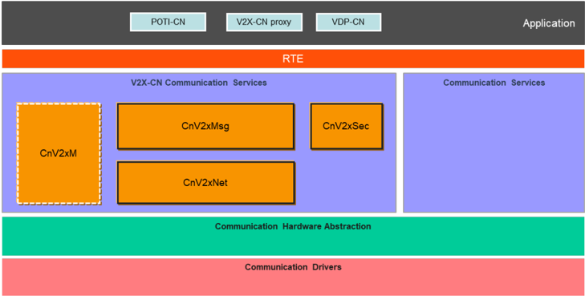
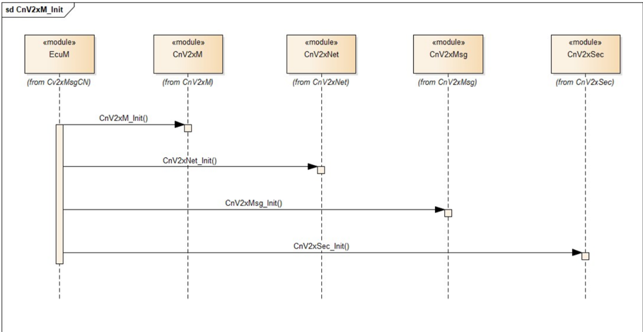
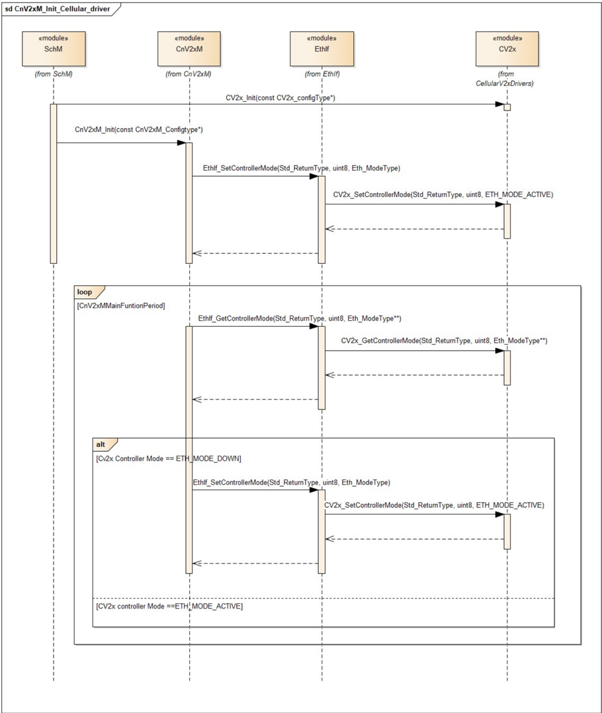

## 1. 简介和功能概述

本文档规定 **AUTOSAR** 基础软件模块 **Chinese Vehicle-2-X Management**（CnV2xM）的功能、**API** 和配置。

**Chinese Vehicle-2-X Management**（CnV2xM）与 **Chinese Vehicle-2-X Message**（CnV2xMsg）、**Chinese Vehicle-2-X Network**（CnV2xNet）、**Chinese Vehicle-2-X Security**（CnV2xSec）以及 **AUTOSAR BSW** 模块 **Ethernet Interface**（EthIf）一起，在 **AUTOSAR** 架构中构成中国 V2X 协议栈。

本文档的基础是中国基于 **LTE-V2X** 的标准 [\[1\]](#ref-1) [\[2\]](#ref-2)。假定读者已熟悉这些标准。

### 1.1. 架构总览

**CnV2xM** 模块在 **AUTOSAR BSW** 和分层软件架构中的位置如下图所示。



### 1.2. 功能总览

**CnV2xM** 模块支持中国 V2X 协议栈在公共 V2X 信道参数获取和蜂窝 V2X 驱动初始化方面的运行。未来，**CnV2xM** 模块将实现 [\[2\]](#ref-2) 中规定的 **DME** 的部分基本服务，并将支持应用层基于 **LTE-V2X** 的中国 V2X 单播服务。

## 2. 缩略语

**BSM**
> 基本安全消息（**Basic safety Message**）。

**C-V2X**
> 基于蜂窝的车联网（**Cellular based Vehicle to Everything**）。

**CBR**
> 信道忙闲比（**Channel Busy Ratio**）。

**CCSA**
> 中国通信标准化协会（**China Communications Standards Association**）。

**CnV2xMsg**
> 中国车辆到一切消息（**Chinese Vehicle-2-X Message**）。

**CnV2xM**
> 中国车辆到一切管理（**Chinese Vehicle-2-X Management**）。

**CnV2xNet**
> 中国车辆到一切网络（**Chinese Vehicle-2-X Network**）。

**CnV2xSec**
> 中国车辆到一切安全（**Chinese Vehicle-2-X Security**）。

**DME**
> 专用管理实体（**Dedicated Management Entity**）。

**LTE**
> 长期演进（**Long Term Evolution**）。

**LTE-V2X**
> 基于长期演进的车联网（**LTE based Vehicle to Everything**）。

**NTCAS**
> 全国汽车标准化技术委员会（**National Technical Committee of Auto Standardization**）。

**PC5**
> 用于 V2X 业务的 ProSe（基于邻近的服务）直接通信中 **UE**（用户设备）之间控制面和用户面的参考点。

**PPPP**
> ProSe 按包优先级（**ProSe Per-Packet Priority**）。

**TP**
> 发射功率（**Transmit Power**）。

## 3. 相关文档

### 3.1. 输入文件和相关标准与规范

<a id="ref-1"></a>[1] GB/T:Technical requirements and test methods of vehicular communication system based on LTE-V2X direct communication (Draft Edition:2022-04-01) http://www.catarc.org.cn/

<a id="ref-2"></a>[2] YD/T 3707-2020:Technical requirements of network layer of LTE-based vehicular communication http://www.ccsa.org.cn/

<a id="ref-3"></a>[3] General Specification of Basic Software Modules
> AUTOSAR_CP_SWS_BSWGeneral

<a id="ref-4"></a>[4] Specification of Default Error Tracer
> AUTOSAR_CP_SWS_DefaultErrorTracer

<a id="ref-5"></a>[5] Specification of ECU State Manager
> AUTOSAR_CP_SWS_ECUStateManager

<a id="ref-6"></a>[6] Specification of Ethernet Interface
> AUTOSAR_CP_SWS_EthernetInterface

### 3.2. 相关规范

**AUTOSAR** 提供了基础软件模块的通用规范 [\[3\]](#ref-3)，该规范同样适用于 **CnV2xM**。

因此，规范 **SWS BSW General** 应被视为 **CnV2xM** 的附加且必需的规范。

## 4. 约束和假设

### 4.1. 限制

* 中国 V2X 模块遵循 [\[1\]](#ref-1) [\[2\]](#ref-2) 中定义的 Day-1 V2X 分配指南，二者分别由 **NTCAS** 和 **CCSA** 发布。
* 无线通信仅支持 **LTE-V2X** **PC5**。其他基于蜂窝的无线通信可以在 **AUTOSAR** 标准的未来版本中扩展。
* [\[2\]](#ref-2) 中规定的 **DME** 功能将在未来实现，以支持基于 **LTE-V2X** 的单播服务。

### 4.2. 汽车域的适用性

本规范适用于所有汽车域。

## 5. 对其他模块的依赖

本节描述 **CnV2xM** 模块与 **AUTOSAR** 基础软件架构中其他模块的关系。它概述实现 **CnV2xM** 模块和服务所需或可选的模块。

### 5.1. 默认错误跟踪器（DET）

在开发模式下，**CnV2xM** 模块通过 **DET** 模块 [\[4\]](#ref-4) 的 Det_ReportError 函数上报错误。

### 5.2. ECU 状态管理器（EcuM）

**EcuM** [\[5\]](#ref-5) 通过调用本文档第 7.3.1 节规定的 [CnV2xM_Init](#731-cnv2xm_init) 来初始化 **CnV2xM** 模块。

### 5.3. 以太网接口（EthIf）

**Ethernet Interface** [\[6\]](#ref-6) 是 **CnV2xNet** 模块的下层模块。

### 5.4. 中国 Vehicle-2-X 消息模块（CnV2xMsg）

**CnV2xMsg** 可以通过调用本文档中的 [CnV2xM_GetChanTxParams](#733-cnv2xm_getchantxparams) 获取信道参数。

## 6. 功能规格

### 6.1. 启动行为

**CnV2xM** 的函数 [CnV2xM_Init](#731-cnv2xm_init) 应通过 EthIf_GetControllerMode 和 EthIf_SetControllerMode、使用 respective 已配置的 EthIfController CnV2xMEthIfCtrlRef 来初始化底层 **MCAL**/**ECUAL** 模块 **CV2x**。

以太网状态管理器（EthSm）不应参与蜂窝 V2X 协议栈的启动。

### 6.2. 关停行为

除非 **ECU** 硬件正在关机或复位，蜂窝 V2X 通信应保持活动。没有任何手段可以提前停止蜂窝 Vehicle-2-X 通信。

### 6.3. 公共信道参数获取

**CnV2xM** 模块应通过 **API** [CnV2xM_GetChanTxParams](#733-cnv2xm_getchantxparams) 实现蜂窝 V2X 信道参数获取。

### 6.4. 错误分类

#### 6.4.1. 开发错误

| 错误类型 | 相关错误代码 | 错误值 |
|---|---|---|
| 使用无效参数调用 **API** 服务 | CNV2XM_E_PARAM | 0x01 |
| 使用无效指针调用 **API** 服务 | CNV2XM_E_PARAM_POINTER | 0x02 |
| 在模块未初始化的情况下使用 **API** 服务 | CNV2XM_E_UNINIT | 0x03 |
| 使用无效配置指针调用 **API** 服务 | CNV2XM_E_INIT_FAILED | 0x04 |

#### 6.4.2. 运行时错误

没有运行时错误。

#### 6.4.3. 瞬态故障

没有瞬态故障。

#### 6.4.4. 生产错误

没有生产错误。

#### 6.4.5. 扩展生产错误

没有扩展生产错误。

## 7. API规范

### 7.1. 导入的类型

本章列出从以下文件包含的所有类型。

| 模块 | 头文件 | 导入的类型 |
|---|---|---|
| CV2x | CV2x_GeneralTypes.h | CV2x_GetChanTxParamIdType（draft） |
| Eth | Eth_GeneralTypes.h | Eth_ModeType |
| Std | Std_Types.h | Std_ReturnType |
| Std | Std_Types.h | Std_VersionInfoType |
| V2xM | V2xM.h | V2xM_ConfigType |

### 7.2. 类型定义

#### 7.2.1. CnV2xM_ConfigType

| 名称 | CnV2xM_ConfigType | | |
| --- | --- | --- | --- |
| 类别 | Structure | | |
| 元素 | implementation specific | | |
| 元素 | 类型 | V2xM_ConfigType | |
| 元素 | 注释 | 配置数据结构的内容是实现特定的。 | |
| 描述 | **CnV2xM** 模块的配置数据结构。 | | |
| 可通过 | CnV2xM.h 获得 | | |

#### 7.2.2. CnV2xM_ChanType

| 名称 | CnV2xM_ChanType | | |
| --- | --- | --- | --- |
| 类别 | 枚举 | | |
| 取值 | CN_V2X_CH1 | - | 5905-5925MHz 频段的信道 |
| 描述 | 指定中国分配给基于 **LTE** 的 V2X 的信道。 | | |
| 可通过 | CnV2xM.h 获得 | | |

### 7.3. 函数定义

这是为上层模块提供的函数列表。

#### 7.3.1. CnV2xM_Init

**说明**: 初始化 **CnV2xM** 模块。可通过 **CnV2xM.h** 获得。服务 **ID** 0x01。本服务为同步调用，不可重入。参数 CfgPtr（in）：ConfigPtr 指向所选配置集的指针。返回值：无。

```C
void CnV2xM_Init ( const CnV2xM_ConfigType* CfgPtr )
```

函数 CnV2xM_Init 应存储对配置结构的访问，供后续 **API** 调用使用。

如果启用了开发错误检测：函数 CnV2xM_Init 应检查参数 CfgPtr 是否包含有效配置。如果检查失败，该函数应引发开发错误 [CNV2XM_E_INIT_FAILED](#641-开发错误)。

配置指针 configPtr 应始终具有 NULL_PTR 值。

#### 7.3.2. CnV2xM_GetVersionInfo

**说明**: 返回本模块的版本信息。可通过 **CnV2xM.h** 获得。服务 **ID** 0x02。本服务为同步调用，可重入。参数 VersionInfoPtr（out）：存储本模块版本信息的指针。返回值：无。

```C
void CnV2xM_GetVersionInfo ( Std_VersionInfoType* VersionInfoPtr )
```

如果启用了开发错误检测：函数 CnV2xM_GetVersionInfo 应检查参数 VersionInfoPtr 是否有效。如果检查失败，该函数应引发开发错误 [CNV2XM_E_PARAM_POINTER](#641-开发错误)。

#### 7.3.3. CnV2xM_GetChanTxParams

**说明**: 读取与信道接收方向相关的值。例如，这可以是信道忙闲比（**CBR**）。可通过 **CnV2xM.h** 获得。服务 **ID** 0x03。本服务为同步调用，不可重入。参数 CtrlId（in）：**Cellular V2X Driver** 上下文中控制器的索引。参数 ChannelId（in）：收发器无线电信道的索引。参数 ParamIds（in）：要读取的参数 **ID**。参数 NumParams（in）：要读取的参数数量。参数 ParamValues（out）：所请求参数的值。返回值：Std_ReturnType，E_OK：成功；E_NOT_OK：设置参数失败。

```C
Std_ReturnType CnV2xM_GetChanTxParams ( uint8 CtrlId, const CnV2xM_ChanType ChannelId, const CV2x_GetChanTxParamIdType* ParamIds, uint32* ParamValues, uint8 NumParams )
```

函数 CnV2xM_GetChanTxParams 应提供 **Tx** 信道参数。

如果启用了开发错误检测：函数 CnV2xM_GetChanTxParams 应检查先前是否已调用过服务 [CnV2xM_Init](#731-cnv2xm_init)。如果检查失败，该函数应引发开发错误 [CNV2XM_E_UNINIT](#641-开发错误)。

如果启用了开发错误检测：函数 CnV2xM_GetChanTxParams 应检查参数 CtrlId 是否有效。如果检查失败，该函数应引发开发错误 [CNV2XM_E_PARAM](#641-开发错误)。

如果启用了开发错误检测：函数 CnV2xM_GetChanTxParams 应检查参数 ChannelId 是否有效。如果检查失败，该函数应引发开发错误 [CNV2XM_E_PARAM](#641-开发错误)。

如果启用了开发错误检测：函数 CnV2xM_GetChanTxParams 应检查参数 ParamIds 是否有效。如果检查失败，该函数应引发开发错误 [CNV2XM_E_PARAM_POINTER](#641-开发错误)。

如果启用了开发错误检测：函数 CnV2xM_GetChanTxParams 应检查参数 ParamValues 是否有效。如果检查失败，该函数应引发开发错误 [CNV2XM_E_PARAM_POINTER](#641-开发错误)。

### 7.4. 回调通知

**CnV2xM** 不提供任何回调函数。

### 7.5. 调度函数

#### 7.5.1. CnV2xM_MainFunction

**说明**: **CnV2xM** 模块的主函数，用于周期性执行协议操作。可通过 SchM_CnV2xM.h 获得。服务 **ID** 0x04。

```C
void CnV2xM_MainFunction ( void )
```

函数 CnV2xM_MainFunction 应用于通过 EthIf_GetChanCV2xPC5TxParams **API** 调用从 **Cellular V2X Driver** 获取 **Tx** 信道参数。

### 7.6. 期望接口

#### 7.6.1. 强制接口

本章定义实现模块核心功能所需的全部外部接口。

| API 函数 | 头文件 | 描述 |
|---|---|---|
| EthIf_GetChanCV2xPC5TxParams | - | 读取与信道接收方向相关的值。例如，这可以是信道忙闲比（**CBR**） |
| EthIf_GetControllerMode | EthIf.h | 获取被索引控制器的状态 |
| EthIf_SetControllerMode | EthIf.h | 启用/禁用被索引的控制器 |

#### 7.6.2. 可选接口

本章定义实现模块可选功能所需的全部外部接口。

| API 函数 | 头文件 | 描述 |
|---|---|---|
| Det_ReportError | Det.h | 上报开发错误的服务 |

## 8. 时序图

### 8.1. CnV2xM 初始化



### 8.2. 蜂窝V2X驱动初始化



## 9. 配置规范

第 9.1 章规定模块 **CnV2xM** 的结构（容器）和参数。

### 9.1. 容器与配置参数

以下各章汇总所有配置参数。参数的详细含义见第 6 章和第 7 章。

#### 9.1.1. 变体

**CnV2xM** 模块仅支持 VARIANT-PRE-COMPILE。

#### 9.1.2. CnV2xM

| SWS 条目 | [ECUC_CnV2xM_00001] |
|---|---|
| 模块名称 | CnV2xM |
| 描述 | **CnV2xM** 模块的配置。 |
| Post-Build 变体支持 | false |
| 支持的配置变体 | VARIANT-PRE-COMPILE |

| 容器名称 | 多重性 | 作用域/依赖 |
|---|---|---|
| CnV2xMGeneral | 1 | 该容器包含 **BSW** 模块 **CnV2xM** 的通用配置参数。 |

#### 9.1.3. CnV2xMGeneral

| SWS 条目 | [ECUC_CnV2xM_00002] |
|---|---|
| 容器名称 | CnV2xMGeneral |
| 父容器 | CnV2xM |
| 描述 | 该容器包含 **BSW** 模块 **CnV2xM** 的通用配置参数。 |
| 配置参数 | 见下方参数表 |

| SWS 条目 | [ECUC_CnV2xM_00004] |
|---|---|
| 参数名称 | CnV2xMDevErrorDetect |
| 父容器 | CnV2xMGeneral |
| 描述 | 将默认错误跟踪器（**Det**）的检测和通知打开或关闭。* **true**：使能（ON）。* **false**：禁用（OFF）。 |
| 多重性 | 1 |
| 类型 | EcucBooleanParamDef |
| 默认值 | false |
| Post-Build 变体值 | false |
| 值配置类 | Pre-compile time：x（All Variants）；Link time：-；Post-build time：- |
| 作用域/依赖 | scope: local |

| SWS 条目 | [ECUC_CnV2xM_00003] |
|---|---|
| 参数名称 | CnV2xMMainFunctionPeriod |
| 父容器 | CnV2xMGeneral |
| 描述 | 本参数定义 CnV2xM_MainFunction 的调度周期。单位：[s]。 |
| 多重性 | 1 |
| 类型 | EcucFloatParamDef |
| 范围 | ]0 .. 1[ |
| 默认值 | 0.1 |
| Post-Build 变体值 | false |
| 值配置类 | Pre-compile time：x（All Variants）；Link time：-；Post-build time：- |
| 作用域/依赖 | scope: local |

| SWS 条目 | [ECUC_CnV2xM_00005] |
|---|---|
| 参数名称 | CnV2xMVersionInfoApi |
| 父容器 | CnV2xMGeneral |
| 描述 | 使能/禁用读取 **CnV2xM** 模块版本信息的 **API**。* **true**：使能（ON）。* **false**：禁用（OFF）。 |
| 多重性 | 1 |
| 类型 | EcucBooleanParamDef |
| 默认值 | false |
| Post-Build 变体值 | false |
| 值配置类 | Pre-compile time：x（All Variants）；Link time：-；Post-build time：- |
| 作用域/依赖 | scope: local |

| SWS 条目 | [ECUC_CnV2xM_00006] |
|---|---|
| 参数名称 | CnV2xMEthIfCtrlRef |
| 父容器 | CnV2xMGeneral |
| 描述 | 本参数表示对用于发送 **C-V2X** 包的以太网接口的引用。 |
| 多重性 | 1 |
| 类型 | Symbolic name reference to EthIfController |
| Post-Build 变体值 | false |
| 值配置类 | Pre-compile time：x（All Variants）；Link time：-；Post-build time：- |
| 作用域/依赖 | scope: ECU |

无包含的容器。

## B. AUTOSAR 可追溯项变更历史

请注意，本章中的列表也包括在后续版本中已从规范中移除的可追溯项。这些项不会作为超链接出现在文档中。

### B.1. 本文档按 AUTOSAR 发布版本 R23-11 的可追溯项历史

#### B.1.1. R23-11 中新增的规范项

无

#### B.1.2. R23-11 中变更的规范项

无

#### B.1.3. R23-11 中删除的规范项

无
