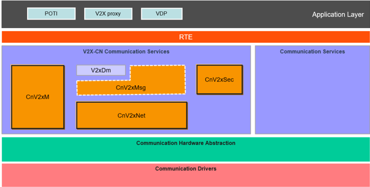
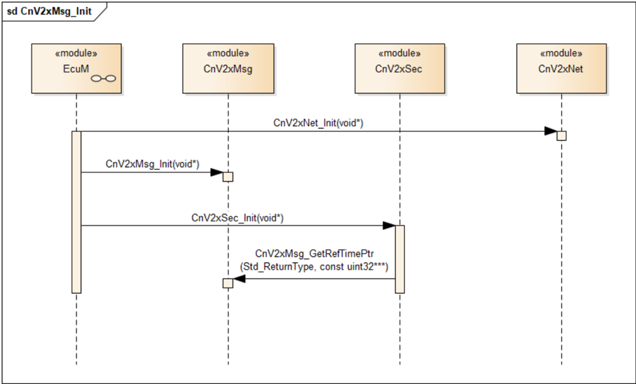
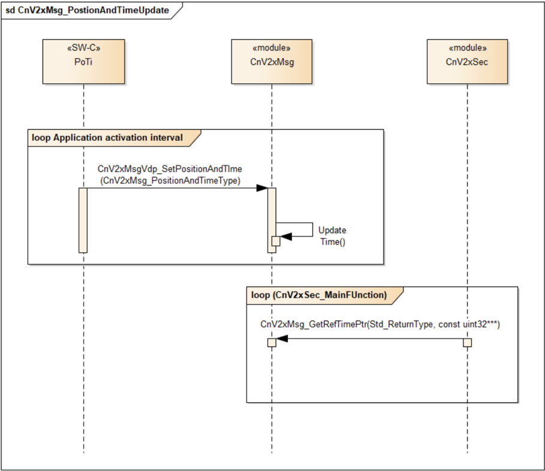
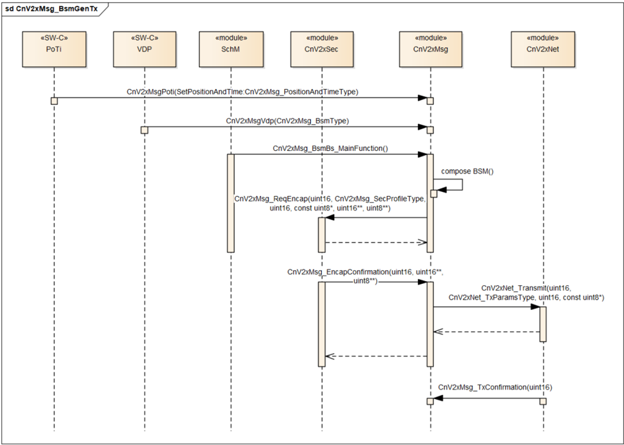
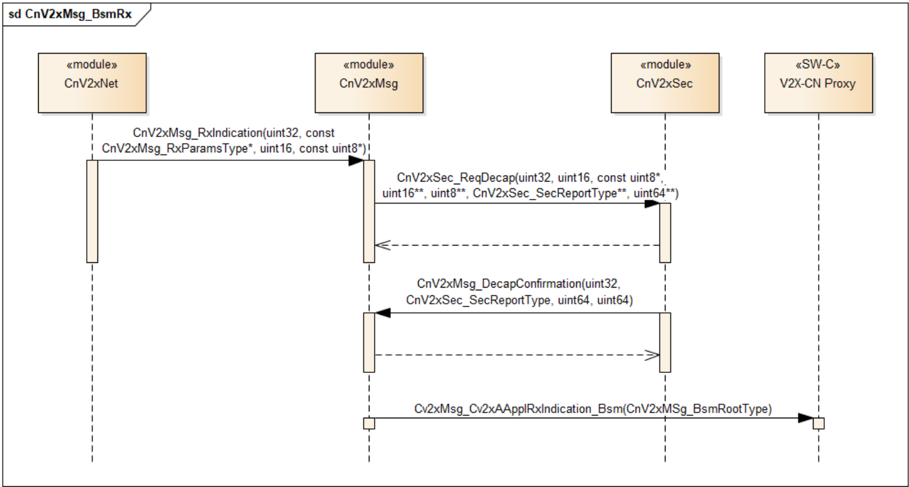
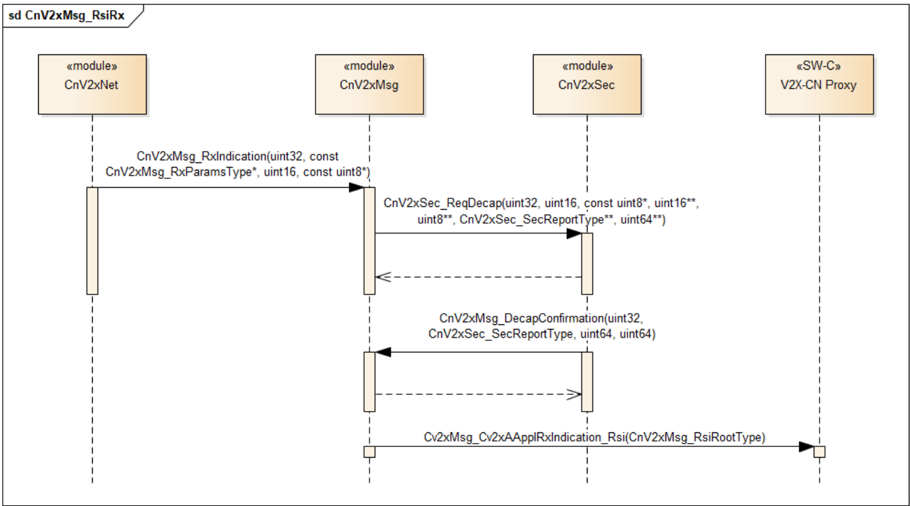
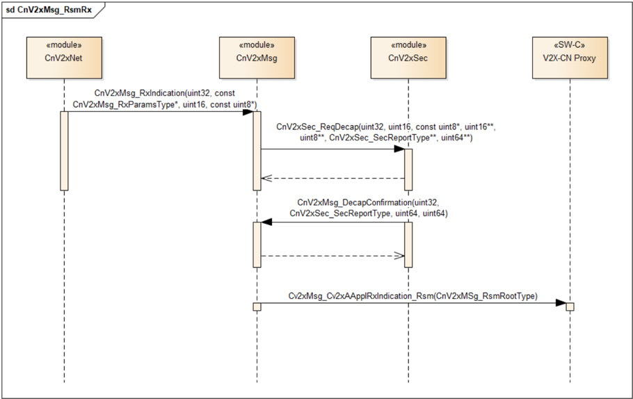
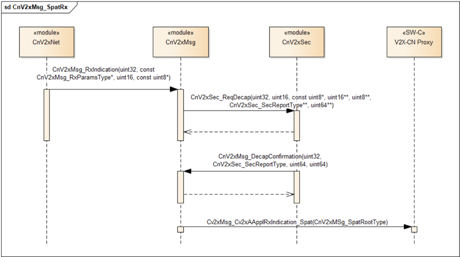
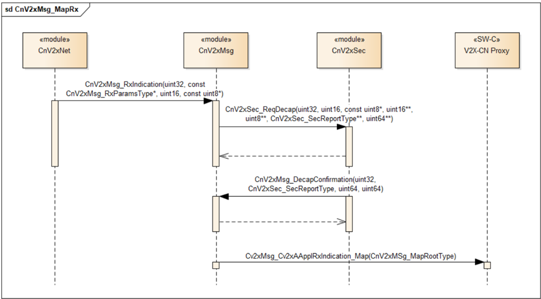
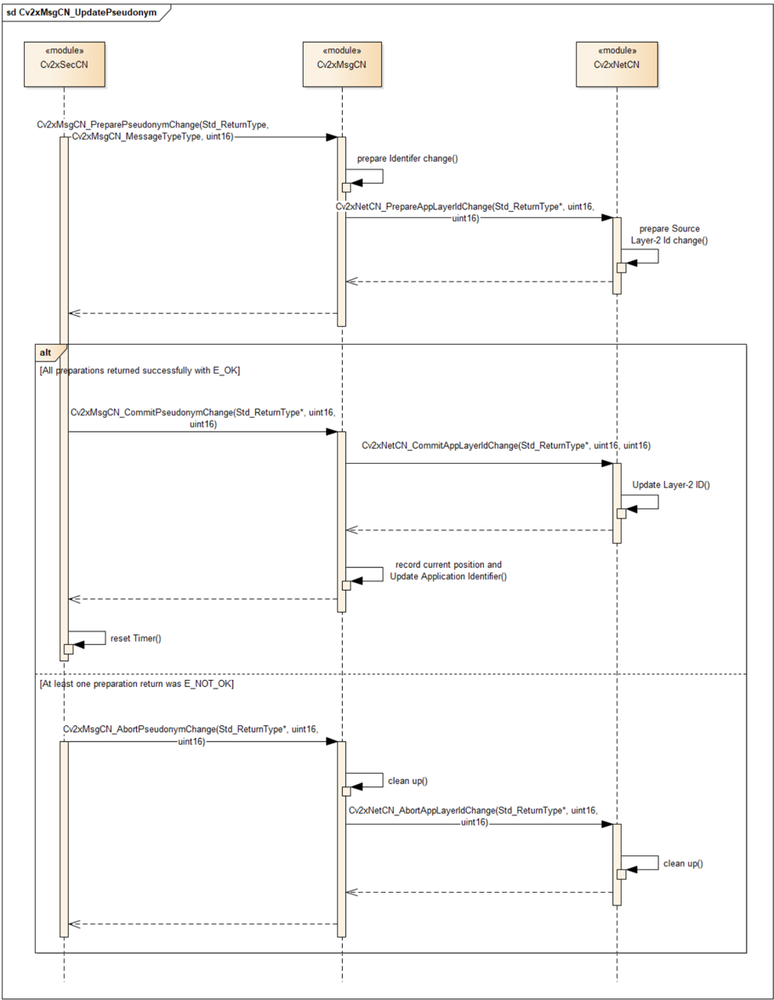

## 1. 简介和功能概述

本文档规定 **AUTOSAR** 基础软件模块 **Chinese Vehicle-2-X Message**（CnV2xMsg）的功能、**API** 和配置。

**Chinese Vehicle-2-X Message** 与 **Chinese Vehicle-2-X Network**（CnV2xNet）、**Chinese Vehicle-2-X Management**（CnV2xM）、**Chinese Vehicle-2-X Security**（CnV2xSec）、**Vehicle-2-X Data Manager**（V2xDm）以及通信驱动层一起，在 **AUTOSAR** 架构中构成中国 V2X 协议栈。

**CnV2xMsg** 模块设计为硬件无关。**CnV2xMsg** 模块依赖于应用层中国 V2X 实体的服务以及下层 **CnV2xNet** 模块，并向 **V2xDm** 模块提供服务。

### 1.1. 架构总览

**CnV2xM** 模块在 **AUTOSAR BSW** 和分层软件架构中的位置如图 1 所示。



**CnV2xMsg** 模块提供基本安全消息（**BSM**）的基本服务，并支持与 BSM 交换相关的管理功能。

### 1.2. 功能总览

**CnV2xMsg** 模块实现 BSM 收发的基本服务，以及 **RSI**/**RSM**/**SPAT**/**MAP** 的接收。除此之外，当前 **CnV2xMsg** 模块还实现了与 BSM 发送相关的管理功能，包括频率管理、**POTI** 管理和 **ID** 管理。

### 1.2.1. 基本安全消息（BSM）

**BSM** 基本服务是运行 BSM 协议的消息层实体。它提供两种服务：BSM 的发送和接收。**BSM** 基本服务向其他车辆/路侧单元（**RSU**）生成并发送 BSM，或者从车辆接收 BSM 并提供给应用。它可以与 **AUTOSAR** 应用层接口以收集用于 BSM 生成的相关信息。**BSM** 基本服务使用中国 V2X 协议栈下层协议实体提供的服务来分发 BSM。收到 BSM 后，**BSM** 基本服务使 BSM 的内容对 V2X 应用可用。接收到的 BSM 可以通过其标准化的 **AUTOSAR** 服务接口 [CnV2xApplRxIndicationBsm](#7712-cnv2xapplrxindicationbsm) 或通过 V2xDm 提供给上层应用。

对于 BSM 的发送和接收，**CnV2xMsg** 的 **BSM** 基本服务部分应提供以下子功能：

* 编码 BSM
* 解码 BSM
* BSM 发送管理
* BSM 接收管理

详情参见 [\[1\]](#ref-1) 第 6 章。

### 1.2.2. 路侧信息（RSI）

**RSI** 服务是提供 RSI 消息接收的消息层实体。**RSI** 服务从 **RSU** 接收 RSI 并提供给应用。接收到的 RSI 可以通过标准化的 **AUTOSAR** 服务接口 CnV2xApplRxIndicationRsi 或通过 V2xDm 提供给上层应用。

### 1.2.3. 路侧消息（RSM）

**RSM** 服务是提供 RSM 消息接收的消息层实体。**RSM** 服务从 **RSU** 接收 RSM 并提供给 V2X 应用。接收到的 RSM 可以通过标准化的 **AUTOSAR** 服务接口 [CnV2xApplRxIndicationRsm](#7714-cnv2xapplrxindicationrsm) 或通过 V2xDm 提供给上层应用。

### 1.2.4. 信号相位与时间（SPAT）

**SPAT** 服务是提供 SPAT 消息接收的消息层实体。**SPAT** 服务从 **RSU** 接收 SPAT 并提供给 V2X 应用。接收到的 SPAT 可以通过标准化的 **AUTOSAR** 服务接口 [CnV2xApplRxIndicationSpat](#7715-cnv2xapplrxindicationspat) 或通过 V2xDm 提供给上层应用。

### 1.2.5. MAP

**MAP** 服务是提供 MAP 消息接收的消息层实体。**MAP** 服务从 **RSU** 接收 MAP 并提供给 V2X 应用。接收到的 MAP 可以通过标准化的 **AUTOSAR** 服务接口 [CnV2xApplRxIndicationMap](#7716-cnv2xapplrxindicationmap) 或通过 V2xDm 提供给上层应用。

### 1.2.6. 位置与时间管理（POTI）

**CnV2xMsg** 模块中的 **POTI** 管理从应用层获取位置和时间信息并使其对自身可用，同时向 **CnV2xSec** 模块提供距离。

### 1.2.7. 标识管理

**CnV2xMsg** 应实现标识管理，包括车辆 **ID** 和消息计数。从安全和隐私的角度来看，当假名证书更新时，这些标识应被更改。

### 1.2.8. 频率管理

**CnV2xMsg** 应根据信道状态、车辆状态、消息类型等控制到下层的消息发送频率。

### 1.2.9. 通过 V2xDm 的消息接收服务

如果接收到的 V2X 消息经 **V2xDm** 模块发送到应用层或 **PDUR**，**CnV2xMsg** 应向 **V2xDm** 模块提供接口。收到消息（BSM/RSI/RSM/SPAT/MAP）后，**CnV2xMsg** 使消息的内容对 **V2xDm** 模块可用。接收到的消息由 **V2xDm** 模块通过标准化的 **AUTOSAR** 服务接口提供给上层应用。

## 2. 缩略语

**API**
> 应用编程接口（**Application programming Interface**）。

**BS**
> 基本服务（**Basic Service**）。

**BSW**
> 基础软件（**Basic Software**）。

**BSM**
> 基本安全消息（**Basic safety Message**）。

**C-V2X**
> 基于蜂窝的车联网（**Cellular based Vehicle to Everything**）。

**CCSA**
> 中国通信标准化协会（**China Communications Standards Association**）。

**CnV2xMsg**
> 中国车辆到一切消息（**Chinese Vehicle-2-X Message**）。

**CnV2xNet**
> 中国车辆到一切网络（**Chinese Vehicle-2-X Network**）。

**CnV2xSec**
> 中国车辆到一切安全（**Chinese Vehicle-2-X Security**）。

**DE**
> 数据元素（**Data Element**）。

**DEM**
> 诊断事件管理器（**Diagnostic Event Manager**）。

**DET**
> 默认错误跟踪器（**Default Error Tracer**）。

**DF**
> 数据帧（**Data Frame**）。

**EcuM**
> 电子控制单元管理器（**Electronic Control Unit Manager**）。

**IF**
> 接口（**Interface**）。

**NTCAS**
> 全国汽车标准化技术委员会（**National Technical Committee of Auto Standardization**）。

**NVM**
> 非易失性存储器（**Non-Volatile Memory**）。

**PH**
> 路径历史（**Path History**）。

**POTI**
> 位置与时间（**Position and Time**）。

**RSI**
> 路侧信息（**Road Side Information**）。

**RSM**
> 路侧消息（**Road Side Message**）。

**RSU**
> 路侧单元（**Roadside Unit**）。

**SPAT**
> 信号相位与时间（**Signal Phase And Time**）。

**VDP**
> 车辆数据提供者（**Vehicle Data provider**）。

## 3. 相关文档

### 3.1. 输入文件和相关标准与规范

<a id="ref-1"></a>[1] GB/T:Technical requirements and test methods of vehicular communication system based on LTE-V2X direct communication (Draft Edition:2022-04-01) http://www.catarc.org.cn/

<a id="ref-2"></a>[2] General Specification of Basic Software Modules
> AUTOSAR_CP_SWS_BSWGeneral

<a id="ref-3"></a>[3] Specification of Default Error Tracer
> AUTOSAR_CP_SWS_DefaultErrorTracer

<a id="ref-4"></a>[4] Specification of ECU State Manager
> AUTOSAR_CP_SWS_ECUStateManager

<a id="ref-5"></a>[5] Specification of Chinese Vehicle-2-X Network
> AUTOSAR_CP_SWS_ChineseV2XNetwork

<a id="ref-6"></a>[6] Requirements on Chinese Vehicle-2-X Communication
> AUTOSAR_CP_SRS_ChineseV2XCommunication

<a id="ref-7"></a>[7] YD/T 3709-2020:Technical requirements of Message layer of LTE-based vehicular communication http://www.ccsa.org.cn/

<a id="ref-8"></a>[8] Specification of Vehicle-2-X Facilities
> AUTOSAR_CP_SWS_V2XFacilities

### 3.2. 相关规范

**AUTOSAR** 提供了基础软件模块的通用规范 [\[2, SWS BSW General\]](#ref-2)，该规范同样适用于 **CnV2xMsg**。

因此，规范 **SWS BSW General** 应被视为 **CnV2xMsg** 的附加且必需的规范。

## 4. 约束和假设

### 4.1. 限制

中国 V2X 模块遵循 **CCSA** 和 **NTCAS** 定义的 Day-1 场景的技术要求。服务接口中使用的 **RSI**、**RSM**、**SPAT** 和 **MAP** 消息的数据类型也计划在未来版本中开发。

当前版本尚不支持通过 V2xDm 的消息接收服务，因为 **V2xDm** 目前尚不可用。该功能将在后续版本中支持。

### 4.2. 汽车域的适用性

本规范适用于所有汽车域。

## 5. 对其他模块的依赖

### 5.1. 默认错误跟踪器（DET）

在开发模式下，**CnV2xMsg** 模块通过 **DET** 模块 [\[3\]](#ref-3) 的 Det_ReportError 函数上报错误。

### 5.2. ECU 状态管理器（EcuM）

**EcuM** [\[4\]](#ref-4) 通过调用本文档第 7.3.1 节规定的 [CnV2xMsg_Init](#731-cnv2xmsg_init) 来初始化 **CnV2xMsg** 模块。

### 5.3. V2X 车辆数据提供者

**CnV2xMsg** 模块通过发送者-接收者接口 [CnV2xMsgVdp](#7711-cnv2xmsgvdp)（参见第 [7.7.1.1](#7711-cnv2xmsgvdp) 节）从 **VDP** 应用获取车辆相关数据。

### 5.4. V2X 代理

**V2x Proxy** 是一个应用，它通过发送者-接收者接口 [CnV2xApplRxIndicationBsm](#7712-cnv2xapplrxindicationbsm)（参见第 [7.7.1.2](#7712-cnv2xapplrxindicationbsm) 节）监听每条 BSM，并通过车内网络将其传输给一个或多个 **ECU**。

**CnV2xMsg** 模块通过发送者-接收者接口 CnV2xApplRxIndicationRsi（参见第 [7.7.1.3](#7713-cnv2xapplrxindicationzrsi) 节）将接收到的 RSI 数据传递给 **V2x Proxy**。

**CnV2xMsg** 模块通过发送者-接收者接口 [CnV2xApplRxIndicationRsm](#7714-cnv2xapplrxindicationrsm)（参见第 [7.7.1.4](#7714-cnv2xapplrxindicationrsm) 节）将接收到的 RSM 数据传递给 **V2x Proxy**。

**CnV2xMsg** 模块通过发送者-接收者接口 [CnV2xApplRxIndicationSpat](#7715-cnv2xapplrxindicationspat)（参见第 [7.7.1.5](#7715-cnv2xapplrxindicationspat) 节）将接收到的 SPAT 数据传递给 **V2x Proxy**。

**CnV2xMsg** 模块通过发送者-接收者接口 [CnV2xApplRxIndicationMap](#7716-cnv2xapplrxindicationmap)（参见第 [7.7.1.6](#7716-cnv2xapplrxindicationmap) 节）将接收到的 MAP 数据传递给 **V2x Proxy**。

### 5.5. AUTOSAR CnV2xNet

**CnV2xMsg** 模块假定 **CnV2xNet** 提供发送请求原语（CnV2xNet_Transmit [\[5\]](#ref-5)，参见第 7.6.1 节的 CnV2xSec_ReqEncap、CnV2xSec_ReqDecap 和 CnV2xSec_VehicleEventFlagsIndication）。

### 5.6. AUTOSAR CnV2xSec

安全机制由 **CnV2xSec** 配置并由 **CnV2xMsg** 使用。**CnV2xMsg** 模块假定 **CnV2xSec** 模块提供请求原语（参见第 [7.6.1](#761-强制接口) 节）。

### 5.7. AUTOSAR V2xDm

如果接收到的 V2X 消息经 **V2xDm** 模块发送到应用层或 **PDUR**，**CnV2xMsg** 模块应将接收到的消息传递给 **V2xDm** 模块。**CnV2xMsg** 模块假定 **Vehicle-2-X Data Manager**（V2xDm）模块提供请求原语。

## 6. 功能规格

**CnV2xMsg** 模块运行 **BSM**、**RSI**、**RSM**、**SPAT** 和 **MAP** 的基本服务。

**CnV2xMsg** 模块应按照 [\[1\]](#ref-1) [\[7\]](#ref-7) 规定的技术要求实现 **BSM** 基本服务。

**CnV2xMsg** 模块应按照 [\[7\]](#ref-7) 规定的技术要求实现 **RSI** 基本服务。

**CnV2xMsg** 模块应按照 [\[7\]](#ref-7) 规定的技术要求实现 **RSM** 基本服务。

**CnV2xMsg** 模块应按照 [\[7\]](#ref-7) 规定的技术要求实现 **SPAT** 基本服务。

**CnV2xMsg** 模块应按照 [\[7\]](#ref-7) 规定的技术要求实现 **MAP** 基本服务。

### 6.1. 启动行为

**CnV2xMsg** 的函数 [CnV2xMsg_Init](#731-cnv2xmsg_init)（参见第 [7.3.1](#731-cnv2xmsg_init) 节）应初始化 **CnV2xMsg** 模块的内部状态。

如果接收到的 V2X 消息经 **RTE** 直接发送到应用层，函数 [CnV2xMsg_Init](#731-cnv2xmsg_init) 应初始化 **BSM**、**RSI**、**RSM**、**SPAT** 和 **MAP** 的基本服务。

如果接收到的 V2X 消息经 **V2xDm** 模块发送到应用层或 **PDUR**，函数 [CnV2xMsg_Init](#731-cnv2xmsg_init) 应初始化消息接收服务（参见第 [7.5.7](#757-cnv2xmsg_rxs_mainfunction) 节）。

系统启动时，**CnV2xMsg** 应从 **NvM** 读取航向值作为初始值。

### 6.2. 关停行为

系统关停时，**CnV2xMsg** 应将最后已知的航向值存储到 **NvM** 中。

### 6.3. 通用格式规范

构成 BSM 内容的数据元素应符合 [\[1\]](#ref-1) [\[7\]](#ref-7)。

构成 **RSI**、**RSM**、**SPAT** 和 **MAP** 内容的数据元素应符合 [\[7\]](#ref-7)。

### 6.4. BSM 功能规格

#### 6.4.1. BSM 初始化

**BSM** 基本服务初始化应使能 BSM 的传输。

函数 [CnV2xMsg_Init](#731-cnv2xmsg_init) 应按照第 6.3.4 章 [\[1\]](#ref-1) 将 BSM 的生成间隔初始化为默认值（100 ms）。

当首次接收到 [CnV2xMsg_CommitPseudonymChange](#737-cnv2xmsg_commitpseudonymchange) 时，**CnV2xMsg** 模块应开始组合并发送 BSM 消息。

#### 6.4.2. BSM 生成、发送与接收、频率管理

**BSM** 基本服务应在频率管理的控制下周期性生成 BSM（详情参见第 6.3.4 章 [\[1\]](#ref-1)）。

生成的 BSM 应由 **CnV2xNet** 使用 **API** 函数 CnV2xNet_Transmit 发送（参见第 [7.6.1](#761-强制接口) 节）。

**BSM** 基本服务应通过回调函数 [CnV2xMsg_RxIndication](#742-cnv2xmsg_rxindication)（参见第 [7.4.2](#742-cnv2xmsg_rxindication) 节）接收 BSM。

**BSM** 基本服务应仅在 BSM 满足第 6.3.2 章 [\[1\]](#ref-1) 规定的 BSM 传输最低准则时发送 BSM。如果在任何时候 **BSM** 基本服务无法组合出满足最低传输准则的 BSM，则 **BSM** 基本服务应停止发送 BSM，直到准则得到满足。

对于车辆启动后要发送的第一条常规 BSM，**CnV2xMsg** 模块应在最低传输准则得到满足后的 [0,100] ms 内生成该消息。

当关键事件触发条件（详情参见第 6.3.3 章 [\[1\]](#ref-1)）首次满足时，**CnV2xMsg** 模块应取消下一条 BSM 的发送，并立即生成一条关键 BSM 并尽快将其发出。**CnV2xMsg** 模块应将所有有效的关键事件标志（截至 BSM 组合时刻）包含在该 BSM 中。在触发条件有效期间，**CnV2xMsg** 模块应以上述关键 BSM 生成时刻为起点、以默认周期 100 ms 生成关键 BSM。

当某个特定触发条件无效时，应取消 BSM 消息中携带的相应关键关键事件标志。

路径历史信息应在上一次 BSM 携带路径历史信息之后经过的时间等于或大于 500 ms 的第一条 BSM 中携带。

#### 6.4.3. BSM 时间要求

**CnV2xMsg** 模块应确保 BSM 中 DSecond 指示的值与生成该 BSM 的 **UTC** 时间之间的时间偏差小于 150 ms。

#### 6.4.4. BSM 格式规范

关于 BSM 数据格式的详情，参见以下文档：

* 参见 [\[7\]](#ref-7) 第 5 章
* 参见 [\[1\]](#ref-1) 第 6.3.1 章和第 6.3.2 章

常规 BSM 消息（不携带关键标志）的优先级值应设置为 112。关键 BSM 消息（携带关键标志）的优先级值应设置为 208。

#### 6.4.5. 路径历史

当安全实体更改其假名证书时，**CnV2xMsg** 模块应清除路径历史缓存。

对于包含路径历史信息的 BSM 中包含在 DF_PathHistoryPointList 内的 DF_PathHistoryPoint 的设置，**CnV2xMsg** 模块应根据要发送数据的实际大小选择相应的数据帧格式，不得使用较大的数据帧格式发送较小尺寸的数据。

[CnV2xMsg_PathHistoryType](#773234-cnv2xmsg_pathhistorytype) 不应包含任何已存在于 BSM 其他部分的附加数据。

**CnV2xMsg** 模块应在包含路径历史信息的 BSM 的 DF_PathHistory 中包含路径历史点，且路径历史长度（即第一个路径历史点与最后一个路径历史点之间的距离）应等于或大于 vMinPHistDistance（200 m）且不超过 vMaxPHistDistance（400 m），除非出现以下情况：

* 车辆选择新的假名证书后，当前车辆位置与车辆开始使用当前假名证书的位置之间的物理距离小于 vMinPHistDistance（200 m）；
* 位置信息不可用，且路径历史长度小于 vMinPHistDistance（200 m）；
* BSM 中包含的路径历史点数量大于 vMaxPHistPoints，且路径历史长度仍小于 vMinPHistDistance（200 m）。

**注意：** 路径历史相关参数设置见 [\[1\]](#ref-1) 附录 B。

**CnV2xMsg** 模块应维护一条车辆路径，该路径由定位子系统以周期性时间间隔（通常与 BSM 发送速率相同）采样得到的数据元素组成，表示车辆在相应距离上的近期运动。

**CnV2xMsg** 模块应以如下方式填充 [CnV2xMsg_PathHistoryType](#773234-cnv2xmsg_pathhistorytype) 的路径历史点：车辆路径上任意点到连接其两个相邻路径历史点的直线的垂直距离小于 vPathPerpendicularDist（1 m）。（详情参见 [\[1\]](#ref-1) 附录 B）

**CnV2xMsg** 模块应以可用车辆位置数据子集中选取的最少路径历史点数量填充 [CnV2xMsg_PathHistoryType](#773234-cnv2xmsg_pathhistorytype)。

**CnV2xMsg** 模块应以按时间先后排序的路径历史点填充 [CnV2xMsg_PathHistoryType](#773234-cnv2xmsg_pathhistorytype)，第一个路径历史点的生成时间在时间上最接近当前 **UTC** 时间。

**注意：** 按时间排序的路径历史点不要求在时间上等间隔。

**CnV2xMsg** 模块应以所计算点集中不超过 vMaxPHistPoints 个点（15 个）填充 [CnV2xMsg_PathHistoryType](#773234-cnv2xmsg_pathhistorytype)。

每个路径历史点的偏移值应基于 BSM 中的 [CnV2xMsg_Position3DType](#77321-cnv2xmsg_position3dtype)。

### 6.5. RSI 功能规格

#### 6.5.1. RSI 接收管理

收到 RSI 后，**RSI** 服务使 RSI 的内容对 V2X 应用可用（详情参见 [\[7\]](#ref-7) 第 5 章）。接收到的 RSI 可以通过标准化的 **AUTOSAR** 服务接口 CnV2xAppRxIndicationRsi 或通过 V2xDm 发送给上层应用。它可以通过 CnV2xMsgV2xDmServiceConfig 进行配置（参见第 [9.1.5](#915-cnv2xmsgdmmsgconfig) 节）。

#### 6.5.2. RSI 格式规范

关于 RSI 数据格式的详情，参见 **CCSA** 标准：[\[7\]](#ref-7) 第 5 章。

### 6.6. RSM 功能规格

#### 6.6.1. RSM 接收管理

收到 RSM 后，**RSM** 服务使 RSM 的内容对 V2X 应用可用（详情参见 [\[7\]](#ref-7) 第 5 章）。接收到的 RSM 可以通过标准化的 **AUTOSAR** 服务接口 CnV2xAppRxIndicationRsm 或通过 V2xDm 发送给上层应用。它可以通过 CnV2xMsgV2xDmServiceConfig 进行配置（参见第 [9.1.5](#915-cnv2xmsgdmmsgconfig) 节）。

#### 6.6.2. RSM 格式规范

关于 RSM 数据格式的详情，参见 **CCSA** 标准：[\[7\]](#ref-7) 第 5 章。

### 6.7. SPAT 功能规格

#### 6.7.1. SPAT 接收管理

收到 SPAT 后，**SPAT** 服务使 SPAT 的内容对 V2X 应用可用（详情参见 [\[7\]](#ref-7) 第 5 章）。接收到的 SPAT 可以通过标准化的 **AUTOSAR** 服务接口 CnV2xAppRxIndicationSpat 或通过 V2xDm 发送给上层应用。它可以通过 CnV2xMsgV2xDmServiceConfig 进行配置（参见第 [9.1.5](#915-cnv2xmsgdmmsgconfig) 节）。

#### 6.7.2. SPAT 格式规范

关于 SPAT 数据格式的详情，参见 **CCSA** 标准：[\[7\]](#ref-7) 第 5 章。

### 6.8. MAP 功能规格

#### 6.8.1. MAP 接收管理

收到 MAP 后，**MAP** 服务使 MAP 的内容对 V2X 应用可用（详情参见 [\[7\]](#ref-7) 第 5 章）。接收到的 MAP 可以通过标准化的 **AUTOSAR** 服务接口 CnV2xAppRxIndicationMap 或通过 V2xDm 发送给上层应用。它可以通过 CnV2xMsgV2xDmServiceConfig 进行配置（参见第 [9.1.5](#915-cnv2xmsgdmmsgconfig) 节）。

#### 6.8.2. MAP 格式规范

关于 MAP 数据格式的详情，参见 **CCSA** 标准：[\[7\]](#ref-7) 第 5 章。

### 6.9. 位置与时间

应使用 [\[1\]](#ref-1) 中定义的 **GCJ-02** 作为参考坐标系。

航向应描述车辆参考点的方向，其值应按 [\[7\]](#ref-7) 的定义从北向顺时针增加。

函数 [CnV2xMsg_CheckDistance](#734-cnv2xmsg_checkdistance) 应提供当前位置与开始使用当前假名的位置之间的当前距离。

函数 [CnV2xMsg_GetRefTimePtr](#733-cnv2xmsg_getreftimeptr) 应提供指向包含当前 **UTC** 时间的 32 位数据的地址指针。

函数 CnV2xMsg_CalcDistance 应计算两个地理位置点之间的距离。

**CnV2xMsg** 模块应在收到 [CnV2xMsg_CommitPseudonymChange](#737-cnv2xmsg_commitpseudonymchange) 时更新并记录车辆位置，该位置由函数 [CnV2xMsg_CheckDistance](#734-cnv2xmsg_checkdistance) 用于计算距离。

### 6.10. ID 管理

**CnV2xMsg** 模块应实现标识管理。应将当前标识通知特定模块，以确保在中国 V2X 协议栈的每一层使用一致的值。

当从 **CnV2xSec** 收到假名证书更改时，**CnV2xMsg** 模块应更改应用标识符（车辆 **ID** 和消息计数），并将这些更改通知 **CnV2xNet** 模块。这些更改对于确保车辆的隐私是必要的。

[CnV2xMsg_Mgt_MainFunction](#752-cnv2xmsg_mgt_mainfunction) 应用于管理标识符的更改。

**CnV2xMsg** 应分两个阶段启动标识符的更改：第一阶段为准备（prepare）阶段，第二阶段为提交（commit）或中止（abort）阶段。第二阶段取决于第一阶段中所有被调用模块的结果。如果第一阶段成功，则应启动提交阶段；如果第一阶段不成功，则应启动中止阶段。

在准备阶段，**CnV2xSec** 调用 **API** [CnV2xMsg_PreparePseudonymChange](#736-cnv2xmsg_preparepseudonymchange)()，随后 **CnV2xMsg** 调用 CnV2xNet_PrepareAppLayerIdChange()。

在提交阶段，**CnV2xSec** 调用 **API** [CnV2xMsg_CommitPseudonymChange](#737-cnv2xmsg_commitpseudonymchange)()，随后 **CnV2xMsg** 调用 CnV2xNet_CommitAppLayerIdChange()。此后新的假名证书和假名计数值生效，带有旧假名计数值的 V2X 消息应被丢弃。

在中止阶段，**CnV2xSec** 调用 **API** [CnV2xMsg_CommitPseudonymChange](#737-cnv2xmsg_commitpseudonymchange)()，随后调用 CnV2xNet_AbortAppLayerIdChange()。

当车辆事件标志变为所有位均未置位的状态、或从所有位均未置位的状态变为任一位置位的状态时，**CnV2xSec** 应调用函数 CnV2xMsg_GetVehicleEventFlagsStatus 以启动假名证书的更改。

### 6.11. 通过 V2xDm 的消息接收服务

如果接收到的 V2X 消息被配置为发送给 **V2xDm** 模块，则接收到的消息应通过回调函数 V2xDm_RxIndication（参见第 [7.6.2](#762-可选接口) 节）发送。

**AID** 需要分配给 [CnV2xMsgConfig](#914-cnv2xmsgconfig) 配置容器的相应实例（参见第 [9.1.5](#915-cnv2xmsgdmmsgconfig) 节）。**CnV2xMsg** 模块应按照第 [6.11](#611-通过-v2xdm-的消息接收服务) 节的规定检查接收到的消息的 **AID** 是否与配置匹配。如果不匹配，则应丢弃该消息。

| 消息类型 | AID | Rx/Tx |
|---|---|---|
| BSM | 111（非应急车辆，常规 BSM）；112（非应急车辆，事件触发 BSM）；113（应急车辆，常规 BSM）；114（应急车辆，事件触发 BSM）；3617（用于后装的 V2X 终端） | Rx 和 Tx |
| RSI | 3620（静态路侧信息）；3621（半动态路侧信息）；3622（动态路侧信息） | 仅 Rx |
| RSM | 3623 | 仅 Rx |
| SPAT | 3619 | 仅 Rx |
| MAP | 3618 | 仅 Rx |

### 6.12. 错误分类

#### 6.12.1. 开发错误

| 错误类型 | 相关错误代码 | 错误值 |
|---|---|---|
| 使用错误参数调用 **API** 服务 | CNV2XMSG_E_PARAM | 0x01 |
| 使用无效指针调用 **API** 服务 | CNV2XMSG_E_PARAM_POINTER | 0x02 |
| **CnV2xMsg** 初始化失败 | CNV2XMSG_E_INIT_FAILED | 0x03 |
| 在 **CnV2xMsg** 模块完全初始化之前调用了 **API** 函数 | CNV2XMSG_E_UNINIT | 0x04 |

#### 6.12.2. 运行时错误

没有运行时错误。

#### 6.12.3. 瞬态故障

没有瞬态故障。

#### 6.12.4. 生产错误

没有生产错误。

#### 6.12.5. 扩展生产错误

没有扩展生产错误。

## 7. API规范

### 7.1. 导入的类型

本章列出从以下文件包含的所有类型。

| 模块 | 头文件 | 导入的类型 |
|---|---|---|
| CnV2xNet | CnV2x_GeneralTypes.h | CnV2xNet_TxParamsPresenceType（draft） |
| CnV2xNet | CnV2x_GeneralTypes.h | CnV2x_CbrType（draft） |
| CnV2xNet | CnV2x_GeneralTypes.h | CnV2x_Layer2IdType（draft） |
| CnV2xNet | CnV2x_GeneralTypes.h | CnV2x_MaxDataRateType（draft） |
| CnV2xNet | CnV2x_GeneralTypes.h | CnV2x_NetTxResultType（draft） |
| CnV2xNet | CnV2x_GeneralTypes.h | CnV2x_NetworkProtocolType（draft） |
| CnV2xNet | CnV2x_GeneralTypes.h | CnV2x_TrafficPeriodType（draft） |
| CnV2xNet | CnV2xNet.h | CnV2xNet_TxParamsType（draft） |
| CnV2xSec | CnV2x_GeneralTypes.h | CnV2xSec_SecReportType（draft） |
| CnV2xSec | CnV2x_Sec.h | CnV2xSec_SecProfileType（draft） |
| CnV2xSec | CnV2x_Sec.h | CnV2xSec_SecReturnType（draft） |
| Std | Std_Types.h | Std_ReturnType |
| Std | Std_Types.h | Std_VersionInfoType |

### 7.2. 类型定义

#### 7.2.1. CnV2xMsg_RxParamsType

| 名称 | CnV2xMsg_RxParamsType | | |
| --- | --- | --- | --- |
| 类别 | Structure | | |
| 元素 | presence | presence | 标记可选子元素是否存在 |
| 元素 | DsmpVersion | DsmpVersion | **DSMP** 协议版本类型。范围：0..7 |
| 元素 | Aid | Aid | **AID**（应用标识符）的值 |
| 元素 | SourceLayer2Id | SourceLayer2Id | V2X-CN 包的源 **MAC** 地址 |
| 元素 | DestinationLayer2Id | DestinationLayer2Id | V2X-CN 包的目的 **MAC** 地址 |
| 元素 | Priority | Priority | 指定 V2X-CN 消息的优先级 |
| 元素 | Cbr | Cbr | 信道忙闲比指示 |
| 元素 | MaxDataRate | MaxDataRate | 最大数据速率指示 |
| 描述 | 封装来自 **CnV2xNet** 的网络层参数。 | | |
| 变体 | - | | |
| 可通过 | CnV2xMsg.h 获得 | | |

#### 7.2.2. CnV2xMsg_RxParamsPresenceType

| 名称 | CnV2xMsg_RxParamsPresenceType | | | |
| --- | --- | --- | --- | --- |
| 类别 | Bitfield | | | |
| 派生自 | uint8 | | | |
| 元素 | Kind | Name | Mask | Description |
| 元素 | bit | SourceMACAddr | 0x08 | 位 3：可选子元素存在 |
| 元素 | bit | DestinationLayer2Id | 0x04 | 位 2：可选子元素存在 |
| 元素 | bit | Cbr | 0x02 | 位 1：可选子元素存在 |
| 元素 | bit | MaxdataRate | 0x01 | 位 0（LSB）：可选子元素存在 |
| 描述 | [CnV2xMsg_RxParamsType](#721-cnv2xmsg_rxparamstype) 的存在标志。 | | | |
| 变体 | - | | | |
| 可通过 | CnV2xMsg.h 获得 | | | |

### 7.3. 函数定义

#### 7.3.1. CnV2xMsg_Init

**说明**: 初始化 **CnV2xMsg** 模块。可通过 **CnV2xMsg.h** 获得。服务 **ID** 0x1。本服务为同步调用，不可重入。参数 CfgPtr（in）：指向空指针。返回值：无。

```C
void CnV2xMsg_Init ( void* CfgPtr )
```

如果启用了开发错误检测：该函数应检查参数 CfgPtr 是否包含有效配置。如果检查失败，该函数应引发开发错误 [CNV2XMSG_E_INIT_FAILED](#6121-开发错误)。

#### 7.3.2. CnV2xMsg_GetVersionInfo

**说明**: 返回本模块的版本信息。可通过 **CnV2xMsg.h** 获得。服务 **ID** 0x2。本服务为同步调用，可重入。参数 VersionInfoPtr（out）：存储本模块版本信息的指针。返回值：无。

```C
void CnV2xMsg_GetVersionInfo ( Std_VersionInfoType* VersionInfoPtr )
```

如果 CnV2xMsgDevErrorDetect（详情参见第 [9.1.3](#913-cnv2xmsggeneral) 节）被使能：如果 VersionInfoPtr 指针参数无效（例如 **NULL**），则应向 **DET** 模块上报错误代码 [CNV2XMSG_E_PARAM_POINTER](#6121-开发错误)。

#### 7.3.3. CnV2xMsg_GetRefTimePtr

**说明**: 提供指向中国 V2X 协议栈时间基准的指针。可通过 **CnV2xMsg.h** 获得。服务 **ID** 0x3。本服务为同步调用，不可重入。参数 RefTimePtr（out）：指向当前时间信息的指针。返回值：Std_ReturnType，E_OK：请求成功；E_NOT_OK：请求失败。

```C
Std_ReturnType CnV2xMsg_GetRefTimePtr ( const uint32** RefTimePtr )
```

如果启用了开发错误检测：该函数应检查先前是否已调用过服务 [CnV2xMsg_Init](#731-cnv2xmsg_init)。如果检查失败，该函数应引发开发错误 [CNV2XMSG_E_UNINIT](#6121-开发错误)。

如果启用了开发错误检测：该函数应检查参数 RefTimePtr 是否有效。如果检查失败，该函数应引发开发错误 [CNV2XMSG_E_PARAM_POINTER](#6121-开发错误)。

#### 7.3.4. CnV2xMsg_CheckDistance

**说明**: 检查当前地理位置点与 **CnV2xSec** 在海拔 0 处提交假名证书更改时的点之间的距离。可通过 **CnV2xMsg.h** 获得。服务 **ID** 0x4。本服务为同步调用，可重入。参数 Distance（out）：地理位置点 A 与 B 之间的距离 [m]。返回值：Std_ReturnType，E_OK：操作成功；E_NOT_OK：假名证书更改被拒绝。

```C
Std_ReturnType CnV2xMsg_CheckDistance ( float32* Distance )
```

如果启用了开发错误检测：该函数应检查参数 Distance 是否有效。如果检查失败，该函数应引发开发错误 [CNV2XMSG_E_PARAM_POINTER](#6121-开发错误)。

#### 7.3.5. CnV2xMsg_GetVehickeEventFlagsStatus

**说明**: 提供指向当前车辆事件状态的指针。可通过 **CnV2xMsg.h** 获得。服务 **ID** 0x5。本服务为同步调用，可重入。参数 vehicleEventFlagsPtr（out）：指向当前事件标志状态的指针。返回值：Std_ReturnType，E_OK：操作成功；E_NOT_OK：假名证书更改被拒绝。

```C
Std_ReturnType CnV2xMsg_GetVehickeEventFlagsStatus ( CnV2xMsg_VehicleEventFlagsType** vehicleEventFlagsPtr )
```

如果启用了开发错误检测：该函数应检查参数 vehicleEventFlagsPtr 是否有效。如果检查失败，该函数应引发开发错误 [CNV2XMSG_E_PARAM_POINTER](#6121-开发错误)。

#### 7.3.6. CnV2xMsg_PreparePseudonymChange

**说明**: 通过本 **API** 原语，**CnV2xMsg** 模块获得一个指示：给定的假名证书以及由此而来的 Msg count 和 Vehicle ID 即将被更改。可通过 **CnV2xMsg.h** 获得。服务 **ID** 0x6。本服务为同步调用，不可重入。参数 msgClass（in）：指示消息类别。参数 pseudonymCount16（in）：对应特定消息类型的假名证书更改序号。该计数值在 **CnV2xSec** 模块中创建。返回值：无。

```C
void CnV2xMsg_PreparePseudonymChange ( uint16 msgClass, uint16 pseudonymCount16 )
```

函数 CnV2xMsg_PreparePseudonymChange 应准备用于包发送的消息计数和车辆 **ID** 的设置。

如果启用了开发错误检测：该函数应检查先前是否已调用过服务 [CnV2xMsg_Init](#731-cnv2xmsg_init)。如果检查失败，该函数应引发开发错误 [CNV2XMSG_E_UNINIT](#6121-开发错误)。

#### 7.3.7. CnV2xMsg_CommitPseudonymChange

**说明**: 当所有模块都同意假名证书更改且该更改将被提交时，**CnV2xSec** 模块调用本函数。可通过 **CnV2xMsg.h** 获得。服务 **ID** 0x7。本服务为同步调用，不可重入。参数 msgClass（in）：指示消息类别。参数 pseudonymCount16（in）：对应特定消息类型的假名证书更改序号。该计数值在 **CnV2xSec** 模块中创建。返回值：Std_ReturnType，E_OK：操作成功；E_NOT_OK：假名证书更改被拒绝。

```C
Std_ReturnType CnV2xMsg_CommitPseudonymChange ( uint16 msgClass, uint16 pseudonymCount16 )
```

函数 CnV2xMsg_CommitPseudonymChange 应设置用于包发送的消息计数和车辆 **ID**，并清除路径历史。

如果启用了开发错误检测：该函数应检查先前是否已调用过服务 [CnV2xMsg_Init](#731-cnv2xmsg_init)。如果检查失败，该函数应引发开发错误 [CNV2XMSG_E_UNINIT](#6121-开发错误)。

**注意：** 该函数要求先前已通过 **API** 调用 [CnV2xMsg_PreparePseudonymChange](#736-cnv2xmsg_preparepseudonymchange) 准备假名证书。

#### 7.3.8. CnV2xMsg_AbortPseudonymChange

**说明**: 当并非所有模块都同意假名证书更改且该更改将被回退时，**CnV2xSec** 模块调用本函数。可通过 **CnV2xMsg.h** 获得。服务 **ID** 0x8。本服务为同步调用，不可重入。参数 msgClass（in）：指示消息类别。参数 pseudonymCount16（in）：对应特定消息类型的假名证书更改序号。该计数值在 **CnV2xSec** 模块中创建。返回值：Std_ReturnType，E_OK：操作成功；E_NOT_OK：假名证书更改被拒绝。

```C
Std_ReturnType CnV2xMsg_AbortPseudonymChange ( uint16 msgClass, uint16 pseudonymCount16 )
```

函数 CnV2xMsg_AbortPseudonymChange 应回退已准备的假名证书更改。

如果启用了开发错误检测：该函数应检查先前是否已调用过服务 [CnV2xMsg_Init](#731-cnv2xmsg_init)。如果检查失败，该函数应引发开发错误 [CNV2XMSG_E_UNINIT](#6121-开发错误)。

**注意：** 该函数要求先前已通过 **API** 调用 [CnV2xMsg_PreparePseudonymChange](#736-cnv2xmsg_preparepseudonymchange) 准备假名证书。

#### 7.3.9. CnV2xMsg_GetTime32

**说明**: 获取当前参考时间的服务。服务 **ID** 0x14。本服务为异步调用，不可重入。参数 Time32（out）：**UTC** 参考时间，时间戳 [1 ms]。返回值：无。

```C
void CnV2xMsg_GetTime32 ( uint32 Time32 )
```

#### 7.3.10. CnV2xMsg_SetPositionAndTime

**说明**: 用于设置与 V2X-Stack 相关的位置和时间信息的服务。服务 **ID** 0x13。本服务为异步调用，不可重入。参数 PositionAndTime（in）：-。返回值：无。

```C
void CnV2xMsg_SetPositionAndTime ( CnV2xMsg_PositionAndTimeType PositionAndTime )
```

### 7.4. 回调通知

这是为其他模块提供的函数列表。

#### 7.4.1. CnV2xMsg_TxConfirmation

**说明**: 通过本 **API** 原语，**CnV2xMsg** 模块获得一个确认：具有某一 **ID** 的 V2X 消息已成功发送。可通过 **CnV2xMsg.h** 获得。服务 **ID** 0x9。本服务为同步调用，可重入。参数 TransactionId16（in）：已发送包的事务 **ID**。返回值：无。

```C
void CnV2xMsg_TxConfirmation ( uint16 TransactionId16 )
```

如果启用了开发错误检测：该函数应检查先前是否已调用过服务 [CnV2xMsg_Init](#731-cnv2xmsg_init)。如果检查失败，该函数应引发开发错误 [CNV2XMSG_E_UNINIT](#6121-开发错误)。

#### 7.4.2. CnV2xMsg_RxIndication

**说明**: 通过本 **API** 原语，**CnV2xMsg** 模块获得一个确认：具有某一 **ID** 的 V2X 消息已成功发送。本 **API** 原语由 **CnV2xNet** 模块调用，将接收到的 **DSMP** 包的数据和网络参数提供给 **CnV2xMsg** 模块。可通过 **CnV2xMsg.h** 获得。服务 **ID** 0xa。本服务为同步调用，不可重入。参数 TransactionId32（in）：接收到的包的 **ID**。该 **ID** 在 **CnV2xNet** 模块中创建，并沿协议栈向上传递以用于按需验证。参数 ReceiveParams（in）：封装 RxIndication 参数。参数 Length（in）：DataPtr 所指数据的长度。参数 DataPtr（in）：接收到的网络包的载荷。返回值：无。

```C
void CnV2xMsg_RxIndication ( uint32 TransactionId32, CnV2xMsg_RxParamsType* ReceiveParams, uint16 Length, const uint8* DataPtr )
```

如果启用了开发错误检测：该函数应检查先前是否已调用过服务 [CnV2xMsg_Init](#731-cnv2xmsg_init)。如果检查失败，该函数应引发开发错误 [CNV2XMSG_E_UNINIT](#6121-开发错误)。

如果启用了开发错误检测：该函数应检查参数 ReceiveParams 是否有效。如果检查失败，该函数应引发开发错误 [CNV2XMSG_E_PARAM_POINTER](#6121-开发错误)。

如果启用了开发错误检测：该函数应检查参数 DataPtr 是否有效。如果检查失败，该函数应引发开发错误 [CNV2XMSG_E_PARAM_POINTER](#6121-开发错误)。

#### 7.4.3. CnV2xMsg_EncapConfirmation

**说明**: 当封装完成时，**V2xSecCN** 模块调用本函数。可通过 **CnV2xMsg.h** 获得。服务 **ID** 0xb。本服务为同步调用，不可重入。参数 TransactionId16（in）：已封装包的事务 **ID**。参数 SecuredDataLength（in）：安全数据的长度。参数 SecuredDataPtr（in）：安全数据的指针。返回值：无。

```C
void CnV2xMsg_EncapConfirmation ( uint16 TransactionId16, uint16* SecuredDataLength, uint8* SecuredDataPtr )
```

函数 CnV2xMsg_EncapConfirmation 应通过将包发送给下层来完成包的传输。

如果启用了开发错误检测：该函数应检查先前是否已调用过服务 [CnV2xMsg_Init](#731-cnv2xmsg_init)。如果检查失败，该函数应引发开发错误 [CNV2XMSG_E_UNINIT](#6121-开发错误)。

#### 7.4.4. CnV2xMsg_DecapConfirmation

**说明**: 当解封装完成时，**CnV2xSec** 模块调用本函数。可通过 **CnV2xMsg.h** 获得。服务 **ID** 0xc。本服务为同步调用，不可重入。参数 TransactionId32（in）：已解封装包的 **ID**。参数 SecReport（in）：安全报告。参数 CertificateId（in）：用于验证的标识（按证书哈希）。参数 Aid（in）：**AID** 的数值。返回值：无。

```C
void CnV2xMsg_DecapConfirmation ( uint32 TransactionId32, CnV2x_SecReportType SecReport, uint64 CertificateId, uint64 Aid )
```

函数 CnV2xMsg_DecapConfirmation 应通过继续 **CnV2xMsg** 操作来继续处理接收到的包。

如果启用了开发错误检测：该函数应检查先前是否已调用过服务 [CnV2xMsg_Init](#731-cnv2xmsg_init)。如果检查失败，该函数应引发开发错误 [CNV2XMSG_E_UNINIT](#6121-开发错误)。

### 7.5. 调度函数

这些函数由基础软件调度器直接调用。以下函数应没有返回值和参数。所有函数应不可重入。

#### 7.5.1. CnV2xMsg_BsmBs_MainFunction

**说明**: 这是 **BSM** 基本服务的主处理函数。可通过 SchM_CnV2xMsg.h 获得。服务 **ID** 0x0d。

```C
void CnV2xMsg_BsmBs_MainFunction ( void )
```

该函数应按照第 [6.4](#64-bsm-功能规格) 章处理 BSM。

#### 7.5.2. CnV2xMsg_Mgt_MainFunction

**说明**: **CnV2xMsg** 的调度管理函数。可通过 SchM_CnV2xMsg.h 获得。服务 **ID** 0x0e。

```C
void CnV2xMsg_Mgt_MainFunction ( void )
```

该函数应处理发送频率管理、**ID** 管理、位置与时间管理以及路径历史生成。

#### 7.5.3. CnV2xMsg_RsiS_MainFunction

**说明**: 这是 **RSI** 服务的主处理函数。可通过 SchM_CnV2xMsg.h 获得。服务 **ID** 0x0f。

```C
void CnV2xMsg_RsiS_MainFunction ( void )
```

该函数应按照第 [6.5](#65-rsi-功能规格) 章处理接收到的 RSI。

#### 7.5.4. CnV2xMsg_RsmS_MainFunction

**说明**: 这是 **RSM** 服务的主处理函数。可通过 SchM_CnV2xMsg.h 获得。服务 **ID** 0x10。

```C
void CnV2xMsg_RsmS_MainFunction ( void )
```

该函数应按照第 [6.6](#66-rsm-功能规格) 章处理接收到的 RSM。

#### 7.5.5. CnV2xMsg_SpatS_MainFunction

**说明**: 这是 **SPAT** 服务的主处理函数。可通过 SchM_CnV2xMsg.h 获得。服务 **ID** 0x11。本服务为异步调用，不可重入。参数：无。返回值：无。

```C
void CnV2xMsg_SpatS_MainFunction ( void )
```

该函数应按照第 [6.7](#67-spat-功能规格) 章处理接收到的 SPAT。

#### 7.5.6. CnV2xMsg_MapS_MainFunction

**说明**: 这是 **MAP** 服务的主处理函数。可通过 SchM_CnV2xMsg.h 获得。服务 **ID** 0x12。

```C
void CnV2xMsg_MapS_MainFunction ( void )
```

该函数应按照第 [6.8](#68-map-功能规格) 章处理接收到的 MAP。

#### 7.5.7. CnV2xMsg_RxS_MainFunction

**说明**: 当接收到的 V2X 消息经 **V2xDm** 模块发送到应用层或 **PDUR** 时，这是消息接收服务的主处理函数。可通过 SchM_CnV2xMsg.h 获得。服务 **ID** 0x15。

```C
void CnV2xMsg_RxS_MainFunction ( void )
```

当接收到的 V2X 消息经 **V2xDm** 模块发送到应用层或 **PDUR** 时，该函数应按照第 [6.11](#611-通过-v2xdm-的消息接收服务) 章处理消息接收服务。

### 7.6. 期望接口

本章列出从其他模块要求的全部接口。

#### 7.6.1. 强制接口

本节定义实现模块核心功能所需的全部接口。

| API 函数 | 头文件 | 描述 |
|---|---|---|
| CnV2xNet_AbortAppLayerIdChange | CnV2xNet.h | 当并非所有模块都同意假名证书更改且该更改将被回退时，**CnV2xMsg** 模块调用本函数 |
| CnV2xNet_CommitAppLayerIdChange | CnV2xNet.h | 当所有模块都同意假名证书更改且该更改将被提交时，**CnV2xMsg** 模块调用本函数 |
| CnV2xNet_PrepareAppLayerIdChange | CnV2xNet.h | 通过本 **API** 原语，**CnV2xNet** 模块获得一个指示：应用层 **Id** 即将更改，因此源 Layer-2 **ID** 即将更改 |
| CnV2xNet_Transmit | CnV2xNet.h | **CvxMsgCN** 模块调用本 **API** 以请求向对端网络实体发送一个网络层 V2X **PDU** |
| CnV2xSec_ReqDecap | CnV2xSec.h | **CnV2xMsg** 调用本函数以解封装 **SPDU**。异步的 [CnV2xMsg_DecapConfirmation](#744-cnv2xmsg_decapconfirmation) 调用将用于向 **CnV2xMsg** 通知结果 |
| CnV2xSec_ReqEncap | CnV2xSec.h | **CnV2xMsg** 调用本函数以生成 **SPDU**，其中包含 V2X 消息、签名和假名。异步的 [CnV2xMsg_EncapConfirmation](#743-cnv2xmsg_encapconfirmation) 调用将用于向 **CnV2xMsg** 通知结果 |

#### 7.6.2. 可选接口

本节定义实现模块可选功能所需的全部接口。

| API 函数 | 头文件 | 描述 |
|---|---|---|
| Det_ReportError | Det.h | 上报开发错误的服务 |

### 7.7. 服务接口

#### 7.7.1. 发送者-接收者接口

##### 7.7.1.1. CnV2xMsgVdp

**CnV2xMsg** 需要一个按下文定义的接口 CnV2xMsgVdp，以从 **VDP** 应用获取数据。

| 名称 | CnV2xMsgVdp | | |
| --- | --- | --- | --- |
| 注释 | 从 **VDP** 应用接收数据的接口 | | |
| IsService | false | | |
| 变体 | - | | |
| 数据元素 | VdpData | 类型 | [CnV2xMsg_BsmType](#773240-cnv2xmsg_bsmtype) |
| 数据元素 | 变体 | - | |

##### 7.7.1.2. CnV2xApplRxIndicationBsm

对于 **CnV2xMsg**，应提供按下文定义的接口 CnV2xApplRxIndicationBsm，以提供将接收到的 BSM 交付给应用的能力。

| 名称 | CnV2xApplRxIndicationBsm | | |
| --- | --- | --- | --- |
| 注释 | 将接收到的 BSM 交付给应用 | | |
| IsService | true | | |
| 变体 | - | | |
| 数据元素 | BsmData | 类型 | [CnV2xMsg_BsmRootType](#773242-cnv2xmsg_bsmroottype) |
| 数据元素 | 变体 | - | |

##### 7.7.1.3. CnV2xApplRxIndicationzRsi

对于 **CnV2xMsg**，应提供按下文定义的接口 CnV2xApplRxIndicationRsi，以提供将接收到的 RSI 交付给应用的能力。

| 名称 | CnV2xApplRxIndicationRsi | | |
| --- | --- | --- | --- |
| 注释 | 将接收到的 RSI 交付给应用 | | |
| IsService | true | | |
| 变体 | - | | |
| 数据元素 | RsiData | 类型 | [CnV2xMsg_RsiRootType](#773246-cnv2xmsg_rsiroottype) |
| 数据元素 | 变体 | - | |

##### 7.7.1.4. CnV2xApplRxIndicationRsm

对于 **CnV2xMsg**，应提供按下文定义的接口 CnV2xApplRxIndicationRsm，以提供将接收到的 RSM 交付给应用的能力。

| 名称 | CnV2xApplRxIndicationRsm | | |
| --- | --- | --- | --- |
| 注释 | 将接收到的 RSM 交付给应用 | | |
| IsService | true | | |
| 变体 | - | | |
| 数据元素 | RsmData | 类型 | [CnV2xMsg_RsmRootType](#773247-cnv2xmsg_rsmroottype) |
| 数据元素 | 变体 | - | |

##### 7.7.1.5. CnV2xApplRxIndicationSpat

对于 **CnV2xMsg**，应提供按下文定义的接口 CnV2xApplRxIndicationSpat，以提供将接收到的 SPAT 交付给应用的能力。

| 名称 | CnV2xApplRxIndicationSpat | | |
| --- | --- | --- | --- |
| 注释 | 将接收到的 SPAT 交付给应用 | | |
| IsService | true | | |
| 变体 | - | | |
| 数据元素 | SpatData | 类型 | [CnV2xMsg_SpatRootType](#773248-cnv2xmsg_spatroottype) |
| 数据元素 | 变体 | - | |

##### 7.7.1.6. CnV2xApplRxIndicationMap

对于 **CnV2xMsg**，应提供按下文定义的接口 CnV2xApplRxIndicationMap，以提供将接收到的 MAP 交付给应用的能力。

| 名称 | CnV2xApplRxIndicationMap | | |
| --- | --- | --- | --- |
| 注释 | 将接收到的 MAP 交付给应用 | | |
| IsService | true | | |
| 变体 | - | | |
| 数据元素 | MapData | 类型 | [CnV2xMsg_MapRootType](#773244-cnv2xmsg_maproottype) |
| 数据元素 | 变体 | - | |

#### 7.7.2. 客户端-服务器接口

##### 7.7.2.1. CnV2xMsgPoti

| 名称 | CnV2xMsgPoti |
| --- | --- |
| 注释 | **CnV2xMsg** 用于在 **BSW** CNV2X-Stack 中获取和设置位置与时间的接口 |
| IsService | true |
| 变体 | - |
| 可能错误 | 0：E_OK —— 操作成功；1：E_NOT_OK —— 操作失败 |

| 操作 | GetTime32 |
| --- | --- |
| 注释 | 获取当前参考时间的服务 |
| 映射到 API | [CnV2xMsg_GetTime32](#739-cnv2xmsg_gettime32) |
| 变体 | - |
| 参数 | Time32：类型 uint32；方向 OUT；注释：**UTC** 参考时间，时间戳 [1 ms]；变体：- |
| 可能错误 | E_OK、E_NOT_OK |

| 操作 | SetPositionAndTime |
| --- | --- |
| 注释 | 用于设置与 V2X-Stack 相关的位置和时间信息的服务 |
| 映射到 API | [CnV2xMsg_SetPositionAndTime](#7310-cnv2xmsg_setpositionandtime) |
| 变体 | - |
| 参数 | PositionAndTime：类型 [CnV2xMsg_PositionAndTimeType](#773243-cnv2xmsg_positionandtimetype)；方向 IN；注释：-；变体：- |
| 可能错误 | E_OK、E_NOT_OK |

#### 7.7.3. 实现数据类型

##### 7.7.3.1. BSM 数据元素类型

###### 7.7.3.1.1. CnV2xMsg_BrakePedalStatusType

| 名称 | CnV2xMsg_BrakePedalStatusType | | |
| --- | --- | --- | --- |
| 类别 | Type | | |
| 派生自 | uint8 | | |
| 取值 | CNV2XMSG_BRAKEPEDALSTATUS_UNAVAILABLE | 0x00 | 车辆制动踏板检测器不可用 |
| | CNV2XMSG_BRAKEPEDALSTATUS_OFF | 0x01 | 车辆的制动踏板未被踩下 |
| | CNV2XMSG_BRAKEPEDALSTATUS_ON | 0x02 | 车辆的制动踏板被踩下 |
| 描述 | **CCSA** YD/T 3709-2020 中定义的 DE_BrakePedalStatus 的枚举。 | | |
| 变体 | - | | |
| 可通过 | Rte_CnV2xMsg_Type.h 获得 | | |

###### 7.7.3.1.2. CnV2xMsg_BrakeAppliedStatusType

| 名称 | CnV2xMsg_BrakeAppliedStatusType | | | |
| --- | --- | --- | --- | --- |
| 类别 | Bitfield | | | |
| 派生自 | uint8 | | | |
| 元素 | Kind | Name | Mask | Description |
| 元素 | bit | Unavailable | 0x10 | 位 4：置位时，制动施加状态不可用 |
| 元素 | bit | Leftfront | 0x08 | 位 3：左前激活 |
| 元素 | bit | LeftRear | 0x04 | 位 2：左后激活 |
| 元素 | bit | RightFront | 0x02 | 位 1：右前激活 |
| 元素 | bit | RightRear | 0x01 | 位 0：右后激活 |
| 描述 | **CCSA** YD/T 3709-2020 中定义的 DE_AccelerationControl 位串。 | | | |
| 变体 | - | | | |
| 可通过 | Rte_CnV2xMsg_Type.h 获得 | | | |

###### 7.7.3.1.3. CnV2xMsg_TractionControlStatusType

| 名称 | CnV2xMsg_TractionControlStatusType | | |
| --- | --- | --- | --- |
| 类别 | Type | | |
| 派生自 | uint8 | | |
| 取值 | CNV2XMSG_TRACTIONCONTROLSTATUS_UNAVAILABLE | 0x00 | 未装备或不可用 |
| | CNV2XMSG_TRACTIONCONTROLSTATUS_OFF | 0x01 | 牵引力控制关闭 |
| | CNV2XMSG_TRACTIONCONTROLSTATUS_ON | 0x02 | 牵引力控制开启 |
| | CNV2XMSG_TRACTIONCONTROLSTATUS_ENGAGED | 0x03 | 牵引力控制已接合 |
| 描述 | **CCSA** YD/T 3709-2020 中定义的 DE_TractionControlStatus 的枚举。 | | |
| 变体 | - | | |
| 可通过 | Rte_CnV2xMsg_Type.h 获得 | | |

###### 7.7.3.1.4. CnV2xMsg_AntiLockBrakeStatusType

| 名称 | CnV2xMsg_AntiLockBrakeStatusType | | |
| --- | --- | --- | --- |
| 类别 | Type | | |
| 派生自 | uint8 | | |
| 取值 | CNV2XMSG_ANTILOCKBRAKESTATUS_UNAVAILABLE | 0x00 | 未装备或不可用 |
| | CNV2XMSG_ANTILOCKBRAKESTATUS_OFF | 0x01 | 车辆的 **ABS** 关闭 |
| | CNV2XMSG_ANTILOCKBRAKESTATUS_ON | 0x02 | 车辆的 **ABS** 开启 |
| | CNV2XMSG_ANTILOCKBRAKESTATUS_ENGAGED | 0x03 | 车辆的 **ABS** 已接合 |
| 描述 | **CCSA** YD/T 3709-2020 中定义的 DE_AntiLockBrakeStatus 的枚举。 | | |
| 变体 | - | | |
| 可通过 | Rte_CnV2xMsg_Type.h 获得 | | |

###### 7.7.3.1.5. CnV2xMsg_StabilityControlStatusType

| 名称 | CnV2xMsg_StabilityControlStatusType | | |
| --- | --- | --- | --- |
| 类别 | Type | | |
| 派生自 | uint8 | | |
| 取值 | CNV2XMSG_STABILITYCONTROLSTATUS_UNAVAILABLE | 0x00 | 未装备或不可用 |
| | CNV2XMSG_STABILITYCONTROLSTATUS_OFF | 0x01 | 车辆的稳定性控制关闭 |
| | CNV2XMSG_STABILITYCONTROLSTATUS_ON | 0x02 | 车辆的稳定性控制开启 |
| | CNV2XMSG_STABILITYCONTROLSTATUS_ENGAGED | 0x03 | 车辆的稳定性控制已接合 |
| 描述 | **CCSA** YD/T 3709-2020 中定义的 DE_StabilityControlStatus 的枚举。 | | |
| 变体 | - | | |
| 可通过 | Rte_CnV2xMsg_Type.h 获得 | | |

###### 7.7.3.1.6. CnV2xMsg_BrakeBoostAppliedType

| 名称 | CnV2xMsg_BrakeBoostAppliedType | | |
| --- | --- | --- | --- |
| 类别 | Type | | |
| 派生自 | uint8 | | |
| 取值 | CNV2XMSG_BRAKEBOOSTAPPLIED_UNAVAILABLE | 0x00 | 未装备或不可用 |
| | CNV2XMSG_BRAKEBOOSTAPPLIED_OFF | 0x01 | 车辆的制动助力关闭 |
| | CNV2XMSG_BRAKEBOOSTAPPLIED_ON | 0x02 | 车辆的制动助力开启 |
| 描述 | **CCSA** YD/T 3709-2020 中定义的 DE_BrakeBoostApplied 的枚举。 | | |
| 变体 | - | | |
| 可通过 | Rte_CnV2xMsg_Type.h 获得 | | |

###### 7.7.3.1.7. CnV2xMsg_AuxiliaryBrakeStatusType

| 名称 | CnV2xMsg_AuxiliaryBrakeStatusType | | |
| --- | --- | --- | --- |
| 类别 | Type | | |
| 派生自 | uint8 | | |
| 取值 | CNV2XMSG_AUXILIARYBRAKESTATUS_UNAVAILABLE | 0x00 | 未装备或不可用 |
| | CNV2XMSG_AUXILIARYBRAKESTATUS_OFF | 0x01 | 车辆的辅助制动关闭 |
| | CNV2XMSG_AUXILIARYBRAKESTATUS_ON | 0x02 | 车辆的辅助制动开启 |
| | CNV2XMSG_AUXILIARYBRAKESTATUS_RESERVED | 0x03 | 保留 |
| 描述 | **CCSA** YD/T 3709-2020 中定义的 DE_AuxiliaryBrakeStatus 的枚举。 | | |
| 变体 | - | | |
| 可通过 | Rte_CnV2xMsg_Type.h 获得 | | |

###### 7.7.3.1.8. CnV2xMsg_TransmissionStateType

| 名称 | CnV2xMsg_TransmissionStateType | | |
| --- | --- | --- | --- |
| 类别 | Type | | |
| 派生自 | uint8 | | |
| 取值 | CNV2XMSG_TRANSMISSIONSTATE_NEUTRAL | 0x00 | 空挡 |
| | CNV2XMSG_TRANSMISSIONSTATE_PARK | 0x01 | 驻车挡 |
| | CNV2XMSG_TRANSMISSIONSTATE_FORWARDGEARS | 0x02 | 前进挡 |
| | CNV2XMSG_TRANSMISSIONSTATE_REVERSEGEARS | 0x03 | 倒车挡 |
| | CNV2XMSG_TRANSMISSIONSTATE_RESERVED1 | 0x04 | 保留 |
| | CNV2XMSG_TRANSMISSIONSTATE_RESERVED2 | 0x05 | 保留 |
| | CNV2XMSG_TRANSMISSIONSTATE_RESERVED3 | 0x06 | 保留 |
| | CNV2XMSG_TRANSMISSIONSTATE_UNAVAILABLE | 0x07 | 未装备或不可用值 |
| 描述 | **CCSA** YD/T 3709-2020 中定义的 DE_TransmissionState 的枚举。 | | |
| 变体 | - | | |
| 可通过 | Rte_CnV2xMsg_Type.h 获得 | | |

###### 7.7.3.1.9. CnV2xMsg_TimeConfidenceType

| 名称 | CnV2xMsg_TimeConfidenceType | | |
| --- | --- | --- | --- |
| 类别 | Type | | |
| 派生自 | uint8 | | |
| 取值 | CNV2XMSG_TIMECONFIDENCE_UNAVAILABLE | 0x00 | 未装备或不可用 |
| | CNV2XMSG_TIMECONFIDENCE_100_000 | 0x01 | 优于 100 秒 |
| | CNV2XMSG_TIMECONFIDENCE_050_000 | 0x02 | 优于 50 秒 |
| | CNV2XMSG_TIMECONFIDENCE_020_000 | 0x03 | 优于 20 秒 |
| | CNV2XMSG_TIMECONFIDENCE_010_000 | 0x04 | 优于 10 秒 |
| | CNV2XMSG_TIMECONFIDENCE_002_000 | 0x05 | 优于 2 秒 |
| | CNV2XMSG_TIMECONFIDENCE_001_000 | 0x06 | 优于 1 秒 |
| | CNV2XMSG_TIMECONFIDENCE_000_500 | 0x07 | 优于 0.5 秒 |
| | CNV2XMSG_TIMECONFIDENCE_000_200 | 0x08 | 优于 0.2 秒 |
| | CNV2XMSG_TIMECONFIDENCE_000_100 | 0x09 | 优于 0.1 秒 |
| | CNV2XMSG_TIMECONFIDENCE_000_050 | 0x0a | 优于 0.05 秒 |
| | CNV2XMSG_TIMECONFIDENCE_000_020 | 0x0b | 优于 0.02 秒 |
| | CNV2XMSG_TIMECONFIDENCE_000_010 | 0x0c | 优于 0.01 秒 |
| | CNV2XMSG_TIMECONFIDENCE_000_005 | 0x0d | 优于 0.005 秒 |
| | CNV2XMSG_TIMECONFIDENCE_000_002 | 0x0e | 优于 0.002 秒 |
| | CNV2XMSG_TIMECONFIDENCE_000_001 | 0x0f | 优于 0.001 秒 |
| | CNV2XMSG_TIMECONFIDENCE_000_000_5 | 0x10 | 优于 0.000,5 秒 |
| | CNV2XMSG_TIMECONFIDENCE_000_000_2 | 0x11 | 优于 0.000,2 秒 |
| | CNV2XMSG_TIMECONFIDENCE_000_000_1 | 0x12 | 优于 0.000,1 秒 |
| | CNV2XMSG_TIMECONFIDENCE_000_000_05 | 0x13 | 优于 0.000,05 秒 |
| | CNV2XMSG_TIMECONFIDENCE_000_000_02 | 0x14 | 优于 0.000,02 秒 |
| | CNV2XMSG_TIMECONFIDENCE_000_000_01 | 0x15 | 优于 0.000,01 秒 |
| | CNV2XMSG_TIMECONFIDENCE_000_000_005 | 0x16 | 优于 0.000,005 秒 |
| | CNV2XMSG_TIMECONFIDENCE_000_000_002 | 0x17 | 优于 0.000,002 秒 |
| | CNV2XMSG_TIMECONFIDENCE_000_000_001 | 0x18 | 优于 0.000,001 秒 |
| | CNV2XMSG_TIMECONFIDENCE_000_000_000_5 | 0x19 | 优于 0.000,000,5 秒 |
| | CNV2XMSG_TIMECONFIDENCE_000_000_000_2 | 0x1a | 优于 0.000,000,2 秒 |
| | CNV2XMSG_TIMECONFIDENCE_000_000_000_1 | 0x1b | 优于 0.000,000,1 秒 |
| | CNV2XMSG_TIMECONFIDENCE_000_000_000_05 | 0x1c | 优于 0.000,000,05 秒 |
| | CNV2XMSG_TIMECONFIDENCE_000_000_000_02 | 0x1d | 优于 0.000,000,02 秒 |
| | CNV2XMSG_TIMECONFIDENCE_000_000_000_01 | 0x1e | 优于 0.000,000,01 秒 |
| | CNV2XMSG_TIMECONFIDENCE_000_000_000_005 | 0x1f | 优于 0.000,000,005 秒 |
| | CNV2XMSG_TIMECONFIDENCE_000_000_000_002 | 0x20 | 优于 0.000,000,002 秒 |
| | CNV2XMSG_TIMECONFIDENCE_000_000_000_001 | 0x21 | 优于 0.000,000,001 秒 |
| | CNV2XMSG_TIMECONFIDENCE_000_000_000_000_5 | 0x22 | 优于 0.000,000,000,5 秒 |
| | CNV2XMSG_TIMECONFIDENCE_000_000_000_000_2 | 0x23 | 优于 0.000,000,000,2 秒 |
| | CNV2XMSG_TIMECONFIDENCE_000_000_000_000_1 | 0x24 | 优于 0.000,000,000,1 秒 |
| | CNV2XMSG_TIMECONFIDENCE_000_000_000_000_05 | 0x25 | 优于 0.000,000,000,05 秒 |
| | CNV2XMSG_TIMECONFIDENCE_000_000_000_000_02 | 0x26 | 优于 0.000,000,000,02 秒 |
| | CNV2XMSG_TIMECONFIDENCE_000_000_000_000_01 | 0x27 | 优于 0.000,000,000,01 秒 |
| 描述 | **CCSA** YD/T 3709-2020 中定义的 DE_TimeConfidence 的枚举。 | | |
| 变体 | - | | |
| 可通过 | Rte_CnV2xMsg_Type.h 获得 | | |

###### 7.7.3.1.10. CnV2xMsg_GNSSStatusType

| 名称 | CnV2xMsg_GNSSStatusType | | | |
| --- | --- | --- | --- | --- |
| 类别 | Bitfield | | | |
| 派生自 | uint8 | | | |
| 元素 | Kind | Name | Mask | Description |
| | bit | Unavailable | 0x80 | 位 7：未装备或不可用 |
| | bit | isHealthy | 0x40 | 位 6：置位时，**GNSS** 健康 |
| | bit | isMonitored | 0x20 | 位 5：置位时，**GNSS** 受监测 |
| | bit | baseStationType | 0x10 | 位 4：移动基站时置零 |
| | bit | aPDOPofUnder5 | 0x08 | 位 3：精度衰减因子大于 5 |
| | bit | inViewOfUnder5 | 0x04 | 位 2：视野内卫星少于 5 颗 |
| | bit | localCorrectionsPresent | 0x02 | 位 1：使用了 **DGPS** 类型的修正 |
| | bit | networkCorrectionsPresent | 0x01 | 位 0：使用了 **RTK** 类型的修正 |
| 描述 | **CCSA** YD/T 3709-2020 中定义的 DE_GNSSStatus 位串。 | | | |
| 变体 | - | | | |
| 可通过 | Rte_CnV2xMsg_Type.h 获得 | | | |

###### 7.7.3.1.11. CnV2xMsg_OffsetLLB12Type

| 名称 | CnV2xMsg_OffsetLLB12Type | | |
| --- | --- | --- | --- |
| 类别 | Type | | |
| 派生自 | sint16 | | |
| 取值 | -2048..2047 | - | - |
| 描述 | **CCSA** YD/T 3709-2020 中定义的 DE_OffsetLL-B12。 | | |
| 变体 | - | | |
| 可通过 | Rte_CnV2xMsg_Type.h 获得 | | |

###### 7.7.3.1.12. CnV2xMsg_OffsetLLB14Type

| 名称 | CnV2xMsg_OffsetLLB14Type | | |
| --- | --- | --- | --- |
| 类别 | Type | | |
| 派生自 | sint16 | | |
| 取值 | -8192..8191 | - | - |
| 描述 | **CCSA** YD/T 3709-2020 中定义的 DE_OffsetLL-B14。 | | |
| 变体 | - | | |
| 可通过 | Rte_CnV2xMsg_Type.h 获得 | | |

###### 7.7.3.1.13. CnV2xMsg_OffsetLLB16Type

| 名称 | CnV2xMsg_OffsetLLB16Type | | |
| --- | --- | --- | --- |
| 类别 | Type | | |
| 派生自 | sint16 | | |
| 取值 | -32768..32767 | - | - |
| 描述 | **CCSA** 中定义的 DE_OffsetLL-B16。 | | |
| 变体 | - | | |
| 可通过 | Rte_CnV2xMsg_Type.h 获得 | | |

###### 7.7.3.1.14. CnV2xMsg_OffsetLLB18Type

| 名称 | CnV2xMsg_OffsetLLB18Type | | |
| --- | --- | --- | --- |
| 类别 | Type | | |
| 派生自 | sint32 | | |
| 取值 | -131072..131071 | - | - |
| 描述 | **CCSA** YD/T 3709-2020 中定义的 DE_OffsetLL-B18。 | | |
| 变体 | - | | |
| 可通过 | Rte_CnV2xMsg_Type.h 获得 | | |

###### 7.7.3.1.15. CnV2xMsg_OffsetLLB22Type

| 名称 | CnV2xMsg_OffsetLLB22Type | | |
| --- | --- | --- | --- |
| 类别 | Type | | |
| 派生自 | sint32 | | |
| 取值 | -2097152..2097151 | - | - |
| 描述 | **CCSA** 中定义的 DE_OffsetLL-B22。 | | |
| 变体 | - | | |
| 可通过 | Rte_CnV2xMsg_Type.h 获得 | | |

###### 7.7.3.1.16. CnV2xMsg_OffsetLLB24Type

| 名称 | CnV2xMsg_OffsetLLB24Type | | |
| --- | --- | --- | --- |
| 类别 | Type | | |
| 派生自 | sint32 | | |
| 取值 | -8388608..8388607 | - | - |
| 描述 | **CCSA** 中定义的 DE_OffsetLL-B24。 | | |
| 变体 | - | | |
| 可通过 | Rte_CnV2xMsg_Type.h 获得 | | |

###### 7.7.3.1.17. CnV2xMsg_LongitudeType

| 名称 | CnV2xMsg_LongtitudeType | | |
| --- | --- | --- | --- |
| 类别 | Type | | |
| 派生自 | sint32 | | |
| 取值 | -1799999999..1800000001 | - | - |
| 描述 | 1/10 微度；值 1800000001 应用于无效（源文截断：描述按并列的 Latitude 条目补全为「用于无效；DE_Longitude」）。 | | |
| 变体 | - | | |
| 可通过 | Rte_CnV2xMsg_Type.h 获得 | | |

###### 7.7.3.1.18. CnV2xMsg_LatitudeType

| 名称 | CnV2xMsg_LatitudeType | | |
| --- | --- | --- | --- |
| 类别 | Type | | |
| 派生自 | sint32 | | |
| 取值 | -900000000..900000001 | - | - |
| 描述 | 1/10 微度。值 900000001 应用于无效；DE_Latitude | | |
| 变体 | - | | |
| 可通过 | Rte_CnV2xMsg_Type.h 获得 | | |

###### 7.7.3.1.19. CnV2xMsg_VerOffsetB07Type

| 名称 | CnV2xMsg_VerOffsetB07Type | | |
| --- | --- | --- | --- |
| 类别 | Type | | |
| 派生自 | sint8 | | |
| 取值 | -64..63 | - | - |
| 描述 | DE_VertOffset-B07（源文截断：「in CCSA」补全为 **CCSA** YD/T 3709-2020 中定义）。 | | |
| 变体 | - | | |
| 可通过 | Rte_CnV2xMsg_Type.h 获得 | | |

###### 7.7.3.1.20. CnV2xMsg_VerOffsetB08Type

| 名称 | CnV2xMsg_VerOffsetB08Type | | |
| --- | --- | --- | --- |
| 类别 | Type | | |
| 派生自 | sint8 | | |
| 取值 | -128..127 | - | - |
| 描述 | **CCSA** YD/T 3709-2020 中定义的 DE_VertOffset-B08。 | | |
| 变体 | - | | |
| 可通过 | Rte_CnV2xMsg_Type.h 获得 | | |

###### 7.7.3.1.21. CnV2xMsg_VerOffsetB09Type

| 名称 | CnV2xMsg_VerOffsetB09Type | | |
| --- | --- | --- | --- |
| 类别 | Type | | |
| 派生自 | sint16 | | |
| 取值 | -256..255 | - | - |
| 描述 | **CCSA** 中定义的 DE_VertOffset-B09。 | | |
| 变体 | - | | |
| 可通过 | Rte_CnV2xMsg_Type.h 获得 | | |

###### 7.7.3.1.22. CnV2xMsg_VerOffsetB10Type

| 名称 | CnV2xMsg_VerOffsetB10Type | | |
| --- | --- | --- | --- |
| 类别 | Type | | |
| 派生自 | sint16 | | |
| 取值 | -512..511 | - | - |
| 描述 | **CCSA** YD/T 3709-2020 中定义的 DE_VertOffset-B10。 | | |
| 变体 | - | | |
| 可通过 | Rte_CnV2xMsg_Type.h 获得 | | |

###### 7.7.3.1.23. CnV2xMsg_VerOffsetB11Type

| 名称 | CnV2xMsg_VerOffsetB11Type | | |
| --- | --- | --- | --- |
| 类别 | Type | | |
| 派生自 | sint16 | | |
| 取值 | -1024..1023 | - | - |
| 描述 | **CCSA** YD/T 3709-2020 中定义的 DE_VertOffset-B11。 | | |
| 变体 | - | | |
| 可通过 | Rte_CnV2xMsg_Type.h 获得 | | |

###### 7.7.3.1.24. CnV2xMsg_VerOffsetB12Type

| 名称 | CnV2xMsg_VerOffsetB12Type | | |
| --- | --- | --- | --- |
| 类别 | Type | | |
| 派生自 | sint16 | | |
| 取值 | -2048..2047 | - | - |
| 描述 | **CCSA** 中定义的 DE_VertOffset-B12。 | | |
| 变体 | - | | |
| 可通过 | Rte_CnV2xMsg_Type.h 获得 | | |

###### 7.7.3.1.25. CnV2xMsg_ResponseTypeType

| 名称 | CnV2xMsg_ResponseTypeType | | |
| --- | --- | --- | --- |
| 类别 | Type | | |
| 派生自 | uint8 | | |
| 取值 | CNV2XMSG_RESPONSETYPE_UNAVAILABLE | 0x00 | 未使用或未装备 |
| | CNV2XMSG_RESPONSETYPE_EMERGENCY | 0x01 | 应急级别的现役服务呼叫 |
| | CNV2XMSG_RESPONSETYPE_NONEMERGENCY | 0x02 | 也用于从服务呼叫返回时 |
| | CNV2XMSG_RESPONSETYPE_PURSUIT | 0x03 | 发送方驾驶可能不稳定 |
| | CNV2XMSG_RESPONSETYPE_STATIONARY | 0x04 | 发送方未移动，停在路边 |
| | CNV2XMSG_RESPONSETYPE_SLOWMOVING | 0x05 | 例如垃圾车等 |
| | CNV2XMSG_RESPONSETYPE_STOPANDGOMOVEMENT | 0x06 | 例如校车或垃圾车 |
| 描述 | **CCSA** YD/T 3709-2020 中定义的 DE_ResponseType 的枚举。 | | |
| 变体 | - | | |
| 可通过 | Rte_CnV2xMsg_Type.h 获得 | | |

###### 7.7.3.1.26. CnV2xMsg_SirenInUseType

| 名称 | CnV2xMsg_SirenInUseType | | |
| --- | --- | --- | --- |
| 类别 | Type | | |
| 派生自 | uint8 | | |
| 取值 | CNV2XMSG_SIRENINUSE_UNAVAILABLE | 0x00 | 不可用或未装备 |
| | CNV2XMSG_SIRENINUSE_NOTINUSE | 0x01 | 未使用 |
| | CNV2XMSG_SIRENINUSE_INUSE | 0x02 | 使用中 |
| | CNV2XMSG_SIRENINUSE_RESERVED | 0x03 | 供将来使用 |
| 描述 | **CCSA** YD/T 3709-2020 中定义的 DE_SirenInUse 的枚举。 | | |
| 变体 | - | | |
| 可通过 | Rte_CnV2xMsg_Type.h 获得 | | |

###### 7.7.3.1.27. CnV2xMsg_LightbarInUseType

| 名称 | CnV2xMsg_LightbarInUseType | | |
| --- | --- | --- | --- |
| 类别 | Type | | |
| 派生自 | uint8 | | |
| 取值 | CNV2XMSG_LIGHTBARINUSE_UNAVAILABLE | 0x00 | 不可用或未装备 |
| | CNV2XMSG_LIGHTBARINUSE_NOTINUSE | 0x01 | 无激活 |
| | CNV2XMSG_LIGHTBARINUSE_INUSE | 0x02 | 使用中 |
| | CNV2XMSG_LIGHTBARINUSE_YELLOWCAUTIONLIGHTS | 0x03 | 黄色警示灯 |
| | CNV2XMSG_LIGHTBARINUSE_SCHOOLBUSLIGHTS | 0x04 | 校车灯 |
| | CNV2XMSG_LIGHTBARINUSE_ARROWSIGNSACTIVE | 0x05 | 箭头标志激活 |
| | CNV2XMSG_LIGHTBARINUSE_SLOWMOVINGVEHICLE | 0x06 | 慢行车辆 |
| | CNV2XMSG_LIGHTBARINUSE_FREQSTOPS | 0x07 | 频繁停车 |
| 描述 | **CCSA** YD/T 3709-2020 中定义的 DE_LightbarInUse 的枚举。 | | |
| 变体 | - | | |
| 可通过 | Rte_CnV2xMsg_Type.h 获得 | | |

###### 7.7.3.1.28. CnV2xMsg_VehicleEventFlagsType

| 名称 | CnV2xMsg_VehicleEventFlagsType | | | |
| --- | --- | --- | --- | --- |
| 类别 | Bitfield | | | |
| 派生自 | uint16 | | | |
| 元素 | Kind | Name | Mask | Description |
| 元素 | bit | eventHazardLights | 0x1000 | 位 12：危险警示灯 |
| 元素 | bit | eventStopLineViolation | 0x800 | 位 11：停止线违规 |
| 元素 | bit | eventABSactivated | 0x400 | 位 10：**ABS** 激活 |
| 元素 | bit | eventTractionControlLoss | 0x200 | 位 9：牵引力控制 |
| 元素 | bit | eventStabilityControlactivated | 0x100 | 位 8：稳定性控制 |
| 元素 | bit | eventHazardousMaterials | 0x80 | 位 7：危险品 |
| 元素 | bit | eventReserved1 | 0x40 | 位 6：保留 |
| 元素 | bit | eventHardBraking | 0x20 | 位 5：急制动 |
| 元素 | bit | eventLightsChanged | 0x10 | 位 4：灯光改变 |
| 元素 | bit | eventWipersChanged | 0x08 | 位 3：雨刮改变 |
| 元素 | bit | eventFlatTire | 0x04 | 位 2：爆胎 |
| 元素 | bit | eventDisabledVehicle | 0x02 | 位 1：失效车辆 |
| 元素 | bit | eventAirBagDeployment | 0x01 | 位 0：安全气囊展开 |
| 描述 | **CCSA** YD/T 3709-2020 中定义的 DE_VehicleEventFlags 位串。 | | | |
| 变体 | - | | | |
| 可通过 | Rte_CnV2xMsg_Type.h 获得 | | | |

###### 7.7.3.1.29. CnV2xMsg_ExteriorLightsType

| 名称 | CnV2xMsg_ExteriorLightsType | | | |
| --- | --- | --- | --- | --- |
| 类别 | Bitfield | | | |
| 派生自 | uint16 | | | |
| 元素 | Kind | Name | Mask | Description |
| 元素 | bit | lowBeamHeadlightsOn | 0x100 | 位 8：lowBeamHeadlightsOn |
| 元素 | bit | highBeamHeadlightsOn | 0x80 | 位 7：highBeamHeadlightsOn |
| 元素 | bit | leftTurnSignalOn | 0x40 | 位 6：leftTurnSignalOn |
| 元素 | bit | rightTurnSignalOn | 0x20 | 位 5：rightTurnSignalOn |
| 元素 | bit | hazardSignalOn | 0x10 | 位 4：hazardSignalOn |
| 元素 | bit | automaticLightControlOn | 0x08 | 位 3：automaticLightControlOn |
| 元素 | bit | daytimeRunningLightsOn | 0x04 | 位 2：daytimeRunningLightsOn |
| 元素 | bit | fogLightOn | 0x02 | 位 1：fogLightOn |
| 元素 | bit | parkingLightsOn | 0x01 | 位 0：parkingLightsOn |
| 描述 | **CCSA** YD/T 3709-2020 中定义的 DE_ExteriorLights 位串。 | | | |
| 变体 | - | | | |
| 可通过 | Rte_CnV2xMsg_Type.h 获得 | | | |

###### 7.7.3.1.30. CnV2xMsg_BasicVehicleClassType

| 名称 | CnV2xMsg_BasicVehicleClassType | | |
| --- | --- | --- | --- |
| 类别 | Type | | |
| 派生自 | uint8 | | |
| 取值 | CNV2XMSG_VC_UNKOWN | 0x0 | 未知或不可用 |
| | CNV2XMSG_VC_SPECIAL | 0x01 | 特种车辆，包括专用客车、专用乘用车、旅居车、装甲乘用车、灵车、专用作业车、专项货车 |
| | CNV2XMSG_VC_PASSENGER | 0x0A | 乘用车，包括轿车、敞篷轿车、高级轿车、双门轿车、敞篷车、掀背车、旅行车、多用途乘用车、平头乘用车和越野乘用车 |
| | CNV2XMSG_VC_GOODS_LIGHT | 0x14 | 轻型货车 |
| | CNV2XMSG_VC_GOODS_SEMITRAILER | 0x19 | 半挂牵引车 |
| | CNV2XMSG_VC_BUS | 0x32 | 基本客车类型，包括小型客车、城市客车、城际客车、铰接客车、无轨电车和越野客车 |
| | CNV2XMSG_VC_EM_FIRETRUCK_LIGHT | 0x3E | 应急车辆：轻型消防车 |
| | CNV2XMSG_VC_EM_FIRETRUCK_HEAVY | 0x3F | 应急车辆：重型消防车 |
| | CNV2XMSG_VC_EM_NURSING | 0x40 | 应急车辆：救护保障车 |
| | CNV2XMSG_VC_EM_AMBULANCE | 0x41 | 应急车辆：救护车 |
| | CNV2XMSG_VC_EM_POLICE_LIGHT | 0x42 | 应急车辆：轻型警车 |
| | CNV2XMSG_VC_EM_POLICE_HEAVY | 0x43 | 应急车辆：重型警车 |
| | CNV2XMSG_VC_EM_ENGINEERING | 0x44 | 应急车辆：工程车 |
| 描述 | DE_BasicVehicleClass 的整数，参见「基于 LTE-V2X 直接通信的车载通信系统技术要求 GB/T」。 | | |
| 变体 | - | | |
| 可通过 | Rte_CnV2xMsg_Type.h 获得 | | |

###### 7.7.3.1.31. CnV2xMsg_VehicleIDType

| 名称 | CnV2xMsg_VehicleIDType | | |
| --- | --- | --- | --- |
| 类别 | Structure | | |
| 元素 | Values | 类型 | Array of uint8 |
| 元素 | 大小 | 8 | |
| 元素 | 注释 | - | |
| 描述 | **CCSA** YD/T 3709-2020 中定义的车辆 **ID**。本结构内数据元素的值应按照该文档使用。 | | |
| 变体 | - | | |
| 可通过 | Rte_CnV2xMsg_Type.h 获得 | | |

###### 7.7.3.1.32. CnV2xMsg_PositionConfidenceType

| 名称 | CnV2xMsg_PositionConfidenceType | | |
| --- | --- | --- | --- |
| 类别 | Type | | |
| 派生自 | uint8 | | |
| 取值 | CNV2XMSG_POSITIONCONFIDENCE_POS_UNAVAILABLE | 0x00 | 未装备或不可用 |
| | CNV2XMSG_POSITIONCONFIDENCE_POS_500_00 | 0x01 | 位置精度等于或优于 500 米 |
| | CNV2XMSG_POSITIONCONFIDENCE_POS_200_00 | 0x02 | 位置精度等于或优于 200 米 |
| | CNV2XMSG_POSITIONCONFIDENCE_POS_100_00 | 0x03 | 位置精度等于或优于 100 米 |
| | CNV2XMSG_POSITIONCONFIDENCE_POS_050_00 | 0x04 | 位置精度等于或优于 50 米 |
| | CNV2XMSG_POSITIONCONFIDENCE_POS_020_00 | 0x05 | 位置精度等于或优于 20 米 |
| | CNV2XMSG_POSITIONCONFIDENCE_POS_010_00 | 0x06 | 位置精度等于或优于 10 米 |
| | CNV2XMSG_POSITIONCONFIDENCE_POS_005_00 | 0x07 | 位置精度等于或优于 5 米 |
| | CNV2XMSG_POSITIONCONFIDENCE_POS_002_00 | 0x08 | 位置精度等于或优于 2 米 |
| | CNV2XMSG_POSITIONCONFIDENCE_POS_001_00 | 0x09 | 位置精度等于或优于 1 米 |
| | CNV2XMSG_POSITIONCONFIDENCE_POS_000_50 | 0x0a | 位置精度等于或优于 0.5 米 |
| | CNV2XMSG_POSITIONCONFIDENCE_POS_000_20 | 0x0b | 位置精度等于或优于 0.2 米 |
| | CNV2XMSG_POSITIONCONFIDENCE_POS_000_10 | 0x0c | 位置精度等于或优于 0.1 米 |
| | CNV2XMSG_POSITIONCONFIDENCE_POS_000_05 | 0x0d | 位置精度等于或优于 0.05 米 |
| | CNV2XMSG_POSITIONCONFIDENCE_POS_000_02 | 0x0e | 位置精度等于或优于 0.02 米 |
| | CNV2XMSG_POSITIONCONFIDENCE_POS_000_01 | 0x0f | 位置精度等于或优于 0.01 米 |
| 描述 | **CCSA** YD/T 3709-2020 中定义的 DE_PositionConfidence 的枚举。 | | |
| 变体 | - | | |
| 可通过 | Rte_CnV2xMsg_Type.h 获得 | | |

###### 7.7.3.1.33. CnV2xMsg_ElevationConfidenceType

| 名称 | CnV2xMsg_ElevationConfidenceType | | |
| --- | --- | --- | --- |
| 类别 | Type | | |
| 派生自 | uint8 | | |
| 取值 | CNV2XMSG_ELEVATIONCONFIDENCE_ALT_UNAVAILABLE | 0x00 | 未装备或不可用 |
| | CNV2XMSG_ELEVATIONCONFIDENCE_ALT_500_00 | 0x01 | 海拔精度等于或优于 500 米 |
| | CNV2XMSG_ELEVATIONCONFIDENCE_ALT_200_00 | 0x02 | 海拔精度等于或优于 200 米 |
| | CNV2XMSG_ELEVATIONCONFIDENCE_ALT_100_00 | 0x03 | 海拔精度等于或优于 100 米 |
| | CNV2XMSG_ELEVATIONCONFIDENCE_ALT_050_00 | 0x04 | 海拔精度等于或优于 50 米 |
| | CNV2XMSG_ELEVATIONCONFIDENCE_ALT_020_00 | 0x05 | 海拔精度等于或优于 20 米 |
| | CNV2XMSG_ELEVATIONCONFIDENCE_ALT_010_00 | 0x06 | 海拔精度等于或优于 10 米 |
| | CNV2XMSG_ELEVATIONCONFIDENCE_ALT_005_00 | 0x07 | 海拔精度等于或优于 5 米 |
| | CNV2XMSG_ELEVATIONCONFIDENCE_ALT_002_00 | 0x08 | 海拔精度等于或优于 2 米 |
| | CNV2XMSG_ELEVATIONCONFIDENCE_ALT_001_00 | 0x09 | 海拔精度等于或优于 1 米 |
| | CNV2XMSG_ELEVATIONCONFIDENCE_ALT_000_50 | 0x0a | 海拔精度等于或优于 0.5 米 |
| | CNV2XMSG_ELEVATIONCONFIDENCE_ALT_000_20 | 0x0b | 海拔精度等于或优于 0.2 米 |
| | CNV2XMSG_ELEVATIONCONFIDENCE_ALT_000_10 | 0x0c | 海拔精度等于或优于 0.1 米 |
| | CNV2XMSG_ELEVATIONCONFIDENCE_ALT_000_05 | 0x0d | 海拔精度等于或优于 0.05 米 |
| | CNV2XMSG_ELEVATIONCONFIDENCE_ALT_000_02 | 0x0e | 海拔精度等于或优于 0.02 米 |
| | CNV2XMSG_ELEVATIONCONFIDENCE_ALT_000_01 | 0x0f | 海拔精度等于或优于 0.01 米 |
| 描述 | **CCSA** YD/T 3709-2020 中定义的 DE_ElevationConfidence 的枚举。 | | |
| 变体 | - | | |
| 可通过 | Rte_CnV2xMsg_Type.h 获得 | | |

###### 7.7.3.1.34. CnV2xMsg_SpeedConfidenceType

| 名称 | CnV2xMsg_SpeedConfidenceType | | |
| --- | --- | --- | --- |
| 类别 | Type | | |
| 派生自 | uint8 | | |
| 取值 | CNV2XMSG_SPEEDCONFIDENCE_SPD_UNAVAILABLE | 0x00 | 未装备或不可用 |
| | CNV2XMSG_SPEEDCONFIDENCE_SPD_100_00 | 0x01 | 速度精度等于或优于 100 米/秒 |
| | CNV2XMSG_SPEEDCONFIDENCE_SPD_010_00 | 0x02 | 速度精度等于或优于 10 米/秒 |
| | CNV2XMSG_SPEEDCONFIDENCE_SPD_005_00 | 0x03 | 速度精度等于或优于 5 米/秒 |
| | CNV2XMSG_SPEEDCONFIDENCE_SPD_001_00 | 0x04 | 速度精度等于或优于 1 米/秒 |
| | CNV2XMSG_SPEEDCONFIDENCE_SPD_000_10 | 0x05 | 速度精度等于或优于 0.1 米/秒 |
| | CNV2XMSG_SPEEDCONFIDENCE_SPD_000_05 | 0x06 | 速度精度等于或优于 0.05 米/秒 |
| | CNV2XMSG_SPEEDCONFIDENCE_SPD_000_01 | 0x07 | 速度精度等于或优于 0.01 米/秒 |
| 描述 | **CCSA** YD/T 3709-2020 中定义的 DE_SpeedConfidence 的枚举。 | | |
| 变体 | - | | |
| 可通过 | Rte_CnV2xMsg_Type.h 获得 | | |

###### 7.7.3.1.35. CnV2xMsg_HeadingConfidenceType

| 名称 | CnV2xMsg_HeadingConfidenceType | | |
| --- | --- | --- | --- |
| 类别 | Type | | |
| 派生自 | uint8 | | |
| 取值 | CNV2XMSG_HEADINGCONFIDENCE_HEAD_UNAVAILABLE | 0x00 | 未装备或不可用 |
| | CNV2XMSG_HEADINGCONFIDENCE_HEAD_10_0000 | 0x01 | 航向精度等于或优于 10 度 |
| | CNV2XMSG_HEADINGCONFIDENCE_HEAD_05_0000 | 0x02 | 航向精度等于或优于 5 度 |
| | CNV2XMSG_HEADINGCONFIDENCE_HEAD_01_0000 | 0x03 | 航向精度等于或优于 1 度 |
| | CNV2XMSG_HEADINGCONFIDENCE_HEAD_00_1000 | 0x04 | 航向精度等于或优于 0.1 度 |
| | CNV2XMSG_HEADINGCONFIDENCE_HEAD_00_0500 | 0x05 | 航向精度等于或优于 0.05 度 |
| | CNV2XMSG_HEADINGCONFIDENCE_HEAD_00_0100 | 0x06 | 航向精度等于或优于 0.01 度 |
| | CNV2XMSG_HEADINGCONFIDENCE_HEAD_00_0125 | 0x07 | 航向精度等于或优于 0.0125 度 |
| 描述 | **CCSA** YD/T 3709-2020 中定义的 DE_HeadingConfidence 的枚举。 | | |
| 变体 | - | | |
| 可通过 | Rte_CnV2xMsg_Type.h 获得 | | |

###### 7.7.3.1.36. CnV2xMsg_SteeringWheelAngleConfidenceType

| 名称 | CnV2xMsg_SteeringWheelAngleConfidenceType | | |
| --- | --- | --- | --- |
| 类别 | Type | | |
| 派生自 | uint8 | | |
| 取值 | CNV2XMSG_STEERINGWHEELANGLECONFIDENCE_SWA_UNAVAILABLE | 0x00 | 未装备或不可用 |
| | CNV2XMSG_STEERINGWHEELANGLECONFIDENCE_SWA_2_00 | 0x01 | 转向盘转角精度等于或优于 2 度 |
| | CNV2XMSG_STEERINGWHEELANGLECONFIDENCE_SWA_1_00 | 0x02 | 转向盘转角精度等于或优于 1 度 |
| | CNV2XMSG_STEERINGWHEELANGLECONFIDENCE_SWA_0_02 | 0x03 | 转向盘转角精度等于或优于 0.02 度 |
| 描述 | **CCSA** YD/T 3709-2020 中定义的 DE_SteeringWheelAngleConfidence 的枚举。 | | |
| 变体 | - | | |
| 可通过 | Rte_CnV2xMsg_Type.h 获得 | | |

###### 7.7.3.1.37. CnV2xMsg_FuelType

| 名称 | CnV2xMsg_FuelType | | |
| --- | --- | --- | --- |
| 类别 | Type | | |
| 派生自 | uint8 | | |
| 取值 | 0..15 | - | - |
| 描述 | unknownFuel FuelType::= 0；gasoline FuelType::= 1 —— 汽油动力；ethanol FuelType::= 2 —— 包括混合燃料；diesel FuelType::= 3 —— 所有类型；electric FuelType::= 4；hybrid FuelType::= 5 —— 所有类型；hydrogen FuelType::= 6；natGasLiquid FuelType::= 7 —— 液化；natGasComp FuelType::= 8 —— 压缩；propane FuelType::= 9，按 **CCSA** YD/T 3709-2020 定义。 | | |
| 变体 | - | | |
| 可通过 | Rte_CnV2xMsg_Type.h 获得 | | |

###### 7.7.3.1.38. CnV2xMsg_SecReportType

| 名称 | CnV2x_SecReportType | | |
| --- | --- | --- | --- |
| 类别 | Type | | |
| 派生自 | uint8 | | |
| 取值 | CNV2X_SECREP_SUCCESS | 0x00 | 指示安全服务已成功执行 |
| | CNV2X_SECREP_FALSE_SIGNATURE | 0x01 | 指示签名错误 |
| | CNV2X_SECREP_INVALID_CERTIFICATE | 0x02 | 指示证书无效 |
| | CNV2X_SECREP_REVOKED_CERTIFICATE | 0x03 | 指示证书被吊销 |
| | CNV2X_SECREP_INCONSISTENT_CHAIN | 0x04 | 指示证书链不一致 |
| | CNV2X_SECREP_INVALID_TIMESTAMP | 0x05 | 指示时间戳无效 |
| | CNV2X_SECREP_DUPLICATE_MESSAGE | 0x06 | 指示重复消息 |
| | CNV2X_SECREP_INVALID_MOBILITY_DATA | 0x07 | 指示机动性数据无效 |
| | CNV2X_SECREP_UNSIGNED_MESSAGE | 0x08 | 指示未签名的消息 |
| | CNV2X_SECREP_SIGNER_CERTIFICATE_NOT_FOUND | 0x09 | 指示未找到签名者证书 |
| | CNV2X_SECREP_UNSUPPORTED_SIGNER_IDENTIFIER_TYPE | 0x0a | 指示不支持的签名者标识符类型 |
| | CNV2X_SECREP_INCOMPATIBLE_PROTOCOL | 0x0b | 指示协议版本不兼容 |
| | CNV2X_SECREP_UNENCRYPTED_MESSAGE | 0x0c | 指示未加密的消息 |
| | CNV2X_SECREP_DECRYPTION_ERROR | 0x0d | 指示解密错误 |
| | CNV2X_SECREP_UNSUPPORTED_SIGNATURE_ALGORITHM | 0x0e | 指示不支持的签名算法 |
| | CNV2X_SECREP_AID_MISMATCH | 0x0f | 指示安全协议数据单元（**SPDU**）中的 **AID** 与假名证书中的 **AID** 不匹配 |
| | CNV2X_SECREP_ERROR_OTHER | 0x0fe | 指示由其他原因导致的安全服务错误 |
| | CNV2X_SECREP_NONE | 0xff | 指示未执行任何安全服务 |
| 描述 | 用于描述解封装（验证或解密）调用安全服务之后的安全报告。 | | |
| 可通过 | CnV2x_GeneralTypes.h 获得 | | |

###### 7.7.3.1.39. CnV2xMsg_AccelerationSet4WayPresenceType

| 名称 | CnV2xMsg_AccelerationSet4WayPresenceType | | | |
| --- | --- | --- | --- | --- |
| 类别 | Bitfield | | | |
| 派生自 | uint8 | | | |
| 元素 | Kind | Name | Mask | Description |
| 元素 | bit | LatAcceleration | 0x02 | 位 1：可选子元素存在 |
| 元素 | bit | VerticalAcceleration | 0x01 | 位 0（LSB）：可选子元素存在 |
| 描述 | [CnV2xMsg_AccelerationSet4WayType](#77328-cnv2xmsg_accelerationset4waytype) 的存在标志。 | | | |
| 可通过 | Rte_CnV2xMsg_Type.h 获得 | | | |

###### 7.7.3.1.40. CnV2xMsg_FuelTypeType

| 名称 | CnV2xMsg_FuelTypeType | | |
| --- | --- | --- | --- |
| 类别 | Type | | |
| 派生自 | uint8 | | |
| 取值 | 0x00 | - | unknownFuel FuelType |
| | 0x01 | - | gasoline FuelType |
| | 0x02 | - | ethanol FuelType |
| | 0x03 | - | diesel FuelType |
| | 0x04 | - | electric FuelType |
| | 0x05 | - | hybrid FuelType |
| | 0x06 | - | hydrogen FuelType |
| | 0x07 | - | natGasLiquid FuelType |
| | 0x08 | - | natGasComp FuelType |
| | 0x09 | - | propane FuelType |
| 描述 | **CCSA** YD/T 3709-2020 中定义的 DE_FuelType 的整数。 | | |
| 可通过 | Rte_CnV2xMsg_Type.h 获得 | | |

##### 7.7.3.2. BSM 数据帧类型

###### 7.7.3.2.1. CnV2xMsg_Position3DType

| 名称 | CnV2xMsg_Position3DType | | |
| --- | --- | --- | --- |
| 类别 | Structure | | |
| 元素 | Presence | 类型 | [CnV2xMsg_Position3DPresenceType](#77322-cnv2xmsg_position3dpresencetype) |
| 元素 | 注释 | 标记可选子元素是否存在 | |
| 元素 | Latitude | 类型 | sint32 |
| 元素 | 注释 | 地理位置点的纬度，1/10 微度。范围：-900000000..900000001；值 900000001 应用于无效 | |
| 元素 | Longtitude | 类型 | sint32 |
| 元素 | 注释 | 地理位置点的经度，1/10 微度。范围：-1799999999..1800000001；值 1800000001 应用于无效 | |
| 元素 | Elevation | 类型 | sint32 |
| 元素 | 注释 | 地理位置点的海拔，以高于或低于参考椭球面 10 cm 为步长。范围：-4096..61439 | |
| 描述 | **CCSA** YD/T 3709-2020 中定义的 DF_Position3D。本结构内数据元素的值应按照该文档使用。 | | |
| 变体 | - | | |
| 可通过 | Rte_CnV2xMsg_Type.h 获得 | | |

###### 7.7.3.2.2. CnV2xMsg_Position3DPresenceType

| 名称 | CnV2xMsg_Position3DPresenceType | | | |
| --- | --- | --- | --- | --- |
| 类别 | Bitfield | | | |
| 派生自 | uint8 | | | |
| 元素 | Kind | Name | Mask | Description |
| 元素 | bit | Elevation | 0x01 | 位 0（LSB）：可选子元素存在 |
| 描述 | [CnV2xMsg_Position3DType](#77321-cnv2xmsg_position3dtype) 的存在标志。 | | | |
| 变体 | - | | | |
| 可通过 | Rte_CnV2xMsg_Type.h 获得 | | | |

###### 7.7.3.2.3. CnV2xMsg_PositionAccuracyType

| 名称 | CnV2xMsg_PositionAccuracyType | | |
| --- | --- | --- | --- |
| 类别 | Structure | | |
| 元素 | SemiMajorAxisAccuracy | 类型 | uint8 |
| 元素 | 注释 | 一个标准差的半长轴精度；范围：0..255（0-12.7 米）；值 254：任何等于或大于 12.70 米的值；值 255：半长轴值不可用 | |
| 元素 | SemiMinorAxisAccuracy | 类型 | uint8 |
| 元素 | 注释 | 一个标准差的半短轴精度；范围：0..255（0-12.7 米）；值 254：任何等于或大于 12.70 米的值；值 255：半长轴值不可用 | |
| 元素 | SemiMajorAxisOrientation | 类型 | uint16 |
| 元素 | 注释 | 半长轴方向；单位为 360/65535 度 = 0.0054932479；范围：0..65536 —— 值 0 为 0 度，值 1 为 0.0054932479 度，值 65534 为 359.9945078786 度，值 65535 用于方向不可用 | |
| 描述 | **CCSA** YD/T 3709-2020 中定义的 DF_PositionAccuracy。本结构内数据元素的值应按照该文档使用。 | | |
| 变体 | - | | |
| 可通过 | Rte_CnV2xMsg_Type.h 获得 | | |

###### 7.7.3.2.4. CnV2xMsg_PositionConfidenceSetType

| 名称 | CnV2xMsg_PositionConfidenceSetType | | |
| --- | --- | --- | --- |
| 类别 | Structure | | |
| 元素 | Presence | 类型 | [CnV2xMsg_PositionConfidenceSetPresenceType](#77325-cnv2xmsg_positionconfidencesetpresencetype) |
| 元素 | 注释 | 标记可选子元素是否存在 | |
| 元素 | PositionConfidence | 类型 | [CnV2xMsg_PositionConfidenceType](#773132-cnv2xmsg_positionconfidencetype) |
| 元素 | 注释 | 所报告纬度和经度值的绝对精度 | |
| 元素 | Elevationconfidence | 类型 | [CnV2xMsg_ElevationConfidenceType](#773133-cnv2xmsg_elevationconfidencetype) |
| 元素 | 注释 | 所报告海拔值的绝对精度 | |
| 描述 | **CCSA** YD/T 3709-2020 中定义的 DF_PositionConfidenceSet。本结构内数据元素的值应按照该文档使用。 | | |
| 变体 | - | | |
| 可通过 | Rte_CnV2xMsg_Type.h 获得 | | |

###### 7.7.3.2.5. CnV2xMsg_PositionConfidenceSetPresenceType

| 名称 | CnV2xMsg_PositionConfidenceSetPresenceType | | | |
| --- | --- | --- | --- | --- |
| 类别 | Bitfield | | | |
| 派生自 | uint8 | | | |
| 元素 | Kind | Name | Mask | Description |
| 元素 | bit | ElevationConfidence | 0x01 | 位 0（LSB）：可选子元素存在 |
| 描述 | [CnV2xMsg_PositionConfidenceSetType](#77324-cnv2xmsg_positionconfidencesettype) 的存在标志。 | | | |
| 变体 | - | | | |
| 可通过 | Rte_CnV2xMsg_Type.h 获得 | | | |

###### 7.7.3.2.6. CnV2xMsg_MotionConfidenceSetType

| 名称 | CnV2xMsg_MotionConfidenceSetType | | |
| --- | --- | --- | --- |
| 类别 | Structure | | |
| 元素 | Presence | 类型 | CnV2xMsg_MotionConfidenceSetType |
| 元素 | 注释 | 标记可选子元素是否存在 | |
| 元素 | SpeedConfidence | 类型 | [CnV2xMsg_SpeedConfidenceType](#773134-cnv2xmsg_speedconfidencetype) |
| 元素 | 注释 | 速度值的绝对精度 | |
| 元素 | HeadingConfidence | 类型 | [CnV2xMsg_HeadingConfidenceType](#773135-cnv2xmsg_headingconfidencetype) |
| 元素 | 注释 | 航向值的绝对精度 | |
| 元素 | SteeringWheelAngleConfidence | 类型 | [CnV2xMsg_SteeringWheelAngleConfidenceType](#773136-cnv2xmsg_steeringwheelangleconfidencetype) |
| 元素 | 注释 | 转向盘转角值的绝对精度 | |
| 描述 | **CCSA** YD/T 3709-2020 中定义的 DF_MotionConfidenceSet。本结构内数据元素的值应按照该文档使用。 | | |
| 变体 | - | | |
| 可通过 | Rte_CnV2xMsg_Type.h 获得 | | |

###### 7.7.3.2.7. CnV2xMsg_MotionConfidenceSetPresenceType

| 名称 | CnV2xMsg_MotionConfidenceSetPresenceType | | | |
| --- | --- | --- | --- | --- |
| 类别 | Bitfield | | | |
| 派生自 | uint8 | | | |
| 元素 | Kind | Name | Mask | Description |
| 元素 | bit | SteeringWheelAngleConfidence | 0x04 | 位 2：可选子元素存在 |
| 元素 | bit | HeadingConfidence | 0x02 | 位 1：可选子元素存在 |
| 元素 | bit | SpeedConfidence | 0x01 | 位 0（LSB）：可选子元素存在 |
| 描述 | [CnV2xMsg_MotionConfidenceSetType](#77326-cnv2xmsg_motionconfidencesettype) 的存在标志。 | | | |
| 可通过 | Rte_CnV2xMsg_Type.h 获得 | | | |

###### 7.7.3.2.8. CnV2xMsg_AccelerationSet4WayType

| 名称 | CnV2xMsg_AccelerationSet4WayType | | |
| --- | --- | --- | --- |
| 类别 | Structure | | |
| 元素 | LongAcceleration | 类型 | sint16 |
| 元素 | 注释 | 纵向加速度 —— **LSB** 单位为 0.01 m/s²，值 2000 用于大于 2000 的值，值 -2000 用于小于 -2000 的值，值 2001 用于不可用；范围：-2000..2001 | |
| 元素 | LatAcceleration | 类型 | sint16 |
| 元素 | 注释 | 横向加速度 —— **LSB** 单位为 0.01 m/s²，值 2000 用于大于 2000 的值，值 -2000 用于小于 -2000 的值，值 2001 用于不可用；范围：-2000..2001 | |
| 元素 | VerticalAcceleration | 类型 | sint8 |
| 元素 | 注释 | 车辆垂向加速度 —— **LSB** 单位为 0.02 G 步长，范围 -2.52 至 +2.54 G；值 +127 用于 ≥ 2.54 G 的范围，值 -126 用于 ≤ 2.52 G 的范围，值 -127 用于不可用；范围：-127..127 | |
| 元素 | YawRate | 类型 | sint16 |
| 元素 | 注释 | 绕 z 轴旋转，**LSB** 单位为 0.01 度/秒（有符号）；范围：-32767..32767 | |
| 描述 | **CCSA** YD/T 3709-2020 中定义的 DF_AccelerationSet4Way。本结构内数据元素的值应按照该文档使用。 | | |
| 变体 | - | | |
| 可通过 | Rte_CnV2xMsg_Type.h 获得 | | |

###### 7.7.3.2.9. CnV2xMsg_BrakeSystemStatusType

| 名称 | CnV2xMsg_BrakeSystemStatusType | | |
| --- | --- | --- | --- |
| 类别 | Structure | | |
| 元素 | Presence | 类型 | [CnV2xMsg_BrakeSystemStatusPresenceType](#773210-cnv2xmsg_brakesystemstatuspresencetype) |
| 元素 | 注释 | 标记可选子元素是否存在 | |
| 元素 | BrakePedalStatus | 类型 | [CnV2xMsg_BrakePedalStatusType](#77311-cnv2xmsg_brakepedalstatustype) |
| 元素 | 注释 | 指示车辆踏板状态 | |
| 元素 | BrakeAppliedStatus | 类型 | [CnV2xMsg_BrakeAppliedStatusType](#77312-cnv2xmsg_brakeappliedstatustype) |
| 元素 | 注释 | 指示车辆多个制动器的状态 | |
| 元素 | TractionControlStatus | 类型 | [CnV2xMsg_TractionControlStatusType](#77313-cnv2xmsg_tractioncontrolstatustype) |
| 元素 | 注释 | 指示车辆牵引力控制状态 | |
| 元素 | AntiLockBrakeStatus | 类型 | [CnV2xMsg_AntiLockBrakeStatusType](#77314-cnv2xmsg_antilockbrakestatustype) |
| 元素 | 注释 | 指示车辆 **ABS** 状态 | |
| 元素 | StabilityControlStatus | 类型 | [CnV2xMsg_StabilityControlStatusType](#77315-cnv2xmsg_stabilitycontrolstatustype) |
| 元素 | 注释 | 指示稳定性控制状态 | |
| 元素 | BrakeBoostApplied | 类型 | [CnV2xMsg_BrakeBoostAppliedType](#77316-cnv2xmsg_brakeboostappliedtype) |
| 元素 | 注释 | 指示车辆制动助力状态 | |
| 元素 | AuxiliaryBrakeStatus | 类型 | [CnV2xMsg_AuxiliaryBrakeStatusType](#77317-cnv2xmsg_auxiliarybrakestatustype) |
| 元素 | 注释 | 指示辅助制动状态 | |
| 描述 | **CCSA** YD/T 3709-2020 中定义的 DF_BrakeSystemStatus。本结构内数据元素的值应按照该文档使用。 | | |
| 变体 | - | | |
| 可通过 | Rte_CnV2xMsg_Type.h 获得 | | |

###### 7.7.3.2.10. CnV2xMsg_BrakeSystemStatusPresenceType

| 名称 | CnV2xMsg_BrakeSystemStatusPresenceType | | | |
| --- | --- | --- | --- | --- |
| 类别 | Bitfield | | | |
| 派生自 | uint8 | | | |
| 元素 | Kind | Name | Mask | Description |
| 元素 | bit | AntiLockBrakeStatus | 0x08 | 位 3：可选子元素存在 |
| 元素 | bit | StabilityControlStatus | 0x04 | 位 2：可选子元素存在 |
| 元素 | bit | BrakeBoostApplied | 0x02 | 位 1：可选子元素存在 |
| 元素 | bit | AuxiliaryBrakeStatus | 0x01 | 位 0（LSB）：可选子元素存在 |
| 描述 | [CnV2xMsg_BrakeSystemStatusType](#77329-cnv2xmsg_brakesystemstatustype) 的存在标志。 | | | |
| 变体 | - | | | |
| 可通过 | Rte_CnV2xMsg_Type.h 获得 | | | |

###### 7.7.3.2.11. CnV2xMsg_VehicleSizeType

| 名称 | CnV2xMsg_VehicleSizeType | | |
| --- | --- | --- | --- |
| 类别 | Structure | | |
| 元素 | Presence | 类型 | [CnV2xMsg_VehicleSizePresenceType](#773212-cnv2xmsg_vehiclesizepresencetype) |
| 元素 | 注释 | 标记可选子元素是否存在 | |
| 元素 | VehicleWidth | 类型 | uint16 |
| 元素 | 注释 | 车辆宽度，**LSB** 单位为 1 cm；范围：0..1023 | |
| 元素 | VehicleLength | 类型 | uint16 |
| 元素 | 注释 | 车辆长度，**LSB** 单位为 1 cm；范围：0..4095 | |
| 元素 | VehicleHeight | 类型 | uint8 |
| 元素 | 注释 | 车辆高度，**LSB** 单位为 5 cm；范围：0..127 | |
| 描述 | **CCSA** YD/T 3709-2020 中定义的 DF_VehicleSize。本结构内数据元素的值应按照该文档使用。 | | |
| 变体 | - | | |
| 可通过 | Rte_CnV2xMsg_Type.h 获得 | | |

###### 7.7.3.2.12. CnV2xMsg_VehicleSizePresenceType

| 名称 | CnV2xMsg_VehicleSizePresenceType | | | |
| --- | --- | --- | --- | --- |
| 类别 | Bitfield | | | |
| 派生自 | uint8 | | | |
| 元素 | Kind | Name | Mask | Description |
| 元素 | bit | VehicleHeight | 0x01 | 位 0（LSB）：可选子元素存在 |
| 描述 | [CnV2xMsg_VehicleSizeType](#773211-cnv2xmsg_vehiclesizetype) 的存在标志。 | | | |
| 变体 | - | | | |
| 可通过 | Rte_CnV2xMsg_Type.h 获得 | | | |

###### 7.7.3.2.13. CnV2xMsg_VehicleClassificationType

| 名称 | CnV2xMsg_VehicleClassificationType | | |
| --- | --- | --- | --- |
| 类别 | Structure | | |
| 元素 | Presence | 类型 | [CnV2xMsg_VehicleClassificationPresenceType](#773214-cnv2xmsg_vehicleclassificationpresencetype) |
| 元素 | 注释 | 标记可选子元素是否存在 | |
| 元素 | BasicVehicleClass | 类型 | [CnV2xMsg_BasicVehicleClassType](#773130-cnv2xmsg_basicvehicleclasstype) |
| 元素 | 注释 | 车辆基本类型 | |
| 元素 | FuelType | 类型 | [CnV2xMsg_FuelType](#773137-cnv2xmsg_fueltype) |
| 元素 | 注释 | 车辆燃料类型 | |
| 描述 | **CCSA** YD/T 3709-2020 中定义的 DF_VehicleClassification。本结构内数据元素的值应按照该文档使用。 | | |
| 变体 | - | | |
| 可通过 | Rte_CnV2xMsg_Type.h 获得 | | |

###### 7.7.3.2.14. CnV2xMsg_VehicleClassificationPresenceType

| 名称 | CnV2xMsg_VehicleClassificationPresenceType | | | |
| --- | --- | --- | --- | --- |
| 类别 | Bitfield | | | |
| 派生自 | uint8 | | | |
| 元素 | Kind | Name | Mask | Description |
| 元素 | bit | FuelType | 0x01 | 位 0（LSB）：可选子元素存在 |
| 描述 | [CnV2xMsg_VehicleClassificationType](#773213-cnv2xmsg_vehicleclassificationtype) 的存在标志。 | | | |
| 变体 | - | | | |
| 可通过 | Rte_CnV2xMsg_Type.h 获得 | | | |

###### 7.7.3.2.15. CnV2xMsg_DDateTimeType

| 名称 | CnV2xMsg_DDateTimeType | | |
| --- | --- | --- | --- |
| 类别 | Structure | | |
| 元素 | Presence | 类型 | [CnV2xMsg_DDateTimePresenceType](#773216-cnv2xmsg_ddatetimepresencetype) |
| 元素 | 注释 | 标记可选子元素是否存在 | |
| 元素 | DYear | 类型 | uint16 |
| 元素 | 注释 | 指示历年，0 表示未知；范围：0..4095 | |
| 元素 | DMonth | 类型 | uint8 |
| 元素 | 注释 | 指示一年中的月份，0 表示未知；范围：0..12 | |
| 元素 | DDay | 类型 | uint8 |
| 元素 | 注释 | 指示一月中的日期，0 表示未知；范围：0..31 | |
| 元素 | DHour | 类型 | uint8 |
| 元素 | 注释 | 指示一天中的小时，=24 表示未知；范围：0..31 | |
| 元素 | DMinute | 类型 | uint8 |
| 元素 | 注释 | 指示一小时中的分钟，60 表示未知；范围：0..60 | |
| 元素 | DSecond | 类型 | uint16 |
| 元素 | 注释 | 单位：毫秒，指示一分钟中的毫秒数，=60000 表示未知；范围：0..65536 | |
| 元素 | DTimeoffset | 类型 | sint16 |
| 元素 | 注释 | 指示与 **UTC** 时间的分钟差；范围：-840..840 | |
| 描述 | **CCSA** YD/T 3709-2020 中定义的 DF_DDateTime。本结构内数据元素的值应按照该文档使用。 | | |
| 变体 | - | | |
| 可通过 | Rte_CnV2xMsg_Type.h 获得 | | |

###### 7.7.3.2.16. CnV2xMsg_DDateTimePresenceType

| 名称 | CnV2xMsg_DDateTimePresenceType | | | |
| --- | --- | --- | --- | --- |
| 类别 | Bitfield | | | |
| 派生自 | uint8 | | | |
| 元素 | Kind | Name | Mask | Description |
| 元素 | bit | DYear | 0x40 | 位 6：可选子元素存在 |
| 元素 | bit | DMonth | 0x20 | 位 5：可选子元素存在 |
| 元素 | bit | DDay | 0x10 | 位 4：可选子元素存在 |
| 元素 | bit | DHour | 0x08 | 位 3：可选子元素存在 |
| 元素 | bit | DMinute | 0x04 | 位 2：可选子元素存在 |
| 元素 | bit | DSecond | 0x02 | 位 1：可选子元素存在 |
| 元素 | bit | DTimeOffset | 0x01 | 位 0（LSB）：可选子元素存在 |
| 描述 | [CnV2xMsg_DDateTimeType](#773215-cnv2xmsg_ddatetimetype) 的存在标志。 | | | |
| 可通过 | Rte_CnV2xMsg_Type.h 获得 | | | |

###### 7.7.3.2.17. CnV2xMsg_PositionOffsetLL24BType

| 名称 | CnV2xMsg_PositionOffsetLL24BType | | |
| --- | --- | --- | --- |
| 类别 | Structure | | |
| 元素 | Lon | 类型 | [CnV2xMsg_OffsetLLB12Type](#773111-cnv2xmsg_offsetllb12type) |
| 元素 | 注释 | 指示经纬度偏差的 12 位值 | |
| 元素 | Lat | 类型 | [CnV2xMsg_OffsetLLB12Type](#773111-cnv2xmsg_offsetllb12type) |
| 元素 | 注释 | 指示经纬度偏差的 12 位值 | |
| 描述 | **CCSA** YD/T 3709-2020 中定义的 DF_PositionOffset-LL-24B。本结构内数据元素的值应按照该文档使用。 | | |
| 变体 | - | | |
| 可通过 | Rte_CnV2xMsg_Type.h 获得 | | |

###### 7.7.3.2.18. CnV2xMsg_PositionOffsetLL28BType

| 名称 | CnV2xMsg_PositionOffsetLL28BType | | |
| --- | --- | --- | --- |
| 类别 | Structure | | |
| 元素 | Lon | 类型 | [CnV2xMsg_OffsetLLB14Type](#773112-cnv2xmsg_offsetllb14type) |
| 元素 | 注释 | 指示经纬度偏差的 14 位值 | |
| 元素 | Lat | 类型 | [CnV2xMsg_OffsetLLB14Type](#773112-cnv2xmsg_offsetllb14type) |
| 元素 | 注释 | 指示经纬度偏差的 14 位值 | |
| 描述 | **CCSA** YD/T 3709-2020 中定义的 DF_PositionOffset-LL-28B。本结构内数据元素的值应按照该文档使用。 | | |
| 变体 | - | | |
| 可通过 | Rte_CnV2xMsg_Type.h 获得 | | |

###### 7.7.3.2.19. CnV2xMsg_PositionOffsetLL32BType

| 名称 | CnV2xMsg_PositionOffsetLL32BType | | |
| --- | --- | --- | --- |
| 类别 | Structure | | |
| 元素 | Lon | 类型 | [CnV2xMsg_OffsetLLB16Type](#773113-cnv2xmsg_offsetllb16type) |
| 元素 | 注释 | 指示经纬度偏差的 16 位值 | |
| 元素 | Lat | 类型 | [CnV2xMsg_OffsetLLB16Type](#773113-cnv2xmsg_offsetllb16type) |
| 元素 | 注释 | 指示经纬度偏差的 16 位值 | |
| 描述 | **CCSA** YD/T 3709-2020 中定义的 DF_PositionOffset-LL-32B。本结构内数据元素的值应按照该文档使用。 | | |
| 变体 | - | | |
| 可通过 | Rte_CnV2xMsg_Type.h 获得 | | |

###### 7.7.3.2.20. CnV2xMsg_PositionOffsetLL36BType

| 名称 | CnV2xMsg_PositionOffsetLL36BType | | |
| --- | --- | --- | --- |
| 类别 | Structure | | |
| 元素 | Lon | 类型 | [CnV2xMsg_OffsetLLB18Type](#773114-cnv2xmsg_offsetllb18type) |
| 元素 | 注释 | 指示经纬度偏差的 18 位值 | |
| 元素 | Lat | 类型 | [CnV2xMsg_OffsetLLB18Type](#773114-cnv2xmsg_offsetllb18type) |
| 元素 | 注释 | 指示经纬度偏差的 18 位值 | |
| 描述 | **CCSA** YD/T 3709-2020 中定义的 DF_PositionOffset-LL-36B。本结构内数据元素的值应按照该文档使用。 | | |
| 变体 | - | | |
| 可通过 | Rte_CnV2xMsg_Type.h 获得 | | |

###### 7.7.3.2.21. CnV2xMsg_PositionOffsetLL44BType

| 名称 | CnV2xMsg_PositionOffsetLL44BType | | |
| --- | --- | --- | --- |
| 类别 | Structure | | |
| 元素 | Lon | 类型 | [CnV2xMsg_OffsetLLB22Type](#773115-cnv2xmsg_offsetllb22type) |
| 元素 | 注释 | 指示经纬度偏差的 22 位值 | |
| 元素 | Lat | 类型 | [CnV2xMsg_OffsetLLB22Type](#773115-cnv2xmsg_offsetllb22type) |
| 元素 | 注释 | 指示经纬度偏差的 22 位值 | |
| 描述 | **CCSA** YD/T 3709-2020 中定义的 DF_PositionOffset-LL-44B。本结构内数据元素的值应按照该文档使用。 | | |
| 变体 | - | | |
| 可通过 | Rte_CnV2xMsg_Type.h 获得 | | |

###### 7.7.3.2.22. CnV2xMsg_PositionOffsetLL48BType

| 名称 | CnV2xMsg_PositionOffsetLL48BType | | |
| --- | --- | --- | --- |
| 类别 | Structure | | |
| 元素 | Lon | 类型 | [CnV2xMsg_OffsetLLB24Type](#773116-cnv2xmsg_offsetllb24type) |
| 元素 | 注释 | 指示经纬度偏差的 24 位值 | |
| 元素 | Lat | 类型 | [CnV2xMsg_OffsetLLB24Type](#773116-cnv2xmsg_offsetllb24type) |
| 元素 | 注释 | 指示经纬度偏差的 24 位值 | |
| 描述 | **CCSA** YD/T 3709-2020 中定义的 DF_PositionOffset-LL-48B。本结构内数据元素的值应按照该文档使用。 | | |
| 变体 | - | | |
| 可通过 | Rte_CnV2xMsg_Type.h 获得 | | |

###### 7.7.3.2.23. CnV2xMsg_PositionOffsetLL64BType

| 名称 | CnV2xMsg_PositionOffsetLL64BType | | |
| --- | --- | --- | --- |
| 类别 | Structure | | |
| 元素 | Lon | 类型 | CnV2xMsg_LongtitudeType |
| 元素 | 注释 | 指示经纬度偏差的 32 位值 | |
| 元素 | Lat | 类型 | [CnV2xMsg_LatitudeType](#773118-cnv2xmsg_latitudetype) |
| 元素 | 注释 | 指示经纬度偏差的 32 位值 | |
| 描述 | **CCSA** YD/T 3709-2020 中定义的 DF_PositionOffset-LL-64B。本结构内数据元素的值应按照该文档使用。 | | |
| 变体 | - | | |
| 可通过 | Rte_CnV2xMsg_Type.h 获得 | | |

###### 7.7.3.2.24. CnV2xMsg_PositionOffsetLLType

| 名称 | CnV2xMsg_PositionOffsetLLType | | |
| --- | --- | --- | --- |
| 类别 | Union | | |
| 元素 | PositonLL24B | 类型 | [CnV2xMsg_PositionOffsetLL24BType](#773217-cnv2xmsg_positionoffsetll24btype) |
| 元素 | 注释 | 指示经纬度偏差的 12 位值 | |
| 元素 | PositionLL28B | 类型 | [CnV2xMsg_PositionOffsetLL28BType](#773218-cnv2xmsg_positionoffsetll28btype) |
| 元素 | 注释 | 指示经纬度偏差的 14 位值 | |
| 元素 | PositionLL32B | 类型 | [CnV2xMsg_PositionOffsetLL32BType](#773219-cnv2xmsg_positionoffsetll32btype) |
| 元素 | 注释 | 指示经纬度偏差的 16 位值 | |
| 元素 | PositionLL36B | 类型 | [CnV2xMsg_PositionOffsetLL36BType](#773220-cnv2xmsg_positionoffsetll36btype) |
| 元素 | 注释 | 指示经纬度偏差的 18 位值 | |
| 元素 | PositionLL44B | 类型 | [CnV2xMsg_PositionOffsetLL44BType](#773221-cnv2xmsg_positionoffsetll44btype) |
| 元素 | 注释 | 指示经纬度偏差的 22 位值 | |
| 元素 | PositionLL48B | 类型 | [CnV2xMsg_PositionOffsetLL48BType](#773222-cnv2xmsg_positionoffsetll48btype) |
| 元素 | 注释 | 指示经纬度偏差的 24 位值 | |
| 元素 | PositionLL64B | 类型 | [CnV2xMsg_PositionOffsetLL64BType](#773223-cnv2xmsg_positionoffsetll64btype) |
| 元素 | 注释 | 指示经纬度偏差的 32 位值 | |
| 描述 | **CCSA** YD/T 3709-2020 中定义的 DF_PositionOffsetLL。本结构内数据元素的值应按照该文档使用。 | | |
| 变体 | - | | |
| 可通过 | Rte_CnV2xMsg_Type.h 获得 | | |

###### 7.7.3.2.25. CnV2xMsg_VertcalOffsetType

| 名称 | CnV2xMsg_VerticalOffsetType | | |
| --- | --- | --- | --- |
| 类别 | Union | | |
| 元素 | VerOffsetB07 | 类型 | [CnV2xMsg_VerOffsetB07Type](#773119-cnv2xmsg_veroffsetb07type) |
| 元素 | 注释 | 指示垂直偏差的 7 位值 | |
| 元素 | VerOffsetB08 | 类型 | [CnV2xMsg_VerOffsetB08Type](#773120-cnv2xmsg_veroffsetb08type) |
| 元素 | 注释 | 指示垂直偏差的 8 位值 | |
| 元素 | VerOffsetB09 | 类型 | [CnV2xMsg_VerOffsetB09Type](#773121-cnv2xmsg_veroffsetb09type) |
| 元素 | 注释 | 指示垂直偏差的 9 位值 | |
| 元素 | VerOffsetB10 | 类型 | [CnV2xMsg_VerOffsetB10Type](#773122-cnv2xmsg_veroffsetb10type) |
| 元素 | 注释 | 指示垂直偏差的 10 位值 | |
| 元素 | VerOffsetB11 | 类型 | [CnV2xMsg_VerOffsetB11Type](#773123-cnv2xmsg_veroffsetb11type) |
| 元素 | 注释 | 指示垂直偏差的 11 位值 | |
| 元素 | VerOffsetB12 | 类型 | [CnV2xMsg_VerOffsetB12Type](#773124-cnv2xmsg_veroffsetb12type) |
| 元素 | 注释 | 指示垂直偏差的 12 位值 | |
| 描述 | **CCSA** YD/T 3709-2020 中定义的 DF_VerticalOffset。本结构内数据元素的值应按照该文档使用。 | | |
| 变体 | - | | |
| 可通过 | Rte_CnV2xMsg_Type.h 获得 | | |

###### 7.7.3.2.26. CnV2xMsg_PositionOffsetLLVType

| 名称 | CnV2xMsg_PositionOffsetLLVType | | |
| --- | --- | --- | --- |
| 类别 | Structure | | |
| 元素 | Presence | 类型 | [CnV2xMsg_PositionOffsetLLVPresenceType](#773227-cnv2xmsg_positionoffsetllvpresencetype) |
| 元素 | 注释 | 标记可选子元素是否存在 | |
| 元素 | PositionOffsetLLTypeIndicator | 类型 | uint8 |
| 元素 | 注释 | 指示 PositionOffsetLL 的确切 Union 类型：0x00 为 PositonLL24B，0x01 为 PositonLL28B，0x02 为 PositonLL32B，0x03 为 PositonLL36B，0x04 为 PositonLL44B，0x05 为 PositonLL48B，0x06 为 PositonLL64B | |
| 元素 | PositionOffsetLL | 类型 | [CnV2xMsg_PositionOffsetLLType](#773224-cnv2xmsg_positionoffsetlltype) |
| 元素 | 注释 | 指示经纬度偏差 | |
| 元素 | VerticalOffset | 类型 | CnV2xMsg_VerticalOffsetType |
| 元素 | 注释 | 指示垂直偏差 | |
| 元素 | VerticalOffsetTypeIndicator | 类型 | uint8 |
| 元素 | 注释 | 指示 VerticalOffset 的确切 Union 类型：0x00 为 VerOffsetB07，0x01 为 VerOffsetB08，0x02 为 VerOffsetB09，0x03 为 VerOffsetB10，0x04 为 VerOffsetB11，0x05 为 VerOffsetB12 | |
| 描述 | **CCSA** YD/T 3709-2020 中定义的 DF_PositionOffsetLLV。本结构内数据元素的值应按照该文档使用。 | | |
| 变体 | - | | |
| 可通过 | Rte_CnV2xMsg_Type.h 获得 | | |

###### 7.7.3.2.27. CnV2xMsg_PositionOffsetLLVPresenceType

| 名称 | CnV2xMsg_PositionOffsetLLVPresenceType | | | |
| --- | --- | --- | --- | --- |
| 类别 | Bitfield | | | |
| 派生自 | uint8 | | | |
| 元素 | Kind | Name | Mask | Description |
| 元素 | bit | VerticalOffset | 0x01 | 位 0（LSB）：可选子元素存在 |
| 描述 | [CnV2xMsg_PositionOffsetLLVType](#773226-cnv2xmsg_positionoffsetllvtype) 的存在标志。 | | | |
| 变体 | - | | | |
| 可通过 | Rte_CnV2xMsg_Type.h 获得 | | | |

###### 7.7.3.2.28. CnV2xMsg_PathPredictionType

| 名称 | CnV2xMsg_PathPredictionType | | |
| --- | --- | --- | --- |
| 类别 | Structure | | |
| 元素 | radiusOfCurve | 类型 | uint16 |
| 元素 | 注释 | 曲率半径，单位为 0.1 m；范围：0..65535 | |
| 元素 | Confidence | 类型 | uint8 |
| 元素 | 注释 | 路径预测的置信度，**LSB** 单位为 0.5%；范围：0..200 | |
| 描述 | **CCSA** YD/T 3709-2020 中定义的 DF_PathPrediction。本结构内数据元素的值应按照该文档使用。 | | |
| 变体 | - | | |
| 可通过 | Rte_CnV2xMsg_Type.h 获得 | | |

###### 7.7.3.2.29. CnV2xMsg_VehicleEmergencyExtensionsType

| 名称 | CnV2xMsg_VehicleEmergencyExtensionsType | | |
| --- | --- | --- | --- |
| 类别 | Structure | | |
| 元素 | Presence | 类型 | [CnV2xMsg_VehicleEmergencyExtensionsPresenceType](#773230-cnv2xmsg_vehicleemergencyextensionspresencetype) |
| 元素 | 注释 | 标记可选子元素是否存在 | |
| 元素 | ResponseType | 类型 | [CnV2xMsg_ResponseTypeType](#773125-cnv2xmsg_responsetypetype) |
| 元素 | 注释 | 响应类型 | |
| 元素 | SirenInUse | 类型 | [CnV2xMsg_SirenInUseType](#773126-cnv2xmsg_sireninusetype) |
| 元素 | 注释 | 警笛状态 | |
| 元素 | LightbarInUse | 类型 | [CnV2xMsg_LightbarInUseType](#773127-cnv2xmsg_lightbarinusetype) |
| 元素 | 注释 | 警示灯状态 | |
| 描述 | **CCSA** YD/T 3709-2020 中定义的 DF_VehicleEmergencyExtensions。本结构内数据元素的值应按照该文档使用。 | | |
| 变体 | - | | |
| 可通过 | Rte_CnV2xMsg_Type.h 获得 | | |

###### 7.7.3.2.30. CnV2xMsg_VehicleEmergencyExtensionsPresenceType

| 名称 | CnV2xMsg_VehicleEmergencyExtensionsPresenceType | | | |
| --- | --- | --- | --- | --- |
| 类别 | Bitfield | | | |
| 派生自 | uint8 | | | |
| 元素 | Kind | Name | Mask | Description |
| 元素 | bit | ResponseType | 0x04 | 位 2：可选子元素存在 |
| 元素 | bit | SirenInUse | 0x02 | 位 1：可选子元素存在 |
| 元素 | bit | LightBarInUse | 0x01 | 位 0（LSB）：可选子元素存在 |
| 描述 | [CnV2xMsg_VehicleEmergencyExtensionsType](#773229-cnv2xmsg_vehicleemergencyextensionstype) 的存在标志。 | | | |
| 变体 | - | | | |
| 可通过 | Rte_CnV2xMsg_Type.h 获得 | | | |

###### 7.7.3.2.31. CnV2xMsg_PathHistoryPointType

| 名称 | CnV2xMsg_PathHistoryPointType | | |
| --- | --- | --- | --- |
| 类别 | Structure | | |
| 元素 | Presence | 类型 | [CnV2xMsg_PathHistoryPointPresenceType](#773232-cnv2xmsg_pathhistorypointpresencetype) |
| 元素 | 注释 | 标记可选子元素是否存在 | |
| 元素 | PositionOffsetLLV | 类型 | [CnV2xMsg_PositionOffsetLLVType](#773226-cnv2xmsg_positionoffsetllvtype) |
| 元素 | 注释 | 指示车辆三维位置偏移 | |
| 元素 | TimeOffset | 类型 | uint16 |
| 元素 | 注释 | 指示相对参考时间点的时间偏移，**LSB** 单位为 10 ms。范围：1..65535；值 65534 用于 655.34 秒或更大，值 65535 用于不可用 | |
| 元素 | Speed | 类型 | uint16 |
| 元素 | 注释 | 指示车辆速度，单位为 0.02 m/s。范围：0..8191；值 8191 指示速度不可用 | |
| 元素 | PositonConfidenceSet | 类型 | [CnV2xMsg_PositionConfidenceSetType](#77324-cnv2xmsg_positionconfidencesettype) |
| 元素 | 注释 | 指示车辆位置的置信度 | |
| 元素 | CroseHeading | 类型 | uint8 |
| 元素 | 注释 | 指示车辆航向，**LSB** 单位为 1.5 度。范围：0..240；值 240 用于不可用 | |
| 描述 | **CCSA** YD/T 3709-2020 中定义的 DF_PathHistoryPoint。本结构内数据元素的值应按照该文档使用。 | | |
| 变体 | - | | |
| 可通过 | Rte_CnV2xMsg_Type.h 获得 | | |

###### 7.7.3.2.32. CnV2xMsg_PathHistoryPointPresenceType

| 名称 | CnV2xMsg_PathHistoryPointPresenceType | | | |
| --- | --- | --- | --- | --- |
| 类别 | Bitfield | | | |
| 派生自 | uint8 | | | |
| 元素 | Kind | Name | Mask | Description |
| 元素 | bit | PositonConfidenceSet | 0x01 | 位 0（LSB）：可选子元素存在 |
| 描述 | [CnV2xMsg_PathHistoryPointType](#773231-cnv2xmsg_pathhistorypointtype) 的存在标志。 | | | |
| 变体 | - | | | |
| 可通过 | Rte_CnV2xMsg_Type.h 获得 | | | |

###### 7.7.3.2.33. CnV2xMsg_PathHistoryPointListType

| 名称 | CnV2xMsg_PathHistoryPointListType | | |
| --- | --- | --- | --- |
| 类别 | Structure | | |
| 元素 | Count | 类型 | uint8 |
| 元素 | 注释 | 数组内有效元素的数量。 | |
| 元素 | PositionOffsetLLV | 类型 | Array of CnV2xMsg_PathHistoryPointListType |
| 元素 | 大小 | 23 | |
| 元素 | 注释 | 指示车辆三维位置偏移 | |
| 描述 | **CCSA** YD/T 3709-2020 中定义的 DF_PathHistoryPointList。本结构内数据元素的值应按照该文档使用。 | | |
| 变体 | - | | |
| 可通过 | Rte_CnV2xMsg_Type.h 获得 | | |

###### 7.7.3.2.34. CnV2xMsg_PathHistoryType

| 名称 | CnV2xMsg_PathHistoryType | | |
| --- | --- | --- | --- |
| 类别 | Structure | | |
| 元素 | Presence | 类型 | [CnV2xMsg_PathHistoryPresenceType](#773235-cnv2xmsg_pathhistorypresencetype) |
| 元素 | 注释 | 标记可选子元素是否存在 | |
| 元素 | InitialPositionFullVector | 类型 | [CnV2xMsg_FullPositionVectorType](#773236-cnv2xmsg_fullpositionvectortype) |
| 元素 | 注释 | 指示初始车辆位置向量 | |
| 元素 | GNSSStatus | 类型 | [CnV2xMsg_GNSSStatusType](#773110-cnv2xmsg_gnssstatustype) |
| 元素 | 注释 | 指示时间偏移 | |
| 元素 | CrumbData | 类型 | [CnV2xMsg_PathHistoryPointListType](#773233-cnv2xmsg_pathhistorypointlisttype) |
| 元素 | 注释 | 指示路径历史点列表 | |
| 描述 | **CCSA** YD/T 3709-2020 中定义的 DF_PathHistory。本结构内数据元素的值应按照该文档使用。 | | |
| 变体 | - | | |
| 可通过 | Rte_CnV2xMsg_Type.h 获得 | | |

###### 7.7.3.2.35. CnV2xMsg_PathHistoryPresenceType

| 名称 | CnV2xMsg_PathHistoryPresenceType | | | |
| --- | --- | --- | --- | --- |
| 类别 | Bitfield | | | |
| 派生自 | uint8 | | | |
| 元素 | Kind | Name | Mask | Description |
| 元素 | bit | InitialPositionFullVector | 0x02 | 位 1：可选子元素存在 |
| 元素 | bit | GNSSStatus | 0x01 | 位 0（LSB）：可选子元素存在 |
| 描述 | [CnV2xMsg_PathHistoryType](#773234-cnv2xmsg_pathhistorytype) 的存在标志。 | | | |
| 变体 | - | | | |
| 可通过 | Rte_CnV2xMsg_Type.h 获得 | | | |

###### 7.7.3.2.36. CnV2xMsg_FullPositionVectorType

| 名称 | CnV2xMsg_FullPositionVectorType | | |
| --- | --- | --- | --- |
| 类别 | Structure | | |
| 元素 | Presence | 类型 | [CnV2xMsg_FullPositionVectorPresenceType](#773237-cnv2xmsg_fullpositionvectorpresencetype) |
| 元素 | 注释 | 标记可选子元素是否存在 | |
| 元素 | Positon3D | 类型 | [CnV2xMsg_Position3DType](#77321-cnv2xmsg_position3dtype) |
| 元素 | 注释 | 指示车辆三维位置 | |
| 元素 | Heading | 类型 | uint16 |
| 元素 | 注释 | 指示车辆航向 | |
| 元素 | TransmissionState | 类型 | [CnV2xMsg_TransmissionStateType](#77318-cnv2xmsg_transmissionstatetype) |
| 元素 | 注释 | 指示车辆变速器状态 | |
| 元素 | Speed | 类型 | uint16 |
| 元素 | 注释 | 指示车辆速度 | |
| 元素 | PositionConfidenceSet | 类型 | [CnV2xMsg_PositionConfidenceSetType](#77324-cnv2xmsg_positionconfidencesettype) |
| 元素 | 注释 | 指示车辆位置置信度 | |
| 元素 | TimeConfidence | 类型 | [CnV2xMsg_TimeConfidenceType](#77319-cnv2xmsg_timeconfidencetype) |
| 元素 | 注释 | 指示时间置信度 | |
| 元素 | MotionConfidenceSet | 类型 | [CnV2xMsg_MotionConfidenceSetType](#77326-cnv2xmsg_motionconfidencesettype) |
| 元素 | 注释 | 指示车辆运动置信度 | |
| 描述 | **CCSA** YD/T 3709-2020 中定义的 DF_FullPositionVector。本结构内数据元素的值应按照该文档使用。 | | |
| 变体 | - | | |
| 可通过 | Rte_CnV2xMsg_Type.h 获得 | | |

###### 7.7.3.2.37. CnV2xMsg_FullPositionVectorPresenceType

| 名称 | CnV2xMsg_FullPositionVectorPresenceType | | | |
| --- | --- | --- | --- | --- |
| 类别 | Bitfield | | | |
| 派生自 | uint8 | | | |
| 元素 | Kind | Name | Mask | Description |
| 元素 | bit | DDataTime | 0x40 | 位 3：可选子元素存在 |
| 元素 | bit | Heading | 0x20 | 位 5：可选子元素存在 |
| 元素 | bit | TransmissionState | 0x10 | 位 4：可选子元素存在 |
| 元素 | bit | Speed | 0x08 | 位 3：可选子元素存在 |
| 元素 | bit | PositionConfidenceSet | 0x04 | 位 2：可选子元素存在 |
| 元素 | bit | TimeConfidence | 0x02 | 位 1：可选子元素存在 |
| 元素 | bit | MotionConfidenceSet | 0x01 | 位 0（LSB）：可选子元素存在 |
| 描述 | [CnV2xMsg_FullPositionVectorType](#773236-cnv2xmsg_fullpositionvectortype) 的存在标志。 | | | |
| 变体 | - | | | |
| 可通过 | Rte_CnV2xMsg_Type.h 获得 | | | |

###### 7.7.3.2.38. CnV2xMsg_VehicleSafetyExtensionsType

| 名称 | CnV2xMsg_VehicleSafetyExtensionsType | | |
| --- | --- | --- | --- |
| 类别 | Structure | | |
| 元素 | Presence | 类型 | [CnV2xMsg_VehicleSafetyExtensionsPresenceType](#773239-cnv2xmsg_vehiclesafetyextensionspresencetype) |
| 元素 | 注释 | 标记可选子元素是否存在 | |
| 元素 | VehicleEventFlags | 类型 | [CnV2xMsg_VehicleEventFlagsType](#773128-cnv2xmsg_vehicleeventflagstype) |
| 元素 | 注释 | 标记可选子元素是否存在 | |
| 元素 | PathHistory | 类型 | [CnV2xMsg_PathHistoryType](#773234-cnv2xmsg_pathhistorytype) |
| 元素 | 注释 | 标记可选子元素是否存在 | |
| 元素 | PathPrediction | 类型 | [CnV2xMsg_PathPredictionType](#773228-cnv2xmsg_pathpredictiontype) |
| 元素 | 注释 | 标记可选子元素是否存在 | |
| 元素 | ExteriorLights | 类型 | [CnV2xMsg_ExteriorLightsType](#773129-cnv2xmsg_exteriorlightstype) |
| 元素 | 注释 | 标记可选子元素是否存在 | |
| 描述 | **CCSA** YD/T 3709-2020 中定义的 DF_VehicleSafetyExtensions。本结构内数据元素的值应按照该文档使用。 | | |
| 变体 | - | | |
| 可通过 | Rte_CnV2xMsg_Type.h 获得 | | |

###### 7.7.3.2.39. CnV2xMsg_VehicleSafetyExtensionsPresenceType

| 名称 | CnV2xMsg_VehicleSafetyExtensionsPresenceType | | | |
| --- | --- | --- | --- | --- |
| 类别 | Bitfield | | | |
| 派生自 | uint8 | | | |
| 元素 | Kind | Name | Mask | Description |
| 元素 | bit | VehicleEventFlags | 0x04 | 位 2：可选子元素存在 |
| 元素 | bit | PathPrediction | 0x02 | 位 1：可选子元素存在 |
| 元素 | bit | ExteriorLights | 0x01 | 位 0（LSB）：可选子元素存在 |
| 描述 | [CnV2xMsg_VehicleSafetyExtensionsType](#773238-cnv2xmsg_vehiclesafetyextensionstype) 的存在标志。 | | | |
| 变体 | - | | | |
| 可通过 | Rte_CnV2xMsg_Type.h 获得 | | | |

###### 7.7.3.2.40. CnV2xMsg_BsmType

| 名称 | CnV2xMsg_BsmType | | |
| --- | --- | --- | --- |
| 类别 | Structure | | |
| 元素 | Presence | 类型 | [CnV2xMsg_BsmPresenceType](#773241-cnv2xmsg_bsmpresencetype) |
| 元素 | 注释 | 标记可选子元素是否存在 | |
| 元素 | MsgCount | 类型 | uint8 |
| 元素 | 注释 | 消息计数，范围：0..127；计数到达 127 后，下一个回到 0 | |
| 元素 | Id | 类型 | [CnV2xMsg_VehicleIDType](#773131-cnv2xmsg_vehicleidtype) |
| 元素 | 注释 | 车辆 **ID** | |
| 元素 | DSecond | 类型 | uint16 |
| 元素 | 注释 | 指示一分钟中的毫秒数，范围：0..65535；值 =6000 指示无效值 | |
| 元素 | TimeConfidence | 类型 | [CnV2xMsg_TimeConfidenceType](#77319-cnv2xmsg_timeconfidencetype) |
| 元素 | 注释 | 指示时间置信度 | |
| 元素 | Position3D | 类型 | [CnV2xMsg_Position3DType](#77321-cnv2xmsg_position3dtype) |
| 元素 | 注释 | 指示车辆三维位置 | |
| 元素 | PositionAccuracy | 类型 | [CnV2xMsg_PositionAccuracyType](#77323-cnv2xmsg_positionaccuracytype) |
| 元素 | 注释 | **GNSS** 系统的精度 | |
| 元素 | PositionConfidenceSet | 类型 | [CnV2xMsg_PositonConfidenceSetType](#773245-cnv2xmsg_positonconfidencesettype) |
| 元素 | 注释 | 实时位置置信度 | |
| 元素 | TransmissionState | 类型 | [CnV2xMsg_TransmissionStateType](#77318-cnv2xmsg_transmissionstatetype) |
| 元素 | 注释 | 指示车辆变速器状态 | |
| 元素 | Speed | 类型 | uint16 |
| 元素 | 注释 | 指示车辆速度，单位为 0.02 m/s，范围：0..8191；值 8191 指示速度不可用 | |
| 元素 | Heading | 类型 | uint16 |
| 元素 | 注释 | 指示车辆航向，**LSB** 为 0.0125 度；范围：0..28800 | |
| 元素 | SteeringWheelAngle | 类型 | sint8 |
| 元素 | 注释 | 转向盘转角值的绝对精度，单位为 1.5 度。范围：-126..127；+189 至 -189 度的范围，+127 用于不可用 | |
| 元素 | MotionConfidenceSet | 类型 | [CnV2xMsg_MotionConfidenceSetType](#77326-cnv2xmsg_motionconfidencesettype) |
| 元素 | 注释 | 指示车辆运动置信度 | |
| 元素 | AccelerationSet4Way | 类型 | [CnV2xMsg_AccelerationSet4WayType](#77328-cnv2xmsg_accelerationset4waytype) |
| 元素 | 注释 | 指示四向加速度 | |
| 元素 | BrakeSystemStatus | 类型 | [CnV2xMsg_BrakeSystemStatusType](#77329-cnv2xmsg_brakesystemstatustype) |
| 元素 | 注释 | 指示车辆制动系统状态 | |
| 元素 | VehicleSize | 类型 | [CnV2xMsg_VehicleSizeType](#773211-cnv2xmsg_vehiclesizetype) |
| 元素 | 注释 | 指示车辆尺寸 | |
| 元素 | VehicleClassification | 类型 | [CnV2xMsg_VehicleClassificationType](#773213-cnv2xmsg_vehicleclassificationtype) |
| 元素 | 注释 | 指示车辆类型 | |
| 元素 | VehicleSafetyExtensions | 类型 | [CnV2xMsg_VehicleSafetyExtensionsType](#773238-cnv2xmsg_vehiclesafetyextensionstype) |
| 元素 | 注释 | 车辆安全辅助信息 | |
| 元素 | VehicleEmergencyExtensions | 类型 | [CnV2xMsg_VehicleEmergencyExtensionsType](#773229-cnv2xmsg_vehicleemergencyextensionstype) |
| 元素 | 注释 | 应急车辆的辅助信息 | |
| 描述 | **CCSA** YD/T 3709-2020 中定义的 BSM 帧。本结构内数据元素的值应按照该文档使用。 | | |
| 变体 | - | | |
| 可通过 | Rte_CnV2xMsg_Type.h 获得 | | |

###### 7.7.3.2.41. CnV2xMsg_BsmPresenceType

| 名称 | CnV2xMsg_BsmPresenceType | | | |
| --- | --- | --- | --- | --- |
| 类别 | Bitfield | | | |
| 派生自 | uint8 | | | |
| 元素 | Kind | Name | Mask | Description |
| 元素 | bit | TimeConfidence | 0x04 | 位 2：可选子元素存在 |
| 元素 | bit | MotionConfidenceSet | 0x02 | 位 1：可选子元素存在 |
| 元素 | bit | VehicleEmergencyExtesnsions | 0x01 | 位 0（LSB）：可选子元素存在 |
| 描述 | [CnV2xMsg_BsmType](#773240-cnv2xmsg_bsmtype) 的存在标志。 | | | |
| 变体 | - | | | |
| 可通过 | Rte_CnV2xMsg_Type.h 获得 | | | |

###### 7.7.3.2.42. CnV2xMsg_BsmRootType

| 名称 | CnV2xMsg_BsmRootType | | |
| --- | --- | --- | --- |
| 类别 | Structure | | |
| 元素 | Bsm | 类型 | [CnV2xMsg_BsmType](#773240-cnv2xmsg_bsmtype) |
| 元素 | 注释 | BSM 数据的结构 | |
| 元素 | TransactionID | 类型 | uint32 |
| 元素 | 注释 | 接收到的 BSM 的事务 **Id** | |
| 元素 | RxParams | 类型 | [CnV2xMsg_RxParamsType](#721-cnv2xmsg_rxparamstype) |
| 元素 | 注释 | 接收到的 BSM 包的 Rx 参数 | |
| 描述 | 交付给应用的 BSM 根消息结构。 | | |
| 变体 | - | | |
| 可通过 | Rte_CnV2xMsg_Type.h 获得 | | |

###### 7.7.3.2.43. CnV2xMsg_PositionAndTimeType

| 名称 | CnV2xMsg_PositionAndTimeType | | |
| --- | --- | --- | --- |
| 类别 | Structure | | |
| 元素 | Position3D | 类型 | [CnV2xMsg_Position3DType](#77321-cnv2xmsg_position3dtype) |
| 元素 | 注释 | 指示三维位置 | |
| 元素 | PositionAccuracy | 类型 | [CnV2xMsg_PositionAccuracyType](#77323-cnv2xmsg_positionaccuracytype) |
| 元素 | 注释 | **GNSS** 系统的精度 | |
| 元素 | Timestamp | 类型 | uint32 |
| 元素 | 注释 | 时间戳 [1 ms] | |
| 元素 | Heading | 类型 | uint16 |
| 元素 | 注释 | 航向 [0.0125 度]；范围：0..28800 | |
| 元素 | Speed | 类型 | uint16 |
| 元素 | 注释 | 速度 [0.02 m/s]；范围：0..8192 | |
| 元素 | Position3DValid | 类型 | boolean |
| 元素 | 注释 | 指示 position3D 有效 | |
| 元素 | PositionAccuracyValid | 类型 | boolean |
| 元素 | 注释 | 指示 PositionAccuracy 有效 | |
| 描述 | **CCSA** YD/T 3709-2020 中定义的位置和时间相关信息。 | | |
| 变体 | - | | |
| 可通过 | Rte_CnV2xMsg_Type.h 获得 | | |

###### 7.7.3.2.44. CnV2xMsg_MapRootType

| 名称 | CnV2xMsg_MapRootType | | |
| --- | --- | --- | --- |
| 类别 | Structure | | |
| 描述 | - | | |
| 变体 | - | | |
| 可通过 | Rte_CnV2xMsg_Type.h 获得 | | |

###### 7.7.3.2.45. CnV2xMsg_PositonConfidenceSetType

| 名称 | CnV2xMsg_PositonConfidenceSetType | | |
| --- | --- | --- | --- |
| 类别 | Structure | | |
| 描述 | - | | |
| 变体 | - | | |
| 可通过 | Rte_CnV2xMsg_Type.h 获得 | | |

###### 7.7.3.2.46. CnV2xMsg_RsiRootType

| 名称 | CnV2xMsg_RsiRootType | | |
| --- | --- | --- | --- |
| 类别 | Structure | | |
| 描述 | - | | |
| 变体 | - | | |
| 可通过 | Rte_CnV2xMsg_Type.h 获得 | | |

###### 7.7.3.2.47. CnV2xMsg_RsmRootType

| 名称 | CnV2xMsg_RsmRootType | | |
| --- | --- | --- | --- |
| 类别 | Structure | | |
| 描述 | - | | |
| 变体 | - | | |
| 可通过 | Rte_CnV2xMsg_Type.h 获得 | | |

###### 7.7.3.2.48. CnV2xMsg_SpatRootType

| 名称 | CnV2xMsg_SpatRootType | | |
| --- | --- | --- | --- |
| 类别 | Structure | | |
| 描述 | - | | |
| 变体 | - | | |
| 可通过 | Rte_CnV2xMsg_Type.h 获得 | | |

#### 7.7.4. 端口

##### 7.7.4.1. CnV2xMsg_Vdp

| 名称 | CnV2xMsg_Vdp | | |
| --- | --- | --- | --- |
| 类别 | RequiredPort | 接口 | [CnV2xMsgVdp](#7711-cnv2xmsgvdp) |
| 描述 | 用于从 **VDP** 应用获取数据的端口。 | | |
| 变体 | - | | |

##### 7.7.4.2. CnV2xMsg_CnV2xApplRxIndicationBSM

| 名称 | CnV2xMsg_CnV2xApplRxIndicationBSM | | |
| --- | --- | --- | --- |
| 类别 | ProvidedPort | 接口 | [CnV2xApplRxIndicationBsm](#7712-cnv2xapplrxindicationbsm) |
| 描述 | 用于将接收到的 BSM 交付给应用层的端口。 | | |
| 变体 | - | | |

##### 7.7.4.3. CnV2xMsg_Poti

| 名称 | CnV2xMsg_Poti | | |
| --- | --- | --- | --- |
| 类别 | ProvidedPort | 接口 | [CnV2xMsgPoti](#7721-cnv2xmsgpoti) |
| 描述 | 用于交换位置与时间信息的服务端口。 | | |
| 变体 | - | | |

##### 7.7.4.4. CnV2xMsg_CnV2xApplRxIndicationRSI

| 名称 | CnV2xMsg_CnV2xApplRxIndicationRSI | | |
| --- | --- | --- | --- |
| 类别 | ProvidedPort | 接口 | CnV2xApplRxIndicationRsi |
| 描述 | 用于将接收到的 RSI 交付给应用层的端口。 | | |
| 变体 | - | | |

##### 7.7.4.5. CnV2xMsg_CnV2xApplRxIndicationRSM

| 名称 | CnV2xMsg_CnV2xApplRxIndicationRSM | | |
| --- | --- | --- | --- |
| 类别 | ProvidedPort | 接口 | [CnV2xApplRxIndicationRsm](#7714-cnv2xapplrxindicationrsm) |
| 描述 | 用于将接收到的 RSM 交付给应用层的端口。 | | |
| 变体 | - | | |

##### 7.7.4.6. CnV2xMsg_CnV2xApplRxIndicationSPAT

| 名称 | CnV2xMsg_CnV2xApplRxIndicationSPAT | | |
| --- | --- | --- | --- |
| 类别 | ProvidedPort | 接口 | [CnV2xApplRxIndicationSpat](#7715-cnv2xapplrxindicationspat) |
| 描述 | 用于将接收到的 SPAT 交付给应用层的端口。 | | |
| 变体 | - | | |

##### 7.7.4.7. CnV2xMsg_CnV2xApplRxIndicationMAP

| 名称 | CnV2xMsg_CnV2xApplRxIndicationMAP | | |
| --- | --- | --- | --- |
| 类别 | ProvidedPort | 接口 | [CnV2xApplRxIndicationMap](#7716-cnv2xapplrxindicationmap) |
| 描述 | 用于将接收到的 MAP 交付给应用层的端口。 | | |
| 变体 | - | | |

## 8. 时序图

### 8.1. 时间初始化



### 8.2. 位置与时间更新



### 8.3. BSM 生成与发送



### 8.4. BSM 接收



### 8.5. RSI 接收



### 8.6. RSM 接收



### 8.7. SPAT 接收



### 8.8. MAP 接收



### 8.9. 更新假名



### 8.10. 通过 V2xDm 的消息接收

通过 V2xDm 的 V2X 消息接收，请参见 [\[8\]](#ref-8) 第 9.3 章。

## 9. 配置规范

### 9.1. 容器与配置参数

以下各章汇总所有配置参数。参数的详细含义见第 6 章和第 7 章。

#### 9.1.1. 变体

**CnV2xMsg** 模块仅支持 VARIANT-PRE-COMPILE。

#### 9.1.2. CnV2xMsg

| SWS 条目 | [ECUC_CnV2xMsg_00001] |
|---|---|
| 模块名称 | CnV2xMsg |
| 描述 | **CnV2xMsg** 模块的配置。 |
| Post-Build 变体支持 | false |
| 支持的配置变体 | VARIANT-PRE-COMPILE |

| 容器名称 | 多重性 | 作用域/依赖 |
|---|---|---|
| CnV2xMsgConfig | 1 | 该容器包含 **BSW** 模块 **CnV2xMsg** 的配置参数。 |
| CnV2xMsgGeneral | 1 | 该容器包含 **AUTOSAR** 模块 **CnV2xMsg** 的通用配置参数。 |

#### 9.1.3. CnV2xMsgGeneral

| SWS 条目 | [ECUC_CnV2xMsg_00002] |
|---|---|
| 容器名称 | CnV2xMsgGeneral |
| 父容器 | CnV2xMsg |
| 描述 | 该容器包含 **AUTOSAR** 模块 **CnV2xMsg** 的通用配置参数。 |
| 配置参数 | 见下方参数表 |

| SWS 条目 | [ECUC_CnV2xMsg_00003] |
|---|---|
| 参数名称 | CnV2xMsgBsmBsMainFunction |
| 父容器 | CnV2xMsgGeneral |
| 描述 | 本参数定义 CnV2xMsg_BsmBs_MainFunction 的调度周期。单位：[s]。 |
| 多重性 | 1 |
| 类型 | EcucFloatParamDef |
| 范围 | ]0 .. 1[ |
| 默认值 | 0.1 |
| Post-Build 变体值 | false |
| 值配置类 | Pre-compile time：x（All Variants）；Link time：-；Post-build time：- |
| 作用域/依赖 | scope: local |

| SWS 条目 | [ECUC_CnV2xMsg_00007] |
|---|---|
| 参数名称 | Cnv2xMsgCRsiSMainFunction |
| 父容器 | CnV2xMsgGeneral |
| 描述 | 本参数定义 CnV2xMsg_RsiS_MainFunction 的调度周期。单位：[s]。 |
| 多重性 | 1 |
| 类型 | EcucFloatParamDef |
| 范围 | ]0 .. INF[ |
| 默认值 | 0.1 |
| Post-Build 变体值 | false |
| 值配置类 | Pre-compile time：x（All Variants）；Link time：-；Post-build time：- |
| 作用域/依赖 | scope: local |

| SWS 条目 | [ECUC_CnV2xMsg_00004] |
|---|---|
| 参数名称 | CnV2xMsgDevErrorDetect |
| 父容器 | CnV2xMsgGeneral |
| 描述 | 将默认错误跟踪器（**Det**）的检测和通知打开或关闭。* **true**：使能（ON）。* **false**：禁用（OFF）。 |
| 多重性 | 1 |
| 类型 | EcucBooleanParamDef |
| 默认值 | false |
| Post-Build 变体值 | false |
| 值配置类 | Pre-compile time：x（All Variants）；Link time：-；Post-build time：- |
| 作用域/依赖 | scope: local |

| SWS 条目 | [ECUC_CnV2xMsg_00010] |
|---|---|
| 参数名称 | CnV2xMsgMapSMainFunction |
| 父容器 | CnV2xMsgGeneral |
| 描述 | 本参数定义 CnV2xMsg_MapS_MainFunction 的调度周期。单位：[s]。 |
| 多重性 | 1 |
| 类型 | EcucFloatParamDef |
| 范围 | ]0 .. INF[ |
| 默认值 | 0.1 |
| Post-Build 变体值 | false |
| 值配置类 | Pre-compile time：x（All Variants）；Link time：-；Post-build time：- |
| 作用域/依赖 | scope: local |

| SWS 条目 | [ECUC_CnV2xMsg_00006] |
|---|---|
| 参数名称 | CnV2xMsgMgtMainFunction |
| 父容器 | CnV2xMsgGeneral |
| 描述 | 本参数定义 CnV2xMsg_Mgt_MainFunction 的调度周期。单位：[s]。 |
| 多重性 | 1 |
| 类型 | EcucFloatParamDef |
| 范围 | ]0 .. 1[ |
| 默认值 | 0.1 |
| Post-Build 变体值 | false |
| 值配置类 | Pre-compile time：x（All Variants）；Link time：-；Post-build time：- |
| 作用域/依赖 | scope: local |

| SWS 条目 | [ECUC_CnV2xMsg_00008] |
|---|---|
| 参数名称 | CnV2xMsgRsmSMainFunction |
| 父容器 | CnV2xMsgGeneral |
| 描述 | 本参数定义 CnV2xMsg_RsmS_MainFunction 的调度周期。单位：[s]。 |
| 多重性 | 1 |
| 类型 | EcucFloatParamDef |
| 范围 | ]0 .. INF[ |
| 默认值 | 0.1 |
| Post-Build 变体值 | false |
| 值配置类 | Pre-compile time：x（All Variants）；Link time：-；Post-build time：- |
| 作用域/依赖 | scope: local |

| SWS 条目 | [ECUC_CnV2xMsg_00009] |
|---|---|
| 参数名称 | CnV2xMsgSpatSMainFunction |
| 父容器 | CnV2xMsgGeneral |
| 描述 | 本参数定义 CnV2xMsg_SpatS_MainFunction 的调度周期。单位：[s]。 |
| 多重性 | 1 |
| 类型 | EcucFloatParamDef |
| 范围 | ]0 .. INF[ |
| 默认值 | 0.1 |
| Post-Build 变体值 | false |
| 值配置类 | Pre-compile time：x（All Variants）；Link time：-；Post-build time：- |
| 作用域/依赖 | scope: local |

| SWS 条目 | [ECUC_CnV2xMsg_00011] |
|---|---|
| 参数名称 | CnV2xMsgVehicleClass |
| 父容器 | CnV2xMsgGeneral |
| 描述 | 本配置值定义车辆类别信息，**AUTOSAR** 不支持路侧单元。 |
| 多重性 | 1 |
| 类型 | EcucEnumerationParamDef |
| 范围 | CNV2XMSG_VC_BUS：50；CNV2XMSG_VC_EM_AMBULANCE：65；CNV2XMSG_VC_EM_ENGINEERING：68；CNV2XMSG_VC_EM_FIRETRUCK_HEAVY：63；CNV2XMSG_VC_EM_FIRETRUCK_LIGHT：62；CNV2XMSG_VC_EM_NURSING：64；CNV2XMSG_VC_EM_POLICE_HEAVY：67；CNV2XMSG_VC_EM_POLICE_LIGHT：66；CNV2XMSG_VC_GOODS_LIGHT：20；CNV2XMSG_VC_GOODS_SEMITRAILER：25；CNV2XMSG_VC_PASSENGER：10；CNV2XMSG_VC_SPECIAL：1；CNV2XMSG_VC_UNKNOWN：0 |
| 默认值 | CNV2XMSG_VC_UNKNOWN |
| Post-Build 变体值 | false |
| 值配置类 | Pre-compile time：x（All Variants）；Link time：-；Post-build time：- |
| 作用域/依赖 | scope: local |

| SWS 条目 | [ECUC_CnV2xMsg_00005] |
|---|---|
| 参数名称 | CnV2xMsgVersionInfoApi |
| 父容器 | CnV2xMsgGeneral |
| 描述 | 使能/禁用读取 **CnV2xMsg** 模块版本信息的 **API**。* **true**：使能（ON）。* **false**：禁用（OFF）。 |
| 多重性 | 1 |
| 类型 | EcucBooleanParamDef |
| 默认值 | false |
| Post-Build 变体值 | false |
| 值配置类 | Pre-compile time：x（All Variants）；Link time：-；Post-build time：- |
| 作用域/依赖 | scope: local |

| SWS 条目 | [ECUC_CnV2xMsg_00017] |
|---|---|
| 参数名称 | CnV2xMsgvMaxCurveRadius |
| 父容器 | CnV2xMsgGeneral |
| 描述 | 最大曲率半径。 |
| 多重性 | 1 |
| 类型 | EcucIntegerParamDef |
| 范围 | 0 .. 18446744073709551615 |
| 默认值 | 2500 |
| Post-Build 变体值 | false |
| 值配置类 | Pre-compile time：x（All Variants）；Link time：-；Post-build time：- |
| 作用域/依赖 | scope: local |

| SWS 条目 | [ECUC_CnV2xMsg_00013] |
|---|---|
| 参数名称 | CnV2xMsgvMaxPHistDistance |
| 父容器 | CnV2xMsgGeneral |
| 描述 | 沿车辆路径的第一个与最后一个路径历史点之间的最大距离），单位：[m]。 |
| 多重性 | 1 |
| 类型 | EcucIntegerParamDef |
| 范围 | 0 .. 18446744073709551615 |
| 默认值 | 300 |
| Post-Build 变体值 | false |
| 值配置类 | Pre-compile time：x（All Variants）；Link time：-；Post-build time：- |
| 作用域/依赖 | scope: local |

| SWS 条目 | [ECUC_CnV2xMsg_00015] |
|---|---|
| 参数名称 | CnV2xMsgvMaxPHistPoints |
| 父容器 | CnV2xMsgGeneral |
| 描述 | 一个 BSM 包中路径历史点的最大数量。 |
| 多重性 | 1 |
| 类型 | EcucIntegerParamDef |
| 范围 | 0 .. 18446744073709551615 |
| 默认值 | 15 |
| Post-Build 变体值 | false |
| 值配置类 | Pre-compile time：x（All Variants）；Link time：-；Post-build time：- |
| 作用域/依赖 | scope: local |

| SWS 条目 | [ECUC_CnV2xMsg_00016] |
|---|---|
| 参数名称 | CnV2xMsgvMinCurveRadius |
| 父容器 | CnV2xMsgGeneral |
| 描述 | 最小曲率半径。 |
| 多重性 | 1 |
| 类型 | EcucIntegerParamDef |
| 范围 | 0 .. 18446744073709551615 |
| 默认值 | 100 |
| Post-Build 变体值 | false |
| 值配置类 | Pre-compile time：x（All Variants）；Link time：-；Post-build time：- |
| 作用域/依赖 | scope: local |

| SWS 条目 | [ECUC_CnV2xMsg_00012] |
|---|---|
| 参数名称 | CnV2xMsgvMinPHistDistance |
| 父容器 | CnV2xMsgGeneral |
| 描述 | 沿车辆路径的第一个与最后一个路径历史点之间的最小距离），单位：[m]。 |
| 多重性 | 1 |
| 类型 | EcucIntegerParamDef |
| 范围 | 0 .. 18446744073709551615 |
| 默认值 | 200 |
| Post-Build 变体值 | false |
| 值配置类 | Pre-compile time：x（All Variants）；Link time：-；Post-build time：- |
| 作用域/依赖 | scope: local |

| SWS 条目 | [ECUC_CnV2xMsg_00014] |
|---|---|
| 参数名称 | CnV2xMsgvPathPerpendicularDist |
| 父容器 | CnV2xMsgGeneral |
| 描述 | 车辆路径上任意点到连接两个相邻路径历史点的直线的垂直距离，单位：[m]。 |
| 多重性 | 1 |
| 类型 | EcucIntegerParamDef |
| 范围 | 0 .. 18446744073709551615 |
| 默认值 | 200 |
| Post-Build 变体值 | false |
| 值配置类 | Pre-compile time：x（All Variants）；Link time：-；Post-build time：- |
| 作用域/依赖 | scope: local |

| SWS 条目 | [ECUC_CnV2xMsg_00018] |
|---|---|
| 参数名称 | CnV2xMsgvPPredRadiusError |
| 父容器 | CnV2xMsgGeneral |
| 描述 | 相对于实际半径的误差，单位：[%]。 |
| 多重性 | 1 |
| 类型 | EcucIntegerParamDef |
| 范围 | 0 .. 100 |
| 默认值 | 2 |
| Post-Build 变体值 | false |
| 值配置类 | Pre-compile time：x（All Variants）；Link time：-；Post-build time：- |
| 作用域/依赖 | scope: local |

| SWS 条目 | [ECUC_CnV2xMsg_00019] |
|---|---|
| 参数名称 | CnV2xMsgvPPredTransitionTime |
| 父容器 | CnV2xMsgGeneral |
| 描述 | 从恒定曲率半径（R1）过渡到新的恒定曲率半径（R2）的过渡时间，单位：[s]。 |
| 多重性 | 1 |
| 类型 | EcucFloatParamDef |
| 范围 | [-INF .. INF] |
| 默认值 | 4 |
| Post-Build 变体值 | false |
| 值配置类 | Pre-compile time：x（All Variants）；Link time：-；Post-build time：- |
| 作用域/依赖 | scope: local |

| SWS 条目 | [ECUC_CnV2xMsg_00020] |
|---|---|
| 参数名称 | CnV2xMsgvStationarySpeedThresh |
| 父容器 | CnV2xMsgGeneral |
| 描述 | 车辆速度的阈值，单位：[m/s]。 |
| 多重性 | 1 |
| 类型 | EcucIntegerParamDef |
| 范围 | 0 .. 18446744073709551615 |
| 默认值 | 1 |
| Post-Build 变体值 | false |
| 值配置类 | Pre-compile time：x（All Variants）；Link time：-；Post-build time：- |
| 作用域/依赖 | scope: local |

无包含的容器。

#### 9.1.4. CnV2xMsgConfig

| SWS 条目 | [ECUC_CnV2xMsg_00022] |
|---|---|
| 容器名称 | CnV2xMsgConfig |
| 父容器 | CnV2xMsg |
| 描述 | 该容器包含 **BSW** 模块 **CnV2xMsg** 的配置参数。 |
| 配置参数 | 见下方参数表 |

| SWS 条目 | [ECUC_CnV2xMsg_00021] |
|---|---|
| 参数名称 | CnV2xMsgV2xDmServiceConfig |
| 父容器 | CnV2xMsgConfig |
| 描述 | 使能/禁用通过 V2xDm 的消息接收服务。* **true**：使能（ON）。* **false**：禁用（OFF）。 |
| 多重性 | 1 |
| 类型 | EcucBooleanParamDef |
| 默认值 | false |
| Post-Build 变体值 | false |
| 值配置类 | Pre-compile time：x（All Variants）；Link time：-；Post-build time：- |
| 作用域/依赖 | scope: local |

| 容器名称 | 多重性 | 作用域/依赖 |
|---|---|---|
| CnV2xMsgDmMsgConfig | 1..* | 该容器包含传递给 V2x Data Manager 的所有消息的配置。 |

#### 9.1.5. CnV2xMsgDmMsgConfig

| SWS 条目 | [ECUC_CnV2xMsg_00023] |
|---|---|
| 容器名称 | CnV2xMsgDmMsgConfig |
| 父容器 | CnV2xMsgConfig |
| 描述 | 该容器包含传递给 V2x Data Manager 的所有消息的配置。 |
| Post-Build 变体多重性 | false |
| 多重性配置类 | Pre-compile time：x（All Variants）；Link time：-；Post-build time：- |
| 配置参数 | 见下方参数表 |

| SWS 条目 | [ECUC_CnV2xMsg_00025] |
|---|---|
| 参数名称 | CnV2xMsgDmAid |
| 父容器 | CnV2xMsgDmMsgConfig |
| 描述 | 当消息由 V2X Data Manager 处理时（CnV2xMsgV2xDmServiceConfig 使能），本配置用于指示消息的类型。 |
| 多重性 | 0..* |
| 类型 | EcucEnumerationParamDef |
| 范围 | CNV2XMSG_AID_DYNAMIC_RSI：3622；CNV2XMSG_AID_EMERGENCY_EVENTTRIGGERED_BSM：3617；CNV2XMSG_AID_EMERGENCY_REGULAR_BSM：113；CNV2XMSG_AID_MAP：3618；CNV2XMSG_AID_NONEMERGENCY_EVENTTRIGGERED_BSM：112；CNV2XMSG_AID_NONEMERGENCY_REGULAR_BSM：111；CNV2XMSG_AID_RSM：3623；CNV2XMSG_AID_SEMIDYNAMIC_RSI：3621；CNV2XMSG_AID_SPAT：3619；CNV2XMSG_AID_STATIC_RSI：3620；CNV2XMSG_AID_V2X_TERMINAL_AFTERMARKET：3617 |
| Post-Build 变体多重性 | false |
| Post-Build 变体值 | false |
| 多重性配置类 | Pre-compile time：x（All Variants）；Link time：-；Post-build time：- |
| 值配置类 | Pre-compile time：x（All Variants）；Link time：-；Post-build time：- |
| 作用域/依赖 | scope: local |

无包含的容器。

## B. AUTOSAR 可追溯项变更历史

请注意，本章中的列表也包括在后续版本中已从规范中移除的可追溯项。这些项不会作为超链接出现在文档中。

### B.1. 本文档按 AUTOSAR 发布版本 R23-11 的可追溯项历史

#### B.1.1. R23-11 中新增的规范项

```
[CP_SWS_CnV2xMsg_01063]
[CP_SWS_CnV2xMsg_01064]
[CP_SWS_CnV2xMsg_02031]
[CP_SWS_CnV2xMsg_02106]
[CP_SWS_CnV2xMsg_10057]
[CP_SWS_CnV2xMsg_91000]
[CP_SWS_CnV2xMsg_91001]
[CP_SWS_CnV2xMsg_91002]
[CP_SWS_CnV2xMsg_91003]
[CP_SWS_CnV2xMsg_91005]
```

#### B.1.2. R23-11 中变更的规范项

无

#### B.1.3. R23-11 中删除的规范项

无
