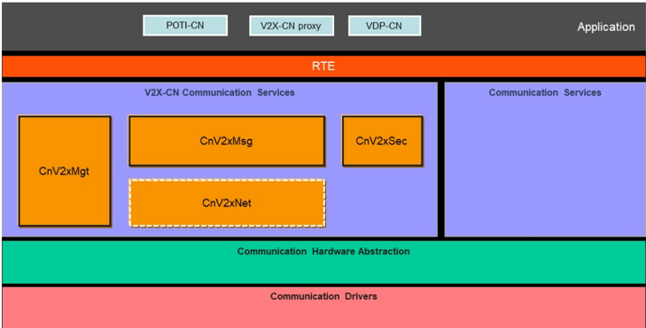
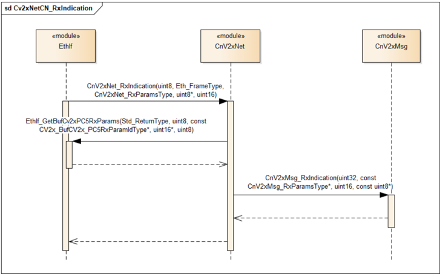
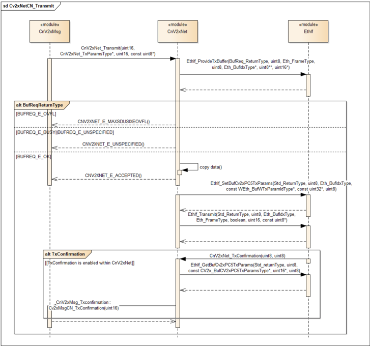

## 1. 简介和功能概述

本文档规定 **AUTOSAR** 基础软件模块 **Chinese Vehicle-2-X Network**（CnV2xNet）的功能、**API** 和配置。

**Chinese Vehicle-2-X Network**（CnV2xNet）与 **Chinese Vehicle-2-X Message**（CnV2xMsg）、**Chinese Vehicle-2-X Management**（CnV2xMgt）、**Chinese Vehicle-2-X Security**（CnV2xSec）以及 **AUTOSAR BSW** 模块 **Ethernet Interface**（EthIf）一起，在 **AUTOSAR** 架构中构成中国 V2X 协议栈。

本文档的基础是中国基于 **LTE-V2X** 的标准 [\[1\]](#ref-1) [\[2\]](#ref-2)。假定读者已熟悉这些标准。

### 1.1. 架构总览

**CnV2xNet** 模块为上层模块 **CnV2xMsg** 提供服务以发送或接收 V2X 消息（即 **DSMP SDU**），并从 **EthIf** 模块获取服务以实现与 **LTE-V2X** 硬件的数据交换。它还负责源 Layer-2 地址和目的 Layer-2 地址的选择，并从协议角度维护上层与下层之间与 QoS 相关的映射关系，详情在本文件第 [1.2](#12-功能总览) 节和第 [6](#6-功能规格) 章中说明。

**CnV2xNet** 模块在 **AUTOSAR BSW** 和分层软件架构中的位置如下图所示。



### 1.2. 功能总览

**CnV2xNet** 模块的功能应符合基于中国 **LTE-V2X** 的网络协议标准 [\[2\]](#ref-2) 以及《基于 LTE-V2X 直接通信的车载通信系统技术要求》[\[1\]](#ref-1)。本模块为 [\[3\]](#ref-3) 中规定的上层 **CnV2xMsg** 模块提供数据发送和接收服务。为了与 **LTE-V2X** 硬件通信以实现包传输服务，它依赖于下层 **EthIf** 模块 [\[4\]](#ref-4)。

从协议角度看，**CnV2xNet** 模块包括 **DSMP** 子层和适配（Adaptation）子层。适配子层提供 **LTE-V2X** 接入层与 **DSMP** 子层之间的参数适配功能。**DSMP** 子层负责与消息层和适配层交换数据。

**CnV2xNet** 模块的功能还包括：应用层标识符与目的 Layer-2 ID 之间的映射、源 Layer-2 ID 的生成/更改/维护、单播/多播地址与 Layer-2 ID 之间的映射、消息优先级与 **PPPP** 之间的映射、向下层指示服务周期、向上层指示信道忙率或最大数据速率等。

## 2. 缩略语

**API**
> 应用编程接口（**Application programming Interface**）。

**BSW**
> 基础软件（**Basic Software**）。

**BSM**
> 基本安全消息（**Basic safety Message**）。

**C-V2X**
> 基于蜂窝的车联网（**Cellular based Vehicle to Everything**）。

**CCSA**
> 中国通信标准化协会（**China Communications Standards Association**）。

**CnV2xMsg**
> 中国车辆到一切消息（**Chinese Vehicle-2-X Message**）。

**CnV2xNet**
> 中国车辆到一切网络（**Chinese Vehicle-2-X Network**）。

**CnV2xSec**
> 中国车辆到一切安全（**Chinese Vehicle-2-X Security**）。

**DEM**
> 诊断事件管理器（**Diagnostic Event Manager**）。

**DET**
> 默认错误跟踪器（**Default Error Tracer**）。

**DSMP**
> 专用短消息协议（**Dedicated Short Message Protocol**）。

**EcuM**
> 电子控制单元管理器（**Electronic Control Unit Manager**）。

**IF**
> 接口（**Interface**）。

**NTCAS**
> 全国汽车标准化技术委员会（**National Technical Committee of Auto Standardization**）。

**PPPP**
> ProSe 按包优先级（**ProSe Per-Packet Priority**）。

## 3. 相关文档

### 3.1. 输入文件和相关标准与规范

<a id="ref-1"></a>[1] GB/T:Technical requirements and test methods of vehicular communication system based on LTE-V2X direct communication (Draft Edition:2022-04-01) http://www.catarc.org.cn/

<a id="ref-2"></a>[2] YD/T 3707-2020:Technical requirements of network layer of LTE-based vehicular communication http://www.ccsa.org.cn/

<a id="ref-3"></a>[3] Specification of Chinese Vehicle-2-X Message
> AUTOSAR_CP_SWS_ChineseV2XMessage

<a id="ref-4"></a>[4] Specification of Ethernet Interface
> AUTOSAR_CP_SWS_EthernetInterface

<a id="ref-5"></a>[5] Specification of Default Error Tracer
> AUTOSAR_CP_SWS_DefaultErrorTracer

<a id="ref-6"></a>[6] Specification of ECU State Manager
> AUTOSAR_CP_SWS_ECUStateManager

## 4. 约束和假设

### 4.1. 限制

无线通信仅支持 **LTE-V2X**。其他基于蜂窝的无线通信可以在 **AUTOSAR** 标准的未来版本中扩展。**CnV2xNet** 模块仅支持非 **IP**（即 **DSMP**）传输，并在 R20-11 中主要聚焦于基于广播的包传输服务。V2X 模块遵循 [\[1\]](#ref-1) [\[2\]](#ref-2) 中定义的 Day-1 V2X 分配指南，二者分别由 **NTCAS** 和 **CCSA** 发布。

### 4.2. 汽车域的适用性

本规范适用于所有汽车域。

## 5. 对其他模块的依赖

本节描述 **CnV2xNet** 模块与 **AUTOSAR** 基础软件架构中其他模块的关系。它概述实现 **CnV2xNet** 模块和服务所需或可选的模块。

### 5.1. 默认错误跟踪器（DET）

在开发模式下，**CnV2xNet** 模块通过 **DET** 模块 [\[5\]](#ref-5) 的 Det_ReportError 函数上报错误。

### 5.2. ECU 状态管理器（EcuM）

**EcuM** [\[6\]](#ref-6) 通过调用本文档第 7.3.1 节规定的 [CnV2xNet_Init](#731-cnv2xnet_init) 来初始化 **CnV2xNet** 模块。

### 5.3. 以太网接口（EthIf）

**Ethernet Interface** [\[4\]](#ref-4) 是 **CnV2xNet** 模块的下层模块。

### 5.4. 中国 Vehicle-2-X 消息模块（CnV2xMsg）

**CnV2xMsg** 是 **CnV2xNet** 模块的上层模块。**CnV2xNet** 模块调用的回调服务在 **CnV2xMsg** 模块中声明并置于其中。这些回调为 **CnV2xMsg** 模块提供接收指示和发送确认服务。

## 6. 功能规格

### 6.1. 通用功能

**CnV2xNet** 模块应实现 [\[2\]](#ref-2) 中定义的网络层协议，除非本文档中另有规定。

网络协议应满足 [\[1\]](#ref-1) 中定义的网络层相关要求。

**CnV2xNet** 模块应按照 [\[2\]](#ref-2) 使用 **DSMP** 报头和适配层报头封装来自 **CnV2xMsg** 模块的载荷。

### 6.2. 消息发送

**CnV2xNet** 模块应提供 **API** [CnV2xNet_Transmit](#733-cnv2xnet_transmit)()，以使能来自 **CnV2xMsg** 模块的发送请求。

**CnV2xNet** 模块应使用 EthIf_ProvideTxBuffer 在 **C-V2X** 驱动内为待发送的 V2X 包获取一个缓冲区。这必须在 [CnV2xNet_Transmit](#733-cnv2xnet_transmit) 上下文中完成。

**CnV2xNet** 模块应仅向 **CnV2xMsg** 模块提供基于 **DSMP** 的服务，并采用 **DSMP** 和适配层报头。

**DSMP** 协议版本应设置为零。

**CnV2xNet** 模块应根据 [CnV2xNet_Transmit](#733-cnv2xnet_transmit)() 中指示的 Priority 以及 [\[2\]](#ref-2) 中表 A.2 定义的映射关系，为待发送的 V2X 包选择一个 **PPPP** 值。

**CnV2xNet** 模块应使用 EthIf_SetBufCv2xPC5TxParams() 将 [CnV2xNet_Transmit](#733-cnv2xnet_transmit)() 中指示的业务周期（如果由 **CnV2xMsg** 模块提供）提供给下层。

**CnV2xNet** 模块应通过调用 **API** EthIf_SetBufCv2xPC5TxParams 为待发送的 V2X 包向 **C-V2X** 驱动提供发送参数。这必须在 [CnV2xNet_Transmit](#733-cnv2xnet_transmit) 上下文中完成。

**CnV2xNet** 模块应使用 **EthIf** 模块提供的 EthIf_Transmit() 发送包。这必须在 [CnV2xNet_Transmit](#733-cnv2xnet_transmit) 上下文中完成。

当假名证书更改处于准备阶段时，**CnV2xNet** 模块应暂停 V2X 包的发送。

如果配置参数 [CnV2xNet_TxConfirmation](#742-cnv2xnet_txconfirmation) 被使能，**CnV2xNet** 模块应通过 CnV2xMsg_TxConfirmation()（详情参见 [\[3\]](#ref-3) 第 7.4.1 节）回调，向 **CnV2xMsg** 模块提供带有相关 **ID**（由 **CnV2xMsg** 模块生成并向下传递以跟踪包的状态）的发送状态信息。

**注意：** 在车内通信期间，可以考虑为中国 V2X 网络层使用专用的 **EtherType** 值。使用私有值还是注册值取决于实现。

### 6.3. 消息接收

**CnV2xNet** 模块应为每个接收到的包创建一个唯一的 TransactionId。该 TransactionId 向上传递以跟踪接收到的包并用于验证。

**CnV2xNet** 模块应通过 CnV2xMsg_RxIndication() 回调向 **CnV2xMsg** 模块指示接收到的包。

**CnV2xNet** 模块应在 [CnV2xNet_RxIndication](#741-cnv2xnet_rxindication)() 期间通过调用 EthIf_GetBufCv2xPC5RxParams() 从 **EthIf** 模块获取接收到的包的接收状态。

**CnV2xNet** 模块应将 [CnV2xNet_RxIndication](#741-cnv2xnet_rxindication)() 中指示的 **PPPP** 映射为优先级，并通过 CnV2xMsg_RxIndication() 提供给上层。

**CnV2xNet** 模块应将 [CnV2xNet_RxIndication](#741-cnv2xnet_rxindication)() 中指示的接收到的 **CBR** 或最大数据速率通过 CnV2xMsg_RxIndication() 提供给上层。

### 6.4. Layer-2 ID 选择

**CnV2xNet** 模块应实现源 Layer-2 ID 和目的 Layer-2 ID 的选择和维护。

**CnV2xNet** 模块应按照 [\[1\]](#ref-1) 在初始化期间于 [0x010001, 0xFFFFFE] 内随机选择一个源 Layer-2 ID。它应在应用层 ID 更改上下文中随机重选源 Layer-2 ID。

**CnV2xNet** 模块应根据 [CnV2xNet_Transmit](#733-cnv2xnet_transmit)() 中指示的 Aid 以及 [\[1\]](#ref-1) 中表 3 定义的映射关系，为待发送的 V2X 包选择一个目的 Layer-2 ID。

**CnV2xNet** 应分两个阶段执行源 Layer-2 ID 的更改，包括准备阶段和提交/中止阶段。第二阶段取决于第一阶段中所有被调用模块的结果。如果第一阶段成功，则应执行提交阶段。否则，应触发中止阶段。

在准备阶段，**API** [CnV2xNet_PrepareAppLayerIdChange](#734-cnv2xnet_prepareapplayeridchange)() 应由 **CnV2xMsg** 调用。

在提交阶段，**API** [CnV2xNet_CommitAppLayerIdChange](#735-cnv2xnet_commitapplayeridchange)() 应由 **CnV2xMsg** 调用。

在提交阶段，**API** [CnV2xNet_CommitAppLayerIdChange](#735-cnv2xnet_commitapplayeridchange)() 应由 **CnV2xMsg** 调用。

### 6.5. 错误分类

本章列出并分类本软件模块内可检测到的所有错误。每个错误按相关性（开发/生产）和相关错误代码进行分类。对于开发错误，定义了一个值。

#### 6.5.1. 开发错误

如果开发错误检测（CnV2xNetDevErrorDetect）被使能，**CnV2xNet** 应将下表列出的开发错误上报给 **DET**。

| 错误类型 | 相关错误代码 | 值 [hex] |
|---|---|---|
| 使用无效参数调用 **API** 服务 | CNV2XNET_E_PARAM | 0x01 |
| 使用无效指针调用 **API** 服务 | CNV2XNET_E_PARAM_POINTER | 0x02 |
| 在 **CnV2xNet** 模块完全初始化之前调用了 **API** 函数 | CNV2XNET_E_UNINIT | 0x03 |
| **CnV2xNet** 初始化失败 | CNV2XNET_E_INIT_FAILED | 0x04 |

#### 6.5.2. 运行时错误

没有运行时错误。

#### 6.5.3. 瞬态故障

没有瞬态故障。

#### 6.5.4. 生产错误

没有生产错误。

#### 6.5.5. 扩展生产错误

没有扩展生产错误。

## 7. API规范

### 7.1. 导入的类型

本章列出从以下文件包含的所有类型。

| 模块 | 头文件 | 导入的类型 |
|---|---|---|
| CnV2xMsg | CnV2xMsg.h | CnV2xMsg_RxParamsPresenceType（draft） |
| CnV2xMsg | CnV2xMsg.h | CnV2xMsg_RxParamsType（draft） |
| ComStack_Types | ComStack_Types.h | BufReq_ReturnType |
| CV2x | CV2x_GeneralTypes.h | CV2x_BufCV2xPC5RxParamIdType（draft） |
| CV2x | CV2x_GeneralTypes.h | CV2x_BufCV2xPC5TxParamIdType（draft） |
| Eth | Eth_GeneralTypes.h | Eth_BufIdxType |
| Eth | Eth_GeneralTypes.h | Eth_FrameType |
| Std | Std_Types.h | Std_ReturnType |
| Std | Std_Types.h | Std_VersionInfoType |

### 7.2. 类型定义

#### 7.2.1. CnV2xNet_TxParamsType

| 名称 | CnV2xNet_TxParamsType | | |
| --- | --- | --- | --- |
| 类别 | Structure | | |
| 元素 | presence | 类型 | [CnV2xNet_TxParamsPresenceType](#722-cnv2xnet_txparamspresencetype) |
| 元素 | 注释 | 标记可选子元素是否存在 | |
| 元素 | Aid | 类型 | uint64 |
| 元素 | 注释 | **AID**（应用标识符）的值 | |
| 元素 | ProtocolType | 类型 | [CnV2x_NetworkProtocolType](#727-cnv2x_networkprotocoltype) |
| 元素 | 注释 | 网络层协议类型。值 4 用于 **DSMP** 协议，其他值保留。 | |
| 元素 | priority | 类型 | uint8 |
| 元素 | 注释 | V2X-CN 消息的优先级 | |
| 元素 | SourceLayer2Id | 类型 | [CnV2x_Layer2IdType](#725-cnv2x_layer2idtype) |
| 元素 | 注释 | V2X-CN 包的源 Layer 2 ID（24 位） | |
| 元素 | DestinationLayer2Id | 类型 | [CnV2x_Layer2IdType](#725-cnv2x_layer2idtype) |
| 元素 | 注释 | V2X-CN 包的目的 Layer-2 ID（24 位） | |
| 元素 | TrafficPeriod | 类型 | [CnV2x_TrafficPeriodType](#728-cnv2x_trafficperiodtype) |
| 元素 | 注释 | 指示业务周期 | |
| 元素 | AppLayerIdChangedCount16 | 类型 | uint16 |
| 元素 | 注释 | 应用层 Id 更改的序号。该值在 **CnV2xMsg** 模块中创建，并应与参数 pseudonymCount16 映射。 | |
| 元素 | DsmpHeaderExtensionPtr | 类型 | uint8* |
| 元素 | 注释 | Dsmp 报头扩展的指针 | |
| 元素 | DsmpHeaderExtensionLength | 类型 | uint16 |
| 元素 | 注释 | Dsmp 报头扩展的长度 | |
| 描述 | 封装来自 **CnV2xMsg** 的消息层参数。 | | |
| 可通过 | CnV2xNet.h 获得 | | |

#### 7.2.2. CnV2xNet_TxParamsPresenceType

| 名称 | CnV2xNet_TxParamsPresenceType | | | |
| --- | --- | --- | --- | --- |
| 类别 | Bitfield | | | |
| 派生自 | uint8 | | | |
| 元素 | Kind | Name | Mask | Description |
| 元素 | bit | SourceLayer2Id | 0x08 | 位 3：可选子元素存在 |
| 元素 | bit | DestinationLayer2Id | 0x04 | 位 2：可选子元素存在 |
| 元素 | bit | TrafficPeriod | 0x02 | 位 1：可选子元素存在 |
| 元素 | bit | DsmpHeaderExtension | 0x01 | 位 0（LSB）：可选子元素（DsmpHeaderExtensionPtr 和 DsmpHeaderExtensionLength）存在 |
| 描述 | [CnV2xNet_TxParamsType](#721-cnv2xnet_txparamstype) 的存在标志。 | | | |
| 可通过 | CnV2x_GeneralTypes.h 获得 | | | |

#### 7.2.3. CnV2xNet_RxParamsType

| 名称 | CnV2xNet_RxParamsType | | |
| --- | --- | --- | --- |
| 类别 | Structure | | |
| 元素 | presence | 类型 | [CnV2xNet_RxParamsPresenceType](#724-cnv2xnet_rxparamspresencetype) |
| 元素 | 注释 | 标记可选子元素是否存在 | |
| 元素 | Sourcelayer2Id | 类型 | [CnV2x_Layer2IdType](#725-cnv2x_layer2idtype) |
| 元素 | 注释 | V2X-CN 包的源 Layer 2 ID（24 位） | |
| 元素 | DestinationLayer2Id | 类型 | [CnV2x_Layer2IdType](#725-cnv2x_layer2idtype) |
| 元素 | 注释 | V2X-CN 包的目的 Layer 2 ID（24 位） | |
| 元素 | pppp | 类型 | [CnV2x_PPPPType](#726-cnv2x_pppptype) |
| 元素 | 注释 | ProSe 按包优先级 | |
| 元素 | cbr | 类型 | [CnV2x_CbrType](#729-cnv2x_cbrtype) |
| 元素 | 注释 | 信道忙率 | |
| 元素 | MaxDataRate | 类型 | [CnV2x_MaxDataRateType](#7210-cnv2x_maxdataratetype) |
| 元素 | 注释 | 最大数据速率 | |
| 描述 | 包含与接收到的 C-V2X 包相关的接入层参数的结构。 | | |
| 可通过 | CnV2xNet.h 获得 | | |

#### 7.2.4. CnV2xNet_RxParamsPresenceType

| 名称 | CnV2xNet_RxParamsPresenceType | | | |
| --- | --- | --- | --- | --- |
| 类别 | Bitfield | | | |
| 派生自 | uint8 | | | |
| 元素 | Kind | Name | Mask | Description |
| 元素 | bit | Cbr | 0x02 | 位 1：可选子元素存在 |
| 元素 | bit | maxDataRate | 0x01 | 位 0（LSB）：可选子元素存在 |
| 描述 | [CnV2xNet_RxParamsType](#723-cnv2xnet_rxparamstype) 的存在标志。 | | | |
| 可通过 | CnV2x_GeneralTypes.h 获得 | | | |

#### 7.2.5. CnV2x_Layer2IdType

| 名称 | CnV2x_Layer2IdType | | |
| --- | --- | --- | --- |
| 类别 | Type | | |
| 派生自 | uint32 | | |
| 取值 | 0..16777215 | - | - |
| 描述 | Layer 2（源文截断） | | |
| 变体 | - | | |
| 可通过 | CnV2x_GeneralTypes.h 获得 | | |

#### 7.2.6. CnV2x_PPPPType

| 名称 | CnV2x_PPPPType | | |
| --- | --- | --- | --- |
| 类别 | Type | | |
| 派生自 | uint8 | | |
| 取值 | 1..8 | - | - |
| 描述 | V2X 消息的 ProSe 按包优先级。 | | |
| 可通过 | CnV2x_GeneralTypes.h 获得 | | |

#### 7.2.7. CnV2x_NetworkProtocolType

| 名称 | CnV2x_NetworkProtocolType | | |
| --- | --- | --- | --- |
| 类别 | Type | | |
| 派生自 | uint8 | | |
| 取值 | CNV2X_DSMP_PROTOCOL | 0x04 | **DSMP** 协议类型 |
| 描述 | **CCSA** YD/T 3709-2020 中定义的枚举类型。 | | |
| 可通过 | CnV2x_GeneralTypes.h 获得 | | |

#### 7.2.8. CnV2x_TrafficPeriodType

| 名称 | CnV2x_TrafficPeriodType | | |
| --- | --- | --- | --- |
| 类别 | Type | | |
| 派生自 | uint8 | | |
| 取值 | CNV2X_TRAFFIC_PERIOD_20 | 0x00 | 业务周期：20 ms |
| | CNV2X_TRAFFIC_PERIOD_50 | 0x01 | 业务周期：50 ms |
| | CNV2X_TRAFFIC_PERIOD_100 | 0x02 | 业务周期：100 ms |
| | CNV2X_TRAFFIC_PERIOD_200 | 0x03 | 业务周期：200 ms |
| | CNV2X_TRAFFIC_PERIOD_300 | 0x04 | 业务周期：300 ms |
| | CNV2X_TRAFFIC_PERIOD_400 | 0x05 | 业务周期：400 ms |
| | CNV2X_TRAFFIC_PERIOD_500 | 0x06 | 业务周期：500 ms |
| | CNV2X_TRAFFIC_PERIOD_600 | 0x07 | 业务周期：600 ms |
| | CNV2X_TRAFFIC_PERIOD_700 | 0x08 | 业务周期：700 ms |
| | CNV2X_TRAFFIC_PERIOD_800 | 0x09 | 业务周期：800 ms |
| | CNV2X_TRAFFIC_PERIOD_900 | 0x0a | 业务周期：900 ms |
| | CNV2X_TRAFFIC_PERIOD_1000 | 0x0b | 业务周期：1000 ms |
| 描述 | **CCSA** YD/T 3709-2020 中定义的枚举类型。 | | |
| 可通过 | CnV2x_GeneralTypes.h 获得 | | |

#### 7.2.9. CnV2x_CbrType

| 名称 | CnV2x_CbrType | | |
| --- | --- | --- | --- |
| 类别 | Type | | |
| 派生自 | uint8 | | |
| 取值 | 0..100 | - | - |
| 描述 | 信道（源文截断） | | |
| 变体 | - | | |
| 可通过 | CnV2x_GeneralTypes.h 获得 | | |

#### 7.2.10. CnV2x_MaxDataRateType

| 名称 | CnV2x_MaxDataRateType | | |
| --- | --- | --- | --- |
| 类别 | Type | | |
| 派生自 | uint32 | | |
| 取值 | 0..1585200 | - | - |
| 描述 | 最大数据速率（源文 "Max date Rate"） | | |
| 变体 | - | | |
| 可通过 | CnV2x_GeneralTypes.h 获得 | | |

#### 7.2.11. CnV2x_NetTxResultType

| 名称 | CnV2x_NetTxResultType | | |
| --- | --- | --- | --- |
| 类别 | Type | | |
| 派生自 | uint8 | | |
| 取值 | CNV2X_NETTX_ACCEPTED | 0x00 | - |
| | CNV2X_NETTX_E_MAXSDUSIZEOVF | 0x01 | 业务周期：50 ms |
| | CNV2X_NETTX_E_AID | 0x02 | 由于不支持的 **AID** 而拒绝发送 |
| | CNV2X_NETTX_E_PROTOCOLTYPE | 0x03 | 由于超过最大长度而拒绝发送 |
| | CNV2X_NETTX_E_PRIORITY | 0x04 | 由于不支持的优先级而拒绝发送 |
| | CNV2X_NETTX_E_LAYER2ID_S | 0x05 | 由于源 Layer 2 ID 不正确而拒绝发送 |
| | CNV2X_NETTX_E_LAYER2ID_D | 0x06 | 由于目的 Layer 2 ID 不正确而拒绝发送 |
| | CNV2X_NETTX_E_TP | 0x07 | 由于不支持的业务周期而拒绝发送 |
| | CNV2X_NETTX_E_UNSPECIFIED | 0x08 | 由于未指明的原因而拒绝发送 |
| 描述 | **API** [CnV2xNet_Transmit](#733-cnv2xnet_transmit) 的返回类型。 | | |
| 可通过 | CnV2x_GeneralTypes.h 获得 | | |

### 7.3. 函数定义

#### 7.3.1. CnV2xNet_Init

**说明**: 初始化 **CnV2xNet** 模块。可通过 **CnV2xNet.h** 获得。服务 **ID** 0x1。本服务为同步调用，不可重入。参数 CfgPtr（in）：指向空指针。返回值：无。

```C
void CnV2xNet_Init ( void* CfgPtr )
```

CfgPtr 必须为空指针；其基本原理是运行时初始化（post-build init）不可能实现。

如果启用了开发错误检测：该函数应检查参数 CfgPtr 是否包含有效配置。如果检查失败，该函数应引发开发错误 [CNV2XNET_E_INIT_FAILED](#651-开发错误)。

#### 7.3.2. CnV2xNet_GetVersionInfo

**说明**: 返回本模块的版本信息。可通过 **CnV2xNet.h** 获得。服务 **ID** 0x2。本服务为同步调用，可重入。参数 VersionInfoPtr（in）：存储本模块版本信息的指针。返回值：无。

```C
void CnV2xNet_GetVersionInfo ( Std_VersionInfoType* VersionInfoPtr )
```

如果启用了开发错误检测：该函数应检查参数 VersionInfoPtr 是否有效。如果检查失败，该函数应引发开发错误 [CNV2XNET_E_PARAM_POINTER](#651-开发错误)。

#### 7.3.3. CnV2xNet_Transmit

**说明**: **CvxMsgCN** 模块调用本 **API** 以请求向对端网络实体发送一个网络层 V2X **PDU**。可通过 **CnV2xNet.h** 获得。服务 **ID** 0x3。本服务为异步调用，不可重入。参数 TransactionId16（in）：标识待发送载荷的 **ID**。该 **ID** 由 **CnV2xMsg** 模块生成，稍后用于将具有该 **ID** 的消息的发送状态指示给 **CnV2xMsg** 模块。参数 TxParams（in）：包含发送请求所用的所有网络层参数的结构。参数 Length（in）：DataPtr 所指数据的长度。参数 DataPtr（in）：待发送的消息层包的载荷。返回值：[CnV2x_NetTxResultType](#7211-cnv2x_nettxresulttype)，CNV2X_NETTX_ACCEPTED：未发生错误；CNV2X_NETTX_E_MAXSDUSIZEOVFL：由于超过最大长度而拒绝发送；CNV2X_NETTX_E_AID：由于不支持的 **AID** 而拒绝发送；CNV2X_NETTX_E_PROTOLTYPE：由于不支持的协议类型而拒绝发送；CNV2X_NETTX_E_PRIORITY：由于不支持的优先级而拒绝发送；CNV2X_NETTX_E_LAYER2ID_S：由于源 Layer 2 ID 不正确而拒绝发送；CNV2X_NETTX_E_LAYER2ID_D：由于目的 Layer 2 ID 不正确而拒绝发送；CNV2X_NETTX_E_TP：由于不支持的业务周期而拒绝发送；CNV2X_NETTX_E_UNSPECIFIED：由于未指明的原因而拒绝发送。

```C
CnV2x_NetTxResultType CnV2xNet_Transmit ( uint16 TransactionId16, const CnV2xNet_TxParamsType* TxParams, uint16 Length, const uint8* DataPtr )
```

如果启用了开发错误检测：该函数应检查先前是否已调用过服务 [CnV2xNet_Init](#731-cnv2xnet_init)。如果检查失败，该函数应引发开发错误 [CNV2XNET_E_UNINIT](#651-开发错误)，否则（如果 **DET** 被禁用）返回 **E_NOT_OK**。

如果启用了开发错误检测：该函数应检查参数 TxParams 是否有效。如果检查失败，该函数应引发开发错误 [CNV2XNET_E_PARAM_POINTER](#651-开发错误)，否则（如果 **DET** 被禁用）返回 **E_NOT_OK**。

如果启用了开发错误检测：该函数应检查参数 DataPtr 是否有效。如果检查失败，该函数应引发开发错误 [CNV2XNET_E_PARAM_POINTER](#651-开发错误)，否则（如果 **DET** 被禁用）返回 **E_NOT_OK**。

#### 7.3.4. CnV2xNet_PrepareAppLayerIdChange

**说明**: 通过本 **API** 原语，**CnV2xNet** 模块获得一个指示：应用层 **Id** 即将更改，因此源 Layer-2 **ID** 即将更改。可通过 **CnV2xNet.h** 获得。服务 **ID** 0x4。本服务为同步调用，不可重入。参数 TransmissionClass（in）：发送类别指示。参数 ApplayerIdChangedCount16（in）：对应特定消息类型的应用层标识符更改序号。该计数值在 **CnV2xSec** 模块中创建。返回值：Std_ReturnType，E_OK：操作成功；E_NOT_OK：操作失败。

```C
Std_ReturnType CnV2xNet_PrepareAppLayerIdChange ( uint8 TransmissionClass, uint16 ApplayerIdChangedCount16 )
```

该函数应准备用于包发送的源 Layer-2 **ID** 的设置。

如果启用了开发错误检测：该函数应检查先前是否已调用过服务 [CnV2xNet_Init](#731-cnv2xnet_init)。如果检查失败，该函数应引发开发错误 [CNV2XNET_E_UNINIT](#651-开发错误)，否则（如果 **DET** 被禁用）返回 **E_NOT_OK**。

#### 7.3.5. CnV2xNet_CommitAppLayerIdChange

**说明**: 当所有模块都同意假名证书更改且该更改将被提交时，**CnV2xMsg** 模块调用本函数。可通过 **CnV2xNet.h** 获得。服务 **ID** 0x5。本服务为同步调用，不可重入。参数 TransmissionClass（in）：发送类别指示。参数 ApplayerIdChangedCount16（in）：对应特定消息类型的应用层标识符更改序号。该计数值在 **CnV2xSec** 模块中创建。返回值：Std_ReturnType，E_OK：操作成功；E_NOT_OK：操作失败。

```C
Std_ReturnType CnV2xNet_CommitAppLayerIdChange ( uint8 TransmissionClass, uint16 ApplayerIdChangedCount16 )
```

该函数应更新新的源 Layer-2 **ID**。

如果启用了开发错误检测：该函数应检查先前是否已调用过服务 [CnV2xNet_Init](#731-cnv2xnet_init)。如果检查失败，该函数应引发开发错误 [CNV2XNET_E_UNINIT](#651-开发错误)，否则（如果 **DET** 被禁用）返回 **E_NOT_OK**。

**注意：** 该函数要求先前已通过 **API** 调用 [CnV2xNet_PrepareAppLayerIdChange](#734-cnv2xnet_prepareapplayeridchange) 准备假名证书。

#### 7.3.6. CnV2xNet_AbortAppLayerIdChange

**说明**: 当并非所有模块都同意假名证书更改且该更改将被回退时，**CnV2xMsg** 模块调用本函数。可通过 **CnV2xNet.h** 获得。服务 **ID** 0x6。本服务为同步调用，不可重入。参数 TransmissionClass（in）：发送类别指示。参数 ApplayerIdChangedCount16（in）：对应特定消息类型的应用层标识符更改序号。该计数值在 **CnV2xSec** 模块中创建。返回值：Std_ReturnType，E_OK：操作成功；E_NOT_OK：操作失败。

```C
Std_ReturnType CnV2xNet_AbortAppLayerIdChange ( uint8 TransmissionClass, uint16 ApplayerIdChangedCount16 )
```

该函数应回退已准备的源 Layer-2 **ID** 更改。

如果启用了开发错误检测：该函数应检查先前是否已调用过服务 [CnV2xNet_Init](#731-cnv2xnet_init)。如果检查失败，该函数应引发开发错误 CnV2xNet_E_UNINIT，否则（如果 **DET** 被禁用）返回 **E_NOT_OK**。

**注意：** 该函数要求先前已通过 **API** 调用 [CnV2xNet_PrepareAppLayerIdChange](#734-cnv2xnet_prepareapplayeridchange) 准备假名证书。

### 7.4. 回调通知

#### 7.4.1. CnV2xNet_RxIndication

**说明**: 指示以太网帧的接收。可通过 **CnV2xNet.h** 获得。服务 **ID** 0x7。本服务为同步调用，不可重入。参数 CtrlIdx（in）：**Ethernet Interface** 上下文中以太网控制器的索引。参数 FrameType（in）：接收到的以太网帧的帧类型。参数 IsBroadcast（in）：指示广播帧的参数。参数 PhysAddrPtr（in）：指向接收到的以太网帧的物理源地址（网络字节序 **MAC** 地址）的指针。参数 DataPtr（in）：指向接收到的以太网帧载荷的指针（即不提供以太网报头）。参数 LenByte（in）：接收数据的长度。返回值：无。

```C
void CnV2xNet_RxIndication ( uint8 CtrlIdx, Eth_FrameType FrameType, boolean IsBroadcast, const uint8* PhysAddrPtr, uint8* DataPtr, uint16 LenByte )
```

函数 CnV2xNet_RxIndication 应通过调用 **API** EthIf_GetBufCv2xPC5RxParams 为接收到的 C-V2X 包获取 **C-V2X** 驱动的接收参数。

如果启用了开发错误检测：该函数应检查先前是否已调用过服务 [CnV2xNet_Init](#731-cnv2xnet_init)。如果检查失败，该函数应引发开发错误 [CNV2XNET_E_UNINIT](#651-开发错误)。

如果启用了开发错误检测：该函数应检查参数 DataPtr 是否有效。如果检查失败，该函数应引发开发错误 [CNV2XNET_E_PARAM_POINTER](#651-开发错误)。

**注意：** Eth_FrameType 和 PhysAddrPtr 在 CnV2xNet_RxIndication 中不使用但保留。

#### 7.4.2. CnV2xNet_TxConfirmation

**说明**: 确认以太网帧的发送。可通过 **CnV2xNet.h** 获得。服务 **ID** 0x8。本服务为同步调用，不可重入。参数 CtrlIdx（in）：**Ethernet Interface** 上下文中以太网控制器的索引。参数 BufIdx（in）：缓冲区资源的索引。返回值：无。

```C
void CnV2xNet_TxConfirmation ( uint8 CtrlIdx, uint8 BufIdx )
```

如果启用了开发错误检测：该函数应检查先前是否已调用过服务 [CnV2xNet_Init](#731-cnv2xnet_init)。如果检查失败，该函数应引发开发错误 [CNV2XNET_E_UNINIT](#651-开发错误)。

### 7.5. 调度函数

这些函数由基础软件调度器直接调用。以下函数应没有返回值和参数。所有函数应不可重入。

#### 7.5.1. CnV2xNetMainFunction

**说明**: **CnV2xNet** 模块的主函数，用于周期性执行协议操作。可通过 SchM_CnV2xNet.h 获得。服务 **ID** 0x9。

```C
void CnV2xNet_MainFunction ( void )
```

### 7.6. 期望接口

#### 7.6.1. 强制接口

本节定义实现模块核心功能所需的全部外部接口。

| API 函数 | 头文件 | 描述 |
|---|---|---|
| CnV2xMsg_RxIndication | CnV2xMsg.h | 通过本 **API** 原语，**CnV2xMsg** 模块获得一个确认：具有某一 **ID** 的 V2X 消息已成功发送。本 **API** 原语由 **CnV2xNet** 模块调用，将接收到的 **DSMP** 包的数据和网络参数提供给 **CnV2xMsg** 模块 |
| EthIf_GetBufCV2xPC5RxParams | EthIf.h | 为接收到的包读取与蜂窝 V2X 接收方向相关的值。例如，这可以是属于单个包的 **CBR** |
| EthIf_GetBufCV2xPC5TxParams | EthIf.h | 为发送的包读取与蜂窝 V2X 发送方向相关的值。例如，这可以是属于单个包的事务 **ID** |
| EthIf_ProvideTxBuffer | EthIf.h | 提供对指定以太网控制器发送缓冲区的访问 |
| EthIf_SetBufCV2xPC5TxParams | EthIf.h | 为特定缓冲区（待发送的包）设置与蜂窝 V2X 发送方向相关的值。例如，这可以是属于单个包的期望 ProSe 按包优先级 |
| EthIf_Transmit | EthIf.h | 触发发送一个先前已填充的发送缓冲区 |

#### 7.6.2. 可选接口

本节定义实现模块可选功能所需的全部外部接口。

| API 函数 | 头文件 | 描述 |
|---|---|---|
| CnV2xMsg_TxConfirmation | CnV2xMsg.h | 通过本 **API** 原语，**CnV2xMsg** 模块获得一个确认：具有某一 **ID** 的 V2X 消息已成功发送 |
| Det_ReportError | Det.h | 上报开发错误的服务 |

## 8. 时序图

### 8.1. RxIndication



### 8.2. 发送



## 9. 配置规范

### 9.1. 容器与配置参数

以下各章汇总所有配置参数。参数的详细含义见第 6 章和第 7 章。

#### 9.1.1. 变体

**CnV2xNet** 模块仅支持 VARIANT-PRE-COMPILE。

#### 9.1.2. CnV2xNet

| SWS 条目 | [ECUC_CnV2xNet_00001] |
|---|---|
| 模块名称 | CnV2xNet |
| 描述 | **CnV2xMsg** 模块的配置。 |
| Post-Build 变体支持 | false |
| 支持的配置变体 | VARIANT-PRE-COMPILE |

| 容器名称 | 多重性 | 作用域/依赖 |
|---|---|---|
| CnV2xNetGeneral | 1 | 该容器包含 **BSW** 模块 **CnV2xNet** 的配置参数。 |

#### 9.1.3. CnV2xNetGeneral

| SWS 条目 | [ECUC_CnV2xNet_00002] |
|---|---|
| 容器名称 | CnV2xNetGeneral |
| 父容器 | CnV2xNet |
| 描述 | 该容器包含 **BSW** 模块 **CnV2xNet** 的配置参数。 |
| 配置参数 | 见下方参数表 |

| SWS 条目 | [ECUC_CnV2xNet_00004] |
|---|---|
| 参数名称 | CnV2xNetDevErrorDetect |
| 父容器 | CnV2xNetGeneral |
| 描述 | 将默认错误跟踪器（**Det**）的检测和通知打开或关闭。* **true**：使能（ON）。* **false**：禁用（OFF）。 |
| 多重性 | 1 |
| 类型 | EcucBooleanParamDef |
| 默认值 | false |
| Post-Build 变体值 | false |
| 值配置类 | Pre-compile time：x（All Variants）；Link time：-；Post-build time：- |
| 作用域/依赖 | scope: local |

| SWS 条目 | [ECUC_CnV2xNet_00008] |
|---|---|
| 参数名称 | CnV2xNetDSMPprotocolVersion |
| 父容器 | CnV2xNetGeneral |
| 描述 | 第 4.3.3.1 章 [13] 定义的 **DSMP** 协议版本。 |
| 多重性 | 1 |
| 类型 | EcucIntegerParamDef |
| 范围 | 0 .. 7 |
| 默认值 | 0 |
| Post-Build 变体值 | false |
| 值配置类 | Pre-compile time：x（All Variants）；Link time：-；Post-build time：- |
| 作用域/依赖 | scope: local |

| SWS 条目 | [ECUC_CnV2xNet_00009] |
|---|---|
| 参数名称 | CnV2xNetDSMPSduSize |
| 父容器 | CnV2xNetGeneral |
| 描述 | **DSMP-SDU** 的最大尺寸，单位为 [Byte]。 |
| 多重性 | 1 |
| 类型 | EcucIntegerParamDef |
| 范围 | 0 .. 65535 |
| 默认值 | 65535 |
| Post-Build 变体值 | false |
| 值配置类 | Pre-compile time：x（All Variants）；Link time：-；Post-build time：- |
| 作用域/依赖 | scope: local |

| SWS 条目 | [ECUC_CnV2xNet_00003] |
|---|---|
| 参数名称 | CnV2xNetMainFunctionPeriod |
| 父容器 | CnV2xNetGeneral |
| 描述 | 本参数定义 CnV2xNet_BsmBs_MainFunction 的调度周期。单位：[s]。 |
| 多重性 | 1 |
| 类型 | EcucFloatParamDef |
| 范围 | ]0 .. 1[ |
| 默认值 | 0.1 |
| Post-Build 变体值 | false |
| 值配置类 | Pre-compile time：x（All Variants）；Link time：-；Post-build time：- |
| 作用域/依赖 | scope: local |

| SWS 条目 | [ECUC_CnV2xNet_00006] |
|---|---|
| 参数名称 | CnV2xNetTxConfirmation |
| 父容器 | CnV2xNetGeneral |
| 描述 | 使能时，发送状态信息将转发给上层。* **true**：使能（ON）。* **false**：禁用（OFF）。 |
| 多重性 | 1 |
| 类型 | EcucBooleanParamDef |
| 默认值 | false |
| Post-Build 变体值 | false |
| 值配置类 | Pre-compile time：x（All Variants）；Link time：-；Post-build time：- |
| 作用域/依赖 | scope: local |

| SWS 条目 | [ECUC_CnV2xNet_00005] |
|---|---|
| 参数名称 | CnV2xNetVersionInfoApi |
| 父容器 | CnV2xNetGeneral |
| 描述 | 使能/禁用读取 **CnV2xNet** 模块版本信息的 **API**。* **true**：使能（ON）。* **false**：禁用（OFF）。 |
| 多重性 | 1 |
| 类型 | EcucBooleanParamDef |
| 默认值 | false |
| Post-Build 变体值 | false |
| 值配置类 | Pre-compile time：x（All Variants）；Link time：-；Post-build time：- |
| 作用域/依赖 | scope: local |

| SWS 条目 | [ECUC_CnV2xNet_00007] |
|---|---|
| 参数名称 | CnV2xNetEthIfRef |
| 父容器 | CnV2xNetGeneral |
| 描述 | 本参数表示对用于发送 **C-V2X** 包的以太网接口的引用。 |
| 多重性 | 1 |
| 类型 | Symbolic name reference to EthIfController |
| Post-Build 变体值 | false |
| 值配置类 | Pre-compile time：x（All Variants）；Link time：-；Post-build time：- |
| 作用域/依赖 | scope: local |

无包含的容器。

## B. AUTOSAR 可追溯项变更历史

请注意，本章中的列表也包括在后续版本中已从规范中移除的可追溯项。这些项不会作为超链接出现在文档中。

### B.1. 本文档按 AUTOSAR 发布版本 R23-11 的可追溯项历史

#### B.1.1. R23-11 中新增的规范项

无

#### B.1.2. R23-11 中变更的规范项

无

#### B.1.3. R23-11 中删除的规范项

无
