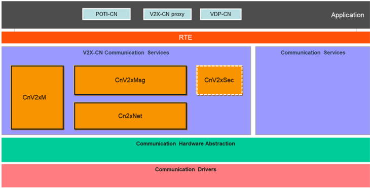
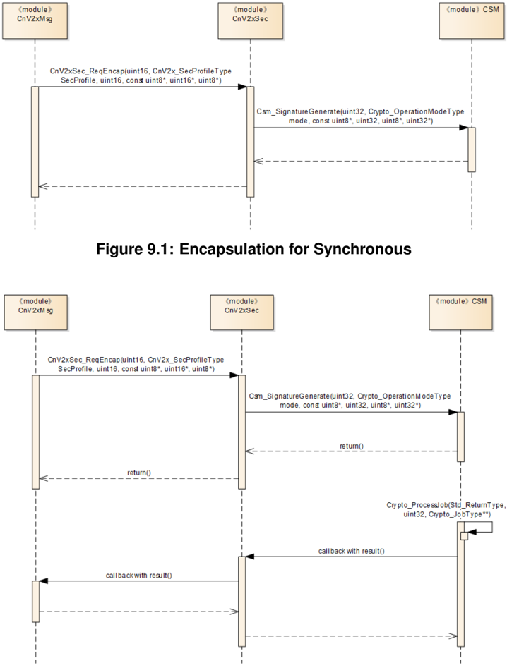
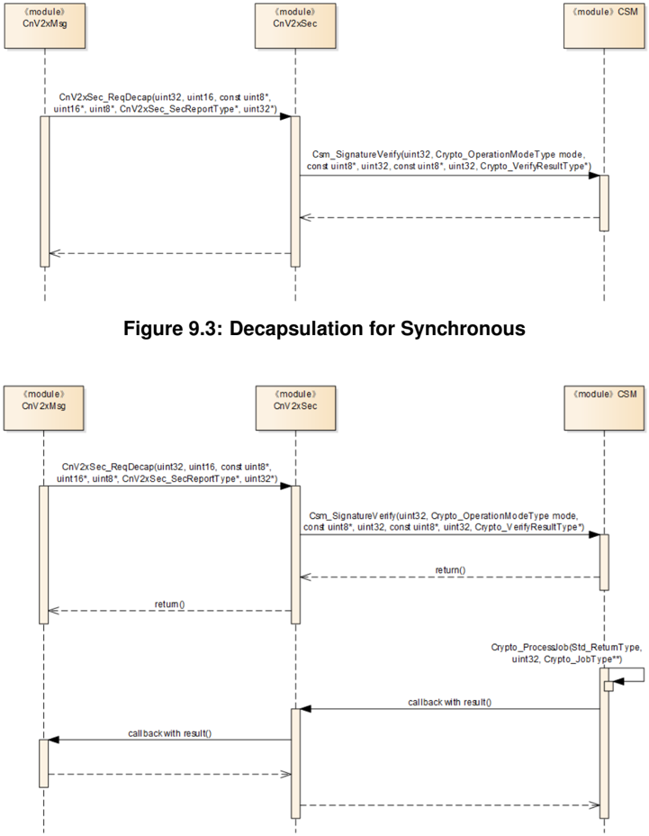

## 1. 简介和功能概述

本文档规定 **AUTOSAR** 基础软件模块 **Chinese Vehicle-2-X Security**（CnV2xSec）的功能、**API** 和配置。

**Chinese Vehicle-2-X Security**（CnV2xSec）与 **Chinese Vehicle-2-X Message**（CnV2xMsg）、**Chinese Vehicle-2-X Management**（CnV2xM）、**Chinese Vehicle-2-X Network**（CnV2xNet）一起，在 **AUTOSAR** 架构中构成中国 V2X 协议栈。

本文档的基础是中国基于 **LTE-V2X** 的标准 [\[1\]](#ref-1)[\[2\]](#ref-2)。假定读者已熟悉这些标准。

### 1.1. 架构总览

**CnV2xSec** 模块在 **AUTOSAR BSW** 和分层软件架构中的位置如下图所示。



**CnV2xSec** 模块提供消息封装、解封装和假名管理服务。

### 1.2. 功能总览

**CnV2xSec** 模块按照 **CCSA** 规范向 V2X-CN 协议栈提供标准化的安全服务；**CnV2xSec** 模块应符合标准 [\[1\]](#ref-1)、[\[2\]](#ref-2) 和 [\[3\]](#ref-3)。各 **API** 应使用 **AUTOSAR** 提供的 **Csm** 和 **NvM** 服务实现。

## 2. 缩略语

**AID**
> 应用标识符（**Application identifier**）。

**BS**
> 基本服务（**Basic Service**）。

**BSM**
> 基本安全消息（**Basic safety Message**）。

**C-V2X**
> 基于蜂窝的车联网（**Cellular based Vehicle to Everything**）。

**CCSA**
> 中国通信标准化协会（**China Communications Standards Association**）。

**CnV2xMsg**
> 中国车辆到一切消息（**Chinese Vehicle-2-X Message**）。

**CnV2xM**
> 中国车辆到一切管理（**Chinese Vehicle-2-X Management**）。

**CnV2xNet**
> 中国车辆到一切网络（**Chinese Vehicle-2-X Network**）。

**CnV2xSec**
> 中国车辆到一切安全（**Chinese Vehicle-2-X Security**）。

**DE**
> 数据元素（**Data Element**）。

**DF**
> 数据帧（**Data Frame**）。

**EcuM**
> 电子控制单元管理器（**Electronic Control Unit Manager**）。

**NTCAS**
> 全国汽车标准化技术委员会（**National Technical Committee of Auto Standardization**）。

**PH**
> 路径历史（**Path History**）。

**POTI**
> 位置与时间（**Position and Time**）。

**RSI**
> 路侧信息（**Road Side Information**）。

**RSM**
> 路侧消息（**Road Side Message**）。

**RSU**
> 路侧单元（**Road Side Unit**）。

**SPAT**
> 信号相位与时间（**Signal Phase And Time**）。

**SPDU**
> 安全协议数据单元（**Secured protocol data Unit**）。

**VDP**
> 车辆数据提供者（**Vehicle Data Provider**）。

## 3. 相关文档

### 3.1. 输入文件和相关标准与规范

<a id="ref-1"></a>[1] GB/T:Technical requirements and test methods of vehicular communication system based on LTE-V2X direct communication (Draft Edition:2022-04-01) http://www.catarc.org.cn/

<a id="ref-2"></a>[2] YD/T 3957-2021:Technical Requirement of Security Certificate Management System for LTE-based Vehicular Communication http://www.ccsa.org.cn/

<a id="ref-3"></a>[3] YD/T 3594-2019:General technical requirements of Security for Vehicular Communication based on LTE http://www.ccsa.org.cn/

<a id="ref-4"></a>[4] General Specification of Basic Software Modules
> AUTOSAR_CP_SWS_BSWGeneral

<a id="ref-5"></a>[5] Specification of Default Error Tracer
> AUTOSAR_CP_SWS_DefaultErrorTracer

<a id="ref-6"></a>[6] Specification of ECU State Manager
> AUTOSAR_CP_SWS_ECUStateManager

<a id="ref-7"></a>[7] Specification of NVRAM Manager
> AUTOSAR_CP_SWS_NVRAMManager

### 3.2. 相关规范

**AUTOSAR** 提供了基础软件模块的通用规范（**SWS BSW General**）[\[4\]](#ref-4)，该规范同样适用于 **CnV2xSec**。

因此，规范 **SWS BSW General** [\[4\]](#ref-4) 应被视为 **CnV2xSec** 的附加且必需的规范。

## 4. 约束和假设

### 4.1. 限制

V2X 模块遵循 **CCSA** 和 **NTCAS** 定义的 Day-1 场景的技术要求。

### 4.2. AUTOSAR R22-11 中的已知限制

V2X Day-1 场景不支持单播服务。因此 **AUTOSAR** R22-11 中未实现单播消息的加密和解密。

### 4.3. 汽车域的适用性

本规范适用于所有汽车域。

## 5. 对其他模块的依赖

本节描述 **CnV2xSec** 模块与 **AUTOSAR** 基础软件架构中其他模块的关系。它概述实现 **CnV2xSec** 模块所需或可选的模块，以及这些模块使用的 **CnV2xSec** 服务。

### 5.1. 默认错误跟踪器（DET）

在开发模式下，**CnV2xSec** 模块通过 **DET** 模块 [\[5\]](#ref-5) 的 Det_ReportError 函数上报错误。

### 5.2. ECU 状态管理器（EcuM）

**EcuM** [\[6\]](#ref-6) 通过调用第 7.3.1 节规定的 [CnV2xSec_Init](#731-cnv2xsec_init) 来初始化 **CnV2xSec** 模块。

### 5.3. AUTOSAR CnV2xMsg

**CnV2xMsg** 模块被 **CnV2xSec** 用于获取时间、距离和 vehicleEventFlags。

### 5.4. AUTOSAR 加密服务模块（Csm）

**Csm** 模块用于加密计算，**CnV2xSec** 需要它来保护包。因此会使用 **Csm** 的签名和验证。

### 5.5. AUTOSAR NvM

**NvM** [\[7\]](#ref-7) 被 **CnV2xSec** 用于加载用于假名、V2X 消息的签名生成和验证的证书。

## 6. 功能规格

### 6.1. 启动行为

**CnV2xSec** 的函数 [CnV2xSec_Init](#731-cnv2xsec_init)（参见第 [7.3.1](#731-cnv2xsec_init) 节）应初始化 **CnV2xSec** 模块的内部状态。

函数 [CnV2xSec_Init](#731-cnv2xsec_init) 应初始化安全的基本服务（参见第 [6.2](#62-安全功能规格) 节）。

### 6.2. 安全功能规格

**CnV2xSec** 模块运行安全的基本服务。

**CnV2xSec** 模块应按照 [\[2\]](#ref-2)[\[3\]](#ref-3) 规定的技术要求实现安全服务。

**CnV2xSec** 模块应提供 **CnV2xMsg** 所需的封装（Encap）和解封装（Decap）服务，并利用 **Csm** 进行验证。

#### 6.2.1. 封装与解封装

函数 [CnV2xSec_ReqEncap](#733-cnv2xsec_reqencap) 应按照 [12] 第 6.4 章的定义封装待发送的 BSM 包。

函数 [CnV2xSec_ReqEncap](#733-cnv2xsec_reqencap) 应生成 **SPDU**，其中包含 [13] 第 6.4 章规定的 V2X 消息、该 V2X 消息的数字签名和假名。

数字签名应基于 [15] 规定的 **SM2** 生成。

函数 [CnV2xSec_ReqEncap](#733-cnv2xsec_reqencap) 应调用 **CSM** API Csm_Hash 和 Csm_SignatureGenerate，以生成 [13] 规定的数字签名。

函数 [CnV2xSec_ReqDecap](#734-cnv2xsec_reqdecap) 应解封装接收到的 **SPDU**。**CnV2xSec** 模块应验证 **SPDU** 中 [14] 第 6.5 章规定的假名和数字签名。

函数 [CnV2xSec_ReqDecap](#734-cnv2xsec_reqdecap) 应调用 **Csm** API Csm_Hash 和 Csm_SignatureVerify，以验证函数 [CnV2xSec_ReqDecap](#734-cnv2xsec_reqdecap) 的参数 SecuredDataPtr 中给出的数据。

#### 6.2.2. 假名管理

一旦满足以下条件，应更新假名证书以保护用户隐私：假名证书已使用超过 300 秒，除非距离小于 2.1 km 或至少一个 vehicleEventFlags 处于置位状态。

**CnV2xSec** 应通过调用 CnV2xMsg_GetRefTimePtr 获取时间。

**CnV2xSec** 应通过调用 CnV2xMsg_CheckDistance 获取距离。

**CnV2xSec** 应通过调用 CnV2xMsg_GetVehicleEventFlagsStatus 获取 vehicleEventFlags。

当满足更改假名证书的条件时，**CnV2xSec** 应通过调用 CnV2xMsg_PreparePseudonymChange 通知 **CnV2xMsg** 更改假名证书。

当所有模块都为假名证书更改准备就绪时，**CnV2xSec** 应通过调用 CnV2xMsg_CommitPseudonymChange 通知 **CnV2xMsg** 更改假名证书。

当并非所有模块都为假名证书更改准备就绪且该更改将被回退时，**CnV2xSec** 应通过调用 CnV2xMsg_AbortPseudonymChange 通知 **CnV2xMsg** 更改假名证书。

### 6.3. 错误分类

#### 6.3.1. 开发错误

| 错误类型 | 相关错误代码 | 错误值 |
|---|---|---|
| 使用错误参数调用 **API** 服务 | CNV2XSEC_E_PARAM | 0x01 |
| 使用无效指针调用 **API** 服务 | CNV2XSEC_E_PARAM_POINTER | 0x02 |
| 在 **CnV2xSec** 模块完全初始化之前调用了 **API** 函数 | CNV2XSEC_E_UNINIT | 0x03 |
| **CnV2xSec** 初始化失败 | CNV2XSEC_E_INIT_FAILED | 0x04 |

#### 6.3.2. 运行时错误

没有运行时错误。

#### 6.3.3. 瞬态故障

没有瞬态故障。

#### 6.3.4. 生产错误

没有生产错误。

#### 6.3.5. 扩展生产错误

没有扩展生产错误。

## 7. API规范

### 7.1. 导入的类型

本章列出从以下文件包含的所有类型。

| 模块 | 头文件 | 导入的类型 |
|---|---|---|
| Csm | Rte_Csm_Type.h | Crypto_OperationModeType |
| Csm | Rte_Csm_Type.h | Crypto_VerifyResultType |
| NvM | Rte_NvM_Type.h | NvM_BlockIdType |
| NvM | Rte_NvM_Type.h | NvM_RequestResultType |
| Std | Std_Types.h | Std_ReturnType |
| Std | Std_Types.h | Std_VersionInfoType |

### 7.2. 类型定义

#### 7.2.1. CnV2xSec_ConfigType

| 名称 | CnV2xSec_ConfigType | | |
| --- | --- | --- | --- |
| 类别 | Structure | | |
| 元素 | implementation specific | 类型 | - |
| 元素 | 注释 | 配置数据结构的内容是实现特定的。 | |
| 描述 | **CnV2xSec** 模块的配置数据结构。 | | |
| 可通过 | CnV2xSec.h 获得 | | |

#### 7.2.2. CnV2xSec_SecProfileType

| 名称 | CnV2xSec_SecProfileType | | |
| --- | --- | --- | --- |
| 类别 | 枚举 | | |
| 取值 | CNV2XSEC_SECPROF_BSM_SIGNED | - | 仅签名的 BSM 消息的安全配置 |
| | CNV2XSEC_SECPROF_BSM_SIGNED_DEFLECTED_ENCRYPTED | - | 位置偏转（使用普通插件）、加密并签名的 BSM 消息的安全配置 |
| | CNV2XSEC_SECPROF_BSM_SIGNED_HIGHDEFLECTED_ENCRYPTED | - | 位置偏转（使用其他插件）、加密并签名的 BSM 消息的安全配置 |
| | CNV2XSEC_SECPROF_OTHER_SIGNED | - | 必须签名的其他消息类型的安全配置 |
| 描述 | 用于描述由 V2xSec 调用的安全服务。 | | |
| 可通过 | CnV2x_Sec.h 获得 | | |

#### 7.2.3. CnV2xSec_SecReportType

| 名称 | CnV2xSec_SecReportType | | |
| --- | --- | --- | --- |
| 类别 | Type | | |
| 派生自 | uint8 | | |
| 取值 | CNV2XSEC_SECREP_SUCCESS | 0x00 | 指示安全服务已成功执行 |
| | CNV2XSEC_SECREP_FALSE_SIGNATURE | 0x01 | 指示签名错误 |
| | CNV2XSEC_SECREP_INVALID_CERTIFICATE | 0x02 | 指示证书无效 |
| | CNV2XSEC_SECREP_REVOKED_CERTIFICATE | 0x03 | 指示证书被吊销 |
| | CNV2XSEC_SECREP_INCONSISTENT | 0x04 | 指示证书链不一致 |
| | CNV2XSEC_SECREP_TIME_EXPIRED | 0x05 | 指示时间过期 |
| | CNV2XSEC_SECREP_DUPLICATE_MESSAGE | 0x06 | 指示重复消息 |
| | CNV2XSEC_SECREP_INVALID_MOBILITY_DATA | 0x07 | 指示机动性数据无效 |
| | CNV2XSEC_SECREP_UNSIGNED_MESSAGE | 0x08 | 指示未签名的消息 |
| | CNV2XSEC_SECREP_SIGNER_CERTIFICATE_NOT_FOUND | 0x09 | 指示未找到签名者证书 |
| | CNV2XSEC_SECREP_UNSUPPORTED_SIGNER_IDENTIFIER_TYPE | 0x0a | 指示不支持的签名者标识符类型 |
| | CNV2XSEC_SECREP_INCOMPATIBLE_PROTOCOL | 0x0b | 指示协议版本不兼容 |
| | CNV2XSEC_SECREP_UNENCRYPTED_MESSAGE | 0x0c | 指示未加密的消息 |
| | CNV2XSEC_SECREP_DECRYPTION_ERROR | 0x0d | 指示解密错误 |
| | CNV2XSEC_SECREP_UNSUPPORTED_SIGNATURE_ALGORITHM | 0x0e | 指示不支持的签名算法 |
| | CNV2XSEC_SECREP_AID_MISMATCH | 0x0f | 指示安全协议数据单元（**SPDU**）中的 **AID** 与假名证书中的 **AID** 不匹配 |
| | CNV2XSEC_SECREP_UNFINISH | 0xfd | 指示安全执行未完成 |
| | CNV2XSEC_SECREP_ERROR_OTHER | 0xfe | 指示由其他原因导致的安全服务错误 |
| | CNV2XSEC_SECREP_NONE | 0xff | 指示未执行任何安全服务 |
| 描述 | 用于描述解封装（验证或解密）调用安全服务之后的安全报告。 | | |
| 可通过 | CnV2x_GeneralTypes.h 获得 | | |

#### 7.2.4. CnV2xSec_SecReturnType

| 名称 | CnV2xSec_SecReturnType | | |
| --- | --- | --- | --- |
| 类别 | 枚举 | | |
| 取值 | CNV2XSEC_E_OK | 0x00 | 成功返回 |
| | CNV2XSEC_E_NOT_OK | 0x01 | 操作期间失败 |
| | CNV2XSEC_E_BUF_OVFL | 0x02 | 目标缓冲区对于安全操作数据输出而言太小 |
| 描述 | 用于返回安全相关函数的值。 | | |
| 可通过 | CnV2x_Sec.h 获得 | | |

### 7.3. 函数定义

#### 7.3.1. CnV2xSec_Init

**说明**: 初始化 **CnV2xSec** 模块。可通过 **CnV2xSec.h** 获得。服务 **ID** 0x01。本服务为同步调用，不可重入。参数 CfgPtr（in）：ConfigPtr 指向所选配置集的指针。返回值：无。

```C
void CnV2xSec_Init ( const CnV2xSec_ConfigType* CfgPtr )
```

函数 CnV2xSec_Init 应存储对配置结构的访问，供后续 **API** 调用使用。

如果启用了开发错误检测：函数 CnV2xSec_Init 应检查参数 CfgPtr 是否包含有效配置。如果检查失败，函数 CnV2xSec_Init 应引发开发错误 [CNV2XSEC_E_INIT_FAILED](#631-开发错误)。

#### 7.3.2. CnV2xSec_GetVersionInfo

**说明**: 返回本模块的版本信息。可通过 **CnV2xSec.h** 获得。服务 **ID** 0x02。本服务为同步调用，可重入。参数 VersionInfoPtr（out）：存储本模块版本信息的指针。返回值：无。

```C
void CnV2xSec_GetVersionInfo ( Std_VersionInfoType* VersionInfoPtr )
```

如果启用了开发错误检测：函数 CnV2xSec_GetVersionInfo 应检查参数 VersionInfoPtr 是否有效。如果检查失败，函数 CnV2xSec_GetVersionInfo 应引发开发错误 [CNV2XSEC_E_PARAM_POINTER](#631-开发错误)。

#### 7.3.3. CnV2xSec_ReqEncap

**说明**: **CnV2xMsg** 调用本函数以生成 **SPDU**，其中包含 V2X 消息、签名和假名。异步的 CnV2xMsg_EncapConfirmation 调用将用于向 **CnV2xMsg** 通知结果。可通过 **CnV2xSec.h** 获得。服务 **ID** 0x03。本服务为同步或异步，取决于作业配置。不可重入。参数 TransactionId16（in）：客户端可用于匹配响应的请求标识符。参数 SecProfile（in）：用于封装的安全配置。参数 UnsecuredDataLength（in）：用于封装的数据的长度。参数 UnsecuredDataPtr（in）：指向用于封装的数据的指针。参数 SecuredDataLength（inout）：包含输入方向 SecuredDataPtr 最大安全数据长度的长度指针；应包含输出方向 SecuredDataPtr 的实际安全数据大小。参数 SecuredDataPtr（inout）：安全数据应放置的指针。返回值：[CnV2xSec_SecReturnType](#724-cnv2xsec_secreturntype)，CNV2XSEC_E_OK：请求成功；CNV2XSEC_E_NOT_OK：请求失败；CNV2XSEC_E_BUF_OVFL：SecuredDataLength 对于安全操作结果数据而言太小。

```C
CnV2xSec_SecReturnType CnV2xSec_ReqEncap ( uint16 TransactionId16, CnV2xSec_SecProfileType SecProfile, uint16 UnsecuredDataLength, const uint8* UnsecuredDataPtr, uint16* SecuredDataLength, uint8* SecuredDataPtr )
```

如果启用了开发错误检测：函数 CnV2xSec_ReqEncap 应检查先前是否已调用过服务 [CnV2xSec_Init](#731-cnv2xsec_init)。如果检查失败，函数 CnV2xSec_ReqEncap 应引发开发错误 [CNV2XSEC_E_UNINIT](#631-开发错误)。

如果启用了开发错误检测：函数 CnV2xSec_ReqEncap 应检查参数 UnsecuredDataPtr 是否有效。如果检查失败（即它是 **NULL** 指针），函数 CnV2xSec_ReqEncap 应引发开发错误 [CNV2XSEC_E_PARAM_POINTER](#631-开发错误)。

如果启用了开发错误检测：函数 CnV2xSec_ReqEncap 应检查参数 SecuredDataLength 是否有效。如果检查失败（即它是 **NULL** 指针），函数 CnV2xSec_ReqEncap 应引发开发错误 [CNV2XSEC_E_PARAM_POINTER](#631-开发错误)。

如果启用了开发错误检测：函数 CnV2xSec_ReqEncap 应检查参数 SecuredDataPtr 是否有效。如果检查失败（即它是 **NULL** 指针），函数 CnV2xSec_ReqEncap 应引发开发错误 [CNV2XSEC_E_PARAM_POINTER](#631-开发错误)。

#### 7.3.4. CnV2xSec_ReqDecap

**说明**: **CnV2xMsg** 调用本函数以解封装 **SPDU**。异步的 CnV2xMsg_DecapConfirmation 调用将用于向 **CnV2xMsg** 通知结果。可通过 **CnV2xSec.h** 获得。服务 **ID** 0x04。本服务为同步或异步，取决于作业配置。不可重入。参数 TransactionId32（in）：接收到的包的事务 **Id**。参数 SecuredDataLength（in）：要解密和验证的数据的长度。参数 SecuredDataPtr（in）：指向要解密和验证的数据的指针。参数 UnsecuredDataLength（inout）：指向未受保护数据的数据长度的指针。应包含最大可用长度（输入方向）和实际使用的长度（输出方向）。参数 UnsecuredDataPtr（out）：解密/验证后的数据应放置的指针。参数 SecReport（out）：安全报告。参数 Aid（out）：**AID** 的数值。返回值：[CnV2xSec_SecReturnType](#724-cnv2xsec_secreturntype)，CNV2XSEC_E_OK：请求成功；CNV2XSEC_E_NOT_OK：请求失败；CNV2XSEC_E_BUF_OVFL：UnsecuredDataLength 对于安全操作结果数据而言太小。

```C
CnV2xSec_SecReturnType CnV2xSec_ReqDecap ( uint32 TransactionId32, uint16 SecuredDataLength, const uint8* SecuredDataPtr, uint16* UnsecuredDataLength, uint8* UnsecuredDataPtr, CnV2xSec_SecReportType* SecReport, uint32* Aid )
```

如果启用了开发错误检测：函数 CnV2xSec_ReqDecap 应检查先前是否已调用过服务 [CnV2xSec_Init](#731-cnv2xsec_init)。如果检查失败，函数 CnV2xSec_ReqDecap 应引发开发错误 [CNV2XSEC_E_UNINIT](#631-开发错误)。

如果启用了开发错误检测：函数 CnV2xSec_ReqDecap 应检查参数 SecuredDataPtr 是否有效。如果检查失败（即它是 **NULL** 指针），函数 CnV2xSec_ReqDecap 应引发开发错误 [CNV2XSEC_E_PARAM_POINTER](#631-开发错误)。

如果启用了开发错误检测：函数 CnV2xSec_ReqDecap 应检查参数 UnsecuredDataLength 是否有效。如果检查失败（即它是 **NULL** 指针），函数 CnV2xSec_ReqDecap 应引发开发错误 [CNV2XSEC_E_PARAM_POINTER](#631-开发错误)。

如果启用了开发错误检测：函数 CnV2xSec_ReqDecap 应检查参数 UnsecuredDataPtr 是否有效。如果检查失败（即它是 **NULL** 指针），函数 CnV2xSec_ReqDecap 应引发开发错误 [CNV2XSEC_E_PARAM_POINTER](#631-开发错误)。

如果启用了开发错误检测：函数 CnV2xSec_ReqDecap 应检查参数 SecReport 是否有效。如果检查失败（即它是 **NULL** 指针），函数 CnV2xSec_ReqDecap 应引发开发错误 [CNV2XSEC_E_PARAM_POINTER](#631-开发错误)。

为了处理 Csm_SignatureVerify，CsmSignatureVerifyAlgorithmFamily 应设置为 CRYPTO_ALGOFAM_SM2，CsmSignatureVerifyAlgorithmSecondaryFamily 应设置为 CRYPTO_ALGOFAM_SM3，且操作模式为 3 种模式 START、UPDATE、FINISH 的析取。

如果启用了开发错误检测：函数 CnV2xSec_ReqDecap 应检查参数 Aid 是否有效。如果检查失败（即它是 **NULL** 指针），函数 CnV2xSec_ReqDecap 应引发开发错误 [CNV2XSEC_E_PARAM_POINTER](#631-开发错误)。

### 7.4. 回调通知

#### 7.4.1. CSM 回调接口

如果 **CnV2xSec** 模块异步使用 **Csm** 模块来计算或验证签名，**CnV2xSec** 应按照 Csm_CallbackType 提供回调函数。

### 7.5. 调度函数

#### 7.5.1. CnV2xSec_MainFunction

**说明**: **CnV2xSec** 的调度主函数。可通过 SchM_CnV2xSec.h 获得。服务 **ID** 0x05。

```C
void CnV2xSec_MainFunction ( void )
```

主函数用于周期性假名更改。

### 7.6. 期望接口

本章列出从其他模块要求的全部外部接口。

#### 7.6.1. 强制接口

本章定义实现模块核心功能所需的全部外部接口。

| API 函数 | 头文件 | 描述 |
|---|---|---|
| Csm_Hash | Csm.h | 使用给定的数据执行哈希计算并存储哈希值 |
| Csm_SignatureGenerate | Csm.h | 使用给定的数据执行签名计算，并将签名存储在结果指针所指向的内存位置 |
| Csm_SignatureVerify | Csm.h | 通过比较签名是否由给定数据生成来验证给定的 **MAC** |
| NvM_GetErrorStatus | NvM.h | 读取块相关的错误/状态信息的服务 |
| NvM_ReadBlock | NvM.h | 将 **NV** 块的数据复制到其对应 **RAM** 块的服务 |
| NvM_WriteBlock | NvM.h | 将 **RAM** 块的数据复制到其对应 **NV** 块的服务 |

#### 7.6.2. 可选接口

本章定义实现模块可选功能所需的全部外部接口。

| API 函数 | 头文件 | 描述 |
|---|---|---|
| Det_ReportError | Det.h | 上报开发错误的服务 |

## 8. 时序图

### 8.1. 封装



### 8.2. 解封装



### 8.3. 更新假名

时序图请参见 [\[6\]](#ref-6)。

## 9. 配置规范

### 9.1. 容器与配置参数

以下各章汇总所有配置参数。参数的详细含义见第 6 章和第 7 章。

#### 9.1.1. 变体

**CnV2xSec** 模块仅支持 VARIANT-PRE-COMPILE。

#### 9.1.2. CnV2xSec

| SWS 条目 | [ECUC_CnV2xSec_00001] |
|---|---|
| 模块名称 | CnV2xSec |
| 描述 | **CnV2xSec** 模块的配置。 |
| Post-Build 变体支持 | false |
| 支持的配置变体 | VARIANT-PRE-COMPILE |

| 容器名称 | 多重性 | 作用域/依赖 |
|---|---|---|
| CnV2xSecGeneral | 1 | 该容器包含安全模块 **CnV2xSec** 的配置参数。 |

#### 9.1.3. CnV2xSecGeneral

| SWS 条目 | [ECUC_CnV2xSec_00002] |
|---|---|
| 容器名称 | CnV2xSecGeneral |
| 父容器 | CnV2xSec |
| 描述 | 该容器包含安全模块 **CnV2xSec** 的配置参数。 |
| 配置参数 | 见下方参数表 |

| SWS 条目 | [ECUC_CnV2xSec_00006] |
|---|---|
| 参数名称 | CnV2xSecHashConfigRef |
| 父容器 | CnV2xSecGeneral |
| 描述 | 选择用于哈希的 **Csm** 服务配置。 |
| 多重性 | 1 |
| 类型 | Symbolic name reference to CsmJob |
| Post-Build 变体值 | false |
| 值配置类 | Pre-compile time：x（All Variants）；Link time：-；Post-build time：- |
| 作用域/依赖 | scope: local |

| SWS 条目 | [ECUC_CnV2xSec_00003] |
|---|---|
| 参数名称 | CnV2xSecNvMBlockDescriptorLongTermCertificateRef |
| 父容器 | CnV2xSecGeneral |
| 描述 | 对包含长期证书非易失性数据的 **NVRAM** 块的引用。 |
| 多重性 | 1 |
| 类型 | Symbolic name reference to NvMBlockDescriptor |
| Post-Build 变体值 | false |
| 值配置类 | Pre-compile time：x（All Variants）；Link time：-；Post-build time：- |
| 作用域/依赖 | scope: local |

| SWS 条目 | [ECUC_CnV2xSec_00004] |
|---|---|
| 参数名称 | CnV2xSecNvMBlockDescriptorPseudonymCertificateRef |
| 父容器 | CnV2xSecGeneral |
| 描述 | 对包含假名证书非易失性数据的 **NVRAM** 块的引用。 |
| 多重性 | 1 |
| 类型 | Symbolic name reference to NvMBlockDescriptor |
| Post-Build 变体值 | false |
| 值配置类 | Pre-compile time：x（All Variants）；Link time：-；Post-build time：- |
| 作用域/依赖 | scope: local |

| SWS 条目 | [ECUC_CnV2xSec_00005] |
|---|---|
| 参数名称 | CnV2xSecNvMBlockDescriptorRef |
| 父容器 | CnV2xSecGeneral |
| 描述 | 对包含非易失性数据的 **NVRAM** 块的引用。 |
| 多重性 | 1 |
| 类型 | Symbolic name reference to NvMBlockDescriptor |
| Post-Build 变体值 | false |
| 值配置类 | Pre-compile time：x（All Variants）；Link time：-；Post-build time：- |
| 作用域/依赖 | scope: local |

| SWS 条目 | [ECUC_CnV2xSec_00007] |
|---|---|
| 参数名称 | CnV2xSecSignatureGenerationConfigRef |
| 父容器 | CnV2xSecGeneral |
| 描述 | 选择用于签名生成的 **Csm** 服务配置。 |
| 多重性 | 1 |
| 类型 | Symbolic name reference to CsmJob |
| Post-Build 变体值 | false |
| 值配置类 | Pre-compile time：x（All Variants）；Link time：-；Post-build time：- |
| 作用域/依赖 | scope: local |

| SWS 条目 | [ECUC_CnV2xSec_00008] |
|---|---|
| 参数名称 | CnV2xSecSignatureVerifyConfigRef |
| 父容器 | CnV2xSecGeneral |
| 描述 | 选择用于签名验证的 **Csm** 服务配置。 |
| 多重性 | 1 |
| 类型 | Symbolic name reference to CsmJob |
| Post-Build 变体值 | false |
| 值配置类 | Pre-compile time：x（All Variants）；Link time：-；Post-build time：- |
| 作用域/依赖 | scope: local |

无包含的容器。

## B. AUTOSAR 可追溯项变更历史

请注意，本章中的列表也包括在后续版本中已从规范中移除的规范项。这些规范项不会作为超链接出现在文档中。

### B.1. 本文档与 AUTOSAR R22-11 相比的规范项历史

#### B.1.1. R23-11 中新增的规范项

无

#### B.1.2. R23-11 中变更的规范项

```
[CP_SWS_CnV2xSec_01001]
[CP_SWS_CnV2xSec_01002]
[CP_SWS_CnV2xSec_01004]
[CP_SWS_CnV2xSec_02007]
[CP_SWS_CnV2xSec_02012]
[CP_SWS_CnV2xSec_02025]
[CP_SWS_CnV2xSec_02026]
```

#### B.1.3. R23-11 中删除的规范项

无
