## 已知限制

* R23-11：IEEE1722Tp 模块支持封装总线帧（**CAN** 与 **LIN**）的传输与 **ACF** 流的处理。这包括对 **ACF** 载荷的检查、**ACF** 消息的拆包、依据给定的 **AVTP** 呈现时间对 **L-SDU** 的排队与转发、对总线类型为 **CAN** 与 **LIN** 的总线帧的打包、将其加入一条 **ACF** 流并触发发送请求。其余的下层模块（例如 CanIf 与 LinIf）尚未准备好完整地支持该特性。
* R23-11 之后：AUTOSAR 栈的下层将被扩展，以依据 IEEE1722 完整支持封装总线帧的处理。
* 用于音频与视频流、以及与媒体时钟（时钟参考格式）交互的 IEEE1722Tp 流只与充当流数据生产者或流数据消费者的 **CDD** 交互。不支持与 AUTOSAR 标准化的 **BSW** 软件模块（例如 **COM**、LdCom）及 **Rte** 的数据交换。这可能在 R23-11 之后引入。

## 1. 简介和功能概述

本规范描述 AUTOSAR 基础软件模块 CP\_SWS\_1722Tp 的功能、**API** 与配置。

1722Tp 模块的目的是提供在 AUTOSAR 经典平台的桥接局域网中、为时间敏感应用使用 [\[1, IEEE1722\]](#ref-1) 标准化传输协议的可能性。该传输协议定义了所谓的"**AVTP** 流"以在时间敏感应用之间交换数据。基本上，流的源称为"流数据生产者"（stream data producer，或 "talker"），目的地称为"流数据消费者"（stream data consumer，或 "listener"）。最常见的情况是：以太网网络中的一个端节点承载一个流数据生产者，而一个或多个其他端节点承载流数据消费者。**AVTP** 流携带一个 **AVTPDU** 头，其中有一个所谓的"**AVTP** 呈现时间"（**AVTP presentation time**）。**AVTP** 呈现时间使得在多个流数据消费者之间跨局域网同步地处理数据成为可能。IEEE1722 传输协议定义了若干 **AVTP** 子类型。IEEE1722Tp 模块支持 **AVTP** 子类型的一个子集，以覆盖以下用例：

* 音频与视频流
* 分发一个所谓的媒体时钟（**media clock**）所产生的时钟速率
* 总线帧（例如 **CAN** 帧、**LIN** 帧）的封装，并经由一条 **AVTP** 流跨网络传输

1722Tp 模块提供配置、发送与接收 **AVTP** 流的可能性。

## 2. 缩略语和定义

下表收录与 IEEE1722Tp 模块相关、且未包含在 [\[2, AUTOSAR glossary\]](#ref-2) 中的缩略语、缩写与定义。

### 2.1. 缩略语与缩写

表2.1：本文档范围内使用的缩略语与缩写（**Acronyms and abbreviations used in the scope of this Document**）

**TSN**
> 时间敏感网络（**Time-Sensitive Networking**）。

**TSpec**
> [\[3, IEEE802.1Q\]](#ref-3) 所定义的流量规范（**Traffic Specification**）。

**AVTP**
> [\[1, IEEE1722\]](#ref-1) 所定义的音视频传输协议（**Audio/Video Transport Protocol**）。

**AVTPDU**
> [\[1, IEEE1722\]](#ref-1) 所定义的音视频传输协议数据单元（**Audio/Video Transport Protocol Data Unit**）。

**IIDC**
> [\[1, IEEE1722\]](#ref-1) 所定义的仪器与工业数码相机（**Instrumentation and Industrial Digital Camera**）。

**61883_IIDC**
> [\[1, IEEE1722\]](#ref-1) 所定义的 **IEC** 61883/IIDC 格式（**IEC 61883/IIDC format**）。

**AAF**
> [\[1, IEEE1722\]](#ref-1) 所定义的 **AVTP** 音频格式（**AVTP Audio Format**）。

**RVF**
> [\[1, IEEE1722\]](#ref-1) 所定义的原始视频格式（**Raw Video Format**）。

**CRF**
> [\[1, IEEE1722\]](#ref-1) 所定义的时钟参考格式（**Control Reference Format**）。

**TSCF**
> [\[1, IEEE1722\]](#ref-1) 所定义的时间敏感控制格式（**Time Sensitive Control Format**）。

**NTSCF**
> [\[1, IEEE1722\]](#ref-1) 所定义的非时间敏感控制格式（**None Time Sensitive Control Format**）。

**ACF**
> [\[1, IEEE1722\]](#ref-1) 所定义的 **AVTP** 控制格式（**AVTP Control Format**）。

**ACF_CAN**
> [\[1, IEEE1722\]](#ref-1) 所定义的控制器局域网（**CAN**）/带灵活数据速率的 **CAN**（**CAN FD**）消息。

**ACF_CAN_BRIEF**
> [\[1, IEEE1722\]](#ref-1) 所定义的缩略 **CAN**/**CAN FD** 消息。

**ACF_LIN**
> [\[1, IEEE1722\]](#ref-1) 所定义的 **LIN** 消息。

**gPTP**
> 广义精确时间协议 [\[4, IEEE Std 802.1AS\]](#ref-4)。

**LL-PDU**
> 下层 **PDU**（**Lower Layer PDU**），用于与下层模块交互。

**UL-PDU**
> 上层 **PDU**（**Upper Layer PDU**），用于与上层模块交互。

**MTU**
> 最大传输单元（**Maximum transmission unit**）。

### 2.2. 定义

**Stream**
> 流：表示由相似的帧属性（例如 **MAC** 源地址）分组的多条以太网帧。

**IEEE1722 stream**
> **IEEE1722** 流：表示 EtherType 被设置为 **AVTP** Ethertype（0x22F0）（参见 [\[1, IEEE1722\]](#ref-1)）且携带一个 **AVTPDU** 的多条以太网帧。单个 **IEEE1722** 流承载一个系统范围内唯一的 **IEEE1722** 流 id。

**IEEE1722 stream id**
> **IEEE1722** 流 id：表示用于标识单个流的、系统范围内唯一的 **IEEE1722** 流 id（参见 [\[1, IEEE1722\]](#ref-1)）。流 id 由一个 48 位 **MAC** 地址与一个 16 位无符号整数唯一 id 组成。唯一 id 可用于在目标节点处寻址特定的 **TSN** 应用。

**AVTP stream**
> **AVTP** 流：与 **IEEE1722** 流具有相同的定义。它只是具有相同含义的另一个术语。

**AVTPDU**
> **AVTPDU** 由 [\[1, IEEE1722\]](#ref-1) 定义，表示在一个 **IEEE1722** 流内传输的数据。**AVTPDU** 由一个 **AVTPDU** 头与 **AVTPDU** 载荷组成。

**AVTPDU-header**
> **AVTPDU** 头由 [\[1, IEEE1722\]](#ref-1) 定义，表示一个 **AVTPDU** 的第一部分。**AVTPDU** 头的第一个字节编码该 **AVTPDU** 的格式。[\[1, IEEE1722\]](#ref-1) 规定了若干种格式，并称之为"**AVTP** 流数据子类型"（**AVTP stream data subtype**）（例如 **AAF**（**AVTP** 音频格式））。所有 **AVTP** 流数据子类型按前 12 位共享相同的布局。前 12 位被定义为 **AVTPDU** 公共头（**AVTPDU-common-header**）。其余的 **AVTPDU** 头信息可能随子类型而不同。流数据子类型的一个子集对其余 **AVTP** 头信息共享相同的格式。因此 [\[1, IEEE1722\]](#ref-1) 定义了 3 种不同的头格式来表示其余的 **AVTP** 头信息：**AVTPDU** 公共流头（**AVTPDU-common-stream-header**）、**AVTPDU** 公共控制头（**AVTPDU-common-control-header**）与 **AVTPDU** 替代头（**AVTPDU-alternative-header**）。例如，一个 **AAF** 头表示子类型为"**AVTP** 音频格式"的 **AVTPDU**。**AAF** 头使用 **AVTPDU** 公共头与 **AVTPDU** 公共流头的头字段。

**AVTPDU-common-header**
> **AVTPDU** 公共头由 [\[1, IEEE1722\]](#ref-1) 定义，表示一个 **AVTPDU** 头的前 12 位（子类型（8 位）、头特定（1 位）、版本（3 位））。**AVTPDU** 公共头包含所有 **AVTP** 流数据子类型格式共享的基本字段。

**AVTPDU-common-stream-header**
> **AVTPDU** 公共流头由 [\[1, IEEE1722\]](#ref-1) 定义，扩展了 **AVTP** 流数据子类型的一个子集（例如 61883\_IIDC、**AAF**、**TSCF**、**RVF**）所使用的 **AVTPDU** 公共头。

**AVTPDU-common-control-header**
> **AVTPDU** 公共控制头由 [\[1, IEEE1722\]](#ref-1) 定义，扩展了 **AVTP** 流数据子类型的一个子集（例如 **ADP**）所使用的 **AVTPDU** 公共头。

**AVTPDU-alternative-header**
> **AVTPDU** 替代头由 [\[1, IEEE1722\]](#ref-1) 定义，用于不展现使用 **AVTPDU** 公共流头或 **AVTPDU** 公共控制头的格式之间所共享共性的 **AVTP** 流数据子类型。例如，**CRF** 与 **NTSCF** 子类型使用 **AVTPDU** 替代头。

**AVTPDU-payload**
> **AVTPDU** 载荷由 [\[1, IEEE1722\]](#ref-1) 定义，表示一个 **AVTPDU** 的第二部分。**AVTPDU** 载荷携带 **AVTPDU** 头中所编码子类型的数据。例如，一个 **AAF** 载荷携带音频数据（即音频采样）。

**Stream data producer**
> 流数据生产者：表示以太网网络中（连续地）产生数据的一个端节点。该数据经由一条流发送，并由 1 个或多个端节点（流数据消费者）接收。
>
> **注意：** 术语 "talker" 与 "流数据生产者" 同义。

**Stream data consumer**
> 流数据消费者：表示以太网网络中（连续地）消费数据的一个端节点。该数据经由一条流接收。
>
> **注意：** 术语 "listener" 与 "流数据消费者" 同义。

**AVTP presentation time**
> **AVTP** 呈现时间由 [\[1, IEEE1722\]](#ref-1) 定义，表示一个 **AVTPDU** 载荷中被指定的数据被传输给一个流数据消费者的时间敏感应用的 **gPTP** 时间。头格式为 **AVTPDU** 公共流头的 **AVTPDU** 头按照 [\[1, IEEE1722\]](#ref-1) 以 "avtp\_timestamp" 携带该呈现时间。**AVTP** 呈现时间计算为 "TavtpPresentationTime" = "TcurrentGlobalTime" + "TmaxTransitTime"。请注意：呈现时间不涵盖接收方时间敏感应用的格式转换时间与处理时间（参见 [\[1, IEEE1722\]](#ref-1) 图 6 "Figure 6 - AVTP Timing Reference Planes"）。

**Max transit time**
> 最大传输时间由 [\[1, IEEE1722\]](#ref-1) 定义。计算一个合适的"最大传输时间"的基本方法是：取从流数据生产者（talker）到流数据消费者（listener）的最坏情况传输时间，并选择一个大于或等于最大最坏情况传输时间的最大传输时间。

**Media clock**
> 媒体时钟由 [\[1, IEEE1722\]](#ref-1) 定义，表示一个产生速率的实体（例如具有恒定速率（例如 48 kHz）的精确硬件时钟）。媒体时钟由媒体时钟提供者承载。

**Media clock provider**
> 媒体时钟提供者：网络中承载一个媒体时钟的端节点。媒体时钟提供者向 1 个或多个媒体时钟消费者发送一条 **IEEE1722** 流。该 **IEEE1722** 流为 **CRF**（时钟参考格式）子类型，并包含若干与媒体时钟速率相关的呈现时间戳。

**Media clock consumer**
> 媒体时钟消费者：网络中从媒体时钟提供者接收一条 **CRF**（时钟参考格式）子类型 **IEEE1722** 流的端节点。媒体时钟消费者基于从媒体时钟提供者接收到的封装数据执行其媒体时钟（例如 **PLL**）的恢复。

**ACF-stream**
> **ACF** 流：表示 **TSCF**（时间同步控制格式）或 **NTSCF**（非时间同步控制格式）子类型的 **IEEE1722** 流，其 **AVTPDU** 载荷（**ACF** 载荷）内以 **ACF** 消息（例如 **ACF\_CAN**）的形式传输封装的总线帧。

**ACF-message**
> **ACF** 消息由 [\[1, IEEE1722\]](#ref-1) 定义，表示某种总线类型（例如 **CAN**）的一个被封装的总线帧。该总线帧用一个相应的 **ACF** 消息类型（例如 **ACF\_CAN**）封装。**ACF** 消息由一个 **ACF** 消息头与一个 **ACF** 消息载荷组成。不同 **ACF** 消息类型的多个 **ACF** 消息可以构成一个 **ACF** 载荷，并在同一条 **ACF** 流内传输。

**ACF-message-header**
> **ACF** 消息头表示一个 **ACF** 消息的第一部分。前 7 位表示 **ACF** 消息类型。[\[1, IEEE1722\]](#ref-1) 规定了若干 **ACF** 消息类型（例如 **ACF\_CAN**、**ACF\_LIN**）。其后的 9 位表示后续 **ACF** 消息载荷的长度。

**ACF-message-payload**
> **ACF** 消息载荷由 [\[1, IEEE1722\]](#ref-1) 定义，表示一个 **ACF** 消息的第二部分。**ACF** 消息载荷携带 **ACF** 消息头中所编码 **ACF** 消息类型的数据。例如，一个 **ACF\_CAN** 载荷携带一个 **CAN** 2.0 帧。

## 3. 相关文档

### 3.1. 输入文件和相关标准与规范

<a id="ref-1"></a>- [1] IEEE Standard 1722-2016 - IEEE Standard for a Transport Protocol for Time-Sensitive Applications in Bridged Local Area Networks
<a id="ref-2"></a>- [2] 术语表 AUTOSAR\_FO\_TR\_Glossary
<a id="ref-3"></a>- [3] IEEE 802.1Q-2022 - IEEE Standard for Local and Metropolitan Area Network Bridges and Bridged Networks https://ieeexplore.ieee.org/
<a id="ref-4"></a>- [4] IEEE Standard 802.1AS-2011
<a id="ref-5"></a>- [5] 基础软件模块通用规范 AUTOSAR\_CP\_SWS\_BSWGeneral
<a id="ref-6"></a>- [6] IEEE1722 需求 AUTOSAR\_FO\_RS\_IEEE1722
<a id="ref-7"></a>- [7] 链路层 SDU 路由模块规范 AUTOSAR\_CP\_SWS\_LSduRouter

### 3.2. 相关规范

AUTOSAR 提供了一份基础软件模块通用规范 [\[5, SWS BSW General\]](#ref-5)，它同样适用于 IEEE1722Tp。

因此，规范 **SWS BSW General** 应被视为 IEEE1722Tp 模块的附加且必需的规范。

## 4. 约束和假设

### 4.1. 限制

IEEE1722Tp 模块支持 [\[1, IEEE1722\]](#ref-1) 所规定的 **AVTP** 流数据子类型的一个子集：

* 音频与视频流：**AAF**、**RVF**、61883\_IIDC
* 分发由媒体时钟提供的所产生的时钟速率：**CRF**
* 经由一条 **ACF** 流传输封装的总线帧（**ACF\_CAN**、**ACF\_CAN\_BRIEF** 与 **ACF\_LIN**），其中在 **ACF** 头中使用时间同步的 **TSCF** 或非时间同步的 **NTSCF AVTP** 流数据子类型。

IEEE1722Tp 模块负责将 1722Tp 流从下层转发给流数据消费者，以及从流数据生产者转发给下层。所传输数据相对于给定 **AVTP** 呈现时间的时间同步处理是相应流数据消费者的责任。因此，IEEE1722Tp 模块无法确保以 **AVTP** 呈现时间（以纳秒为单位）的精度进行时间同步处理。

**ACF** 头设置为 **TSCF**（时间同步控制格式）的一条 **ACF** 流携带一个 **AVTP** 呈现时间。该 **AVTP** 呈现时间以纳秒为单位给出。IEEE1722Tp 模块只能以 main 函数周期的分辨率精度（例如 5 ms）执行总线帧的转发。请注意：跨多个总线集群转发的总线帧的同步性高度取决于周边的基础设施与软件实现，例如内部数据处理、同步全局时间的精度、总线负载。

### 4.2. 汽车域的适用性

IEEE1722Tp 模块可用于所有具有以太网网络并使用 **IEEE1722** 流的车辆。

## 5. 对其他模块的依赖

本节描述 AUTOSAR 基础软件架构内与其他模块及文件的关系。它包含 IEEE1722Tp 模块从其他模块所需要的配置信息的简要描述。

### 5.1. L-SDU 路由器

IEEE1722Tp 模块使用 **L-SDU** 路由器 [\[7\]](#ref-7) 的 **API** 来交换数据（**L-SDU**）。

### 5.2. StbM

[\[1, IEEE1722\]](#ref-1) 规定了一个 **AVTP** 呈现时间，它在除 **NTSCF** 之外的每个已定义 **AVTP** 流数据子类型中都可用。当收到对一个 **IEEE1722** 流的发送请求时，该 **AVTP** 呈现时间由 IEEE1722Tp 基于当前同步的全局时间与所配置的最大传输时间计算。**StbM\_GetCurrentTime()** **API** 可用于访问当前同步的全局时间。

### 5.3. EthIf

[\[1, IEEE1722\]](#ref-1) 规定了一个 **AVTP** 呈现时间，它在除 **NTSCF** 之外的每个已定义 **AVTP** 流数据子类型中都可用。IEEE1722Tp 模块需要按第 [5.2](#52-stbm) 节所述访问当前同步的时间。调用 **StbM\_GetCurrentTime** **API** 的一个替代方案是调用 EthIf\_GetCurrentTimeTuple，它可能支持更精确的时间，因为它直接从相应的硬件时钟获取当前同步的全局时间。

## 6. 功能规格

IEEE1722Tp 模块处理：

* 对所配置的 **AAF**、61883\_IIDC 与 **RVF** 子类型 **IEEE1722** 流的接收指示的处理。包括经由 **LSduR** 转发给相应的本地流数据消费者。
* 对由媒体时钟提供者发起的、所配置的 **CRF** 子类型 **IEEE1722** 流的发送请求的处理。
* 对所配置的 **CRF** 子类型 **IEEE1722** 流的接收指示的处理。包括经由 **LSduR** 转发给相应的本地媒体时钟消费者。
* 对经由 **LSduR** 的 **CAN** 与 **LIN** 类型 **L-SDU** 的发送请求的处理。包括封装为具有相应 **ACF** 消息类型（**ACF\_CAN**、**ACF\_CAN\_BRIEF** 或 **ACF\_LIN**）的 **ACF** 消息、将 **ACF** 消息加入所配置的 **ACF** 流、并基于发送触发条件执行一次发送请求。
* 对所配置的 **ACF** 子类型 **IEEE1722** 流的接收指示的处理。包括对 **ACF** 消息载荷的检查、**ACF** 消息的拆包、可能对 **L-SDU** 的排队、以及经由 **LSduR** 将 **L-SDU** 转发给相应的目的模块。

### 6.1. 概览

### 6.2. 模块处理

本节包含 IEEE1722Tp 模块辅助功能的描述。

#### 6.2.1. 初始化

IEEE1722Tp 模块经由 IEEE1722Tp\_Init 初始化，并经由 IEEE1722Tp\_DeInit 去初始化。除 IEEE1722Tp\_GetVersionInfo 与 IEEE1722Tp\_Init 之外，IEEE1722Tp 模块的 **API** 函数只可以在模块已被正确初始化之后调用。

对 IEEE1722Tp\_Init 的调用应执行以下操作：

* 初始化所有内部变量。
* 清空所有内部队列。
* 将所有所配置 [IEEE1722TpLowerLayerPduPool](#91311-ieee1722tplowerlayerpdupool)、IEEE1722TpUpperLayerTxPduPoolEntry 与 IEEE1722TpUpperLayerRxPduPoolEntry 的所有 **PDU** 置为状态 **PDU\_AVAILABLE**。
* 将所有所配置的 [IEEE1722TpStream](#9141-ieee1722tpstream) 置为状态 **IEEE1722TP\_STREAM\_DEACTIVATED**。
* 将其 **AVTPDU** 头格式中携带序列号的每个所配置 [IEEE1722TpStream](#9141-ieee1722tpstream) 的序列号设置为 00（16 进制）。
* 将 IEEE1722Tp 模块置为已初始化状态。

上述需求的注意：**AVTPDU** 公共头字段的详细信息参见第 [6.5.10.2](#65102-avtpdu-公共头字段) 节。

对 IEEE1722Tp\_DeInit 的调用将 IEEE1722Tp 模块置回未初始化状态。

如果经由 IEEE1722TpDevErrorDetect 启用了开发错误报告，则当在未初始化状态下调用了 IEEE1722Tp\_Init 或 IEEE1722Tp\_GetVersionInfo 之外的任何 **API** 时，IEEE1722Tp 模块应以错误码 IEEE1722TP\_E\_UNINIT 调用 Det\_ReportError。

当在已初始化状态下调用 IEEE1722Tp\_Init 时，IEEE1722Tp 模块不应重新初始化其内部变量、不应清空其内部队列、也不应改变 **PDU** 或流的状态。如果开发错误报告已启用（参见 IEEE1722TpDevErrorDetect），它应改为以错误码 IEEE1722TP\_E\_REINIT 调用 Det\_ReportError。

### 6.3. 状态处理

#### 6.3.1. 流的状态处理

IEEE1722Tp 模块应为所有所配置 [IEEE1722TpStream](#9141-ieee1722tpstream) 的每个流维护两个状态：状态 **IEEE1722TP\_STREAM\_ACTIVATED** 与状态 **IEEE1722TP\_STREAM\_DEACTIVATED**。

如果调用了 IEEE1722Tp\_ActivateStream、且给定的 StreamIndex 所指的 [IEEE1722TpStream](#9141-ieee1722tpstream) 已处于状态 **IEEE1722TP\_STREAM\_ACTIVATED**，则 IEEE1722Tp 模块应忽略该调用并以 **E_OK** 返回。

如果调用了 IEEE1722Tp\_ActivateStream、且给定的 StreamIndex 所指的 [IEEE1722TpStream](#9141-ieee1722tpstream) 处于状态 **IEEE1722TP\_STREAM\_DEACTIVATED**，则 IEEE1722Tp 模块应将该 [IEEE1722TpStream](#9141-ieee1722tpstream) 的状态置为 **IEEE1722TP\_STREAM\_ACTIVATED** 并以 **E_OK** 返回。

如果调用了 IEEE1722Tp\_DeactivateStream、且给定的 StreamIndex 所指的 [IEEE1722TpStream](#9141-ieee1722tpstream) 已处于状态 **IEEE1722TP\_STREAM\_DEACTIVATED**，则 IEEE1722Tp 模块应忽略该调用并以 **E_OK** 返回。

如果调用了 IEEE1722Tp\_DeactivateStream、且给定的 StreamIndex 所指的 [IEEE1722TpStream](#9141-ieee1722tpstream) 处于状态 **IEEE1722TP\_STREAM\_ACTIVATED**，则 IEEE1722Tp 模块应将该 [IEEE1722TpStream](#9141-ieee1722tpstream) 的状态置为 **IEEE1722TP\_STREAM\_DEACTIVATED** 并以 **E_OK** 返回。

如果某个 [IEEE1722TpStream](#9141-ieee1722tpstream) 的状态从 **IEEE1722TP\_STREAM\_ACTIVATED** 转换到 **IEEE1722TP\_STREAM\_DEACTIVATED**、且该 [IEEE1722TpStream](#9141-ieee1722tpstream) 配置了一个 IEEE1722TpStreamRxQueue，则 IEEE1722Tp 模块应对队列中的每个条目、以 TxPduId 设置为所存储的 PduId 调用 LSduR\_IEEE1722TpReleaseRxBuffer，并清空该队列。

如果某个 [IEEE1722TpStream](#9141-ieee1722tpstream) 的状态从 **IEEE1722TP\_STREAM\_ACTIVATED** 转换到 **IEEE1722TP\_STREAM\_DEACTIVATED**、且该 [IEEE1722TpStream](#9141-ieee1722tpstream) 配置了一个 IEEE1722TpStreamTxQueue，则 IEEE1722Tp 模块应对队列中的每个条目、以 TxPduId 设置为所存储的 PduId、result 设置为 **E_NOT_OK** 调用 LSduR\_IEEE1722TpTxConfirmation，并清空该队列。

#### 6.3.2. PDU 的状态处理

**PDU** 用于在 AUTOSAR 通信栈的各层之间传输数据。IEEE1722Tp 模块提供配置所谓的"PDU 池"（**PDU-pool**）的可能性。每个 [IEEE1722TpStream](#9141-ieee1722tpstream) 引用一个 [IEEE1722TpLowerLayerPduPool](#91311-ieee1722tplowerlayerpdupool) 以与下层交换数据，并且可选地聚合一组 IEEE1722TpUpperLayerTxPduPoolEntry 或一组 IEEE1722TpUpperLayerRxPduPoolEntry 以与上层交换数据。IEEE1722Tp 模块充当一个直通模块，被请求经由 **PDU** 发送数据、并被指示经由 **PDU** 接收数据。无论交互方向如何（与上层或与下层交互），IEEE1722Tp 模块都必须维护相应 **PDU** 池中 **PDU** 的使用状态。因此 **PDU** 有两个状态：**PDU\_IN\_USE** 与 **PDU\_AVAILABLE**。

**注意：** **PDU\_IN\_USE** 或 **PDU\_AVAILABLE** 的定义只表示功能行为，而不表示实现，因为一个 **PDU** 的状态被本地保存，不会传播给其他模块。因此，没有为 **PDU** 状态规定类型定义。

IEEE1722Tp 模块应为所有所配置 [IEEE1722TpLowerLayerPduPool](#91311-ieee1722tplowerlayerpdupool)、IEEE1722TpUpperLayerTxPduPoolEntry 与 IEEE1722TpUpperLayerRxPduPoolEntry 的每个 **PDU** 维护两个状态：状态 **PDU\_AVAILABLE** 与状态 **PDU\_IN\_USE**。

如果请求 IEEE1722Tp 模块发送数据、或指示其接收数据、或指示了发送确认或释放接收缓冲区，则 IEEE1722Tp 模块应根据给定的 **PDU-ID** 检查该 **PDU** 的状态：

* 如果给定 **PDU-ID** 的 **PDU** 处于状态 **PDU\_AVAILABLE** 且被请求发送或被指示接收，则 IEEE1722Tp 模块应将该 **PDU** 的状态置为 **PDU\_IN\_USE**。否则 IEEE1722Tp 模块应中止进一步的处理，报告一个运行时错误 IEEE1722TP\_E\_PDU\_STATE\_TRANSITION\_FAILED，并尽可能以 **E_NOT_OK** 返回。
* 如果给定 **PDU-ID** 的 **PDU** 处于状态 **PDU\_IN\_USE** 且指示了发送确认或释放接收缓冲区，则 IEEE1722Tp 模块应将该 **PDU** 的状态置为 **PDU\_AVAILABLE**。否则 IEEE1722Tp 模块应中止进一步的处理，报告一个运行时错误 IEEE1722TP\_E\_PDU\_STATE\_TRANSITION\_FAILED 并返回。

如果请求 IEEE1722Tp 模块发送数据、且函数调用以 **E_NOT_OK** 返回，则 IEEE1722Tp 模块应将受影响的 **PDU** 的状态置为 **PDU\_AVAILABLE**。

### 6.4. 与全局时间相关的处理

IEEE1722Tp 模块需要知道当前同步的全局时间及其状态。这用于若干场景，例如：

* 确定用于发送的 avtp 时间戳
* 确定用于 **ACF** 消息的消息时间戳
* 对经由 **IEEE1722TpStreamAcfHeaderType** 设置为 **TIME\_SYNCHRONOUS** 的 **ACF** 流接收到的 **ACF** 消息，评估其呈现时间
* 确定当前同步时间的状态，以设置 tu（时间不确定）头字段值

**注意：** IEEE1722Tp 模块可以通过调用 EthIf\_GetCurrentTimeTuple 或 StbM\_GetCurrentTime 来获取当前同步的全局时间。另见第 [5.2](#52-stbm) 节与第 [5.3](#53-ethif) 节。

每个 [IEEE1722TpStream](#9141-ieee1722tpstream) 需要知道从哪个全局时间源获取当前全局同步时间。一个 [IEEE1722TpStream](#9141-ieee1722tpstream) 可以经由 IEEE1722TpStbMSynchronizedTimeBaseRef 引用一个 StbMSynchronizedTimeBase。凭借该引用，IEEE1722Tp 模块为调用 StbM\_GetCurrentTime 或 StbM\_GetTimeBaseStatus 推导出 StbMSynchronizedTimeBaseIdentifier。

如果某个 [IEEE1722TpStream](#9141-ieee1722tpstream) 经由 IEEE1722TpStbMSynchronizedTimeBaseRef 引用了一个 StbMSynchronizedTimeBase、且需要调用 StbM\_GetCurrentTime 或 StbM\_GetTimeBaseStatus，则 IEEE1722Tp 模块应从所引用的 StbMSynchronizedTimeBase 推导出 StbMSynchronizedTimeBaseIdentifier，并将其用作函数调用的 timeBaseId。

此外，一个 [IEEE1722TpStream](#9141-ieee1722tpstream) 可以经由 IEEE1722TpEthIfClkUnitRef 引用一个 EthIfClkUnit。当向 **StbM** 的、获取当前全局同步时间的函数调用会影响精度以致违背系统时序要求时，可以使用该引用。因此调用 EthIf\_GetCurrentTimeTuple 可能支持更好的精度。

如果 IEEE1722Tp 模块经由 IEEE1722TpEthIfClkUnitRef 引用了一个 EthIfClkUnit、且需要调用 EthIf\_GetCurrentTimeTuple，则 IEEE1722Tp 模块应从所引用的 EthIfClkUnit 推导出 EthIfClkUnitIdx 并将其用作 ClkUnitIdx，并从该 EthIfClkUnit 所属的 EthIfPhysController 推导出 EthIfPhysControllerIdx 并将其用作函数调用的 CtrlIdx。

### 6.5. 通信

IEEE1722Tp 模块经由发送与接收 **API** 与其他 **BSW** 模块通信。通信处理分为发送请求与接收指示。简化的通信处理如下：

**发送**

* 发送请求的到达
* 评估发送请求与内部状态
* 如果发送请求评估成功，则执行内部通信处理并转发给 LSduR
* 如果发送请求评估失败，则中止内部通信处理并以 **E_NOT_OK** 返回

**接收**

* 接收指示的到达
* 评估接收指示与内部状态
* 如果接收评估成功，则执行内部通信处理并转发给 LSduR
* 如果接收评估失败，则中止内部通信处理并返回

IEEE1722Tp 模块按 [\[5, CP-SWS-BSWGeneral\]](#ref-5) 的规定使用元数据。基本上，IEEE1722Tp 模块充当一个中间层：将所提供的数据传递到 **IEEE1722** 流中，以及从接收到的 **IEEE1722** 流中提取数据并将提取的数据转发给上层（例如 **IEEE1722** 相关应用）。必须考虑以下通信场景：

* UpperLayer-To-Stream-TxData：上层（例如音频 **CDD**）经由 LSduR 向 IEEE1722Tp 模块转发数据发送。IEEE1722Tp 模块创建一条 **IEEE1722** 流，并经由 LSduR 向 EthIf 转发发送请求。
* LowerLayer-To-Stream-TxData：下层 &lt;Bus&gt; 帧（例如 **CAN**）经由 LSduR 向 IEEE1722Tp 模块转发接收指示。IEEE1722Tp 模块创建一个 **ACF** 消息并将该 **ACF** 消息加入一条 **IEEE1722** 流。IEEE1722Tp 模块经由 LSduR 向 EthIf 转发发送请求。
* Stream-To-UpperLayer-RxData：EthIf 经由 LSduR 向 IEEE1722Tp 模块转发一条 **IEEE1722** 流的接收指示。IEEE1722Tp 检查所接收的 **IEEE1722** 流，提取数据并经由 LSduR 将数据转发给上层（例如音频 **CDD**）。
* Stream-To-UpperLowerLayer-RxTxData：EthIf 经由 LSduR 向 IEEE1722Tp 模块转发一条 **IEEE1722** 流的接收指示。IEEE1722Tp 检查所接收的 **IEEE1722** 流，提取 &lt;Bus&gt; 帧（例如 **CAN**）并经由 LSduR 将数据转发给上层/下层（例如 PduR/CanIf）。

在每个通信场景中，IEEE1722Tp 模块都可以消费和/或产生元数据。IEEE1722Tp 在被调用者（callee）的角色中消费元数据，在调用者（caller）的角色中产生元数据。无论充当被调用者还是调用者的角色，IEEE1722Tp 都需要知道元数据类型。每个通信场景都规定了要消费与要产生的元数据类型（参见第 [6.6.1](#661-元数据项类型) 节）。

以下小节详细描述通信处理的预期行为。请注意，**API** 参数检查在第 [7.1](#71-api-参数检查) 节中描述。

#### 6.5.1. 发送请求

如果经由一次 IEEE1722Tp\_Transmit 调用指示了一个发送请求、且给定的 TxPduId 所指的是一个处于状态 **IEEE1722TP\_STREAM\_DEACTIVATED** 的 [IEEE1722TpStream](#9141-ieee1722tpstream)，则 IEEE1722Tp 模块应以 **E_NOT_OK** 返回来拒绝该发送请求。

如果经由一次 IEEE1722Tp\_Transmit 调用指示了一个发送请求、且以下条件为真：

* 给定的 TxPduId 所指的是一个处于状态 **IEEE1722TP\_STREAM\_ACTIVATED** 的 [IEEE1722TpStream](#9141-ieee1722tpstream)
* 给定的 TxPduId 所指的是一个 KeepLocalPduBuffer 设置为 **TRUE** 的 **PDU**
* 该 [IEEE1722TpStream](#9141-ieee1722tpstream) 配置了一个 IEEE1722TpStreamTxQueue、且该队列有空间存储一个发送请求

则 IEEE1722Tp 模块应存储该发送请求（包括 TxPduId、PduInfoPtr）并以 **E_OK** 返回。否则报告运行时错误 IEEE1722TP\_E\_TX\_QUEUE\_OVERRUN 并以 **E_NOT_OK** 返回。

如果经由一次 IEEE1722Tp\_Transmit 调用指示了一个发送请求、且以下条件为真：

* 给定的 TxPduId 所指的是一个处于状态 **IEEE1722TP\_STREAM\_ACTIVATED** 的 [IEEE1722TpStream](#9141-ieee1722tpstream)
* 给定的 TxPduId 所指的是一个 KeepLocalPduBuffer 设置为 **FALSE** 的 **PDU**
* 该 [IEEE1722TpStream](#9141-ieee1722tpstream) 配置了一个 IEEE1722TpStreamTxQueue、且该队列有空间存储一个发送请求

则 IEEE1722Tp 模块应存储该发送请求（包括 TxPduId、以 PduInfoPtr.SduDataPtr 与 PduInfoPtr.SduLength 给出的 **PDU** 载荷，以及（如果可用）以 PduInfoPtr.MetaDataPtr 给出的元数据）并以 **E_OK** 返回。否则 IEEE1722Tp 模块应报告一个运行时错误 IEEE1722TP\_E\_TX\_QUEUE\_OVERRUN 并以 **E_NOT_OK** 返回。

**注意：**

* 在 IEEE1722TpStreamTxQueue 中可用的发送请求在 IEEE1722Tp\_MainFunctionTx 的上下文中处理。
* 将 IEEE1722TpStreamTxQueue 与子类型为 IEEE1722TpStreamACF 的 [IEEE1722TpStream](#9141-ieee1722tpstream) 组合使用，可能影响性能并浪费资源，因为该发送请求被存储在发送请求队列中，并且又在内部处理中、处于待发送的 **ACF** 流中再次存储。

如果经由一次 IEEE1722Tp\_Transmit 调用指示了一个发送请求、给定的 TxPduId 所指的是一个处于状态 **IEEE1722TP\_STREAM\_ACTIVATED** 的 [IEEE1722TpStream](#9141-ieee1722tpstream)、且没有配置 IEEE1722TpStreamTxQueue，则该发送请求应立即被转发给内部发送请求处理并被处理。

上述需求的注意：

* 对没有可用 IEEE1722TpStreamTxQueue 的 [IEEE1722TpStream](#9141-ieee1722tpstream) 的发送请求被立即处理。
* 内部发送请求处理的详细信息参见第 [6.5.2](#652-内部发送请求处理) 节。

#### 6.5.2. 内部发送请求处理

发送请求在内部发送请求处理中被处理。内部发送请求处理包括创建相应 IEEE1722TpStreamSubtype 的一个 **AVTPDU** 头。**AVTPDU** 头的创建可在第 [6.5.10](#6510-avtpdu-头的创建) 节中找到。

如果内部发送请求处理是在 IEEE1722Tp\_Transmit 的上下文中立即触发、还是在 IEEE1722Tp\_MainFunctionTx 的上下文中延迟触发，其处理会略有不同。

如果发送请求在 IEEE1722Tp\_Transmit 的上下文中被转发给内部发送请求处理、且该处理被中止，则 IEEE1722Tp 模块应报告运行时错误 IEEE1722TP\_E\_TX\_INTERNAL\_PROCESSING\_FAILED 并以 **E_NOT_OK** 返回。

如果发送请求在 IEEE1722Tp\_MainFunctionTx 的上下文中被转发给内部发送请求处理、且内部处理被中止，则 IEEE1722Tp 模块应以已处理的 TxPduId、result 设置为 **E_NOT_OK** 调用 LSduR\_IEEE1722TpTxConfirmation，报告运行时错误 IEEE1722TP\_E\_TX\_INTERNAL\_PROCESSING\_FAILED 并返回。

如果发送请求在 IEEE1722Tp\_MainFunctionTx 的上下文中被转发给内部发送请求处理、且内部处理被中止或成功完成，则 IEEE1722Tp 模块应从相应的 IEEE1722TpStreamTxQueue 中移除该发送请求。

**注意：** IEEE1722Tp 模块不执行发送重试。

如果发送请求被转发给内部发送请求处理、且给定的 TxPduId 所指的 [IEEE1722TpStream](#9141-ieee1722tpstream) 被配置为 IEEE1722TpStreamACF 之外的某个 IEEE1722TpStreamSubtype，则应执行以下操作：

* 消费与该 IEEE1722TpStreamSubtype 相关的元数据项，并评估所消费的值是否有效。有效的值应被使用，其余的元数据项应取自该 [IEEE1722TpStream](#9141-ieee1722tpstream) 的相应配置参数。
* 根据所配置的 IEEE1722TpStreamSubtype 创建一个 **AVTPDU** 头。如果 **AVTPDU** 头的创建成功，则从所引用的 [IEEE1722TpLowerLayerPduPool](#91311-ieee1722tplowerlayerpdupool) 中检查是否有可用的 **LL-PDU**。否则中止内部发送请求处理。
* 如果 **LL-PDU** 可用，则产生以下元数据。否则中止内部发送请求处理：
  * 按照**IEEE1722Tp** 列表元素结构要求创建一个 ListElemStructType 类型的列表元素结构体，并将 LISTELEM\_PTR 设置为所创建列表元素结构体的地址
  * 将第一步（见上文）中确定的 **MAC** 地址转移到 ETHERNET\_MAC\_64，并将其余的位设置为零。
* 用发送请求的 TxPduId 所给出的 PduInfoPtr.SduDataPtr 与 PduInfoPtr.SduLength 更新 **LL-PDU** 的 PduInfoPtr.SduDataPtr 与 PduInfoPtr.SduLength。
* 以 TxPduId 设置为 **LL-PDU** 的 PduId、PduInfoPtr 设置为 **LL-PDU** 的 PduInfoPtr 调用 LSduR\_IEEE1722TpImmediateTransmit。

上述需求的注意：元数据项类型的详细信息参见第 [6.6.1](#661-元数据项类型) 节；**AVTPDU** 头创建的详细信息参见第 [6.5.10](#6510-avtpdu-头的创建) 节。

如果 IEEE1722Tp 由于内部发送请求处理而必须创建一个 ListElemStructType 类型的列表元素结构体、且 **AVTPDU** 头的创建成功，则 IEEE1722Tp 模块应考虑以下几点：

* 创建一个 ListElemStructType 类型的实例，并将 NextListElemPtr 设置为 NUL\_PTR
* 将 DataPtr 设置为可用 **AVTPDU** 头的地址，将 DataLength 设置为可用 **AVTP** 头的长度

如果发送请求被转发给内部发送请求处理、给定的 TxPduId 所指的 [IEEE1722TpStream](#9141-ieee1722tpstream) 被配置为 IEEE1722TpStreamSubtype 设置为 IEEE1722TpStreamACF、且给定的 TxPduId 所指的是一个配置了元数据的 **PDU**，则应执行以下操作：

* 如果给定的 TxPduId 所指的是一个被设置为 IEEE1722TpStreamAcfCan 的已配置 IEEE1722TpStreamAcfPayload，则内部发送请求处理应按以下步骤进行：
  * 消费元数据类型项 CAN\_ID\_32 并提取 **CAN-ID**
  * 如果给定的 TxPduId 对应于一个配置了 IEEE1722TpStreamAcfCanPduFilter 的 IEEE1722TpStreamAcfCan、且所提取的 **CAN-ID** 通过该 IEEE1722TpStreamAcfCanPduFilter，则内部发送请求处理应继续。否则报告一个运行时错误 IEEE1722TP\_E\_CAN\_FILTER\_DROPPED\_TX\_CAN\_FRAME，并中止内部发送请求处理。
  * 如果给定的 TxPduId 对应于一个配置了 IEEE1722TpStreamAcfCanPduFilter 且通过了该过滤器的 IEEE1722TpStreamAcfCan、或 IEEE1722TpStreamAcfCanPduFilter 不可用，则内部发送请求应创建一个 **ACF** 消息并继续进行 **ACF** 流处理
* 如果给定的 TxPduId 所指的是一个被配置为 IEEE1722TpStreamAcfLin 的已配置 IEEE1722TpStreamAcfPayload，则内部发送请求处理应按以下步骤进行：
  * 消费 LIN\_NAD\_8
  * 创建一个 **ACF** 消息并继续进行 **ACF** 流处理

上述需求的注意：**ACF** 消息创建的详细信息参见第 [6.5.10.8](#65108-acf-消息的创建) 节；**ACF** 流处理的详细信息参见第 [6.5.9](#659-acf-流处理) 节。

如果发送请求被转发给内部发送请求处理、给定的 TxPduId 所指的 [IEEE1722TpStream](#9141-ieee1722tpstream) 被配置为 IEEE1722TpStreamSubtype 设置为 IEEE1722TpStreamACF、且给定的 TxPduId 所指的是一个未配置元数据的 **PDU**，则应执行以下操作：

* 如果给定的 TxPduId 关联于一个被设置为 IEEE1722TpStreamAcfCan 的已配置 IEEE1722TpStreamAcfPayload，则内部发送请求处理应创建一个 **ACF** 消息类型为 **ACF\_CAN** 的 **ACF** 消息，并继续进行 **ACF** 流处理
* 如果所配置的 IEEE1722TpStreamAcfPayload 被设置为 IEEE1722TpStreamAcfLin，则内部发送请求处理应创建一个 **ACF** 消息类型为 **ACF\_LIN** 的 **ACF** 消息，并继续进行 **ACF** 流处理

上述需求的注意：**ACF** 消息创建的详细信息参见第 [6.5.10.8](#65108-acf-消息的创建) 节；**ACF** 流处理的详细信息参见第 [6.5.9](#659-acf-流处理) 节。

一个 IEEE1722TpStreamAcfCanPduFilter 应当要么配置了 IEEE1722TpStreamAcfCanIdMask、要么配置了 IEEE1722TpStreamAcfCanIdRange。否则，该配置应被视为无效而被拒绝。

一个聚合了配置了元数据的 IEEE1722TpStreamAcfPdu 的 IEEE1722TpStreamAcfCanPdu，不应配置 IEEE1722TpStreamAcfCanId。这样的配置应被视为无效而被拒绝。

一个聚合了 IEEE1722TpStreamAcfCanId 的 IEEE1722TpStreamAcfCanPdu，不应配置 IEEE1722TpStreamAcfCanPduFilter。这样的配置应被视为无效而被拒绝。

一个被配置为 IEEE1722TpStreamSubtype 设置为 IEEE1722TpStreamACF、且 IEEE1722TpStreamDirection 设置为 IEEE1722TpStreamTx 的 [IEEE1722TpStream](#9141-ieee1722tpstream)，不应配置 IEEE1722TpUpperLayerTxPduPoolEntry。这样的配置应被视为无效而被拒绝。

#### 6.5.3. 接收指示

如果经由一次 IEEE1722Tp\_RxIndication 调用指示了一次接收、且给定的 RxPduId 所指的是一个处于状态 **IEEE1722TP\_STREAM\_DEACTIVATED** 的 [IEEE1722TpStream](#9141-ieee1722tpstream)，则 IEEE1722Tp 模块应静默丢弃该接收指示。

如果经由一次 IEEE1722Tp\_RxIndication 调用指示了一次接收、且给定的 RxPduId 在配置中不可用，则 IEEE1722Tp 模块应丢弃该接收指示。

如果经由一次 IEEE1722Tp\_RxIndication 调用指示了一次接收、且以下条件为真：

* 给定的 RxPduId 所指的是一个处于状态 **IEEE1722TP\_STREAM\_ACTIVATED** 的 [IEEE1722TpStream](#9141-ieee1722tpstream)
* 给定的 RxPduId 所指的是一个 KeepLocalPduBuffer 设置为 **TRUE** 的 **PDU**
* 该 [IEEE1722TpStream](#9141-ieee1722tpstream) 配置了一个 IEEE1722TpStreamRxQueue、且该队列有空间存储一个接收指示

则 IEEE1722Tp 模块应存储该接收指示（包括 RxPduId 与 PduInfoPtr）并返回。否则 IEEE1722Tp 模块应报告一个运行时错误 IEEE1722TP\_E\_RX\_QUEUE\_OVERRUN，以给定的 RxPduId 调用 LSduR\_IEEE1722TpReleaseRxBuffer 并返回。

如果经由一次 IEEE1722Tp\_RxIndication 调用指示了一次接收、且以下条件为真：

* 给定的 RxPduId 所指的是一个处于状态 **IEEE1722TP\_STREAM\_ACTIVATED** 的 [IEEE1722TpStream](#9141-ieee1722tpstream)
* 给定的 RxPduId 所指的是一个 KeepLocalPduBuffer 设置为 **FALSE** 的 **PDU**
* 该 [IEEE1722TpStream](#9141-ieee1722tpstream) 配置了一个 IEEE1722TpStreamRxQueue、且该队列有空间存储一个接收指示

则 IEEE1722Tp 模块应存储该接收指示（包括 RxPduId、以 PduInfoPtr.SduDataPtr 与 PduInfoPtr.SduLength 给出的 **PDU** 载荷，以及（如果可用）以 PduInfoPtr.MetaDataPtr 给出的元数据）并返回。否则 IEEE1722Tp 模块应报告一个运行时错误 IEEE1722TP\_E\_RX\_QUEUE\_OVERRUN 并返回。

**注意：**

* 在 IEEE1722TpStreamRxQueue 中可用的接收指示在 IEEE1722Tp\_MainFunctionRx 的上下文中处理。
* 将 IEEE1722TpStreamRxQueue 与子类型为 IEEE1722TpStreamACF 的 [IEEE1722TpStream](#9141-ieee1722tpstream) 组合使用，可能影响性能并浪费资源，因为该接收指示被存储在接收指示队列中，并且又在内部处理中再次存储。

如果经由一次 IEEE1722Tp\_RxIndication 调用指示了一次接收、给定的 RxPduId 所指的是一个处于状态 **IEEE1722TP\_STREAM\_ACTIVATED** 的 [IEEE1722TpStream](#9141-ieee1722tpstream)、且没有配置 IEEE1722TpStreamRxQueue，则该接收指示应立即被转发给内部接收指示处理并继续。

上述需求的注意：

* 对没有可用 IEEE1722TpStreamRxQueue 的 [IEEE1722TpStream](#9141-ieee1722tpstream) 的接收指示被立即处理。
* 内部接收指示处理的详细信息参见第 [6.5.4](#654-内部接收指示处理) 节。

#### 6.5.4. 内部接收指示处理

接收指示在内部接收指示处理中被处理。内部接收指示处理包括检查相应 IEEE1722TpStreamSubtype 的一个 **AVTPDU** 头，以及处理 **AVTPDU** 载荷。该检查可在第 [6.5.11](#6511-avtpdu-头的检查) 节中找到。

如果接收指示被转发给内部接收指示处理、且该处理被中止，则 IEEE1722Tp 模块应报告运行时错误 IEEE1722TP\_E\_RX\_INTERNAL\_PROCESSING\_FAILED，以 RxPduId 设置为给定的 RxPduId 调用 LSduR\_IEEE1722TpReleaseRxBuffer 并返回。

如果接收指示在 IEEE1722Tp\_MainFunctionRx 的上下文中被转发给内部接收指示处理、且内部处理被中止或已成功完成，则 IEEE1722Tp 模块应从相应的 IEEE1722TpStreamRxQueue 中移除该接收指示。

如果接收指示被转发给内部接收指示处理、且给定的 RxPduId 所指的 [IEEE1722TpStream](#9141-ieee1722tpstream) 被配置为 IEEE1722TpStreamACF 之外的某个 IEEE1722TpStreamSubtype，则应执行以下操作：

* 根据所配置的 IEEE1722TpStreamSubtype 检查 **AVTPDU** 头。如果 **AVTPDU** 头的检查成功，则从相应的 IEEE1722TpUpperLayerRxPduPoolEntry 中检查是否有可用的 **UL-PDU**。否则中止内部接收指示处理。
* 如果 **UL-PDU** 可用，则考虑以下几点。否则中止内部接收指示处理：
  * 如果可用，消费元数据项 TIMETUPLE\_TYPE\_PTR。
  * 如果在 **UL-PDU** 处配置了，则产生一个元数据项 TIMETUPLE\_TYPE\_PTR，并将所消费的 TIMETUPLE\_TYPE\_PTR 的值转移到所产生的 TIMETUPLE\_TYPE\_PTR
  * 按照该 IEEE1722TpStreamACF 与相应的已定义类型，产生该元数据项的一个实例。将所接收 [IEEE1722TpStream](#9141-ieee1722tpstream) 的 **AVTP** 头字段值传输给相应的类型元素。
  * 按照所处理 IEEE1722TpStreamSubtype 的 **IEEE1722** 流格式，确定 **AVTPDU** 载荷的起始地址
  * 将 **UL-PDU** 的 PduInfoPtr.SduDataPtr 设置为所确定的 **AVTP** 载荷起始地址，将 **UL-PDU** 的 PduInfoPtr.SduLength 设置为所确定的 **AVTP** 载荷长度的值。将 **UL-PDU** 的 PduInfoPtr.MetaDataPtr 设置为所产生的并序列化的元数据项的内存起始地址（见上文）。
  * 以 RxPduId 设置为 **UL-PDU** 的 PduId、PduInfoPtr 设置为 **UL-PDU** 的 PduInfoPtr 调用 LSduR\_IEEE1722TpRxIndication。

上述需求的注意：**AVTPDU** 头检查的详细信息参见第 [6.5.11](#6511-avtpdu-头的检查) 节；元数据项类型的详细信息参见第 [6.6.1](#661-元数据项类型) 节；相应已定义类型参见第 [7.3](#73-类型定义) 节。

如果接收指示被转发给内部接收指示处理、且给定的 RxPduId 所指的 [IEEE1722TpStream](#9141-ieee1722tpstream) 被配置为 IEEE1722TpStreamSubtype 设置为 IEEE1722TpStreamACF，则应执行以下操作：

* 如果可用，消费元数据项 TIMETUPLE\_TYPE\_PTR。
* 根据所配置的 IEEE1722TpStreamSubtype 检查 **AVTPDU** 头。如果 **AVTPDU** 头的检查成功，则继续下一步。否则中止内部接收指示处理。
* 按照所处理 IEEE1722TpStreamSubtype 的 **IEEE1722** 流格式确定 **AVTPDU** 载荷的起始地址，并按所确定的 **AVTPDU** 载荷长度迭代所接收的 **AVTPDU** 载荷：
  * 如果识别出一个 **ACF\_CAN** 类型的 **ACF** 消息、识别出的一个 **CAN-ID** 对应于某个 IEEE1722TpStreamAcfCan（其总线 id 与消息类型匹配 IEEE1722TpStreamAcfBusId 与 IEEE1722TpStreamAcfCanMessageType 的配置值）、且该 IEEE1722TpStreamAcfCan 配置了一个所接收 **CAN-ID** 通过的 IEEE1722TpStreamAcfCanPduFilter、或该 IEEE1722TpStreamAcfCan 没有配置 IEEE1722TpStreamAcfCanPduFilter，则内部发送请求处理应继续进行 **ACF** 流处理。否则报告一个运行时错误 IEEE1722TP\_E\_DROPPED\_RX\_CAN\_FRAME，跳过该 **ACF** 消息并继续迭代。
  * 如果识别出一个 **ACF\_LIN** 类型的 **ACF** 消息、识别出的一个 **LIN-ID** 对应于某个 IEEE1722TpStreamAcfCan（其总线 id 匹配 IEEE1722TpStreamAcfBusId 的配置值），则内部发送请求处理应继续进行 **ACF** 流处理。否则报告一个运行时错误 IEEE1722TP\_E\_DROPPED\_RX\_LIN\_FRAME，跳过该 **ACF** 消息并继续迭代。

上述需求的注意：**AVTPDU** 头检查的详细信息参见第 [6.5.11](#6511-avtpdu-头的检查) 节；**ACF** 流处理的详细信息参见第 [6.5.9](#659-acf-流处理) 节。

一个被配置为 IEEE1722TpStreamSubtype 设置为 IEEE1722TpStreamACF、且 IEEE1722TpStreamDirection 设置为 IEEE1722TpStreamRx 的 [IEEE1722TpStream](#9141-ieee1722tpstream)，不应配置 IEEE1722TpUpperLayerRxPduPoolEntry。这样的配置应被视为无效而被拒绝。

#### 6.5.5. 发送确认

如果以一个已配置的 TxPduId 调用了 IEEE1722Tp\_TxConfirmation，则 IEEE1722Tp 模块应通过以相应的 TxPduId、result 设置为 IEEE1722Tp\_TxConfirmation 所接收的值调用 LSduR\_IEEE1722TpTxConfirmation，将该发送确认转发给上层。否则 IEEE1722Tp 模块应静默丢弃该发送确认并返回。

#### 6.5.6. 释放接收缓冲区

如果以一个已配置的 RxPduId 调用了 IEEE1722Tp\_ReleaseRxBuffer，则 IEEE1722Tp 模块应通过以相应的 RxPduId 调用 LSduR\_IEEE1722TpReleaseRxBuffer，将该释放接收缓冲区函数调用转发给下层。否则 IEEE1722Tp 模块应静默丢弃该释放接收缓冲区函数调用并返回。

#### 6.5.7. Main 函数处理

IEEE1722Tp 模块应在 IEEE1722Tp\_MainFunctionTx 中处理每个 [IEEE1722TpStream](#9141-ieee1722tpstream) 的所有已配置 IEEE1722TpStreamTxQueue。

如果在 IEEE1722Tp\_MainFunctionTx 的上下文中处理某个 IEEE1722TpStreamTxQueue 且有可用的发送请求，则 IEEE1722Tp 模块应将可用的发送请求转发给内部发送请求处理，从最旧的发送请求开始并按升序进行。

上述需求的注意：内部发送请求处理的详细信息参见第 [6.5.2](#652-内部发送请求处理) 节。

IEEE1722Tp 模块应在 IEEE1722Tp\_MainFunctionRx 中处理每个 [IEEE1722TpStream](#9141-ieee1722tpstream) 的所有已配置 IEEE1722TpStreamRxQueue。

如果在 IEEE1722Tp\_MainFunctionRx 的上下文中处理某个 IEEE1722TpStreamRxQueue 且有可用的接收指示，则 IEEE1722Tp 模块应将可用的接收指示转发给内部接收指示处理，从最旧的接收指示开始并按升序进行。

上述需求的注意：内部接收指示处理的详细信息参见第 [6.5.4](#654-内部接收指示处理) 节。

#### 6.5.8. 缓冲区处理

处理 KeepLocalPduBuffer 属性设置为 **TRUE** 的 **PDU** 的模块，会保留本地产生的数据，直到接收到 TxConfirmation 或 ReleaseRxBuffer 函数调用，或发起函数调用（例如 Transmit）以 **E_NOT_OK** 返回。如果 KeepLocalPduBuffer 设置为 **FALSE**，则本地产生的数据在发起函数调用（例如 Transmit 或 RxIndication）返回之后即被释放。

如果 IEEE1722Tp 模块以一个指向 KeepLocalPduBuffer 设置为 **TRUE** 的全局 **PDU** 的 TxPduId 调用了 LSduR\_IEEE1722TpImmediateTransmit、且该函数以 **E_OK** 返回，则 IEEE1722Tp 模块应为该 TxPduId 保留带有本地产生数据（例如元数据）的缓冲区。在 IEEE1722Tp 调用 LSduR\_IEEE1722TpImmediateTransmit 的所有其他情况下，本地产生数据的缓冲区应被释放。

如果 IEEE1722Tp 模块以一个指向 KeepLocalPduBuffer 设置为 **TRUE** 的全局 **PDU** 的 RxPduId 调用了 LSduR\_IEEE1722TpRxIndication、且该函数返回，则 IEEE1722Tp 模块应为该 RxPduId 保留带有本地产生数据（例如元数据）的缓冲区。否则，本地产生数据的缓冲区应在函数返回之后被释放。

如果一个 **PDU** 的内部发送请求处理或内部接收指示处理被中止，则该 **PDU** 的本地产生数据（例如元数据）的缓冲区应被释放。

上述需求的注意：内部发送请求处理的详细信息参见第 [6.5.2](#652-内部发送请求处理) 节；内部接收指示处理的详细信息参见第 [6.5.4](#654-内部接收指示处理) 节。

如果以一个已配置的 TxPduId 调用了 IEEE1722Tp\_TxConfirmation、给定 TxPduId 的 **PDU** 处于状态 **PDU\_IN\_USE**、且该 TxPduId 所指的是一个 KeepLocalPduBuffer 设置为 **TRUE** 的全局 **PDU**，则 IEEE1722Tp 模块应释放本地产生数据（例如元数据）的缓冲区。

如果以一个已配置的 RxPduId 调用了 IEEE1722Tp\_ReleaseRxBuffer、给定 RxPduId 的 **PDU** 处于状态 **PDU\_IN\_USE**、且该 RxPduId 所指的是一个 KeepLocalPduBuffer 设置为 **TRUE** 的全局 **PDU**，则 IEEE1722Tp 模块应释放本地产生数据（例如元数据）的缓冲区。

#### 6.5.9. ACF 流处理

**ACF** 流处理规定了对所创建 **ACF** 消息的收集，以及基于发送触发条件对相应 **ACF** 流的发送请求的触发：

* 每个 IEEE1722TpStreamACF 的 IEEE1722TpAcfCollectionTimeout
* 每个 IEEE1722TpStreamACF 的 IEEE1722TpAcfCollectionThreshold
* 每个 **ACF** 消息的 **TRIGGER\_ALWAYS** 或 **TRIGGER\_NEVER**

此外，**ACF** 流处理还规定接管带有提取的 &lt;bus&gt; 特定信息（元数据）的、已拆包的 **ACF** 消息（**L-SDU**），并将这些 **L-SDU** 连同元数据转发给 LSduR。

**ACF** 流处理在内部发送请求处理（参见第 [6.5.2](#652-内部发送请求处理) 节）与内部接收指示处理（参见第 [6.5.4](#654-内部接收指示处理) 节）的上下文中执行。每个处理都有其自己的职责。

内部发送请求处理上下文中的 **ACF** 处理负责以下几点：

* **ACF** 消息的收集
* 对 IEEE1722TpStreamDirection 设置为 IEEE1722TpStreamTx 的 IEEE1722TpStreamACF 的发送触发条件的评估。评估在每个发送请求内、以及在 IEEE1722Tp\_MainFunctionTx 中周期性地执行。

内部接收指示处理上下文中的 **ACF** 处理负责以下几点：

* 接管带有提取的 &lt;bus&gt; 特定信息（元数据）的、已拆包的 **ACF** 消息（**L-SDU**）
* 根据承载该 **ACF** 流的属性，评估对已拆包 **L-SDU** 的转发条件：
  * 对于由 IEEE1722TpStreamAcfHeaderType 设置为 **NON\_TIME\_SYNCHRONOUS** 的 IEEE1722TpStreamACF 所承载的 **L-SDU**，直接转发给 LSduR
  * 对于由 IEEE1722TpStreamAcfHeaderType 设置为 **TIME\_SYNCHRONOUS** 的 IEEE1722TpStreamACF 所承载的 **L-SDU**，考虑该流的 **AVTP** 呈现时间进行与时间相关的转发。评估在每个接收指示内、以及在 IEEE1722Tp\_MainFunctionRx 中周期性地执行。

##### 6.5.9.1. ACF 消息的收集与发送

对于每个 IEEE1722TpStreamAcfMixedBusTypeCollection 设置为 **TRUE** 且 IEEE1722TpStreamDirection 设置为 IEEE1722TpStreamTx 的所配置 IEEE1722TpStreamACF，IEEE1722Tp 模块应提供一个内部 **ACF** 发送队列来收集 **ACF** 消息。

对于每个 IEEE1722TpStreamAcfMixedBusTypeCollection 设置为 **FALSE** 且 IEEE1722TpStreamDirection 设置为 IEEE1722TpStreamTx 的所配置 IEEE1722TpStreamACF，IEEE1722Tp 模块应为每个所配置的 **ACF** 消息类型提供一个内部 **ACF** 发送队列来收集 **ACF** 消息。

**注意：** 一个 **ACF** 消息类型（例如 **ACF\_CAN**）表示为 IEEE1722TpStreamAcfPayload 的一个参数，例如 IEEE1722TpStreamAcfCan。

对于每个 IEEE1722TpStreamDirection 设置为 IEEE1722TpStreamTx、且配置了 IEEE1722TpAcfCollectionTimeout 的所配置 IEEE1722TpStreamACF，IEEE1722Tp 模块应考虑超时定时器。

如果一个 **ACF** 消息在内部发送请求处理的上下文中被转发给 **ACF** 流处理，则 IEEE1722Tp 模块应考虑该 IEEE1722TpStreamACF 的配置来识别内部 **ACF** 发送队列：

* 一个 **ACF\_CAN** 类型的 **ACF** 消息应选择与这样的 IEEE1722TpStreamACF 关联的内部 **ACF** 发送队列：其配置的 IEEE1722TpStreamAcfCanId 与该 **ACF** 消息的 **CAN-ID** 匹配
* 一个 **ACF\_LIN** 类型的 **ACF** 消息应选择与这样的 IEEE1722TpStreamACF 关联的内部 **ACF** 发送队列：其配置的 IEEE1722TpStreamAcfLinId 与该 **ACF** 消息的 **LIN-ID** 匹配

如果一个 **ACF** 消息在内部发送请求处理的上下文中被转发给 **ACF** 流处理、且发送触发条件的评估判定应收集该 **ACF** 消息，则 J1939Tp 对应的 IEEE1722Tp 应将该 **ACF** 消息排入相应的 **ACF** 发送队列。

如果一个 **ACF** 消息在内部发送请求处理的上下文中被转发给 **ACF** 流处理、且发送触发条件的评估判定应发送该 **ACF** 消息，则 IEEE1722Tp 应按上述方式触发一次发送。

如果发送触发条件的评估判定应发送某个 **ACF** 发送队列，则 IEEE1722Tp 应执行以下操作：

* 根据相应 IEEE1722TpStreamACF 所配置的 IEEE1722TpStreamAcfHeaderType（**NON\_TIME\_SYNCHRONOUS** 或 **TIME\_SYNCHRONOUS**）创建一个 **AVTP** 头。如果 **AVTPDU** 头的创建成功，则从受影响 IEEE1722TpStreamACF 所引用的 [IEEE1722TpLowerLayerPduPool](#91311-ieee1722tplowerlayerpdupool) 中检查是否有可用的 **LL-PDU**。否则中止 **ACF** 流处理。
* 如果 **LL-PDU** 可用，则产生以下元数据。否则中止 **ACF** 流处理：
  * 产生 ETHERNET\_MAC\_64，并将相应 [IEEE1722TpStream](#9141-ieee1722tpstream) 所配置的 **MAC** 地址 IEEE1722TpStreamIdMacAddress 转移到 ETHERNET\_MAC\_64，并将其余的位设置为零。
* 考虑已排入相应 **ACF** 发送队列的所有 **ACF** 消息、以及（如果可用）触发该发送的 **ACF** 消息，创建一个 **ACF** 载荷
* 将 **ACF** 头与 **ACF** 载荷拼接以构成一个 **AVTPDU**
* 用所创建 **AVTPDU** 的内存起始地址更新 **LL-PDU** 的 PduInfoPtr.SduDataPtr，并用所创建 **AVTPDU** 的长度更新 **LL-PDU** 的 PduInfoPtr.SduLength
* 以 TxPduId 设置为 **LL-PDU** 的 PduId、PduInfoPtr 设置为 **LL-PDU** 的 PduInfoPtr 调用 LSduR\_IEEE1722TpImmediateTransmit。

上述需求的注意：**AVTP** 头创建的详细信息参见第 [6.5.10](#6510-avtpdu-头的创建) 节。

如果发送触发条件的评估判定应发送某个 **ACF** 发送队列、且发送过程被中止、或发送成功或 unsuccessful 结束，则 IEEE1722Tp 模块应清空受影响的 **ACF** 发送队列。

如果一个 **ACF** 消息在内部发送请求处理的上下文中被转发给 **ACF** 流处理，则 IEEE1722Tp 模块应评估发送触发条件，考虑相应的 **ACF** 发送队列及其关联 IEEE1722TpStreamACF 的配置、以及相应 IEEE1722TpStreamAcfTxPdu 的发送触发配置 **TRIGGER\_ALWAYS** 或 **TRIGGER\_NEVER**。

如果一个 **ACF** 消息在发送触发条件的评估中被处理、且相应 IEEE1722TpStreamAcfTxPdu 的 IEEE1722TpStreamAcfTriggerMode 配置为 **TRIGGER\_ALWAYS**，则该评估应判定触发一次发送。

如果一个 **ACF** 消息在发送触发条件的评估中被处理、相应 IEEE1722TpStreamAcfPdu 的 IEEE1722TpStreamAcfTriggerMode 配置为 **TRIGGER\_NEVER**、关联的 IEEE1722TpStreamACF 配置了一个 IEEE1722TpAcfCollectionThreshold、且将该 **ACF** 消息排入相应的 **ACF** 发送队列将超过该队列以 IEEE1722TpAcfCollectionThreshold 配置的填充大小，则该评估应判定触发一次发送。

如果一个 **ACF** 消息被排入相应的 **ACF** 发送队列、且该 **ACF** 发送队列为空、且关联的 IEEE1722TpStreamACF 配置了一个 IEEE1722TpAcfCollectionTimeout，则应启动该 **ACF** 发送队列的超时定时器。

如果一个 **ACF** 发送队列被清空、且关联的 IEEE1722TpStreamACF 配置了一个 IEEE1722TpAcfCollectionTimeout，则应停止该 **ACF** 发送队列的超时定时器。

IEEE1722Tp 模块应在 IEEE1722Tp\_MainFunctionTx 的上下文中、为所有与配置了 IEEE1722TpAcfCollectionTimeout 的 IEEE1722TpStreamACF 关联的 **ACF** 发送队列执行超时定时器处理。

如果 IEEE1722Tp 检测到某个 **ACF** 发送队列的超时定时器到期，则 IEEE1722Tp 模块应按上述方式触发该 **ACF** 发送队列的发送。

如果一个 **ACF** 消息在发送触发条件的评估中被处理、且无法识别出任何发送触发，则该评估应判定收集该 **ACF** 消息。

**ACF** 消息类型的混合：对于 IEEE1722TpStreamAcfMixedBusTypeCollection 设置为 **FALSE** 的某个 IEEE1722TpStreamACF，IEEE1722Tp 模块应为该 IEEE1722TpStreamACF 针对每个 **ACF** 消息类型分别收集 **ACF** 消息。

**注意：** 将 IEEE1722TpStreamAcfMixedBusTypeCollection 设置为 **FALSE** 仍允许在同一条 **ACF** 流中混合不同 **ACF** 消息类型的 **ACF** 消息，但在网络上为该 **ACF** 流发送的每帧只携带具有相同 **ACF** 消息类型的 **ACF** 消息。

##### 6.5.9.2. L-SDU 的处理与转发

如上级章节所述，由 IEEE1722TpStreamAcfHeaderType 设置为 **TIME\_SYNCHRONOUS** 的 IEEE1722TpStreamACF 所承载的、已到达的 **L-SDU** 需要与时间相关的转发。这类 **L-SDU** 依据给定的 **AVTP** 呈现时间转发，该时间编码在一条 **IEEE1722** 流的 **AVTPDU** 头中。因此，IEEE1722Tp 需要提供一个内部空间，将已到达的 **L-SDU** 连同附加的个体信息（例如 **ACF** 消息时间戳）临时存储。该空间称为"L-SDU 等待区"（**L-SDU-waiting-area**）。如果某个 **L-SDU** 的 **AVTP** 呈现时间到期，则该 **L-SDU** 连同作为元数据的个体信息一起被转发给 LSduR。该 **L-SDU** 将留在 L-SDU 等待区中，直到 LSduR\_IEEE1722TpRxIndication 返回或调用了 IEEE1722Tp\_ReleaseRxBuffer（详细信息参见第 [6.5.8](#658-缓冲区处理) 节）。已被转发给 LSduR 的 **L-SDU** 被视为已发送，因此被排除在 **AVTP** 呈现时间的超时监督之外。

如果配置了 IEEE1722TpStreamAcfHeaderType 设置为 **TIME\_SYNCHRONOUS** 的 IEEE1722TpStreamACF，则 IEEE1722Tp 模块应提供一个内部内存空间（L-SDU 等待区），用于已到达 **L-SDU** 的临时驻留。

如果一个 **L-SDU** 在内部接收指示处理的上下文中被转发给 **ACF** 流处理、它由 IEEE1722TpStreamAcfHeaderType 设置为 **TIME\_SYNCHRONOUS** 的 IEEE1722TpStreamACF 承载、且 L-SDU 等待区还有剩余空间来存储该 **L-SDU** 及其个体信息（例如 **ACF** 消息时间戳），则 IEEE1722Tp 应将该 **L-SDU** 连同其个体信息加入 L-SDU 等待区。否则中止该 **L-SDU** 的 **ACF** 流处理，并且（如果开发错误检测已启用，即 IEEE1722TpDevErrorDetect 设置为 **TRUE**）报告开发错误 IEEE1722TP\_E\_LSDU\_WAITING\_AREA\_OVERRUN。

如果某个 **L-SDU** 的 **ACF** 流处理被中止，则 IEEE1722Tp 模块应释放本地产生的数据，并将该 **L-SDU** 从进一步的处理中移除。

如果一个 **L-SDU** 被加入 L-SDU 等待区，则 IEEE1722Tp 应为该 **L-SDU** 相应的 **AVTP** 呈现时间启动超时监督。

IEEE1722Tp 模块应在 IEEE1722Tp\_MainFunctionRx 的上下文中、对驻留在 L-SDU 等待区中的 **L-SDU** 执行 **AVTPDU** 呈现时间的超时监督。

如果 IEEE1722Tp 模块在下次调用 IEEE1722Tp\_MainFunctionRx 之前检测到某个 **L-SDU** 的 **AVTP** 呈现时间已超过，则 **L-SDU** 处理应判定将该 **L-SDU** 转发给 LSduR。

**注意：** **AVTP** 呈现时间的超时监督以所配置 IEEE1722TpMainFunctionRxPeriod 的分辨率处理。

如果一个 **L-SDU** 已被转发给 LSduR（见下文），则 IEEE1722Tp 应停止该 **L-SDU** 相应 **AVTP** 呈现时间的超时监督，并将该 **L-SDU** 视为已转发。

**注意：** 一个 **L-SDU** 将依据相应全局 **PDU** 配置（KeepLocalPduBuffer）从 L-SDU 等待区中移除。详细信息请参阅第 [6.5.8](#658-缓冲区处理) 节。

如果一个 **L-SDU** 在内部接收指示处理的上下文中被转发给 **ACF** 流处理、它由 IEEE1722TpStreamAcfHeaderType 设置为 **NON\_TIME\_SYNCHRONOUS** 的 IEEE1722TpStreamACF 承载，则 **L-SDU** 处理应判定将该 **L-SDU** 转发给 LSduR。

如果 **L-SDU** 处理判定应将某个 **L-SDU** 转发给 LSduR，则 IEEE1722Tp 应执行以下操作：

* 识别与该 **L-SDU** 关联的帧类型 id（例如 **CAN-ID**），并选择经由 IEEE1722TpStreamAcfRxPdu 引用的、与该帧类型 id 关联（即配置了相同的帧类型 id，例如 IEEE1722TpStreamAcfCanId）的全局 **PDU** 的 **PDU-ID**
* 按照该全局 **PDU** 的配置产生元数据：
  * 如果配置了 IEEE1722TP\_COMMON\_STREAM\_HEADER\_PTR，则产生一个 IEEE1722Tp\_CommonStreamHeaderType 的实例，并将与该 **L-SDU** 关联的 **AVTPDU** 呈现时间转移到 IEEE1722Tp\_CommonStreamHeaderType.avtp\_timestamp。将剩余的字段设置为"值未提供"。使用所产生的 IEEE1722Tp\_CommonStreamHeaderType 实例的指针作为元数据
  * 如果配置了 MESSAGE\_TIMESTAMP\_64，则产生一个 64 位类型的实例，并将与该 **L-SDU** 关联的 message\_timestamp（64 位）（参见 [\[1, IEEE1722\]](#ref-1) 章 "9.4 ACF messages"）转移到所产生的实例。
  * 如果配置了 MESSAGE\_TIMESTAMP\_VALID\_8，则产生一个 8 位类型的实例，并将与该 **L-SDU** 关联的 mtv（message\_timestamp valid：1 位）（参见 [\[1, IEEE1722\]](#ref-1) 章 "9.4 ACF messages"）转移到所产生的实例的最低有效位，并将其余的位设置为 0
  * 如果配置了 CAN\_ID\_32，则产生一个 32 位类型的实例，并将与该 **L-SDU** 关联的以下头字段值转移到所产生的实例：
    * 将 can\_identifier（29 位）（参见 [\[1, IEEE1722\]](#ref-1) 章 "9.4.3 CAN/CAN FD message"）转移到位位置 0 至 28
    * 将 fdf（**CAN** 灵活数据速率（**FD**）格式）（1 位）（参见 [\[1, IEEE1722\]](#ref-1) 章 "9.4.3 CAN/CAN FD message"）转移到位位置 29
    * 将 eff（扩展帧格式）（1 位）（参见 [\[1, IEEE1722\]](#ref-1) 章 "9.4.3 CAN/CAN FD message"）转移到位位置 30
  * 如果配置了 CAN\_ID\_PROPS\_8，则产生一个 8 位类型的实例，并将与该 **L-SDU** 关联的以下头字段值转移到所产生的实例：
    * 将 rtr（远程发送请求）（1 位）（参见 [\[1, IEEE1722\]](#ref-1) 章 "9.4.3 CAN/CAN FD message"）转移到位位置 0
    * 将 brs（位速率切换）（1 位）（参见 [\[1, IEEE1722\]](#ref-1) 章 "9.4.3 CAN/CAN FD message"）转移到位位置 1
    * 将 esi（错误状态指示器）（1 位）（参见 [\[1, IEEE1722\]](#ref-1) 章 "9.4.3 CAN/CAN FD message"）转移到位位置 2
  * 如果配置了 LIN\_NAD\_8，则产生一个 8 位类型的实例，并将与该 **L-SDU** 关联的 lin\_identifier（8 位）（参见 [\[1, IEEE1722\]](#ref-1) 章 "9.4.5 LIN message"）转移到所产生的实例。
* 用该 **L-SDU** 的内存起始地址更新所识别全局 **PDU** 的 PduInfoPtr.SduDataPtr，用该 **L-SDU** 的长度更新所识别全局 **PDU** 的 PduInfoPtr.SduLength，并且（如果可用）用所产生的并序列化的元数据项的内存起始地址更新 PduInfoPtr.MetaDataPtr
* 以 RxPduId 设置为所识别全局 **PDU** 的 PduId、PduInfoPtr 设置为所识别全局 **PDU** 的 PduInfoPtr 调用 LSduR\_IEEE1722TpRxIndication。

上述需求的注意：IEEE1722Tp\_CommonStreamHeaderType 的详细信息参见第 [7.3](#73-类型定义) 节。

#### 6.5.10. AVTPDU 头的创建

**AVTPDU** 头的创建基于 [\[1, IEEE1722\]](#ref-1) 所规定的 **AVTPDU** 头格式。[\[1, IEEE1722\]](#ref-1) 规定了 4 种不同的 **AVTPDU** 头格式：**AVTPDU** 公共头、**AVTPDU** 公共流头、**AVTPDU** 公共控制头与 **AVTPDU** 替代头。需要特殊处理并在不同格式之间共享的一些头字段（例如流 id）在第 [6.5.10.1](#65101-共享-avtpdu-头字段的处理) 节中阐述。后续小节描述如何设置 **AVTPDU** 公共头、**AVTPDU** 公共流头、**AVTPDU** 替代头以及 **AVTP** 子类型特定格式的头字段值。请注意，**AVTPDU** 公共控制头字段不予考虑，因为 AUTOSAR 中所支持的 [IEEE1722TpStream](#9141-ieee1722tpstream) 不使用 **AVTPDU** 公共控制头格式。

##### 6.5.10.1. 共享 AVTPDU 头字段的处理

IEEE1722Tp 模块应为每个所配置的、具有以下 **AVTPDU** 流属性之一的 [IEEE1722TpStream](#9141-ieee1722tpstream)：

* 具有 **AVTP** 公共流头格式的 [IEEE1722TpStream](#9141-ieee1722tpstream)
* **AVTP** 流数据子类型为 IEEE1722TpStreamCRF 的 [IEEE1722TpStream](#9141-ieee1722tpstream)
* **AVTP** 流数据子类型为 IEEE1722TpStreamACF、且 IEEE1722TpStreamAcfHeaderType 设置为 **NON\_TIME\_SYNCHRONOUS** 的 [IEEE1722TpStream](#9141-ieee1722tpstream)

维护一个单独的序列号，并考虑以下几点：

* 每次请求创建头时，某个特定 [IEEE1722TpStream](#9141-ieee1722tpstream) 的序列号应增加 01（16 进制）
* 如果序列号达到最大值，则应从值 00（16 进制）重新开始

如果内部发送请求处理为具有以下 **AVTPDU** 流属性之一的 [IEEE1722TpStream](#9141-ieee1722tpstream) 执行 **AVTPDU** 头创建：

* 具有 **AVTP** 公共流头格式的 [IEEE1722TpStream](#9141-ieee1722tpstream)
* **AVTP** 流数据子类型为 IEEE1722TpStreamCRF 的 [IEEE1722TpStream](#9141-ieee1722tpstream)
* **AVTP** 流数据子类型为 IEEE1722TpStreamACF、且 IEEE1722TpStreamAcfHeaderType 设置为 **NON\_TIME\_SYNCHRONOUS** 的 [IEEE1722TpStream](#9141-ieee1722tpstream)

则 IEEE1722Tp 模块在创建 **IEEE1722** 流 id 时应考虑以下几点：

* 如果 **MAC** 地址经由元数据提供且被判定为有效，则应使用所提供的 **MAC** 地址。否则 IEEE1722Tp 模块应使用所处理 [IEEE1722TpStream](#9141-ieee1722tpstream) 的所配置 **MAC** 地址（IEEE1722TpStreamIdMacAddress）。
* 如果唯一 id 经由元数据提供且被判定为有效，则应使用所提供的唯一 id。否则 IEEE1722Tp 模块应使用所处理 [IEEE1722TpStream](#9141-ieee1722tpstream) 的所配置唯一 id（IEEE1722TpStreamIdUniquePart）。

IEEE1722Tp 模块应按上述规定调用 StbM\_GetTimeBaseStatus，并按照以下规则确定 tu 头字段值：

* 如果 StbM\_GetTimeBaseStatus 以 **E_NOT_OK** 返回，则 tu（时间不确定）头字段应设置为 1
* 如果 StbM\_GetTimeBaseStatus 以 **E_OK** 返回，则 IEEE1722Tp 模块应评估所获取的状态位：如果（GLOBAL\_TIME\_BASE 已置位）且（（RATE\_CORRECTED 未置位）且其余位中至少有一位被置位），或 GLOBAL\_TIME\_BASE 未置位，则将 tu（时间不确定）头字段置为 1。否则 IEEE1722Tp 模块应将 tu（时间不确定）头字段值设置为 0。

如果内部发送请求处理为某个 [IEEE1722TpStream](#9141-ieee1722tpstream) 执行 **AVTPDU** 头创建、且 **AVTPDU** 头与 **AVTP** 载荷的累计长度超过底层物理传输层的 **MTU**（最大传输单元），则 IEEE1722Tp 模块应中止该 **AVTPDU** 头创建，并且（如果开发错误检测已启用，即 IEEE1722TpDevErrorDetect 设置为 **TRUE**）报告开发错误 IEEE1722TP\_E\_IEEE1722\_STREAM\_EXCEED\_MTU。

**注意：** **MTU** 在以太网接口模块中通过每个 EthIfController 的 EthIfCtrlMtu 配置。

##### 6.5.10.2. AVTPDU 公共头字段

**AVTPDU** 公共头格式在所有 **AVTP** 流数据子类型之间共享。本章描述如何按照 [\[1, IEEE1722\]](#ref-1) 章 "4.4.3 AVTPDU common header format" 创建并设置 **AVTPDU** 公共头字段的值。

如果内部发送请求处理为某个 [IEEE1722TpStream](#9141-ieee1722tpstream) 执行 **AVTPDU** 头创建，则 subtype 字段应按 [\[1, IEEE1722\]](#ref-1) 章 "4.4.3 AVTPDU common header format" 以该 **AVTP** 流数据子类型设置：

* 如果所处理的 [IEEE1722TpStream](#9141-ieee1722tpstream) 配置了 IEEE1722TpStreamCRF，则 subtype 字段应设置为 **AVTP** 流数据子类型值 04（16 进制）
* 如果所处理的 [IEEE1722TpStream](#9141-ieee1722tpstream) 配置了 IEEE1722TpStreamAAF，则 subtype 字段应设置为 **AVTP** 流子类型值 02（16 进制）
* 如果所处理的 [IEEE1722TpStream](#9141-ieee1722tpstream) 配置了 IEEE1722TpStreamIIDC，则 subtype 字段应设置为 **AVTP** 流子类型值 00（16 进制）
* 如果所处理的 [IEEE1722TpStream](#9141-ieee1722tpstream) 配置了 IEEE1722TpStreamRVF，则 subtype 字段应设置为 **AVTP** 流子类型值 07（16 进制）
* 如果所处理的 [IEEE1722TpStream](#9141-ieee1722tpstream) 配置了 IEEE1722TpStreamACF 且 IEEE1722TpStreamAcfHeaderType 设置为 **NON\_TIME\_SYNCHRONOUS**，则 subtype 字段应设置为 **AVTP** 流子类型值 82（16 进制）
* 如果所处理的 [IEEE1722TpStream](#9141-ieee1722tpstream) 配置了 IEEE1722TpStreamACF 且 IEEE1722TpStreamAcfHeaderType 设置为 **TIME\_SYNCHRONOUS**，则 subtype 字段应设置为 **AVTP** 流子类型值 05（16 进制）

如果内部发送请求处理为某个 [IEEE1722TpStream](#9141-ieee1722tpstream) 执行 **AVTPDU** 头创建，则 IEEE1722Tp 模块应将 version 字段设置为 IEEE1722TpStreamVersion 的所配置值（参见 [\[1, IEEE1722\]](#ref-1) 章 "4.4.3 AVTPDU common header format"）。

**注意：** h（头特定）字段的值在第 [6.5.10.3](#65103-avtpdu-公共流头字段) 节与第 [6.5.10.4](#65104-avtpdu-替代头字段) 节中规定。

##### 6.5.10.3. AVTPDU 公共流头字段

如果内部发送请求处理为具有 **AVTPDU** 公共流头格式的某个 [IEEE1722TpStream](#9141-ieee1722tpstream) 执行 **AVTPDU** 头创建、且媒体时钟重启值经由元数据可用并被判定为有效，则 IEEE1722Tp 模块应将 mr（media clock restart）字段设置为给定值（参见 [\[1, IEEE1722\]](#ref-1) 章 "4.4.4 AVTPDU common stream header"）。否则将该头字段设置为零。

如果内部发送请求处理为具有 **AVTPDU** 公共流头格式的某个 [IEEE1722TpStream](#9141-ieee1722tpstream) 执行 **AVTPDU** 头创建，则 IEEE1722Tp 模块应将 sv（stream\_id valid）字段设置为 1（参见 [\[1, IEEE1722\]](#ref-1) 章 "4.4.4.2 sv (stream\_id valid) field"）。

如果内部发送请求处理为具有 **AVTPDU** 公共流头格式的某个 [IEEE1722TpStream](#9141-ieee1722tpstream) 执行 **AVTPDU** 头创建、且 avtp\_timestamp 有效值经由元数据可用并被判定为有效，则 IEEE1722Tp 模块应将 tv（avtp\_timestamp valid）字段设置为给定值（参见 [\[1, IEEE1722\]](#ref-1) 章 "4.4.4 AVTPDU common stream header"）。否则将该头字段设置为零。

如果内部发送请求处理为具有 **AVTPDU** 公共流头格式的某个 [IEEE1722TpStream](#9141-ieee1722tpstream) 执行 **AVTPDU** 头创建，则 IEEE1722Tp 模块应将 sequence\_num（序列号）字段设置为当前值（考虑 [\[1, IEEE1722\]](#ref-1) 章 "4.4.4 AVTPDU common stream header" 及上文序列号规则）。

如果内部发送请求处理为具有 **AVTPDU** 公共流头格式的某个 [IEEE1722TpStream](#9141-ieee1722tpstream) 执行 **AVTPDU** 头创建，则 IEEE1722Tp 模块应将 tu（timestamp uncertain）字段（参见 [\[1, IEEE1722\]](#ref-1) 章 "4.4.4 AVTPDU common stream header"）设置为按上述方式确定的值。

如果内部发送请求处理为具有 **AVTPDU** 公共流头格式的某个 [IEEE1722TpStream](#9141-ieee1722tpstream) 执行 **AVTPDU** 头创建，则 IEEE1722Tp 模块应按上述流 id 规则构造一个流 id，并将该 **AVTPDU** 头的 stream\_id（流 id）字段（参见 [\[1, IEEE1722\]](#ref-1) 章 "4.4.4 AVTPDU common stream header"）设置为所构造的流 id。

如果内部发送请求处理为具有 **AVTPDU** 公共流头格式的某个 [IEEE1722TpStream](#9141-ieee1722tpstream) 执行 **AVTPDU** 头创建、且 avtp 时间戳值经由元数据可用并被判定为有效，则 IEEE1722Tp 模块应将该 **AVTPDU** 头的 avtp\_timestamp（avtp 时间戳）字段（参见 [\[1, IEEE1722\]](#ref-1) 章 "4.4.4 AVTPDU common stream header"）设置为可用的 avtp 时间戳值。否则 IEEE1722Tp 模块应按照以下公式计算 avtp 时间戳，并将该 **AVTPDU** 头字段的 avtp\_timestamp（avtp 时间戳）字段设置为所计算的呈现时间：

T presentation\_time = T current\_synchronized\_globaltime + T IEEE1722TpStreamMaxTransitTime (6.1)

如果内部发送请求处理为具有 **AVTPDU** 公共流头格式的某个 [IEEE1722TpStream](#9141-ieee1722tpstream) 执行 **AVTPDU** 头创建，则 IEEE1722Tp 模块应将 **AVTP** 载荷的 stream\_data\_length（流数据长度）字段（参见 [\[1, IEEE1722\]](#ref-1) 章 "4.4.4 AVTPDU common stream header"）设置为以所处理发送请求的 PduInfoPtr 给出的字节长度。

##### 6.5.10.4. AVTPDU 替代头字段

**AVTPDU** 替代头字段是 **AVTP** 流数据子类型特定的，并在相应的、**AVTP** 流数据子类型为 IEEE1722TpStreamCRF 与 IEEE1722TpStreamACF（IEEE1722TpStreamAcfHeaderType 设置为 **NON\_TIME\_SYNCHRONOUS**）的 [IEEE1722TpStream](#9141-ieee1722tpstream) 小节中描述。

##### 6.5.10.5. 61883_IIDC 头字段

本章描述如何按照 [\[1, IEEE1722\]](#ref-1) 章 "5. IEC 61883/IIDC Format" 创建 **AVTP** 流数据子类型 "61883\_IIDC"（IEC 61883/IIDC 格式）特定的值。

如果内部发送请求处理为 **AVTP** 流数据子类型为 IEEE1722TpStreamIIDC、且 IEEE1722TpStreamIidcTag 设置为 0 的某个 [IEEE1722TpStream](#9141-ieee1722tpstream) 执行 **AVTPDU** 头创建，则 IEEE1722Tp 模块应按照 [\[1, IEEE1722\]](#ref-1) 章 "5.2 IEC 61883/IIDC stream data encapsulation"、在 **AVTPDU** 公共头字段与 **AVTPDU** 公共流头字段之外，将特定头字段的值设置为以下值：

* 将 gv（gateway\_info valid）字段设置为零。
* 将 gateway\_info 字段设置为零。
* 将 tag 字段设置为 IEEE1722TpStreamIidcTag 的所配置值。
* 将 channel 字段设置为 IEEE1722TpStreamIidcChannel 的所配置值。
* 将 tcode（类型代码）字段设置为 IEEE1722TpStreamIidcTCode 的所配置值。
* 将 sy 字段设置为 IEEE1722TpStreamIidcSy 的所配置值。

上述需求的注意：**AVTPDU** 公共头字段的详细信息参见第 [6.5.10.2](#65102-avtpdu-公共头字段) 节；**AVTPDU** 公共流头字段的详细信息参见第 [6.5.10.3](#65103-avtpdu-公共流头字段) 节。

如果内部发送请求处理为 **AVTP** 流数据子类型为 IEEE1722TpStreamIIDC、且 IEEE1722TpStreamIidcTag 设置为 1 的某个 [IEEE1722TpStream](#9141-ieee1722tpstream) 执行 **AVTPDU** 头创建，则 IEEE1722Tp 模块应按照 [\[1, IEEE1722\]](#ref-1) 章 "5.4.3 IEC 61883 CIP header encapsulation"、在上述 61883/IIDC 字段之外，将特定头字段的值设置为以下值：

* 将 qi\_1（quadlet 指示器）字段设置为 00（二进制）。
* 将 SID（源标识符）字段设置为 63（十进制）。
* 将 DBS（数据块大小）字段设置为 IEEE1722TpStreamIidcDataBlockSize 的所配置值。
* 将 FN（分数编号）字段设置为 IEEE1722TpStreamIidcFractionNumber 的所配置值。
* 将 QPC（quadlet 填充计数）字段设置为经由元数据提供的值。如果该值不可用或无效，则将该值设置为 0。
* 将 SPH（源包头）字段设置为 IEEE1722TpStreamIidcSourcePacketHeader 的所配置值。
* 将 DBC（数据块计数）字段设置为经由元数据提供的值。如果该值不可用或无效，则将该值设置为 0。
* 将 qi\_2（quadlet 指示器）字段设置为 10（二进制）。
* 将 FMT（流格式）字段设置为 IEEE1722TpStreamIidcStreamFormat 的所配置值。

**注意：** AUTOSAR 不支持 **AVTP** 网关功能。

如果内部发送请求处理为 **AVTP** 流数据子类型为 IEEE1722TpStreamIIDC、IEEE1722TpStreamIidcTag 设置为 1 且 IEEE1722TpStreamIidcSourcePacketHeader 设置为 0 的某个 [IEEE1722TpStream](#9141-ieee1722tpstream) 执行 **AVTPDU** 头创建，则 IEEE1722Tp 模块应按照 [\[1, IEEE1722\]](#ref-1) 章 "5.4.4 IEC 61883 (SPH = 0) encapsulation"、在上述 CIP 头字段之外，将特定头字段的值设置为以下值：

* 将 tv（avtp\_timestamp valid）字段设置为经由元数据提供的值。如果该值不可用或无效，则将该值设置为 0。
* 按上述公式设置 avtp\_timestamp 字段。
* 将 FDF（格式相关字段）字段设置为经由元数据提供的值。如果该值不可用或无效，则将该值设置为 0。
* 将 SYT（同步时序）字段设置为 FFFF（16 进制）。
* 将 cip\_no\_sph\_payload 字段设置为以 PduInfoPtr（SduDataPtr）给出的数据。

如果内部发送请求处理为 **AVTP** 流数据子类型为 IEEE1722TpStreamIIDC、IEEE1722TpStreamIidcTag 设置为 1 且 IEEE1722TpStreamIidcSourcePacketHeader 设置为 1 的某个 [IEEE1722TpStream](#9141-ieee1722tpstream) 执行 **AVTPDU** 头创建，则 IEEE1722Tp 模块应按照 [\[1, IEEE1722\]](#ref-1) 章 "5.4.4 IEC 61883 (SPH = 1) encapsulation"、在上述 CIP 头字段之外，将特定头字段的值设置为以下值：

* 将 tv（avtp\_timestamp valid）字段设置为值 0。
* 将 FDF（格式相关字段）字段设置为经由元数据提供的值。如果该值不可用或无效，则将该值设置为 0。
* 将 cip\_with\_sph\_payload 字段设置为以 PduInfoPtr（SduDataPtr）给出的数据。

**注意：** avtp\_source\_packet\_header\_timestamp 字段包含在 cip\_with\_sph\_payload 中。cip\_with\_sph\_payload 可以包含多个源包。

##### 6.5.10.6. AAF 头字段

本章描述如何按照 [\[1, IEEE1722\]](#ref-1) 章 "7. AVTP Audio Format" 创建 **AVTP** 流数据子类型 "AAF"（**AVTP** 音频格式）特定的值。

如果内部发送请求处理为 **AVTP** 流数据子类型为 IEEE1722TpStreamAAF 的某个 [IEEE1722TpStream](#9141-ieee1722tpstream) 执行 **AVTPDU** 头创建，则 IEEE1722Tp 模块应按照 [\[1, IEEE1722\]](#ref-1) 章 "7.2 AAF common stream data encapsulation"、在 **AVTPDU** 公共头字段与 **AVTPDU** 公共流头字段之外，将特定头字段的值设置为以下值：

* 将 format 字段设置为 IEEE1722TpStreamAafFormat 的值。
* 将 sp（稀疏时间戳）字段设置为 IEEE1722TpStreamAafSparseTimestamp 的值。
* 将 evt 字段设置为 IEEE1722TpStreamAafEventDefault 的所配置值。

上述需求的注意：**AVTPDU** 公共头字段的详细信息参见第 [6.5.10.2](#65102-avtpdu-公共头字段) 节；**AVTPDU** 公共流头字段的详细信息参见第 [6.5.10.3](#65103-avtpdu-公共流头字段) 节。

如果内部发送请求处理为 **AVTP** 流数据子类型为 IEEE1722TpStreamAAF、且 IEEE1722TpStreamAafFormat 被设置为指示 **AAF AVTP** 格式 PCM 的值的某个 [IEEE1722TpStream](#9141-ieee1722tpstream) 执行 **AVTPDU** 头创建，则 IEEE1722Tp 模块应按照 [\[1, IEEE1722\]](#ref-1) 章 "7.3 AAF PCM stream data encapsulation"、在上述 **AAF** 字段之外，将特定头字段的值设置为以下值：

* 将 nsr（标称采样率）字段设置为 IEEE1722TpStreamAafPcmNominalSampleRate 的值。
* 将 channels\_per\_frame 字段设置为 IEEE1722TpStreamAafPcmChannelsPerFrame 的值。
* 将 bit\_depth 字段设置为 IEEE1722TpStreamAafPcmBitDepth 的所配置值。
* 将 pcm\_data\_payload 字段设置为以 PduInfoPtr（SduDataPtr）给出的数据。

如果内部发送请求处理为 **AVTP** 流数据子类型为 IEEE1722TpStreamAAF、且 IEEE1722TpStreamAafFormat 被设置为指示 **AAF AVTP** 格式 AES3 的值的某个 [IEEE1722TpStream](#9141-ieee1722tpstream) 执行 **AVTPDU** 头创建，则 IEEE1722Tp 模块应按照 [\[1, IEEE1722\]](#ref-1) 章 "7.3 AAF PCM stream data encapsulation"、在上述 **AAF** 字段之外，将特定头字段的值设置为以下值：

* 将 nfr（标称帧率）字段设置为 IEEE1722TpStreamAafAes3NominalFrameRate 的值。
* 将 streams\_per\_frame 字段设置为 IEEE1722TpStreamAafAes3StreamsPerFrame 的值。
* 将 aes3\_data\_type\_h 字段设置为 IEEE1722TpStreamAafAes3DataTypeH 的所配置值。
* 将 aes3\_dt\_ref 字段设置为 IEEE1722TpStreamAafAes3DataTypeRef 的所配置值。
* 将 aes3\_data\_type\_l 字段设置为 IEEE1722TpStreamAafAes3DataTypeL 的所配置值。

##### 6.5.10.7. ACF 头字段

本章描述如何按照 [\[1, IEEE1722\]](#ref-1) 章 "9. AVTP Control Format" 创建 **AVTP** 流数据子类型 "ACF"（**AVTP** 控制格式）特定的值。

**注意：** AUTOSAR 不支持流预留协议（**SRP**），但根据 [\[1, IEEE1722\]](#ref-1) 章 "4.4.4.2 sv (stream\_id valid) field"，sv 字段始终设置为 1（见上文）。

如果内部发送请求处理为 **AVTP** 流数据子类型为 IEEE1722TpStreamACF、且 IEEE1722TpStreamAcfHeaderType 设置为 **NON\_TIME\_SYNCHRONOUS** 的某个 [IEEE1722TpStream](#9141-ieee1722tpstream) 执行 **AVTPDU** 头创建，则 IEEE1722Tp 模块应按照 [\[1, IEEE1722\]](#ref-1) 章 "9.2 Non-Time-Synchronous Control Format header"、在 **AVTPDU** 公共头字段之外，将特定头字段的值设置为以下值：

* 将 sv（stream\_id valid）字段设置为 01（16 进制）（见上文）。
* 将 ntscf\_data\_length 字段设置为作为该 [IEEE1722TpStream](#9141-ieee1722tpstream) 的 **AVTPDU** 载荷发送的所有 **ACF** 消息的累计长度。
* 将 acf\_payload\_data 字段设置为属于该 [IEEE1722TpStream](#9141-ieee1722tpstream) 的发送请求的、已拼接 **ACF** 消息的数据。

上述需求的注意：**AVTPDU** 公共头字段的详细信息参见第 [6.5.10.2](#65102-avtpdu-公共头字段) 节。

如果内部发送请求处理为 **AVTP** 流数据子类型为 IEEE1722TpStreamACF、且 IEEE1722TpStreamAcfHeaderType 设置为 **TIME\_SYNCHRONOUS** 的某个 [IEEE1722TpStream](#9141-ieee1722tpstream) 执行 **AVTPDU** 头创建，则 IEEE1722Tp 模块应按照 [\[1, IEEE1722\]](#ref-1) 章 "9.3 Time-Synchronous Control Format header"、在 **AVTPDU** 公共头字段与 **AVTPDU** 公共流头字段之外，将特定头字段的值设置为以下值：

* 将 stream\_data\_length 设置为作为该 [IEEE1722TpStream](#9141-ieee1722tpstream) 的 **AVTPDU** 载荷发送的所有 **ACF** 消息的累计长度。
* 将 acf\_payload\_data 字段设置为属于该 [IEEE1722TpStream](#9141-ieee1722tpstream) 的发送请求的、已拼接 **ACF** 消息的数据。

上述需求的注意：**AVTPDU** 公共头字段的详细信息参见第 [6.5.10.2](#65102-avtpdu-公共头字段) 节；**AVTPDU** 公共流头字段的详细信息参见第 [6.5.10.3](#65103-avtpdu-公共流头字段) 节。

##### 6.5.10.8. ACF 消息的创建

一个 **ACF** 消息作为 **NTSCF**（非时间同步控制格式）或 **TSCF**（时间同步控制格式）的 **ACF** 消息载荷传输。该 **ACF** 消息载荷可以携带一个或多个任意的 **ACF** 消息。本章描述如何按照 [\[1, IEEE1722\]](#ref-1) 章 "9.4 ACF messages" 创建 **ACF** 消息的公共值。

如果内部发送请求处理为某个 [IEEE1722TpStream](#9141-ieee1722tpstream) 执行 **ACF** 消息创建，则 acf message 字段应按 [\[1, IEEE1722\]](#ref-1) 章 "9.4.1.2 acf\_msg\_type field" 设置：

* 如果所处理的 [IEEE1722TpStream](#9141-ieee1722tpstream) 配置了 IEEE1722TpStreamACF、其 IEEE1722TpStreamAcfPayload 设置为 IEEE1722TpStreamAcfCan、且 IEEE1722TpStreamAcfCanMessageType 设置为 **CAN**，则 acf\_msg\_type 字段应设置为 **ACF** 消息类型值 01（16 进制）
* 如果所处理的 [IEEE1722TpStream](#9141-ieee1722tpstream) 配置了 IEEE1722TpStreamACF、其 IEEE1722TpStreamAcfPayload 设置为 IEEE1722TpStreamAcfCan、且 IEEE1722TpStreamAcfCanMessageType 设置为 **CAN\_BRIEF**，则 acf\_msg\_type 字段应设置为 **ACF** 消息类型值 02（16 进制）
* 如果所处理的 [IEEE1722TpStream](#9141-ieee1722tpstream) 配置了 IEEE1722TpStreamACF、其 IEEE1722TpStreamAcfPayload 设置为 IEEE1722TpStreamAcfLin，则 acf\_msg\_type 字段应设置为 **ACF** 消息类型值 03（16 进制）

如果内部发送请求处理为配置了 IEEE1722TpStreamAcfPayload 的某个 IEEE1722TpStreamACF 执行 **ACF** 消息创建，则 acf\_msg\_length 字段应设置为特定 **ACF** 消息头（例如 **ACF\_CAN**，包括 acf\_msg\_subtype 与 acf\_msg\_length）的累计长度、加上以所处理发送请求的 PduInfoPtr.SduLength 给出的相应 **ACF** 消息载荷的长度（参见 [\[1, IEEE1722\]](#ref-1) 章 "9.4.1.3 acf\_msg\_length field"）。

如果内部发送请求处理为 IEEE1722TpStreamAcfCan 设置为 **CAN** 或 **CAN\_BRIEF** 的某个 [IEEE1722TpStream](#9141-ieee1722tpstream) 执行 **ACF** 消息创建，则 acf\_msg\_payload 字段应包含以所处理发送请求的 PduInfoPtr（SduDataPtr）给出的载荷数据（参见 [\[1, IEEE1722\]](#ref-1) 章 "9.4.1.4 acf\_msg\_payload"）。

###### 6.5.10.8.1. ACF_CAN 消息字段

本章描述如何按照 [\[1, IEEE1722\]](#ref-1) 章 "9.4.3 CAN/CAN FD message" 创建 **ACF\_CAN**（**CAN**/**CAN-FD** 帧的封装）特定的值。

如果内部发送请求处理为 IEEE1722TpStreamAcfCanMessageType 设置为 **CAN** 的某个 [IEEE1722TpStream](#9141-ieee1722tpstream) 执行 **ACF\_CAN** 消息创建，则 IEEE1722Tp 模块应按照 [\[1, IEEE1722\]](#ref-1) 章 "9.4.3 CAN/CAN FD message"、在 **ACF** 消息公共字段之外，将特定头字段的值设置为以下值：

* 将 pad（填充长度）字段设置为载荷末尾为将载荷对齐到 32 位边界的填充字节的累计长度的值。
* 如果消息时间戳（见下文 "message\_timestamp"）有效，则将 mtv（message\_timestamp\_valid）字段设置为 1，否则为 0。
* 将 rtr（remote\_transmission\_request）字段设置为经由元数据提供的值。
* 如果 **CAN** 帧具有 11 位 **CAN** 标识符，则将 eff（extended\_frame\_format）字段设置为 0；否则对于 29 位 **CAN** 标识符设置为 1。
* 将 brs（bit\_rate\_switch）字段设置为经由元数据提供的值。
* 将 fdf（**CAN** 灵活数据速率（**FD**）格式）设置为经由元数据提供的值。（注意：0 == 帧是载荷至多 8 字节的 **CAN** 帧；1 == 载荷至多 64 字节的 **CAN-FD** 帧。）
* 将 esi（error\_state\_indicator）字段设置为经由元数据提供的值。
* 将 can\_bus\_id 字段设置为与所处理 [IEEE1722TpStream](#9141-ieee1722tpstream) 关联的 IEEE1722TpStreamAcfCan 的 IEEE1722TpStreamAcfBusId 的所配置值（如果可用）。否则将该值设置为 0。
* 用当前同步全局时间的值设置 message\_timestamp 字段。
* 将 can\_identifier 字段设置为该 **CAN** 标识符（或经由元数据重新构造、或配置为与所处理 [IEEE1722TpStream](#9141-ieee1722tpstream) 关联的 IEEE1722TpStreamAcfCan 的 IEEE1722TpStreamAcfCanId）。
* 将 can\_msg\_payload 字段设置为以 PduInfoPtr（SduDataPtr）给出的数据。

上述需求的注意：与全局时间相关的处理的详细信息参见第 [6.4](#64-与全局时间相关的处理) 节。

###### 6.5.10.8.2. ACF_CAN_BRIEF 消息字段

本章描述如何按照 [\[1, IEEE1722\]](#ref-1) 章 "9.4.4 Abbreviated CAN/CAN FD message" 创建 **ACF\_CAN\_BRIEF**（**CAN**/**CAN-FD** 帧的封装）特定的值。

如果内部发送请求处理为 IEEE1722TpStreamAcfCanMessageType 设置为 **CAN\_BRIEF** 的某个 [IEEE1722TpStream](#9141-ieee1722tpstream) 执行 **ACF\_CAN\_BRIEF** 消息创建，则 IEEE1722Tp 模块应按 **ACF\_CAN** 消息的方式设置特定头字段的值，但跳过 message\_timestamp 字段。

**注意：** **ACF\_CAN\_BRIEF** 没有定义时间戳字段。

###### 6.5.10.8.3. ACF_LIN 消息字段

本章描述如何按照 [\[1, IEEE1722\]](#ref-1) 章 "9.4.5 LIN message" 创建 **ACF\_LIN**（**LIN** 帧的封装）特定的值。

如果内部发送请求处理为 IEEE1722TpStreamAcfPayload 设置为 IEEE1722TpStreamAcfLin 的某个 [IEEE1722TpStream](#9141-ieee1722tpstream) 执行 **ACF\_LIN** 消息创建，则 IEEE1722Tp 模块应按照 [\[1, IEEE1722\]](#ref-1) 章 "9.4.5 LIN message"、在 **ACF** 消息公共字段之外，将特定头字段的值设置为以下值：

* 将 pad（填充长度）字段设置为载荷末尾为将载荷对齐到 32 位边界的填充字节的累计长度的值。
* 如果消息时间戳（见下文 "message\_timestamp"）有效，则将 mtv（message\_timestamp\_valid）字段设置为 1，否则为 0。
* 将 lin\_bus\_id 字段设置为与所处理 [IEEE1722TpStream](#9141-ieee1722tpstream) 关联的 IEEE1722TpStreamAcfCan 的 IEEE1722TpStreamAcfBusId 的所配置值（如果可用）。否则将该值设置为 0。
* 将 lin\_identifier 字段设置为该 **LIN** 标识符（或经由元数据重新构造、或配置为与所处理 [IEEE1722TpStream](#9141-ieee1722tpstream) 关联的 IEEE1722TpStreamAcfCan 的 IEEE1722TpStreamAcfLinId）。
* 用当前同步全局时间的值设置 message\_timestamp 字段。
* 将 lin\_msg\_payload 字段设置为以 PduInfoPtr（SduDataPtr）给出的数据。

上述需求的注意：与全局时间相关的处理的详细信息参见第 [6.4](#64-与全局时间相关的处理) 节。

##### 6.5.10.9. CRF 头字段

本章描述如何按照 [\[1, IEEE1722\]](#ref-1) 章 "10. Clock Reference Format" 创建 **AVTP** 流数据子类型 "CRF"（时钟参考格式）特定的值。

如果内部发送请求处理为 **AVTP** 流数据子类型为 IEEE1722TpStreamCRF 的某个 [IEEE1722TpStream](#9141-ieee1722tpstream) 执行 **AVTPDU** 头创建，则 IEEE1722Tp 模块应按照 [\[1, IEEE1722\]](#ref-1) 章 "10.4 Clock Reference Format Data encapsulation"、在 **AVTPDU** 公共头字段之外，将特定头字段的值设置为以下值：

* 将 sv（stream\_id valid）字段设置为经由元数据提供并被判定为有效的值。否则将该字段设置为 0。
* 将 mr（media clock reset）字段设置为经由元数据提供并被判定为有效的值。否则将该字段设置为 0。
* 将 fs（frame sync）字段设置为经由元数据提供并被判定为有效的值。否则将该字段设置为 0。
* 将 tu（timestamp uncertain）字段设置为按上述方式确定的值。否则将该字段设置为 1。
* 将 sequence\_num 字段设置为按上述方式确定的值
* 将 type 字段设置为 IEEE1722TpStreamCrfType 的值。
* 将 stream\_id 字段设置为按上述方式确定的值
* 将 pull 字段设置为 IEEE1722TpStreamCrfPull 的所配置值。
* 将 base\_frequency 字段设置为 IEEE1722TpStreamCrfBaseFrequency 的所配置值。
* 将 crf\_data\_length 字段设置为以所处理发送请求的 PduInfoPtr（SduLength）给出的 **AVTP** 载荷的字节长度。
* 将 timestamp\_interval 字段设置为 IEEE1722TpStreamCrfTimestampInterval 的所配置值。
* 将 crf\_data 字段设置为以 PduInfoPtr（SduDataPtr）给出的数据。

上述需求的注意：

* [\[1, IEEE1722\]](#ref-1) 章 "10.4.13 crf\_data field" 中规定的其余字段位于 crf\_data 字段中，该字段由上层模块（例如 **CDD**）在 **CRF** 载荷内提供。以下字段超出 IEEE1722Tp 模块的范围：用户指定类型（User-specified type）、音频采样类型（Audio sample type）、视频帧同步类型（Video frame sync type）、视频行同步类型（Video line sync type）、机器周期类型（Machine cycle type）。
* **AVTPDU** 公共头字段的详细信息参见第 [6.5.10.2](#65102-avtpdu-公共头字段) 节。

##### 6.5.10.10. RVF 头字段

本章描述如何按照 [\[1, IEEE1722\]](#ref-1) 章 "12. Raw Video Format" 创建 **AVTP** 流数据子类型 "RVF"（原始视频格式）特定的值。

如果内部发送请求处理为 **AVTP** 流数据子类型为 IEEE1722TpStreamRVF 的某个 [IEEE1722TpStream](#9141-ieee1722tpstream) 执行 **AVTPDU** 头创建，则 IEEE1722Tp 模块应按照 [\[1, IEEE1722\]](#ref-1) 章 "12.2 Raw Video Stream data encapsulation"、在 **AVTPDU** 公共头字段与 **AVTPDU** 公共流头字段之外，将特定头字段的值设置为以下值：

* 将 active\_pixels 字段设置为经由元数据提供并被判定为有效的所配置值。如果该值不可用或无效，则将该字段设置为 0。
* 将 total\_lines 字段设置为 IEEE1722TpStreamRvfTotalLines 的所配置值。
* 将 ap（active pixels）字段设置为 IEEE1722TpStreamRvfActivePixels 的所配置值。
* 将 f（field）字段设置为经由元数据提供的所配置值。如果该值不可用或无效，则将该字段设置为 0。
* 将 ef（end frame）字段设置为经由元数据提供的所配置值。如果该值不可用或无效，则将该字段设置为 0。
* 将 evt 字段设置为 IEEE1722TpStreamRvfEventDefault 的所配置值
* 将 pd（pull-down）字段设置为经由元数据提供的所配置值。如果该值不可用或无效，则将该字段设置为 0。
* 将 i（interlaced）字段设置为 IEEE1722TpStreamRvfInterlaced 的所配置值。
* 将 pixel\_depth 字段设置为 IEEE1722TpStreamRvfPixelDepth 的所配置值。
* 将 pixel\_format 字段设置为 IEEE1722TpStreamRvfPixelFormat 的所配置值。
* 将 frame\_rate 字段设置为 IEEE1722TpStreamRvfFrameRate 的所配置值。
* 将 colorspace 字段设置为 IEEE1722TpStreamRvfColorSpace 的所配置值。
* 将 num\_lines 字段设置为经由元数据提供的所配置值。如果该值不可用或无效，则将该字段设置为 0。
* 将 i\_seq\_num 字段设置为经由元数据提供的所配置值。如果该值不可用或无效，则将该字段设置为 0。
* 将 line\_number 字段设置为经由元数据提供的所配置值。如果该值不可用或无效，则将该字段设置为 0。

上述需求的注意：**AVTPDU** 公共头字段的详细信息参见第 [6.5.10.2](#65102-avtpdu-公共头字段) 节；**AVTPDU** 公共流头字段的详细信息参见第 [6.5.10.3](#65103-avtpdu-公共流头字段) 节。

#### 6.5.11. AVTPDU 头的检查

**AVTPDU** 头的检查包括：将所接收 **AVTPDU** 头字段与相应的配置进行一致性比较。这在 IEEE1722Tp 模块接收一条 **IEEE1722** 流时使用。**AVTPDU** 头的检查考虑 [\[1, IEEE1722\]](#ref-1) 所规定的 **AVTPDU** 头格式。[\[1, IEEE1722\]](#ref-1) 规定了 4 种不同的 **AVTPDU** 头格式：**AVTPDU** 公共头、**AVTPDU** 公共流头、**AVTPDU** 公共控制头与 **AVTPDU** 替代头。请注意，**AVTPDU** 公共控制头字段不予考虑，因为 AUTOSAR 中所支持的 [IEEE1722TpStream](#9141-ieee1722tpstream) 不使用 **AVTPDU** 公共控制头格式。

如果内部接收指示处理执行一次 **AVTPDU** 头检查，则 IEEE1722Tp 模块应按 [\[1, IEEE1722\]](#ref-1) 所规定的格式检查 **AVTPDU** 公共头字段，并考虑以下一致性检查：

* 如果被检查 **AVTPDU** 头的 subtype 字段的值匹配受支持的 **IEEE1722** 流子类型之一（61883\_IIDC、**AAF**、**CRF**、**TSCF**、**RVF**、**NTSCF**），则 IEEE1722Tp 模块应继续该 **AVTPDU** 头检查。否则 IEEE1722Tp 模块应中止该 **AVTPDU** 头检查，并且（如果开发错误检测已启用，即 IEEE1722TpDevErrorDetect 设置为 **TRUE**）报告开发错误 IEEE1722TP\_E\_IEEE1722\_STREAM\_NOT\_SUPPORTED\_SUBTYPE。
* 如果被检查 **AVTPDU** 头的 version 字段匹配相应的 IEEE1722TpStreamVersion，则 IEEE1722Tp 模块应继续该 **AVTPDU** 头检查。否则 IEEE1722Tp 模块应中止该 **AVTPDU** 头检查，并且（如果开发错误检测已启用，即 IEEE1722TpDevErrorDetect 设置为 **TRUE**）报告开发错误 IEEE1722TP\_E\_IEEE1722\_STREAM\_VERSION\_MISMATCH。

如果内部接收指示处理执行一次 **AVTPDU** 头检查，则 IEEE1722Tp 模块应按 [\[1, IEEE1722\]](#ref-1) 所规定的格式检查 **AVTPDU** 公共流头字段，并考虑以下一致性检查：

* 如果被检查 **AVTPDU** 头的 avtp\_timestamp 字段表示的时间值大于当前同步全局时间的时间值，则该 **AVTPDU** 头检查应继续。否则 IEEE1722Tp 模块应中止该 **AVTPDU** 头检查，并且（如果开发错误检测已启用，即 IEEE1722TpDevErrorDetect 设置为 **TRUE**）报告开发错误 IEEE1722TP\_E\_IEEE1722\_STREAM\_PRESENTATIONTIME\_OUTDATED。

如果内部接收指示处理执行一次 **AVTPDU** 头检查，则 IEEE1722Tp 模块应为每个具有以下 **AVTPDU** 流属性之一的所配置 [IEEE1722TpStream](#9141-ieee1722tpstream)：

* 具有 **AVTP** 公共流头格式的 [IEEE1722TpStream](#9141-ieee1722tpstream)
* **AVTP** 流数据子类型为 IEEE1722TpStreamCRF 的 [IEEE1722TpStream](#9141-ieee1722tpstream)
* **AVTP** 流数据子类型为 IEEE1722TpStreamACF、且 IEEE1722TpStreamAcfHeaderType 设置为 **NON\_TIME\_SYNCHRONOUS** 的 [IEEE1722TpStream](#9141-ieee1722tpstream)

按 [\[1, IEEE1722\]](#ref-1) 所规定的格式检查头字段，并考虑以下一致性检查：

* 如果 sequence\_num（序列号）连续递增并在达到最大值时回绕，则该 **AVTPDU** 头检查应继续。否则 IEEE1722Tp 模块应报告一个运行时错误 IEEE1722TP\_E\_IEEE1722\_STREAM\_DISCONTINUOUS\_SEQUENCE\_NUMBER。
* 如果被检查 **AVTPDU** 头的流 id 字段与 IEEE1722TpStreamIdMacAddress 和 IEEE1722TpStreamIdUniquePart 的相应组合匹配，则该 **AVTPDU** 头检查应继续。否则 IEEE1722Tp 模块应中止该 **AVTPDU** 头检查，并且（如果开发错误检测已启用，即 IEEE1722TpDevErrorDetect 设置为 **TRUE**）报告开发错误 IEEE1722TP\_E\_IEEE1722\_STREAM\_ID\_MISMATCH。

### 6.6. 元数据处理

IEEE1722Tp 模块按 [\[5, CP-SWS-BSWGeneral\]](#ref-5) 的规定使用元数据。

属于同一个 [IEEE1722TpStream](#9141-ieee1722tpstream) 的所有 **PDU**（无论经由 IEEE1722TpUpperLayerTxPduPoolEntry 还是 IEEE1722TpUpperLayerRxPduPoolEntry 引用）都应配置相同的 MetaDataType 集合。

#### 6.6.1. 元数据项类型

以下小节描述 IEEE1722Tp 所产生或消费的预期元数据类型。

##### 6.6.1.1. IEEE1722 公共流头

以下 MetaDataItemType 用于使用 **IEEE1722** 公共流头的 **IEEE1722** 流的发送与接收。该 MetaDataItemType 表示公共流头字段的运行时值，以指向 IEEE1722Tp\_CommonStreamHeaderType 的指针提供：

* IEEE1722TP\_COMMON\_STREAM\_HEADER\_PTR

该 MetaDataItemType 在发送时由一个 **IEEE1722** 数据流提供者产生、并由 IEEE1722Tp 模块在内部发送请求处理中消费。该 MetaDataItemType 在接收时由 IEEE1722Tp 模块在内部接收指示处理中产生、并由接收方 **IEEE1722** 数据流消费者消费。

由属于某个 [IEEE1722TpStream](#9141-ieee1722tpstream)（其 IEEE1722TpStreamSubtype 设置为 IEEE1722TpStreamAAF、IEEE1722TpStreamIIDC、IEEE1722TpStreamRVF、或 IEEE1722TpStreamACF 且 IEEE1722TpStreamAcfHeaderType 设置为 **TIME\_SYNCHRONOUS**）的 IEEE1722TpUpperLayerTxPduPoolEntry 或 IEEE1722TpUpperLayerRxPduPoolEntry 所引用的 **PDU**，应配置元数据项类型 IEEE1722TP\_COMMON\_STREAM\_HEADER\_PTR。

##### 6.6.1.2. IEEE1722 IEC68133/IIDC 特定的流头

以下列表反映了对 IEEE1722TpStreamSubtype 设置为 IEEE1722TpStreamIIDC 的 **IEEE1722** 流进行发送所使用的元数据项类型。这些元数据项类型表示以指向相应 IEEE1722Tp 规定类型的指针提供的运行时值：

* IEEE1722TP\_TX\_IEC68133\_IIDC\_PTR 表示指向一个 IEEE1722Tp\_TxIec68133IidcType 的指针
* IEEE1722TP\_TX\_IEC68133\_PTR 表示指向一个 IEEE1722Tp\_TxIec68133Type 的指针
* IEEE1722TP\_TX\_IEC68133\_CIP\_NO\_SPH\_PTR 表示指向一个 IEEE1722Tp\_TxIec68133CipNoSphType 的指针
* IEEE1722TP\_TX\_IEC68133\_CIP\_WITH\_SPH\_PTR 表示指向一个 IEEE1722Tp\_TxIec68133CipWithSphType 的指针

特定的元数据项类型在发送时由一个 **IEEE1722** 数据流提供者产生、并由 IEEE1722Tp 模块在内部发送请求处理中消费。

由属于 IEEE1722TpStreamSubtype 设置为 IEEE1722TpStreamIIDC 的 [IEEE1722TpStream](#9141-ieee1722tpstream) 的 IEEE1722TpUpperLayerTxPduPoolEntry 所引用的 **PDU**，应配置以下元数据项类型之一：

* IEEE1722TP\_TX\_IEC68133\_IIDC\_PTR
* IEEE1722TP\_TX\_IEC68133\_PTR
* IEEE1722TP\_TX\_IEC68133\_CIP\_NO\_SPH\_PTR
* IEEE1722TP\_TX\_IEC68133\_CIP\_WITH\_SPH\_PTR

以下列表反映了对 IEEE1722TpStreamSubtype 设置为 IEEE1722TpStreamIIDC 的 **IEEE1722** 流进行接收所使用的元数据项类型。这些元数据项类型表示以指向相应 IEEE1722Tp 规定类型的指针提供的运行时值：

* IEEE1722TP\_RX\_IEC68133\_IIDC\_PTR 表示指向一个 IEEE1722Tp\_RxIec68133IidcType 的指针
* IEEE1722TP\_RX\_IEC68133\_PTR 表示指向一个 IEEE1722Tp\_RxIec68133Type 的指针
* IEEE1722TP\_RX\_IEC68133\_CIP\_NO\_SPH\_PTR 表示指向一个 IEEE1722Tp\_RxIec68133CipNoSphType 的指针
* IEEE1722TP\_RX\_IEC68133\_CIP\_WITH\_SPH\_PTR 表示指向一个 IEEE1722Tp\_RxIec68133CipWithSphType 的指针

特定的元数据项类型在接收时由 IEEE1722Tp 模块在内部接收指示处理中产生、并由接收方 **IEEE1722** 数据流消费者消费。

由属于 IEEE1722TpStreamSubtype 设置为 IEEE1722TpStreamIIDC 的 [IEEE1722TpStream](#9141-ieee1722tpstream) 的 IEEE1722TpUpperLayerRxPduPoolEntry 所引用的 **PDU**，应配置以下元数据项类型之一：

* IEEE1722TP\_RX\_IEC68133\_IIDC\_PTR
* IEEE1722TP\_RX\_IEC68133\_PTR
* IEEE1722TP\_RX\_IEC68133\_CIP\_NO\_SPH\_PTR
* IEEE1722TP\_RX\_IEC68133\_CIP\_WITH\_SPH\_PTR

##### 6.6.1.3. IEEE1722 AAF 特定的流头

以下列表反映了对 IEEE1722TpStreamSubtype 设置为 IEEE1722TpStreamAAF 的 **IEEE1722** 流进行发送所使用的元数据项类型。这些元数据项类型表示以指向相应 IEEE1722Tp 规定类型的指针提供的运行时值：

* IEEE1722TP\_TX\_AAF\_PCM\_PTR 表示指向一个 IEEE1722Tp\_TxAafPcmType 的指针
* IEEE1722TP\_TX\_AAF\_AES3\_PTR 表示指向一个 IEEE1722Tp\_TxAafAes3Type 的指针

特定的元数据项类型在发送时由一个 **IEEE1722** 数据流提供者产生、并由 IEEE1722Tp 模块在内部发送请求处理中消费。

由属于 IEEE1722TpStreamSubtype 设置为 IEEE1722TpStreamAAF 的 [IEEE1722TpStream](#9141-ieee1722tpstream) 的 IEEE1722TpUpperLayerTxPduPoolEntry 所引用的 **PDU**，应配置以下元数据项类型之一：

* IEEE1722TP\_TX\_AAF\_PCM\_PTR
* IEEE1722TP\_TX\_AAF\_AES3\_PTR

以下列表反映了对 IEEE1722TpStreamSubtype 设置为 IEEE1722TpStreamAAF 的 **IEEE1722** 流进行接收所使用的元数据项类型。这些元数据项类型表示以指向相应 IEEE1722Tp 规定类型的指针提供的运行时值：

* IEEE1722TP\_RX\_AAF\_PCM\_PTR 表示指向一个 IEEE1722Tp\_RxAafPcmType 的指针
* IEEE1722TP\_RX\_AAF\_AES3\_PTR 表示指向一个 IEEE1722Tp\_RxAafAes3Type 的指针

特定的元数据项类型在接收时由 IEEE1722Tp 模块在内部接收指示处理中产生、并由接收方 **IEEE1722** 数据流消费者消费。

由属于 IEEE1722TpStreamSubtype 设置为 IEEE1722TpStreamAAF 的 [IEEE1722TpStream](#9141-ieee1722tpstream) 的 IEEE1722TpUpperLayerRxPduPoolEntry 所引用的 **PDU**，应配置以下元数据项类型之一：

* IEEE1722TP\_RX\_AAF\_PCM\_PTR
* IEEE1722TP\_RX\_AAF\_AES3\_PTR

##### 6.6.1.4. IEEE1722 RVF 流头

以下元数据项类型用于对 IEEE1722TpStreamSubtype 设置为 IEEE1722TpStreamRVF 的 **IEEE1722** 流进行发送。该元数据项类型表示以指向相应 IEEE1722Tp 规定类型的指针提供的运行时值：

* IEEE1722TP\_TX\_RVF\_PTR 表示指向一个 IEEE1722Tp\_TxRvfType 的指针

该元数据项类型在发送时由一个 **IEEE1722** 数据流提供者产生、并由 IEEE1722Tp 模块在内部发送请求处理中消费。

由属于 IEEE1722TpStreamSubtype 设置为 IEEE1722TpStreamRVF 的 [IEEE1722TpStream](#9141-ieee1722tpstream) 的 IEEE1722TpUpperLayerTxPduPoolEntry 所引用的 **PDU**，应配置元数据项类型 IEEE1722TP\_TX\_RVF\_PTR。

以下元数据项类型用于对 IEEE1722TpStreamSubtype 设置为 IEEE1722TpStreamRVF 的 **IEEE1722** 流进行接收。该元数据项类型表示以指向相应 IEEE1722Tp 规定类型的指针提供的运行时值：

* IEEE1722TP\_RX\_RVF\_PTR 表示指向一个 IEEE1722Tp\_RxRvfType 的指针

该元数据项类型在接收时由 IEEE1722Tp 模块在内部接收指示处理中产生、并由接收方 **IEEE1722** 数据流消费者消费。

由属于 IEEE1722TpStreamSubtype 设置为 IEEE1722TpStreamRVF 的 [IEEE1722TpStream](#9141-ieee1722tpstream) 的 IEEE1722TpUpperLayerRxPduPoolEntry 所引用的 **PDU**，应配置元数据项类型 IEEE1722TP\_RX\_RVF\_PTR。

##### 6.6.1.5. IEEE1722 CRF 流头

以下元数据项类型用于对 IEEE1722TpStreamSubtype 设置为 IEEE1722TpStreamCRF 的 **IEEE1722** 流进行发送。该元数据项类型表示以指向相应 IEEE1722Tp 规定类型的指针提供的运行时值：

* IEEE1722TP\_TX\_CRF\_PTR 表示指向一个 IEEE1722Tp\_TxCrfType 的指针

该元数据项类型在发送时由一个 **IEEE1722** 数据流提供者产生、并由 IEEE1722Tp 模块在内部发送请求处理中消费。

由属于 IEEE1722TpStreamSubtype 设置为 IEEE1722TpStreamCRF 的 [IEEE1722TpStream](#9141-ieee1722tpstream) 的 IEEE1722TpUpperLayerTxPduPoolEntry 所引用的 **PDU**，应配置元数据项类型 IEEE1722TP\_TX\_CRF\_PTR。

以下元数据项类型用于对 IEEE1722TpStreamSubtype 设置为 IEEE1722TpStreamCRF 的 **IEEE1722** 流进行接收。该元数据项类型表示以指向相应 IEEE1722Tp 规定类型的指针提供的运行时值：

* IEEE1722TP\_RX\_CRF\_PTR 表示指向一个 IEEE1722Tp\_RxCrfType 的指针

该元数据项类型在接收时由 IEEE1722Tp 模块在内部接收指示处理中产生、并由接收方 **IEEE1722** 数据流消费者消费。

由属于 IEEE1722TpStreamSubtype 设置为 IEEE1722TpStreamCRF 的 [IEEE1722TpStream](#9141-ieee1722tpstream) 的 IEEE1722TpUpperLayerRxPduPoolEntry 所引用的 **PDU**，应配置元数据项类型 IEEE1722TP\_RX\_CRF\_PTR。

##### 6.6.1.6. IEEE1722 ACF 流（NTSCF/TSCF）头

对于 IEEE1722TpStreamSubtype 设置为 IEEE1722TpStreamACF 的 **IEEE1722** 流，没有规定附加的元数据项类型。为处理作为 **ACF** 消息的封装 &lt;Bus&gt; 帧，使用以下元数据项类型：

* IEEE1722TP\_COMMON\_STREAM\_HEADER\_PTR：用于将经由 **TSCF** 类型 **ACF** 流传输的、所接收 **ACF** 消息的呈现时间转发给一个接收方 **IEEE1722** 应用
* MESSAGE\_TIMESTAMP\_64：用于将消息时间戳从一个 **IEEE1722** 应用转发给 IEEE1722Tp 模块，或反向转发。
* MESSAGE\_TIMESTAMP\_VALID\_8：用于将消息时间戳的有效性从一个 **IEEE1722** 应用转发给 IEEE1722Tp 模块，或反向转发。
* CAN\_ID\_32：用于将 **CAN-ID** 从 CanIf 转发给 IEEE1722Tp 模块，或反向转发。
* CAN\_ID\_PROPS\_8：用于将 **CAN** 帧特定信息从 CanIf 转发给 IEEE1722Tp 模块，或反向转发。
* LIN\_NAD\_8：用于将 **LIN** 帧的 **LIN** id 从 LinIf 转发给 IEEE1722Tp 模块，或反向转发。

由指向某个 IEEE1722TpStreamAcfCan（该 IEEE1722TpStreamAcfCan 由 IEEE1722TpStreamDirection 设置为 IEEE1722TpStreamTx 的 IEEE1722TpStreamACF 聚合）的 **PDU**，除以下元数据项类型之外不得配置其他元数据项类型：

* CAN\_ID\_32
* CAN\_ID\_PROPS\_8

由指向某个 IEEE1722TpStreamAcfLin（该 IEEE1722TpStreamAcfLin 由 IEEE1722TpStreamDirection 设置为 IEEE1722TpStreamTx 的 IEEE1722TpStreamACF 聚合）的 **PDU**，除以下元数据项类型之外不得配置其他元数据项类型：

* LIN\_NAD\_8

由指向某个 IEEE1722TpStreamAcfCan（该 IEEE1722TpStreamAcfCan 由 IEEE1722TpStreamAcfHeaderType 设置为 **TIME\_SYNCHRONOUS** 且 IEEE1722TpStreamDirection 设置为 IEEE1722TpStreamRx 的 IEEE1722TpStreamACF 聚合）的 **PDU**，除以下元数据项类型之外不得配置其他元数据项类型：

* IEEE1722TP\_COMMON\_STREAM\_HEADER\_PTR
* MESSAGE\_TIMESTAMP\_64
* MESSAGE\_TIMESTAMP\_VALID\_8
* CAN\_ID\_32
* CAN\_ID\_PROPS\_8

由指向某个 IEEE1722TpStreamAcfCan（该 IEEE1722TpStreamAcfCan 由 IEEE1722TpStreamAcfHeaderType 设置为 **NON\_TIME\_SYNCHRONOUS** 且 IEEE1722TpStreamDirection 设置为 IEEE1722TpStreamRx 的 IEEE1722TpStreamACF 聚合）的 **PDU**，除以下元数据项类型之外不得配置其他元数据项类型：

* MESSAGE\_TIMESTAMP\_64
* MESSAGE\_TIMESTAMP\_VALID\_8
* CAN\_ID\_32
* CAN\_ID\_PROPS\_8

由指向某个 IEEE1722TpStreamAcfLin（该 IEEE1722TpStreamAcfLin 由 IEEE1722TpStreamAcfHeaderType 设置为 **TIME\_SYNCHRONOUS** 且 IEEE1722TpStreamDirection 设置为 IEEE1722TpStreamRx 的 IEEE1722TpStreamACF 聚合）的 **PDU**，除以下元数据项类型之外不得配置其他元数据项类型：

* IEEE1722TP\_COMMON\_STREAM\_HEADER\_PTR
* MESSAGE\_TIMESTAMP\_64
* MESSAGE\_TIMESTAMP\_VALID\_8
* LIN\_NAD\_8

由指向某个 IEEE1722TpStreamAcfLin（该 IEEE1722TpStreamAcfLin 由 IEEE1722TpStreamAcfHeaderType 设置为 **NON\_TIME\_SYNCHRONOUS** 且 IEEE1722TpStreamDirection 设置为 IEEE1722TpStreamRx 的 IEEE1722TpStreamACF 聚合）的 **PDU**，除以下元数据项类型之外不得配置其他元数据项类型：

* MESSAGE\_TIMESTAMP\_64
* MESSAGE\_TIMESTAMP\_VALID\_8
* LIN\_NAD\_8

##### 6.6.1.7. IEEE1722 流与下层的交互

以下元数据项类型用于向下层发送 **IEEE1722** 流。

* ETHERNET\_MAC\_64
* LISTELEM\_PTR 表示指向一个 ListElemStructType 的指针

这些元数据项类型在发送时由 IEEE1722Tp 模块产生、并由 EthIf 在内部发送请求处理中消费。

由属于 IEEE1722TpStreamSubtype 设置为 IEEE1722TpStreamCRF、IEEE1722TpStreamAAF、IEEE1722TpStreamIIDC 或 IEEE1722TpStreamRVF 的 [IEEE1722TpStream](#9141-ieee1722tpstream) 的 [IEEE1722TpLowerLayerTxPduPoolEntry](#91313-ieee1722tplowerlayertxpdupoolentry) 所引用的 **PDU**，应配置以下元数据项类型：

* ETHERNET\_MAC\_64
* LISTELEM\_PTR

由属于 IEEE1722TpStreamSubtype 设置为 IEEE1722TpStreamACF 的 [IEEE1722TpStream](#9141-ieee1722tpstream) 的 [IEEE1722TpLowerLayerTxPduPoolEntry](#91313-ieee1722tplowerlayertxpdupoolentry) 所引用的 **PDU**，应配置 ETHERNET\_MAC\_64。

以下元数据项类型用于从下层接收 **IEEE1722** 流。

* TIMETUPLE\_TYPE\_PTR 表示指向一个 TimeTupleType 的指针

该元数据项类型在接收时由 EthIf 产生、并由 IEEE1722Tp 模块消费。

由属于某个 [IEEE1722TpStream](#9141-ieee1722tpstream)（无论其 IEEE1722TpStreamSubtype 为何）的 [IEEE1722TpLowerLayerRxPduPoolEntry](#91312-ieee1722tplowerlayerrxpdupoolentry) 所引用的 **PDU**，应配置元数据项类型 TIMETUPLE\_TYPE\_PTR。

### 6.7. 错误分类

文档 [\[5\]](#ref-5)《基础软件模块通用规范》的"错误处理"（Error Handling）一节详细描述了基础软件的错误处理。其中最重要的是，它构成了一个由 **BSW** 模块中可能出现的五种错误类型组成的分类方案。

基于该基础，以下各节在相应的小节中规定了特定的错误。

#### 6.7.1. 开发错误

表6.1：IEEE1722Tp 模块中开发错误的定义

| 错误类型 | 相关错误码 | 错误值 |
| --- | --- | --- |
| 在模块未初始化时调用了某个 **API** | IEEE1722TP\_E\_UNINIT | 0x01 |
| Init **API** 被调用了两次 | IEEE1722TP\_E\_REINIT | 0x02 |
| 以无效的配置指针调用了 IEEE1722Tp\_Init | IEEE1722TP\_E\_INIT\_FAILED | 0x03 |
| 以 **NULL** 指针调用了某个 **API** 服务 | IEEE1722TP\_E\_PARAM\_POINTER | 0x04 |
| 以错误的 **ID** 调用了某个 **API** 服务 | IEEE1722TP\_E\_INVALID\_PDU\_SDU\_ID | 0x05 |
| 以错误的流 **ID** 调用了某个 **API** 服务 | IEEE1722TP\_E\_INVALID\_STREAM\_ID | 0x06 |
| 基于 IEEE1722 的流的大小超过 **MTU** | IEEE1722TP\_E\_IEEE1722\_STREAM\_EXCEED\_MTU | 0x08 |
| 接收到一个具有不受支持子类型的 **IEEE1722** 流 | IEEE1722TP\_E\_IEEE1722\_STREAM\_NOT\_SUPPORTED\_SUBTYPE | 0x09 |
| 接收到一个其流版本与所配置流版本不匹配的 **IEEE1722** 流 | IEEE1722TP\_E\_IEEE1722\_STREAM\_VERSION\_MISMATCH | 0x0A |
| 接收到一个其流 id 与所配置流 id 不匹配的 **IEEE1722** 流 | IEEE1722TP\_E\_IEEE1722\_STREAM\_ID\_MISMATCH | 0x0B |
| IEEE1722Tp 模块经由一个 IEEE1722 流检测到一个已过期的呈现时间 | IEEE1722TP\_E\_IEEE1722\_STREAM\_PRESENTATIONTIME\_OUTDATED | 0x0C |
| 由于缺少空间，IEEE1722Tp 无法将一个 **L-SDU** 加入 L-SDU 等待区 | IEEE1722TP\_E\_LSDU\_WAITING\_AREA\_OVERRUN | 0x0D |

#### 6.7.2. 运行时错误

表6.2：IEEE1722Tp 模块中运行时错误的定义

| 错误类型 | 相关错误码 | 错误值 |
| --- | --- | --- |
| 一条消息无法存储在队列中 | IEEE1722TP\_E\_RX\_QUEUE\_OVERRUN | 0x40 |
| 一条消息无法被发送 | IEEE1722TP\_E\_TRANSMIT\_FAILED | 0x41 |
| 某个 **PDU** 在已被使用时被请求使用、或在已可用时被请求置为可用 | IEEE1722TP\_E\_PDU\_STATE\_TRANSITION\_FAILED | 0x42 |
| 由于队列中缺少空间，一个发送请求被拒绝 | IEEE1722TP\_E\_TX\_QUEUE\_OVERRUN | 0x43 |
| 一次内部发送请求处理失败 | IEEE1722TP\_E\_TX\_INTERNAL\_PROCESSING\_FAILED | 0x46 |
| 一次内部接收指示处理失败 | IEEE1722TP\_E\_RX\_INTERNAL\_PROCESSING\_FAILED | 0x47 |
| **CAN** 消息在发送侧被 **CAN** 消息过滤器丢弃 | IEEE1722TP\_E\_CAN\_FILTER\_DROPPED\_TX\_CAN\_FRAME | 0x48 |
| **ACF\_CAN** 子类型的 **ACF** 消息被丢弃 | IEEE1722TP\_E\_DROPPED\_RX\_CAN\_FRAME | 0x49 |
| **ACF\_LIN** 子类型的 **ACF** 消息被丢弃 | IEEE1722TP\_E\_DROPPED\_RX\_LIN\_FRAME | 0x4A |
| IEEE1722Tp 模块检测到序列号的不连续过程 | IEEE1722TP\_E\_IEEE1722\_STREAM\_DISCONTINUOUS\_SEQUENCE\_NUMBER | 0x4B |

#### 6.7.3. 瞬态故障

不存在瞬态故障。

#### 6.7.4. 生产错误

IEEE1722Tp 模块不定义生产错误。

#### 6.7.5. 扩展生产错误

IEEE1722Tp 模块不定义扩展生产错误。

### 6.8. 安全事件

不存在安全事件。

## 7. API规范

### 7.1. API 参数检查

当 **NULL\_PTR** 不被接受作为某个服务或回调函数的参数时，IEEE1722Tp 模块报告开发错误 IEEE1722TP\_E\_PARAM\_POINTER。确切的行为在 [SWS\_BSW\_00050] 与 [SWS\_BSW\_00212] 中规定。

如果通过 IEEE1722TpDevErrorDetect 启用了开发错误检测，则 IEEE1722Tp 模块应将其服务函数的 PduIdType 参数与 IEEE1722TpStreamTxPduId、IEEE1722TpStreamRxPduId、IEEE1722TpLowerLayerTxPduId 与 IEEE1722TpLowerLayerRxPduId 的所配置参数进行核对，并在调用提供了未知 **ID** 时报告开发错误 IEEE1722Tp\_E\_INVALID\_PDU\_SDU\_ID：

* 回调函数 IEEE1722Tp\_TxConfirmation 的 TxPduId
* 回调函数 IEEE1722Tp\_RxIndication 的 RxPduId
* 函数 IEEE1722Tp\_Transmit 的 TxPduId
* 函数 IEEE1722Tp\_ReleaseRxBuffer 的 RxPduId

如果通过 IEEE1722TpDevErrorDetect 启用了开发错误检测，则 IEEE1722Tp 模块应将其服务函数的 IEEE1722Tp\_StreamIndexType 参数与所配置参数 IEEE1722TpStreamIndex 进行核对，并在调用提供了未知的流索引值时报告开发错误 IEEE1722TP\_E\_INVALID\_STREAM\_ID。

### 7.2. 导入的类型

在本章中列出从以下文件包含的所有类型。

表7.1：IEEE1722Tp 模块导入数据类型的定义

| 模块 | 头文件 | 导入的类型 |
| --- | --- | --- |
| ComStack\_Types | ComStack\_Types.h | PduIdType |
| ComStack\_Types | ComStack\_Types.h | PduInfoType |
| ComStack\_Types | ComStack\_Types.h | PduLengthType |
| ComStack\_Types | ComStackTypes.h | TimeStampType |
| ComStack\_Types | ComStackTypes.h | TimeTupleType |
| StbM | Rte\_StbM\_Type.h | StbM\_SynchronizedTimeBaseType |
| StbM | Rte\_StbM\_Type.h | StbM\_TimeBaseStatusType |
| StbM | Rte\_StbM\_Type.h | StbM\_TimeStampType |
| StbM | Rte\_StbM\_Type.h | StbM\_TimeTupleType |
| StbM | Rte\_StbM\_Type.h | StbM\_UserDataType |
| StbM | StbM.h | StbM\_VirtualLocalTimeType |
| Std | Std\_Types.h | Std\_ReturnType |
| Std | Std\_Types.h | Std\_VersionInfoType |

### 7.3. 类型定义

#### 7.3.1. IEEE1722Tp_ConfigType

| 名称 | IEEE1722Tp\_ConfigType |
| --- | --- |
| 类别 | 结构体（Structure） |
| 元素 | 实现特定 |
| 元素 | 类型：-；注释：- |
| 描述 | 这是 IEEE1722Tp 模块配置的基础类型。该结构体实例的指针将用于 IEEE1722Tp 模块的初始化。该结构体的内容定义于第 [9](#9-配置规范) 章"配置规范"。 |
| 可通过 | IEEE1722Tp.h 获得 |

#### 7.3.2. IEEE1722Tp_StreamIndexType

| 名称 | IEEE1722Tp\_StreamIndexType | | |
| --- | --- | --- | --- |
| 类别 | Type | | |
| 派生自 | uint16 | | |
| 取值 | 0...65535 | - | 从零开始的整数，表示一个唯一的流索引，用于在 IEEE1722Tp 模块的上下文中寻址一个所配置的流。 |
| 描述 | 该类型用于在 IEEE1722Tp 模块的上下文中寻址所配置的流。 | | |
| 可通过 | IEEE1722Tp.h 获得 | | |

#### 7.3.3. IEEE1722Tp_StreamStateType

| 名称 | IEEE1722Tp\_StreamStateType | | |
| --- | --- | --- | --- |
| 类别 | 枚举 | | |
| 取值 | IEEE1722TP\_STREAM\_ACTIVATED | 0x00 | 指示一个所配置的流已被激活。因此，经由该流的通信已启用。 |
| | IEEE1722TP\_STREAM\_DEACTIVATED | 0x01 | 指示一个所配置的流已被去激活。因此，经由该流的通信已禁用。 |
| 描述 | 指示基于 IEEE1722 的流的状态。 | | |
| 可通过 | IEEE1722Tp.h 获得 | | |

#### 7.3.4. IEEE1722Tp_CommonStreamHeaderType

| 名称 | IEEE1722Tp\_CommonStreamHeaderType |
| --- | --- |
| 类别 | 结构体（Structure） |
| 元素 | mr：类型 uint8，注释 表示 IEEE1722 定义的 mr（media clock restart）1 位头字段。 |
| 元素 | tv：类型 uint8，注释 表示 IEEE1722 定义的 tv（avtp\_timestamp valid）1 位头字段。 |
| 元素 | tu：类型 uint8，注释 表示 IEEE1722 定义的 tu（timestamp uncertain）1 位头字段。 |
| 元素 | mac\_address：类型 uint64，注释 表示 IEEE1722 规定的流 id 的 **MAC** 地址部分（48 位）。 |
| 元素 | unique\_id：类型 uint32，注释 表示 IEEE1722 规定的流 id 的唯一 id 部分（16 位）。 |
| 元素 | avtp\_timestamp：类型 uint64，注释 表示 IEEE1722 规定的、一个 **IEEE1722** 流的呈现时间（32 位）。 |
| 元素 | avtp\_timestamp\_provided：类型 uint8，注释 指示 avtp\_timestamp 是否已被产生（0x00 未提供；0x01 已提供）。 |
| 描述 | 表示 IEEE1722 定义的公共流头字段的运行时值。用于特定的 **IEEE1722** 流（例如 61883\_iidc、**AAF**、**RVF**、**TSCF**）。 |
| 可通过 | IEEE1722Tp.h 获得 |

IEEE1722Tp\_CommonStreamHeaderType.mr 的取值范围应为：

* 0x00 ... 0x01：有效
* 0x02 ... 0xFE：未使用
* 0xFF：值未提供

IEEE1722Tp\_CommonStreamHeaderType.tv 的取值范围应为：

* 0x00 ... 0x01：有效
* 0x02 ... 0xFE：未使用
* 0xFF：值未提供

IEEE1722Tp\_CommonStreamHeaderType.tu 的取值范围应为：

* 0x00 ... 0x01：有效
* 0x02 ... 0xFE：未使用
* 0xFF：值未提供

IEEE1722Tp\_CommonStreamHeaderType.mac\_address 的取值范围应为：

* 0x00 00 00 00 00 00 00 00 ... 0x00 00 FF FF FF FF FF FF：有效
* 0x00 01 00 00 00 00 00 00 ... 0xFF FF FF FF FF FF FF FE：未使用
* 0xFF FF FF FF FF FF FF FF：值未提供

IEEE1722Tp\_CommonStreamHeaderType.unique\_id 的取值范围应为：

* 0x00 00 00 00 ... 0x00 00 FF FF：有效
* 0x00 01 00 00 ... 0xFF FF FF FE：未使用
* 0xFF FF FF FF：值未提供

IEEE1722Tp\_CommonStreamHeaderType.avtp\_timestamp 的取值范围应为：

* 0x00 00 00 00 00 00 00 00 ... 0x00 00 00 00 FF FF FF FF：有效
* 0x00 00 00 01 00 00 00 00 ... 0xFF FF FF FF FF FF FF FF：未使用

IEEE1722Tp\_CommonStreamHeaderType.avtp\_timestamp\_provided 的取值范围应为：

* 0x00 ... 0x01：有效
* 0x02 ... 0xFE：未使用
* 0xFF：值未提供

#### 7.3.5. IEEE1722Tp_TxIec68133IidcType

| 名称 | IEEE1722Tp\_TxIec68133IidcType |
| --- | --- |
| 类别 | 结构体（Structure） |
| 元素 | sy：类型 uint8，注释 表示 IEEE1722 IEC 61883\_iidc 定义的 sy 4 位头字段。 |
| 描述 | 表示 IEEE1722 定义的 IEC 61883\_iidc 流头字段的 Tx 运行时值。 |
| 可通过 | IEEE1722Tp.h 获得 |

IEEE1722Tp\_TxIec68133IidcType.sy 的取值范围应为：

* 0x00 ... 0x0F：有效
* 0x10 ... 0xFE：未使用
* 0xFF：值未提供

#### 7.3.6. IEEE1722Tp_RxIec68133IidcType

| 名称 | IEEE1722Tp\_RxIec68133IidcType |
| --- | --- |
| 类别 | 结构体（Structure） |
| 元素 | tag：类型 uint8，注释 表示 IEEE1722 IEC 61883\_iidc 定义的 tag 2 位头字段。 |
| 元素 | channel：类型 uint8，注释 表示 IEEE1722 IEC 61883 定义的 channel 6 位头字段。 |
| 元素 | tcode：类型 uint8，注释 表示 IEEE1722 IEC 61883 定义的 tcode（类型代码）4 位头字段。 |
| 描述 | 表示 IEEE1722 定义的 IEC 61883\_iidc 流头字段的 Rx 运行时值。 |
| 可通过 | IEEE1722Tp.h 获得 |

#### 7.3.7. IEEE1722Tp_TxIec68133Type

| 名称 | IEEE1722Tp\_TxIec68133Type |
| --- | --- |
| 类别 | 结构体（Structure） |
| 元素 | dbc：类型 uint16，注释 表示 IEEE1722 IEC 61883 DBC（数据块计数）8 位头字段。 |
| 元素 | qpc：类型 uint8，注释 表示 IEEE1722 IEC 61883 QPC（quadlet 填充计数）3 位头字段。 |
| 元素 | sy：类型 uint8，注释 表示 IEEE1722 IEC 61883 定义的 sy 4 位头字段。 |
| 描述 | 表示 IEEE1722 定义的 IEC 61883 流头字段的 Tx 运行时值。 |
| 可通过 | IEEE1722Tp.h 获得 |

#### 7.3.8. IEEE1722Tp_RxIec68133Type

| 名称 | IEEE1722Tp\_RxIec68133Type |
| --- | --- |
| 类别 | 结构体（Structure） |
| 元素 | tag：类型 uint8，注释 表示 IEEE1722 IEC 61883 定义的 tag 2 位头字段。 |
| 元素 | channel：类型 uint8，注释 表示 IEEE1722 IEC 61883 定义的 channel 6 位头字段。 |
| 元素 | tcode：类型 uint8，注释 表示 IEEE1722 IEC 61883 定义的 tcode（类型代码）4 位头字段。 |
| 元素 | sy：类型 uint8，注释 表示 IEEE1722 IEC 61883 定义的 sy 4 位头字段。 |
| 元素 | qi\_1：类型 uint8，注释 表示 IEEE1722 IEC 61883 qi\_1（quadlet 指示器）2 位头字段。 |
| 元素 | sid：类型 uint8，注释 表示 IEEE1722 IEC 61883 定义的 SID（源标识符）6 位头字段。 |
| 元素 | dbs：类型 uint8，注释 表示 IEEE1722 IEC 61883 定义的 DBS（数据块大小）8 位头字段。 |
| 元素 | fn：类型 uint8，注释 表示 IEEE1722 IEC 61883 定义的 FN（分数编号）2 位头字段。 |
| 描述 | 表示 IEEE1722 定义的 IEC 61883 流头字段的 Rx 运行时值。 |
| 可通过 | IEEE1722Tp.h 获得 |

#### 7.3.9. IEEE1722Tp_TxIec68133CipNoSphType

| 名称 | IEEE1722Tp\_TxIec68133CipNoSphType |
| --- | --- |
| 类别 | 结构体（Structure） |
| 元素 | dbc：类型 uint16，注释 表示 IEEE1722 IEC 61883 DBC（数据块计数）8 位头字段。 |
| 元素 | qpc：类型 uint8，注释 表示 IEEE1722 IEC 61883 QPC（quadlet 填充计数）3 位头字段。 |
| 元素 | sy：类型 uint8，注释 表示 IEEE1722 IEC 61883 定义的 sy 4 位头字段。 |
| 元素 | fdf：类型 uint16，注释 表示 IEEE1722 IEC 61883 FDF（格式相关字段）8 位头字段。 |
| 描述 | 表示 SPH 设置为 0 时 IEEE1722 定义的 IEC 61883 流头字段的 Tx 运行时值。 |
| 可通过 | IEEE1722Tp.h 获得 |

#### 7.3.10. IEEE1722Tp_RxIec68133CipNoSphType

| 名称 | IEEE1722Tp\_RxIec68133CipNoSphType |
| --- | --- |
| 类别 | 结构体（Structure） |
| 元素 | qpc：类型 uint8，注释 表示 IEEE1722 IEC 61883 QPC（quadlet 填充计数）3 位头字段。 |
| 元素 | dbc：类型 uint16，注释 表示 IEEE1722 IEC 61883 DBC（数据块计数）8 位头字段。 |
| 元素 | fdf：类型 uint16，注释 表示 IEEE1722 IEC 61883 FDF（格式相关字段）8 位头字段。 |
| 描述 | 表示 SPH 设置为 0 时 IEEE1722 定义的 IEC 61883 流头字段的 Rx 运行时值。 |
| 可通过 | IEEE1722Tp.h 获得 |

#### 7.3.11. IEEE1722Tp_TxIec68133CipWithSphType

| 名称 | IEEE1722Tp\_TxIec68133CipWithSphType |
| --- | --- |
| 类别 | 结构体（Structure） |
| 元素 | dbc：类型 uint16，注释 表示 IEEE1722 IEC 61883 DBC（数据块计数）8 位头字段。 |
| 描述 | 表示 SPH 设置为 1 时 IEEE1722 定义的 IEC 61883 流头字段的 Tx 运行时值。 |
| 可通过 | IEEE1722Tp.h 获得 |

#### 7.3.12. IEEE1722Tp_RxIec68133CipWithSphType

| 名称 | IEEE1722Tp\_RxIec68133CipWithSphType |
| --- | --- |
| 类别 | 结构体（Structure） |
| 元素 | dbs：类型 uint8，注释 表示 IEEE1722 IEC 61883 定义的 DBS（数据块大小）8 位头字段。 |
| 描述 | 表示 SPH 设置为 1 时 IEEE1722 定义的 IEC 61883 流头字段的 Rx 运行时值。 |
| 可通过 | IEEE1722Tp.h 获得 |

#### 7.3.13. IEEE1722Tp_TxAafPcmType

| 名称 | IEEE1722Tp\_TxAafPcmType |
| --- | --- |
| 类别 | 结构体（Structure） |
| 元素 | evt：类型 uint8，注释 表示 IEEE1722 AAF evt 4 位头字段。 |
| 描述 | 表示采用 PCM 封装时 IEEE1722 定义的 **AAF** 流头字段的 Tx 运行时值。 |
| 可通过 | IEEE1722Tp.h 获得 |

#### 7.3.14. IEEE1722Tp_RxAafPcmType

| 名称 | IEEE1722Tp\_RxAafPcmType |
| --- | --- |
| 类别 | 结构体（Structure） |
| 元素 | format：类型 uint16，注释 表示 IEEE1722 AAF 定义的 format 8 位头字段。 |
| 元素 | sp：类型 uint8，注释 表示 IEEE1722 AAF 定义的 sp（稀疏时间戳）1 位头字段。 |
| 元素 | evt：类型 uint8，注释 表示 IEEE1722 AAF 定义的 evt 4 位头字段。 |
| 元素 | nsr：类型 uint8，注释 表示 IEEE1722 AAF 定义的 nfr（标称采样率）4 位头字段。 |
| 元素 | channels\_per\_frame：类型 uint16，注释 表示 IEEE1722 AAF 定义的 channels\_per\_frame 10 位头字段。 |
| 元素 | bit\_depth：类型 uint16，注释 表示 IEEE1722 AAF 定义的 bit\_depth 8 位头字段。 |
| 描述 | 表示采用 PCM 封装时 IEEE1722 定义的 **AAF** 流头字段的 Rx 运行时值。 |
| 可通过 | IEEE1722Tp.h 获得 |

#### 7.3.15. IEEE1722Tp_TxAafAes3Type

| 名称 | IEEE1722Tp\_TxAafAes3Type |
| --- | --- |
| 类别 | 结构体（Structure） |
| 元素 | evt：类型 uint8，注释 表示 IEEE1722 AAF evt 4 位头字段。 |
| 描述 | 表示采用 AES3 封装时 IEEE1722 定义的 **AAF** 流头字段的 Tx 运行时值。 |
| 可通过 | IEEE1722Tp.h 获得 |

#### 7.3.16. IEEE1722Tp_RxAafAes3Type

| 名称 | IEEE1722Tp\_RxAafAes3Type |
| --- | --- |
| 类别 | 结构体（Structure） |
| 元素 | format：类型 uint16，注释 表示 IEEE1722 AAF 定义的 format 8 位头字段。 |
| 元素 | sp：类型 uint8，注释 表示 IEEE1722 AAF 定义的 sp（稀疏时间戳）1 位头字段。 |
| 元素 | evt：类型 uint8，注释 表示 IEEE1722 AAF 定义的 evt 4 位头字段。 |
| 元素 | nfr：类型 uint8，注释 表示 IEEE1722 AAF 定义的 nfr（标称帧率）4 位头字段。 |
| 元素 | streams\_per\_frame：类型 uint16，注释 表示 IEEE1722 AAF 定义的 streams\_per\_frame 10 位头字段。 |
| 元素 | aes3\_data\_type\_h：类型 uint8，注释 表示 IEEE1722 AAF 定义的 aes3\_data\_type\_h 8 位头字段。 |
| 元素 | aes3\_dt\_ref：类型 uint8，注释 表示 IEEE1722 AAF 定义的 aes3\_dt\_ref 3 位头字段。 |
| 元素 | aes3\_data\_type\_l：类型 uint8，注释 表示 IEEE1722 AAF 定义的 aes3\_data\_type\_l 8 位头字段。 |
| 描述 | 表示采用 AES3 封装时 IEEE1722 定义的 **AAF** 流头字段的 Rx 运行时值。 |
| 可通过 | IEEE1722Tp.h 获得 |

#### 7.3.17. IEEE1722Tp_TxRvfType

| 名称 | IEEE1722Tp\_TxRvfType |
| --- | --- |
| 类别 | 结构体（Structure） |
| 元素 | ap：类型 uint8，注释 表示 IEEE1722 RVF 定义的 ap（active pixels）1 位头字段。 |
| 元素 | f：类型 uint8，注释 表示 IEEE1722 RVF 定义的 f（field）1 位头字段。 |
| 元素 | ef：类型 uint8，注释 表示 IEEE1722 RVF 定义的 ef（end frame）1 位头字段。 |
| 描述 | 表示 IEEE1722 定义的 **RVF** 流头字段的 Tx 运行时值。 |
| 可通过 | IEEE1722Tp.h 获得 |

#### 7.3.18. IEEE1722Tp_RxRvfType

| 名称 | IEEE1722Tp\_RxRvfType |
| --- | --- |
| 类别 | 结构体（Structure） |
| 元素 | active\_pixels：类型 uint32，注释 表示 IEEE1722 RVF 定义的 active\_pixels 16 位头字段。 |
| 元素 | f：类型 uint8，注释 表示 IEEE1722 RVF 定义的 f（field）1 位头字段。 |
| 元素 | ef：类型 uint8，注释 表示 IEEE1722 RVF 定义的 ef（end frame）1 位头字段。 |
| 描述 | 表示 IEEE1722 定义的 **RVF** 流头字段的 Rx 运行时值。 |
| 可通过 | IEEE1722Tp.h 获得 |

#### 7.3.19. IEEE1722Tp_TxCrfType

| 名称 | IEEE1722Tp\_TxCrfType |
| --- | --- |
| 类别 | 结构体（Structure） |
| 元素 | mr：类型 uint8，注释 表示 IEEE1722 CRF mr（media clock restart）1 位头字段。 |
| 元素 | fs：类型 uint8，注释 表示 IEEE1722 CRF fs（帧同步）1 位头字段。 |
| 描述 | 表示 IEEE1722 定义的 **CRF** 流头字段的 Tx 运行时值。 |
| 可通过 | IEEE1722Tp.h 获得 |

#### 7.3.20. IEEE1722Tp_RxCrfType

| 名称 | IEEE1722Tp\_RxCrfType |
| --- | --- |
| 类别 | 结构体（Structure） |
| 元素 | mr：类型 uint8，注释 表示 IEEE1722 CRF mr（media clock restart）1 位头字段。 |
| 元素 | tu：类型 uint8，注释 表示 IEEE1722 CRF tu（timestamp uncertain）1 位头字段。 |
| 元素 | mac\_address：类型 uint64，注释 表示 IEEE1722 规定的流 id 的 **MAC** 地址部分（48 位）。 |
| 元素 | unique\_id：类型 uint32，注释 表示 IEEE1722 规定的流 id 的唯一 id 部分（16 位）。 |
| 元素 | fs：类型 uint8，注释 表示 IEEE1722 CRF fs（帧同步）1 位头字段。 |
| 描述 | 表示 IEEE1722 定义的 **CRF** 流头字段的 Rx 运行时值。 |
| 可通过 | IEEE1722Tp.h 获得 |

### 7.4. 函数定义

#### 7.4.1. 通用函数

##### 7.4.1.1. IEEE1722Tp_Init

**说明**： 本函数初始化 IEEE1722Tp 模块。在 IEEE1722Tp 被分配到多于一个分区（即 IEEE1722Tp 的 main 函数被映射到各分区）的配置中，IEEE1722Tp 可以每个分区提供一个 init 函数。服务 ID 0x1。本服务为同步调用，不可重入。参数 ConfigPtr（in）：指向后构建时配置的指针。无返回值。可通过 **IEEE1722Tp.h** 获得。

```C
void IEEE1722Tp_Init ( const IEEE1722Tp_ConfigType* ConfigPtr )
```

##### 7.4.1.2. IEEE1722Tp_DeInit

**说明**： 本函数将 IEEE1722Tp 模块复位到未初始化状态。服务 ID 0x2。本服务为同步调用，不可重入。无参数。无返回值。可通过 **IEEE1722Tp.h** 获得。

```C
void IEEE1722Tp_DeInit ( void )
```

##### 7.4.1.3. IEEE1722Tp_GetVersionInfo

**说明**： 返回本模块的版本信息。服务 ID 0x3。本服务为同步调用，可重入。参数 versionInfo（out）：指向存储本模块版本信息的位置的指针。无返回值。可通过 **IEEE1722Tp.h** 获得。

```C
void IEEE1722Tp_GetVersionInfo ( Std_VersionInfoType* versionInfo )
```

#### 7.4.2. 控制函数

##### 7.4.2.1. IEEE1722Tp_ActivateStream

**说明**： 请求激活给定流索引的流。服务 ID 0x6。本服务为同步调用，对于不同流索引值可重入，对同一流索引值不可重入。参数 StreamIndex（in）：要被激活的流的标识符。返回值：Std_ReturnType，**E_OK**：激活流的请求已被接受；**E_NOT_OK**：激活流的请求被拒绝。可通过 **IEEE1722Tp.h** 获得。

```C
Std_ReturnType IEEE1722Tp_ActivateStream ( IEEE1722Tp_StreamIndexType StreamIndex )
```

##### 7.4.2.2. IEEE1722Tp_DeactivateStream

**说明**： 请求去激活给定流索引的流。服务 ID 0x7。本服务为同步调用，对于不同流索引值可重入，对同一流索引值不可重入。参数 StreamIndex（in）：要被激活的流的标识符。返回值：Std_ReturnType，**E_OK**：去激活流的请求已被接受；**E_NOT_OK**：去激活流的请求被拒绝。可通过 **IEEE1722Tp.h** 获得。

```C
Std_ReturnType IEEE1722Tp_DeactivateStream ( IEEE1722Tp_StreamIndexType StreamIndex )
```

#### 7.4.3. 通信函数

##### 7.4.3.1. IEEE1722Tp_Transmit

**说明**： 请求发送一个 **PDU**。服务 ID 0x4。本服务为同步调用，对于不同 PduId 可重入，对同一 PduId 不可重入。参数 TxPduId（in）：要发送的 **PDU** 的标识符；PduInfoPtr（in）：**PDU** 数据的长度与指针，以及指向元数据的指针。返回值：Std_ReturnType，**E_OK**：发送请求已被接受；**E_NOT_OK**：发送请求被拒绝。可通过 **IEEE1722Tp.h** 获得。

```C
Std_ReturnType IEEE1722Tp_Transmit ( PduIdType TxPduId, const PduInfoType* PduInfoPtr )
```

##### 7.4.3.2. IEEE1722Tp_ReleaseRxBuffer

**说明**： 来自上层、用于释放下层接收缓冲区的指示。服务 ID 0x5。本服务为同步调用，对于不同 PduId 可重入，对同一 PduId 不可重入。参数 RxPduId（in）：所接收 **PDU** 的标识符。无返回值。可通过 **IEEE1722Tp.h** 获得。

```C
void IEEE1722Tp_ReleaseRxBuffer ( PduIdType RxPduId )
```

### 7.5. 回调通知

这是提供给其他模块的函数列表。

#### 7.5.1. IEEE1722Tp_TxConfirmation

**说明**： 下层通信接口模块确认一个 **PDU** 的传输，或 **PDU** 传输的失败。服务 ID 0x8。本服务为同步调用，对于不同 PduId 可重入，对同一 PduId 不可重入。参数 TxPduId（in）：已被传输的 **PDU** 的 **ID**；result（in）：**E_OK**：该 **PDU** 已被传输；**E_NOT_OK**：该 **PDU** 的传输失败。无返回值。可通过 **IEEE1722Tp.h** 获得。

```C
void IEEE1722Tp_TxConfirmation ( PduIdType TxPduId, Std_ReturnType result )
```

#### 7.5.2. IEEE1722Tp_RxIndication

**说明**： 下层通信接口模块指示一个 **PDU** 的接收。服务 ID 0x9。本服务为同步调用，对于不同 PduId 可重入，对同一 PduId 不可重入。参数 RxPduId（in）：用于接收的 **PDU** 的 **ID**；PduInfoPtr（in）：**PDU** 数据的长度与指针，以及指向元数据的指针。无返回值。可通过 **IEEE1722Tp.h** 获得。

```C
void IEEE1722Tp_RxIndication ( PduIdType RxPduId, const PduInfoType* PduInfoPtr )
```

### 7.6. 调度函数

这些函数由基础软件调度器直接调用。以下函数应没有返回值与参数，且所有函数都应不可重入。

#### 7.6.1. IEEE1722Tp_MainFunctionTx

**说明**： 该函数以轮询模式发起发送请求。服务 ID 0xa。可通过 **SchM\_IEEE1722Tp.h** 获得。

```C
void IEEE1722Tp_MainFunctionTx ( void )
```

#### 7.6.2. IEEE1722Tp_MainFunctionRx

**说明**： 该函数以轮询模式发起接收指示。服务 ID 0xb。可通过 **SchM\_IEEE1722Tp.h** 获得。

```C
void IEEE1722Tp_MainFunctionRx ( void )
```

### 7.7. 期望接口

在本章中列出从其他模块要求的所有接口。

#### 7.7.1. 强制接口

**注意：** 本节定义实现模块核心功能所需的全部接口。

表7.2：IEEE1722Tp 模块中强制接口的定义

| API 函数 | 头文件 | 描述 |
| --- | --- | --- |
| Det\_ReportRuntimeError | Det.h | 报告运行时错误的服务。如果配置了 callout，则应调用该 callout。 |
| LSduR\_IEEE1722TpRxIndication | LSduR\_&lt;module&gt;.h | 在一个 **I-PDU** 已经经由 **TP API** 被接收之后调用，其结果指示传输是否成功。 |
| LSduR\_IEEE1722TpTxConfirmation | LSduR\_&lt;module&gt;.h | 下层通信接口模块确认一个 **PDU** 的传输，或 **PDU** 传输的失败。 |
| LSduR\_IEEE1722TpImmediateTransmit | LSduR\_&lt;module&gt;.h | 请求为一次立即发送发送一个 **PDU**。 |
| LSduR\_IEEE1722TpReleaseRxBuffer | LSduR\_&lt;module&gt;.h | 来自上层、用于释放下层接收缓冲区的指示。 |
| LSduR\_IEEE1722TpTransmit | LSduR\_&lt;module&gt;.h | 请求发送一个 **PDU**。 |
| StbM\_GetCurrentTime | StbM.h | 返回一个时间元组（本地时间、全局时间与时间基状态）以及用户数据细节。**注意：** 应在锁定中断的情况下/在独占区内调用该 **API**，以防止被中断（即避免函数调用返回时时间戳已过时的风险）。 |
| StbM\_GetTimeBaseStatus | StbM.h | 返回一个同步（或纯本地）时间基的详细状态信息；如果针对一个偏移时间基调用，则还返回该偏移时间基及其底层同步时间基的状态信息。 |

#### 7.7.2. 可选接口

本节定义实现模块可选功能所需的全部接口。

表7.3：IEEE1722Tp 模块中可选接口的定义

| API 函数 | 头文件 | 描述 |
| --- | --- | --- |
| EthIf\_GetCurrentTimeTuple | EthIf.h | 在一个原子操作中读取时间戳时钟的当前时间与 **PHC** 的当前时间。 |

### 7.8. 服务接口

IEEE1722Tp 模块不定义服务接口。

## 8. 时序图

本章展示用于解释 **IEEE1722** 流处理的时序图。

### 8.1. IEEE1722 流的发送

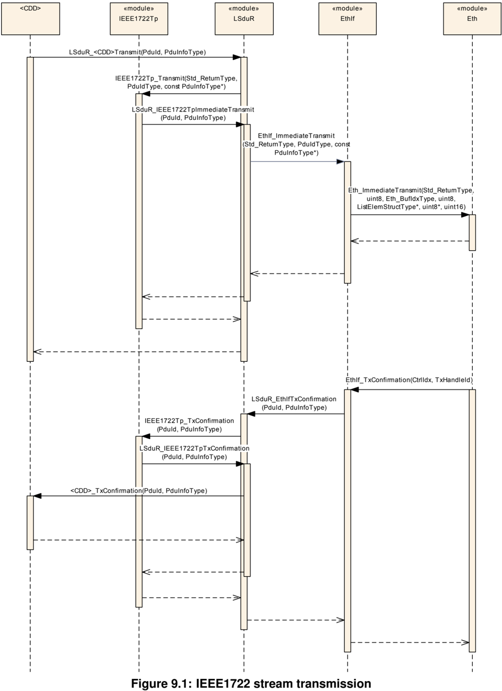

### 8.2. IEEE1722 流的接收

图 9.2：IEEE1722 流的接收（**IEEE1722 stream reception**）

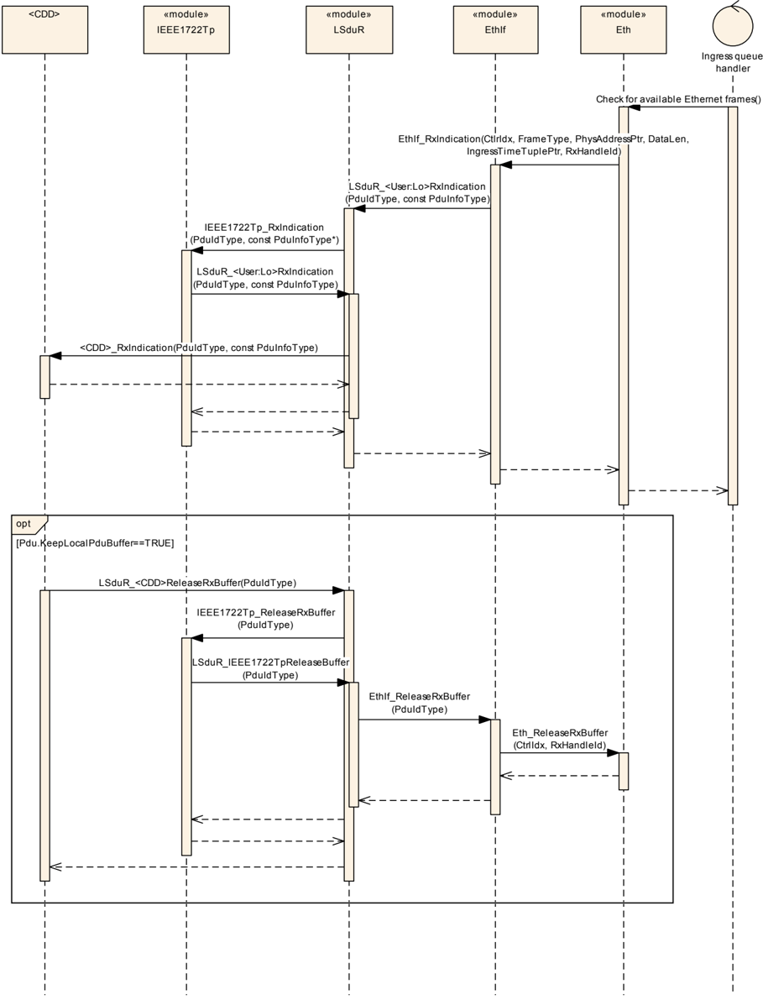

## 9. 配置规范

一般来说，本章定义配置参数及其到容器中的聚类。为了支持本规范，第 10.1 章描述基本原理，并规定了应用于参数规范的模板（表）。

第 10.2 章规定模块 &lt;MODULE\_ABBREVIATION&gt; 的结构（容器）与参数。

第 10.3 章规定模块 &lt;MODULE\_ABBREVIATION&gt; 的发布信息。

### 9.1. 容器与配置参数

有关详细信息，请参阅 **SWS\_BSWGeneral** 中第 10.1 章「配置规范简介」。

以下各章汇总所有配置参数。各参数的详细含义在第 6 章与第 7 章中描述。

图 10.1：IEEE1722Tp（**IEEE1722Tp**）

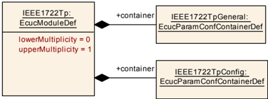

图 10.2：IEEE1722TpGeneral（**IEEE1722TpGeneral**）

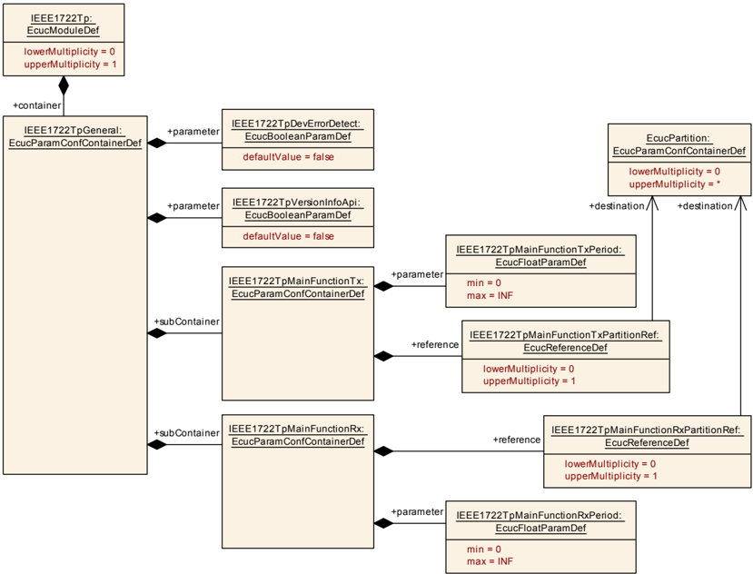

图 10.3：IEEE1722TpConfig — 下层 PDU 配置（**IEEE1722TpConfig - Lower Layer Pdu configuration**）

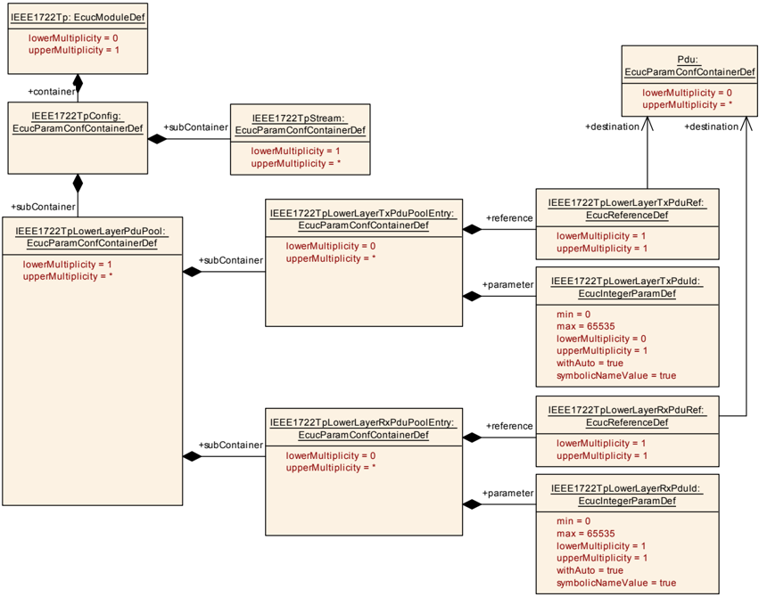

图 10.4：IEEE1722TpConfig — 下层 PDU 配置（续）（**IEEE1722TpConfig - Lower Layer Pdu configuration**）

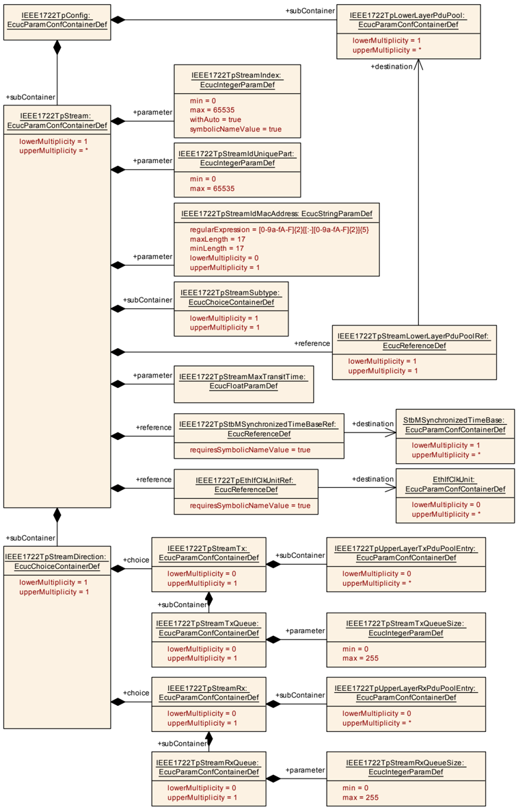

图 10.5：IEEE1722Tp 流配置（**IEEE1722Tp stream configuration**）

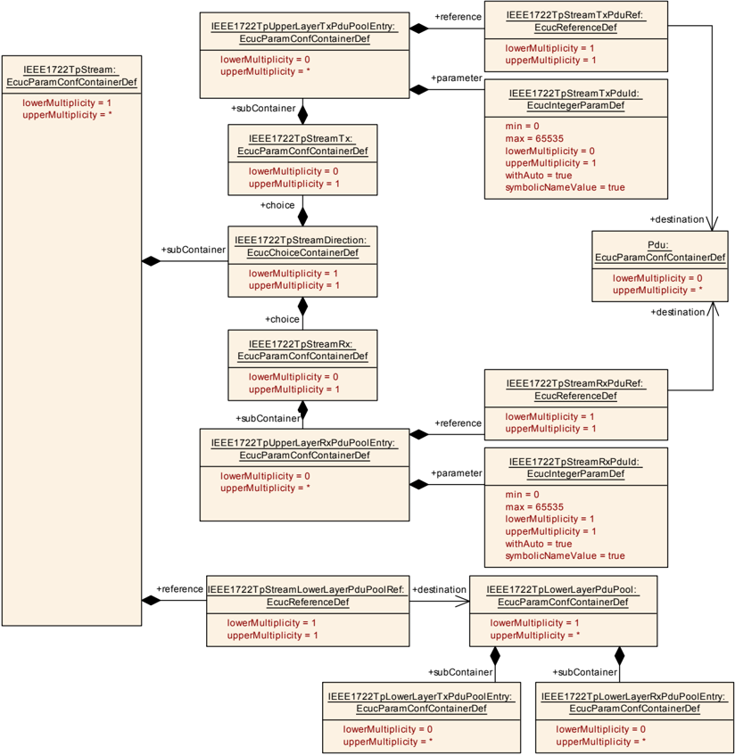

图 10.6：IEEE1722Tp 流配置（续）（**IEEE1722Tp stream configuration**）

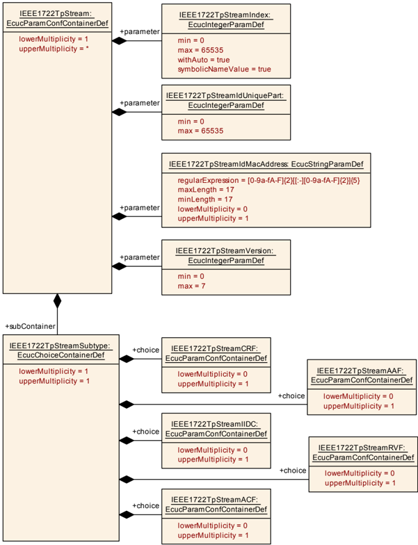

图 10.7：IEEE1722TpStreamCRF（**IEEE1722TpStreamCRF**）

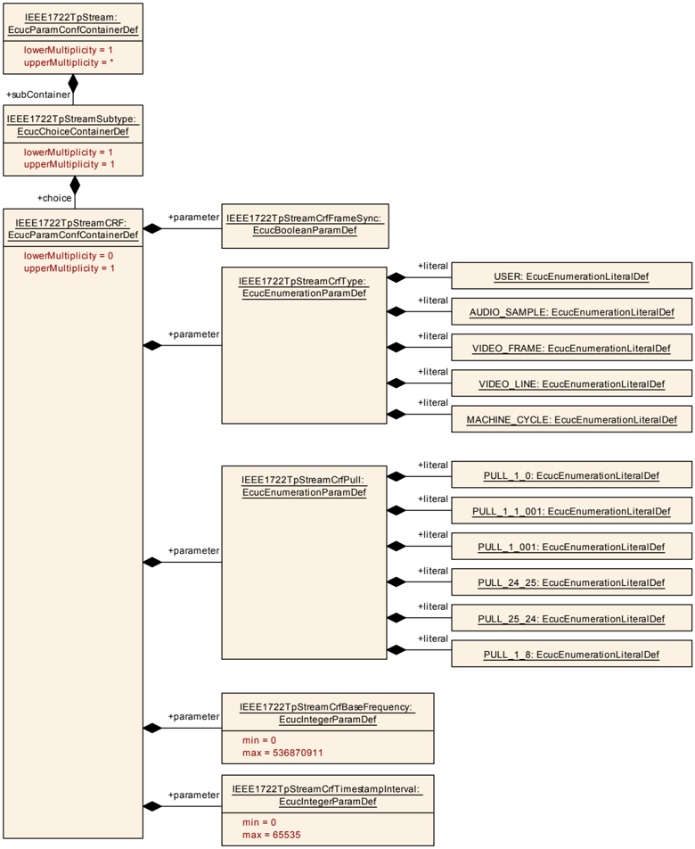

图 10.8：IEEE1722TpStreamAAF（**IEEE1722TpStreamAAF**）

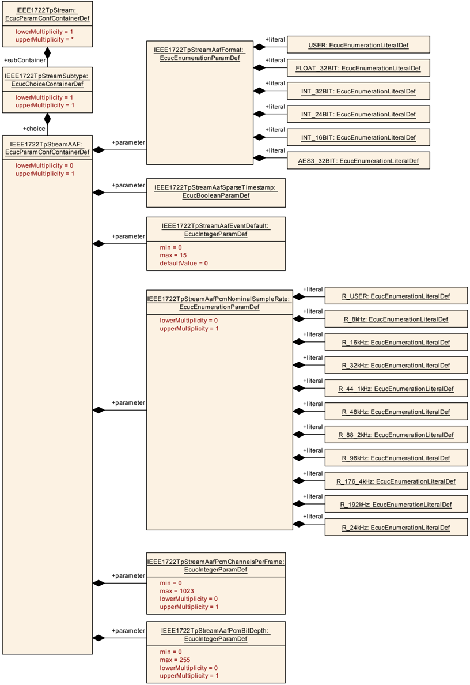

图 10.9：IEEE1722TpStreamIIDC（**IEEE1722TpStreamIIDC**）

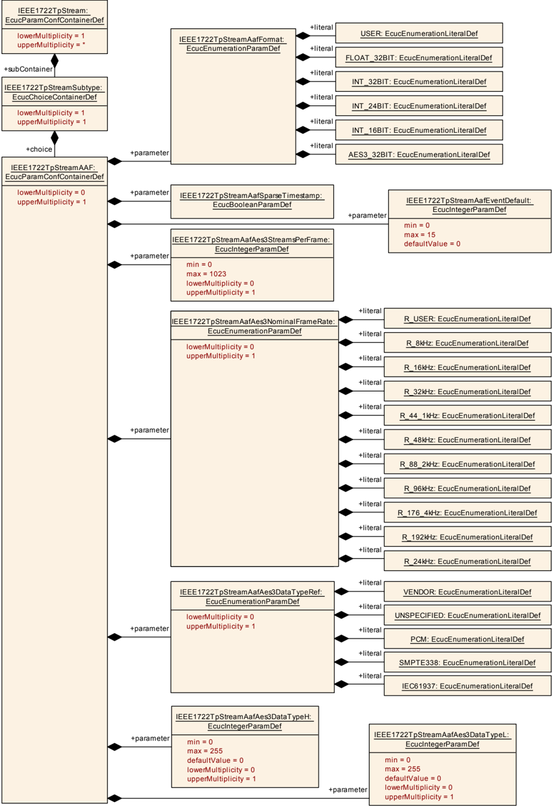

图 10.10：IEEE1722TpStreamRVF（**IEEE1722TpStreamRVF**）

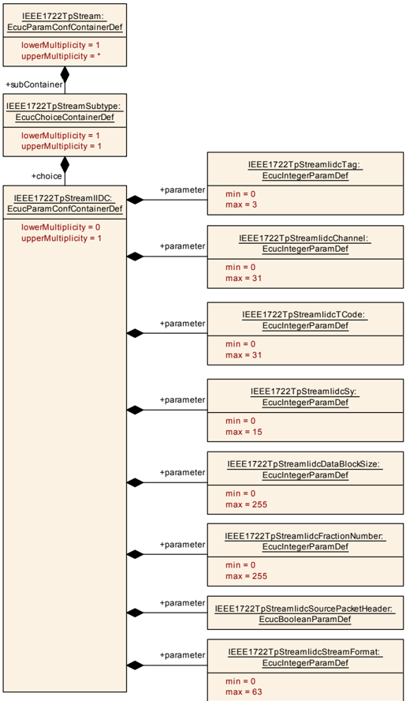

图 10.11：IEEE1722TpStreamACF（**IEEE1722TpStreamACF**）

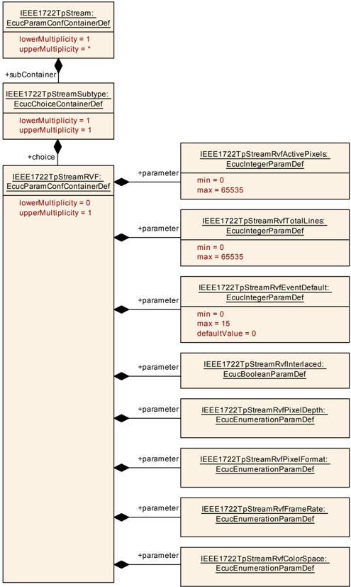

图 10.12：IEEE1722TpStreamAcfCan（**IEEE1722TpStreamAcfCan**）

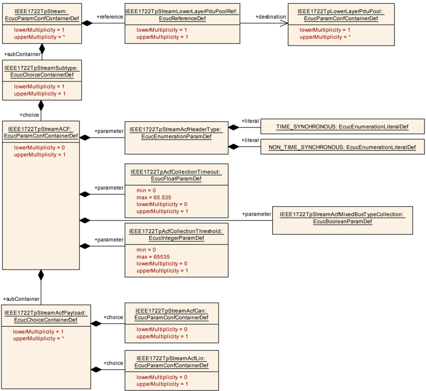

图 10.13：IEEE1722TpStreamAcfCan — CAN Pdu 配置（**IEEE1722TpStreamAcfCan - CAN Pdu configuration**）

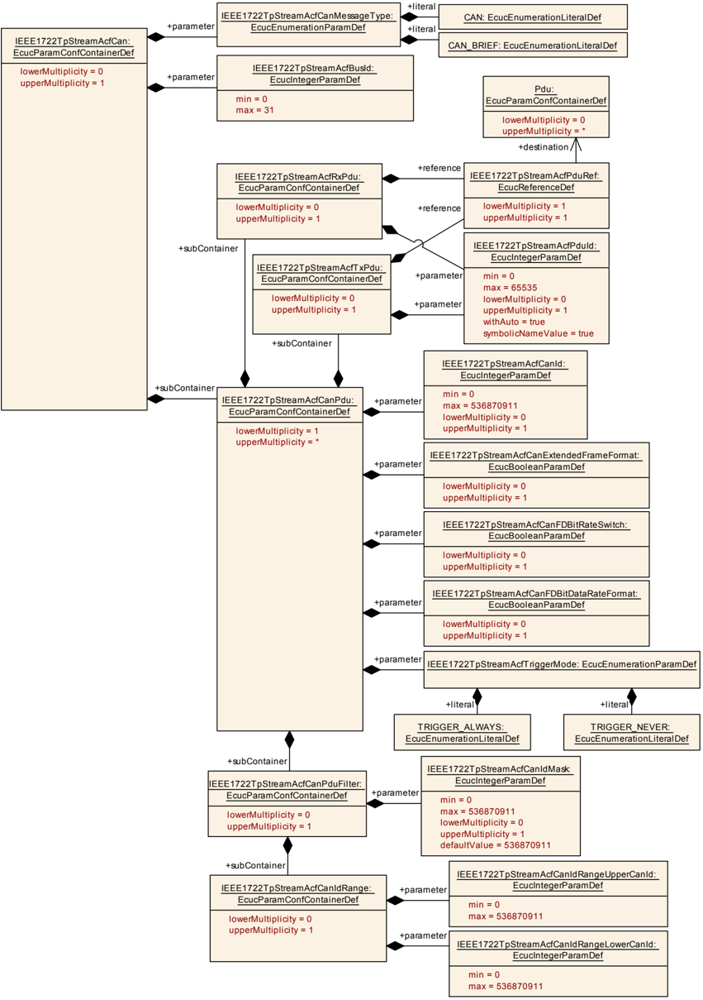

图 10.14：IEEE1722TpStreamAcfLin（**IEEE1722TpStreamAcfLin**）

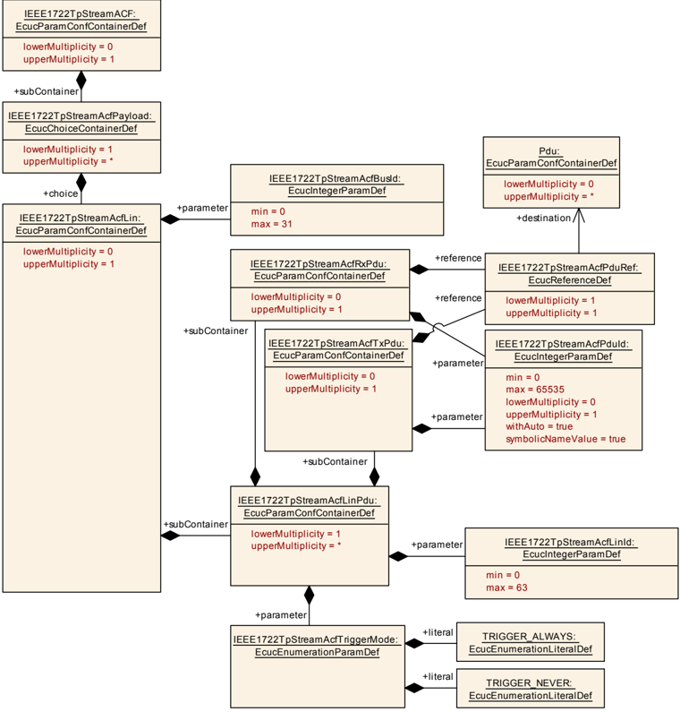

#### 9.1.1. IEEE1722Tp

| SWS 条目 | [ECUC\_IEEE1722Tp\_00001] |
| --- | --- |
| 模块名称 | IEEE1722Tp |
| 描述 | IEEE1722Tp 模块的配置。 |
| Post-Build 变体支持 | false |
| 支持的配置变体 | VARIANT-LINK-TIME、VARIANT-PRE-COMPILE |

| 容器名称 | 多重性 | 作用域/依赖 |
| --- | --- | --- |
| IEEE1722TpGeneral | 1 | 规定 IEEE1722Tp 的通用配置参数。 |
| IEEE1722TpConfig | 1 | 该容器包含 AUTOSAR IEEE1722Tp 模块的配置参数与子容器。 |

#### 9.1.2. IEEE1722TpGeneral

| SWS 条目 | [ECUC\_IEEE1722Tp\_00002] |
| --- | --- |
| 容器名称 | IEEE1722TpGeneral |
| 父容器 | IEEE1722Tp |
| 描述 | 规定 IEEE1722Tp 的通用配置参数。 |
| 配置参数 | 见下方参数表 |

| SWS 条目 | [ECUC\_IEEE1722Tp\_00003] |
| --- | --- |
| 参数名称 | IEEE1722TpDevErrorDetect |
| 父容器 | IEEE1722TpGeneral |
| 描述 | 打开或关闭开发错误检测与通知。* **true**：启用检测与通知。* **false**：禁用检测与通知。 |
| 多重性 | 1 |
| 类型 | EcucBooleanParamDef |
| 默认值 | false |
| Post-Build 变体值 | false |
| 值配置类 | Pre-compile time：x（All Variants）；Link time：-；Post-build time：- |
| 作用域/依赖 | scope: local |

| SWS 条目 | [ECUC\_IEEE1722Tp\_00004] |
| --- | --- |
| 参数名称 | IEEE1722TpVersionInfoApi |
| 父容器 | IEEE1722TpGeneral |
| 描述 | 如果为 true，则 IEEE1722Tp\_GetVersionInfo **API** 可用。 |
| 多重性 | 1 |
| 类型 | EcucBooleanParamDef |
| 默认值 | false |
| Post-Build 变体值 | false |
| 值配置类 | Pre-compile time：x（All Variants）；Link time：-；Post-build time：- |
| 作用域/依赖 | scope: local |

##### 9.1.2.1. IEEE1722TpMainFunctionRx

| SWS 条目 | [ECUC\_IEEE1722Tp\_00104] |
| --- | --- |
| 容器名称 | IEEE1722TpMainFunctionRx |
| 父容器 | IEEE1722TpGeneral |
| 描述 | 定义 IEEE1722TpMainFunctionRx。 |
| 配置参数 | 见下方参数表 |

| SWS 条目 | [ECUC\_IEEE1722Tp\_00102] |
| --- | --- |
| 参数名称 | IEEE1722TpMainFunctionRxPeriod |
| 父容器 | IEEE1722TpMainFunctionRx |
| 描述 | 以秒为单位规定 Rx main 函数 IEEE1722Tp\_MainFunctionRx 的周期。 |
| 多重性 | 1 |
| 类型 | EcucFloatParamDef |
| 范围 | ]0 .. INF[ |
| Post-Build 变体值 | false |
| 值配置类 | Pre-compile time：x（All Variants）；Link time：-；Post-build time：- |
| 作用域/依赖 | scope: local |

| SWS 条目 | [ECUC\_IEEE1722Tp\_00106] |
| --- | --- |
| 参数名称 | IEEE1722TpMainFunctionRxPartitionRef |
| 父容器 | IEEE1722TpMainFunctionRx |
| 描述 | 对 IEEE1722Tp\_MainFunctionRx 被分配到的 EcucPartition 的引用。 |
| 多重性 | 0..1 |
| 类型 | 对 EcucPartition 的引用 |
| Post-Build 变体多重性 | false |
| Post-Build 变体值 | false |
| 多重性配置类 | Pre-compile time：x；Link time：-；Post-build time：- |
| 值配置类 | Pre-compile time：x；Link time：-；Post-build time：- |
| 作用域/依赖 | scope: ECU |

无包含的容器。

##### 9.1.2.2. IEEE1722TpMainFunctionTx

| SWS 条目 | [ECUC\_IEEE1722Tp\_00103] |
| --- | --- |
| 容器名称 | IEEE1722TpMainFunctionTx |
| 父容器 | IEEE1722TpGeneral |
| 描述 | 定义 IEEE1722TpMainFunctionTx。 |
| 配置参数 | 见下方参数表 |

| SWS 条目 | [ECUC\_IEEE1722Tp\_00097] |
| --- | --- |
| 参数名称 | IEEE1722TpMainFunctionTxPeriod |
| 父容器 | IEEE1722TpMainFunctionTx |
| 描述 | 以秒为单位规定 Tx main 函数 IEEE1722Tp\_MainFunctionTx 的周期。 |
| 多重性 | 1 |
| 类型 | EcucFloatParamDef |
| 范围 | ]0 .. INF[ |
| Post-Build 变体值 | false |
| 值配置类 | Pre-compile time：x（All Variants）；Link time：-；Post-build time：- |
| 作用域/依赖 | scope: local |

| SWS 条目 | [ECUC\_IEEE1722Tp\_00105] |
| --- | --- |
| 参数名称 | IEEE1722TpMainFunctionTxPartitionRef |
| 父容器 | IEEE1722TpMainFunctionTx |
| 描述 | 对 IEEE1722Tp\_MainFunctionTx 被分配到的 EcucPartition 的引用。 |
| 多重性 | 0..1 |
| 类型 | 对 EcucPartition 的引用 |
| Post-Build 变体多重性 | false |
| Post-Build 变体值 | false |
| 多重性配置类 | Pre-compile time：x；Link time：-；Post-build time：- |
| 值配置类 | Pre-compile time：x；Link time：-；Post-build time：- |
| 作用域/依赖 | scope: ECU |

无包含的容器。

无包含的容器。

#### 9.1.3. IEEE1722TpConfig

| SWS 条目 | [ECUC\_IEEE1722Tp\_00005] |
| --- | --- |
| 容器名称 | IEEE1722TpConfig |
| 父容器 | IEEE1722Tp |
| 描述 | 该容器包含 AUTOSAR IEEE1722Tp 模块的配置参数与子容器。 |
| 配置参数 | 无 |

##### 9.1.3.1. IEEE1722Tp 下层 PDU 配置

###### 9.1.3.1.1. IEEE1722TpLowerLayerPduPool

| SWS 条目 | [ECUC\_IEEE1722Tp\_00031] |
| --- | --- |
| 容器名称 | IEEE1722TpLowerLayerPduPool |
| 父容器 | IEEE1722TpConfig |
| 描述 | 每个容器定义一个下层 **Pdu** 池（用于 Tx 或 Rx）。随后每个流可以选择经由哪个 **Pdu** 池执行其传输。 |
| 配置参数 | 无 |

| 容器名称 | 多重性 | 作用域/依赖 |
| --- | --- | --- |
| IEEE1722TpLowerLayerRxPduPoolEntry | 0..* | 该容器在 IEEE1722TpLowerLayerPduPool 中定义一个用于 Rx 方向的条目，用于从下层传输 Rx **Pdu**。仅当 IEEE1722Tp 模块至少消费一个流时才需要该容器。支持的元数据条目：* TIMETUPLE\_TYPE\_PTR |
| IEEE1722TpLowerLayerTxPduPoolEntry | 0..* | 该容器在 IEEE1722TpLowerLayerPduPool 中定义一个用于 Tx 方向的条目，用于将 Tx **Pdu** 传输给下层。仅当 IEEE1722Tp 模块至少产生一个流时才需要该容器。支持的元数据条目：* LISTELEM\_PTR * ETHERNET\_MAC\_64 |

###### 9.1.3.1.2. IEEE1722TpLowerLayerRxPduPoolEntry

| SWS 条目 | [ECUC\_IEEE1722Tp\_00028] |
| --- | --- |
| 容器名称 | IEEE1722TpLowerLayerRxPduPoolEntry |
| 父容器 | IEEE1722TpLowerLayerPduPool |
| 描述 | 该容器在 IEEE1722TpLowerLayerPduPool 中定义一个用于 Rx 方向的条目，用于从下层传输 Rx **Pdu**。仅当 IEEE1722Tp 模块至少消费一个流时才需要该容器。支持的元数据条目：* TIMETUPLE\_TYPE\_PTR |
| 配置参数 | 见下方参数表 |

| SWS 条目 | [ECUC\_IEEE1722Tp\_00030] |
| --- | --- |
| 参数名称 | IEEE1722TpLowerLayerRxPduId |
| 父容器 | IEEE1722TpLowerLayerRxPduPoolEntry |
| 描述 | 定义下层用于 Rx **Pdu** 指示的句柄 Pdu Id。 |
| 多重性 | 1 |
| 类型 | EcucIntegerParamDef（为该参数生成符号名） |
| 范围 | 0 .. 65535 |
| Post-Build 变体值 | true |
| 值配置类 | Pre-compile time：x（VARIANT-PRE-COMPILE）；Link time：x（VARIANT-LINK-TIME）；Post-build time：x（VARIANT-POST-BUILD） |
| 作用域/依赖 | scope: ECU |

| SWS 条目 | [ECUC\_IEEE1722Tp\_00029] |
| --- | --- |
| 参数名称 | IEEE1722TpLowerLayerRxPduRef |
| 父容器 | IEEE1722TpLowerLayerRxPduPoolEntry |
| 描述 | 对用于从下层传输 Rx **Pdu** 的 EcuC **Pdu** 的引用。 |
| 多重性 | 1 |
| 类型 | 对 Pdu 的引用 |
| Post-Build 变体值 | true |
| 值配置类 | Pre-compile time：x（VARIANT-PRE-COMPILE）；Link time：x（VARIANT-LINK-TIME）；Post-build time：x（VARIANT-POST-BUILD） |
| 作用域/依赖 | scope: ECU |

无包含的容器。

###### 9.1.3.1.3. IEEE1722TpLowerLayerTxPduPoolEntry

| SWS 条目 | [ECUC\_IEEE1722Tp\_00025] |
| --- | --- |
| 容器名称 | IEEE1722TpLowerLayerTxPduPoolEntry |
| 父容器 | IEEE1722TpLowerLayerPduPool |
| 描述 | 该容器在 IEEE1722TpLowerLayerPduPool 中定义一个用于 Tx 方向的条目，用于将 Tx **Pdu** 传输给下层。仅当 IEEE1722Tp 模块至少产生一个流时才需要该容器。支持的元数据条目：* LISTELEM\_PTR * ETHERNET\_MAC\_64 |
| 配置参数 | 见下方参数表 |

| SWS 条目 | [ECUC\_IEEE1722Tp\_00027] |
| --- | --- |
| 参数名称 | IEEE1722TpLowerLayerTxPduId |
| 父容器 | IEEE1722TpLowerLayerTxPduPoolEntry |
| 描述 | 定义下层用于 Tx **Pdu** 确认的句柄 Pdu Id。 |
| 多重性 | 0..1 |
| 类型 | EcucIntegerParamDef（为该参数生成符号名） |
| 范围 | 0 .. 65535 |
| Post-Build 变体多重性 | false |
| Post-Build 变体值 | true |
| 多重性配置类 | Pre-compile time：x（All Variants）；Link time：x（-）；Post-build time：x（-） |
| 值配置类 | Pre-compile time：x（VARIANT-PRE-COMPILE）；Link time：x（VARIANT-LINK-TIME）；Post-build time：x（VARIANT-POST-BUILD） |
| 作用域/依赖 | scope: ECU；withAuto = true |

| SWS 条目 | [ECUC\_IEEE1722Tp\_00026] |
| --- | --- |
| 参数名称 | IEEE1722TpLowerLayerTxPduRef |
| 父容器 | IEEE1722TpLowerLayerTxPduPoolEntry |
| 描述 | 对用于将 Tx **Pdu** 传输给下层的 EcuC **Pdu** 的引用。 |
| 多重性 | 1 |
| 类型 | 对 Pdu 的引用 |
| Post-Build 变体值 | true |
| 值配置类 | Pre-compile time：x（VARIANT-PRE-COMPILE）；Link time：x（VARIANT-LINK-TIME）；Post-build time：x（VARIANT-POST-BUILD） |
| 作用域/依赖 | scope: ECU |

无包含的容器。

#### 9.1.4. IEEE1722Tp 流配置

##### 9.1.4.1. IEEE1722TpStream

| SWS 条目 | [ECUC\_IEEE1722Tp\_00006] |
| --- | --- |
| 容器名称 | IEEE1722TpStream |
| 父容器 | IEEE1722TpConfig |
| 描述 | 一个 IEEE1722Tp 流的定义。 |
| 配置参数 | 见下方参数表 |

| SWS 条目 | [ECUC\_IEEE1722Tp\_00100] |
| --- | --- |
| 参数名称 | IEEE1722TpEthIfClkUnitRef |
| 父容器 | IEEE1722TpStream |
| 描述 | 对 EthIfClkUnit 的引用，可从该 EthIfClkUnit 获取当前同步时间（例如确定用于发送的 avtp 时间戳）。 |
| 多重性 | 1 |
| 类型 | 对 EthIfClkUnit 的符号名引用 |
| Post-Build 变体值 | false |
| 值配置类 | Pre-compile time：x（All Variants）；Link time：-；Post-build time：- |
| 作用域/依赖 | scope: ECU |

| SWS 条目 | [ECUC\_IEEE1722Tp\_00008] |
| --- | --- |
| 参数名称 | IEEE1722TpStreamIdMacAddress |
| 父容器 | IEEE1722TpStream |
| 描述 | 流 id 的 **MAC** 地址部分的定义。 |
| 多重性 | 0..1 |
| 类型 | EcucStringParamDef |
| 正则表达式 | [0-9a-fA-F]{2}[[:-][0-9a-fA-F]{2}]{5} |
| Post-Build 变体多重性 | true |
| Post-Build 变体值 | true |
| 多重性配置类 | Pre-compile time：x（VARIANT-PRE-COMPILE）；Link time：x（VARIANT-LINK-TIME）；Post-build time：x（VARIANT-POST-BUILD） |
| 值配置类 | Pre-compile time：x（VARIANT-PRE-COMPILE）；Link time：x（VARIANT-LINK-TIME）；Post-build time：x（VARIANT-POST-BUILD） |
| 作用域/依赖 | scope: local |

| SWS 条目 | [ECUC\_IEEE1722Tp\_00007] |
| --- | --- |
| 参数名称 | IEEE1722TpStreamIdUniquePart |
| 父容器 | IEEE1722TpStream |
| 描述 | 流 id 的唯一 id 部分的定义。 |
| 多重性 | 1 |
| 类型 | EcucIntegerParamDef |
| 范围 | 0 .. 65535 |
| Post-Build 变体值 | true |
| 值配置类 | Pre-compile time：x（VARIANT-PRE-COMPILE）；Link time：x（VARIANT-LINK-TIME）；Post-build time：x（VARIANT-POST-BUILD） |
| 作用域/依赖 | scope: local |

| SWS 条目 | [ECUC\_IEEE1722Tp\_00091] |
| --- | --- |
| 参数名称 | IEEE1722TpStreamIndex |
| 父容器 | IEEE1722TpStream |
| 描述 | 定义在通信栈中为 **API** 访问标识该流的句柄索引。该值与由 IEEE1722TpStreamIdUniquePart 和 IEEE1722TpStreamIdMacAddress 组合而成的流 id 无关。 |
| 多重性 | 1 |
| 类型 | EcucIntegerParamDef（为该参数生成符号名） |
| 范围 | 0 .. 65535 |
| Post-Build 变体值 | true |
| 值配置类 | Pre-compile time：x（VARIANT-PRE-COMPILE）；Link time：x（VARIANT-LINK-TIME）；Post-build time：x（VARIANT-POST-BUILD） |
| 作用域/依赖 | scope: ECU |

| SWS 条目 | [ECUC\_IEEE1722Tp\_00033] |
| --- | --- |
| 参数名称 | IEEE1722TpStreamMaxTransitTime |
| 父容器 | IEEE1722TpStream |
| 描述 | 该流的最大传输时间的定义。值以秒为单位。 |
| 多重性 | 1 |
| 类型 | EcucFloatParamDef |
| 范围 | [-INF .. INF] |
| Post-Build 变体值 | true |
| 值配置类 | Pre-compile time：x（VARIANT-PRE-COMPILE）；Link time：x（VARIANT-LINK-TIME）；Post-build time：x（VARIANT-POST-BUILD） |
| 作用域/依赖 | scope: local |

| SWS 条目 | [ECUC\_IEEE1722Tp\_00039] |
| --- | --- |
| 参数名称 | IEEE1722TpStreamVersion |
| 父容器 | IEEE1722TpStream |
| 描述 | 流版本的定义。 |
| 多重性 | 1 |
| 类型 | EcucIntegerParamDef |
| 范围 | 0 .. 7 |
| Post-Build 变体值 | true |
| 值配置类 | Pre-compile time：x（VARIANT-PRE-COMPILE）；Link time：x（VARIANT-LINK-TIME） |
| 作用域/依赖 | scope: local |

| SWS 条目 | [ECUC\_IEEE1722Tp\_00101] |
| --- | --- |
| 参数名称 | IEEE1722TpStbMSynchronizedTimeBaseRef |
| 父容器 | IEEE1722TpStream |
| 描述 | 对 StbMSynchronizedTimeBase 的引用，可从该 StbMSynchronizedTimeBase 获取当前同步时间（例如确定用于发送的 avtp 时间戳）。 |
| 多重性 | 1 |
| 类型 | 对 StbMSynchronizedTimeBase 的符号名引用 |
| Post-Build 变体值 | false |
| 值配置类 | Pre-compile time：x（All Variants）；Link time：-；Post-build time：- |
| 作用域/依赖 | scope: ECU |

| SWS 条目 | [ECUC\_IEEE1722Tp\_00032] |
| --- | --- |
| 参数名称 | IEEE1722TpStreamLowerLayerPduPoolRef |
| 父容器 | IEEE1722TpStream |
| 描述 | 对用于通往下层/来自下层传输的一个 **Pdu** 集合的引用。 |
| 多重性 | 1 |
| 类型 | 对 IEEE1722TpLowerLayerPduPool 的引用 |
| Post-Build 变体值 | true |
| 值配置类 | Pre-compile time：x（VARIANT-PRE-COMPILE）；Link time：x（VARIANT-LINK-TIME）；Post-build time：x（VARIANT-POST-BUILD） |
| 作用域/依赖 | scope: ECU |

| 容器选择 | 多重性 | 作用域/依赖 |
| --- | --- | --- |
| IEEE1722TpStreamSubtype | 1 | **IEEE1722** 流子类型的选择。 |
| IEEE1722TpStreamDirection | 1 | **IEEE1722** 流方向的选择，Tx 或 Rx 可配置。 |

##### 9.1.4.2. IEEE1722TpStream 方向配置

IEEE1722TpStreamDirection 为一个选择容器，可选择以下两个容器之一：

###### IEEE1722TpStreamTx

| SWS 条目 | [ECUC\_IEEE1722Tp\_00108] |
| --- | --- |
| 容器名称 | IEEE1722TpStreamTx |
| 父容器 | IEEE1722TpStreamDirection |
| 描述 | 该容器定义 Tx 方向专用的参数。 |
| 配置参数 | 无 |

| 容器选择 | 多重性 | 作用域/依赖 |
| --- | --- | --- |
| IEEE1722TpUpperLayerTxPduPoolEntry | 0..* | 该容器在 IEEE1722TpUpperLayerPduPool 中定义一个用于 Tx 方向的条目，用于从上层传输 Tx **Pdu**。仅当该流由 IEEE1722Tp 模块产生、且不是一条 **ACF** 流时才需要该容器。支持的元数据条目：* IEEE1722TP\_COMMON\_STREAM\_HEADER\_PTR * IEEE1722TP\_TX\_AAF\_AES3\_PTR * IEEE1722TP\_TX\_AAF\_PCM\_PTR * IEEE1722TP\_TX\_CRF\_PTR * IEEE1722TP\_TX\_IEC68133\_CIP\_NO\_SPH\_PTR * IEEE1722TP\_TX\_IEC68133\_CIP\_WITH\_SPH\_PTR * IEEE1722TP\_TX\_IEC68133\_IIDC\_PTR * IEEE1722TP\_TX\_IEC68133\_PTR * IEEE1722TP\_TX\_RVF\_PTR |
| IEEE1722TpStreamTxQueue | 0..1 | 一个 IEEE1722Tp 流 Tx 队列的定义。 |

###### IEEE1722TpUpperLayerTxPduPoolEntry

| SWS 条目 | [ECUC\_IEEE1722Tp\_00023] |
| --- | --- |
| 容器名称 | IEEE1722TpUpperLayerTxPduPoolEntry |
| 父容器 | IEEE1722TpStreamTx |
| 描述 | 该容器在 IEEE1722TpUpperLayerPduPool 中定义一个用于 Tx 方向的条目，用于从上层传输 Tx **Pdu**。仅当该流由 IEEE1722Tp 模块产生、且不是一条 **ACF** 流时才需要该容器。 |
| 配置参数 | 见下方参数表 |

| SWS 条目 | [ECUC\_IEEE1722Tp\_00020] |
| --- | --- |
| 参数名称 | IEEE1722TpStreamTxPduId |
| 父容器 | IEEE1722TpUpperLayerTxPduPoolEntry |
| 描述 | 定义上层用于 Tx **Pdu** 确认的句柄 Pdu Id。 |
| 多重性 | 0..1 |
| 类型 | EcucIntegerParamDef（为该参数生成符号名） |
| 范围 | 0 .. 65535 |
| Post-Build 变体多重性 | false |
| Post-Build 变体值 | true |
| 多重性配置类 | Pre-compile time：x（All Variants）；Link time：-；Post-build time：- |
| 值配置类 | Pre-compile time：x（VARIANT-PRE-COMPILE）；Link time：x（VARIANT-LINK-TIME）；Post-build time：x（VARIANT-POST-BUILD） |
| 作用域/依赖 | scope: ECU；withAuto = true |

| SWS 条目 | [ECUC\_IEEE1722Tp\_00019] |
| --- | --- |
| 参数名称 | IEEE1722TpStreamTxPduRef |
| 父容器 | IEEE1722TpUpperLayerTxPduPoolEntry |
| 描述 | 对用于从上层传输 Tx 流 **Pdu** 的 EcuC **Pdu** 的引用。 |
| 多重性 | 1 |
| 类型 | 对 Pdu 的引用 |
| Post-Build 变体值 | true |
| 值配置类 | Pre-compile time：x（VARIANT-PRE-COMPILE）；Link time：x（VARIANT-LINK-TIME）；Post-build time：x（VARIANT-POST-BUILD） |
| 作用域/依赖 | scope: ECU |

无包含的容器。

###### IEEE1722TpStreamTxQueue

| SWS 条目 | [ECUC\_IEEE1722Tp\_00017] |
| --- | --- |
| 容器名称 | IEEE1722TpStreamTxQueue |
| 父容器 | IEEE1722TpStreamTx |
| 描述 | 一个 IEEE1722Tp 流 Tx 队列的定义。 |
| 配置参数 | 见下方参数表 |

| SWS 条目 | [ECUC\_IEEE1722Tp\_00018] |
| --- | --- |
| 参数名称 | IEEE1722TpStreamTxQueueSize |
| 父容器 | IEEE1722TpStreamTxQueue |
| 描述 | 流 Tx 队列的队列大小定义。该队列以待排队元素的数量配置。 |
| 多重性 | 1 |
| 类型 | EcucIntegerParamDef |
| 范围 | 0 .. 255 |
| Post-Build 变体值 | true |
| 值配置类 | Pre-compile time：x（VARIANT-PRE-COMPILE）；Link time：x（VARIANT-LINK-TIME） |
| 作用域/依赖 | scope: local |

无包含的容器。

###### IEEE1722TpStreamRx

| SWS 条目 | [ECUC\_IEEE1722Tp\_00109] |
| --- | --- |
| 容器名称 | IEEE1722TpStreamRx |
| 父容器 | IEEE1722TpStreamDirection |
| 描述 | 该容器定义 Rx 方向专用的参数。 |
| 配置参数 | 无 |

| 容器选择 | 多重性 | 作用域/依赖 |
| --- | --- | --- |
| IEEE1722TpUpperLayerRxPduPoolEntry | 0..* | 该容器在 IEEE1722TpUpperLayerRxPduPool 中定义一个用于 Rx 方向的条目，用于将 Rx **Pdu** 传输给上层。仅当该流由 IEEE1722Tp 模块消费、且不是一条 **ACF** 流时才需要该容器。支持的元数据条目：* IEEE1722TP\_COMMON\_STREAM\_HEADER\_PTR * IEEE1722TP\_RX\_AAF\_AES3\_PTR * IEEE1722TP\_RX\_AAF\_PCM\_PTR * IEEE1722TP\_RX\_CRF\_PTR * IEEE1722TP\_RX\_IEC68133\_CIP\_NO\_SPH\_PTR * IEEE1722TP\_RX\_IEC68133\_CIP\_WITH\_SPH\_PTR * IEEE1722TP\_RX\_IEC68133\_IIDC\_PTR * IEEE1722TP\_RX\_IEC68133\_PTR * IEEE1722TP\_RX\_RVF\_PTR |
| IEEE1722TpStreamRxQueue | 0..1 | 一个 IEEE1722Tp 流 Rx 队列的定义。 |

###### IEEE1722TpUpperLayerRxPduPoolEntry

| SWS 条目 | [ECUC\_IEEE1722Tp\_00024] |
| --- | --- |
| 容器名称 | IEEE1722TpUpperLayerRxPduPoolEntry |
| 父容器 | IEEE1722TpStreamRx |
| 描述 | 该容器在 IEEE1722TpUpperLayerRxPduPool 中定义一个用于 Rx 方向的条目，用于将 Rx **Pdu** 传输给上层。仅当该流由 IEEE1722Tp 模块消费、且不是一条 **ACF** 流时才需要该容器。 |
| 配置参数 | 见下方参数表 |

| SWS 条目 | [ECUC\_IEEE1722Tp\_00022] |
| --- | --- |
| 参数名称 | IEEE1722TpStreamRxPduId |
| 父容器 | IEEE1722TpUpperLayerRxPduPoolEntry |
| 描述 | 定义上层用于 Rx **Pdu** 指示的句柄 Pdu Id。仅当该流由 IEEE1722Tp 模块消费时才需要该句柄 Id。 |
| 多重性 | 1 |
| 类型 | EcucIntegerParamDef（为该参数生成符号名） |
| 范围 | 0 .. 65535 |
| Post-Build 变体值 | true |
| 值配置类 | Pre-compile time：x（VARIANT-PRE-COMPILE）；Link time：x（VARIANT-LINK-TIME）；Post-build time：x（VARIANT-POST-BUILD） |
| 作用域/依赖 | scope: ECU；withAuto = true |

| SWS 条目 | [ECUC\_IEEE1722Tp\_00021] |
| --- | --- |
| 参数名称 | IEEE1722TpStreamRxPduRef |
| 父容器 | IEEE1722TpUpperLayerRxPduPoolEntry |
| 描述 | 对用于将 Rx 流 **Pdu** 传输给上层的 EcuC **Pdu** 的引用。 |
| 多重性 | 1 |
| 类型 | 对 Pdu 的引用 |
| Post-Build 变体值 | true |
| 值配置类 | Pre-compile time：x（VARIANT-PRE-COMPILE）；Link time：x（VARIANT-LINK-TIME）；Post-build time：x（VARIANT-POST-BUILD） |
| 作用域/依赖 | scope: ECU |

无包含的容器。

###### IEEE1722TpStreamRxQueue

| SWS 条目 | [ECUC\_IEEE1722Tp\_00035] |
| --- | --- |
| 容器名称 | IEEE1722TpStreamRxQueue |
| 父容器 | IEEE1722TpStreamRx |
| 描述 | 一个 IEEE1722Tp 流 Rx 队列的定义。 |
| 配置参数 | 见下方参数表 |

| SWS 条目 | [ECUC\_IEEE1722Tp\_00037] |
| --- | --- |
| 参数名称 | IEEE1722TpStreamRxQueueSize |
| 父容器 | IEEE1722TpStreamRxQueue |
| 描述 | 流 Rx 队列的队列大小定义。该队列以待排队元素的数量配置。 |
| 多重性 | 1 |
| 类型 | EcucIntegerParamDef |
| 范围 | 0 .. 255 |
| Post-Build 变体值 | true |
| 值配置类 | Pre-compile time：x（VARIANT-PRE-COMPILE）；Link time：x（VARIANT-LINK-TIME）；Post-build time：x（VARIANT-POST-BUILD） |
| 作用域/依赖 | scope: local |

无包含的容器。
##### 9.1.4.3. IEEE1722TpStream 子类型配置

IEEE1722TpStreamSubtype 为一个选择容器，可选择以下五个容器之一。

###### IEEE1722TpStreamCRF

| SWS 条目 | [ECUC\_IEEE1722Tp\_00010] |
| --- | --- |
| 容器名称 | IEEE1722TpStreamCRF |
| 父容器 | IEEE1722TpStreamSubtype |
| 描述 | 一个 IEEE1722 时钟参考格式（**CRF**）流的定义。 |
| 配置参数 | 见下方参数表 |

| SWS 条目 | [ECUC\_IEEE1722Tp\_00042] |
| --- | --- |
| 参数名称 | IEEE1722TpStreamCrfBaseFrequency |
| 父容器 | IEEE1722TpStreamCRF |
| 描述 | **CRF** 流基频的定义。以 Hz 为单位定义。 |
| 多重性 | 1 |
| 类型 | EcucIntegerParamDef |
| 范围 | 0 .. 536870911 |
| Post-Build 变体值 | true |
| 值配置类 | Pre-compile time：x（VARIANT-PRE-COMPILE）；Link time：x（VARIANT-LINK-TIME）；Post-build time：x（VARIANT-POST-BUILD） |
| 作用域/依赖 | scope: local |

| SWS 条目 | [ECUC\_IEEE1722Tp\_00038] |
| --- | --- |
| 参数名称 | IEEE1722TpStreamCrfFrameSync |
| 父容器 | IEEE1722TpStreamCRF |
| 描述 | 定义 **CRF** 流帧同步（fs）。true = 1，false = 0。 |
| 多重性 | 1 |
| 类型 | EcucBooleanParamDef |
| Post-Build 变体值 | true |
| 值配置类 | Pre-compile time：x（VARIANT-PRE-COMPILE）；Link time：x（VARIANT-LINK-TIME）；Post-build time：x（VARIANT-POST-BUILD） |
| 作用域/依赖 | scope: local |

| SWS 条目 | [ECUC\_IEEE1722Tp\_00041] |
| --- | --- |
| 参数名称 | IEEE1722TpStreamCrfPull |
| 父容器 | IEEE1722TpStreamCRF |
| 描述 | **CRF** 流 pull 值的定义。 |
| 多重性 | 1 |
| 类型 | EcucEnumerationParamDef |
| 范围 | DOMAIN\_PULL\_1\_1：value=0x00，将 base\_frequency 字段乘以 1.0；DOMAIN\_PULL\_1\_0：value=0x01，将 base\_frequency 字段乘以 0.5；DOMAIN\_PULL\_8\_0：value=0x02，将 base\_frequency 字段乘以 8.0 |
| Post-Build 变体值 | true |
| 值配置类 | Pre-compile time：x（VARIANT-PRE-COMPILE）；Link time：x（VARIANT-LINK-TIME）；Post-build time：x（VARIANT-POST-BUILD） |
| 作用域/依赖 | scope: local |

| SWS 条目 | [ECUC\_IEEE1722Tp\_00058] |
| --- | --- |
| 参数名称 | IEEE1722TpStreamCrfTimestampInterval |
| 父容器 | IEEE1722TpStreamCRF |
| 描述 | **CRF** 流时间戳间隔的定义。定义为基频的倍数。 |
| 多重性 | 1 |
| 类型 | EcucIntegerParamDef |
| 范围 | 0 .. 65535 |
| Post-Build 变体值 | true |
| 值配置类 | Pre-compile time：x（VARIANT-PRE-COMPILE）；Link time：x（VARIANT-LINK-TIME）；Post-build time：x（VARIANT-POST-BUILD） |
| 作用域/依赖 | scope: local |

| SWS 条目 | [ECUC\_IEEE1722Tp\_00040] |
| --- | --- |
| 参数名称 | IEEE1722TpStreamCrfType |
| 父容器 | IEEE1722TpStreamCRF |
| 描述 | **CRF** 流类型的定义。 |
| 多重性 | 1 |
| 类型 | EcucEnumerationParamDef |
| 范围 | CRF\_AUDIO\_SAMPLE：value=0x01，音频采样时间戳（Audio sample timestamp） |
| Post-Build 变体值 | true |
| 值配置类 | Pre-compile time：x（VARIANT-PRE-COMPILE）；Link time：x（VARIANT-LINK-TIME）；Post-build time：x（VARIANT-POST-BUILD） |
| 作用域/依赖 | scope: local |

无包含的容器。

###### IEEE1722TpStreamAAF

| SWS 条目 | [ECUC\_IEEE1722Tp\_00011] |
| --- | --- |
| 容器名称 | IEEE1722TpStreamAAF |
| 父容器 | IEEE1722TpStreamSubtype |
| 描述 | 一个 IEEE1722 **AVTP** 音频格式（**AAF**）流的定义。 |
| 配置参数 | 见下方参数表 |

| SWS 条目 | [ECUC\_IEEE1722Tp\_00049] |
| --- | --- |
| 参数名称 | IEEE1722TpStreamAafAes3DataTypeH |
| 父容器 | IEEE1722TpStreamAAF |
| 描述 | **AAF** AES3 aes3\_data\_type\_h 默认值的定义。 |
| 多重性 | 0..1 |
| 类型 | EcucIntegerParamDef |
| 范围 | 0 .. 255 |
| 默认值 | 0 |
| Post-Build 变体多重性 | false |
| Post-Build 变体值 | true |
| 多重性配置类 | Pre-compile time：x（All Variants）；Link time：-；Post-build time：- |
| 值配置类 | Pre-compile time：x（VARIANT-PRE-COMPILE）；Link time：x（VARIANT-LINK-TIME）；Post-build time：x（VARIANT-POST-BUILD） |
| 作用域/依赖 | scope: local |

| SWS 条目 | [ECUC\_IEEE1722Tp\_00063] |
| --- | --- |
| 参数名称 | IEEE1722TpStreamAafAes3DataTypeL |
| 父容器 | IEEE1722TpStreamAAF |
| 描述 | **AAF** AES3 aes3\_data\_type\_l 默认值的定义。 |
| 多重性 | 0..1 |
| 类型 | EcucIntegerParamDef |
| 范围 | 0 .. 255 |
| 默认值 | 0 |
| Post-Build 变体多重性 | false |
| Post-Build 变体值 | true |
| 多重性配置类 | Pre-compile time：x（All Variants）；Link time：-；Post-build time：- |
| 值配置类 | Pre-compile time：x（VARIANT-PRE-COMPILE）；Link time：x（VARIANT-LINK-TIME）；Post-build time：x（VARIANT-POST-BUILD） |
| 作用域/依赖 | scope: local |

| SWS 条目 | [ECUC\_IEEE1722Tp\_00062] |
| --- | --- |
| 参数名称 | IEEE1722TpStreamAafAes3DataTypeRef |
| 父容器 | IEEE1722TpStreamAAF |
| 描述 | **AAF** AES3 流 aes3\_data\_type 引用（aes3\_dt\_ref）的定义。 |
| 多重性 | 0..1 |
| 类型 | EcucEnumerationParamDef |
| 范围 | IEC61937：value=0x3，数据类型引用为 IEC 61937-2 |
| Post-Build 变体多重性 | false |
| Post-Build 变体值 | true |
| 多重性配置类 | Pre-compile time：x（All Variants）；Link time：-；Post-build time：- |
| 值配置类 | Pre-compile time：x（VARIANT-PRE-COMPILE）；Link time：x（VARIANT-LINK-TIME）；Post-build time：x（VARIANT-POST-BUILD） |
| 作用域/依赖 | scope: local |

| SWS 条目 | [ECUC\_IEEE1722Tp\_00060] |
| --- | --- |
| 参数名称 | IEEE1722TpStreamAafAes3NominalFrameRate |
| 父容器 | IEEE1722TpStreamAAF |
| 描述 | **AAF** AES3 流标称帧率（nfr）的定义。 |
| 多重性 | 0..1 |
| 类型 | EcucEnumerationParamDef |
| 范围 | R\_16kHz：value=0x2，16 kHz；R\_32kHz：value=0x3，32 kHz；R\_44\_1kHz：value=0x0，44.1 kHz；R\_48kHz：value=0x1，48 kHz；R\_64kHz：value=0x4，64 kHz；R\_88\_2kHz：value=0x5，88.2 kHz；R\_96kHz：value=0x6，96 kHz；R\_176\_4kHz：value=0x7，176.4 kHz；R\_192kHz：value=0x8，192 kHz |
| Post-Build 变体多重性 | false |
| Post-Build 变体值 | true |
| 多重性配置类 | Pre-compile time：x（All Variants）；Link time：-；Post-build time：- |
| 值配置类 | Pre-compile time：x（VARIANT-PRE-COMPILE）；Link time：x（VARIANT-LINK-TIME）；Post-build time：x（VARIANT-POST-BUILD） |
| 作用域/依赖 | scope: local |

| SWS 条目 | [ECUC\_IEEE1722Tp\_00061] |
| --- | --- |
| 参数名称 | IEEE1722TpStreamAafAes3StreamsPerFrame |
| 父容器 | IEEE1722TpStreamAAF |
| 描述 | **AAF** AES3 流 streams\_per\_frame 的定义。 |
| 多重性 | 0..1 |
| 类型 | EcucIntegerParamDef |
| 范围 | 0 .. 1023 |
| Post-Build 变体多重性 | false |
| Post-Build 变体值 | true |
| 多重性配置类 | Pre-compile time：x（All Variants）；Link time：-；Post-build time：- |
| 值配置类 | Pre-compile time：x（VARIANT-PRE-COMPILE）；Link time：x（VARIANT-LINK-TIME）；Post-build time：x（VARIANT-POST-BUILD） |
| 作用域/依赖 | scope: local |

| SWS 条目 | [ECUC\_IEEE1722Tp\_00048] |
| --- | --- |
| 参数名称 | IEEE1722TpStreamAafEventDefault |
| 父容器 | IEEE1722TpStreamAAF |
| 描述 | **AAF** 流事件（evt）默认值的定义。 |
| 多重性 | 1 |
| 类型 | EcucIntegerParamDef |
| 范围 | 0 .. 15 |
| 默认值 | 0 |
| Post-Build 变体值 | true |
| 值配置类 | Pre-compile time：x（VARIANT-PRE-COMPILE）；Link time：x（VARIANT-LINK-TIME）；Post-build time：x（VARIANT-POST-BUILD） |
| 作用域/依赖 | scope: local |

| SWS 条目 | [ECUC\_IEEE1722Tp\_00043] |
| --- | --- |
| 参数名称 | IEEE1722TpStreamAafFormat |
| 父容器 | IEEE1722TpStreamAAF |
| 描述 | **AAF** 流格式的定义。 |
| 多重性 | 1 |
| 类型 | EcucEnumerationParamDef |
| 范围 | AES3\_32BIT：value=0x05，32 位 **AES3** 格式；PCM\_FLOAT：value=0x04，**IEEE** 754 浮点格式；PCM\_INT：value=0x06，整数格式 |
| Post-Build 变体值 | true |
| 值配置类 | Pre-compile time：x（VARIANT-PRE-COMPILE）；Link time：x（VARIANT-LINK-TIME）；Post-build time：x（VARIANT-POST-BUILD） |
| 作用域/依赖 | scope: local |

| SWS 条目 | [ECUC\_IEEE1722Tp\_00047] |
| --- | --- |
| 参数名称 | IEEE1722TpStreamAafPcmBitDepth |
| 父容器 | IEEE1722TpStreamAAF |
| 描述 | **AAF** PCM 流 bit\_depth 的定义。例如 16、24、32。 |
| 多重性 | 0..1 |
| 类型 | EcucIntegerParamDef |
| 范围 | 0 .. 255 |
| Post-Build 变体多重性 | false |
| Post-Build 变体值 | true |
| 多重性配置类 | Pre-compile time：x（All Variants）；Link time：-；Post-build time：- |
| 值配置类 | Pre-compile time：x（VARIANT-PRE-COMPILE）；Link time：x（VARIANT-LINK-TIME）；Post-build time：x（VARIANT-POST-BUILD） |
| 作用域/依赖 | scope: local |

| SWS 条目 | [ECUC\_IEEE1722Tp\_00045] |
| --- | --- |
| 参数名称 | IEEE1722TpStreamAafPcmChannelsPerFrame |
| 父容器 | IEEE1722TpStreamAAF |
| 描述 | **AAF** PCM 流 channels\_per\_frame 的定义。例如 1：单声道；2：立体声；8：7.1 多声道。 |
| 多重性 | 0..1 |
| 类型 | EcucIntegerParamDef |
| 范围 | 0 .. 1023 |
| Post-Build 变体多重性 | false |
| Post-Build 变体值 | true |
| 多重性配置类 | Pre-compile time：x（All Variants）；Link time：-；Post-build time：- |
| 值配置类 | Pre-compile time：x（VARIANT-PRE-COMPILE）；Link time：x（VARIANT-LINK-TIME）；Post-build time：x（VARIANT-POST-BUILD） |
| 作用域/依赖 | scope: local |

| SWS 条目 | [ECUC\_IEEE1722Tp\_00044] |
| --- | --- |
| 参数名称 | IEEE1722TpStreamAafPcmNominalSampleRate |
| 父容器 | IEEE1722TpStreamAAF |
| 描述 | **AAF** PCM 流标称采样率（nsr）的定义。 |
| 多重性 | 0..1 |
| 类型 | EcucEnumerationParamDef |
| 范围 | R\_16kHz：value=0x2，16 kHz；R\_24kHz：value=0x5，24 kHz；R\_32kHz：value=0x3，32 kHz；R\_44\_1kHz：value=0x0，44.1 kHz；R\_48kHz：value=0x1，48 kHz；R\_88\_2kHz：value=0x6，88.2 kHz；R\_96kHz：value=0x7，96 kHz；R\_176\_4kHz：value=0x4，176.4 kHz；R\_192kHz：value=0x8，192 kHz |
| Post-Build 变体多重性 | false |
| Post-Build 变体值 | true |
| 多重性配置类 | Pre-compile time：x（All Variants）；Link time：-；Post-build time：- |
| 值配置类 | Pre-compile time：x（VARIANT-PRE-COMPILE）；Link time：x（VARIANT-LINK-TIME）；Post-build time：x（VARIANT-POST-BUILD） |
| 作用域/依赖 | scope: local |

| SWS 条目 | [ECUC\_IEEE1722Tp\_00046] |
| --- | --- |
| 参数名称 | IEEE1722TpStreamAafSparseTimestamp |
| 父容器 | IEEE1722TpStreamAAF |
| 描述 | 定义流的稀疏时间戳（sp）。true = 1，false = 0。 |
| 多重性 | 1 |
| 类型 | EcucBooleanParamDef |
| Post-Build 变体值 | true |
| 值配置类 | Pre-compile time：x（VARIANT-PRE-COMPILE）；Link time：x（VARIANT-LINK-TIME） |
| 作用域/依赖 | scope: local |

无包含的容器。
###### IEEE1722TpStreamIIDC

| SWS 条目 | [ECUC\_IEEE1722Tp\_00012] |
| --- | --- |
| 容器名称 | IEEE1722TpStreamIIDC |
| 父容器 | IEEE1722TpStreamSubtype |
| 描述 | 一个 IEEE1722 61883\_IIDC（IEC 61883/IIDC over AVTP）流的定义。 |
| 配置参数 | 见下方参数表 |

| SWS 条目 | [ECUC\_IEEE1722Tp\_00051] |
| --- | --- |
| 参数名称 | IEEE1722TpStreamIidcChannel |
| 父容器 | IEEE1722TpStreamIIDC |
| 描述 | IIDC 通道的定义。 |
| 多重性 | 1 |
| 类型 | EcucIntegerParamDef |
| 范围 | 0 .. 31 |
| Post-Build 变体值 | true |
| 值配置类 | Pre-compile time：x（VARIANT-PRE-COMPILE）；Link time：x（VARIANT-LINK-TIME）；Post-build time：x（VARIANT-POST-BUILD） |
| 作用域/依赖 | scope: local |

| SWS 条目 | [ECUC\_IEEE1722Tp\_00053] |
| --- | --- |
| 参数名称 | IEEE1722TpStreamIidcDataBlockSize |
| 父容器 | IEEE1722TpStreamIIDC |
| 描述 | IIDC 数据块大小（**DBS**）的定义。 |
| 多重性 | 1 |
| 类型 | EcucIntegerParamDef |
| 范围 | 0 .. 255 |
| Post-Build 变体值 | true |
| 值配置类 | Pre-compile time：x（VARIANT-PRE-COMPILE）；Link time：x（VARIANT-LINK-TIME）；Post-build time：x（VARIANT-POST-BUILD） |
| 作用域/依赖 | scope: local |

| SWS 条目 | [ECUC\_IEEE1722Tp\_00054] |
| --- | --- |
| 参数名称 | IEEE1722TpStreamIidcFractionNumber |
| 父容器 | IEEE1722TpStreamIIDC |
| 描述 | IIDC 分数编号（**FN**）的定义。 |
| 多重性 | 1 |
| 类型 | EcucIntegerParamDef |
| 范围 | 0 .. 3 |
| Post-Build 变体值 | true |
| 值配置类 | Pre-compile time：x（VARIANT-PRE-COMPILE）；Link time：x（VARIANT-LINK-TIME）；Post-build time：x（VARIANT-POST-BUILD） |
| 作用域/依赖 | scope: local |

| SWS 条目 | [ECUC\_IEEE1722Tp\_00055] |
| --- | --- |
| 参数名称 | IEEE1722TpStreamIidcSourcePacketHeader |
| 父容器 | IEEE1722TpStreamIIDC |
| 描述 | 定义 IIDC 源包头（**SPH**）。true = 1，false = 0。 |
| 多重性 | 1 |
| 类型 | EcucBooleanParamDef |
| Post-Build 变体值 | true |
| 值配置类 | Pre-compile time：x（VARIANT-PRE-COMPILE）；Link time：x（VARIANT-LINK-TIME）；Post-build time：x（VARIANT-POST-BUILD） |
| 作用域/依赖 | scope: local |

| SWS 条目 | [ECUC\_IEEE1722Tp\_00056] |
| --- | --- |
| 参数名称 | IEEE1722TpStreamIidcStreamFormat |
| 父容器 | IEEE1722TpStreamIIDC |
| 描述 | IIDC 流格式（**FMT**）的定义。 |
| 多重性 | 1 |
| 类型 | EcucIntegerParamDef |
| 范围 | 0 .. 63 |
| Post-Build 变体值 | true |
| 值配置类 | Pre-compile time：x（VARIANT-PRE-COMPILE）；Link time：x（VARIANT-LINK-TIME）；Post-build time：x（VARIANT-POST-BUILD） |
| 作用域/依赖 | scope: local |

| SWS 条目 | [ECUC\_IEEE1722Tp\_00059] |
| --- | --- |
| 参数名称 | IEEE1722TpStreamIidcSy |
| 父容器 | IEEE1722TpStreamIIDC |
| 描述 | IIDC sy 字段的定义。 |
| 多重性 | 1 |
| 类型 | EcucIntegerParamDef |
| 范围 | 0 .. 15 |
| Post-Build 变体值 | true |
| 值配置类 | Pre-compile time：x（VARIANT-PRE-COMPILE）；Link time：x（VARIANT-LINK-TIME）；Post-build time：x（VARIANT-POST-BUILD） |
| 作用域/依赖 | scope: local |

| SWS 条目 | [ECUC\_IEEE1722Tp\_00050] |
| --- | --- |
| 参数名称 | IEEE1722TpStreamIidcTag |
| 父容器 | IEEE1722TpStreamIIDC |
| 描述 | IIDC tag 的定义。 |
| 多重性 | 1 |
| 类型 | EcucIntegerParamDef |
| 范围 | 0 .. 3 |
| Post-Build 变体值 | true |
| 值配置类 | Pre-compile time：x（VARIANT-PRE-COMPILE）；Link time：x（VARIANT-LINK-TIME）；Post-build time：x（VARIANT-POST-BUILD） |
| 作用域/依赖 | scope: local |

| SWS 条目 | [ECUC\_IEEE1722Tp\_00052] |
| --- | --- |
| 参数名称 | IEEE1722TpStreamIidcTCode |
| 父容器 | IEEE1722TpStreamIIDC |
| 描述 | IIDC tcode 的定义。 |
| 多重性 | 1 |
| 类型 | EcucIntegerParamDef |
| 范围 | 0 .. 31 |
| Post-Build 变体值 | true |
| 值配置类 | Pre-compile time：x（VARIANT-PRE-COMPILE）；Link time：x（VARIANT-LINK-TIME）；Post-build time：x（VARIANT-POST-BUILD） |
| 作用域/依赖 | scope: local |

无包含的容器。

###### IEEE1722TpStreamRVF

| SWS 条目 | [ECUC\_IEEE1722Tp\_00013] |
| --- | --- |
| 容器名称 | IEEE1722TpStreamRVF |
| 父容器 | IEEE1722TpStreamSubtype |
| 描述 | 一个 IEEE1722 原始视频格式（**RVF**）流的定义。 |
| 配置参数 | 见下方参数表 |

| SWS 条目 | [ECUC\_IEEE1722Tp\_00064] |
| --- | --- |
| 参数名称 | IEEE1722TpStreamRvfActivePixels |
| 父容器 | IEEE1722TpStreamRVF |
| 描述 | **RVF** 流 active\_pixels 的定义。 |
| 多重性 | 1 |
| 类型 | EcucIntegerParamDef |
| 范围 | 0 .. 65535 |
| Post-Build 变体值 | true |
| 值配置类 | Pre-compile time：x（VARIANT-PRE-COMPILE）；Link time：x（VARIANT-LINK-TIME）；Post-build time：x（VARIANT-POST-BUILD） |
| 作用域/依赖 | scope: local |

| SWS 条目 | [ECUC\_IEEE1722Tp\_00071] |
| --- | --- |
| 参数名称 | IEEE1722TpStreamRvfColorSpace |
| 父容器 | IEEE1722TpStreamRVF |
| 描述 | **RVF** 流色彩空间（colorspace）的定义。 |
| 多重性 | 1 |
| 类型 | EcucEnumerationParamDef |
| 范围 | BT\_601：value=0x7，BT Rec.601；BT\_709：value=0x0，BT Rec.709；BT\_2020：value=0x1，BT Rec.2020；BT\_601\_525：value=0x2，BT Rec.601-525 |
| Post-Build 变体值 | true |
| 值配置类 | Pre-compile time：x（VARIANT-PRE-COMPILE）；Link time：x（VARIANT-LINK-TIME）；Post-build time：x（VARIANT-POST-BUILD） |
| 作用域/依赖 | scope: local |

| SWS 条目 | [ECUC\_IEEE1722Tp\_00066] |
| --- | --- |
| 参数名称 | IEEE1722TpStreamRvfEventDefault |
| 父容器 | IEEE1722TpStreamRVF |
| 描述 | **RVF** 流事件（evt）默认值的定义。 |
| 多重性 | 1 |
| 类型 | EcucIntegerParamDef |
| 范围 | 0 .. 15 |
| 默认值 | 0 |
| Post-Build 变体值 | true |
| 值配置类 | Pre-compile time：x（VARIANT-PRE-COMPILE）；Link time：x（VARIANT-LINK-TIME）；Post-build time：x（VARIANT-POST-BUILD） |
| 作用域/依赖 | scope: local |

| SWS 条目 | [ECUC\_IEEE1722Tp\_00070] |
| --- | --- |
| 参数名称 | IEEE1722TpStreamRvfFrameRate |
| 父容器 | IEEE1722TpStreamRVF |
| 描述 | **RVF** 流 frame\_rate 的定义。 |
| 多重性 | 1 |
| 类型 | EcucEnumerationParamDef |
| 范围 | FR\_1：value=0x01，帧率 1；FR\_2：value=0x02，帧率 2；FR\_4：value=0x03，帧率 4；FR\_8：value=0x04，帧率 8；FR\_16：value=0x05，帧率 16 |
| Post-Build 变体值 | true |
| 值配置类 | Pre-compile time：x（VARIANT-PRE-COMPILE）；Link time：x（VARIANT-LINK-TIME）；Post-build time：x（VARIANT-POST-BUILD） |
| 作用域/依赖 | scope: local |

| SWS 条目 | [ECUC\_IEEE1722Tp\_00067] |
| --- | --- |
| 参数名称 | IEEE1722TpStreamRvfInterlaced |
| 父容器 | IEEE1722TpStreamRVF |
| 描述 | 定义 **RVF** 流隔行扫描（i）。true = 1，false = 0。 |
| 多重性 | 1 |
| 类型 | EcucBooleanParamDef |
| Post-Build 变体值 | true |
| 值配置类 | Pre-compile time：x（VARIANT-PRE-COMPILE）；Link time：x（VARIANT-LINK-TIME）；Post-build time：x（VARIANT-POST-BUILD） |
| 作用域/依赖 | scope: local |

| SWS 条目 | [ECUC\_IEEE1722Tp\_00068] |
| --- | --- |
| 参数名称 | IEEE1722TpStreamRvfPixelDepth |
| 父容器 | IEEE1722TpStreamRVF |
| 描述 | **RVF** 流 pixel\_depth 的定义。 |
| 多重性 | 1 |
| 类型 | EcucEnumerationParamDef |
| 范围 | PD\_8：value=0x01，8；PD\_10：value=0x02，10；PD\_12：value=0x03，12 |
| Post-Build 变体值 | true |
| 值配置类 | Pre-compile time：x（VARIANT-PRE-COMPILE）；Link time：x（VARIANT-LINK-TIME）；Post-build time：x（VARIANT-POST-BUILD） |
| 作用域/依赖 | scope: local |

| SWS 条目 | [ECUC\_IEEE1722Tp\_00069] |
| --- | --- |
| 参数名称 | IEEE1722TpStreamRvfPixelFormat |
| 父容器 | IEEE1722TpStreamRVF |
| 描述 | **RVF** 流 pixel\_format 的定义。 |
| 多重性 | 1 |
| 类型 | EcucEnumerationParamDef |
| 范围 | PF\_4\_1\_1：value=0x1，4:1:1；PF\_4\_2\_0：value=0x2，4:2:0；PF\_4\_2\_2：value=0x3，4:2:2；PF\_RGB：value=0x4，**RGB** |
| Post-Build 变体值 | true |
| 值配置类 | Pre-compile time：x（VARIANT-PRE-COMPILE）；Link time：x（VARIANT-LINK-TIME）；Post-build time：x（VARIANT-POST-BUILD） |
| 作用域/依赖 | scope: local |

| SWS 条目 | [ECUC\_IEEE1722Tp\_00065] |
| --- | --- |
| 参数名称 | IEEE1722TpStreamRvfTotalLines |
| 父容器 | IEEE1722TpStreamRVF |
| 描述 | **RVF** 流 total\_lines 的定义。 |
| 多重性 | 1 |
| 类型 | EcucIntegerParamDef |
| 范围 | 0 .. 65535 |
| Post-Build 变体值 | true |
| 值配置类 | Pre-compile time：x（VARIANT-PRE-COMPILE）；Link time：x（VARIANT-LINK-TIME）；Post-build time：x（VARIANT-POST-BUILD） |
| 作用域/依赖 | scope: local |

无包含的容器。
###### IEEE1722TpStreamACF

| SWS 条目 | [ECUC\_IEEE1722Tp\_00014] |
| --- | --- |
| 容器名称 | IEEE1722TpStreamACF |
| 父容器 | IEEE1722TpStreamSubtype |
| 描述 | 一个 IEEE1722 **AVTP** 控制格式（**ACF**）流的定义。 |
| 配置参数 | 见下方参数表 |

| SWS 条目 | [ECUC\_IEEE1722Tp\_00094] |
| --- | --- |
| 参数名称 | IEEE1722TpAcfCollectionThreshold |
| 父容器 | IEEE1722TpStreamACF |
| 描述 | 定义以字节为单位的大小阈值，当超过该阈值时触发 **ACF** 消息的发送。 |
| 多重性 | 0..1 |
| 类型 | EcucIntegerParamDef |
| 范围 | 0 .. 65535 |
| Post-Build 变体多重性 | false |
| Post-Build 变体值 | true |
| 多重性配置类 | Pre-compile time：x（All Variants）；Link time：-；Post-build time：- |
| 值配置类 | Pre-compile time：x（VARIANT-PRE-COMPILE）；Link time：x（VARIANT-LINK-TIME）；Post-build time：x（VARIANT-POST-BUILD） |
| 作用域/依赖 | scope: local |

| SWS 条目 | [ECUC\_IEEE1722Tp\_00093] |
| --- | --- |
| 参数名称 | IEEE1722TpAcfCollectionTimeout |
| 父容器 | IEEE1722TpStreamACF |
| 描述 | 定义一个超时，当超过该超时时触发 **ACF** 消息的发送。以秒为单位定义。 |
| 多重性 | 0..1 |
| 类型 | EcucFloatParamDef |
| 范围 | [0 .. 65.535] |
| Post-Build 变体多重性 | false |
| Post-Build 变体值 | true |
| 多重性配置类 | Pre-compile time：x（All Variants）；Link time：-；Post-build time：- |
| 值配置类 | Pre-compile time：x（VARIANT-PRE-COMPILE）；Link time：x（VARIANT-LINK-TIME）；Post-build time：x（VARIANT-POST-BUILD） |
| 作用域/依赖 | scope: local |

| SWS 条目 | [ECUC\_IEEE1722Tp\_00072] |
| --- | --- |
| 参数名称 | IEEE1722TpStreamAcfHeaderType |
| 父容器 | IEEE1722TpStreamACF |
| 描述 | **ACF** 流头格式的定义。依据该选择将定义 **AVTP** 流数据子类型。 |
| 多重性 | 1 |
| 类型 | EcucEnumerationParamDef |
| 范围 | NON\_TIME\_SYNCHRONOUS：定义该 **ACF** 流使用非时间同步控制格式头（**NTSCF**）。这将 **AVTP** 流数据子类型定义为 0x82；TIME\_SYNCHRONOUS：定义该 **ACF** 流使用时间同步控制格式头（**TSCF**）。这将 **AVTP** 流数据子类型定义为 0x05 |
| Post-Build 变体值 | true |
| 值配置类 | Pre-compile time：x（VARIANT-PRE-COMPILE）；Link time：x（VARIANT-LINK-TIME）；Post-build time：x（VARIANT-POST-BUILD） |
| 作用域/依赖 | scope: local |

| SWS 条目 | [ECUC\_IEEE1722Tp\_00110] |
| --- | --- |
| 参数名称 | IEEE1722TpStreamAcfMixedBusTypeCollection |
| 父容器 | IEEE1722TpStreamACF |
| 描述 | 定义该 **ACF** 流是否允许收集不同总线类型的 **ACF** 消息（即是否允许在一个 **ACF** 流消息中同时收集 **CAN** 与 **LIN ACF** 消息）。对于 **ACF** 流生产者，这配置收集行为。对于 **ACF** 流消费者，这配置该 **ACF** 流是否期望混合的总线类型。 |
| 多重性 | 1 |
| 类型 | EcucBooleanParamDef |
| Post-Build 变体值 | false |
| 值配置类 | Pre-compile time：x（All Variants）；Link time：-；Post-build time：- |
| 作用域/依赖 | scope: local |

| 容器选择 | 多重性 | 作用域/依赖 |
| --- | --- | --- |
| IEEE1722TpStreamAcfPayload | 1..* | 一个 IEEE1722Tp **AVTP** 控制格式（**ACF**）流载荷的定义。 |

####### IEEE1722TpStreamAcfCan

| SWS 条目 | [ECUC\_IEEE1722Tp\_00074] |
| --- | --- |
| 容器名称 | IEEE1722TpStreamAcfCan |
| 父容器 | IEEE1722TpStreamAcfPayload |
| 描述 | 用于 **CAN** 与 **CAN\_BRIEF** 的 IEEE1722Tp **AVTP** 控制格式（**ACF**）流载荷的定义。 |
| 配置参数 | 见下方参数表 |

| SWS 条目 | [ECUC\_IEEE1722Tp\_00078] |
| --- | --- |
| 参数名称 | IEEE1722TpStreamAcfBusId |
| 父容器 | IEEE1722TpStreamAcfCan |
| 描述 | **ACF** 流 bus\_id 的定义。 |
| 多重性 | 1 |
| 类型 | EcucIntegerParamDef |
| 范围 | 0 .. 31 |
| Post-Build 变体值 | true |
| 值配置类 | Pre-compile time：x（VARIANT-PRE-COMPILE）；Link time：x（VARIANT-LINK-TIME）；Post-build time：x（VARIANT-POST-BUILD） |
| 作用域/依赖 | scope: local |

| SWS 条目 | [ECUC\_IEEE1722Tp\_00081] |
| --- | --- |
| 参数名称 | IEEE1722TpStreamAcfCanMessageType |
| 父容器 | IEEE1722TpStreamAcfCan |
| 描述 | **ACF CAN** 流消息类型的定义。依据该选择将定义 **ACF** 流 acf\_msg\_type。 |
| 多重性 | 1 |
| 类型 | EcucEnumerationParamDef |
| 范围 | CAN：定义该 **ACF CAN** 流使用 **ACF\_CAN** 消息类型。控制器局域网（**CAN**）/带灵活数据速率的 **CAN**（**CAN FD**）消息。这将 **ACF CAN** 流的 acf\_msg\_type 定义为 0x01；CAN\_BRIEF：定义该 **ACF CAN** 流使用 **ACF\_CAN\_BRIEF** 消息类型。缩略 **CAN**/**CAN FD** 消息。这将 **ACF CAN** 流的 acf\_msg\_type 定义为 0x02 |
| Post-Build 变体值 | true |
| 值配置类 | Pre-compile time：x（VARIANT-PRE-COMPILE）；Link time：x（VARIANT-LINK-TIME）；Post-build time：x（VARIANT-POST-BUILD） |
| 作用域/依赖 | scope: local |

| 容器选择 | 多重性 | 作用域/依赖 |
| --- | --- | --- |
| IEEE1722TpStreamAcfCanPdu | 0..* | 在该 **ACF** 流上传输的一个 **CAN Pdu** 的定义。可以通过显式 **CAN Id** 或经由元数据进行标识。 |

####### IEEE1722TpStreamAcfCanPdu

| SWS 条目 | [ECUC\_IEEE1722Tp\_00082] |
| --- | --- |
| 容器名称 | IEEE1722TpStreamAcfCanPdu |
| 父容器 | IEEE1722TpStreamAcfCan |
| 描述 | 在该 **ACF** 流上传输的一个 **CAN Pdu** 的定义。可以通过显式 **CAN Id** 或经由元数据进行标识。 |
| 配置参数 | 见下方参数表 |

| SWS 条目 | [ECUC\_IEEE1722Tp\_00077] |
| --- | --- |
| 参数名称 | IEEE1722TpStreamAcfCanExtendedFrameFormat |
| 父容器 | IEEE1722TpStreamAcfCanPdu |
| 描述 | 定义 **ACF CAN** 流扩展帧格式（eff）。true = 1，false = 0。 |
| 多重性 | 0..1 |
| 类型 | EcucBooleanParamDef |
| Post-Build 变体多重性 | false |
| Post-Build 变体值 | true |
| 多重性配置类 | Pre-compile time：x（All Variants）；Link time：-；Post-build time：- |
| 值配置类 | Pre-compile time：x（VARIANT-PRE-COMPILE）；Link time：x（VARIANT-LINK-TIME）；Post-build time：x（VARIANT-POST-BUILD） |
| 作用域/依赖 | scope: local |

| SWS 条目 | [ECUC\_IEEE1722Tp\_00099] |
| --- | --- |
| 参数名称 | IEEE1722TpStreamAcfCanFDBitDataRateFormat |
| 父容器 | IEEE1722TpStreamAcfCanPdu |
| 描述 | 表示 **CAN-FD** 数据速率（**FD**）格式（fdf）开关。当某个 **PDU** 由上层产生、并作为封装的 **ACF\_CAN** 经由以太网网络传输时使用。 |
| 多重性 | 0..1 |
| 类型 | EcucBooleanParamDef |
| Post-Build 变体多重性 | false |
| Post-Build 变体值 | true |
| 多重性配置类 | Pre-compile time：x（All Variants）；Link time：-；Post-build time：- |
| 值配置类 | Pre-compile time：x（VARIANT-PRE-COMPILE）；Link time：x（VARIANT-LINK-TIME）；Post-build time：x（VARIANT-POST-BUILD） |
| 作用域/依赖 | scope: local；依赖：如果配置了该参数，则也应配置 IEEE1722TpStreamAcfCanFDBitRateSwitch |

| SWS 条目 | [ECUC\_IEEE1722Tp\_00098] |
| --- | --- |
| 参数名称 | IEEE1722TpStreamAcfCanFDBitRateSwitch |
| 父容器 | IEEE1722TpStreamAcfCanPdu |
| 描述 | 表示 **CAN-FD** 位速率切换（brs）。当某个 **PDU** 由上层产生、并作为封装的 **ACF\_CAN** 经由以太网网络传输时使用。 |
| 多重性 | 0..1 |
| 类型 | EcucBooleanParamDef |
| Post-Build 变体多重性 | false |
| Post-Build 变体值 | true |
| 多重性配置类 | Pre-compile time：x（All Variants）；Link time：-；Post-build time：- |
| 值配置类 | Pre-compile time：x（VARIANT-PRE-COMPILE）；Link time：x（VARIANT-LINK-TIME）；Post-build time：x（VARIANT-POST-BUILD） |
| 作用域/依赖 | scope: local；依赖：如果配置了该参数，则也应配置 IEEE1722TpStreamAcfCanFDBitDataRateFormat |

| SWS 条目 | [ECUC\_IEEE1722Tp\_00079] |
| --- | --- |
| 参数名称 | IEEE1722TpStreamAcfCanId |
| 父容器 | IEEE1722TpStreamAcfCanPdu |
| 描述 | 在 **CAN Id** 不取自元数据的情况下，**ACF** 流 **CAN Id** 的定义。 |
| 多重性 | 0..1 |
| 类型 | EcucIntegerParamDef |
| 范围 | 0 .. 536870911 |
| Post-Build 变体多重性 | false |
| Post-Build 变体值 | true |
| 多重性配置类 | Pre-compile time：x（All Variants）；Link time：-；Post-build time：- |
| 值配置类 | Pre-compile time：x（VARIANT-PRE-COMPILE）；Link time：x（VARIANT-LINK-TIME）；Post-build time：x（VARIANT-POST-BUILD） |
| 作用域/依赖 | scope: local |

| SWS 条目 | [ECUC\_IEEE1722Tp\_00095] |
| --- | --- |
| 参数名称 | IEEE1722TpStreamAcfTriggerMode |
| 父容器 | IEEE1722TpStreamAcfCanPdu |
| 描述 | 定义将该 Can/Lin **Pdu** 放入 **ACF** 消息时，* 始终 * 还是 * 从不 * 触发该 **ACF** 消息的立即发送。 |
| 多重性 | 1 |
| 类型 | EcucEnumerationParamDef |
| 范围 | TRIGGER\_ALWAYS：该 **PDU** 触发 **ACF** 流消息的发送；TRIGGER\_NEVER：该 **PDU** 不触发 **ACF** 流消息的发送 |
| Post-Build 变体多重性 | false |
| Post-Build 变体值 | true |
| 多重性配置类 | Pre-compile time：x（All Variants）；Link time：-；Post-build time：- |
| 值配置类 | Pre-compile time：x（VARIANT-PRE-COMPILE）；Link time：x（VARIANT-LINK-TIME）；Post-build time：x（VARIANT-POST-BUILD） |
| 作用域/依赖 | scope: local |

| 容器选择 | 多重性 | 作用域/依赖 |
| --- | --- | --- |
| IEEE1722TpStreamAcfRxPdu | 0..1 | 该容器定义用于传输网络特定载荷（**Can** 或 **Lin**）的 EcuC Rx **Pdu**。依赖：应提供 IEEE1722TpStreamAcfTxPdu 或 IEEE1722TpStreamAcfRxPdu 之一。 |
| IEEE1722TpStreamAcfTxPdu | 0..1 | 该容器定义用于传输网络特定载荷（**Can** 或 **Lin**）的 EcuC Tx **Pdu**。依赖：应提供 IEEE1722TpStreamAcfTxPdu 或 IEEE1722TpStreamAcfRxPdu 之一。 |
| IEEE1722TpStreamAcfCanPduFilter | 0..1 | **CAN Id** 过滤器的可选定义。 |

####### IEEE1722TpStreamAcfTxPdu

| SWS 条目 | [ECUC\_IEEE1722Tp\_00085] |
| --- | --- |
| 容器名称 | IEEE1722TpStreamAcfTxPdu |
| 父容器 | IEEE1722TpStreamAcfCanPdu / IEEE1722TpStreamAcfLinPdu |
| 描述 | 该容器定义用于传输网络特定载荷（**Can** 或 **Lin**）的 EcuC Tx **Pdu**。依赖：应提供 IEEE1722TpStreamAcfTxPdu 或 IEEE1722TpStreamAcfRxPdu 之一。支持的 **CAN** 元数据条目：* CAN\_ID\_32 * CAN\_ID\_PROPS\_8。支持的 **LIN** 元数据条目：* LIN\_NAD\_8 |
| 配置参数 | 见下方参数表 |

| SWS 条目 | [ECUC\_IEEE1722Tp\_00087] |
| --- | --- |
| 参数名称 | IEEE1722TpStreamAcfPduId |
| 父容器 | IEEE1722TpStreamAcfTxPdu |
| 描述 | 句柄 Pdu Id 的定义。 |
| 多重性 | 0..1 |
| 类型 | EcucIntegerParamDef（为该参数生成符号名） |
| 范围 | 0 .. 65535 |
| Post-Build 变体多重性 | false |
| Post-Build 变体值 | true |
| 多重性配置类 | Pre-compile time：x（All Variants）；Link time：-；Post-build time：- |
| 值配置类 | Pre-compile time：x（VARIANT-PRE-COMPILE）；Link time：x（VARIANT-LINK-TIME）；Post-build time：x（VARIANT-POST-BUILD） |
| 作用域/依赖 | scope: ECU |

| SWS 条目 | [ECUC\_IEEE1722Tp\_00086] |
| --- | --- |
| 参数名称 | IEEE1722TpStreamAcfPduRef |
| 父容器 | IEEE1722TpStreamAcfTxPdu |
| 描述 | 对 EcuC **Pdu** 的引用。 |
| 多重性 | 1 |
| 类型 | 对 Pdu 的引用 |
| Post-Build 变体值 | true |
| 值配置类 | Pre-compile time：x（VARIANT-PRE-COMPILE）；Link time：x（VARIANT-LINK-TIME）；Post-build time：x（VARIANT-POST-BUILD） |
| 作用域/依赖 | scope: ECU |

无包含的容器。

####### IEEE1722TpStreamAcfRxPdu

| SWS 条目 | [ECUC\_IEEE1722Tp\_00111] |
| --- | --- |
| 容器名称 | IEEE1722TpStreamAcfRxPdu |
| 父容器 | IEEE1722TpStreamAcfCanPdu / IEEE1722TpStreamAcfLinPdu |
| 描述 | 该容器定义用于传输网络特定载荷（**Can** 或 **Lin**）的 EcuC Rx **Pdu**。依赖：应提供 IEEE1722TpStreamAcfTxPdu 或 IEEE1722TpStreamAcfRxPdu 之一。支持的 **CAN** 元数据条目：* IEEE1722TP\_COMMON\_STREAM\_HEADER\_PTR * MESSAGE\_TIMESTAMP\_64 * MESSAGE\_TIMESTAMP\_VALID\_8 * CAN\_ID\_32 * CAN\_ID\_PROPS\_8。支持的 **LIN** 元数据条目：* IEEE1722TP\_COMMON\_STREAM\_HEADER\_PTR * MESSAGE\_TIMESTAMP\_64 * MESSAGE\_TIMESTAMP\_VALID\_8 * LIN\_NAD\_8 |
| 配置参数 | 见下方参数表 |

| SWS 条目 | [ECUC\_IEEE1722Tp\_00087] |
| --- | --- |
| 参数名称 | IEEE1722TpStreamAcfPduId |
| 父容器 | IEEE1722TpStreamAcfRxPdu |
| 描述 | 句柄 Pdu Id 的定义。 |
| 多重性 | 0..1 |
| 类型 | EcucIntegerParamDef（为该参数生成符号名） |
| 范围 | 0 .. 65535 |
| Post-Build 变体多重性 | false |
| Post-Build 变体值 | true |
| 多重性配置类 | Pre-compile time：x（All Variants）；Link time：-；Post-build time：- |
| 值配置类 | Pre-compile time：x（VARIANT-PRE-COMPILE）；Link time：x（VARIANT-LINK-TIME）；Post-build time：x（VARIANT-POST-BUILD） |
| 作用域/依赖 | scope: ECU；withAuto = true |

| SWS 条目 | [ECUC\_IEEE1722Tp\_00086] |
| --- | --- |
| 参数名称 | IEEE1722TpStreamAcfPduRef |
| 父容器 | IEEE1722TpStreamAcfRxPdu |
| 描述 | 对 EcuC **Pdu** 的引用。 |
| 多重性 | 1 |
| 类型 | 对 Pdu 的引用 |
| Post-Build 变体值 | true |
| 值配置类 | Pre-compile time：x（VARIANT-PRE-COMPILE）；Link time：x（VARIANT-LINK-TIME）；Post-build time：x（VARIANT-POST-BUILD） |
| 作用域/依赖 | scope: ECU |

无包含的容器。

####### IEEE1722TpStreamAcfCanPduFilter

| SWS 条目 | [ECUC\_IEEE1722Tp\_00084] |
| --- | --- |
| 容器名称 | IEEE1722TpStreamAcfCanPduFilter |
| 父容器 | IEEE1722TpStreamAcfCanPdu |
| 描述 | **CAN Id** 过滤器的可选定义。这特别适用于从元数据获取 **CAN Id**、且只允许某些 **PDU** 实际通过的情况。如果定义方向是从 **CAN** 网络到流，则该过滤器选择哪些 **PDU** 应被放入流中。如果定义方向是从流到 **CAN** 网络，则该过滤器选择哪些 **PDU** 应从流中被取出。 |
| 配置参数 | 无 |

| 容器选择 | 多重性 | 作用域/依赖 |
| --- | --- | --- |
| IEEE1722TpStreamAcfCanIdRange | 0..1 | 标识符范围定义。该参数以与 IEEE1722TpStreamAcfCanIdMask 不同的替代方式定义一个 **CAN** 标识符范围。 |

| SWS 条目 | [ECUC\_IEEE1722Tp\_00083] |
| --- | --- |
| 参数名称 | IEEE1722TpStreamAcfCanIdMask |
| 父容器 | IEEE1722TpStreamAcfCanPduFilter |
| 描述 | 标识 **CAN** 标识符中相关位的标识符掩码。该参数以与 IEEE1722TpStreamAcfCanIdRange 不同的替代方式定义一个 **CAN** 标识符范围。它标识所配置 **CAN** 标识符中必须与所接收 **CAN** 标识符匹配的位。范围：标准 **CAN** 为 11 位；扩展 **CAN** 为 29 位。 |
| 多重性 | 0..1 |
| 类型 | EcucIntegerParamDef |
| 范围 | 0 .. 536870911 |
| 默认值 | 536870911 |
| Post-Build 变体多重性 | true |
| Post-Build 变体值 | true |
| 多重性配置类 | Pre-compile time：x（VARIANT-PRE-COMPILE）；Link time：x（VARIANT-LINK-TIME）；Post-build time：x（VARIANT-POST-BUILD） |
| 值配置类 | Pre-compile time：x（VARIANT-PRE-COMPILE） |
| 作用域/依赖 | scope: ECU |

无包含的容器。

####### IEEE1722TpStreamAcfCanIdRange

| SWS 条目 | [ECUC\_IEEE1722Tp\_00088] |
| --- | --- |
| 容器名称 | IEEE1722TpStreamAcfCanIdRange |
| 父容器 | IEEE1722TpStreamAcfCanPduFilter |
| 描述 | 标识符范围定义。该参数以与 IEEE1722TpStreamAcfCanIdMask 不同的替代方式定义一个 **CAN** 标识符范围。 |
| 配置参数 | 见下方参数表 |

| SWS 条目 | [ECUC\_IEEE1722Tp\_00090] |
| --- | --- |
| 参数名称 | IEEE1722TpStreamAcfCanIdRangeLowerCanId |
| 父容器 | IEEE1722TpStreamAcfCanIdRange |
| 描述 | 用于标识符范围定义的接收 **CAN L-PDU** 的下界 **CAN** 标识符，所有落在该范围内的 **CAN Id** 都映射到一个 PduId。 |
| 多重性 | 1 |
| 类型 | EcucIntegerParamDef |
| 范围 | 0 .. 536870911 |
| Post-Build 变体值 | true |
| 值配置类 | Pre-compile time：x（VARIANT-PRE-COMPILE）；Link time：x（VARIANT-LINK-TIME）；Post-build time：x（VARIANT-POST-BUILD） |
| 作用域/依赖 | scope: local |

| SWS 条目 | [ECUC\_IEEE1722Tp\_00089] |
| --- | --- |
| 参数名称 | IEEE1722TpStreamAcfCanIdRangeUpperCanId |
| 父容器 | IEEE1722TpStreamAcfCanIdRange |
| 描述 | 用于标识符范围定义的接收 **CAN L-PDU** 的上界 **CAN** 标识符，所有落在该范围内的 **CAN Id** 都映射到一个 PduId。 |
| 多重性 | 1 |
| 类型 | EcucIntegerParamDef |
| 范围 | 0 .. 536870911 |
| Post-Build 变体值 | true |
| 值配置类 | Pre-compile time：x（VARIANT-PRE-COMPILE）；Link time：x（VARIANT-LINK-TIME） |
| 作用域/依赖 | scope: local |

无包含的容器。

####### IEEE1722TpStreamAcfLin

| SWS 条目 | [ECUC\_IEEE1722Tp\_00076] |
| --- | --- |
| 容器名称 | IEEE1722TpStreamAcfLin |
| 父容器 | IEEE1722TpStreamAcfPayload |
| 描述 | 用于 **LIN** 的 IEEE1722Tp **AVTP** 控制格式（**ACF**）流载荷的定义。**ACF** 消息类型 = 0x03。 |
| 配置参数 | 见下方参数表 |

| SWS 条目 | [ECUC\_IEEE1722Tp\_00078] |
| --- | --- |
| 参数名称 | IEEE1722TpStreamAcfBusId |
| 父容器 | IEEE1722TpStreamAcfLin |
| 描述 | **ACF** 流 bus\_id 的定义。 |
| 多重性 | 1 |
| 类型 | EcucIntegerParamDef |
| 范围 | 0 .. 31 |
| Post-Build 变体值 | true |
| 值配置类 | Pre-compile time：x（VARIANT-PRE-COMPILE）；Link time：x（VARIANT-LINK-TIME）；Post-build time：x（VARIANT-POST-BUILD） |
| 作用域/依赖 | scope: local |

| 容器选择 | 多重性 | 作用域/依赖 |
| --- | --- | --- |
| IEEE1722TpStreamAcfLinPdu | 0..* | 在该 **ACF** 流上传输的一个 **LIN Pdu** 的定义。可以通过显式 **LIN Id** 或经由元数据进行标识。 |

####### IEEE1722TpStreamAcfLinPdu

| SWS 条目 | [ECUC\_IEEE1722Tp\_00096] |
| --- | --- |
| 容器名称 | IEEE1722TpStreamAcfLinPdu |
| 父容器 | IEEE1722TpStreamAcfLin |
| 描述 | 在该 **ACF** 流上传输的一个 **LIN Pdu** 的定义。可以通过显式 **LIN Id** 或经由元数据进行标识。 |
| 配置参数 | 见下方参数表 |

| SWS 条目 | [ECUC\_IEEE1722Tp\_00080] |
| --- | --- |
| 参数名称 | IEEE1722TpStreamAcfLinId |
| 父容器 | IEEE1722TpStreamAcfLinPdu |
| 描述 | **ACF** 流 **Lin Id** 的定义。 |
| 多重性 | 1 |
| 类型 | EcucIntegerParamDef |
| 范围 | 0 .. 63 |
| Post-Build 变体值 | true |
| 值配置类 | Pre-compile time：x（VARIANT-PRE-COMPILE）；Link time：x（VARIANT-LINK-TIME）；Post-build time：x（VARIANT-POST-BUILD） |
| 作用域/依赖 | scope: local |

| SWS 条目 | [ECUC\_IEEE1722Tp\_00095] |
| --- | --- |
| 参数名称 | IEEE1722TpStreamAcfTriggerMode |
| 父容器 | IEEE1722TpStreamAcfLinPdu |
| 描述 | 定义将该 Can/Lin **Pdu** 放入 **ACF** 消息时，* 始终 * 还是 * 从不 * 触发该 **ACF** 消息的立即发送。 |
| 多重性 | 1 |
| 类型 | EcucEnumerationParamDef |
| 范围 | TRIGGER\_ALWAYS：该 **PDU** 触发 **ACF** 流消息的发送；TRIGGER\_NEVER：该 **PDU** 不触发 **ACF** 流消息的发送 |
| Post-Build 变体多重性 | false |
| Post-Build 变体值 | true |
| 多重性配置类 | Pre-compile time：x（All Variants）；Link time：-；Post-build time：- |
| 值配置类 | Pre-compile time：x（VARIANT-PRE-COMPILE）；Link time：x（VARIANT-LINK-TIME）；Post-build time：x（VARIANT-POST-BUILD） |
| 作用域/依赖 | scope: local |

无包含的容器。

无包含的容器。

无包含的容器。

### 9.2. 发布信息

有关详细信息，请参阅 **SWS\_BSWGeneral** 中第 10.3 章「发布信息」。

## B. AUTOSAR 可追溯项变更历史

请注意，本章中的列表也包含在后续版本中已从规范中移除的约束与规范条目。这些约束与规范条目在文档中不作为超链接出现。

### B.1. 本文档按 AUTOSAR R23-11 的可追溯项历史

#### B.1.1. R23-11 中新增的规范条目

```
[CP_SWS_IEEE1722Tp_00001] [CP_SWS_IEEE1722Tp_00002] [CP_SWS_IEEE1722Tp_00004]
[CP_SWS_IEEE1722Tp_00006] [CP_SWS_IEEE1722Tp_00007] [CP_SWS_IEEE1722Tp_00009]
[CP_SWS_IEEE1722Tp_00011] [CP_SWS_IEEE1722Tp_00012] [CP_SWS_IEEE1722Tp_00014]
[CP_SWS_IEEE1722Tp_00016] [CP_SWS_IEEE1722Tp_00017] [CP_SWS_IEEE1722Tp_00019]
[CP_SWS_IEEE1722Tp_00021] [CP_SWS_IEEE1722Tp_00022] [CP_SWS_IEEE1722Tp_00024]
[CP_SWS_IEEE1722Tp_00026] [CP_SWS_IEEE1722Tp_00027] [CP_SWS_IEEE1722Tp_00029]
[CP_SWS_IEEE1722Tp_00031] [CP_SWS_IEEE1722Tp_00032] [CP_SWS_IEEE1722Tp_00034]
[CP_SWS_IEEE1722Tp_00036] [CP_SWS_IEEE1722Tp_00037] [CP_SWS_IEEE1722Tp_00039]
[CP_SWS_IEEE1722Tp_00041] [CP_SWS_IEEE1722Tp_00042] [CP_SWS_IEEE1722Tp_00044]
[CP_SWS_IEEE1722Tp_00046] [CP_SWS_IEEE1722Tp_00047] [CP_SWS_IEEE1722Tp_00049]
[CP_SWS_IEEE1722Tp_00051] [CP_SWS_IEEE1722Tp_00052] [CP_SWS_IEEE1722Tp_00054]
[CP_SWS_IEEE1722Tp_00056] [CP_SWS_IEEE1722Tp_00057] [CP_SWS_IEEE1722Tp_00059]
[CP_SWS_IEEE1722Tp_00061] [CP_SWS_IEEE1722Tp_00062] [CP_SWS_IEEE1722Tp_00064]
[CP_SWS_IEEE1722Tp_00066] [CP_SWS_IEEE1722Tp_00067] [CP_SWS_IEEE1722Tp_00069]
[CP_SWS_IEEE1722Tp_00071] [CP_SWS_IEEE1722Tp_00072] [CP_SWS_IEEE1722Tp_00074]
[CP_SWS_IEEE1722Tp_00076] [CP_SWS_IEEE1722Tp_00077] [CP_SWS_IEEE1722Tp_00079]
[CP_SWS_IEEE1722Tp_00081] [CP_SWS_IEEE1722Tp_00082] [CP_SWS_IEEE1722Tp_00084]
[CP_SWS_IEEE1722Tp_00086] [CP_SWS_IEEE1722Tp_00087] [CP_SWS_IEEE1722Tp_00089]
[CP_SWS_IEEE1722Tp_00091] [CP_SWS_IEEE1722Tp_00092] [CP_SWS_IEEE1722Tp_00094]
[CP_SWS_IEEE1722Tp_00096] [CP_SWS_IEEE1722Tp_00097] [CP_SWS_IEEE1722Tp_00099]
[CP_SWS_IEEE1722Tp_00101] [CP_SWS_IEEE1722Tp_00102] [CP_SWS_IEEE1722Tp_00104]
[CP_SWS_IEEE1722Tp_00106] [CP_SWS_IEEE1722Tp_00107] [CP_SWS_IEEE1722Tp_00109]
[CP_SWS_IEEE1722Tp_00111] [CP_SWS_IEEE1722Tp_00112] [CP_SWS_IEEE1722Tp_00114]
[CP_SWS_IEEE1722Tp_00116] [CP_SWS_IEEE1722Tp_00117] [CP_SWS_IEEE1722Tp_00119]
[CP_SWS_IEEE1722Tp_00121] [CP_SWS_IEEE1722Tp_00122] [CP_SWS_IEEE1722Tp_00124]
[CP_SWS_IEEE1722Tp_00126] [CP_SWS_IEEE1722Tp_00127] [CP_SWS_IEEE1722Tp_00129]
[CP_SWS_IEEE1722Tp_00131] [CP_SWS_IEEE1722Tp_00132] [CP_SWS_IEEE1722Tp_00134]
[CP_SWS_IEEE1722Tp_00136] [CP_SWS_IEEE1722Tp_00137] [CP_SWS_IEEE1722Tp_00139]
[CP_SWS_IEEE1722Tp_00141] [CP_SWS_IEEE1722Tp_00142] [CP_SWS_IEEE1722Tp_00144]
[CP_SWS_IEEE1722Tp_00146] [CP_SWS_IEEE1722Tp_00147] [CP_SWS_IEEE1722Tp_00149]
[CP_SWS_IEEE1722Tp_00151] [CP_SWS_IEEE1722Tp_00152] [CP_SWS_IEEE1722Tp_00154]
[CP_SWS_IEEE1722Tp_00156] [CP_SWS_IEEE1722Tp_00157] [CP_SWS_IEEE1722Tp_00159]
[CP_SWS_IEEE1722Tp_00161] [CP_SWS_IEEE1722Tp_00162] [CP_SWS_IEEE1722Tp_00164]
[CP_SWS_IEEE1722Tp_00166] [CP_SWS_IEEE1722Tp_00167] [CP_SWS_IEEE1722Tp_00169]
[CP_SWS_IEEE1722Tp_00171] [CP_SWS_IEEE1722Tp_00172] [CP_SWS_IEEE1722Tp_00174]
[CP_SWS_IEEE1722Tp_00176] [CP_SWS_IEEE1722Tp_00177] [CP_SWS_IEEE1722Tp_00179]
[CP_SWS_IEEE1722Tp_00181] [CP_SWS_IEEE1722Tp_00182] [CP_SWS_IEEE1722Tp_00184]
[CP_SWS_IEEE1722Tp_00186] [CP_SWS_IEEE1722Tp_00187] [CP_SWS_IEEE1722Tp_00189]
[CP_SWS_IEEE1722Tp_00191] [CP_SWS_IEEE1722Tp_00192] [CP_SWS_IEEE1722Tp_00194]
[CP_SWS_IEEE1722Tp_00196] [CP_SWS_IEEE1722Tp_00197] [CP_SWS_IEEE1722Tp_00199]
[CP_SWS_IEEE1722Tp_00201] [CP_SWS_IEEE1722Tp_00202] [CP_SWS_IEEE1722Tp_00204]
[CP_SWS_IEEE1722Tp_00206] [CP_SWS_IEEE1722Tp_00207] [CP_SWS_IEEE1722Tp_00209]
[CP_SWS_IEEE1722Tp_00211] [CP_SWS_IEEE1722Tp_00212] [CP_SWS_IEEE1722Tp_00214]
[CP_SWS_IEEE1722Tp_00216] [CP_SWS_IEEE1722Tp_00217] [CP_SWS_IEEE1722Tp_00219]
[CP_SWS_IEEE1722Tp_00221] [CP_SWS_IEEE1722Tp_00222] [CP_SWS_IEEE1722Tp_00224]
[CP_SWS_IEEE1722Tp_00226] [CP_SWS_IEEE1722Tp_00227] [CP_SWS_IEEE1722Tp_91002]
[CP_SWS_IEEE1722Tp_91004] [CP_SWS_IEEE1722Tp_91005] [CP_SWS_IEEE1722Tp_91007]
[CP_SWS_IEEE1722Tp_91009] [CP_SWS_IEEE1722Tp_91010] [CP_SWS_IEEE1722Tp_91012]
[CP_SWS_IEEE1722Tp_91014] [CP_SWS_IEEE1722Tp_91015] [CP_SWS_IEEE1722Tp_91017]
[CP_SWS_IEEE1722Tp_91019] [CP_SWS_IEEE1722Tp_91020] [CP_SWS_IEEE1722Tp_91022]
[CP_SWS_IEEE1722Tp_91024] [CP_SWS_IEEE1722Tp_91025] [CP_SWS_IEEE1722Tp_91027]
[CP_SWS_IEEE1722Tp_91029] [CP_SWS_IEEE1722Tp_91030] [CP_SWS_IEEE1722Tp_91032]
[CP_SWS_IEEE1722Tp_91034] [CP_SWS_IEEE1722Tp_91035]
```

#### B.1.2. R23-11 中更改的规范条目

无。

#### B.1.3. R23-11 中删除的规范条目

无。

#### B.1.4. R23-11 中新增的约束

```
[CP_SWS_IEEE1722Tp_CONSTR_00001] [CP_SWS_IEEE1722Tp_CONSTR_00003] [CP_SWS_IEEE1722Tp_CONSTR_00005] [CP_SWS_IEEE1722Tp_CONSTR_00006]
[CP_SWS_IEEE1722Tp_CONSTR_00007] [CP_SWS_IEEE1722Tp_CONSTR_00008] [CP_SWS_IEEE1722Tp_CONSTR_00009] [CP_SWS_IEEE1722Tp_CONSTR_00010]
[CP_SWS_IEEE1722Tp_CONSTR_00011] [CP_SWS_IEEE1722Tp_CONSTR_00012] [CP_SWS_IEEE1722Tp_CONSTR_00014] [CP_SWS_IEEE1722Tp_CONSTR_00016]
[CP_SWS_IEEE1722Tp_CONSTR_00017] [CP_SWS_IEEE1722Tp_CONSTR_00018] [CP_SWS_IEEE1722Tp_CONSTR_00019] [CP_SWS_IEEE1722Tp_CONSTR_00020]
[CP_SWS_IEEE1722Tp_CONSTR_00021] [CP_SWS_IEEE1722Tp_CONSTR_00022] [CP_SWS_IEEE1722Tp_CONSTR_00023]
```

#### B.1.5. R23-11 中更改的约束

无。

#### B.1.6. R23-11 中删除的约束

无。
