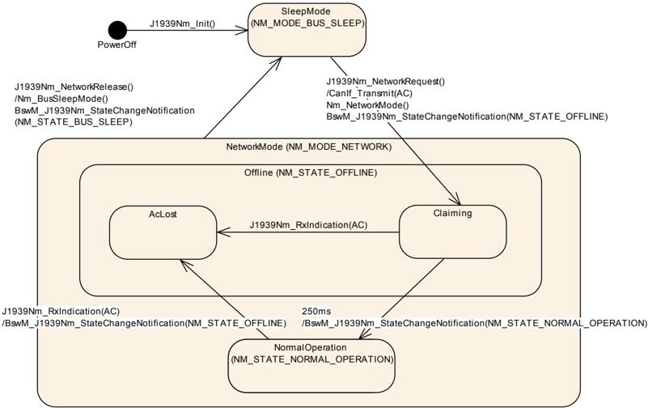
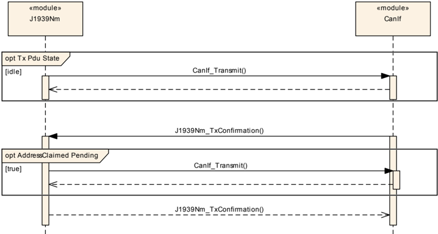
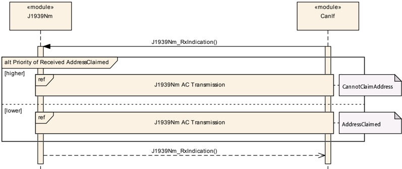
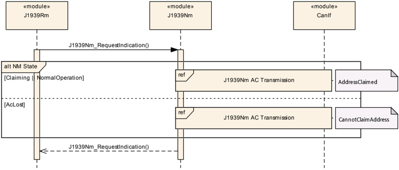
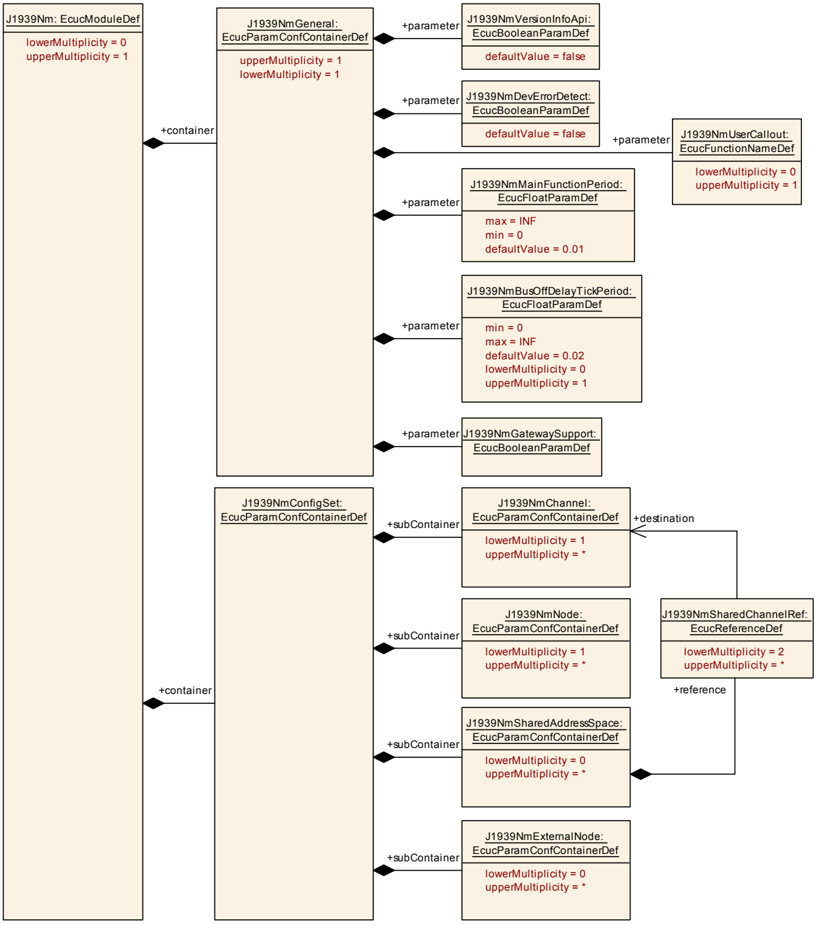
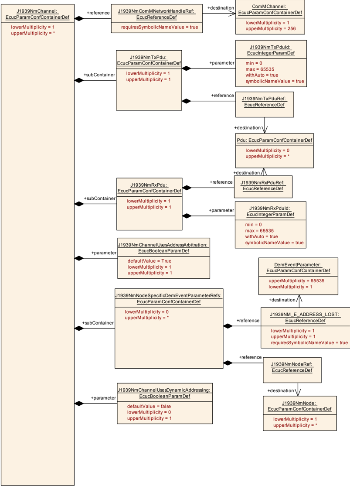
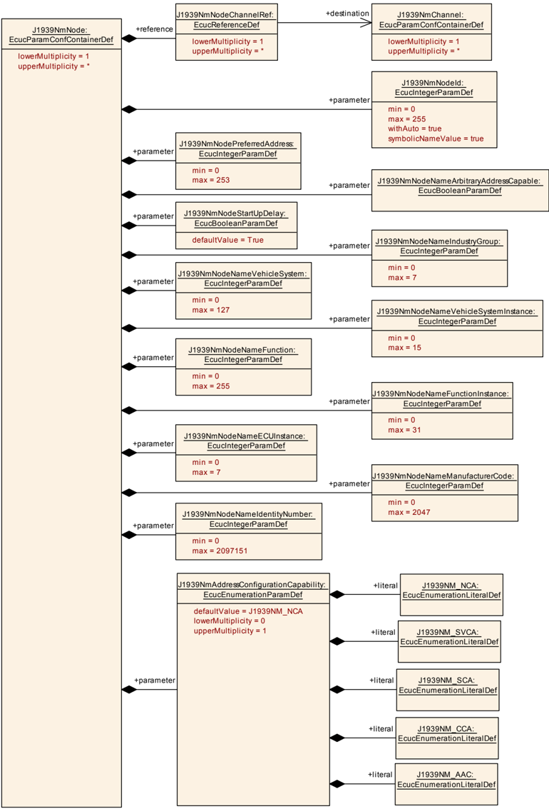
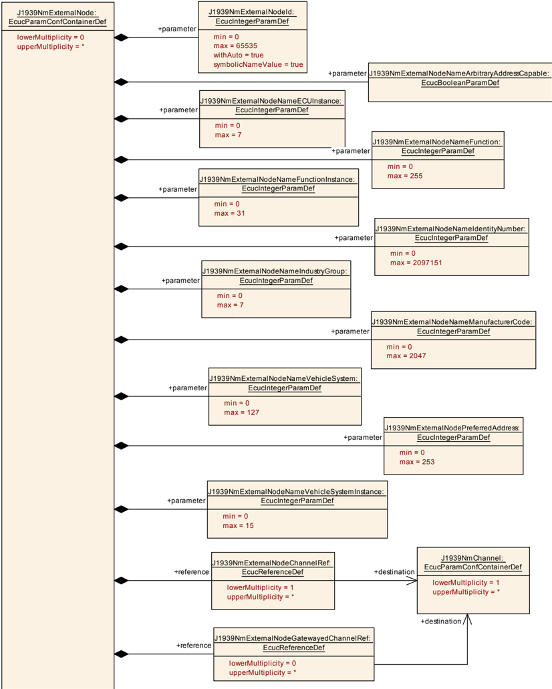

## 1. 简介和功能概述

本规范规定 AUTOSAR 基础软件模块 SAE J1939 网络管理（**SAE J1939 Network Management**，J1939Nm）的功能、**API** 与配置。

### 1.1. 依据 SAE J1939 的网络管理

与其他 AUTOSAR 网络管理方法不同，J1939 网络管理的任务不是处理 **ECU** 的睡眠与唤醒，而是为每个 **ECU** 分配一个唯一的地址。

这是通过在启动时发送地址声明（**AddressClaimed**，**AC**，0x0EE00）参数组（**PG**）来实现的，该参数组宣告所期望的地址。如果另一个 **ECU** 声明了相同的地址、并且具有更高的优先级，则该 **ECU** 必须在发送无法声明地址（**CannotClaimAddress**）参数组（**AC**、源地址为空地址 0xFE）之后进入静默。**AddressClaimed PG** 也必须应请求发送。

### 1.2. J1939 网络管理 BSW 模块

J1939 网络管理模块（**J1939Nm**）处理接收与发送的 **AddressClaimed**（**AC**）**PG**。它支持在启动时、在从另一个节点接收到竞争的 **AC** 之后、以及应请求（由 **J1939** 请求管理器触发）时发送 **AC**。

除此之外，J1939 网络管理模块还确保 **ECU** 在启动期间或地址丢失之后不发送任何消息。

## 2. 缩略语

下表收录与 SAE J1939 网络管理模块相关、且未包含在 [\[1, AUTOSAR Glossary\]](#ref-1) 中的缩略语与缩写。

**AC**
> **J1939** **AddressClaimed PG**（**PGN** = 0x0EE00）；当 **SA** = 0xFE 时为 **CannotClaimAddress**。

**BSW**
> 基础软件（模块）（**Basic Software (module)**）。

**BswM**
> 基础软件模式管理器（**Basic Software Mode Manager**）。

**CanIf**
> **CAN** 接口（**CAN Interface**）。

**CDD**
> 复杂驱动程序：直接与 AUTOSAR **BSW** 接口的任何软件，但未由 AUTOSAR 定义。

**ComM**
> 通信管理器（**Communication Manager**）。

**DA**
> 目标地址（**Destination Address**）。

**DET**
> 默认错误追踪器，支持开发与运行时错误报告（**Default Error Tracer**）。

**DEM**
> 诊断事件管理器，存储诊断事件，包括扩展生产错误（**Diagnostic Event Manager**）。

**DP**
> 数据页（**Data Page**），18 位 **PGN** 的最高有效位（**MSB**）。

**EDP**
> 扩展数据页（**Extended Data Page**），18 位 **PGN** 的第二位（**MSB** 之后）。

**J1939Nm**
> SAE J1939 网络管理（**SAE J1939 Network Management**）。

**J1939Rm**
> SAE J1939 请求管理器（**SAE J1939 Request Manager**）。

**NAME**
> 节点的 64 位 **NAME**。

**Node**
> **J1939** 节点 — 可以连接到多于一个通道。

**NodeChannel**
> 节点与一个通道的连接。

**Nm**
> 网络管理接口（**Network Management Interface**）。

**PDUF**
> **PDU** 格式（**PDU Format**），18 位 **PGN** 的中间字节。

**PDUS**
> **PDU** 特定（**PDU Specific**），18 位 **PGN** 的低位字节。

**PG**
> 参数组（**Parameter Group**）。

**PGN**
> 参数组编号（**Parameter Group Number**）（18 位，包含 **EDP**、**DP**、**PDUF**、**PDUS**）。

**RQST**
> **J1939** 请求 **PG**（**Request PG**）（**PGN** = 0x0EA00）。

**RTE**
> AUTOSAR 运行时环境（**AUTOSAR Runtime Environment**）。

**SA**
> 源地址（**Source Address**）。

**SchM**
> 基础软件调度管理器，**RTE** 的一部分（**Basic Software Schedule Manager**）。

## 3. 相关文档

### 3.1. 输入文件和相关标准与规范

<a id="ref-1"></a>- [1] 术语表 AUTOSAR\_FO\_TR\_Glossary
<a id="ref-2"></a>- [2] 基础软件模块通用规范 AUTOSAR\_CP\_SWS\_BSWGeneral
<a id="ref-3"></a>- [3] SAE J1939-81 Network Management
<a id="ref-4"></a>- [4] 分层软件架构 AUTOSAR\_CP\_EXP\_LayeredSoftwareArchitecture
<a id="ref-5"></a>- [5] CAN 接口规范 AUTOSAR\_CP\_SWS\_CANInterface
<a id="ref-6"></a>- [6] SAE J1939 请求管理器规范 AUTOSAR\_CP\_SWS\_SAEJ1939RequestManager
<a id="ref-7"></a>- [7] 网络管理规范 AUTOSAR\_AP\_SWS\_NetworkManagement
<a id="ref-8"></a>- [8] 基础软件模式管理器规范 AUTOSAR\_CP\_SWS\_BSWModeManager
<a id="ref-9"></a>- [9] 诊断事件管理器规范 AUTOSAR\_CP\_SWS\_DiagnosticEventManager
<a id="ref-10"></a>- [10] 默认错误追踪器规范 AUTOSAR\_CP\_SWS\_DefaultErrorTracer
<a id="ref-11"></a>- [11] 复杂驱动程序设计与集成指南 AUTOSAR\_CP\_EXP\_CDDDesignAndIntegrationGuideline
<a id="ref-12"></a>- [12] ECU 配置规范 AUTOSAR\_CP\_TPS\_ECUConfiguration
<a id="ref-13"></a>- [13] 通信管理器规范 AUTOSAR\_CP\_SWS\_COMManager
<a id="ref-14"></a>- [14] SAE J1939 的 BSW 模块需求 AUTOSAR\_CP\_SRS\_SAEJ1939
<a id="ref-15"></a>- [15] 基础软件模块通用需求 AUTOSAR\_CP\_SRS\_BSWGeneral
<a id="ref-16"></a>- [16] 通信栈类型规范 AUTOSAR\_CP\_SWS\_CommunicationStackTypes
<a id="ref-17"></a>- [17] 标准类型规范 AUTOSAR\_CP\_SWS\_StandardTypes
<a id="ref-18"></a>- [18] 基础软件模块清单 AUTOSAR\_CP\_TR\_BSWModuleList
<a id="ref-19"></a>- [19] RTE 软件规范 AUTOSAR\_CP\_SWS\_RTE
<a id="ref-20"></a>- [20] 系统模板 AUTOSAR\_CP\_TPS\_SystemTemplate

### 3.2. 相关规范

AUTOSAR 提供了一份基础软件模块通用规范 [\[2, SWS BSW General\]](#ref-2)，它同样适用于 SAE J1939 网络管理。

因此，规范 [\[2, SWS BSW General\]](#ref-2) 应被视为 SAE J1939 网络管理的附加且必需的规范。

## 4. 约束和假设

### 4.1. 限制

J1939 网络管理模块不支持 [\[3, SAE J1939-81\]](#ref-3) 中定义的所有特性，特别是：

* 在接收到命令地址（**CommandedAddress**）之后或在地址丢失之后更改节点的地址。
* 使用名称管理（**Name Management**）协议更改节点的 **NAME**。
* 通过 **AddressClaimed** 之外的消息检测地址违规。

### 4.2. 汽车域的适用性

**J1939** 由 **SAE** 开发，作为重型公路车辆、农业与工程车辆的标准。它不适用于乘用车或轻型卡车。

## 5. 对其他模块的依赖

[\[4, EXP Layered Software Architecture\]](#ref-4) 展示了 J1939 网络管理的相邻模块的概览。

J1939 网络管理模块（**J1939Nm**）对 **CAN** 接口（**CanIf**，[\[5, SWS CAN Interface\]](#ref-5)）、**J1939** 请求管理器（**J1939Rm**，[\[6, SWS SAE J1939 Request Manager\]](#ref-6)）、网络管理接口（**Nm**，[\[7, SWS Network Management\]](#ref-7)）、基础软件模式管理器（**BswM**，参见 [\[8, SWS Basic Software Mode Manager\]](#ref-8)）、诊断事件管理器（**DEM**，[\[9, SWS Diagnostic Event Manager\]](#ref-9)）与默认错误追踪器（**DET**，[\[10, SWS Default Error Tracer\]](#ref-10)）具有直接接口和/或配置依赖，对复杂驱动程序（**CDD**，参见 [\[11, CDD Design And Integration Guideline\]](#ref-11) 与 [\[12, TPS ECU Configuration\]](#ref-12)）也是如此。除此之外，还存在对通信管理器（**ComM**，[\[13, SWS Communication Manager\]](#ref-13)）的间接依赖。

J1939 网络管理模块包含 **CAN** 接口、网络管理接口、**J1939** 请求管理器、诊断事件管理器与默认错误追踪器的头文件。

### 5.1. 文件结构

#### 5.1.1. 代码文件结构

有关详细信息，请参阅 [\[2, SWS BSW General\]](#ref-2) 的第 5.1.6 小节"代码文件结构"（Code file structure）。

#### 5.1.2. 头文件结构

有关详细信息，请参阅 [\[2, SWS BSW General\]](#ref-2) 的第 5.1.7 小节"头文件结构"（Header file structure）。

## 6. 功能规格

本章定义 J1939 网络管理模块的行为。该模块的 **API** 在第 [7](#7-api规范) 章中定义，而配置在第 [9](#9-配置规范) 章中定义。

### 6.1. 概览

J1939 网络管理模块支持 **AddressClaimed PG** 的发送与接收，以及对 **AddressClaimed PG** 请求的处理。它还确保 **ECU** 在初始地址声明阶段期间、或在 **ECU** 因竞争的地址声明而失去其地址并发送 **CannotClaimAddress PG** 之后不发送消息。

### 6.2. 模块处理

本节包含 J1939 网络管理模块辅助功能的描述。

#### 6.2.1. 初始化

J1939 网络管理模块经由 J1939Nm\_Init 初始化，并经由 J1939Nm\_DeInit 去初始化。除 J1939Nm\_GetVersionInfo 与 J1939Nm\_Init 之外，J1939 网络管理模块的 **API** 函数只可以在模块已被正确初始化之后调用。

调用 J1939Nm\_Init 会初始化所有内部变量，并将 J1939 网络管理模块置为已初始化状态。

调用 J1939Nm\_DeInit 会将 J1939 网络管理模块置回未初始化状态。

当在已初始化状态下调用 J1939Nm\_Init 时，J1939 网络管理模块不应重新初始化其内部变量。如果通过 J1939NmDevErrorDetect 启用了开发错误检测，它应改为以错误码 J1939NM\_E\_REINIT 调用 Det\_ReportError。

#### 6.2.2. 与时间相关的功能

为了能够测量时间，J1939 网络管理模块经由 J1939Nm\_MainFunction 周期性地触发。

J1939 网络管理模块应将 J1939Nm\_MainFunction 用于与时间相关的目的。

BusOff 之后的恢复必须延迟一段随机时间，以避免当两个节点尝试声明相同地址时重复发生 BusOff。在竞争的地址声明之后或在 **AddressClaimed PG** 的请求之后发送 **CannotClaimAddress PG** 时，也需要该随机延迟。

J1939Nm 应计算一个随机数，用于延迟 BusOff 恢复与 **CannotClaimAddress PG** 的发送。该计算应使用节点的 **NAME** 作为种子。

当调用 J1939Nm\_GetBusOffDelay 时，J1939Nm 应基于连接到所报告通道的所有节点的 **NAME** 返回一个随机数。该随机数给出延迟时间，其依据是通过 J1939NmBusOffDelayTickPeriod 配置的滴答时间。

### 6.3. J1939Nm 的网络管理状态

虽然 **NM** 接口在通道级别处理网络管理状态，但 J1939 网络管理模块需要更细的粒度，因为多个节点可以连接到每个通道。节点与一个通道的连接在下文中称为 NodeChannel。

下图展示了 J1939 网络管理模块针对其一个 NodeChannel（即单个节点的其中一个通道）的内部 **NM** 相关状态，以及这些状态之间的转换：

图 7.1：带启动延迟的 J1939Nm 内部状态（**Internal states of J1939Nm with startup delay**）



J1939 网络管理模块向 **NM** 接口与基础软件模式管理器报告状态改变。

虽然向 **NM** 接口报告的状态是 **CAN** 通道的所有 NodeChannel 的累积状态，但 J1939 网络管理模块针对每个 NodeChannel 分别向 **BswM** 报告状态。

#### 6.3.1. ECU 启动

J1939 网络管理模块以 'SleepMode'（对应于 **NM\_MODE\_BUS\_SLEEP**）启动所有 NodeChannel。随后 **CAN** 通道将立即经由来自 **ComM** 的、通过 **NM** 接口发出的网络请求切换到 'NetworkMode'（对应于 **NM\_MODE\_NETWORK**）。

在经由 J1939Nm\_Init 初始化期间，J1939 网络管理模块应静默地为所有 NodeChannel 采用 'SleepMode'。

对 J1939Nm\_NetworkRequest 的调用应将所报告通道的所有 NodeChannel 置为 'NetworkMode'。J1939 网络管理模块应通过 Nm\_NetworkMode 将该模式改变通知 **NM** 接口，并应为每个启用了 J1939NmChannelUsesAddressArbitration 的 NodeChannel 触发一次 **AddressClaimed PG** 的发送。

**AddressClaimed PG** 的发送在 [6.4](#64-addressclaimed-的发送) 节中详细描述。

当进入网络模式时，J1939 网络管理模块的行为取决于配置参数 J1939NmNodeStartUpDelay。在该参数的控制下，J1939 网络管理模块将受影响的 NodeChannel 的状态切换到状态 'Offline'（对应于 **NM\_STATE\_OFFLINE**）的子状态 'Claiming'，或切换到状态 'NormalOperation'（对应于 **NM\_STATE\_NORMAL\_OPERATION**）。

如果 J1939 网络管理模块的节点被配置为延迟上线状态（启用了 J1939NmNodeStartUpDelay），则其 NodeChannel 应在从 'SleepMode' 切换到 'NetworkMode' 之后立即进入状态 'Offline' 的子状态 'Claiming'。J1939 网络管理模块应通过 BswM\_J1939Nm\_StateChangeNotification（NM\_STATE\_OFFLINE）向基础软件模式管理器报告该状态改变。

如果 J1939 网络管理模块的节点被配置为立即上线状态（禁用了 J1939NmNodeStartUpDelay），则其 NodeChannel 应在从 'SleepMode' 切换到 'NetworkMode' 之后立即进入状态 'NormalOperation'。J1939 网络管理模块应通过 BswM\_J1939Nm\_StateChangeNotification（NM\_STATE\_NORMAL\_OPERATION）向基础软件模式管理器报告该状态改变。

**NM** 接口期望一个累积的通道状态。

当一个通道的所有 NodeChannel 都被配置为延迟上线状态（启用了 J1939NmNodeStartUpDelay）时，J1939 网络管理模块应立即通过 Nm\_StateChangeNotification（NM\_STATE\_OFFLINE）向 **NM** 接口报告这些 NodeChannel 到 'Offline' 状态的状态改变。

当一个通道的第一个 NodeChannel 将其状态改变为 'NormalOperation' 时，J1939 网络管理模块应立即通过 Nm\_StateChangeNotification（NM\_STATE\_NORMAL\_OPERATION）向 **NM** 接口报告该状态改变。

当一个 NodeChannel 在初始 **AddressClaimed PG** 发送之后在状态 'Claiming' 中保持了 250 ms，它将切换到状态 'NormalOperation'。

当 J1939Nm\_TxConfirmation 以结果 **E_OK** 为某个 NodeChannel 的初始 **AddressClaimed PG**（在到 'Claiming' 子状态的转换期间发送）被调用时，J1939 网络管理模块应启动该 NodeChannel 的延迟定时器。

当某个 NodeChannel 的延迟定时器在子状态 'Claiming' 中到期时，J1939 网络管理模块应将该 NodeChannel 切换到状态 'NormalOperation'，并应通过 BswM\_J1939Nm\_StateChangeNotification（NM\_STATE\_NORMAL\_OPERATION）向基础软件模式管理器报告该状态改变。

#### 6.3.2. 地址丢失

当 J1939 网络管理模块的节点在其某个通道上失去其已声明的地址（参见 [6.5](#65-addressclaimed-的接收) 节）时，它将该 NodeChannel 切换到状态 'Offline' 的子状态 'AcLost'，向 **NM** 接口与 **BswM** 通知该状态改变，并在该通道上为失去地址的节点发送一条 **CannotClaimAddress PG**（参见 [6.4](#64-addressclaimed-的发送) 节）。

当某个 NodeChannel 在 'NetworkMode' 中失去其地址时，它应切换到状态 'Offline' 的子状态 'AcLost'，并在根据上述随机延迟计算出的延迟之后，触发一次 **CannotClaimAddress PG** 的发送。

当某个 NodeChannel 从状态 'NormalOperation' 切换到状态 'Offline' 的子状态 'AcLost' 时，J1939 网络管理模块应通过 BswM\_J1939Nm\_StateChangeNotification（NM\_STATE\_OFFLINE）通知基础软件模式管理器。

当一个通道的最后一个 NodeChannel 将其状态改变为 'Offline' 时，J1939 网络管理模块应立即通过 Nm\_StateChangeNotification（NM\_STATE\_OFFLINE）向 **NM** 接口报告该状态改变。

#### 6.3.3. ECU 关闭

为了关闭网络，**ComM** 调用 **NM** 接口的 Nm\_NetworkRelease **API**，该接口又调用 J1939Nm\_NetworkRelease。随后 J1939 网络管理模块将切换到 'SleepMode'，并将此通知 **NM** 接口。

对 J1939Nm\_NetworkRelease 的调用应将所报告通道的所有 NodeChannel 置为 'SleepMode'。J1939 网络管理模块应通过 Nm\_BusSleepMode 将该模式改变通知 **NM** 接口，并应通过 Nm\_StateChangeNotification（NM\_STATE\_BUS\_SLEEP）向 **NM** 接口、以及通过 BswM\_J1939Nm\_StateChangeNotification（NM\_STATE\_BUS\_SLEEP）向 **BswM** 报告到 'SleepMode' 的状态改变。

### 6.4. AddressClaimed 的发送

对于每个 NodeChannel，J1939 网络管理模块需要确保竞争的 **AddressClaimed PG** 或对 **AddressClaimed** 的请求由至少一个 **AddressClaimed PG** 应答。如果该 NodeChannel 的某个 **AddressClaimed PG** 仍在等待发送，但现在必须发送 **CannotClaimAddress PG**，则只发送 **CannotClaimAddress** 即可。因此，每个 NodeChannel 一个缓冲区、仅存储最后一次发送请求就足够了。

对于 **AddressClaimed** 与 **CannotClaimAddress PG** 两者的发送，J1939 网络管理模块每个通道只使用一个 **PDU**，其可变源地址包含在该 **PDU** 的元数据中。

当 J1939 网络管理模块需要发送一个 **AddressClaimed**（或 **CannotClaimAddress**）**PG**、且没有先前的发送正在等待时，它应经由 CanIf\_Transmit 直接将相应的 **PDU** 转发给 **CAN** 接口。

J1939 网络管理模块应使用类型为 CAN\_ID\_32 的元数据项来提供所发送的 **AddressClaimed** 与 **CannotClaimAddress PG** 的源地址。源地址位于元数据项的最后一个（最低有效）字节中。

当 J1939 网络管理模块需要发送一个 **AddressClaimed**（或 **CannotClaimAddress**）**PG**、且 **CAN** 接口尚未为上一次传输调用 J1939Nm\_TxConfirmation 时，J1939 网络管理模块应缓冲该 **PG** 以供稍后发送。

除初始 **AddressClaimed PG** 之外，J1939 网络管理模块应只缓冲最新的 **AddressClaimed** 或 **CannotClaimAddress PG**。

基本原理：根据 [\[3, SAE J1939-81\]](#ref-3)，初始 **AddressClaimed PG** 必须在任何 **CannotClaimAddress PG** 之前发送。否则，即使原始请求先于状态改变，J1939 网络管理模块也应报告当前状态。

以结果 **E_OK** 对 J1939Nm\_TxConfirmation 的调用应触发经由 CanIf\_Transmit 发送一个已缓冲的 **AddressClaimed** 或 **CannotClaimAddress PG**。

当 CanIf\_Transmit 以 **E_NOT_OK** 返回、或当 J1939Nm\_TxConfirmation 以结果 **E_NOT_OK** 被调用时，应再次触发该 **PG** 的发送。

### 6.5. AddressClaimed 的接收

接收到的 **AddressClaimed PG** 的源地址必须立即与连接到同一通道的所有 NodeChannel 的源地址（参见 J1939NmNodePreferredAddress）进行比较。如果其中任何一个匹配，则接收到的 **PG** 的载荷必须与针对该匹配源地址配置的 **NAME**（参见 J1939NmNodeNameXxx）进行比较，并且根据相对优先级，J1939 网络管理模块必须发送一个 **AddressClaimed** 或 **CannotClaimAddress PG**。优先级由 **NAME** 的数值决定。

为了能够识别源地址，与 **AddressClaimed PG** 关联的 **PDU** 应具有包含在该 **PDU** 元数据中的可变源地址。此外，该 **PDU** 的优先级需要被忽略。

J1939 网络管理模块应使用类型为 CAN\_ID\_32 的元数据项来确定接收到的 **AddressClaimed** 与 **CannotClaimAddress PG** 的源地址。源地址位于元数据项的最后一个（最低有效）字节中。

如果启用了 J1939NmChannelUsesAddressArbitration，则对 J1939Nm\_RxIndication 的调用指示接收到一个 **AddressClaimed PG**、其源地址为通过 J1939NmNodePreferredAddress 配置的源地址之一、且其载荷的数值大于通过 J1939NmNodeNameXxx 为该源地址配置的 **NAME** 的数值，这应触发相应 NodeChannel 的一次 **AddressClaimed PG** 发送。

另见 [6.4](#64-addressclaimed-的发送) 节。

如果启用了 J1939NmChannelUsesAddressArbitration，则对 J1939Nm\_RxIndication 的调用指示接收到一个 **AddressClaimed PG**、其源地址为通过 J1939NmNodePreferredAddress 配置的源地址之一、且其载荷的数值小于通过 J1939NmNodeNameXxx 为该源地址配置的 **NAME** 的数值，这应促使相应 NodeChannel 发生到状态 'Offline' 的子状态 'AcLost' 的状态改变。

到 'Offline' 的状态改变将通知给 **NM** 接口与基础软件模式管理器，并将触发一次 **CannotClaimAddress PG** 的发送（参见 [6.4](#64-addressclaimed-的发送) 节）。

有时，应用需要知道总线上所有 **AddressClaimed** 消息的内容，例如为了建立一个将功能映射到地址的表。J1939 网络管理模块应通过一个通用 callout 函数支持该用例（参见 [6.5](#65-addressclaimed-的接收) 节）。

如果通过 J1939NmUserCallout 启用，则 J1939Nm 应将每个 **AddressClaimed PG** 的源地址与内容转发给 callout 函数 &lt;User\_AddressClaimedIndication&gt;（参见 SWS\_J1939Nm\_00028）。

### 6.6. 对 AddressClaimed 的请求

当 J1939 网络管理模块从 **J1939** 请求管理器接收到对 **AddressClaimed PGN** 的请求时，它将根据当前状态用一个 **AddressClaimed** 或 **CannotClaimAddress PG** 应答（参见下文）。

无论请求是全局的还是特定的，所发送的 **PG** 始终是全局的。

对 J1939Nm\_RequestIndication 的调用应在被寻址的 NodeChannel 处于状态 'NormalOperation' 或状态 'Offline' 的子状态 'Claiming' 时触发一次 **AddressClaimed PG** 的发送。

对 J1939Nm\_RequestIndication 的调用应在被寻址的 NodeChannel 处于状态 'Offline' 的子状态 'AcLost' 时、在根据上述随机延迟计算出的延迟之后触发一次 **CannotClaimAddress PG** 的发送。

J1939Nm\_RequestIndication 永远不会在状态 'SleepMode' 中被触发，因为此时无法接收 **CAN** 消息。

### 6.7. 地址协调

J1939 网络管理模块能够协调连接到网关的不同 **J1939** 通道的地址，使被路由的消息在它们出现的每条总线上都具有有效的地址。

有两种基本策略：

1. 多个 **J1939** 通道构成一个公共地址空间。在该场景中，J1939 网络管理模块将在其中一个网络上出现的所有 **AddressClaimed** 消息复制到同一地址空间的所有其他网络上。经由网关连接的节点执行直接的地址仲裁。
2. 一个通道的选定节点也出现在一个或多个其他通道上。在该场景中，J1939 网络管理模块声明所配置的外部节点（**external node**）的地址。地址仲裁在网关与一个通道上的节点之间执行。

单个网关可以为不同的通道集合组合这两种策略。两种策略的主要区别在于，第二种策略中地址不共享，因此一个系统内可以存在多于 254 个节点。

如果通过 J1939NmGatewaySupport 启用了网关支持、且配置包含一个 [J1939NmSharedAddressSpace](#914-j1939nmsharedaddressspace)，则 J1939Nm 应将在 [J1939NmSharedAddressSpace](#914-j1939nmsharedaddressspace) 所引用的其中一个通道上接收到的所有 **AddressClaimed** 消息，发送到同一 [J1939NmSharedAddressSpace](#914-j1939nmsharedaddressspace) 所引用的所有其他通道上。

如果通过 J1939NmGatewaySupport 启用了网关支持、且配置包含一个 [J1939NmExternalNode](#9110-j1939nmexternalnode)，则 J1939NmExternalNodeGatewayedChannelRef 所引用的通道应被视为内部的 NodeChannel，其区别在于：从 'SleepMode' 到 'NetworkMode' 的转换由来自外部节点的 **AddressClaimed** 消息的接收触发并立即进入 'NormalOperation'，而到 'SleepMode' 的转换由来自同一节点的 **CannotClaimAddress** 消息的接收触发。

### 6.8. 错误分类

[\[2, SWS BSW General\]](#ref-2) 的第 [7.2](#72-导入的类型) 节"错误处理"（Error Handling）详细描述了基础软件的错误处理。其中最重要的是，它构成了一个由 **BSW** 模块中可能出现的五种错误类型组成的分类方案。

基于该基础，本节在相应的小节中规定特定的错误。

#### 6.8.1. 开发错误

表6.1：J1939Nm 模块中开发错误的定义

| 错误类型 | 相关错误码 | 错误值 |
| --- | --- | --- |
| 在模块未初始化时调用了某个 **API** | J1939NM\_E\_UNINIT | 0x01 |
| Init **API** 被调用了两次 | J1939NM\_E\_REINIT | 0x02 |
| 以无效的配置指针调用了 J1939Nm\_Init | J1939NM\_E\_INIT\_FAILED | 0x03 |
| 以 **NULL** 指针调用了某个 **API** 服务 | J1939NM\_E\_PARAM\_POINTER | 0x10 |
| 以错误的 **ID** 调用了某个 **API** 服务 | J1939NM\_E\_INVALID\_PDU\_SDU\_ID | 0x11 |
| 以错误的网络句柄调用了某个 **API** 服务 | J1939NM\_E\_INVALID\_NETWORK\_ID | 0x12 |
| 以不受支持的 **PGN** 调用了某个 **API** | J1939NM\_E\_INVALID\_PGN | 0x13 |
| 以非法的优先级调用了某个 **API** | J1939NM\_E\_INVALID\_PRIO | 0x14 |
| 以非法的节点地址调用了某个 **API** | J1939NM\_E\_INVALID\_ADDRESS | 0x15 |
| 以非法的节点 **ID** 调用了某个 **API** | J1939NM\_E\_INVALID\_NODE | 0x16 |

#### 6.8.2. 运行时错误

运行时错误尚未分类。

#### 6.8.3. 瞬态故障

不存在瞬态故障。

#### 6.8.4. 生产错误

不存在生产错误。

#### 6.8.5. 扩展生产错误

扩展生产错误作为诊断事件管理器（**Diagnostic Event Manager**）的事件处理。事件 **ID** 在下表中定义，而实际值由诊断事件管理器的配置在外部分配，并经由 **Dem.h** 包含在 J1939 网络管理模块中。

表6.2：扩展生产错误 J1939NM\_E\_ADDRESS\_LOST 的定义

| 错误名称 | J1939NM\_E\_ADDRESS\_LOST |
| --- | --- |
| 简要描述 | 无法声明所期望的地址。 |
| 详细描述 | 在 **ECU** 启动期间，所有 J1939Nm 节点都需要向总线发送一次地址声明，并等待所声明地址被接受。如果另一个 **ECU** 声明了相同的地址并具有更高的优先级，则该 **ECU** 失去其地址并停止通信。这是一个关键问题，因为 J1939Nm 并非为可能发生这种情况的网络而规定。 |
| 检测准则 | Fail：当地址声明失败时（因为接收到了具有更高优先级的 **AddressClaimed** 消息），J1939 网络管理模块应以事件状态 DEM\_EVENT\_STATUS\_PREFAILED 向 **DEM** 报告扩展生产错误 J1939NM\_E\_ADDRESS\_LOST。Pass：当地址声明成功时（J1939 网络管理进入了状态 'NormalOperation'），J1939 网络管理模块应以事件状态 DEM\_EVENT\_STATUS\_PREPASSED 向 **DEM** 报告扩展生产错误 J1939NM\_E\_ADDRESS\_LOST。 |
| 次要参数 | 当节点进入某个通道的 NetworkMode 时，地址声明开始。 |
| 所需时间 | 通常在切换到 NetworkMode 之后 250 ms；但当地址可以在运行时改变、或 **ECU** 稍后连接（或稍后唤醒）时，也可能在整个运行时间内发生。 |
| 监控频率 | 总线被持续监控 **AddressClaimed** 消息。 |

## 7. API规范

### 7.1. API 参数检查

J1939 网络管理模块对所有被调用的 **API** 执行参数检查。当某个 **PDU/SDU ID** 的检查失败时，它报告开发错误 J1939NM\_E\_INVALID\_PDU\_SDU\_ID；当某个网络句柄的检查失败时，报告 J1939NM\_E\_INVALID\_NETWORK\_ID；当某次调用提供 **NULL** 指针时，报告 J1939NM\_E\_PARAM\_POINTER。

如果通过 J1939NmDevErrorDetect 启用了开发错误检测，则 J1939 网络管理模块应将其 **API** 函数的 PduIdType 参数（**SDU/PDU ID**）与所配置的 **ID** 进行核对，并应在调用提供了未知 **ID** 时报告开发错误 J1939NM\_E\_INVALID\_PDU\_SDU\_ID。

如果通过 J1939NmDevErrorDetect 启用了开发错误检测，则 J1939 网络管理模块应将其 **API** 函数的 NetworkHandleType 参数（网络句柄）与所引用的 **ComM** 网络句柄进行核对，并应在调用提供了未知句柄时报告开发错误 J1939NM\_E\_INVALID\_NETWORK\_ID。

J1939NM\_E\_PARAM\_POINTER 应按 [\[2, SWS BSW General\]](#ref-2) 中 [SWS\_BSW\_00212] 的规定报告。

### 7.2. 导入的类型

在本节中，J1939 网络管理模块使用的所有类型与其定义模块一并列出。

表7.1：J1939Nm 模块导入数据类型的定义

| 模块 | 头文件 | 导入的类型 |
| --- | --- | --- |
| ComStack\_Types | ComStack\_Types.h | NetworkHandleType |
| ComStack\_Types | ComStack\_Types.h | PduIdType |
| ComStack\_Types | ComStack\_Types.h | PduInfoType |
| ComStack\_Types | ComStack\_Types.h | PduLengthType |
| Dem | Rte\_Dem\_Type.h | Dem\_EventIdType |
| Dem | Rte\_Dem\_Type.h | Dem\_EventStatusType |
| J1939Rm | Rte\_J1939Rm\_Type.h | J1939Rm\_ExtIdInfoType |
| J1939Rm | Rte\_J1939Rm\_Type.h | J1939Rm\_ExtIdType |
| Nm | NmStack\_types.h | Nm\_ModeType |
| Nm | NmStack\_types.h | Nm\_StateType |
| Std | Std\_Types.h | Std\_ReturnType |
| Std | Std\_Types.h | Std\_VersionInfoType |

在 ComStack\_Types.h 中声明的类型定义于 [\[16, SWS Communication Stack Types\]](#ref-16)，而在 Std\_Types.h 中声明的类型定义于 [\[17, SWS Standard Types\]](#ref-17)。

### 7.3. 类型定义

#### 7.3.1. J1939Nm_ConfigType

| 名称 | J1939Nm_ConfigType |
| --- | --- |
| 类别 | 结构体（Structure） |
| 元素 | 实现特定 |
| 描述 | 这是 J1939 网络管理模块配置的基础类型。该结构体实例的指针将用于 J1939 网络管理模块的初始化。该结构体的内容定义于第 [9](#9-配置规范) 章"配置规范"。 |
| 可通过 | J1939Nm.h 获得 |

### 7.4. 函数定义

这是提供给上层模块的函数列表。

#### 7.4.1. J1939Nm_Init

**说明**： 本函数初始化 J1939 网络管理模块。服务 ID 0x01。本服务为同步调用，不可重入。参数 configPtr（in）：指向所选配置结构体的指针。无返回值。可通过 **J1939Nm.h** 获得。

```C
void J1939Nm_Init ( const J1939Nm_ConfigType* configPtr )
```

详细内容参见第 [6.2.1](#621-初始化) 节。

参数检查参见 [7.1](#71-api-参数检查) 节。

J1939NM\_E\_INIT\_FAILED 应按 [\[2, SWS BSW General\]](#ref-2) 中 [SWS\_BSW\_00050] 的规定报告。

#### 7.4.2. J1939Nm_DeInit

**说明**： 本函数将 J1939 网络管理模块复位到未初始化状态。服务 ID 0x02。本服务为同步调用，不可重入。无参数。无返回值。可通过 **J1939Nm.h** 获得。

```C
void J1939Nm_DeInit ( void )
```

详细内容参见第 [6.2.1](#621-初始化) 节。

#### 7.4.3. J1939Nm_GetVersionInfo

**说明**： 返回本模块的版本信息。服务 ID 0x03。本服务为同步调用，不可重入。参数 versionInfo（out）：指向存储本模块版本信息的位置的指针。无返回值。可通过 **J1939Nm.h** 获得。

```C
void J1939Nm_GetVersionInfo ( Std_VersionInfoType* versionInfo )
```

详细内容参见 [\[2, SWS BSW General\]](#ref-2) 的第 8.3.4 小节"Get Version Information"。J1939 网络管理的模块 **ID** 定义于 [\[18, TR BSW Module List\]](#ref-18)。

参数检查参见 [7.1](#71-api-参数检查) 节。

#### 7.4.4. J1939Nm_NetworkRequest

**说明**： 请求网络，因为 **ECU** 需要在总线上通信。服务 ID 0x05。本服务为同步调用，可重入（但同一个 NM 通道除外）。参数 nmChannelHandle（in）：NM 通道的标识。返回值：Std_ReturnType，**E_OK**：无错误；**E_NOT_OK**：网络请求失败。可通过 **J1939Nm.h** 获得。

```C
Std_ReturnType J1939Nm_NetworkRequest ( NetworkHandleType nmChannelHandle )
```

详细内容参见第 [6.3.1](#631-ecu-启动) 节。

错误处理参见第 [6.2.1](#621-初始化) 节，参数检查参见 [7.1](#71-api-参数检查) 节。

#### 7.4.5. J1939Nm_NetworkRelease

**说明**： 释放网络，因为 **ECU** 不需要在总线上通信。服务 ID 0x06。本服务为异步调用，可重入（但同一个 NM 通道除外）。参数 nmChannelHandle（in）：NM 通道的标识。返回值：Std_ReturnType，**E_OK**：无错误；**E_NOT_OK**：网络释放失败。可通过 **J1939Nm.h** 获得。

```C
Std_ReturnType J1939Nm_NetworkRelease ( NetworkHandleType nmChannelHandle )
```

详细内容参见第 [6.3.3](#633-ecu-关闭) 节。

错误处理参见第 [6.2.1](#621-初始化) 节，参数检查参见 [7.1](#71-api-参数检查) 节。

#### 7.4.6. J1939Nm_GetState

**说明**： 返回网络管理的状态与模式。服务 ID 0x0d。本服务为同步调用，可重入。参数 NetworkHandle（in）：NM 通道的标识；nmStatePtr（out）：网络管理状态应复制到的指针；nmModePtr（out）：网络管理模式应复制到的指针。返回值：Std_ReturnType，**E_OK**：无错误；**E_NOT_OK**：获取 NM 状态失败。可通过 **J1939Nm.h** 获得。

```C
Std_ReturnType J1939Nm_GetState ( NetworkHandleType NetworkHandle, Nm_StateType* nmStatePtr, Nm_ModeType* nmModePtr )
```

错误处理参见第 [6.2.1](#621-初始化) 节，参数检查参见 [7.1](#71-api-参数检查) 节。

#### 7.4.7. J1939Nm_GetBusOffDelay

**说明**： 该 callout 函数返回在发生 BusOff 之后、在 L1/L2 之外额外等待的 CanSM 基本周期数。服务 ID 0x10。本服务为同步调用，对于不同网络可重入。参数 network（in）：发生 BusOff 的 **CAN** 网络；delayCyclesPtr（out）：在发生 BusOff 之后、在 L1/L2 之外额外等待的 CanSM 基本周期数。无返回值。可通过 **J1939Nm.h** 获得。

```C
void J1939Nm_GetBusOffDelay ( NetworkHandleType network, uint8* delayCyclesPtr )
```

错误处理参见第 [6.2.1](#621-初始化) 节，参数检查参见 [7.1](#71-api-参数检查) 节。

#### 7.4.8. J1939Nm_PassiveStartUp

**说明**： **NM** 的被动启动。它触发从总线睡眠模式到网络模式的转换，而不请求网络。服务 ID 0x0f。本服务为同步调用，可重入（但同一个 NM 通道除外）。参数 nmChannelHandle（in）：NM 通道的标识。返回值：Std_ReturnType，**E_OK**：无错误；**E_NOT_OK**：网络管理的被动启动失败。可通过 **J1939Nm.h** 获得。

```C
Std_ReturnType J1939Nm_PassiveStartUp ( NetworkHandleType nmChannelHandle )
```

该 **API** 只是用于满足 **NM** 接口链接的占位函数。它应始终返回 **E_NOT_OK**。

错误处理参见第 [6.2.1](#621-初始化) 节，参数检查参见 [7.1](#71-api-参数检查) 节。

### 7.5. 回调通知

这是提供给其他模块的函数列表。

#### 7.5.1. J1939Nm_RxIndication

**说明**： 来自下层通信接口模块的已接收 **PDU** 指示。服务 ID 0x42。本服务为同步调用，对于不同 PduId 可重入，对同一 PduId 不可重入。参数 RxPduId（in）：所接收 **PDU** 的 **ID**；PduInfoPtr（in）：包含所接收 **PDU** 的长度（SduLength）、指向包含该 **PDU** 的缓冲区（SduDataPtr）的指针，以及与该 **PDU** 相关的元数据。无返回值。可通过 **J1939Nm.h** 获得。

```C
void J1939Nm_RxIndication ( PduIdType RxPduId, const PduInfoType* PduInfoPtr )
```

详细内容参见 [6.5](#65-addressclaimed-的接收) 节。

错误处理参见第 [6.2.1](#621-初始化) 节，参数检查参见 [7.1](#71-api-参数检查) 节。

#### 7.5.2. J1939Nm_TxConfirmation

**说明**： 下层通信接口模块确认一个 **PDU** 的传输，或 **PDU** 传输的失败。服务 ID 0x40。本服务为同步调用，对于不同 PduId 可重入，对同一 PduId 不可重入。参数 TxPduId（in）：已被传输的 **PDU** 的 **ID**；result（in）：**E_OK**：该 **PDU** 已被传输；**E_NOT_OK**：该 **PDU** 的传输失败。无返回值。可通过 **J1939Nm.h** 获得。

```C
void J1939Nm_TxConfirmation ( PduIdType TxPduId, Std_ReturnType result )
```

详细内容参见 [6.4](#64-addressclaimed-的发送) 节。

错误处理参见第 [6.2.1](#621-初始化) 节，参数检查参见 [7.1](#71-api-参数检查) 节。

#### 7.5.3. J1939Nm_RequestIndication

**说明**： 指示接收到一个 Request 或 Request2 **PG**。服务 ID 0x47。本服务为同步调用，可重入。参数 node（in）：接收到该请求的节点；channel（in）：接收到该请求的通道；requestedPgn（in）：被请求 **PG** 的 **PGN**；extIdInfo（in）：扩展标识符字节；sourceAddress（in）：发送该 Request **PG** 的节点的地址；destAddress（in）：本节点的地址，广播时为 0xFF；priority（in）：该 Request **PG** 的优先级。无返回值。可通过 **J1939Nm.h** 获得。

```C
void J1939Nm_RequestIndication ( uint8 node, NetworkHandleType channel, uint32 requestedPgn, const J1939Rm_ExtIdInfoType* extIdInfo, uint8 sourceAddress, uint8 destAddress, uint8 priority )
```

详细内容参见 [6.6](#66-对-addressclaimed-的请求) 节。

当 sourceAddress 或 priority 不在有效范围内、或 node 不是所配置的节点 **ID** 之一（参见 J1939NmNodeId）、或 requestedPgn 不是 **AC** 的 **PGN**、或 destAddress 不是 0xFF 也不是所报告节点的地址时，J1939 网络管理模块应忽略对 J1939Nm\_RequestIndication 的调用。如果通过 J1939NmDevErrorDetect 启用了开发错误检测，则 J1939 网络管理模块应报告相应的开发错误：node 对应 J1939NM\_E\_INVALID\_NODE，requestedPgn 对应 J1939NM\_E\_INVALID\_PGN，sourceAddress 或 destAddress 对应 J1939NM\_E\_INVALID\_ADDRESS，priority 对应 J1939NM\_E\_INVALID\_PRIO。

进一步的错误处理参见第 [6.2.1](#621-初始化) 节，进一步的参数检查参见 [7.1](#71-api-参数检查) 节。

### 7.6. 调度函数

该函数由基础软件调度器（**SchM**，参见 [\[19, SWS RTE\]](#ref-19)）直接调用。

#### 7.6.1. J1939Nm_MainFunction

**说明**： J1939 网络管理模块的 main 函数。用于调度目的与超时监督。服务 ID 0x04。可通过 **SchM\_J1939Nm.h** 获得。

```C
void J1939Nm_MainFunction ( void )
```

J1939Nm\_MainFunction 的调用频率由配置参数 J1939NmMainFunctionPeriod 决定。

### 7.7. 期望接口

在本节中列出从其他模块要求的所有接口。

#### 7.7.1. 强制接口

本小节定义实现模块核心功能所需的全部接口。

表7.2：J1939Nm 模块中强制接口的定义

| API 函数 | 头文件 | 描述 |
| --- | --- | --- |
| BswM\_J1939Nm\_StateChangeNotification | BswM\_J1939Nm.h | 状态改变之后对当前 J1939Nm 状态的通知。 |
| CanIf\_Transmit | CanIf.h | 请求发送一个 **PDU**。 |
| Dem\_SetEventStatus | Dem.h | 由 **SWC** 或 **BSW** 模块调用，以向 **Dem** 报告监控状态信息。调用 Dem\_SetEventStatus 的 **BSW** 模块可以安全地忽略返回值。仅当 {Dem/DemConfigSet/DemEventParameter/DemEventReportingType} == STANDARD\_REPORTING 时该 **API** 才可用。 |
| Nm\_BusSleepMode | Nm.h | 网络管理已进入总线睡眠模式的通知。 |
| Nm\_NetworkMode | Nm.h | 网络管理已进入网络模式的通知。 |
| Nm\_StateChangeNotification | Nm.h | 下层 &lt;Bus&gt;Nm 的状态已改变的通知。 |

#### 7.7.2. 可选接口

本小节定义实现模块可选功能所需的全部接口。

表7.3：J1939Nm 模块中可选接口的定义

| API 函数 | 头文件 | 描述 |
| --- | --- | --- |
| Det\_ReportError | Det.h | 报告开发错误的服务。 |

#### 7.7.3. 可配置接口

本小节列出目标函数可以配置的所有接口。目标函数通常是回调函数。这类接口的名称不是固定的，因为它们是可配置的。

##### 7.7.3.1. &lt;User_AddressClaimedIndication&gt;

**说明**： 提供接收到的 **AddressClaimed**（**AC**）**PG** 的内容。服务 ID 0x20。本服务为同步调用，可重入。参数 channel（in）：接收到该 **AC** 的通道；sourceAddress（in）：发送该 **AC** 的节点的地址，或 **NULL** 地址（0xFE）；name（in）：指向包含 64 位 **NAME** 的字节数组的指针。无返回值。可通过 **J1939Nm\_Externals.h** 获得。

```C
void <User_AddressClaimedIndication> ( NetworkHandleType channel, uint8 sourceAddress, const uint8* name )
```

&lt;User\_AddressClaimedIndication&gt; 函数只有在配置了 J1939NmUserCallout 时才可用。详细内容参见 [6.5](#65-addressclaimed-的接收) 节。

## 8. 时序图

以下时序图旨在给出 J1939 网络管理模块应有的行为方式及与其他 **BSW** 模块互操作方式的印象。它们不完整，并且对实现没有约束力。

### 8.1. AddressClaimed 的发送

下图展示了发送 **AddressClaimed** 时与 **CanIf** 的交互。

图 9.1：AddressClaimed PG 的发送（**Transmission of AddressClaimed PG**）



### 8.2. AddressClaimed 的接收

下图展示了接收 **AddressClaimed** 时与 **CanIf** 的交互。

图 9.2：AddressClaimed PG 的接收（**Reception of AddressClaimed PG**）



### 8.3. 对 AddressClaimed 的请求

下图展示了处理对 **AddressClaimed** 的请求时与 **J1939Rm** 及 **CanIf** 的交互。

图 9.3：对 AddressClaimed PG 的请求（**Request for the AddressClaimed PG**）



## 9. 配置规范

一般来说，本章定义配置参数及其到容器中的聚类。有关容器与参数定义的一般信息，请参阅 [\[2, SWS BSW General\]](#ref-2) 中第 10.1 节"配置规范简介"（Introduction to configuration specification）。有关 J1939 网络管理模块发布信息的详细信息，请参阅 [\[2, SWS BSW General\]](#ref-2) 中第 10.3 节"发布信息"（Published Information）。

第 10.1 节规定 J1939 网络管理模块的结构（容器）与参数。

第 10.2 节给出如何配置 **NM** 接口以支持 J1939Nm 的提示。

### 9.1. 容器与配置参数

以下小节汇总 J1939 网络管理的所有配置参数。各参数的详细含义在第 6 章与第 7 章中描述。

这些容器与参数中的一部分派生自 [\[20, TPS System Template\]](#ref-20) 的类与属性，该文档也包含这些派生的规则。

下图展示了可用于 J1939Nm 的配置参数的概览：

图 10.1：配置容器 J1939Nm（**Configuration container J1939Nm**）



图 10.2：配置容器 J1939NmChannel（**Configuration container J1939NmChannel**）



图 10.3：配置容器 J1939NmNode（**Configuration container J1939NmNode**）



图 10.4：配置容器 J1939NmExternalNode（**Configuration container J1939NmExternalNode**）



#### 9.1.1. J1939Nm

| SWS 条目 | [ECUC\_J1939Nm\_00028] |
| --- | --- |
| 模块名称 | J1939Nm |
| 描述 | J1939 网络管理模块的配置。 |
| Post-Build 变体支持 | true |
| 支持的配置变体 | VARIANT-LINK-TIME、VARIANT-POST-BUILD、VARIANT-PRE-COMPILE |

| 容器名称 | 多重性 | 作用域/依赖 |
| --- | --- | --- |
| J1939NmConfigSet | 1 | 该容器包含 AUTOSAR J1939Nm 模块的配置参数与子容器。 |
| J1939NmGeneral | 1 | 包含该模块的通用配置参数。 |

#### 9.1.2. J1939NmGeneral

| SWS 条目 | [ECUC\_J1939Nm\_00001] |
| --- | --- |
| 容器名称 | J1939NmGeneral |
| 父容器 | J1939Nm |
| 描述 | 包含该模块的通用配置参数。 |
| 配置参数 | 见下方参数表 |

| SWS 条目 | [ECUC\_J1939Nm\_00034] |
| --- | --- |
| 参数名称 | J1939NmBusOffDelayTickPeriod |
| 父容器 | J1939NmGeneral |
| 描述 | 用于在冲突的地址声明之后为 BusOff 延迟计时的滴答的时长。该参数必须与 **CAN** 状态管理器的 main 函数周期同步。 |
| 多重性 | 0..1 |
| 类型 | EcucFloatParamDef |
| 范围 | ]0 .. INF[ |
| 默认值 | 0.02 |
| Post-Build 变体多重性 | false |
| Post-Build 变体值 | false |
| 多重性配置类 | Pre-compile time：x（VARIANT-PRE-COMPILE）；Link time：x（VARIANT-LINK-TIME、VARIANT-POST-BUILD）；Post-build time：- |
| 值配置类 | Pre-compile time：x（VARIANT-PRE-COMPILE）；Link time：x（VARIANT-LINK-TIME、VARIANT-POST-BUILD）；Post-build time：- |
| 作用域/依赖 | scope: local |

| SWS 条目 | [ECUC\_J1939Nm\_00003] |
| --- | --- |
| 参数名称 | J1939NmDevErrorDetect |
| 父容器 | J1939NmGeneral |
| 描述 | 打开或关闭开发错误检测与通知。* **true**：启用检测与通知。* **false**：禁用检测与通知。 |
| 多重性 | 1 |
| 类型 | EcucBooleanParamDef |
| 默认值 | false |
| Post-Build 变体值 | false |
| 值配置类 | Pre-compile time：x（All Variants）；Link time：-；Post-build time：- |
| 作用域/依赖 | scope: local |

| SWS 条目 | [ECUC\_J1939Nm\_00036] |
| --- | --- |
| 参数名称 | J1939NmGatewaySupport |
| 父容器 | J1939NmGeneral |
| 描述 | 启用/禁用对被路由消息的地址声明的支持。 |
| 多重性 | 1 |
| 类型 | EcucBooleanParamDef |
| 默认值 | - |
| Post-Build 变体值 | false |
| 值配置类 | Pre-compile time：x（All Variants）；Link time：-；Post-build time：- |
| 作用域/依赖 | scope: local |

| SWS 条目 | [ECUC\_J1939Nm\_00004] |
| --- | --- |
| 参数名称 | J1939NmMainFunctionPeriod |
| 父容器 | J1939NmGeneral |
| 描述 | J1939Nm\_MainFunction 的调用周期，以秒为单位。 |
| 多重性 | 1 |
| 类型 | EcucFloatParamDef |
| 范围 | ]0 .. INF[ |
| 默认值 | 0.01 |
| Post-Build 变体值 | false |
| 值配置类 | Pre-compile time：x（VARIANT-PRE-COMPILE）；Link time：x（VARIANT-LINK-TIME、VARIANT-POST-BUILD）；Post-build time：- |
| 作用域/依赖 | scope: ECU |

| SWS 条目 | [ECUC\_J1939Nm\_00032] |
| --- | --- |
| 参数名称 | J1939NmUserCallout |
| 父容器 | J1939NmGeneral |
| 描述 | 用于启用 &lt;User\_AddressClaimedIndication&gt; 并定义 callout 函数名称的预处理器开关。 |
| 多重性 | 0..1 |
| 类型 | EcucFunctionNameDef |
| Post-Build 变体多重性 | false |
| Post-Build 变体值 | false |
| 多重性配置类 | Pre-compile time：x（All Variants）；Link time：-；Post-build time：- |
| 值配置类 | Pre-compile time：x（All Variants）；Link time：-；Post-build time：- |
| 作用域/依赖 | scope: local |

| SWS 条目 | [ECUC\_J1939Nm\_00002] |
| --- | --- |
| 参数名称 | J1939NmVersionInfoApi |
| 父容器 | J1939NmGeneral |
| 描述 | 用于启用版本信息 **API** 支持的预处理器开关。 |
| 多重性 | 1 |
| 类型 | EcucBooleanParamDef |
| 默认值 | false |
| Post-Build 变体值 | false |
| 值配置类 | Pre-compile time：x（All Variants）；Link time：-；Post-build time：- |
| 作用域/依赖 | scope: local |

无包含的容器。

#### 9.1.3. J1939NmConfigSet

| SWS 条目 | [ECUC\_J1939Nm\_00027] |
| --- | --- |
| 容器名称 | J1939NmConfigSet |
| 父容器 | J1939Nm |
| 描述 | 该容器包含 AUTOSAR J1939Nm 模块的配置参数与子容器。 |
| 配置参数 | 无 |

| 容器名称 | 多重性 | 作用域/依赖 |
| --- | --- | --- |
| J1939NmChannel | 1..* | 由 J1939Nm 处理的物理 **CAN** 通道。 |
| J1939NmExternalNode | 0..* | 在另一个 **ECU** 中实现的逻辑节点。配置潜在的通信伙伴。如果该容器连接到多于一个通道，则该外部 **ECU** 经由这些通道中的每一个与本地 **ECU** 相连。 |
| J1939NmNode | 1..* | 表示由 J1939Nm 处理的一个功能的逻辑节点。 |
| J1939NmSharedAddressSpace | 0..* | 共享一个公共地址空间的 J1939NmChannel 集合。地址声明将在这些通道之间路由。 |

#### 9.1.4. J1939NmSharedAddressSpace

| SWS 条目 | [ECUC\_J1939Nm\_00037] |
| --- | --- |
| 容器名称 | J1939NmSharedAddressSpace |
| 父容器 | J1939NmConfigSet |
| 描述 | 共享一个公共地址空间的 J1939NmChannel 集合。地址声明将在这些通道之间路由。 |
| 配置参数 | 见下方参数表 |

| SWS 条目 | [ECUC\_J1939Nm\_00038] |
| --- | --- |
| 参数名称 | J1939NmSharedChannelRef |
| 父容器 | J1939NmSharedAddressSpace |
| 描述 | 对属于该共享地址空间的一个通道的引用。 |
| 多重性 | 2..* |
| 类型 | 对 J1939NmChannel 的引用 |
| Post-Build 变体多重性 | true |
| Post-Build 变体值 | true |
| 多重性配置类 | Pre-compile time：x（VARIANT-PRE-COMPILE）；Link time：x（VARIANT-LINK-TIME）；Post-build time：x（VARIANT-POST-BUILD） |
| 值配置类 | Pre-compile time：x（VARIANT-PRE-COMPILE）；Link time：x（VARIANT-LINK-TIME）；Post-build time：x（VARIANT-POST-BUILD） |
| 作用域/依赖 | scope: local |

无包含的容器。

#### 9.1.5. J1939NmChannel

| SWS 条目 | [ECUC\_J1939Nm\_00005] |
| --- | --- |
| 容器名称 | J1939NmChannel |
| 父容器 | J1939NmConfigSet |
| 描述 | 由 J1939Nm 处理的物理 **CAN** 通道。 |
| 配置参数 | 见下方参数表 |

| SWS 条目 | [ECUC\_J1939Nm\_00035] |
| --- | --- |
| 参数名称 | J1939NmChannelUsesAddressArbitration |
| 父容器 | J1939NmChannel |
| 描述 | 定义连接到该通道的节点是否使用初始地址声明，以及它们是否对其他节点的竞争地址声明作出反应。**true**：发送初始地址声明，并且该节点对其他节点的地址声明作出反应。**false**：该节点只应请求发送一次地址声明。 |
| 多重性 | 1 |
| 类型 | EcucBooleanParamDef |
| 默认值 | true |
| Post-Build 变体值 | true |
| 值配置类 | Pre-compile time：x（VARIANT-PRE-COMPILE）；Link time：x（VARIANT-LINK-TIME）；Post-build time：x（VARIANT-POST-BUILD） |
| 作用域/依赖 | scope: local |

| SWS 条目 | [ECUC\_J1939Nm\_00054] |
| --- | --- |
| 参数名称 | J1939NmChannelUsesDynamicAddressing |
| 父容器 | J1939NmChannel |
| 描述 | 定义在该通道上是否应支持依据 SAE J1939-81 的完全动态地址解析。* **True**：总线上动态分配的地址在运行时与所配置的地址进行匹配（参见 J1939NmNode.J1939NmNodePreferredAddress 与 J1939NmExternalNode.J1939NmExternalNodePreferredAddress）。J1939NmAddressConfigurationCapability 设置为 J1939NM\_AAC 的 J1939Nm 节点在地址冲突时会动态更改其地址。* **False**：总线上的地址与所配置的地址一致。 |
| 多重性 | 0..1 |
| 类型 | EcucBooleanParamDef |
| 默认值 | false |
| Post-Build 变体多重性 | false |
| Post-Build 变体值 | true |
| 值配置类 | Pre-compile time：x（VARIANT-PRE-COMPILE）；Link time：x（VARIANT-LINK-TIME）；Post-build time：x（VARIANT-POST-BUILD） |
| 作用域/依赖 | scope: local |

| SWS 条目 | [ECUC\_J1939Nm\_00008] |
| --- | --- |
| 参数名称 | J1939NmComMNetworkHandleRef |
| 父容器 | J1939NmChannel |
| 描述 | 对由 ComMChannel 定义的通道的引用，该通道提供对唯一通道索引 ComMChannelId 的访问。 |
| 多重性 | 1 |
| 类型 | 对 ComMChannel 的符号名引用 |
| Post-Build 变体值 | false |
| 值配置类 | Pre-compile time：x（VARIANT-PRE-COMPILE）；Link time：x（VARIANT-LINK-TIME、VARIANT-POST-BUILD）；Post-build time：- |
| 作用域/依赖 | scope: local |

| 容器名称 | 多重性 | 作用域/依赖 |
| --- | --- | --- |
| J1939NmNodeSpecificDemEventParameterRefs | 0..* | 容器包含与一个 J1939Nm 节点相关的、对 DemEventParameter 元素的引用，当相应错误发生时，应使用 **API** Dem\_SetEventStatus 调用这些元素。EventId 取自所引用的 DemEventParameter 的 DemEventId 符号值。标准化的错误在该容器中提供，并且可以由供应商特定的错误引用扩展。 |
| J1939NmRxPdu | 1 | 包含用于接收 **AddressClaimed PG** 的 **PDU** 的配置。该 **PDU** 消费一个类型为 CAN\_ID\_32 的元数据项。 |
| J1939NmTxPdu | 1 | 包含用于发送 **AddressClaimed PG** 的 **PDU** 的配置。该 **PDU** 产生一个类型为 CAN\_ID\_32 的元数据项。 |

#### 9.1.6. J1939NmTxPdu

| SWS 条目 | [ECUC\_J1939Nm\_00009] |
| --- | --- |
| 容器名称 | J1939NmTxPdu |
| 父容器 | J1939NmChannel |
| 描述 | 包含用于发送 **AddressClaimed PG** 的 **PDU** 的配置。该 **PDU** 产生一个类型为 CAN\_ID\_32 的元数据项。 |
| 配置参数 | 见下方参数表 |

| SWS 条目 | [ECUC\_J1939Nm\_00011] |
| --- | --- |
| 参数名称 | J1939NmTxPduId |
| 父容器 | J1939NmTxPdu |
| 描述 | 用于来自 **CanIf** 的 TxConfirmation 的 **PDU** 标识符。 |
| 多重性 | 1 |
| 类型 | EcucIntegerParamDef（为该参数生成符号名） |
| 范围 | 0 .. 65535 |
| 默认值 | - |
| Post-Build 变体值 | false |
| 值配置类 | Pre-compile time：x（All Variants）；Link time：-；Post-build time：- |
| 作用域/依赖 | scope: ECU withAuto = true |

| SWS 条目 | [ECUC\_J1939Nm\_00012] |
| --- | --- |
| 参数名称 | J1939NmTxPduRef |
| 父容器 | J1939NmTxPdu |
| 描述 | 对表示该 **PDU** 的 Pdu 对象的引用。 |
| 多重性 | 1 |
| 类型 | 对 Pdu 的引用 |
| Post-Build 变体值 | false |
| 值配置类 | Pre-compile time：x（VARIANT-PRE-COMPILE）；Link time：x（VARIANT-LINK-TIME、VARIANT-POST-BUILD）；Post-build time：- |
| 作用域/依赖 | scope: local |

无包含的容器。

#### 9.1.7. J1939NmRxPdu

| SWS 条目 | [ECUC\_J1939Nm\_00010] |
| --- | --- |
| 容器名称 | J1939NmRxPdu |
| 父容器 | J1939NmChannel |
| 描述 | 包含用于接收 **AddressClaimed PG** 的 **PDU** 的配置。该 **PDU** 消费一个类型为 CAN\_ID\_32 的元数据项。 |
| 配置参数 | 见下方参数表 |

| SWS 条目 | [ECUC\_J1939Nm\_00014] |
| --- | --- |
| 参数名称 | J1939NmRxPduId |
| 父容器 | J1939NmRxPdu |
| 描述 | 用于来自 **CanIf** 的 RxIndication 的 **PDU** 标识符。 |
| 多重性 | 1 |
| 类型 | EcucIntegerParamDef（为该参数生成符号名） |
| 范围 | 0 .. 65535 |
| 默认值 | - |
| Post-Build 变体值 | false |
| 值配置类 | Pre-compile time：x（All Variants）；Link time：-；Post-build time：- |
| 作用域/依赖 | scope: ECU |

| SWS 条目 | [ECUC\_J1939Nm\_00013] |
| --- | --- |
| 参数名称 | J1939NmRxPduRef |
| 父容器 | J1939NmRxPdu |
| 描述 | 对表示该 **PDU** 的 Pdu 对象的引用。 |
| 多重性 | 1 |
| 类型 | 对 Pdu 的引用 |
| Post-Build 变体值 | false |
| 值配置类 | Pre-compile time：x（VARIANT-PRE-COMPILE）；Link time：x（VARIANT-LINK-TIME、VARIANT-POST-BUILD）；Post-build time：- |
| 作用域/依赖 | scope: local |

无包含的容器。

#### 9.1.8. J1939NmNodeSpecificDemEventParameterRefs

| SWS 条目 | [ECUC\_J1939Nm\_00006] |
| --- | --- |
| 容器名称 | J1939NmNodeSpecificDemEventParameterRefs |
| 父容器 | J1939NmChannel |
| 描述 | 容器包含与一个 J1939Nm 节点相关的、对 DemEventParameter 元素的引用，当相应错误发生时，应使用 **API** Dem\_SetEventStatus 调用这些元素。EventId 取自所引用的 DemEventParameter 的 DemEventId 符号值。标准化的错误在该容器中提供，并且可以由供应商特定的错误引用扩展。 |
| 配置参数 | 见下方参数表 |

| SWS 条目 | [ECUC\_J1939Nm\_00007] |
| --- | --- |
| 参数名称 | J1939NM\_E\_ADDRESS\_LOST |
| 父容器 | J1939NmNodeSpecificDemEventParameterRefs |
| 描述 | 对 DemEventParameter 的引用，当 **ECU** 未能声明其某个地址时应触发该事件。 |
| 多重性 | 1 |
| 类型 | 对 DemEventParameter 的符号名引用 |
| Post-Build 变体值 | false |
| 值配置类 | Pre-compile time：x（All Variants）；Link time：-；Post-build time：- |
| 作用域/依赖 | scope: local |

| SWS 条目 | [ECUC\_J1939Nm\_00053] |
| --- | --- |
| 参数名称 | J1939NmNodeRef |
| 父容器 | J1939NmNodeSpecificDemEventParameterRefs |
| 描述 | 对 J1939NmNode 的引用。 |
| 多重性 | 1 |
| 类型 | 对 J1939NmNode 的引用 |
| Post-Build 变体值 | true |
| 值配置类 | Pre-compile time：x（VARIANT-PRE-COMPILE）；Link time：x（VARIANT-LINK-TIME）；Post-build time：x（VARIANT-POST-BUILD） |
| 作用域/依赖 | scope: local |

无包含的容器。

#### 9.1.9. J1939NmNode

| SWS 条目 | [ECUC\_J1939Nm\_00015] |
| --- | --- |
| 容器名称 | J1939NmNode |
| 父容器 | J1939NmConfigSet |
| 描述 | 表示由 J1939Nm 处理的一个功能的逻辑节点。 |
| 配置参数 | 见下方参数表 |

| SWS 条目 | [ECUC\_J1939Nm\_00055] |
| --- | --- |
| 参数名称 | J1939NmAddressConfigurationCapability |
| 父容器 | J1939NmNode |
| 描述 | 定义该 J1939NmNode（对应于一个 SAE J1939 控制器应用，**CA**）的地址配置能力。 |
| 多重性 | 0..1 |
| 类型 | EcucEnumerationParamDef |
| 范围 | J1939NM\_AAC：任意地址能力的 **CA**（Arbitrary Address Capable CA）；J1939NM\_CCA：命令可配置地址的 **CA**（Command Configurable Address CA）；J1939NM\_NCA：不可配置地址的 **CA**（Non-Configurable Address CA）；J1939NM\_SCA：自可配置地址的 **CA**（Self-Configurable Address CA）；J1939NM\_SVCA：服务可配置地址的 **CA**（Service Configurable Address CA） |
| 默认值 | J1939NM\_NCA |
| Post-Build 变体多重性 | false |
| Post-Build 变体值 | true |
| 值配置类 | Pre-compile time：x（VARIANT-PRE-COMPILE）；Link time：x（VARIANT-LINK-TIME）；Post-build time：x（VARIANT-POST-BUILD） |
| 作用域/依赖 | scope: local |

| SWS 条目 | [ECUC\_J1939Nm\_00030] |
| --- | --- |
| 参数名称 | J1939NmNodeId |
| 父容器 | J1939NmNode |
| 描述 | 该节点的唯一标识符。 |
| 多重性 | 1 |
| 类型 | EcucIntegerParamDef（为该参数生成符号名） |
| 范围 | 0 .. 255 |
| 默认值 | - |
| Post-Build 变体值 | false |
| 值配置类 | Pre-compile time：x（All Variants）；Link time：-；Post-build time：- |
| 作用域/依赖 | scope: ECU |

| SWS 条目 | [ECUC\_J1939Nm\_00018] |
| --- | --- |
| 参数名称 | J1939NmNodeNameArbitraryAddressCapable |
| 父容器 | J1939NmNode |
| 描述 | 该节点 **NAME** 的任意地址能力（Arbitrary Address Capable）字段。 |
| 多重性 | 1 |
| 类型 | EcucBooleanParamDef |
| Post-Build 变体值 | false |
| 值配置类 | Pre-compile time：x（All Variants）；Link time：-；Post-build time：- |
| 作用域/依赖 | scope: local |

| SWS 条目 | [ECUC\_J1939Nm\_00024] |
| --- | --- |
| 参数名称 | J1939NmNodeNameECUInstance |
| 父容器 | J1939NmNode |
| 描述 | 该节点 **NAME** 的 **ECU** 实例（ECU Instance）字段。 |
| 多重性 | 1 |
| 类型 | EcucIntegerParamDef |
| 范围 | 0 .. 7 |
| Post-Build 变体值 | true |
| 值配置类 | Pre-compile time：x（VARIANT-PRE-COMPILE）；Link time：x（VARIANT-LINK-TIME）；Post-build time：x（VARIANT-POST-BUILD） |
| 作用域/依赖 | scope: local |

| SWS 条目 | [ECUC\_J1939Nm\_00022] |
| --- | --- |
| 参数名称 | J1939NmNodeNameFunction |
| 父容器 | J1939NmNode |
| 描述 | 该节点 **NAME** 的功能（Function）字段。 |
| 多重性 | 1 |
| 类型 | EcucIntegerParamDef |
| 范围 | 0 .. 255 |
| Post-Build 变体值 | true |
| 值配置类 | Pre-compile time：x（VARIANT-PRE-COMPILE）；Link time：x（VARIANT-LINK-TIME）；Post-build time：x（VARIANT-POST-BUILD） |
| 作用域/依赖 | scope: local |

| SWS 条目 | [ECUC\_J1939Nm\_00023] |
| --- | --- |
| 参数名称 | J1939NmNodeNameFunctionInstance |
| 父容器 | J1939NmNode |
| 描述 | 该节点 **NAME** 的功能实例（Function Instance）字段。 |
| 多重性 | 1 |
| 类型 | EcucIntegerParamDef |
| 范围 | 0 .. 31 |
| Post-Build 变体值 | true |
| 值配置类 | Pre-compile time：x（VARIANT-PRE-COMPILE）；Link time：x（VARIANT-LINK-TIME）；Post-build time：x（VARIANT-POST-BUILD） |
| 作用域/依赖 | scope: local |

| SWS 条目 | [ECUC\_J1939Nm\_00026] |
| --- | --- |
| 参数名称 | J1939NmNodeNameIdentityNumber |
| 父容器 | J1939NmNode |
| 描述 | 该节点 **NAME** 的身份编号（Identity Number）字段。 |
| 多重性 | 1 |
| 类型 | EcucIntegerParamDef |
| 范围 | 0 .. 2097151 |
| Post-Build 变体值 | true |
| 值配置类 | Pre-compile time：x（VARIANT-PRE-COMPILE）；Link time：x（VARIANT-LINK-TIME）；Post-build time：x（VARIANT-POST-BUILD） |
| 作用域/依赖 | scope: local |

| SWS 条目 | [ECUC\_J1939Nm\_00019] |
| --- | --- |
| 参数名称 | J1939NmNodeNameIndustryGroup |
| 父容器 | J1939NmNode |
| 描述 | 该节点 **NAME** 的行业组（Industry Group）字段。 |
| 多重性 | 1 |
| 类型 | EcucIntegerParamDef |
| 范围 | 0 .. 7 |
| Post-Build 变体值 | true |
| 值配置类 | Pre-compile time：x（VARIANT-PRE-COMPILE）；Link time：x（VARIANT-LINK-TIME）；Post-build time：x（VARIANT-POST-BUILD） |
| 作用域/依赖 | scope: local |

| SWS 条目 | [ECUC\_J1939Nm\_00025] |
| --- | --- |
| 参数名称 | J1939NmNodeNameManufacturerCode |
| 父容器 | J1939NmNode |
| 描述 | 该节点 **NAME** 的制造商代码（Manufacturer Code）字段。 |
| 多重性 | 1 |
| 类型 | EcucIntegerParamDef |
| 范围 | 0 .. 2047 |
| Post-Build 变体值 | true |
| 值配置类 | Pre-compile time：x（VARIANT-PRE-COMPILE）；Link time：x（VARIANT-LINK-TIME）；Post-build time：x（VARIANT-POST-BUILD） |
| 作用域/依赖 | scope: local |

| SWS 条目 | [ECUC\_J1939Nm\_00021] |
| --- | --- |
| 参数名称 | J1939NmNodeNameVehicleSystem |
| 父容器 | J1939NmNode |
| 描述 | 该节点 **NAME** 的车辆系统（Vehicle System）字段。 |
| 多重性 | 1 |
| 类型 | EcucIntegerParamDef |
| 范围 | 0 .. 127 |
| Post-Build 变体值 | true |
| 值配置类 | Pre-compile time：x（VARIANT-PRE-COMPILE）；Link time：x（VARIANT-LINK-TIME）；Post-build time：x（VARIANT-POST-BUILD） |
| 作用域/依赖 | scope: local |

| SWS 条目 | [ECUC\_J1939Nm\_00020] |
| --- | --- |
| 参数名称 | J1939NmNodeNameVehicleSystemInstance |
| 父容器 | J1939NmNode |
| 描述 | 该节点 **NAME** 的车辆系统实例（Vehicle System Instance）字段。 |
| 多重性 | 1 |
| 类型 | EcucIntegerParamDef |
| 范围 | 0 .. 15 |
| Post-Build 变体值 | true |
| 值配置类 | Pre-compile time：x（VARIANT-PRE-COMPILE）；Link time：x（VARIANT-LINK-TIME）；Post-build time：x（VARIANT-POST-BUILD） |
| 作用域/依赖 | scope: local |

| SWS 条目 | [ECUC\_J1939Nm\_00016] |
| --- | --- |
| 参数名称 | J1939NmNodePreferredAddress |
| 父容器 | J1939NmNode |
| 描述 | 该节点用于地址声明的源地址。 |
| 多重性 | 1 |
| 类型 | EcucIntegerParamDef |
| 范围 | 0 .. 253 |
| Post-Build 变体值 | true |
| 值配置类 | Pre-compile time：x（VARIANT-PRE-COMPILE）；Link time：x（VARIANT-LINK-TIME）；Post-build time：x（VARIANT-POST-BUILD） |
| 作用域/依赖 | scope: ECU |

| SWS 条目 | [ECUC\_J1939Nm\_00017] |
| --- | --- |
| 参数名称 | J1939NmNodeStartUpDelay |
| 父容器 | J1939NmNode |
| 描述 | 如果启用，节点将在发送初始 AddressClaimed 之后、依据所配置的 J1939NmNodePreferredAddress 延迟 250 ms 后开始通信。如果禁用，节点将在网络启动时立即开始通信。请注意：根据 J1939/81，250 ms 的延迟只有在初始地址声明成功之后才适用。 |
| 多重性 | 1 |
| 类型 | EcucBooleanParamDef |
| 默认值 | true |
| Post-Build 变体值 | false |
| 值配置类 | Pre-compile time：x（All Variants）；Link time：-；Post-build time：- |
| 作用域/依赖 | scope: local |

| SWS 条目 | [ECUC\_J1939Nm\_00029] |
| --- | --- |
| 参数名称 | J1939NmNodeChannelRef |
| 父容器 | J1939NmNode |
| 描述 | 对该节点有权访问的通道的引用。 |
| 多重性 | 1..* |
| 类型 | 对 J1939NmChannel 的引用 |
| Post-Build 变体多重性 | false |
| Post-Build 变体值 | false |
| 多重性配置类 | Pre-compile time：x（VARIANT-PRE-COMPILE）；Link time：x（VARIANT-LINK-TIME、VARIANT-POST-BUILD）；Post-build time：- |
| 值配置类 | Pre-compile time：x（VARIANT-PRE-COMPILE）；Link time：x（VARIANT-LINK-TIME、VARIANT-POST-BUILD）；Post-build time：- |
| 作用域/依赖 | scope: local |

无包含的容器。

#### 9.1.10. J1939NmExternalNode

| SWS 条目 | [ECUC\_J1939Nm\_00039] |
| --- | --- |
| 容器名称 | J1939NmExternalNode |
| 父容器 | J1939NmConfigSet |
| 描述 | 在另一个 **ECU** 中实现的逻辑节点。配置潜在的通信伙伴。如果该容器连接到多于一个通道，则该外部 **ECU** 经由这些通道中的每一个与本地 **ECU** 相连。 |
| 配置参数 | 见下方参数表 |

| SWS 条目 | [ECUC\_J1939Nm\_00040] |
| --- | --- |
| 参数名称 | J1939NmExternalNodeId |
| 父容器 | J1939NmExternalNode |
| 描述 | 该外部节点的唯一标识符。 |
| 多重性 | 1 |
| 类型 | EcucIntegerParamDef（为该参数生成符号名） |
| 范围 | 0 .. 65535 |
| Post-Build 变体值 | false |
| 值配置类 | Pre-compile time：x（All Variants）；Link time：-；Post-build time：- |
| 作用域/依赖 | scope: ECU |

| SWS 条目 | [ECUC\_J1939Nm\_00041] |
| --- | --- |
| 参数名称 | J1939NmExternalNodeNameArbitraryAddressCapable |
| 父容器 | J1939NmExternalNode |
| 描述 | 该外部节点 **NAME** 的任意地址能力（Arbitrary Address Capable）字段。 |
| 多重性 | 1 |
| 类型 | EcucBooleanParamDef |
| Post-Build 变体值 | true |
| 值配置类 | Pre-compile time：x（VARIANT-PRE-COMPILE）；Link time：x（VARIANT-LINK-TIME）；Post-build time：x（VARIANT-POST-BUILD） |
| 作用域/依赖 | scope: local |

| SWS 条目 | [ECUC\_J1939Nm\_00042] |
| --- | --- |
| 参数名称 | J1939NmExternalNodeNameECUInstance |
| 父容器 | J1939NmExternalNode |
| 描述 | 该外部节点 **NAME** 的 **ECU** 实例（ECU Instance）字段。 |
| 多重性 | 1 |
| 类型 | EcucIntegerParamDef |
| 范围 | 0 .. 7 |
| Post-Build 变体值 | true |
| 值配置类 | Pre-compile time：x（VARIANT-PRE-COMPILE）；Link time：x（VARIANT-LINK-TIME）；Post-build time：x（VARIANT-POST-BUILD） |
| 作用域/依赖 | scope: local |

| SWS 条目 | [ECUC\_J1939Nm\_00043] |
| --- | --- |
| 参数名称 | J1939NmExternalNodeNameFunction |
| 父容器 | J1939NmExternalNode |
| 描述 | 该外部节点 **NAME** 的功能（Function）字段。 |
| 多重性 | 1 |
| 类型 | EcucIntegerParamDef |
| 范围 | 0 .. 255 |
| Post-Build 变体值 | true |
| 值配置类 | Pre-compile time：x（VARIANT-PRE-COMPILE）；Link time：x（VARIANT-LINK-TIME）；Post-build time：x（VARIANT-POST-BUILD） |
| 作用域/依赖 | scope: local |

| SWS 条目 | [ECUC\_J1939Nm\_00044] |
| --- | --- |
| 参数名称 | J1939NmExternalNodeNameFunctionInstance |
| 父容器 | J1939NmExternalNode |
| 描述 | 该外部节点 **NAME** 的功能实例（Function Instance）字段。 |
| 多重性 | 1 |
| 类型 | EcucIntegerParamDef |
| 范围 | 0 .. 31 |
| Post-Build 变体值 | true |
| 值配置类 | Pre-compile time：x（VARIANT-PRE-COMPILE）；Link time：x（VARIANT-LINK-TIME）；Post-build time：x（VARIANT-POST-BUILD） |
| 作用域/依赖 | scope: local |

| SWS 条目 | [ECUC\_J1939Nm\_00045] |
| --- | --- |
| 参数名称 | J1939NmExternalNodeNameIdentityNumber |
| 父容器 | J1939NmExternalNode |
| 描述 | 该外部节点 **NAME** 的身份编号（Identity Number）字段。 |
| 多重性 | 1 |
| 类型 | EcucIntegerParamDef |
| 范围 | 0 .. 2097151 |
| Post-Build 变体值 | true |
| 值配置类 | Pre-compile time：x（VARIANT-PRE-COMPILE）；Link time：x（VARIANT-LINK-TIME）；Post-build time：x（VARIANT-POST-BUILD） |
| 作用域/依赖 | scope: local |

| SWS 条目 | [ECUC\_J1939Nm\_00046] |
| --- | --- |
| 参数名称 | J1939NmExternalNodeNameIndustryGroup |
| 父容器 | J1939NmExternalNode |
| 描述 | 该外部节点 **NAME** 的行业组（Industry Group）字段。 |
| 多重性 | 1 |
| 类型 | EcucIntegerParamDef |
| 范围 | 0 .. 7 |
| Post-Build 变体值 | true |
| 值配置类 | Pre-compile time：x（VARIANT-PRE-COMPILE）；Link time：x（VARIANT-LINK-TIME）；Post-build time：x（VARIANT-POST-BUILD） |
| 作用域/依赖 | scope: local |

| SWS 条目 | [ECUC\_J1939Nm\_00047] |
| --- | --- |
| 参数名称 | J1939NmExternalNodeNameManufacturerCode |
| 父容器 | J1939NmExternalNode |
| 描述 | 该外部节点 **NAME** 的制造商代码（Manufacturer Code）字段。 |
| 多重性 | 1 |
| 类型 | EcucIntegerParamDef |
| 范围 | 0 .. 2047 |
| Post-Build 变体值 | true |
| 值配置类 | Pre-compile time：x（VARIANT-PRE-COMPILE）；Link time：x（VARIANT-LINK-TIME）；Post-build time：x（VARIANT-POST-BUILD） |
| 作用域/依赖 | scope: local |

| SWS 条目 | [ECUC\_J1939Nm\_00048] |
| --- | --- |
| 参数名称 | J1939NmExternalNodeNameVehicleSystem |
| 父容器 | J1939NmExternalNode |
| 描述 | 该外部节点 **NAME** 的车辆系统（Vehicle System）字段。 |
| 多重性 | 1 |
| 类型 | EcucIntegerParamDef |
| 范围 | 0 .. 127 |
| Post-Build 变体值 | true |
| 值配置类 | Pre-compile time：x（VARIANT-PRE-COMPILE）；Link time：x（VARIANT-LINK-TIME）；Post-build time：x（VARIANT-POST-BUILD） |
| 作用域/依赖 | scope: local |

| SWS 条目 | [ECUC\_J1939Nm\_00050] |
| --- | --- |
| 参数名称 | J1939NmExternalNodeNameVehicleSystemInstance |
| 父容器 | J1939NmExternalNode |
| 描述 | 该外部节点 **NAME** 的车辆系统实例（Vehicle System Instance）字段。 |
| 多重性 | 1 |
| 类型 | EcucIntegerParamDef |
| 范围 | 0 .. 15 |
| Post-Build 变体值 | true |
| 值配置类 | Pre-compile time：x（VARIANT-PRE-COMPILE）；Link time：x（VARIANT-LINK-TIME）；Post-build time：x（VARIANT-POST-BUILD） |
| 作用域/依赖 | scope: local |

| SWS 条目 | [ECUC\_J1939Nm\_00049] |
| --- | --- |
| 参数名称 | J1939NmExternalNodePreferredAddress |
| 父容器 | J1939NmExternalNode |
| 描述 | 该外部节点的源地址。 |
| 多重性 | 1 |
| 类型 | EcucIntegerParamDef |
| 范围 | 0 .. 253 |
| Post-Build 变体值 | true |
| 值配置类 | Pre-compile time：x（VARIANT-PRE-COMPILE）；Link time：x（VARIANT-LINK-TIME）；Post-build time：x（VARIANT-POST-BUILD） |
| 作用域/依赖 | scope: ECU |

| SWS 条目 | [ECUC\_J1939Nm\_00051] |
| --- | --- |
| 参数名称 | J1939NmExternalNodeChannelRef |
| 父容器 | J1939NmExternalNode |
| 描述 | 对该外部节点有权访问的本地 **ECU** 通道的引用。 |
| 多重性 | 1..* |
| 类型 | 对 J1939NmChannel 的引用 |
| Post-Build 变体多重性 | true |
| Post-Build 变体值 | true |
| 多重性配置类 | Pre-compile time：x（VARIANT-PRE-COMPILE）；Link time：x（VARIANT-LINK-TIME）；Post-build time：x（VARIANT-POST-BUILD） |
| 值配置类 | Pre-compile time：x（VARIANT-PRE-COMPILE）；Link time：x（VARIANT-LINK-TIME）；Post-build time：x（VARIANT-POST-BUILD） |
| 作用域/依赖 | scope: local |

| SWS 条目 | [ECUC\_J1939Nm\_00052] |
| --- | --- |
| 参数名称 | J1939NmExternalNodeGatewayedChannelRef |
| 父容器 | J1939NmExternalNode |
| 描述 | 对应将去往/来自该外部节点的消息进行网关路由的通道的引用。来自该外部节点的地址声明将在这些通道上复制。 |
| 多重性 | 0..* |
| 类型 | 对 J1939NmChannel 的引用 |
| Post-Build 变体多重性 | true |
| Post-Build 变体值 | true |
| 多重性配置类 | Pre-compile time：x（VARIANT-PRE-COMPILE）；Link time：x（VARIANT-LINK-TIME）；Post-build time：x（VARIANT-POST-BUILD） |
| 值配置类 | Pre-compile time：x（VARIANT-PRE-COMPILE）；Link time：x（VARIANT-LINK-TIME）；Post-build time：x（VARIANT-POST-BUILD） |
| 作用域/依赖 | scope: local |

无包含的容器。

### 9.2. NM 接口的配置

J1939 网络管理模块依赖 **NM** 接口中的以下通道配置才能运行：

* NmActiveCoordinator：False
* NmBusSynchronizationEnabled：False
* NmChannelSleepMaster：True
* NmComControlEnabled：False
* NmCoordClusterIndex：&lt;undefined&gt;
* NmCoordinatorSyncSupport：False
* NmNodeDetectionEnabled：False
* NmNodeIdEnabled：False
* NmPassiveModeEnabled：False
* NmRemoteSleepIndEnabled：False
* NmShutdownDelayTimer：0.0
* NmStateReportEnabled：False
* NmStateReportSignalRef：&lt;undefined&gt;
* NmSynchronizingNetwork：False
* NmUserDataEnabled：False

## B. AUTOSAR 可追溯项变更历史

请注意，本章中的列表也包含在后续版本中已从规范中移除的约束与规范条目。这些约束与规范条目在文档中不作为超链接出现。

### B.1. 本文档按 AUTOSAR R23-11 的约束与规范条目历史

#### B.1.1. R23-11 中新增的规范条目

无。

#### B.1.2. R23-11 中更改的规范条目

无。

#### B.1.3. R23-11 中删除的规范条目

无。
