## 1. 简介和功能概述

本规范规定 AUTOSAR 基础软件模块 J1939 请求管理器（**J1939 Request Manager**）的功能、**API** 与配置。

### 1.1. 依据 SAE J1939 的请求管理

**J1939** 定义了一个称为 Request（**RQST**，**PGN** = 0x0EA00）的特殊参数组（**PG**），它可用于请求发送任何其他参数组。Request 参数组仅包含被请求参数组的 **PGN**。

根据 Request **PG** 所使用的目标地址，响应必须直接发送给请求方 **ECU**，或发送给所有 **ECU**。对于具有 **PDU1** 格式的短参数组，目标地址被相应地设置[^1]；对于大参数组，则使用合适的传输协议模式（**BAM** 或 **CMDT**，参见 [\[1, SWS SAE J1939 Transport Layer\]](#ref-1) 与 [\[2, SAE J1939-21\]](#ref-2)）。

根据被请求的参数组与 Request **PG** 的目标地址，**ECU** 或者以被请求的参数组应答，或者以特殊的确认（**Acknowledgement**）参数组（**ACKM**，**PGN** = 0x0E800）应答，或者完全不应答。

最后，**J1939** 规定：对 Request 的响应应在 Request 发送之后的 1.25 s 内到达。响应节点被要求在 200 ms 内应答。

除 Request **PG** 之外，**J1939** 还定义了 Request2 **PG**（**RQST2**，**PGN** = 0x0C900）。该 **PG** 的行为与 Request **PG** 相同，并有以下扩展：

* 可以请求以 Transfer **PG** 进行发送，以从多个 **ECU** 提供相同的 **PG**。
* 可以指定扩展标识符字节，以请求多路复用消息的特定布局。

[^1]: 具有 **PDU2** 格式的短参数组没有目标地址，它们本质上是广播 **PG**。

### 1.2. J1939 请求管理器 BSW 模块

J1939 请求管理器（**J1939Rm**）处理接收与发送的 Request、Request2 与 Acknowledgement **PG**。它原生支持处理针对 **AddressClaimed PG** 的传入请求，并且可配置为支持针对诊断与其他 **J1939 PGN** 的传入请求。当未知的传入请求寻址到特定的目标地址时，将以一个否定的确认（**Acknowledgement**）**PG** 应答。

J1939Rm 还支持请求的发送，以及对由此产生的 **PG** 或确认的超时监督。

### 1.3. J1939 术语

**J1939** 的术语与通常的 AUTOSAR 术语有显著差异。为保持一致性，本引言使用了 **J1939** 规范的术语，而本规范的其余部分将使用在 AUTOSAR 中更常见的术语：

* 'I-PDU' 取代 '参数组'（**parameter group**）。

## 2. 缩略语

下表收录与 J1939 请求管理器相关、且未包含在 [\[3, AUTOSAR Glossary\]](#ref-3) 中的缩略语与缩写。

**AC**
> **J1939** **AddressClaimed PG**（**PGN** = 0x0EE00）。

**ACK**
> 控制字节置 0 的 **J1939** **Acknowledgement PG**（**ACKM**）。

**ACKM**
> **J1939** **Acknowledgement PG**（**PGN** = 0x0E800）。

**BSW**
> 基础软件（模块）（**Basic Software (module)**）。

**CA**
> 控制器应用（**Controller Application**），与一个地址绑定的 **ECU** 角色。

**CDD**
> 复杂驱动程序：直接与 AUTOSAR **BSW** 接口的任何软件，但未由 AUTOSAR 定义。

**DA**
> 目标地址（**Destination address**），一个 **PG** 的接收方的地址。

**DET**
> 默认错误追踪器，支持开发与运行时错误报告（**Default Error Tracer**）。

**DP**
> 数据页（**Data Page**），18 位 **PGN** 的最高有效位（**MSB**）。

**EDP**
> 扩展数据页（**Extended Data Page**），18 位 **PGN** 的第二位（**MSB** 之后）。

**Extended Identifier Bytes**
> 这些字节表示在经由 **RQST2** 请求的多路复用消息中的多路复用器（multiplexor）值。

**J1939Rm**
> SAE J1939 请求管理器（**SAE J1939 Request Manager**）。

**MetaData**
> 随 **PDU** 一起传输的元数据。

**NACK**
> 控制字节置 1 的 **J1939** **Acknowledgement PG**（**ACKM**）。

**PDU**
> 协议数据单元（**Protocol Data Unit**），在 AUTOSAR 栈的各层之间传输的消息，也称为 **I-PDU**。

**PDU1**
> **J1939** **PDU** 类型 1，这种 **PDU** 可以发送到特定的目标地址。

**PDU2**
> **J1939** **PDU** 类型 2，这种 **PDU** 总是发送到整个网络。

**PDUF**
> **PDU** 格式（**PDU Format**），18 位 **PGN** 的中间字节。

**PDUS**
> **PDU** 特定（**PDU Specific**），18 位 **PGN** 的低位字节。

**PG**
> 参数组（**Parameter Group**）。

**PGN**
> 参数组编号（**Parameter Group Number**）（18 位，包含 **EDP**、**DP**、**PDUF**、**PDUS**）。

**RQST**
> **J1939** 请求 **PG**（**Request PG**）（**PGN** = 0x0EA00）。

**RQST2**
> **J1939** 请求 2 **PG**（**Request2 PG**）（**PGN** = 0x0C900）。

**RTE**
> AUTOSAR 运行时环境（**AUTOSAR Runtime Environment**）。

**SA**
> 源地址（**Source address**），一个 **PG** 的发送方的地址。

**SW-C**
> （应用的）AUTOSAR 软件组件（**AUTOSAR Software Component (of the Application)**）。

**XFER**
> **J1939** 传输 **PG**（**Transfer PG**）（**PGN** = 0x0CA00）。

## 3. 相关文档

### 3.1. 输入文件和相关标准与规范

<a id="ref-1"></a>- [1] SAE J1939 传输层规范 AUTOSAR\_CP\_SWS\_SAEJ1939TransportLayer
<a id="ref-2"></a>- [2] SAE J1939-21 Data Link Layer
<a id="ref-3"></a>- [3] 术语表 AUTOSAR\_FO\_TR\_Glossary
<a id="ref-4"></a>- [4] 基础软件模块通用规范 AUTOSAR\_CP\_SWS\_BSWGeneral
<a id="ref-5"></a>- [5] 分层软件架构 AUTOSAR\_CP\_EXP\_LayeredSoftwareArchitecture
<a id="ref-6"></a>- [6] 通信规范 AUTOSAR\_CP\_SWS\_COM
<a id="ref-7"></a>- [7] PDU 路由器规范 AUTOSAR\_CP\_SWS\_PDURouter
<a id="ref-8"></a>- [8] SAE J1939 网络管理规范 AUTOSAR\_CP\_SWS\_SAEJ1939NetworkManagement
<a id="ref-9"></a>- [9] SAE J1939 诊断通信管理器规范 AUTOSAR\_CP\_SWS\_SAEJ1939DiagnosticCommunicationManager
<a id="ref-10"></a>- [10] 默认错误追踪器规范 AUTOSAR\_CP\_SWS\_DefaultErrorTracer
<a id="ref-11"></a>- [11] RTE 软件规范 AUTOSAR\_CP\_SWS\_RTE
<a id="ref-12"></a>- [12] 复杂驱动程序设计与集成指南 AUTOSAR\_CP\_EXP\_CDDDesignAndIntegrationGuideline
<a id="ref-13"></a>- [13] ECU 配置规范 AUTOSAR\_CP\_TPS\_ECUConfiguration
<a id="ref-14"></a>- [14] CAN 接口规范 AUTOSAR\_CP\_SWS\_CANInterface
<a id="ref-15"></a>- [15] 通信管理器规范 AUTOSAR\_CP\_SWS\_COMManager
<a id="ref-16"></a>- [16] SAE J1939 的 BSW 模块需求 AUTOSAR\_CP\_SRS\_SAEJ1939
<a id="ref-17"></a>- [17] 基础软件模块通用需求 AUTOSAR\_CP\_SRS\_BSWGeneral
<a id="ref-18"></a>- [18] 通信栈类型规范 AUTOSAR\_CP\_SWS\_CommunicationStackTypes
<a id="ref-19"></a>- [19] 标准类型规范 AUTOSAR\_CP\_SWS\_StandardTypes
<a id="ref-20"></a>- [20] 基础软件模块清单 AUTOSAR\_CP\_TR\_BSWModuleList
<a id="ref-21"></a>- [21] 系统模板 AUTOSAR\_CP\_TPS\_SystemTemplate

### 3.2. 相关规范

AUTOSAR 提供了一份基础软件模块通用规范 [\[4, SWS BSW General\]](#ref-4)，它同样适用于 SAE J1939 请求管理器。

因此，规范 **SWS BSW General** 应被视为 SAE J1939 请求管理器的附加且必需的规范。

## 4. 约束和假设

### 4.1. 限制

J1939 请求管理器只实现 Request、Request2 与 Acknowledgement **PG**。它不提供对 Transfer **PG** 的支持。

### 4.2. 汽车域的适用性

**J1939** 由 **SAE** 开发，作为重型公路车辆、农业与工程车辆的标准。它不适用于乘用车或轻型卡车。

## 5. 对其他模块的依赖

[\[5, EXP Layered Software Architecture\]](#ref-5) 展示了 J1939 请求管理器的相邻模块的概览。

J1939 请求管理器（**J1939Rm**）对 **COM**（[\[6, SWS Communication\]](#ref-6)）、**PDU** 路由器（**PduR**，[\[7, SWS PDU Router\]](#ref-7)）、**J1939** 网络管理模块（**J1939Nm**，[\[8, SWS SAE J1939 Network Management\]](#ref-8)）、**J1939** 诊断通信管理模块（**J1939Dcm**，[\[9, SWS SAE J1939 Diagnostic Communication Manager\]](#ref-9)）与默认错误追踪器（**DET**，[\[10, SWS Default Error Tracer\]](#ref-10)）具有直接接口，对应用软件组件（**SW-C**，经由 AUTOSAR 运行时环境 **RTE**，[\[11, SWS RTE\]](#ref-11)）与复杂驱动程序（**CDD**，参见 [\[12, CDD Design And Integration Guideline\]](#ref-12) 与 [\[13, TPS ECU Configuration\]](#ref-13)）也是如此。除此之外，还存在对 **CAN** 接口（**CanIf**，[\[14, SWS CAN Interface\]](#ref-14)）与通信管理器（**ComM**，[\[15, SWS Communication Manager\]](#ref-15)）的间接依赖。

J1939 请求管理器包含 **COM**、**J1939Nm**、**J1939Dcm**、**PduR**、**DET**、**CDD** 与 **RTE** 的头文件。

### 5.1. 文件结构

#### 5.1.1. 代码文件结构

有关详细信息，请参阅 [\[4, SWS BSW General\]](#ref-4) 的第 5.1.6 节"代码文件结构"（Code file structure）。

#### 5.1.2. 头文件结构

除了 [\[4, SWS BSW General\]](#ref-4) 的第 5.1.7 节"头文件结构"（Header file structure）中定义的文件之外，J1939 请求管理器还需要包含下述文件。

如果至少配置了一个 [J1939RmComUser](#9117-j1939rmcomuser)，则 J1939Rm 应包含头文件 **Com.h**。

如果至少配置了一个 [J1939RmNmUser](#9113-j1939rmnmuser)，则 J1939Rm 应包含头文件 **J1939Nm.h**。

如果至少配置了一个 [J1939RmDcmUser](#9114-j1939rmdcmuser)，则 J1939Rm 应包含头文件 **J1939Dcm.h**。

J1939Rm 应为每个所配置的 [J1939RmCddUser](#9115-j1939rmcdduser) 包含一个名为 &lt;apiServicePrefix&gt;\_Cbk.h 的头文件。

**请注意：** 复杂驱动程序（**CDD**）**API** 使用由该 **CDD** 的模块描述文件的 apiServicePrefix 所配置的模块前缀。

## 6. 功能规格

本章定义 J1939 请求管理器的行为。该模块的 **API** 在第 [7](#7-api规范) 章中定义，而配置在第 [9](#9-配置规范) 章中定义。

### 6.1. 概览

一方面，J1939 请求管理器负责将传入的 **RQST** 与 **RQST2 PG** 路由到正确的目的地，并提供用于发送响应 **ACKM PG** 的基础设施。

另一方面，J1939 请求管理器还提供用于发送 **RQST** 与 **RQST2 PG**、以及监督响应的超时（包括但不限于 **ACKM PG**）的基础设施。

J1939 请求管理器使用所接收与所发送的 **ACKM** 与 **RQST PG** 的类型为 CAN\_ID\_32 的元数据项，来访问编码在 **CAN ID** 中的源地址、目标地址与优先级。

类型为 CAN\_ID\_32 的元数据项在第四个（最低有效）字节中包含源地址。

类型为 CAN\_ID\_32 的元数据项在第三个字节中包含目标地址。

类型为 CAN\_ID\_32 的元数据项在第一个（最高有效）字节的位 2-4 中包含优先级，其中位 0 是一个字节的最低有效位。

### 6.2. 模块处理

本节包含 J1939 请求管理器辅助功能的描述。

#### 6.2.1. 初始化

J1939 请求管理器经由 J1939Rm\_Init 初始化，并经由 J1939Rm\_DeInit 去初始化。除 J1939Rm\_GetVersionInfo 与 J1939Rm\_Init 之外，J1939 请求管理器的 **API** 函数只可以在模块已被正确初始化之后调用。

调用 J1939Rm\_Init 会初始化所有内部变量，并将 J1939 请求管理器置为已初始化状态。

调用 J1939Rm\_DeInit 会将 J1939 请求管理器置回未初始化状态。

当在已初始化状态下调用 J1939Rm\_Init 时，J1939 请求管理器不应重新初始化其内部变量。如果开发错误检测已启用（参见 J1939RmDevErrorDetect），它应改为以错误码 J1939RM\_E\_REINIT 调用 Det\_ReportError。

#### 6.2.2. 与时间相关的功能

为了能够测量时间，J1939 请求管理器经由 J1939Rm\_MainFunction 周期性地触发。

J1939 请求管理器应将 J1939Rm\_MainFunction 用于与时间相关的目的。

### 6.3. 通信状态处理

一般而言，请求处理只在 **ECU** 在线时才处于活动状态（详细信息参见 [\[8, SWS SAE J1939 Network Management\]](#ref-8)）。该规则的例外是针对 **AddressClaimed PG** 的接收与发送请求，它们在任何情况下都必须是可能的。J1939 请求管理器提供一个 **API**，该 **API** 由基础软件模式管理器（**BswM**）用于通知 J1939 通信状态。

在经由 J1939Rm\_Init 初始化期间，J1939 请求管理器为所有通道上的所有节点假定离线状态。

对 J1939Rm\_SetState 的调用将某个节点的通道的状态置为在线或离线。

在离线状态中，J1939 请求管理器只处理针对 **AddressClaimed PG** 的请求，而超时监督与确认处理被完全禁用。

### 6.4. 请求的接收

J1939 请求管理器经由来自 **CAN** 接口的 J1939Rm\_RxIndication 接收请求 **PG**（**RQST** 与 **RQST2**）。J1939 请求管理器应使用元数据项类型 CAN\_ID\_32，以便能够识别请求的发送方、目标地址与优先级。

J1939 请求管理器应使用类型为 CAN\_ID\_32 的元数据项来确定接收到的请求 **PG** 的源地址、目标地址与优先级。

J1939 请求管理器应只接受寻址到整个网络（全局 **DA**）或寻址到该 **ECU** 所配置地址之一（参见 J1939RmNmNodeRef）的请求。

针对 **AddressClaimed PG**（**AC**，**PGN** = 0x0EE00）的请求总是去往 J1939 网络管理模块。针对 **DMx PG**（**DM01** 至 **DM57**）的请求总是去往 **J1939** 诊断通信管理器，这些 **PGN** 与其他 **PGN** 的目的地经由 J1939RmUserRequestPGN 配置。

除了转发给 J1939 网络管理模块、**J1939** 诊断通信管理器与 **CDD** 之外，J1939 请求管理器还可以将请求转发给 **SW-C**，并触发 **COM** 发送被请求的 **PG**。

#### 6.4.1. 请求的转发

向其他 **BSW** 模块的转发经由通用 callout 函数 User\_RequestIndication 完成。向 **SW-C** 的转发使用一个专用服务端口函数，其签名与 User\_RequestIndication 相同。

当 **PDU** 路由器调用 J1939Rm\_RxIndication 以指示接收到一个请求、且被请求的 **PGN** 经由 J1939RmUserRequestPGN 配置为触发 **J1939** 诊断通信管理器或某个 **CDD** 时，J1939 请求管理器应调用相应的 User\_RequestIndication。

当 **PDU** 路由器调用 J1939Rm\_RxIndication 以指示接收到一个请求、且被请求的 **PGN** 为 **AddressClaimed**（**AC**，0x0EE00）时，J1939 请求管理器应调用 J1939Nm\_RequestIndication。

当 **PDU** 路由器调用 J1939Rm\_RxIndication 以指示接收到一个请求、且被请求的 **PGN** 经由 J1939RmUserRequestPGN 配置为转发给 **RTE** 时，J1939 请求管理器应调用相应的服务端口函数。

#### 6.4.2. 经由 COM 的请求处理

如果 **COM** 被配置为某个 **PGN** 请求的目的地，则 J1939 请求管理器将准备元数据（**MetaData**），并请求 **COM** 通过 Com\_TriggerIPDUSendWithMetaData 发送带有该元数据的 **PDU**。该序列如图 9.3 所示。

当 **PDU** 路由器调用 J1939Rm\_RxIndication 以指示接收到一个请求、且被请求的 **PGN** 经由 J1939RmComIPduPGN 配置为经由 **COM** 处理、并且一个 **RQST2** 的扩展标识符字节与某个多路复用消息的多路复用器值匹配时，J1939 请求管理器应根据给定的信息准备元数据，并将其与 J1939RmComIPduRef 所引用的所发送 **COM I-PDU** 的 PduId 一起，经由 Com\_TriggerIPDUSendWithMetaData 提供给 **COM**。

#### 6.4.3. 未知 PGN 的请求

J1939 请求管理器应以一个 **NACK** 响应对未知 **PGN** 的请求，但仅当该请求被发送到特定的目标地址时。

当 **PDU** 路由器调用 J1939Rm\_RxIndication 以指示接收到一个请求、且被请求的 **PGN** 或被请求的扩展标识符字节未被配置、并且目标地址不是广播地址时，J1939 请求管理器应调用 PduR\_J1939RmTransmit 以发送一个否定确认（**NACK**）。

### 6.5. 确认的发送

对于未知 **PGN**，J1939 请求管理器自行发送否定确认（参见上文第 [6.4.3](#643-未知-pgn-的请求) 节）。从 J1939 请求管理器接收请求的模块可以使用 **API** J1939Rm\_SendAck 来发送 **J1939** 标准定义的确认变体（参见 [\[2, SAE J1939-21\]](#ref-2) 的第 5.4.4 节）。

**Acknowledgement PG** 应具有固定的目标地址（0xFF），经由 **CAN** 接口中的 CanIfTxPduCanId 配置。J1939 请求管理器应使用元数据项类型 CAN\_ID\_32，以便能够修改优先级与源地址。

当某个 **BSW** 模块、**CDD** 或 **SW-C**（经由服务端口与 **RTE**）调用 J1939Rm\_SendAck 时，J1939 请求管理器应调用 PduR\_J1939RmTransmit 来发送所需的确认。

J1939 请求管理器应使用类型为 CAN\_ID\_32 的元数据项来提供所发送的 **Acknowledgement PG** 的源地址与优先级。

只有一个 **I-PDU** 可用于发送 **Acknowledgement PG**。尽管如此，必须确保不丢失任何 **Acknowledgement PG**，即使在该 **I-PDU** 已被另一次传输占用时又发起新的传输。为实现这一点，J1939 请求管理器需要将 **Acknowledgement PG** 排队。

当该 **PG** 的先前传输仍在等待时，对 **Acknowledgement PG** 的传输请求应被排队。该队列的大小由 J1939RmAckQueueSize 决定。

J1939 请求管理器应使用相关联 **I-PDU** 的结果为 **E_OK** 的 J1939Rm\_TxConfirmation 来触发处于等待状态的 **Acknowledgement PG** 的发送。

如果以结果 **E_NOT_OK** 调用 J1939Rm\_TxConfirmation，则 J1939 请求管理器应清空 **Acknowledgement PG** 队列。

确认类型（**Control** 字节）、扩展标识符字节与 **Acknowledgement PG** 的 **Address** 参数根据 J1939Rm\_SendAck 函数的参数设置。目标地址始终是 [\[2, SAE J1939-21\]](#ref-2) 中定义的全局地址。

当发送一个确认时，它还应在内部被处理为仿佛它是经由 J1939Rm\_RxIndication 接收到的一样。

### 6.6. 请求的发送

如第 [6.1](#61-概览) 节所述，J1939 请求管理器还支持请求的发送、响应确认的接收，以及响应的超时监督。

为了触发请求的发送，J1939 请求管理器提供 **API** J1939Rm\_SendRequest。

J1939 请求管理器应使用元数据项类型 CAN\_ID\_32，以便能够自由地设置优先级以及源地址与目标地址。**CAN** 接口的配置必须使 **PDUF** 与数据页位固定，而 **CAN ID** 的其余位可变。

当某个 **BSW** 模块、**CDD** 或 **SW-C**（经由服务端口与 **RTE**）调用 J1939Rm\_SendRequest 时，J1939 请求管理器应调用 PduR\_J1939RmTransmit 来发送该请求。

当没有随 J1939Rm\_SendRequest 提供扩展标识符字节时，J1939Rm 应发送一个 **RQST PG**。当提供了一个或多个扩展标识符字节时，应发送一个 **RQST2 PG**。

J1939 请求管理器应使用类型为 CAN\_ID\_32 的元数据项来提供所发送的 **Request** 与 **Request2 PG** 的源地址、目标地址与优先级。

只有一个 **I-PDU** 可用于发送 **Request PG**，另一个用于 **Request2 PG**。尽管如此，必须确保不丢失任何请求 **PG**，即使在该 **I-PDU** 已被另一次传输占用时又发起新的传输。为实现这一点，J1939 请求管理器需要将请求 **PG** 排队。

当该 **PG** 的先前传输仍在等待时，对 **Request PG** 的传输请求应被排队。该队列的大小由 J1939RmRequestQueueSize 决定。

当该 **PG** 的先前传输仍在等待时，对 **Request2 PG** 的传输请求应被排队。该队列的大小由 J1939RmRequest2QueueSize 决定。

J1939 请求管理器应使用相关联 **I-PDU** 的结果为 **E_OK** 的 J1939Rm\_TxConfirmation 来触发处于等待状态的 **Request** 与 **Request2 PG** 的发送。

如果以结果 **E_NOT_OK** 调用 J1939Rm\_TxConfirmation，则 J1939 请求管理器应清空相应的请求 **PG** 队列。

为了能够进行超时监督，J1939 请求管理器需要记住请求的发起方、目标地址、扩展标识符字节与 **PGN**。

当以参数 checkTimeout 设置为 **TRUE**、且目标地址不是广播地址（0xFF）调用 J1939Rm\_SendRequest、且针对调用者启用了超时处理（参见 J1939RmUserTimeoutSupervision）时：J1939 请求管理器应为每个节点单独存储调用模块的用户 **ID**、该请求的 **PGN**、扩展标识符字节、源地址与目标地址。

最后，发往全局地址的请求也必须按第 [6.4](#64-请求的接收) 节所述在内部处理。

当以全局目标地址发送一个请求时，它还应在内部被处理为仿佛它是经由 J1939Rm\_RxIndication 接收到的一样。

### 6.7. 确认的接收

J1939 请求管理器经由来自 **CAN** 接口的 J1939Rm\_RxIndication 接收 **Acknowledgement PG**（**ACKM**）。J1939 请求管理器应使用元数据项类型 CAN\_ID\_32，以便能够识别该确认的优先级与发送方。

J1939 请求管理器应使用类型为 CAN\_ID\_32 的元数据项来确定接收到的 **Acknowledgement PG** 的源地址与优先级。

J1939 请求管理器应只接受 AddressAcknowledged 被设置为该 **ECU** 所配置地址之一（参见 J1939RmNmNodeRef）的确认。

接收到的 **Acknowledgement PG** 的调度与 **Request PG** 类似地配置，参见第 [6.4.1](#641-请求的转发) 节，但目的地被限制为 **CDD** 与应用，因为 **J1939Nm** 与 **J1939Dcm** 目前不需要从其他 **ECU** 请求任何信息。

当 **PDU** 路由器调用 J1939Rm\_RxIndication 以指示接收到一个与某个处于等待状态的请求匹配的确认（被确认的 **PGN**、源地址、被确认的地址）时，J1939 请求管理器应调用与所存储的用户 **ID** 对应的 User\_AckIndication 或服务端口函数。

当 **PDU** 路由器调用 J1939Rm\_RxIndication 以指示接收到一个与任何处于等待状态的请求都不匹配的确认、且被确认的 **PGN** 经由 J1939RmUserAckPGN 配置为触发某个 **CDD** 时，J1939 请求管理器应调用相应的 User\_AckIndication。

当 **PDU** 路由器调用 J1939Rm\_RxIndication 以指示接收到一个与任何处于等待状态的请求都不匹配的确认、且被确认的 **PGN** 经由 J1939RmUserAckPGN 配置为转发给 **RTE** 时，J1939 请求管理器应调用相应的服务端口函数。

### 6.8. 超时监督

SAE J1939 规范 [\[2, SAE J1939-21\]](#ref-2) 为对请求的应答定义了 200 ms 的最大延迟。该延迟不受 J1939 请求管理器监督。另一方面，如果经由 J1939RmUserTimeoutSupervision 相应地配置，则对请求的应答的 1.25 s 接收超时将由 J1939 请求管理器监督。在这种情况下，当该请求被发送时，定时器启动，并且该请求的数据按上述方式存储。

如果针对 J1939Rm\_SendRequest 的调用者启用了超时监督（经由 J1939RmUserTimeoutSupervision）、参数 checkTimeout 为 **TRUE**、且目标地址不是广播地址（0xFF）：J1939 请求管理器应启动超时监督。

当接收到与该请求匹配的确认、当调用了与该请求匹配的 J1939Rm\_CheckReceivedComIPdu、或当某个 **CDD** 或应用 **SW-C** 调用 J1939Rm\_CancelRequestTimeout 时，该请求的超时监督停止。

如果某个请求的超时监督达到 1.25 s，则 J1939 请求管理器应调用与初始 J1939Rm\_SendRequest 的 userId 参数对应的 User\_RequestTimeoutIndication。

### 6.9. 请求与确认的路由

根据对 J1939NmChannel 的 J1939NmSharedAddressSpace 与 J1939NmExternalNodeGatewayedChannelRef 的配置（这些 J1939NmChannel 所引用的 ComMChannel 与各个 [J1939RmChannel](#914-j1939rmchannel) 所引用的相同），**Request**、**Request2** 与 **Acknowledgement PG** 需要从一个 [J1939RmChannel](#914-j1939rmchannel) 路由到另一个。

如果启用了 J1939RmGatewaySupport，且某个 [J1939RmChannel](#914-j1939rmchannel) 经由一个 J1939NmSharedAddressSpace 与另一个 [J1939RmChannel](#914-j1939rmchannel) 相连：在第一个 [J1939RmChannel](#914-j1939rmchannel) 上接收到的所有 **Request**、**Request2** 与 **Acknowledgement PG** 都应转发给第二个 [J1939RmChannel](#914-j1939rmchannel)。

**注意：** 经由一个 J1939NmSharedAddressSpace 相连的两个 [J1939RmChannel](#914-j1939rmchannel) 之间的完整路径是：

[J1939RmChannel](#914-j1939rmchannel) → J1939RmComMNetworkHandleRef → ComMChannel ← J1939NmComMNetworkHandleRef ← J1939NmChannel ← J1939NmSharedChannelRef ← J1939NmSharedAddressSpace → J1939NmSharedChannelRef → J1939NmChannel → J1939NmComMNetworkHandleRef → ComMChannel ← J1939RmComMNetworkHandleRef ← [J1939RmChannel](#914-j1939rmchannel)

如果启用了 J1939RmGatewaySupport，且某个 [J1939RmChannel](#914-j1939rmchannel) 被另一个 [J1939RmChannel](#914-j1939rmchannel) 经由一个 J1939NmExternalNodeGatewayedChannelRef 所引用：在第一个 [J1939RmChannel](#914-j1939rmchannel) 上接收到的所有 **Request**、**Request2** 与 **Acknowledgement PG** 都应转发给第二个 [J1939RmChannel](#914-j1939rmchannel)。

**注意：** 经由一个 J1939NmExternalNodeGatewayedChannelRef 相连的两个 [J1939RmChannel](#914-j1939rmchannel) 之间的完整路径是：

[J1939RmChannel](#914-j1939rmchannel) → J1939RmComMNetworkHandleRef → ComMChannel ← J1939NmComMNetworkHandleRef ← J1939NmChannel ← J1939NmExternalNodeGatewayedChannelRef ← J1939NmExternalNode → J1939NmExternalNodeChannelRef → J1939NmChannel → J1939NmComMNetworkHandleRef → ComMChannel ← J1939RmComMNetworkHandleRef ← [J1939RmChannel](#914-j1939rmchannel)

只有当该 **PG** 的目标地址是全局地址（0xFF）、或是不与引用了接收到该 **PG** 的 [J1939RmChannel](#914-j1939rmchannel) 的任何 [J1939RmNode](#9111-j1939rmnode) 所引用的任何 J1939NmNodePreferredAddress 对应的目标地址时，**Request** 与 **Request2 PG** 才应被转发。

### 6.10. 错误分类

[\[4, SWS BSW General\]](#ref-4) 的第 [7.2](#72-导入的类型) 节"错误处理"（Error Handling）详细描述了基础软件的错误处理。其中最重要的是，它构成了一个由 **BSW** 模块中可能出现的五种错误类型组成的分类方案。

基于该基础，本节在相应的小节中规定特定的错误。

#### 6.10.1. 开发错误

表6.1：J1939Rm 模块中开发错误的定义

| 错误类型 | 相关错误码 | 错误值 |
| --- | --- | --- |
| 在模块未初始化时调用了某个 **API** | J1939RM\_E\_UNINIT | 0x01 |
| Init **API** 被调用了两次 | J1939RM\_E\_REINIT | 0x02 |
| 以无效的配置指针调用了 J1939Rm\_Init | J1939RM\_E\_INIT\_FAILED | 0x03 |
| 以 **NULL** 指针调用了某个 **API** 服务 | J1939RM\_E\_PARAM\_POINTER | 0x10 |
| 以错误的 **ID** 调用了某个 **API** 服务 | J1939RM\_E\_INVALID\_PDU\_SDU\_ID | 0x11 |
| 以错误的网络句柄调用了某个 **API** 服务 | J1939RM\_E\_INVALID\_NETWORK\_ID | 0x12 |
| 以错误的状态调用了 **API** J1939Rm\_SetState | J1939RM\_E\_INVALID\_STATE | 0x13 |
| 以非法的用户 **ID** 调用了某个 **API** | J1939RM\_E\_INVALID\_USER | 0x14 |
| 以未知或非法的 **PGN** 调用了某个 **API** | J1939RM\_E\_INVALID\_PGN | 0x15 |
| 以非法的优先级调用了某个 **API** | J1939RM\_E\_INVALID\_PRIO | 0x16 |
| 以非法的节点地址调用了某个 **API** | J1939RM\_E\_INVALID\_ADDRESS | 0x17 |
| 以非法的布尔选项调用了某个 **API** | J1939RM\_E\_INVALID\_OPTION | 0x18 |
| 以非法的 AckCode 调用了某个 **API** | J1939RM\_E\_INVALID\_ACK\_CODE | 0x19 |
| 以非法的节点 **ID** 调用了某个 **API** | J1939RM\_E\_INVALID\_NODE\_ID | 0x1a |
| 以无效的扩展标识符字节调用了某个 **API** | J1939RM\_E\_INVALID\_EXTID\_INFO | 0x1b |

#### 6.10.2. 运行时错误

运行时错误尚未分类。

#### 6.10.3. 瞬态故障

不存在瞬态故障。

#### 6.10.4. 生产错误

不存在生产错误。

#### 6.10.5. 扩展生产错误

不存在扩展生产错误。

## 7. API规范

### 7.1. API 参数检查

J1939 请求管理器对所有被调用的 **API** 执行参数检查。当某次调用提供 **NULL** 指针时，它报告开发错误 J1939RM\_E\_PARAM\_POINTER；当某个 **PDU ID** 的检查失败时，报告 J1939RM\_E\_INVALID\_PDU\_SDU\_ID；当某个网络句柄的检查失败时，报告 J1939RM\_E\_INVALID\_NETWORK\_ID；当某个节点句柄的检查失败时，报告 J1939RM\_E\_INVALID\_NODE\_ID。

J1939RM\_E\_PARAM\_POINTER 应按 [\[4, SWS BSW General\]](#ref-4) 中 [SWS\_BSW\_00212] 的规定报告。

如果通过 J1939RmDevErrorDetect 启用了开发错误检测，则 J1939 请求管理器应将其 **API** 函数的 PduIdType 参数（**PDU ID**）与所配置的 **ID** 进行核对，并应在调用提供了未知 **ID** 时报告开发错误 J1939RM\_E\_INVALID\_PDU\_SDU\_ID。

如果通过 J1939RmDevErrorDetect 启用了开发错误检测，则 J1939 请求管理器应将其 **API** 函数的 NetworkHandleType 参数（网络句柄）与 **ComM** 所引用的网络句柄进行核对，并应在调用提供了未知句柄时报告开发错误 J1939RM\_E\_INVALID\_NETWORK\_ID。

如果通过 J1939RmDevErrorDetect 启用了开发错误检测，则 J1939 请求管理器应将其 **API** 函数的节点句柄参数与经由 J1939RmNmNodeRef 所引用的 **J1939Nm** 节点句柄进行核对，并应在调用提供了未知句柄时报告开发错误 J1939RM\_E\_INVALID\_NODE\_ID。

### 7.2. 导入的类型

在本节中，J1939 请求管理器使用的所有类型与其定义模块一并列出。

表7.1：J1939Rm 模块导入数据类型的定义

| 模块 | 头文件 | 导入的类型 |
| --- | --- | --- |
| ComStack\_Types | ComStack\_Types.h | NetworkHandleType |
| ComStack\_Types | ComStack\_Types.h | PduIdType |
| ComStack\_Types | ComStack\_Types.h | PduInfoType |
| ComStack\_Types | ComStack\_Types.h | PduLengthType |
| Std | Std\_Types.h | Std\_ReturnType |
| Std | Std\_Types.h | Std\_VersionInfoType |

在 ComStack\_Types.h 中声明的类型定义于 [\[18, SWS Communication Stack Types\]](#ref-18)，而在 Std\_Types.h 中声明的类型定义于 [\[19, SWS Standard Types\]](#ref-19)。

### 7.3. 类型定义

#### 7.3.1. J1939Rm_ConfigType

| 名称 | J1939Rm_ConfigType |
| --- | --- |
| 类别 | 结构体（Structure） |
| 元素 | 实现特定 |
| 描述 | 这是 J1939 请求管理器配置的基础类型。该结构体实例的指针将用于 J1939 请求管理器的初始化。该结构体的内容定义于第 [9](#9-配置规范) 章"配置规范"。 |
| 可通过 | J1939Rm.h 获得 |

#### 7.3.2. J1939Rm_StateType

| 名称 | J1939Rm_StateType | | |
| --- | --- | --- | --- |
| 类别 | 枚举 | | |
| 取值 | J1939RM_STATE_OFFLINE | 0x00 | 仅支持针对 **AC** 的 Request |
| | J1939RM_STATE_ONLINE | 0x01 | 正常通信 |
| 描述 | 该类型表示 J1939 请求管理器的通信状态。 | | |
| 可通过 | J1939Rm.h 获得 | | |

### 7.4. 函数定义

这是提供给上层模块的函数列表。

#### 7.4.1. J1939Rm_Init

**说明**： 本函数初始化 J1939 请求管理器。服务 ID 0x01。本服务为同步调用，不可重入。参数 configPtr（in）：指向所选配置结构体的指针。无返回值。可通过 **J1939Rm.h** 获得。

```C
void J1939Rm_Init ( const J1939Rm_ConfigType* configPtr )
```

详细内容参见第 [6.2.1](#621-初始化) 节。

参数检查参见 [7.1](#71-api-参数检查) 节。

J1939RM\_E\_INIT\_FAILED 应按 [\[4, SWS BSW General\]](#ref-4) 中 [SWS\_BSW\_00050] 的规定报告。

#### 7.4.2. J1939Rm_DeInit

**说明**： 本函数将 J1939 请求管理器复位到未初始化状态。服务 ID 0x02。本服务为同步调用，不可重入。无参数。无返回值。可通过 **J1939Rm.h** 获得。

```C
void J1939Rm_DeInit ( void )
```

详细内容参见第 [6.2.1](#621-初始化) 节。

#### 7.4.3. J1939Rm_GetVersionInfo

**说明**： 返回本模块的版本信息。服务 ID 0x03。本服务为同步调用，不可重入。参数 versionInfo（out）：指向存储本模块版本信息的位置的指针。无返回值。可通过 **J1939Rm.h** 获得。

```C
void J1939Rm_GetVersionInfo ( Std_VersionInfoType* versionInfo )
```

详细内容参见 [\[4, SWS BSW General\]](#ref-4) 的第 8.3.4 节"Get Version Information"。J1939 请求管理器的模块 **ID** 定义于 [\[20, TR BSW Module List\]](#ref-20)。

参数检查参见 [7.1](#71-api-参数检查) 节。

#### 7.4.4. J1939Rm_SetState

**说明**： 将 J1939Rm 的通信状态更改为离线（仅支持针对 **AC** 的 Request）或在线。服务 ID 0x05。本服务为同步调用，可重入。参数 channel（in）：应更改其状态的通道；node（in）：应更改其状态的节点；newState（in）：J1939Rm 应进入的新状态，可用状态见 J1939Rm\_StateType 的定义。返回值：Std_ReturnType，**E_OK**：新的通信状态已设置；**E_NOT_OK**：由于 NewState 中的错误值或模块的错误初始化状态，通信状态未被更改。可通过 **J1939Rm.h** 获得。

```C
Std_ReturnType J1939Rm_SetState ( NetworkHandleType channel, uint8 node, J1939Rm_StateType newState )
```

当 newState 不在有效范围内时，J1939 请求管理器应通过返回 **E_NOT_OK** 拒绝该状态改变。如果通过 J1939RmDevErrorDetect 启用了开发错误检测，则应报告开发错误 J1939RM\_E\_INVALID\_STATE。

错误处理参见第 [6.2.1](#621-初始化) 节，参数检查参见 [7.1](#71-api-参数检查) 节。

#### 7.4.5. J1939Rm_SendRequest

**说明**： 请求发送一个 Request 或 Request2 **PG**。服务 ID 0x07。本服务为同步调用，可重入。参数 userId（in）：调用模块的标识；channel（in）：应在其上发送该请求的通道；requestedPgn（in）：被请求 **PG** 的 **PGN**；extIdInfo（in）：扩展标识符字节。如果提供 **NULL** 指针，则假定为 J1939RM\_EXTID\_NONE；destAddress（in）：目标节点的地址，广播时为 0xFF；priority（in）：该 Request **PG** 的优先级；checkTimeout（in）：**TRUE**：将执行超时监督；**FALSE**：不启动超时监督。返回值：Std_ReturnType，**E_OK**：传输请求被接受；**E_NOT_OK**：传输请求未被接受。可通过 **J1939Rm.h** 获得。

```C
Std_ReturnType J1939Rm_SendRequest ( uint8 userId, NetworkHandleType channel, uint32 requestedPgn, const J1939Rm_ExtIdInfoType* extIdInfo, uint8 destAddress, uint8 priority, boolean checkTimeout )
```

只有当至少为一个用户设置了 J1939RmUserSendRequest 时，J1939Rm\_SendRequest **API** 函数才应可用。

详细内容参见 [6.6](#66-请求的发送) 节。

当 requestedPgn、extIdInfo 中的 extIdType 元素、destAddress 或 priority 不在有效范围内、或 userId 不是所配置的用户 **ID** 之一（参见 J1939RmUserId）、或 checkTimeout 为 true 但针对调用模块禁用了超时处理（参见 J1939RmUserTimeoutSupervision）时，J1939 请求管理器应通过返回 **E_NOT_OK** 拒绝该请求的发送。如果通过 J1939RmDevErrorDetect 启用了开发错误检测，则应报告相应的开发错误：userId 对应 J1939RM\_E\_INVALID\_USER，extIdInfo 对应 J1939RM\_E\_INVALID\_EXTID\_INFO，requestedPgn 对应 J1939RM\_E\_INVALID\_PGN，priority 对应 J1939RM\_E\_INVALID\_PRIO，destAddress 对应 J1939RM\_E\_INVALID\_ADDRESS，checkTimeout 对应 J1939RM\_E\_INVALID\_OPTION。

当另一个请求正在等待且请求队列已满时，J1939 请求管理器应通过返回 **E_NOT_OK** 拒绝该请求的发送。

进一步的错误处理参见第 [6.2.1](#621-初始化) 节，进一步的参数检查参见 [7.1](#71-api-参数检查) 节。

#### 7.4.6. J1939Rm_CancelRequestTimeout

**说明**： 取消对某个请求的超时监控。如果该请求不活动、或未请求超时监控，则该调用没有效果。服务 ID 0x08。本服务为同步调用，可重入。参数 userId（in）：调用模块的标识；channel（in）：发送该请求的通道；requestedPgn（in）：被请求 **PG** 的 **PGN**；extIdInfo（in）：扩展标识符字节。如果提供 **NULL** 指针，则假定为 J1939RM\_EXTID\_NONE；destAddress（in）：目标节点的地址。返回值：Std_ReturnType，**E_OK**：请求超时的取消成功；**E_NOT_OK**：请求超时的取消不成功。可通过 **J1939Rm.h** 获得。

```C
Std_ReturnType J1939Rm_CancelRequestTimeout ( uint8 userId, NetworkHandleType channel, uint32 requestedPgn, const J1939Rm_ExtIdInfoType* extIdInfo, uint8 destAddress )
```

只有当至少为一个用户设置了 J1939RmUserTimeoutSupervision 时，J1939Rm\_CancelRequestTimeout **API** 函数才应可用。

详细内容参见 [6.8](#68-超时监督) 节。

当 requestedPgn、extIdInfo 中的 extIdType 元素或 destAddress 不在有效范围内、或 userId 不是所配置的用户 **ID** 之一（参见 J1939RmUserId）、或在处于等待状态的请求列表中找不到合适的条目时，J1939 请求管理器应忽略该超时取消请求。如果通过 J1939RmDevErrorDetect 启用了开发错误检测，则应报告相应的开发错误：userId 对应 J1939RM\_E\_INVALID\_USER，requestedPgn 对应 J1939RM\_E\_INVALID\_PGN，extIdInfo 对应 J1939RM\_E\_INVALID\_EXTID\_INFO，destAddress 对应 J1939RM\_E\_INVALID\_ADDRESS。

进一步的错误处理参见第 [6.2.1](#621-初始化) 节，进一步的参数检查参见 [7.1](#71-api-参数检查) 节。

#### 7.4.7. J1939Rm_SendAck

**说明**： 请求发送一个 **Acknowledgement PG**。服务 ID 0x09。本服务为同步调用，可重入。参数 userId（in）：调用模块的标识；channel（in）：应在其上发送该确认的通道；ackPgn（in）：被确认的 **PGN**；extIdInfo（in）：扩展标识符字节。如果提供 **NULL** 指针，则假定为 J1939RM\_EXTID\_NONE；ackCode（in）：确认的类型，可用的代码见 J1939Rm\_AckCode 的定义；ackAddress（in）：发送该请求的节点的地址；priority（in）：该 **Acknowledgement PG** 的优先级；broadcast（in）：指示该 **ACKM** 是否是对一个广播请求的响应。返回值：Std_ReturnType，**E_OK**：传输请求被接受；**E_NOT_OK**：传输请求未被接受。可通过 **J1939Rm.h** 获得。

```C
Std_ReturnType J1939Rm_SendAck ( uint8 userId, NetworkHandleType channel, uint32 ackPgn, const J1939Rm_ExtIdInfoType* extIdInfo, J1939Rm_AckCode ackCode, uint8 ackAddress, uint8 priority, boolean broadcast )
```

只有当至少为一个用户设置了 J1939RmUserSendAck 时，J1939Rm\_SendAck **API** 函数才应可用。

详细内容参见 [6.5](#65-确认的发送) 节。

当 ackPgn、extIdInfo 中的 extIdType 元素、ackAddress 或 priority 不在有效范围内、或 userId 不是所配置的用户 **ID** 之一（参见 J1939RmUserId）时，J1939 请求管理器应通过返回 **E_NOT_OK** 拒绝该确认的发送。如果通过 J1939RmDevErrorDetect 启用了开发错误检测，则应报告相应的开发错误：userId 对应 J1939RM\_E\_INVALID\_USER，extIdInfo 对应 J1939RM\_E\_INVALID\_EXTID\_INFO，ackPgn 对应 J1939RM\_E\_INVALID\_PGN，ackCode 对应 J1939RM\_E\_INVALID\_ACK\_CODE，ackAddress 对应 J1939RM\_E\_INVALID\_ADDRESS，priority 对应 J1939RM\_E\_INVALID\_PRIO。

当另一个确认正在等待且确认队列已满时，J1939 请求管理器应通过返回 **E_NOT_OK** 拒绝该确认的发送。

进一步的错误处理参见第 [6.2.1](#621-初始化) 节，进一步的参数检查参见 [7.1](#71-api-参数检查) 节。

### 7.5. 回调通知

这是提供给其他模块的函数列表。

#### 7.5.1. J1939Rm_RxIndication

**说明**： 来自下层通信接口模块的已接收 **PDU** 指示。服务 ID 0x42。本服务为同步调用，对于不同 PduId 可重入，对同一 PduId 不可重入。参数 RxPduId（in）：所接收 **PDU** 的 **ID**；PduInfoPtr（in）：包含所接收 **PDU** 的长度（SduLength）、指向包含该 **PDU** 的缓冲区（SduDataPtr）的指针，以及与该 **PDU** 相关的元数据。无返回值。可通过 **J1939Rm.h** 获得。

```C
void J1939Rm_RxIndication ( PduIdType RxPduId, const PduInfoType* PduInfoPtr )
```

只有当至少为一个用户设置了 J1939RmUserAckIndication 或 J1939RmUserRequestIndication 时，J1939Rm\_RxIndication 回调函数才应可用。

详细内容参见 [6.4](#64-请求的接收) 节与 [6.7](#67-确认的接收) 节。

错误处理参见第 [6.2.1](#621-初始化) 节，参数检查参见 [7.1](#71-api-参数检查) 节。

#### 7.5.2. J1939Rm_TxConfirmation

**说明**： 下层通信接口模块确认一个 **PDU** 的传输，或 **PDU** 传输的失败。服务 ID 0x40。本服务为同步调用，对于不同 PduId 可重入，对同一 PduId 不可重入。参数 TxPduId（in）：已被传输的 **PDU** 的 **ID**；result（in）：**E_OK**：该 **PDU** 已被传输；**E_NOT_OK**：该 **PDU** 的传输失败。无返回值。可通过 **J1939Rm.h** 获得。

```C
void J1939Rm_TxConfirmation ( PduIdType TxPduId, Std_ReturnType result )
```

只有当至少为一个用户设置了 J1939RmUserSendAck 或 J1939RmUserSendRequest 时，J1939Rm\_TxConfirmation 回调函数才应可用。

详细内容参见 [6.5](#65-确认的发送) 节与 [6.6](#66-请求的发送) 节。

错误处理参见第 [6.2.1](#621-初始化) 节，参数检查参见 [7.1](#71-api-参数检查) 节。

#### 7.5.3. J1939Rm_CheckReceivedComIPdu

**说明**： 报告一个已接收的 ComIPdu。如果该 ComIPdu 是经由 J1939Rm\_SendRequest 或 SendRequest 服务操作请求的，则该请求的请求超时被停止。服务 ID 0x28。本服务为同步调用，对于不同 PduId 可重入，对同一 PduId 不可重入。参数 PduId（in）：所接收 ComIPdu 的 **ID**；PduInfoPtr（in）：所接收 ComIPdu 的长度（SduLength）与指向该 ComIPdu 数据（SduDataPtr）的指针。返回值：boolean，应始终为 true，以确保该 ComIPdu 被接收。可通过 **J1939Rm\_Com.h** 获得。

```C
boolean J1939Rm_CheckReceivedComIPdu ( PduIdType PduId, const PduInfoType* PduInfoPtr )
```

只有当至少为一个用户设置了 J1939RmUserTimeoutSupervision 时，J1939Rm\_CheckReceivedComIPdu 回调函数才应可用。

详细内容参见 [6.8](#68-超时监督) 节。

错误处理参见第 [6.2.1](#621-初始化) 节，参数检查参见 [7.1](#71-api-参数检查) 节。

### 7.6. 调度函数

该函数由基础软件调度器（**SchM**）直接调用。

#### 7.6.1. J1939Rm_MainFunction

**说明**： J1939 请求管理器的 main 函数。用于调度目的与超时监督。服务 ID 0x04。可通过 **SchM\_J1939Rm.h** 获得。

```C
void J1939Rm_MainFunction ( void )
```

J1939Rm\_MainFunction 的调用频率由配置参数 J1939RmMainFunctionPeriod 决定。

### 7.7. 期望接口

在本节中列出从其他模块要求的所有接口。

#### 7.7.1. 强制接口

本节定义实现模块核心功能所需的全部接口。

表7.2：J1939Rm 模块中强制接口的定义

| API 函数 | 头文件 | 描述 |
| --- | --- | --- |
| PduR\_J1939RmTransmit | PduR\_J1939Rm.h | 请求发送一个 **PDU**。 |

#### 7.7.2. 可选接口

本节定义实现模块可选功能所需的全部接口。

表7.3：J1939Rm 模块中可选接口的定义

| API 函数 | 头文件 | 描述 |
| --- | --- | --- |
| Com\_TriggerIPDUSendWithMetaData | Com.h | 通过调用 Com\_TriggerIPDUSendWithMetaData，AUTOSAR **COM** 模块通过从给定位置复制元数据、并考虑该 **I-PDU** 的全局配置的元数据类型的长度，来更新 **ID** 为给定值的 **I-PDU** 的内部元数据。随后该 **I-PDU** 被触发发送。 |
| Det\_ReportError | Det.h | 报告开发错误的服务。 |
| J1939Dcm\_RequestIndication | J1939Dcm.h | 指示接收到一个 Request 或 Request2 **PG**。 |
| J1939Nm\_RequestIndication | J1939Nm.h | 指示接收到一个 Request 或 Request2 **PG**。 |

只有当至少配置了一个 [J1939RmComUser](#9117-j1939rmcomuser) 时，才需要 Com\_TriggerIPDUSendWithMetaData 函数。

只有当至少配置了一个 [J1939RmDcmUser](#9114-j1939rmdcmuser) 时，才需要 J1939Dcm\_RequestIndication 函数。

只有当至少配置了一个 [J1939RmNmUser](#9113-j1939rmnmuser) 时，才需要 J1939Nm\_RequestIndication 函数。

#### 7.7.3. 可配置接口

在本节中列出目标函数可以配置的所有接口。目标函数通常是回调函数。这类接口的名称不是固定的，因为它们是可配置的。

##### 7.7.3.1. &lt;User&gt;_RequestIndication

**说明**： 指示接收到一个 Request 或 Request2 **PG**。服务 ID 0x47。本服务为同步调用，可重入。参数 node（in）：接收到该请求的节点；channel（in）：接收到该请求的通道；requestedPgn（in）：被请求 **PG** 的 **PGN**；extIdInfo（in）：扩展标识符字节；sourceAddress（in）：发送该 Request **PG** 的节点的地址；destAddress（in）：本节点的地址，广播时为 0xFF；priority（in）：该 Request **PG** 的优先级。无返回值。可通过 &lt;apiServicePrefix&gt;\_J1939Rm.h 获得，其中 apiServicePrefix 取自经由 J1939RmUserCddRef 引用的 **CDD** 模块定义引用。

```C
void <User>_RequestIndication ( uint8 node, NetworkHandleType channel, uint32 requestedPgn, const J1939Rm_ExtIdInfoType* extIdInfo, uint8 sourceAddress, uint8 destAddress, uint8 priority )
```

对于每个启用了 J1939RmUserRequestIndication 的用户，所配置的 User\_RequestIndication 函数应可用。

详细内容参见 [6.4](#64-请求的接收) 节。

##### 7.7.3.2. &lt;User&gt;_AckIndication

**说明**： 指示接收到一个 **Acknowledgement PG**。服务 ID 0x4d。本服务为同步调用，可重入。参数 node（in）：接收到该确认的节点；channel（in）：接收到该确认的通道；ackPgn（in）：被确认的 **PGN**；extIdInfo（in）：扩展标识符字节；ackCode（in）：确认的类型，可用的代码见 J1939Rm\_AckCode 的定义；ackAddress（in）：本节点的地址；sourceAddress（in）：发送该 **Acknowledgement PG** 的节点的地址；priority（in）：该 **Acknowledgement PG** 的优先级。无返回值。可通过 &lt;apiServicePrefix&gt;\_J1939Rm.h 获得，其中 apiServicePrefix 取自经由 J1939RmUserCddRef 引用的 **CDD** 模块定义引用。

```C
void <User>_AckIndication ( uint8 node, NetworkHandleType channel, uint32 ackPgn, const J1939Rm_ExtIdInfoType* extIdInfo, J1939Rm_AckCode ackCode, uint8 ackAddress, uint8 sourceAddress, uint8 priority )
```

对于每个启用了 J1939RmUserAckIndication 的用户，所配置的 User\_AckIndication 函数应可用。

详细内容参见 [6.7](#67-确认的接收) 节。

##### 7.7.3.3. &lt;User&gt;_RequestTimeoutIndication

**说明**： 指示以相同参数触发的某个请求的超时。服务 ID 0x4e。本服务为同步调用，可重入。参数 node（in）：发送该请求的节点；channel（in）：发送该请求的通道；requestedPgn（in）：被请求 **PG** 的 **PGN**；extIdInfo（in）：扩展标识符字节；destAddress（in）：目标节点的地址，广播时为 0xFF。无返回值。可通过 &lt;apiServicePrefix&gt;\_J1939Rm.h 获得，其中 apiServicePrefix 取自经由 J1939RmUserCddRef 引用的 **CDD** 模块定义引用。

```C
void <User>_RequestTimeoutIndication ( uint8 node, NetworkHandleType channel, uint32 requestedPgn, const J1939Rm_ExtIdInfoType* extIdInfo, uint8 destAddress )
```

对于每个启用了 J1939RmUserTimeoutSupervision 的用户，所配置的 User\_RequestTimeoutIndication 函数应可用。

详细内容参见 [6.8](#68-超时监督) 节。

### 7.8. 服务接口

本节定义 J1939Rm 用于与应用软件组件（**SWC**）通信的客户端-服务器接口以及由其派生的服务端口。

#### 7.8.1. 提供的服务端口

这些服务端口将 J1939Rm 的 **API** 函数提供给应用 **SWC**。

**请注意：** 所有三个端口都使用端口定义的参数值来提供相应 **BSW** 接口的 userId 参数。

##### 7.8.1.1. J1939Rm_SendAck

表7.4：由模块 J1939Rm 提供的端口 J1939Rm\_SendAck\_{user} 的定义

| 名称 | J1939Rm\_SendAck\_{user} |
| --- | --- |
| 类别 | ProvidedPort / 接口 / [AppSendAck](#7831-appsendack) |
| 描述 | - |
| 端口定义的参数值 | 类型：uint8；值：{ecuc(J1939Rm/[J1939RmConfigSet](#913-j1939rmconfigset)/[J1939RmNode](#9111-j1939rmnode)/[J1939RmUser](#9112-j1939rmuser)/[J1939RmRteUser](#9116-j1939rmrteuser)/J1939RmUserId.value)} |
| 变体 | {ecuc(J1939Rm/[J1939RmGeneral](#912-j1939rmgeneral).J1939RmSupportAckTransmission)} == true，user = {ecuc(J1939Rm/[J1939RmConfigSet](#913-j1939rmconfigset)/[J1939RmNode](#9111-j1939rmnode)/[J1939RmUser](#9112-j1939rmuser).SHORT-NAME)} |

##### 7.8.1.2. J1939Rm_SendRequest

表7.5：由模块 J1939Rm 提供的端口 J1939Rm\_SendRequest\_{user} 的定义

| 名称 | J1939Rm\_SendRequest\_{user} |
| --- | --- |
| 类别 | ProvidedPort / 接口 / [AppSendRequest](#7832-appsendrequest) |
| 描述 | - |
| 端口定义的参数值 | 类型：uint8；值：{ecuc(J1939Rm/[J1939RmConfigSet](#913-j1939rmconfigset)/[J1939RmNode](#9111-j1939rmnode)/[J1939RmUser](#9112-j1939rmuser)/[J1939RmRteUser](#9116-j1939rmrteuser)/J1939RmUserId.value)} |
| 变体 | {ecuc(J1939Rm/[J1939RmGeneral](#912-j1939rmgeneral).J1939RmSupportRequestTransmission)} == true，user = {ecuc(J1939Rm/[J1939RmConfigSet](#913-j1939rmconfigset)/[J1939RmNode](#9111-j1939rmnode)/[J1939RmUser](#9112-j1939rmuser).SHORT-NAME)} |

##### 7.8.1.3. J1939Rm_CancelRequestTimeout

表7.6：由模块 J1939Rm 提供的端口 J1939Rm\_CancelRequestTimeout\_{user} 的定义

| 名称 | J1939Rm\_CancelRequestTimeout\_{user} |
| --- | --- |
| 类别 | ProvidedPort / 接口 / [AppCancelRequestTimeout](#7833-appcancelrequesttimeout) |
| 描述 | - |
| 端口定义的参数值 | 类型：uint8；值：{ecuc(J1939Rm/[J1939RmConfigSet](#913-j1939rmconfigset)/[J1939RmNode](#9111-j1939rmnode)/[J1939RmUser](#9112-j1939rmuser)/[J1939RmRteUser](#9116-j1939rmrteuser)/J1939RmUserId.value)} |
| 变体 | {ecuc(J1939Rm/[J1939RmGeneral](#912-j1939rmgeneral).J1939RmSupportTimeoutSupervision)} == true，user = {ecuc(J1939Rm/[J1939RmConfigSet](#913-j1939rmconfigset)/[J1939RmNode](#9111-j1939rmnode)/[J1939RmUser](#9112-j1939rmuser).SHORT-NAME)} |

#### 7.8.2. 需求的服务端口

这些服务端口将 J1939Rm 的回调函数提供给应用 **SWC**。

##### 7.8.2.1. J1939Rm_AckIndication

表7.7：由模块 J1939Rm 需求的端口 J1939Rm\_AckIndication\_{user} 的定义

| 名称 | J1939Rm\_AckIndication\_{user} |
| --- | --- |
| 类别 | RequiredPort / 接口 / [AppAckIndication](#7834-appackindication) |
| 描述 | - |
| 变体 | {ecuc(J1939Rm/[J1939RmGeneral](#912-j1939rmgeneral).J1939RmSupportAckIndication)} == true，user = {ecuc(J1939Rm/[J1939RmConfigSet](#913-j1939rmconfigset)/[J1939RmNode](#9111-j1939rmnode)/[J1939RmUser](#9112-j1939rmuser).SHORT-NAME)} |

##### 7.8.2.2. J1939Rm_RequestIndication

表7.8：由模块 J1939Rm 需求的端口 J1939Rm\_RequestIndication\_{user} 的定义

| 名称 | J1939Rm\_RequestIndication\_{user} |
| --- | --- |
| 类别 | RequiredPort / 接口 / [AppRequestIndication](#7835-apprequestindication) |
| 描述 | - |
| 变体 | {ecuc(J1939Rm/[J1939RmGeneral](#912-j1939rmgeneral).J1939RmSupportRequestIndication)} == true，user = {ecuc(J1939Rm/[J1939RmConfigSet](#913-j1939rmconfigset)/[J1939RmNode](#9111-j1939rmnode)/[J1939RmUser](#9112-j1939rmuser).SHORT-NAME)} |

##### 7.8.2.3. J1939Rm_RequestTimeoutIndication

表7.9：由模块 J1939Rm 需求的端口 J1939Rm\_RequestTimeoutIndication\_{user} 的定义

| 名称 | J1939Rm\_RequestTimeoutIndication\_{user} |
| --- | --- |
| 类别 | RequiredPort / 接口 / [AppRequestTimeoutIndication](#7836-apprequesttimeoutindication) |
| 描述 | - |
| 变体 | {ecuc(J1939Rm/[J1939RmGeneral](#912-j1939rmgeneral).J1939RmSupportTimeoutSupervision)} == true，user = {ecuc(J1939Rm/[J1939RmConfigSet](#913-j1939rmconfigset)/[J1939RmNode](#9111-j1939rmnode)/[J1939RmUser](#9112-j1939rmuser).SHORT-NAME)} |

#### 7.8.3. 客户端-服务器接口

本节列出由 J1939 请求管理器提供与需求的端口所使用的客户端-服务器接口。

**请注意：** 这些接口的可用性取决于 J1939 请求管理器的配置。J1939 请求管理器配置中的相关参数列为各操作的"变体"（Variation）。

##### 7.8.3.1. AppSendAck

表7.10：客户端-服务器接口 AppSendAck 的定义

| 名称 | AppSendAck |
| --- | --- |
| 注释 | - |
| IsService | true |
| 变体 | {ecuc(J1939Rm/[J1939RmGeneral](#912-j1939rmgeneral).J1939RmSupportAckTransmission)} == true |
| 可能的错误 | 0：操作成功；1：操作失败 |

操作 SendAck：请求发送一个 **Acknowledgement PG**。映射到 **API** J1939Rm\_SendAck。变体：-。参数：

| 参数 | 类型 | 方向 | 注释 | 变体 |
| --- | --- | --- | --- | --- |
| channel | NetworkHandleType | IN | 应在其上发送该确认的通道。 | - |
| ackPgn | uint32 | IN | 被确认的 **PGN**。 | - |
| extIdInfo | J1939Rm\_ExtIdInfoType | IN | - | - |
| ackCode | J1939Rm\_AckCode | IN | 确认的类型，可用的代码见 J1939Rm\_AckCode 的定义。 | - |
| ackAddress | uint8 | IN | 发送该请求的节点的地址。 | - |
| priority | uint8 | IN | 该 **Acknowledgement PG** 的优先级。 | - |
| broadcast | boolean | IN | 指示该 **ACKM** 是否是对一个广播请求的响应。 | - |

可能的错误：**E_OK**、**E_NOT_OK**。

##### 7.8.3.2. AppSendRequest

表7.11：客户端-服务器接口 AppSendRequest 的定义

| 名称 | AppSendRequest |
| --- | --- |
| 注释 | - |
| IsService | true |
| 变体 | {ecuc(J1939Rm/[J1939RmGeneral](#912-j1939rmgeneral).J1939RmSupportRequestTransmission)} == true |
| 可能的错误 | 0：**E_OK**，操作成功；1：**E_NOT_OK**，操作失败 |

操作 SendRequest：请求发送一个 Request 或 Request2 **PG**。映射到 **API** J1939Rm\_SendRequest。变体：-。参数：

| 参数 | 类型 | 方向 | 注释 | 变体 |
| --- | --- | --- | --- | --- |
| channel | NetworkHandleType | IN | 应在其上发送该请求的通道。 | - |
| requestedPgn | uint32 | IN | 被请求 **PG** 的 **PGN**。 | - |
| extIdInfo | J1939Rm\_ExtIdInfoType | IN | - | - |
| destAddress | uint8 | IN | 目标节点的地址，广播时为 0xFF。 | - |
| priority | uint8 | IN | 该 Request **PG** 的优先级。 | - |
| checkTimeout | boolean | IN | **TRUE**：将执行超时监督；**FALSE**：不启动超时监督。 | - |

可能的错误：**E_OK**、**E_NOT_OK**。

##### 7.8.3.3. AppCancelRequestTimeout

表7.12：客户端-服务器接口 AppCancelRequestTimeout 的定义

| 名称 | AppCancelRequestTimeout |
| --- | --- |
| 注释 | - |
| IsService | true |
| 变体 | {ecuc(J1939Rm/[J1939RmGeneral](#912-j1939rmgeneral).J1939RmSupportTimeoutSupervision)} == true |
| 可能的错误 | 0：**E_OK**，操作成功；1：**E_NOT_OK**，操作失败 |

操作 CancelRequestTimeout：取消对某个请求的超时监控。如果该请求不活动、或未请求超时监控，则该调用没有效果。映射到 **API** J1939Rm\_CancelRequestTimeout。变体：-。参数：

| 参数 | 类型 | 方向 | 注释 | 变体 |
| --- | --- | --- | --- | --- |
| channel | NetworkHandleType | IN | 发送该请求的通道。 | - |
| requestedPgn | uint32 | IN | 被请求 **PG** 的 **PGN**。 | - |
| extIdInfo | J1939Rm\_ExtIdInfoType | IN | - | - |
| destAddress | uint8 | IN | 目标节点的地址。 | - |

可能的错误：**E_OK**、**E_NOT_OK**。

##### 7.8.3.4. AppAckIndication

表7.13：客户端-服务器接口 AppAckIndication 的定义

| 名称 | AppAckIndication |
| --- | --- |
| 注释 | - |
| IsService | true |
| 变体 | {ecuc(J1939Rm/[J1939RmGeneral](#912-j1939rmgeneral).J1939RmSupportAckIndication)} == true |
| 可能的错误 | 0：操作成功；1：操作失败 |

操作 AckIndication：指示接收到一个 **Acknowledgement PG**。映射到 **API** &lt;User&gt;\_AckIndication。变体：-。参数：

| 参数 | 类型 | 方向 | 注释 | 变体 |
| --- | --- | --- | --- | --- |
| node | uint8 | IN | 接收到该确认的节点。 | - |
| channel | NetworkHandleType | IN | 接收到该确认的通道。 | - |
| ackPgn | uint32 | IN | 被确认的 **PGN**。 | - |
| extIdInfo | J1939Rm\_ExtIdInfoType | IN | 扩展标识符字节。 | - |
| ackCode | J1939Rm\_AckCode | IN | 确认的类型，可用的代码见 J1939Rm\_AckCode 的定义。 | - |
| ackAddress | uint8 | IN | 本节点的地址。 | - |
| sourceAddress | uint8 | IN | 发送该 **Acknowledgement PG** 的节点的地址。 | - |
| priority | uint8 | IN | 该 **Acknowledgement PG** 的优先级。 | - |

可能的错误：**E_OK**。

##### 7.8.3.5. AppRequestIndication

表7.14：客户端-服务器接口 AppRequestIndication 的定义

| 名称 | AppRequestIndication |
| --- | --- |
| 注释 | - |
| IsService | true |
| 变体 | {ecuc(J1939Rm/[J1939RmGeneral](#912-j1939rmgeneral).J1939RmSupportRequestIndication)} == true |
| 可能的错误 | 0：**E_OK**，操作成功；1：**E_NOT_OK**，操作失败 |

操作 RequestIndication：指示接收到一个 Request 或 Request2 **PG**。映射到 **API** &lt;User&gt;\_RequestIndication。变体：-。参数：

| 参数 | 类型 | 方向 | 注释 | 变体 |
| --- | --- | --- | --- | --- |
| node | uint8 | IN | 接收到该请求的节点。 | - |
| channel | NetworkHandleType | IN | 接收到该请求的通道。 | - |
| requestedPgn | uint32 | IN | 被请求 **PG** 的 **PGN**。 | - |
| extIdInfo | J1939Rm\_ExtIdInfoType | IN | 扩展标识符字节。 | - |
| sourceAddress | uint8 | IN | 发送该 Request **PG** 的节点的地址。 | - |
| destAddress | uint8 | IN | 本节点的地址，广播时为 0xFF。 | - |
| priority | uint8 | IN | 该 Request **PG** 的优先级。 | - |

可能的错误：**E_OK**、**E_NOT_OK**。

##### 7.8.3.6. AppRequestTimeoutIndication

表7.15：客户端-服务器接口 AppRequestTimeoutIndication 的定义

| 名称 | AppRequestTimeoutIndication |
| --- | --- |
| 注释 | - |
| IsService | true |
| 变体 | {ecuc(J1939Rm/[J1939RmGeneral](#912-j1939rmgeneral).J1939RmSupportTimeoutSupervision)} == true |
| 可能的错误 | 0：**E_OK**，操作成功；1：**E_NOT_OK**，操作失败 |

操作 RequestTimeoutIndication：指示以相同参数触发的某个请求的超时。映射到 **API** &lt;User&gt;\_RequestTimeoutIndication。变体：-。参数：

| 参数 | 类型 | 方向 | 注释 | 变体 |
| --- | --- | --- | --- | --- |
| node | uint8 | IN | 发送该请求的节点。 | - |
| channel | NetworkHandleType | IN | 发送该请求的通道。 | - |
| requestedPgn | uint32 | IN | 被请求 **PG** 的 **PGN**。 | - |
| extIdInfo | J1939Rm\_ExtIdInfoType | IN | 扩展标识符字节。 | - |
| destAddress | uint8 | IN | 目标节点的地址，广播时为 0xFF。 | - |

可能的错误：**E_OK**、**E_NOT_OK**。

#### 7.8.4. 实现数据类型

在本节中列出 J1939 请求管理器的客户端-服务器接口所使用的实现数据类型。

**请注意：** J1939 请求管理器的实现不得两次定义这些数据类型，这一点至关重要，即不能同时从 **RTE** 生成的头文件和自身的类型头文件中包含它们。

##### 7.8.4.1. J1939Rm_AckCode

| 名称 | J1939Rm_AckCode | | |
| --- | --- | --- | --- |
| 类别 | Type | | |
| 派生自 | uint8 | | |
| 取值 | J1939RM_ACK_POSITIVE | 0x00 | 肯定确认（Positive Acknowledgement） |
| | J1939RM_ACK_NEGATIVE | 0x01 | 否定确认（Negative Acknowledgement） |
| | J1939RM_ACK_ACCESS_DENIED | 0x02 | 访问被拒绝（Access Denied） |
| | J1939RM_ACK_CANNOT_RESPOND | 0x03 | 无法响应（Cannot Respond） |
| 描述 | 该类型表示可用的确认种类。 | | |
| 变体 | - | | |
| 可通过 | Rte\_J1939Rm\_Type.h 获得 | | |

##### 7.8.4.2. J1939Rm_ExtIdType

| 名称 | J1939Rm_ExtIdType | | |
| --- | --- | --- | --- |
| 类别 | Type | | |
| 派生自 | uint8 | | |
| 取值 | J1939RM_EXTID_NONE | 0x00 | 无扩展标识符字节（0） |
| | J1939RM_EXTID_ONE | 0x01 | 一个扩展标识符字节（1） |
| | J1939RM_EXTID_TWO | 0x02 | 两个扩展标识符字节（2） |
| | J1939RM_EXTID_THREE | 0x03 | 三个扩展标识符字节（3） |
| | J1939RM_EXTID_GF | 0x04 | 组功能值（Group function value），仅用于 **ACKM**（4） |
| 描述 | 该类型表示可用的扩展标识符用法种类。 | | |
| 变体 | - | | |
| 可通过 | Rte\_J1939Rm\_Type.h 获得 | | |

##### 7.8.4.3. J1939Rm_ExtIdInfoType

| 名称 | J1939Rm_ExtIdInfoType |
| --- | --- |
| 类别 | 结构体（Structure） |
| 元素 | extIdType：类型 J1939Rm\_ExtIdType，注释 表示扩展标识符字节的数量。 |
| 元素 | extId1：类型 uint8，注释 第一个扩展标识符字节，或 **ACKM** 的组功能。 |
| 元素 | extId2：类型 uint8，注释 第二个扩展标识符字节。 |
| 元素 | extId3：类型 uint8，注释 第三个扩展标识符字节。 |
| 描述 | 该类型表示一组扩展标识符。 |
| 变体 | - |
| 可通过 | Rte\_J1939Rm\_Type.h 获得 |

## 8. 时序图

以下时序图旨在给出 J1939 请求管理器应有的行为方式及与其他 **BSW** 模块互操作方式的印象。它们不完整，并且对实现没有约束力。

### 8.1. Request PG 的接收

下图展示了接收到一个 Request **PG** 时与 **PduR** 及某个 J1939Rm 用户的交互。

图 9.1：Request PG 的接收（**Reception of Request PG**）

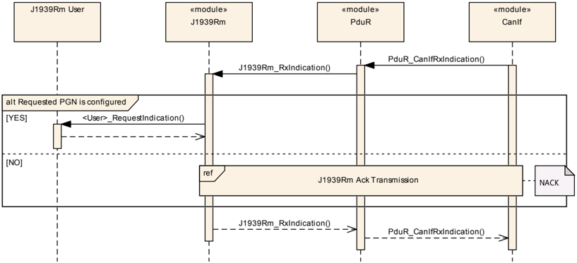

### 8.2. Acknowledgement PG 的发送

下图展示了发送一个 **Acknowledgement PG** 时与某个 J1939Rm 用户及 **PduR** 的交互。

图 9.2：Acknowledgement PG 的发送（**Transmission of Acknowledgement PG**）

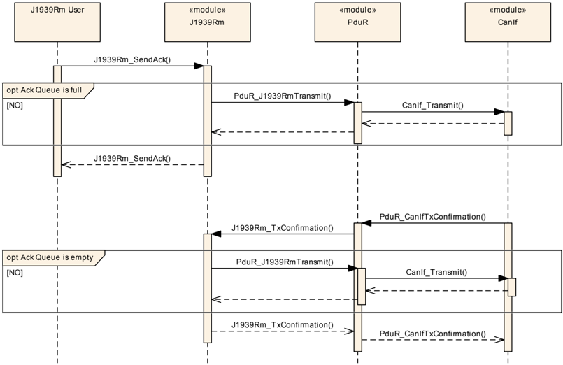

### 8.3. 对 COM PDU 的请求的处理

下图展示了 J1939 请求管理器接收到对一个 **PDU1** 格式 **PG** 的请求、且该 **PG** 作为 **COM PDU** 发送时，与 **PduR** 及 **COM** 的交互。

图 9.3：对 PDU1 格式 COM PDU 的请求的处理（**Handling of Request for a COM PDU with PDU1 format**）

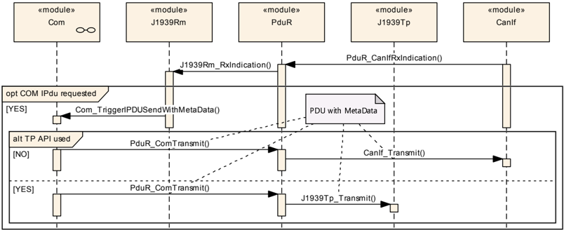

### 8.4. 对诊断 PDU 的请求的处理

下图展示了接收到对一个诊断 **PG** 的请求时与 **PduR** 及 **J1939Dcm** 的交互。

图 9.4：对诊断 PDU 的请求的处理（**Handling of Request for a Diagnostic Pdu**）

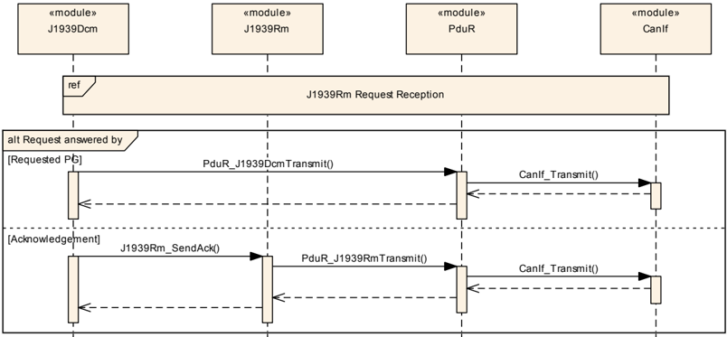

### 8.5. Request PG 的发送

下图展示了发送一个 Request **PG** 时与某个 J1939Rm 用户及 **PduR** 的交互。

图 9.5：Request PG 的发送（**Transmission of Request PG**）

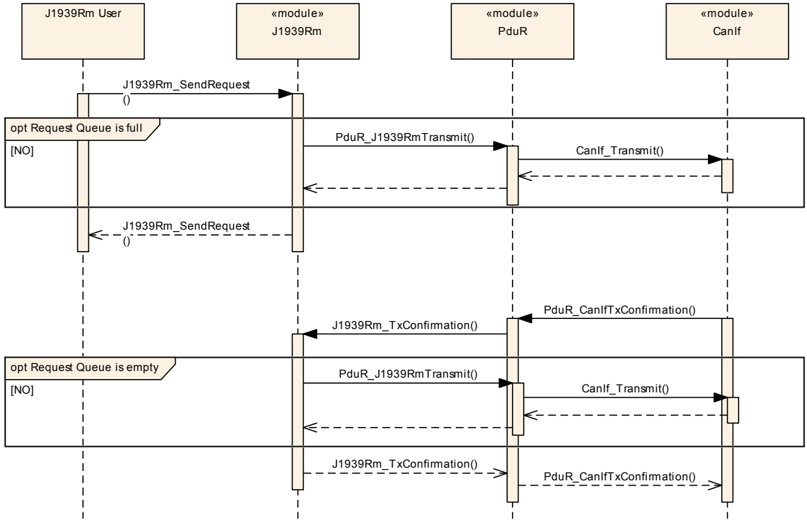

### 8.6. Acknowledgement PG 的接收

下图展示了接收到一个 **Acknowledgement PG** 时与 **PduR** 及某个 J1939Rm 用户的交互。

图 9.6：Acknowledgement PG 的接收（**Reception of Acknowledgement PG**）

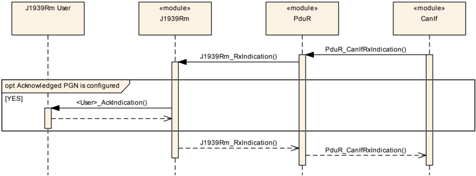

### 8.7. 请求超时的监控

下图展示了 J1939Rm 监控一个已发送 Request **PG** 的超时时，与某个 J1939Rm 用户及 **PduR** 的交互。

图 9.7：请求超时的监控（**Monitoring of Request Timeout**）

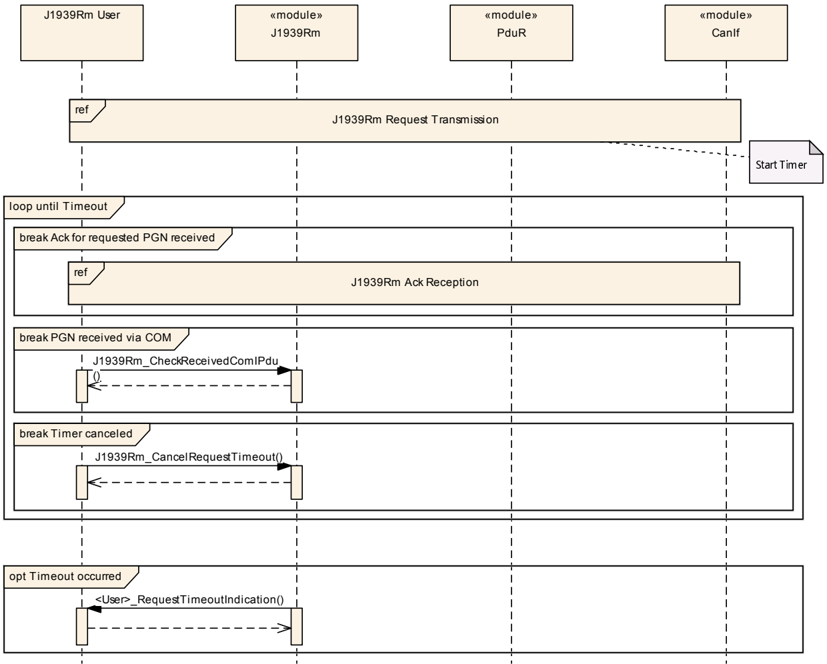

## 9. 配置规范

一般来说，本章定义配置参数及其到容器中的聚类。有关容器与参数定义的一般信息，请参阅 [\[4, SWS BSW General\]](#ref-4) 中第 10.1 节"配置规范简介"（Introduction to configuration specification）。

第 10.1 节规定模块 SAE J1939 请求管理器的结构（容器）与参数。

第 10.2 节规定模块 SAE J1939 请求管理器的发布信息。

### 9.1. 容器与配置参数

以下各节汇总 J1939 请求管理器的所有配置参数。各参数的详细含义在第 6 章与第 7 章中描述。

这些容器与参数中的一部分派生自 [\[21, TPS System Template\]](#ref-21) 的类与属性，该文档也包含这些派生的规则。

下图展示了可用于 J1939Rm 的配置参数的概览：

图 10.1：配置容器 J1939Rm 与子容器 J1939RmConfigSet（**Configuration container J1939Rm with subcontainer J1939RmConfigSet**）

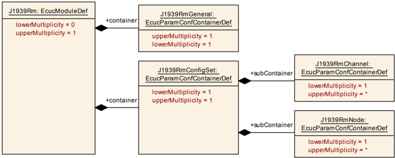

图 10.2：配置容器 J1939RmGeneral（**Configuration container J1939RmGeneral**）

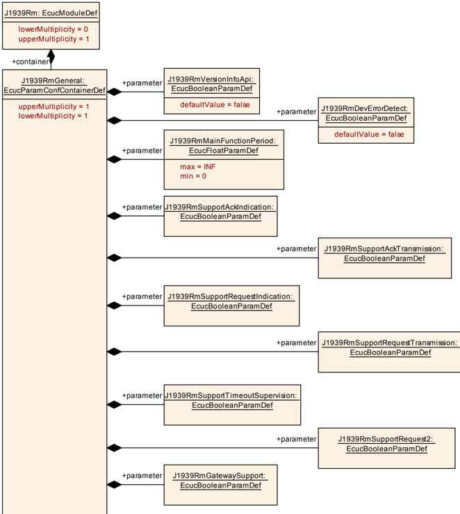

图 10.3：配置容器 J1939RmChannel（**Configuration container J1939RmChannel**）

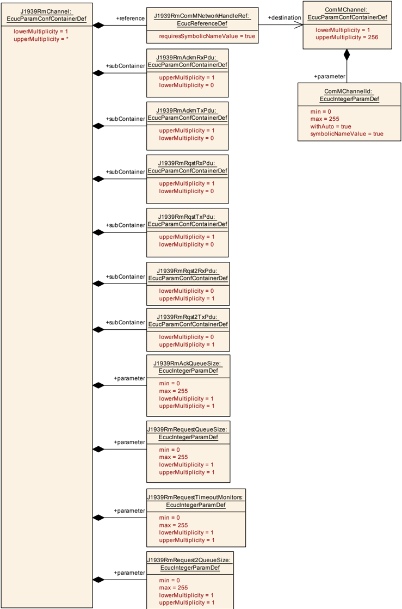

图 10.4：带 PDU 的配置容器 J1939RmChannel（**Configuration container J1939RmChannel with PDUs**）

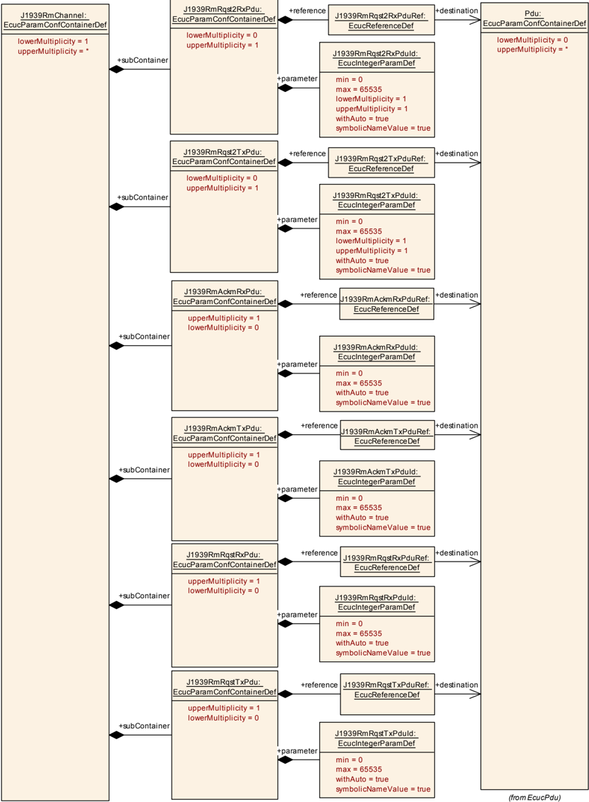

图 10.5：配置容器 J1939RmNode（**Configuration container J1939RmNode**）

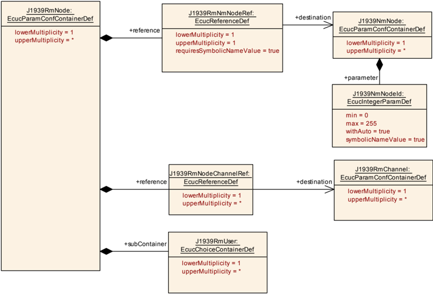

图 10.6：配置容器 J1939RmUser（**Configuration container J1939RmUser**）

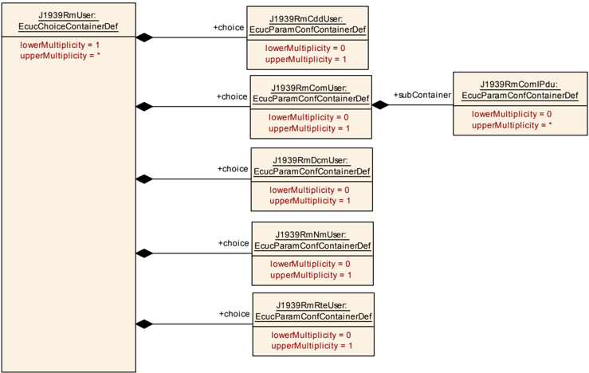

图 10.7：配置容器 J1939RmCddUser（**Configuration container J1939RmCddUser**）

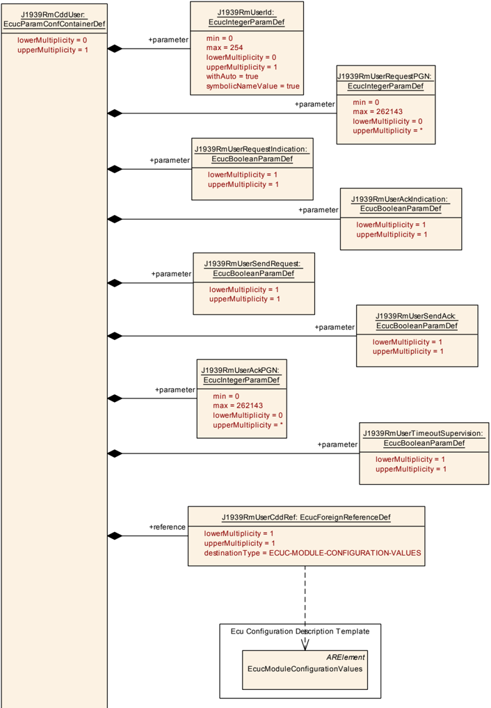

图 10.8：配置容器 J1939RmDcmUser（**Configuration container J1939RmDcmUser**）

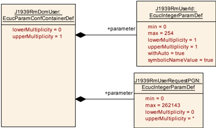

图 10.9：配置容器 J1939RmRteUser（**Configuration container J1939RmRteUser**）

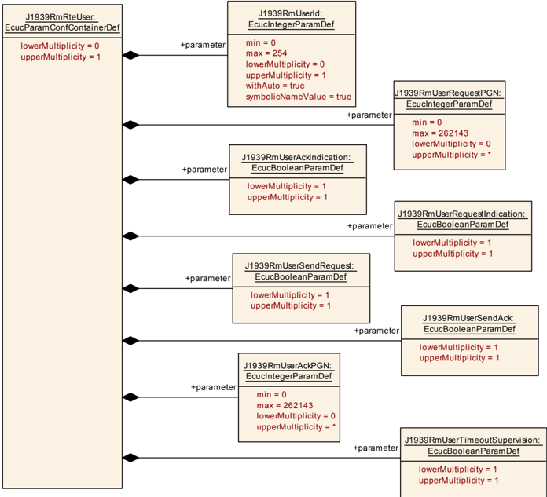

图 10.10：配置容器 J1939RmComIPdu（**Configuration container J1939RmComIPdu**）

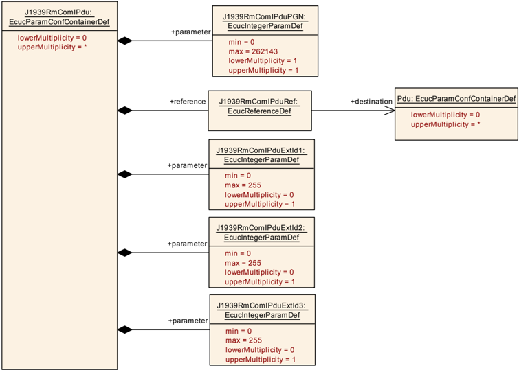

#### 9.1.1. J1939Rm

| SWS 条目 | [ECUC\_J1939Rm\_00043] |
| --- | --- |
| 模块名称 | J1939Rm |
| 描述 | J1939 请求管理器的配置。 |
| Post-Build 变体支持 | true |
| 支持的配置变体 | VARIANT-LINK-TIME、VARIANT-POST-BUILD、VARIANT-PRE-COMPILE |

| 容器名称 | 多重性 | 作用域/依赖 |
| --- | --- | --- |
| J1939RmConfigSet | 1 | 该容器包含 AUTOSAR J1939Rm 模块的配置参数与子容器。 |
| J1939RmGeneral | 1 | 包含该模块的通用配置参数。 |

#### 9.1.2. J1939RmGeneral

| SWS 条目 | [ECUC\_J1939Rm\_00001] |
| --- | --- |
| 容器名称 | J1939RmGeneral |
| 父容器 | J1939Rm |
| 描述 | 包含该模块的通用配置参数。 |
| 配置参数 | 见下方参数表 |

| SWS 条目 | [ECUC\_J1939Rm\_00003] |
| --- | --- |
| 参数名称 | J1939RmDevErrorDetect |
| 父容器 | J1939RmGeneral |
| 描述 | 打开或关闭开发错误检测与通知。* **true**：启用检测与通知。* **false**：禁用检测与通知。 |
| 多重性 | 1 |
| 类型 | EcucBooleanParamDef |
| 默认值 | false |
| Post-Build 变体值 | false |
| 值配置类 | Pre-compile time：x（All Variants）；Link time：-；Post-build time：- |
| 作用域/依赖 | scope: local |

| SWS 条目 | [ECUC\_J1939Rm\_00084] |
| --- | --- |
| 参数名称 | J1939RmGatewaySupport |
| 父容器 | J1939RmGeneral |
| 描述 | 启用/禁用对 Request 与 Acknowledgement 消息路由的支持。 |
| 多重性 | 1 |
| 类型 | EcucBooleanParamDef |
| Post-Build 变体值 | false |
| 值配置类 | Pre-compile time：x（All Variants）；Link time：-；Post-build time：- |
| 作用域/依赖 | scope: local |

| SWS 条目 | [ECUC\_J1939Rm\_00004] |
| --- | --- |
| 参数名称 | J1939RmMainFunctionPeriod |
| 父容器 | J1939RmGeneral |
| 描述 | J1939Rm\_MainFunction 的执行周期，以秒为单位。 |
| 多重性 | 1 |
| 类型 | EcucFloatParamDef |
| 范围 | ]0 .. INF[ |
| Post-Build 变体值 | false |
| 值配置类 | Pre-compile time：x（VARIANT-PRE-COMPILE）；Link time：x（VARIANT-LINK-TIME、VARIANT-POST-BUILD）；Post-build time：- |
| 作用域/依赖 | scope: ECU |

| SWS 条目 | [ECUC\_J1939Rm\_00054] |
| --- | --- |
| 参数名称 | J1939RmSupportAckIndication |
| 父容器 | J1939RmGeneral |
| 描述 | 用于启用确认指示支持的预处理器开关。 |
| 多重性 | 1 |
| 类型 | EcucBooleanParamDef |
| Post-Build 变体值 | false |
| 值配置类 | Pre-compile time：x（All Variants）；Link time：-；Post-build time：- |
| 作用域/依赖 | scope: local |

| SWS 条目 | [ECUC\_J1939Rm\_00055] |
| --- | --- |
| 参数名称 | J1939RmSupportAckTransmission |
| 父容器 | J1939RmGeneral |
| 描述 | 用于启用确认发送支持的预处理器开关。 |
| 多重性 | 1 |
| 类型 | EcucBooleanParamDef |
| Post-Build 变体值 | false |
| 值配置类 | Pre-compile time：x（All Variants）；Link time：-；Post-build time：- |
| 作用域/依赖 | scope: local |

| SWS 条目 | [ECUC\_J1939Rm\_00073] |
| --- | --- |
| 参数名称 | J1939RmSupportRequest2 |
| 父容器 | J1939RmGeneral |
| 描述 | 用于启用 Request2 **PG** 支持的预处理器开关。**请注意：** 不支持 Transfer。 |
| 多重性 | 1 |
| 类型 | EcucBooleanParamDef |
| Post-Build 变体值 | false |
| 值配置类 | Pre-compile time：x（All Variants）；Link time：-；Post-build time：- |
| 作用域/依赖 | scope: local |

| SWS 条目 | [ECUC\_J1939Rm\_00056] |
| --- | --- |
| 参数名称 | J1939RmSupportRequestIndication |
| 父容器 | J1939RmGeneral |
| 描述 | 用于启用请求指示支持的预处理器开关。 |
| 多重性 | 1 |
| 类型 | EcucBooleanParamDef |
| Post-Build 变体值 | false |
| 值配置类 | Pre-compile time：x（All Variants）；Link time：-；Post-build time：- |
| 作用域/依赖 | scope: local |

| SWS 条目 | [ECUC\_J1939Rm\_00057] |
| --- | --- |
| 参数名称 | J1939RmSupportRequestTransmission |
| 父容器 | J1939RmGeneral |
| 描述 | 用于启用请求发送支持的预处理器开关。 |
| 多重性 | 1 |
| 类型 | EcucBooleanParamDef |
| Post-Build 变体值 | false |
| 值配置类 | Pre-compile time：x（All Variants）；Link time：-；Post-build time：- |
| 作用域/依赖 | scope: local |

| SWS 条目 | [ECUC\_J1939Rm\_00058] |
| --- | --- |
| 参数名称 | J1939RmSupportTimeoutSupervision |
| 父容器 | J1939RmGeneral |
| 描述 | 用于启用请求超时监督支持的预处理器开关。 |
| 多重性 | 1 |
| 类型 | EcucBooleanParamDef |
| Post-Build 变体值 | false |
| 值配置类 | Pre-compile time：x（All Variants）；Link time：-；Post-build time：- |
| 作用域/依赖 | scope: local |

| SWS 条目 | [ECUC\_J1939Rm\_00002] |
| --- | --- |
| 参数名称 | J1939RmVersionInfoApi |
| 父容器 | J1939RmGeneral |
| 描述 | 用于启用版本信息 **API** 支持的预处理器开关。 |
| 多重性 | 1 |
| 类型 | EcucBooleanParamDef |
| 默认值 | false |
| Post-Build 变体值 | false |
| 值配置类 | Pre-compile time：x（All Variants）；Link time：-；Post-build time：- |
| 作用域/依赖 | scope: local |

无包含的容器。

#### 9.1.3. J1939RmConfigSet

| SWS 条目 | [ECUC\_J1939Rm\_00017] |
| --- | --- |
| 容器名称 | J1939RmConfigSet |
| 父容器 | J1939Rm |
| 描述 | 该容器包含 AUTOSAR J1939Rm 模块的配置参数与子容器。 |
| 配置参数 | 无 |

| 容器名称 | 多重性 | 作用域/依赖 |
| --- | --- | --- |
| J1939RmChannel | 1..* | 包含 J1939 请求管理器所支持的一个 **CAN** 通道的参数。 |
| J1939RmNode | 1..* | 包含用于支持一个逻辑 **J1939** 节点（由一个 **ECU** 地址标识）的参数。 |

#### 9.1.4. J1939RmChannel

| SWS 条目 | [ECUC\_J1939Rm\_00009] |
| --- | --- |
| 容器名称 | J1939RmChannel |
| 父容器 | J1939RmConfigSet |
| 描述 | 包含 J1939 请求管理器所支持的一个 **CAN** 通道的参数。 |
| 配置参数 | 见下方参数表 |

| SWS 条目 | [ECUC\_J1939Rm\_00007] |
| --- | --- |
| 参数名称 | J1939RmAckQueueSize |
| 父容器 | J1939RmChannel |
| 描述 | 可存储的已发送 Acknowledgement 消息的数量。 |
| 多重性 | 1 |
| 类型 | EcucIntegerParamDef |
| 范围 | 0 .. 255 |
| Post-Build 变体值 | false |
| 值配置类 | Pre-compile time：x（VARIANT-PRE-COMPILE）；Link time：x（VARIANT-LINK-TIME、VARIANT-POST-BUILD）；Post-build time：- |
| 作用域/依赖 | scope: local |

| SWS 条目 | [ECUC\_J1939Rm\_00074] |
| --- | --- |
| 参数名称 | J1939RmRequest2QueueSize |
| 父容器 | J1939RmChannel |
| 描述 | 可存储的已发送 Request2 消息的数量。 |
| 多重性 | 1 |
| 类型 | EcucIntegerParamDef |
| 范围 | 0 .. 255 |
| Post-Build 变体值 | false |
| 值配置类 | Pre-compile time：x（VARIANT-PRE-COMPILE）；Link time：x（VARIANT-LINK-TIME、VARIANT-POST-BUILD）；Post-build time：- |
| 作用域/依赖 | scope: local |

| SWS 条目 | [ECUC\_J1939Rm\_00006] |
| --- | --- |
| 参数名称 | J1939RmRequestQueueSize |
| 父容器 | J1939RmChannel |
| 描述 | 可存储的已发送 Request 消息的数量。 |
| 多重性 | 1 |
| 类型 | EcucIntegerParamDef |
| 范围 | 0 .. 255 |
| Post-Build 变体值 | false |
| 值配置类 | Pre-compile time：x（VARIANT-PRE-COMPILE）；Link time：x（VARIANT-LINK-TIME、VARIANT-POST-BUILD）；Post-build time：- |
| 作用域/依赖 | scope: local |

| SWS 条目 | [ECUC\_J1939Rm\_00008] |
| --- | --- |
| 参数名称 | J1939RmRequestTimeoutMonitors |
| 父容器 | J1939RmChannel |
| 描述 | 可对其进行超时监控的已发送请求的数量。 |
| 多重性 | 1 |
| 类型 | EcucIntegerParamDef |
| 范围 | 0 .. 255 |
| Post-Build 变体值 | false |
| 值配置类 | Pre-compile time：x（VARIANT-PRE-COMPILE）；Link time：x（VARIANT-LINK-TIME、VARIANT-POST-BUILD）；Post-build time：- |
| 作用域/依赖 | scope: local |

| SWS 条目 | [ECUC\_J1939Rm\_00051] |
| --- | --- |
| 参数名称 | J1939RmComMNetworkHandleRef |
| 父容器 | J1939RmChannel |
| 描述 | 对由 ComMChannel 定义的通道的引用，该通道提供对唯一通道索引 ComMChannelId 的访问。 |
| 多重性 | 1 |
| 类型 | 对 ComMChannel 的符号名引用 |
| Post-Build 变体值 | false |
| 值配置类 | Link time：x（VARIANT-LINK-TIME、VARIANT-POST-BUILD）；Post-build time：- |
| 作用域/依赖 | scope: local |

| 容器名称 | 多重性 | 作用域/依赖 |
| --- | --- | --- |
| J1939RmAckmRxPdu | 1 | 包含用于接收 **Acknowledgement PG** 的 **I-PDU** 的配置。该 **PDU** 消费一个类型为 CAN\_ID\_32 的元数据项。 |
| J1939RmAckmTxPdu | 1 | 包含用于发送 **Acknowledgement PG** 的 **I-PDU** 的配置。该 **PDU** 产生一个类型为 CAN\_ID\_32 的元数据项。 |
| J1939RmRqst2RxPdu | 0..1 | 包含用于接收 **Request2 PG** 的 **I-PDU** 的配置。该 **PDU** 消费一个类型为 CAN\_ID\_32 的元数据项。 |
| J1939RmRqst2TxPdu | 0..1 | 包含用于发送 **Request2 PG** 的 **I-PDU** 的配置。该 **PDU** 产生一个类型为 CAN\_ID\_32 的元数据项。 |
| J1939RmRqstRxPdu | 1 | 包含用于接收 **Request PG** 的 **I-PDU** 的配置。该 **PDU** 消费一个类型为 CAN\_ID\_32 的元数据项。 |
| J1939RmRqstTxPdu | 1 | 包含用于发送 **Request PG** 的 **I-PDU** 的配置。该 **PDU** 产生一个类型为 CAN\_ID\_32 的元数据项。 |

#### 9.1.5. J1939RmAckmRxPdu

| SWS 条目 | [ECUC\_J1939Rm\_00011] |
| --- | --- |
| 容器名称 | J1939RmAckmRxPdu |
| 父容器 | J1939RmChannel |
| 描述 | 包含用于接收 **Acknowledgement PG** 的 **I-PDU** 的配置。该 **PDU** 消费一个类型为 CAN\_ID\_32 的元数据项。 |
| 配置参数 | 见下方参数表 |

| SWS 条目 | [ECUC\_J1939Rm\_00015] |
| --- | --- |
| 参数名称 | J1939RmAckmRxPduId |
| 父容器 | J1939RmAckmRxPdu |
| 描述 | 用于来自 **PduR** 的 RxIndication 的 **I-PDU** 标识符。 |
| 多重性 | 1 |
| 类型 | EcucIntegerParamDef（为该参数生成符号名） |
| 范围 | 0 .. 65535 |
| Post-Build 变体值 | false |
| 值配置类 | Pre-compile time：x（All Variants） |
| 作用域/依赖 | scope: ECU；withAuto = true |

| SWS 条目 | [ECUC\_J1939Rm\_00016] |
| --- | --- |
| 参数名称 | J1939RmAckmRxPduRef |
| 父容器 | J1939RmAckmRxPdu |
| 描述 | 对表示该 **I-PDU** 的 Pdu 对象的引用。 |
| 多重性 | 1 |
| 类型 | 对 Pdu 的引用 |
| Post-Build 变体值 | false |
| 值配置类 | Pre-compile time：x（VARIANT-PRE-COMPILE）；Link time：x（VARIANT-LINK-TIME、VARIANT-POST-BUILD）；Post-build time：- |
| 作用域/依赖 | scope: local |

无包含的容器。

#### 9.1.6. J1939RmAckmTxPdu

| SWS 条目 | [ECUC\_J1939Rm\_00012] |
| --- | --- |
| 容器名称 | J1939RmAckmTxPdu |
| 父容器 | J1939RmChannel |
| 描述 | 包含用于发送 **Acknowledgement PG** 的 **I-PDU** 的配置。该 **PDU** 产生一个类型为 CAN\_ID\_32 的元数据项。 |
| 配置参数 | 见下方参数表 |

| SWS 条目 | [ECUC\_J1939Rm\_00018] |
| --- | --- |
| 参数名称 | J1939RmAckmTxPduId |
| 父容器 | J1939RmAckmTxPdu |
| 描述 | 用于来自 **PduR** 的 TxConfirmation 的 **I-PDU** 标识符。 |
| 多重性 | 1 |
| 类型 | EcucIntegerParamDef（为该参数生成符号名） |
| 范围 | 0 .. 65535 |
| Post-Build 变体值 | false |
| 值配置类 | Pre-compile time：x（All Variants）；Link time：-；Post-build time：- |
| 作用域/依赖 | scope: ECU |

| SWS 条目 | [ECUC\_J1939Rm\_00019] |
| --- | --- |
| 参数名称 | J1939RmAckmTxPduRef |
| 父容器 | J1939RmAckmTxPdu |
| 描述 | 对表示该 **I-PDU** 的 Pdu 对象的引用。 |
| 多重性 | 1 |
| 类型 | 对 Pdu 的引用 |
| Post-Build 变体值 | false |
| 值配置类 | Pre-compile time：x（VARIANT-PRE-COMPILE）；Link time：x（VARIANT-LINK-TIME、VARIANT-POST-BUILD）；Post-build time：- |
| 作用域/依赖 | scope: local |

无包含的容器。

#### 9.1.7. J1939RmRqstRxPdu

| SWS 条目 | [ECUC\_J1939Rm\_00013] |
| --- | --- |
| 容器名称 | J1939RmRqstRxPdu |
| 父容器 | J1939RmChannel |
| 描述 | 包含用于接收 **Request PG** 的 **I-PDU** 的配置。该 **PDU** 消费一个类型为 CAN\_ID\_32 的元数据项。 |
| 配置参数 | 见下方参数表 |

| SWS 条目 | [ECUC\_J1939Rm\_00020] |
| --- | --- |
| 参数名称 | J1939RmRqstRxPduId |
| 父容器 | J1939RmRqstRxPdu |
| 描述 | 用于来自 **PduR** 的 RxIndication 的 **I-PDU** 标识符。 |
| 多重性 | 1 |
| 类型 | EcucIntegerParamDef（为该参数生成符号名） |
| 范围 | 0 .. 65535 |
| Post-Build 变体值 | false |
| 值配置类 | Pre-compile time：x（All Variants）；Link time：-；Post-build time：- |
| 作用域/依赖 | scope: ECU；withAuto = true |

| SWS 条目 | [ECUC\_J1939Rm\_00021] |
| --- | --- |
| 参数名称 | J1939RmRqstRxPduRef |
| 父容器 | J1939RmRqstRxPdu |
| 描述 | 对表示该 **I-PDU** 的 Pdu 对象的引用。 |
| 多重性 | 1 |
| 类型 | 对 Pdu 的引用 |
| Post-Build 变体值 | false |
| 值配置类 | Pre-compile time：x（VARIANT-PRE-COMPILE）；Link time：x（VARIANT-LINK-TIME、VARIANT-POST-BUILD）；Post-build time：- |
| 作用域/依赖 | scope: local |

无包含的容器。

#### 9.1.8. J1939RmRqstTxPdu

| SWS 条目 | [ECUC\_J1939Rm\_00014] |
| --- | --- |
| 容器名称 | J1939RmRqstTxPdu |
| 父容器 | J1939RmChannel |
| 描述 | 包含用于发送 **Request PG** 的 **I-PDU** 的配置。该 **PDU** 产生一个类型为 CAN\_ID\_32 的元数据项。 |
| 配置参数 | 见下方参数表 |

| SWS 条目 | [ECUC\_J1939Rm\_00022] |
| --- | --- |
| 参数名称 | J1939RmRqstTxPduId |
| 父容器 | J1939RmRqstTxPdu |
| 描述 | 用于来自 **PduR** 的 TxConfirmation 的 **I-PDU** 标识符。 |
| 多重性 | 1 |
| 类型 | EcucIntegerParamDef（为该参数生成符号名） |
| 范围 | 0 .. 65535 |
| Post-Build 变体值 | false |
| 值配置类 | Pre-compile time：x（All Variants）；Link time：-；Post-build time：- |
| 作用域/依赖 | scope: ECU；withAuto = true |

| SWS 条目 | [ECUC\_J1939Rm\_00023] |
| --- | --- |
| 参数名称 | J1939RmRqstTxPduRef |
| 父容器 | J1939RmRqstTxPdu |
| 描述 | 对表示该 **I-PDU** 的 Pdu 对象的引用。 |
| 多重性 | 1 |
| 类型 | 对 Pdu 的引用 |
| Post-Build 变体值 | false |
| 值配置类 | Pre-compile time：x（VARIANT-PRE-COMPILE）；Link time：x（VARIANT-LINK-TIME、VARIANT-POST-BUILD）；Post-build time：- |
| 作用域/依赖 | scope: local |

无包含的容器。

#### 9.1.9. J1939RmRqst2RxPdu

| SWS 条目 | [ECUC\_J1939Rm\_00075] |
| --- | --- |
| 容器名称 | J1939RmRqst2RxPdu |
| 父容器 | J1939RmChannel |
| 描述 | 包含用于接收 **Request2 PG** 的 **I-PDU** 的配置。该 **PDU** 消费一个类型为 CAN\_ID\_32 的元数据项。 |
| 配置参数 | 见下方参数表 |

| SWS 条目 | [ECUC\_J1939Rm\_00078] |
| --- | --- |
| 参数名称 | J1939RmRqst2RxPduId |
| 父容器 | J1939RmRqst2RxPdu |
| 描述 | 用于来自 **PduR** 的 RxIndication 的 **I-PDU** 标识符。 |
| 多重性 | 1 |
| 类型 | EcucIntegerParamDef（为该参数生成符号名） |
| 范围 | 0 .. 65535 |
| Post-Build 变体值 | false |
| 值配置类 | Pre-compile time：x（All Variants）；Link time：-；Post-build time：- |
| 作用域/依赖 | scope: ECU；withAuto = true |

| SWS 条目 | [ECUC\_J1939Rm\_00077] |
| --- | --- |
| 参数名称 | J1939RmRqst2RxPduRef |
| 父容器 | J1939RmRqst2RxPdu |
| 描述 | 对表示该 **I-PDU** 的 Pdu 对象的引用。 |
| 多重性 | 1 |
| 类型 | 对 Pdu 的引用 |
| Post-Build 变体值 | false |
| 值配置类 | Pre-compile time：x（VARIANT-PRE-COMPILE）；Link time：x（VARIANT-LINK-TIME、VARIANT-POST-BUILD）；Post-build time：- |
| 作用域/依赖 | scope: local |

无包含的容器。

#### 9.1.10. J1939RmRqst2TxPdu

| SWS 条目 | [ECUC\_J1939Rm\_00076] |
| --- | --- |
| 容器名称 | J1939RmRqst2TxPdu |
| 父容器 | J1939RmChannel |
| 描述 | 包含用于发送 **Request2 PG** 的 **I-PDU** 的配置。该 **PDU** 产生一个类型为 CAN\_ID\_32 的元数据项。 |
| 配置参数 | 见下方参数表 |

| SWS 条目 | [ECUC\_J1939Rm\_00080] |
| --- | --- |
| 参数名称 | J1939RmRqst2TxPduId |
| 父容器 | J1939RmRqst2TxPdu |
| 描述 | 用于来自 **PduR** 的 TxConfirmation 的 **I-PDU** 标识符。 |
| 多重性 | 1 |
| 类型 | EcucIntegerParamDef（为该参数生成符号名） |
| 范围 | 0 .. 65535 |
| Post-Build 变体值 | false |
| 值配置类 | Pre-compile time：x（All Variants）；Link time：-；Post-build time：- |
| 作用域/依赖 | scope: ECU |

| SWS 条目 | [ECUC\_J1939Rm\_00079] |
| --- | --- |
| 参数名称 | J1939RmRqst2TxPduRef |
| 父容器 | J1939RmRqst2TxPdu |
| 描述 | 对表示该 **I-PDU** 的 Pdu 对象的引用。 |
| 多重性 | 1 |
| 类型 | 对 Pdu 的引用 |
| Post-Build 变体值 | false |
| 值配置类 | Pre-compile time：x（VARIANT-PRE-COMPILE）；Link time：x（VARIANT-LINK-TIME、VARIANT-POST-BUILD）；Post-build time：- |
| 作用域/依赖 | scope: local |

无包含的容器。

#### 9.1.11. J1939RmNode

| SWS 条目 | [ECUC\_J1939Rm\_00049] |
| --- | --- |
| 容器名称 | J1939RmNode |
| 父容器 | J1939RmConfigSet |
| 描述 | 包含用于支持一个逻辑 **J1939** 节点（由一个 **ECU** 地址标识）的参数。 |
| 配置参数 | 见下方参数表 |

| SWS 条目 | [ECUC\_J1939Rm\_00005] |
| --- | --- |
| 参数名称 | J1939RmNmNodeRef |
| 父容器 | J1939RmNode |
| 描述 | 对相应的 **J1939Nm** 节点的引用。 |
| 多重性 | 1 |
| 类型 | 对 J1939NmNode 的符号名引用 |
| Post-Build 变体值 | false |
| 值配置类 | Pre-compile time：x（VARIANT-PRE-COMPILE）；Link time：x（VARIANT-LINK-TIME、VARIANT-POST-BUILD）；Post-build time：- |
| 作用域/依赖 | scope: local |

| SWS 条目 | [ECUC\_J1939Rm\_00052] |
| --- | --- |
| 参数名称 | J1939RmNodeChannelRef |
| 父容器 | J1939RmNode |
| 描述 | 对该节点有权访问的通道的引用。 |
| 多重性 | 1..* |
| 类型 | 对 J1939RmChannel 的引用 |
| Post-Build 变体多重性 | false |
| Post-Build 变体值 | false |
| 多重性配置类 | Pre-compile time：x（VARIANT-PRE-COMPILE）；Link time：x（VARIANT-LINK-TIME、VARIANT-POST-BUILD）；Post-build time：- |
| 值配置类 | Pre-compile time：x（VARIANT-PRE-COMPILE）；Link time：x（VARIANT-LINK-TIME、VARIANT-POST-BUILD）；Post-build time：- |
| 作用域/依赖 | scope: local |

| 容器名称 | 多重性 | 作用域/依赖 |
| --- | --- | --- |
| J1939RmUser | 1..* | 包含使用 J1939Rm 的请求与确认接口的一个模块的配置。 |

#### 9.1.12. J1939RmUser

| SWS 条目 | [ECUC\_J1939Rm\_00010] |
| --- | --- |
| 选择容器名称 | J1939RmUser |
| 父容器 | J1939RmNode |
| 描述 | 包含使用 J1939Rm 的请求与确认接口的一个模块的配置。 |
| Post-Build 变体多重性 | true |
| 多重性配置类 | Pre-compile time：x（VARIANT-PRE-COMPILE）；Link time：x（VARIANT-LINK-TIME）；Post-build time：x（VARIANT-POST-BUILD） |

| 容器选择 | 多重性 | 作用域/依赖 |
| --- | --- | --- |
| J1939RmCddUser | 0..1 | 代表一个复杂驱动程序（**CDD**）的 J1939Rm 用户。**CDD** 可以使用 J1939Rm 提供的所有服务。 |
| J1939RmComUser | 0..1 | 代表 AUTOSAR **COM** 的 J1939Rm 用户。支持针对 **COM I-PDU** 的请求。 |
| J1939RmDcmUser | 0..1 | 代表 **J1939Dcm** 的 J1939Rm 用户。需要请求指示与确认的发送。 |
| J1939RmNmUser | 0..1 | 代表 **J1939Nm** 的 J1939Rm 用户。需要请求指示。 |
| J1939RmRteUser | 0..1 | 代表一个应用软件组件（**SW-C**）的 J1939Rm 用户。**SW-C** 可以经由服务端口使用 J1939Rm 提供的所有服务。 |

#### 9.1.13. J1939RmNmUser

| SWS 条目 | [ECUC\_J1939Rm\_00071] |
| --- | --- |
| 容器名称 | J1939RmNmUser |
| 父容器 | J1939RmUser |
| 描述 | 代表 **J1939Nm** 的 J1939Rm 用户。需要请求指示。 |
| 配置参数 | 无 |

无包含的容器。

#### 9.1.14. J1939RmDcmUser

| SWS 条目 | [ECUC\_J1939Rm\_00068] |
| --- | --- |
| 容器名称 | J1939RmDcmUser |
| 父容器 | J1939RmUser |
| 描述 | 代表 **J1939Dcm** 的 J1939Rm 用户。需要请求指示与确认的发送。 |
| 配置参数 | 见下方参数表 |

| SWS 条目 | [ECUC\_J1939Rm\_00072] |
| --- | --- |
| 参数名称 | J1939RmUserId |
| 父容器 | J1939RmDcmUser |
| 描述 | **J1939Dcm** 调用 J1939Rm\_SendAck 时使用的标识符。 |
| 多重性 | 1 |
| 类型 | EcucIntegerParamDef（为该参数生成符号名） |
| 范围 | 0 .. 254 |
| Post-Build 变体值 | false |
| 值配置类 | Pre-compile time：x（All Variants）；Link time：-；Post-build time：- |
| 作用域/依赖 | scope: ECU |

| SWS 条目 | [ECUC\_J1939Rm\_00070] |
| --- | --- |
| 参数名称 | J1939RmUserRequestPGN |
| 父容器 | J1939RmDcmUser |
| 描述 | **J1939Dcm** 支持的 DMx **PG** 的 **PGN**。 |
| 多重性 | 0..* |
| 类型 | EcucIntegerParamDef |
| 范围 | 0 .. 262143 |
| Post-Build 变体多重性 | true |
| Post-Build 变体值 | true |
| 多重性配置类 | Pre-compile time：x（VARIANT-PRE-COMPILE）；Link time：x（VARIANT-LINK-TIME）；Post-build time：x（VARIANT-POST-BUILD） |
| 值配置类 | Pre-compile time：x（VARIANT-PRE-COMPILE）；Link time：x（VARIANT-LINK-TIME）；Post-build time：x（VARIANT-POST-BUILD） |
| 作用域/依赖 | scope: local |

无包含的容器。

#### 9.1.15. J1939RmCddUser

| SWS 条目 | [ECUC\_J1939Rm\_00066] |
| --- | --- |
| 容器名称 | J1939RmCddUser |
| 父容器 | J1939RmUser |
| 描述 | 代表一个复杂驱动程序（**CDD**）的 J1939Rm 用户。**CDD** 可以使用 J1939Rm 提供的所有服务。 |
| 配置参数 | 见下方参数表 |

| SWS 条目 | [ECUC\_J1939Rm\_00028] |
| --- | --- |
| 参数名称 | J1939RmUserAckIndication |
| 父容器 | J1939RmCddUser |
| 描述 | 为该模块启用 AckIndication。对于 **CDD**，名称为 &lt;apiServicePrefix&gt;\_AckIndication。对于 **RTE**，调用所需端口 J1939Rm\_AckIndication\_{user} 的操作 AckIndication。 |
| 多重性 | 1 |
| 类型 | EcucBooleanParamDef |
| Post-Build 变体值 | false |
| 值配置类 | Pre-compile time：x（All Variants）；Link time：-；Post-build time：- |
| 作用域/依赖 | scope: local |

| SWS 条目 | [ECUC\_J1939Rm\_00061] |
| --- | --- |
| 参数名称 | J1939RmUserAckPGN |
| 父容器 | J1939RmCddUser |
| 描述 | 支持向该模块确认的 **PGN**。不同模块支持的 **PGN** 通常应当是不相交的。 |
| 多重性 | 0..* |
| 类型 | EcucIntegerParamDef |
| 范围 | 0 .. 262143 |
| Post-Build 变体多重性 | false |
| Post-Build 变体值 | false |
| 多重性配置类 | Pre-compile time：x；Link time：-；Post-build time：- |
| 值配置类 | Pre-compile time：x；Link time：-；Post-build time：- |
| 作用域/依赖 | scope: local |

| SWS 条目 | [ECUC\_J1939Rm\_00025] |
| --- | --- |
| 参数名称 | J1939RmUserId |
| 父容器 | J1939RmCddUser |
| 描述 | 使用 J1939Rm 的某个模块所使用的标识符。仅当该模块使用请求或确认的发送时才需要该参数。 |
| 多重性 | 0..1 |
| 类型 | EcucIntegerParamDef |
| Post-Build 变体多重性 | false |
| Post-Build 变体值 | false |
| 多重性配置类 | Pre-compile time：x；Link time：-；Post-build time：- |
| 值配置类 | Pre-compile time：x；Link time：-；Post-build time：- |
| 作用域/依赖 | scope: ECU；withAuto = true |

| SWS 条目 | [ECUC\_J1939Rm\_00027] |
| --- | --- |
| 参数名称 | J1939RmUserRequestIndication |
| 父容器 | J1939RmCddUser |
| 描述 | 为该模块启用 RequestIndication。对于 **J1939Nm** 或 **J1939Dcm**，名称是固定的。对于 **CDD**，名称为 &lt;apiServicePrefix&gt;\_RequestIndication。对于 **RTE**，J1939Rm 将调用所需端口 J1939Rm\_RequestIndication\_{user} 的操作 RequestIndication。 |
| 多重性 | 1 |
| 类型 | EcucBooleanParamDef |
| Post-Build 变体值 | false |
| 值配置类 | Pre-compile time：x（All Variants）；Link time：-；Post-build time：- |
| 作用域/依赖 | scope: local |

| SWS 条目 | [ECUC\_J1939Rm\_00026] |
| --- | --- |
| 参数名称 | J1939RmUserRequestPGN |
| 父容器 | J1939RmCddUser |
| 描述 | 支持从该模块请求的 **PGN**。不同模块支持的 **PGN** 通常应当是不相交的。 |
| 多重性 | 0..* |
| 类型 | EcucIntegerParamDef |
| 范围 | 0 .. 262143 |
| Post-Build 变体多重性 | false |
| Post-Build 变体值 | false |
| 多重性配置类 | Pre-compile time：x；Link time：-；Post-build time：- |
| 值配置类 | Pre-compile time：x；Link time：-；Post-build time：- |
| 作用域/依赖 | scope: local |

| SWS 条目 | [ECUC\_J1939Rm\_00030] |
| --- | --- |
| 参数名称 | J1939RmUserSendAck |
| 父容器 | J1939RmCddUser |
| 描述 | 为该模块启用 SendAck **API**。对于 **RTE**，调用所提供端口 J1939Rm\_SendAck\_{user} 的操作 SendAck。 |
| 多重性 | 1 |
| 类型 | EcucBooleanParamDef |
| Post-Build 变体值 | false |
| 值配置类 | Pre-compile time：x（All Variants）；Link time：-；Post-build time：- |
| 作用域/依赖 | scope: local |

| SWS 条目 | [ECUC\_J1939Rm\_00029] |
| --- | --- |
| 参数名称 | J1939RmUserSendRequest |
| 父容器 | J1939RmCddUser |
| 描述 | 为该模块启用 SendRequest **API**。对于 **RTE**，调用所提供端口 J1939Rm\_SendRequest\_{user} 的操作 SendRequest。 |
| 多重性 | 1 |
| 类型 | EcucBooleanParamDef |
| Post-Build 变体值 | false |
| 值配置类 | Pre-compile time：x（All Variants）；Link time：-；Post-build time：- |
| 作用域/依赖 | scope: local |

| SWS 条目 | [ECUC\_J1939Rm\_00031] |
| --- | --- |
| 参数名称 | J1939RmUserTimeoutSupervision |
| 父容器 | J1939RmCddUser |
| 描述 | 为该模块启用 RequestTimeoutIndication 与 CancelRequestTimeout。RequestTimeoutIndication：对于 **CDD**，名称为 &lt;apiServicePrefix&gt;\_RequestTimeoutIndication。对于 **RTE**，调用所需端口 J1939Rm\_RequestTimeoutIndication\_{user} 的操作 RequestTimeoutIndication。 |
| 多重性 | 1 |
| 类型 | EcucBooleanParamDef |
| Post-Build 变体值 | false |
| 值配置类 | Pre-compile time：x（All Variants）；Link time：-；Post-build time：- |
| 作用域/依赖 | scope: local |

| SWS 条目 | [ECUC\_J1939Rm\_00042] |
| --- | --- |
| 参数名称 | J1939RmUserCddRef |
| 父容器 | J1939RmCddUser |
| 描述 | 对 **CDD** 模块描述的引用。 |
| 多重性 | 1 |
| 类型 | 对 ECUC-MODULE-CONFIGURATION-VALUES 的外部引用 |
| Post-Build 变体值 | false |
| 值配置类 | Link time：x（-） |
| 作用域/依赖 | scope: local |

无包含的容器。

#### 9.1.16. J1939RmRteUser

| SWS 条目 | [ECUC\_J1939Rm\_00069] |
| --- | --- |
| 容器名称 | J1939RmRteUser |
| 父容器 | J1939RmUser |
| 描述 | 代表一个应用软件组件（**SW-C**）的 J1939Rm 用户。**SW-C** 可以经由服务端口使用 J1939Rm 提供的所有服务。 |
| 配置参数 | 见下方参数表 |

| SWS 条目 | [ECUC\_J1939Rm\_00028] |
| --- | --- |
| 参数名称 | J1939RmUserAckIndication |
| 父容器 | J1939RmRteUser |
| 描述 | 为该模块启用 AckIndication。对于 **CDD**，名称为 &lt;apiServicePrefix&gt;\_AckIndication。对于 **RTE**，调用所需端口 J1939Rm\_AckIndication\_{user} 的操作 AckIndication。 |
| 多重性 | 1 |
| 类型 | EcucBooleanParamDef |
| Post-Build 变体值 | false |
| 值配置类 | Pre-compile time：x（All Variants）；Link time：-；Post-build time：- |
| 作用域/依赖 | scope: local |

| SWS 条目 | [ECUC\_J1939Rm\_00061] |
| --- | --- |
| 参数名称 | J1939RmUserAckPGN |
| 父容器 | J1939RmRteUser |
| 描述 | 支持向该模块确认的 **PGN**。不同模块支持的 **PGN** 通常应当是不相交的。 |
| 多重性 | 0..* |
| 类型 | EcucIntegerParamDef |
| Post-Build 变体多重性 | false |
| Post-Build 变体值 | false |
| 多重性配置类 | Pre-compile time：x（All Variants）；Link time：-；Post-build time：- |
| 值配置类 | Pre-compile time：x（All Variants）；Link time：-；Post-build time：- |
| 作用域/依赖 | scope: local |

| SWS 条目 | [ECUC\_J1939Rm\_00025] |
| --- | --- |
| 参数名称 | J1939RmUserId |
| 父容器 | J1939RmRteUser |
| 描述 | 使用 J1939Rm 的某个模块所使用的标识符。仅当该模块使用请求或确认的发送时才需要该参数。 |
| 多重性 | 0..1 |
| 类型 | EcucIntegerParamDef（为该参数生成符号名） |
| 范围 | 0 .. 254 |
| Post-Build 变体多重性 | false |
| Post-Build 变体值 | false |
| 多重性配置类 | Pre-compile time：x（All Variants）；Link time：-；Post-build time：- |
| 值配置类 | Pre-compile time：x（All Variants）；Link time：-；Post-build time：- |
| 作用域/依赖 | scope: ECU；withAuto = true |

| SWS 条目 | [ECUC\_J1939Rm\_00027] |
| --- | --- |
| 参数名称 | J1939RmUserRequestIndication |
| 父容器 | J1939RmRteUser |
| 描述 | 为该模块启用 RequestIndication。对于 **J1939Nm** 或 **J1939Dcm**，名称是固定的。对于 **CDD**，名称为 &lt;apiServicePrefix&gt;\_RequestIndication。对于 **RTE**，J1939Rm 将调用所需端口 J1939Rm\_RequestIndication\_{user} 的操作 RequestIndication。 |
| 多重性 | 1 |
| 类型 | EcucBooleanParamDef |
| Post-Build 变体值 | false |
| 值配置类 | Pre-compile time：x（All Variants）；Link time：-；Post-build time：- |
| 作用域/依赖 | scope: local |

| SWS 条目 | [ECUC\_J1939Rm\_00026] |
| --- | --- |
| 参数名称 | J1939RmUserRequestPGN |
| 父容器 | J1939RmRteUser |
| 描述 | 支持从该模块请求的 **PGN**。不同模块支持的 **PGN** 通常应当是不相交的。 |
| 多重性 | 0..* |
| 类型 | EcucIntegerParamDef |
| 范围 | 0 .. 262143 |
| Post-Build 变体多重性 | false |
| Post-Build 变体值 | false |
| 多重性配置类 | Pre-compile time：x；Link time：-；Post-build time：- |
| 值配置类 | Pre-compile time：x；Link time：-；Post-build time：- |
| 作用域/依赖 | scope: local |

| SWS 条目 | [ECUC\_J1939Rm\_00030] |
| --- | --- |
| 参数名称 | J1939RmUserSendAck |
| 父容器 | J1939RmRteUser |
| 描述 | 为该模块启用 SendAck **API**。对于 **RTE**，调用所提供端口 J1939Rm\_SendAck\_{user} 的操作 SendAck。 |
| 多重性 | 1 |
| 类型 | EcucBooleanParamDef |
| Post-Build 变体值 | false |
| 值配置类 | Pre-compile time：x（All Variants）；Link time：-；Post-build time：- |
| 作用域/依赖 | scope: local |

| SWS 条目 | [ECUC\_J1939Rm\_00029] |
| --- | --- |
| 参数名称 | J1939RmUserSendRequest |
| 父容器 | J1939RmRteUser |
| 描述 | 为该模块启用 SendRequest **API**。对于 **RTE**，调用所提供端口 J1939Rm\_SendRequest\_{user} 的操作 SendRequest。 |
| 多重性 | 1 |
| 类型 | EcucBooleanParamDef |
| Post-Build 变体值 | false |
| 值配置类 | Pre-compile time：x（All Variants）；Link time：-；Post-build time：- |
| 作用域/依赖 | scope: local |

| SWS 条目 | [ECUC\_J1939Rm\_00031] |
| --- | --- |
| 参数名称 | J1939RmUserTimeoutSupervision |
| 父容器 | J1939RmRteUser |
| 描述 | 为该模块启用 RequestTimeoutIndication 与 CancelRequestTimeout。RequestTimeoutIndication：对于 **CDD**，名称为 &lt;apiServicePrefix&gt;\_RequestTimeoutIndication。对于 **RTE**，调用所需端口 J1939Rm\_RequestTimeoutIndication\_{user} 的操作 RequestTimeoutIndication。 |
| 多重性 | 1 |
| 类型 | EcucBooleanParamDef |
| Post-Build 变体值 | false |
| 值配置类 | Pre-compile time：x（All Variants）；Link time：-；Post-build time：- |
| 作用域/依赖 | scope: local |

无包含的容器。

#### 9.1.17. J1939RmComUser

| SWS 条目 | [ECUC\_J1939Rm\_00067] |
| --- | --- |
| 容器名称 | J1939RmComUser |
| 父容器 | J1939RmUser |
| 描述 | 代表 AUTOSAR **COM** 的 J1939Rm 用户。支持针对 **COM I-PDU** 的请求。 |
| 配置参数 | 无 |

| 容器名称 | 多重性 | 作用域/依赖 |
| --- | --- | --- |
| J1939RmComIPdu | 0..* | 包含将被 **COM** 应请求发送的一个 **I-PDU** 的配置。 |

#### 9.1.18. J1939RmComIPdu

| SWS 条目 | [ECUC\_J1939Rm\_00032] |
| --- | --- |
| 容器名称 | J1939RmComIPdu |
| 父容器 | J1939RmComUser |
| 描述 | 包含将被 **COM** 应请求发送的一个 **I-PDU** 的配置。 |
| 配置参数 | 见下方参数表 |

| SWS 条目 | [ECUC\_J1939Rm\_00081] |
| --- | --- |
| 参数名称 | J1939RmComIPduExtId1 |
| 父容器 | J1939RmComIPdu |
| 描述 | 该 **COM I-PDU** 的第一个扩展标识符字节。 |
| 多重性 | 0..1 |
| 类型 | EcucIntegerParamDef |
| 范围 | 0 .. 255 |
| Post-Build 变体多重性 | true |
| Post-Build 变体值 | true |
| 多重性配置类 | Pre-compile time：x（VARIANT-PRE-COMPILE）；Link time：x（VARIANT-LINK-TIME）；Post-build time：x（VARIANT-POST-BUILD） |
| 值配置类 | Pre-compile time：x（VARIANT-PRE-COMPILE）；Link time：x（VARIANT-LINK-TIME）；Post-build time：x（VARIANT-POST-BUILD） |
| 作用域/依赖 | scope: local |

| SWS 条目 | [ECUC\_J1939Rm\_00082] |
| --- | --- |
| 参数名称 | J1939RmComIPduExtId2 |
| 父容器 | J1939RmComIPdu |
| 描述 | 该 **COM I-PDU** 的第二个扩展标识符字节。 |
| 多重性 | 0..1 |
| 类型 | EcucIntegerParamDef |
| 范围 | 0 .. 255 |
| Post-Build 变体多重性 | true |
| Post-Build 变体值 | true |
| 多重性配置类 | Pre-compile time：x（VARIANT-PRE-COMPILE）；Link time：x（VARIANT-LINK-TIME）；Post-build time：x（VARIANT-POST-BUILD） |
| 值配置类 | Pre-compile time：x（VARIANT-PRE-COMPILE）；Link time：x（VARIANT-LINK-TIME）；Post-build time：x（VARIANT-POST-BUILD） |
| 作用域/依赖 | scope: local |

| SWS 条目 | [ECUC\_J1939Rm\_00083] |
| --- | --- |
| 参数名称 | J1939RmComIPduExtId3 |
| 父容器 | J1939RmComIPdu |
| 描述 | 该 **COM I-PDU** 的第三个扩展标识符字节。 |
| 多重性 | 0..1 |
| 类型 | EcucIntegerParamDef |
| 范围 | 0 .. 255 |
| Post-Build 变体多重性 | true |
| Post-Build 变体值 | true |
| 多重性配置类 | Pre-compile time：x（VARIANT-PRE-COMPILE）；Link time：x（VARIANT-LINK-TIME）；Post-build time：x（VARIANT-POST-BUILD） |
| 值配置类 | Pre-compile time：x（VARIANT-PRE-COMPILE）；Link time：x（VARIANT-LINK-TIME）；Post-build time：x（VARIANT-POST-BUILD） |
| 作用域/依赖 | scope: local |

| SWS 条目 | [ECUC\_J1939Rm\_00033] |
| --- | --- |
| 参数名称 | J1939RmComIPduPGN |
| 父容器 | J1939RmComIPdu |
| 描述 | 该 **COM I-PDU** 的 **PGN**。 |
| 多重性 | 1 |
| 类型 | EcucIntegerParamDef |
| 范围 | 0 .. 262143 |
| Post-Build 变体值 | true |
| 值配置类 | Pre-compile time：x（VARIANT-PRE-COMPILE）；Link time：x（VARIANT-LINK-TIME）；Post-build time：x（VARIANT-POST-BUILD） |
| 作用域/依赖 | scope: local |

| SWS 条目 | [ECUC\_J1939Rm\_00065] |
| --- | --- |
| 参数名称 | J1939RmComIPduRef |
| 父容器 | J1939RmComIPdu |
| 描述 | 对表示该 **I-PDU** 的 Pdu 对象的引用。 |
| 多重性 | 1 |
| 类型 | 对 Pdu 的引用 |
| Post-Build 变体值 | false |
| 值配置类 | Pre-compile time：x（VARIANT-PRE-COMPILE）；Link time：x（VARIANT-LINK-TIME）；Post-build time：x（VARIANT-POST-BUILD） |
| 作用域/依赖 | scope: local |

无包含的容器。

### 9.2. 发布信息

有关详细信息，请参阅 [\[4, SWS BSW General\]](#ref-4) 中第 10.3 章"发布信息"（Published Information）。

## B. AUTOSAR 可追溯项变更历史

请注意，本章中的列表也包含在后续版本中已从规范中移除的约束与规范条目。这些约束与规范条目在文档中不作为超链接出现。

### B.1. 本文档按 AUTOSAR R21-11 的约束与规范条目历史

#### B.1.1. R21-11 中新增的规范条目

无。

#### B.1.2. R21-11 中更改的规范条目

```
[SWS_J1939Rm_00033] [SWS_J1939Rm_00118] [SWS_J1939Rm_00124] [SWS_J1939Rm_00127]
[SWS_J1939Rm_00128] [SWS_J1939Rm_00129]
```

#### B.1.3. R21-11 中删除的规范条目

无。

### B.2. 本文档按 AUTOSAR R22-11 的约束与规范条目历史

#### B.2.1. R22-11 中新增的规范条目

```
[SWS_J1939Rm_NA]
```

#### B.2.2. R22-11 中更改的规范条目

无。

#### B.2.3. R22-11 中删除的规范条目

无。

### B.3. 本文档按 AUTOSAR R23-11 的约束与规范条目历史

#### B.3.1. R23-11 中新增的规范条目

无。

#### B.3.2. R23-11 中更改的规范条目

```
[SWS_J1939Rm_00029] [SWS_J1939Rm_00055] [SWS_J1939Rm_00057] [SWS_J1939Rm_00063]
[SWS_J1939Rm_00064] [SWS_J1939Rm_00065] [SWS_J1939Rm_00105] [SWS_J1939Rm_00118]
[SWS_J1939Rm_91000]
```

#### B.3.3. R23-11 中删除的规范条目

无。
