## 1. 简介和功能概述

本规范描述 AUTOSAR 基础软件模块 J1939Tp 的功能、**API** 与配置，该模块实现一个与 [\[1, SAE J1939\]](#ref-1) 兼容的、用于 AUTOSAR 的传输层。术语 J1939Tp 与 J1939 传输层模块在本文档中同义使用。

**SAE** **J1939** 在卡车领域有广泛的接受度，它由多份文档组成，描述从物理层到诊断与应用层的通信协议的各层。[\[2, SAE J1939-21\]](#ref-2) 描述数据链路层与传输层，其中包括两种传输协议变体：

* **BAM**（**Broadcast Announce Message**），用于广播消息；
* **CMDT**（**Connection Mode Data Transfer**），用于点对点连接。

本规范定义 [\[2, SAE J1939-21\]](#ref-2) 的传输协议如何在 AUTOSAR 架构中实现。它只描述实现中与 AUTOSAR 架构相关的部分。协议特定的细节（如精确的时序）不属于本规范。因此，为了能够实现 J1939 传输层模块，本规范的读者还需要阅读原始的 [\[2, SAE J1939-21\]](#ref-2) 规范文档。

模块 J1939Tp 与 **PDU** 路由器及 **CAN** 接口接口，如下图所示：

图 1.1：AUTOSAR 通信栈（**AUTOSAR Communication Stack**）

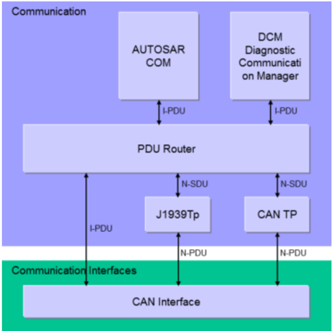

J1939Tp 的目的是对长度超过 8 字节的 **J1939 PGN**（**N-SDU**）进行分段与重组。被分段的消息经由 **CAN** 接口发送与接收。

**PDU** 路由器（**PduR**）将 AUTOSAR **COM** 与 **DCM I-PDU** 部署到不同的通信协议上（例如 **CAN** 或 **J1939**，经由传输层分段或直接发送）。在运行时，PduR 根据 **I-PDU**（**L-SDU** 或 **N-SDU**）标识符决定将 **I-PDU** 路由到哪里。同样，CanIf 使用 **L-SDU**（**I-PDU** 或 **N-PDU**）标识符来决定所接收的消息是必须由可用的传输层模块之一处理，还是可以直接转发给 PduR。

J1939Tp 支持超过 8 字节的固定与可变长度的 **N-SDU**（**I-PDU**）。不超过 8 字节的 **I-PDU** 在 PduR 与 CanIf 之间直接交换。

固定长度的 **N-SDU** 总是由 J1939Tp 分段，而可变长度的 **N-SDU** 仅在超过 8 字节时才被分段。J1939Tp 将实际长度不超过 8 字节、但所配置的最大长度超过 8 字节的可变长度 **N-SDU** 直接转发给 CanIf。当接收到一个大 **N-SDU** 时，传输协议变体（**BAM** 或 **CMDT**）基于所接收的 **N-PDU** 选择；当发送一个大 **N-SDU** 时，则基于配置与实际的 **DA** 选择。

J1939Tp 支持处理具有可变 **SA**、**DA** 与优先级的 **N-PDU** 与 **N-SDU**。在这种情况下，**N-PDU** 与 **N-SDU** 将在元数据（**MetaData**）中包含 **CAN ID** 的部分内容。

总之，J1939Tp 提供以下功能：

* 发送方向上的数据分段与直接发送
* 接收方向上的数据重组与直接接收
* 数据流控制
* 超时监督
* 分段或重组期间的错误检测

## 2. 缩略语

下表收录与 SAE J1939 传输层模块相关、且未包含在 [\[3, AUTOSAR Glossary\]](#ref-3) 中的术语、缩略语与缩写。

**Address Claiming**
> 地址声明构成标准文档 [\[4, SAE J1939-81\]](#ref-4) 中定义的 **SAE J1939** 网络管理。地址声明为连接到一个 **J1939** 网络的每个 **ECU** 分配一个临时的 8 位标识符。在该网络内，该 8 位标识符是唯一的。该 8 位标识符用作经由 **J1939** 网络传输的参数组（消息）的源地址与目标地址。地址声明过程基于 **AddressClaimed** 消息（**PGN** = 0x0EE00）的交换。

**Parameter**
> 参数是 **SAE J1939** 应用层的信号。参数由 **SPN** 唯一标识。

**Parameter Group**
> 参数组是 **SAE J1939** 应用层的消息。每个参数组包含若干参数（信号），并由 **PGN** 唯一标识。

**SAE J1939 Diagnostics**
> **SAE J1939** 诊断层在标准文档 [\[5, SAE J1939-73\]](#ref-5) 中定义。**J1939** 诊断在功能上类似于 **UDS** 诊断，并且最近已扩展为支持针对排放相关值的 **OBD**。

**SAE J1939 Transport Protocol**
> **SAE J1939** 传输协议用于超过 8 字节数据的消息的分段传输。该传输协议在网络层标准文档（[\[2, SAE J1939-21\]](#ref-2)）中定义。

**BAM**
> **Broadcast Announce Message**，**SAE J1939** 传输协议的广播变体。

**BSW**
> 基础软件（模块）（**Basic Software (module)**）。

**CanIf**
> **CAN** 接口（**CAN Interface**）。

**CanTp**
> **CAN** 传输层（**CAN Transport Layer**）。

**CMDT**
> **Connection Mode Data Transfer**，又称 **RTS**/**CTS**，**SAE J1939** 传输协议的点对点变体。

**DA**
> 目标地址（**Destination Address**），**SAE J1939** 消息 29 位标识符的一部分。

**DET**
> 默认错误追踪器，支持开发与运行时错误报告（**Default Error Tracer**）。

**DP**
> 数据页（**Data Page**），18 位 **PGN** 的最高有效位（**MSB**）。

**EcuM**
> **ECU** 状态管理器（**ECU State Manager**）。

**EDP**
> 扩展数据页（**Extended Data Page**），18 位 **PGN** 的第二位（**MSB** 之后）。

**FrTp**
> **FlexRay** 传输层（**FlexRay Transport Layer**）。

**J1939Tp**
> **SAE J1939** 传输层，实现 **SAE J1939** 传输协议。

**MetaData**
> 随 **PDU** 一起传输的元数据，由一组元数据项（meta data item）组成。

**MetaDataItem**
> 具有已定义类型与大小的单个元数据项。

**PDU1**
> **J1939** **PDU** 类型 1，这种 **PG** 可以发送到特定的目标地址。

**PDU2**
> **J1939** **PDU** 类型 2，这种 **PG** 只能作为广播发送。

**PDUF**
> **PDU** 格式（**PDU Format**），18 位 **PGN** 的中间字节，它标识该 **PG** 并确定该 **PGN** 的布局（**PDU1**/**PDU2**）。

**PduR**
> **PDU** 路由器（**PDU Router**）。

**PDUS**
> **PDU** 特定（**PDU Specific**），18 位 **PGN** 的低位字节，它进一步标识不能拥有目标地址的 **PDU2 PG**。

**PG**
> 参数组（**Parameter Group**），**SAE J1939** 对特定消息布局的称呼，对应于 J1939Tp 的一个 **N-SDU**。

**PGN**
> 参数组编号（**Parameter Group Number**），**SAE J1939** 参数组的唯一标识符（18 位：**EDP**、**DP**、**PDUF**、**PDUS**），包含在许多 **J1939** 协议消息的载荷中，以及 **SAE J1939** 消息的 29 位 **CAN** 标识符中。

**RTE**
> AUTOSAR 运行时环境（**AUTOSAR Runtime Environment**）。

**SA**
> 源地址（**Source Address**），**SAE J1939** 消息 29 位标识符的一部分。

**SchM**
> 基础软件调度管理器，**RTE** 的一部分（**Basic Software Schedule Manager**）。

**SNA**
> 信号不可用（**Signal Not Available**），在 **SAE J1939 PG**/**参数** 中所有位置 1。

**SPN**
> 可疑参数编号（**Suspect Parameter Number**），**SAE J1939** 参数的唯一标识符。

**TP.CM**
> 连接管理消息（**Connection Management message**）（**PGN** = 0x0EC00），由 **SAE J1939** 传输协议使用，对应于 J1939Tp 的一个 **N-PDU**。

**TP.CM_BAM**
> **Broadcast Announce Message**，**TP.CM** 的变体，发起一次 **BAM** 传输。

**TP.CM_CTS**
> **Connection Mode Clear To Send**，**TP.CM** 的变体，在 **CMDT** 传输期间用于握手。

**TP.CM_EndOfMsgAck**
> **End Of Message Acknowledge**，**TP.CM** 的变体，确认一次 **CMDT** 传输的正确接收。

**TP.CM_RTS**
> **Connection Mode Request To Send**，**TP.CM** 的变体，发起一次 **CMDT** 传输。

**TP.Conn_Abort**
> 连接中止（**Connection Abort**），**TP.CM** 的变体，终止一次 **CMDT** 传输。

**TP.DT**
> 数据传输消息（**Data Transfer message**）（**PGN** = 0x0EB00），由 **SAE J1939** 传输协议使用，对应于 J1939Tp 的一个 **N-PDU**。

## 3. 相关文档

### 3.1. 输入文件和相关标准与规范

<a id="ref-1"></a>- [1] SAE J1939 - Serial Control and Communications Heavy Duty Vehicle Network
<a id="ref-2"></a>- [2] SAE J1939-21 Data Link Layer
<a id="ref-3"></a>- [3] 术语表 AUTOSAR\_FO\_TR\_Glossary
<a id="ref-4"></a>- [4] SAE J1939-81 Network Management
<a id="ref-5"></a>- [5] SAE J1939-73 Application Layer - Diagnostics
<a id="ref-6"></a>- [6] 基础软件模块通用规范 AUTOSAR\_CP\_SWS\_BSWGeneral
<a id="ref-7"></a>- [7] 分层软件架构 AUTOSAR\_CP\_EXP\_LayeredSoftwareArchitecture
<a id="ref-8"></a>- [8] 默认错误追踪器规范 AUTOSAR\_CP\_SWS\_DefaultErrorTracer
<a id="ref-9"></a>- [9] ECU 状态管理器规范 AUTOSAR\_CP\_SWS\_ECUStateManager
<a id="ref-10"></a>- [10] RTE 软件规范 AUTOSAR\_CP\_SWS\_RTE
<a id="ref-11"></a>- [11] PDU 路由器规范 AUTOSAR\_CP\_SWS\_PDURouter
<a id="ref-12"></a>- [12] CAN 接口规范 AUTOSAR\_CP\_SWS\_CANInterface
<a id="ref-13"></a>- [13] CAN 传输层规范 AUTOSAR\_CP\_SWS\_CANTransportLayer
<a id="ref-14"></a>- [14] SAE J1939 的 BSW 模块需求 AUTOSAR\_CP\_SRS\_SAEJ1939
<a id="ref-15"></a>- [15] 基础软件模块通用需求 AUTOSAR\_CP\_SRS\_BSWGeneral
<a id="ref-16"></a>- [16] 基础软件模块清单 AUTOSAR\_CP\_TR\_BSWModuleList
<a id="ref-17"></a>- [17] 系统模板 AUTOSAR\_CP\_TPS\_SystemTemplate
<a id="ref-18"></a>- [18] ECU 配置规范 AUTOSAR\_CP\_TPS\_ECUConfiguration

### 3.2. 相关规范

AUTOSAR 提供了一份基础软件模块通用规范 [\[6, SWS BSW General\]](#ref-6)，它同样适用于 SAE J1939 传输层。

因此，规范 [\[6, SWS BSW General\]](#ref-6) 应被视为 SAE J1939 传输层的附加且必需的规范。

## 4. 约束和假设

### 4.1. 限制

AUTOSAR 架构包含若干通信系统特定的传输层（**J1939Tp**、**CanTp**、**FrTp** 等）。所有这些模块都需要拥有相同的 **API**，PduR 对其拥有单独配置能力的 **API** 函数除外。

J1939Tp 模块不实现 TriggerTransmit **API**，因为它只对时间触发的总线架构有用。

### 4.2. 汽车域的适用性

J1939 传输层支持被设计为在 **J1939** 网络中运行的 **ECU** 的实现。

## 5. 对其他模块的依赖

[\[7, EXP Layered Software Architecture\]](#ref-7) 展示了 J1939 传输层的相邻模块的概览。

除了对所有 **BSW** 模块都有接口的标准模块——默认错误追踪器（**DET**，[\[8, SWS Default Error Tracer\]](#ref-8)）、**ECU** 状态管理器（**EcuM**，[\[9, SWS ECU State Manager\]](#ref-9)）与基础软件调度器（**SchM**，[\[10, SWS RTE\]](#ref-10)）——之外，J1939Tp 只与 **PDU** 路由器（**PduR**，[\[11, SWS PDU Router\]](#ref-11)）及 **CAN** 接口（**CanIf**，[\[12, SWS CAN Interface\]](#ref-12)）交互。J1939Tp 的接口与 **CAN** 传输层（**CanTp**，[\[13, SWS CAN Transport Layer\]](#ref-13)）的接口类似。

下图展示了 J1939Tp、PduR 与 CanIf 之间的交互。

图 5.1：J1939 传输层的交互（**J1939 Transport Layer interactions**）

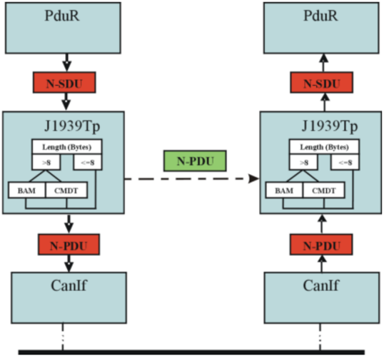

J1939Tp 的上层接口为 PduR 模块提供对接收与发送 **N-SDU** 的访问，这些 **N-SDU** 对应于最大长度超过 8 字节数据的 **J1939 PG**。

最大长度不超过 8 字节的 **J1939 PG** 在 PduR 与 CanIf 之间直接交换。

### 5.1. 文件结构

AUTOSAR 规定一个 **ECU** 可以由以目标代码、源代码（生成的或静态的）或两者形式提供的模块构成。

以目标代码还是源代码形式提供模块的决定，是知识产权保护、测试覆盖率、代码效率与系统生成时的可配置性之间的折中。根据 **OEM** 的可配置性要求，供应商可以以目标代码或源代码的形式交付 J1939Tp 模块。

本节定义的文件层次结构允许将平台、编译器与实现特定的定义和声明同一般性定义分离，并将源代码与配置分离。

#### 5.1.1. 代码文件结构

有关详细信息，请参阅 [\[6, SWS BSW General\]](#ref-6) 的第 5.1.6 小节"代码文件结构"（Code file structure）。

内部使用的数据类型与函数应在实现的源文件中局部定义。

这防止这些符号在 J1939Tp 模块之外可见。

#### 5.1.2. 头文件结构

有关详细信息，请参阅 [\[6, SWS BSW General\]](#ref-6) 的第 5.1.7 小节"头文件结构"（Header file structure）。

## 6. 功能规格

本章描述 **SAE J1939** 传输层的功能。它解释提供给上层与下层的服务以及 J1939Tp 的内部行为。

### 6.1. SAE J1939 的基本原理

**SAE J1939** 标准定义了一组参数组（**PG**），每个参数组包含具有已定义内容与语义的信号。每个 **PG** 提供以下信息：

* 载荷长度类型：最大字节数，固定或可变长度。
* 参数组编号（**PGN**）：18 位值，包含以下字段：
  * 2 位数据页信息（**EDP** 与 **DP**）
  * 8 位 **PDU** 格式（**PDUF**）
  * 8 位 **PDU** 特定（**PDUS**）

具有 **PDU** 格式 &lt; 240 的 **PGN**（**PDU1** 格式）标识点对点消息，而具有 **PDU** 格式 >= 240 的 **PGN**（**PDU2** 格式）标识广播消息。**PDU** 特定字段只对广播消息（**PDU2** 格式）有意义；对点对点消息（**PDU1** 格式）它始终为零。

**J1939** 使用 29 位 **CAN** 标识符来标识每条消息。该 **CAN** 标识符包含一个 3 位优先级、**PGN**、源地址（**SA**）与目标地址（**DA**，仅用于点对点消息）。

通常，一个 **ECU** 只有一个节点地址，它在接收的消息中用作 **DA**，在发送的消息中用作 **SA**。但是，单个 **ECU** 也可以同时实现多个不同的 **J1939** 节点，每个节点都有自己的节点地址。在这种情况下，该 **ECU** 接受这些节点地址中的任何一个作为 **DA**，并以任何已定义的节点地址作为 **SA** 发送。

**SAE J1939** 传输层使用两个由 **PDU1** 格式 **PGN** 标识的特殊点对点消息来传输被分段的消息，两者都具有 8 字节的固定长度。这些消息在本文档的上下文中称为传输帧（**transport frame**）。

**TP.CM** 用于连接管理。其载荷的第一个字节标识它的角色，角色可以是以下之一：

**TP.CM\_BAM** 用于发起一次 **BAM** 传输。

* 发送 **TP.CM\_RTS** 以发起一次 **CMDT** 传输。
* **TP.CM\_CTS** 在一次 **CMDT** 传输期间用于流控。

**TP.CM\_EndOfMsgAck** 指示一次 **CMDT** 传输的结束。

**TP.Conn\_Abort** 指示一个错误并终止该 **CMDT** 传输。

**TP.DT** 在第一个字节中包含一个序列号与 7 字节数据，**BAM** 与 **CMDT** 传输都使用它。

由某个 **CAN** 标识符标识的单个 **TP.CM** 或 **TP.DT** 帧用于不同的 **PG**。被传输 **PG** 的 **PGN** 包含在 **TP.CM** 帧的载荷中，如 [\[2, SAE J1939-21\]](#ref-2) 所规定。

与 **CMDT** 相关的传输帧的目标地址（**DA**）包含一个有效的节点地址，因此允许点对点连接，而与 **BAM** 相关的传输帧的 **DA** 始终设置为 0xFF 以建立广播连接。

如果 [\[2, SAE J1939-21\]](#ref-2) 的建议未在本文档中被明确排除，则 J1939Tp 模块应遵循这些建议。

### 6.2. J1939Tp 的基本功能

本节描述 J1939Tp 功能中与相邻模块无关的方面。

在出现错误与异常时，J1939Tp 模块不应修改其当前模块状态，而应只报告该错误事件。

J1939Tp 模块的状态参见图 7.1。

为了确保 PDU 路由器对所有 **J1939 PG** 的处理是唯一的、且与载荷长度类型（可变或固定）无关，J1939Tp 用于所有长于 8 字节的参数组的发送，而不管其长度是固定的还是可变的。

这意味着：具有可变长度、且所配置的最大尺寸超过 8 字节但在运行时不超过 8 字节的 **PG**，也应使用 J1939Tp 传输，即使不需要分段、并且从 **PDU** 路由器到 **CAN** 接口的直接发送是可能的。

J1939 传输层应实现 [\[2, SAE J1939-21\]](#ref-2) 中定义的以下两种 **J1939** 传输协议变体：

* **BAM**，用于广播发送
* **CMDT**，用于点对点发送

J1939 传输层应可配置为同时使用 **BAM** 与 **CMDT** 传输协议变体、只使用 **BAM**、或只使用 **CMDT**。

J1939 传输层应对所有 **N-SDU** 使用类型为 SOURCE\_ADDRESS\_16、TARGET\_ADDRESS\_16 与 PRIORITY\_8 的元数据项，并对所有 **N-PDU** 使用类型为 CAN\_ID\_32 的元数据项。

J1939 传输层模块应为同一 **PGN** 支持并行处理多个连接，只要它们可以被独立地接收或发送。

连接的定义参见第 [6.5.7](#657-并发连接) 节。

如果多个接收连接以相同的 **PGN** 与匹配的通道参数配置，则 J1939Tp 应分配一个具有匹配参数的任意空闲连接。

**注意：** 这种场景通常只在所有这些相似连接都被配置为最终到达同一个上层模块时才有用。

### 6.3. 初始化与关闭

下图汇总了有关初始化与关闭的所有需求：

图 7.1：J1939 传输层的生命周期（**J1939 Transport Layer life cycle**）

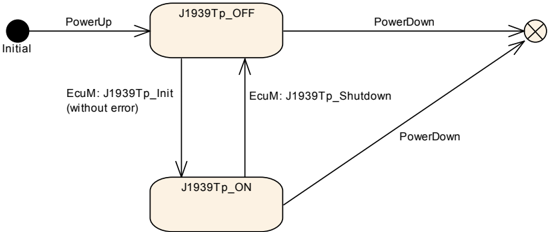

J1939Tp 模块应有两个全局状态，**J1939TP\_ON** 与 **J1939TP\_OFF**。

J1939Tp 模块在上电之后应处于 **J1939TP\_OFF** 状态。

在状态 **J1939TP\_OFF** 中，J1939Tp 允许对后构建时（post build）配置进行更新。

只有当 J1939Tp 处于 **J1939TP\_ON** 状态时，J1939Tp 模块才应执行分段与重组任务。

全局状态（参见上文）应用于在调用某个 **API** 之前检查模块是否已被初始化。

### 6.4. 与下层的通信

提供给下层的所有服务接口应独立于 J1939Tp 的内部通信配置与实现。

J1939Tp 应使用服务函数 CanIf\_Transmit() 发送传输帧 **TP.CM** 与 **TP.DT** 以及直接帧。

#### 6.4.1. 发送确认

发送确认 J1939Tp\_TxConfirmation() 由 CanIf 调用，以向 J1939Tp 通知某个 **N-PDU** 的成功或失败的发送。

当以结果 **E_NOT_OK** 调用 J1939Tp\_TxConfirmation() 时，J1939Tp 模块应中止相应的会话。

对于发送会话，会话中止在上文中有定义，而接收会话的行为亦然。在这种情况下，J1939Tp 不应尝试发送一个中止帧（如所定义的那样）。

#### 6.4.2. 接收指示

J1939Tp 模块应提供一个 J1939Tp\_RxIndication() **API**，以允许 CanIf 通知已接收到一个新的 **N-PDU**（参见下文）。

CanIf 应根据其配置执行接收指示（即如果这样配置，则在 **ISR** 上下文中）。

### 6.5. 内部行为

#### 6.5.1. 会话处理

##### 6.5.1.1. 关闭发送

当传输发送会话成功完成时，J1939Tp 模块应以结果 **E_OK** 调用上层的一个通知服务 PduR\_J1939TpTxConfirmation()，以通知该 **N-SDU** 传输已被成功处理。

##### 6.5.1.2. 中止发送

中止发送特性应向上层指示给定 **N-SDU** 的发送已被中止。它使用回调函数 PduR\_J1939TpTxConfirmation()，并以 **E_NOT_OK**。

##### 6.5.1.3. 关闭接收

关闭连接特性应向上层指示传输接收会话已完成。它使用 PduR\_J1939TpRxIndication() 并以 **E_OK**，以指示该 **N-SDU** 接收已被成功处理。

##### 6.5.1.4. 中止接收

中止接收特性应向上层指示给定 **N-SDU** 的接收已被中止。它使用 PduR\_J1939TpRxIndication() 并以状态 **E_NOT_OK**。

##### 6.5.1.5. 中止 CMDT 连接

中止 **CMDT** 连接特性应向参与所涉连接的其他 **ECU** 指示：当前的 **CMDT** 会话（发送或接收）无法成功完成。应按照 [\[2, SAE J1939-21\]](#ref-2) 的规定，经由 **CAN** 向另一个 **ECU** 发送一条 **TP.Conn\_Abort** 中止消息。

每当在 **TP.CM\_CTS** 被成功发送或接收之后发生错误时，发送 **TP.Conn\_Abort** 都是必要的，并且在 **TP.CM\_RTS** 的发送或接收之后就已经是可取的。**TP.Conn\_Abort** 的连接中止原因应按照 [\[2, SAE J1939-21\]](#ref-2) 设置。

#### 6.5.2. N-SDU 的接收

**N-SDU** 的接收总是由一个 **TP.CM** 消息的接收发起。对于 **CMDT**，这是一条 **TP.CM\_RTS**；对于 **BAM**，是一条 **TP.CM\_BAM**。

根据发起 **TP.CM** 帧的控制字节（**TP.CM\_BAM** 或 **TP.CM\_RTS**），J1939Tp 模块应使用 **J1939** 传输协议的 **BAM** 或 **CMDT** 变体来处理数据接收。

当接收到一个包含 **TP.CM\_BAM** 或 **TP.CM\_RTS** 的 **N-PDU** 时，J1939Tp 模块应首先通知上层（**PDU** 路由器），然后再处理帧重组。它使用 PduR\_J1939TpStartOfReception() 函数，并带有以下参数：

* 相应 **N-SDU** 的标识符，
* （取决于所配置的元数据项）**SA**、**DA** 与优先级，
* 总数据长度（重组之后），以及
* 指向一个位置的指针，上层在该位置存储其当前可用的缓冲区大小。

在接收到一个包含 **TP.DT** 帧的 **N-PDU** 之后，应以以下参数调用 PduR\_J1939TpCopyRxData() 函数：

* 相应 **N-SDU** 的标识符，
* 带有至多 7 字节数据的 PduInfoPtr，
* 指向一个位置的指针，上层在该位置存储其当前可用的缓冲区大小。

如果出现以下任一情况，J1939Tp 模块应静默地中止接收：

* PduR\_J1939TpStartOfReception() 函数返回 **BUFREQ\_E\_NOT\_OK** 或 **BUFREQ\_E\_OVFL**，或
* 上述所选择的协议与为被传输 **PGN** 配置的传输协议不匹配（参见 J1939TpRxProtocolType），或
* 带有元数据的 **N-PDU** 的 **SA**/**DA** 与所配置的 **SA**/**DA** 不匹配（参见 J1939TpRxSa/J1939TpRxDa）。

对于 **BAM** 连接，不需要进一步的活动。

对于 **CMDT** 连接，应按上文所述执行一次 **CMDT** 连接中止，并且连接中止原因应设置为 1（已处于一个或多个连接管理的会话中，无法支持另一个）。

如果出现以下任一情况，J1939Tp 模块应按中止接收特性的方式中止接收：

* 当经由直接 **N-PDU** 接收时，PduR\_J1939TpStartOfReception() 经由 bufferSizePtr 返回的值小于该 **N-SDU** 的总数据长度，
* PduR\_J1939TpCopyRxData() 函数返回 **BUFREQ\_E\_NOT\_OK**，或
* 调用了 J1939Tp\_CancelReceive() 函数。

对于 **BAM** 连接，不需要进一步的活动。

对于 **CMDT** 连接，应按上文所述执行一次 **CMDT** 连接中止，并且在调用 PduR\_J1939TpStartOfReception() 之后，连接中止原因应设置为 1（已处于一个或多个连接管理的会话中，无法支持另一个）；在其他两种情况下，应设置为 2（系统资源被需要用于另一个任务，因此该连接管理的会话被终止）。

#### 6.5.3. N-SDU 的发送

上层（**PDU** 路由器）通过调用 J1939Tp\_Transmit() 请求发送一个 **N-SDU**。J1939Tp\_Transmit() 的参数描述该 **N-SDU** 的标识符（NSduId）与对 PduInfoType 的引用，后者指示要发送的 **N-SDU** 的完整长度（完整的 Tx N-SDU 数据长度）与指向载荷 **N-SDU** 的指针，后者可以包含带有 **SA**、**DA** 与优先级的元数据，取决于该 **N-SDU** 的元数据配置。

如果已配置，则发送时应使用传输协议变体（**BAM**/**CMDT**，参见 J1939TpTxProtocolType）与 **SA**/**DA**（参见 J1939TpTxSa/J1939TpTxDa）。对于带有元数据的 **N-SDU**，这些参数是可选的。如果未配置 **SA** 或 **DA**，则应使用经由元数据提供的值。如果未配置传输协议，则应基于实际的 **DA** 选择：当 **DA** 为 0xFF 时为 **BAM**，否则为 **CMDT**。

函数 J1939Tp\_Transmit() 应使用 PduInfoType 结构中提供的 NSduId 与 SduLength。它不应使用 **N-SDU** 的载荷，只使用其中包含的元数据。

在来自上层的发送请求之后，J1939Tp 模块应通过发送以下内容来发起发送：

* 对于 **CMDT**：一个 **TP.CM\_RTS** 帧
* 对于 **BAM**：一个 **TP.CM\_BAM** 帧

对于要发送的每个 **TP.DT** 帧，J1939Tp 模块应 beforehand 以以下参数调用 PduR\_J1939TpCopyTxData()：

* 相应 **N-SDU** 的标识符，
* SduLength 至多 7 字节的 PduInfoType 结构，
* 重试参数，以及
* 指向一个位置的指针，上层在该位置存储其当前可用的数据。

当 PduR\_J1939TpCopyTxData() 返回 **BUFREQ\_E\_BUSY** 时，J1939Tp 应重试对 PduR\_J1939TpCopyTxData() 的调用，直到数据可用或发生超时。

如果 J1939TpTxRetrySupport 被禁用，则 PduR\_J1939TpCopyTxData() 的参数 retry 应始终设置为 **NULL\_PTR**。

对于 **BAM** 传输，PduR\_J1939TpCopyTxData() 的参数 retry 应始终设置为 **NULL\_PTR**。

如果 J1939TpTxRetrySupport 已启用，则在 **CMDT** 传输期间，应经由 PduR\_J1939TpCopyTxData() 的参数 retry 提供一个有效的 RetryInfoType 结构体。

关于 J1939 传输层模块在 **CMDT** 传输期间如何使用 RetryInfoType 的描述，参见第 [6.5.4.2](#6542-使用-cmdt-的数据流) 节。

如果出现以下任一情况，J1939Tp 模块应按中止发送特性的规定中止发送会话：

* 上层以 **BUFREQ\_E\_NOT\_OK** 返回 PduR\_J1939TpCopyTxData() 函数调用，或
* 调用了 J1939Tp\_CancelTransmit() 函数。

对于 **CMDT** 连接，应按上文所述执行一次 **CMDT** 连接中止，并且连接中止原因应设置为 2（系统资源被需要用于另一个任务，因此该连接管理的会话被终止）。

#### 6.5.4. CAN 总线上的数据流

##### 6.5.4.1. 使用直接发送的数据流

下图展示了使用 J1939Tp 在两个 **ECU** 之间进行直接消息发送的一个示例。这是 J1939Tp **N-SDU** 不使用 **TP.CM** 或 **TP.DT** 帧发送的唯一情况。**SA** 始终包含在 **CAN** 标识符中。取决于该 **PGN** 的 **PDU** 格式，该 **CAN** 标识符可能包含 **DA**。

图 7.2：可变长度 &lt;= 8 字节 PG 的直接数据流示例（**Example of direct data flow for PGs of variable length < = 8 Bytes**）

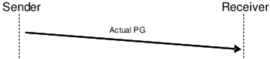

##### 6.5.4.2. 使用 CMDT 的数据流

下图展示了使用 **CMDT** 作为传输协议变体在两个 **ECU** 之间进行分段消息发送的一个示例。**CMDT** 传输协议变体用于点对点通信（即 1 对 1 通信，如 **UDS** 诊断中的物理寻址）。在该示例中，所发送的 **PG** 的总长度为 16 字节，对应 3 个 7 字节的块。

图 7.3：使用 CMDT 作为传输协议变体的无错误数据流示例（**Example of data flow without error using CMDT as transport protocol variant**）

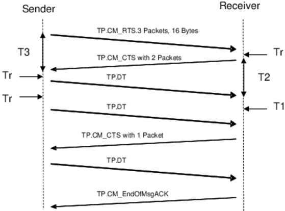

**J1939** 传输协议使用 **RTS** 与 **CTS** 的初始序列来确定每个块的包数。

如果 J1939TpTxDynamicBlockCalculation 已启用，则在调用 J1939Tp\_Transmit() 之后，J1939Tp 应调用一次 PduR\_J1939TpCopyTxData()，其中 info-&gt;SduLength 设置为 0、retry 设置为 **NULL\_PTR**，以便经由 availableDataPtr 获取可用的数据量。

如果 J1939TpTxDynamicBlockCalculation 与 J1939TpTxMaxPacketsPerBlock 均已启用，则 J1939Tp 应将 PduR\_J1939TpCopyTxData() 返回的可用数据量与 J1939TpTxMaxPacketsPerBlock 进行比较，并使用两者中较小的值来计算 **TP.CM\_RTS** 消息的最大包数字段。

如果 J1939TpTxDynamicBlockCalculation 已启用但 J1939TpTxMaxPacketsPerBlock 被禁用，则 J1939Tp 应使用 PduR\_J1939TpCopyTxData() 返回的可用数据量来计算 **TP.CM\_RTS** 消息的最大包数字段。

如果 J1939TpTxDynamicBlockCalculation 被禁用，则 J1939Tp 应使用 J1939TpTxMaxPacketsPerBlock 作为 **TP.CM\_RTS** 消息的最大包数字段。

如果 J1939TpRxDynamicBlockCalculation 与 J1939TpRxPacketsPerBlock 均已启用，则 J1939Tp 应将 PduR\_J1939TpStartOfReception() 返回的可用缓冲区大小的值与 J1939TpRxPacketsPerBlock 进行比较，并使用较低的值来计算 **TP.CM\_CTS** 消息的包数字段。

如果 J1939TpRxDynamicBlockCalculation 已启用但 J1939TpRxPacketsPerBlock 被禁用，则 J1939Tp 应使用 PduR\_J1939TpStartOfReception() 返回的可用缓冲区大小的值来计算 **TP.CM\_CTS** 消息的包数字段。

在接收到 **TP.CM\_RTS** 之后、以及在一个块的最后一个 **N-PDU** 的接收之后，如果所报告的缓冲区大小足以容纳下一个块，则 J1939Tp 应发送一条 **TP.CM\_CTS** 消息以请求下一个块。由 **TP.CM\_CTS** 请求的包数在一个 **N-SDU** 的完整接收期间应保持恒定；只有在最后一个 **TP.CM\_CTS** 中，该数量才应减少为剩余的包数。

当 PduR\_J1939TpStartOfReception() 或 PduR\_J1939TpCopyRxData() 所报告的缓冲区不足以接收一个完整的块时，J1939Tp 应以 info-&gt;SduLength 设置为 0 调用 PduR\_J1939TpCopyRxData()，直到缓冲区足以容纳一个块、或发生超时。

**请注意：** 超时可以是对预期消息的超时（例如 T1），也可以是消息发送期间的超时（例如 Tr）。

在按上述方式监控缓冲区状态时，J1939Tp 应按照 [\[2, SAE J1939-21\]](#ref-2) 中定义的时序要求发送 **TP.CM\_CTS** 等待帧（包数设置为 0，另见 [\[2, SAE J1939-21\]](#ref-2)）。

如果 J1939TpRxRetrySupport 已启用，则 J1939Tp 应按照 J1939TpRxDynamicBufferRatio 调整 PduR\_J1939TpStartOfReception() 返回的可用缓冲区大小的值，然后再使用它来按上述方式计算 **TP.CM\_CTS** 消息的包数字段。

如果 J1939TpRxDynamicBlockCalculation 被禁用，则 J1939Tp 应使用 J1939TpRxPacketsPerBlock 来计算 **TP.CM\_CTS** 消息的包数字段。

如果 J1939TpTxRetrySupport 已启用，则 J1939Tp 应调用 PduR\_J1939TpCopyTxData()，其中：

* 在接收到 **TP.CM\_CTS** 之后的第一次调用中，TpDataState 设置为 **TP\_DATACONF**，并且
* 在随后的调用中，TpDataState 设置为 **TP\_CONFPENDING**。

如果接收到一个 **TP.CM\_CTS** 等待帧（包数设置为 0，另见 [\[2, SAE J1939-21\]](#ref-2)），则 J1939Tp 应等待另一个 **TP.CM\_CTS** 帧。

当 J1939Tp 接收到一个请求超出当前位置的数据、或在接收到最后一个 **TP.CM\_CTS** 的位置之前的数据的 **TP.CM\_CTS** 帧时，它应使用上述的机制以原因 255（**SNA**）中止该发送。

如果 J1939TpTxRetrySupport 已启用，当 J1939Tp 接收到一个请求已发送数据的 **TP.CM\_CTS** 帧时，它应调用 PduR\_J1939TpCopyTxData()，其中 TpDataState 设置为 **TP\_DATARETRY**、TxTpDataCnt 设置为要重传的字节数。

需要重传的字节数根据所请求的包相对于当前包的位置计算。

如果 J1939TpTxRetrySupport 被禁用，当 J1939Tp 接收到一个请求已发送数据的 **TP.CM\_CTS** 帧时，它应使用上述的机制以原因 255（未分配）中止该发送。

如果 J1939TpRxRetrySupport 已启用，当接收期间发生序列错误时，J1939Tp 模块应在接收到该块的最后一个 **TP.DT** 消息之后，发送一个 **TP.CM\_CTS** 帧以请求当前块中最后一个正确接收的包之后的包。

具有序列错误的 **TP.DT** 消息的内容、以及同一块中位于序列错误之后的 **TP.DT** 消息的内容应被丢弃。

**注意：** 这意味着对这些消息不应调用 PduR\_J1939TpCopyRxData()。

如果 J1939TpRxRetrySupport 被禁用，当接收期间发生序列错误时，J1939Tp 模块应中止接收会话：

* 按中止接收特性的规定，并且
* 按中止 **CMDT** 连接特性的规定，连接中止原因为 255（**SNA**）。

J1939Tp 应实现 [\[2, SAE J1939-21\]](#ref-2) 中描述的所有与 **CMDT** 相关的时序约束（Tr、Th、T1、T2、T3、T4）。它们监督 **CMDT** 数据流。

如果在 **CMDT** 发送期间发生超时（详细信息参见 [\[2, SAE J1939-21\]](#ref-2)），则 J1939Tp 模块应中止发送会话：

* 按中止发送特性的规定，并且
* 按中止 **CMDT** 连接特性的规定，当超时发生在 **TP.CM\_RTS** 帧成功发送之后时，连接中止原因为 3（发生了超时，这是用于关闭会话的连接中止）。

如果在接收期间发生超时（详细信息参见 [\[2, SAE J1939-21\]](#ref-2)），则 J1939Tp 模块应中止接收会话：

* 按中止接收特性的规定，并且
* 按中止 **CMDT** 连接特性的规定，连接中止原因为 3（发生了超时，这是用于关闭会话的连接中止）。

如果在一个 **TP.CM\_RTS** 帧已被该 **ECU** 成功发送之后接收到一个 **TP.Conn\_Abort** 帧，则应按中止发送特性的指示中止该发送。不需要发送 **TP.Conn\_Abort**。

如果在一个 **TP.CM\_RTS** 帧已被接收之后接收到一个 **TP.Conn\_Abort** 帧，则应按中止接收特性的指示中止该接收。不需要发送 **TP.Conn\_Abort**。

##### 6.5.4.3. 使用 BAM 的数据流

J1939Tp 应实现 [\[2, SAE J1939-21\]](#ref-2) 中描述的与 **BAM** 相关的时序约束（50 ms、Tr、T1）。它们监督 **BAM** 数据流。

如果在 **BAM** 接收期间发生超时，则 J1939Tp 模块应按中止接收特性的规定中止接收会话。

在序列错误之后，J1939Tp 应按中止接收特性的规定中止 **BAM** 连接。

下图展示了根据 [\[2, SAE J1939-21\]](#ref-2)、使用 **BAM** 作为传输协议变体在两个 **ECU** 之间进行分段消息发送的一个示例。**BAM** 传输协议变体用于广播通信（即 1 对 n 通信，如 **UDS** 诊断中的功能寻址）。在该示例中，所发送的 **PG** 的总长度为 3 个 7 字节的块，它们必须被连续发送。

图 7.4：使用 BAM 作为传输协议变体的数据流示例（**Example of data flow using BAM as transport protocol variant**）

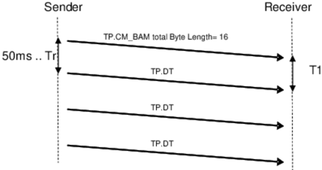

#### 6.5.5. N-SDU 缓冲区管理

J1939Tp 应没有内部的 **PDU** 缓冲区。它经由 PduR\_J1939TpCopyTxData() 直接从上层请求用于发送的数据，并经由 PduR\_J1939TpCopyRxData() 将接收到的数据直接提供给上层。

为了保证数据一致性，在完整的数据发送或接收期间，上层的完整缓冲区必须被锁定。

当 PduR 调用 J1939Tp\_Transmit() 时数据发送被初始化，并且在 J1939Tp 成功执行该调用之后处于活动状态，直到 J1939Tp 调用 PduR\_J1939TpTxConfirmation()：

图 7.5：Tx 缓冲区锁定（**Tx Buffer locking**）

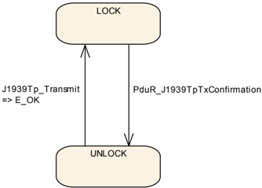

当 J1939Tp 调用 PduR\_J1939TpStartOfReception() 时数据接收被初始化，并且在 PduR 成功执行该调用之后处于活动状态，直到 J1939Tp 调用 PduR\_J1939TpRxIndication()：

图 7.6：Rx 缓冲区锁定（**Rx Buffer locking**）

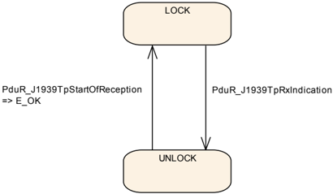

#### 6.5.6. J1939Tp 中 N-SDU 与 N-PDU 的关系

本小节描述一个 **N-SDU** 与传输该 **N-SDU** 数据所需的 **N-PDU** 集合之间存在的关系，如下图所示。

图 7.7：N-SDU 与 N-PDU 的关系（**Relation between N-SDU and N-PDU**）

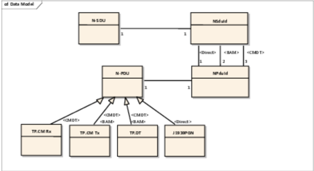

**N-PDU** 与 **N-SDU** 都可以使用元数据。在这种情况下，**N-SDU** 表示某个 **PGN**，而 **N-PDU** 表示 **TP.CM**、**TP.DT** 与直接 **PG**，无论源地址和/或目标地址是什么。

在接收期间，**N-SDU** 由 **TP.CM** 载荷中包含的 **PGN**、以及（当该 **N-SDU** 没有元数据时）隐式编码在 NPduIds 中或经由 **N-PDU** 的元数据显式提供的寻址信息的组合来标识。

在发送期间，相关的 **N-PDU** 集合由不带元数据的 **N-SDU** 的所配置 **SA**/**DA**、或由上层在元数据中显式提供的 **SA**/**DA** 来标识。

#### 6.5.7. 并发连接

连接只涉及 J1939Tp 的内部目的。它们对 J1939Tp 的上层与下层是透明的，但会影响 J1939Tp 的处理。

一个 J1939Tp 连接由其方向（接收/发送）与类型（**BAM**/**CMDT**/Direct）表征。类型为 **BAM** 或 **CMDT** 的 J1939Tp 连接使用以下与传输相关的帧：

* 控制（**TP.CM**）
* 数据（**TP.DT**）

与这些传输特定的帧对应的 **CAN** 标识符对于所有长于 8 字节的 **J1939 PG** 都是相同的：

* 从给定的 **SA** 发送 — 在 **BAM** 情况下
* 从给定的 **SA** 发送到给定的 **DA** — 在 **CMDT** 情况下

这降低了 J1939Tp 处理并发连接的可能性。

J1939Tp 应能够为所有不会干扰具有相同 **SA** 与 **DA** 的 **TP.DT** 帧使用的 **N-SDU** 并行处理连接。对于定义了 **SA**/**DA** 与协议类型的通道，每个 **PG** 在任意时刻只能有一个 **TP** 连接与一个直接连接处于打开状态。对于具有可变 **SA**/**DA** 的通道，并行连接的最大数量受分配给该通道的 **N-SDU** 数量限制。

J1939Tp 应只支持 [\[2, SAE J1939-21\]](#ref-2) 的第 5.10.5 小节中描述的并发连接。请注意，一个 AUTOSAR **ECU** 可以表示多个 **J1939** 节点，因此可能被分配了多于一个地址（用作 **SA** 或 **DA**）。

每个连接应独立于其他连接。

这意味着一个连接应使用其自己的资源，例如定时器或状态机。

#### 6.5.8. N-PDU 填充

J1939 传输层模块应始终按照 [\[2, SAE J1939-21\]](#ref-2) 以 8 字节发送 **TP.DT** 帧。

按照 [\[2, SAE J1939-21\]](#ref-2)，最后一个 **TP.DT** 帧或直接帧中所有未使用的数据字节应设置为 0xFF（**SNA**）。

#### 6.5.9. 意外 N-PDU 到达的处理

J1939Tp 应忽略与任何当前活动连接都不对应的意外 **N-PDU**。

如果 J1939TpTxRetrySupport 被禁用，当正在发送 **TP.DT** 消息时接收到一个 **TP.CM\_CTS**，J1939Tp 应按上述方式以连接中止原因 4（在数据传输进行中接收到 **CTS** 消息）中止该连接。

当为某个当前活动的连接接收到一个 **TP.CM\_RTS** 时，J1939Tp 应按中止接收特性的规定停止该连接，并按上文所述启动一个新的连接。

### 6.6. 错误分类

[\[6, SWS BSW General\]](#ref-6) 的第 [7.2](#72-导入的类型) 节"错误处理"（Error Handling）详细描述了基础软件的错误处理。其中最重要的是，它构成了一个由 **BSW** 模块中可能出现的五种错误类型组成的分类方案。

基于该基础，本节在相应的小节中规定特定的错误。

#### 6.6.1. 开发错误

表6.1：J1939Tp 模块中开发错误的定义

| 错误类型 | 相关错误码 | 错误值 |
| --- | --- | --- |
| 在状态 **J1939TP\_OFF** 中使用 **API** 服务 | J1939TP\_E\_UNINIT | 0x01 |
| 在状态 **J1939TP\_ON** 中调用 J1939Tp\_Init() | J1939TP\_E\_REINIT | 0x02 |
| 以无效的配置指针调用了 J1939Tp\_Init() | J1939TP\_E\_INIT\_FAILED | 0x03 |
| 以 **NULL** 指针调用 **API** 服务 | J1939TP\_E\_PARAM\_POINTER | 0x10 |
| 以错误的 **ID** 调用 **API** 服务 | J1939TP\_E\_INVALID\_PDU\_SDU\_ID | 0x11 |

#### 6.6.2. 运行时错误

表6.2：J1939Tp 模块中运行时错误的定义

| 错误类型 | 相关错误码 | 错误值 |
| --- | --- | --- |
| 在接收一个块的中间 **TP.DT** 帧之后，接收方发生超时。 | J1939TP\_E\_TIMEOUT\_T1 | 0x30 |
| 在发送一个 **TP.CM**/CTS 帧之后，接收方发生超时。 | J1939TP\_E\_TIMEOUT\_T2 | 0x31 |
| 在发送一个块的最后一个 **TP.DT** 帧之后，发送方发生超时。 | J1939TP\_E\_TIMEOUT\_T3 | 0x32 |
| 在接收到一个 **TP.CM**/CTS(0) 帧之后，发送方发生超时。 | J1939TP\_E\_TIMEOUT\_T4 | 0x33 |
| 在尝试发送下一个 **TP.DT** 或 **TP.CM** 帧时，发送方或接收方发生超时。 | J1939TP\_E\_TIMEOUT\_TR | 0x34 |
| 在一个 **TP.CM**/CTS(0) 帧之后、尝试发送下一个 **TP.CM**/CTS 帧时，接收方发生超时。 | J1939TP\_E\_TIMEOUT\_TH | 0x35 |
| 所接收 **TP.CM**/RTS 帧中"总消息大小"的值无效。 | J1939TP\_E\_INVALID\_TMS | 0x40 |
| 所接收 **TP.CM**/RTS 帧中"总包数"的值与"总消息大小"不匹配。 | J1939TP\_E\_INVALID\_TNOP | 0x41 |
| 所接收 **TP.CM**/RTS 帧中"最大包数"的值无效。 | J1939TP\_E\_INVALID\_MNOP | 0x42 |
| 所接收 **TP.CM** 帧中出现意外的 **PGN**。 | J1939TP\_E\_INVALID\_PGN | 0x43 |
| 所接收 **TP.CM**/CTS 帧中"包数"的值无效。 | J1939TP\_E\_INVALID\_NOP | 0x44 |
| 所接收 **TP.CM**/CTS 帧中"下一个包号"的值无效。 | J1939TP\_E\_INVALID\_NPN | 0x45 |
| 所接收 **TP.Conn\_Abort** 帧中"连接中止原因"的值无效。 | J1939TP\_E\_INVALID\_CAR | 0x46 |
| 所接收 **TP.DT** 帧中出现意外的序列号。 | J1939TP\_E\_INVALID\_SN | 0x47 |

#### 6.6.3. 瞬态故障

不存在瞬态故障。

#### 6.6.4. 生产错误

不存在生产错误。

#### 6.6.5. 扩展生产错误

不存在扩展生产错误。

## 7. API规范

### 7.1. API 参数检查

J1939TP\_E\_PARAM\_POINTER 应按 [\[6, SWS BSW General\]](#ref-6) 中 [SWS\_BSW\_00212] 的规定报告。

如果经由 J1939TpDevErrorDetect 为 J1939Tp 启用了开发错误检测，则所有使用 **SDU** 或 **PDU** 标识符的 **API** 都应检查输入标识符，并在针对未配置的 **PDU** 或 **SDU** 调用了该 **API** 时引发开发错误 J1939TP\_E\_INVALID\_PDU\_SDU\_ID。

### 7.2. 导入的类型

本节列出 J1939Tp 使用的所有外部定义的类型。这些类型从与下表所列模块名对应的头文件中包含。

表7.1：J1939Tp 模块导入数据类型的定义

| 模块 | 头文件 | 导入的类型 |
| --- | --- | --- |
| ComStack\_Types | ComStack\_Types.h | BufReq\_ReturnType |
| ComStack\_Types | ComStack\_Types.h | PduIdType |
| ComStack\_Types | ComStack\_Types.h | PduInfoType |
| ComStack\_Types | ComStack\_Types.h | PduLengthType |
| ComStack\_Types | ComStack\_Types.h | RetryInfoType |
| ComStack\_Types | ComStack\_Types.h | TPParameterType |
| ComStack\_Types | ComStack\_Types.h | TpDataStateType |
| Std | Std\_Types.h | Std\_ReturnType |
| Std | Std\_Types.h | Std\_VersionInfoType |

### 7.3. 类型定义

本节列出由 J1939Tp 定义的类型。

#### 7.3.1. J1939Tp_ConfigType

| 名称 | J1939Tp\_ConfigType |
| --- | --- |
| 类别 | 结构体（Structure） |
| 元素 | 实现特定 |
| 元素 | 类型：-；注释：初始化数据结构的内容是实现特定的。 |
| 描述 | 包含 J1939-TP 后构建时配置数据的数据结构。 |
| 可通过 | J1939Tp.h 获得 |

J1939Tp\_ConfigType 定义了一个包含 J1939Tp 在运行时使用的配置参数的结构体。它作为参数提供给 J1939Tp\_Init()。

### 7.4. 函数定义

本节定义提供给上层模块的函数列表。

#### 7.4.1. J1939Tp_Init

**说明**： 本函数初始化 J1939Tp 模块。服务 ID 0x01。本服务为同步调用，不可重入。参数 ConfigPtr（in）：指向配置数据结构体的指针。无返回值。可通过 **J1939Tp.h** 获得。

```C
void J1939Tp_Init ( const J1939Tp_ConfigType* ConfigPtr )
```

上电之后，J1939Tp 处于称为 **J1939TP\_OFF** 的状态。在该状态中，J1939Tp 尚未被配置，因此不能执行任何通信任务。J1939Tp 模块的环境（通常是 **ECU** 管理器）将在使用 J1939Tp 模块进行进一步处理之前调用 J1939Tp\_Init()。

函数 J1939Tp\_Init() 应初始化模块的所有全局变量，并复位所有传输协议连接。

J1939Tp\_Init() 应在成功初始化之后切换到内部状态 **J1939TP\_ON**。

当 J1939Tp 模块处于全局状态 **J1939TP\_ON** 中时被调用，则函数 J1939Tp\_Init() 应引发开发错误 J1939TP\_E\_REINIT 且不执行任何操作。

所提供的 ConfigPtr 应只在后构建时配置已启用、或必须支持不同的配置变体时使用。否则，应直接访问这些参数，以避免经由 ConfigPtr 的间接访问。

由 ConfigPtr 指向的 J1939Tp\_ConfigType 类型的结构体包含 J1939Tp 模块的后构建时参数。在链接时或预编译时配置的环境中，该结构体可以包含在若干配置变体之间有所不同的、一组后构建时参数。预期链接时与预编译时参数在不同的配置变体之间不会改变。

J1939Tp\_Init() 没有返回值，因为配置数据错误应在配置期间（例如由配置工具）检测到。此外，如果发生硬件错误，将通过错误管理器模块报告。

J1939TP\_E\_INIT\_FAILED 应按 [\[6, SWS BSW General\]](#ref-6) 中 [SWS\_BSW\_00050] 的规定报告。

#### 7.4.2. J1939Tp_Shutdown

**说明**： 本函数用于关闭 J1939Tp 模块。服务 ID 0x02。本服务为同步调用，不可重入。无参数。无返回值。可通过 **J1939Tp.h** 获得。

```C
void J1939Tp_Shutdown ( void )
```

为了关闭通信，状态管理（通常是 **ECU** 管理器）调用 J1939Tp\_Shutdown()。

J1939Tp\_Shutdown() 应关闭所有处于等待状态的传输协议连接，释放所有资源，并将 J1939Tp 模块置入全局状态 **J1939TP\_OFF**。

J1939Tp\_Shutdown() 不应针对处于等待状态的帧发送或接收引发通知。

#### 7.4.3. J1939Tp_GetVersionInfo

**说明**： 返回 J1939Tp 的版本信息。服务 ID 0x03。本服务为同步调用，可重入。参数 VersionInfo（out）：指向应存储 J1939Tp 版本信息的位置的指针。无返回值。可通过 **J1939Tp.h** 获得。

```C
void J1939Tp_GetVersionInfo ( Std_VersionInfoType* VersionInfo )
```

详细内容参见 [\[6, SWS BSW General\]](#ref-6) 的第 8.3.4 小节"Get Version Information"。J1939 传输层的模块 **ID** 定义于 [\[16, TR BSW Module List\]](#ref-16)。

注意，函数 J1939Tp\_GetVersionInfo() 可以在全局状态 **J1939TP\_OFF** 中（即在 J1939Tp 模块初始化之前）被调用。

只有当 J1939TpVersionInfoApi 已启用时，J1939Tp\_GetVersionInfo() **API** 才应可用。

#### 7.4.4. J1939Tp_Transmit

**说明**： 请求发送一个 **PDU**。服务 ID 0x49。本服务为同步调用，对于不同 PduId 可重入，对同一 PduId 不可重入。参数 TxPduId（in）：要发送的 **PDU** 的标识符；PduInfoPtr（in）：**PDU** 数据的长度与指针，以及指向元数据的指针。返回值：Std_ReturnType，**E_OK**：发送请求已被接受；**E_NOT_OK**：发送请求未被接受。可通过 **J1939Tp.h** 获得。

```C
Std_ReturnType J1939Tp_Transmit ( PduIdType TxPduId, const PduInfoType* PduInfoPtr )
```

如上所述，当发送请求已完成时，J1939Tp 模块将通过调用 PduR\_J1939TpTxConfirmation() 回调来通知上层。

如果为某个正在运行中的 J1939 传输层会话所使用的 **N-SDU** 标识符调用了 J1939Tp\_Transmit() 服务，则函数 J1939Tp\_Transmit() 应拒绝该请求。

如果该发送需要传输协议且该通道被占用，则函数 J1939Tp\_Transmit() 应拒绝该发送请求并返回状态值 **E_NOT_OK**。

术语通道指具有相同 **SA** 与 **DA** 的通信关系。有关并发连接的更多信息，另见第 [6.5.7](#657-并发连接) 节。

#### 7.4.5. J1939Tp_CancelTransmit

**说明**： 请求取消下层通信模块中某个 **PDU** 正在进行的发送。服务 ID 0x4a。本服务为同步调用，对于不同 PduId 可重入，对同一 PduId 不可重入。参数 TxPduId（in）：要被取消的 **PDU** 的标识。返回值：Std_ReturnType，**E_OK**：目标模块成功执行了取消；**E_NOT_OK**：目标模块拒绝了该取消。可通过 **J1939Tp.h** 获得。

```C
Std_ReturnType J1939Tp_CancelTransmit ( PduIdType TxPduId )
```

如果 TxPduId 无效、TxPduId 当前不活动、当前正在发送一个直接帧、在 **BAM** 发送期间最后一个 **TP.DT** 帧已被发送、或在 **CMDT** 发送期间 **TP.CM\_EOMAck** 帧已被接收，则 J1939Tp\_CancelTransmit() 应返回 **E_NOT_OK**。

只有当 J1939TpCancellationSupport 已启用时，J1939Tp\_CancelTransmit() **API** 才应可用。

#### 7.4.6. J1939Tp_CancelReceive

**说明**： 请求取消下层传输协议模块中某个 **PDU** 正在进行的接收。服务 ID 0x4c。本服务为同步调用，不可重入。参数 RxPduId（in）：要被取消的 **PDU** 的标识。返回值：Std_ReturnType，**E_OK**：目标模块成功执行了取消；**E_NOT_OK**：目标模块拒绝了该取消。可通过 **J1939Tp.h** 获得。

```C
Std_ReturnType J1939Tp_CancelReceive ( PduIdType RxPduId )
```

如果 RxPduId 无效、RxPduId 当前不活动、当前正在接收一个直接帧、在 **BAM** 接收期间最后一个 **TP.DT** 帧已被接收、或在 **CMDT** 接收期间 **TP.CM\_EOMAck** 帧已被发送，则 J1939Tp\_CancelReceive() 应返回 **E_NOT_OK**。

只有当 J1939TpCancellationSupport 已启用时，J1939Tp\_CancelReceive() **API** 才应可用。

#### 7.4.7. J1939Tp_ChangeParameter

**说明**： 请求更改一个特定的传输协议参数（例如块大小）。服务 ID 0x4b。本服务为同步调用，不可重入。参数 id（in）：该参数更改应影响的 **PDU** 的标识；parameter（in）：应被更改的参数的 **ID**；value（in）：该参数的新值。返回值：Std_ReturnType，**E_OK**：该参数被成功更改；**E_NOT_OK**：该参数更改被拒绝。可通过 **J1939Tp.h** 获得。

```C
Std_ReturnType J1939Tp_ChangeParameter ( PduIdType id, TPParameterType parameter, uint16 value )
```

如果 id 无效、parameter 不是 **TP\_BS**、或 value 大于 255，则 J1939Tp\_ChangeParameter() 应返回 **E_NOT_OK**。

### 7.5. 回调通知

这是提供给其他模块的函数列表。

#### 7.5.1. J1939Tp_RxIndication

**说明**： 指示从下层通信接口模块接收到一个 **PDU**。服务 ID 0x42。本服务为同步调用，对于不同 PduId 可重入，对同一 PduId 不可重入。参数 RxPduId（in）：所接收 **PDU** 的 **ID**；PduInfoPtr（in）：包含所接收 **PDU** 的长度（SduLength）、指向包含该 **PDU** 的缓冲区（SduDataPtr）的指针，以及与该 **PDU** 相关的元数据。无返回值。可通过 **J1939Tp.h** 获得。

```C
void J1939Tp_RxIndication ( PduIdType RxPduId, const PduInfoType* PduInfoPtr )
```

J1939Tp 模块提供 J1939Tp\_RxIndication() **API**，以允许 CanIf 通知已接收到一个新的 **N-PDU**。

函数 J1939Tp\_RxIndication() 应可在中断上下文中被调用（它可能从 **CAN** 接收中断中调用）。

#### 7.5.2. J1939Tp_TxConfirmation

**说明**： 下层通信接口模块确认一个 **PDU** 的传输，或 **PDU** 传输的失败。服务 ID 0x40。本服务为同步调用，对于不同 PduId 可重入，对同一 PduId 不可重入。参数 TxPduId（in）：已被传输的 **PDU** 的 **ID**；result（in）：**E_OK**：该 **PDU** 已被传输；**E_NOT_OK**：该 **PDU** 的传输失败。无返回值。可通过 **J1939Tp.h** 获得。

```C
void J1939Tp_TxConfirmation ( PduIdType TxPduId, Std_ReturnType result )
```

J1939Tp 模块实现 J1939Tp\_TxConfirmation() **API**，以允许 CanIf 模块确认一个与传输相关的帧（**TP.CM**、**TP.DT**）或直接帧已被成功发送到 **J1939** 网络。

函数 J1939Tp\_TxConfirmation() 应可在中断上下文中被调用（它可能从 **CAN** 发送中断中调用）。

### 7.6. 调度函数

基础软件调度器直接调用本节列出的函数。调度函数应没有返回值与参数，且无需可重入。

#### 7.6.1. J1939Tp_MainFunction

**说明**： J1939Tp 的 main 函数。用于调度目的与超时监督。服务 ID 0x04。可通过 **SchM\_J1939Tp.h** 获得。

```C
void J1939Tp_MainFunction ( void )
```

函数 J1939Tp\_MainFunction() 的调用频率由配置参数 J1939TpMainFunctionPeriod 决定。

### 7.7. 期望接口

在本节中列出从其他模块要求的所有接口。

#### 7.7.1. 强制接口

本小节定义实现模块核心功能所需的全部接口。

表7.2：J1939Tp 模块中强制接口的定义

| API 函数 | 头文件 | 描述 |
| --- | --- | --- |
| CanIf\_Transmit | CanIf.h | 请求发送一个 **PDU**。 |
| Det\_ReportRuntimeError | Det.h | 报告运行时错误的服务。如果配置了 callout，则应调用该 callout。 |
| PduR\_J1939TpCopyRxData | PduR\_J1939Tp.h | 调用该函数以将一个 **I-PDU** 段（**N-PDU**）的已接收数据提供给上层。每次调用该函数提供 **I-PDU** 数据的下一部分。剩余缓冲区的大小被写入 bufferSizePtr 指示的位置。 |
| PduR\_J1939TpCopyTxData | PduR\_J1939Tp.h | 调用该函数以获取一个 **I-PDU** 段（**N-PDU**）的发送数据。除非 retry-&gt;TpDataState 为 **TP\_DATARETRY**，否则每次调用该函数提供 **I-PDU** 数据的下一部分；在这种情况下，该函数从 retry-&gt;TxTpDataCnt 指示的、距当前位置的偏移处开始重新复制数据。剩余数据的大小被写入 availableDataPtr 指示的位置。 |
| PduR\_J1939TpRxIndication | PduR\_J1939Tp.h | 在一个 **I-PDU** 已经经由 **TP API** 被接收之后调用，其结果指示传输是否成功。 |
| PduR\_J1939TpStartOfReception | PduR\_J1939Tp.h | 在开始接收一个 **N-SDU** 时调用。该 **N-SDU** 可能被分段为多个 **N-PDU**（一个 **FF** 与一个或多个后续 **CF**），也可能由单个 **N-PDU**（**SF**）构成。当以 TpSduLength 等于 0 调用时，该服务应提供当前可用的最大缓冲区大小。 |
| PduR\_J1939TpTxConfirmation | PduR\_J1939Tp.h | 在该 **I-PDU** 已在其网络上发送之后调用，其结果指示发送是否成功。 |

#### 7.7.2. 可选接口

本小节定义实现模块可选功能所需的全部接口。

表7.3：J1939Tp 模块中可选接口的定义

| API 函数 | 头文件 | 描述 |
| --- | --- | --- |
| Det\_ReportError | Det.h | 报告开发错误的服务。 |

## 8. 时序图

以下时序图旨在给出 J1939 传输层模块应有的行为方式及与其他 **BSW** 模块互操作方式的印象。它们不完整，并且对实现没有约束力。

### 8.1. 直接 PG 的接收

下图展示了在接收一个直接 **PG**（即长度不大于 8 字节的可变长度 **N-SDU**）时，J1939 传输层模块与 **CAN** 接口及 **PDU** 路由器的交互。

图 9.1：直接 PG 的接收（**Reception of Direct PG**）

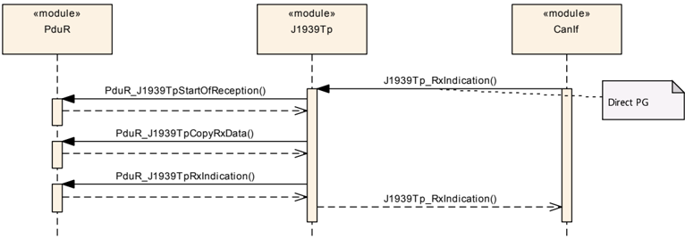

### 8.2. 经由 BAM 的接收

下图展示了在接收一个经由 **BAM** 的 **PG**（即长于 8 字节、且被发送到整个网络的 **N-SDU**）时，J1939 传输层模块与 **CAN** 接口及 **PDU** 路由器的交互。

图 9.2：经由 BAM 的接收（**Reception via BAM**）

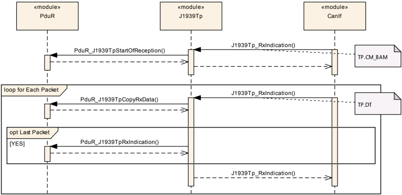

### 8.3. 经由 CMDT 的接收

下图展示了在接收一个经由 **CMDT** 的 **PG**（即长于 8 字节、且被直接发送到接收节点的 **N-SDU**）时，J1939 传输层模块与 **CAN** 接口及 **PDU** 路由器的交互。

图 9.3：经由 CMDT 的接收（**Reception via CMDT**）

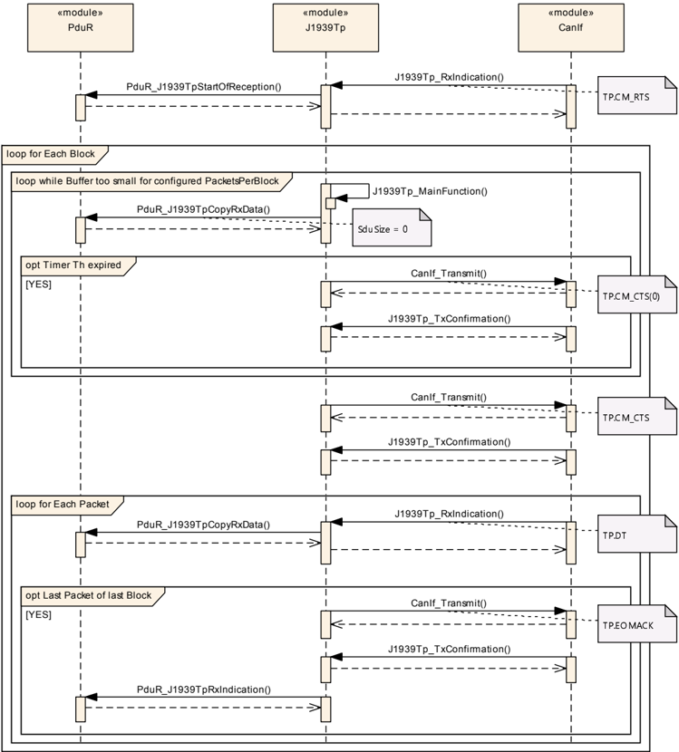

### 8.4. 直接 PG 的发送

下图展示了在发送一个直接 **PG**（即长度不大于 8 字节的可变长度 **N-SDU**）时，J1939 传输层模块与 **PDU** 路由器及 **CAN** 接口的交互。

图 9.4：直接 PG 的发送（**Transmission of Direct PG**）

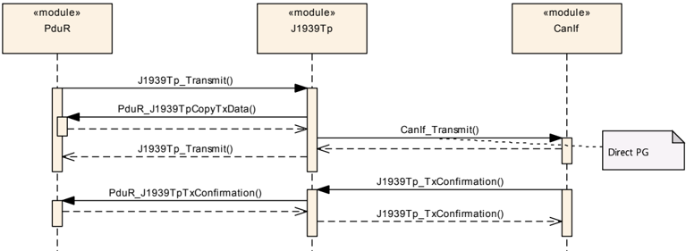

### 8.5. 经由 BAM 的发送

下图展示了在发送一个经由 **BAM** 的 **PG**（即长于 8 字节、且被发送到整个网络的 **N-SDU**）时，J1939 传输层模块与 **PDU** 路由器及 **CAN** 接口的交互。

图 9.5：经由 BAM 的发送（**Transmission via BAM**）

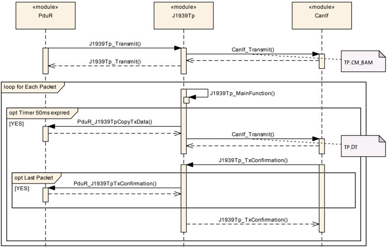

### 8.6. 经由 CMDT 的发送

下图展示了在发送一个经由 **CMDT** 的 **PG**（即长于 8 字节、且被直接发送到接收节点的 **N-SDU**）时，J1939 传输层模块与 **PDU** 路由器及 **CAN** 接口的交互。

图 9.6：经由 CMDT 的发送（**Transmission via CMDT**）

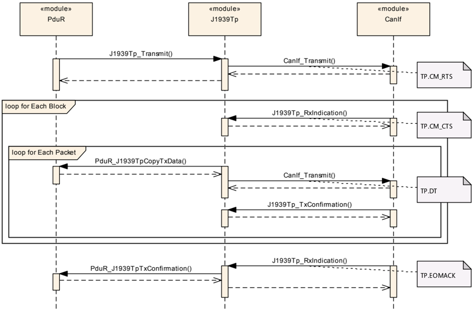

### 8.7. CMDT 发送期间重试的处理

下图展示了当因为某些数据丢失而执行重试时，在经由 **CMDT** 发送一个 **PG** 期间，J1939 传输层模块与发送节点及接收节点中的 **PDU** 路由器的交互。

图 9.7：重试处理（**Retry Handling**）

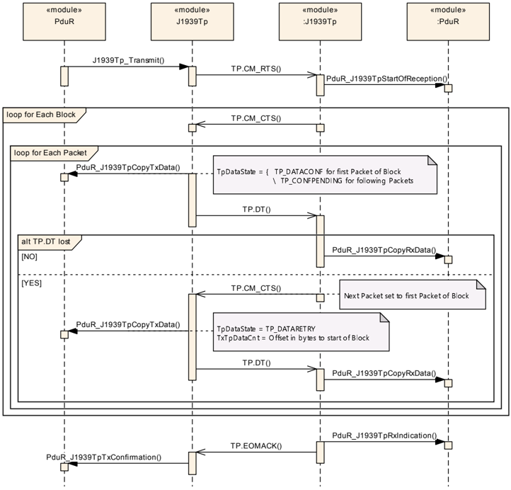

## 9. 配置规范

一般来说，本章定义配置参数及其到容器中的聚类。有关容器与参数定义的一般信息，请参阅 [\[6, SWS BSW General\]](#ref-6) 中第 10.1 节"配置规范简介"（Introduction to configuration specification）。有关 J1939 传输层模块发布信息的详细信息，请参阅 [\[6, SWS BSW General\]](#ref-6) 中第 10.3 节"发布信息"（Published Information）。

第 10.1 节规定模块 J1939Tp 的结构（容器）与参数。

配置的一致性必须由配置工具在配置期间检查。用于合理性检查的配置规则与约束应尽可能在配置期间执行。

### 9.1. 容器与配置参数

以下小节汇总所有配置参数。各参数的详细含义在第 6 章与第 7 章中描述。

这些容器与参数中的一部分派生自 [\[17, TPS System Template\]](#ref-17) 的类与属性，该文档也包含这些派生的规则。

下图展示了可用于 J1939Tp 的配置参数的概览：

图 10.1：模块配置（**Module Configuration**）

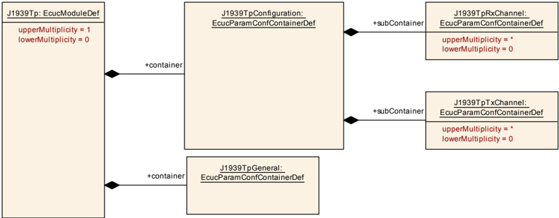

图 10.2：通用参数（**General Parameters**）

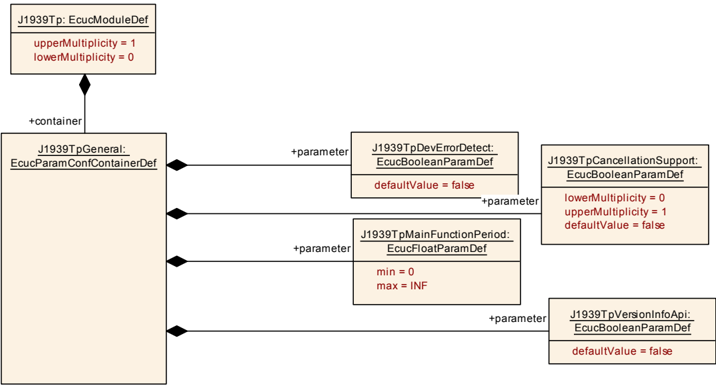

图 10.3：Rx 通道的配置 — 第 1 部分（**Configuration of Rx Channel - Part 1**）

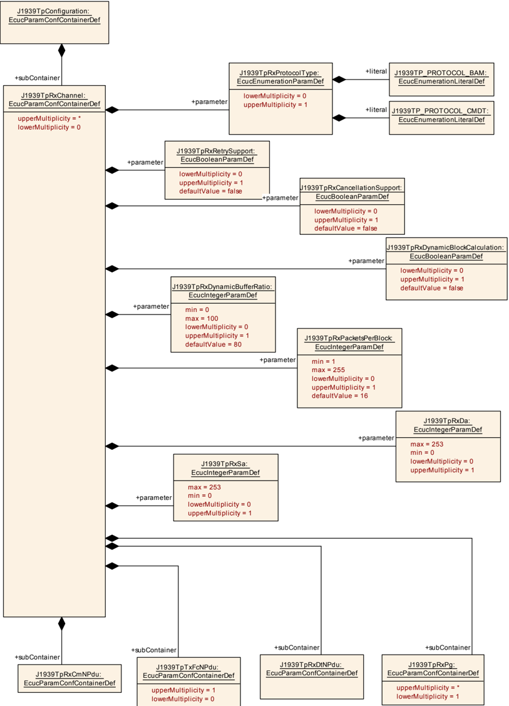

图 10.4：Rx 通道的配置 — 第 2 部分（**Configuration of Rx Channel - Part 2**）

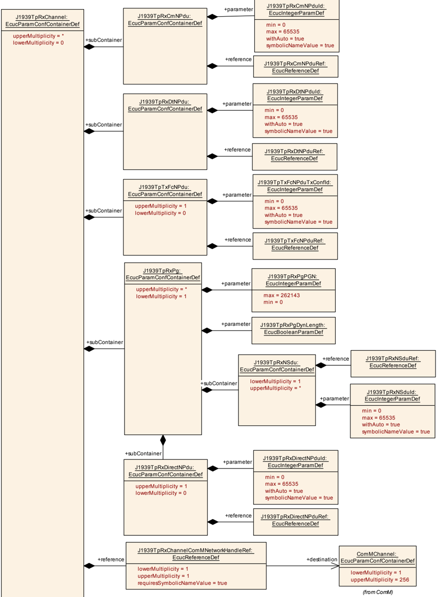

图 10.5：Tx 通道的配置 — 第 1 部分（**Configuration of Tx Channel - Part 1**）

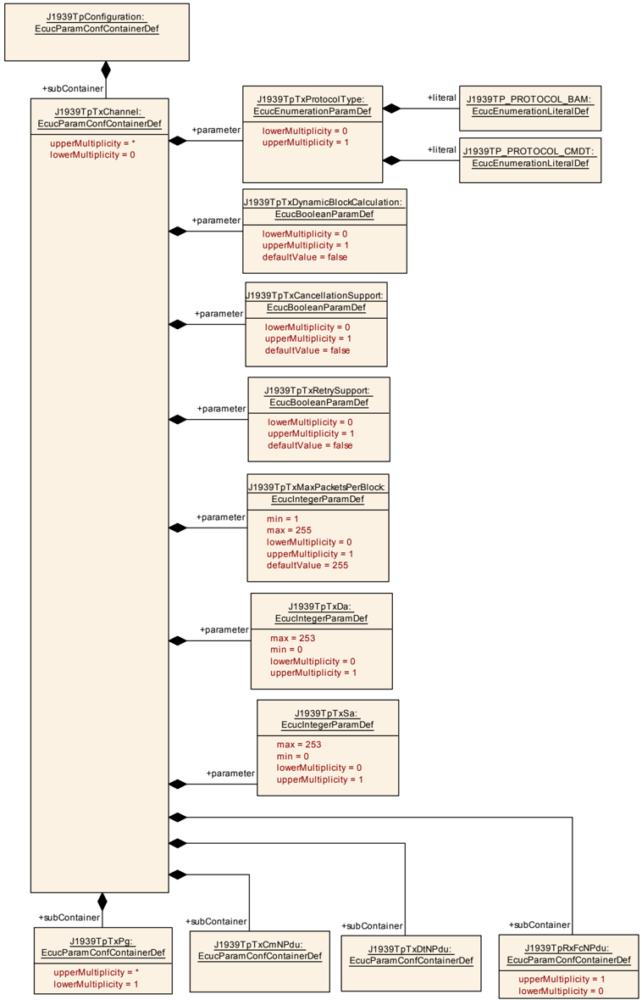

图 10.6：Tx 通道的配置 — 第 2 部分（**Configuration of Tx Channel - Part 2**）

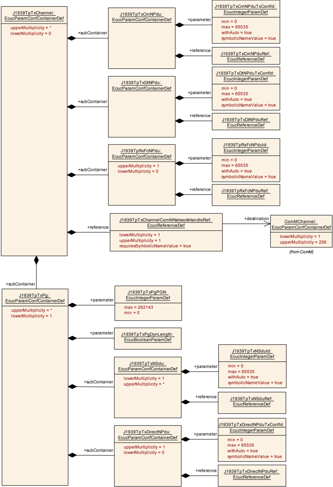

由于 **SAE J1939** 传输层与 **PDU** 路由器有接口，因此配置需要引用 [\[18, TPS ECU Configuration\]](#ref-18) 的"全局 PDU"（EcucPduCollection.Pdu）。

图 10.7：对 PDU 的引用（**References to PDUs**）

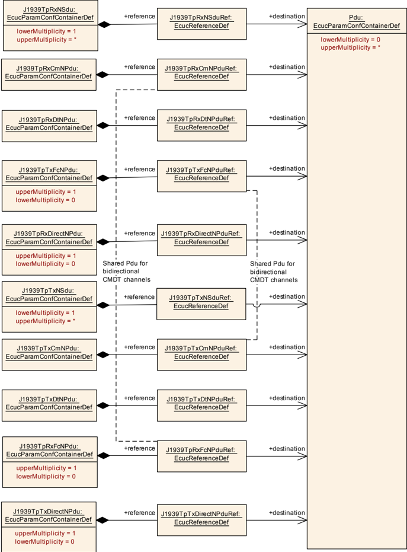

#### 9.1.1. J1939Tp

| SWS 条目 | [ECUC\_J1939Tp\_00127] |
| --- | --- |
| 模块名称 | J1939Tp |
| 描述 | J1939Tp（J1939 传输协议）模块的配置。 |
| Post-Build 变体支持 | false |
| 支持的配置变体 | VARIANT-LINK-TIME、VARIANT-PRE-COMPILE |

| 容器名称 | 多重性 | 作用域/依赖 |
| --- | --- | --- |
| J1939TpGeneral | 1 | 该容器描述 J1939Tp 模块的通用配置参数。 |
| J1939TpConfiguration | 1 | 该容器包含 J1939Tp 模块的定义通信路径的配置参数与子容器。 |

#### 9.1.2. J1939TpGeneral

| SWS 条目 | [ECUC\_J1939Tp\_00033] |
| --- | --- |
| 容器名称 | J1939TpGeneral |
| 父容器 | J1939Tp |
| 描述 | 该容器描述 J1939Tp 模块的通用配置参数。 |
| 配置参数 | 见下方参数表 |

| SWS 条目 | [ECUC\_J1939Tp\_00174] |
| --- | --- |
| 参数名称 | J1939TpCancellationSupport |
| 父容器 | J1939TpGeneral |
| 描述 | 启用发送与接收取消。只有当该参数已启用时，**API** J1939Tp\_CancelTransmit() 与 J1939Tp\_CancelReceive() 才可用。 |
| 多重性 | 0..1 |
| 类型 | EcucBooleanParamDef |
| 默认值 | false |
| Post-Build 变体多重性 | false |
| Post-Build 变体值 | false |
| 多重性配置类 | Pre-compile time：x；Link time：-；Post-build time：- |
| 值配置类 | Pre-compile time：x；Link time：-；Post-build time：- |
| 作用域/依赖 | scope: local |

| SWS 条目 | [ECUC\_J1939Tp\_00042] |
| --- | --- |
| 参数名称 | J1939TpDevErrorDetect |
| 父容器 | J1939TpGeneral |
| 描述 | 打开或关闭开发错误检测与通知。 |
| 多重性 | 1 |
| 类型 | EcucBooleanParamDef |
| 默认值 | false |
| Post-Build 变体值 | false |
| 值配置类 | Pre-compile time：x（All Variants）；Link time：-；Post-build time：- |
| 作用域/依赖 | scope: local |

| SWS 条目 | [ECUC\_J1939Tp\_00044] |
| --- | --- |
| 参数名称 | J1939TpMainFunctionPeriod |
| 父容器 | J1939TpGeneral |
| 描述 | 允许为 MainFunction 配置时间（以秒为单位）。**请注意：** 该配置值应等于 ScheduleManager 模块中的值。 |
| 多重性 | 1 |
| 类型 | EcucFloatParamDef |
| 范围 | ]0 .. INF[ |
| Post-Build 变体值 | false |
| 值配置类 | Pre-compile time：x（All Variants）；Link time：-；Post-build time：- |
| 作用域/依赖 | scope: ECU |

| SWS 条目 | [ECUC\_J1939Tp\_00051] |
| --- | --- |
| 参数名称 | J1939TpVersionInfoApi |
| 父容器 | J1939TpGeneral |
| 描述 | 函数 J1939Tp\_GetVersionInfo 可通过该配置参数配置（开/关）。 |
| 多重性 | 1 |
| 类型 | EcucBooleanParamDef |
| 默认值 | false |
| Post-Build 变体值 | false |
| 值配置类 | Pre-compile time：x（All Variants）；Link time：-；Post-build time：- |
| 作用域/依赖 | scope: local |

无包含的容器。

#### 9.1.3. J1939TpConfiguration

| SWS 条目 | [ECUC\_J1939Tp\_00052] |
| --- | --- |
| 容器名称 | J1939TpConfiguration |
| 父容器 | J1939Tp |
| 描述 | 该容器包含 J1939Tp 模块的定义通信路径的配置参数与子容器。 |
| 配置参数 | 无 |

| 容器名称 | 多重性 | 作用域/依赖 |
| --- | --- | --- |
| J1939TpRxChannel | 0..* | 该容器描述 J1939Tp 模块的一个接收通道。引用不带元数据的 **N-PDU** 的通道用于所有共享相同源地址（**SA**）与相同目标地址（**BAM**：DA = 0xFF；**CMDT**：DA != 0xFF）的 **N-SDU**。带有带元数据的 **N-PDU** 的通道用于所有可能的 **SA**/**DA** 组合（地址匹配经由通道容器中的 J1939TpRxSa/J1939TpRxDa 可选地受限）。 |
| J1939TpTxChannel | 0..* | 该容器描述 J1939Tp 模块的一个发送通道。引用不带元数据的 **N-PDU** 的通道用于所有共享相同源地址（**SA**）与相同目标地址（**BAM**：DA = 0xFF；**CMDT**：DA != 0xFF）的 **N-SDU**。带有带元数据的 **N-PDU** 的通道用于所有可能的 **SA**/**DA** 组合（地址匹配经由通道容器中的 J1939TpTxSa/J1939TpTxDa 可选地受限）。 |

#### 9.1.4. J1939TpRxChannel

| SWS 条目 | [ECUC\_J1939Tp\_00053] |
| --- | --- |
| 容器名称 | J1939TpRxChannel |
| 父容器 | J1939TpConfiguration |
| 描述 | 该容器描述 J1939Tp 模块的一个接收通道。引用不带元数据的 **N-PDU** 的通道用于所有共享相同源地址（**SA**）与相同目标地址（**BAM**：DA = 0xFF；**CMDT**：DA != 0xFF）的 **N-SDU**。带有带元数据的 **N-PDU** 的通道用于所有可能的 **SA**/**DA** 组合（地址匹配经由通道容器中的 J1939TpRxSa/J1939TpRxDa 可选地受限）。 |
| 配置参数 | 见下方参数表 |

| SWS 条目 | [ECUC\_J1939Tp\_00186] |
| --- | --- |
| 参数名称 | J1939TpRxCancellationSupport |
| 父容器 | J1939TpRxChannel |
| 描述 | 为该通道启用使用 **API** J1939Tp\_CancelReceive() 的接收取消。 |
| 多重性 | 0..1 |
| 类型 | EcucBooleanParamDef |
| 默认值 | false |
| Post-Build 变体多重性 | false |
| Post-Build 变体值 | false |
| 多重性配置类 | Pre-compile time：x（All Variants）；Link time：-；Post-build time：- |
| 值配置类 | Pre-compile time：x（All Variants） |
| 作用域/依赖 | scope: local |

| SWS 条目 | [ECUC\_J1939Tp\_00178] |
| --- | --- |
| 参数名称 | J1939TpRxDa |
| 父容器 | J1939TpRxChannel |
| 描述 | 该通道的目标地址（**DA**）。仅对于使用包含 **DA** 的带元数据 **N-PDU** 的固定 **DA** 通道才需要该参数。 |
| 多重性 | 0..1 |
| 类型 | EcucIntegerParamDef |
| 范围 | 0 .. 253 |
| Post-Build 变体多重性 | true |
| Post-Build 变体值 | true |
| 多重性配置类 | Pre-compile time：x（VARIANT-PRE-COMPILE）；Link time：x（VARIANT-LINK-TIME）；Post-build time：x（VARIANT-POST-BUILD） |
| 值配置类 | Pre-compile time：x（VARIANT-PRE-COMPILE）；Link time：x（VARIANT-LINK-TIME）；Post-build time：x（VARIANT-POST-BUILD） |
| 作用域/依赖 | scope: local |

| SWS 条目 | [ECUC\_J1939Tp\_00187] |
| --- | --- |
| 参数名称 | J1939TpRxDynamicBlockCalculation |
| 父容器 | J1939TpRxChannel |
| 描述 | 启用 **TP.CM\_CTS** 中"可发送的包数"值的动态计算，其依据是经由 StartOfReception 与 PduR\_J1939TpCopyRxData 报告的上层缓冲区大小。 |
| 多重性 | 0..1 |
| 类型 | EcucBooleanParamDef |
| 默认值 | false |
| Post-Build 变体多重性 | false |
| Post-Build 变体值 | false |
| 多重性配置类 | Pre-compile time：x；Link time：-；Post-build time：- |
| 值配置类 | Pre-compile time：x；Link time：-；Post-build time：- |
| 作用域/依赖 | scope: local |

| SWS 条目 | [ECUC\_J1939Tp\_00188] |
| --- | --- |
| 参数名称 | J1939TpRxDynamicBufferRatio |
| 父容器 | J1939TpRxChannel |
| 描述 | 应用于重试的可用缓冲区百分比。仅当 "J1939TpRxRetrySupport" 与 "J1939TpRxDynamicBlockCalculation" 已启用时该参数才适用。 |
| 多重性 | 0..1 |
| 类型 | EcucIntegerParamDef |
| 范围 | 0 .. 100 |
| 默认值 | 80 |
| Post-Build 变体多重性 | false |
| Post-Build 变体值 | false |
| 多重性配置类 | Pre-compile time：All Variants；Link time：-；Post-build time：- |
| 值配置类 | Pre-compile time：All Variants；Link time：-；Post-build time：- |
| 作用域/依赖 | scope: local；依赖：仅当 "J1939TpRxRetrySupport" 与 "J1939TpRxDynamicBlockCalculation" 已启用时才适用 |

| SWS 条目 | [ECUC\_J1939Tp\_00189] |
| --- | --- |
| 参数名称 | J1939TpRxPacketsPerBlock |
| 父容器 | J1939TpRxChannel |
| 描述 | 接收方 J1939Tp 模块在等待另一个 **TP.CM\_CTS** 之前允许发送方发送的 **TP.DT** 帧的数量。该参数在 **TP.CM\_CTS** 帧中传输，因此只与经由 **CMDT** 的消息接收相关。当 J1939TpRxDynamicBlockCalculation 已启用时，该参数规定所请求包数的上限。 |
| 多重性 | 0..1 |
| 类型 | EcucIntegerParamDef |
| 范围 | 1 .. 255 |
| 默认值 | 16 |
| Post-Build 变体多重性 | false |
| Post-Build 变体值 | false |
| 多重性配置类 | Pre-compile time：x；Link time：-；Post-build time：- |
| 值配置类 | Pre-compile time：x；Link time：-；Post-build time：- |
| 作用域/依赖 | scope: local |

| SWS 条目 | [ECUC\_J1939Tp\_00029] |
| --- | --- |
| 参数名称 | J1939TpRxProtocolType |
| 父容器 | J1939TpRxChannel |
| 描述 | 该通道使用的协议类型。仅对于具有固定目标地址的通道才需要该参数。 |
| 多重性 | 0..1 |
| 类型 | EcucEnumerationParamDef |
| 范围 | J1939TP\_PROTOCOL\_BAM：**J1939** 传输协议类型 **BAM**（**Broadcast Announce Message**）。该协议使用两个 **N-PDU**：CmNPdu 与 DtNPdu；J1939TP\_PROTOCOL\_CMDT：**J1939** 传输协议类型 **CMDT**（**Connection Mode Data Transfer**）。该协议使用三个 **N-PDU**：CmNPdu、DtNPdu 与 FcNPdu |
| Post-Build 变体多重性 | false |
| Post-Build 变体值 | false |
| 多重性配置类 | Pre-compile time：x（All Variants）；Link time：-；Post-build time：- |
| 值配置类 | Pre-compile time：x（All Variants）；Link time：-；Post-build time：- |
| 作用域/依赖 | scope: local |

| SWS 条目 | [ECUC\_J1939Tp\_00185] |
| --- | --- |
| 参数名称 | J1939TpRxRetrySupport |
| 父容器 | J1939TpRxChannel |
| 描述 | 启用使用带有已发送包号的 **TP.CM\_CTS** 触发失败发送重复的支持。当序列号缺失或接收期间发生超时时触发重传。 |
| 多重性 | 0..1 |
| 类型 | EcucBooleanParamDef |
| 默认值 | false |
| Post-Build 变体多重性 | false |
| Post-Build 变体值 | false |
| 多重性配置类 | Pre-compile time：x；Link time：-；Post-build time：- |
| 值配置类 | Pre-compile time：x；Link time：-；Post-build time：- |
| 作用域/依赖 | scope: local |

| SWS 条目 | [ECUC\_J1939Tp\_00179] |
| --- | --- |
| 参数名称 | J1939TpRxSa |
| 父容器 | J1939TpRxChannel |
| 描述 | 该通道的源地址（**SA**）。仅对于使用包含 **SA** 的带元数据 **N-PDU** 的固定 **SA** 通道才需要该参数。 |
| 多重性 | 0..1 |
| 类型 | EcucIntegerParamDef |
| 范围 | 0 .. 253 |
| Post-Build 变体多重性 | true |
| Post-Build 变体值 | true |
| 多重性配置类 | Pre-compile time：x（VARIANT-PRE-COMPILE）；Link time：x（VARIANT-LINK-TIME）；Post-build time：x（VARIANT-POST-BUILD） |
| 值配置类 | Pre-compile time：x（VARIANT-PRE-COMPILE）；Link time：x（VARIANT-LINK-TIME）；Post-build time：x（VARIANT-POST-BUILD） |
| 作用域/依赖 | scope: local |

| SWS 条目 | [ECUC\_J1939Tp\_00194] |
| --- | --- |
| 参数名称 | J1939TpRxChannelComMNetworkHandleRef |
| 父容器 | J1939TpRxChannel |
| 描述 | 对由 ComMChannel 定义的通道的引用，该通道提供对唯一通道索引 ComMChannelId 的访问。 |
| 多重性 | 1 |
| 类型 | 对 ComMChannel 的符号名引用 |
| Post-Build 变体值 | false |
| 值配置类 | Pre-compile time：x（All Variants）；Link time：-；Post-build time：- |
| 作用域/依赖 | scope: local |

| 容器名称 | 多重性 | 作用域/依赖 |
| --- | --- | --- |
| J1939TpRxCmNPdu | 1 | 该 **N-PDU** 表示一次 J1939 传输协议会话的 **TP.CM** 帧。**BAM** 与 **CMDT** 都使用 **TP.CM** 初始化连接。对于 **CMDT**，它还用于中止连接。该 **N-PDU** 消费一个类型为 CAN\_ID\_32 的元数据项。 |
| J1939TpRxDtNPdu | 1 | 该 **N-PDU** 表示一次 J1939 传输协议会话的 **TP.DT** 帧。**BAM** 与 **CMDT** 都使用 **TP.DT** 传输 **N-SDU** 的内容。该 **N-PDU** 消费一个类型为 CAN\_ID\_32 的元数据项。 |
| J1939TpRxPg | 1..* | 由 J1939 传输层接收的参数组。 |
| J1939TpTxFcNPdu | 1 | 该 **N-PDU** 表示使用 **CMDT** 协议类型的 J1939 传输协议会话在反方向使用的 **TP.CM** 帧。反方向的 **TP.CM** 用于对接收数据的中间与最终确认，以及中止连接。该 **N-PDU** 产生一个类型为 CAN\_ID\_32 的元数据项。 |

#### 9.1.5. J1939TpRxCmNPdu

| SWS 条目 | [ECUC\_J1939Tp\_00128] |
| --- | --- |
| 容器名称 | J1939TpRxCmNPdu |
| 父容器 | J1939TpRxChannel |
| 描述 | 该 **N-PDU** 表示一次 J1939 传输协议会话的 **TP.CM** 帧。**BAM** 与 **CMDT** 都使用 **TP.CM** 初始化连接。对于 **CMDT**，它还用于中止连接。该 **N-PDU** 消费一个类型为 CAN\_ID\_32 的元数据项。 |
| 配置参数 | 见下方参数表 |

| SWS 条目 | [ECUC\_J1939Tp\_00129] |
| --- | --- |
| 参数名称 | J1939TpRxCmNPduId |
| 父容器 | J1939TpRxCmNPdu |
| 描述 | 用于与 CanIf 通信的 **N-PDU** 标识符。 |
| 多重性 | 1 |
| 类型 | EcucIntegerParamDef（为该参数生成符号名） |
| 范围 | 0 .. 65535 |
| Post-Build 变体值 | false |
| 值配置类 | Pre-compile time：x（All Variants）；Link time：-；Post-build time：- |
| 作用域/依赖 | scope: ECU |

| SWS 条目 | [ECUC\_J1939Tp\_00158] |
| --- | --- |
| 参数名称 | J1939TpRxCmNPduRef |
| 父容器 | J1939TpRxCmNPdu |
| 描述 | 对表示该 **N-PDU** 的 Pdu 对象的引用。 |
| 多重性 | 1 |
| 类型 | 对 Pdu 的引用 |
| Post-Build 变体值 | true |
| 值配置类 | Pre-compile time：x（VARIANT-PRE-COMPILE）；Link time：x（VARIANT-LINK-TIME）；Post-build time：x（VARIANT-POST-BUILD） |
| 作用域/依赖 | scope: local |

无包含的容器。

#### 9.1.6. J1939TpRxDtNPdu

| SWS 条目 | [ECUC\_J1939Tp\_00117] |
| --- | --- |
| 容器名称 | J1939TpRxDtNPdu |
| 父容器 | J1939TpRxChannel |
| 描述 | 该 **N-PDU** 表示一次 J1939 传输协议会话的 **TP.DT** 帧。**BAM** 与 **CMDT** 都使用 **TP.DT** 传输 **N-SDU** 的内容。该 **N-PDU** 消费一个类型为 CAN\_ID\_32 的元数据项。 |
| 配置参数 | 见下方参数表 |

| SWS 条目 | [ECUC\_J1939Tp\_00133] |
| --- | --- |
| 参数名称 | J1939TpRxDtNPduId |
| 父容器 | J1939TpRxDtNPdu |
| 描述 | 用于与 CanIf 通信的 **N-PDU** 标识符。 |
| 多重性 | 1 |
| 类型 | EcucIntegerParamDef（为该参数生成符号名） |
| 范围 | 0 .. 65535 |
| Post-Build 变体值 | false |
| 值配置类 | Pre-compile time：x（All Variants）；Link time：-；Post-build time：- |
| 作用域/依赖 | scope: ECU |

| SWS 条目 | [ECUC\_J1939Tp\_00134] |
| --- | --- |
| 参数名称 | J1939TpRxDtNPduRef |
| 父容器 | J1939TpRxDtNPdu |
| 描述 | 对表示该 **N-PDU** 的 Pdu 对象的引用。 |
| 多重性 | 1 |
| 类型 | 对 Pdu 的引用 |
| Post-Build 变体值 | true |
| 值配置类 | Pre-compile time：x（VARIANT-PRE-COMPILE）；Link time：x（VARIANT-LINK-TIME）；Post-build time：x（VARIANT-POST-BUILD） |
| 作用域/依赖 | scope: local |

无包含的容器。

#### 9.1.7. J1939TpRxPg

| SWS 条目 | [ECUC\_J1939Tp\_00050] |
| --- | --- |
| 容器名称 | J1939TpRxPg |
| 父容器 | J1939TpRxChannel |
| 描述 | 由 J1939 传输层接收的参数组。 |
| 配置参数 | 见下方参数表 |

| SWS 条目 | [ECUC\_J1939Tp\_00066] |
| --- | --- |
| 参数名称 | J1939TpRxPgDynLength |
| 父容器 | J1939TpRxPg |
| 描述 | 当该 **N-SDU** 指代一个具有可变长度的 **PGN** 时，该标志设置为 **TRUE**。**请注意：** 当该属性为 **TRUE** 时，子容器 J1939TpRxDirectNPdu 是必需的。 |
| 多重性 | 1 |
| 类型 | EcucBooleanParamDef |
| Post-Build 变体值 | false |
| 值配置类 | Pre-compile time：x（All Variants）；Link time：-；Post-build time：- |
| 作用域/依赖 | - |

| SWS 条目 | [ECUC\_J1939Tp\_00065] |
| --- | --- |
| 参数名称 | J1939TpRxPgPGN |
| 父容器 | J1939TpRxPg |
| 描述 | 所引用 **N-SDU** 的 **PGN**。 |
| 多重性 | 1 |
| 类型 | EcucIntegerParamDef |
| 范围 | 0 .. 262143 |
| Post-Build 变体值 | false |
| 值配置类 | Pre-compile time：x（All Variants）；Link time：-；Post-build time：- |
| 作用域/依赖 | scope: local |

| 容器名称 | 多重性 | 作用域/依赖 |
| --- | --- | --- |
| J1939TpRxDirectNPdu | 0..1 | 该 **N-PDU** 表示动态长度 **PGN** 在其长度小于 8 字节时使用的短帧。该 **N-PDU** 消费一个类型为 CAN\_ID\_32 的元数据项。**请注意：** 仅当 J1939TpRxPgDynLength 为 **TRUE** 时才需要该子容器。 |
| J1939TpRxNSdu | 1..* | 该容器描述与一个特定 **N-SDU** 的接收相关的参数。该 **N-SDU** 产生类型为 SOURCE\_ADDRESS\_16、TARGET\_ADDRESS\_16 与 PRIORITY\_8 的元数据项。 |

#### 9.1.8. J1939TpRxDirectNPdu

| SWS 条目 | [ECUC\_J1939Tp\_00130] |
| --- | --- |
| 容器名称 | J1939TpRxDirectNPdu |
| 父容器 | J1939TpRxPg |
| 描述 | 该 **N-PDU** 表示动态长度 **PGN** 在其长度小于 8 字节时使用的短帧。该 **N-PDU** 消费一个类型为 CAN\_ID\_32 的元数据项。**请注意：** 仅当 J1939TpRxPgDynLength 为 **TRUE** 时才需要该子容器。 |
| 配置参数 | 见下方参数表 |

| SWS 条目 | [ECUC\_J1939Tp\_00131] |
| --- | --- |
| 参数名称 | J1939TpRxDirectNPduId |
| 父容器 | J1939TpRxDirectNPdu |
| 描述 | 用于与 CanIf 通信的 **N-PDU** 标识符。 |
| 多重性 | 1 |
| 类型 | EcucIntegerParamDef（为该参数生成符号名） |
| 范围 | 0 .. 65535 |
| Post-Build 变体值 | false |
| 值配置类 | Pre-compile time：x（All Variants）；Link time：-；Post-build time：- |
| 作用域/依赖 | scope: ECU |

| SWS 条目 | [ECUC\_J1939Tp\_00132] |
| --- | --- |
| 参数名称 | J1939TpRxDirectNPduRef |
| 父容器 | J1939TpRxDirectNPdu |
| 描述 | 对表示该 **N-PDU** 的 Pdu 对象的引用。 |
| 多重性 | 1 |
| 类型 | 对 Pdu 的引用 |
| Post-Build 变体值 | true |
| 值配置类 | Pre-compile time：x（VARIANT-PRE-COMPILE）；Link time：x（VARIANT-LINK-TIME）；Post-build time：x（VARIANT-POST-BUILD） |
| 作用域/依赖 | scope: local |

无包含的容器。

#### 9.1.9. J1939TpRxNSdu

| SWS 条目 | [ECUC\_J1939Tp\_00063] |
| --- | --- |
| 容器名称 | J1939TpRxNSdu |
| 父容器 | J1939TpRxPg |
| 描述 | 该容器描述与一个特定 **N-SDU** 的接收相关的参数。该 **N-SDU** 产生类型为 SOURCE\_ADDRESS\_16、TARGET\_ADDRESS\_16 与 PRIORITY\_8 的元数据项。 |
| 配置参数 | 见下方参数表 |

| SWS 条目 | [ECUC\_J1939Tp\_00184] |
| --- | --- |
| 参数名称 | J1939TpRxNSduId |
| 父容器 | J1939TpRxNSdu |
| 描述 | 这是所接收 **N-SDU** 的唯一标识符。该 Id 用于 CancelReceive 与 ChangeParameter **API** 调用。 |
| 多重性 | 1 |
| 类型 | EcucIntegerParamDef（为该参数生成符号名） |
| 范围 | 0 .. 65535 |
| Post-Build 变体值 | false |
| 值配置类 | Pre-compile time：x（All Variants）；Link time：-；Post-build time：- |
| 作用域/依赖 | scope: ECU；withAuto = true |

| SWS 条目 | [ECUC\_J1939Tp\_00069] |
| --- | --- |
| 参数名称 | J1939TpRxNSduRef |
| 父容器 | J1939TpRxNSdu |
| 描述 | 对表示该 **N-SDU** 的 Pdu 对象的引用。 |
| 多重性 | 1 |
| 类型 | 对 Pdu 的引用 |
| Post-Build 变体值 | true |
| 值配置类 | Pre-compile time：x（VARIANT-PRE-COMPILE）；Link time：x（VARIANT-LINK-TIME）；Post-build time：x（VARIANT-POST-BUILD） |
| 作用域/依赖 | scope: local |

无包含的容器。

#### 9.1.10. J1939TpTxFcNPdu

| SWS 条目 | [ECUC\_J1939Tp\_00135] |
| --- | --- |
| 容器名称 | J1939TpTxFcNPdu |
| 父容器 | J1939TpRxChannel |
| 描述 | 该 **N-PDU** 表示使用 **CMDT** 协议类型的 J1939 传输协议会话在反方向使用的 **TP.CM** 帧。反方向的 **TP.CM** 用于对接收数据的中间与最终确认，以及中止连接。该 **N-PDU** 产生一个类型为 CAN\_ID\_32 的元数据项。 |
| 配置参数 | 见下方参数表 |

| SWS 条目 | [ECUC\_J1939Tp\_00168] |
| --- | --- |
| 参数名称 | J1939TpTxFcNPduTxConfId |
| 父容器 | J1939TpTxFcNPdu |
| 描述 | 用于来自 CanIf 的 Tx 确认的 **N-PDU** 标识符。 |
| 多重性 | 1 |
| 类型 | EcucIntegerParamDef（为该参数生成符号名） |
| 范围 | 0 .. 65535 |
| Post-Build 变体值 | false |
| 值配置类 | Pre-compile time：x（All Variants）；Link time：-；Post-build time：- |
| 作用域/依赖 | scope: ECU |

| SWS 条目 | [ECUC\_J1939Tp\_00136] |
| --- | --- |
| 参数名称 | J1939TpTxFcNPduRef |
| 父容器 | J1939TpTxFcNPdu |
| 描述 | 对表示该 **N-PDU** 的 Pdu 对象的引用。**请注意：** 当两个通道具有相同但互换的源与目标地址时，该参数所引用的 Pdu 与相应 J1939TpTxChannel 的 J1939TpTxCmNPduRef 共享。 |
| 多重性 | 1 |
| 类型 | 对 Pdu 的引用 |
| Post-Build 变体值 | true |
| 值配置类 | Pre-compile time：x（VARIANT-PRE-COMPILE）；Link time：x（VARIANT-LINK-TIME）；Post-build time：x（VARIANT-POST-BUILD） |
| 作用域/依赖 | scope: local |

无包含的容器。

#### 9.1.11. J1939TpTxChannel

| SWS 条目 | [ECUC\_J1939Tp\_00059] |
| --- | --- |
| 容器名称 | J1939TpTxChannel |
| 父容器 | J1939TpConfiguration |
| 描述 | 该容器描述 J1939Tp 模块的一个发送通道。引用不带元数据的 **N-PDU** 的通道用于所有共享相同源地址（**SA**）与相同目标地址（**BAM**：DA = 0xFF；**CMDT**：DA != 0xFF）的 **N-SDU**。带有带元数据的 **N-PDU** 的通道用于所有可能的 **SA**/**DA** 组合（地址匹配经由通道容器中的 J1939TpTxSa/J1939TpTxDa 可选地受限）。 |
| 配置参数 | 见下方参数表 |

| SWS 条目 | [ECUC\_J1939Tp\_00192] |
| --- | --- |
| 参数名称 | J1939TpTxCancellationSupport |
| 父容器 | J1939TpTxChannel |
| 描述 | 为该通道启用使用 **API** J1939Tp\_CancelTransmit() 的发送取消。 |
| 多重性 | 0..1 |
| 类型 | EcucBooleanParamDef |
| 默认值 | false |
| Post-Build 变体多重性 | false |
| Post-Build 变体值 | false |
| 多重性配置类 | Pre-compile time：x（All Variants） |
| 值配置类 | Pre-compile time：x（All Variants）；Link time：-；Post-build time：- |
| 作用域/依赖 | scope: local |

| SWS 条目 | [ECUC\_J1939Tp\_00180] |
| --- | --- |
| 参数名称 | J1939TpTxDa |
| 父容器 | J1939TpTxChannel |
| 描述 | 该通道的目标地址（**DA**）。仅对于使用包含 **DA** 的带元数据 **N-PDU** 的固定 **DA** 通道才需要该参数。 |
| 多重性 | 0..1 |
| 类型 | EcucIntegerParamDef |
| 范围 | 0 .. 253 |
| Post-Build 变体多重性 | true |
| Post-Build 变体值 | true |
| 多重性配置类 | Pre-compile time：x（VARIANT-PRE-COMPILE）；Link time：x（VARIANT-LINK-TIME）；Post-build time：x（VARIANT-POST-BUILD） |
| 值配置类 | Pre-compile time：x（VARIANT-PRE-COMPILE）；Link time：x（VARIANT-LINK-TIME）；Post-build time：x（VARIANT-POST-BUILD） |
| 作用域/依赖 | scope: local |

| SWS 条目 | [ECUC\_J1939Tp\_00191] |
| --- | --- |
| 参数名称 | J1939TpTxDynamicBlockCalculation |
| 父容器 | J1939TpTxChannel |
| 描述 | 启用 **TP.CM\_RTS** 中"可发送的最大包数"值的动态计算，其依据是经由 PduR\_J1939TpCopyTxData 报告的上层可用数据量。 |
| 多重性 | 0..1 |
| 类型 | EcucBooleanParamDef |
| 默认值 | false |
| Post-Build 变体多重性 | false |
| Post-Build 变体值 | false |
| 多重性配置类 | Pre-compile time：x；Link time：-；Post-build time：- |
| 值配置类 | Pre-compile time：x；Link time：-；Post-build time：- |
| 作用域/依赖 | scope: local |

| SWS 条目 | [ECUC\_J1939Tp\_00190] |
| --- | --- |
| 参数名称 | J1939TpTxMaxPacketsPerBlock |
| 父容器 | J1939TpTxChannel |
| 描述 | 发送方 J1939Tp 模块在等待另一个 **TP.CM\_CTS** 之前准备好发送的 **TP.DT** 帧的最大数量。该参数在 **TP.CM\_RTS** 帧中传输，因此只与经由 **CMDT** 的消息发送相关。当 J1939TpTxDynamicBlockCalculation 已启用时，该参数规定所请求数量的上限。 |
| 多重性 | 0..1 |
| 类型 | EcucIntegerParamDef |
| 范围 | 1 .. 255 |
| 默认值 | 255 |
| Post-Build 变体多重性 | false |
| Post-Build 变体值 | false |
| 多重性配置类 | Pre-compile time：x；Link time：-；Post-build time：- |
| 值配置类 | Pre-compile time：x；Link time：-；Post-build time：- |
| 作用域/依赖 | scope: local |

| SWS 条目 | [ECUC\_J1939Tp\_00137] |
| --- | --- |
| 参数名称 | J1939TpTxProtocolType |
| 父容器 | J1939TpTxChannel |
| 描述 | 该通道使用的协议类型。仅对于具有固定目标地址的通道才需要该参数。 |
| 多重性 | 0..1 |
| 类型 | EcucEnumerationParamDef |
| 范围 | J1939TP\_PROTOCOL\_BAM：**J1939** 传输协议类型 **BAM**（**Broadcast Announce Message**）。该协议使用两个 **N-PDU**：CmNPdu 与 DtNPdu；J1939TP\_PROTOCOL\_CMDT：**J1939** 传输协议类型 **CMDT**（**Connection Mode Data Transfer**）。该协议使用三个 **N-PDU**：CmNPdu、DtNPdu 与 FcNPdu |
| Post-Build 变体多重性 | false |
| Post-Build 变体值 | false |
| 多重性配置类 | Pre-compile time：x（All Variants）；Link time：-；Post-build time：- |
| 值配置类 | Pre-compile time：x（All Variants）；Link time：-；Post-build time：- |
| 作用域/依赖 | scope: local |

| SWS 条目 | [ECUC\_J1939Tp\_00193] |
| --- | --- |
| 参数名称 | J1939TpTxRetrySupport |
| 父容器 | J1939TpTxChannel |
| 描述 | 启用使用带有已发送包号的 **TP.CM\_CTS** 触发失败发送重复的支持。重传经由 PduR\_J1939TpCopyTxData 的重试特性处理。 |
| 多重性 | 0..1 |
| 类型 | EcucBooleanParamDef |
| 默认值 | false |
| Post-Build 变体多重性 | false |
| Post-Build 变体值 | false |
| 多重性配置类 | Pre-compile time：x；Link time：-；Post-build time：- |
| 值配置类 | Pre-compile time：x；Link time：-；Post-build time：- |
| 作用域/依赖 | scope: local |

| SWS 条目 | [ECUC\_J1939Tp\_00181] |
| --- | --- |
| 参数名称 | J1939TpTxSa |
| 父容器 | J1939TpTxChannel |
| 描述 | 该通道的源地址（**SA**）。仅对于使用包含 **SA** 的带元数据 **N-PDU** 的固定 **SA** 通道才需要该参数。 |
| 多重性 | 0..1 |
| 类型 | EcucIntegerParamDef |
| 范围 | 0 .. 253 |
| Post-Build 变体多重性 | true |
| Post-Build 变体值 | true |
| 多重性配置类 | Pre-compile time：x（VARIANT-PRE-COMPILE）；Link time：x（VARIANT-LINK-TIME）；Post-build time：x（VARIANT-POST-BUILD） |
| 值配置类 | Pre-compile time：x（VARIANT-PRE-COMPILE）；Link time：x（VARIANT-LINK-TIME）；Post-build time：x（VARIANT-POST-BUILD） |
| 作用域/依赖 | scope: local |

| SWS 条目 | [ECUC\_J1939Tp\_00195] |
| --- | --- |
| 参数名称 | J1939TpTxChannelComMNetworkHandleRef |
| 父容器 | J1939TpTxChannel |
| 描述 | 对由 ComMChannel 定义的通道的引用，该通道提供对唯一通道索引 ComMChannelId 的访问。 |
| 多重性 | 1 |
| 类型 | 对 ComMChannel 的符号名引用 |
| Post-Build 变体值 | false |
| 值配置类 | Pre-compile time：x（All Variants）；Link time：x（-） |
| 作用域/依赖 | scope: local |

| 容器名称 | 多重性 | 作用域/依赖 |
| --- | --- | --- |
| J1939TpRxFcNPdu | 1 | 该 **N-PDU** 表示使用 **CMDT** 协议类型的 J1939 传输协议会话在反方向使用的 **TP.CM** 帧。反方向的 **TP.CM** 用于对接收数据的中间与最终确认，以及中止连接。该 **N-PDU** 消费一个类型为 CAN\_ID\_32 的元数据项。 |
| J1939TpTxCmNPdu | 1 | 该 **N-PDU** 表示一次 J1939 传输协议会话的 **TP.CM** 帧。**BAM** 与 **CMDT** 都使用 **TP.CM** 初始化连接。对于 **CMDT**，它还用于中止连接。该 **N-PDU** 产生一个类型为 CAN\_ID\_32 的元数据项。 |
| J1939TpTxDtNPdu | 1 | 该 **N-PDU** 表示一次 J1939 传输协议会话的 **TP.DT** 帧。**BAM** 与 **CMDT** 都使用 **TP.DT** 传输 **N-SDU** 的内容。该 **N-PDU** 产生一个类型为 CAN\_ID\_32 的元数据项。 |
| J1939TpTxPg | 1..* | 由 J1939 传输层发送的参数组。 |

#### 9.1.12. J1939TpRxFcNPdu

| SWS 条目 | [ECUC\_J1939Tp\_00144] |
| --- | --- |
| 容器名称 | J1939TpRxFcNPdu |
| 父容器 | J1939TpTxChannel |
| 描述 | 该 **N-PDU** 表示使用 **CMDT** 协议类型的 J1939 传输协议会话在反方向使用的 **TP.CM** 帧。反方向的 **TP.CM** 用于对接收数据的中间与最终确认，以及中止连接。该 **N-PDU** 消费一个类型为 CAN\_ID\_32 的元数据项。 |
| 配置参数 | 见下方参数表 |

| SWS 条目 | [ECUC\_J1939Tp\_00145] |
| --- | --- |
| 参数名称 | J1939TpRxFcNPduId |
| 父容器 | J1939TpRxFcNPdu |
| 描述 | 用于与 CanIf 通信的 **N-PDU** 标识符。 |
| 多重性 | 1 |
| 类型 | EcucIntegerParamDef（为该参数生成符号名） |
| 范围 | 0 .. 65535 |
| Post-Build 变体值 | false |
| 值配置类 | Pre-compile time：x（All Variants）；Link time：x（-） |
| 作用域/依赖 | scope: ECU；withAuto = true |

| SWS 条目 | [ECUC\_J1939Tp\_00146] |
| --- | --- |
| 参数名称 | J1939TpRxFcNPduRef |
| 父容器 | J1939TpRxFcNPdu |
| 描述 | 对表示该 **N-PDU** 的 Pdu 对象的引用。**请注意：** 当两个通道具有相同但互换的源与目标地址时，该参数所引用的 Pdu 与相应 J1939TpRxChannel 的 J1939TpRxCmNPduRef 共享。 |
| 多重性 | 1 |
| 类型 | 对 Pdu 的引用 |
| Post-Build 变体值 | true |
| 值配置类 | Pre-compile time：x（VARIANT-PRE-COMPILE）；Link time：x（VARIANT-LINK-TIME）；Post-build time：x（VARIANT-POST-BUILD） |
| 作用域/依赖 | scope: local |

无包含的容器。

#### 9.1.13. J1939TpTxCmNPdu

| SWS 条目 | [ECUC\_J1939Tp\_00138] |
| --- | --- |
| 容器名称 | J1939TpTxCmNPdu |
| 父容器 | J1939TpTxChannel |
| 描述 | 该 **N-PDU** 表示一次 J1939 传输协议会话的 **TP.CM** 帧。**BAM** 与 **CMDT** 都使用 **TP.CM** 初始化连接。对于 **CMDT**，它还用于中止连接。该 **N-PDU** 产生一个类型为 CAN\_ID\_32 的元数据项。 |
| 配置参数 | 见下方参数表 |

| SWS 条目 | [ECUC\_J1939Tp\_00170] |
| --- | --- |
| 参数名称 | J1939TpTxCmNPduTxConfId |
| 父容器 | J1939TpTxCmNPdu |
| 描述 | 用于来自 CanIf 的 Tx 确认的 **N-PDU** 标识符。 |
| 多重性 | 1 |
| 类型 | EcucIntegerParamDef（为该参数生成符号名） |
| 范围 | 0 .. 65535 |
| Post-Build 变体值 | false |
| 值配置类 | Pre-compile time：x（All Variants）；Link time：-；Post-build time：- |
| 作用域/依赖 | scope: ECU |

| SWS 条目 | [ECUC\_J1939Tp\_00139] |
| --- | --- |
| 参数名称 | J1939TpTxCmNPduRef |
| 父容器 | J1939TpTxCmNPdu |
| 描述 | 对表示该 **N-PDU** 的 Pdu 对象的引用。 |
| 多重性 | 1 |
| 类型 | 对 Pdu 的引用 |
| Post-Build 变体值 | true |
| 值配置类 | Pre-compile time：x（VARIANT-PRE-COMPILE）；Link time：x（VARIANT-LINK-TIME）；Post-build time：x（VARIANT-POST-BUILD） |
| 作用域/依赖 | scope: local |

无包含的容器。

#### 9.1.14. J1939TpTxDtNPdu

| SWS 条目 | [ECUC\_J1939Tp\_00142] |
| --- | --- |
| 容器名称 | J1939TpTxDtNPdu |
| 父容器 | J1939TpTxChannel |
| 描述 | 该 **N-PDU** 表示一次 J1939 传输协议会话的 **TP.DT** 帧。**BAM** 与 **CMDT** 都使用 **TP.DT** 传输 **N-SDU** 的内容。该 **N-PDU** 产生一个类型为 CAN\_ID\_32 的元数据项。 |
| 配置参数 | 见下方参数表 |

| SWS 条目 | [ECUC\_J1939Tp\_00171] |
| --- | --- |
| 参数名称 | J1939TpTxDtNPduTxConfId |
| 父容器 | J1939TpTxDtNPdu |
| 描述 | 用于来自 CanIf 的 Tx 确认的 **N-PDU** 标识符。 |
| 多重性 | 1 |
| 类型 | EcucIntegerParamDef（为该参数生成符号名） |
| 范围 | 0 .. 65535 |
| Post-Build 变体值 | false |
| 值配置类 | Pre-compile time：x（All Variants）；Link time：-；Post-build time：- |
| 作用域/依赖 | scope: ECU |

| SWS 条目 | [ECUC\_J1939Tp\_00143] |
| --- | --- |
| 参数名称 | J1939TpTxDtNPduRef |
| 父容器 | J1939TpTxDtNPdu |
| 描述 | 对表示该 **N-PDU** 的 Pdu 对象的引用。 |
| 多重性 | 1 |
| 类型 | 对 Pdu 的引用 |
| Post-Build 变体值 | true |
| 值配置类 | Pre-compile time：x（VARIANT-PRE-COMPILE）；Link time：x（VARIANT-LINK-TIME）；Post-build time：x（VARIANT-POST-BUILD） |
| 作用域/依赖 | scope: local |

无包含的容器。

#### 9.1.15. J1939TpTxPg

| SWS 条目 | [ECUC\_J1939Tp\_00070] |
| --- | --- |
| 容器名称 | J1939TpTxPg |
| 父容器 | J1939TpTxChannel |
| 描述 | 由 J1939 传输层发送的参数组。 |
| 配置参数 | 见下方参数表 |

| SWS 条目 | [ECUC\_J1939Tp\_00148] |
| --- | --- |
| 参数名称 | J1939TpTxPgDynLength |
| 父容器 | J1939TpTxPg |
| 描述 | 当该 **N-SDU** 指代一个具有可变长度的 **PGN** 时，该标志设置为 **TRUE**。**请注意：** 当该属性为 **TRUE** 时，子容器 J1939TpTxDirectNPdu 是必需的。 |
| 多重性 | 1 |
| 类型 | EcucBooleanParamDef |
| Post-Build 变体值 | false |
| 值配置类 | Pre-compile time：x（All Variants）；Link time：-；Post-build time：- |
| 作用域/依赖 | scope: local |

| SWS 条目 | [ECUC\_J1939Tp\_00150] |
| --- | --- |
| 参数名称 | J1939TpTxPgPGN |
| 父容器 | J1939TpTxPg |
| 描述 | 所引用 **N-SDU** 的 **PGN**。 |
| 多重性 | 1 |
| 类型 | EcucIntegerParamDef |
| 范围 | 0 .. 262143 |
| Post-Build 变体值 | false |
| 值配置类 | Pre-compile time：x（All Variants）；Link time：-；Post-build time：- |
| 作用域/依赖 | scope: local |

| 容器名称 | 多重性 | 作用域/依赖 |
| --- | --- | --- |
| J1939TpTxDirectNPdu | 0..1 | 该 **N-PDU** 表示动态长度 **PGN** 在其长度小于 8 字节时使用的短帧。该 **N-PDU** 产生一个类型为 CAN\_ID\_32 的元数据项。**请注意：** 仅当 J1939TpTxPgDynLength 为 **TRUE** 时才需要该子容器。 |
| J1939TpTxNSdu | 1..* | 该容器描述与一个特定 **N-SDU** 的发送相关的参数。该 **N-SDU** 消费类型为 SOURCE\_ADDRESS\_16、TARGET\_ADDRESS\_16 与 PRIORITY\_8 的元数据项。 |

#### 9.1.16. J1939TpTxDirectNPdu

| SWS 条目 | [ECUC\_J1939Tp\_00140] |
| --- | --- |
| 容器名称 | J1939TpTxDirectNPdu |
| 父容器 | J1939TpTxPg |
| 描述 | 该 **N-PDU** 表示动态长度 **PGN** 在其长度小于 8 字节时使用的短帧。该 **N-PDU** 产生一个类型为 CAN\_ID\_32 的元数据项。**请注意：** 仅当 J1939TpTxPgDynLength 为 **TRUE** 时才需要该子容器。 |
| 配置参数 | 见下方参数表 |

| SWS 条目 | [ECUC\_J1939Tp\_00169] |
| --- | --- |
| 参数名称 | J1939TpTxDirectNPduTxConfId |
| 父容器 | J1939TpTxDirectNPdu |
| 描述 | 用于来自 CanIf 的 Tx 确认的 **N-PDU** 标识符。 |
| 多重性 | 1 |
| 类型 | EcucIntegerParamDef（为该参数生成符号名） |
| 范围 | 0 .. 65535 |
| Post-Build 变体值 | false |
| 值配置类 | Pre-compile time：x（All Variants）；Link time：-；Post-build time：- |
| 作用域/依赖 | scope: ECU |

| SWS 条目 | [ECUC\_J1939Tp\_00141] |
| --- | --- |
| 参数名称 | J1939TpTxDirectNPduRef |
| 父容器 | J1939TpTxDirectNPdu |
| 描述 | 对表示该 **N-PDU** 的 Pdu 对象的引用。 |
| 多重性 | 1 |
| 类型 | 对 Pdu 的引用 |
| Post-Build 变体值 | true |
| 值配置类 | Pre-compile time：x（VARIANT-PRE-COMPILE）；Link time：x（VARIANT-LINK-TIME）；Post-build time：x（VARIANT-POST-BUILD） |
| 作用域/依赖 | scope: local |

无包含的容器。

#### 9.1.17. J1939TpTxNSdu

| SWS 条目 | [ECUC\_J1939Tp\_00147] |
| --- | --- |
| 容器名称 | J1939TpTxNSdu |
| 父容器 | J1939TpTxPg |
| 描述 | 该容器描述与一个特定 **N-SDU** 的发送相关的参数。该 **N-SDU** 消费类型为 SOURCE\_ADDRESS\_16、TARGET\_ADDRESS\_16 与 PRIORITY\_8 的元数据项。 |
| 配置参数 | 见下方参数表 |

| SWS 条目 | [ECUC\_J1939Tp\_00149] |
| --- | --- |
| 参数名称 | J1939TpTxNSduId |
| 父容器 | J1939TpTxNSdu |
| 描述 | 用于与 PduR 通信的 **N-SDU** 标识符。 |
| 多重性 | 1 |
| 类型 | EcucIntegerParamDef（为该参数生成符号名） |
| 范围 | 0 .. 65535 |
| Post-Build 变体值 | false |
| 值配置类 | Pre-compile time：x（All Variants）；Link time：-；Post-build time：- |
| 作用域/依赖 | scope: ECU |

| SWS 条目 | [ECUC\_J1939Tp\_00151] |
| --- | --- |
| 参数名称 | J1939TpTxNSduRef |
| 父容器 | J1939TpTxNSdu |
| 描述 | 对表示该 **N-SDU** 的 Pdu 对象的引用。 |
| 多重性 | 1 |
| 类型 | 对 Pdu 的引用 |
| Post-Build 变体值 | true |
| 值配置类 | Pre-compile time：x（VARIANT-PRE-COMPILE）；Link time：x（VARIANT-LINK-TIME）；Post-build time：x（VARIANT-POST-BUILD） |
| 作用域/依赖 | scope: local |

无包含的容器。

### 9.2. 发布信息

有关详细信息，请参阅 [\[6, SWS BSW General\]](#ref-6) 中第 10.3 章"发布信息"（Published Information）。
