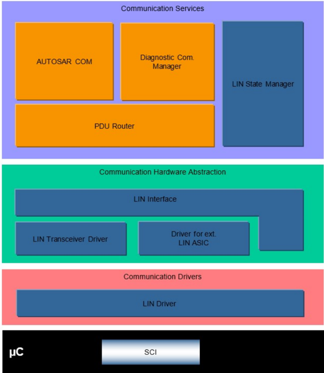
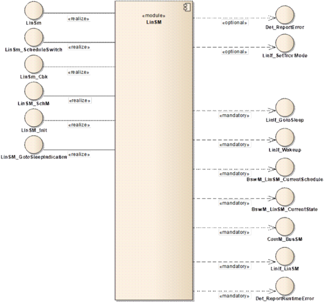
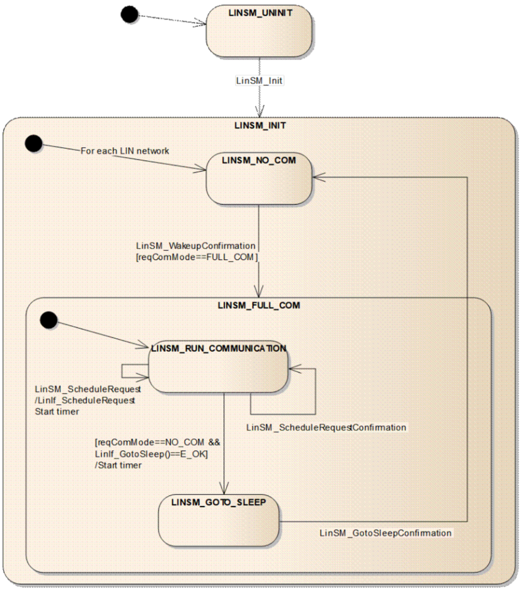
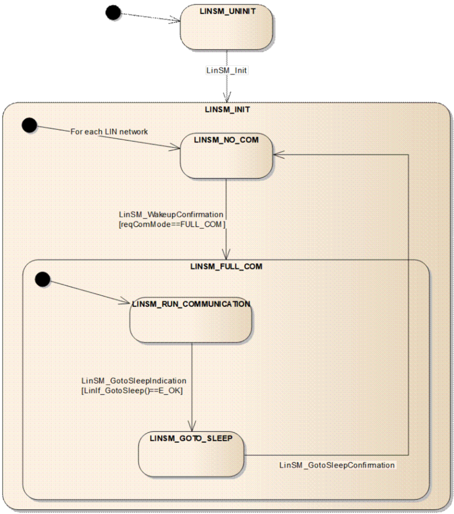
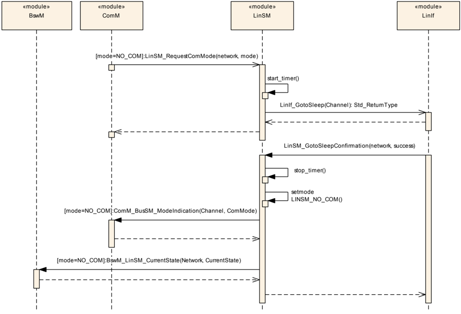
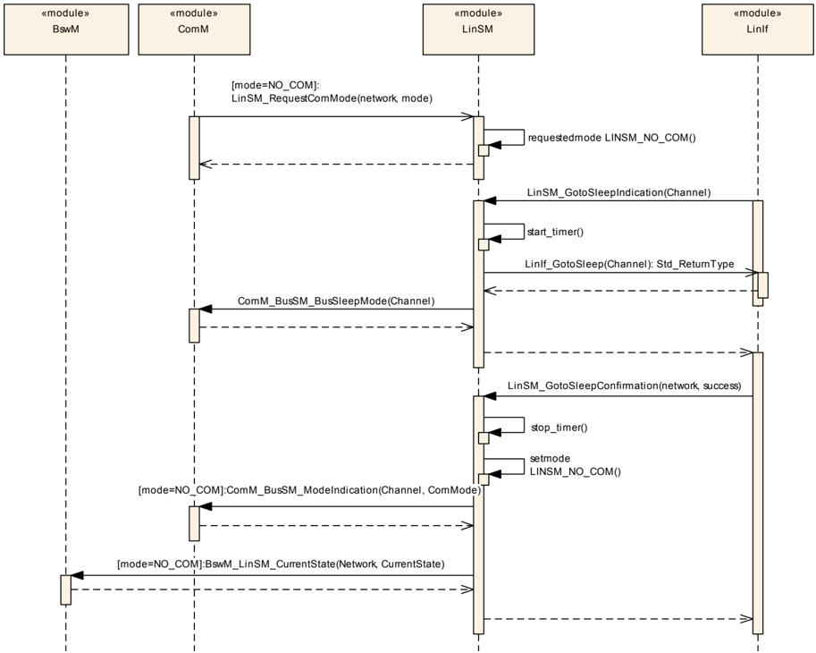
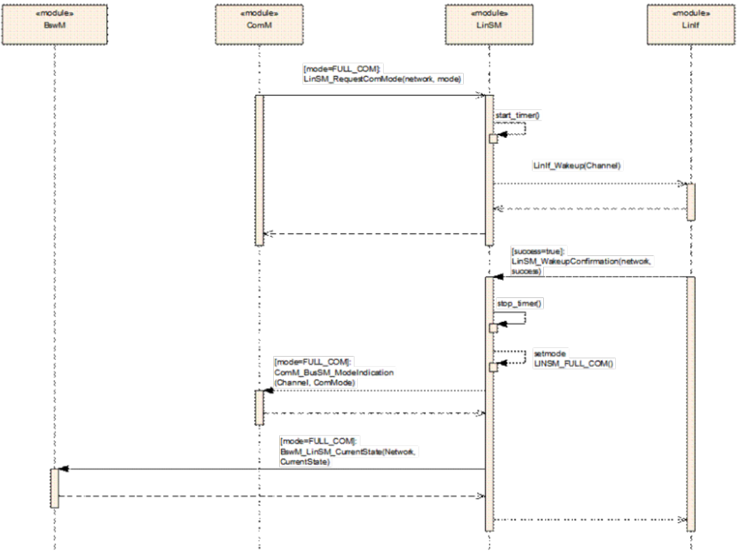
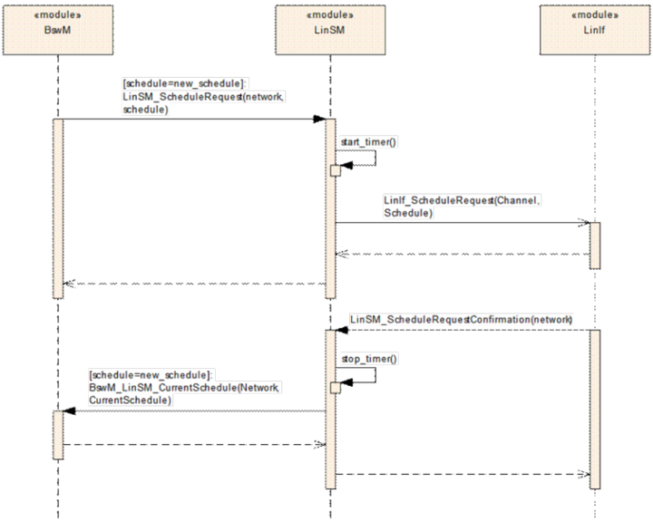

## 1. 简介和功能概述

本规范规定 AUTOSAR 基础软件模块 LIN 状态管理器（**LIN State Manager**，**LinSM**）的功能、**API** 与配置。LinSM 与 **LIN** 接口、**LIN** 驱动程序、**LIN** 收发器驱动程序一起构成完整的 **LIN** 协议。

LIN 状态管理器设计为与硬件无关。

LinSM 依赖于上层模块通信管理器 [\[1\]](#ref-1)（**ComM**）和下层模块 LIN 接口 [\[2\]](#ref-2)（**LinIf**）。

假定读者已熟悉 ISO 17987 规范。本文档不会描述 ISO 17987 规范中已经描述过的功能。

注意，本文档中的图不被视为需求。所有需求均以需求标记（例如 LINSM042）为前缀的文本来描述。没有需求前缀的文本应视为参考资料。

### 1.1. 架构概览

分层软件架构 [\[3\]](#ref-3) 将 LinSM 定位在 **BSW** 架构中，如下图所示。

图 1.1：AUTOSAR BSW 软件架构 — LIN 栈范围（**AUTOSAR BSW software architecture - LIN stack scope**）



### 1.2. 功能概览

LinSM 负责 **LIN** 总线的控制流。

这意味着：

* 当上层请求时切换调度表（仅适用于 **LIN** 主节点）。
* 当上层请求或下层指示时进行睡眠与唤醒处理。
* 在进入新状态时向上层发出通知。

## 2. 缩略语

本文档中使用的缩略语与缩写。更多缩略语可在 ISO 17987 规范中找到。

**API**
> 应用程序接口（**Application Program Interface**）。

**AUTOSAR**
> 汽车开放系统架构（**Automotive Open System Architecture**）。

**BSW**
> 基础软件（**Basic Software**）。

**BswM**
> **BSW** 模式管理器（**BSW Mode Manager**）。

**ComM**
> 通信管理器（**Communication Manager**）。

**DCM**
> 诊断通信管理器（**Diagnostic Communication Manager**）。

**DEM**
> 诊断事件管理器（**Diagnostic Event Manager**）。

**DET**
> 默认错误追踪器（**Default Error Tracer**）。

**ECU**
> 电子控制单元（**Electric Control Unit**）。

**ID**
> 标识符（**Identifier**）。

**ISR**
> 中断服务例程（**Interrupt Service Routine**）。

**Jitter**
> 抖动：最长延迟与最短延迟之间的差值（例如，最坏情况执行时间 − 最好情况执行时间）。

**LIN**
> 局部互联网络（**Local Interconnect Network**）。

**LinIf**
> LIN 接口（**LIN Interface**）。

**LinSM**
> LIN 状态管理器（本文档的主题）（**LIN State Manager**）。

**MCAL**
> 微控制器抽象层（**Microcontroller Abstraction Layer**）。

**PDU**
> 协议数据单元（**Protocol Data Unit**）。

**RAM**
> 随机存取存储器（**Random Access memory**）。

**RTE**
> 运行时环境（**Run Time Environment**）。

**RX**
> 接收（**Receive**）。

**SPAL**
> 标准外设抽象层（**Standard Peripheral Abstraction Layer**）。

**SRS**
> 软件需求规范（**Software Requirement Specification**）。

**SW**
> 软件（**Software**）。

**SWS**
> 软件设计规范（**Software Design Specification**）。

**TP**
> 传输协议（**Transport Protocol**）。

**TX**
> 发送（**Transmit**）。

**UART**
> 通用异步收发器（**Universal Asynchronous Receiver Transmitter**）。

**UML**
> 统一建模语言（**Universal Modelling Language**）。

**URL**
> 统一资源定位符（**Uniform Resource Locator**）。

**WPII**
> AUTOSAR 第二阶段的工作包（**Work Package in AUTOSAR phase 2**）。

**XML**
> 可扩展标记语言（**Extensible Markup Language**）。

## 3. 相关文档

### 3.1. 输入文件和相关标准与规范

<a id="ref-1"></a>- [1] 通信管理器规范 AUTOSAR\_CP\_SWS\_COMManager
<a id="ref-2"></a>- [2] LIN 接口规范 AUTOSAR\_CP\_SWS\_LINInterface
<a id="ref-3"></a>- [3] 基础软件模块清单 AUTOSAR\_CP\_TR\_BSWModuleList
<a id="ref-4"></a>- [4] 基础软件模块通用规范 AUTOSAR\_CP\_SWS\_BSWGeneral
<a id="ref-5"></a>- [5] LIN 驱动程序规范 AUTOSAR\_CP\_SWS\_LINDriver
<a id="ref-6"></a>- [6] 默认错误追踪器规范 AUTOSAR\_CP\_SWS\_DefaultErrorTracer
<a id="ref-7"></a>- [7] 诊断事件管理器规范 AUTOSAR\_CP\_SWS\_DiagnosticEventManager
<a id="ref-8"></a>- [8] 基础软件模式管理器规范 AUTOSAR\_CP\_SWS\_BSWModeManager
<a id="ref-9"></a>- [9] 基础软件模块通用需求 AUTOSAR\_CP\_SRS\_BSWGeneral
<a id="ref-10"></a>- [10] LIN 需求 AUTOSAR\_CP\_SRS\_LIN
<a id="ref-11"></a>- [11] 分层软件架构 AUTOSAR\_CP\_EXP\_LayeredSoftwareArchitecture
<a id="ref-12"></a>- [12] 标准类型规范 AUTOSAR\_CP\_SWS\_StandardTypes

### 3.2. 相关规范

AUTOSAR 提供了一份基础软件模块通用规范 [\[4, SWS BSW General\]](#ref-4)，它同样适用于 LIN 状态管理器。

因此，规范 **SWS BSW General** 应被视为 LIN 状态管理器的附加且必需的规范。

## 4. 约束和假设

### 4.1. 限制

每个 **ECU** 中至多存在一个 LinSM 实例。如果底层的 LIN 驱动程序 [\[5\]](#ref-5) 支持多个网络，则 LinSM 可以在多个集群上同时作为 **LIN** 主节点或 **LIN** 从节点。

所有对（切换）调度表的引用仅适用于 **LIN** 主节点；**LIN** 从节点没有调度表。

### 4.2. 汽车域的适用性

本规范适用于使用 **LIN** 的所有汽车域。

## 5. 对其他模块的依赖

本节描述与基础软件中其他模块的关系。它描述了从这些模块使用的服务。图 5.1 展示了实现 LinSM 模块所需要或可选的模块。该图是完整的，但不被视为需求。

为了使 LinSM 模块能够运行，将接口以下模块：

* **LIN** 接口 — **LinIf**
* 诊断事件管理器 — **DEM**
* 默认错误追踪器 — **DET**
* 通信管理器 — **ComM**
* **BSW** 模式管理器 — **BswM**

注意，使用本模块接口（回调除外）的模块未列出。

图 5.1：对其他模块的依赖（**Dependencies to other modules**）



### 5.1. 与上层的关系

原则上，没有要求特定模块必须调用 LinSM 模块的接口。下面列出了 LinSM 模块的正常使用者。

#### 5.1.1. 操作系统

LinSM 模块确实包含对上层或下层模块共享数据的访问（通过 **API**）。共享的数据不需要 **OS** 的帮助来保护数据的一致性（没有数组访问，只有简单类型访问）。但是，可能存在访问 LinSM 模块中相同数据的可重入函数。由实现者来解决这些访问。

#### 5.1.2. 模块 DET（默认错误追踪器）

模块 **DET** [\[6\]](#ref-6) 的 Det_ReportError 函数将在发生开发错误和运行时错误时被调用。

#### 5.1.3. 模块 DEM（诊断事件管理器）

生产错误将报告给诊断事件管理器 [\[7\]](#ref-7) 模块。

#### 5.1.4. ComM

通信管理器模块通过 **LIN** 栈请求通信，并查询 LinSM 模块的状态。

#### 5.1.5. BSW 模式管理器

当状态发生改变时，LinSM 模块将通知 **BSW** 模式管理器模块 [\[8\]](#ref-8)。**BSW** 模式管理器模块在请求新的调度表时（仅 **LIN** 主节点）将与 LinSM 模块交互。

### 5.2. 与下层的关系

以下是 LinSM 模块将要接口的 **BSW** 模块。

#### 5.2.1. LinIf

LinSM 模块假定 **LinIf** [\[2\]](#ref-2) 模块提供以下原语：

* 发送睡眠命令（仅 **LIN** 主节点）并将下层置于睡眠模式（LinIf_GotoSleep）
* **LIN** 总线的唤醒（LinIf_Wakeup）
* 更改调度表的请求（LinIf_ScheduleRequest）。仅适用于 **LIN** 主节点。

假定 LinIf 模块将调用以下回调：

* 确认已进入运行模式，无论是否发送了唤醒帧（[LinSM_WakeupConfirmation](#754-linsm_wakeupconfirmation)）
* 确认已进入睡眠模式，在发送睡眠命令之后（**LIN** 主节点），或在接收到睡眠命令或检测到总线空闲之后（**LIN** 从节点）（[LinSM_GotoSleepConfirmation](#753-linsm_gotosleepconfirmation)）
* 确认调度更改（[LinSM_ScheduleRequestConfirmation](#751-linsm_schedulerequestconfirmation)）。仅适用于 **LIN** 主节点。

LinSM 模块不得以 LinIf 模块通过上述函数调用所提供方式之外的任何方式使用或访问 LIN 驱动程序，也不得假定有关它的信息。

### 5.3. 文件结构

#### 5.3.1. 代码文件结构

本章描述实现 LinSM 模块配置的 c 文件。代码文件结构未在本规范中完整定义。由每个实现者来设计缺失的结构细节。

预编译和链接时配置参数必须保存在单独的文件中：

#### 5.3.2. 头文件结构

本章描述 LinSM 模块以及可能的其他模块将包含的头文件。

##### 5.3.2.1. LinSM 头文件

LinSM 实现中应存在以下头文件：

LinSM 实现应提供头文件 **LinSM.h**，其中包含从 LinSM 导出的所有数据 — **API** 声明（回调除外）、extern 类型和全局数据。

##### 5.3.2.2. 包含的头文件

应包含以下外部头文件：

LinSM 模块应包含 **ComM.h** 文件。

LinSM 模块应包含 **BswM_LinSM.h**。

LinSM 模块应包含 **ComM_BusSM.h**。

LinSM 模块应基于对相关代码文件和头文件的版本号进行预处理检查，来执行代码文件与头文件之间的一致性检查。

## 6. 功能规格

本章规定 LinSM 模块的需求。有关 LinSM 职责的概述，请参见基础软件模块文档 [\[11\]](#ref-11)。

LinSM 的主要职责是：

* 控制所有 **LIN** 网络的通信状态（无通信或完全通信）
* 处理调度表更改请求（仅适用于 **LIN** 主节点）
* 处理通信模式请求
* 向上层通知状态改变

LinSM 模块不会直接实现 **LIN** 规范中的功能。LinSM 模块将支持 ISO 17987 规范中定义的行为。LinSM 模块提供的 **LIN** 行为将允许复用符合 LIN 1.3、2.0、2.1、2.2 和 ISO 17987 规范的既有 **LIN** 节点。

LinSM 模块应能够处理一个或多个 **LIN** 网络。

**LIN** 网络的数量受 LinIf 规范的限制。所有网络均通过 **ComM** 模块指定的 NetworkHandleType 处理。

**LIN** 网络的标识通过配置中对 **ComM** 网络句柄的引用来完成。

### 6.1. LinSM 状态机的状态与转换

LinSM 模块将在一个状态机中运行。每个所连接的网络将在一个独立的子状态机中运行。图 7.1 与图 7.2 以简化形式展示了下述需求，这些图的目的不在于完整，而在于给出一个概览。

LinSM 模块应有一个包含状态 **LINSM_UNINIT** 和 **LINSM_INIT** 的状态机。

在 **LINSM_INIT** 中，每个网络应有一个包含状态 **LINSM_NO_COM** 和 **LINSM_FULL_COM** 的子状态机。

在 **LINSM_INIT** 中，每个网络可以相互独立地处于子状态 **LINSM_NO_COM** 或 **LINSM_FULL_COM**。

图 7.1：LinSM 状态机（主节点）（**LinSM State Machine (master node)**）



图 7.2：LinSM 状态机（从节点）（**LinSM State Machine (slave node)**）



#### 6.1.1. LINSM_UNINIT

未初始化状态是 LinSM 模块中最初处于活动的状态。

应有一个名为 **LINSM_UNINIT** 的状态。

状态 **LINSM_UNINIT** 应在启动时、在任何 **API** 被调用之前处于活动状态。

#### 6.1.2. LINSM_INIT

初始化完成之后，LinSM 模块将激活初始化状态。该状态中有两个子状态：一个是无通信状态，此时 **LIN** 总线上不进行通信；另一个是完全通信状态，此时进行所有通信，并且对于 **LIN** 主节点而言调度表处于活动状态。每个网络可以相互独立地处于无通信或完全通信状态。

应有一个名为 **LINSM_INIT** 的状态。

当调用 [LinSM_Init](#731-linsm_init) 时，LinSM 状态机应从任何状态或子状态转换到状态 **LINSM_INIT**。

当调用 [LinSM_Init](#731-linsm_init) 时，LinSM 状态机应从任何状态或子状态转换为所有网络的子状态 **LINSM_NO_COM**。

进入 **LINSM_INIT** 时，LinSM 应被置于初始化状态。初始化状态意味着全局变量等应被设置为默认值（复位值）。

在进入 **LINSM_INIT** 状态时，对于所有网络，当调用 [LinSM_Init](#731-linsm_init) 时，子状态 **LINSM_NO_COM** 应处于活动状态。

[LinSM_Init](#731-linsm_init) 函数应为每个配置的通道设置调度类型 **NULL_SCHEDULE**。本需求仅适用于 **LIN** 主节点。

为了使 LinSM 独立于 LinIf 模块，当 LinSM 模块处于其初始化函数中时，LinSM 模块不应调用 LinIf 模块。因此 [LinSM_Init](#731-linsm_init) 有附加需求，参见 [7.3.1](#731-linsm_init)。

#### 6.1.3. LINSM_NO_COM

无通信状态在初始化之后、当 **ComM** 模块请求无通信（**LIN** 主节点）时、或当 LinIf 指示总线睡眠事件（**LIN** 从节点）时处于活动状态。

在状态 **LINSM_INIT** 中应有一个名为 **LINSM_NO_COM** 的子状态。

进入 **LINSM_NO_COM** 时，LinSM 模块应通过为特定网络调用参数为 COMM_NO_COMMUNICATION 的 ComM_BusSM_ModeIndication，将状态改变通知 **ComM**（[6.1.3](#613-linsm_no_com) 中所述的例外情况除外）。

进入 **LINSM_NO_COM** 时，LinSM 模块应通过为特定网络调用参数为 LINSM_NO_COM 的 BswM_LinSM_CurrentState，将状态改变通知 **BswM**（[6.1.3](#613-linsm_no_com) 中所述的例外情况除外）。

上述两个需求有一个例外。其基本原理是，在执行 [LinSM_Init](#731-linsm_init) 函数时 **ComM** 可能尚未初始化。

当 LinSM 正在执行 [LinSM_Init](#731-linsm_init) 函数时，LinSM 模块不得将状态改变通知为 **LINSM_NO_COM**，即 [LinSM_Init](#731-linsm_init) 函数既不调用 ComM_BusSM_ModeIndication，也不调用 BswM_LinSM_CurrentState。

当 **LINSM_NO_COM** 处于活动状态时，对于所选网络，LinSM 模块不得命令 LinIf 模块进行通信，即总线应保持静默。

**注意：** 在进入或退出 **LINSM_NO_COM** 状态时，LinSM 模块不会将硬件接口或微控制器置于新的电源模式。这不属于 LinSM 的范围。

进入 **LINSM_NO_COM** 时，如果 LinSMTransceiverPassiveMode 为 true，则收发器应通过 LinIf_SetTrcvMode 置为 **STANDBY**，否则置为 **SLEEP**。本需求仅在为该通道配置了 LinSMTransceiverPassiveMode 时适用。

不得从函数 [LinSM_Init](#731-linsm_init) 调用 LinIf_SetTrcvMode。

**注意：** 无需在 LinSM 初始化函数中设置模式，因为收发器将在其自身的初始化函数中设置模式。该模式在收发器配置中选择。

#### 6.1.4. LINSM_FULL_COM

**LINSM_FULL_COM** 是唯一允许 **LIN** 总线上进行通信的状态。每个网络可以相互独立地处于 **LINSM_FULL_COM**。以下所有需求均适用于每个网络。

对于 **LINSM_INIT** 状态中的每个网络，应有一个名为 **LINSM_FULL_COM** 的子状态。

进入 **LINSM_FULL_COM** 时，应通过为指定网络调用参数为 COMM_FULL_COMMUNICATION 的 ComM_BusSM_ModeIndication，将状态改变通知 **ComM**。

进入 **LINSM_FULL_COM** 时，应通过为指定网络调用参数为 LINSM_FULL_COM 的 BswM_LinSM_CurrentState，将状态改变通知 **BswM**。

进入 **LINSM_FULL_COM** 时，收发器应通过 LinIf_SetTrcvMode 置为活动。本需求仅在为该通道配置了 LinSMTransceiverPassiveMode 时适用。

进入 **LINSM_FULL_COM** 时，将进入子状态 **LINSM_RUN_COMMUNICATION**。

#### 6.1.5. 睡眠

睡眠序列在主节点与从节点之间有所不同。

在主节点中，当 **ComM** 模块请求无通信模式时，LinSM 将请求在 **LIN** 总线上发送睡眠命令。

在从节点中，LIN 接口向 LinSM 指示总线睡眠事件，该事件或者由接收到睡眠命令引起，或者由检测到总线空闲状态引起。如果 **ComM** 模块之前已请求无通信模式，则该总线睡眠事件被转发给 **ComM**；否则，如果 **ComM** 模块请求的完全通信模式处于活动状态，则该总线睡眠事件不转发给 **ComM**，而是在睡眠序列完成后由 LinSM 重启唤醒过程。

在所有情况下，无通信模式的进入都将通知 **BswM** 与 **ComM**。该回调总是会进行，即使出现了问题。

仅当状态 **LINSM_FULL_COM** 与子状态 **LINSM_RUN_COMMUNICATION** 处于活动状态时，LinSM 模块才可以在 LinIf 中调用 LinIf_GotoSleep **API**。

当 [LinSM_GotoSleepConfirmation](#753-linsm_gotosleepconfirmation) 被调用、且当前状态/子状态为 **LINSM_FULL_COM**/**LINSM_GOTOSLEEP** 时，无论 "success" 参数如何，LinSM 都应将状态置为 **LINSM_NO_COM**。在任何其他状态下，[LinSM_GotoSleepConfirmation](#753-linsm_gotosleepconfirmation) 应被忽略。

如果 LinIf_GotoSleep 返回 **E_OK**，则 LinSM 将子状态置为 **LINSM_GOTOSLEEP**。

##### 6.1.5.1. 主节点特有的睡眠

本章仅适用于 **LIN** 主节点。

如果状态为 **LINSM_FULL_COM** 且 **ComM** 请求 COMM_NO_COMMUNICATION，则 LinSM 应调用 LinIf_GotoSleep 在所请求的网络上发送睡眠命令。

除 [6.1.5.1](#6151-主节点特有的睡眠) 中情形之外的所有其他情况下，不得调用 LinIf_GotoSleep。

如果 **ComM** 模块调用 [LinSM_RequestComMode](#735-linsm_requestcommode) 请求 COMM_NO_COMMUNICATION，则 LinSM 模块应在指定网络上直接调用（而不等待下一次 main 函数调用）LinIf 模块函数 LinIf_GotoSleep。

如果 LinIf_GotoSleep 返回 **E_NOT_OK**，则 [LinSM_RequestComMode](#735-linsm_requestcommode) 应返回 **E_NOT_OK**。

如果 LinSM 模块以 **E_NOT_OK** 返回 [LinSM_RequestComMode](#735-linsm_requestcommode)，则应设置相同的状态（以便调用 ComM_BusSM_ModeIndication 与 BswM_LinSM_CurrentState）。

##### 6.1.5.2. 从节点特有的睡眠

本章仅适用于 **LIN** 从节点。

如果状态为 **LINSM_FULL_COM** 且 **ComM** 请求 COMM_NO_COMMUNICATION，则 LinSM 应存储所请求的通信模式并返回 **E_OK**，而不执行进一步操作。

当 [LinSM_GotoSleepIndication](#752-linsm_gotosleepindication) 被调用、且当前状态为 **LINSM_FULL_COM** 时，LinSM 应直接调用 LinIf_GotoSleep（而不等待下一次 main 函数调用）以在所请求的网络上进入睡眠模式。

除上述情形之外的所有其他情况下，不得调用 LinIf_GotoSleep。

当当前状态为 **LINSM_FULL_COM** 且 **ComM** 模块请求的通信模式为 COMM_NO_COMMUNICATION 时，LinIf 应调用 LinIf_GotoSleep，随后通过为指定网络调用 ComM_BusSM_BusSleepMode 将总线睡眠事件通知 **ComM**。

在上述情形下、且 **ComM** 模块请求的通信模式为 COMM_FULL_COMMUNICATION 时，LinSM 应重启唤醒过程。

#### 6.1.6. 更改调度表（仅主节点）

本章仅适用于 **LIN** 主节点。

如果函数 [LinSM_ScheduleRequest](#732-linsm_schedulerequest) 被调用，LinSM 模块应（而不等待下一次 main 函数调用）使用函数调用 LinIf_ScheduleRequest 将该请求转发给 LinIf 模块。

当 LinSM 从一次 [LinSM_ScheduleRequest](#732-linsm_schedulerequest) 调用中调用了 LinIf_ScheduleRequest 时，它应将返回值转发给其调用者。

如果 LinIf_ScheduleRequest 以 **E_NOT_OK** 返回，则 LinSM 模块应在下一次 main 函数调用中用旧的调度表调用 BswM_LinSM_CurrentSchedule。

当 LinSM 模块从 LinIf 模块获得设置调度表的确认时，如果定时器尚未流逝，则应调用 BswM_LinSM_CurrentSchedule。

如果定时器已经流逝，则 LinSM 模块应以未更改的调度表调用 BswM_LinSM_CurrentSchedule。

请注意，LinIf 在进入睡眠时会切换到 **NULL** 调度表，此时它可能会进行一次调度切换回调。

如果 LinIf 在没有先行请求新调度表调用的情况下确认了一次调度切换，则应调用 BswM_LinSM_CurrentSchedule。

#### 6.1.7. 唤醒过程

如果 **ComM** 模块通过 [LinSM_RequestComMode](#735-linsm_requestcommode) 调用请求唤醒，或者某个 **LIN** 节点在网络上发送唤醒信号，则该 **LIN** 网络将被唤醒。按集群的唤醒不由 LinSM 模块处理，它由 **EcuM** 模块处理，并将导致 **ComM** 请求该网络。在这两种情况下，**ComM** 都会为特定网络向 LinSM 模块请求完全通信。

如果 LinIf 已经处于唤醒状态（由于某个 **LIN** 节点唤醒了总线），则 LinIf 将直接忽略该唤醒调用。

如果 **ComM** 请求 COMM_FULL_COMMUNICATION，则 LinSM 应直接调用（而不等待下一次 main 函数调用）LinIf_Wakeup 以在所请求的网络上发送唤醒信号，但上述情形除外。此外，LinSM 应复位最大重试次数计数器。

除上述情形之外的所有其他情况下，LinSM 模块不得调用 LinIf_Wakeup。

当 LinIf 通知唤醒已成功发送（success = true）时，状态应置为 **LINSM_FULL_COM**。

除上述情形之外的所有其他情况下，状态应置为与请求之前相同的状态（以便向 **BswM** 与 **ComM** 进行一次模式指示回调）。

如果 LinIf_Wakeup 返回 **E_NOT_OK**，则 [LinSM_RequestComMode](#735-linsm_requestcommode) 应直接返回 **E_NOT_OK**，不执行进一步操作。

#### 6.1.8. 请求超时

调用 LinIf_Wakeup 之后，LinSM 模块等待 LinIf 模块确认总线上的唤醒。有可能收不到该确认，因此 LinSM 模块将永远等待。

缺少唤醒确认的原因可能是软件问题，但也可能是总线故障或主节点中的问题。从节点确认总线唤醒的方式与主节点不同：不是在唤醒发送之后，而是在接收到来自主节点的第一个 **LIN** 报头时。如果通信未开始，**LIN** 从节点应将唤醒帧的发送重复至多三次。在三次（失败的）唤醒请求之后，节点应在重启唤醒过程之前等待一段最短时间。

每个网络应有独立的唤醒确认定时器。

唤醒确认定时器的（倒计时与到期）处理应在 [LinSM_MainFunction](#741-linsm_mainfunction) 中完成。

唤醒确认超时参数 LinSMConfirmationTimeout 的时间应为 0 或可被 [LinSM_MainFunction](#741-linsm_mainfunction) 周期整除（即 [LinSM_MainFunction](#741-linsm_mainfunction) 周期 × m；m 为 > 0 的整数）。

在 LinSM 于某个通道上调用 LinIf_Wakeup 之前，如果 LinSMConfirmationTimeout > 0，它应为相应通道启动一个唤醒确认定时器，使用所配置的超时参数 LinSMConfirmationTimeout。

如果在相应通道上的唤醒确认定时器到期之前调用了 [LinSM_WakeupConfirmation](#754-linsm_wakeupconfirmation)，LinSM 应停止该定时器。

如果唤醒确认定时器流逝（即未发生唤醒确认），且已达到最大重试次数（LinSMModeRequestRepetitionMax），且 LinSMDevErrorDetect 设置为 **TRUE**，则 LinSM 模块应向 **DET** 报告 [LINSM_E_CONFIRMATION_TIMEOUT](#632-运行时错误)。

将超时设为可选可以减小实现体积，如果不需要超时的话：

**注意：** 如果配置参数 LinSMConfirmationTimeout 设置为零，则不使用唤醒确认定时器，因此不可能发生超时。这意味着不会出现上述报告运行时错误的情形。

如果唤醒确认定时器流逝（即未发生唤醒确认）、LinSMNodeType 设置为 **MASTER** 且 **ComM** 请求仍为 COMM_FULL_COMMUNICATION，则应调用 LinIf_Wakeup。

**注意：** 当确认回调 [LinSM_WakeupConfirmation](#754-linsm_wakeupconfirmation) 发生、或超时参数 LinSMConfirmationTimeout 已到期且 **ComM** 请求 COMM_NO_COMMUNICATION 时，LinSM 停止重试。

如果唤醒确认定时器流逝（即未发生唤醒确认）、尚未达到最大重试次数（LinSMModeRequestRepetitionMax）、LinSMNodeType 设置为 **Slave** 且 **ComM** 请求仍为 COMM_FULL_COMMUNICATION，则应调用 LinIf_Wakeup。

如果唤醒确认定时器流逝（即未发生唤醒确认）、已达到最大重试次数（LinSMModeRequestRepetitionMax）且 LinSMNodeType 设置为 **Slave**，则 LinSM 应等待唤醒后静默时间（LinSMSilenceAfterWakeupTimeout），随后通过以下方式重启唤醒过程：

* 如果 **ComM** 请求仍为 COMM_FULL_COMMUNICATION，则调用 LinIf_Wakeup。
* 复位最大重试次数计数器。

如果唤醒确认定时器流逝（即未发生唤醒确认）、已达到最大重试次数（LinSMModeRequestRepetitionMax）、LinSMNodeType 设置为 **Slave**、唤醒后静默时间（LinSMSilenceAfterWakeupTimeout）尚未到期且 **ComM** 请求 COMM_FULL_COMMUNICATION，则 LinIf_Wakeup 的调用应延迟到唤醒后静默时间到期。

### 6.2. 多网络与多驱动的处理

通常在一个 **ECU** 中只需要一个 LIN 驱动模块（支持多个网络）即可处理所有 **LIN** 网络。然而在极少数情况下，某些硬件配置中 **ECU** 包含不同的 **LIN** 硬件（例如一个高级 **LIN** 控制器和一个 **UART**）。在这种情况下，需要一个以上的不同 LIN 驱动程序。这不会影响 LinSM 模块，因为 LIN 驱动程序只接口 LinIf 模块，而不直接接口 LIN 驱动模块。

LinSM 只处理网络，而不关心网络映射到哪个驱动程序，这将由 LinIf 处理。

#### 6.2.1. 多网络

在 LinSM 配置中，每个网络都有一个唯一的网络索引（LinSMComMNetworkHandleRef）。

配置参数 LinSMComMNetworkHandleRef 直接引用 **ComM** 模块的配置。这意味着 LinSM 模块在与 LinIf 模块交互时无需在网络之间进行映射。该网络索引可以直接用于 LinIf 模块的 **API**。

LinSM 模块在接口到 LinIf 模块时（当 **LIN** 网络作为参数被要求时）应使用通过 **API** 接收到的同一个 NetworkHandle 值。

### 6.3. 错误分类

《基础软件模块通用规范》一文的"错误处理"（Error Handling）一节详细描述了基础软件的错误处理。其中最重要的是，它构成了一个由 **BSW** 模块中可能出现的五种错误类型组成的分类方案。

基于该基础，以下各节在相应的小节中规定了特定的错误。

#### 6.3.1. 开发错误

表6.1：LinSM 模块中开发错误的定义

| 错误类型 | 相关错误码 | 错误值 |
| --- | --- | --- |
| 在 LinSM 未初始化的情况下调用 **API** | LINSM_E_UNINIT | 0x00 |
| 引用的网络不存在（标识超出范围） | LINSM_E_NONEXISTENT_NETWORK | 0x20 |
| 以错误的参数调用 **API** 服务 | LINSM_E_PARAMETER | 0x30 |
| 以无效指针调用 **API** 服务 | LINSM_E_PARAM_POINTER | 0x40 |
| 初始化函数失败 | LINSM_E_INIT_FAILED | 0x50 |

#### 6.3.2. 运行时错误

表6.2：LinSM 模块中运行时错误的定义

| 错误类型 | 相关错误码 | 错误值 |
| --- | --- | --- |
| 来自 LinIf 的回调超时 | LINSM_E_CONFIRMATION_TIMEOUT | 0x00 |

#### 6.3.3. 瞬态故障

不存在瞬态故障。

#### 6.3.4. 生产错误

不存在生产错误。

#### 6.3.5. 扩展生产错误

不存在扩展生产错误。

## 7. API规范

### 7.1. 导入的类型

#### 7.1.1. 标准类型

本章列出了从以下模块包含的所有类型。标准 AUTOSAR 类型在 AUTOSAR 标准类型规范文档 [\[12\]](#ref-12) 中定义。

LinSM 模块使用以下类型：

表7.1：LinSM 模块导入数据类型的定义

| 模块 | 头文件 | 导入的类型 |
| --- | --- | --- |
| ComM | Rte_ComM_Type.h | ComM_ModeType |
| ComStack_Types | ComStack_Types.h | NetworkHandleType |
| LinIf | LinIf.h | LinIf_SchHandleType |
| LinTrcv | Lin_GeneralTypes.h | LinTrcv_TrcvModeType |
| Std | Std_Types.h | Std_ReturnType |
| Std | Std_Types.h | Std_VersionInfoType |

### 7.2. 类型定义

以下类型由 LinSM 模块定义：

#### 7.2.1. LinSM_ModeType

| 名称 | LinSM_ModeType | | |
| --- | --- | --- | --- |
| 类别 | Type | | |
| 取值 | LINSM_FULL_COM | 0x01 | 完全通信 |
| | LINSM_NO_COM | 0x02 | 无通信 |
| 描述 | 用于向 BswM 报告当前模式的类型。 | | |
| 可通过 | LinSM.h 获得 | | |

#### 7.2.2. LinSM_ConfigType

| 名称 | LinSM_ConfigType |
| --- | --- |
| 类别 | 结构体（Structure） |
| 元素 | 实现特定 |
| 描述 | 用于后构建时（post-build）配置参数的数据结构类型。 |
| 可通过 | LinSM.h 获得 |

### 7.3. LinSM API

这是提供给上层模块的 **API** 调用列表。

#### 7.3.1. LinSM_Init

**说明**： 本函数初始化 LinSM。服务 ID 0x01。本服务为同步调用，不可重入。参数 ConfigPtr（in）：指向 LinSM 后构建时配置数据的指针。无返回值。可通过 **LinSM.h** 获得。

```C
void LinSM_Init ( const LinSM_ConfigType* ConfigPtr )
```

不得从 LinSM_Init 函数调用任何其他 LinSM **API** 或其他模块（例如 LinIf）的 **API**。其他模块可能尚未初始化。

#### 7.3.2. LinSM_ScheduleRequest

服务 LinSM_ScheduleRequest 仅适用于 **LIN** 主节点。

**说明**： 上层请求在一个 **LIN** 网络上更改调度表。服务 ID 0x10。本服务为异步调用，可重入。参数 network（in）：**LIN** 通道的标识；ScheduleTableIdx（in）：调度表的索引。返回值：Std_ReturnType，**E_OK**：调度表请求已被接受；**E_NOT_OK**：无法执行该请求，例如未初始化。可通过 **LinSM.h** 获得。

```C
Std_ReturnType LinSM_ScheduleRequest ( NetworkHandleType network, LinIf_SchHandleType ScheduleTableIdx )
```

如果启用了 LinSMDevErrorDetect：如果 network 参数的取值无效，则应向 **DET** 模块报告错误码 [LINSM_E_NONEXISTENT_NETWORK](#631-开发错误)，并返回 **E_NOT_OK**。

如果启用了 LinSMDevErrorDetect：如果 schedule 参数的取值无效，则应向 **DET** 模块报告错误码 [LINSM_E_PARAMETER](#631-开发错误)，并返回 **E_NOT_OK**。

如果启用了 LinSMDevErrorDetect：如果状态 **LINSM_UNINIT** 处于活动状态，则应向 **DET** 模块报告错误码 [LINSM_E_UNINIT](#631-开发错误)，并返回 **E_NOT_OK**。

如果函数 LinSM_ScheduleRequest 被调用且状态不是 **LINSM_FULL_COM**，则 LinSM_ScheduleRequest 应直接返回 **E_NOT_OK**。

如果函数 LinSM_ScheduleRequest 被调用、LinSMOverwritePendingScheduleRequestProcessing 设置为 **FALSE**、且同一网络上另一个调度请求正在等待处理，则 LinSM_ScheduleRequest 应直接返回 **E_NOT_OK**。

如果函数 LinSM_ScheduleRequest 被调用、LinSMOverwritePendingScheduleRequestProcessing 设置为 **TRUE**、且同一网络上另一个调度请求正在等待处理，则正在等待的调度请求应被新的调度请求覆盖，并返回 **E_OK**。

如果 LinSM 模块在至少一个通道上被配置为 **LIN** 主节点，则函数 LinSM_ScheduleRequest 应可用。

**注意：** 在纯 **LIN** 从节点配置中，该函数不可用。这取决于配置参数 LinSMNodeType。

#### 7.3.3. LinSM_GetVersionInfo

**说明**： 服务 ID 0x02。本服务为同步调用，可重入。参数 versioninfo（out）：指向存储本模块版本信息的位置的指针。无返回值。可通过 **LinSM.h** 获得。

```C
void LinSM_GetVersionInfo ( Std_VersionInfoType* versioninfo )
```

如果启用了 LinSMDevErrorDetect：如果 versioninfo 指针参数无效（例如 **NULL**），则应向 **DET** 模块报告错误码 [LINSM_E_PARAM_POINTER](#631-开发错误)，并返回 **E_NOT_OK**。

#### 7.3.4. LinSM_GetCurrentComMode

**说明**： 查询当前通信模式的函数。服务 ID 0x11。本服务为同步调用，可重入。参数 network（in）：**LIN** 通道的标识；mode（out）：返回活动模式，各模式的说明见 ComM_ModeType。返回值：Std_ReturnType，**E_OK**：正常；**E_NOT_OK**：无法执行该请求，例如未初始化。可通过 **LinSM.h** 获得。

```C
Std_ReturnType LinSM_GetCurrentComMode ( NetworkHandleType network, ComM_ModeType* mode )
```

如果启用了 LinSMDevErrorDetect：如果 network 参数的取值无效，则应向 **DET** 模块报告错误码 [LINSM_E_NONEXISTENT_NETWORK](#631-开发错误)，并返回 **E_NOT_OK**。

如果启用了 LinSMDevErrorDetect：如果 mode 指针参数无效（例如 **NULL**），则应向 **DET** 模块报告错误码 [LINSM_E_PARAM_POINTER](#631-开发错误)，并返回 **E_NOT_OK**。

如果启用了 LinSMDevErrorDetect：如果状态 **LINSM_UNINIT** 处于活动状态，则应向 **DET** 模块报告错误码 [LINSM_E_UNINIT](#631-开发错误)，并返回 **E_NOT_OK**。

如果活动状态为 **LINSM_NO_COM**，则应返回状态 COMM_NO_COMMUNICATION。

如果活动状态为 **LINSM_FULL_COM**，则应返回状态 COMM_FULL_COMMUNICATION。

如果活动状态为 **LINSM_UNINIT**，则应返回状态 COMM_NO_COMMUNICATION。上文在 **DET** 启用时也已涵盖该情形。这是为了防御性编程。

注意，**COMM_SILENT_COMMUNICATION** 不被 LinSM 模块使用。

#### 7.3.5. LinSM_RequestComMode

**说明**： 请求一种通信模式。服务 ID 0x12。本服务为异步调用，可重入。参数 network（in）：**LIN** 通道的标识；mode（in）：请求的模式。返回值：Std_ReturnType，**E_OK**：请求被接受；**E_NOT_OK**：无法执行该请求，例如未初始化。可通过 **LinSM.h** 获得。

```C
Std_ReturnType LinSM_RequestComMode ( NetworkHandleType network, ComM_ModeType mode )
```

如果启用了 LinSMDevErrorDetect：如果 network 参数的取值无效，则应向 **DET** 模块报告错误码 [LINSM_E_NONEXISTENT_NETWORK](#631-开发错误)，并返回 **E_NOT_OK**。

如果启用了 LinSMDevErrorDetect：如果 mode 参数的取值无效，则应向 **DET** 模块报告错误码 [LINSM_E_PARAMETER](#631-开发错误)，并返回 **E_NOT_OK**。

如果启用了 LinSMDevErrorDetect：如果状态 **LINSM_UNINIT** 处于活动状态，则应向 **DET** 模块报告错误码 [LINSM_E_UNINIT](#631-开发错误)，并返回 **E_NOT_OK**。

如果请求的是 COMM_SILENT_COMMUNICATION，则该函数应直接返回 **E_NOT_OK**，不执行任何操作。

如果返回值为 **E_OK**，LinSM_RequestComMode 应存储所请求的模式。

[LinSM_MainFunction](#741-linsm_mainfunction) 的下一次激活将在处理状态机时处理该请求。

注意，[6.1](#61-linsm-状态机的状态与转换) 节中的状态机定义将该存储的请求称为 reqComMode。

### 7.4. 调度函数

本章列出以固定周期调用的函数。

#### 7.4.1. LinSM_MainFunction

本函数由基础软件调度器模块直接调用。以下函数没有返回值、没有参数且不可重入。

与其他 main 函数没有依赖关系。该 main 函数可以在不考虑其他 main 函数的情况下执行。但明智地调度不同的 main 函数将使执行时间和抖动最小化。

**说明**： 运行不同请求超时定时器的周期性函数。服务 ID 0x30。可通过 **SchM_LinSm.h** 获得。

```C
void LinSM_MainFunction ( void )
```

设计提示：函数 LinSM_MainFunction 可能被其他函数中断。应确保对由该函数操作的定时器加以保护，使其行为正确（例如必要时使用临界区）。

LinSM_MainFunction 应处理附加在函数 LinIf_GotoSleep、LinIf_Wakeup 或 LinIf_ScheduleRequest 上的定时器（参见相应段落）。

### 7.5. LinSM 回调通知

#### 7.5.1. LinSM_ScheduleRequestConfirmation

回调 LinSM_ScheduleRequestConfirmation 仅适用于 **LIN** 主节点。

**说明**： 当新请求的调度表变为活动时，LinIf 模块将调用该回调。服务 ID 0x20。本服务为同步调用，可重入。参数 network（in）：**LIN** 通道的标识；ScheduleTableIdx（in）：调度表的索引。无返回值。可通过 **LinSM.h** 获得。

```C
void LinSM_ScheduleRequestConfirmation ( NetworkHandleType network, LinIf_SchHandleType ScheduleTableIdx )
```

如果启用了 LinSMDevErrorDetect：如果 network 参数的取值无效，则应向 **DET** 模块报告错误码 [LINSM_E_NONEXISTENT_NETWORK](#631-开发错误)。

如果启用了 LinSMDevErrorDetect：如果状态 **LINSM_UNINIT** 处于活动状态，则应向 **DET** 模块报告错误码 [LINSM_E_UNINIT](#631-开发错误)。

如果 LinSM 模块在至少一个通道上被配置为 **LIN** 主节点，则回调函数 LinSM_ScheduleRequestConfirmation 应可用。

**注意：** 在纯 **LIN** 从节点配置中，该函数不可用。这取决于配置参数 LinSMNodeType。

#### 7.5.2. LinSM_GotoSleepIndication

回调 LinSM_GotoSleepIndication 仅适用于 **LIN** 从节点。

**说明**： 当在网络上接收到睡眠命令或发生总线空闲超时时，LinIf 将调用该回调。仅适用于 **LIN** 从节点。服务 ID 0x03。本服务为同步调用，对于不同通道可重入。参数 Channel（in）：**LIN** 通道的标识。无返回值。可通过 **LinSM.h** 获得。

```C
void LinSM_GotoSleepIndication ( NetworkHandleType Channel )
```

如果启用了 LinSMDevErrorDetect：如果 network 参数的取值无效，则应向 **DET** 模块报告错误码 [LINSM_E_NONEXISTENT_NETWORK](#631-开发错误)。

如果启用了 LinSMDevErrorDetect：如果状态 **LINSM_UNINIT** 处于活动状态，则应向 **DET** 模块报告错误码 [LINSM_E_UNINIT](#631-开发错误)。

如果 LinSM 模块在至少一个通道上被配置为 **LIN** 从节点，则回调函数 LinSM_GotoSleepIndication 应可用。

**注意：** 在纯 **LIN** 主节点配置中，该函数不可用。这取决于配置参数 LinSMNodeType。

#### 7.5.3. LinSM_GotoSleepConfirmation

**说明**： 当睡眠命令在网络上发送成功或发送失败时，LinIf 将调用该回调。服务 ID 0x22。本服务为同步调用，可重入。参数 network（in）：**LIN** 通道的标识；success（in）：如果睡眠命令发送成功则为 true，否则为 false。无返回值。可通过 **LinSM.h** 获得。

```C
void LinSM_GotoSleepConfirmation ( NetworkHandleType network, boolean success )
```

如果启用了 LinSMDevErrorDetect：如果 network 参数的取值无效，则应向 **DET** 模块报告错误码 [LINSM_E_NONEXISTENT_NETWORK](#631-开发错误)。

如果启用了 LinSMDevErrorDetect：如果状态 **LINSM_UNINIT** 处于活动状态，则应向 **DET** 模块报告错误码 [LINSM_E_UNINIT](#631-开发错误)。

#### 7.5.4. LinSM_WakeupConfirmation

**说明**： 当唤醒信号命令在网络上发送成功或发送失败时，LinIf 将调用该回调。服务 ID 0x21。本服务为同步调用，可重入。参数 network（in）：**LIN** 通道的标识；success（in）：如果唤醒发送成功则为 true，否则为 false。无返回值。可通过 **LinSM.h** 获得。

```C
void LinSM_WakeupConfirmation ( NetworkHandleType network, boolean success )
```

如果启用了 LinSMDevErrorDetect：如果 network 参数的取值无效，则应向 **DET** 模块报告错误码 [LINSM_E_NONEXISTENT_NETWORK](#631-开发错误)。

如果启用了 LinSMDevErrorDetect：如果状态 **LINSM_UNINIT** 处于活动状态，则应向 **DET** 模块报告错误码 [LINSM_E_UNINIT](#631-开发错误)。

### 7.6. 强制接口

本章定义实现核心功能所需的全部接口。

表7.2：LinSM 模块中强制接口的定义

| API 函数 | 头文件 | 描述 |
| --- | --- | --- |
| BswM_LinSM_CurrentSchedule | BswM_LinSM.h | 由 LinSM 调用的函数，用于指示特定 **LIN** 通道当前活动的调度表。 |
| BswM_LinSM_CurrentState | BswM_LinSM.h | 由 LinSM 调用的函数，用于指示其当前状态。 |
| ComM_BusSM_BusSleepMode | ComM.h | 向相应的总线状态管理器通知实际总线模式为总线睡眠。仅适用于 ComMNm 变体设置为 SLAVE_ACTIVE 或 SLAVE_PASSIVE 的 ComM 通道，例如 **LIN** 从节点（ComMNMVariant = SLAVE_ACTIVE），或采用符合 **TC10** 的以太网硬件、充当被动通信从节点的以太网通道（ComMNMVariant = SLAVE_PASSIVE 且 EthTrcvActAsSlavePassiveEnabled 设置为 **TRUE**）。 |
| ComM_BusSM_ModeIndication | ComM.h | 由相应的总线状态管理器指示实际总线模式。**ComM** 应通过 **RTE** 与 **BswM** 将所指示的状态传播给用户。 |
| Det_ReportRuntimeError | Det.h | 报告运行时错误的服务。如果配置了 callout，则应调用该 callout。 |
| LinIf_GotoSleep | LinIf.h | 在所选通道上发起向睡眠模式的转换。 |
| LinIf_ScheduleRequest | LinIf.h | 请求执行一个调度表。仅用于 **LIN** 主节点。 |
| LinIf_Wakeup | LinIf.h | 发起唤醒过程。 |

### 7.7. 可选接口

本章定义实现模块可选功能所需的全部接口。

表7.3：LinSM 模块中可选接口的定义

| API 函数 | 头文件 | 描述 |
| --- | --- | --- |
| Det_ReportError | Det.h | 报告开发错误的服务。 |
| LinIf_SetTrcvMode | LinIf.h | 将给定的 LIN 收发器置为给定的模式。 |

### 7.8. 可配置接口

无可配置接口。

## 8. 时序图

本章将展示 **LIN** 通信与 **API** 使用的用例。由于通信是实时的，在 **UML** 动态图中展示实时行为并不容易。建议阅读与每个 **UML** 图对应的描述性文本。

为了展示模块在不同用例中的行为，图中对局部函数进行了调用，以展示做了什么以及何时获取信息。并不强制使用这些局部函数；它们在这里只是为了让用例更易于理解。

注意，为了使图更易于阅读和理解，所有参数与返回类型均被省略。如果为了澄清需要，则会显示参数值或返回值。

### 8.1. 睡眠过程

#### 8.1.1. 主节点

本章仅适用于 **LIN** 主节点。

该用例展示当睡眠命令已在总线上成功发送时向 **LINSM_NO_COM** 状态的转换。

图 9.1：睡眠命令过程（主节点）（**Goto-sleep command process (Master)**）



#### 8.1.2. 从节点

本章仅适用于 **LIN** 从节点。

该用例展示当在总线上接收到睡眠命令且未请求通信时向 **LINSM_NO_COM** 状态的转换。

图 9.2：睡眠命令过程（从节点）（**Goto-sleep-command process (Slave)**）



### 8.2. 内部唤醒

图 9.3 展示了内部唤醒。唤醒请求来自 LinSM 之上的模块。

图 9.3：内部唤醒（**Internal wake up**）



### 8.3. 调度表切换（仅主节点）

本章仅适用于 **LIN** 主节点。

图 9.4 展示了在 LinSM 接受该请求时切换调度表的用例。

图 9.4：调度表切换（**Schedule Table switch**）



## 9. 配置规范

一般来说，本章定义配置参数及其到容器中的聚类。第 [9.1](#91-容器与配置参数) 节规定 LinSM 模块的结构（容器）与参数。有关详细信息，请参阅 **SWS_BSWGeneral** 中第 10.1 章「配置规范简介」。

以下各章汇总所有配置参数。各参数的详细含义在第 6 章与第 7 章中描述。

示例：LinSM_Configuration 被放置在一个特定的 **Flash** 扇区中。在 **ECU** 被装入车辆之后，该 **Flash** 扇区可以重新烧写。

### 9.1. 容器与配置参数

#### 9.1.1. 配置工具

配置工具将创建一个 LinSM 能够理解的配置结构。

LinSM 模块不得在生产软件的运行时对配置进行任何一致性检查。但是，如果启用了开发错误检测，则可以进行该检查。

#### 9.1.2. LinSM

| SWS 条目 | [ECUC_LinSM_00209] |
| --- | --- |
| 模块名称 | LinSM |
| 描述 | LIN 状态管理器模块的配置。 |
| Post-Build 变体支持 | true |
| 支持的配置变体 | VARIANT-LINK-TIME、VARIANT-POST-BUILD、VARIANT-PRE-COMPILE |

| 容器名称 | 多重性 | 作用域/依赖 |
| --- | --- | --- |
| LinSMConfigSet | 1 | 该容器包含 AUTOSAR LinSm 模块的配置参数与子容器。 |
| LinSMGeneral | 1 | 该容器包含 LIN 状态管理器模块的通用参数。 |

#### 9.1.3. LinSMConfigSet

| SWS 条目 | [ECUC_LinSM_00207] |
| --- | --- |
| 容器名称 | LinSMConfigSet |
| 父容器 | LinSM |
| 描述 | 该容器包含 AUTOSAR LinSm 模块的配置参数与子容器。 |
| 配置参数 | 见下方参数表 |

| SWS 条目 | [ECUC_LinSM_00208] |
| --- | --- |
| 参数名称 | LinSMModeRequestRepetitionMax |
| 父容器 | LinSMConfigSet |
| 描述 | 规定在没有来自 LinIf 模块的相应唤醒确认的情况下，唤醒重复的最大次数，超过该次数后 LinSM 模块将向 **DET** 报告一个运行时错误。如果通道被配置为从节点，它还规定在多少次重试之后开始唤醒后静默。 |
| 多重性 | 1 |
| 类型 | EcucIntegerParamDef |
| 范围 | 0 .. 255 |
| 默认值 | - |
| Post-Build 变体值 | true |
| 值配置类 | Pre-compile time：x（VARIANT-PRE-COMPILE）；Link time：x（VARIANT-LINK-TIME）；Post-build time：x（VARIANT-POST-BUILD） |
| 作用域/依赖 | scope: local |

| SWS 条目 | [ECUC_LinSM_00212] |
| --- | --- |
| 参数名称 | LinSMOverwritePendingScheduleRequest |
| 父容器 | LinSMConfigSet |
| 描述 | 选择在请求了新的调度请求时对正在等待处理的调度请求的处理方式。* **FALSE**：如果一个调度请求的处理正在等待，则拒绝新的调度请求。* **TRUE**：用新的调度请求覆盖正在等待处理的请求。 |
| 多重性 | 1 |
| 类型 | EcucBooleanParamDef |
| 默认值 | false |
| 多重性配置类 | Pre-compile time：x（VARIANT-PRE-COMPILE）；Link time：x（VARIANT-LINK-TIME、VARIANT-POST-BUILD）；Post-build time：- |
| 值配置类 | Pre-compile time：x（VARIANT-PRE-COMPILE）；Link time：x（VARIANT-LINK-TIME、VARIANT-POST-BUILD）；Post-build time：- |
| 作用域/依赖 | scope: local |

| 容器名称 | 多重性 | 作用域/依赖 |
| --- | --- | --- |
| LinSMChannel | 1..* | 描述 LinSM 所连接的每个 **LIN** 通道。 |

#### 9.1.4. LinSMChannel

| SWS 条目 | [ECUC_LinSM_00142] |
| --- | --- |
| 容器名称 | LinSMChannel |
| 父容器 | LinSMConfigSet |
| 描述 | 描述 LinSM 所连接的每个 **LIN** 通道。 |
| 配置参数 | 见下方参数表 |

| SWS 条目 | [ECUC_LinSM_00144] |
| --- | --- |
| 参数名称 | LinSMConfirmationTimeout |
| 父容器 | LinSMChannel |
| 描述 | 以秒为单位的唤醒确认超时。该超时必须长于总线上的一次唤醒命令（即它取决于位速率）。 |
| 多重性 | 1 |
| 类型 | EcucFloatParamDef |
| 范围 | [0 .. INF] |
| 默认值 | - |
| Post-Build 变体值 | false |
| 值配置类 | Pre-compile time：x（VARIANT-PRE-COMPILE）；Link time：x（VARIANT-LINK-TIME、VARIANT-POST-BUILD）；Post-build time：- |
| 作用域/依赖 | scope: local |

| SWS 条目 | [ECUC_LinSM_00211] |
| --- | --- |
| 参数名称 | LinSMNodeType |
| 父容器 | LinSMChannel |
| 描述 | 规定该通道的 **LIN** 节点类型。 |
| 多重性 | 1 |
| 类型 | EcucEnumerationParamDef |
| 范围 | MASTER：主节点；SLAVE：从节点 |
| Post-Build 变体值 | false |
| 值配置类 | Pre-compile time：x（All Variants）；Link time：-；Post-build time：- |
| 作用域/依赖 | scope: local |

| SWS 条目 | [ECUC_LinSM_00210] |
| --- | --- |
| 参数名称 | LinSMSilenceAfterWakeupTimeout |
| 父容器 | LinSMChannel |
| 描述 | 以秒为单位的超时时间，在一次失败的唤醒序列之后，经过该时间才启动新的唤醒过程。 |
| 多重性 | 0..1 |
| 类型 | EcucFloatParamDef |
| 范围 | [0 .. INF] |
| 默认值 | - |
| Post-Build 变体值 | false |
| 值配置类 | Pre-compile time：x（VARIANT-PRE-COMPILE）；Link time：x（VARIANT-LINK-TIME、VARIANT-POST-BUILD）；Post-build time：- |
| 作用域/依赖 | scope: local；依赖：该参数仅适用于 **LIN** 从节点，取决于参数 LinSMNodeType。 |

| SWS 条目 | [ECUC_LinSM_00202] |
| --- | --- |
| 参数名称 | LinSMTransceiverPassiveMode |
| 父容器 | LinSMChannel |
| 描述 | 进入 LINSM_NO_COM 时选择 **STANDBY**（true）或 **SLEEP**（false）收发器模式。 |
| 多重性 | 0..1 |
| 类型 | EcucBooleanParamDef |
| 默认值 | - |
| Post-Build 变体多重性 | false |
| Post-Build 变体值 | false |
| 多重性配置类 | Pre-compile time：x（VARIANT-PRE-COMPILE）；Link time：x（VARIANT-LINK-TIME、VARIANT-POST-BUILD）；Post-build time：- |
| 值配置类 | Pre-compile time：x（VARIANT-PRE-COMPILE）；Link time：x（VARIANT-LINK-TIME、VARIANT-POST-BUILD）；Post-build time：- |
| 作用域/依赖 | scope: local |

| SWS 条目 | [ECUC_LinSM_00145] |
| --- | --- |
| 参数名称 | LinSMComMNetworkHandleRef |
| 父容器 | LinSMChannel |
| 描述 | 用于标识某一个 **LIN** 网络的唯一句柄。引用 **ComM** 中配置的网络句柄之一。 |
| 多重性 | 1 |
| 类型 | 对 ComMChannel 的符号名引用 |
| Post-Build 变体值 | false |
| 值配置类 | Pre-compile time：x（VARIANT-PRE-COMPILE）；Link time：x（VARIANT-LINK-TIME、VARIANT-POST-BUILD）；Post-build time：- |
| 作用域/依赖 | scope: local |

| 容器名称 | 多重性 | 作用域/依赖 |
| --- | --- | --- |
| LinSMSchedule | 0..* | 该调度引用位于 LinIf 配置中的一个调度。此外，**PDU** 组位于 **COM** 配置中。注意存在两个对 **PDU** 组的引用。原因很简单：一个 **PDU** 组只允许包含一个方向（**TX** 或 **RX**）。仅适用于 **LIN** 主节点。 |

#### 9.1.5. LinSMGeneral

| SWS 条目 | [ECUC_LinSM_00139] |
| --- | --- |
| 容器名称 | LinSMGeneral |
| 父容器 | LinSM |
| 描述 | 该容器包含 LIN 状态管理器模块的通用参数。 |
| 配置参数 | 见下方参数表 |

| SWS 条目 | [ECUC_LinSM_00206] |
| --- | --- |
| 参数名称 | LinSMDevErrorDetect |
| 父容器 | LinSMGeneral |
| 描述 | 打开或关闭开发错误检测与通知。* **true**：启用检测与通知。* **false**：禁用检测与通知。 |
| 多重性 | 1 |
| 类型 | EcucBooleanParamDef |
| 默认值 | false |
| Post-Build 变体值 | false |
| 值配置类 | Pre-compile time：x（All Variants）；Link time：-；Post-build time：- |
| 作用域/依赖 | scope: local |

| SWS 条目 | [ECUC_LinSM_00141] |
| --- | --- |
| 参数名称 | LinSMMainProcessingPeriod |
| 父容器 | LinSMGeneral |
| 描述 | 调用 MainFunction 的固定周期。 |
| 多重性 | 1 |
| 类型 | EcucFloatParamDef |
| 范围 | ]0 .. INF[ |
| 默认值 | - |
| Post-Build 变体值 | false |
| 值配置类 | Pre-compile time：x（All Variants）；Link time：-；Post-build time：- |
| 作用域/依赖 | scope: local |

| SWS 条目 | [ECUC_LinSM_00140] |
| --- | --- |
| 参数名称 | LinSMVersionInfoApi |
| 父容器 | LinSMGeneral |
| 描述 | 打开或关闭 LinSM_GetVersionInfo 函数。 |
| 多重性 | 1 |
| 类型 | EcucBooleanParamDef |
| 默认值 | false |
| Post-Build 变体值 | false |
| 值配置类 | Pre-compile time：x（All Variants）；Link time：-；Post-build time：- |
| 作用域/依赖 | scope: local |

无包含的容器。

#### 9.1.6. LinSMSchedule

| SWS 条目 | [ECUC_LinSM_00146] |
| --- | --- |
| 容器名称 | LinSMSchedule |
| 父容器 | LinSMChannel |
| 描述 | 该调度引用位于 LinIf 配置中的一个调度。此外，**PDU** 组位于 **COM** 配置中。注意存在两个对 **PDU** 组的引用。原因很简单：一个 **PDU** 组只允许包含一个方向（**TX** 或 **RX**）。仅适用于 **LIN** 主节点。 |
| 配置参数 | 见下方参数表 |

| SWS 条目 | [ECUC_LinSM_00001] |
| --- | --- |
| 参数名称 | LinSMScheduleIndex |
| 父容器 | LinSMSchedule |
| 描述 | 该索引参数可由 **BswM** 用作 SymbolicNameReference 目标。LinSM 只是将来自 **BswM** 的请求转发给 LinIf。注意，LinSMScheduleIndex 的值应与 LinIf 中的值相同。 |
| 多重性 | 1 |
| 类型 | EcucIntegerParamDef（为该参数生成符号名） |
| 范围 | 0 .. 255 |
| 默认值 | - |
| Post-Build 变体值 | false |
| 值配置类 | Pre-compile time：x（All Variants）；Link time：-；Post-build time：- |
| 作用域/依赖 | scope: local |

| SWS 条目 | [ECUC_LinSM_00149] |
| --- | --- |
| 参数名称 | LinSMScheduleIndexRef |
| 父容器 | LinSMSchedule |
| 描述 | 对 LinIf 配置中一个调度表的引用。 |
| 多重性 | 1 |
| 类型 | 对 LinIfScheduleTable 的符号名引用 |
| Post-Build 变体值 | true |
| 值配置类 | Pre-compile time：x（VARIANT-PRE-COMPILE）；Link time：x（VARIANT-LINK-TIME）；Post-build time：x（VARIANT-POST-BUILD） |
| 作用域/依赖 | scope: local |

无包含的容器。

### 9.2. 发布信息

有关详细信息，请参阅 **SWS_BSWGeneral** 中第 10.3 章「发布信息」。

## B. AUTOSAR 可追溯项变更历史

请注意，本章中的列表也包含在后续版本中已从规范中移除的可追溯项。这些项在文档中不作为超链接出现。

### B.1. 本文档按 AUTOSAR R22-11 的可追溯项历史

#### B.1.1. R22-11 中新增的规范条目

```
[SWS_LinSM_00001] [SWS_LinSM_00002] [SWS_LinSM_00005] [SWS_LinSM_00013] [SWS_LinSM_00019] [SWS_LinSM_00020]
[SWS_LinSM_00021] [SWS_LinSM_00022] [SWS_LinSM_00024] [SWS_LinSM_00025] [SWS_LinSM_00026] [SWS_LinSM_00027]
[SWS_LinSM_00028] [SWS_LinSM_00032] [SWS_LinSM_00033] [SWS_LinSM_00035] [SWS_LinSM_00036] [SWS_LinSM_00043]
[SWS_LinSM_00046] [SWS_LinSM_00047] [SWS_LinSM_00049] [SWS_LinSM_00053] [SWS_LinSM_00073] [SWS_LinSM_00079]
[SWS_LinSM_00085] [SWS_LinSM_00086] [SWS_LinSM_00100] [SWS_LinSM_00101] [SWS_LinSM_00102] [SWS_LinSM_00103]
[SWS_LinSM_00105] [SWS_LinSM_00113] [SWS_LinSM_00114] [SWS_LinSM_00115] [SWS_LinSM_00116] [SWS_LinSM_00117]
[SWS_LinSM_00119] [SWS_LinSM_00122] [SWS_LinSM_00123] [SWS_LinSM_00124] [SWS_LinSM_00125] [SWS_LinSM_00126]
[SWS_LinSM_00127] [SWS_LinSM_00128] [SWS_LinSM_00129] [SWS_LinSM_00130] [SWS_LinSM_00131] [SWS_LinSM_00132]
[SWS_LinSM_00133] [SWS_LinSM_00134] [SWS_LinSM_00135] [SWS_LinSM_00136] [SWS_LinSM_00137] [SWS_LinSM_00138]
[SWS_LinSM_00151] [SWS_LinSM_00152] [SWS_LinSM_00154] [SWS_LinSM_00155] [SWS_LinSM_00156] [SWS_LinSM_00157]
[SWS_LinSM_00159] [SWS_LinSM_00160] [SWS_LinSM_00161] [SWS_LinSM_00162] [SWS_LinSM_00163] [SWS_LinSM_00164]
[SWS_LinSM_00166] [SWS_LinSM_00168] [SWS_LinSM_00170] [SWS_LinSM_00172] [SWS_LinSM_00173] [SWS_LinSM_00175]
[SWS_LinSM_00176] [SWS_LinSM_00177] [SWS_LinSM_00178] [SWS_LinSM_00180] [SWS_LinSM_00181] [SWS_LinSM_00182]
[SWS_LinSM_00183] [SWS_LinSM_00191] [SWS_LinSM_00192] [SWS_LinSM_00193] [SWS_LinSM_00196] [SWS_LinSM_00201]
[SWS_LinSM_00202] [SWS_LinSM_00203] [SWS_LinSM_00204] [SWS_LinSM_00205] [SWS_LinSM_00206] [SWS_LinSM_00207]
[SWS_LinSM_00208] [SWS_LinSM_00213] [SWS_LinSM_00214] [SWS_LinSM_00215] [SWS_LinSM_00216] [SWS_LinSM_00219]
[SWS_LinSM_00220] [SWS_LinSM_00221] [SWS_LinSM_00223] [SWS_LinSM_00224] [SWS_LinSM_00229] [SWS_LinSM_00230]
[SWS_LinSM_00231] [SWS_LinSM_00232] [SWS_LinSM_00233] [SWS_LinSM_00234] [SWS_LinSM_00235] [SWS_LinSM_00236]
[SWS_LinSM_00237] [SWS_LinSM_00239] [SWS_LinSM_00240] [SWS_LinSM_00241] [SWS_LinSM_00242] [SWS_LinSM_00243]
[SWS_LinSM_00301] [SWS_LinSM_00302] [SWS_LinSM_00304] [SWS_LinSM_00305] [SWS_LinSM_00307] [SWS_LinSM_10208]
[SWS_LinSM_10209] [SWS_LinSM_10211] [SWS_LinSM_91000] [SWS_LinSM_NA_00211]
```

#### B.1.2. R22-11 中更改的规范条目

无。

#### B.1.3. R22-11 中删除的规范条目

无。

### B.2. 本文档按 AUTOSAR R23-11 的可追溯项历史

#### B.2.1. R23-11 中新增的规范条目

```
[SWS_LinSM_00165]
```

#### B.2.2. R23-11 中更改的规范条目

```
[SWS_LinSM_00047] [SWS_LinSM_00100] [SWS_LinSM_00102] [SWS_LinSM_00113] [SWS_LinSM_00122] [SWS_LinSM_00126]
[SWS_LinSM_00138] [SWS_LinSM_00154] [SWS_LinSM_00159] [SWS_LinSM_00162] [SWS_LinSM_00163] [SWS_LinSM_00175]
[SWS_LinSM_00219] [SWS_LinSM_00220] [SWS_LinSM_00221] [SWS_LinSM_00229] [SWS_LinSM_00235] [SWS_LinSM_00236]
[SWS_LinSM_00237] [SWS_LinSM_00241] [SWS_LinSM_00242] [SWS_LinSM_00243] [SWS_LinSM_00304]
```

#### B.2.3. R23-11 中删除的规范条目

```
[SWS_LinSM_00101] [SWS_LinSM_00103] [SWS_LinSM_00170] [SWS_LinSM_00172] [SWS_LinSM_00215] [SWS_LinSM_00307]
```
