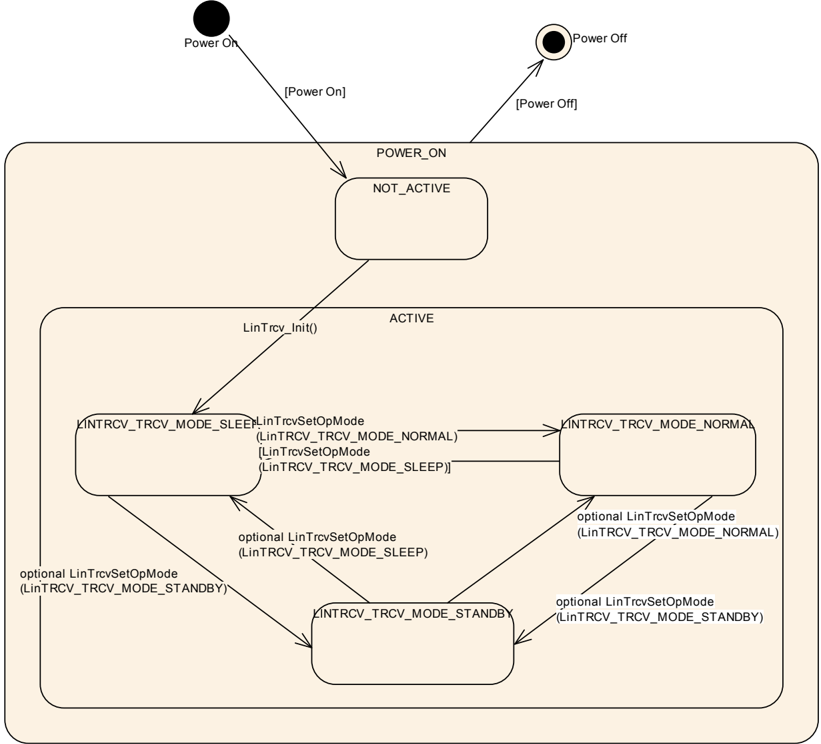
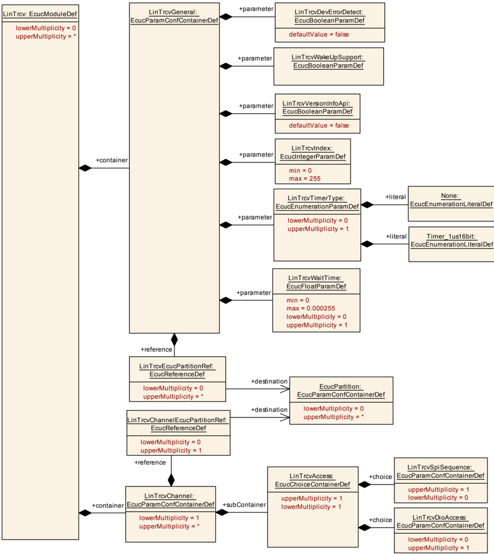
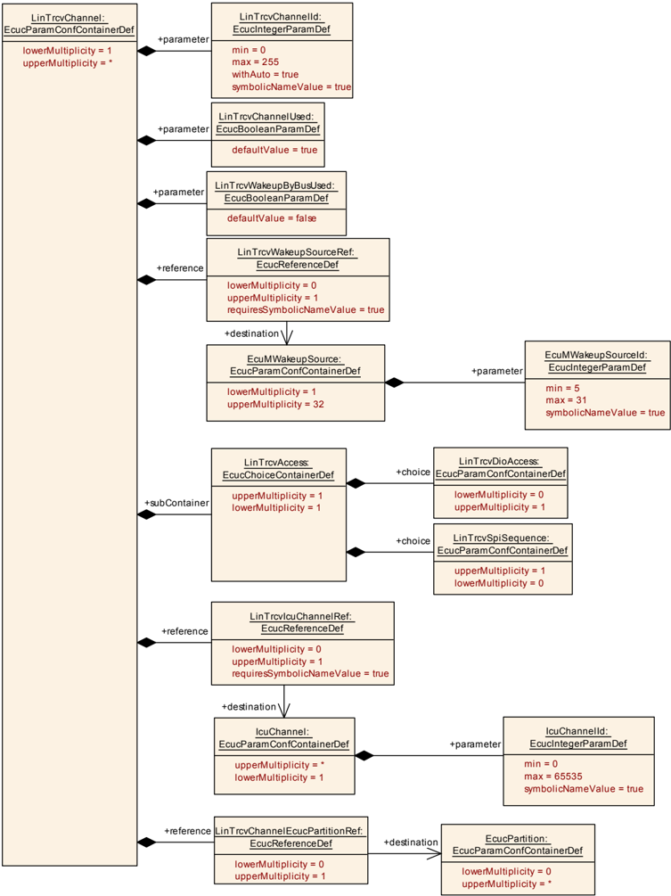
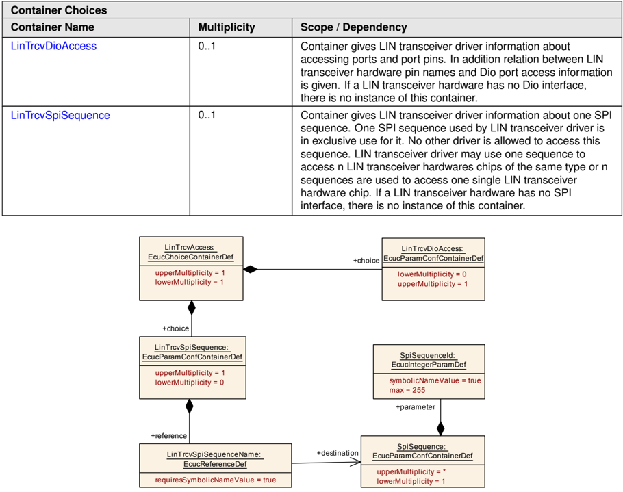
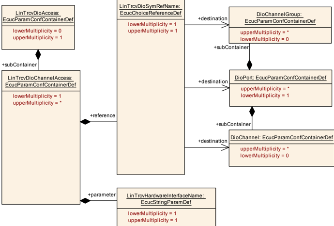

## 1. 简介和功能概述

本规范规定 LIN 收发器驱动程序模块的功能、**API** 与配置。它负责处理 **ECU** 上的 LIN 收发器硬件。

LIN 总线收发器是一种硬件设备。它是 LIN 协议控制器与物理 LIN 总线之间的接口。一方面，LIN 协议控制器的发送数据流被转换为符合 LIN 物理层的总线信号；另一方面，LIN 总线数据流被转换为协议控制器输入信号。LIN 协议控制器通常是一个微控制器实现。

大多数 LIN 收发器支持电源控制与经由总线的唤醒。市场上有许多不同的唤醒/睡眠与电源方案。

此外，市场上还有所谓的系统基础芯片（**SBC**）。除 LIN 收发器功能之外，这些器件还提供附加特性，例如电气故障检测（例如对地短路（**GND**））、电源控制、高级看门狗、LIN 收发器、**SPI** 等。

### 1.1. LIN 收发器驱动程序的目标

本文档的目标是规定适用于当前大多数 LIN 收发器硬件实现的接口与行为。

LIN 收发器驱动程序对所使用的 LIN 收发器硬件进行抽象，并为更高层提供与硬件无关的接口。它还通过使用 **MCAL** 层的 **API** 来访问 LIN 收发器硬件，从而对 **ECU** 布局进行抽象。

### 1.2. 显然未涵盖的 LIN 收发器功能

一些 LIN 总线收发器提供附加功能，例如 **ECU** 自检或用于诊断的错误检测能力。

**ECU** 自检与错误检测未在 AUTOSAR 中定义，通常要求此类功能会将当前使用的大多数收发器硬件芯片排除在外。因此，不支持"地偏移检测"（ground shift detection）、"选择性唤醒"（selective wakeup）、"斜率控制"（slope control）等特性。

## 2. 缩略语

下表收录与 SWS\_LINTransceiverDriver 模块相关、且未包含在 [\[1, AUTOSAR glossary\]](#ref-1) 中的缩略语与缩写。

表2.1：本文档范围内使用的缩略语与缩写（**Acronyms and abbreviations used in the scope of this Document**）

**API**
> 应用程序接口（**Application Program Interface**）。

**Channel**
> 通道：按相同准则定义的数据的软件交换媒介。

**ComM**
> 通信管理器（**Communication Manager**）。

**Det**
> 默认错误追踪器（**Default Error Tracer**）。

**Dio/DIO**
> 数字输入输出，**SPAL** 软件模块之一。

**EcuM**
> **ECU** 状态管理器（**ECU State Manager**）。

**ECU**
> 电子控制单元（**Electronic Control Unit**）。

**Frt**
> 自由运行定时器（**Free Running Timer**）。

**Gpt**
> 通用定时器（**General purpose Timer**）。

**ICU**
> 中断控制单元（**Interrupt Control Unit**）。

**ISR**
> 中断服务例程（**Interrupt Service Routine**）。

**LinTrcv**
> LIN 收发器驱动程序（**LIN Transceiver Driver**）。

**MCAL**
> 微控制器抽象层（**Micro Controller Abstraction Layer**）。

**n/a**
> 不适用（**Not applicable**）。

**PDU**
> 协议数据单元（**Protocol Data Unit**）。

**SBC**
> 系统基础芯片（**System Basis Chip**）：集成了例如 LIN 和/或 LIN 收发器、看门狗与电源控制的器件。

**SPAL**
> 标准外设抽象层（**Standard Peripheral Abstraction Layer**）。

**SW**
> 软件（**Software**）。

**SPI**
> 串行外设接口（**Serial Peripheral Interface**）。

**SPI Channel**
> 通道是按相同准则定义的数据的软件交换媒介：配置参数、具有相同大小的数据元素的数量以及数据指针（源与目标）或位置。更多细节参见 SPI 驱动程序规范。

**SPI Job**
> 作业由具有相同片选的一个或若干通道组成。作业被认为是原子的，因此不可被中断。作业还具有分配的优先级。更多细节参见 SPI 驱动程序规范。

**SPI Sequence**
> 序列是要传输的若干连续作业。序列依赖于静态配置。更多细节参见 SPI 驱动程序规范。

## 3. 相关文档

### 3.1. 输入文件和相关标准与规范

<a id="ref-1"></a>- [1] 术语表 AUTOSAR\_FO\_TR\_Glossary
<a id="ref-2"></a>- [2] 基础软件模块通用规范 AUTOSAR\_CP\_SWS\_BSWGeneral
<a id="ref-3"></a>- [3] 基础软件模块通用需求 AUTOSAR\_CP\_SRS\_BSWGeneral
<a id="ref-4"></a>- [4] LIN 需求 AUTOSAR\_CP\_SRS\_LIN
<a id="ref-5"></a>- [5] CAN 需求 AUTOSAR\_CP\_SRS\_CAN

### 3.2. 相关规范

AUTOSAR 提供了一份基础软件模块通用规范 [\[2, SWS BSW General\]](#ref-2)，它同样适用于 LIN 收发器驱动程序。

因此，规范 **SWS BSW General** 应被视为 LIN 收发器驱动程序的附加且必需的规范。

## 4. 约束和假设

### 4.1. 限制

所使用的底层驱动（例如 **DIO** 或 **SPI**）的 **API** 应为同步的。不支持同步行为的底层驱动实现不能与 LIN 收发器驱动程序一起使用。

### 4.2. 汽车域的适用性

该驱动程序可能适用于所有使用 **LIN** 进行通信的汽车域。

## 5. 对其他模块的依赖

| 模块 | 依赖 |
| --- | --- |
| LinIf | 所有 LIN 收发器驱动程序都位于 LinIf 之下。 |
| ComM | **ComM** 经由 LinIf 控制 LIN 收发器驱动程序的通信模式。可以独立地控制每个单独的 LIN 收发器通道。 |
| Det | **Det** 从 LIN 收发器驱动程序获取开发错误信息。 |
| Dio | **Dio** 模块用于访问经由端口连接的 LIN 收发器硬件。 |
| EcuM | **EcuM** 经由 LinIf 从 LIN 收发器驱动程序获取唤醒信息。 |
| Icu | **Icu** 模块可能处理 LIN 收发器硬件中断。 |
| Spi | **Spi** 模块用于访问经由 **Spi** 连接的 LIN 收发器硬件。 |

### 5.1. 文件结构

#### 5.1.1. 收发器驱动程序实现的命名约定

在一个 **ECU** 中使用不同的 LIN 收发器硬件实现时，必须修改不同 LIN 收发器驱动程序的函数名，使得不会生成两个同名的函数。这些名称可以用供应商 **ID** 或类型 **ID** 加以扩展。

#### 5.1.2. 代码文件结构

有关详细信息，请参阅 [\[2\]](#ref-2) 的"代码文件结构"（Code file structure）一节。

#### 5.1.3. 头文件结构

包含文件的结构应如下所示：

如果为 LinTrcv 模块启用了开发错误检测，则 LinTrcv.c 应包含 **Det.h**（需要通知开发错误）。

LinTrcv.c 应包含 **Dio.h**（访问收发器引脚所需的 **DIO** **API**）。

LinTrcv.c 应包含 **Icu.h**（如果需要 **ICU** **API** 来处理 LIN 收发器硬件中断）。

LinTrcv.c 应包含 **Spi.h**（如果 LIN 总线收发器驱动程序使用 **Spi** 的驱动程序来控制 LIN 总线收发器硬件）。

LinTrcv.c 应包含 **Tm.h**（更改收发器操作模式所需的等待状态）。

## 6. 功能规格

### 6.1. LIN 收发器驱动程序操作模式

LIN 收发器驱动程序的操作模式在下方的状态图中描述。

该图背后的主要思想是以共同的模型视图支持当前可用的大多数 LIN 总线收发器。取决于 LIN 收发器硬件，该模型对于一个给定的 LIN 收发器硬件而言可能比必要的多出一个或两个状态，但这将清晰地把 **ComM** 与 **EcuM** 同所使用的硬件解耦。

图 7.1：LIN 收发器操作模式（**LIN Transceiver Operation Modes**）



**提示：** 对于当前的 LIN 收发器硬件，存在若干可能不需要的可选接口。例如，模式 **LINTRCV_TRCV_MODE_STANDBY** 可能只是用于内部硬件转换的内部状态。特别是当"抑制引脚"（inhibit pin）的功能被用于控制微控制器时，只有状态 **LINTRCV_TRCV_MODE_SLEEP** 与 **LINTRCV_TRCV_MODE_NORMAL** 是相关的。

| 状态 | 描述 |
| --- | --- |
| POWER_ON | **MCU** 完全上电。 |
| NOT_ACTIVE | LIN 收发器硬件的状态取决于 **ECU** 硬件以及 **Dio** 与 **Port** 驱动的配置。LIN 收发器驱动程序未初始化，因此不活动。 |
| ACTIVE | 已调用函数 [LinTrcv_Init](#731-lintrcv_init)。它使 LIN 收发器驱动程序进入活动状态。LIN 收发器驱动程序进入状态 **LINTRCV_TRCV_MODE_SLEEP**。 |
| LINTRCV_TRCV_MODE_NORMAL | 完整的总线通信。如果 LIN 收发器硬件控制 **MCU** 电源，则 **MCU** 完全上电。LIN 收发器驱动程序不再检测唤醒信息。 |
| LINTRCV_TRCV_MODE_STANDBY | 无法通信。如果 LIN 收发器硬件控制 **MCU** 电源，则 **MCU** 仍然上电。可以由总线或本地唤醒事件唤醒。**注意：** 这是一个可选状态。 |
| LINTRCV_TRCV_MODE_SLEEP | 无法通信。如果 LIN 收发器硬件控制 **MCU** 电源，则 **MCU** 未上电。可以由总线或本地唤醒事件唤醒。 |

如果一个 LIN 收发器驱动程序覆盖多于一个 LIN 通道，则所有通道要么处于状态 **NOT_ACTIVE**，要么处于状态 **ACTIVE**。在状态 **ACTIVE** 中，每个通道可以处于不同的子状态。

### 6.2. LIN 收发器硬件操作模式

LIN 收发器硬件可能支持比软件更多的模式转换。本章解释这些依赖关系与推荐的实现行为。

由实现决定哪个 LIN 收发器硬件状态由哪个 LIN 收发器驱动程序软件状态覆盖。实现必须保证所描述的 LIN 收发器驱动程序的全部功能都由该实现给出。

### 6.3. LIN 收发器唤醒类型

有四种不同的场景，它们通常都被称为唤醒：

1. **MCU** 未上电，**ECU** 中包括 LIN 收发器硬件在内的部分已上电。所考虑的 LIN 收发器硬件处于模式 **LINTRCV_TRCV_MODE_SLEEP**。LIN 收发器硬件检测到 **LIN** 上的唤醒事件。LIN 收发器硬件引起 **MCU** 上电（例如经由"抑制"引脚）。按 AUTOSAR 的说法，这被视作冷启动而非唤醒。
2. **MCU** 处于低功耗模式，**ECU** 中包括 LIN 收发器硬件在内的部分已上电。取决于硬件实现，所考虑的 LIN 收发器硬件要么处于模式 **LINTRCV_TRCV_MODE_STANDBY**，要么处于 **LINTRCV_TRCV_MODE_SLEEP**。LIN 收发器硬件检测到 **LIN** 上的唤醒事件。LIN 收发器硬件将唤醒告知 **MCU**。

按 AUTOSAR 的说法，这被视作 LIN 通道与 **MCU** 的唤醒。

3. **MCU** 处于全功率模式，**ECU** 中包括 LIN 收发器硬件在内的至少一部分已上电。取决于硬件实现，所考虑的 LIN 收发器硬件要么处于模式 **LINTRCV_TRCV_MODE_STANDBY**，要么处于 **LINTRCV_TRCV_MODE_SLEEP**。LIN 收发器硬件检测到 **LIN** 上的唤醒事件。LIN 收发器硬件将唤醒告知 **MCU**，或被周期性地轮询唤醒事件。按 AUTOSAR 的说法，这被视作一个 LIN 通道的唤醒。
4. **MCU** 处于全功率模式，**ECU** 中包括 LIN 收发器硬件在内的至少一部分已上电。取决于硬件实现，所考虑的 LIN 收发器硬件要么处于模式 **LINTRCV_TRCV_MODE_STANDBY**，要么处于 **LINTRCV_TRCV_MODE_SLEEP**。此时 **MCU** 将 LIN 收发器硬件置为模式 **LINTRCV_TRCV_MODE_NORMAL** 并唤醒 LIN 通道。按 AUTOSAR 的说法，这被视作一个 LIN 通道的内部唤醒（经由 **MCU**）。

### 6.4. LIN 收发器唤醒模式

LIN 收发器驱动程序必须支持唤醒通知，因此 LIN 收发器驱动程序涵盖两种唤醒模式：由上层进行的内部唤醒，或由 LIN 通道进行的外部唤醒。

1. 内部唤醒：内部唤醒由上层发起，例如通过调用 [LinTrcv_Init](#731-lintrcv_init) 或 [LinTrcv_SetOpMode](#732-lintrcv_setopmode)。
2. 外部唤醒：LIN 收发器驱动程序检测到的唤醒通过 **API** [LinTrcv_CheckWakeup](#736-lintrcv_checkwakeup) 转发给上层，该 **API** 必须由 LinIf 调用。

**提示：** 经由 **ISR** 的唤醒不受 LIN 收发器驱动程序支持，只能经由 **ICU** 进行。

唤醒模式的选择应通过配置参数 LinTrcvWakeUpSupport 完成。

每个 LIN 收发器通道的唤醒支持应通过配置参数 LinTrcvWakeupByBusUsed 单独打开或关闭。

LinTrcv 驱动程序应使用 **ICU** 驱动程序提供的以下 **API** 来启用与禁用唤醒事件通知：

* Icu_EnableNotification
* Icu_DisableNotification

当收发器转换到待机模式（**LINTRCV_STANDBY**）时，LinTrcv 驱动程序应启用 **ICU** 通道。

当收发器转换到正常模式（**LINTRCV_NORMAL**）时，LinTrcv 驱动程序应禁用 **ICU** 通道。

基本原理：LinTrcv 驱动程序应避免丢失唤醒事件。

### 6.5. 错误分类

文档 [\[2\]](#ref-2)《基础软件模块通用规范》的"错误处理"（Error Handling）一节详细描述了基础软件的错误处理。其中最重要的是，它构成了一个由 **BSW** 模块中可能出现的五种错误类型组成的分类方案。

基于该基础，以下各节在相应的小节中规定了特定的错误。

#### 6.5.1. 开发错误

不存在开发错误。

表6.1：LinTrcv 模块中开发错误的定义

| 错误类型 | 相关错误码 | 错误值 |
| --- | --- | --- |
| 以针对 LIN 网络的错误参数调用 **API** | LINTRCV_E_INVALID_LIN_NETWORK | 0x01 |
| 以空指针参数调用 **API** | LINTRCV_E_PARAM_POINTER | 0x02 |
| 在未初始化的情况下使用 **API** 服务 | LINTRCV_E_UNINIT | 0x11 |
| 在错误的收发器操作模式下调用 **API** 服务 | LINTRCV_E_TRCV_NOT_SLEEP | 0x21 |
| 在错误的收发器操作模式下调用 **API** 服务 | LINTRCV_E_TRCV_NOT_NORMAL | 0x22 |
| 由于可选转换未启用而以无效模式调用 **API** 服务 | LINTRCV_E_INVALID_TRCV_OPMODE | 0x25 |

#### 6.5.2. 运行时错误

不存在运行时错误。

#### 6.5.3. 瞬态故障

不存在瞬态故障。

#### 6.5.4. 生产错误

不存在生产错误。

#### 6.5.5. 扩展生产错误

不存在扩展生产错误。

### 6.6. 驱动程序初始化的前置条件

LIN 总线收发器驱动程序可能使用 **Dio** 或 **Spi** 的驱动程序来控制 LIN 总线收发器硬件。因此，在 LIN 总线收发器驱动程序被初始化之前，这些驱动程序必须可用并准备好运行。

LIN 收发器驱动程序可能对初始化序列以及对收发器器件的访问有时序要求，这些要求必须由所使用的这些底层驱动来满足。

时序要求可能是：

* LIN 总线收发器驱动程序初始化的调用必须在上电之后非常早地执行，以便能够及时从收发器硬件中读出所有必要的信息，供 **ECU** 内所有其他使用者使用。
* 所使用的底层服务的运行时间非常短且是同步的，以使驱动程序能够保持其自身受所用硬件器件限制的时序要求。
* 驱动程序的运行时间可能会延长，因为一些硬件器件要求端口引脚电平保持有效（例如 50 µs）之后才能再次更改它以达到特定状态，例如睡眠。

### 6.7. 实例概念

对于每种 LIN 收发器硬件类型，一个 **ECU** 有一个 LIN 收发器驱动程序实例。一个实例服务于所有相同类型的 LIN 收发器硬件。

### 6.8. 等待状态

为了更改操作模式，LIN 收发器硬件可能必须执行等待状态。

LIN 收发器驱动程序应使用时间服务 Tm_BusyWait1us16bit 来实现收发器状态更改的等待时间。

## 7. API规范

### 7.1. 导入的类型

本章列出了从以下文件包含的所有类型。

表7.1：LinTrcv 模块导入数据类型的定义

| 模块 | 头文件 | 导入的类型 |
| --- | --- | --- |
| Dio | Dio.h | Dio_ChannelGroupType |
| Dio | Dio.h | Dio_ChannelType |
| Dio | Dio.h | Dio_LevelType |
| Dio | Dio.h | Dio_PortLevelType |
| Dio | Dio.h | Dio_PortType |
| EcuM | EcuM.h | EcuM_WakeupSourceType |
| Icu | Icu.h | Icu_ChannelType |
| Spi | Spi.h | Spi_ChannelType |
| Spi | Spi.h | Spi_DataBufferType |
| Spi | Spi.h | Spi_NumberOfDataType |
| Spi | Spi.h | Spi_SequenceType |
| Spi | Spi.h | Spi_StatusType |
| Std | Std_Types.h | Std_ReturnType |
| Std | Std_Types.h | Std_VersionInfoType |

### 7.2. 类型定义

#### 7.2.1. LinTrcv_ConfigType

| 名称 | LinTrcv_ConfigType |
| --- | --- |
| 类别 | 结构体（Structure） |
| 元素 | 实现特定 |
| 描述 | LinTrcv 模块的配置数据结构。 |
| 可通过 | LinTrcv.h 获得 |

#### 7.2.2. LinTrcv_TrcvModeType

| 名称 | LinTrcv_TrcvModeType | | |
| --- | --- | --- | --- |
| 类别 | 枚举 | | |
| 取值 | LINTRCV_TRCV_MODE_NORMAL | - | 收发器模式 NORMAL |
| | LINTRCV_TRCV_MODE_STANDBY | - | 收发器模式 STANDBY |
| | LINTRCV_TRCV_MODE_SLEEP | - | 收发器模式 SLEEP |
| 描述 | LIN 收发器驱动程序的操作模式。 | | |
| 可通过 | Lin_GeneralTypes.h 获得 | | |

#### 7.2.3. LinTrcv_TrcvWakeupModeType

| 名称 | LinTrcv_TrcvWakeupModeType | | |
| --- | --- | --- | --- |
| 类别 | 枚举 | | |
| 取值 | LINTRCV_WUMODE_ENABLE | - | 在所寻址的网络上启用唤醒事件的通知。 |
| | LINTRCV_WUMODE_DISABLE | - | 在所寻址的网络上禁用唤醒事件的通知。 |
| | LINTRCV_WUMODE_CLEAR | - | 在所寻址的网络上清除一个已存储的唤醒事件。 |
| 描述 | LIN 收发器驱动程序的唤醒操作模式。 | | |
| 可通过 | Lin_GeneralTypes.h 获得 | | |

#### 7.2.4. LinTrcv_TrcvWakeupReasonType

| 名称 | LinTrcv_TrcvWakeupReasonType | | |
| --- | --- | --- | --- |
| 类别 | 枚举 | | |
| 取值 | LINTRCV_WU_ERROR | - | 由于错误而未检测到唤醒原因。 |
| | LINTRCV_WU_NOT_SUPPORTED | - | 收发器不支持任何关于唤醒原因的信息。 |
| | LINTRCV_WU_BY_BUS | - | 收发器已检测到网络引起了 **ECU** 的唤醒。 |
| | LINTRCV_WU_BY_PIN | - | 收发器在收发器的某个引脚（而非 LIN 总线）上检测到了唤醒事件。 |
| | LINTRCV_WU_INTERNALLY | - | 收发器已检测到网络被 **ECU** 通过向 NORMAL 模式的请求唤醒。 |
| | LINTRCV_WU_RESET | - | 收发器已检测到唤醒是由 **ECU** 复位引起的。 |
| | LINTRCV_WU_POWER_ON | - | 收发器已检测到唤醒是由上电后的 **ECU** 复位引起的。 |
| 描述 | 该类型详细表示 LIN 收发器检测到的唤醒原因。 | | |
| 可通过 | Lin_GeneralTypes.h 获得 | | |

### 7.3. 函数定义

#### 7.3.1. LinTrcv_Init

**说明**： 初始化 LIN 收发器驱动程序模块。服务 ID 0x00。本服务为同步调用，不可重入。参数 ConfigPtr（in）：指向所选配置集的指针。无返回值。可通过 **LinTrcv.h** 获得。

```C
void LinTrcv_Init ( const LinTrcv_ConfigType* ConfigPtr )
```

配置指针 ConfigPtr 应始终具有 **NULL_PTR** 值。

配置指针 ConfigPtr 目前未被使用，因此应设置为 **NULL_PTR** 值。

函数 LinTrcv_Init 应将 LIN 收发器硬件置为状态 **LINTRCV_TRCV_MODE_SLEEP**。

**注意：** 复位（例如上电）之后的初始化序列对 LIN 收发器驱动程序而言是一个关键阶段。驱动程序将使用 **SPAL** 功能（**DIO**）来访问收发器硬件。因此，所有必要的 **BSW** 驱动程序必须在此之前已初始化并可用。

#### 7.3.2. LinTrcv_SetOpMode

**说明**： LIN 收发器驱动程序的内部状态被切换到参数 Op 中给定的模式……（源文截断）。服务 ID 0x01。本服务为同步调用，不可重入。参数 LinNetwork（in）：该 **API** 调用要应用到的 LIN 网络；OpMode（in）：该参数说明应将模式更改执行到哪种操作模式。返回值：Std_ReturnType，**E_OK**：如果收发器状态已被更改为所请求的模式则返回；**E_NOT_OK**：如果收发器状态更改不被接受、或已失败、或参数超出允许范围则返回。可通过 **LinTrcv.h** 获得。

```C
Std_ReturnType LinTrcv_SetOpMode ( uint8 LinNetwork, LinTrcv_TrcvModeType OpMode )
```

函数 LinTrcv_SetOpMode 应将通道 LinNetwork 的内部状态切换到参数 OpMode 的值，该值可以是 **LINTRCV_TRCV_MODE_NORMAL**、**LINTRCV_TRCV_MODE_STANDBY** 或 **LINTRCV_TRCV_MODE_SLEEP**。

如果满足以下条件之一，函数 LinTrcv_SetOpMode 应将通道 LinNetwork 的内部状态切换到 **LINTRCV_TRCV_MODE_STANDBY**：

* a) 通道 LinNetwork 处于模式 **LINTRCV_TRCV_MODE_SLEEP**，且从该模式到 **LINTRCV_TRCV_MODE_STANDBY** 的可选转换已启用。
* b) 通道 LinNetwork 处于模式 **LINTRCV_TRCV_MODE_NORMAL**，且从该模式到 **LINTRCV_TRCV_MODE_STANDBY** 的可选转换已启用。

如果满足以下条件之一，函数 LinTrcv_SetOpMode 应将通道 LinNetwork 的内部状态切换到 **LINTRCV_TRCV_MODE_SLEEP**：

* a) 通道 LinNetwork 处于模式 **LINTRCV_TRCV_MODE_NORMAL**。
* b) 通道 LinNetwork 处于模式 **LINTRCV_TRCV_MODE_STANDBY**，且从该模式到 **LINTRCV_TRCV_MODE_SLEEP** 的可选转换已启用。

如果满足以下条件之一，函数 LinTrcv_SetOpMode 应将通道 LinNetwork 的内部状态切换到 **LINTRCV_TRCV_MODE_NORMAL**：

* a) 通道 LinNetwork 处于模式 **LINTRCV_TRCV_MODE_SLEEP**。
* b) 通道 LinNetwork 处于模式 **LINTRCV_TRCV_MODE_STANDBY**，且从该模式到 **LINTRCV_TRCV_MODE_NORMAL** 的可选转换已启用。

该 **API** 适用于每个收发器的参数 LinTrcv_SetOpMode 的每个取值，而不管收发器硬件是否支持这些模式。这是为了简化 LinIf 对其所属总线的视图。

如果所请求的模式不受底层收发器硬件支持，函数 LinTrcv_SetOpMode 应返回 **E_NOT_OK**。

如果与收发器没有通信或通信不正确，函数 LinTrcv_SetOpMode 应返回 **E_NOT_OK**。

如果为 LinTrcv 模块启用了开发错误检测：

如果以 OpMode == **LINTRCV_TRCV_MODE_STANDBY** 调用函数 LinTrcv_SetOpMode、且通道 LinNetwork 处于模式 **LINTRCV_SLEEP**、但从 **LINTRCV_SLEEP** 到 **LINTRCV_STANDBY** 的可选转换未启用，则函数 LinTrcv_SetOpMode 应报告开发错误 [LINTRCV_E_INVALID_TRCV_OPMODE](#651-开发错误)。

如果为 LinTrcv 模块启用了开发错误检测：

如果以 OpMode == **LINTRCV_TRCV_MODE_STANDBY** 调用函数 LinTrcv_SetOpMode、且通道 LinNetwork 处于模式 **LINTRCV_NORMAL**、但从 **LINTRCV_NORMAL** 到 **LINTRCV_STANDBY** 的可选转换未启用，则函数 LinTrcv_SetOpMode 应报告开发错误 [LINTRCV_E_INVALID_TRCV_OPMODE](#651-开发错误)。

如果为 LinTrcv 模块启用了开发错误检测：

如果从 **LINTRCV_STANDBY** 到 **LINTRCV_SLEEP** 的可选转换未启用、且以 OpMode == **LINTRCV_TRCV_MODE_SLEEP** 调用函数 LinTrcv_SetOpMode、且通道 LinNetwork 不处于模式 **LINTRCV_TRCV_MODE_NORMAL**，则函数 LinTrcv_SetOpMode 应报告开发错误 [LINTRCV_E_TRCV_NOT_NORMAL](#651-开发错误)。

如果为 LinTrcv 模块启用了开发错误检测：

如果从 **LINTRCV_STANDBY** 到 **LINTRCV_NORMAL** 的可选转换未启用、且以 OpMode == **LINTRCV_TRCV_MODE_NORMAL** 调用函数 LinTrcv_SetOpMode、且通道 LinNetwork 不处于模式 **LINTRCV_TRCV_MODE_SLEEP**，则函数 LinTrcv_SetOpMode 应报告开发错误 [LINTRCV_E_TRCV_NOT_SLEEP](#651-开发错误)。

如果为 LinTrcv 模块启用了开发错误检测：

如果在 LinTrcv 模块已被初始化之前调用，则函数 LinTrcv_SetOpMode 应报告开发错误 [LINTRCV_E_UNINIT](#651-开发错误)。

如果为 LinTrcv 模块启用了开发错误检测：

如果以无效的网络编号 LinNetwork 调用，则函数 LinTrcv_SetOpMode 应报告开发错误 [LINTRCV_E_INVALID_LIN_NETWORK](#651-开发错误)。

对当前模式的模式请求是允许的，并且即使 **DET** 已启用也不应导致错误。

#### 7.3.3. LinTrcv_GetOpMode

**说明**： 该 **API** 检测 LIN 收发器驱动程序的实际软件状态。服务 ID 0x02。本服务为同步调用，可重入。参数 LinNetwork（in）：该 **API** 调用要应用到的 LIN 网络；OpMode（out）：指向该 **API** 所应用总线的操作模式的指针。返回值：Std_ReturnType，**E_OK**：如果检测到操作模式则返回；**E_NOT_OK**：如果由于未检测到操作模式而导致服务请求失败则返回。可通过 **LinTrcv.h** 获得。

```C
Std_ReturnType LinTrcv_GetOpMode ( uint8 LinNetwork, LinTrcv_TrcvModeType* OpMode )
```

函数 LinTrcv_GetOpMode 应在参数 OpMode 中返回 LIN 收发器驱动程序的实际状态。

如果与收发器没有通信或通信不正确，函数 LinTrcv_GetOpMode 应返回 **E_NOT_OK**。

如果为 LinTrcv 模块启用了开发错误检测：

如果在 LinTrcv 模块已被初始化之前调用，则函数 LinTrcv_GetOpMode 应报告开发错误 [LINTRCV_E_UNINIT](#651-开发错误)。

如果为 LinTrcv 模块启用了开发错误检测：

如果以无效的网络编号 LinNetwork 调用，则函数 LinTrcv_GetOpMode 应报告开发错误 [LINTRCV_E_INVALID_LIN_NETWORK](#651-开发错误)。

如果为 LinTrcv 模块启用了开发错误检测：

如果以 OpMode == **NULL** 调用，则函数 LinTrcv_GetOpMode 应报告开发错误 [LINTRCV_E_PARAM_POINTER](#651-开发错误)。

配置：所支持的总线数量在配置阶段静态设定。

#### 7.3.4. LinTrcv_GetBusWuReason

**说明**： 该 **API** 在参数 "Reason" 中提供 LIN 收发器检测到的唤醒原因。检测并区分可能的唤醒原因的能力在很大程度上取决于 LIN 收发器硬件。服务 ID 0x03。本服务为同步调用，可重入。参数 LinNetwork（in）：该 **API** 调用要应用到的 LIN 网络；Reason（out）：指向该 **API** 所应用总线的唤醒原因的指针。返回值：Std_ReturnType，**E_OK**：如果检测到唤醒原因则返回；**E_NOT_OK**：如果由于未检测到唤醒原因而导致服务请求失败则返回。可通过 **LinTrcv.h** 获得。

```C
Std_ReturnType LinTrcv_GetBusWuReason ( uint8 LinNetwork, LinTrcv_TrcvWakeupReasonType* Reason )
```

函数 LinTrcv_GetBusWuReason 应在参数 Reason 中返回 LIN 收发器检测到的唤醒原因。

如果与收发器没有通信或通信不正确，函数 LinTrcv_GetBusWuReason 应返回 **E_NOT_OK**。

如果为 LinTrcv 模块启用了开发错误检测：

如果在 LinTrcv 模块已被初始化之前调用，则函数 LinTrcv_GetBusWuReason 应报告开发错误 [LINTRCV_E_UNINIT](#651-开发错误)。

如果为 LinTrcv 模块启用了开发错误检测：

如果以无效的网络编号 LinNetwork 调用，则函数 LinTrcv_GetBusWuReason 应报告开发错误 [LINTRCV_E_INVALID_LIN_NETWORK](#651-开发错误)。

如果为 LinTrcv 模块启用了开发错误检测：

如果以 Reason == **NULL** 调用，则函数 LinTrcv_GetBusWuReason 应报告开发错误 [LINTRCV_E_PARAM_POINTER](#651-开发错误)。

配置：所支持的总线数量在配置阶段静态设定。

**注意：** 请注意，如果有多个总线可用，则每个总线可能报告不同的唤醒原因。例如，如果一个 **ECU** 拥有 **LIN**，可能发生由 **LIN** 引起的唤醒，而传入的数据可能引起另一个 LIN 总线的内部唤醒。

LIN 收发器驱动程序具有"按总线"（per bus）的视图，并且不在内部对更重要的原因或顺序进行投票。如果一个收发器控制电源而另一个只是已上电或未上电，情况也可能相同。

#### 7.3.5. LinTrcv_GetVersionInfo

**说明**： 该服务通过参数 "versioninfo" 提供本模块的版本信息。服务 ID 0x04。本服务为同步调用，可重入。参数 versioninfo（out）：指向本模块版本信息的指针。无返回值。可通过 **LinTrcv.h** 获得。

```C
void LinTrcv_GetVersionInfo ( Std_VersionInfoType* versioninfo )
```

函数 LinTrcv_GetVersionInfo 应返回本模块的版本信息。版本信息包含 "AUTOSAR_SWS_StandardTypes" 中 Std_VersionInfoType 定义的所有数据。

如果为 LinTrcv 模块启用了开发错误检测：

如果以 versioninfo == **NULL** 调用，则函数 LinTrcv_GetVersionInfo 应报告开发错误 [LINTRCV_E_PARAM_POINTER](#651-开发错误)。

#### 7.3.6. LinTrcv_CheckWakeup

**说明**： 如果检测到唤醒，则通知调用函数。服务 ID 0x07。本服务为同步调用，可重入。参数 LinNetwork（in）：该 **API** 调用要应用到的 LIN 网络。返回值：Std_ReturnType，**E_OK**：**API** 调用已被接受；**E_NOT_OK**：**API** 调用未被接受。可通过 **LinTrcv.h** 获得。

```C
Std_ReturnType LinTrcv_CheckWakeup ( uint8 LinNetwork )
```

如果为 LinTrcv 模块启用了开发错误检测：

如果在 LinTrcv 模块已被初始化之前调用，则函数 LinTrcv_CheckWakeup 应报告开发错误 [LINTRCV_E_UNINIT](#651-开发错误)。

如果为 LinTrcv 模块启用了开发错误检测：

如果以无效的网络编号 LinNetwork 调用，则函数 LinTrcv_CheckWakeup 应报告开发错误 [LINTRCV_E_INVALID_LIN_NETWORK](#651-开发错误)。

函数 LinTrcv_CheckWakeup 应评估所寻址 LIN 网络上的唤醒。当在所寻址的 LIN 网络上检测到唤醒事件（例如显性总线状态或唤醒引脚上的负跳变）时，函数 LinTrcv_CheckWakeup 应立即通过 EcuM_SetWakeupEvent 通知 **ECU** 状态管理器模块，并通过 LinIf_WakeupConfirmation 回调函数通知 LinIf。

如果为 LinTrcv 模块启用了开发错误检测：如果所寻址的 LIN 网络不处于模式 **LINTRCV_TRCV_MODE_SLEEP**，则函数 LinTrcv_CheckWakeup 应报告开发错误 [LINTRCV_E_TRCV_NOT_SLEEP](#651-开发错误)。

配置：参见配置参数 LinTrcvWakeUpSupport。

#### 7.3.7. LinTrcv_SetWakeupMode

**说明**： 该 **API** 在所寻址的网络上启用、禁用与清除唤醒事件的通知。服务 ID 0x05。本服务为同步调用，不可重入。参数 LINNetwork（in）：该 **API** 调用要应用到的 LIN 网络；TrcvWakupMode（in）：所请求的收发器唤醒原因。返回值：Std_ReturnType，**E_OK**：如果收发器状态已被更改为所请求的模式则返回；**E_NOT_OK**：如果由于未设置唤醒模式而导致服务请求失败则返回。可通过 **LinTrcv.h** 获得。

```C
Std_ReturnType LinTrcv_SetWakeupMode ( uint8 LINNetwork, LinTrcv_TrcvWakeupModeType TrcvWakupMode )
```

启用：如果以 TrcvWakupMode == **LINTRCV_WUMODE_ENABLE** 调用函数 LinTrcv_SetWakeupMode、且 LinTrcv 模块有一个针对所寻址总线处于等待状态的已存储唤醒事件，则 LinTrcv 模块应在该 **API** 调用内或紧随其后执行通知（取决于实现）。

禁用：如果以 TrcvWakupMode == **LINTRCV_WUMODE_DISABLE** 调用函数 LinTrcv_SetWakeupMode，则在所寻址的网络上唤醒事件的通知被禁用。收发器器件与底层通信驱动程序需要检测唤醒事件并将其存储在内部，以便在唤醒通知再次启用时引发该事件。

清除：如果以 TrcvWakupMode == **LINTRCV_WUMODE_CLEAR** 调用函数 LinTrcv_SetWakeupMode，则在所寻址的网络上一个已存储的唤醒事件被清除。当唤醒通知被禁用时，必须在更高层的控制下使用唤醒事件的清除，以清除所有已存储的唤醒事件。

如果与收发器没有通信或通信不正确，函数 LinTrcv_SetWakeupMode 应返回 **E_NOT_OK**。

如果为 LinTrcv 模块启用了开发错误检测：

如果在 LinTrcv 已被初始化之前调用，则函数 LinTrcv_SetWakeupMode 应报告开发错误 [LINTRCV_E_UNINIT](#651-开发错误)。

如果为 LinTrcv 模块启用了开发错误检测：

如果以无效的网络编号 LINNetwork 调用，则函数 LinTrcv_SetWakeupMode 应报告开发错误 [LINTRCV_E_INVALID_LIN_NETWORK](#651-开发错误)。

### 7.4. 回调通知

LIN 收发器驱动程序不提供任何回调通知。

### 7.5. 调度函数

本章列出由 LinTrcv 模块提供、并由基础软件模块调度器直接调用的所有函数。LIN 收发器驱动程序不提供任何周期性调用的函数。

### 7.6. 期望接口

本章列出从其他模块要求的所有接口。

#### 7.6.1. 强制接口

本节定义实现模块核心功能所需的全部接口。

表7.2：LinTrcv 模块中强制接口的定义

| API 函数 | 头文件 | 描述 |
| --- | --- | --- |
| LinIf_WakeupConfirmation | LinIf.h | LIN 驱动程序或 LIN 收发器驱动程序将调用该函数，以在 CheckWakeup 期间成功检测到唤醒之后、或上电后由总线唤醒之后，报告唤醒源。 |

#### 7.6.2. 可选接口

本章定义实现模块可选功能所需的全部接口。

表7.3：LinTrcv 模块中可选接口的定义

| API 函数 | 头文件 | 描述 |
| --- | --- | --- |
| Det_ReportError | Det.h | 报告开发错误的服务。 |
| Dio_ReadChannel | Dio.h | 返回指定 **DIO** 通道的值。 |
| Dio_ReadChannelGroup | Dio.h | 该服务读取一个端口的相邻位的子集。 |
| Dio_ReadPort | Dio.h | 返回该端口所有通道的电平。 |
| Dio_WriteChannel | Dio.h | 设置通道电平的服务。 |
| Dio_WriteChannelGroup | Dio.h | 将端口的相邻位子集设置为指定电平的服务。 |
| Dio_WritePort | Dio.h | 设置端口值的服务。 |
| EcuM_SetWakeupEvent | EcuM.h | 设置唤醒事件。 |
| Icu_DisableNotification | Icu.h | 该函数禁用一个通道的通知。 |
| Icu_EnableNotification | Icu.h | 该函数在给定通道上启用通知。 |
| Spi_GetStatus | Spi.h | 该服务返回 **SPI** 处理器/驱动程序软件模块的状态。 |
| Spi_ReadIB | Spi.h | 从参数指定的 IB SPI 处理器/驱动程序通道同步读取一个或多个数据的服务。 |
| Spi_SetupEB | Spi.h | 为指定的 EB SPI 处理器/驱动程序通道设置缓冲区与数据长度的服务。 |
| Spi_SyncTransmit | Spi.h | 在 **SPI** 总线上传输数据的服务。 |
| Spi_WriteIB | Spi.h | 向参数指定的 IB SPI 处理器/驱动程序通道写入一个或多个数据的服务。 |
| Tm_BusyWait1us16bit | Tm.h | 通过轮询执行忙等待，并保证最小等待时间。 |

LinTrcv 驱动程序只有在为参数 LinTrcvIcuChannelRef 配置了引用时，才应启用/禁用 **ICU** 通道。

#### 7.6.3. 可配置接口

LIN 收发器驱动程序没有任何可配置接口。

## 8. 时序图

所有与唤醒相关的时序图请参阅 **ECU** 状态管理器的第 [9](#9-配置规范) 章。

## 9. 配置规范

一般来说，本章定义配置参数及其到容器中的聚类。为了支持本规范，本章开头的引导内容描述基本原理，并规定了应用于参数规范的模板（表）。我们打算将这一引导内容保留在规范中，以保证可理解性。

第 [9.1](#91-容器与配置参数) 节规定模块 LinTrcv 的结构（容器）与参数。

第 [9.2](#92-发布信息) 节规定模块 LinTrcv 的发布信息。

### 9.1. 容器与配置参数

有关详细信息，请参阅 **SWS_BSWGeneral** 中"配置规范简介"（Introduction to configuration specification）一章。

LIN 收发器驱动程序模块应拒绝带有实现所不支持的分区映射的配置。

以下各章汇总所有配置参数。各参数的详细含义在前述章节中描述。

#### 9.1.1. 变体

以下各章汇总所有配置参数。各参数的详细含义在第 6 章与第 7 章中描述。

#### 9.1.2. LinTrcv

| SWS 条目 | [ECUC_LinTrcv_00161] |
| --- | --- |
| 模块名称 | LinTrcv |
| 描述 | LIN 收发器驱动程序模块的配置。 |
| Post-Build 变体支持 | false |
| 支持的配置变体 | VARIANT-PRE-COMPILE |

图 10.1：LIN 收发器驱动程序配置容器概览（**Overview about LIN Transceiver Driver configuration containers**）



| 容器名称 | 多重性 | 作用域/依赖 |
| --- | --- | --- |
| LinTrcvChannel | 1..* | 容器向 LIN 收发器驱动程序提供关于单个 LIN 收发器通道的信息。任何 LIN 收发器驱动程序都具有这样的 LIN 收发器通道。 |
| LinTrcvGeneral | 1 | 容器向 LIN 收发器驱动程序提供基本信息。 |

#### 9.1.3. LinTrcvGeneral

| SWS 条目 | [ECUC_LinTrcv_00090] |
| --- | --- |
| 容器名称 | LinTrcvGeneral |
| 父容器 | LinTrcv |
| 描述 | 容器向 LIN 收发器驱动程序提供基本信息。 |
| 配置参数 | 见下方参数表 |

| SWS 条目 | [ECUC_LinTrcv_00001] |
| --- | --- |
| 参数名称 | LinTrcvDevErrorDetect |
| 父容器 | LinTrcvGeneral |
| 描述 | 打开或关闭开发错误检测与通知。* **true**：启用检测与通知。* **false**：禁用检测与通知。 |
| 多重性 | 1 |
| 类型 | EcucBooleanParamDef |
| 默认值 | false |
| Post-Build 变体值 | false |
| 值配置类 | Pre-compile time：x（All Variants）；Link time：-；Post-build time：- |
| 作用域/依赖 | scope: local |

| SWS 条目 | [ECUC_LinTrcv_00153] |
| --- | --- |
| 参数名称 | LinTrcvIndex |
| 父容器 | LinTrcvGeneral |
| 描述 | 规定该模块实例的 InstanceId。如果只存在一个实例，它应具有 Id 0。 |
| 多重性 | 1 |
| 类型 | EcucIntegerParamDef |
| 范围 | 0 .. 255 |
| 默认值 | - |
| Post-Build 变体值 | false |
| 值配置类 | Pre-compile time：x（All Variants）；Link time：-；Post-build time：- |
| 作用域/依赖 | scope: local |

| SWS 条目 | [ECUC_LinTrcv_00159] |
| --- | --- |
| 参数名称 | LinTrcvTimerType |
| 父容器 | LinTrcvGeneral |
| 描述 | 时间服务预定义定时器的类型。 |
| 多重性 | 0..1 |
| 类型 | EcucEnumerationParamDef |
| 范围 | None：无；Timer_1us16bit：16 位 1 µs 定时器 |
| Post-Build 变体多重性 | false |
| Post-Build 变体值 | false |
| 多重性配置类 | Pre-compile time：x（All Variants）；Link time：-；Post-build time：- |
| 值配置类 | Pre-compile time：x（All Variants）；Link time：-；Post-build time：- |
| 作用域/依赖 | scope: local |

| SWS 条目 | [ECUC_LinTrcv_00003] |
| --- | --- |
| 参数名称 | LinTrcvVersionInfoApi |
| 父容器 | LinTrcvGeneral |
| 描述 | 打开或关闭版本信息 **API**。如果关闭，则编译后的代码中无需存在该函数。**true**：被使用；**false**：不被使用。 |
| 多重性 | 1 |
| 类型 | EcucBooleanParamDef |
| 默认值 | false |
| Post-Build 变体值 | false |
| 值配置类 | Pre-compile time：x（All Variants）；Link time：-；Post-build time：- |
| 作用域/依赖 | scope: local |

| SWS 条目 | [ECUC_LinTrcv_00160] |
| --- | --- |
| 参数名称 | LinTrcvWaitTime |
| 父容器 | LinTrcvGeneral |
| 描述 | 收发器状态更改的等待时间，以秒为单位。 |
| 多重性 | 0..1 |
| 类型 | EcucFloatParamDef |
| 范围 | [0 .. 2.55E-4] |
| 默认值 | - |
| Post-Build 变体多重性 | false |
| Post-Build 变体值 | false |
| 多重性配置类 | Pre-compile time：x；Link time：-；Post-build time：- |
| 值配置类 | Pre-compile time：x；Link time：-；Post-build time：- |
| 作用域/依赖 | scope: local |

| SWS 条目 | [ECUC_LinTrcv_00107] |
| --- | --- |
| 参数名称 | LinTrcvWakeUpSupport |
| 父容器 | LinTrcvGeneral |
| 描述 | 告知是否支持唤醒。如果 LIN 收发器硬件不支持唤醒，该设置应为 **false**。一个 LIN 收发器的每个通道的唤醒能力可以通过 LinTrcvWakeupSourceRef 打开或关闭。**true**：被使用；**false**：不被使用。 |
| 多重性 | 1 |
| 类型 | EcucBooleanParamDef |
| 默认值 | - |
| Post-Build 变体值 | false |
| 值配置类 | Pre-compile time：x（All Variants）；Link time：-；Post-build time：- |
| 作用域/依赖 | scope: local；依赖：LinTrcvWakeupByBusUsed |

| SWS 条目 | [ECUC_LinTrcv_00162] |
| --- | --- |
| 参数名称 | LinTrcvEcucPartitionRef |
| 父容器 | LinTrcvGeneral |
| 描述 | 将 LIN 收发器驱动程序映射到零个或多个 **ECUC** 分区，以使该模块的 **API** 在该分区中可用。LIN 收发器驱动程序将在每个分区中作为一个独立实例运行。 |
| 多重性 | 0..* |
| 类型 | 对 EcucPartition 的引用 |
| Post-Build 变体多重性 | true |
| Post-Build 变体值 | true |
| 多重性配置类 | Pre-compile time：x；Link time：-；Post-build time：- |
| 值配置类 | Pre-compile time：x；Link time：-；Post-build time：- |
| 作用域/依赖 | scope: ECU |

无包含的容器。

该模块将在每个分区中作为一个独立实例运行，即被调用的 **API** 将只作用于它被调用所在的分区。

#### 9.1.4. LinTrcvChannel

| SWS 条目 | [ECUC_LinTrcv_00091] |
| --- | --- |
| 容器名称 | LinTrcvChannel |
| 父容器 | LinTrcv |
| 描述 | 容器向 LIN 收发器驱动程序提供关于单个 LIN 收发器通道的信息。任何 LIN 收发器驱动程序都具有这样的 LIN 收发器通道。 |
| 配置参数 | 见下方参数表 |

| SWS 条目 | [ECUC_LinTrcv_00011] |
| --- | --- |
| 参数名称 | LinTrcvChannelId |
| 父容器 | LinTrcvChannel |
| 描述 | LIN 收发器通道的唯一标识符。 |
| 多重性 | 1 |
| 类型 | EcucIntegerParamDef（为该参数生成符号名） |
| 范围 | 0 .. 255 |
| 默认值 | - |
| Post-Build 变体值 | false |
| 值配置类 | Pre-compile time：x（All Variants）；Link time：-；Post-build time：- |
| 作用域/依赖 | scope: local |

| SWS 条目 | [ECUC_LinTrcv_00004] |
| --- | --- |
| 参数名称 | LinTrcvChannelUsed |
| 父容器 | LinTrcvChannel |
| 描述 | 相关的 LIN 收发器通道是否应被使用？**true**：被使用；**false**：不被使用。 |
| 多重性 | 1 |
| 类型 | EcucBooleanParamDef |
| 默认值 | true |
| Post-Build 变体值 | false |
| 值配置类 | Pre-compile time：x（All Variants）；Link time：-；Post-build time：- |
| 作用域/依赖 | scope: local |

| SWS 条目 | [ECUC_LinTrcv_00006] |
| --- | --- |
| 参数名称 | LinTrcvWakeupByBusUsed |
| 父容器 | LinTrcvChannel |
| 描述 | 是否支持由总线唤醒？如果 LIN 收发器硬件不支持由总线唤醒，该值始终为 **FALSE**。如果 LIN 收发器硬件支持由总线唤醒，该值为 **TRUE** 或 **FALSE**，取决于它是否被使用。**TRUE** = 被使用；**FALSE** = 不被使用。 |
| 多重性 | 1 |
| 类型 | EcucBooleanParamDef |
| 默认值 | false |
| Post-Build 变体值 | false |
| 值配置类 | Pre-compile time：x（All Variants）；Link time：-；Post-build time：- |
| 作用域/依赖 | scope: local |

| SWS 条目 | [ECUC_LinTrcv_00163] |
| --- | --- |
| 参数名称 | LinTrcvChannelEcucPartitionRef |
| 父容器 | LinTrcvChannel |
| 描述 | 将一个单独的 LIN 收发器通道映射到零个或一个 **ECUC** 分区。所引用的 **ECUC** 分区是 LIN 收发器驱动程序被映射到的 **ECUC** 分区的子集。 |
| 多重性 | 0..1 |
| 类型 | 对 EcucPartition 的引用 |
| Post-Build 变体多重性 | true |
| Post-Build 变体值 | true |
| 多重性配置类 | Pre-compile time：x；Link time：-；Post-build time：- |
| 值配置类 | Pre-compile time：x；Link time：-；Post-build time：- |
| 作用域/依赖 | scope: ECU |

| SWS 条目 | [ECUC_LinTrcv_00157] |
| --- | --- |
| 参数名称 | LinTrcvIcuChannelRef |
| 父容器 | LinTrcvChannel |
| 描述 | 对 IcuChannel 的引用，用于启用/禁用唤醒中断。 |
| 多重性 | 0..1 |
| 类型 | 对 IcuChannel 的符号名引用 |
| Post-Build 变体多重性 | false |
| Post-Build 变体值 | false |
| 多重性配置类 | Pre-compile time：All Variants；Link time：-；Post-build time：- |
| 值配置类 | Pre-compile time：All Variants；Link time：-；Post-build time：- |
| 作用域/依赖 | scope: ECU |

| SWS 条目 | [ECUC_LinTrcv_00012] |
| --- | --- |
| 参数名称 | LinTrcvWakeupSourceRef |
| 父容器 | LinTrcvChannel |
| 描述 | 对 **EcuM** 配置中一个唤醒源的引用。仅当 LinTrcvWakeupByBusUsed 为 true 时才需要该引用。实现类型：对 EcuM_WakeupSourceType 的引用。 |
| 多重性 | 0..1 |
| 类型 | 对 EcuMWakeupSource 的符号名引用 |
| Post-Build 变体多重性 | false |
| Post-Build 变体值 | false |
| 多重性配置类 | Pre-compile time：x（All Variants）；Link time：-；Post-build time：- |
| 值配置类 | Pre-compile time：x（All Variants）；Link time：-；Post-build time：- |
| 作用域/依赖 | scope: ECU；依赖：LinTrcvWakeupByBusUsed |

| 容器名称 | 多重性 | 作用域/依赖 |
| --- | --- | --- |
| LinTrcvAccess | 1 | 容器向 LIN 收发器驱动程序提供对单个 LIN 收发器通道的访问。 |

LinTrcvChannelEcucPartitionRef 所引用的 **ECUC** 分区应是 LinTrcvEcucPartitionRef 所引用的 **ECUC** 分区的子集。

如果 LinTrcvEcucPartitionRef 引用一个或多个 **ECUC** 分区，则 LinTrcvChannelEcucPartitionRef 应具有多重性一，并同时引用这些 **ECUC** 分区之一。

一个通信通道的 LinTrcvChannel 与 LinChannel 应全部引用相同的 **ECUC** 分区。

图 10.2：LinTrcvChannel 配置容器（**LinTrcvChannel configuration container**）



#### 9.1.5. LinTrcvAccess

| SWS 条目 | [ECUC_LinTrcv_00154] |
| --- | --- |
| 选择容器名称 | LinTrcvAccess |
| 父容器 | LinTrcvChannel |
| 描述 | 容器向 LIN 收发器驱动程序提供对单个 LIN 收发器通道的访问。 |

图 10.3：LinTrcvAccess 配置容器（**LinTrcvAccess configuration container**）



| 容器选择 | 多重性 | 作用域/依赖 |
| --- | --- | --- |
| LinTrcvDioAccess | 0..1 | 容器向 LIN 收发器驱动程序提供关于访问端口与端口引脚的信息。此外还给出 LIN 收发器硬件引脚名称与 Dio 端口访问信息之间的关系。如果 LIN 收发器硬件没有 Dio 接口，则不存在该容器的实例。 |
| LinTrcvSpiSequence | 0..1 | 容器向 LIN 收发器驱动程序提供关于一个 **SPI** 序列的信息。LIN 收发器驱动程序使用的一个 **SPI** 序列专用于它。不允许其他驱动程序访问该序列。LIN 收发器驱动程序可以使用一个序列访问 n 个相同类型的 LIN 收发器硬件芯片，或使用 n 个序列访问一个单独的 LIN 收发器硬件芯片。如果 LIN 收发器硬件没有 **SPI** 接口，则不存在该容器的实例。 |

#### 9.1.6. LinTrcvDioAccess

| SWS 条目 | [ECUC_LinTrcv_00094] |
| --- | --- |
| 容器名称 | LinTrcvDioAccess |
| 父容器 | LinTrcvAccess |
| 描述 | 容器向 LIN 收发器驱动程序提供关于访问端口与端口引脚的信息。此外还给出 LIN 收发器硬件引脚名称与 Dio 端口访问信息之间的关系。如果 LIN 收发器硬件没有 Dio 接口，则不存在该容器的实例。 |
| 配置参数 | 无 |

| 容器名称 | 多重性 | 作用域/依赖 |
| --- | --- | --- |
| LinTrcvDioChannelAccess | 1..* | 容器按单个 LIN 收发器通道给出 **DIO** 通道访问。 |

图 10.4：LinTrcvDioAccess 配置容器（**LinTrcvDioAccess configuration container**）



#### 9.1.7. LinTrcvDioChannelAccess

| SWS 条目 | [ECUC_LinTrcv_00158] |
| --- | --- |
| 容器名称 | LinTrcvDioChannelAccess |
| 父容器 | LinTrcvDioAccess |
| 描述 | 容器按单个 LIN 收发器通道给出 **DIO** 通道访问。 |
| 配置参数 | 见下方参数表 |

| SWS 条目 | [ECUC_LinTrcv_00009] |
| --- | --- |
| 参数名称 | LinTrcvHardwareInterfaceName |
| 父容器 | LinTrcvDioChannelAccess |
| 描述 | LIN 收发器硬件接口名称。它通常是引脚的名称。从 Dio 的角度来看，它要么是一个端口、一个单独的通道，要么是一个通道组。根据这一事实，LINTRCV_DIO_PORT_SYMBOLIC_NAME、LINTRCV_DIO_CHANNEL_SYMBOLIC_NAME 或 LINTRCV_DIO_CHANNEL_GROUP_SYMBOLIC_NAME 之一应引用一个 Dio 配置。LIN 收发器驱动程序实现描述应为相应的 LIN 收发器硬件列出该名称。 |
| 多重性 | 1 |
| 类型 | EcucStringParamDef |
| 默认值 | - |
| 正则表达式 | - |
| Post-Build 变体值 | false |
| 值配置类 | Pre-compile time：x（All Variants）；Link time：-；Post-build time：- |
| 作用域/依赖 | scope: local |

| SWS 条目 | [ECUC_LinTrcv_00102] |
| --- | --- |
| 参数名称 | LinTrcvDioSymRefName |
| 父容器 | LinTrcvDioChannelAccess |
| 描述 | 对 **DIO** 端口、**DIO** 通道或 **DIO** 通道组的选择引用。该引用替换 LinTrcv SWS 中的 LINTRCV_DIO_PORT_SYM_NAME、LINTRCV_DIO_CHANNEL_SYM_NAME 与 LINTRCV_DIO_GROUP_SYM_NAME 引用。 |
| 多重性 | 1 |
| 类型 | 对 [DioChannel、DioChannelGroup、DioPort] 的选择引用 |
| Post-Build 变体值 | false |
| 值配置类 | Pre-compile time：x（All Variants）；Link time：-；Post-build time：- |
| 作用域/依赖 | scope: local |

无包含的容器。

#### 9.1.8. LinTrcvSpiSequence

| SWS 条目 | [ECUC_LinTrcv_00155] |
| --- | --- |
| 容器名称 | LinTrcvSpiSequence |
| 父容器 | LinTrcvAccess |
| 描述 | 容器向 LIN 收发器驱动程序提供关于一个 **SPI** 序列的信息。LIN 收发器驱动程序使用的一个 **SPI** 序列专用于它。不允许其他驱动程序访问该序列。LIN 收发器驱动程序可以使用一个序列访问 n 个相同类型的 LIN 收发器硬件芯片，或使用 n 个序列访问一个单独的 LIN 收发器硬件芯片。如果 LIN 收发器硬件没有 **SPI** 接口，则不存在该容器的实例。 |
| 配置参数 | 见下方参数表 |

| SWS 条目 | [ECUC_LinTrcv_00156] |
| --- | --- |
| 参数名称 | LinTrcvSpiSequenceName |
| 父容器 | LinTrcvSpiSequence |
| 描述 | 对一个 **Spi** 序列配置容器的引用。 |
| 多重性 | 1 |
| 类型 | 对 SpiSequence 的符号名引用 |
| Post-Build 变体值 | false |
| 值配置类 | Pre-compile time：x（All Variants）；Link time：-；Post-build time：- |
| 作用域/依赖 | scope: local；依赖：SpiSequence |

无包含的容器。

### 9.2. 发布信息

有关详细信息，请参阅 **SWS_BSWGeneral** 中"发布信息"（Published Information）一章。
