## 1. 简介和功能概述

本规范描述 AUTOSAR 基础软件模块 **Mka** 的功能、**API** 与配置。

## 2. 缩略语

下表收录与 Mka 模块相关、且未包含在 [\[1, AUTOSAR glossary\]](#ref-1) 中的缩略语与缩写。

表2.1：本文档范围内使用的缩略语与缩写（**Acronyms and abbreviations used in the scope of this Document**）

**AN**
> 关联编号（**Association Number**）。

**CA**
> 安全连接关联（**Secure Connectivity Association**）。

**CAK**
> 安全连接关联密钥（**Secure Connectivity Association Key**）。

**DA**
> 目标地址（**Destination Address**）。

**ICV**
> 完整性校验值（**Integrity Check Value**）。

**KaY**
> **MAC** 安全密钥协商实体（**MAC Security Key Agreement Entity**）。

**MACsec**
> 介质访问控制安全（**Media Access Control Security**）。

**MKA**
> **MACsec** 密钥协商协议（**MACsec Key Agreement protocol**，IEEE Std 802.1X）。

**MKPDU**
> **MACsec** 密钥协商协议数据单元（**MACsec Key Agreement Protocol Data Unit**）。

**MPDU**
> **MACsec** 协议数据单元（**MACsec Protocol Data Unit**）。

**PAE**
> 端口访问实体（**Port Access Entity**）。

**PN**
> 包编号（**Packet Number**）。

**SA**
> 安全关联（**Secure Association**）或源地址（**Source Address**），视情况而定。

**SAI**
> 安全关联标识符（**Secure Association Identifier**）。

**SAK**
> 安全关联密钥（**Secure Association Key**）。

**SC**
> 安全通道（**Secure Channel**）。

**SCI**
> 安全通道标识符（**Secure Channel Identifier**）。

**SecTAG**
> **MAC** 安全标签（**MAC Security TAG**）。

**SecY**
> **MAC** 安全实体（**MAC Security Entity**）。

**SL**
> 短长度（**Short Length**）。

**SSCI**
> 短安全通道标识符（**Short Secure Channel Identifier**）。

**TLV**
> 标签-长度-值（**Tag-Length-Value**）。

## 3. 相关文档

### 3.1. 输入文件和相关标准与规范

<a id="ref-1"></a>- [1] 术语表 AUTOSAR\_FO\_TR\_Glossary
<a id="ref-2"></a>- [2] 基础软件模块通用规范 AUTOSAR\_CP\_SWS\_BSWGeneral
<a id="ref-3"></a>- [3] MACsec 需求 AUTOSAR\_FO\_RS\_MACsec
<a id="ref-4"></a>- [4] IEEE Standard for Local and metropolitan area networks-Media Access Control (MAC) Security https://ieeexplore.ieee.org/document/8585421
<a id="ref-5"></a>- [5] IEEE Standard for Local and Metropolitan Area Networks-Port-Based Network Access Control https://ieeexplore.ieee.org/document/9018454
<a id="ref-6"></a>- [6] Advanced Encryption Standard (AES) Key Wrap Algorithm https://tools.ietf.org/html/rfc3394

### 3.2. 相关规范

AUTOSAR 提供：

* 一份基础软件模块通用规范 [\[2, SWS BSW General\]](#ref-2)，它同样适用于 Mka。
* 一份 **MACsec** 需求规范 [\[3, RS MACsec\]](#ref-3)，它同样适用于 Mka。

因此，规范 [\[2, SWS BSW General\]](#ref-2) 应被视为 Mka 的附加且必需的规范。

## 4. 约束和假设

### 4.1. 限制

本文档既不涵盖 **MACsec** 协议的集成，也不涵盖其需求，因为它是一项由 **IEEE** 发布的标准 [\[4, IEEE 802.1AE-2018\]](#ref-4)。

AUTOSAR **MACsec** 实现目前具有以下限制：

* 仅支持基于连接关联预共享密钥（**CAK**）的参与者认证。（不支持 **EAP-TLS**、**EAP-IKEv2** 及其他变体）。
* 仅支持直接对等方之间的 **MACsec**（例如点对点配置）。
* 不支持点对多点配置。
* 不支持使用 **EAPoL-MKA** 帧的在役升级。
* 不支持 **MKA** 操作的临时暂停。
* **MACsec** 密码套件是当前唯一受支持的 **EAPoL-Announcement TLV**。

以下 **EAPoL** 公告目前不需要：

* 访问信息（Access Information）→ TLV 类型 111
* 密钥管理域（Key Management Domain）→ TLV 类型 113
* **NID** → TLV 类型 114

不支持基于密钥服务器优先级的动态密钥服务器选举（角色按配置设置并固定）。目前不需要以下 **MKPDU** 参数集：

* 分布式 **CAK**（Distributed CAK）→ 参数集类型 5
* **KMD** → 参数集类型 6
* **ICV** 指示器（ICV Indicator）→ 参数集类型 255

### 4.2. 汽车域的适用性

汽车系统要求连接到车载网络的设备具有更快的启动时间，因此必须相应地调整协议收敛时间。

## 5. 对其他模块的依赖

**MACsec** 密钥协商（**MKA**）模块与以下模块有接口：

1. EthIf → 用于配置、控制与监控 **MACsec** 实体（按 **SW** 或 **HW**）。
2. **CSM**：
   * 保护发出的 **MKA** 消息并验证传入的 **MKA** 消息。
   * 生成、加密与解密会话密钥（**SAK**）。

### 5.1. 与以太网接口（EthIf）的连接

Mka 模块与 EthIf 相连，以便：

* 接收与发送 **MKA** 消息。
* 向下层提供 **MACsec** 特定的参数。
* 为上层编排接口的链路接通（Link-Up）与链路断开（Link-Down）信令（即通过 EthSM）。

在一个以太网接口受 **MACsec** 保护的情况下，它将使用一个特定的 Mka 模块实例来配置用于发送与接收的 **MACsec** 实体（**HW** 或 **SW**）。

在 EthSM 要求受 **MACsec** 保护的以太网接口处于 **ACTIVE** 的情况下，在来自特定收发器或交换机端口的物理链路接通信令（**ETH\_MODE\_ACTIVE**）之后，EthIf 将把至少一条安全通道与通信对端的建立委托给所涉及的 Mka 实例。一旦 **MACsec** 安全通道建立、且两个参与者都能成功地接收与发送，以太网接口将向上层（例如通过以太网状态管理器）发出链路接通（Link-Up）信令。

在已建立 **SC** 的生命周期内，Mka 模块将通过以太网接口模块与 **MACsec** 实体通信来维持它们的存活。这意味着，更新 **MACsec** 实体（**Phy**、交换机或 **SW** 实体）中的 **SC** 特定参数。

详细信息：Mka 模块启动 **MACsec SC** 建立的触发点在 EthTrcv 或 EthSwt 模式指示为 **ACTIVE** 之后、且在向 EthSM 指示该状态之前（也就是说，EthSM 将保持在 **ETHSM\_STATE\_WAIT\_TRCVLINK** 状态；在该状态中 EthSM 与底层的 EthIf 正在启动物理网络接口，但上层协议（例如 **TCP/IP** 中）尚未启动）。

一旦被触发，Mka 模块即可开始所需的操作，以通过所提供的端口建立一条 **MACsec** 安全通道。如果该端口未配置 **MACsec**，则跳过 Mka 模块调用。

### 5.2. 与 EthDriver、EthSwitchDriver 和 EthTransceiverDriver 的间接连接

在 **MACsec** 实体被卸载到一个 **HW** 器件的情况下，Mka 模块经由以太网接口间接地与 EthDriver、EthSwitchDriver 及 EthTransceiverDriver 相连。为了建立、配置与管理所需的 **MACsec** 安全通道，需要这种连接。为此，EthDriver、EthSwitchDriver 与 EthTransceiverDriver 的接口中存在相应的函数。

建立安全通道经由 **MACsec** 密钥协商协议完成，Mka 模块将处理所有协议步骤。这些特定的协议数据报由 Mka 模块设置与组织。因此，Mka 模块经由现有的函数调用将该数据报提供给以太网接口，后者随后将该数据报发送给通信对端。该行为通过一对特定的 EtherType 与消息类型处理，并经由该接口设置。凭借该 EtherType，以太网接口将在 Rx 与 Tx 路径上处理该数据报。

### 5.3. 与加密服务管理器（CSM）的连接

Mka 模块需要与 AUTOSAR 的加密 **BSW** 模块建立连接。这使得 Mka 模块能够推导并使用所需的密钥，并按照 [\[5, IEEE-802.1X-2020\]](#ref-5) 与 [\[4, IEEE-802.1AE-2018\]](#ref-4) 的规定与加密算法交互。

为了加密方面的使用，Mka 模块需要来自 **BSW** 加密的以下支持：

* **KDF**（如 [\[5, IEEE-802.1AE-2018\]](#ref-5) 第 [6.2.1](#621-功能组件) 章所述），用于从 **CAK** 推导 **ICK** 与 **KEK**。
* **AES-CMAC**，使用 128 位的 **AES** CMAC，以 **ICK** 生成与验证 **MKA** 消息的 **ICV**。
* 一个用于生成随机数据的函数（用于 **SAK** 与成员标识符）。
* 基于 [\[6, RFC 3394\]](#ref-6) 的 **AES-KEYWRAP**，用于加密要传输的密钥。

## 6. 功能规格

### 6.1. 背景与基本原理

**MACsec** 与 **MACsec** 密钥协商协议的详细描述包含在 [\[3, RS\_MACsec\]](#ref-3) 第 [4.1](#41-限制) 章中。

### 6.2. 动机

本文档的目的是规定如何将 Mka 模块集成到 AUTOSAR 经典平台的软件分层架构中。

**MACsec** 密钥协商模块的目的是提供一种方法，用于发现 **MACsec** 对等方，并协商保护链路所需的安全密钥。Mka 模块负责：

* 生成（发出）与处理（传入）**MKPDU**。
* 识别并认证属于同一连接关联（**CA**）的其他伙伴。
* 为所建立的相应安全通道与安全关联，向 **MACsec** 实体（按 **SW** 或 **HW**）配置并提供参数与加密数据。
* 保持已建立的安全通道（**SC**）与安全关联（**SA**）信息为最新。
* 为特定的安全通道刷新密钥，以允许在不中断通信通道的情况下交换安全关联密钥（**SAK**）。

Mka 模块支持：

* 端口访问实体（**PAE**）的配置、初始化与维护。
* 属于特定 **PAE** 的 **MKA** 实体（**KaY**）的配置、初始化、关闭与维护。
* 与其他 AUTOSAR 模块通信，以在 **MACsec** 实体（**SecY**）中初始化、更新与关闭 **MACsec** 相关参数。

所涉及的 **IEEE** 标准的限制包含在第 [4](#4-约束和假设) 章中。

图 7.1 描绘了为建立一条安全通道、并最终启用 **MACsec** 保护的安全通信而交换的 **MACsec** 密钥协商协议参数集。

图 7.1：使用预共享密钥的 MACsec 密钥协商序列（**MACsec Key Agreement sequence with pre-shared key**）

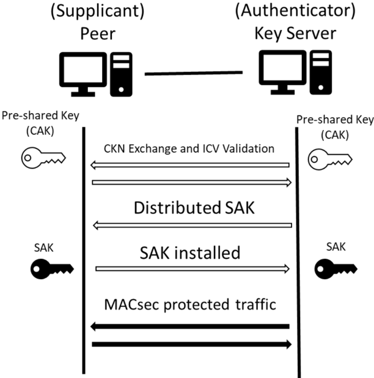

图 7.2 提供了分层软件架构中 AUTOSAR Mka 模块的架构概览。

图 7.2：AUTOSAR CP 软件架构中的 Mka 模块（**MKA module in the SW Architecture of AUTOSAR CP**）

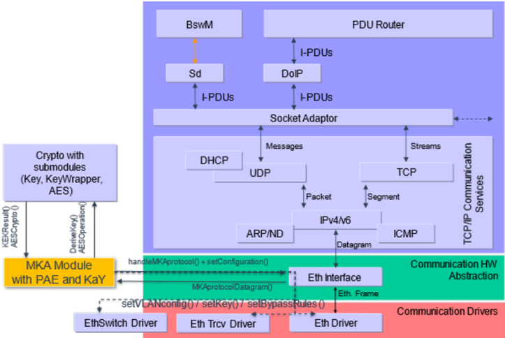

基于 **IEEE** 标准（[\[4, IEEE-802.1AE-2018\]](#ref-4) 与 [\[5, IEEE-802.1X-2020\]](#ref-5)），系统允许针对每个以太网端口配置、建立并运行完整性受保护和/或加密的数据通信。这意味着：当通过 AUTOSAR 配置进行配置时，架构、规范与后续实现能够在每个端口上启用 **MACsec**。此外，该配置不仅限于端口。**MACsec** 允许基于 EtherType 或 **VLAN-ID**"绕过"（bypass）流量。这意味着 **MACsec** 让选定的流量不受保护地通过。

对于支持该协议的实体，**MACsec** 的使用将被预先静态配置，配置将基于规则。这包括用于确定被绕过流量的规则。由于被绕过的流量可以基于 **VLAN ID**，因此 **MACsec** 保护网络的处理与基于 **VLAN** 的通信交互。被绕过的流量在收发器链路接通后即可用，而受保护的流量需要等待 **MACsec** 及其密钥协商序列首先完成。

对于受保护与不受保护的流量，以太网接口的行为将有所不同。在控制器（因此 EthSwt 和/或 EthTrcv）必须处理受 **MACsec** 保护的端口的情况下，以太网接口（EthIf）的序列会被修改。

在从受 **MACsec** 保护的端口（可能在某个交换机之后）接收到链路接通指示之后，以太网接口将触发 Mka 模块为相应端口启动 **MKA** 序列。一旦 Mka 模块发出 **MKA** 序列成功的信号、从而该端口上的 **MACsec** 已被正确配置，链路接通（LinkUp）即被传播给上层（即经由相应的 UL\_LinkStateChg 方法到达 EthSM 或其他模块）。这对于在受 **MACsec** 保护的链路就绪后立即启动上层协议（例如 SOME/IP-SD）至关重要。

这也适用于为相应网络定义了端口组的情况。

#### 6.2.1. 功能组件

##### 6.2.1.1. 端口访问实体（PAE）

在 [\[5, IEEE-802.1X-2020\]](#ref-5) 标准中，端口访问实体（**PAE**）描述了控制一个以太网端口的（软件）实体。这包括允许或不允许流量通过，也包括基于 **MACsec** 密钥协商协议（**MKA**）控制 **MACsec** 功能。

[\[5, IEEE-802.1X-2020\]](#ref-5) 定义了基于 **EAP** 的端口认证，并且作为一个特定的用例，定义了 **EAP** 之上的 **MACsec** 密钥协商协议。在本文档的当前版本中，不支持经由 **EAP** 的认证，因此只有基于预共享 **CA** 密钥（**CAK**）的认证是相关的。

**PAE** 将负责编排 **MKA** 实例（在下一节中定义）的初始化与关闭，并基于底层 **KaY** 提供的反馈来设置物理或虚拟受控端口的状态（启用/禁用）。

为了更好地理解 **PAE** 结构，请参阅 [\[5, IEEE-802.1X-2020\]](#ref-5) 第 12 章。

##### 6.2.1.2. MACsec 密钥协商实体（KaY）

依据分配给端口访问实体的 **CKN**，每个 **PAE** 可以拥有一个或多个 **MACsec** 密钥协商参与者（**KaY** 参与者）。

每个 **KaY** 负责识别属于同一 **CA** 的对等方、分发和/或安装 **SAK**，并在 **SC** 生命周期内保持 **MACsec** 信息为最新。

**KaY** 处理 **MKA** 协议行为，包括 **MKPDU** 的生成与处理、要使用的密码套件的控制，以及 **MACsec** 实体（**SecY**）的 **MACsec** 相关参数（包括密钥（**SAK**））的维护。

### 6.3. 通用需求

Mka 模块应实现 [\[5, IEEE-802.1X-2020\]](#ref-5) 第 [9](#9-配置规范) 章以及 AUTOSAR Foundation [\[3, RS\_MACsec\]](#ref-3) 中规定的 **EAP-MKA** 协议版本 3。

**注意：** Mka 模块应按照 [\[5, IEEE-802.1X-2020\]](#ref-5) 第 12 章所述建模。

被排除的部分请参阅第 [4.1](#41-限制) 节。

Mka 模块应支持通过不同端口同时运行 1 到 n 个独立的端口访问实体（**PAE**）。

**注意：** 每个物理（交换机端口或收发器）或虚拟（**MACsec** per **SW**）端口将支持 0（无 **MACsec**）或 1 个 **PAE**。

Mka 模块应支持每个 **PAE**（即每个物理（交换机端口或收发器）或虚拟（**MACsec** per **SW**）端口）一个 **VLAN** 列表以使其绕过 **MACsec**。

被绕过的 **VLAN** 列表应经由配置提供（MkaBypassVlan）。

**注意：** 被 **MACsec** 绕过的流量将是经由该端口的不受保护流量。

Mka 模块应支持每个 **PAE**（即每个物理（交换机端口或收发器）或虚拟（**MACsec** per **SW**）端口）一个 EtherType 列表以使其绕过 **MACsec**。

被绕过的 EtherType 列表应经由配置提供（MkaBypassEtherType）。

**注意：** 被 **MACsec** 绕过的流量将是经由该端口的不受保护流量。

Mka 模块应支持在特定的端口访问实体（**PAE**）中配置 1 到 n 个 **CKN**。

每个所配置的 **CKN** 将经由所述 **PAE** 启动一个并行的 **MACsec** 参与者实体（即 [MkaKayParticipant](#9161-mkakayparticipant)）。

对于特定的 **PAE**，重复的 **CKN** 应被视为一个。

**注意：** 建议实现一个配置检查，以避免在同一个 [MkaKay](#916-mkakay) 实例下出现重复的 **CKN**。

一个 **MKA KaY** 参与者（[MkaKayParticipant](#9161-mkakayparticipant)）在其相应的 **CAK** 可用、且推导出的密钥（**ICK** 与 **KEK**）就绪之前，不得开始发送或处理 **MKPDU**。

Mka 模块应支持基于以下方式生成 **SAK**：

* 密钥推导函数（**KDF**），参见 [\[5, IEEE-802.1X-2020\]](#ref-5) 第 9.8.1 章。
* 随机数生成器（**RNG**）。

Mka 模块应支持以下 **MKPDU** 参数集：

* 基本参数集（Basic Parameter Set）
* 存活对等方列表（Live Peer List）→ 参数集类型 1
* 潜在对等方列表（Potential Peer List）→ 参数集类型 2
* **MACsec SAK** 使用（MACsec SAK Use）→ 参数集类型 3
* 分布式 **SAK**（Distributed SAK）→ 参数集类型 4
* 公告（Announcement）→ 参数集类型 7
* **XPN** → 参数集类型 8

Mka 模块应实现 **TLV** 类型为 112（**MACsec** 密码套件）的 **EAPoL-MKA** 公告，如 [\[5, IEEE-802.1X-2020\]](#ref-5) 第 11.12.3 章所规定。

**注意：** **MACsec** 密码套件公告用于密钥服务器识别另一端所支持的密码。

**EAPoL** 公告 **TLV** 应作为 **EAPoL-MKA** 公告参数集上的一个参数发送，如 [\[5, IEEE-802.1X-2020\]](#ref-5) 的图 11-15 所定义。

一个 **MKA** 实例（[MkaKay](#916-mkakay)）的角色应按配置设置（即 **MKA\_KEY\_SERVER** 或 **MKA\_PEER**）（MkaRole）。

密钥服务器优先级应可配置（MkaKeyServerPriority）；如果配置中未专门提供，则应使用以下值：

* 密钥服务器 = 0
* 对等方 = 255

Mka 模块应支持 **MKA** 序列的重试。

如果一个 **MKA KaY** 参与者（[MkaKayParticipant](#9161-mkakayparticipant)）无法成功地识别链路中的任何参与者、或无法与其成功建立 **SC**，则它应按照一个按配置参数化的重试基础延迟进行指数退避（MkaRetryBaseDelay）来重试 **MKA** 序列，直至一个重试周期延迟（MkaRetryCyclicDelay）。

**注意：** 例如，在 MkaRetryBaseDelay = 0.02 且 MkaRetryCyclicDelay = 0.5 的情况下，重试序列将如下：20 ms、40 ms、80 ms、160 ms、320 ms、500 ms、500 ms……

配置为密钥服务器（**MKA\_KEY\_SERVER**）角色的 **MKA** 实例（[MkaKay](#916-mkakay)）应支持在一个可配置的时间跨度（MkaSakRekeyTimeSpan）之后对分发的 **SAK** 进行重新密钥化。

**注意：** 时间跨度按配置设置。

配置为密钥服务器（**MKA\_KEY\_SERVER**）角色的 **MKA** 实例应在一个方向（发送或接收）的包编号空间超过以下值时对分发的 **SAK** 进行重新密钥化：

* 对于 32 位 **PN**：0xC000 0000
* 对于 64 位 **PN**（**XPN** 模式）：0xC000 0000 0000 0000

**注意：** [\[5, IEEE-802.1X-2020\]](#ref-5) 标准第 9.8 章要求这一点。

每个 **MKA** 实例应假定每条链路恰好有两个参与者。因此，恰好拥有一个对等方。

**注意：** 这意味着一个必须担任密钥服务器角色，另一个担任对等方角色。该需求允许一个 **MKA** 实例在检测并成功认证链路中属于同一 **CA** 的另一个参与者之后，立即继续 **MKA** 序列，从而避免启动延迟。

### 6.4. 限制

不受支持特性的概览参见第 [4](#4-约束和假设) 章。

#### 6.4.1. MKA 实体上的限制

Mka 模块可以支持基于 **EAP** 的认证，详见 [\[5, IEEE-802.1X-2020\]](#ref-5) 第 [8](#8-时序图) 章。

**注意：** 不要求基于 **EAP** 的认证，因为参与者的相互认证是基于预共享密钥实现的。

Mka 模块应只支持每个端口（即每个 **PAE** [MkaPaeInstance](#915-mkapaeinstance)）一个 **MKA** 参与者（[MkaKayParticipant](#9161-mkakayparticipant)）成功。如果一个 **KaY** 参与者能够正确建立一条 **SC**，则同一 **PAE** 的其他已启动参与者（[MkaKayParticipant](#9161-mkakayparticipant)）应放弃。

**注意：** 如上文所述，一个 **PAE** 实例可以启动 1 到 n 个 **MKA** 参与者实例（[MkaKayParticipant](#9161-mkakayparticipant)），但其中只有一个应在端口上成功配置安全通道（不支持点对多点架构）。

### 6.5. 加密需求

Mka 模块应支持在 **MACsec** 实体（按 **SW** 或 **HW**）中配置以下密码套件：

* GCM-AES-128
* GCM-AES-256
* GCM-AES-XPN-128
* GCM-AES-XPN-256

**注意：** Mka 模块应支持公告并配置所列密码（MkaMacSecCipherSuite）。

详细信息参见 [\[5, IEEE-802.1X-2020\]](#ref-5) 图 11-12 与 [\[4, IEEE-802.1AE-2018\]](#ref-4) 第 14.3 章。

Mka 模块应支持每个 [MkaCryptoAlgoConfig](#914-mkacryptoalgoconfig) 配置 1 到 4 个密码套件，每个套件具有一个唯一的 MkaMacSecCipherSuitePrio。

MkaMacSecCipherSuitePrio 应接受值 1 到 4，其中 1 为最高优先级、4 为最低优先级。

**注意：** MkaMacSecCipherSuitePrio 参数应由 MkaRole = **MKA\_KEY\_SERVER** 的 [MkaKayParticipant](#9161-mkakayparticipant) 使用，以便在受支持的公共密码套件（与 **EAPoL-MKA** 公告 "MACsec 密码套件" 共享）内选择要与另一参与者一起用于 **MACsec** 的密码套件。

诸如 **MACsec** 密钥的推导与基于 **CAK** 预共享密钥的认证之类的加密操作应委托给 **CSM** 模块。

**注意：** 详细信息请参阅 [\[5, IEEE-802.1X-2020\]](#ref-5) 第 9.3 章。

推导出的密钥（特别是 **ICK** 与 **KEK**）可以被预先计算并以防篡改的方式存储，以优化模块的初始化时间。

**SAK** 被隐式地排除在该需求之外。**SAK** 不得被预先计算，也不得被重用。

应支持将安全关联密钥（**SAK**）从一个 **HSM** 直接安装到一个 **MACsec** 实体（**SecY**）。

### 6.6. 与 MACsec 实体（SecY）的通信

Mka 模块、特别是在某个 **PAE** 上运行的一个特定 **MKA** 实体（**KaY**），应在特定的 **MACsec** 实体（**SecY**）上为 **MACsec** 初始化并维护一条安全通道。所述 **MACsec** 实体可以是下层中 **MACsec** 的软件实现，也可以是 **Phy** 或交换机中的硬件实现。

这应通过第 [7](#7-api规范) 章规定的 **API** 实现。

Mka 模块应按需经由 EthIf **API** 传播 **MACsec** 实体特定的参数。

该需求适用于 **MACsec** 相关参数的初始化、关闭与维护。

Mka 模块应在经由 EthIf **API** 被请求时收集 **MACsec** 实体（**SecY**）的统计信息。

**注意：** 其他模块可以请求端口特定的 **MACsec** 统计信息，以设置 **DTC**、应答诊断以及用于监控。

### 6.7. MKA 的可配置行为

特定 [MkaPaeInstance](#915-mkapaeinstance) 的状态与行为应可按初始配置进行配置。

**注意：** 如果使用 [\[5, IEEE-802.1X-2020\]](#ref-5) 第 12.5 章的提议，则变量 useEAP 目前不受支持（也就是说，该值应默认设置为 Never）。

应当可以通过 Mka 模块 **API** 动态设置特定 **PAE** 的配置。

该更改应在下一个电源周期生效。

如果一个配置参数（例如通过 Mka\_SetPaePermissiveMode、Mka\_SetCknStatus 或 Mka\_SetEnable）经由 **API** 被更改，则从下一个电源周期起，应使用持久化在 **NVRAM** 中的值，而忽略按配置设置的原始值。

在某个特定 [MkaKayParticipant](#9161-mkakayparticipant) 的 MkaOnFailPermissiveMode == **TIMEOUT** 且 MkaParticipantActivate == **TRUE** 的情况下，当满足以下所有条件时，它应判定 **MKA** 已失败：

* **MKA** 序列未成功 → 参与者无法达到为 Rx 与 Tx 安装 **SAK** 的状态。
* **MKA** 超时（MkaOnFailPermissiveModeTimeout）已超过。

如果满足所有这些条件，则应触发错误 **MKA\_E\_TIMEOUT**。

**注意：** **MKA** 超时值通过 MkaOnFailPermissiveModeTimeout 参数按配置设置。

MkaOnFailPermissiveModeTimeout 的 **MKA** 定时器应在所述物理或虚拟端口链路接通（**ETH\_MODE\_ACTIVE**）之后开始计数。

在满足以下任一条件时，MkaOnFailPermissiveModeTimeout 的值应被复位：

* 启动之后。
* 在所述物理或虚拟端口从链路断开（**ETH\_MODE\_DOWN**）转换到链路接通（**ETH\_MODE\_ACTIVE**）时。

#### 6.7.1. MKA 行为

一个 **MKA** 实体（**KaY**）应在通过 Mka\_LinkStateChange 函数接收到端口链路接通信号之后，立即经由所涉及的 EthIf（MkaEthIfControllerRef）启动 **MKA** 序列。

一个 **MKA** 实体（**KaY**）应通过 EthIf\_MacSecOperational 或 EthIf\_SwitchMacSecOperational 函数向 EthIf 发出受 **MACsec** 保护端口成功配置的信号。

**注意：** 一旦两个参与者都能发送与接收受 **MACsec** 保护的帧，一个 **MKA** 实体即判定该受 **MACsec** 保护的端口已成功配置。

#### 6.7.2. MKA 错误处理

为了降低实现的复杂性，Mka 模块可以在启动时自动治愈某些扩展生产错误。

如果一个或多个由 MkaCryptoCknCakKeyRef 引用的 **CAK** 未初始化，则 **MKA\_E\_KEY\_NOT\_PRESENT\_INSTANCE** 应被设置为 "Fail"。

**注意：** 另请参见 **CSM** 返回码 **CRYPTO\_E\_KEY\_NOT\_AVAILABLE**。

如果一个或多个 **CKN** 因密钥错误而导致 **MKPDU** 的 **ICV** 验证或密钥解包失败，则 **MKA\_E\_KEY\_MISMATCH\_INSTANCE** 应被设置为 "Fail"。

如果 **MKA** 对等方只支持不兼容的密码套件，则 **MKA\_E\_ALGO\_MISMATCH\_INSTANCE** 应被设置为 "Fail"。

**MKA\_E\_TIMEOUT\_INSTANCE**、**MKA\_E\_KEY\_NOT\_PRESENT\_INSTANCE**、**MKA\_E\_KEY\_MISMATCH\_INSTANCE** 与 **MKA\_E\_ALGO\_MISMATCH\_INSTANCE** 应在错误条件不再适用时被治愈（设置为 "Pass"）。

**注意：** 如果实现者选择不实现上述治愈需求，则所述错误应在 Mka 模块启动时被治愈。

### 6.8. 错误分类

文档 [\[2\]](#ref-2)《基础软件模块通用规范》的"错误处理"（Error Handling）一节详细描述了基础软件的错误处理。其中最重要的是，它构成了一个由 **BSW** 模块中可能出现的五种错误类型组成的分类方案。

基于该基础，以下各节在相应的小节中规定了特定的错误。

#### 6.8.1. 开发错误

表6.1：Mka 模块中开发错误的定义

| 错误类型 | 相关错误码 | 错误值 |
| --- | --- | --- |
| 以空配置启动 **MKA** 组件 | MKA\_E\_CFG\_NULL\_PTR | 0x01 |
| 以无效的参数值调用 **API** | MKA\_E\_INVALID\_PARAMETER | 0x04 |
| 以 **NULL** 指针调用 **API** | MKA\_E\_PARAM\_POINTER | 0x05 |
| 在模块初始化之前调用 **API** | MKA\_E\_UNINIT | 0x06 |

#### 6.8.2. 运行时错误

不存在运行时错误。

#### 6.8.3. 瞬态故障

不存在瞬态故障。

#### 6.8.4. 生产错误

不存在生产错误。

#### 6.8.5. 扩展生产错误

##### 6.8.5.1. MKA_E_TIMEOUT_INSTANCE

表6.2：扩展生产错误 MKA\_E\_TIMEOUT\_INSTANCE 的定义

| 错误名称 | MKA\_E\_TIMEOUT\_INSTANCE |
| --- | --- |
| 简要描述 | 与远端对等方协商时发生 **MKA** 超时。 |
| 详细描述 | 与远端对等方协商时发生 **MKA** 超时。在 MkaOnFailPermissiveMode == **TIMEOUT** 且 MkaOnFailPermissiveModeTimeout 已溢出的情况下，将设置该错误。 |
| 检测准则 | Fail：如果 **PAE** 实例的 MkaOnFailPermissiveMode == **TIMEOUT** 且 MkaOnFailPermissiveModeTimeout 已溢出，则设置该错误。Pass：如果 **PAE** 实例的 MkaOnFailPermissiveMode == **NEVER**，或 **PAE** 实例的 MkaOnFailPermissiveMode == **TIMEOUT** 且 [MkaKay](#916-mkakay) 在达到 MkaOnFailPermissiveModeTimeout 之前已与某个对等方建立发送与接收 **SC**，则不设置该错误。 |
| 次要参数 | 不适用 |
| 所需时间 | 检测该错误所需的时间与 MkaOnFailPermissiveMode 及 MkaOnFailPermissiveModeTimeout 相关。 |
| 监控频率 | 每个端口在其链路接通后一次。 |
| **MIL** 点亮 | 不适用 |

##### 6.8.5.2. MKA_E_KEY_NOT_PRESENT_INSTANCE

表6.3：扩展生产错误 MKA\_E\_KEY\_NOT\_PRESENT\_INSTANCE 的定义

| 错误名称 | MKA\_E\_KEY\_NOT\_PRESENT\_INSTANCE |
| --- | --- |
| 简要描述 | 缺少启动 **MKA** 协商所需的密钥。 |
| 详细描述 | 在至少一个活动的所配置 Kay 参与者中，不存在用于启动 **MKA** 序列的预共享密钥（即 **CAK**、**ICK** 或 **KEK**）。 |
| 检测准则 | Fail：某个活动的 [MkaKayParticipant](#9161-mkakayparticipant) 的预共享密钥不存在。Pass：所有 Kay 参与者都拥有所需的预共享密钥。 |
| 次要参数 | 不适用 |
| 所需时间 | 0.5 |
| 监控频率 | 每行程一次（once-per-trip） |
| **MIL** 点亮 | 不适用。 |

##### 6.8.5.3. MKA_E_KEY_MISMATCH_INSTANCE

表6.4：扩展生产错误 MKA\_E\_KEY\_MISMATCH\_INSTANCE 的定义

| 错误名称 | MKA\_E\_KEY\_MISMATCH\_INSTANCE |
| --- | --- |
| 简要描述 | 由于与远端对等方的密钥不匹配（**MKPDU** 的 **ICV** 不匹配），**MKA** 协商失败。 |
| 详细描述 | 由于与远端对等方的密钥不匹配（**MKPDU** 的 **ICV** 不匹配），**MKA** 协商失败。在分发匹配 **CKN** 的所接收 **MKPDU** 无法被验证的情况下触发。 |
| 检测准则 | Fail：接收到的一个具有匹配 **CKN** 的 **MKPDU** 无法被成功验证。Pass：所有接收到的具有匹配 **CKN** 的 **MKPDU** 都被成功验证。 |
| 次要参数 | 不适用 |
| 所需时间 | 不适用。 |
| 监控频率 | 连续 |
| **MIL** 点亮 | 不适用。 |

##### 6.8.5.4. MKA_E_ALGO_MISMATCH_INSTANCE

表6.5：扩展生产错误 MKA\_E\_ALGO\_MISMATCH\_INSTANCE 的定义

| 错误名称 | MKA\_E\_ALGO\_MISMATCH\_INSTANCE |
| --- | --- |
| 简要描述 | 由于与远端对等方的密码套件不兼容，**MKA** 协商失败。 |
| 详细描述 | 由于与远端对等方的密码套件不兼容，**MKA** 协商失败。在 **MKA** 通信中的参与者不支持任何共同的 **MACsec** 密码套件、因此无法分发也无法安装有效的 **SAK** 的情况下触发。 |
| 检测准则 | Fail：一次通信的 **KaY** 参与者（本地与远端）不支持共同的 **MACsec** 密码套件。Pass：一次通信的 **KaY** 参与者（本地与远端）支持一个或多个共同的 **MACsec** 密码套件。 |
| 次要参数 | 不适用 |
| 所需时间 | 不适用。 |
| 监控频率 | 连续 |
| **MIL** 点亮 | 不适用。 |

### 6.9. 安全事件

如果已为 Mka 模块启用了安全事件报告（MkaEnableSecurityEventReporting = true），则应经由 AUTOSAR\_SWS\_BSWGeneral 中定义的接口将安全事件报告给 **IdsM**。

表6.6：Mka 的安全事件

| 名称 | 描述 | ID |
| --- | --- | --- |
| SEV\_MKA\_AUTHENTICATION\_FAILURE | 在 **MKA** 通信期间认证失败（错误的 **CKN**/**CAK**）时触发的事件 | 78 |
| SEV\_MKA\_TIMEOUT | 在 **MKA** 通信的超时已到期时触发的事件 | 79 |
| SEV\_MKA\_PORT\_NOT\_ENABLED | 在用于 **MKA** 通信的所指示端口未启用时触发的事件 | 80 |
| SEV\_MKA\_CIPHER\_SUITE\_NOT\_SUPPORTED | 在没有任何受支持的密码套件时触发的事件 | 81 |
| SEV\_MKA\_PORT\_NUMBER\_CHANGE | 在 **MKA** 通信期间端口号已改变时触发的事件 | 82 |

下表描述应为相应安全事件报告的上下文数据：

表6.7：MKA 与 MACsec 相应安全事件的上下文数据

| 安全事件 | 上下文数据 |
| --- | --- |
| SEV\_MKA\_AUTHENTICATION\_FAILURE | * 端口 ID * **CKN** * 对等方的 **MAC** 地址 |
| SEV\_MKA\_TIMEOUT | * 端口 ID * **CKN** * 对等方的 **MAC** 地址 |
| SEV\_MKA\_PORT\_NOT\_ENABLED | * 端口 ID * **CKN** * 对等方的 **MAC** 地址 |
| SEV\_MKA\_CIPHER\_SUITE\_NOT\_SUPPORTED | * 端口 ID * **CKN** * 对等方的 **MAC** 地址 |
| SEV\_MKA\_PORT\_NUMBER\_CHANGE | * 端口 ID * **CKN** * 对等方的 **MAC** 地址 |

当 Mka 模块因认证失败而丢弃了一个包时，Mka 应向 **IdsM**（[RS\_Ids\_00810]）引发 SEv **SEV\_MKA\_AUTHENTICATION\_FAILURE**。

当 MkaOnFailPermissiveModeTimeout 已到期且未接收到任何 **MKA** 包时，Mka 模块应向 **IdsM**（[RS\_Ids\_00810]）引发 SEv **SEV\_MKA\_TIMEOUT**。

当 Mka 模块无法再与所分配的端口通信时，Mka 模块应向 **IdsM**（[RS\_Ids\_00810]）引发 SEv **SEV\_MKA\_PORT\_NOT\_ENABLED**。

当在 **MKA** 通信期间，Mka 模块检测到使用了不受支持的密码套件时，Mka 模块应向 **IdsM**（[RS\_Ids\_00810]）引发 SEv **SEV\_MKA\_CIPHER\_SUITE\_NOT\_SUPPORTED**。

当在已建立的 **MKA** 通信期间，Mka 模块检测到对等方所使用的端口已改变时，Mka 模块应向 **IdsM**（[RS\_Ids\_00810]）引发 SEv **SEV\_MKA\_PORT\_NUMBER\_CHANGE**。

## 7. API规范

### 7.1. 导入的类型

在本章中列出从以下文件包含的所有类型。

表7.1：Mka 模块导入数据类型的定义

| 模块 | 头文件 | 导入的类型 |
| --- | --- | --- |
| ComStack\_Types | ComStack\_Types.h | BufReq\_ReturnType |
| Eth | Eth\_GeneralTypes.h | Eth\_BufIdxType |
| Eth | Eth\_GeneralTypes.h | Eth\_FrameType |
| EthSwt | Eth\_GeneralTypes.h | EthSwt\_MgmtInfoType |
| EthTrcv | Eth\_GeneralTypes.h | EthTrcv\_LinkStateType |
| IdsM | IdsM\_Types.h | IdsM\_SecurityEventIdType |
| NvM | Rte\_NvM\_Type.h | NvM\_BlockIdType |
| Std | Std\_Types.h | Std\_ReturnType |
| Std | Std\_Types.h | Std\_VersionInfoType |

### 7.2. 类型定义

#### 7.2.1. Mka_MacSecConfigType

| 名称 | Mka\_MacSecConfigType |
| --- | --- |
| 类别 | 结构体（Structure） |
| 元素 | ProtectFrames：类型 boolean，注释 指示帧的 **MACsec** 保护是否活动的状态 |
| 元素 | ReplayProtect：类型 boolean，注释 指示重放保护是启用还是禁用的状态 |
| 元素 | ReplayWindow：类型 uint32，注释 如果 ReplayProtect 已启用，指示所使用的重放保护窗口 |
| 元素 | ValidateFrames：类型 Mka\_ValidateFramesType，注释 帧验证的状态。可能的值见 Mka\_ValidateFramesType |
| 元素 | CurrentCipherSuite：类型 uint64，注释 指示 SecY 中使用了哪个密码套件以进行更新。 |
| 元素 | ConfidentialityOffset：类型 Mka\_ConfidentialityOffsetType，注释 设置机密性偏移。可能的值见 Mka\_ConfidentialityOffsetType |
| 元素 | ControlledPortEnabled：类型 boolean，注释 受控端口是启用还是禁用的状态 |
| 元素 | BypassedVlanPtrs：类型 const uint8*，注释 指向被绕过 **VLAN** 列表的指针 |
| 元素 | BypassedVlansLength：类型 uint8，注释 被绕过 **VLAN** 列表的长度 |
| 元素 | BypassedEtherTypesPtr：类型 const uint16*，注释 指向被绕过以太网类型列表的指针 |
| 元素 | BypassedEtherTypesLength：类型 uint8，注释 被绕过以太网类型列表的长度 |
| 描述 | 用于配置一个所引用 SecY 的结构体。 |
| 可通过 | Mka.h 获得 |

#### 7.2.2. Mka_ValidateFramesType

| 名称 | Mka\_ValidateFramesType | | |
| --- | --- | --- | --- |
| 类别 | 枚举 | | |
| 取值 | MKA\_VALIDATE\_DISABLED | 0 | 禁用验证，从所接收帧中移除 SecTAG 与 **ICV**（如果存在）。 |
| | MKA\_VALIDATE\_CHECKED | 1 | 启用验证，不丢弃无效帧。 |
| | MKA\_VALIDATE\_STRICT | 2 | 启用验证并丢弃无效帧。 |
| 描述 | 控制对所接收帧的验证。 | | |
| 可通过 | Mka.h 获得 | | |

#### 7.2.3. Mka_ConfidentialityOffsetType

| 名称 | Mka\_ConfidentialityOffsetType | | |
| --- | --- | --- | --- |
| 类别 | 枚举 | | |
| 取值 | MKA\_CONFIDENTIALITY\_NONE | 0 | 机密性保护禁用。 |
| | MKA\_CONFIDENTIALITY\_OFFSET\_0 | 1 | 每条用户数据的前 0 个初始八位组无机密性保护。 |
| | MKA\_CONFIDENTIALITY\_OFFSET\_30 | 2 | 每条用户数据的前 30 个初始八位组无机密性保护。 |
| | MKA\_CONFIDENTIALITY\_OFFSET\_50 | 3 | 每条用户数据的前 50 个初始八位组无机密性保护。 |
| 描述 | 指示带机密性的完整性情况下的偏移。 | | |
| 可通过 | Mka.h 获得 | | |

#### 7.2.4. Mka_Stats_Tx_SecYType

| 名称 | Mka\_Stats\_Tx\_SecYType |
| --- | --- |
| 类别 | 结构体（Structure） |
| 元素 | OutPkts\_Untagged：类型 uint64，注释 未携带 SecTAG 发送的包的数量 |
| 元素 | OutPkts\_TooLong：类型 uint64，注释 因长度大于端口所接受的最大长度（mtu）而被丢弃的已发送包的数量 |
| 元素 | OutOctets\_Protected：类型 uint64，注释 所发送帧中受完整性保护但未加密的明文八位组的数量 |
| 元素 | OutOctets\_Encrypted：类型 uint64，注释 所发送帧中受完整性保护且已加密的明文八位组的数量 |
| 描述 | **MACsec** 实体（**SecY**）发送统计信息 |
| 可通过 | Mka.h 获得 |

#### 7.2.5. Mka_Stats_Rx_SecYType

| 名称 | Mka\_Stats\_Rx\_SecYType |
| --- | --- |
| 类别 | 结构体（Structure） |
| 元素 | InPkts\_Untagged：类型 uint64，注释 如果 Mka\_ValidateFrames 不是 'MKA\_VALIDATE\_STRICT'，所接收的未携带 **MACsec** 标签（SecTAG）的包的数量 |
| 元素 | InPkts\_NoTag：类型 uint64，注释 因 Mka\_ValidateFrames 为 'MKA\_VALIDATE\_STRICT' 而被丢弃的、未携带 SecTAG 的所接收包的数量 |
| 元素 | InPkts\_BadTag：类型 uint64，注释 因 SecTAG 无效、PN 为零值或 **ICV** 无效而被丢弃的所接收包的数量 |
| 元素 | InPkts\_NoSa：类型 uint64，注释 携带安全实体未知的 **SCI**、或针对一个未使用的 **SA** 的所接收包的数量 |
| 元素 | InPkts\_NoSaError：类型 uint64，注释 因所接收 **SCI** 未知或 **SA** 未被使用而被丢弃的包的数量 |
| 元素 | InPkts\_Overrun：类型 uint64，注释 因超出加密性能能力而被丢弃的包的数量 |
| 元素 | InOctets\_Validated：类型 uint64，注释 从受完整性保护但未加密的包中恢复的明文八位组的数量 |
| 元素 | InOctets\_Decrypted：类型 uint64，注释 从受完整性保护且已加密的包中恢复的明文八位组的数量 |
| 描述 | **MACsec** 实体（**SecY**）接收统计信息 |
| 可通过 | Mka.h 获得 |

#### 7.2.6. Mka_Stats_Tx_ScType

| 名称 | Mka\_Stats\_Tx\_ScType |
| --- | --- |
| 类别 | 结构体（Structure） |
| 元素 | OutPkts\_Protected：类型 uint64，注释 该发送 **SC** 的受完整性保护但未加密的包的数量 |
| 元素 | OutPkts\_Encrypted：类型 uint64，注释 该发送 **SC** 的受完整性保护且已加密的包的数量 |
| 描述 | 安全通道发送统计信息 |
| 可通过 | Mka.h 获得 |

#### 7.2.7. Mka_Stats_Rx_ScType

| 名称 | Mka\_Stats\_Rx\_ScType |
| --- | --- |
| 类别 | 结构体（Structure） |
| 元素 | InPkts\_Ok：类型 uint64，注释 为该安全通道接收的、被成功验证且在重放窗口内的包的数量 |
| 元素 | InPkts\_Unchecked：类型 uint64，注释 为该安全通道接收的、在 Mka\_ValidateFrames 为 'MKA\_VALIDATE\_DISABLED' 时的包的数量 |
| 元素 | InPkts\_Delayed：类型 uint64，注释 为该安全通道接收的、包编号（PN）低于最低可接受包编号（Lowest Pn）且 ReplayProtect 为 false 的包的数量 |
| 元素 | InPkts\_Late：类型 uint64，注释 为该安全通道丢弃的、因所接收包编号（PN）低于最低可接受包编号（LowestPn）且 ReplayProtect 为 true 的包的数量 |
| 元素 | InPkts\_Invalid：类型 uint64，注释 为该安全通道的、验证失败但因 ValidateFrames 为 'MKA\_VALIDATE\_CHECKED' 且数据未加密（因此可以恢复原始帧）而仍可被接收的包的数量 |
| 元素 | InPkts\_NotValid：类型 uint64，注释 为该安全通道丢弃的、因验证失败且 ValidateFrames 为 'MKA\_VALIDATE\_STRICT'、或数据已加密（因此无法恢复原始帧）的包的数量 |
| 描述 | 安全通道接收统计信息 |
| 可通过 | Mka.h 获得 |

#### 7.2.8. Mka_SakKeyPtrType

| 名称 | Mka\_SakKeyPtrType |
| --- | --- |
| 类别 | 结构体（Structure） |
| 元素 | HashKeyPtr：类型 const uint8*，注释 指向哈希密钥的指针 |
| 元素 | SakKeyPtr：类型 const uint8*，注释 指向 **SAK** 的指针 |
| 元素 | SaltKeyPtr：类型 const uint8*，注释 指向盐值（Salt）的指针 |
| 描述 | **SAK** 密钥引用 |
| 可通过 | Mka.h 获得 |

#### 7.2.9. Mka_PermissiveModeType

| 名称 | Mka\_PermisiveModeType | | |
| --- | --- | --- | --- |
| 类别 | 枚举 | | |
| 取值 | NEVER | 0 | 如果参与者无法建立并成功使用一条 **MACsec** 安全通道，则受控端口永远不会被置为启用。 |
| | TIMEOUT | 1 | 如果达到超时值（MkaOnFailPermissiveModeTimeout）、且该 **PAE** 实例下没有任何 **MKA** 实例能够成功满足以下条件，则受控端口将被置为启用、且所述端口将不使用 **MACsec**：识别并认证了一个属于同一 **CA** 的参与者；建立了一条安全通道；两个参与者都能经由该 **SC** 发送与接收受 **MACsec** 保护的流量。 |
| 描述 | **MKA** 的宽容模式（Permissive modes）。 | | |
| 可通过 | Mka.h 获得 | | |

#### 7.2.10. Mka_Stats_SecYType

| 名称 | Mka\_Stats\_SecYType |
| --- | --- |
| 类别 | 结构体（Structure） |
| 元素 | StatsTxPhy：类型 Mka\_Stats\_Tx\_SecYType，注释 安全实体 **Phy** 中按发送的一组统计信息 |
| 元素 | StatsRxPhy：类型 Mka\_Stats\_Rx\_SecYType，注释 安全实体 **Phy** 中按接收的一组统计信息 |
| 元素 | StatsTxSc：类型 Mka\_Stats\_Tx\_ScType，注释 安全实体的安全通道中按发送的一组统计信息 |
| 元素 | StatsRxSc：类型 Mka\_Stats\_Rx\_ScType，注释 安全实体的安全通道中按接收的一组统计信息 |
| 描述 | 安全实体统计信息 |
| 可通过 | Mka.h 获得 |

#### 7.2.11. Mka_PaeStatusType

| 名称 | Mka\_PaeStatusType |
| --- | --- |
| 类别 | 结构体（Structure） |
| 元素 | ConnectionStatus：类型 Mka\_MkaStatus，注释 **MKA** 的状态 |
| 元素 | PeerSci：类型 uint64，注释 **SCI** 包含对等方的 **MAC** 与端口 |
| 元素 | CknInUse：类型 Array of unsigned char[32]（大小 32），注释 用于建立 **MACsec** 安全通道的 **CKN** |
| 描述 | 带有一个 **PAE** 特定信息的结构体 |
| 可通过 | Mka.h 获得 |

#### 7.2.12. Mka_MkaStatusType

| 名称 | Mka\_MkaStatus | | |
| --- | --- | --- | --- |
| 类别 | 枚举 | | |
| 取值 | MKA\_STATUS\_MACSEC\_RUNNING | 0 | **MKA** 会话密钥已协商一致，且 **MACsec** 链路当前已接通。 |
| | MKA\_STATUS\_WAITING\_PEER\_LINK | 1 | **MKA** 正在等待底层设备的链路接通以开始协商。 |
| | MKA\_STATUS\_WAITING\_PEER | 2 | **MKA** 正在等待远端对等方发送 **MKPDU** 以开始协商。 |
| | MKA\_STATUS\_IN\_PROGRESS | 3 | **MKA** 协商正在进行中。 |
| | MKA\_STATUS\_AUTH\_FAIL\_UNKNOWN\_PEER | 4 | **MKA** 协商无法进行，因为远端对等方的 **ICV** 无效（**ICK**、因此 **CAK** 密钥不同）。 |
| | MKA\_STATUS\_UNDEFINED | 0xFF | 未定义状态，在给定总线被禁用时报告。 |
| 描述 | **MKA** 实例的状态。 | | |
| 可通过 | Mka.h 获得 | | |

#### 7.2.13. Mka_ConfigType

| 名称 | Mka\_ConfigType |
| --- | --- |
| 类别 | 结构体（Structure） |
| 描述 | 后构建时配置的实现特定结构体。 |
| 可通过 | Mka.h 获得 |

### 7.3. 函数定义

#### 7.3.1. Mka_Init

**说明**： 初始化 **MKA** 模块。服务 ID 0x1。本服务为同步调用，不可重入。参数 ConfigPtr（in）：指向实现特定结构体的指针。返回值：Std_ReturnType，**E_OK**：请求已被接受；**E_NOT_OK**：请求未被接受。可通过 **Mka.h** 获得。

```C
Std_ReturnType Mka_Init ( const Mka_ConfigType* ConfigPtr )
```

#### 7.3.2. Mka_GetVersionInfo

**说明**： 返回本模块的版本信息。服务 ID 0x2。本服务为同步调用，可重入。参数 VersionInfoPtr（out）：本模块的版本信息。返回值：Std_ReturnType，**E_OK**：请求已被接受；**E_NOT_OK**：请求未被接受。可通过 **Mka.h** 获得。

```C
Std_ReturnType Mka_GetVersionInfo ( Std_VersionInfoType* VersionInfoPtr )
```

#### 7.3.3. Mka_SetCknStatus

**说明**： 设置来自某个 **PAE** 的一个 **CKN** 的状态。服务 ID 0x3。本服务为同步调用，对于不同 MkaPaeIdx 可重入，对同一 MkaPaeIdx 不可重入。参数 MkaPaeIdx（in）：**MKA** 模块上下文中该 **PAE** 的索引；Enable（in）：控制 Mka Participant Activate 状态的布尔值。True -> 该 **MKA** 参与者交换 **MKPDU**。False -> 该 **MKA** 参与者不交换 **MKPDU**；Ckn（in）：用于标识该 **KaY** 参与者的连接关联密钥名称（Connectivity Association Key Name）；CknLength（in）：所提供 **CKN** 参数的长度。返回值：Std_ReturnType，**E_OK**：请求已被接受；**E_NOT_OK**：请求未被接受。可通过 **Mka.h** 获得。

```C
Std_ReturnType Mka_SetCknStatus ( uint8 MkaPaeIdx, boolean Enable, const uint8* Ckn, uint8 CknLength )
```

函数 Mka\_SetCknStatus 应设置包含所提供 Ckn 的、位于所提供 MkaPaeIdx 之下的 [MkaKayParticipant](#9161-mkakayparticipant) 的激活状态。

新的激活状态应持久化存储在 **NVM** 中，并从下一个电源周期起使用（如相应需求所要求）。

如果 **NVM** 中存储了一个有效值，则不应使用按配置为该 [MkaKayParticipant](#9161-mkakayparticipant) 提供的激活状态（MkaParticipantActivate）。

#### 7.3.4. Mka_GetCknStatus

**说明**： 获取来自某个 **PAE** 的一个 **CKN** 的状态。服务 ID 0x4。本服务为同步调用，对于不同 MkaPaeIdx 可重入，对同一 MkaPaeIdx 不可重入。参数 MkaPaeIdx（in）：**MKA** 模块上下文中该 **PAE** 的索引；Ckn（in）：用于标识该 **KaY** 参与者的连接关联密钥名称；CknLength（in）：所提供 **CKN** 参数的长度；EnablePtr（out）：指向 Mka Participant 激活状态的指针。返回值：Std_ReturnType，**E_OK**：请求已被接受；**E_NOT_OK**：请求未被接受。可通过 **Mka.h** 获得。

```C
Std_ReturnType Mka_GetCknStatus ( uint8 MkaPaeIdx, const uint8* Ckn, uint8 CknLength, boolean* EnablePtr )
```

#### 7.3.5. Mka_SetEnable

**说明**： 设置一个 **PAE** 的 **MKA** 激活状态。服务 ID 0x8。本服务为同步调用，对于不同 MkaPaeIdx 可重入，对同一 MkaPaeIdx 不可重入。参数 MkaPaeIdx（in）：**MKA** 模块上下文中该 **PAE** 的索引；Enable（in）：控制 **PAE** 的 Mka 激活的布尔值。返回值：Std_ReturnType，**E_OK**：请求已被接受；**E_NOT_OK**：请求未被接受。可通过 **Mka.h** 获得。

```C
Std_ReturnType Mka_SetEnable ( uint8 MkaPaeIdx, boolean Enable )
```

函数 Mka\_SetEnable 应设置所提供 MkaPaeIdx 的 [MkaKay](#916-mkakay) 的激活状态。

新的激活状态应持久化存储在 **NVM** 中，并从下一个电源周期起使用（如相应需求所要求）。

#### 7.3.6. Mka_GetEnable

**说明**： 获取一个 **PAE** 的 **MKA** 激活状态。服务 ID 0x5。本服务为同步调用，对于不同 MkaPaeIdx 可重入，对同一 MkaPaeIdx 不可重入。参数 MkaPaeIdx（in）：**MKA** 模块上下文中该 **PAE** 的索引；EnablePtr（out）：指向一个 **PAE** 的 Mka 激活状态的指针。返回值：Std_ReturnType，**E_OK**：请求已被接受；**E_NOT_OK**：请求未被接受。可通过 **Mka.h** 获得。

```C
Std_ReturnType Mka_GetEnable ( uint8 MkaPaeIdx, boolean* EnablePtr )
```

#### 7.3.7. Mka_GetPaeStatus

**说明**： 获取一个 **PAE** 的详细信息。服务 ID 0x6。本服务为同步调用，对于不同 MkaPaeIdx 可重入，对同一 MkaPaeIdx 不可重入。参数 MkaPaeIdx（in）：**MKA** 模块上下文中该 **PAE** 的索引；PaeStatusPtr（out）：指向状态结构体的指针，该结构体包含一个 **PAE** 的详细信息。返回值：Std_ReturnType，**E_OK**：请求已被接受；**E_NOT_OK**：请求未被接受。可通过 **Mka.h** 获得。

```C
Std_ReturnType Mka_GetPaeStatus ( uint8 MkaPaeIdx, Mka_PaeStatusType* PaeStatusPtr )
```

#### 7.3.8. Mka_SetPaePermissiveMode

**说明**： 设置一个 **KaY** 的宽容模式。服务 ID 0x9。本服务为同步调用，对于不同 MkaPaeIdx 可重入，对同一 MkaPaeIdx 不可重入。参数 MkaPaeIdx（in）：**MKA** 模块上下文中该 **PAE** 的索引；PermisiveMode（in）：要在该 **PAE** 中设置的宽容模式。返回值：Std_ReturnType，**E_OK**：请求已被接受；**E_NOT_OK**：请求未被接受。可通过 **Mka.h** 获得。

```C
Std_ReturnType Mka_SetPaePermissiveMode ( uint8 MkaPaeIdx, Mka_PermisiveModeType PermisiveMode )
```

函数 Mka\_SetPaePermissiveMode 应设置以 MkaPaeIdx 所引用的 [MkaPaeInstance](#915-mkapaeinstance) 的 PermisiveMode。

新的 PermisiveMode 应持久化存储在 **NVM** 中，并从下一个电源周期起使用（如相应需求所要求）。

如果 **NVM** 中存储了一个有效值，则不应使用按配置为该 [MkaPaeInstance](#915-mkapaeinstance) 提供的 MkaOnFailPermissiveMode。

#### 7.3.9. Mka_StartPae

**说明**： **PAE** 实例的手动启动。（在 [MkaPaeConfiguration](#913-mkapaeconfiguration).Autostart = False 的情况下，该方法启动 **PAE** 操作。）服务 ID 0x10。本服务为同步调用，对于不同 MkaPaeIdx 可重入，对同一 MkaPaeIdx 不可重入。参数 MkaPaeIdx（in）：**MKA** 模块上下文中该 **PAE** 的索引。返回值：Std_ReturnType，**E_OK**：请求已被接受；**E_NOT_OK**：请求未被接受。可通过 **Mka.h** 获得。

```C
Std_ReturnType Mka_StartPae ( uint8 MkaPaeIdx )
```

如果 MkaAutoStart 配置参数为 **TRUE**，则函数 Mka\_StartPae 应启动以 MkaPaeIdx 所引用的 [MkaPaeInstance](#915-mkapaeinstance) 的操作。

如果 MkaAutoStart 配置参数为 **FALSE**，则 Mka\_StartPae 对所引用的 [MkaPaeInstance](#915-mkapaeinstance) 不产生任何效果。

#### 7.3.10. Mka_GetMacSecStatistics

**说明**： 获取一个 **PAE** 的统计信息。服务 ID 0x7。本服务为异步调用，对于不同 MkaPaeIdx 可重入，对同一 MkaPaeIdx 不可重入。参数 MkaPaeIdx（in）：**MKA** 模块上下文中该 **PAE** 的索引；Ckn（in）：用于标识该 **KaY** 参与者的连接关联密钥名称；CknLength（in）：所提供 **CKN** 参数的长度。返回值：Std_ReturnType，**E_OK**：请求已被接受；**E_NOT_OK**：请求未被接受。可通过 **Mka.h** 获得。

```C
Std_ReturnType Mka_GetMacSecStatistics ( uint8 MkaPaeIdx, const uint8* Ckn, uint8 CknLength )
```

#### 7.3.11. Mka_LinkStateChange

**说明**： 通知 **MKA**：一个专用的 Trcv/交换机/**PAC** 端口的链路状态已改变。服务 ID 0x1d。本服务为同步调用，对于不同 MkaPaeIdx 可重入，对同一 MkaPaeIdx 不可重入。参数 MkaPaeIdx（in）：**MKA** 模块上下文中该 **PAE** 的索引；TransceiverLinkState（in）：一个物理以太网连接的以太网链路状态。返回值：Std_ReturnType，**E_OK**：请求已被接受；**E_NOT_OK**：请求未被接受。可通过 **Mka.h** 获得。

```C
Std_ReturnType Mka_LinkStateChange ( uint8 MkaPaeIdx, EthTrcv_LinkStateType TransceiverLinkState )
```

### 7.4. 回调通知

这是提供给其他模块的函数列表。

#### 7.4.1. Mka_GetMacSecStatisticsNotification

**说明**： 通知 Mka\_GetMacSecStatistics 已完成并提供所请求统计信息的回调。服务 ID 0x1e。本服务为同步调用，对于不同 MkaPaeIdx 可重入，对同一 MkaPaeIdx 不可重入。参数 MkaPaeIdx（in）：**MKA** 模块上下文中该 **PAE** 的索引；MacSecStatsPtr（in）：指向一个结构的指针，该结构包含一个 **MKA** 参与者的 **MACsec** 统计信息。无返回值。可通过 **Mka.h** 获得。

```C
void Mka_GetMacSecStatisticsNotification ( uint8 MkaPaeIdx, const Mka_Stats_SecYType* MacSecStatsPtr )
```

#### 7.4.2. Mka_RxIndication

**说明**： 通知 Mka 已接收到 **MKA** 帧。服务 ID 0x1f。本服务为同步调用，可重入。参数 CtrlIdx（in）：以太网接口上下文中物理以太网控制器的索引；FrameType（in）：所接收以太网帧的帧类型；IsBroadcast（in）：指示一个广播帧的参数；PhysAddrPtr（in）：指向所接收以太网帧的物理源地址（按网络字节序的 **MAC** 地址）的指针；DataPtr（in）：指向所接收以太网帧载荷的指针；LenByte（in）：所接收帧中载荷的长度（字节）。无返回值。可通过 **Mka.h** 获得。

```C
void Mka_RxIndication ( uint8 CtrlIdx, Eth_FrameType FrameType, boolean IsBroadcast, const uint8* PhysAddrPtr, const uint8* DataPtr, uint16 LenByte )
```

#### 7.4.3. Mka_TxConfirmation

**说明**： 通知 **MKA**：**MKA** 帧已被正确发送。服务 ID 0x20。本服务为同步调用，可重入。参数 CtrlIdx（in）：以太网接口上下文中物理以太网控制器的索引；BufIdx（in）：已发送缓冲区的索引；Result（in）：**E_OK**：发送成功；**E_NOT_OK**：发送失败。无返回值。可通过 **Mka.h** 获得。

```C
void Mka_TxConfirmation ( uint8 CtrlIdx, Eth_BufIdxType BufIdx, Std_ReturnType Result )
```

#### 7.4.4. Mka_MacSecUpdateSecYNotification

**说明**： 通知 EthIf\_MacSecUpdateSecY 已完成的回调。服务 ID 0x21。本服务为同步调用，对于不同 MkaPaeIdx 可重入，对同一 MkaPaeIdx 不可重入。参数 MkaPaeIdx（in）：**MKA** 模块上下文中该 **PAE** 的索引。无返回值。可通过 **Mka.h** 获得。

```C
void Mka_MacSecUpdateSecYNotification ( uint8 MkaPaeIdx )
```

#### 7.4.5. Mka_MacSecAddTxSaNotification

**说明**： 通知 EthIf\_MacSecAddTxSa 已完成的回调。服务 ID 0x22。本服务为同步调用，对于不同 MkaPaeIdx 可重入，对同一 MkaPaeIdx 不可重入。参数 MkaPaeIdx（in）：**MKA** 模块上下文中该 **PAE** 的索引。无返回值。可通过 **Mka.h** 获得。

```C
void Mka_MacSecAddTxSaNotification ( uint8 MkaPaeIdx )
```

#### 7.4.6. Mka_MacSecAddRxSaNotification

**说明**： 通知 EthIf\_MacSecAddRxSa 已完成的回调。服务 ID 0x23。本服务为同步调用，对于不同 MkaPaeIdx 可重入，对同一 MkaPaeIdx 不可重入。参数 MkaPaeIdx（in）：**MKA** 模块上下文中该 **PAE** 的索引。无返回值。可通过 **Mka.h** 获得。

```C
void Mka_MacSecAddRxSaNotification ( uint8 MkaPaeIdx )
```

### 7.5. 调度函数

这些函数由基础软件调度器直接调用。以下函数应没有返回值与参数，且所有函数都应不可重入。

#### 7.5.1. Mka_MainFunction

**说明**： 用于周期性调用的 main 函数。服务 ID 0x24。可通过 **Mka.h** 获得。

```C
void Mka_MainFunction ( void )
```

Mka\_MainFunction 的调用频率由配置参数 MkaMainFunctionPeriod 决定。

### 7.6. 期望接口

在本章中列出从其他模块要求的所有接口。

#### 7.6.1. 强制接口

**注意：** 本节定义实现模块核心功能所需的全部接口。

表7.2：Mka 模块中强制接口的定义

| API 函数 | 头文件 | 描述 |
| --- | --- | --- |
| EthIf\_ProvideTxBuffer | EthIf.h | 提供对指定以太网控制器的发送缓冲区的访问。 |
| EthIf\_Transmit | EthIf.h | 触发一个先前已填充的发送缓冲区的发送。 |
| NvM\_EraseNvBlock | NvM.h | 擦除一个 **NV** 块的服务。 |
| NvM\_ReadBlock | NvM.h | 将 **NV** 块的数据复制到其相应 **RAM** 块的服务。 |
| NvM\_WriteBlock | NvM.h | 将 **RAM** 块的数据复制到其相应 **NV** 块的服务。 |

#### 7.6.2. 可选接口

本节定义实现模块可选功能所需的全部接口。

表7.3：Mka 模块中可选接口的定义

| API 函数 | 头文件 | 描述 |
| --- | --- | --- |
| Det\_ReportError | Det.h | 报告开发错误的服务。 |
| Det\_ReportRuntimeError | Det.h | 报告运行时错误的服务。如果配置了 callout，则应调用该 callout。 |
| EthIf\_GetPhysAddr | EthIf.h | 获取被索引控制器所使用的物理源地址。 |
| EthIf\_SetSwitchMgmtInfo | EthIf.h | 随一个需要在交换机内被特殊处理的以太网帧一起提供附加的管理信息。必须在相关帧的 EthIf\_ProvideTxBuffer() 与 EthIf\_Transmit() 之间调用。 |
| IdsM\_SetSecurityEvent | IdsM.h | 该 **API** 是向 **IdsM** 报告安全事件的应用接口。 |

#### 7.6.3. 可配置接口

没有定义任何可配置接口。

### 7.7. 服务接口

没有定义任何服务接口。

## 8. 时序图

时序图展示了运行期间执行的基本操作。时序图的目的是一目了然地描绘通信栈的预期行为。

通信初始化时序图说明了 Mka 模块如何参与以太网栈的启动，包括上层与下层模块。

### 8.1. 使用 MACsec 的通信初始化

图 9.1：使用受 MACsec 保护的 EthIf 的通信初始化（**Communication initialization with MACsec protected EthIf**）

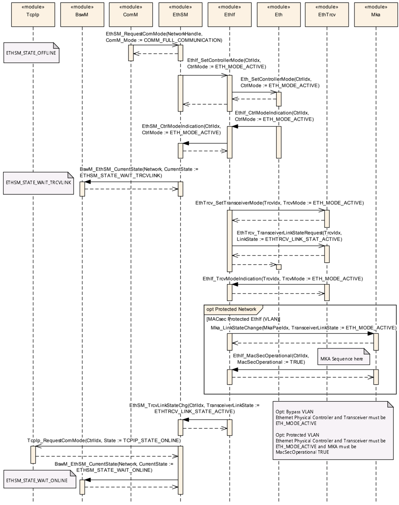

### 8.2. 使用 MACsec 和交换机的通信初始化

图 9.2：使用受 MACsec 保护的 EthIf 与交换机的通信初始化（**Communication initialization with MACsec protected EthIf and Switch**）

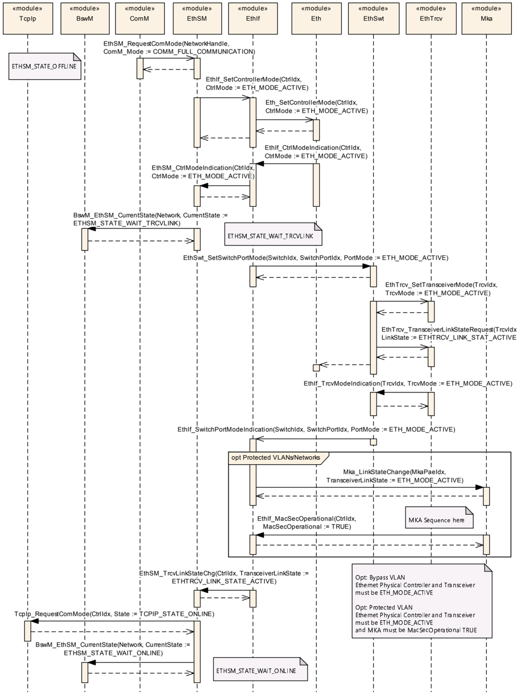

## 9. 配置规范

一般来说，本章定义配置参数及其到容器中的聚类。为了支持本规范，第 10.1 章描述基本原理，并规定了应用于参数规范的模板（表）。我们打算将第 10.1 章保留在规范中，以保证可理解性。

第 10.2 章规定模块 **MKA** 的结构（容器）与参数。

第 10.3 章规定模块 **MKA** 的发布信息。

### 9.1. 容器与配置参数

有关详细信息，请参阅 **SWS\_BSWGeneral** 中第 10.1 章「配置规范简介」。

以下各章汇总所有配置参数。各参数的详细含义在第 6 章与第 7 章中描述。

图 10.1：Mka（**Mka**）

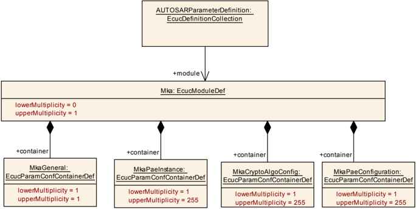

图 10.2：MkaGeneral（**MkaGeneral**）

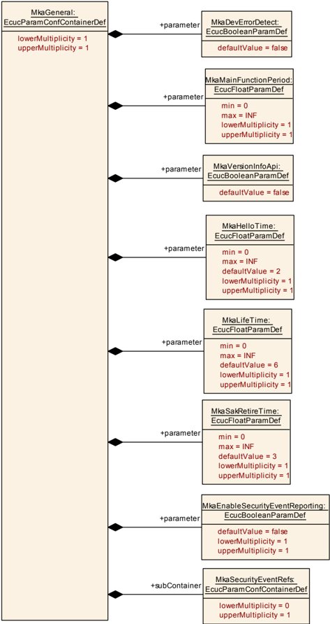

图 10.3：MkaPaeConfiguration（**MkaPaeConfiguration**）

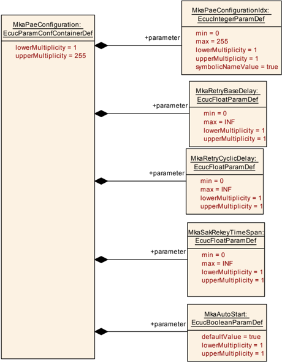

图 10.4：MkaCryptoAlgoConfig（**MkaCryptoAlgoConfig**）

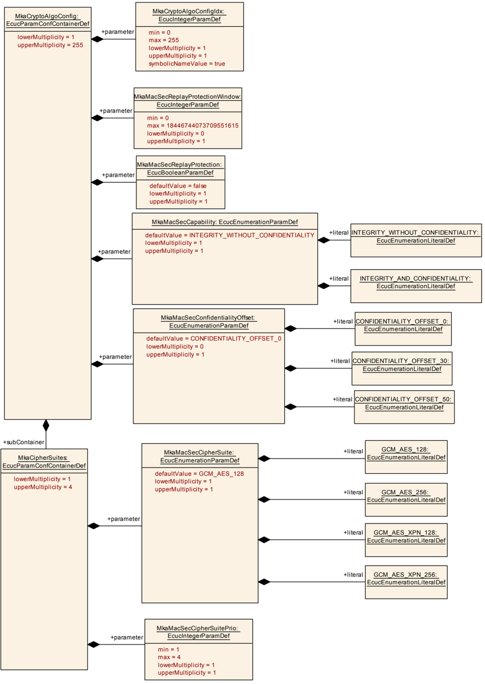

图 10.5：MkaPaeInstance（**MkaPaeInstance**）

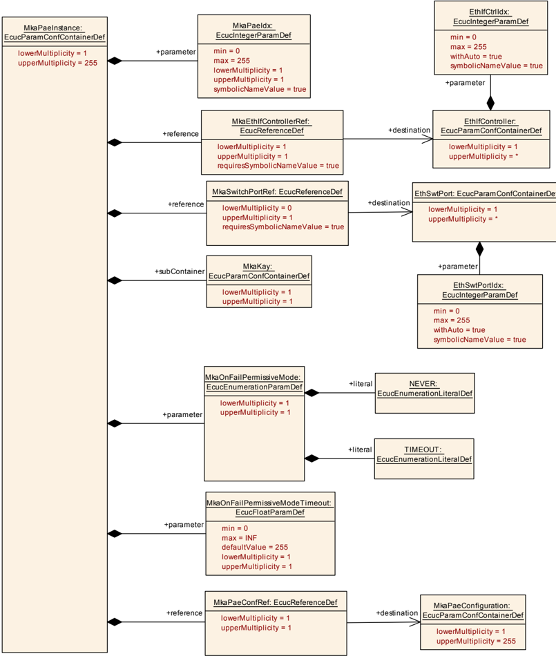

图 10.6：MkaKay（**MkaKay**）

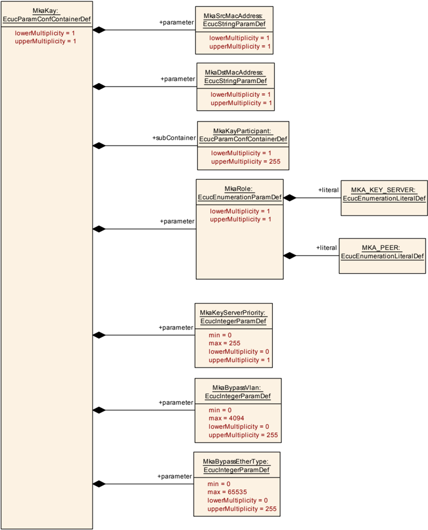

图 10.7：MkaKayParticipant（**MkaKayParticipant**）

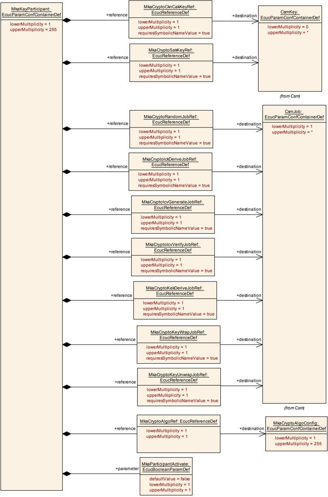

图 10.8：MkaSecurityEventRefs（**MkaSecurityEventRefs**）

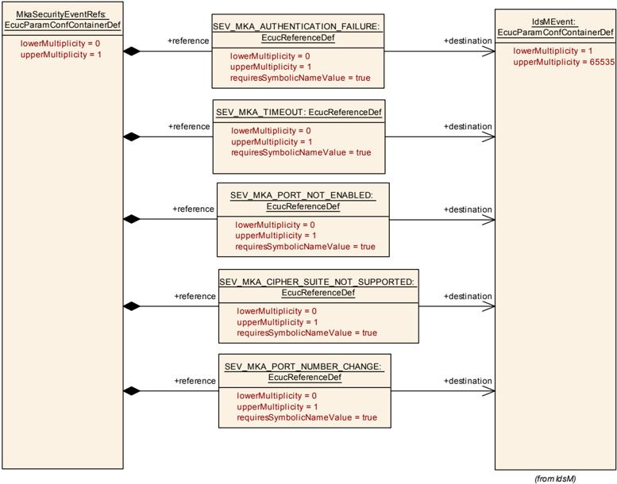

#### 9.1.1. Mka

| SWS 条目 | [ECUC\_Mka\_00001] |
| --- | --- |
| 模块名称 | Mka |
| 描述 | MACsec 密钥协商模块的配置。 |
| Post-Build 变体支持 | false |
| 支持的配置变体 | VARIANT-PRE-COMPILE |

| 容器名称 | 多重性 | 作用域/依赖 |
| --- | --- | --- |
| MkaCryptoAlgoConfig | 1..255 | 用于 **MACsec** 的加密配置。 |
| MkaGeneral | 1 | 该容器承载 **MKA** 协议的通用参数，这些参数适用于引用该容器的端口。 |
| MkaPaeConfiguration | 1..255 | 一个 **PAE** 的公共 **MKA** 配置。 |
| MkaPaeInstance | 1..255 | 一个受控端口的 **MKA** 配置。 |

#### 9.1.2. MkaGeneral

| SWS 条目 | [ECUC\_Mka\_00002] |
| --- | --- |
| 容器名称 | MkaGeneral |
| 父容器 | Mka |
| 描述 | 该容器承载 **MKA** 协议的通用参数，这些参数适用于引用该容器的端口。 |
| 配置参数 | 见下方参数表 |

| SWS 条目 | [ECUC\_Mka\_00034] |
| --- | --- |
| 参数名称 | MkaDevErrorDetect |
| 父容器 | MkaGeneral |
| 描述 | 打开或关闭开发错误检测与通知。* **true**：启用检测与通知。* **false**：禁用检测与通知。 |
| 多重性 | 1 |
| 类型 | EcucBooleanParamDef |
| 默认值 | false |
| 值配置类 | Pre-compile time：x（All Variants）；Link time：-；Post-build time：- |
| 作用域/依赖 | scope: local |

| SWS 条目 | [ECUC\_Mka\_00061] |
| --- | --- |
| 参数名称 | MkaEnableSecurityEventReporting |
| 父容器 | MkaGeneral |
| 描述 | 打开或关闭向 **IdsM** 的安全事件报告：* **true**：启用报告。* **false**：禁用报告。 |
| 多重性 | 1 |
| 类型 | EcucBooleanParamDef |
| 默认值 | false |
| Post-Build 变体值 | false |
| 值配置类 | Pre-compile time：x（All Variants）；Link time：-；Post-build time：- |
| 作用域/依赖 | scope: local |

| SWS 条目 | [ECUC\_Mka\_00007] |
| --- | --- |
| 参数名称 | MkaHelloTime |
| 父容器 | MkaGeneral |
| 描述 | 当两个参与者具有活动的 **MKA** 通信（双方都被包含在对方的存活对等方列表中）时，**MKPDU** 之间的间隔 [秒]。 |
| 多重性 | 1 |
| 类型 | EcucFloatParamDef |
| 范围 | [0 .. INF] |
| 默认值 | 2 |
| 值配置类 | Pre-compile time：x（All Variants）；Link time：-；Post-build time：- |
| 作用域/依赖 | scope: local |

| SWS 条目 | [ECUC\_Mka\_00009] |
| --- | --- |
| 参数名称 | MkaLifeTime |
| 父容器 | MkaGeneral |
| 描述 | 自最后一次从另一参与者接收到有效 **MKPDU** 起、用于将其视为存活的时间跨度 [秒]。如果在 MkaLifeTime 之后未从另一参与者接收到有效的 **MKPDU**，则该安全通道被关闭。 |
| 多重性 | 1 |
| 类型 | EcucFloatParamDef |
| 范围 | [0 .. INF] |
| 默认值 | 6 |
| 值配置类 | Pre-compile time：x（All Variants）；Link time：-；Post-build time：- |
| 作用域/依赖 | scope: local |

| SWS 条目 | [ECUC\_Mka\_00035] |
| --- | --- |
| 参数名称 | MkaMainFunctionPeriod |
| 父容器 | MkaGeneral |
| 描述 | 周期性 main 函数的循环时间。 |
| 多重性 | 1 |
| 类型 | EcucFloatParamDef |
| 值配置类 | Pre-compile time：x（All Variants）；Link time：-；Post-build time：- |
| 作用域/依赖 | scope: local |

| SWS 条目 | [ECUC\_Mka\_00010] |
| --- | --- |
| 参数名称 | MkaSakRetireTime |
| 父容器 | MkaGeneral |
| 描述 | 在一次 **SAK** 重新密钥化期间，退役先前使用的 **SAK** 所需的时间 [秒]。 |
| 多重性 | 1 |
| 类型 | EcucFloatParamDef |
| 范围 | [0 .. INF] |
| 默认值 | 3 |
| 值配置类 | Pre-compile time：x（All Variants）；Link time：-；Post-build time：- |
| 作用域/依赖 | scope: local |

| SWS 条目 | [ECUC\_Mka\_00036] |
| --- | --- |
| 参数名称 | MkaVersionInfoApi |
| 父容器 | MkaGeneral |
| 描述 | 启用/禁用版本信息 **API**。 |
| 多重性 | 1 |
| 类型 | EcucBooleanParamDef |
| 默认值 | false |
| 值配置类 | Pre-compile time：x（All Variants）；Link time：-；Post-build time：- |
| 作用域/依赖 | scope: local |

| 容器名称 | 多重性 | 作用域/依赖 |
| --- | --- | --- |
| MkaSecurityEventRefs | 0..1 | 容器包含对表示 Mka 模块应在相应安全相关事件发生时向 **IdsM** 报告的安全事件的 IdsMEvent 元素的引用（且 MkaEnableSecurityEventReporting 设置为 "true" 时）。该容器中的标准化安全事件可以由供应商特定的事件扩展。 |

#### 9.1.3. MkaPaeConfiguration

| SWS 条目 | [ECUC\_Mka\_00033] |
| --- | --- |
| 容器名称 | MkaPaeConfiguration |
| 父容器 | Mka |
| 描述 | 一个 **PAE** 的公共 **MKA** 配置。 |
| 配置参数 | 见下方参数表 |

| SWS 条目 | [ECUC\_Mka\_00012] |
| --- | --- |
| 参数名称 | MkaAutoStart |
| 父容器 | MkaPaeConfiguration |
| 描述 | **PAE** 实例的自动启动或手动启动。True := 自动启动；False := 手动启动。如果 Autostart = False，则使用方法 Mka\_StartPae 来启动该 **PAE** 实例。 |
| 多重性 | 1 |
| 类型 | EcucBooleanParamDef |
| 默认值 | true |
| 值配置类 | Pre-compile time：x（All Variants）；Link time：-；Post-build time：- |
| 作用域/依赖 | scope: local |

| SWS 条目 | [ECUC\_Mka\_00037] |
| --- | --- |
| 参数名称 | MkaPaeConfigurationIdx |
| 父容器 | MkaPaeConfiguration |
| 描述 | MkaPaeConfiguration 的实例 **ID**。 |
| 多重性 | 1 |
| 类型 | EcucIntegerParamDef（为该参数生成符号名） |
| 范围 | 0 .. 255 |
| 值配置类 | Pre-compile time：x（All Variants）；Link time：-；Post-build time：- |
| 作用域/依赖 | scope: local |

| SWS 条目 | [ECUC\_Mka\_00004] |
| --- | --- |
| 参数名称 | MkaRetryBaseDelay |
| 父容器 | MkaPaeConfiguration |
| 描述 | **MKA** 重试阶段的基础延迟（秒）。重试具有指数退避延迟（1 倍基础延迟、2 倍基础延迟、4 倍基础延迟……），直到重试延迟超过 MkaRetryCyclicDelay 的值。 |
| 多重性 | 1 |
| 类型 | EcucFloatParamDef |
| 范围 | [0 .. INF] |
| 值配置类 | Pre-compile time：x（All Variants）；Link time：-；Post-build time：- |
| 作用域/依赖 | scope: local |

| SWS 条目 | [ECUC\_Mka\_00005] |
| --- | --- |
| 参数名称 | MkaRetryCyclicDelay |
| 父容器 | MkaPaeConfiguration |
| 描述 | 在带指数退避的基础延迟之后的重试之间的间隔（秒）。 |
| 多重性 | 1 |
| 类型 | EcucFloatParamDef |
| 范围 | [0 .. INF] |
| 值配置类 | Pre-compile time：x（All Variants）；Link time：-；Post-build time：- |
| 作用域/依赖 | scope: local |

| SWS 条目 | [ECUC\_Mka\_00024] |
| --- | --- |
| 参数名称 | MkaSakRekeyTimeSpan |
| 父容器 | MkaPaeConfiguration |
| 描述 | 触发一个使用中的 **SAK** 重新密钥化的时间 [秒]。如果设置为 0，则不会在一段时间之后触发重新密钥化。 |
| 多重性 | 1 |
| 类型 | EcucFloatParamDef |
| 范围 | [0 .. INF] |
| 值配置类 | Pre-compile time：x（All Variants）；Link time：-；Post-build time：- |
| 作用域/依赖 | scope: local |

无包含的容器。

#### 9.1.4. MkaCryptoAlgoConfig

| SWS 条目 | [ECUC\_Mka\_00021] |
| --- | --- |
| 容器名称 | MkaCryptoAlgoConfig |
| 父容器 | Mka |
| 描述 | 用于 **MACsec** 的加密配置。 |
| 配置参数 | 见下方参数表 |

| SWS 条目 | [ECUC\_Mka\_00053] |
| --- | --- |
| 参数名称 | MkaCryptoAlgoConfigIdx |
| 父容器 | MkaCryptoAlgoConfig |
| 描述 | 所配置加密配置的实例 **ID**。 |
| 多重性 | 1 |
| 类型 | EcucIntegerParamDef（为该参数生成符号名） |
| 范围 | 0 .. 255 |
| 值配置类 | Pre-compile time：x（All Variants）；Link time：x（-） |
| 作用域/依赖 | scope: local |

| SWS 条目 | [ECUC\_Mka\_00025] |
| --- | --- |
| 参数名称 | MkaMacSecCapability |
| 父容器 | MkaCryptoAlgoConfig |
| 描述 | 用于 **MACsec** 的 **MACsec** 能力。 |
| 多重性 | 1 |
| 类型 | EcucEnumerationParamDef |
| 范围 | INTEGRITY\_WITHOUT\_CONFIDENTIALITY：仅完整性保护；INTEGRITY\_AND\_CONFIDENTIALITY：完整性与机密性保护 |
| 默认值 | INTEGRITY\_WITHOUT\_CONFIDENTIALITY |
| 值配置类 | Pre-compile time：x（All Variants）；Link time：-；Post-build time：- |
| 作用域/依赖 | scope: local |

| SWS 条目 | [ECUC\_Mka\_00026] |
| --- | --- |
| 参数名称 | MkaMacSecConfidentialityOffset |
| 父容器 | MkaCryptoAlgoConfig |
| 描述 | 机密性偏移仅在选择了"完整性与机密性"且使用非 **XPN** 密码套件时适用。 |
| 多重性 | 0..1 |
| 类型 | EcucEnumerationParamDef |
| 范围 | CONFIDENTIALITY\_OFFSET\_0：偏移 0；CONFIDENTIALITY\_OFFSET\_30：偏移 30；CONFIDENTIALITY\_OFFSET\_50：偏移 50 |
| 默认值 | CONFIDENTIALITY\_OFFSET\_0 |
| 值配置类 | Pre-compile time：x（All Variants）；Link time：-；Post-build time：- |
| 作用域/依赖 | scope: local |

| SWS 条目 | [ECUC\_Mka\_00027] |
| --- | --- |
| 参数名称 | MkaMacSecReplayProtection |
| 父容器 | MkaCryptoAlgoConfig |
| 描述 | 用于 **MACsec** 的 **MACsec** 重放保护参数。重放保护参数定义在 IEEE 802.1AE-2018 文档第 10.4 章。如果接收到的包的包编号位于窗口 = PN − 保护窗口之外，则它启用重放保护。 |
| 多重性 | 1 |
| 类型 | EcucBooleanParamDef |
| 默认值 | false |
| 值配置类 | Pre-compile time：x（All Variants）；Link time：-；Post-build time：- |
| 作用域/依赖 | scope: local |

| SWS 条目 | [ECUC\_Mka\_00028] |
| --- | --- |
| 参数名称 | MkaMacSecReplayProtectionWindow |
| 父容器 | MkaCryptoAlgoConfig |
| 描述 | 在重放保护活动的情况下，重放保护窗口。保护窗口是一个介于 0 与 2^32−1（无 **XPN**）或 2^30−1（**XPN**）之间的正整数。 |
| 多重性 | 0..1 |
| 类型 | EcucIntegerParamDef |
| 范围 | 0 .. 18446744073709551615 |
| 值配置类 | Pre-compile time：x（All Variants）；Link time：-；Post-build time：- |
| 作用域/依赖 | scope: local |

| 容器名称 | 多重性 | 作用域/依赖 |
| --- | --- | --- |
| MkaCipherSuites | 1..4 | 与 **MACsec** 一起使用的密码套件配置。在该 **MKA** 实例充当密钥服务器以选择用于 **MACsec** 的密码套件的情况下，存在 MkaCipherSuitePrio。 |

##### 9.1.4.1. MkaCipherSuites

| SWS 条目 | [ECUC\_Mka\_00050] |
| --- | --- |
| 容器名称 | MkaCipherSuites |
| 父容器 | MkaCryptoAlgoConfig |
| 描述 | 与 **MACsec** 一起使用的密码套件配置。在该 **MKA** 实例充当密钥服务器以选择用于 **MACsec** 的密码套件的情况下，存在 MkaCipherSuitePrio。 |
| 配置参数 | 见下方参数表 |

| SWS 条目 | [ECUC\_Mka\_00052] |
| --- | --- |
| 参数名称 | MkaMacSecCipherSuite |
| 父容器 | MkaCipherSuites |
| 描述 | 用于 **MACsec** 的密码套件。 |
| 多重性 | 1 |
| 类型 | EcucEnumerationParamDef |
| 范围 | GCM\_AES\_128：**GCM-AES-128** 密码套件；GCM\_AES\_256：**GCM-AES-256** 密码套件；GCM\_AES\_XPN\_128：**GCM-AES-XPN-128** 密码套件；GCM\_AES\_XPN\_256：**GCM-AES-XPN-256** 密码套件 |
| 默认值 | GCM\_AES\_128 |
| 值配置类 | Pre-compile time：x（All Variants）；Link time：-；Post-build time：- |
| 作用域/依赖 | scope: local |

| SWS 条目 | [ECUC\_Mka\_00051] |
| --- | --- |
| 参数名称 | MkaMacSecCipherSuitePrio |
| 父容器 | MkaCipherSuites |
| 描述 | 在该 **MKA** 实例充当密钥服务器的情况下，该优先级用于从受支持的公共密码（与链路中的客户端共享）中选择与 **MACsec** 一起使用的密码套件。值 1 表示最高优先级，值 4 表示最低优先级。 |
| 多重性 | 1 |
| 类型 | EcucIntegerParamDef |
| 范围 | 1 .. 4 |
| 值配置类 | Pre-compile time：x（All Variants）；Link time：-；Post-build time：- |
| 作用域/依赖 | scope: local |

无包含的容器。

无包含的容器。

#### 9.1.5. MkaPaeInstance

| SWS 条目 | [ECUC\_Mka\_00003] |
| --- | --- |
| 容器名称 | MkaPaeInstance |
| 父容器 | Mka |
| 描述 | 一个受控端口的 **MKA** 配置。 |
| 配置参数 | 见下方参数表 |

| SWS 条目 | [ECUC\_Mka\_00018] |
| --- | --- |
| 参数名称 | MkaOnFailPermissiveMode |
| 父容器 | MkaPaeInstance |
| 描述 | 在 **MKA** 已启用但未成功的情况下，设置该 **PAE** 的行为。 |
| 多重性 | 1 |
| 类型 | EcucEnumerationParamDef |
| 范围 | NEVER：如果参与者无法建立并成功使用一条 **MACsec** 安全通道，则受控端口永远不会被置为启用；TIMEOUT：如果达到了 MkaOnFailPermissiveModeTimeout，则受控端口将被置为启用、且所述端口将不使用 **MACsec** |
| 值配置类 | Pre-compile time：x（All Variants）；Link time：-；Post-build time：- |
| 作用域/依赖 | scope: local |

| SWS 条目 | [ECUC\_Mka\_00019] |
| --- | --- |
| 参数名称 | MkaOnFailPermissiveModeTimeout |
| 父容器 | MkaPaeInstance |
| 描述 | 在 MkaOnFailPermissiveMode 设置为 Timeout 的情况下，用于启用受控端口的超时（秒）。 |
| 多重性 | 1 |
| 类型 | EcucFloatParamDef |
| 范围 | [0 .. INF] |
| 默认值 | 255 |
| 值配置类 | Pre-compile time：x（All Variants）；Link time：-；Post-build time：- |
| 作用域/依赖 | scope: local |

| SWS 条目 | [ECUC\_Mka\_00011] |
| --- | --- |
| 参数名称 | MkaPaeIdx |
| 父容器 | MkaPaeInstance |
| 描述 | 所配置 **PAE** 的实例 **ID**。 |
| 多重性 | 1 |
| 类型 | EcucIntegerParamDef（为该参数生成符号名） |
| 范围 | 0 .. 255 |
| 值配置类 | Pre-compile time：x（All Variants）；Link time：-；Post-build time：- |
| 作用域/依赖 | scope: local |

| SWS 条目 | [ECUC\_Mka\_00013] |
| --- | --- |
| 参数名称 | MkaEthIfControllerRef |
| 父容器 | MkaPaeInstance |
| 描述 | 对用于发送/接收 **EAP** 帧（以配置受控端口）的 EthIfController 的引用。 |
| 多重性 | 1 |
| 类型 | 对 EthIfController 的符号名引用 |
| 值配置类 | Pre-compile time：x（All Variants）；Link time：-；Post-build time：- |
| 作用域/依赖 | scope: local |

| SWS 条目 | [ECUC\_Mka\_00054] |
| --- | --- |
| 参数名称 | MkaPaeConfRef |
| 父容器 | MkaPaeInstance |
| 描述 | 对适用的 **PAE** 配置的引用。 |
| 多重性 | 1 |
| 类型 | 对 MkaPaeConfiguration 的引用 |
| 值配置类 | Pre-compile time：x（All Variants）；Link time：-；Post-build time：- |
| 作用域/依赖 | scope: local |

| SWS 条目 | [ECUC\_Mka\_00014] |
| --- | --- |
| 参数名称 | MkaSwitchPortRef |
| 父容器 | MkaPaeInstance |
| 描述 | 对被启用、且仅在 **PAE** 连接到一个交换机端口的情况下设置的 EthSwtPort 的引用。 |
| 多重性 | 0..1 |
| 类型 | 对 EthSwtPort 的符号名引用 |
| 值配置类 | Pre-compile time：x（All Variants）；Link time：-；Post-build time：- |
| 作用域/依赖 | scope: local |

| 容器名称 | 多重性 | 作用域/依赖 |
| --- | --- | --- |
| MkaKay | 1..255 | 用于一个受控端口（**PaE**）的 **MKA** 实例（**KaY**）。 |

#### 9.1.6. MkaKay

| SWS 条目 | [ECUC\_Mka\_00017] |
| --- | --- |
| 容器名称 | MkaKay |
| 父容器 | MkaPaeInstance |
| 描述 | 用于一个受控端口（**PaE**）的 **MKA** 实例（**KaY**）。 |
| 配置参数 | 见下方参数表 |

| SWS 条目 | [ECUC\_Mka\_00016] |
| --- | --- |
| 参数名称 | MkaBypassEtherType |
| 父容器 | MkaKay |
| 描述 | 被绕过的 EtherType。包含在内的 EtherType 将不受 **MACsec** 保护。 |
| 多重性 | 0..255 |
| 类型 | EcucIntegerParamDef |
| 范围 | 0 .. 65535 |
| 值配置类 | Pre-compile time：x（All Variants）；Link time：-；Post-build time：- |
| 作用域/依赖 | scope: local |

| SWS 条目 | [ECUC\_Mka\_00015] |
| --- | --- |
| 参数名称 | MkaBypassVlan |
| 父容器 | MkaKay |
| 描述 | 被绕过的 **VLAN-ID**。包含在内的 **VLAN-ID** 将不受 **MACsec** 保护。（**VLAN-ID** 0 被解释为无 **VLAN** → 绕过未打标签的流量。） |
| 多重性 | 0..255 |
| 类型 | EcucIntegerParamDef |
| 范围 | 0 .. 4094 |
| 值配置类 | Pre-compile time：x（All Variants）；Link time：-；Post-build time：- |
| 作用域/依赖 | scope: local |

| SWS 条目 | [ECUC\_Mka\_00032] |
| --- | --- |
| 参数名称 | MkaDstMacAddress |
| 父容器 | MkaKay |
| 描述 | 由该 **MKA** 实例使用的目标 **MAC** 地址。要使用的目标 **MAC** 地址定义在 IEEE 802.1X-2020 第 11.1.1 章（表 11-1）中。 |
| 多重性 | 1 |
| 类型 | EcucStringParamDef |
| 值配置类 | Pre-compile time：x（All Variants）；Link time：-；Post-build time：- |
| 作用域/依赖 | scope: local |

| SWS 条目 | [ECUC\_Mka\_00022] |
| --- | --- |
| 参数名称 | MkaKeyServerPriority |
| 父容器 | MkaKay |
| 描述 | **MKA** 参与者的密钥服务器优先级。如果未提供，则 **MKA\_KEY\_SERVER** 的默认值为 0，**MKA\_PEER** 的默认值为 255。 |
| 多重性 | 0..1 |
| 类型 | EcucIntegerParamDef |
| 范围 | 0 .. 255 |
| 值配置类 | Pre-compile time：x（All Variants）；Link time：-；Post-build time：- |
| 作用域/依赖 | scope: local |

| SWS 条目 | [ECUC\_Mka\_00029] |
| --- | --- |
| 参数名称 | MkaRole |
| 父容器 | MkaKay |
| 描述 | 该 **MKA** 实例的角色。 |
| 多重性 | 1 |
| 类型 | EcucEnumerationParamDef |
| 范围 | MKA\_KEY\_SERVER：该 **MKA** 实例充当密钥服务器；MKA\_PEER：该 **MKA** 实例充当对等方 |
| 值配置类 | Pre-compile time：x（All Variants）；Link time：-；Post-build time：- |
| 作用域/依赖 | scope: local |

| SWS 条目 | [ECUC\_Mka\_00031] |
| --- | --- |
| 参数名称 | MkaSrcMacAddress |
| 父容器 | MkaKay |
| 描述 | 由该 **MKA** 实例使用的源 **MAC** 地址。 |
| 多重性 | 1 |
| 类型 | EcucStringParamDef |
| 值配置类 | Pre-compile time：x（All Variants）；Link time：-；Post-build time：- |
| 作用域/依赖 | scope: local |

| 容器名称 | 多重性 | 作用域/依赖 |
| --- | --- | --- |
| MkaKayDemEventParameterRefs | 0..1 | 容器包含对 DemEventParameter 元素的引用，当相应错误发生时，应使用 **API** Dem\_SetEventStatus 调用这些元素。EventId 取自所引用的 DemEventParameter 的 DemEventId 符号值。标准化的错误在该容器中提供，并且可以由供应商特定的错误引用扩展。 |
| MkaKayParticipant | 1..* | **MKA** 参与者配置。 |

##### 9.1.6.1. MkaKayParticipant

| SWS 条目 | [ECUC\_Mka\_00038] |
| --- | --- |
| 容器名称 | MkaKayParticipant |
| 父容器 | MkaKay |
| 描述 | **MKA** 参与者配置。 |
| 配置参数 | 见下方参数表 |

| SWS 条目 | [ECUC\_Mka\_00049] |
| --- | --- |
| 参数名称 | MkaParticipantActivate |
| 父容器 | MkaKayParticipant |
| 描述 | 该 **MKA** 参与者的启用/禁用状态。* True = 该 **MKA** 参与者交换 **MKPDU**。* False = 该 **MKA** 参与者不交换 **MKPDU**。 |
| 多重性 | 1 |
| 类型 | EcucBooleanParamDef |
| 默认值 | false |
| 值配置类 | Pre-compile time：x（All Variants）；Link time：-；Post-build time：- |
| 作用域/依赖 | scope: local |

| SWS 条目 | [ECUC\_Mka\_00048] |
| --- | --- |
| 参数名称 | MkaCryptoAlgoRef |
| 父容器 | MkaKayParticipant |
| 描述 | 对要使用的加密配置的引用（MkaAlgoConfiguration 容器）。 |
| 多重性 | 1 |
| 类型 | 对 MkaCryptoAlgoConfig 的引用 |
| 值配置类 | Pre-compile time：x（All Variants）；Link time：-；Post-build time：- |
| 作用域/依赖 | scope: local |

| SWS 条目 | [ECUC\_Mka\_00040] |
| --- | --- |
| 参数名称 | MkaCryptoCknCakKeyRef |
| 父容器 | MkaKayParticipant |
| 描述 | 对分配给该 **CSM** 中 **KaY** 参与者的 **CKN**（最少 1 个、最多 32 个字符）的引用。 |
| 多重性 | 1 |
| 类型 | 对 CsmKey 的符号名引用 |
| 值配置类 | Pre-compile time：x（All Variants）；Link time：-；Post-build time：- |
| 作用域/依赖 | scope: local |

| SWS 条目 | [ECUC\_Mka\_00042] |
| --- | --- |
| 参数名称 | MkaCryptoIckDeriveJobRef |
| 父容器 | MkaKayParticipant |
| 描述 | 对用于 **ICK** 推导的一个 **CSM** 作业的引用。 |
| 多重性 | 1 |
| 类型 | 对 CsmJob 的符号名引用 |
| 值配置类 | Pre-compile time：x（All Variants）；Link time：-；Post-build time：- |
| 作用域/依赖 | scope: local |

| SWS 条目 | [ECUC\_Mka\_00043] |
| --- | --- |
| 参数名称 | MkaCryptoIcvGenerateJobRef |
| 父容器 | MkaKayParticipant |
| 描述 | 对用于 **ICV** 生成的一个 **CSM** 作业的引用（依据 IEEE\_802.x，**ICV** 始终为 128 位）。 |
| 多重性 | 1 |
| 类型 | 对 CsmJob 的符号名引用 |
| 值配置类 | Pre-compile time：x（All Variants）；Link time：-；Post-build time：- |
| 作用域/依赖 | scope: local |

| SWS 条目 | [ECUC\_Mka\_00044] |
| --- | --- |
| 参数名称 | MkaCryptoIcvVerifyJobRef |
| 父容器 | MkaKayParticipant |
| 描述 | 对用于 **ICV** 验证的一个 **CSM** 作业的引用（依据 IEEE\_802.x，**ICV** 始终为 128 位）。 |
| 多重性 | 1 |
| 类型 | 对 CsmJob 的符号名引用 |
| 值配置类 | Pre-compile time：x（All Variants）；Link time：-；Post-build time：- |
| 作用域/依赖 | scope: local |

| SWS 条目 | [ECUC\_Mka\_00045] |
| --- | --- |
| 参数名称 | MkaCryptoKekDeriveJobRef |
| 父容器 | MkaKayParticipant |
| 描述 | 对用于 **KEK** 推导的一个 **CSM** 作业的引用。（注意：需要将 **CAK** 设置为该 **KEK** 推导作业的 CsmJobKeyRef。） |
| 多重性 | 1 |
| 类型 | 对 CsmJob 的符号名引用 |
| 值配置类 | Pre-compile time：x（All Variants）；Link time：-；Post-build time：- |
| 作用域/依赖 | scope: local |

| SWS 条目 | [ECUC\_Mka\_00060] |
| --- | --- |
| 参数名称 | MkaCryptoKeyUnwrapJobRef |
| 父容器 | MkaKayParticipant |
| 描述 | 对用于 **SAK** 解包的一个 **CSM** 作业的引用（以执行 RFC3394 的解密部分）。 |
| 多重性 | 1 |
| 类型 | 对 CsmJob 的符号名引用 |
| 值配置类 | Pre-compile time：x（All Variants）；Link time：-；Post-build time：- |
| 作用域/依赖 | scope: local |

| SWS 条目 | [ECUC\_Mka\_00047] |
| --- | --- |
| 参数名称 | MkaCryptoKeyWrapJobRef |
| 父容器 | MkaKayParticipant |
| 描述 | 对用于 **SAK** 包装的一个 **CSM** 作业的引用（以执行 RFC3394 的加密部分）。 |
| 多重性 | 1 |
| 类型 | 对 CsmJob 的符号名引用 |
| 值配置类 | Pre-compile time：x（All Variants）；Link time：-；Post-build time：- |
| 作用域/依赖 | scope: local |

| SWS 条目 | [ECUC\_Mka\_00041] |
| --- | --- |
| 参数名称 | MkaCryptoRandomJobRef |
| 父容器 | MkaKayParticipant |
| 描述 | 对用于随机数生成的一个 **CSM** 作业的引用。 |
| 多重性 | 1 |
| 类型 | 对 CsmJob 的符号名引用 |
| 值配置类 | Pre-compile time：x（All Variants）；Link time：-；Post-build time：- |
| 作用域/依赖 | scope: local |

| SWS 条目 | [ECUC\_Mka\_00046] |
| --- | --- |
| 参数名称 | MkaCryptoSakKeyRef |
| 父容器 | MkaKayParticipant |
| 描述 | 对应存储 **SAK** 的一个 **CSM** 密钥的引用。 |
| 多重性 | 1 |
| 类型 | 对 CsmKey 的符号名引用 |
| 值配置类 | Pre-compile time：x（All Variants）；Link time：-；Post-build time：- |
| 作用域/依赖 | scope: local |

无包含的容器。

##### 9.1.6.2. MkaKayDemEventParameterRefs

| SWS 条目 | [ECUC\_Mka\_00055] |
| --- | --- |
| 容器名称 | MkaKayDemEventParameterRefs |
| 父容器 | MkaKay |
| 描述 | 容器包含对 DemEventParameter 元素的引用，当相应错误发生时，应使用 **API** Dem\_SetEventStatus 调用这些元素。EventId 取自所引用的 DemEventParameter 的 DemEventId 符号值。标准化的错误在该容器中提供，并且可以由供应商特定的错误引用扩展。 |
| 配置参数 | 见下方参数表 |

| SWS 条目 | [ECUC\_Mka\_00059] |
| --- | --- |
| 参数名称 | MKA\_E\_ALGO\_MISMATCH\_INSTANCE |
| 父容器 | MkaKayDemEventParameterRefs |
| 描述 | 对 DemEventParameter 的引用，当该 MkaKay 实例未能成功就 **MACsec** 密钥达成一致、且至少一个 MkaKay 参与者不支持共同的 **MACsec** 密码套件时应触发该事件。 |
| 多重性 | 0..1 |
| 类型 | 对 DemEventParameter 的符号名引用 |
| Post-Build 变体多重性 | false |
| Post-Build 变体值 | false |
| 多重性配置类 | Pre-compile time：x；Link time：-；Post-build time：- |
| 值配置类 | Pre-compile time：x；Link time：-；Post-build time：- |
| 作用域/依赖 | scope: local |

| SWS 条目 | [ECUC\_Mka\_00058] |
| --- | --- |
| 参数名称 | MKA\_E\_KEY\_MISMATCH\_INSTANCE |
| 父容器 | MkaKayDemEventParameterRefs |
| 描述 | 对 DemEventParameter 的引用，当该 MkaKay 实例未能成功就 **MACsec** 密钥达成一致、且该 MkaKay 实例的至少一次交换遭遇一次 **ICV** 验证失败时应触发该事件。 |
| 多重性 | 0..1 |
| 类型 | 对 DemEventParameter 的符号名引用 |
| Post-Build 变体多重性 | false |
| Post-Build 变体值 | false |
| 多重性配置类 | Pre-compile time：x（All Variants）；Link time：-；Post-build time：- |
| 值配置类 | Pre-compile time：x（All Variants）；Link time：-；Post-build time：- |
| 作用域/依赖 | scope: local |

| SWS 条目 | [ECUC\_Mka\_00057] |
| --- | --- |
| 参数名称 | MKA\_E\_KEY\_NOT\_PRESENT\_INSTANCE |
| 父容器 | MkaKayDemEventParameterRefs |
| 描述 | 对 DemEventParameter 的引用，当该 MkaKay 实例未能成功就 **MACsec** 密钥达成一致、且该 MkaKay 实例的至少一个密钥（**CAK**）不存在时应触发该事件。 |
| 多重性 | 0..1 |
| 类型 | 对 DemEventParameter 的符号名引用 |
| Post-Build 变体多重性 | false |
| Post-Build 变体值 | false |
| 多重性配置类 | Pre-compile time：x；Link time：-；Post-build time：- |
| 值配置类 | Pre-compile time：x；Link time：-；Post-build time：- |
| 作用域/依赖 | scope: local |

| SWS 条目 | [ECUC\_Mka\_00056] |
| --- | --- |
| 参数名称 | MKA\_E\_TIMEOUT\_INSTANCE |
| 父容器 | MkaKayDemEventParameterRefs |
| 描述 | 对 DemEventParameter 的引用，当该 MkaKay 实例未能成功就 **MACsec** 密钥达成一致、且该 MkaKay 实例的至少一次交换遭遇一次超时应触发该事件。 |
| 多重性 | 0..1 |
| 类型 | 对 DemEventParameter 的符号名引用 |
| Post-Build 变体多重性 | false |
| Post-Build 变体值 | false |
| 多重性配置类 | Pre-compile time：x；Link time：-；Post-build time：- |
| 值配置类 | Pre-compile time：x；Link time：-；Post-build time：- |
| 作用域/依赖 | scope: local |

无包含的容器。

##### 9.1.6.3. MkaSecurityEventRefs

| SWS 条目 | [ECUC\_Mka\_00062] |
| --- | --- |
| 容器名称 | MkaSecurityEventRefs |
| 父容器 | MkaGeneral |
| 描述 | 容器包含对表示 Mka 模块应在相应安全相关事件发生时向 **IdsM** 报告的安全事件的 IdsMEvent 元素的引用（且 MkaEnableSecurityEventReporting 设置为 "true" 时）。该容器中的标准化安全事件可以由供应商特定的事件扩展。 |
| 配置参数 | 见下方参数表 |

| SWS 条目 | [ECUC\_Mka\_00063] |
| --- | --- |
| 参数名称 | SEV\_MKA\_AUTHENTICATION\_FAILURE |
| 父容器 | MkaSecurityEventRefs |
| 描述 | 在 **MKA** 通信期间认证失败（错误的 **CKN**/**CAK**）时触发的事件。 |
| 多重性 | 0..1 |
| 类型 | 对 IdsMEvent 的符号名引用 |
| Post-Build 变体多重性 | false |
| Post-Build 变体值 | false |
| 多重性配置类 | Pre-compile time：x；Link time：-；Post-build time：- |
| 值配置类 | Pre-compile time：x；Link time：-；Post-build time：- |
| 作用域/依赖 | scope: local |

| SWS 条目 | [ECUC\_Mka\_00066] |
| --- | --- |
| 参数名称 | SEV\_MKA\_CIPHER\_SUITE\_NOT\_SUPPORTED |
| 父容器 | MkaSecurityEventRefs |
| 描述 | 在没有任何受支持的密码套件时触发的事件。 |
| 多重性 | 0..1 |
| 类型 | 对 IdsMEvent 的符号名引用 |
| Post-Build 变体多重性 | false |
| Post-Build 变体值 | false |
| 多重性配置类 | Pre-compile time：x（All Variants）；Link time：-；Post-build time：- |
| 值配置类 | Pre-compile time：x（All Variants）；Link time：-；Post-build time：- |
| 作用域/依赖 | scope: local |

| SWS 条目 | [ECUC\_Mka\_00065] |
| --- | --- |
| 参数名称 | SEV\_MKA\_PORT\_NOT\_ENABLED |
| 父容器 | MkaSecurityEventRefs |
| 描述 | 在用于 **MKA** 通信的所指示端口未启用时触发的事件。 |
| 多重性 | 0..1 |
| 类型 | 对 IdsMEvent 的符号名引用 |
| Post-Build 变体多重性 | false |
| Post-Build 变体值 | false |
| 多重性配置类 | Pre-compile time：x；Link time：-；Post-build time：- |
| 值配置类 | Pre-compile time：x；Link time：-；Post-build time：- |
| 作用域/依赖 | scope: local |

| SWS 条目 | [ECUC\_Mka\_00067] |
| --- | --- |
| 参数名称 | SEV\_MKA\_PORT\_NUMBER\_CHANGE |
| 父容器 | MkaSecurityEventRefs |
| 描述 | 在 **MKA** 通信期间端口号已改变时触发的事件。 |
| 多重性 | 0..1 |
| 类型 | 对 IdsMEvent 的符号名引用 |
| Post-Build 变体多重性 | false |
| Post-Build 变体值 | false |
| 多重性配置类 | Pre-compile time：x（All Variants）；Link time：-；Post-build time：- |
| 值配置类 | Pre-compile time：x（All Variants）；Link time：-；Post-build time：- |
| 作用域/依赖 | scope: local |

| SWS 条目 | [ECUC\_Mka\_00064] |
| --- | --- |
| 参数名称 | SEV\_MKA\_TIMEOUT |
| 父容器 | MkaSecurityEventRefs |
| 描述 | 在 **MKA** 通信的超时已到期时触发的事件。 |
| 多重性 | 0..1 |
| 类型 | 对 IdsMEvent 的符号名引用 |
| Post-Build 变体多重性 | false |
| Post-Build 变体值 | false |
| 多重性配置类 | Pre-compile time：x（All Variants）；Link time：-；Post-build time：- |
| 值配置类 | Pre-compile time：x（All Variants）；Link time：-；Post-build time：- |
| 作用域/依赖 | scope: local |

无包含的容器。

无包含的容器。

### 9.2. 发布信息

有关详细信息，请参阅 **SWS\_BSWGeneral** 中第 10.3 章「发布信息」。

## B. AUTOSAR 可追溯项变更历史

请注意，本章中的列表也包含在后续版本中已从规范中移除的可追溯项。这些项在文档中不作为超链接出现。

### B.1. 本文档按 AUTOSAR R23-11 的可追溯项历史

#### B.1.1. R23-11 中新增的规范条目

```
[CP_SWS_Mka_00301] [CP_SWS_Mka_00302] [CP_SWS_Mka_00303] [CP_SWS_Mka_00304]
[CP_SWS_Mka_00305] [CP_SWS_Mka_00306] [CP_SWS_Mka_00307] [CP_SWS_Mka_00308]
```

#### B.1.2. R23-11 中更改的规范条目

```
[CP_SWS_Mka_91001] [CP_SWS_Mka_91014] [CP_SWS_Mka_91015] [CP_SWS_Mka_91016]
[CP_SWS_Mka_91017] [CP_SWS_Mka_91018] [CP_SWS_Mka_91019] [CP_SWS_Mka_91020]
[CP_SWS_Mka_91021] [CP_SWS_Mka_91022] [CP_SWS_Mka_91023]
```

#### B.1.3. R23-11 中删除的规范条目

无。

#### B.1.4. R23-11 中新增的约束

无。

#### B.1.5. R23-11 中更改的约束

无。

#### B.1.6. R23-11 中删除的约束

无。
