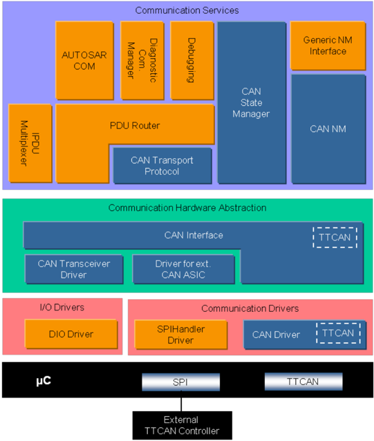
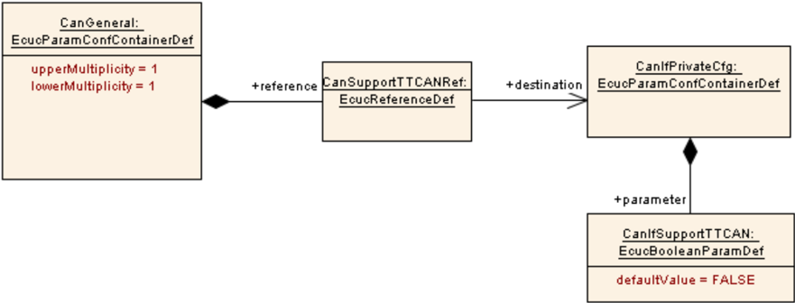

## 1. 简介和功能概述

本规范规定 AUTOSAR 基础软件模块 TTCAN 驱动程序（本文档中称为"Ttcan 模块"）的功能、**API** 与配置。

本文档的基础是 ISO 11898-4 [\[1\]](#ref-1)。假定读者已熟悉该规范。本文档不会再描述 **TTCAN** 功能。

Ttcan 模块属于最底层，执行硬件访问，并向上层提供与硬件无关的 **API**。

唯一可以访问 Ttcan 模块的上层是 TtcanIf 模块（另见 SRS_SPAL_12092）。

Ttcan 模块是 **Can** 模块的扩展，因此本文档只应提供与 **CAN** 栈不同的信息与规范。为了便于理解，也给出了一些一般性信息。

图 1.1：AUTOSAR TTCAN 分层模型（参见 [\[2\]](#ref-2)）（**AUTOSAR TTCAN Layer Model (see [\[2\]](#ref-2))**）



Ttcan 模块提供用于发起传输的服务，并调用 TtcanIf 模块的回调函数以通知事件，与硬件无关。

此外，它提供用于控制属于同一 **TTCAN** 硬件单元的 **TTCAN** 控制器的行为与状态的服务。

只要多个 **TTCAN** 控制器属于同一个 **TTCAN** 硬件单元，单个 Ttcan 模块就可以控制它们。

被配置为排他时间窗口（**Exclusive Time Windows**）的消息将以此消息所配置的每个 Tx_Trigger 周期性地传输（连续传输，**Continuous Transmission**）。

被配置为仲裁时间窗口（**Arbitrating Time Windows**）的消息将仅在每次发送请求时传输一次（单次发送，**Single Shot**）。

## 2. 缩略语

下表收录与 TTCAN 驱动程序模块相关、且未包含在 [\[3, AUTOSAR glossary\]](#ref-3) 中的缩略语与缩写。

**Arbitrating Time Window**
> 参见 ISO 11898-4 [\[1\]](#ref-1)。

**Basic Cycle**
> 参见 ISO 11898-4 [\[1\]](#ref-1)。

**BSW**
> 基础软件（**Basic Software**）。

**CanIf**
> **CAN** 接口（**CAN Interface**）。

**Continuous Transmission**
> 与单次发送相反，即使没有新的发送请求，消息也将被周期性地传输。

**Current Time Master**
> 参见 ISO 11898-4 [\[1\]](#ref-1)。

**DLC**
> 数据长度码（**Data Length Code**）（**L-PDU** 中描述 **SDU** 长度的部分）。

**Cycle Time**
> 参见 ISO 11898-4 [\[1\]](#ref-1)。

**Exclusive Time Window**
> 参见 ISO 11898-4 [\[1\]](#ref-1)。

**Global Time**
> 参见 ISO 11898-4 [\[1\]](#ref-1)。

**Hardware Receive Handle (HRH)**
> 硬件接收句柄（**Hardware Receive Handle**，**HRH**）由 **TTCAN** 驱动程序定义并提供。通常每个 **HRH** 恰好表示一个硬件对象。**HRH** 可用于优化软件过滤。

**Inner Priority Inversion**
> 内部优先级反转：同一发送硬件对象中存在的正在等待的低优先级 **L-PDU** 阻止了高优先级 **L-PDU** 的发送。

**ISR**
> 中断服务例程（**Interrupt Service Routine**）。

**L-PDU**
> 数据链路层（**DLL**）的协议数据单元（**Protocol Data Unit**）。

**Local Time**
> 参见 ISO 11898-4 [\[1\]](#ref-1)。

**Matrix Cycle**
> 参见 ISO 11898-4 [\[1\]](#ref-1)。

**MCAL**
> 微控制器抽象层（**Microcontroller Abstraction Layer**）。

**NTU**
> 参见 ISO 11898-4 [\[1\]](#ref-1)。

**Reference Message**
> 参见 ISO 11898-4 [\[1\]](#ref-1)。

**Single Shot**
> 与连续传输相反，消息将仅被传输一次。

**System Matrix**
> 参见 ISO 11898-4 [\[1\]](#ref-1)。

**Time Gap**
> 参见 ISO 11898-4 [\[1\]](#ref-1)。

**Time Master**
> 参见 ISO 11898-4 [\[1\]](#ref-1)。

**Time Window**
> 参见 ISO 11898-4 [\[1\]](#ref-1)。

**Transmission Column**
> 参见 ISO 11898-4 [\[1\]](#ref-1)。

**Transmit Trigger Event**
> 参见 ISO 11898-4 [\[1\]](#ref-1)。

**TTCAN Controller**
> **TTCAN** 控制器恰好服务于一个物理通道。

**TtcanDrv**
> 启用了 **TTCAN** 功能的 **CAN** 驱动程序模块。

**TtcanIf**
> 启用了 **TTCAN** 功能的 **CAN** 接口模块。

**Tx_Trigger**
> 参见 ISO 11898-4 [\[1\]](#ref-1)。

## 3. 相关文档

所引用的 CAN 驱动程序文档 [\[4\]](#ref-4) 的所有文档对本文档同样有效。

### 3.1. 输入文件和相关标准与规范

<a id="ref-1"></a>- [1] ISO 11898-4:2004 - Road vehicles - Controller area network (CAN) - Part 4:Time-triggered communication
<a id="ref-2"></a>- [2] 分层软件架构 AUTOSAR\_CP\_EXP\_LayeredSoftwareArchitecture
<a id="ref-3"></a>- [3] 术语表 AUTOSAR\_FO\_TR\_Glossary
<a id="ref-4"></a>- [4] CAN 驱动程序规范 AUTOSAR\_CP\_SWS\_CANDriver
<a id="ref-5"></a>- [5] 基础软件模块通用规范 AUTOSAR\_CP\_SWS\_BSWGeneral
<a id="ref-6"></a>- [6] CAN 收发器驱动程序规范 AUTOSAR\_CP\_SWS\_CANTransceiverDriver
<a id="ref-7"></a>- [7] TTCAN 接口规范 AUTOSAR\_CP\_SWS\_TTCANInterface
<a id="ref-8"></a>- [8] 看门狗驱动程序规范 AUTOSAR\_CP\_SWS\_WatchdogDriver
<a id="ref-9"></a>- [9] CAN 接口规范 AUTOSAR\_CP\_SWS\_CANInterface
<a id="ref-10"></a>- [10] ECU 状态管理器规范 AUTOSAR\_CP\_SWS\_ECUStateManager

### 3.2. 相关规范

AUTOSAR 提供了一份基础软件模块通用规范 [\[5, SWS BSW General\]](#ref-5)，它同样适用于 TTCAN 驱动程序。

因此，规范 **SWS BSW General** 应被视为 TTCAN 驱动程序的附加且必需的规范。

## 4. 约束和假设

Ttcan 模块的约束和假设与 CAN 驱动程序模块 [\[6\]](#ref-6) 的相同。

## 5. 对其他模块的依赖

本章包含 TTCAN 驱动程序模块从其他模块额外需要的配置信息与服务的简要描述。

所引用的 CAN 驱动程序模块 [\[6\]](#ref-6) 中描述的依赖关系同样适用于 TTCAN 驱动程序模块。

### 5.1. TTCAN 接口

TTCAN 驱动程序需要 **TTCAN** 接口提供的附加回调函数（参见第 8.6 节）。

## 6. 功能规格

以下各节仅描述附加的 **TTCAN** 特有的"功能规格"。CAN 驱动程序规范 [\[4\]](#ref-4) 是本 TtcanDrv"扩展"的基础。

有关 **TTCAN** 的特定功能行为的描述，请参阅 **TTCAN** 接口规范 [\[7\]](#ref-7) 与 **TTCAN** ISO 规范 [\[1\]](#ref-1)。

### 6.1. TTCAN 控制器状态机

在 **CAN** 控制器状态 **STOPPED** 与 **STARTED** 之间必须并入一个附加状态 **SYNCHRONIZING**。

#### 6.1.1. TTCAN 控制器特有的状态描述

本章对应 CAN 驱动程序 SWS [\[4\]](#ref-4) 的"Can 控制器状态机"（Can Controller State Machine）一章。

**TTCAN** 控制器状态 **SYNCHRONIZING**：控制器已离开状态 **STOPPED**，并已为正常运行做好准备。但是，为了参与总线，控制器需要与全局总线时序同步。只要控制器尚未与总线同步，控制器就保持状态 **SYNCHRONIZING**，并且不得发送错误帧与应答。一旦控制器与总线同步，控制器的状态就从 **SYNCHRONIZING** 变为 **STARTED**。

有关控制器与总线同步的过程的描述，请参阅 [\[1, ISO 11898-4\]](#ref-1)。

**TTCAN** 控制器状态 **IN_GAP** 与 **IN_SCHEDULE**：在正常运行期间，控制器可以在 **IN_SCHEDULE**（正常的时间触发操作）与 **IN_GAP**（一旦在当前基本周期结束时发出间隙信号，直到总线上发送下一条参考消息以指示间隙结束）之间切换。这些状态改变不影响 Ttcan 模块。

#### 6.1.2. TTCAN 控制器特有的状态转换

由函数 Can_SetControllerMode（CAN_CS_STARTED）引起的状态转换：

替代 SWS_Can_00262：函数 Can_SetControllerMode（CAN_CS_STARTED）应在一段有限的时间内等待，直到 **TTCAN** 控制器已变为状态 **SYNCHRONIZING**（与 SWS_Can_00371 比较）。

上述需求的基本原理：控制器将切换到状态 **SYNCHRONISING**，并尝试与总线同步。将控制器与总线同步的过程可能明显长于 CanTimeoutTime。因此，函数 Can_SetControllerMode（与 SWS_Can_00371 比较）与函数 Can_Mainfunction_Timeout（与 SWS_Can_00372 比较）只应观察向状态 **SYNCHRONIZING** 的改变。

由严重错误引起的状态转换（由 **TTCAN** 控制器的状态改变触发）：

* STARTED -> STOPPED
* 如果 **TTCAN** 控制器达到错误级别 S3（参见 **TTCAN** ISO 规范 [\[1\]](#ref-1)），则由硬件触发。
* 在达到 **STOPPED** 状态之后，通过函数 CanIf_TTSevereError 通知 CanIf 模块。

在严重错误检测之后，**TTCAN** 控制器应转换到状态 **STOPPED**，并且 Ttcan 驱动程序模块应确保 **CAN** 控制器不再参与网络。

在严重错误检测之后，TtcanDrv 应取消仍在等待的消息，而不引发取消通知。

TtcanDrv 应禁用或抑制自动的严重错误恢复。

### 6.2. L-PDU 发送

由于时间触发式的调度，**L-PDU** 的发送根据初始化期间配置的矩阵周期（**Matrix Cycle**）进行调度，即调用函数 Can_Write() 不会直接触发立即发送，而是将 **L-PDU** 存储在相应的硬件对象中，该对象被调度在特定的时间窗口（**Time Window**）中发送。

应能够通过配置将所有发送消息对象映射到特定的时间窗口（参见 **TTCAN** ISO 规范 [\[1\]](#ref-1)）（参见 TTCANIF145_Conf、TTCANIF146_Conf、TTCANIF147_Conf、TTCANIF148_Conf）。

#### 6.2.1. 优先级反转

CAN 驱动程序规范 [\[4\]](#ref-4) 中描述的多路复用传输与发送取消只应用于仲裁时间窗口。

**注意：** 在 **TTCAN** 通信中，优先级反转只可能发生在仲裁时间窗口中，因为对于排他时间窗口而言，硬件对象中必须可用的 **L-PDU** 及其对应的 **CAN ID** 是固定的。

### 6.3. L-PDU 接收

消息接收的验证由硬件使用所配置的接收触发 CAN_TT_RX_TRIGGER（参见 ECUC_Can_00145）进行控制。

有关接收触发与消息接收验证的详细描述，请参阅 [\[1, ISO 11898-4\]](#ref-1)。

配置提示：为了抑制连续接收到的消息的常规通知（这些消息到达的频率可能高于需要的频率），可以关闭这些通知。在这种情况下，当需要数据时，可以使用经由"读取接收数据"（Read received data）与 **API** CanIf_ReadRxPduData() 的轮询从 CanIf 获取数据。

### 6.4. 同步

由于 **TTCAN** 支持时间触发式通信，TtcanDrv 需要支持维护时序参数与主节点控制的同步机制。

TtcanDrv 应从 **TTCAN** 控制器提供关于时序参数（参见 [SWS_TtCan_00090]）、同步状态与主节点状态（参见 [SWS_TtCan_00091]）的信息。

如果 **TTCAN** 控制器充当时间主节点（**Time Master**），则 TtcanDrv 应提供在运行时影响 **TTCAN** 控制器时序参数的手段（参见 SWS_TtCan_00096、SWS_TtCan_00097、SWS_TtCan_00098、SWS_TtCan_00099）。

TtcanDrv 应提供定时器的功能，该定时器基于由 **TTCAN** 控制器提供的通信系统的时间标记。

#### 6.4.1. 事件同步

TtcanDrv 应支持事件同步的通信（参见 SWS_TtCan_00094、SWS_TtCan_00095）（参阅 [\[1, ISO 11898-4\]](#ref-1)）。

### 6.5. 时间触发操作

下面列出的事件与 **TTCAN** 系统的时间触发操作相关。

表7.1：经由 TtcanIf 向应用指示的事件（**Events indicated to application via TtcanIf**）

| 事件 | 描述 | TtcanIf 函数* |
| --- | --- | --- |
| 应用看门狗 | 应用未及时服务应用看门狗。 | TtcanIf_ApplWatchdogError |
| 错误级别改变 | **TTCAN** 控制器的错误级别在状态 S0–S3 之间改变。 | TtcanIf_TimingError |
| Tx 溢出 | Tx 触发多于预期。 | TtcanIf_TimingError |
| Tx 下溢 | Tx 触发少于预期。 | TtcanIf_TimingError |
| 全局时间错误 | 同步失败。 | TtcanIf_TimingError |
| Watch 触发 | 发生 Watch 触发。 | TtcanIf_TimingError |
| 初始化 watch 触发 | 达到 Init_watch_trigger。 | TtcanIf_TimingError |
| 间隙 | 置位了"Next is Gap"位。 | TtcanIf_Gap |
| 周期开始 | 基本周期开始（包括周期计数值）。 | TtcanIf_StartOfCycle |
| 时间不连续 | 置位了"Disc Bit"。 | TtcanIf_TimeDisc |
| 主节点状态改变 | 在潜在与当前时间主节点之间主节点状态发生改变。 | TtcanIf_MasterStateChange |

\* 在中断上下文中调用（参见第 [7.6.1](#761-强制接口) 节）

### 6.6. 应用看门狗

**注意：** **TTCAN** 应用看门狗应通过使用看门狗驱动程序实例来服务（参见 [\[8, 看门狗驱动程序 SWS\]](#ref-8)）。看门狗驱动程序实例应在达到超时之前定期服务 **TTCAN** 应用看门狗。

**注意：** 超时是两次连续服务 **TTCAN** 应用看门狗的调用之间的最大时间周期。

**注意：** 应用看门狗超时限制应通过 CanTTControllerApplWatchdogLimit 配置（参见 ECUC_Can_00139）。

### 6.7. TTCAN 错误处理

本章对应 CAN 驱动程序 SWS [\[4\]](#ref-4) 的"错误处理"（Error handling）一章。

当达到错误级别 S1 或 S2（参见 **TTCAN** ISO 规范 [\[1\]](#ref-1)）时，函数 [Can_TTMainFunction_IRQ](#751-can_ttmainfunction_irq)() 或中断应使用相应的事件类型调用函数 CanIf_TTTimingError()。

当达到错误级别 S3（参见 **TTCAN** ISO 规范 [\[1\]](#ref-1)）时，函数 [Can_TTMainFunction_IRQ](#751-can_ttmainfunction_irq)() 或中断应使用相应的事件类型调用函数 CanIf_TTSevereError()。

### 6.8. 错误分类

#### 6.8.1. 开发错误

表6.1：Can 模块中开发错误的定义

| 错误类型 | 相关错误码 | 错误值 |
| --- | --- | --- |
| **TTCAN** 控制器不是潜在时间主节点 | CAN_TT_E_NOT_MASTER | 0x08 |
| **TTCAN** 控制器不是当前时间主节点 | CAN_TT_E_NOT_CURRENT_MASTER | 0x09 |
| **TTCAN** 控制器发送了都置位"Disc_bit"的连续两条参考消息 | CAN_TT_E_CONSEQUTIVE_DISC | 0x0a |
| 由于外部同步已在配置期间被禁用，全局时间的调整失败 | CAN_TT_E_SYNC_DISABLED | 0x0b |

#### 6.8.2. 运行时错误

不存在运行时错误。

#### 6.8.3. 瞬态故障

不存在瞬态故障。

#### 6.8.4. 生产错误

不存在生产错误。

#### 6.8.5. 扩展生产错误

不存在扩展生产错误。

## 7. API规范

由于 Ttcan 模块是 CAN 驱动程序模块 [\[4\]](#ref-4) 的扩展，本章只应提供与 **CAN** 栈不同、且 **TTCAN** 特有的规范。

### 7.1. 导入的类型

附加的 **TTCAN** 特有导入类型。

表7.2：Can 模块导入数据类型的定义

| 模块 | 头文件 | 导入的类型 |
| --- | --- | --- |
| Can | Can_GeneralTypes.h | Can_IdType |
| CanIf | TtcanIf.h | CanIf_TTErrorLevelEnumType |
| CanIf | TtcanIf.h | CanIf_TTErrorLevelType |
| CanIf | TtcanIf.h | CanIf_TTEventEnumType |
| CanIf | TtcanIf.h | CanIf_TTMasterSlaveModeType |
| CanIf | TtcanIf.h | CanIf_TTMasterStateType |
| CanIf | TtcanIf.h | CanIf_TTSevereErrorEnumType |
| CanIf | TtcanIf.h | CanIf_TTSyncModeEnumType |
| CanIf | TtcanIf.h | CanIf_TTTimingErrorIRQType |
| Std | Std_Types.h | Std_ReturnType |

### 7.2. 类型定义

附加的 **TTCAN** 特有类型定义。

#### 7.2.1. Can_TTTimeType

| 名称 | Can_TTTimeType |
| --- | --- |
| 类别 | Type |
| 派生自 | uint16 |
| 描述 | 表示 **TTCAN** 时间值（例如周期、本地或全局时间）的 16 位值。 |
| 可通过 | Ttcan.h 获得 |

#### 7.2.2. Can_TTMasterSlaveModeType

| 名称 | Can_TTMasterSlaveModeType | | |
| --- | --- | --- | --- |
| 类别 | 枚举 | | |
| 取值 | CAN_TT_BACKUP_MASTER | - | 主从模式：备份主节点 |
| | CAN_TT_CURRENT_MASTER | - | 主从模式：当前主节点 |
| | CAN_TT_MASTER_OFF | - | 主从模式：主节点关闭 |
| | CAN_TT_SLAVE | - | 主从模式：从节点 |
| 描述 | 主从模式（Master-Slave Mode）。 | | |
| 可通过 | Ttcan.h 获得 | | |

#### 7.2.3. Can_TTSyncModeEnumType

| 名称 | Can_TTSyncModeEnumType | | |
| --- | --- | --- | --- |
| 类别 | 枚举 | | |
| 取值 | CAN_TT_IN_GAP | - | 同步模式：In_Gap |
| | CAN_TT_IN_SCHEDULE | - | 同步模式：In_Schedule |
| | CAN_TT_SYNC_OFF | - | 同步模式：Sync_Off |
| | CAN_TT_SYNCHRONIZING | - | 同步模式：Synchronizing |
| 描述 | 同步模式（Sync mode）。 | | |
| 可通过 | Ttcan.h 获得 | | |

#### 7.2.4. Can_TTMasterStateType

| 名称 | Can_TTMasterStateType |
| --- | --- |
| 类别 | 结构体（Structure） |
| 元素 | masterSlaveMode：类型 [Can_TTMasterSlaveModeType](#722-can_ttmasterslavemodetype)，注释 - |
| 元素 | refTriggerOffset：类型 uint8，注释 ref trigger offset 的当前值 |
| 元素 | syncMode：类型 [Can_TTSyncModeEnumType](#723-can_ttsyncmodeenumtype)，注释 - |
| 描述 | 包含同步模式、主从模式与当前 ref trigger offset 的主节点状态类型。 |
| 可通过 | Ttcan.h 获得 |

#### 7.2.5. Can_TTErrorLevelEnumType

| 名称 | Can_TTErrorLevelEnumType | | |
| --- | --- | --- | --- |
| 类别 | 枚举 | | |
| 取值 | CAN_TT_ERROR_S0 | - | 错误级别 S0：无错误 |
| | CAN_TT_ERROR_S1 | - | 错误级别 S1：警告 |
| | CAN_TT_ERROR_S2 | - | 错误级别 S2：错误 |
| | CAN_TT_ERROR_S3 | - | 错误级别 S3：致命错误 |
| 描述 | 错误级别（S0-S3）。 | | |
| 可通过 | Ttcan.h 获得 | | |

#### 7.2.6. Can_TTErrorLevelType

| 名称 | Can_TTErrorLevelType |
| --- | --- |
| 类别 | 结构体（Structure） |
| 元素 | errorLevel：类型 [Can_TTErrorLevelEnumType](#725-can_tterrorlevelenumtype)，注释 错误级别（S0-S3） |
| 元素 | maxMessageStatusCount：类型 uint8，注释 消息状态计数的最大值（0-7） |
| 元素 | minMessageStatusCount：类型 uint8，注释 消息状态计数的最小值（0-7） |
| 描述 | 包含消息状态计数最小值与最大值的 **TTCAN** 错误级别。 |
| 可通过 | Ttcan.h 获得 |

#### 7.2.7. Can_TTTimeSourceType

| 名称 | Can_TTTimeSourceType | | |
| --- | --- | --- | --- |
| 类别 | 枚举 | | |
| 取值 | CAN_TT_CYCLE_TIME | - | 时间源：周期时间 |
| | CAN_TT_GLOBAL_TIME | - | 时间源：全局时间 |
| | CAN_TT_LOCAL_TIME | - | 时间源：本地时间 |
| | CAN_TT_UNDEFINED | - | 时间源：未定义 |
| 描述 | 时间源（Time source）。 | | |
| 可通过 | Ttcan.h 获得 | | |

#### 7.2.8. Can_TTTURType

| 名称 | Can_TTTURType |
| --- | --- |
| 类别 | Type |
| 派生自 | uint16 |
| 描述 | 表示 TUR 分子低位的 16 位值 [15...0]。如果 Can_TTTURType = 0xnnnn，则 TUR 分子 = 0x1nnnn。TUR 分子是一个 18 位值，位 [17...16] 硬连线为 0x01。 |
| 可通过 | Ttcan.h 获得 |

### 7.3. 函数定义

附加的 **TTCAN** 特有函数定义。

#### 7.3.1. Can_TTGetControllerTime

**说明**： 获取控制器的全局时间、本地时间、周期时间与周期计数的当前值。服务 ID 0x33。本服务为同步调用，不可重入。参数 Controller（in）：应从中获取时间信息的控制器；Can_TTGlobalTime（out）：存储返回值的地址：全局时间；Can_TTLocalTime（out）：存储返回值的地址：本地时间；Can_TTCycleTime（out）：存储返回值的地址：周期时间；Can_TTCycleCount（out）：存储返回值的地址：周期计数值。无返回值。可通过 **Ttcan.h** 获得。

```C
void Can_TTGetControllerTime ( uint8 Controller, Can_TTTimeType* Can_TTGlobalTime, Can_TTTimeType* Can_TTLocalTime, Can_TTTimeType* Can_TTCycleTime, uint8* Can_TTCycleCount )
```

如果为 Ttcan 模块启用了开发错误检测：如果驱动程序尚未初始化，函数 Can_TTGetControllerTime() 应引发错误 CAN_E_UNINIT。

如果为 Ttcan 模块启用了开发错误检测：如果参数 Controller 超出范围，函数 Can_TTGetControllerTime() 应引发错误 CAN_E_PARAM_CONTROLLER。

如果为 Ttcan 模块启用了开发错误检测：如果参数 Can_TTGlobalTime、参数 Can_TTLocalTime、参数 Can_TTCycleTime 或参数 Can_TTCycelCount 是 **NULL** 指针，函数 Can_TTGetControllerTime() 应引发错误 CAN_E_PARAM_POINTER 并返回 **E_NOT_OK**。

#### 7.3.2. Can_TTGetMasterState

**说明**： 获取主节点状态。主节点状态包括同步模式（sync_off、synchronizing、in_gap、in_schedule）、主从模式（master_off、slave、backup_master、current_master）与 ref trigger offset 的当前值。服务 ID 0x34。本服务为同步调用，不可重入。参数 Controller（in）：应从中获取主节点状态的控制器；Can_TTMasterState（out）：存储返回值的地址：主节点状态。无返回值。可通过 **Ttcan.h** 获得。

```C
void Can_TTGetMasterState ( uint8 Controller, Can_TTMasterStateType* Can_TTMasterState )
```

如果为 Ttcan 模块启用了开发错误检测：如果驱动程序尚未初始化，函数 Can_TTGetMasterState() 应引发错误 CAN_E_UNINIT。

如果为 Ttcan 模块启用了开发错误检测：如果参数 Controller 超出范围，函数 Can_TTGetMasterState() 应引发错误 CAN_E_PARAM_CONTROLLER。

如果为 Ttcan 模块启用了开发错误检测：如果参数 Can_TTMasterState 是 **NULL** 指针，函数 Can_TTGetMasterState() 应引发错误 CAN_E_PARAM_POINTER 并返回 **E_NOT_OK**。

#### 7.3.3. Can_TTGetNTUActual

**说明**： 获取 NTU（网络时间单元）的实际值。结合本地振荡器周期，可以从 TUR 的实际值推导出 NTU 的实际值。服务 ID 0x35。本服务为同步调用，不可重入。参数 Controller（in）：应从中获取 NTU 值的控制器；Can_TTTURAct（out）：存储返回值的地址：NTU 的实际值。该值以微秒为单位给出。无返回值。可通过 **Ttcan.h** 获得。

```C
void Can_TTGetNTUActual ( uint8 Controller, Can_TTTURType* Can_TTTURAct )
```

如果为 Ttcan 模块启用了开发错误检测：如果驱动程序尚未初始化，函数 Can_TTGetNTUActual() 应引发错误 CAN_E_UNINIT。

如果为 Ttcan 模块启用了开发错误检测：如果参数 Controller 超出范围，函数 Can_TTGetNTUActual() 应引发错误 CAN_E_PARAM_CONTROLLER。

如果为 Ttcan 模块启用了开发错误检测：如果参数 Can_TTNTUAct 是 **NULL** 指针，函数 Can_TTGetNTUActual() 应引发错误 CAN_E_PARAM_POINTER 并返回 **E_NOT_OK**。

#### 7.3.4. Can_TTGetErrorLevel

**说明**： 获取错误级别。这包括错误级别的严重程度（S0-S3）以及消息状态计数的最小值与最大值。服务 ID 0x36。本服务为同步调用，不可重入。参数 Controller（in）：应从中获取错误级别的控制器；Can_TTErrorLevel（out）：存储返回值的地址：错误级别。无返回值。可通过 **Ttcan.h** 获得。

```C
void Can_TTGetErrorLevel ( uint8 Controller, Can_TTErrorLevelType* Can_TTErrorLevel )
```

如果为 Ttcan 模块启用了开发错误检测：如果驱动程序尚未初始化，函数 Can_TTGetErrorLevel() 应引发错误 CAN_E_UNINIT。

如果为 Ttcan 模块启用了开发错误检测：如果参数 Controller 超出范围，函数 Can_TTGetErrorLevel() 应引发错误 CAN_E_PARAM_CONTROLLER。

如果为 Ttcan 模块启用了开发错误检测：如果参数 Can_TTErrorLevel 是 **NULL** 指针，函数 Can_TTGetErrorLevel() 应引发错误 CAN_E_PARAM_POINTER 并返回 **E_NOT_OK**。

#### 7.3.5. Can_TTSetNextIsGap

**说明**： 置位 "Next_is_Gap" 位。服务 ID 0x37。本服务为同步调用，不可重入。参数 Controller（in）：应为其设置"下一个是间隙"指示的控制器。无返回值。可通过 **Ttcan.h** 获得。

```C
void Can_TTSetNextIsGap ( uint8 Controller )
```

如果为 Ttcan 模块启用了开发错误检测：如果驱动程序尚未初始化，函数 Can_TTSetNextIsGap() 应引发错误 CAN_E_UNINIT。

如果为 Ttcan 模块启用了开发错误检测：如果参数 Controller 超出范围，函数 Can_TTSetNextIsGap() 应引发错误 CAN_E_PARAM_CONTROLLER。

#### 7.3.6. Can_TTSetEndOfGap

**说明**： 指示间隙的结束。服务 ID 0x38。本服务为同步调用，不可重入。参数 Controller（in）：应为其设置"设置间隙结束"指示的控制器。无返回值。可通过 **Ttcan.h** 获得。

```C
void Can_TTSetEndOfGap ( uint8 Controller )
```

函数 Can_TTSetEndOfGap() 只有在 **TTCAN** 控制器是潜在时间主节点（potentional Time Master）时才应生效。

如果为 Ttcan 模块启用了开发错误检测：如果 **TTCAN** 控制器不是潜在时间主节点，函数 Can_TTSetEndOfGap() 应引发错误 CAN_TT_E_NOT_MASTER。

如果为 Ttcan 模块启用了开发错误检测：如果驱动程序尚未初始化，函数 Can_TTSetEndOfGap() 应引发错误 CAN_E_UNINIT。

如果为 Ttcan 模块启用了开发错误检测：如果参数 Controller 超出范围，函数 Can_TTSetEndOfGap() 应引发错误 CAN_E_PARAM_CONTROLLER。

#### 7.3.7. Can_TTSetTimeCommand

**说明**： 在下一个基本周期开始时按"全局时间预设"（global time preset）的量调整全局时间。服务 ID 0x39。本服务为同步调用，不可重入。参数 Controller（in）：应为其调整全局时间的控制器。无返回值。可通过 **Ttcan.h** 获得。

```C
void Can_TTSetTimeCommand ( uint8 Controller )
```

如果为 Ttcan 模块启用了开发错误检测：如果发送了都置位 "Disc_bit" 的连续两条参考消息，函数 Can_TTSetTimeCommand() 应引发错误 CAN_TT_E_CONSEQUTIVE_DISC。

如果为 Ttcan 模块启用了开发错误检测：如果由于外部同步已在配置期间被禁用而导致全局时间的调整失败，函数 Can_TTSetTimeCommand() 应引发错误 CAN_TT_E_SYNC_DISABLED。

函数 Can_TTSetTimeCommand() 只有在 **TTCAN** 控制器是当前时间主节点时才应生效。

如果为 Ttcan 模块启用了开发错误检测：如果 **TTCAN** 控制器不是当前时间主节点，函数 Can_TTSetTimeCommand() 应引发错误 CAN_TT_E_NOT_CURRENT_MASTER。

如果为 Ttcan 模块启用了开发错误检测：如果驱动程序尚未初始化，函数 Can_TTSetTimeCommand() 应引发错误 CAN_E_UNINIT。

如果为 Ttcan 模块启用了开发错误检测：如果参数 Controller 超出范围，函数 Can_TTSetTimeCommand() 应引发错误 CAN_E_PARAM_CONTROLLER。

#### 7.3.8. Can_TTGlobalTimePreset

**说明**： 设置 "global time preset" 的值。服务 ID 0x3a。本服务为同步调用，不可重入。参数 Controller（in）：应为其设置"全局时间预设"的控制器；Can_TTGlobalTimePreset（in）："全局时间预设"的新值。无返回值。可通过 **Ttcan.h** 获得。

```C
void Can_TTGlobalTimePreset ( uint8 Controller, Can_TTTimeType Can_TTGlobalTimePreset )
```

如果为 Ttcan 模块启用了开发错误检测：如果驱动程序尚未初始化，函数 Can_TTGlobalTimePreset() 应引发错误 CAN_E_UNINIT。

如果为 Ttcan 模块启用了开发错误检测：如果参数 Controller 超出范围，函数 Can_TTGlobalTimePreset() 应引发错误 CAN_E_PARAM_CONTROLLER。

#### 7.3.9. Can_TTSetExtClockSyncCommand

**说明**： 根据 "NTU adjust" 给出的值调整 NTU（网络时间单元）。结合本地振荡器周期，可以从 "NTU adjust" 推导出 "TUR adjust"。服务 ID 0x3b。本服务为同步调用，不可重入。参数 Controller（in）：应为其调整 NTU 的控制器。无返回值。可通过 **Ttcan.h** 获得。

```C
void Can_TTSetExtClockSyncCommand ( uint8 Controller )
```

函数 Can_TTSetExtClockSyncCommand() 只有在 **TTCAN** 控制器是当前时间主节点时才应生效。

如果为 Ttcan 模块启用了开发错误检测：如果 **TTCAN** 控制器不是当前时间主节点，函数 Can_TTSetExtClockSyncCommand() 应引发错误 CAN_TT_E_NOT_CURRENT_MASTER。

如果为 Ttcan 模块启用了开发错误检测：如果驱动程序尚未初始化，函数 Can_TTSetExtClockSyncCommand() 应引发错误 CAN_E_UNINIT。

如果为 Ttcan 模块启用了开发错误检测：如果参数 Controller 超出范围，函数 Can_TTSetExtClockSyncCommand() 应引发错误 CAN_E_PARAM_CONTROLLER。

#### 7.3.10. Can_TTSetNTUAdjust

**说明**： 设置 "NTU adjust" 的值。结合本地振荡器周期，可以从 "NTU adjust" 推导出 "TUR adjust"。服务 ID 0x3c。本服务为同步调用，不可重入。参数 Controller（in）：应为其设置 "NTU adjust" 的控制器；Can_TTTURAdjust（in）：'NTU adjust' 的新值。该值以微秒为单位给出。无返回值。可通过 **Ttcan.h** 获得。

```C
void Can_TTSetNTUAdjust ( uint8 Controller, Can_TTTURType Can_TTTURAdjust )
```

如果为 Ttcan 模块启用了开发错误检测：如果驱动程序尚未初始化，函数 Can_TTSetNTUAdjust() 应引发错误 CAN_E_UNINIT。

如果为 Ttcan 模块启用了开发错误检测：如果参数 Controller 超出范围，函数 Can_TTSetNTUAdjust() 应引发错误 CAN_E_PARAM_CONTROLLER。

### 7.4. 可选函数定义

附加的可选 **TTCAN** 特有函数定义。

#### 7.4.1. Can_TTGetSyncQuality

**说明**： 获取同步质量。服务 ID 0x47。本服务为同步调用，不可重入。参数 Controller（in）：应从中获取同步质量的控制器；Can_TTClockSpeed（out）：存储返回值的地址：如果同步偏差小于"同步偏差限制"（Synchronization deviation limit）则为 true；Can_TTGlobalTimePhase（out）：存储返回值的地址：如果全局时间与时间主节点同相则为 true。无返回值。可通过 **Ttcan.h** 获得。

```C
void Can_TTGetSyncQuality ( uint8 Controller, boolean* Can_TTClockSpeed, boolean* Can_TTGlobalTimePhase )
```

如果为 Ttcan 模块启用了开发错误检测：如果驱动程序尚未初始化，函数 Can_TTGetSyncQuality() 应引发错误 CAN_E_UNINIT。

如果为 Ttcan 模块启用了开发错误检测：如果参数 Controller 超出范围，函数 Can_TTGetSyncQuality() 应引发错误 CAN_E_PARAM_CONTROLLER。

如果为 Ttcan 模块启用了开发错误检测：如果参数 Can_TTClockSpeed 或参数 Can_TTGlobalTimePhase 是 **NULL** 指针，函数 Can_TTGetSyncQuality() 应引发错误 CAN_E_PARAM_POINTER 并返回 **E_NOT_OK**。

#### 7.4.2. Can_TTSetTimeMark

**说明**： 为给定的时间源设置时间标记的新值。服务 ID 0x48。本服务为同步调用，不可重入。参数 Controller（in）：应为其设置时间标记的控制器；Can_TTTimeMark（in）：给出要设置的时间标记的值；Can_TTTimeSource（in）：定义要设置的时间标记的时间源。无返回值。可通过 **Ttcan.h** 获得。

```C
void Can_TTSetTimeMark ( uint8 Controller, Can_TTTimeType Can_TTTimeMark, Can_TTTimeSourceType Can_TTTimeSource )
```

如果为 Ttcan 模块启用了开发错误检测：如果驱动程序尚未初始化，函数 Can_TTSetTimeMark() 应引发错误 CAN_E_UNINIT。

如果为 Ttcan 模块启用了开发错误检测：如果参数 Controller 超出范围，函数 Can_TTSetTimeMark() 应引发错误 CAN_E_PARAM_CONTROLLER。

#### 7.4.3. Can_TTCancelTimeMark

**说明**： 取消时间标记。服务 ID 0x49。本服务为同步调用，不可重入。参数 Controller（in）：应为其取消时间标记的控制器。无返回值。可通过 **Ttcan.h** 获得。

```C
void Can_TTCancelTimeMark ( uint8 Controller )
```

如果为 Ttcan 模块启用了开发错误检测：如果驱动程序尚未初始化，函数 Can_TTCancelTimeMark() 应引发错误 CAN_E_UNINIT。

如果为 Ttcan 模块启用了开发错误检测：如果参数 Controller 超出范围，函数 Can_TTCancelTimeMark() 应引发错误 CAN_E_PARAM_CONTROLLER。

#### 7.4.4. Can_TTAckTimeMark

**说明**： 通过复位中断向量寄存器中的标志来应答时间标记中断。服务 ID 0x4a。本服务为同步调用，不可重入。参数 Controller（in）：应为其应答时间标记的控制器。无返回值。可通过 **Ttcan.h** 获得。

```C
void Can_TTAckTimeMark ( uint8 Controller )
```

如果为 Ttcan 模块启用了开发错误检测：如果驱动程序尚未初始化，函数 Can_TTAckTimeMark() 应引发错误 CAN_E_UNINIT。

如果为 Ttcan 模块启用了开发错误检测：如果参数 Controller 超出范围，函数 Can_TTAckTimeMark() 应引发错误 CAN_E_PARAM_CONTROLLER。

#### 7.4.5. Can_TTEnableTimeMarkIRQ

**说明**： 启用时间标记中断。服务 ID 0x4b。本服务为同步调用，不可重入。参数 Controller（in）：应为其启用时间标记中断的控制器。无返回值。可通过 **Ttcan.h** 获得。

```C
void Can_TTEnableTimeMarkIRQ ( uint8 Controller )
```

如果为 Ttcan 模块启用了开发错误检测：如果驱动程序尚未初始化，函数 Can_TTEnableTimeMarkIRQ() 应引发错误 CAN_E_UNINIT。

如果为 Ttcan 模块启用了开发错误检测：如果参数 Controller 超出范围，函数 Can_TTEnableTimeMarkIRQ() 应引发错误 CAN_E_PARAM_CONTROLLER。

#### 7.4.6. Can_TTDisableTimeMarkIRQ

**说明**： 禁用时间标记中断。服务 ID 0x4c。本服务为同步调用，不可重入。参数 Controller（in）：应为其禁用时间标记中断的控制器。无返回值。可通过 **Ttcan.h** 获得。

```C
void Can_TTDisableTimeMarkIRQ ( uint8 Controller )
```

如果为 Ttcan 模块启用了开发错误检测：如果驱动程序尚未初始化，函数 Can_TTDisableTimeMarkIRQ() 应引发错误 CAN_E_UNINIT。

如果为 Ttcan 模块启用了开发错误检测：如果参数 Controller 超出范围，函数 Can_TTDisableTimeMarkIRQ() 应引发错误 CAN_E_PARAM_CONTROLLER。

#### 7.4.7. Can_TTGetTimeMarkIRQStatus

**说明**： 获取时间标记的 **IRQ** 状态。服务 ID 0x4d。本服务为同步调用，不可重入。参数 Controller（in）：应从中获取时间标记 **IRQ** 状态的控制器；Can_TTIRQStatus（out）：存储返回值的地址：如果时间标记的定时器正在等待则为 true。无返回值。可通过 **Ttcan.h** 获得。

```C
void Can_TTGetTimeMarkIRQStatus ( uint8 Controller, boolean* Can_TTIRQStatus )
```

如果为 Ttcan 模块启用了开发错误检测：如果驱动程序尚未初始化，函数 Can_TTGetTimeMarkIRQStatus() 应引发错误 CAN_E_UNINIT。

如果为 Ttcan 模块启用了开发错误检测：如果参数 Controller 超出范围，函数 Can_TTGetTimeMarkIRQStatus() 应引发错误 CAN_E_PARAM_CONTROLLER。

如果为 Ttcan 模块启用了开发错误检测：如果参数 Can_TTIRQStatus 是 **NULL** 指针，函数 Can_TTGetTimeMarkIRQStatus() 应引发错误 CAN_E_PARAM_POINTER 并返回 **E_NOT_OK**。

#### 7.4.8. Can_TTReceive

**说明**： 通过返回所请求 **HRH** 中消息的 CanID、DLC 与数据的指针，从控制器读取接收到的数据。服务 ID 0x4e。本服务为同步调用，不可重入。参数 Controller（in）：应为其读出数据的控制器；Hrh（in）：要从中读取接收数据的硬件对象的硬件接收句柄；CanId（out）：存储返回值的地址：接收帧的 **CAN ID**；CanDlc（out）：存储返回值的地址：接收帧的长度；CanSduPtr（out）：存储返回值的地址：接收帧的 **SDU**。无返回值。可通过 **Ttcan.h** 获得。

```C
void Can_TTReceive ( uint8 Controller, uint8 Hrh, Can_IdType* CanId, uint8* CanDlc, uint8* CanSduPtr )
```

如果为 Ttcan 模块启用了开发错误检测：如果驱动程序尚未初始化，函数 Can_TTReceive() 应引发错误 CAN_E_UNINIT。

如果为 Ttcan 模块启用了开发错误检测：如果参数 Controller 超出范围，函数 Can_TTReceive() 应引发错误 CAN_E_PARAM_CONTROLLER。

如果为 Ttcan 模块启用了开发错误检测：如果参数 CanId、CanDlc 或 CanSduPtr 之一是 **NULL** 指针，函数 Can_TTReceive() 应引发错误 CAN_E_PARAM_POINTER 并返回 **E_NOT_OK**。

### 7.5. 调度函数

附加的 **TTCAN** 特有调度函数定义。

#### 7.5.1. Can_TTMainFunction_IRQ

**说明**： 轮询 **TTCAN** 特有的中断标志。服务 ID 0x50。可通过 **SchM_Ttcan.h** 获得。

```C
void Can_TTMainFunction_IRQ ( void )
```

**注意：** CAN 驱动程序 SWS [\[4\]](#ref-4) 中关于 main 函数的通用条目同样适用于 Can_TTMainFunction_IRQ()。

### 7.6. 期望接口

#### 7.6.1. 强制接口

附加的 **TTCAN** 特有强制接口。

表7.3：Can 模块中强制接口的定义

| API 函数 | 头文件 | 描述 |
| --- | --- | --- |
| CanIf_TTApplWatchdogError | TtcanIf.h | 报告一个应用看门狗错误。 |
| CanIf_TTGap | TtcanIf.h | 报告间隙的发生。 |
| CanIf_TTMasterStateChange | TtcanIf.h | 报告在潜在与当前主节点之间主节点状态的改变。 |
| CanIf_TTSevereError | TtcanIf.h | 报告以下错误之一：* 未能服务应用看门狗 * 配置错误 * 达到 watch 触发 |
| CanIf_TTStartOfCycle | TtcanIf.h | 报告基本周期的开始。 |
| CanIf_TTTimeDisc | TtcanIf.h | 报告一次时间不连续。 |
| CanIf_TTTimingError | TtcanIf.h | 报告以下错误之一：* 错误级别改变 * Tx 溢出/下溢 * 同步失败 * 初始化 watch 触发 |

**提示：** 这些 **TTCAN** 的附加强制接口应用于服务在时间触发操作期间可能发生的中断，如 [\[1, ISO 11898-4\]](#ref-1) 中所述。

## 8. 时序图

### 8.1. Ttcan 与 TtcanIf 模块之间的交互

时序图请参见 **TTCAN** 接口规范 [\[7\]](#ref-7) 与 **CAN** 接口规范 [\[9\]](#ref-9)。其中描述了发送、接收与错误处理的完整序列。

### 8.2. 唤醒序列

唤醒序列图请参阅 **ECU** 状态管理器规范 [\[10\]](#ref-10)。

## 9. 配置规范

一般来说，本章定义配置参数及其到容器中的聚类。有关容器与参数定义的一般信息，请参阅 [\[5, SWS_BSWGeneral 中第 10.1 章"配置规范简介"\]](#ref-5)。

第 10.1 节规定 Ttcan 模块的结构（容器）与参数。

第 10.2 节规定 Ttcan 模块的发布信息。

### 9.1. 容器与配置参数

附加的 **TTCAN** 特有配置参数。

图 10.1：CAN 驱动程序时间触发通用配置（**CAN Driver Time Triggered General Configuration**）



引用 CanSupportTTCANRef 在 CAN 驱动程序规范 [\[4\]](#ref-4) 中描述，SWS 条目 Id 为 ECUC_Can_00430。

TT CAN 驱动程序模块应拒绝带有实现所不支持的分区映射的配置。

#### 9.1.1. CanTTController

| SWS 条目 | [ECUC_Can_00001] |
| --- | --- |
| 容器名称 | CanTTController |
| 父容器 | CanController |
| 描述 | CanTTController 在 SWS TTCAN 中规定，包含 **TTCAN** 控制器的配置参数（在 **CAN** 控制器的配置参数之外额外需要）。仅当该控制器支持 **TTCAN**、已启用（参见 CanSupportTTCANRef，ECUC_Can_00430）且被使用时，才包含该容器且该容器有效。 |
| 配置参数 | 见下方参数表 |

| SWS 条目 | [ECUC_Can_00139] |
| --- | --- |
| 参数名称 | CanTTControllerApplWatchdogLimit |
| 父容器 | CanTTController |
| 描述 | 定义应用必须服务看门狗的最大时间周期（单位为 256 倍 NTU）。 |
| 多重性 | 1 |
| 类型 | EcucIntegerParamDef |
| 范围 | 0 .. 255 |
| 默认值 | - |
| Post-Build 变体值 | true |
| 值配置类 | Pre-compile time：x（VARIANT-PRE-COMPILE）；Link time：-；Post-build time：x（VARIANT-POST-BUILD） |
| 作用域/依赖 | scope: ECU |

| SWS 条目 | [ECUC_Can_00138] |
| --- | --- |
| 参数名称 | CanTTControllerCycleCountMax |
| 父容器 | CanTTController |
| 描述 | 定义 cycle_count_max 的值。允许的值：0x00：1 个基本周期；0x01：2 个基本周期；0x03：4 个基本周期；0x07：8 个基本周期；0x0F：16 个基本周期；0x1F：32 个基本周期；0x3F：64 个基本周期。 |
| 多重性 | 1 |
| 类型 | EcucIntegerParamDef |
| 范围 | 0 .. 63 |
| 默认值 | - |
| Post-Build 变体值 | true |
| 值配置类 | Pre-compile time：x（VARIANT-PRE-COMPILE）；Link time：-；Post-build time：x（VARIANT-POST-BUILD） |
| 作用域/依赖 | scope: ECU |

| SWS 条目 | [ECUC_Can_00136] |
| --- | --- |
| 参数名称 | CanTTControllerExpectedTxTrigger |
| 父容器 | CanTTController |
| 描述 | expected_tx_trigger 的数量。 |
| 多重性 | 1 |
| 类型 | EcucIntegerParamDef |
| 范围 | 0 .. 255 |
| 默认值 | - |
| Post-Build 变体值 | true |
| 值配置类 | Pre-compile time：x（VARIANT-PRE-COMPILE）；Link time：-；Post-build time：x（VARIANT-POST-BUILD） |
| 作用域/依赖 | scope: local |

| SWS 条目 | [ECUC_Can_00135] |
| --- | --- |
| 参数名称 | CanTTControllerExternalClockSynchronisation |
| 父容器 | CanTTController |
| 描述 | 启用/禁用外部时钟同步。**TRUE**：启用外部时钟同步。**FALSE**：禁用外部时钟同步。仅当参数 CanTTControllerLevel2 等于 **TRUE** 时该参数才应可配置。 |
| 多重性 | 1 |
| 类型 | EcucBooleanParamDef |
| 默认值 | - |
| Post-Build 变体值 | true |
| 值配置类 | Pre-compile time：x（VARIANT-PRE-COMPILE）；Link time：-；Post-build time：x（VARIANT-POST-BUILD） |
| 作用域/依赖 | scope: ECU；依赖：CanTTControllerLevel2（ECUC_Can_00131） |

| SWS 条目 | [ECUC_Can_00134] |
| --- | --- |
| 参数名称 | CanTTControllerGlobalTimeFiltering |
| 父容器 | CanTTController |
| 描述 | 启用/禁用全局时间过滤。**TRUE**：启用全局时间过滤。**FALSE**：禁用全局时间过滤。仅当参数 CanTTControllerLevel2 等于 **TRUE** 时该参数才应可配置。 |
| 多重性 | 1 |
| 类型 | EcucBooleanParamDef |
| 默认值 | - |
| Post-Build 变体值 | true |
| 值配置类 | Pre-compile time：x（VARIANT-PRE-COMPILE）；Link time：-；Post-build time：x（VARIANT-POST-BUILD） |
| 作用域/依赖 | scope: local；依赖：CanTTControllerLevel2（ECUC_Can_00131） |

| SWS 条目 | [ECUC_Can_00128] |
| --- | --- |
| 参数名称 | CanTTControllerInitialRefOffset |
| 父容器 | CanTTController |
| 描述 | 定义 ref trigger offset 的初始值。 |
| 多重性 | 1 |
| 类型 | EcucIntegerParamDef |
| 范围 | 0 .. 127 |
| 默认值 | - |
| Post-Build 变体值 | true |
| 值配置类 | Pre-compile time：x（VARIANT-PRE-COMPILE）；Link time：-；Post-build time：x（VARIANT-POST-BUILD） |
| 作用域/依赖 | scope: ECU |

| SWS 条目 | [ECUC_Can_00140] |
| --- | --- |
| 参数名称 | CanTTControllerInterruptEnable |
| 父容器 | CanTTController |
| 描述 | 启用/禁用相应的中断。位位置置 1：启用相应中断。位位置置 0：禁用相应中断。位位置/中断源：10：应用看门狗。9：达到 Watch 触发。8：达到初始化 Watch 触发。7：错误级别改变。6：Tx 溢出。5：Tx 下溢。4：全局时间错误。3：间隙。2：周期开始。1：时间不连续。0：主节点状态改变。位位置"1：时间不连续"与"4：全局时间错误"仅在参数 CanTTControllerLevel2 等于 **TRUE** 时才应可配置。 |
| 多重性 | 1 |
| 类型 | EcucIntegerParamDef |
| 范围 | 0 .. 1023 |
| 默认值 | - |
| Post-Build 变体值 | true |
| 值配置类 | Pre-compile time：x（VARIANT-PRE-COMPILE）；Link time：-；Post-build time：x（VARIANT-POST-BUILD） |
| 作用域/依赖 | scope: local；依赖：CanTTControllerLevel2（ECUC_Can_00131） |

| SWS 条目 | [ECUC_Can_00131] |
| --- | --- |
| 参数名称 | CanTTControllerLevel2 |
| 父容器 | CanTTController |
| 描述 | 定义使用级别 2 还是级别 1。**TRUE**：级别 2。**FALSE**：级别 1。如果该参数设置为 **FALSE**，则所有依赖于 CanTTControllerLevel2 的参数都无需配置。 |
| 多重性 | 1 |
| 类型 | EcucBooleanParamDef |
| 默认值 | - |
| Post-Build 变体值 | true |
| 值配置类 | Pre-compile time：x（VARIANT-PRE-COMPILE）；Link time：-；Post-build time：x（VARIANT-POST-BUILD） |
| 作用域/依赖 | scope: local |

| SWS 条目 | [ECUC_Can_00141] |
| --- | --- |
| 参数名称 | CanTTControllerNTUConfig |
| 父容器 | CanTTController |
| 描述 | 定义 NTU（网络时间单元）的配置值。该值以微秒为单位给出。所配置的值应大于 0。结合本地振荡器周期，可以从 NTU 推导出 TUR（时间单元比）。仅当参数 CanTTControllerLevel2 等于 **TRUE** 时该参数才应可配置。 |
| 多重性 | 1 |
| 类型 | EcucFloatParamDef |
| 范围 | [0 .. 100] |
| 默认值 | - |
| Post-Build 变体值 | true |
| 值配置类 | Pre-compile time：x（VARIANT-PRE-COMPILE）；Link time：-；Post-build time：x（VARIANT-POST-BUILD） |
| 作用域/依赖 | scope: ECU；依赖：CanTTControllerLevel2（ECUC_Can_00131） |

| SWS 条目 | [ECUC_Can_00127] |
| --- | --- |
| 参数名称 | CanTTControllerOperationMode |
| 父容器 | CanTTController |
| 描述 | 定义操作模式。 |
| 多重性 | 1 |
| 类型 | EcucEnumerationParamDef |
| 范围 | CAN_TT_EVENT_SYNC_TIME_TRIGGERED：事件同步的时间触发操作；CAN_TT_EVENT_TRIGGERED：事件触发操作（无时间调度的正常 **CAN** 操作）；CAN_TT_TIME_TRIGGERED：时间触发操作 |
| 默认值 | - |
| Post-Build 变体值 | true |
| 值配置类 | Pre-compile time：x（VARIANT-PRE-COMPILE）；Link time：-；Post-build time：x（VARIANT-POST-BUILD） |
| 作用域/依赖 | scope: ECU |

| SWS 条目 | [ECUC_Can_00132] |
| --- | --- |
| 参数名称 | CanTTControllerSyncDeviation |
| 父容器 | CanTTController |
| 描述 | 定义最大同步偏差：以 NTU（网络时间单元）的百分比值给出。所配置的值应大于 0。仅当参数 CanTTControllerLevel2 等于 **TRUE** 时该参数才应可配置。 |
| 多重性 | 1 |
| 类型 | EcucFloatParamDef |
| 范围 | [0 .. 100] |
| 默认值 | - |
| Post-Build 变体值 | true |
| 值配置类 | Pre-compile time：x（VARIANT-PRE-COMPILE）；Link time：-；Post-build time：x（VARIANT-POST-BUILD） |
| 作用域/依赖 | scope: local；依赖：CanTTControllerLevel2（ECUC_Can_00131）同步偏差 |

| SWS 条目 | [ECUC_Can_00129] |
| --- | --- |
| 参数名称 | CanTTControllerTimeMaster |
| 父容器 | CanTTController |
| 描述 | 定义控制器是否充当潜在时间主节点。**TRUE**：潜在时间主节点。**FALSE**：时间从节点。 |
| 多重性 | 1 |
| 类型 | EcucBooleanParamDef |
| 默认值 | - |
| Post-Build 变体值 | true |
| 值配置类 | Pre-compile time：x（VARIANT-PRE-COMPILE）；Link time：-；Post-build time：x（VARIANT-POST-BUILD） |
| 作用域/依赖 | scope: ECU |

| SWS 条目 | [ECUC_Can_00130] |
| --- | --- |
| 参数名称 | CanTTControllerTimeMasterPriority |
| 父容器 | CanTTController |
| 描述 | 定义时间主节点优先级。 |
| 多重性 | 1 |
| 类型 | EcucIntegerParamDef |
| 范围 | 0 .. 7 |
| 默认值 | - |
| Post-Build 变体值 | true |
| 值配置类 | Pre-compile time：x（VARIANT-PRE-COMPILE）；Link time：-；Post-build time：x（VARIANT-POST-BUILD） |
| 作用域/依赖 | scope: ECU |

| SWS 条目 | [ECUC_Can_00133] |
| --- | --- |
| 参数名称 | CanTTControllerTURRestore |
| 父容器 | CanTTController |
| 描述 | 启用/禁用 TUR 恢复。注意，为 TUR 配置的值可以从为 NTU 配置的值与本地振荡器周期（preriod）推导得出。**TRUE**：启用 TUR 恢复。**FALSE**：禁用 TUR 恢复。仅当参数 CanTTControllerLevel2 等于 **TRUE** 时该参数才应可配置。 |
| 多重性 | 1 |
| 类型 | EcucBooleanParamDef |
| 默认值 | - |
| Post-Build 变体值 | true |
| 值配置类 | Pre-compile time：x（VARIANT-PRE-COMPILE）；Link time：-；Post-build time：x（VARIANT-POST-BUILD） |
| 作用域/依赖 | scope: local；依赖：CanTTControllerLevel2（ECUC_Can_00131） |

| SWS 条目 | [ECUC_Can_00137] |
| --- | --- |
| 参数名称 | CanTTControllerTxEnableWindowLength |
| 父容器 | CanTTController |
| 描述 | 以 **CAN** 位时间为单位给出的发送使能窗口的长度。定义参数 "CanTTControllerTxEnableWindowLength" 的用法为：使能窗口长度 = CanTTControllerTxEnableWindowLength + 1。 |
| 多重性 | 1 |
| 类型 | EcucIntegerParamDef |
| 范围 | 1 .. 16 |
| 默认值 | - |
| Post-Build 变体值 | true |
| 值配置类 | Pre-compile time：x（VARIANT-PRE-COMPILE）；Link time：-；Post-build time：x（VARIANT-POST-BUILD） |
| 作用域/依赖 | scope: ECU |

| SWS 条目 | [ECUC_Can_00158] |
| --- | --- |
| 参数名称 | CanTTControllerWatchTriggerGapTimeMark |
| 父容器 | CanTTController |
| 描述 | 间隙之后的 watch 触发时间标记。 |
| 多重性 | 1 |
| 类型 | EcucIntegerParamDef |
| 范围 | 0 .. 65535 |
| 默认值 | - |
| Post-Build 变体值 | true |
| 值配置类 | Pre-compile time：x（VARIANT-PRE-COMPILE）；Link time：-；Post-build time：x（VARIANT-POST-BUILD） |
| 作用域/依赖 | scope: local |

| SWS 条目 | [ECUC_Can_00157] |
| --- | --- |
| 参数名称 | CanTTControllerWatchTriggerTimeMark |
| 父容器 | CanTTController |
| 描述 | watch 触发时间标记。 |
| 多重性 | 1 |
| 类型 | EcucIntegerParamDef |
| 范围 | 0 .. 65535 |
| 默认值 | - |
| Post-Build 变体值 | true |
| 值配置类 | Pre-compile time：x（VARIANT-PRE-COMPILE）；Link time：-；Post-build time：x（VARIANT-POST-BUILD） |
| 作用域/依赖 | scope: local |

| SWS 条目 | [ECUC_Can_00142] |
| --- | --- |
| 参数名称 | CanTTIRQProcessing |
| 父容器 | CanTTController |
| 描述 | 启用/禁用用于以轮询模式处理 busoff 事件的 **API** Can_MainFunction_BusOff()。 |
| 多重性 | 1 |
| 类型 | EcucEnumerationParamDef |
| 范围 | INTERRUPT：中断操作模式；POLLING：轮询操作模式 |
| 默认值 | - |
| Post-Build 变体值 | true |
| 值配置类 | Pre-compile time：x（VARIANT-PRE-COMPILE）；Link time：-；Post-build time：x（VARIANT-POST-BUILD） |
| 作用域/依赖 | scope: ECU |

| SWS 条目 | [ECUC_Can_00493] |
| --- | --- |
| 参数名称 | CanTTControllerEcucPartitionRef |
| 父容器 | CanTTController |
| 描述 | 将时间触发的 **CAN** 控制器映射到零个或一个 **ECUC** 分区。所引用的 **ECUC** 分区是 **CAN** 驱动程序被映射到的 **ECUC** 分区的子集。 |
| 多重性 | 0..1 |
| 类型 | 对 EcucPartition 的引用 |
| Post-Build 变体多重性 | false |
| Post-Build 变体值 | true |
| 多重性配置类 | Pre-compile time：All Variants；Link time：-；Post-build time：- |
| 值配置类 | Pre-compile time：All Variants；Link time：-；Post-build time：- |
| 作用域/依赖 | scope: ECU |

无包含的容器。

#### 9.1.2. CanTTHardwareObjectTrigger

| SWS 条目 | [ECUC_Can_00002] |
| --- | --- |
| 容器名称 | CanTTHardwareObjectTrigger |
| 父容器 | CanHardwareObject |
| 描述 | CanTTHardwareObjectTrigger 在 SWS TTCAN 中规定，包含硬件对象的 **TTCAN** 触发的配置（参数），这些参数是 **CAN** 硬件对象的配置（参数）之外的附加内容。仅当该控制器支持 **TTCAN**、已启用（参见 CanSupportTTCANRef，ECUC_Can_00430）且被使用时，才包含该容器且该容器有效。 |
| 配置参数 | 见下方参数表 |

| SWS 条目 | [ECUC_Can_00147] |
| --- | --- |
| 参数名称 | CanTTHardwareObjectBaseCycle |
| 父容器 | CanTTHardwareObjectTrigger |
| 描述 | 定义 cycle_offset。CanTTHardwareObjectBaseCycle 不得大于 cycle_count_max。 |
| 多重性 | 1 |
| 类型 | EcucIntegerParamDef |
| 范围 | 0 .. 63 |
| 默认值 | - |
| Post-Build 变体值 | true |
| 值配置类 | Pre-compile time：x（VARIANT-PRE-COMPILE）；Link time：-；Post-build time：x（VARIANT-POST-BUILD） |
| 作用域/依赖 | scope: ECU |

| SWS 条目 | [ECUC_Can_00148] |
| --- | --- |
| 参数名称 | CanTTHardwareObjectCycleRepetition |
| 父容器 | CanTTHardwareObjectTrigger |
| 描述 | 定义 repeat_factor。CanTTHardwareObjectCycleRepetition 应为 2 的幂，大于 cycle_offset 且不大于 cycle_count_max + 1。 |
| 多重性 | 1 |
| 类型 | EcucIntegerParamDef |
| 范围 | 1 .. 64 |
| 默认值 | - |
| Post-Build 变体值 | true |
| 值配置类 | Pre-compile time：x（VARIANT-PRE-COMPILE）；Link time：- |
| 作用域/依赖 | scope: ECU |

| SWS 条目 | [ECUC_Can_00146] |
| --- | --- |
| 参数名称 | CanTTHardwareObjectTimeMark |
| 父容器 | CanTTHardwareObjectTrigger |
| 描述 | 定义触发器将被激活的时间点。该值以周期时间为单位给出。 |
| 多重性 | 1 |
| 类型 | EcucIntegerParamDef |
| 范围 | 0 .. 65535 |
| 默认值 | - |
| Post-Build 变体值 | true |
| 值配置类 | Pre-compile time：x（VARIANT-PRE-COMPILE）；Link time：-；Post-build time：x（VARIANT-POST-BUILD） |
| 作用域/依赖 | scope: local |

| SWS 条目 | [ECUC_Can_00155] |
| --- | --- |
| 参数名称 | CanTTHardwareObjectTriggerId |
| 父容器 | CanTTHardwareObjectTrigger |
| 描述 | 序号，用于区分为同一个硬件对象配置的不同 **TTCAN** 触发器。 |
| 多重性 | 1 |
| 类型 | EcucIntegerParamDef（为该参数生成符号名） |
| 范围 | 0 .. 63 |
| 默认值 | - |
| Post-Build 变体值 | false |
| 值配置类 | Pre-compile time：x（All Variants）；Link time：-；Post-build time：- |
| 作用域/依赖 | scope: local |

| SWS 条目 | [ECUC_Can_00145] |
| --- | --- |
| 参数名称 | CanTTHardwareObjectTriggerType |
| 父容器 | CanTTHardwareObjectTrigger |
| 描述 | 定义与硬件对象关联的触发器的类型。该参数取决于普通 **CAN** 参数 CAN_OBJECT_TYPE。如果 CAN_OBJECT_TYPE 等于 RECEIVE，则该参数固定为 CAN_TT_RX_TRIGGER。如果 CAN_OBJECT_TYPE 等于 TRANSMIT，则以下字面量之一是可配置的：CAN_TT_TX_REF_TRIGGER、CAN_TT_TX_REF_TRIGGER_GAP、CAN_TT_TX_TRIGGER_MERGED、CAN_TT_TX_TRIGGER_SINGLE、CAN_TT_TX_TRIGGER_EXCLUSIVE。 |
| 多重性 | 1 |
| 类型 | EcucEnumerationParamDef |
| 范围 | CAN_TT_RX_TRIGGER：用于验证消息成功接收的触发器；CAN_TT_TX_REF_TRIGGER：用于发送参考消息的触发器；CAN_TT_TX_REF_TRIGGER_GAP：用于在间隙之后没有事件发生的情况下发送参考消息的触发器；CAN_TT_TX_TRIGGER_EXCLUSIVE：用于在排他时间窗口中发送消息的触发器。注意，排他窗口中的消息被连续发送，即无论同一消息是否已在此前发送，当前可用的消息都将在每次 tx 触发发生时被发送；CAN_TT_TX_TRIGGER_MERGED：用于在合并的仲裁窗口内发送消息的触发器（合并仲裁窗口中的最后一个 tx 触发为类型 CAN_TT_TX_TRIGGER_SINGLE）。注意，只有在新数据可用时才发送仲裁窗口中的消息。当发送不成功时，将在该消息的下一个 tx 触发时重复发送。当发送成功时，在为该 tx 触发提供新消息之前，该消息不会在后续的 tx 触发时再次发送；CAN_TT_TX_TRIGGER_SINGLE：用于在单个（非合并）仲裁窗口中发送消息的触发器（或合并仲裁窗口中的最后一个 tx 触发）。注意，只有在新数据可用时才发送仲裁窗口中的消息。当发送不成功时，将在该消息的下一个 tx 触发时重复发送。当发送成功时，在为该 tx 触发提供新消息之前，该消息不会在后续的 tx 触发时再次发送 |
| 默认值 | - |
| Post-Build 变体值 | true |
| 值配置类 | Pre-compile time：x（VARIANT-PRE-COMPILE）；Link time：-；Post-build time：x（VARIANT-POST-BUILD） |
| 作用域/依赖 | scope: local |

无包含的容器。

### 9.2. 发布信息

有关详细信息，请参阅 **SWS_BSWGeneral** [\[5\]](#ref-5) 中第 10.3 章"发布信息"（Published Information）。

## B. AUTOSAR 可追溯项变更历史

请注意，本章中的列表也包含在后续版本中已从规范中移除的约束与规范条目。这些约束与规范条目在文档中不作为超链接出现。

### B.1. 本文档按 AUTOSAR R22-11 的变更历史

#### B.1.1. R22-11 中新增的规范条目

无。

#### B.1.2. R22-11 中更改的规范条目

无。

#### B.1.3. R22-11 中删除的规范条目

无。

#### B.1.4. R22-11 中新增的约束

无。

#### B.1.5. R22-11 中更改的约束

无。

#### B.1.6. R22-11 中删除的约束

无。

### B.2. 本文档按 AUTOSAR R23-11 的变更历史

#### B.2.1. R23-11 中新增的规范条目

```
[SWS_TtCan_91000]
```

#### B.2.2. R23-11 中更改的规范条目

```
[SWS_TtCan_00009] [SWS_TtCan_00108]
```

#### B.2.3. R23-11 中删除的规范条目

无。

#### B.2.4. R23-11 中新增的约束

无。

#### B.2.5. R23-11 中更改的约束

无。

#### B.2.6. R23-11 中删除的约束

无。
