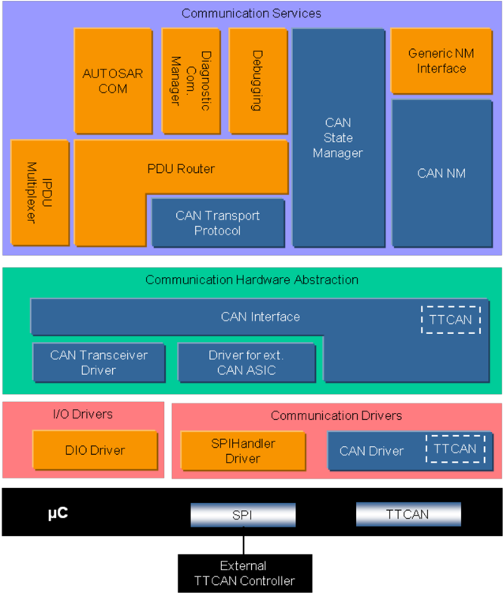
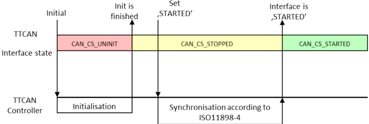
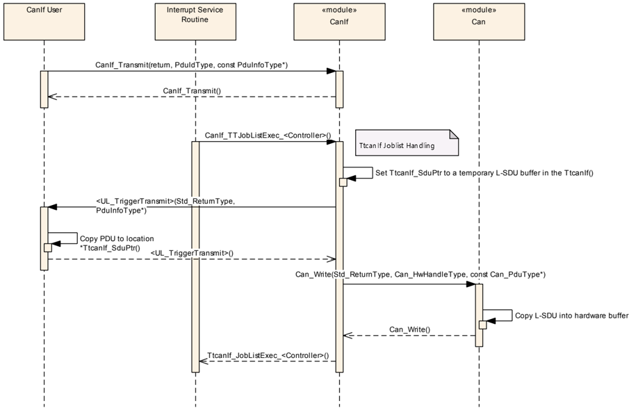
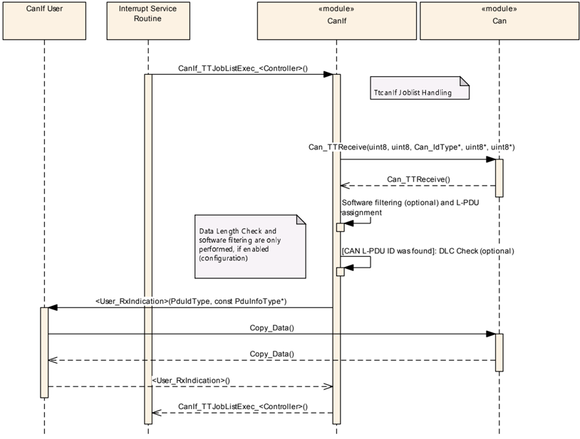
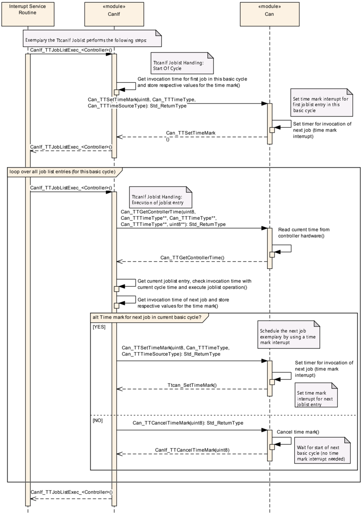
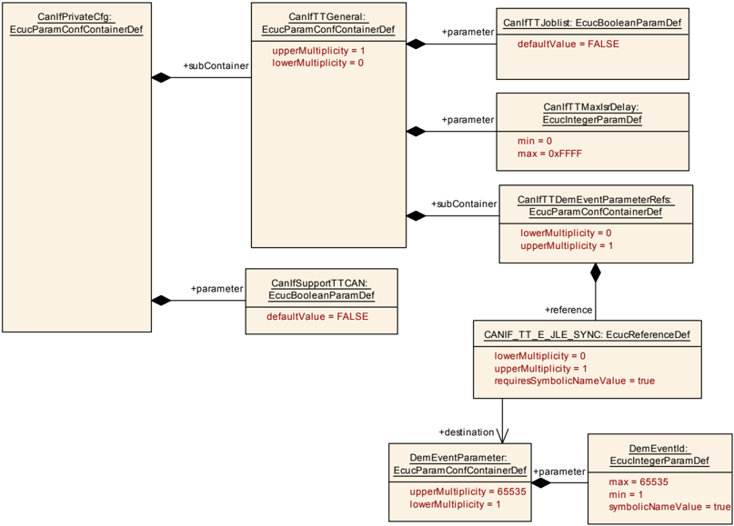
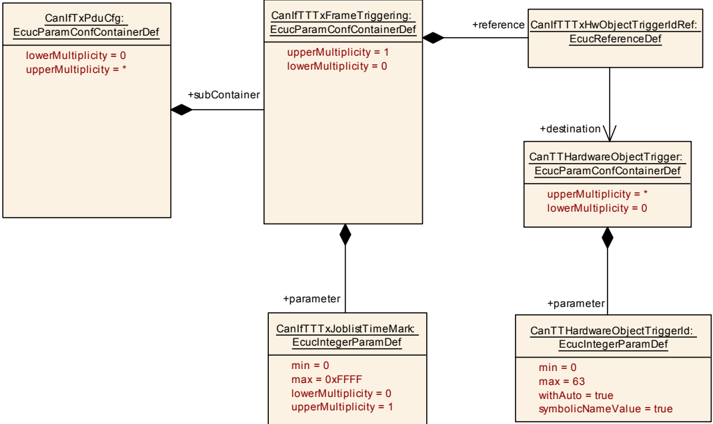
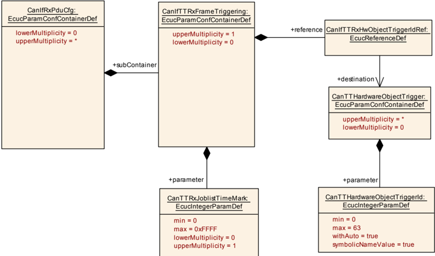

## 1. 简介和功能概述

本规范描述 AUTOSAR 基础软件模块 TTCAN 接口（本文档中称为"TtcanIf"）的功能、**API** 与配置。

本文档的基础是 [\[1, ISO 11898-4\]](#ref-1)。假定读者已熟悉该规范。本文档不会再描述 **TTCAN** 功能。

TtcanIf 位于通信硬件抽象中，位于通信服务层（即 **TTCAN** 状态管理器、**TTCAN** 网络管理、**TTCAN** 传输协议、**PDU** 路由器）之下。它为上层通信层表示 **TTCAN** 驱动程序服务的接口。

TtcanIf 是 [\[2, CAN 接口模块（CanIf）\]](#ref-2) 的扩展，因此本文档只应提供与 **CanIf** 不同的信息与规范。

图 1.1：AUTOSAR TTCAN 分层模型（参见 [\[3\]](#ref-3)）（**AUTOSAR TTCAN Layer Model (see [\[3\]](#ref-3))**）



被配置为排他时间窗口（**Exclusive Time Windows**）的消息将以此消息所配置的每个 Tx\_Trigger 周期性地传输（连续传输，**Continuous Transmission**）。

被配置为仲裁时间窗口（**Arbitrating Time Windows**）的消息将仅在每次发送请求（**Transmit Request**）时传输一次（单次发送，**Single Shot**）。

TtcanIf 由属于相应 **ECU** 的 **TTCAN** 通信设备驱动程序的所有 **TTCAN** 硬件无关任务组成。该功能在 TtcanIf 中实现一次，使底层的 **TTCAN** 设备驱动程序只专注于访问与控制相应的特定 **TTCAN** 硬件器件。

TtcanIf 满足 **PDU** 路由器与 AUTOSAR **COM** 栈的上层通信模块的主要控制流与数据流需求：发送请求处理、发送确认/接收指示/错误通知，以及 **TTCAN** 控制器的启动/停止（从而唤醒/参与网络）。其数据处理与通知 **API** 基于 **CAN L-PDU**，而用于控制与模式处理的 **API** 提供与 **TTCAN** 控制器相关的视图。

在发送请求的情况下，TtcanIf 用相应的参数完成 **L-PDU** 传输，并经由相应的 **TTCAN** 驱动程序将 **CAN L-PDU** 中继给 **TTCAN** 控制器。在接收时，TtcanIf 将接收到的 **L-PDU** 分发给上层。接收 **L-PDU** 与上层之间的分配是静态配置的。在发送确认时，TtcanIf 负责就成功的传输向上层发出通知。

TtcanIf 提供对 **TTCAN** 网络的控制与监管的底层服务的 **TTCAN** 通信抽象访问。TtcanIf 将来自 **CAN** 状态管理器的状态更改请求向下转发给底层 **TTCAN** 设备驱动程序，并向上将底层事件经由 TtcanIf 转发给例如相应的 **NM** 模块。

## 2. 缩略语

下表收录与 TtcanIf 相关、且未包含在 [\[4, AUTOSAR glossary\]](#ref-4) 中的缩略语与缩写。

**at system configuration time**
> 系统配置时：存储在 TtcanIf 中的静态配置参数；可以在 TtcanIf 代码编译之后定义，但必须在 TtcanIf 代码首次执行之前定义。

**Arbitrating Time Window**
> 参见 [\[1, ISO 11898-4\]](#ref-1)。

**Basic Cycle**
> 参见 [\[1, ISO 11898-4\]](#ref-1)。

**BSW**
> 基础软件（**Basic Software**）。

**CanIf**
> **CAN** 接口（**CAN Interface**）。

**Communication Job**
> **TTCAN** 通信作业定义特定的通信操作与所分配的执行时间。

**Continuous Transmission**
> 与单次发送相反，即使没有新的发送请求，消息也将被周期性地传输。

**Controller**
> （**TTCAN**）控制器是 **CPU** 片上或外部的独立硬件器件。一个控制器连接到一个物理通道。

**Cycle Time**
> 参见 [\[1, ISO 11898-4\]](#ref-1)。

**Dem**
> 诊断事件管理器（**Diagnostic Event Manager**）。

**DLC**
> 数据长度码（**Data Length Code**）（**L-PDU** 中描述 **SDU** 长度的部分）。

**DLL**
> 数据链路层（**Data Link Layer**）。

**EcuM**
> **ECU** 管理器（**ECU Manager**）。

**Exclusive Time Window**
> 参见 [\[1, ISO 11898-4\]](#ref-1)。

**Gap**
> 参见 [\[1, ISO 11898-4\]](#ref-1)。

**Global Time**
> 参见 [\[1, ISO 11898-4\]](#ref-1)。

**Hardware Object**
> **CAN** 硬件对象定义为 **CAN** 硬件单元/**CAN** 控制器的 **CAN RAM** 内的一个 **PDU** 缓冲区。

**ISR**
> 中断服务例程（**Interrupt Service Routine**）。

**JLEF**
> （**TTCAN**）作业列表执行函数（**Job List Execution Function**）。

**Job List**
> **TTCAN** 作业列表是按各自执行开始时间排序的（可能不同的）通信作业的列表。

**L-PDU**
> 数据链路层（**DLL**）的协议数据单元（**Protocol Data Unit**）。

**Local Time**
> 参见 [\[1, ISO 11898-4\]](#ref-1)。

**Matrix Cycle**
> 参见 [\[1, ISO 11898-4\]](#ref-1)。

**MCAL**
> 微控制器抽象层（**Microcontroller Abstraction Layer**）。

**NTU**
> 参见 [\[1, ISO 11898-4\]](#ref-1)。

**OS**
> （AUTOSAR）操作系统（**Operating System**）。

**PduR**
> **PDU** 路由器（**PDU Router**）。

**Reference Message**
> 参见 [\[1, ISO 11898-4\]](#ref-1)。

**SDU**
> 服务数据单元（**Service Data Unit**）。

**Single Shot**
> 与连续传输相反，消息将仅被传输一次。

**System Matrix**
> 参见 [\[1, ISO 11898-4\]](#ref-1)。

**Time Gap**
> 参见 [\[1, ISO 11898-4\]](#ref-1)。

**Time Master**
> 参见 [\[1, ISO 11898-4\]](#ref-1)。

**Time Window**
> 参见 [\[1, ISO 11898-4\]](#ref-1)。

**Transmission Column**
> 参见 [\[1, ISO 11898-4\]](#ref-1)。

**TtcanDrv**
> 启用了 **TTCAN** 功能的 **CAN** 驱动程序模块。

**TtcanIf**
> 启用了 **TTCAN** 功能的 **CAN** 接口模块。

**CanNm**
> **CAN** 网络管理（**CAN Network Management**）。

**CanSM**
> **CAN** 状态管理器（**CAN State Manager**）。

**CanTp**
> **CAN** 传输协议（**CAN Transport Protocol**）。

**TX**
> 传输或发送（**Transmission or transmit**）。

**Tx_Trigger**
> 参见 [\[1, ISO 11898-4\]](#ref-1)。

**UL**
> 上层（**Upper layer**）。

## 3. 相关文档

所引用的 CAN 接口文档 [\[2\]](#ref-2) 的所有文档对本文档同样有效。

### 3.1. 输入文件和相关标准与规范

<a id="ref-1"></a>- [1] ISO 11898-4:2004 - Road vehicles - Controller area network (CAN) - Part 4:Time-triggered communication
<a id="ref-2"></a>- [2] CAN 接口规范 AUTOSAR\_CP\_SWS\_CANInterface
<a id="ref-3"></a>- [3] 分层软件架构 AUTOSAR\_CP\_EXP\_LayeredSoftwareArchitecture
<a id="ref-4"></a>- [4] 术语表 AUTOSAR\_FO\_TR\_Glossary
<a id="ref-5"></a>- [5] 基础软件模块通用规范 AUTOSAR\_CP\_SWS\_BSWGeneral

### 3.2. 相关规范

AUTOSAR 提供了一份基础软件模块通用规范 [\[5, SWS BSW General\]](#ref-5)，它同样适用于 **TTCAN** 接口。

因此，规范 **SWS BSW General** 应被视为 TtcanIf 的附加且必需的规范。

## 4. 约束和假设

TtcanIf 的约束和假设与 **CanIf** [\[2\]](#ref-2) 的相同。

## 5. 对其他模块的依赖

### 5.1. 附加的 TTCAN 特有的对其他模块的依赖

本节描述 AUTOSAR 基础软件架构内与其他模块的关系。它包含 TtcanIf 从其他模块额外需要的配置信息与服务的简要描述。所引用的 **CanIf** [\[2\]](#ref-2) 中描述的依赖关系同样适用于 TtcanIf。

#### 5.1.1. AUTOSAR 操作系统

可以为每个 **TTCAN** 控制器使用专用的作业列表执行函数（**JLEF**）。

可选的 **JLEF** 是在任务概念中运行还是在 **ISR** 中运行是实现相关的。请参阅第 [6.4](#64-ttcan-作业列表执行函数) 节。

#### 5.1.2. AUTOSAR PDU 路由器

除了 [\[2\]](#ref-2) 中描述的经由 **CanIf** 的数据访问之外，TtcanIf 可以同步于 **TTCAN** 本地时间（**Local Time**）调用 **JLEF**。这应确保发送数据的请求同步于 **TTCAN** 本地时间发生。在 **JLEF** 内，TtcanIf 调用 **PduR** 的回调函数 &lt;UL\_TriggerTransmit&gt; 以开始 **PDU** 数据的复制操作。此外，**JLEF** 可用于同步于 **TTCAN** 本地时间读出接收到的数据。

#### 5.1.3. 上层协议层

在 AUTOSAR **BSW** 架构内，TtcanIf 的上层（**UL**）由 **PduR**、**CanNm**、**CanTp**、**CanSM** 与 **EcuM** 表示。

如果相应的上层 **BSW** 模块不同步于 **TTCAN** 本地时间运行，则相对于该 **BSW** 模块的代码执行，所有发生都是异步的。

#### 5.1.4. TTCAN 驱动程序

TtcanIf 提供由 TtcanDrv 使用的附加通知服务（参阅第 [7.6](#76-回调通知) 节）。

## 6. 功能规格

### 6.1. 一般功能

时间触发的 **CAN** 是 **CAN** 协议本身之上的更高层协议层，在时间触发式通信中 **CAN** 协议本身保持不变。

本功能规范只提供在 **CAN** 栈之外、用于实现时间触发 **CAN**（**TTCAN**）模式的规范。尽管如此，实现无论如何都应提供标准 **CAN** 模式。

### 6.2. TTCAN 接口状态机

TtcanIf 使用与 **CanIf** 相同的状态。

图 7.1：TTCAN 的示例性启动（**Exemplary Startup of TTCAN**）



### 6.3. TTCAN 作业列表

**TTCAN** 作业列表是按各自执行开始时间排序的通信作业（**Communication Job**）列表。

如果需要同步的到控制器的复制操作，和/或应实现控制器的同步读出（可选特性），则应使用 **TTCAN** 作业列表。否则可以使用不带作业列表的正常 **CAN** 过程。

到 **TTCAN** 控制器的复制操作/从 **TTCAN** 控制器读出的复制操作应在作业列表内调度。

对于由 TtcanIf 控制的每个控制器，应使用一个专用的作业列表与一个专用的 **JLEF**。可以混合使用两种变体，即使用与不使用作业列表。

上述需求的注意：参见第 [6.4](#64-ttcan-作业列表执行函数) 节"TTCAN 作业列表执行函数"。

### 6.4. TTCAN 作业列表执行函数

如果使用作业列表，**TTCAN** 作业列表执行函数（**JLEF**）应同步于控制器时间（即在明确定义的时间点）执行作业列表的通信作业。

**JLEF** 的执行是实现相关的。

**JLEF** 的 **API** 名称应遵循以下模式：

* 针对控制器 # 0 的 CanIf\_TTJobListExec\_0()
* 针对控制器 # 1 的 CanIf\_TTJobListExec\_1()
* 针对控制器 # 2 的 CanIf\_TTJobListExec\_2()
* 针对控制器 # 3 的 CanIf\_TTJobListExec\_3()
* ……以此类推，如果支持多于 4 个控制器。

如果 **JLEF** 失去了与 **TTCAN** 控制器本地时间的同步，则应调用函数 Dem\_SetEventStatus（CANIF\_TT\_E\_JLE\_SYNC，DEM\_EVENT\_STATUS\_FAILED）。

如果 **JLEF** 执行成功，则应调用函数 Dem\_SetEventStatus（CANIF\_TT\_E\_JLE\_SYNC，DEM\_EVENT\_STATUS\_PASSED）。

作为示例，**JLEF** 执行以下步骤：

1. 通过调用 Can\_TTGetControllerTime() 获取控制器的周期时间。
   * 如果无法获取周期时间：
     1. 调用 Dem\_SetEventStatus（CANIF\_TT\_E\_JLE\_SYNC，DEM\_EVENT\_STATUS\_FAILED）
     2. 终止 **JLEF** 的执行。
   * 否则，**JLEF** 继续执行步骤 2。
2. 检查 **JLEF** 是否因新基本周期开始而被调用。
   * 如果为 false，继续执行步骤 3。
   * 否则，检查下一个作业是否被调度在该基本周期内。
     * 如果为 **TRUE**，将中断定时器设置为下一个作业的开始时间，以便再次调用 **JLEF**，并终止 **JLEF** 的执行。
     * 否则终止 **JLEF** 的执行。
3. 如果与作业开始时间相比的周期时间延迟大于最大延迟（配置参数 CanIfTTMaxIsrDelay），则作业列表的执行被视为与本地时间异步，因此执行以下操作：
   1. 调用 Dem\_SetEventStatus（CANIF\_TT\_E\_JLE\_SYNC，DEM\_EVENT\_STATUS\_FAILED）
   2. 增加一些"安全余量"（即考虑抖动的时间跨度）
   3. 在作业列表中搜索后续作业，即调用时间大于当前本地时间 + 安全余量的作业。
   4. 搜索对当前基本周期有效的下一个作业列表条目。如果到达作业列表的末尾，则回绕到下一个基本周期并继续为该基本周期搜索。
   5. 如果下一个作业被调度在该基本周期内：
      * 调度下一个作业，例如通过使用时间标记中断
      * 否则禁用定时器中断
   6. 终止 **JLEF** 的执行。

   否则，**JLEF** 继续执行步骤 4。
4. 获取由当前作业指针指向的当前作业的已排序通信操作列表，并按所配置的顺序执行获取到的通信操作。
5. 搜索对当前基本周期有效的下一个作业列表条目。如果到达作业列表的末尾，则回绕到下一个基本周期并继续为该基本周期搜索。
6. 如果下一个作业被调度在该基本周期内，则将中断定时器设置为该作业的开始时间；否则禁用定时器中断。
7. 调用 Dem\_SetEventStatus（CANIF\_TT\_E\_JLE\_SYNC，DEM\_EVENT\_STATUS\_PASSED）。
8. 终止 **JLEF** 的执行。

### 6.5. 经由 TTCAN 的数据通信

**TTCAN** 是确定性的时间驱动通信系统。应发送或接收的每个数据都必须在系统配置时进行调度。

有关同步、发送触发、接收触发、初始化与故障处理的详细描述，请参阅 [\[1, ISO 11898-4\]](#ref-1)。

附加的 **TTCAN** 特有需求：

如果为某个 Tx **L-PDU** 配置了作业列表（参见 CanIfTTJoblist），则调用 CanIf\_Transmit()（参见 SWS\_CANIF\_00318）不应直接调用 Can\_Write()。CanIf\_Transmit() 调用已发生的信息必须在 TtcanIf 内缓冲，直到数据由作业列表发送。

**注意：** 缓冲上述信息的具体方式是实现相关的。

上述需求的基本原理：需要为以 **BasicCAN** 模式发送的硬件对象配置作业列表，其中一个硬件对象可用于服务 **TTCAN** 系统矩阵中的不同时隙。在这种情况下，作业列表必须确保正确的消息在正确的时刻存在于硬件对象中。紧随 CanIf\_Transmit() 之后的 Can\_Write() 调用可能违反这一点。

### 6.6. TTCAN 控制器模式

本章对应 [\[2, CAN 接口 SWS\]](#ref-2) 的"CAN 控制器模式"（CAN Controller mode）一章。

如果某个 CanIf 控制器模式状态机处于状态 **CAN\_CS\_STARTED**、**CAN\_CS\_STOPPED** 或 **CAN\_CS\_SLEEP** 中，当函数 CanIf\_TTSevereError() 被调用时，则 **CanIf** 应为分配给 CanIf\_TTSevereError() 的参数 Controller 的 **CAN** 网络调用函数 CanSM\_ControllerBusOff()。

如果某个 CanIf 控制器模式状态机处于状态 **CAN\_CS\_STARTED** 中、当以引用该 CanIf 控制器模式状态机的参数 ControllerId 调用函数 CanIf\_TTSevereError（ControllerId，CanIf\_TTSevereError）时，则 **CanIf** 应调用 Can\_SetControllerMode（Controller，CAN\_CS\_STOPPED），并且 **CanIf** 应调用 **CanSM** 的 CanSM\_ControllerBusOff（ControllerId）。

这些 **API** 被映射到 **CanSM** 的 BusOff **API**，因为它们指示 **TTCAN** 控制器的严重错误。这种错误的处理与恢复等同于 BusOff。

### 6.7. 错误分类

#### 6.7.1. 开发错误

不存在开发错误。

#### 6.7.2. 运行时错误

不存在运行时错误。

#### 6.7.3. 瞬态故障

不存在瞬态故障。

#### 6.7.4. 生产错误

不存在生产错误。

#### 6.7.5. 扩展生产错误

表7.1：扩展生产错误的定义（**Definition of Extended Production Errors**）

| 错误名称 | CANIF\_TT\_E\_JLE\_SYNC |
| --- | --- |
| 简要描述 | 失去同步 |
| 详细描述 | 作业列表执行函数失去了与 **TTCAN** 本地时间的同步。 |
| 检测准则 | Fail：如果 **JLEF** 失去了与 **TTCAN** 控制器本地时间的同步（参见 SWS\_TtCanIf\_00007），例如：* 如果无法获取周期时间 * 如果与作业开始时间相比的周期时间延迟大于最大延迟。Pass：**JLEF** 在执行期间未失去同步 |
| 次要参数 | - |
| 所需时间 | 取决于原因（例如 CanIfTTMaxIsrDelay） |
| 监控频率 | 连续（参见 SWS\_TtCanIf\_00007） |

## 7. API规范

在以下各节中，描述 **TTCAN** 特有的 **API** 与类型。

### 7.1. 导入的类型

附加的 **TTCAN** 特有导入类型。

表7.2：CanIf 模块导入数据类型的定义

| 模块 | 头文件 | 导入的类型 |
| --- | --- | --- |
| Can | Can\_GeneralTypes.h | Can\_IdType |
| Can | Ttcan.h | Can\_TTErrorLevelEnumType |
| Can | Ttcan.h | Can\_TTErrorLevelType |
| Can | Ttcan.h | Can\_TTMasterSlaveModeType |
| Can | Ttcan.h | Can\_TTMasterStateType |
| Can | Ttcan.h | Can\_TTSyncModeEnumType |
| Can | Ttcan.h | Can\_TTTURType |
| Can | Ttcan.h | Can\_TTTimeSourceType |
| Can | Ttcan.h | Can\_TTTimeType |
| Dem | Rte\_Dem\_Type.h | Dem\_EventIdType |
| Dem | Rte\_Dem\_Type.h | Dem\_EventStatusType |
| Std | Std\_Types.h | Std\_ReturnType |

**注意：** ComStack\_Types 缺少 PduIdType。

### 7.2. 类型定义

附加的 **TTCAN** 特有类型定义。

#### 7.2.1. CanIf_TTTimeType

| 名称 | CanIf_TTTimeType |
| --- | --- |
| 类别 | Type |
| 派生自 | uint16 |
| 描述 | 表示 **TTCAN** 时间值（例如周期、本地或全局时间）的 16 位值。 |
| 可通过 | TtcanIf.h 获得 |

#### 7.2.2. CanIf_TTMasterSlaveModeType

| 名称 | CanIf_TTMasterSlaveModeType | | |
| --- | --- | --- | --- |
| 类别 | 枚举 | | |
| 取值 | CANIF_TT_BACKUP_MASTER | - | 主从模式：备份主节点 |
| | CANIF_TT_CURRENT_MASTER | - | 主从模式：当前主节点 |
| | CANIF_TT_MASTER_OFF | - | 主从模式：主节点关闭 |
| | CANIF_TT_SLAVE | - | 主从模式：从节点 |
| 描述 | 主从模式（Master-Slave Mode）。 | | |
| 可通过 | TtcanIf.h 获得 | | |

#### 7.2.3. CanIf_TTSyncModeEnumType

| 名称 | CanIf_TTSyncModeEnumType | | |
| --- | --- | --- | --- |
| 类别 | 枚举 | | |
| 取值 | CANIF_TT_IN_GAP | - | 同步模式：In_Gap |
| | CANIF_TT_IN_SCHEDULE | - | 同步模式：In_Schedule |
| | CANIF_TT_SYNC_OFF | - | 同步模式：Sync_Off |
| | CANIF_TT_SYNCHRONIZING | - | 同步模式：Synchronizing |
| 描述 | 同步模式（Sync mode）。 | | |
| 可通过 | TtcanIf.h 获得 | | |

#### 7.2.4. CanIf_TTMasterStateType

| 名称 | CanIf_TTMasterStateType |
| --- | --- |
| 类别 | 结构体（Structure） |
| 元素 | masterSlaveMode：类型 [CanIf_TTMasterSlaveModeType](#722-canif_ttmasterslavemodetype)，注释 - |
| 元素 | refTriggerOffset：类型 uint8，注释 ref trigger offset 的当前值 |
| 元素 | syncMode：类型 [CanIf_TTSyncModeEnumType](#723-canif_ttsyncmodeenumtype)，注释 - |
| 描述 | 包含同步模式、主从模式与当前 ref trigger offset 的主节点状态类型。 |
| 可通过 | TtcanIf.h 获得 |

#### 7.2.5. CanIf_TTErrorLevelEnumType

| 名称 | CanIf_TTErrorLevelEnumType | | |
| --- | --- | --- | --- |
| 类别 | 枚举 | | |
| 取值 | CANIF_TT_ERROR_S0 | - | 错误级别 S0：无错误 |
| | CANIF_TT_ERROR_S1 | - | 错误级别 S1：警告 |
| | CANIF_TT_ERROR_S2 | - | 错误级别 S2：错误 |
| | CANIF_TT_ERROR_S3 | - | 错误级别 S3：致命错误 |
| 描述 | 错误级别（S0-S3）。 | | |
| 可通过 | TtcanIf.h 获得 | | |

#### 7.2.6. CanIf_TTErrorLevelType

| 名称 | CanIf_TTErrorLevelType |
| --- | --- |
| 类别 | 结构体（Structure） |
| 元素 | errorLevel：类型 [CanIf_TTErrorLevelEnumType](#725-canif_tterrorlevelenumtype)，注释 错误级别（S0-S3） |
| 元素 | maxMessageStatusCount：类型 uint8，注释 消息状态计数的最大值（0-7） |
| 元素 | minMessageStatusCount：类型 uint8，注释 消息状态计数的最小值（0-7） |
| 描述 | 包含消息状态计数最小值与最大值的 **TTCAN** 错误级别。 |
| 可通过 | TtcanIf.h 获得 |

#### 7.2.7. CanIf_TTSevereErrorEnumType

| 名称 | CanIf_TTSevereErrorEnumType | | |
| --- | --- | --- | --- |
| 类别 | 枚举 | | |
| 取值 | CANIF_TT_CONFIG_ERROR | - | 事件：参见 ISO11898-4 |
| | CANIF_TT_WATCH_TRIGGER_REACHED | - | 事件：达到 Watch 触发 |
| | CANIF_TT_APPL_WATCHDOG | - | 事件：参见 ISO 11898-4 |
| 描述 | 引起严重错误的事件。 | | |
| 可通过 | TtcanIf.h 获得 | | |

#### 7.2.8. CanIf_TTTimeSourceType

| 名称 | CanIf_TTTimeSourceType | | |
| --- | --- | --- | --- |
| 类别 | 枚举 | | |
| 取值 | CANIF_TT_CYCLE_TIME | - | 时间源：周期时间 |
| | CANIF_TT_GLOBAL_TIME | - | 时间源：全局时间 |
| | CANIF_TT_LOCAL_TIME | - | 时间源：本地时间 |
| | CANIF_TT_UNDEFINED | - | 时间源：未定义 |
| 描述 | **TTCAN** 中时间值的时间源。 | | |
| 可通过 | TtcanIf.h 获得 | | |

#### 7.2.9. CanIf_TTEventEnumType

| 名称 | CanIf_TTEventEnumType | | |
| --- | --- | --- | --- |
| 类别 | 枚举 | | |
| 取值 | CANIF_TT_ERROR_LEVEL_CHANGED | - | 事件：错误级别已改变 |
| | CANIF_TT_INIT_WATCH_TRIGGER | - | 事件：达到初始化 Watch 触发 |
| | CANIF_TT_NO_ERROR | - | 无错误 |
| | CANIF_TT_SYNC_FAILED | - | 事件：同步失败 |
| | CANIF_TT_TX_OVERFLOW | - | 事件：Tx 溢出 |
| | CANIF_TT_TX_UNDERFLOW | - | 事件：Tx 下溢 |
| 描述 | 引起定时/错误 **IRQ** 的事件。 | | |
| 可通过 | TtcanIf.h 获得 | | |

#### 7.2.10. CanIf_TTTimingErrorIRQType

| 名称 | CanIf_TTTimingErrorIRQType |
| --- | --- |
| 类别 | 结构体（Structure） |
| 元素 | errorLevel：类型 [CanIf_TTErrorLevelType](#726-canif_tterrorleveltype)，注释 当前错误级别 |
| 元素 | event：类型 [CanIf_TTEventEnumType](#729-canif_tteventenumtype)，注释 引起该 **IRQ** 的事件 |
| 描述 | 组合 [CanIf_TTTimingError](#762-canif_tttimingerror) 报告的所有事件（事件指示与错误级别）。 |
| 可通过 | TtcanIf.h 获得 |

### 7.3. 函数定义

附加的 **TTCAN** 特有函数定义。

#### 7.3.1. CanIf_TTGetControllerTime

**说明**： 获取控制器的全局时间、本地时间、周期时间与周期计数的当前值。服务 ID 0x33。本服务为同步调用，不可重入。参数 ControllerId（in）：应从中获取时间信息的控制器；CanIf_TTGlobalTime（out）：存储返回值的地址：全局时间；CanIf_TTLocalTime（out）：存储返回值的地址：本地时间；CanIf_TTCycleTime（out）：存储返回值的地址：周期时间；CanIf_TTCycleCount（out）：存储返回值的地址：周期计数值。返回值：Std_ReturnType，**E_OK**：函数成功；**E_NOT_OK**：发生开发错误。可通过 **TtcanIf.h** 获得。

```C
Std_ReturnType CanIf_TTGetControllerTime ( uint8 ControllerId, CanIf_TTTimeType* CanIf_TTGlobalTime, CanIf_TTTimeType* CanIf_TTLocalTime, CanIf_TTTimeType* CanIf_TTCycleTime, uint8* CanIf_TTCycleCount )
```

函数 CanIf_TTGetControllerTime() 应调用 Can\_TTGetControllerTime（Controller，Can\_TTGlobalTime，CanTTLocalTime，Can\_TTCycleTime，Can\_TTCycleCount）。

如果 CanIf_TTGetControllerTime() 的参数 Controller 具有无效值、且开发错误检测已启用（即 CANIF\_DEV\_ERROR\_DETECT 等于 **ON**），则函数 CanIf_TTGetControllerTime() 应向 **DET** 模块的 Det\_ReportError 服务报告开发错误码 CANIF\_E\_PARAM\_CONTROLLER。

CanIf_TTGetControllerTime() 的注意事项：在可以调用该 **API** 服务之前，必须先初始化 TtcanIf。

如果为 TtcanIf 启用了开发错误检测：如果参数 CanIf_TTCycleCount、CanIf_TTGlobalTime、CanIf_TTLocalTime 与 CanIf_TTCycleTime 之一是 **NULL** 指针，函数 CanIf_TTGetControllerTime() 应引发错误 CANIF\_E\_PARAM\_POINTER 并返回 **E_NOT_OK**。

#### 7.3.2. CanIf_TTGetMasterState

**说明**： 获取主节点状态。主节点状态包括同步模式（sync\_off、synchronizing、in\_gap、in\_schedule）、主从模式（master\_off、slave、backup\_master、current\_master）与 ref trigger offset 的当前值。服务 ID 0x34。本服务为同步调用，不可重入。参数 ControllerId（in）：分配给一个 **CAN** 控制器的抽象 CanIf ControllerId；CanIf_TTMasterState（out）：存储返回值的地址：主节点状态。返回值：Std_ReturnType，**E_OK**：函数成功；**E_NOT_OK**：发生开发错误。可通过 **TtcanIf.h** 获得。

```C
Std_ReturnType CanIf_TTGetMasterState ( uint8 ControllerId, CanIf_TTMasterStateType* CanIf_TTMasterState )
```

函数 CanIf_TTGetMasterState() 应调用 Can\_TTGetMasterState（Controller，Can\_TTMasterState）。

如果 CanIf_TTGetMasterState() 的参数 Controller 具有无效值、且开发错误检测已启用（即 CANIF\_DEV\_ERROR\_DETECT 等于 **ON**），则函数 CanIf_TTGetMasterState() 应向 **DET** 模块的 Det\_ReportError 服务报告开发错误码 CANIF\_E\_PARAM\_CONTROLLER。

CanIf_TTGetMasterState() 的注意事项：在可以调用该 **API** 服务之前，必须先初始化 TtcanIf。

如果为 TtcanIf 启用了开发错误检测：如果参数 CanIf_TTMasterState 是 **NULL** 指针，函数 CanIf_TTGetMasterState() 应引发错误 CAN\_E\_PARAM\_POINTER 并返回 **E_NOT_OK**。

#### 7.3.3. CanIf_TTGetNTUActual

**说明**： 获取 NTU（网络时间单元）的实际值。结合本地振荡器周期，可以从 TUR 的实际值推导出 NTU 的实际值。服务 ID 0x35。本服务为同步调用，不可重入。参数 ControllerId（in）：分配给一个 **CAN** 控制器的抽象 CanIf ControllerId；CanIf_TTNTUAct（out）：存储返回值的地址：NTU 的实际值。该值以微秒为单位给出。返回值：Std_ReturnType，**E_OK**：函数成功；**E_NOT_OK**：发生开发错误。可通过 **TtcanIf.h** 获得。

```C
Std_ReturnType CanIf_TTGetNTUActual ( uint8 ControllerId, float32 CanIf_TTNTUAct )
```

函数 CanIf_TTGetNTUActual() 应调用 Can\_TTGetNTUActual（Controller，Can\_TTTURAct）。

如果 CanIf_TTGetNTUActual() 的参数 Controller 具有无效值、且开发错误检测已启用（即 CANIF\_DEV\_ERROR\_DETECT 等于 **ON**），则函数 CanIf_TTGetNTUActual() 应向 **DET** 模块的 Det\_ReportError 服务报告开发错误码 CANIF\_E\_PARAM\_CONTROLLER。

CanIf_TTGetNTUActual() 的注意事项：在可以调用该 **API** 服务之前，必须先初始化 TtcanIf。

#### 7.3.4. CanIf_TTGetErrorLevel

**说明**： 获取错误级别。这包括错误级别的严重程度（S0-S3）以及消息状态计数的最小值与最大值。服务 ID 0x36。本服务为同步调用，不可重入。参数 ControllerId（in）：分配给应从中获取错误级别的 **CAN** 控制器的抽象 CanIf ControllerId；CanIf_TTErrorLevel（out）：存储返回值的地址：错误级别。返回值：Std_ReturnType，**E_OK**：函数成功；**E_NOT_OK**：发生开发错误。可通过 **TtcanIf.h** 获得。

```C
Std_ReturnType CanIf_TTGetErrorLevel ( uint8 ControllerId, CanIf_TTErrorLevelType* CanIf_TTErrorLevel )
```

函数 CanIf_TTGetErrorLevel() 应调用 Can\_TTGetErrorLevel（Controller，Can\_TTErrorLevel）。

如果 CanIf_TTGetErrorLevel() 的参数 Controller 具有无效值、且开发错误检测已启用（即 CANIF\_DEV\_ERROR\_DETECT 等于 **ON**），则函数 CanIf_TTGetErrorLevel() 应向 **DET** 模块的 Det\_ReportError 服务报告开发错误码 CANIF\_E\_PARAM\_CONTROLLER。

CanIf_TTGetErrorLevel() 的注意事项：在可以调用该 **API** 服务之前，必须先初始化 TtcanIf。

如果为 TtcanIf 启用了开发错误检测：如果参数 CanIf_TTErrorLevel 是 **NULL** 指针，函数 CanIf_TTGetErrorLevel() 应引发错误 CAN\_E\_PARAM\_POINTER 并返回 **E_NOT_OK**。

#### 7.3.5. CanIf_TTSetNextIsGap

**说明**： 置位 "Next\_is\_Gap" 位。服务 ID 0x37。本服务为同步调用，不可重入。参数 ControllerId（in）：分配给一个 **CAN** 控制器的抽象 CanIf ControllerId。返回值：Std_ReturnType，**E_OK**：函数成功；**E_NOT_OK**：发生开发错误。可通过 **TtcanIf.h** 获得。

```C
Std_ReturnType CanIf_TTSetNextIsGap ( uint8 ControllerId )
```

函数 CanIf_TTSetNextIsGap() 应调用 Can\_TTSetNextIsGap（Controller）。

如果 CanIf_TTSetNextIsGap() 的参数 Controller 具有无效值、且开发错误检测已启用（即 CANIF\_DEV\_ERROR\_DETECT 等于 **ON**），则函数 CanIf_TTSetNextIsGap() 应向 **DET** 模块的 Det\_ReportError 服务报告开发错误码 CANIF\_E\_PARAM\_CONTROLLER。

CanIf_TTSetNextIsGap() 的注意事项：在可以调用该 **API** 服务之前，必须先初始化 TtcanIf。

#### 7.3.6. CanIf_TTSetEndOfGap

**说明**： 指示间隙的结束。服务 ID 0x38。本服务为同步调用，不可重入。参数 ControllerId（in）：分配给一个 **CAN** 控制器的抽象 CanIf ControllerId。返回值：Std_ReturnType，**E_OK**：函数成功；**E_NOT_OK**：发生开发错误。可通过 **TtcanIf.h** 获得。

```C
Std_ReturnType CanIf_TTSetEndOfGap ( uint8 ControllerId )
```

函数 CanIf_TTSetEndOfGap() 应调用 Can\_TTSetNextIsGap（Controller）。

如果 CanIf_TTSetEndOfGap() 的参数 Controller 具有无效值、且开发错误检测已启用（即 CANIF\_DEV\_ERROR\_DETECT 等于 **ON**），则函数 CanIf_TTSetEndOfGap() 应向 **DET** 模块的 Det\_ReportError 服务报告开发错误码 CANIF\_E\_PARAM\_CONTROLLER。

CanIf_TTSetEndOfGap() 的注意事项：在可以调用该 **API** 服务之前，必须先初始化 TtcanIf。

#### 7.3.7. CanIf_TTSetTimeCommand

**说明**： 在下一个基本周期开始时按"全局时间预设"（global time preset）的量调整全局时间。服务 ID 0x39。本服务为同步调用，不可重入。参数 ControllerId（in）：分配给一个 **CAN** 控制器的抽象 CanIf ControllerId。返回值：Std_ReturnType，**E_OK**：函数成功；**E_NOT_OK**：发生开发错误。可通过 **TtcanIf.h** 获得。

```C
Std_ReturnType CanIf_TTSetTimeCommand ( uint8 ControllerId )
```

函数 CanIf_TTSetTimeCommand() 应调用 Can\_TTSetTimeCommand（Controller）。

如果 CanIf_TTSetTimeCommand() 的参数 Controller 具有无效值、且开发错误检测已启用（即 CANIF\_DEV\_ERROR\_DETECT 等于 **ON**），则函数 CanIf_TTSetTimeCommand() 应向 **DET** 模块的 Det\_ReportError 服务报告开发错误码 CANIF\_E\_PARAM\_CONTROLLER。

CanIf_TTSetTimeCommand() 的注意事项：在可以调用该 **API** 服务之前，必须先初始化 TtcanIf。

#### 7.3.8. CanIf_TTGlobalTimePreset

**说明**： 设置 "global time preset" 的值。服务 ID 0x3a。本服务为同步调用，不可重入。参数 ControllerId（in）：分配给一个 **CAN** 控制器的抽象 CanIf ControllerId；CanIf_TTGlobalTimePreset（in）："全局时间预设"的新值。返回值：Std_ReturnType，**E_OK**：函数成功；**E_NOT_OK**：发生开发错误。可通过 **TtcanIf.h** 获得。

```C
Std_ReturnType CanIf_TTGlobalTimePreset ( uint8 ControllerId, CanIf_TTTimeType CanIf_TTGlobalTimePreset )
```

函数 CanIf_TTGlobalTimePreset() 应调用 Can\_TTGlobalTimePreset（Controller，Can\_TTGlobalTimePreset）。

如果 CanIf_TTGlobalTimePreset() 的参数 Controller 具有无效值、且开发错误检测已启用（即 CANIF\_DEV\_ERROR\_DETECT 等于 **ON**），则函数 CanIf_TTGlobalTimePreset() 应向 **DET** 模块的 Det\_ReportError 服务报告开发错误码 CANIF\_E\_PARAM\_CONTROLLER。

CanIf_TTGlobalTimePreset() 的注意事项：在可以调用该 **API** 服务之前，必须先初始化 TtcanIf。

#### 7.3.9. CanIf_TTSetExtClockSyncCommand

**说明**： 根据 "NTU adjust" 给出的值调整 NTU（网络时间单元）。结合本地振荡器周期，可以从 "NTU adjust" 推导出 "TUR adjust"。服务 ID 0x3b。本服务为同步调用，不可重入。参数 ControllerId（in）：分配给一个 **CAN** 控制器的抽象 CanIf ControllerId。返回值：Std_ReturnType，**E_OK**：函数成功；**E_NOT_OK**：发生开发错误。可通过 **TtcanIf.h** 获得。

```C
Std_ReturnType CanIf_TTSetExtClockSyncCommand ( uint8 ControllerId )
```

函数 CanIf_TTSetExtClockSyncCommand() 应调用 Can\_TTSetExtClockSyncCommand（Controller）。

如果 CanIf_TTSetExtClockSyncCommand() 的参数 Controller 具有无效值、且开发错误检测已启用（即 CANIF\_DEV\_ERROR\_DETECT 等于 **ON**），则函数 CanIf_TTSetExtClockSyncCommand() 应向 **DET** 模块的 Det\_ReportError 服务报告开发错误码 CANIF\_E\_PARAM\_CONTROLLER。

CanIf_TTSetExtClockSyncCommand() 的注意事项：在可以调用该 **API** 服务之前，必须先初始化 TtcanIf。

#### 7.3.10. CanIf_TTSetNTUAdjust

**说明**： 设置 "NTU adjust" 的值。结合本地振荡器周期，可以从 "NTU adjust" 推导出 "TUR adjust"。服务 ID 0x3c。本服务为同步调用，不可重入。参数 ControllerId（in）：分配给一个 **CAN** 控制器的抽象 CanIf ControllerId；CanIf_TTNTUAdjust（in）：'NTU adjust' 的新值。该值以微秒为单位给出。返回值：Std_ReturnType，**E_OK**：函数成功；**E_NOT_OK**：发生开发错误。可通过 **TtcanIf.h** 获得。

```C
Std_ReturnType CanIf_TTSetNTUAdjust ( uint8 ControllerId, float32 CanIf_TTNTUAdjust )
```

函数 CanIf_TTSetNTUAdjust() 应调用 Can\_TTSetNTUAdjust（Controller，Can\_TTNTUAdjust）。

如果 CanIf_TTSetNTUAdjust() 的参数 Controller 具有无效值、且开发错误检测已启用（即 CANIF\_DEV\_ERROR\_DETECT 等于 **ON**），则函数 CanIf_TTSetNTUAdjust() 应向 **DET** 模块的 Det\_ReportError 服务报告开发错误码 CANIF\_E\_PARAM\_CONTROLLER。

CanIf_TTSetNTUAdjust() 的注意事项：在可以调用该 **API** 服务之前，必须先初始化 TtcanIf。

### 7.4. 可选函数定义

附加的可选 **TTCAN** 特有函数定义。

#### 7.4.1. CanIf_TTJobListExec_&lt;Controller&gt;

**说明**： 处理 **TTCAN** 控制器 &lt;Controller&gt; 的作业列表。服务 ID 0x50。本服务为同步调用，不可重入。无参数。无返回值。可通过 **TtcanIf.h** 获得。

```C
void CanIf_TTJobListExec_<Controller> ( void )
```

函数 CanIf_TTJobListExec_&lt;Controller&gt;() 应对每个使用作业列表的 **TTCAN** 控制器存在一次。

CanIf_TTJobListExec_&lt;Controller&gt;() 的每个实例的函数名应包含相应 **TTCAN** 控制器的索引。

CanIf_TTJobListExec_&lt;Controller&gt;() 的注意事项：在可以调用该 **API** 服务之前，必须先初始化 TtcanIf。

对于每个 **TTCAN** 控制器（由索引 Controller 标识），CanIf_TTJobListExec_&lt;Controller&gt;() 的执行既可以在常规 **OS** 任务中运行，也可以作为由 **TTCAN** 控制器触发的 **ISR** 在 AUTOSAR **OS** 中注册。

#### 7.4.2. CanIf_TTGetSyncQuality

**说明**： 获取同步质量。服务 ID 0x47。本服务为同步调用，不可重入。参数 ControllerId（in）：分配给一个 **CAN** 控制器的抽象 CanIf ControllerId；CanIf_TTClockSpeed（out）：存储返回值的地址：如果同步偏差小于"同步偏差限制"（Synchronization deviation limit）则为 true；CanIf_TTGlobalTimePhase（out）：存储返回值的地址：如果全局时间与时间主节点同相则为 true。返回值：Std_ReturnType，**E_OK**：函数成功；**E_NOT_OK**：发生开发错误。可通过 **TtcanIf.h** 获得。

```C
Std_ReturnType CanIf_TTGetSyncQuality ( uint8 ControllerId, boolean* CanIf_TTClockSpeed, boolean* CanIf_TTGlobalTimePhase )
```

函数 CanIf_TTGetSyncQuality() 应调用 Can\_TTGetSyncQuality（Controller，Can\_TTClockSpeed，Can\_TTGlobalTimePhase）。

如果 CanIf_TTGetSyncQuality() 的参数 Controller 具有无效值、且开发错误检测已启用（即 CANIF\_DEV\_ERROR\_DETECT 等于 **ON**），则函数 CanIf_TTGetSyncQuality() 应向 **DET** 模块的 Det\_ReportError 服务报告开发错误码 CANIF\_E\_PARAM\_CONTROLLER。

CanIf_TTGetSyncQuality() 的注意事项：在可以调用该 **API** 服务之前，必须先初始化 TtcanIf。

如果为 TtcanIf 启用了开发错误检测：如果参数 CanIf\_ClockSpeed 与 CanIf\_GlobalTimePhase 之一是 **NULL** 指针，函数 CanIf_TTGetSyncQuality() 应引发错误 CAN\_E\_PARAM\_POINTER 并返回 **E_NOT_OK**。

#### 7.4.3. CanIf_TTSetTimeMark

**说明**： 为给定的时间源设置时间标记的新值。服务 ID 0x48。本服务为同步调用，不可重入。参数 ControllerId（in）：分配给一个 **CAN** 控制器的抽象 CanIf ControllerId；CanIf_TTTimeMark（in）：给出要设置的时间标记的值；CanIf_TTTimeSource（in）：定义要设置的时间标记的时间源。返回值：Std_ReturnType，**E_OK**：函数成功；**E_NOT_OK**：发生开发错误。可通过 **TtcanIf.h** 获得。

```C
Std_ReturnType CanIf_TTSetTimeMark ( uint8 ControllerId, CanIf_TTTimeType CanIf_TTTimeMark, CanIf_TTTimeSourceType CanIf_TTTimeSource )
```

函数 CanIf_TTSetTimeMark() 应调用 Can\_TTSetTimeMark（Controller，Can\_TTTimeMark，Can\_TTTimeSource）。

如果 CanIf_TTSetTimeMark() 的参数 Controller 具有无效值、且开发错误检测已启用（即 CANIF\_DEV\_ERROR\_DETECT 等于 **ON**），则函数 CanIf_TTSetTimeMark() 应向 **DET** 模块的 Det\_ReportError 服务报告开发错误码 CANIF\_E\_PARAM\_CONTROLLER。

CanIf_TTSetTimeMark() 的注意事项：在可以调用该 **API** 服务之前，必须先初始化 TtcanIf。

#### 7.4.4. CanIf_TTCancelTimeMark

**说明**： 取消时间标记。服务 ID 0x49。本服务为同步调用，不可重入。参数 ControllerId（in）：分配给一个 **CAN** 控制器的抽象 CanIf ControllerId。返回值：Std_ReturnType，**E_OK**：函数成功；**E_NOT_OK**：发生开发错误。可通过 **TtcanIf.h** 获得。

```C
Std_ReturnType CanIf_TTCancelTimeMark ( uint8 ControllerId )
```

函数 CanIf_TTCancelTimeMark() 应调用 Can\_TTCancelTimeMark（Controller）。

如果 CanIf_TTCancelTimeMark() 的参数 Controller 具有无效值、且开发错误检测已启用（即 CANIF\_DEV\_ERROR\_DETECT 等于 **ON**），则函数 CanIf_TTCancelTimeMark() 应向 **DET** 模块的 Det\_ReportError 服务报告开发错误码 CANIF\_E\_PARAM\_CONTROLLER。

CanIf_TTCancelTimeMark() 的注意事项：在可以调用该 **API** 服务之前，必须先初始化 TtcanIf。

#### 7.4.5. CanIf_TTAckTimeMark

**说明**： 通过复位中断向量寄存器中的标志来应答时间标记中断。服务 ID 0x4a。本服务为同步调用，不可重入。参数 ControllerId（in）：分配给一个 **CAN** 控制器的抽象 CanIf ControllerId。返回值：Std_ReturnType，**E_OK**：函数成功；**E_NOT_OK**：发生开发错误。可通过 **TtcanIf.h** 获得。

```C
Std_ReturnType CanIf_TTAckTimeMark ( uint8 ControllerId )
```

函数 CanIf_TTAckTimeMark() 应调用 Can\_TTAckTimeMark（Controller）。

如果 CanIf_TTAckTimeMark() 的参数 Controller 具有无效值、且开发错误检测已启用（即 CANIF\_DEV\_ERROR\_DETECT 等于 **ON**），则函数 CanIf_TTAckTimeMark() 应向 **DET** 模块的 Det\_ReportError 服务报告开发错误码 CANIF\_E\_PARAM\_CONTROLLER。

CanIf_TTAckTimeMark() 的注意事项：在可以调用该 **API** 服务之前，必须先初始化 TtcanIf。

#### 7.4.6. CanIf_TTEnableTimeMarkIRQ

**说明**： 启用时间标记中断。服务 ID 0x4b。本服务为同步调用，不可重入。参数 ControllerId（in）：分配给一个 **CAN** 控制器的抽象 CanIf ControllerId。返回值：Std_ReturnType，**E_OK**：函数成功；**E_NOT_OK**：发生开发错误。可通过 **TtcanIf.h** 获得。

```C
Std_ReturnType CanIf_TTEnableTimeMarkIRQ ( uint8 ControllerId )
```

函数 CanIf_TTEnableTimeMarkIRQ() 应调用 Can\_TTEnableTimeMarkIRQ（Controller）。

如果 CanIf_TTEnableTimeMarkIRQ() 的参数 Controller 具有无效值、且开发错误检测已启用（即 CANIF\_DEV\_ERROR\_DETECT 等于 **ON**），则函数 CanIf_TTEnableTimeMarkIRQ() 应向 **DET** 模块的 Det\_ReportError 服务报告开发错误码 CANIF\_E\_PARAM\_CONTROLLER。

CanIf_TTEnableTimeMarkIRQ() 的注意事项：在可以调用该 **API** 服务之前，必须先初始化 TtcanIf。

#### 7.4.7. CanIf_TTDisableTimeMarkIRQ

**说明**： 禁用时间标记中断。服务 ID 0x4c。本服务为同步调用，不可重入。参数 ControllerId（in）：分配给一个 **CAN** 控制器的抽象 CanIf ControllerId。返回值：Std_ReturnType，**E_OK**：函数成功；**E_NOT_OK**：发生开发错误。可通过 **TtcanIf.h** 获得。

```C
Std_ReturnType CanIf_TTDisableTimeMarkIRQ ( uint8 ControllerId )
```

函数 CanIf_TTDisableTimeMarkIRQ() 应调用 Can\_TTDisableTimeMarkIRQ（Controller）。

如果 CanIf_TTDisableTimeMarkIRQ() 的参数 Controller 具有无效值、且开发错误检测已启用（即 CANIF\_DEV\_ERROR\_DETECT 等于 **ON**），则函数 CanIf_TTDisableTimeMarkIRQ() 应向 **DET** 模块的 Det\_ReportError 服务报告开发错误码 CANIF\_E\_PARAM\_CONTROLLER。

CanIf_TTDisableTimeMarkIRQ() 的注意事项：在可以调用该 **API** 服务之前，必须先初始化 TtcanIf。

#### 7.4.8. CanIf_TTGetTimeMarkIRQStatus

**说明**： 获取时间标记的 **IRQ** 状态。服务 ID 0x4d。本服务为同步调用，不可重入。参数 ControllerId（in）：分配给一个 **CAN** 控制器的抽象 CanIf ControllerId；CanIf_TTIRQStatus（out）：存储返回值的地址：如果时间标记的定时器正在等待则为 true。返回值：Std_ReturnType，**E_OK**：函数成功；**E_NOT_OK**：发生开发错误。可通过 **TtcanIf.h** 获得。

```C
Std_ReturnType CanIf_TTGetTimeMarkIRQStatus ( uint8 ControllerId, boolean* CanIf_TTIRQStatus )
```

函数 CanIf_TTGetTimeMarkIRQStatus() 应调用 Can\_TTGetTimeMarkIRQStatus（Controller，Can\_TTIRQStatus）。

如果 CanIf_TTGetTimeMarkIRQStatus() 的参数 Controller 具有无效值、且开发错误检测已启用（即 CANIF\_DEV\_ERROR\_DETECT 等于 **ON**），则函数 CanIf_TTGetTimeMarkIRQStatus() 应向 **DET** 模块的 Det\_ReportError 服务报告开发错误码 CANIF\_E\_PARAM\_CONTROLLER。

CanIf_TTGetTimeMarkIRQStatus() 的注意事项：在可以调用该 **API** 服务之前，必须先初始化 TtcanIf。

如果为 TtcanIf 启用了开发错误检测：如果参数 CanIf\_IRQStatus 是 **NULL** 指针，函数 CanIf_TTGetTimeMarkIRQStatus() 应引发错误 CAN\_E\_PARAM\_POINTER 并返回 **E_NOT_OK**。

### 7.5. 调度函数

附加的 **TTCAN** 特有函数定义。

TtcanIf 没有附加的调度函数。

### 7.6. 回调通知

这是提供给其他模块的函数列表。

附加的 **TTCAN** 特有回调通知。

本章规定的回调通知将由 **CAN** 驱动程序模块在 main 函数上下文或中断上下文中调用。

#### 7.6.1. CanIf_TTApplWatchdogError

**说明**： 报告一个应用看门狗错误。服务 ID 0x5b。本服务为同步调用，不可重入。参数 ControllerId（in）：分配给一个 **CAN** 控制器、应为其报告应用看门狗错误的抽象 CanIf ControllerId。返回值：Std_ReturnType，**E_OK**：函数成功；**E_NOT_OK**：发生开发错误。可通过 **TtcanIf.h** 获得。

```C
Std_ReturnType CanIf_TTApplWatchdogError ( uint8 ControllerId )
```

如果 CanIf_TTApplWatchdogError() 的参数 ControllerId 具有无效值、且开发错误检测已启用（即 CANIF\_DEV\_ERROR\_DETECT 等于 **ON**），则函数 CanIf_TTApplWatchdogError() 应向 **DET** 模块的 Det\_ReportError 服务报告开发错误码 CANIF\_E\_PARAM\_CONTROLLER。

#### 7.6.2. CanIf_TTTimingError

**说明**： 报告以下错误之一：* 错误级别改变 * Tx 溢出/下溢。服务 ID 0x5c。本服务为同步调用，不可重入。参数 ControllerId（in）：分配给一个 **CAN** 控制器、应为其报告定时错误的抽象 CanIf ControllerId；CanIf_TTTimingErrorIRQ（in）：定时错误的类型。返回值：Std_ReturnType，**E_OK**：函数成功；**E_NOT_OK**：发生开发错误。可通过 **TtcanIf.h** 获得。

```C
Std_ReturnType CanIf_TTTimingError ( uint8 ControllerId, CanIf_TTTimingErrorIRQType CanIf_TTTimingErrorIRQ )
```

**注意：** 该回调服务由 **CAN** 驱动程序模块（支持 **TTCAN**）调用，并在 **CAN** 接口模块（支持 **TTCAN**）中实现。当在相应控制器中检测到错误级别 S1 或 S2（参见 [\[1, ISO 11898-4\]](#ref-1)）时调用它。

如果 CanIf_TTTimingError() 的参数 ControllerId 具有无效值、且开发错误检测已启用（即 CANIF\_DEV\_ERROR\_DETECT 等于 **ON**），则函数 CanIf_TTTimingError() 应向 **DET** 模块的 Det\_ReportError 服务报告开发错误码 CANIF\_E\_PARAM\_CONTROLLER。

#### 7.6.3. CanIf_TTSevereError

**说明**： 报告以下错误之一：* 未能服务应用看门狗 * 配置错误 * 达到 watch 触发。服务 ID 0x61。本服务为同步调用，不可重入。参数 ControllerId（in）：分配给发生严重错误的 **CAN** 控制器的抽象 CanIf ControllerId；CanIf_TTSevereError（in）：严重错误的类型。无返回值。可通过 **TtcanIf.h** 获得。

```C
void CanIf_TTSevereError ( uint8 ControllerId, CanIf_TTSevereErrorEnumType CanIf_TTSevereError )
```

**注意：** 该回调服务由 **CAN** 驱动程序模块（支持 **TTCAN**）调用，并在 **CAN** 接口模块（支持 **TTCAN**）中实现。当在相应控制器中检测到错误级别 S3（严重错误，参见 [\[1, ISO 11898-4\]](#ref-1)）时调用它。

如果 CanIf_TTSevereError() 的参数 ControllerId 具有无效值、且开发错误检测已启用（即 CANIF\_DEV\_ERROR\_DETECT 等于 **ON**），则函数 CanIf_TTSevereError() 应向 **DET** 模块的 Det\_ReportError 服务报告开发错误码 CANIF\_E\_PARAM\_CONTROLLER。

#### 7.6.4. CanIf_TTGap

**说明**： 报告间隙的发生。服务 ID 0x5d。本服务为同步调用，不可重入。参数 ControllerId（in）：分配给一个 **CAN** 控制器、应为其报告间隙的抽象 CanIf ControllerId。返回值：Std_ReturnType，**E_OK**：函数成功；**E_NOT_OK**：发生开发错误。可通过 **TtcanIf.h** 获得。

```C
Std_ReturnType CanIf_TTGap ( uint8 ControllerId )
```

如果 CanIf_TTGap() 的参数 ControllerId 具有无效值、且开发错误检测已启用（即 CANIF\_DEV\_ERROR\_DETECT 等于 **ON**），则函数 CanIf_TTGap() 应向 **DET** 模块的 Det\_ReportError 服务报告开发错误码 CANIF\_E\_PARAM\_CONTROLLER。

#### 7.6.5. CanIf_TTStartOfCycle

**说明**： 报告基本周期的开始。服务 ID 0x5e。本服务为同步调用，不可重入。参数 ControllerId（in）：分配给一个 **CAN** 控制器、应为其报告周期开始的抽象 CanIf ControllerId；CanIf_TTCycleCount（in）：所开始周期的周期计数值。返回值：Std_ReturnType，**E_OK**：函数成功；**E_NOT_OK**：发生开发错误。可通过 **TtcanIf.h** 获得。

```C
Std_ReturnType CanIf_TTStartOfCycle ( uint8 ControllerId, uint8 CanIf_TTCycleCount )
```

如果 CanIf_TTStartOfCycle() 的参数 ControllerId 具有无效值、且开发错误检测已启用（即 CANIF\_DEV\_ERROR\_DETECT 等于 **ON**），则函数 CanIf_TTStartOfCycle() 应向 **DET** 模块的 Det\_ReportError 服务报告开发错误码 CANIF\_E\_PARAM\_CONTROLLER。

#### 7.6.6. CanIf_TTTimeDisc

**说明**： 报告一次时间不连续。服务 ID 0x5f。本服务为同步调用，不可重入。参数 ControllerId（in）：分配给一个 **CAN** 控制器、应为其报告时间不连续的抽象 CanIf ControllerId。返回值：Std_ReturnType，**E_OK**：函数成功；**E_NOT_OK**：发生开发错误。可通过 **TtcanIf.h** 获得。

```C
Std_ReturnType CanIf_TTTimeDisc ( uint8 ControllerId )
```

如果 CanIf_TTTimeDisc() 的参数 ControllerId 具有无效值、且开发错误检测已启用（即 CANIF\_DEV\_ERROR\_DETECT 等于 **ON**），则函数 CanIf_TTTimeDisc() 应向 **DET** 模块的 Det\_ReportError 服务报告开发错误码 CANIF\_E\_PARAM\_CONTROLLER。

#### 7.6.7. CanIf_TTMasterStateChange

**说明**： 报告在潜在与当前主节点之间主节点状态的改变。服务 ID 0x60。本服务为同步调用，不可重入。参数 ControllerId（in）：分配给一个 **CAN** 控制器、应为其报告主节点状态改变的抽象 CanIf ControllerId；CanIf_TTMasterState（in）：包含同步模式、主从模式与当前 ref trigger offset 的主节点状态。返回值：Std_ReturnType，**E_OK**：函数成功；**E_NOT_OK**：发生开发错误。可通过 **TtcanIf.h** 获得。

```C
Std_ReturnType CanIf_TTMasterStateChange ( uint8 ControllerId, CanIf_TTMasterStateType CanIf_TTMasterState )
```

如果 CanIf_TTMasterStateChange() 的参数 ControllerId 具有无效值、且开发错误检测已启用（即 CANIF\_DEV\_ERROR\_DETECT 等于 **ON**），则函数 CanIf_TTMasterStateChange() 应向 **DET** 模块的 Det\_ReportError 服务报告开发错误码 CANIF\_E\_PARAM\_CONTROLLER。

### 7.7. 期望接口

#### 7.7.1. 强制接口

附加的 **TTCAN** 特有强制接口。

本章定义从其他模块要求的所有接口。

表7.3：CanIf 模块中强制接口的定义

| API 函数 | 头文件 | 描述 |
| --- | --- | --- |
| Can\_TTGetControllerTime | Ttcan.h | 获取控制器的全局时间、本地时间、周期时间与周期计数的当前值。 |
| Can\_TTGetErrorLevel | Ttcan.h | 获取错误级别。这包括错误级别的严重程度（S0-S3）以及消息状态计数的最小值与最大值。 |
| Can\_TTGetMasterState | Ttcan.h | 获取主节点状态。主节点状态包括同步模式（sync\_off、synchronizing、in\_gap、in\_schedule）、主从模式（master\_off、slave、backup\_master、current\_master）与 ref trigger offset 的当前值。 |
| Can\_TTGetNTUActual | Ttcan.h | 获取 NTU（网络时间单元）的实际值。结合本地振荡器周期，可以从 TUR 的实际值推导出 NTU 的实际值。 |
| Can\_TTGlobalTimePreset | Ttcan.h | 设置 "global time preset" 的值。 |
| Can\_TTSetEndOfGap | Ttcan.h | 指示间隙的结束。 |
| Can\_TTSetExtClockSyncCommand | Ttcan.h | 根据 "NTU adjust" 给出的值调整 NTU（网络时间单元）。结合本地振荡器周期，可以从 "NTU adjust" 推导出 "TUR adjust"。 |
| Can\_TTSetNextIsGap | Ttcan.h | 置位 "Next\_is\_Gap" 位。 |
| Can\_TTSetNTUAdjust | Ttcan.h | 设置 "NTU adjust" 的值。结合本地振荡器周期，可以从 "NTU adjust" 推导出 "TUR adjust"。 |
| Can\_TTSetTimeCommand | Ttcan.h | 在下一个基本周期开始时按"全局时间预设"的量调整全局时间。 |
| Dem\_SetEventStatus | Dem.h | 由 **SWC** 或 **BSW** 模块调用，以向 **Dem** 报告监控状态信息。调用 Dem\_SetEventStatus 的 **BSW** 模块可以安全地忽略返回值。仅当 {Dem/DemConfigSet/DemEventParameter/DemEventReportingType} == STANDARD\_REPORTING 时该 **API** 才可用。 |

#### 7.7.2. 可选接口

附加的 **TTCAN** 特有可选接口。

本章定义实现模块可选功能所需的全部接口。

表7.4：CanIf 模块中可选接口的定义

| API 函数 | 头文件 | 描述 |
| --- | --- | --- |
| Can\_TTAckTimeMark | Ttcan.h | 通过复位中断向量寄存器中的标志来应答时间标记中断。 |
| Can\_TTCancelTimeMark | Ttcan.h | 取消时间标记。 |
| Can\_TTDisableTimeMarkIRQ | Ttcan.h | 禁用时间标记中断。 |
| Can\_TTEnableTimeMarkIRQ | Ttcan.h | 启用时间标记中断。 |
| Can\_TTGetSyncQuality | Ttcan.h | 获取同步质量。 |
| Can\_TTGetTimeMarkIRQStatus | Ttcan.h | 获取时间标记的 **IRQ** 状态。 |
| Can\_TTReceive | Ttcan.h | 通过返回所请求 **HRH** 中消息的 CanID、DLC 与数据的指针，从控制器读取接收到的数据。 |
| Can\_TTSetTimeMark | Ttcan.h | 为给定的时间源设置时间标记的新值。 |

#### 7.7.3. 可配置接口

附加的 **TTCAN** 特有可配置接口。

本章列出这样的所有接口：任何要求调用其中提及的一个或多个接口的上层，其目标 **API** 服务必须通过 TtcanIf 的静态配置来建立。目标函数通常是回调函数。这类接口的名称不是固定的，因为它们是可配置的。

##### 7.7.3.1. &lt;User_TriggerTransmit&gt;

以下是 **TtcanIf** 对 **CanIf** &lt;User\_TriggerTransmit&gt;()（SWS\_CANIF\_00886）的特定扩展。

如果在 **JLEF** 期间 &lt;User\_TriggerTransmit&gt;() 返回 **E_NOT_OK**，则 TtcanIf 此后不得调用 Can\_Write()。

上述需求的注意：参见图 9.1。它只展示 &lt;User\_TriggerTransmit&gt;() 返回 **E_OK** 的情况。

上述需求的原因：例如 **PDU** 可能在 **COM** 模块中不可用。这可能是由于 **COM** 模块中已停止的 **PDU** 组。&lt;User\_TriggerTransmit&gt;() 的注意事项：该 **API** 服务在 **TTCAN JLEF** 的执行期间被调用。

## 8. 时序图

以下时序图展示 TtcanIf 在 **CAN** 接口之外的交互。

### 8.1. 使用作业列表的传输（TriggerTransmit 与解耦的缓冲区访问）

图 9.1：CAN 接口时间触发式使用作业列表的传输（**CAN Interface Time Triggered transmission with Job List**）



### 8.2. 使用作业列表的接收

图 9.2：CAN 接口时间触发式使用作业列表的接收（**CAN Interface Time Triggered reception with Job List**）



### 8.3. 作业列表执行函数

图 9.3：CAN 接口时间触发式作业列表执行函数（JLEF）（**CAN Interface Time Triggered Job List Execution Function (JLEF)**）



## 9. 配置规范

一般来说，本章定义配置参数及其到容器中的聚类。有关容器与参数定义的一般信息，请参阅 [\[5, SWS\_BSWGeneral 中第 10.1 章"配置规范简介"\]](#ref-5)。

第 10.1 节规定 TtcanIf 的结构（容器）与参数。

第 10.2 节规定 TtcanIf 的发布信息。

### 9.1. 容器与配置参数

附加的 **TTCAN** 特有配置参数。

图 10.1：CAN 接口时间触发私有配置（**CAN Interface Time Triggered Private Configuration**）



参数 CanIfSupportTTCAN 在 [\[2, CAN 接口 SWS，ECUC\_CanIf\_00675\]](#ref-2) 中描述。

#### 9.1.1. CanIfTTGeneral

| SWS 条目 | [ECUC\_CanIf\_00005] |
| --- | --- |
| 容器名称 | CanIfTTGeneral |
| 父容器 | CanIfPrivateCfg |
| 描述 | CanIfTTGeneral 在 SWS TTCAN Interface 中规定，定义是否以何种方式支持 **TTCAN**。仅当该控制器支持 **TTCAN**、已启用（参见 CanIfSupportTTCAN，ECUC\_CanIf\_00675）且被使用时，才包含该容器且该容器有效。 |
| 配置参数 | 见下方参数表 |

| SWS 条目 | [ECUC\_CanIf\_00126] |
| --- | --- |
| 参数名称 | CanIfTTJoblist |
| 父容器 | CanIfTTGeneral |
| 描述 | 定义是否经由作业列表处理 **TTCAN**。**TRUE**：使用作业列表。**FALSE**：不使用作业列表。仅当通过参数 CanIfSupportTTCAN 启用了 **TTCAN** 时该参数才可配置。 |
| 多重性 | 1 |
| 类型 | EcucBooleanParamDef |
| 默认值 | false |
| Post-Build 变体值 | false |
| 值配置类 | Pre-compile time：x（All Variants）；Link time：-；Post-build time：- |
| 作用域/依赖 | scope: local；依赖：CanIfSupportTTCAN |

| SWS 条目 | [ECUC\_CanIf\_00127] |
| --- | --- |
| 参数名称 | CanIfTTMaxIsrDelay |
| 父容器 | CanIfTTGeneral |
| 描述 | 定义作业列表执行函数 **JLEF** 执行的最大延迟。仅当通过参数 CanIfTTJobList 启用了作业列表时该参数才可配置。 |
| 多重性 | 1 |
| 类型 | EcucIntegerParamDef |
| 范围 | 0 .. 65535 |
| 默认值 | - |
| Post-Build 变体值 | true |
| 值配置类 | Pre-compile time：x（VARIANT-PRE-COMPILE）；Link time：x（VARIANT-LINK-TIME）；Post-build time：x（VARIANT-POST-BUILD） |
| 作用域/依赖 | scope: local |

| 容器名称 | 多重性 | 作用域/依赖 |
| --- | --- | --- |
| CanIfTTDemEventParameterRefs | 0..1 | 容器包含对 DemEventParameter 元素的引用，当相应错误发生时，应使用 **API** Dem\_SetEventStatus 调用这些元素。EventId 取自所引用的 DemEventParameter 的 DemEventId 符号值。标准化的错误在该容器中提供，并且可以由供应商特定的错误扩展。 |

#### 9.1.2. CanIfTTDemEventParameterRefs

| SWS 条目 | [ECUC\_CanIf\_00835] |
| --- | --- |
| 容器名称 | CanIfTTDemEventParameterRefs |
| 父容器 | CanIfTTGeneral |
| 描述 | 容器包含对 DemEventParameter 元素的引用，当相应错误发生时，应使用 **API** Dem\_SetEventStatus 调用这些元素。EventId 取自所引用的 DemEventParameter 的 DemEventId 符号值。标准化的错误在该容器中提供，并且可以由供应商特定的错误扩展。 |
| 配置参数 | 见下方参数表 |

| SWS 条目 | [ECUC\_CanIf\_00836] |
| --- | --- |
| 参数名称 | CANIF\_TT\_E\_JLE\_SYNC |
| 父容器 | CanIfTTDemEventParameterRefs |
| 描述 | 对已配置 **DEM** 事件的引用，用于报告 **JLEF** 失去了与 **TTCAN** 控制器本地时间的同步。 |
| 多重性 | 0..1 |
| 类型 | 对 DemEventParameter 的符号名引用 |
| Post-Build 变体多重性 | true |
| Post-Build 变体值 | true |
| 多重性配置类 | Pre-compile time：x（VARIANT-PRE-COMPILE）；Link time：x（VARIANT-LINK-TIME）；Post-build time：x（VARIANT-POST-BUILD） |
| 值配置类 | Pre-compile time：x（VARIANT-PRE-COMPILE）；Link time：x（VARIANT-LINK-TIME）；Post-build time：x（VARIANT-POST-BUILD） |
| 作用域/依赖 | scope: local；依赖：Dem |

无包含的容器。

#### 9.1.3. CanIfTTTxFrameTriggering

图 10.2：CAN 接口时间触发的发送 PDU 配置（**CAN Interface Time Triggered Transmit PDU Configuration**）



| SWS 条目 | [ECUC\_CanIf\_00142] |
| --- | --- |
| 容器名称 | CanIfTTTxFrameTriggering |
| 父容器 | CanIfTxPduCfg |
| 描述 | CanIfTTTxFrameTriggering 在 SWS TTCAN Interface 中规定，定义用于 **TTCAN** 传输的帧触发器。仅当该控制器支持 **TTCAN**、已启用（参见 CanIfSupportTTCAN，ECUC\_CanIf\_00675）且使用作业列表时，才包含该容器且该容器有效。 |
| 配置参数 | 见下方参数表 |

| SWS 条目 | [ECUC\_CanIf\_00132] |
| --- | --- |
| 参数名称 | CanIfTTTxJoblistTimeMark |
| 父容器 | CanIfTTTxFrameTriggering |
| 描述 | 定义应为所引用的 tx 帧触发器调用作业列表执行函数（**JLEF**）的时间点。该值以周期时间为单位给出。仅当通过参数 CanIfTTJobList 启用了作业列表时该参数才可配置。 |
| 多重性 | 0..1 |
| 类型 | EcucIntegerParamDef |
| 范围 | 0 .. 65535 |
| 默认值 | - |
| Post-Build 变体多重性 | true |
| Post-Build 变体值 | true |
| 多重性配置类 | Pre-compile time：x（VARIANT-PRE-COMPILE）；Link time：x（VARIANT-LINK-TIME）；Post-build time：x（VARIANT-POST-BUILD） |
| 值配置类 | Pre-compile time：x（VARIANT-PRE-COMPILE）；Link time：x（VARIANT-LINK-TIME）；Post-build time：x（VARIANT-POST-BUILD） |
| 作用域/依赖 | scope: local；依赖：CanIfTTJoblist |

| SWS 条目 | [ECUC\_CanIf\_00128] |
| --- | --- |
| 参数名称 | CanIfTTTxHwObjectTriggerIdRef |
| 父容器 | CanIfTTTxFrameTriggering |
| 描述 | 该参数引用 **TTCAN** 驱动程序模块中一个硬件对象的特定 **TTCAN** 硬件发送对象触发器，该硬件对象经由普通 **CAN** 参数 CANIF\_HTH\_HANDLETYPE\_REF 引用。仅当通过参数 CanIfTTJobList 启用了作业列表时该参数才可配置。 |
| 多重性 | 1 |
| 类型 | 对 CanTTHardwareObjectTrigger 的引用 |
| Post-Build 变体值 | true |
| 值配置类 | Pre-compile time：x（VARIANT-PRE-COMPILE）；Link time：x（VARIANT-LINK-TIME）；Post-build time：x（VARIANT-POST-BUILD） |
| 作用域/依赖 | scope: local |

无包含的容器。

#### 9.1.4. CanIfTTRxFrameTriggering

图 10.3：CAN 接口时间触发的接收 PDU 配置（**CAN Interface Time Triggered Receive PDU Configuration**）



| SWS 条目 | [ECUC\_CanIf\_00003] |
| --- | --- |
| 容器名称 | CanIfTTRxFrameTriggering |
| 父容器 | CanIfRxPduCfg |
| 描述 | CanIfTTRxFrameTriggering 在 SWS TTCAN Interface 中规定，定义用于 **TTCAN** 接收的帧触发器。仅当该控制器支持 **TTCAN**、已启用（参见 CanIfSupportTTCAN，ECUC\_CanIf\_00675）且接收使用作业列表时，才包含该容器且该容器有效。 |
| 配置参数 | 见下方参数表 |

| SWS 条目 | [ECUC\_CanIf\_00136] |
| --- | --- |
| 参数名称 | CanTTRxJoblistTimeMark |
| 父容器 | CanIfTTRxFrameTriggering |
| 描述 | 定义应为所引用的 rx 触发器调用作业列表执行函数（**JLEF**）的时间点。该值以周期时间为单位给出。仅当通过参数 CanIfTTJobList 启用了作业列表时该参数才可配置。 |
| 多重性 | 0..1 |
| 类型 | EcucIntegerParamDef |
| 范围 | 0 .. 65535 |
| 默认值 | - |
| Post-Build 变体多重性 | true |
| Post-Build 变体值 | true |
| 多重性配置类 | Pre-compile time：x（VARIANT-PRE-COMPILE）；Link time：x（VARIANT-LINK-TIME）；Post-build time：x（VARIANT-POST-BUILD） |
| 值配置类 | Pre-compile time：x（VARIANT-PRE-COMPILE）；Link time：x（VARIANT-LINK-TIME）；Post-build time：x（VARIANT-POST-BUILD） |
| 作用域/依赖 | scope: local；依赖：CanIfTTJoblist |

| SWS 条目 | [ECUC\_CanIf\_00133] |
| --- | --- |
| 参数名称 | CanIfTTRxHwObjectTriggerIdRef |
| 父容器 | CanIfTTRxFrameTriggering |
| 描述 | 该参数引用 **TTCAN** 驱动程序模块中一个硬件对象的特定 **TTCAN** 硬件接收对象触发器，该硬件对象经由普通 **CAN** 参数 CANIF\_HRH\_HANDLETYPE\_REF 引用。仅当通过参数 CanIfTTJobList 启用了作业列表时该参数才可配置。 |
| 多重性 | 1 |
| 类型 | 对 CanTTHardwareObjectTrigger 的引用 |
| Post-Build 变体值 | true |
| 值配置类 | Pre-compile time：x（VARIANT-PRE-COMPILE）；Link time：x（VARIANT-LINK-TIME）；Post-build time：x（VARIANT-POST-BUILD） |
| 作用域/依赖 | scope: local；依赖：CanIfTTJoblist |

无包含的容器。

### 9.2. 发布信息

有关详细信息，请参阅 [\[5, SWS\_BSWGeneral 中第 10.1 章"发布信息"（Published Information）\]](#ref-5)。

## B. AUTOSAR 可追溯项变更历史

请注意，本章中的列表也包含在后续版本中已从规范中移除的约束与规范条目。这些约束与规范条目在文档中不作为超链接出现。

### B.1. 本文档按 AUTOSAR R22-11 的变更历史

#### B.1.1. R22-11 中新增的规范条目

无。

#### B.1.2. R22-11 中更改的规范条目

无。

#### B.1.3. R22-11 中删除的规范条目

```
[SWS_TtCanIf_00058]
```

#### B.1.4. R22-11 中新增的约束

无。

#### B.1.5. R22-11 中更改的约束

无。

#### B.1.6. R22-11 中删除的约束

无。

### B.2. 本文档按 AUTOSAR R23-11 的变更历史

#### B.2.1. R23-11 中新增的规范条目

无。

#### B.2.2. R23-11 中更改的规范条目

```
[SWS_TtCanIf_00008]
```

#### B.2.3. R23-11 中删除的规范条目

无。
