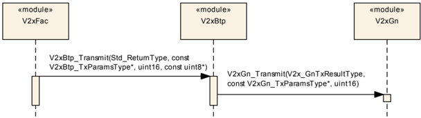
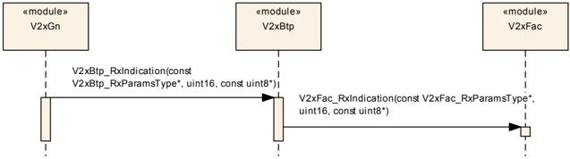
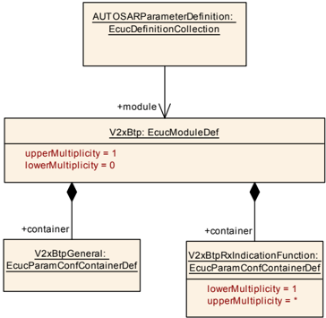
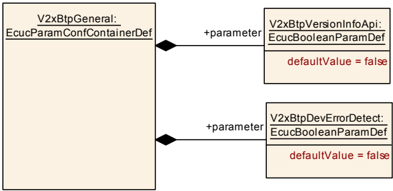
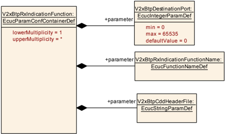

## 1. 简介和功能概述

本规范规定 **AUTOSAR** 基础软件模块 **Vehicle-2-X Basic Transport** 的功能、**API** 和配置（在本文档中称为「**V2xBtp module**」）。

**V2xBtp** 模块与 **Vehicle-2-X Facilities** [\[1\]](#ref-1)（V2xFac）、**Vehicle-2-X GeoNetworking** [\[2\]](#ref-2)（V2xGn）、**Vehicle-2-X Management** [\[3\]](#ref-3)（V2xM）、**Vehicle-2-X Data Manager** [\[4\]](#ref-4)（V2xDM）以及 **AUTOSAR BSW** 模块 **Ethernet Interface** [\[5\]](#ref-5)（EthIf）一起，在 **AUTOSAR** 架构中构成 V2X 协议栈。

本文档的基础是 **BTP** 规范 [\[6\]](#ref-6)。假定读者已熟悉该规范。本文档不会重新定义 **BTP** 功能，但会尽量遵循与 **BTP** 规范相同的顺序。

### 1.1. 架构总览

**V2xBtp** 模块向上层 **V2xFac** 模块提供服务并依赖于它，同时使用下层 **V2xGn** 模块的服务并从其获取服务，以实现本文第 [1.2](#12-功能总览) 节、第 [6.1](#61-通用功能) 节、第 [6.2](#62-消息接收) 节和第 [6.3](#63-消息发送) 节所述的功能。

**V2xBtp** 模块在 **AUTOSAR BSW** 和分层软件架构中的位置如下图所示。


### 1.2. 功能总览

**V2xBtp** 模块实现 [\[6\]](#ref-6) 规定的 **BTP** 协议，这是一种需要最少处理的轻量级协议。

**V2xBtp** 模块位于 **V2xGn** 模块 [\[2\]](#ref-2) 之上（**V2xGn** 实现 [\[7\]](#ref-7) 和 [\[8\]](#ref-8) 规定的 **GeoNetworking** 协议）、[\[1\]](#ref-1) 规定的 **V2xFac** 模块之下。它在 **V2xFac** 模块处对不同进程的消息进行多路复用/解多路复用，并在 **ITS** 自组织网络 [\[10\]](#ref-10) 中提供类似于 **UDP** [\[9\]](#ref-9) 的无连接、不可靠（即包可能乱序到达、重复出现或丢失）的端到端包传输服务。**BTP** 的设计假定使用该协议的实体要么能够容忍不可靠的包传输，要么自身提供适当的可靠通信机制。它采用 **IP** 协议族的端口概念，并将知名端口分配给特定的 **ITS** 设施层协议。端口的使用类似于 **IP** 协议族的两级包传输，但在 **BTP** 的情况下，**GeoNetworking** 协议在 **ITS** 站之间传输包，而 **BTP** 协议将包交付给 **ITS** 设施层的实体。

上层可以通过 **API** 原语 [V2xBtp_Transmit](#733-v2xbtp_transmit)() 提供必要的数据来访问 **V2xBtp** 模块提供的传输服务。为了提供其包传输服务，**V2xBtp** 模块依赖 **V2xGn** 模块的服务（即调用 V2XGn_Transmit()）。**V2xBtp** 模块还通过调用 V2xFac_RxIndication()（如第 [6.2](#62-消息接收) 节所述）向 **V2xFac** 模块提供服务：提供消息接收通知以及从对端 **BTP** 实体接收到的 **BTP** 包的载荷。它还向 **V2xGn** 模块提供回调 [V2xBtp_RxIndication](#741-v2xbtp_rxindication)()，以便其获取从对端 **GeoNetworking** 实体接收到的 **GN** 包的消息接收通知和载荷。

根据上述说明和 [\[6\]](#ref-6) 中的规范，**V2xBtp** 模块的职责可归纳如下：

* 对 **V2xFac** 模块处不同进程的消息进行多路复用，例如来自协作感知基本服务 [\[11\]](#ref-11) 的 **CAM** 和来自分布式环境通知基本服务 [\[12\]](#ref-12) 的 **DENM**，以便通过 **V2xGn** 模块发送包，以及在目的 **BTP** 协议实体处进行解多路复用。
* 接受来自上层（**V2xFac** 模块）的消息发送请求及协议控制信息，并使用 **V2xGn** 模块的服务发送数据。
* 在收到 **BTP** 包时，向上层（即 **V2xFac** 模块）提供消息接收通知和所收包的载荷。

## 2. 缩略语

以下术语表包含与 **V2XBasicTransport** 模块相关、但未包含在 **Autosar** 术语表 [\[13\]](#ref-13) 中的缩略语和缩写。

**BTP**
> 基本传输协议（**Basic Transport Protocol**）。

**BTP-A**
> 表示交互式包传输的 **BTP** 报头类型。

**BTP-B**
> 表示非交互式包传输的 **BTP** 报头类型。

**CAM**
> 协作感知消息（**Cooperative Awareness Message**）。

**DENM**
> 分布式环境通知消息（**Decentralized Environmental Notification Message**）。

**DET**
> 默认错误跟踪器（**Default Error Tracer**）。

**GN**
> 地理网络（**GeoNetworking**）。

**ITS**
> 智能交通系统（**Intelligent Transport System**）。

**IP**
> 互联网协议（**Internet Protocol**）。

**PDU**
> 协议数据单元（**Protocol Data Unit**）。

**UDP**
> 用户数据报协议（**User Datagram Protocol**）。

## 3. 相关文档

### 3.1. 输入文件和相关标准与规范

<a id="ref-1"></a>[1] Specification of Vehicle-2-X Facilities
> AUTOSAR_CP_SWS_V2XFacilities

<a id="ref-2"></a>[2] Specification of Vehicle-2-X Geo Networking
> AUTOSAR_CP_SWS_V2XGeoNetworking

<a id="ref-3"></a>[3] Specification of Vehicle-2-X Management
> AUTOSAR_CP_SWS_V2XManagement

<a id="ref-4"></a>[4] Specification of Vehicle-2-X Data Manager
> AUTOSAR_CP_SWS_V2XDataManager

<a id="ref-5"></a>[5] Specification of Ethernet Interface
> AUTOSAR_CP_SWS_EthernetInterface

<a id="ref-6"></a>[6] EN 302 636-5-1 V2.1.1:Vehicular Communication; Geonetworking; Part 5:Transport Protocols; Sub-part 1:Basic Transport Protocols

<a id="ref-7"></a>[7] EN 302 636-4-1 V1.3.1:Vehicular Communication; Geonetworking; Part 4 Geographical addressing and forwarding for point-to-point and point-to-multipoint communications; Sub-part 1:Media-Independent Functionality

<a id="ref-8"></a>[8] TS 102 636-4-2 V1.1.1:Intelligent Transport Systems (ITS); GeoNetworking; Part 4:Geographical addressing and forwarding for point-to-point and point-to-multipoint communications; Sub-part 2:Media-dependent functionalities for ITSG5

<a id="ref-9"></a>[9] User Datagram Protocol https://rfc-editor.org/rfc/rfc768.txt

<a id="ref-10"></a>[10] EN 302 665 V1.1.1:Intelligent Transport Systems (ITS); Communications Architecture

<a id="ref-11"></a>[11] EN 302 637-2 V1.4.1:Intelligent Transport Systems (ITS); Vehicular Communications; Basic Set of Applications; Part 2:Specification of Cooperative Awareness Basic Service

<a id="ref-12"></a>[12] EN 302 637-3 V1.3.1:Intelligent Transport Systems (ITS); Vehicular Communications; Basic Set of Applications; Part 3:Specifications of Decentralized Environmental Notification Basic Service

<a id="ref-13"></a>[13] Glossary
> AUTOSAR_FO_TR_Glossary

<a id="ref-14"></a>[14] General Specification of Basic Software Modules
> AUTOSAR_CP_SWS_BSWGeneral

<a id="ref-15"></a>[15] Specification of Default Error Tracer
> AUTOSAR_CP_SWS_DefaultErrorTracer

<a id="ref-16"></a>[16] Specification of ECU State Manager
> AUTOSAR_CP_SWS_ECUStateManager

<a id="ref-17"></a>[17] General Requirements on Basic Software Modules
> AUTOSAR_CP_SRS_BSWGeneral

<a id="ref-18"></a>[18] Requirements on Vehicle-2-X Communication
> AUTOSAR_CP_SRS_V2XCommunication

<a id="ref-19"></a>[19] TS 302 636-1 V1.2.1:Intelligent Transport Systems (ITS); GeoNetworking; Part 1: Requirements

<a id="ref-20"></a>[20] TS 302 636-2 V1.2.1:Intelligent Transport Systems (ITS); GeoNetworking; Part 2: Scenarios

### 3.2. 相关规范

**AUTOSAR** 提供了基础软件模块的通用规范 [\[14\]](#ref-14)，该规范同样适用于 **V2xBtp**。

因此，规范 **SWS BSW General** 应被视为 **V2xBtp** 的附加且必需的规范。

## 4. 约束和假设

### 4.1. 限制

* V2X 模块遵循 Car-2-Car-Consortium 基本系统标准配置（Basic System Standards Profile）定义的 Day-1 场景指南。
* **AUTOSAR** R19-11 仅聚焦于 **ETSI** 定义的车与车通信的欧洲版本。向其他地区的扩展计划在 **AUTOSAR** 标准的未来版本中进行。

### 4.2. 汽车域的适用性

本规范适用于所有汽车域。

## 5. 对其他模块的依赖

本节描述 **V2xBtp** 模块与 **AUTOSAR** 基础软件架构中其他模块的关系。它概述实现 **V2xBtp** 模块所需或可选的模块，以及这些模块使用的 **V2xBtp** 服务。

### 5.1. AUTOSAR DET（默认错误跟踪器）

在开发模式下，**V2xBtp** 模块通过 **DET** 模块 [\[15\]](#ref-15) 的 Det_ReportError 函数上报错误。

### 5.2. AUTOSAR EcuM（ECU 状态管理器）

**EcuM** [\[16\]](#ref-16) 通过调用第 7.3.1 节规定的 [V2xBtp_Init](#731-v2xbtp_init)() 来初始化 **V2xBtp** 模块。

### 5.3. AUTOSAR V2xFac（Vehicle-2-X Facilities）

**V2xBtp** 模块使用的 **API** 由一个通知服务组成，作为将 **BTP** 相关数据传递到目标上层（即 **V2xFac** 模块）的基本媒介。**V2xBtp** 模块调用的回调服务在 **V2xFac** 模块中声明并置于其中。该回调为 **V2xFac** 模块提供接收指示（V2xFac_RxIndication，参见第 [6.2](#62-消息接收) 节）服务。

### 5.4. AUTOSAR V2xGn（Vehicle-2-X GeoNetworking）

**V2xBtp** 模块假定 **V2xGn** 模块提供发送请求原语（V2xGn_Transmit [\[2\]](#ref-2)，参见第 6.3 节）。

**V2xBtp** 模块提供一个供 **V2xGn** 模块使用的通知服务。**V2xGn** 模块调用的回调在 **V2xBtp** 模块中声明并置于其中。该回调为 **V2xBtp** 模块提供接收指示（[V2xBtp_RxIndication](#741-v2xbtp_rxindication)，见第 [7.4.1](#741-v2xbtp_rxindication) 节规定，参见第 [6.2](#62-消息接收) 节）服务。

## 6. 功能规格

### 6.1. 通用功能

除非本文档中另有规定，**V2xBtp** 模块应实现 [\[6\]](#ref-6) 规定的基本传输协议（**BTP**）。

**BTP** 协议应满足 [\[19\]](#ref-19) 规定的 **BTP** 相关要求，并支持 [\[20\]](#ref-20) 规定的场景。

**V2xBtp** 模块应仅使用 **BTP B** 报头封装来自 **V2xFac** 模块的载荷，如 [\[6\]](#ref-6) 第 6 章所规定，报头格式和结构如第 7 章所规定。

### 6.2. 消息接收

如果 **V2xBTP** 接收到的包的端口号与 V2xBtpDestinationPort 中配置的某个容器所含端口号匹配，**V2xBtp** 模块应调用在该容器 V2xBtpRxIndicationFunctionName 中配置的相应名称的函数，将载荷和 **GeoNetworking** 参数传递给 **V2xFac** 模块。

如果找不到 V2xBtpDestinationPort 的配置项，则应静默丢弃该包。

**注意：** 为调用 **V2xFacilities**，应每个 **BTP** 端口配置一个容器，并在 V2xBtpRxIndicationFunctionName 中添加函数名 V2xFac_RxIndication。

**V2xBtp** 模块应通过 [V2xBtp_RxIndication](#741-v2xbtp_rxindication)() 回调获取接收到的 **GeoNetworking** 包的数据（**BTP** 包）和 **GeoNetworking** 参数。一旦从对端 **GN** 实体接收到 **GN** 包，**V2xGn** 模块应触发该回调。

### 6.3. 消息发送

**V2xBtp** 模块应提供 **API** [V2xBtp_Transmit](#733-v2xbtp_transmit)()，以服务来自 **V2xFac** 模块的发送请求。

触发 [V2xBtp_Transmit](#733-v2xbtp_transmit)() 时的源协议操作应按 [\[6\]](#ref-6) 第 8.2 章的规定执行。

**V2xBtp** 模块使用 **V2xGn** 模块提供的 V2xGn_Transmit() **API** 向对端 **BTP** 实体发送 **BTP** 包。V2xGn_Transmit() 的参数应按 [\[6\]](#ref-6) 第 8.2 章设置。这些参数由 **V2xFac** 模块通过调用 [V2xBtp_Transmit](#733-v2xbtp_transmit)() 提供给 **V2xBtp** 模块。

**V2xBtp** 模块应采用 **BTP-B** 报头。因此，**GeoNetworking** 通用报头的 **NH** 字段应使用值 2。

**V2xBtp** 模块应将目的端口信息字段设置为值 0。

### 6.4. 错误分类

文档 [\[14\]](#ref-14)「基础软件模块通用规范」的「Error Handling」一章详细描述了基础软件的错误处理。其中最重要的是，它构成了一个由 **BSW** 模块中可能发生的五种错误类型组成的分类方案。

在此基础上，以下各小节按相应的子节规定了具体错误。

#### 6.4.1. 开发错误

如果为 **BTP** 模块启用了开发错误检测，**BTP** 模块应检查 **API** 参数的有效性，并将检测到的错误上报给 **DET**。

| 错误类型 | 相关错误代码 | 错误值 |
|---|---|---|
| 使用无效参数调用 **API** 服务 | V2XBTP_E_PARAM | 0x01 |
| 使用无效指针调用 **API** 服务 | V2XBTP_E_PARAM_POINTER | 0x02 |
| 在模块未初始化的情况下使用 **API** 服务 | V2XBTP_E_UNINIT | 0x03 |
| **V2xBtp** 初始化失败 | V2XBTP_E_INIT_FAILED | 0x04 |

#### 6.4.2. 运行时错误

没有运行时错误。

#### 6.4.3. 瞬态故障

没有瞬态故障。

#### 6.4.4. 生产错误

没有生产错误。

#### 6.4.5. 扩展生产错误

没有扩展生产错误。

## 7. API规范

### 7.1. 导入的类型

本章列出从以下文件包含的所有类型。

| 模块 | 头文件 | 导入的类型 |
|---|---|---|
| Std | Std_Types.h | Std_ReturnType |
| Std | Std_Types.h | Std_VersionInfoType |
| V2x_GeneralTypes | V2x_GeneralTypes.h | V2x_GnAddressType |
| V2x_GeneralTypes | V2x_GeneralTypes.h | V2x_GnAreaShapeType |
| V2x_GeneralTypes | V2x_GeneralTypes.h | V2x_GnDestinationAreaType |
| V2x_GeneralTypes | V2x_GeneralTypes.h | V2x_GnDestinationType |
| V2x_GeneralTypes | V2x_GeneralTypes.h | V2x_GnLongPositionVectorType |
| V2x_GeneralTypes | V2x_GeneralTypes.h | V2x_GnPacketTransportType |
| V2x_GeneralTypes | V2x_GeneralTypes.h | V2x_GnTxResultType |
| V2x_GeneralTypes | V2x_GeneralTypes.h | V2x_GnUpperProtocolType |
| V2x_GeneralTypes | V2x_GeneralTypes.h | V2x_SecProfileType |
| V2x_GeneralTypes | V2x_GeneralTypes.h | V2x_SecReportType |
| V2x_GeneralTypes | V2x_GeneralTypes.h | V2x_TrafficClassIdType |
| V2xFac | V2xFac.h | V2xFac_RxParamsType |
| V2xGn | V2xGn.h | V2xGn_TxParamsType |

### 7.2. 类型定义

#### 7.2.1. V2xBtp_TxParamsType

| 名称 | V2xBtp_TxParamsType | | |
| --- | --- | --- | --- |
| 类别 | Structure | | |
| 元素 | upperProtocol | 类型 | V2x_GnUpperProtocolType |
| 元素 | 注释 | 指定 **BTP** 是交互式（BTP-A）还是非交互式（BTP-B）。 | |
| 元素 | destinationPort | 类型 | uint16 |
| 元素 | 注释 | 标识 **BTP** 包目的地处 **ITS** 设施层的协议实体。 | |
| 元素 | transportType | 类型 | V2x_GnPacketTransportType |
| 元素 | 注释 | 包传输类型（GeoUnicast、SingleHopBroadcast、TopologyScopedBroadcast、GeoBroadcast、GeoAnycast）。 | |
| 元素 | destinationAddress | 类型 | V2x_GnAddressType |
| 元素 | 注释 | GeoUnicast 的目的地址。 | |
| 元素 | destinationArea | 类型 | V2x_GnDestinationAreaType |
| 元素 | 注释 | GeoBroadcast/GeoAnycast 的目的区域 | |
| 元素 | destinationType | 类型 | V2x_GnDestinationType |
| 元素 | 注释 | 选择该包使用哪种目的类型（destinationAddress 或 destinationArea）。 | |
| 元素 | secProfile | 类型 | V2x_SecProfileType |
| 元素 | 注释 | 安全配置信息（决定要调用的安全服务）。 | |
| 元素 | maxPacketLifetime | 类型 | uint16 |
| 元素 | 注释 | **GeoNetworking** 包在被缓冲直到到达目的地之前可容忍的最大时间 [s]。 | |
| 元素 | trafficClassId | 类型 | V2x_TrafficClassIdType |
| 元素 | 注释 | 消息的流量类别 id。 | |
| 描述 | 包含应由 **V2xFac** 模块传递给发送请求函数（即第 [7.3.3](#733-v2xbtp_transmit) 节定义的 [V2xBtp_Transmit](#733-v2xbtp_transmit)）的 **BTP** 和 **GeoNetworking** 相关参数的结构。 | | |
| 可通过 | V2xBtp.h 获得 | | |

#### 7.2.2. V2xBtp_RxParamsType

| 名称 | V2xBtp_RxParamsType | | |
| --- | --- | --- | --- |
| 类别 | Structure | | |
| 元素 | upperProtocol | 类型 | V2x_GnUpperProtocolType |
| 元素 | 注释 | 处理服务原语的协议实体（BTP-A、BTP-B）。 | |
| 元素 | packetTransportType | 类型 | V2x_GnPacketTransportType |
| 元素 | 注释 | 接收到的包的包传输类型。 | |
| 元素 | destinationAddress | 类型 | V2x_GnAddressType |
| 元素 | 注释 | GeoUnicast 包的目的地址 | |
| 元素 | destinationArea | 类型 | V2x_GnDestinationAreaType |
| 元素 | 注释 | GeoBroadcast/GeoAnycast 包的目的区域。 | |
| 元素 | destinationType | 类型 | V2x_GnDestinationType |
| 元素 | 注释 | 选择该包使用哪种目的类型（destinationAddress 或 destinationArea）。 | |
| 元素 | sourcePositionVector | 类型 | V2x_GnLongPositionVectorType |
| 元素 | 注释 | 接收到的 **GeoNetworking** 包源的地理位置。 | |
| 元素 | securityReport | 类型 | V2x_SecReportType |
| 元素 | 注释 | 解密和验证安全操作的结果信息。该参数由 **V2xM** 模块提供，并经 **Geo Networking** 和 **BTP** 层向上转发到 **ITS** 设施层。 | |
| 元素 | certificateId | 类型 | uint64 |
| 元素 | 注释 | 源证书的标识，例如证书哈希。该参数由 **V2xM** 模块提供，并经 **GeoNetworking** 和 **BTP** 层向上转发到 **ITS** 设施层。 | |
| 元素 | sspBits | 类型 | Array of uint8 |
| 元素 | 大小 | 4 | |
| 元素 | 注释 | 发送方权限。 | |
| 元素 | sspLength | 类型 | uint8 |
| 元素 | 注释 | 发送方权限长度 | |
| 元素 | trafficClass | 类型 | V2x_TrafficClassIdType |
| 元素 | 注释 | 源生成 **GeoNetworking** 包时使用的流量类别。 | |
| 元素 | remPacketLifetime | 类型 | uint16 |
| 元素 | 注释 | 包的剩余生存时间 [s]。 | |
| 元素 | remHopLimit | 类型 | uint8 |
| 元素 | 注释 | 包的剩余跳数限制。 | |
| 元素 | itsAid | 类型 | uint32 |
| 元素 | 注释 | ITS-AID（应用标识符）的数值 | |
| 描述 | 包含与接收到的 **BTP** 包相关的 **BTP** 和 **GeoNetworking** 参数的结构。当 **V2xGn** 模块从对端 **GeoNetworking** 实体接收到 **GN** 包时，该结构应由 **V2xGn** 模块传递给 **V2xBtp** 模块。 | | |
| 可通过 | V2xBtp.h 获得 | | |

### 7.3. 函数定义

#### 7.3.1. V2xBtp_Init

**说明**: 初始化 **V2xBtp** 模块。可通过 **V2xBtp.h** 获得。服务 **ID** 0x01。本服务为同步调用，不可重入。参数 CfgPtr（in）：指向配置集的指针。返回值：无。

```C
void V2xBtp_Init ( void* CfgPtr )
```

如果启用了开发错误检测：该函数应检查参数 CfgPtr 是否包含有效配置。如果检查失败，该函数应引发开发错误 [V2XBTP_E_INIT_FAILED](#641-开发错误)。

#### 7.3.2. V2xBtp_GetVersionInfo

**说明**: 返回本模块的版本信息。可通过 **V2xBtp.h** 获得。服务 **ID** 0x02。本服务为同步调用，可重入。参数 VersionInfoPtr（out）：存储本模块版本信息的指针。返回值：无。

```C
void V2xBtp_GetVersionInfo ( Std_VersionInfoType* VersionInfoPtr )
```

如果启用了开发错误检测：该函数应检查参数 VersionInfoPtr 是否有效。如果检查失败，该函数应引发开发错误 [V2XBTP_E_PARAM_POINTER](#641-开发错误)。

#### 7.3.3. V2xBtp_Transmit

**说明**: **V2xFac** 模块调用本 **API** 以请求向对端 **BTP** 实体发送一个 **BTP-PDU**。可通过 **V2xBtp.h** 获得。服务 **ID** 0x03。本服务为异步调用，可重入。参数 TransmitParams（in）：包含发送请求所用的所有 **BTP** 和 **GeoNetworking** 参数的结构。参数 Length（in）：DataPtr 所指数据的长度。参数 DataPtr（in）：待发送 **BTP** 包的载荷。返回值：Std_ReturnType，E_OK：发送请求已被接受；E_NOT_OK：发送请求未被接受。

```C
Std_ReturnType V2xBtp_Transmit ( const V2xBtp_TxParamsType* TransmitParams, uint16 Length, const uint8* DataPtr )
```

如果启用了开发错误检测：该函数应检查先前是否已调用过服务 [V2xBtp_Init](#731-v2xbtp_init)()。如果检查失败，该函数应引发开发错误 [V2XBTP_E_UNINIT](#641-开发错误)。

如果启用了开发错误检测：该函数应检查参数 TransmitParams 是否有效。如果检查失败，该函数应引发开发错误 [V2XBTP_E_PARAM_POINTER](#641-开发错误)。

如果启用了开发错误检测：该函数应检查参数 DataPtr 是否有效。如果检查失败，该函数应引发开发错误 [V2XBTP_E_PARAM_POINTER](#641-开发错误)。

### 7.4. 回调通知

#### 7.4.1. V2xBtp_RxIndication

**说明**: 通过本 **API**，**V2xBtp** 模块获取接收到的 **GeoNetworking** 包的数据（**BTP-PDU**）和 **GeoNetworking** 参数。可通过 **V2xBtp.h** 获得。服务 **ID** 0x04。本服务为同步调用，可重入。参数 ReceiveParams（in）：包含接收到的 **BTP** 包的所有 **BTP** 和 **GeoNetworking** 参数的结构。参数 Length（in）：dataPtr 所指数据的长度。参数 DataPtr（in）：接收到的 **GeoNetworking** 包（**BTP-PDU**）的载荷。返回值：无。

```C
void V2xBtp_RxIndication ( const V2xBtp_RxParamsType* ReceiveParams, uint16 Length, const uint8* DataPtr )
```

如果启用了开发错误检测：该函数应检查先前是否已调用过服务 [V2xBtp_Init](#731-v2xbtp_init)()。如果检查失败，该函数应引发开发错误 [V2XBTP_E_UNINIT](#641-开发错误)。

如果启用了开发错误检测：该函数应检查参数 ReceiveParams 是否有效。如果检查失败，该函数应引发开发错误 [V2XBTP_E_PARAM_POINTER](#641-开发错误)。

如果启用了开发错误检测：该函数应检查参数 DataPtr 是否有效。如果检查失败，该函数应引发开发错误 [V2XBTP_E_PARAM_POINTER](#641-开发错误)。

#### 7.4.2. V2xBtp_CopyTxData

**说明**: **V2xGn** 模块调用本 **API** 以请求 **V2xBtp** 模块将发送数据复制到特定位置。可通过 **V2xBtp.h** 获得。服务 **ID** 0x06。本服务为同步调用，不可重入。参数 DestPtr（in）：指向 **BTP** 模块应将数据复制到的缓冲区的指针。参数 Length（inout）：in 方向：可供复制数据的最大长度；out 方向：已复制数据的实际长度。返回值：Std_ReturnType，E_OK：数据已复制；E_NOT_OK：长度不匹配。

```C
Std_ReturnType V2xBtp_CopyTxData ( uint8* DestPtr, uint16* Length )
```

如果启用了开发错误检测：该函数应检查先前是否已调用过服务 [V2xBtp_Init](#731-v2xbtp_init)()。如果检查失败，该函数应引发开发错误 [V2XBTP_E_UNINIT](#641-开发错误)。

如果启用了开发错误检测：该函数应检查参数 DestPtr 是否有效。如果检查失败，该函数应引发开发错误 [V2XBTP_E_PARAM_POINTER](#641-开发错误)。

如果启用了开发错误检测：该函数应检查参数 Length 是否有效（指针不为 NULL_PTR 且值与数据长度匹配）。如果检查失败，该函数应引发开发错误 [V2XBTP_E_PARAM_POINTER](#641-开发错误)。

### 7.5. 期望接口

#### 7.5.1. 强制接口

本章定义实现模块核心功能所需的全部接口。

| API 函数 | 头文件 | 描述 |
|---|---|---|
| V2xFac_RxIndication | V2xFac.h | **V2xBtp** 模块调用本 **API** 原语，将接收到的 **BTP** 包的数据和 **GeoNetworking** 参数提供给 **V2xFac** 模块 |
| V2xGn_Transmit | V2xGn.h | 由 V2x_Btp 调用以发送消息 |

#### 7.5.2. 可选接口

本章定义实现模块可选功能所需的全部接口。

| API 函数 | 头文件 | 描述 |
|---|---|---|
| Det_ReportError | Det.h | 上报开发错误的服务 |

#### 7.5.3. 可配置接口

##### 7.5.3.1. &lt;User&gt;_RxIndication

| 服务名称 | &lt;User&gt;_RxIndication | | |
| --- | --- | --- | --- |
| 语法 | void &lt;User&gt;_RxIndication ( const [V2xBtp_RxParamsType](#722-v2xbtp_rxparamstype)* ReceiveParams, uint16 Length, const uint8* DataPtr ) | | |
| 同步/异步 | 同步 | | |
| 可重入性 | 不可重入 | | |
| 参数（in） | ReceiveParams | 包含接收到的 **BTP** 包的所有 **BTP** 和 **GeoNetworking** 参数的结构 | |
| 参数（in） | Length | dataPtr 所指数据的长度 | |
| 参数（in） | DataPtr | 接收到的 **GeoNetworking** 包（**BTP** 包）的载荷 | |
| 参数（inout） | 无 | | |
| 参数（out） | 无 | | |
| 返回值 | 无 | | |
| 描述 | 通过本 **API**，**BTP** 上层模块获取接收到的 **BTP** 包的数据（**BTP-SDU**）和 **GeoNetworking** 参数。 | | |
| 可通过 | 配置参数 V2xBtpCddHeaderFile 获得 | | |

回调函数应可通过配置容器 [V2xBtpRxIndicationFunction](#924-v2xbtprxindicationfunction) 进行配置。

## 8. 时序图

以下时序图展示 **V2xBtp** 模块与其下层和上层模块（分别为 **V2xGn** 和 **V2xFac**）之间的交互。

请注意，这些时序图是为了便于理解本规范而对说明目的的扩展，用于支持第 [6](#6-功能规格) 章所述的功能规格和第 [7](#7-api规范) 章所述的 **API** 规范。

注意，为使时序图更易于阅读和理解，所有参数和返回类型均已省略。

### 8.1. 发送请求

图 8.1 展示了使用 [V2xBtp_Transmit](#733-v2xbtp_transmit)() 将一个 ITS-FPDU 从 **V2xFac** 模块传输到 **V2xGn** 模块的过程。当 **V2xBtp** 收到来自上层 **V2xFac** 模块的发送请求时，它将验证输入参数，通过向从 **V2xFac** 模块收到的载荷（即 ITSFPDU）添加 **BTP** 报头来构造一个 **BTP** 包，然后调用 V2xGn_Transmit() 请求发送一个 **GeoNetworking** 包，并按 [\[6\]](#ref-6) 第 8.2 章为 V2xGn_Transmit() 设置参数。



### 8.2. 接收指示

如图 8.2 所示，**V2xGn** 模块通过调用 [V2xBtp_RxIndication](#741-v2xbtp_rxindication)() 向 **V2xBtp** 模块指示 **BTP** 包的接收。**V2xBtp** 模块随后调用 **V2xFac** 模块的相应接收指示，以向上层通知接收。包载荷、与所收包相关的 **GeoNetworking** 参数以及用于按需验证的句柄，是通过 [V2xBtp_RxIndication](#741-v2xbtp_rxindication)() 和 V2xFac_RxIndication() 原语传递给上层的信息。



## 9. 配置规范

一般而言，本章定义配置参数及其到容器中的聚类。为支持本规范，第 9.1 章描述基本知识。我们还规定用于参数规范的模板（表）。我们打算将第 9.1 章保留在规范中以保证理解。

第 9.2 章规定模块 **V2xBtp** 的结构（容器）和参数。

第 9.3 章规定模块 **V2xBtp** 的发布信息。

### 9.1. 如何阅读本章

详情参见 [\[14\]](#ref-14) 的第 10.1 章「配置规范简介」。

### 9.2. 容器与配置参数

以下各章汇总所有配置参数。参数的详细含义见第 6 章和第 7 章。

#### 9.2.1. 变体

当前为 **V2xBtp** 模块定义了一种配置变体：

##### 9.2.1.1. VARIANT-PRE-COMPILE

**V2xBtp** 模块仅支持 VARIANT-PRE-COMPILE。

#### 9.2.2. V2xBtp

| SWS 条目 | [ECUC_V2xBtp_00001] |
|---|---|
| 模块名称 | V2xBtp |
| 描述 | **V2xBtp**（Vehicle-2-X Basic Transport）模块的配置。 |
| Post-Build 变体支持 | false |
| 支持的配置变体 | VARIANT-PRE-COMPILE |



| 容器名称 | 多重性 | 作用域/依赖 |
|---|---|---|
| V2xBtpGeneral | 1 | 该容器包含 **Vehicle-2-X Basic Transport** 的通用配置参数。 |
| V2xBtpRxIndicationFunction | 1..* | 该容器包含 **V2xBtp** 上层的 RxIndication 函数。 |

#### 9.2.3. V2xBtpGeneral

| SWS 条目 | [ECUC_V2xBtp_00002] |
|---|---|
| 容器名称 | V2xBtpGeneral |
| 父容器 | V2xBtp |
| 描述 | 该容器包含 **Vehicle-2-X Basic Transport** 的通用配置参数。 |
| 配置参数 | 见下方参数表 |

| SWS 条目 | [ECUC_V2xBtp_00005] |
|---|---|
| 参数名称 | V2xBtpDevErrorDetect |
| 父容器 | V2xBtpGeneral |
| 描述 | 将默认错误跟踪器（**Det**）的检测和通知打开或关闭。* **true**：使能（ON）。* **false**：禁用（OFF）。 |
| 多重性 | 1 |
| 类型 | EcucBooleanParamDef |
| 默认值 | false |
| Post-Build 变体值 | false |
| 值配置类 | Pre-compile time：x（All Variants）；Link time：-；Post-build time：- |
| 作用域/依赖 | scope: local |

| SWS 条目 | [ECUC_V2xBtp_00004] |
|---|---|
| 参数名称 | V2xBtpVersionInfoApi |
| 父容器 | V2xBtpGeneral |
| 描述 | 使能/禁用读取 **V2xBtp** 模块版本信息的 **API**。* **true**：使能（ON）。* **false**：禁用（OFF）。 |
| 多重性 | 1 |
| 类型 | EcucBooleanParamDef |
| 默认值 | false |
| Post-Build 变体值 | false |
| 值配置类 | Pre-compile time：x（All Variants）；Link time：-；Post-build time：- |
| 作用域/依赖 | scope: local |

无包含的容器。



#### 9.2.4. V2xBtpRxIndicationFunction

| SWS 条目 | [ECUC_V2xBtp_00009] |
|---|---|
| 容器名称 | V2xBtpRxIndicationFunction |
| 父容器 | V2xBtp |
| 描述 | 该容器包含 **V2xBtp** 上层的 RxIndication 函数。 |
| Post-Build 变体多重性 | false |
| 多重性配置类 | Pre-compile time：x（All Variants）；Link time：-；Post-build time：- |
| 配置参数 | 见下方参数表 |

| SWS 条目 | [ECUC_V2xBtp_00008] |
|---|---|
| 参数名称 | V2xBtpCddHeaderFile |
| 父容器 | V2xBtpRxIndicationFunction |
| 描述 | 本参数指定包含 V2x BtpRxIndicationFunction 模块函数定义的头文件的名称。 |
| 多重性 | 1 |
| 类型 | EcucStringParamDef |
| 默认值 | - |
| 正则表达式 | - |
| Post-Build 变体值 | false |
| 值配置类 | Pre-compile time：x（All Variants）；Link time：-；Post-build time：- |
| 作用域/依赖 | scope: local |

| SWS 条目 | [ECUC_V2xBtp_00006] |
|---|---|
| 参数名称 | V2xBtpDestinationPort |
| 父容器 | V2xBtpRxIndicationFunction |
| 描述 | &lt;User&gt;_RxIndication 函数的目的端口。 |
| 多重性 | 1 |
| 类型 | EcucIntegerParamDef |
| 范围 | 0 .. 65535 |
| 默认值 | 0 |
| Post-Build 变体值 | false |
| 值配置类 | Pre-compile time：x（All Variants）；Link time：-；Post-build time：- |
| 作用域/依赖 | scope: local |

| SWS 条目 | [ECUC_V2xBtp_00007] |
|---|---|
| 参数名称 | V2xBtpRxIndicationFunctionName |
| 父容器 | V2xBtpRxIndicationFunction |
| 描述 | &lt;User&gt;_RxIndication 回调函数的名称。 |
| 多重性 | 1 |
| 类型 | EcucFunctionNameDef |
| 默认值 | - |
| 正则表达式 | - |
| Post-Build 变体值 | false |
| 值配置类 | Pre-compile time：x（All Variants）；Link time：-；Post-build time：- |
| 作用域/依赖 | scope: local |

无包含的容器。



### 9.3. 发布信息

详情参见 [\[14\]](#ref-14) 的第 10.3 章「发布信息」。
