## 1. 简介和功能概述

本规范规定 **AUTOSAR** 基础软件模块 **V2X Data Manager**（V2xDM）的功能、**API** 和配置。**V2X Data Manager** 的任务是接管由区域性 V2x 协议栈接收并预处理过的 V2x 消息，并按照配置执行操作。因此，**V2xDM** 只在接收 V2x 消息时相关，而不用于生成待发送的 V2x 消息——这仍是 V2x 协议栈的职责。**V2X Data Manager** 独立于底层 V2x 协议栈，不包含任何 V2X 区域性协议栈实现。这意味着，它可以与任何 V2x 协议栈组合使用，无论该协议栈是中国、美国还是欧洲特定的。事实上，**V2x Data Manager** 的关键特性之一就是将 V2x 消息的部分内容分发给 **RTE** 并加以适配，使得 resulting 信息可以独立于底层的区域性特定 V2x 协议栈。

### 1.1. 架构总览

**V2xDM** 模块在 **AUTOSAR BSW** 和分层软件架构中的位置如下图所示。

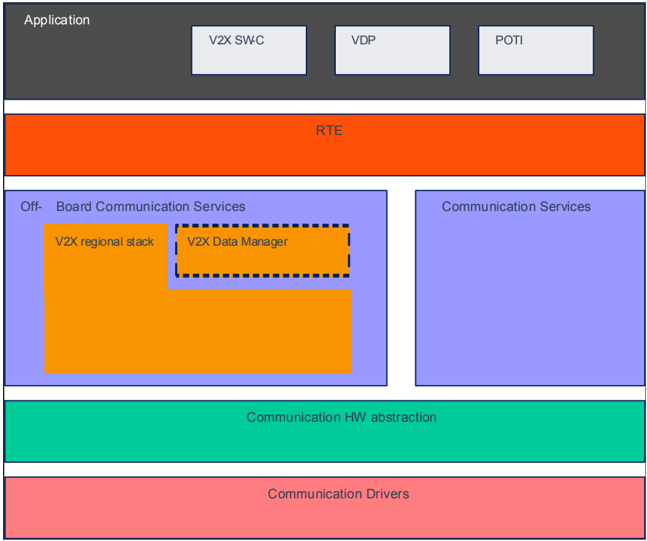

## 2. 缩略语

以下术语表包含与 **V2X Data Manager** 模块相关、但未包含在 [\[1, AUTOSAR 术语表\]](#ref-1) 中的缩略语和缩写。

**BS**
> 基本服务（**Basic Service**）。

**3GPP**
> 第三代合作伙伴项目（**The 3rd Generation Partnership Project**），提供制定定义 3GPP 技术的报告和规范的环境。

**5GAA**
> 5G 汽车协会（**The 5G Automotive Association**），一个开发未来出行和运输服务的全球性跨行业组织。

**ASN.1**
> 抽象语法标记（**Abstract Syntax Notation**，参见 [\[2\]](#ref-2)）。用于定义数据结构的描述语言。

**BSW**
> 基础软件模块（**Basic Software Module**）。

**BswM**
> **BSW** 模式管理器（**BSW Mode Manager**）。

**BSM**
> 基本安全消息（**Basic Safety Message**）。

**CAM**
> 协作感知消息（**Cooporative Awareness Message**）。

**CCSA**
> 中国通信标准化协会（**China Communications Standards Association**）。

**DCC**
> 分布式拥塞控制（**Decentralized Congestion Control**）。

**DENM**
> 分布式环境通知消息（**Decentralized Environment Notification Message**）。

**DET**
> 默认错误跟踪器（**Default Error Tracer**）。

**ECU**
> 电子控制单元（**Electronic Control Unit**）。

**EcuM**
> 电子控制单元管理器（**Electronic Control Unit Manager**）。

**ETSI**
> 欧洲电信标准协会（**European Telecommunications Standards Institute**）。

**ITS**
> 智能交通系统（**Intelligent Transport System**）。

**ITS-S**
> ITS 站（**ITS-Station**）。

**ITS-G5**
> **ETSI** 规定的无线通信。

**POTI**
> 位置与时间管理（**Position and Time Management**）。

**PduR**
> **PDU** 路由器（**PDU Router**）。

**RSU**
> 路侧单元（**Road Side Unit**）。

**RTE**
> 运行时环境（**Run Time Environment**）。

**SW-C**
> 软件组件（**Software Component**）。

**UPER**
> 非对齐打包编码规则（**Unaligned Packed Encoding Rule**）。**ASN.1** 最高效的编码规则。

**V2X**
> 车辆到车辆（**V2V**）、车辆到基础设施（**V2I**）和/或基础设施到车辆（**I2V**）。

**V2xBtp**
> **Vehicle-2-X** 基本传输协议（**Vehicle-2-X Basic Transport Protocol**）。

**V2xDM**
> **Vehicle-2-X** 数据管理器（**Vehicle-2-X Data Manager**）。

**V2xFac**
> **Vehicle-2-X** 设施（**Vehicle-2-X Facilities**）。

**V2xGn**
> **Vehicle-2-X** 地理网络（**Vehicle-2-X Geo Networking**）。

**V2xM**
> **Vehicle-2-X** 管理（**Vehicle-2-X Management**）。

**V2xML**
> **Vehicle-2-X** 消息层（**Vehicle-2-X Message Layer**）。

**CnV2xMsg**
> 中国 **Vehicle-2-X** 消息层（**Chinese Vehicle-2-X Message Layer**）。

**CnV2xMgt**
> 中国 **Vehicle-2-X** 管理（**Chinese Vehicle-2-X Management**）。

**V2xNL**
> **Vehicle-2-X** 网络层（**Vehicle-2-X Network Layer**）。

**VDP**
> 车辆数据提供者（**Vehicle Data Provider**）。

以下术语：

**结构化类型（Structured type）**
> 结构化类型表示 **ASN.1** 中包含一个或多个类型的结构。**ASN.1** 定义了 Sequence（类似 struct）、SequenceOf（类似数组）或「Sequence 的 Choice」（类似 union）。

**简单类型（Simple type）**
> 简单类型表示 **ASN.1** 中描述数据的元素，例如整数、枚举或字符串。在本文语境中，它指定 V2x 消息的一个 V2x 消息元素。

**V2x 目录项（V2x catalog item）**
> 从 V2x 消息的一个或多个简单类型派生的数据项。它要么是该简单类型的直接表示，要么是附加到该项的转换例程提供所需结果的结果。

**V2x 消息（V2x message）**
> 按照 V2X 区域性规范的定义、以 **ASN.1** **UPER** 编码形式提供的数据信息集合。

**V2x 消息元素（V2x message element）**
> 本术语用于 V2x 消息中包含的元素。该元素的类型必须是「简单类型」。

**V2x 对象（V2x object）**
> 定义通过发送者-接收者端口提供给 **RTE** 的一组数据元素。

**V2x 协议栈（V2x stack）**
> 按照为其区域定义 V2X 通信标准的标准化组织（例如 **ETSI**、**SAE**）处理 V2x 信息的软件模块。

## 3. 相关文档

### 3.1. 输入文件和相关标准与规范

<a id="ref-1"></a>[1] Glossary
> AUTOSAR_FO_TR_Glossary

<a id="ref-2"></a>[2] X.690 :Information technology - ASN.1 encoding rules:Specification of Basic Encoding Rules (BER), Canonical Encoding Rules (CER) and Distinguished Encoding Rules (DER) https://www.itu.int/rec/T-REC-X.690

<a id="ref-3"></a>[3] General Specification of Basic Software Modules
> AUTOSAR_CP_SWS_BSWGeneral

<a id="ref-4"></a>[4] Specification of Default Error Tracer
> AUTOSAR_CP_SWS_DefaultErrorTracer

<a id="ref-5"></a>[5] Specification of Vehicle-2-X Facilities
> AUTOSAR_CP_SWS_V2XFacilities

<a id="ref-6"></a>[6] Specification of RTE Software
> AUTOSAR_CP_SWS_RTE

<a id="ref-7"></a>[7] Specification of PDU Router
> AUTOSAR_CP_SWS_PDURouter

<a id="ref-8"></a>[8] Requirements on Vehicle-2-X Communication
> AUTOSAR_CP_SRS_V2XCommunication

<a id="ref-9"></a>[9] Software Component Template
> AUTOSAR_CP_TPS_SoftwareComponentTemplate

### 3.2. 相关规范

**AUTOSAR** 提供了基础软件模块的通用规范 [\[3, SWS BSW General\]](#ref-3)，该规范同样适用于 **V2xDM**。

因此，规范 **SWS BSW General** 应被视为 **V2xDM** 的附加且必需的规范。

## 4. 约束和假设

### 4.1. 限制

* V2X 模块遵循中国通信标准化协会（**CCSA**）、Car-2-Car-Consortium 和 C-Roads 平台定义的 Day-1 场景指南。
* 服务发现不由 **V2xDM** 管理。事件类型的发现要么自动初始化，要么需要一个 **SW-C** 来管理服务发现。

### 4.2. 汽车域的适用性

本规范适用于所有汽车域。

## 5. 对其他模块的依赖

本节描述 **V2xDM** 模块与 **AUTOSAR** 基础软件架构中其他模块的关系。它概述实现 **V2xDM** 模块所需或可选的模块，以及本模块使用的服务。

### 5.1. AUTOSAR DET（默认错误跟踪器）

在开发模式下，**V2xDM** 模块通过 [\[4, SWS DET 模块\]](#ref-4) 的 Det_ReportError 函数上报错误。

### 5.2. AUTOSAR V2xFac（V2xFacilities）

[\[5\]](#ref-5) 规定的 **V2xFac** 向 **V2xDM** 提供 V2x 消息。

### 5.3. AUTOSAR V2xM（V2xManagement）

**V2xM** 模块管理 V2X 协议栈的运行。

### 5.4. AUTOSAR CnV2xMsg（ChineseV2xMessage）

**CnV2xMsg** 向 **V2xDataManager** 提供中国 V2X 消息（例如 **BSM**）。

### 5.5. AUTOSAR CnV2xMgt（ChineseV2xManagement）

**CnV2xMgt** 模块管理中国 V2X 协议栈的运行。

### 5.6. AUTOSAR RTE（运行时环境）

**V2xDataManager** 通过 **RTE** 将 V2x 信号转发给上层（参见 [\[6\]](#ref-6)）。

### 5.7. AUTOSAR PDU Router（PduR）

**V2xDataManager** 将 V2x 消息转发给 **PduR**（参见 [\[7\]](#ref-7)），或者可选地从 **PduR** 接收 V2x 消息（作为 V2x 协议栈的替代）。

## 6. 功能规格

本章定义 **V2xDM** 模块的行为。本模块的 **API** 在第 [7](#7-api规范) 章定义，配置在第 [9](#9-配置规范) 章定义。

### 6.1. 概述

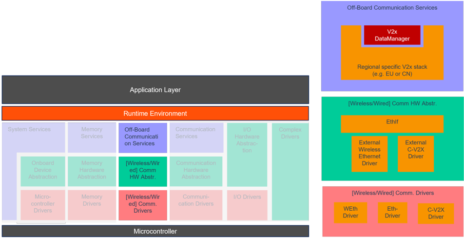

**V2x Data Manager**（V2xDM）位于区域性 V2x 协议栈之上。它属于服务层，其任务是通过发送者-接收者端口，将从下层区域性 V2x 协议栈获得的、或通过 **PduR** 的一个 **PDU** 获得的 V2x 消息中的单个信息提供给 **RTE**。所谓「预定义」，是指 VariableDataPrototype 不是由 **V2xDM** 创建的。V2x 消息中的哪些信息应通过发送者-接收者端口提供，可以在 **V2xDM** 的 **EcuC** 配置中配置（参见第 [9](#9-配置规范) 章）。在这种语境下，一个发送者-接收者端口称为一个「V2x 对象」。

**V2xDM** 的主要任务是接管来自下层 V2x 协议栈的 V2x 消息，按照该消息定义的 **ASN.1** 编解码定义解码它，提取必要的 V2x 消息元素，设置在其 **EcuC** 配置中映射到该消息的一个或多个 S/R 端口的数据类型，并触发 **RTE** 指示数据接收。

V2x 消息也可能不需要在 **V2xDM** 内解码。此时，整条消息可以转发给车辆网络上的另一个 **ECU** 做进一步处理。在这种情况下，**V2xDM** 会将数据转发给 **PduR**，将整条 V2x 消息发送到车辆网络，如图 7.2 所示。如果需要上述情形、且该消息的任何元素都不需要放入对象，则 **V2xDM** 不解码该消息。

**提示：** 事实上，在 V2x 协议栈和 **RTE** 的语境下，这可以被视为一个静态配置的复杂事件处理（**CEP**）系统，带有结构化数据变换和转换。

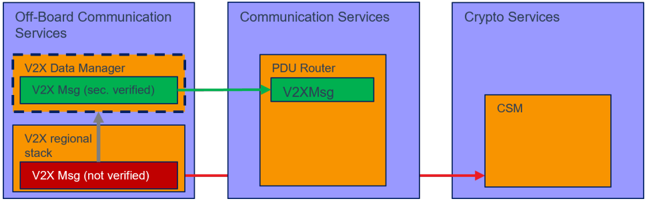

归纳起来，**V2xDM** 提供以下功能：

* 获取一条 V2x 消息，来源为 V2x 协议栈或 **PduR**。
* 将 V2x 消息传递给 **PduR**，以通过总线通信将整条消息发送到车辆网络。这是一个可选步骤，且只能在 V2x 消息由 V2x 协议栈（而非 **PduR** 本身）提供时使用！
* 通过以下方式将 V2x 消息的内容转发给 **RTE**：
  * 解码 **ASN.1** 编码的 V2x 消息，
  * （可选）将简单类型变换为 V2x 目录项（一个或多个简单类型可变换为一个 V2x 目录项；可从一条 V2x 消息生成多个 V2x 目录项），
  * 将 V2x 目录项写入 S/R 接口的变量数据原型，
  * 调用 **RTE** 将结果提供给软件组件（**SW-C**）或 **SOME/IP** 变换器（取决于预配置 S/R 端口的配置）。

这在图 7.3 中说明。

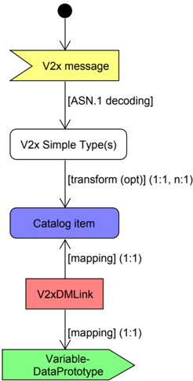

区域性 V2x 协议栈向 **V2xDM** 提供 V2x 消息：区域性 V2x 协议栈应转发由 **V2xDM** 模块处理的任何 V2x 消息。区域性 V2x 协议栈要求的任何安全检查（例如签名验证）应在消息传递给 **V2xDM** 之前成功完成。

**V2xDM** 在 **EcuC** 配置中配置 V2x 消息：**V2xDM** 应通过 [V2xDMMessage](#9113-v2xdmmessage) 在 **EcuC** 配置中为每种 V2x 消息类型提供一个配置，以表明该消息在 **V2xDM** 内处理。该配置还包含如何在 **V2xDM** 内处理该消息的信息。

**V2xDM** 应可选地将 V2x 消息转发给 **PDU** 路由器：**V2xDM** 内 V2x 消息的配置应允许指示该 V2x 消息是否应转发给 **PDU** 路由器（参见 [V2xDMPdu](#9114-v2xdmpdu)）。如果该配置对某条 V2x 消息处于活动状态，则每当该消息由 V2x 协议栈指示时，**V2xDM** 应将接收到的数据转发给 **PDU** 路由器，并触发一个 **PDU** 的发送。

**基本原理：** 这允许将整条受保护的 V2x 消息转发给车辆网络，把整条信息的处理委托给接收 **ECU**（参见图 7.2）。该转发选项确保只有 **V2xDM** 需要与 **PDU** 路由器的接口；区域性 V2x 协议栈不需要实现它。同时，当本 **ECU** 内解码过于复杂、或 V2x 消息信息只在某一个 **ECU** 中作为整体需要时，它允许将任何 V2x 消息分发给网络上的一个节点。应注意此时 **ASN.1** 解码需要在接收 **ECU** 中进行。

**注意：** **V2xDM** 会转发由底层区域性 V2x 协议栈提供的任何 V2x 消息。它不会检查它是否是先前提供的消息的重复，也不会保证消息之间的顺序关系。因此，如果 V2x 协议栈提供了一条重复的消息，它在车辆网络或 **SWC** 上也会表现为重复。

**V2xDM** 在其 **EcuC** 配置中配置到 S/R 端口及相关联 VariableDataPrototype 的引用：**V2xDM** 应提供一个引用预定义且已存在的 VariableDataPrototype 的 **EcuC** 配置（参见 [\[9\]](#ref-9)）。这允许通过配置定义 S/R 端口、由 **V2xDM** 引用 VariableDataPrototype 并映射 V2x 消息元素。

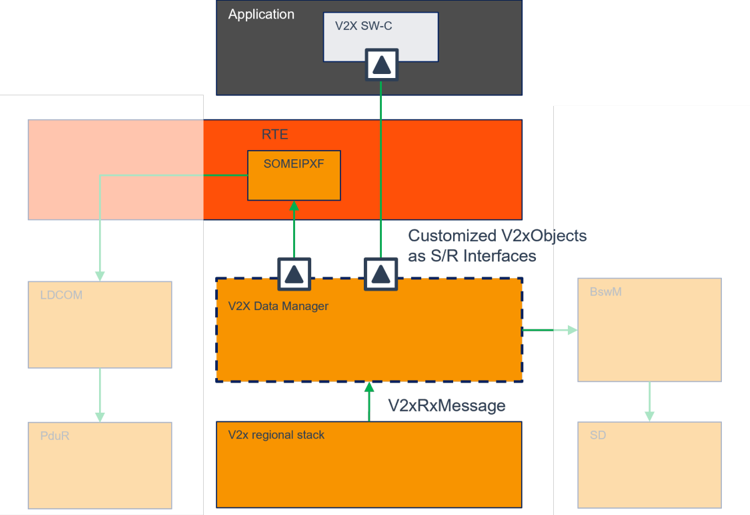

**V2xDM** 的一个主要目标是提供对 V2x 消息中包含的 V2x 消息元素的选择性视图。理想情况下，这些 V2x 消息元素独立于底层区域性 V2x 协议栈，可以像包含统一 V2x 目录项的数据目录一样提供。例如，可以从一条 V2x 消息导出对车辆位置、速度和航向的视图。该信息可以作为统一的 V2x 目录项集合提供，独立于底层区域性 V2x 协议栈。但一个 V2x 协议栈可能以 1 m/s 的分辨率定义速度，另一个则以 2 m/s 的分辨率定义。**OEM** 的车辆数据库工程师决定从 V2x 协议栈以 1 m/s 的单位在车辆网络内提供统一的 V2x 目录项「speed」。这要求在 **V2xDM** 中对其中一个特定 V2x 协议栈应用转换函数，而另一个的速度值可以「原样」提供。取决于当前使用的变体是哪个 V2x 协议栈及其 V2x 消息集合，并据此决定用哪些源来导出 V2x 目录项。

这些项随后映射到 V2x 对象相应的 VariableDataPrototype。

### 6.2. 建模方法

为了提供更大的灵活性，V2x 消息、V2x 协议栈和 V2x 目录项的关系在 **V2xDM** 的 **EcuC** 配置中建模。基本块及其关系如图 7.5 所示。

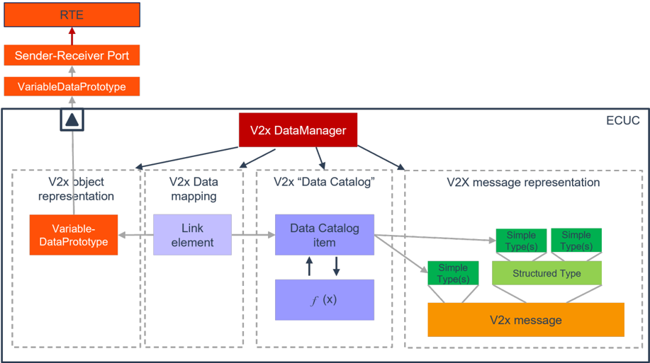

**V2xDM** 的 **EcuC** 模型大致可分为以下几部分：

1. V2x 消息表示：按照规范中的 **ASN.1**（**UPER**）格式描述定义 V2x 消息。它按顺序和表示形式定义所有简单类型和结构化类型元素。
2. V2x 数据目录：本部分对 V2x 目录项建模，并引用一条 V2x 消息中的 V2x 消息元素。可以引用一个转换例程，将 V2x 消息元素适配为统一的格式和数据类型。
3. V2x 数据映射：本部分对 V2x 对象的 VariableDataPrototype 与 V2x 目录项之间的链接建模，并建立连接。
4. V2x 对象表示：本部分对预定义 V2x 对象的 VariableDataPrototype 的引用建模，使其可被 **V2xDM** 寻址。

**V2xDM** 提供到 V2x 消息元素的引用：**V2xDM** 应提供到一条 V2x 消息的简单类型的引用。这允许通过 **EcuC** 配置定义 V2x 消息内容的表示形式，并允许标识 V2x 消息元素在 V2x 消息中的位置。

应定义 V2x 目录项：**V2xDM** 应定义表示来自 V2x 消息的信息的 V2x 数据目录。V2x 目录项是一条 V2x 消息中某个简单类型的一对一表示，也可以是涉及一个或多个简单类型的计算结果。

**V2xDM** 应可选地将 V2x 消息元素变换为 V2x 目录项：可选地，应能够定义将一条 V2x 消息的至少一个简单类型变换或转换为一个 V2x 数据链接元素（作为 V2x Data Mapping）的操作，该元素可映射到一个 VariableDataPrototype。变换或转换例程既可以由 **V2xDM** 提供，也可以作为可配置的操作提供。

此外，**V2xDM** 应通过一个定义的 **API**（作为一种插件接口）为这类变换或转换例程提供一个接口。

**V2xDM** 将 V2x 目录项链接到 S/R 端口的 VariableDataPrototype：**V2xDM** 应将 V2x 目录项映射到一个 S/R 端口的 VariableDataPrototype。该映射应在其 **EcuC** 配置中配置。

**V2xDM** 内的主要操作是解码 V2x 消息、变换其 V2x 消息元素，并将结果放入 V2x 对象的 VariableDataPrototype 中。这一切都取决于 **EcuC** 配置。因此，**V2xDM** 的主要部分将由 **EcuC** 配置生成的代码组成。静态代码部分主要是将 **V2xDM** 嵌入 **AUTOSAR** 环境的粘合代码。

### 6.3. 模块处理

**V2xDM** 应与底层 V2XStack 驻留在同一分区中。

#### 6.3.1. 初始化

调用 [V2xDM_Init](#741-v2xdm_init) 会初始化所有内部变量，并将 **V2xDM** 模块置为初始化状态。

如果通过 V2xDMDevErrorDetect 使能了开发错误上报，则在未初始化状态下调用 [V2xDM_Init](#741-v2xdm_init) 或 [V2xDM_GetVersionInfo](#742-v2xdm_getversioninfo) 以外的任何 **API** 时，**V2xDM** 应以错误代码 V2xDM_E_UNINIT 调用 Det_ReportError。

在已初始化状态下调用 [V2xDM_Init](#741-v2xdm_init) 时，**V2xDM** 模块不应重新初始化其内部变量。如果开发错误上报被使能（参见 V2xDMDevErrorDetect），它应以错误代码 V2xDM_E_REINIT 调用 Det_ReportError。

#### 6.3.2. 调度

消息接收指示由区域性 V2x 协议栈通过函数调用 [V2xDM_V2xStackRxIndication](#752-v2xdm_v2xstackrxindication)、或由 **PDU** 路由器通过函数调用 [V2xDM_RxIndication](#751-v2xdm_rxindication) 异步触发给 **V2xDM**。为了将 **V2xDM** 内部采取的动作与异步调用解耦，主函数 [V2xDM_MainFunction](#761-v2xdm_mainfunction) 应被周期性调用。**V2xDM** 通常在此主函数的上下文中调用其他模块（例如 **RTE**）。

主函数 [V2xDM_MainFunction](#761-v2xdm_mainfunction) 应以 V2xDMMainFunctionPeriod 中配置的周期被调用。该函数用于在 **V2xDM** 内执行操作，并在需要触发操作时调用其他模块。

### 6.4. 数据发送与接收

#### 6.4.1. 数据发送

如果 V2xDMPduDirection 设置为 V2XDM_PDU_SEND，则 V2xDMPduRef 引用一个全局 **PDU**。区域性 V2x 协议栈必须调用 [V2xDM_V2xStackRxIndication](#752-v2xdm_v2xstackrxindication) 并带有所述消息的引用（符号名引用），以向 **V2xDM** 提供消息载荷。每当该消息被指示时，**V2xDM** 应调用 PduR_V2xDMTransmit，其中 PduInfoPtr-&gt;MetaDataPtr 设置为 NULL_PTR，PduInfoPtr-&gt;SduLength 设置为 V2x 消息载荷的长度，且 PduInfoPtr-&gt;SduDataPtr 应设置为该 V2x 消息的载荷。

#### 6.4.2. 数据接收

**V2xDM** 获取原始 V2x 消息（通常包含 **ITS** 报头）作为 **ASN.1** **UPER** 格式的输入。这些消息既可以由集成的 V2x 协议栈直接提供，也可以作为来自网络的 **PDU** 由 **PduR** 提供。

V2x 消息应通过 **PDU** 路由器或通过底层 V2x 协议栈接收。

在 V2xDMPduDirection 设置为 V2XDM_PDU_RECEIVE 的配置中，参数 V2xDMPduRef 应引用一个提供 V2x 消息的全局 **PDU**。

**提示：** 在这样的配置中，相当于是假定不存在区域性 V2x 协议栈。

**注意：** 配置 **V2xDM** 时，确保为每个 [V2xDMMessage](#9113-v2xdmmessage) 配置一个源。该源既可以是如第 [6.4.2](#642-数据接收) 节所述来自 **PduR** 的输入，也可以是区域性 V2x 协议栈对 [V2xDM_V2xStackRxIndication](#752-v2xdm_v2xstackrxindication) 的调用。

如果 V2xDMPduDirection 设置为 V2XDM_PDU_SEND，**V2xDM** 会按照第 [6.4.1](#641-数据发送) 节的规定将该消息转发给 **PDU** 路由器。如果 V2x 对象也分配给了该消息，**V2xDM** 还应解码该消息、准备 V2x 对象并传递给 **RTE**。

如果存在 [V2xDMMsgQueue](#9115-v2xdmmsgqueue)，则通过调用 [V2xDM_V2xStackRxIndication](#752-v2xdm_v2xstackrxindication) 或 [V2xDM_RxIndication](#751-v2xdm_rxindication) 进入的任何 V2XMessage 都应放入队列，该消息的进一步处理应推迟到调度函数 [V2xDM_MainFunction](#761-v2xdm_mainfunction)。

如果存在 [V2xDMMsgQueue](#9115-v2xdmmsgqueue) 且通过调用 [V2xDM_V2xStackRxIndication](#752-v2xdm_v2xstackrxindication) 或 [V2xDM_RxIndication](#751-v2xdm_rxindication) 收到进入的 V2XMessage 但队列已满，则应通过 Det_ReportRuntimeError 上报运行时错误 V2xDM_E_QUEUE_OVERRUN，并丢弃该消息。

队列配置参数 V2xDMMsgQueueElementSize 和 V2xDMMsgQueueNumberOfEntries 可用于为进入的 V2x 消息配置消息队列。如果配置了一个队列（通过容器 [V2xDMMsgQueue](#9115-v2xdmmsgqueue) 的存在），队列深度由 V2xDMMsgQueueNumberOfEntries 指定。队列的每个条目大小相同。每个队列条目的大小由 V2xDMMsgQueueElementSize 指定，它规定了一条消息的字节数。该元素大小应能存储最大的 V2XMessage。

### 6.5. 数据建模

#### 6.5.1. V2x 消息表示

为了支持多个区域性 V2x 协议栈，**V2xDM** 的数据模型支持一个分层体系。每个区域性特定的 V2x 协议栈及其对应的 V2x 消息都在 [V2xDMStack](#9112-v2xdmstack) 及属于该协议栈的后续 [V2xDMMessage](#9113-v2xdmmessage) 容器中配置。各种 V2x 协议栈及其 V2x 消息的配置是可选的。由于支持 **AUTOSAR** 变体概念，V2x 协议栈及其消息可以分配给这些变体以使其使能或禁用。即使只需要一个区域性 V2x 协议栈，至少一个 [V2xDMStack](#9112-v2xdmstack) 容器的配置也是强制的。但只有在使用多个 V2x 协议栈时，变体的定义才有用。

对于区域性 V2x 协议栈，应定义一个容器 [V2xDMStack](#9112-v2xdmstack)。**V2xDM** 支持的所有 V2x 消息应在后续的 [V2xDMMessage](#9113-v2xdmmessage) 容器中配置。

每个 **AUTOSAR** 变体应恰好存在一个区域性 V2x 协议栈。

每条消息应可由外部模块配置寻址。因此，[V2xDMMessage](#9113-v2xdmmessage) 容器包含一个 **AUTOSAR** 符号名（**SymbolicName**）。

每个 **ASN.1** 类型，无论是结构化类型还是简单类型，都必须显式建模，且只能被恰好使用一次。由此可知，每个 **ASN.1** 元素表示在 [V2xDMMessage](#9113-v2xdmmessage) 容器中只能有一个父节点。

**基本原理：** 例如，该配置单独表示每个 **ASN.1** 类型的实例。由此可知，[V2xDMMessage](#9113-v2xdmmessage) 容器对每个所表示的 **ASN.1** 元素恰好包含一个引用。

**提示：** 这是必要的，因为这些元素被用作 CatalogItem 的源。例如，如果一个序列中有两个相同类型的元素，而只对该类型建模一次然后从两个元素引用它，就无法再明确哪个元素应用作 CatalogItem 的源。

分配给 [V2xDMMessage](#9113-v2xdmmessage) 容器的短名应全局唯一。不应有两个 [V2xDMMessage](#9113-v2xdmmessage) 容器（在同一 [V2xDMStack](#9112-v2xdmstack) 容器内或）在不同 [V2xDMStack](#9112-v2xdmstack) 容器内共享同一短名。

#### 6.5.2. V2x 数据目录

作为模型的第二个重要部分，数据目录提供了定义自定义数据集的可能性。该数据集随后可用于填充 V2x 对象。目录中的每一项都从一条或多条 V2x 消息元素派生。每个 V2XCatalogItem 是对不同区域性 V2X 规范的抽象。为了在不同区域性协议栈之间可能不一致的数据表示之间实现兼容，可以应用转换。

对于每个 **AUTOSAR** 变体，V2XCatalogItem 需要连接到对应的 V2x 消息。每个连接配置为一个 [V2xDMConnection](#916-v2xdmconnection) 容器。

每个 [V2xDMConnection](#916-v2xdmconnection) 的源需要是一条消息的元素。每个源都是导出 V2x 目录项值的必要信息。

只有 SimpleType 可以用作目录项的源。

每个源使用容器 [V2xDMConnectionSource](#917-v2xdmconnectionsource) 配置。SimpleType 应使用 V2xDMConnectionSourceTargetRef 引用来标识。如果它在 **ASN.1** 层次中的一个或多个父节点是 SequenceOf 类型，则对于每个这样的父节点都需要定义 [V2xDMConnectionSourceContext](#918-v2xdmconnectionsourcecontext) 容器。[V2xDMConnectionSourceContext](#918-v2xdmconnectionsourcecontext) 容器指定对相应 SequenceOf 根类型的引用以及所访问的 SequenceOf 的索引，以唯一地寻址该消息元素。

如果源消息元素的数据类型与 V2x 目录项类型不对应，或使用多个源来导出该项的值，则需要使用 [V2xDMConversion](#919-v2xdmconversion) 容器配置一个转换例程。

#### 6.5.3. V2x 数据映射

模型的最后部分用于将 V2x 对象元素与 V2x 目录项连接起来。连接通过定义一个 [V2xDMLink](#914-v2xdmlink) 容器实现，该容器包含对 V2XCatalogItem 的引用和对 V2XObject 元素的一个或多个引用。

V2x 对象元素的引用配置为 [V2xDMLink](#914-v2xdmlink)。容器的每个实例应有一个对 [V2xDMCatalogItem](#915-v2xdmcatalogitem) 的引用，以及作为 V2xDMLinkV2xObjectElementInstanceRef 的对 V2x 对象元素的引用。

只有类型能够表示 V2x 目录项类型所有可能取值的 V2x 对象元素才可以被连接。

一个 V2x 对象内的所有元素应只共享一条源消息。

**基本原理：** 不允许将来自不同消息的数据组合在同一个 V2x 对象中。**V2xDM** 不组装这类消息。一个 V2XObject 内的所有元素都需要被填充，V2x 对象才能被分发。由此可知，只有当 V2x 对象的所有元素都派生自同一消息时，它才能被分发。如果多条消息为一个 V2x 对象提供了全部源，则只要其中一条消息被接收，它就会被分发。

### 6.6. 消息解码与转发

**V2xDM** 接收到的 V2x 消息以 **ASN.1** 格式（**UPER** 格式）编码。在这些消息中的数据可被访问之前，需要将其解码为微控制器可访问的数据结构（高度紧凑的编码格式）。**ASN.1** 消息的确切编码规则取决于具体标准，可能会有所不同。

如果一条消息通过 **PduR** 或区域性 V2x 协议栈提供给 **V2xDM**，且 V2x 目录项被分配给该消息的一个 V2x 对象，则 **V2xDM** 将按照 [V2xDMMessage](#9113-v2xdmmessage) 的配置开始解码该消息，并将映射到相应 V2XCatalogItem 的 V2x 对象的 VariableDataPrototype 填充完毕。

在解码 **ASN.1** 编码的 V2x 消息期间，对于每个设置了 CallbackEnabled 标志的 StructuredType（参见 V2xDMStructuredTypeSequenceOfCallbackEnabled、V2xDMStructuredTypeChoiceCallbackEnabled 或 V2xDMStructuredTypeSequenceCallbackEnabled），解码器应调用一个生成的回调函数。该回调函数的实现应是用户特定的（参见第 [7.7.4](#774-v2xdm_callback_stackmsgtype) 节）。如果该函数返回 E_OK，解码器继续其操作并解码 V2x 消息的下一个序列。任何其他返回值都会中止解码过程，且分配给该 V2x 消息的任何 V2x 对象都不会被指示给 **RTE**。

如果在 V2x 消息解码期间发生错误，则 **V2xDM** 应生成一个 RuntimeError，并以错误代码 V2xDM_E_DECODING_FAILURE 调用 Det_ReportRuntimeError。

如果 V2x 目录项的值不是 V2x 消息元素的直接拷贝，则应应用转换函数 &lt;V2xDM_ItemConversionFunc&gt; 来导出该值。转换函数的名称应在 V2xDMConversionFunc 中配置，作为 [V2xDMConversion](#919-v2xdmconversion) 容器的参数，该容器是相应目录项连接内 [V2xDMConnection](#916-v2xdmconnection) 的子容器。所分配的转换函数名应是唯一的，且不得与无关函数的名称冲突。

如果一个 V2x 目录项由一个 V2x 消息元素派生，且该消息元素的源需要转换为另一种单位（例如通过线性变换），则需要转换函数。或者，一个 V2x 目录项由多个 V2x 消息元素派生。在后一种情况下，转换函数从 V2x 消息元素的输入值生成结果的 V2x 目录项。

用户自定义转换函数的另一种替代方案是使用 **V2xDM** 提供的标准转换函数，例如 [V2xDMConversionFunctionLinear](#9111-v2xdmconversionfunctionlinear)。

**注意：** 只有当 V2x 目录项被一个 V2x 对象引用时，才会生成转换函数。没有引用时，不会生成转换函数。

**V2xDM** 应仅在完整的 V2x 消息被成功解码且所有 V2x 对象都被完全填充之后，才将与一条 V2x 消息的 V2x 目录项相关联的任何 V2x 对象指示给 **RTE**。

如果在 V2x 消息转换期间发生错误，则 **V2xDM** 应生成一个 RuntimeError，并以错误代码 V2xDM_E_CONVERSION_FAILURE 调用 Det_ReportRuntimeError。

转换流程的详情见图 9.1。

**注意：** 可以将一个 V2x 对象配置为通过 **SOME/IP** 传输。变换器和事件类型的值进行相应配置。**V2x Data Manager** 不管理服务发现。事件类型要么在启动时自动初始化，要么由 **SW-C** 管理。

### 6.7. 错误分类

#### 6.7.1. 开发错误

| 错误类型 | 相关错误代码 | 错误值 |
|---|---|---|
| 使用错误参数调用 **API** 服务 | V2XDM_E_PARAM | 0x01 |
| 在模块初始化之前调用了 **API** 服务 | V2XDM_E_UNINIT | 0x02 |
| 在模块已被先前的 [V2xDM_Init](#741-v2xdm_init)() 调用初始化之后再次调用 [V2xDM_Init](#741-v2xdm_init)() | V2XDM_E_REINIT | 0x03 |
| 使用 **NULL** 指针调用了 **API** 服务 | V2XDM_E_PARAM_POINTER | 0x04 |

#### 6.7.2. 运行时错误

| 错误类型 | 相关错误代码 | 错误值 |
|---|---|---|
| 指示在接收到新消息时 **V2xDM** 队列已满 | V2XDM_E_QUEUE_OVERRUN | 0x10 |
| 指示 **ASN.1** 解码已失败 | V2XDM_E_DECODING_FAILURE | 0x11 |
| 指示 V2x 消息元素到目录项的转换已失败 | V2XDM_E_CONVERSION_FAILURE | 0x12 |

#### 6.7.3. 瞬态故障

**V2xDM** 模块不定义瞬态错误。

#### 6.7.4. 生产错误

**V2xDM** 模块不定义生产错误。

#### 6.7.5. 扩展生产错误

**V2xDM** 模块不定义扩展生产错误。

## 7. API规范

### 7.1. API 参数检查

当 **NULL_PTR** 不被接受为服务或回调函数的实参时，**V2x Data Manager** 模块上报开发错误 V2xDM_E_PARAM_POINTER。确切行为在 [SWS_BSW_00050] 和 [SWS_BSW_00212] 中规定。

### 7.2. 导入的类型

本章列出从以下文件包含的所有类型。

| 模块 | 头文件 | 导入的类型 |
|---|---|---|
| ComStack_Types | ComStack_Types.h | PduIdType |
| Rte | Rte_&lt;SWC&gt;.h | Rte_Instance |
| Std | Std_Types.h | Std_ReturnType |
| Std | Std_Types.h | Std_VersionInfoType |

### 7.3. 类型定义

#### 7.3.1. V2xDM_ConfigType

| 名称 | V2xDm_Rep_&lt;Stack&gt;_&lt;Msg&gt;_&lt;Type&gt; | | |
| --- | --- | --- | --- |
| 类别 | Structure | | |
| 元素 | implementation specific | 类型 | - |
| 元素 | 注释 | - | |
| 描述 | 这是一个在生成的回调中使用的生成数据结构（参见第 [7.7.4](#774-v2xdm_callback_stackmsgtype) 节）。生成的结构名称将从 **EcuC** 配置中定义的各种容器名称派生：&lt;Stack&gt;：[V2xDMStack](#9112-v2xdmstack) 的容器名称；&lt;Msg&gt;：[V2xDMMessage](#9113-v2xdmmessage) 的容器名称；&lt;Type&gt;：回调所引用的 [V2xDMStructuredType](#9116-v2xdmstructuredtype) 的容器名称。 | | |
| 可通过 | V2xDM.h 获得 | | |

### 7.4. 函数定义

这是为上层模块和其他 V2x 协议栈模块提供的函数列表。

#### 7.4.1. V2xDM_Init

**说明**: 初始化模块 **V2xDM** 的服务。它初始化所有变量并将模块状态置为已初始化。可通过 **V2xDM.h** 获得。服务 **ID** 0x01。本服务为同步调用，不可重入。参数 CfgPtr（in）：组件配置结构。返回值：无。

```C
void V2xDM_Init ( void CfgPtr )
```

#### 7.4.2. V2xDM_GetVersionInfo

**说明**: 返回组件的版本信息、供应商 **ID** 和 **AUTOSAR** 模块 **ID**。可通过 **V2xDM.h** 获得。服务 **ID** 0x02。本服务为同步调用，可重入。参数 VersionInfoPtr（out）：存储版本信息的指针。参数不应为 **NULL**。返回值：无。

```C
void V2xDM_GetVersionInfo ( Std_VersionInfoType VersionInfoPtr )
```

### 7.5. 回调通知

这是为其他模块提供的函数列表。

#### 7.5.1. V2xDM_RxIndication

**说明**: 来自下层通信接口模块（**PduR**）的接收 **PDU** 指示。可通过 **V2xDM.h** 获得。服务 **ID** 0x07。本服务为同步调用，不可重入。参数 RxPduId（in）：接收到的 **PDU** 的 **ID**。参数 PduInfoPtr（in）：包含接收到的 **PDU** 的长度（SduLength）、指向包含该 **PDU** 的缓冲区的指针（SduDataPtr），以及与此 **PDU** 相关的 MetaData。返回值：无。

```C
void V2xDM_RxIndication ( PduIdType RxPduId, const PduIdType PduInfoPtr )
```

#### 7.5.2. V2xDM_V2xStackRxIndication

**说明**: 由底层 V2x 协议栈调用，向 **V2x Data Manager** 提供 V2x 消息。可通过 **V2xDM.h** 获得。服务 **ID** 0x04。本服务为同步调用，不可重入。参数 MsgId（in）：保存消息的标识符。参数 V2xMsgDataPtr（in）：指向 **ASN.1** **UPER** 表示形式的 V2x 消息数据的指针。参数 V2xMsgDataLength（in）：指示提供给该函数的字节数。返回值：无。

```C
void V2xDM_V2xStackRxIndication ( uint32 MsgId, uint8* V2xMsgDataPtr, uint32 V2xMsgDataLength )
```

### 7.6. 调度函数

这些函数由基础软件调度器直接调用。以下函数应没有返回值和参数。所有函数应不可重入。

#### 7.6.1. V2xDM_MainFunction

**说明**: 按照指定的时间间隔周期性调用的函数。可通过 **V2xDM.h** 获得。服务 **ID** 0x03。

```C
void V2xDM_MainFunction ( void )
```

### 7.7. 期望接口

本章列出从其他模块要求的全部接口。

#### 7.7.1. 强制接口

**注意：** 本节定义实现模块核心功能所需的全部接口。

| API 函数 | 头文件 | 描述 |
|---|---|---|
| Det_ReportRuntimeError | Det.h | 上报运行时错误的服务。如果配置了 callout，则应调用该 callout |

#### 7.7.2. 可选接口

本节定义实现模块可选功能所需的全部接口。

| API 函数 | 头文件 | 描述 |
|---|---|---|
| Det_ReportError | Det.h | 上报开发错误的服务 |
| Rte_Write_&lt;p&gt;_&lt;o&gt; | &lt;application.h&gt; 或 Rte_&lt;Mip&gt;.h | - |

#### 7.7.3. 可配置接口

本节列出目标函数可配置的全部接口。目标函数通常是回调函数。这类接口的名称不固定，因为它们是可配置的。

**V2xDM** 中目前没有可用的可配置接口。

#### 7.7.4. V2xDM_Callback_&lt;Stack&gt;_&lt;Msg&gt;_&lt;Type&gt;

| 服务名称 | V2xDM_Callback_&lt;Stack&gt;_&lt;Msg&gt;_&lt;Type&gt; | | |
| --- | --- | --- | --- |
| 语法 | Std_ReturnType V2xDM_Callback_&lt;Stack&gt;_&lt;Msg&gt;_&lt;Type&gt; ( const V2xDm_Rep_&lt;Stack&gt;_&lt;Msg&gt;_&lt;Type&gt; StructData ) | | |
| 同步/异步 | 同步 | | |
| 可重入性 | 可重入 | | |
| 参数（in） | StructData | 指向已解码结构的指针 | |
| 参数（inout） | 无 | | |
| 参数（out） | 无 | | |
| 返回值 | Std_ReturnType | E_OK：数据被接受，继续操作；E_NOT_OK：数据不被接受，中止操作，不发送与该消息关联的 V2xObject | |
| 描述 | 这是一个生成的回调，在解码 V2x 消息的一个 sequence、sequenceOf 或 union 之后调用。当配置中设置了「...CalbackEnabled」标志时会生成单独的函数。函数名将由 **Ecu C** 配置中的各种容器名派生：&lt;Stack&gt;：[V2xDMStack](#9112-v2xdmstack)；&lt;Msg&gt;：[V2xDMMessage](#9113-v2xdmmessage) 的容器名称；&lt;Type&gt;：该回调引用的 [V2xDMStructuredType](#9116-v2xdmstructuredtype) 的名称。 | | |
| 可通过 | V2xDM.h 获得 | | |

#### 7.7.5. &lt;V2xDM_ItemConversionFunc&gt;

| 服务名称 | &lt;V2xDM_ItemConversionFunc&gt; | | |
| --- | --- | --- | --- |
| 语法 | Std_ReturnType &lt;V2xDM_ItemConversionFunc&gt; ( &lt;GeneratedType&gt; ItemResult, &lt;GeneratedType&gt; ItemInput1, &lt;GeneratedType&gt; ... ) | | |
| 同步/异步 | 同步 | | |
| 可重入性 | 不可重入 | | |
| 参数（in） | ItemInput1 | 该值包含映射到目录项的 V2x 消息的 SimpleType。数据类型取决于 SimpleType，是供应商特定的 | |
| 参数（in） | ... | 该值包含映射到目录项的 V2x 消息的 SimpleType。数据类型取决于 SimpleType，是供应商特定的 | |
| 参数（inout） | 无 | | |
| 参数（out） | ItemResult | 该值提供计算结果。数据类型取决于 V2xDMCatalogItemTypeRef 所引用的数据类型 | |
| 返回值 | Std_ReturnType | E_OK：转换成功执行；E_NOT_OK：转换失败，ItemResult 无效 | |
| 描述 | 这是一个生成的回调，在目录项被写入 V2x 对象的 VariableData Prototype 之前调用。它允许将 V2x 消息元素变换为 VariableDataPrototype 的平台类型和/或重新缩放该值。如果多个 V2x 消息元素分配给该目录项，则更多输入元素将添加到函数的参数列表中。函数名将从 **EcuC** 配置中 [V2xDMConversion](#919-v2xdmconversion) 容器的配置项 V2x DMConversionFunc 派生。 | | |
| 可通过 | V2xDM.h 获得 | | |

### 7.8. 服务接口

**V2xDM** 向 **RTE** 提供发送者-接收者端口作为服务接口。然而，与其他服务模块相反，**V2xDM** 不强制规定特定的端口和服务接口来与预定义的 S/R 端口互连。**V2xDM** 从 V2xDMLinkV2xObjectElementInstanceRef 的 **EcuC** 配置中获取需要生成哪些 P-Port 原型的信息。该参数引用 SenderReceiverInterface 的预定义 RPortPrototype 及其 VariableDataPrototype，以便 **V2xDM** 能够生成必要的 PPortPrototype。

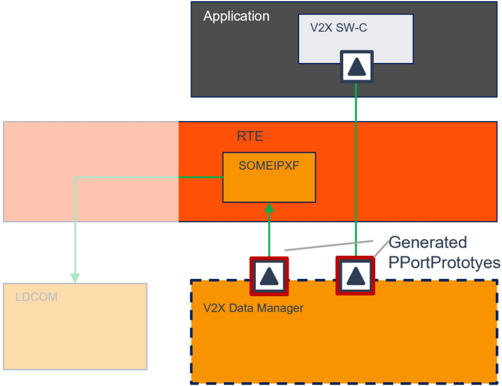

## 8. 时序图

### 8.1. V2x 消息接收

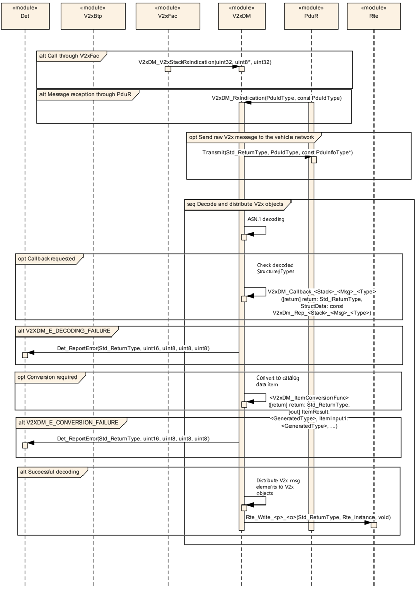

## 9. 配置规范

一般而言，本章定义配置参数及其到容器中的聚类。关于容器和参数定义的一般信息，参见 [\[3, SWS BSW General\]](#ref-3) 的第 10.1 章「配置规范简介」。

第 9.1 章规定模块 V2x_DataManager 的结构（容器）和参数。

第 9.2 章规定模块 V2x_DataManager 的发布信息。

### 9.1. 容器与配置参数

以下各章汇总所有配置参数。参数的详细含义见第 6 章和第 7 章。

#### 9.1.1. V2xDM

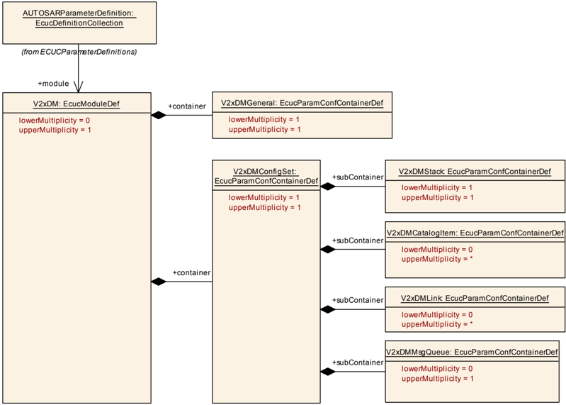

| SWS 条目 | [ECUC_V2xDM_00001] |
|---|---|
| 模块名称 | V2xDM |
| 描述 | **V2XDM** 模块的配置 |
| Post-Build 变体支持 | false |
| 支持的配置变体 | VARIANT-PRE-COMPILE |

| 容器名称 | 多重性 | 作用域/依赖 |
|---|---|---|
| V2xDMConfigSet | 1 | 容器包含 **V2xDM** 的所有配置项 |
| V2xDMGeneral | 1 | 该容器包含 **Vehicle-2-X Data Manager** 的通用配置参数。 |

#### 9.1.2. V2xDMGeneral

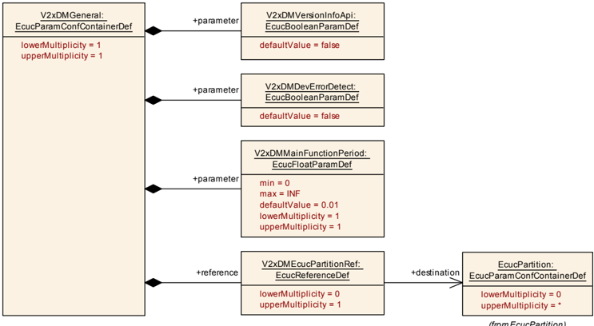

| SWS 条目 | [ECUC_V2xDM_00002] |
|---|---|
| 容器名称 | V2xDMGeneral |
| 父容器 | V2xDM |
| 描述 | 该容器包含 **Vehicle-2-X Data Manager** 的通用配置参数。 |
| 配置参数 | 见下方参数表 |

| SWS 条目 | [ECUC_V2xDM_00003] |
|---|---|
| 参数名称 | V2xDMDevErrorDetect |
| 父容器 | V2xDMGeneral |
| 描述 | 将默认错误跟踪器（**Det**）的检测和通知打开或关闭。* **true**：使能（ON）。 |
| 多重性 | 1 |
| 类型 | EcucBooleanParamDef |
| 默认值 | false |
| Post-Build 变体值 | false |
| 值配置类 | Pre-compile time：x（All Variants）；Link time：-；Post-build time：- |
| 作用域/依赖 | scope: local |

| SWS 条目 | [ECUC_V2xDM_00020] |
|---|---|
| 参数名称 | V2xDMMainFunctionPeriod |
| 父容器 | V2xDMGeneral |
| 描述 | 以秒为单位指定主函数 V2xDM_MainFunction 的周期。 |
| 多重性 | 1 |
| 类型 | EcucFloatParamDef |
| 范围 | ]0 .. INF[ |
| 默认值 | 0.01 |
| Post-Build 变体值 | false |
| 值配置类 | Pre-compile time：x（All Variants）；Link time：-；Post-build time：- |
| 作用域/依赖 | scope: ECU |

| SWS 条目 | [ECUC_V2xDM_00004] |
|---|---|
| 参数名称 | V2xDMVersionInfoApi |
| 父容器 | V2xDMGeneral |
| 描述 | 使能/禁用读取 **V2xDM** 模块版本信息的 **API**。* **true**：使能（ON）。* **false**：禁用（OFF）。 |
| 多重性 | 1 |
| 类型 | EcucBooleanParamDef |
| 默认值 | false |
| Post-Build 变体值 | false |
| 值配置类 | Pre-compile time：x（All Variants）；Link time：-；Post-build time：- |
| 作用域/依赖 | scope: local |

| SWS 条目 | [ECUC_V2xDM_00098] |
|---|---|
| 参数名称 | V2xDMEcucPartitionRef |
| 父容器 | V2xDMGeneral |
| 描述 | 对 **V2x Data Manager** 模块所分配到的 EcucPartition 的引用。 |
| 多重性 | 0..1 |
| 类型 | Reference to EcucPartition |
| Post-Build 变体多重性 | false |
| Post-Build 变体值 | false |
| 多重性配置类 | Pre-compile time：x（All Variants）；Link time：-；Post-build time：- |
| 值配置类 | Pre-compile time：x（All Variants）；Link time：-；Post-build time：- |
| 作用域/依赖 | scope: local |

无包含的容器。

#### 9.1.3. V2xDMConfigSet

| SWS 条目 | [ECUC_V2xDM_00086] |
|---|---|
| 容器名称 | V2xDMConfigSet |
| 父容器 | V2xDM |
| 描述 | 容器包含 **V2xDM** 的所有配置项 |
| 配置参数 | 见下方参数表 |

| 容器名称 | 多重性 | 作用域/依赖 |
|---|---|---|
| V2xDMCatalogItem | 0..* | 包含 **V2x DataManager** 的所有目录项 |
| V2xDMLink | 0..* | 定义 V2x 对象的 VariableDataPrototype 到 V2x 目录项的链接。 |
| V2xDMMsgQueue | 0..1 | 为数据管理器的进入 V2x 消息指定一个消息队列。如果该容器不存在，进入的 V2x 消息不使用队列。如果存在，容器的元素指定队列深度及其元素。 |
| V2xDMStack | 1 | 保存 V2x 协议栈特定的容器和参数。 |

#### 9.1.4. V2xDMLink

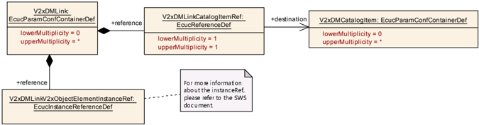

| SWS 条目 | [ECUC_V2xDM_00079] |
|---|---|
| 容器名称 | V2xDMLink |
| 父容器 | V2xDMConfigSet |
| 描述 | 定义 V2x 对象的 VariableDataPrototype 到 V2x 目录项的链接。 |
| Post-Build 变体多重性 | false |
| 多重性配置类 | Pre-compile time：x（All Variants）；Link time：-；Post-build time：- |
| 配置参数 | 见下方参数表 |

| SWS 条目 | [ECUC_V2xDM_00080] |
|---|---|
| 参数名称 | V2xDMLinkCatalogItemRef |
| 父容器 | V2xDMLink |
| 描述 | 引用该链接所使用的目录项。 |
| 多重性 | 1 |
| 类型 | Reference to V2xDMCatalogItem |
| Post-Build 变体值 | false |
| 值配置类 | Pre-compile time：x（All Variants）；Link time：-；Post-build time：- |
| 作用域/依赖 | scope: local |

| SWS 条目 | [ECUC_V2xDM_00081] |
|---|---|
| 参数名称 | V2xDMLinkV2xObjectElementInstanceRef |
| 父容器 | V2xDMLink |
| 描述 | 该容器引用端口原型和 VariableDataPrototype 作为 V2x 对象。 |
| 多重性 | 1..* |
| 类型 | Instance reference to IMPLEMENTATION-DATA-TYPE-ELEMENT context: ROOT-SW-COMPOSITION-PROTOTYPE, SW-COMPONENT-PROTOTYPE, PORT-PROTOTYPE, AUTOSAR-DATA-PROTOTYPE, IMPLEMENTATION-DATA-TYPE-ELEMENT* |
| Post-Build 变体多重性 | false |
| Post-Build 变体值 | false |
| 多重性配置类 | Pre-compile time：x；Link time：-；Post-build time：- |
| 值配置类 | Pre-compile time：x；Link time：-；Post-build time：- |
| 作用域/依赖 | - |

无包含的容器。

#### 9.1.5. V2xDMCatalogItem

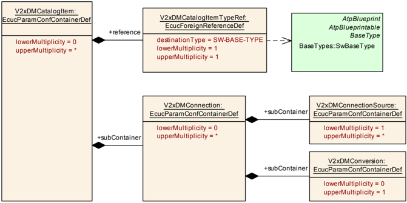

| SWS 条目 | [ECUC_V2xDM_00065] |
|---|---|
| 容器名称 | V2xDMCatalogItem |
| 父容器 | V2xDMConfigSet |
| 描述 | 包含 **V2x DataManager** 的所有目录项 |
| Post-Build 变体多重性 | false |
| 多重性配置类 | Pre-compile time：x（All Variants）；Link time：-；Post-build time：- |
| 配置参数 | 见下方参数表 |

| SWS 条目 | [ECUC_V2xDM_00064] |
|---|---|
| 参数名称 | V2xDMCatalogItemTypeRef |
| 父容器 | V2xDMCatalogItem |
| 描述 | 引用该目录项的基类型。 |
| 多重性 | 1 |
| 类型 | Foreign reference to SW-BASE-TYPE |
| Post-Build 变体值 | false |
| 值配置类 | Pre-compile time：x（All Variants）；Link time：-；Post-build time：- |
| 作用域/依赖 | - |

| 容器名称 | 多重性 | 作用域/依赖 |
|---|---|---|
| V2xDMConnection | 0..* | 收集该目录项的所有连接信息。 |

#### 9.1.6. V2xDMConnection

| SWS 条目 | [ECUC_V2xDM_00066] |
|---|---|
| 容器名称 | V2xDMConnection |
| 父容器 | V2xDMCatalogItem |
| 描述 | 收集该目录项的所有连接信息。 |
| Post-Build 变体多重性 | false |
| 多重性配置类 | Pre-compile time：x（All Variants）；Link time：-；Post-build time：- |
| 配置参数 | 见下方参数表 |

| 容器名称 | 多重性 | 作用域/依赖 |
|---|---|---|
| V2xDMConnectionSource | 1..* | 包含所连接的 V2x 消息项源的定义。 |
| V2xDMConversion | 0..1 | 允许定义一个转换例程，将 V2x 简单项适配为数据目录元素。 |

#### 9.1.7. V2xDMConnectionSource

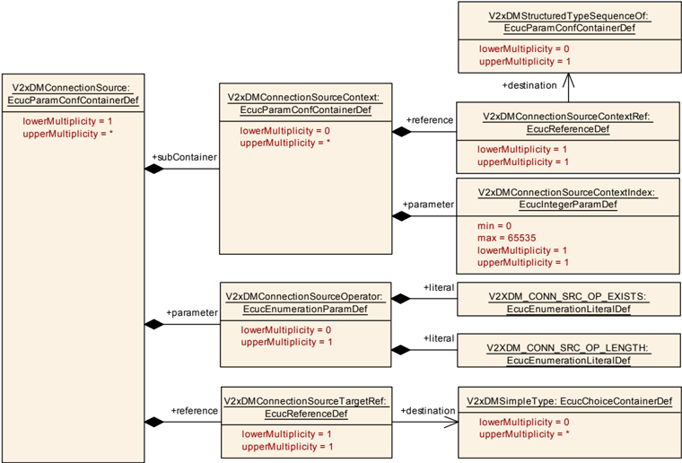

| SWS 条目 | [ECUC_V2xDM_00067] |
|---|---|
| 容器名称 | V2xDMConnectionSource |
| 父容器 | V2xDMConnection |
| 描述 | 包含所连接的 V2x 消息项源的定义。 |
| Post-Build 变体多重性 | false |
| 多重性配置类 | Pre-compile time：x（All Variants）；Link time：-；Post-build time：- |
| 配置参数 | 见下方参数表 |

| SWS 条目 | [ECUC_V2xDM_00072] |
|---|---|
| 参数名称 | V2xDMConnectionSourceOperator |
| 父容器 | V2xDMConnectionSource |
| 描述 | 选择操作符的源类型。 |
| 多重性 | 0..1 |
| 类型 | EcucEnumerationParamDef |
| 范围 | V2XDM_CONN_SRC_OP_EXISTS：-；V2XDM_CONN_SRC_OP_LENGTH：- |
| Post-Build 变体多重性 | false |
| Post-Build 变体值 | false |
| 多重性配置类 | Pre-compile time：x（All Variants）；Link time：-；Post-build time：- |
| 值配置类 | Pre-compile time：x（All Variants）；Link time：-；Post-build time：- |
| 作用域/依赖 | scope: local |

| SWS 条目 | [ECUC_V2xDM_00073] |
|---|---|
| 参数名称 | V2xDMConnectionSourceTargetRef |
| 父容器 | V2xDMConnectionSource |
| 描述 | 链接到一条 V2x 消息的简单类型。 |
| 多重性 | 1 |
| 类型 | Reference to V2xDMSimpleType |
| Post-Build 变体值 | false |
| 值配置类 | Pre-compile time：x（All Variants）；Link time：-；Post-build time：- |
| 作用域/依赖 | scope: local |

| 容器名称 | 多重性 | 作用域/依赖 |
|---|---|---|
| V2xDMConnectionSourceContext | 0..* | 包含唯一寻址一个 V2X 消息元素的信息。即 V2x 消息元素可以包含在 SequenceOf 中。此时必须提供 SequenceOf 内的索引以避免歧义引用。 |

#### 9.1.8. V2xDMConnectionSourceContext

| SWS 条目 | [ECUC_V2xDM_00069] |
|---|---|
| 容器名称 | V2xDMConnectionSourceContext |
| 父容器 | V2xDMConnectionSource |
| 描述 | 包含唯一寻址一个 V2X 消息元素的信息。即 V2x 消息元素可以包含在 SequenceOf 中。此时必须提供 SequenceOf 内的索引以避免歧义引用。 |
| Post-Build 变体多重性 | false |
| 多重性配置类 | Pre-compile time：x（All Variants）；Link time：-；Post-build time：- |
| 配置参数 | 见下方参数表 |

| SWS 条目 | [ECUC_V2xDM_00070] |
|---|---|
| 参数名称 | V2xDMConnectionSourceContextIndex |
| 父容器 | V2xDMConnectionSourceContext |
| 描述 | SourceContextRef 所引用的 SequenceOf 元素的索引。 |
| 多重性 | 1 |
| 类型 | EcucIntegerParamDef |
| 范围 | 0 .. 65535 |
| 默认值 | - |
| Post-Build 变体值 | false |
| 值配置类 | Pre-compile time：x（All Variants）；Link time：-；Post-build time：- |
| 作用域/依赖 | scope: local |

| SWS 条目 | [ECUC_V2xDM_00071] |
|---|---|
| 参数名称 | V2xDMConnectionSourceContextRef |
| 父容器 | V2xDMConnectionSourceContext |
| 描述 | 对一条 V2x 消息的 SequenceOf 元素的引用。 |
| 多重性 | 1 |
| 类型 | Reference to V2xDMStructuredTypeSequenceOf |
| Post-Build 变体值 | false |
| 值配置类 | Pre-compile time：x（All Variants）；Link time：-；Post-build time：- |
| 作用域/依赖 | scope: local |

无包含的容器。

#### 9.1.9. V2xDMConversion

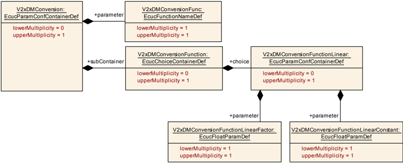

| SWS 条目 | [ECUC_V2xDM_00068] |
|---|---|
| 容器名称 | V2xDMConversion |
| 父容器 | V2xDMConnection |
| 描述 | 允许定义一个转换例程，将 V2x 简单项适配为数据目录元素。 |
| Post-Build 变体多重性 | false |
| 多重性配置类 | Pre-compile time：x（All Variants）；Link time：-；Post-build time：- |
| 配置参数 | 见下方参数表 |

| SWS 条目 | [ECUC_V2xDM_00075] |
|---|---|
| 参数名称 | V2xDMConversionFunc |
| 父容器 | V2xDMConversion |
| 描述 | 本参数提供回调 &lt;V2xDM_ItemConversionFunc&gt; 的函数名。它用于将简单类型信息转换为数据目录项值及其基类型。 |
| 多重性 | 1 |
| 类型 | EcucFunctionNameDef |
| 默认值 | - |
| 正则表达式 | - |
| Post-Build 变体值 | false |
| 值配置类 | Pre-compile time：x（All Variants）；Link time：-；Post-build time：- |
| 作用域/依赖 | - |

| 容器名称 | 多重性 | 作用域/依赖 |
|---|---|---|
| V2xDMConversionFunction | 0..1 | 定义应用于将 V2x 消息元素转换为统一数据目录项的转换函数容器。 |

#### 9.1.10. V2xDMConversionFunction

| SWS 条目 | [ECUC_V2xDM_00074] |
|---|---|
| 选择容器名称 | V2xDMConversionFunction |
| 父容器 | V2xDMConversion |
| 描述 | 定义应用于将 V2x 消息元素转换为统一数据目录项的转换函数容器。 |
| Post-Build 变体多重性 | false |
| 多重性配置类 | Pre-compile time：x（All Variants）；Link time：-；Post-build time：- |

| 容器选择 | 多重性 | 作用域/依赖 |
|---|---|---|
| V2xDMConversionFunctionLinear | 0..1 | 该容器定义线性转换例程的参数。 |

#### 9.1.11. V2xDMConversionFunctionLinear

| SWS 条目 | [ECUC_V2xDM_00076] |
|---|---|
| 容器名称 | V2xDMConversionFunctionLinear |
| 父容器 | V2xDMConversionFunction |
| 描述 | 该容器定义线性转换例程的参数。 |
| Post-Build 变体多重性 | false |
| 多重性配置类 | Pre-compile time：x（All Variants）；Link time：-；Post-build time：- |
| 配置参数 | 见下方参数表 |

| SWS 条目 | [ECUC_V2xDM_00077] |
|---|---|
| 参数名称 | V2xDMConversionFunctionLinearConstant |
| 父容器 | V2xDMConversionFunctionLinear |
| 描述 | 本参数定义线性转换函数的偏移量 |
| 多重性 | 1 |
| 类型 | EcucFloatParamDef |
| 范围 | [-INF .. INF] |
| 默认值 | - |
| Post-Build 变体值 | false |
| 值配置类 | Pre-compile time：x（All Variants）；Link time：-；Post-build time：- |
| 作用域/依赖 | scope: local |

| SWS 条目 | [ECUC_V2xDM_00078] |
|---|---|
| 参数名称 | V2xDMConversionFunctionLinearFactor |
| 父容器 | V2xDMConversionFunctionLinear |
| 描述 | 定义线性转换函数的比例因子。 |
| 多重性 | 1 |
| 类型 | EcucFloatParamDef |
| 范围 | [-INF .. INF] |
| 默认值 | - |
| Post-Build 变体值 | false |
| 值配置类 | Pre-compile time：x（All Variants）；Link time：-；Post-build time：- |
| 作用域/依赖 | scope: local |

无包含的容器。

#### 9.1.12. V2xDMStack

| SWS 条目 | [ECUC_V2xDM_00005] |
|---|---|
| 容器名称 | V2xDMStack |
| 父容器 | V2xDMConfigSet |
| 描述 | 保存 V2x 协议栈特定的容器和参数。 |
| 配置参数 | 见下方参数表 |

| 容器名称 | 多重性 | 作用域/依赖 |
|---|---|---|
| V2xDMMessage | 1..* | 一条 V2x 消息及其布局的定义 |

#### 9.1.13. V2xDMMessage

| SWS 条目 | [ECUC_V2xDM_00006] |
|---|---|
| 容器名称 | V2xDMMessage |
| 父容器 | V2xDMStack |
| 描述 | 一条 V2x 消息及其布局的定义 |
| Post-Build 变体多重性 | false |
| 多重性配置类 | Pre-compile time：x（All Variants）；Link time：-；Post-build time：- |
| 配置参数 | 见下方参数表 |

| SWS 条目 | [ECUC_V2xDM_00088] |
|---|---|
| 参数名称 | V2xDMMsgId |
| 父容器 | V2xDMMessage |
| 描述 | 消息的标识符。V2x 消息标识符的集合应是连续且无间隔的。 |
| 多重性 | 1 |
| 类型 | EcucIntegerParamDef（为该参数生成符号名） |
| 范围 | 0 .. 4294967295 |
| 默认值 | - |
| Post-Build 变体值 | false |
| 值配置类 | Pre-compile time：x（All Variants）；Link time：-；Post-build time：- |
| 作用域/依赖 | scope: local |

| SWS 条目 | [ECUC_V2xDM_00012] |
|---|---|
| 参数名称 | V2xDMMsgRootRef |
| 父容器 | V2xDMMessage |
| 描述 | 该元素链接到 V2x 消息内的第一个结构化元素。 |
| 多重性 | 1 |
| 类型 | Choice reference to [ V2xDMSimpleType, V2xDMStructuredType ] |
| Post-Build 变体值 | false |
| 值配置类 | Pre-compile time：x（All Variants）；Link time：-；Post-build time：- |
| 作用域/依赖 | - |

| 容器名称 | 多重性 | 作用域/依赖 |
|---|---|---|
| V2xDMPdu | 0..1 | 包含 **V2xDM** 配置所需的参数，使其作为 **PDU** 路由器模块的 UpperLayer。 |
| V2xDMSimpleType | 0..* | 以简单类型的选择形式定义 V2x 消息内的简单类型。 |
| V2xDMStructuredType | 0..* | V2x 消息内结构化类型的定义 |

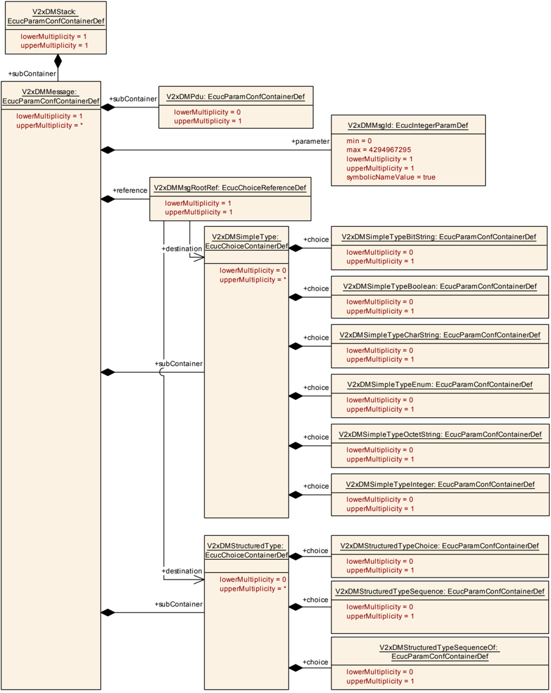

#### 9.1.14. V2xDMPdu

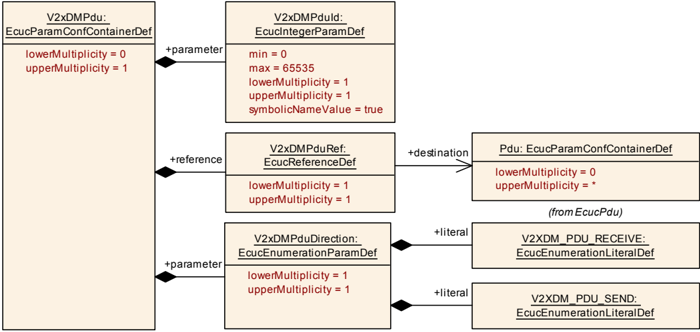

| SWS 条目 | [ECUC_V2xDM_00087] |
|---|---|
| 容器名称 | V2xDMPdu |
| 父容器 | V2xDMMessage |
| 描述 | 包含 **V2xDM** 配置所需的参数，使其作为 **PDU** 路由器模块的 UpperLayer。 |
| Post-Build 变体多重性 | false |
| 多重性配置类 | Pre-compile time：x（All Variants）；Link time：-；Post-build time：- |
| 配置参数 | 见下方参数表 |

| SWS 条目 | [ECUC_V2xDM_00091] |
|---|---|
| 参数名称 | V2xDMPduDirection |
| 父容器 | V2xDMPdu |
| 描述 | 定义 **PDU** 的方向：V2XDM_PDU_SEND —— **V2xDM** 将 V2x 消息作为原始数据传递给 **PduR**。V2XDM_PDU_RECEIVE —— **V2xDM** 通过 **PduR** 接收 V2x 消息（**ECU** 中没有 V2x 协议栈）。 |
| 多重性 | 1 |
| 类型 | EcucEnumerationParamDef |
| 范围 | V2XDM_PDU_RECEIVE：-；V2XDM_PDU_SEND：- |
| Post-Build 变体值 | false |
| 值配置类 | Pre-compile time：x（All Variants）；Link time：-；Post-build time：- |
| 作用域/依赖 | scope: local |

| SWS 条目 | [ECUC_V2xDM_00089] |
|---|---|
| 参数名称 | V2xDMPduId |
| 父容器 | V2xDMPdu |
| 描述 | 用作该 I-PDU 的 **ID** 的数值。**PduR_V2xDMRxIndication** 调用需要 ComIPduHandleId 来从 **PduR** 接收 I-PDU（ComIPdu 方向：Receive）。对于 **Tx** I-PDU（ComIPduDirection：Send），此句柄 **Id** 用于 **API** 调用 PduR_V2xDMTransmit 来发送 I-PDU。 |
| 多重性 | 1 |
| 类型 | EcucIntegerParamDef（为该参数生成符号名） |
| 范围 | 0 .. 65535 |
| 默认值 | - |
| Post-Build 变体值 | false |
| 值配置类 | Pre-compile time：x（All Variants）；Link time：-；Post-build time：- |
| 作用域/依赖 | - |

| SWS 条目 | [ECUC_V2xDM_00090] |
|---|---|
| 参数名称 | V2xDMPduRef |
| 父容器 | V2xDMPdu |
| 描述 | 对全局 **Pdu** 结构的引用。 |
| 多重性 | 1 |
| 类型 | Reference to Pdu |
| Post-Build 变体值 | false |
| 值配置类 | Pre-compile time：x（All Variants）；Link time：-；Post-build time：- |
| 作用域/依赖 | scope: local |

无包含的容器。

#### 9.1.15. V2xDMMsgQueue

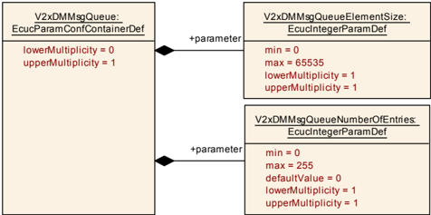

| SWS 条目 | [ECUC_V2xDM_00102] |
|---|---|
| 容器名称 | V2xDMMsgQueue |
| 父容器 | V2xDMConfigSet |
| 描述 | 为数据管理器的进入 V2x 消息指定一个消息队列。如果该容器不存在，进入的 V2x 消息不使用队列。如果存在，容器的元素指定队列深度及其元素。 |
| Post-Build 变体多重性 | false |
| 多重性配置类 | Pre-compile time：x（All Variants）；Link time：-；Post-build time：- |
| 配置参数 | 见下方参数表 |

| SWS 条目 | [ECUC_V2xDM_00097] |
|---|---|
| 参数名称 | V2xDMMsgQueueElementSize |
| 父容器 | V2xDMMsgQueue |
| 描述 | 队列条目的大小（字节）。所有队列条目大小相同。该值应足够大以存储最大的 V2x 消息。 |
| 多重性 | 1 |
| 类型 | EcucIntegerParamDef |
| 范围 | 0 .. 65535 |
| 默认值 | - |
| Post-Build 变体值 | false |
| 值配置类 | Pre-compile time：x（All Variants）；Link time：-；Post-build time：- |
| 作用域/依赖 | scope: local 依赖：如果 V2xDMQueueNumberOfEntries &gt; 0，应设置此值。 |

| SWS 条目 | [ECUC_V2xDM_00096] |
|---|---|
| 参数名称 | V2xDMMsgQueueNumberOfEntries |
| 父容器 | V2xDMMsgQueue |
| 描述 | 指定进入 V2x 消息的队列条目数量。每个 V2x 消息一个条目。此字段为 0 将禁用队列，动作仅在 V2xDM_RxIndication 中执行。 |
| 多重性 | 1 |
| 类型 | EcucIntegerParamDef |
| 范围 | 0 .. 255 |
| 默认值 | 0 |
| Post-Build 变体值 | false |
| 值配置类 | Pre-compile time：x（All Variants）；Link time：-；Post-build time：- |
| 作用域/依赖 | scope: local |

无包含的容器。

#### 9.1.16. V2xDMStructuredType

| SWS 条目 | [ECUC_V2xDM_00007] |
|---|---|
| 选择容器名称 | V2xDMStructuredType |
| 父容器 | V2xDMMessage |
| 描述 | V2x 消息内结构化类型的定义 |
| Post-Build 变体多重性 | false |
| 多重性配置类 | Pre-compile time：x（All Variants）；Link time：-；Post-build time：- |

| 容器选择 | 多重性 | 作用域/依赖 |
|---|---|---|
| V2xDMStructuredTypeChoice | 0..1 | 定义 V2x 消息内元素的一个 choice。 |
| V2xDMStructuredTypeSequence | 0..1 | 定义 V2x 消息内元素的一个序列。 |
| V2xDMStructuredTypeSequenceOf | 0..1 | 定义 V2x 消息内元素的一个列表。类似于数组。 |

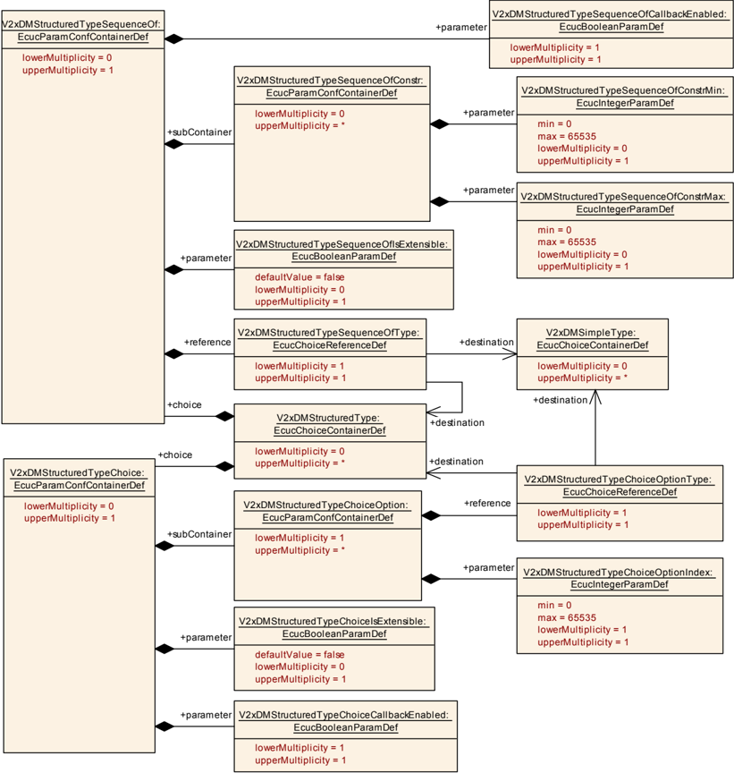

#### 9.1.17. V2xDMStructuredTypeSequence

| SWS 条目 | [ECUC_V2xDM_00010] |
|---|---|
| 容器名称 | V2xDMStructuredTypeSequence |
| 父容器 | V2xDMStructuredType |
| 描述 | 定义 V2x 消息内元素的一个序列。 |
| Post-Build 变体多重性 | false |
| 多重性配置类 | Pre-compile time：x（All Variants）；Link time：-；Post-build time：- |

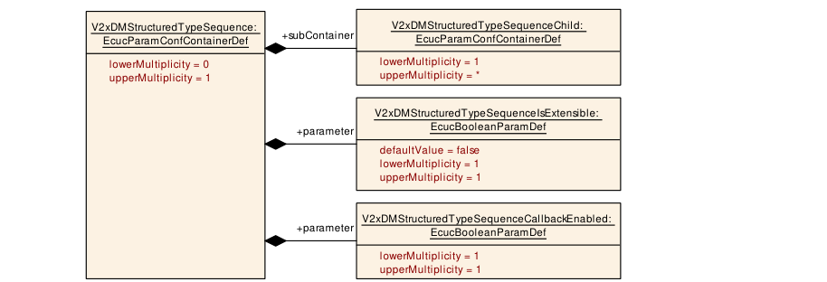

| 配置参数 |

| SWS 条目 | [ECUC_V2xDM_00094] |
|---|---|
| 参数名称 | V2xDMStructuredTypeSequenceCallbackEnabled |
| 父容器 | V2xDMStructuredTypeSequence |
| 描述 | 在结构被解码后使能一个回调。 |
| 多重性 | 1 |
| 类型 | EcucBooleanParamDef |
| 默认值 | - |
| Post-Build 变体值 | false |
| 值配置类 | Pre-compile time：x（All Variants）；Link time：-；Post-build time：- |
| 作用域/依赖 | scope: local |

| SWS 条目 | [ECUC_V2xDM_00025] |
|---|---|
| 参数名称 | V2xDMStructuredTypeSequenceIsExtensible |
| 父容器 | V2xDMStructuredTypeSequence |
| 描述 | 定义该序列将来是否可以扩展（通常在 **ASN.1** 中以「...」声明）。 |
| 多重性 | 1 |
| 类型 | EcucBooleanParamDef |
| 默认值 | false |
| Post-Build 变体值 | false |
| 值配置类 | Pre-compile time：x（All Variants）；Link time：-；Post-build time：- |
| 作用域/依赖 | - |

| 容器名称 | 多重性 | 作用域/依赖 |
|---|---|---|
| V2xDMStructuredTypeSequenceChild | 1..* | 为 **ASN.1** 结构化类型序列元素中的子元素声明所有属性。 |

#### 9.1.18. V2xDMStructuredTypeSequenceChild

| SWS 条目 | [ECUC_V2xDM_00021] |
|---|---|
| 容器名称 | V2xDMStructuredTypeSequenceChild |
| 父容器 | V2xDMStructuredTypeSequence |
| 描述 | 为 **ASN.1** 结构化类型序列元素中的子元素声明所有属性。 |
| Post-Build 变体多重性 | false |
| 多重性配置类 | Pre-compile time：x（All Variants）；Link time：-；Post-build time：- |
| 配置参数 | 见下方参数表 |

| SWS 条目 | [ECUC_V2xDM_00022] |
|---|---|
| 参数名称 | V2xDMStructuredTypeSequenceChildAttribute |
| 父容器 | V2xDMStructuredTypeSequenceChild |
| 描述 | 选择序列元素的属性。 |
| 多重性 | 1 |
| 类型 | EcucEnumerationParamDef |
| 范围 | V2XDM_STRUCTURED_TYPE_SEQUENCE_CHILD_ATTRIBUTE_DEFAULT：-；V2XDM_STRUCTURED_TYPE_SEQUENCE_CHILD_ATTRIBUTE_NONE：-；V2XDM_STRUCTURED_TYPE_SEQUENCE_CHILD_ATTRIBUTE_OPTIONAL：- |
| Post-Build 变体值 | false |
| 值配置类 | Pre-compile time：x（All Variants）；Link time：-；Post-build time：- |
| 作用域/依赖 | scope: local |

| SWS 条目 | [ECUC_V2xDM_00092] |
|---|---|
| 参数名称 | V2xDMStructuredTypeSequenceChildDefault |
| 父容器 | V2xDMStructuredTypeSequenceChild |
| 描述 | 结构的默认值。 |
| 多重性 | 0..1 |
| 类型 | EcucStringParamDef |
| 默认值 | - |
| 正则表达式 | - |
| Post-Build 变体多重性 | false |
| Post-Build 变体值 | false |
| 多重性配置类 | Pre-compile time：x（All Variants）；Link time：-；Post-build time：- |
| 值配置类 | Pre-compile time：x（All Variants）；Link time：-；Post-build time：- |
| 作用域/依赖 | scope: local |

| SWS 条目 | [ECUC_V2xDM_00023] |
|---|---|
| 参数名称 | V2xDMStructuredTypeSequenceChildIndex |
| 父容器 | V2xDMStructuredTypeSequenceChild |
| 描述 | 定义该元素在结构内的索引。 |
| 多重性 | 1 |
| 类型 | EcucIntegerParamDef |
| 范围 | 0 .. 65535 |
| 默认值 | - |
| Post-Build 变体值 | false |
| 值配置类 | Pre-compile time：x（All Variants）；Link time：-；Post-build time：- |
| 作用域/依赖 | - |

| SWS 条目 | [ECUC_V2xDM_00024] |
|---|---|
| 参数名称 | V2xDMStructuredTypeSequenceChildType |
| 父容器 | V2xDMStructuredTypeSequenceChild |
| 描述 | 作为简单或结构化类型引用结构中的子元素。 |
| 多重性 | 1 |
| 类型 | Choice reference to [ V2xDMSimpleType, V2xDMStructuredType ] |
| Post-Build 变体值 | false |
| 值配置类 | Pre-compile time：x（All Variants）；Link time：-；Post-build time：- |
| 作用域/依赖 | - |

无包含的容器。

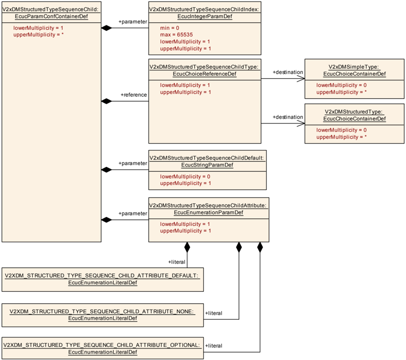

#### 9.1.19. V2xDMStructuredTypeSequenceOf

| SWS 条目 | [ECUC_V2xDM_00009] |
|---|---|
| 容器名称 | V2xDMStructuredTypeSequenceOf |
| 父容器 | V2xDMStructuredType |
| 描述 | 定义 V2x 消息内元素的一个列表。类似于数组。 |
| Post-Build 变体多重性 | false |
| 多重性配置类 | Pre-compile time：x（All Variants）；Link time：-；Post-build time：- |
| 配置参数 | 见下方参数表 |

| SWS 条目 | [ECUC_V2xDM_00093] |
|---|---|
| 参数名称 | V2xDMStructuredTypeSequenceOfCallbackEnabled |
| 父容器 | V2xDMStructuredTypeSequenceOf |
| 描述 | 在结构被解码时使能一个生成的回调。 |
| 多重性 | 1 |
| 类型 | EcucBooleanParamDef |
| 默认值 | - |
| Post-Build 变体值 | false |
| 值配置类 | Pre-compile time：x（All Variants）；Link time：-；Post-build time：- |
| 作用域/依赖 | scope: local |

| SWS 条目 | [ECUC_V2xDM_00027] |
|---|---|
| 参数名称 | V2xDMStructuredTypeSequenceOfIsExtensible |
| 父容器 | V2xDMStructuredTypeSequenceOf |
| 描述 | 定义 SequenceOf 将来是否可扩展（在 **ASN.1** 中标记为「...」） |
| 多重性 | 0..1 |
| 类型 | EcucBooleanParamDef |
| 默认值 | false |
| Post-Build 变体多重性 | false |
| Post-Build 变体值 | false |
| 多重性配置类 | Pre-compile time：x；Link time：-；Post-build time：- |
| 值配置类 | Pre-compile time：x；Link time：-；Post-build time：- |
| 作用域/依赖 | - |

| SWS 条目 | [ECUC_V2xDM_00026] |
|---|---|
| 参数名称 | V2xDMStructuredTypeSequenceOfType |
| 父容器 | V2xDMStructuredTypeSequenceOf |
| 描述 | 对下一个结构化或简单类型的引用。 |
| 多重性 | 1 |
| 类型 | Choice reference to [ V2xDMSimpleType, V2xDMStructuredType ] |
| Post-Build 变体值 | false |
| 值配置类 | Pre-compile time：x（All Variants）；Link time：-；Post-build time：- |
| 作用域/依赖 | - |

| 容器名称 | 多重性 | 作用域/依赖 |
|---|---|---|
| V2xDMStructuredTypeSequenceOfConstr | 0..* | 该容器定义 SequenceOf 父容器的约束。 |

#### 9.1.20. V2xDMStructuredTypeSequenceOfConstr

| SWS 条目 | [ECUC_V2xDM_00028] |
|---|---|
| 容器名称 | V2xDMStructuredTypeSequenceOfConstr |
| 父容器 | V2xDMStructuredTypeSequenceOf |
| 描述 | 该容器定义 SequenceOf 父容器的约束。 |
| Post-Build 变体多重性 | false |
| 多重性配置类 | Pre-compile time：x（All Variants）；Link time：-；Post-build time：- |
| 配置参数 | 见下方参数表 |

| SWS 条目 | [ECUC_V2xDM_00030] |
|---|---|
| 参数名称 | V2xDMStructuredTypeSequenceOfConstrMax |
| 父容器 | V2xDMStructuredTypeSequenceOfConstr |
| 描述 | 定义 SequenceOf 值的最大数量。 |
| 多重性 | 0..1 |
| 类型 | EcucIntegerParamDef |
| 范围 | 0 .. 65535 |
| 默认值 | - |
| Post-Build 变体多重性 | false |
| Post-Build 变体值 | false |
| 多重性配置类 | Pre-compile time：x；Link time：-；Post-build time：- |
| 值配置类 | Pre-compile time：x；Link time：-；Post-build time：- |
| 作用域/依赖 | - |

| SWS 条目 | [ECUC_V2xDM_00029] |
|---|---|
| 参数名称 | V2xDMStructuredTypeSequenceOfConstrMin |
| 父容器 | V2xDMStructuredTypeSequenceOfConstr |
| 描述 | 定义 SequenceOf 容器的最小数量。 |
| 多重性 | 0..1 |
| 类型 | EcucIntegerParamDef |
| 范围 | 0 .. 65535 |
| 默认值 | - |
| Post-Build 变体多重性 | false |
| Post-Build 变体值 | false |
| 多重性配置类 | Pre-compile time：x；Link time：-；Post-build time：- |
| 值配置类 | Pre-compile time：x；Link time：-；Post-build time：- |
| 作用域/依赖 | - |

无包含的容器。

#### 9.1.21. V2xDMStructuredTypeChoice

| SWS 条目 | [ECUC_V2xDM_00011] |
|---|---|
| 容器名称 | V2xDMStructuredTypeChoice |
| 父容器 | V2xDMStructuredType |
| 描述 | 定义 V2x 消息内元素的一个 choice。 |
| Post-Build 变体多重性 | false |
| 多重性配置类 | Pre-compile time：x（All Variants）；Link time：-；Post-build time：- |
| 配置参数 | 见下方参数表 |

| SWS 条目 | [ECUC_V2xDM_00095] |
|---|---|
| 参数名称 | V2xDMStructuredTypeChoiceCallbackEnabled |
| 父容器 | V2xDMStructuredTypeChoice |
| 描述 | 在结构被解码后使能一个回调。 |
| 多重性 | 1 |
| 类型 | EcucBooleanParamDef |
| 默认值 | - |
| Post-Build 变体值 | false |
| 值配置类 | Pre-compile time：x（All Variants）；Link time：-；Post-build time：- |
| 作用域/依赖 | scope: local |

| SWS 条目 | [ECUC_V2xDM_00031] |
|---|---|
| 参数名称 | V2xDMStructuredTypeChoiceIsExtensible |
| 父容器 | V2xDMStructuredTypeChoice |
| 描述 | 指示该 choice 容器在将来版本中是否可扩展（在 **ASN.1** 中标记为「...」） |
| 多重性 | 0..1 |
| 类型 | EcucBooleanParamDef |
| 默认值 | false |
| Post-Build 变体多重性 | false |
| Post-Build 变体值 | false |
| 多重性配置类 | Pre-compile time：x；Link time：-；Post-build time：- |
| 值配置类 | Pre-compile time：x；Link time：-；Post-build time：- |
| 作用域/依赖 | - |

| 容器名称 | 多重性 | 作用域/依赖 |
|---|---|---|
| V2xDMStructuredTypeChoiceOption | 1..* | 定义该 choice 元素中类型的引用和顺序。 |

#### 9.1.22. V2xDMStructuredTypeChoiceOption

| SWS 条目 | [ECUC_V2xDM_00032] |
|---|---|
| 容器名称 | V2xDMStructuredTypeChoiceOption |
| 父容器 | V2xDMStructuredTypeChoice |
| 描述 | 定义该 choice 元素中类型的引用和顺序。 |
| Post-Build 变体多重性 | false |
| 多重性配置类 | Pre-compile time：x（All Variants）；Link time：-；Post-build time：- |
| 配置参数 | 见下方参数表 |

| SWS 条目 | [ECUC_V2xDM_00033] |
|---|---|
| 参数名称 | V2xDMStructuredTypeChoiceOptionIndex |
| 父容器 | V2xDMStructuredTypeChoiceOption |
| 描述 | 定义 choice 容器内元素的顺序。 |
| 多重性 | 1 |
| 类型 | EcucIntegerParamDef |
| 范围 | 0 .. 65535 |
| 默认值 | - |
| Post-Build 变体值 | false |
| 值配置类 | Pre-compile time：x（All Variants）；Link time：-；Post-build time：- |
| 作用域/依赖 | - |

| SWS 条目 | [ECUC_V2xDM_00034] |
|---|---|
| 参数名称 | V2xDMStructuredTypeChoiceOptionType |
| 父容器 | V2xDMStructuredTypeChoiceOption |
| 描述 | 定义到该 choice 容器中存在的简单或结构化类型的链接。 |
| 多重性 | 1 |
| 类型 | Choice reference to [ V2xDMSimpleType, V2xDMStructuredType ] |
| Post-Build 变体值 | false |
| 值配置类 | Pre-compile time：x（All Variants）；Link time：-；Post-build time：- |
| 作用域/依赖 | - |

无包含的容器。

#### 9.1.23. V2xDMSimpleType

| SWS 条目 | [ECUC_V2xDM_00008] |
|---|---|
| 选择容器名称 | V2xDMSimpleType |
| 父容器 | V2xDMMessage |
| 描述 | 以简单类型的选择形式定义 V2x 消息内的简单类型。 |
| Post-Build 变体多重性 | false |
| 多重性配置类 | Pre-compile time：x（All Variants）；Link time：-；Post-build time：- |

| 容器选择 | 多重性 | 作用域/依赖 |
|---|---|---|
| V2xDMSimpleTypeBitString | 0..1 | **ASN.1** 位串的定义 |
| V2xDMSimpleTypeBoolean | 0..1 | **ASN.1** boolean 类型的定义 |
| V2xDMSimpleTypeCharString | 0..1 | **ASN.1** 字符串类型的定义 |
| V2xDMSimpleTypeEnum | 0..1 | **ASN.1** 枚举类型的定义 |
| V2xDMSimpleTypeInteger | 0..1 | **ASN.1** 整数类型的定义 |
| V2xDMSimpleTypeOctetString | 0..1 | **ASN.1** 八位位组串的定义。 |

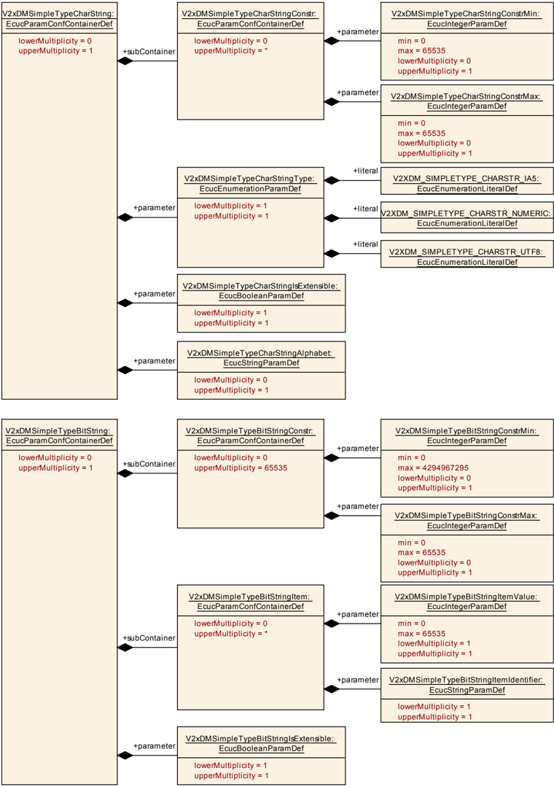

#### 9.1.24. V2xDMSimpleTypeBitString

| SWS 条目 | [ECUC_V2xDM_00013] |
|---|---|
| 容器名称 | V2xDMSimpleTypeBitString |
| 父容器 | V2xDMSimpleType |
| 描述 | **ASN.1** 位串的定义 |
| Post-Build 变体多重性 | false |
| 多重性配置类 | Pre-compile time：x（All Variants）；Link time：-；Post-build time：- |
| 配置参数 | 见下方参数表 |

| SWS 条目 | [ECUC_V2xDM_00062] |
|---|---|
| 参数名称 | V2xDMSimpleTypeBitStringIsExtensible |
| 父容器 | V2xDMSimpleTypeBitString |
| 描述 | 定义该项在将来版本中是否可扩展。 |
| 多重性 | 1 |
| 类型 | EcucBooleanParamDef |
| 默认值 | - |
| Post-Build 变体值 | false |
| 值配置类 | Pre-compile time：x（All Variants）；Link time：-；Post-build time：- |
| 作用域/依赖 | - |

| 容器名称 | 多重性 | 作用域/依赖 |
|---|---|---|
| V2xDMSimpleTypeBitStringConstr | 0..65535 | 容器定义位串长度的约束（Min/Max）。 |
| V2xDMSimpleTypeBitStringItem | 0..* | 以键-值对形式定义位串的项值。 |

#### 9.1.25. V2xDMSimpleTypeBitStringConstr

| SWS 条目 | [ECUC_V2xDM_00056] |
|---|---|
| 容器名称 | V2xDMSimpleTypeBitStringConstr |
| 父容器 | V2xDMSimpleTypeBitString |
| 描述 | 容器定义位串长度的约束（Min/Max）。 |
| Post-Build 变体多重性 | false |
| 多重性配置类 | Pre-compile time：x（All Variants）；Link time：-；Post-build time：- |
| 配置参数 | 见下方参数表 |

| SWS 条目 | [ECUC_V2xDM_00058] |
|---|---|
| 参数名称 | V2xDMSimpleTypeBitStringConstrMax |
| 父容器 | V2xDMSimpleTypeBitStringConstr |
| 描述 | 位串参数的最大长度。 |
| 多重性 | 0..1 |
| 类型 | EcucIntegerParamDef |
| 范围 | 0 .. 65535 |
| 默认值 | - |
| Post-Build 变体多重性 | false |
| Post-Build 变体值 | false |
| 多重性配置类 | Pre-compile time：x；Link time：-；Post-build time：- |
| 值配置类 | Pre-compile time：x；Link time：-；Post-build time：- |
| 作用域/依赖 | scope: local |

| SWS 条目 | [ECUC_V2xDM_00057] |
|---|---|
| 参数名称 | V2xDMSimpleTypeBitStringConstrMin |
| 父容器 | V2xDMSimpleTypeBitStringConstr |
| 描述 | 位串参数的最小长度。 |
| 多重性 | 0..1 |
| 类型 | EcucIntegerParamDef |
| 范围 | 0 .. 4294967295 |
| 默认值 | - |
| Post-Build 变体多重性 | false |
| Post-Build 变体值 | false |
| 多重性配置类 | Pre-compile time：x；Link time：-；Post-build time：- |
| 值配置类 | Pre-compile time：x；Link time：-；Post-build time：- |
| 作用域/依赖 | scope: local |

无包含的容器。

#### 9.1.26. V2xDMSimpleTypeBitStringItem

| SWS 条目 | [ECUC_V2xDM_00059] |
|---|---|
| 容器名称 | V2xDMSimpleTypeBitStringItem |
| 父容器 | V2xDMSimpleTypeBitString |
| 描述 | 以键-值对形式定义位串的项值。 |
| Post-Build 变体多重性 | false |
| 多重性配置类 | Pre-compile time：x（All Variants）；Link time：-；Post-build time：- |
| 配置参数 | 见下方参数表 |

| SWS 条目 | [ECUC_V2xDM_00061] |
|---|---|
| 参数名称 | V2xDMSimpleTypeBitStringItemIdentifier |
| 父容器 | V2xDMSimpleTypeBitStringItem |
| 描述 | 定义位串键-值对的名称。 |
| 多重性 | 1 |
| 类型 | EcucStringParamDef |
| 默认值 | - |
| 正则表达式 | - |
| Post-Build 变体值 | false |
| 值配置类 | Pre-compile time：x（All Variants）；Link time：-；Post-build time：- |
| 作用域/依赖 | - |

| SWS 条目 | [ECUC_V2xDM_00060] |
|---|---|
| 参数名称 | V2xDMSimpleTypeBitStringItemValue |
| 父容器 | V2xDMSimpleTypeBitStringItem |
| 描述 | 定义位串键-值对的值表示。 |
| 多重性 | 1 |
| 类型 | EcucIntegerParamDef |
| 范围 | 0 .. 65535 |
| 默认值 | - |
| Post-Build 变体值 | false |
| 值配置类 | Pre-compile time：x（All Variants）；Link time：-；Post-build time：- |
| 作用域/依赖 | scope: local |

无包含的容器。

#### 9.1.27. V2xDMSimpleTypeCharString

| SWS 条目 | [ECUC_V2xDM_00015] |
|---|---|
| 容器名称 | V2xDMSimpleTypeCharString |
| 父容器 | V2xDMSimpleType |
| 描述 | **ASN.1** 字符串类型的定义 |
| Post-Build 变体多重性 | false |
| 多重性配置类 | Pre-compile time：x（All Variants）；Link time：-；Post-build time：- |
| 配置参数 | 见下方参数表 |

| SWS 条目 | [ECUC_V2xDM_00055] |
|---|---|
| 参数名称 | V2xDMSimpleTypeCharStringAlphabet |
| 父容器 | V2xDMSimpleTypeCharString |
| 描述 | 定义该 CharString 使用并允许的字符集。 |
| 多重性 | 0..1 |
| 类型 | EcucStringParamDef |
| 默认值 | - |
| 正则表达式 | - |
| Post-Build 变体多重性 | false |
| Post-Build 变体值 | false |
| 多重性配置类 | Pre-compile time：x；Link time：-；Post-build time：- |
| 值配置类 | Pre-compile time：x；Link time：-；Post-build time：- |
| 作用域/依赖 | - |

| SWS 条目 | [ECUC_V2xDM_00054] |
|---|---|
| 参数名称 | V2xDMSimpleTypeCharStringIsExtensible |
| 父容器 | V2xDMSimpleTypeCharString |
| 描述 | 定义是否应考虑该参数将来的扩展。 |
| 多重性 | 1 |
| 类型 | EcucBooleanParamDef |
| 默认值 | - |
| Post-Build 变体值 | false |
| 值配置类 | Pre-compile time：x（All Variants）；Link time：-；Post-build time：- |
| 作用域/依赖 | - |

| SWS 条目 | [ECUC_V2xDM_00053] |
|---|---|
| 参数名称 | V2xDMSimpleTypeCharStringType |
| 父容器 | V2xDMSimpleTypeCharString |
| 描述 | 定义 CharString SimpleType 的类型。 |
| 多重性 | 1 |
| 类型 | EcucEnumerationParamDef |
| 范围 | V2XDM_SIMPLETYPE_CHARSTR_IA5：定义所有目录项。；V2XDM_SIMPLETYPE_CHARSTR_NUMERIC：-；V2XDM_SIMPLETYPE_CHARSTR_UTF8：- |
| Post-Build 变体值 | false |
| 值配置类 | Pre-compile time：x（All Variants）；Link time：-；Post-build time：- |
| 作用域/依赖 | - |

| 容器名称 | 多重性 | 作用域/依赖 |
|---|---|---|
| V2xDMSimpleTypeCharStringConstr | 0..* | 容器定义字符串的约束（Min/Max）。 |

#### 9.1.28. V2xDMSimpleTypeCharStringConstr

| SWS 条目 | [ECUC_V2xDM_00050] |
|---|---|
| 容器名称 | V2xDMSimpleTypeCharStringConstr |
| 父容器 | V2xDMSimpleTypeCharString |
| 描述 | 容器定义字符串的约束（Min/Max）。 |
| Post-Build 变体多重性 | false |
| 多重性配置类 | Pre-compile time：x（All Variants）；Link time：-；Post-build time：- |
| 配置参数 | 见下方参数表 |

| SWS 条目 | [ECUC_V2xDM_00052] |
|---|---|
| 参数名称 | V2xDMSimpleTypeCharStringConstrMax |
| 父容器 | V2xDMSimpleTypeCharStringConstr |
| 描述 | 字符串参数值的最大数量。 |
| 多重性 | 0..1 |
| 类型 | EcucIntegerParamDef |
| 范围 | 0 .. 65535 |
| 默认值 | - |
| Post-Build 变体多重性 | false |
| Post-Build 变体值 | false |
| 多重性配置类 | Pre-compile time：x；Link time：-；Post-build time：- |
| 值配置类 | Pre-compile time：x；Link time：-；Post-build time：- |
| 作用域/依赖 | - |

| SWS 条目 | [ECUC_V2xDM_00051] |
|---|---|
| 参数名称 | V2xDMSimpleTypeCharStringConstrMin |
| 父容器 | V2xDMSimpleTypeCharStringConstr |
| 描述 | 字符串参数值的最小数量。 |
| 多重性 | 0..1 |
| 类型 | EcucIntegerParamDef |
| 范围 | 0 .. 65535 |
| 默认值 | - |
| Post-Build 变体多重性 | false |
| Post-Build 变体值 | false |
| 多重性配置类 | Pre-compile time：x；Link time：-；Post-build time：- |
| 值配置类 | Pre-compile time：x；Link time：-；Post-build time：- |
| 作用域/依赖 | - |

无包含的容器。

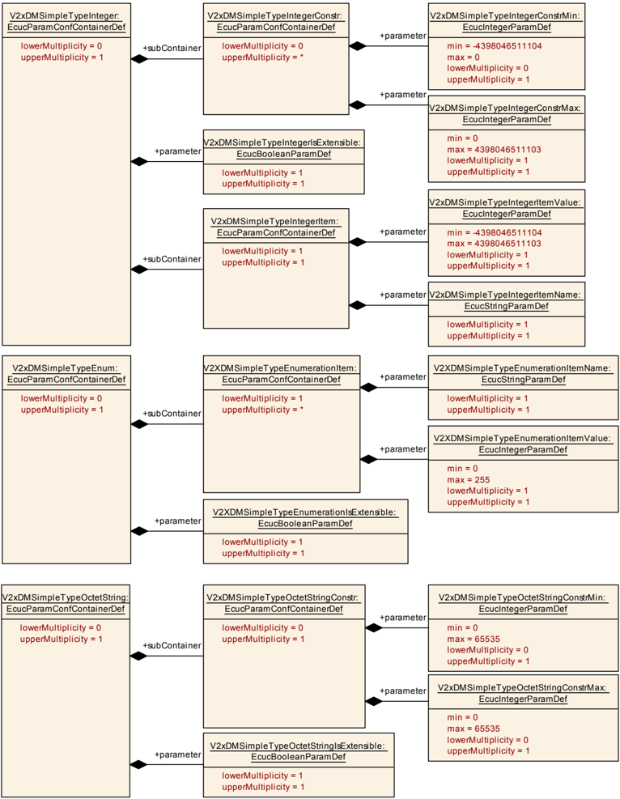

#### 9.1.29. V2xDMSimpleTypeBoolean

| SWS 条目 | [ECUC_V2xDM_00014] |
|---|---|
| 容器名称 | V2xDMSimpleTypeBoolean |
| 父容器 | V2xDMSimpleType |
| 描述 | **ASN.1** boolean 类型的定义 |
| Post-Build 变体多重性 | false |
| 多重性配置类 | Pre-compile time：x（All Variants）；Link time：-；Post-build time：- |

无包含的容器。

#### 9.1.30. V2xDMSimpleTypeEnum

| SWS 条目 | [ECUC_V2xDM_00016] |
|---|---|
| 容器名称 | V2xDMSimpleTypeEnum |
| 父容器 | V2xDMSimpleType |
| 描述 | **ASN.1** 枚举类型的定义 |
| Post-Build 变体多重性 | false |
| 多重性配置类 | Pre-compile time：x（All Variants）；Link time：-；Post-build time：- |
| 配置参数 | 见下方参数表 |

| SWS 条目 | [ECUC_V2xDM_00045] |
|---|---|
| 参数名称 | V2XDMSimpleTypeEnumerationIsExtensible |
| 父容器 | V2xDMSimpleTypeEnum |
| 描述 | 定义该枚举在将来版本中是否可扩展（...）。 |
| 多重性 | 1 |
| 类型 | EcucBooleanParamDef |
| 默认值 | - |
| Post-Build 变体值 | false |
| 值配置类 | Pre-compile time：x（All Variants）；Link time：-；Post-build time：- |
| 作用域/依赖 | - |

| 容器名称 | 多重性 | 作用域/依赖 |
|---|---|---|
| V2XDMSimpleTypeEnumerationItem | 1..* | 枚举简单类型的参数描述。 |

#### 9.1.31. V2xDMSimpleTypeEnumerationItem

| SWS 条目 | [ECUC_V2xDM_00042] |
|---|---|
| 容器名称 | V2XDMSimpleTypeEnumerationItem |
| 父容器 | V2xDMSimpleTypeEnum |
| 描述 | 枚举简单类型的参数描述。 |
| Post-Build 变体多重性 | false |
| 多重性配置类 | Pre-compile time：x（All Variants）；Link time：-；Post-build time：- |
| 配置参数 | 见下方参数表 |

| SWS 条目 | [ECUC_V2xDM_00043] |
|---|---|
| 参数名称 | V2XDMSimpleTypeEnumerationItemName |
| 父容器 | V2XDMSimpleTypeEnumerationItem |
| 描述 | 定义枚举项的名称。 |
| 多重性 | 1 |
| 类型 | EcucStringParamDef |
| 默认值 | - |
| 正则表达式 | - |
| Post-Build 变体值 | false |
| 值配置类 | Pre-compile time：x（All Variants）；Link time：-；Post-build time：- |
| 作用域/依赖 | scope: local |

| SWS 条目 | [ECUC_V2xDM_00044] |
|---|---|
| 参数名称 | V2XDMSimpleTypeEnumerationItemValue |
| 父容器 | V2XDMSimpleTypeEnumerationItem |
| 描述 | 定义枚举的项值。 |
| 多重性 | 1 |
| 类型 | EcucIntegerParamDef |
| 范围 | 0 .. 255 |
| 默认值 | - |
| Post-Build 变体值 | false |
| 值配置类 | Pre-compile time：x（All Variants）；Link time：-；Post-build time：- |
| 作用域/依赖 | scope: local |

无包含的容器。

#### 9.1.32. V2xDMSimpleTypeInteger

| SWS 条目 | [ECUC_V2xDM_00017] |
|---|---|
| 容器名称 | V2xDMSimpleTypeInteger |
| 父容器 | V2xDMSimpleType |
| 描述 | **ASN.1** 整数类型的定义 |
| Post-Build 变体多重性 | false |
| 多重性配置类 | Pre-compile time：x（All Variants）；Link time：-；Post-build time：- |
| 配置参数 | 见下方参数表 |

| SWS 条目 | [ECUC_V2xDM_00037] |
|---|---|
| 参数名称 | V2xDMSimpleTypeIntegerIsExtensible |
| 父容器 | V2xDMSimpleTypeInteger |
| 描述 | 指示整数简单类型的数据将来是否可扩展（...）。 |
| 多重性 | 1 |
| 类型 | EcucBooleanParamDef |
| 默认值 | - |
| Post-Build 变体值 | false |
| 值配置类 | Pre-compile time：x（All Variants）；Link time：-；Post-build time：- |
| 作用域/依赖 | scope: local |

| 容器名称 | 多重性 | 作用域/依赖 |
|---|---|---|
| V2xDMSimpleTypeIntegerConstr | 0..* | 定义整数简单类型的约束 |
| V2xDMSimpleTypeIntegerItem | 1 | 简单类型整数项的描述符参数。 |

#### 9.1.33. V2xDMSimpleTypeIntegerConstr

| SWS 条目 | [ECUC_V2xDM_00035] |
|---|---|
| 容器名称 | V2xDMSimpleTypeIntegerConstr |
| 父容器 | V2xDMSimpleTypeInteger |
| 描述 | 定义整数简单类型的约束 |
| Post-Build 变体多重性 | false |
| 多重性配置类 | Pre-compile time：x（All Variants）；Link time：-；Post-build time：- |
| 配置参数 | 见下方参数表 |

| SWS 条目 | [ECUC_V2xDM_00039] |
|---|---|
| 参数名称 | V2xDMSimpleTypeIntegerConstrMax |
| 父容器 | V2xDMSimpleTypeIntegerConstr |
| 描述 | 定义该整数简单类型的最大值。 |
| 多重性 | 1 |
| 类型 | EcucIntegerParamDef |
| 范围 | 0 .. 4398046511103 |
| 默认值 | - |
| Post-Build 变体值 | false |
| 值配置类 | Pre-compile time：x（All Variants）；Link time：-；Post-build time：- |
| 作用域/依赖 | scope: local |

| SWS 条目 | [ECUC_V2xDM_00038] |
|---|---|
| 参数名称 | V2xDMSimpleTypeIntegerConstrMin |
| 父容器 | V2xDMSimpleTypeIntegerConstr |
| 描述 | 定义该整数简单类型的最小值。 |
| 多重性 | 0..1 |
| 类型 | EcucIntegerParamDef |
| 范围 | -4398046511104 .. 0 |
| 默认值 | - |
| Post-Build 变体多重性 | false |
| Post-Build 变体值 | false |
| 多重性配置类 | Pre-compile time：x；Link time：-；Post-build time：- |
| 值配置类 | Pre-compile time：x；Link time：-；Post-build time：- |
| 作用域/依赖 | scope: local |

无包含的容器。

#### 9.1.34. V2xDMSimpleTypeIntegerItem

| SWS 条目 | [ECUC_V2xDM_00036] |
|---|---|
| 容器名称 | V2xDMSimpleTypeIntegerItem |
| 父容器 | V2xDMSimpleTypeInteger |
| 描述 | 简单类型整数项的描述符参数。 |
| 配置参数 | 见下方参数表 |

| SWS 条目 | [ECUC_V2xDM_00041] |
|---|---|
| 参数名称 | V2xDMSimpleTypeIntegerItemName |
| 父容器 | V2xDMSimpleTypeIntegerItem |
| 描述 | 为该整数项提供一个名称。 |
| 多重性 | 1 |
| 类型 | EcucStringParamDef |
| 默认值 | - |
| 正则表达式 | - |
| Post-Build 变体值 | false |
| 值配置类 | Pre-compile time：x（All Variants）；Link time：-；Post-build time：- |
| 作用域/依赖 | scope: local |

| SWS 条目 | [ECUC_V2xDM_00040] |
|---|---|
| 参数名称 | V2xDMSimpleTypeIntegerItemValue |
| 父容器 | V2xDMSimpleTypeIntegerItem |
| 描述 | 该整数的默认值 |
| 多重性 | 1 |
| 类型 | EcucIntegerParamDef |
| 范围 | -4398046511104 .. 4398046511103 |
| 默认值 | - |
| Post-Build 变体值 | false |
| 值配置类 | Pre-compile time：x（All Variants）；Link time：-；Post-build time：- |
| 作用域/依赖 | scope: local |

无包含的容器。

#### 9.1.35. V2xDMSimpleTypeOctetString

| SWS 条目 | [ECUC_V2xDM_00018] |
|---|---|
| 容器名称 | V2xDMSimpleTypeOctetString |
| 父容器 | V2xDMSimpleType |
| 描述 | **ASN.1** 八位位组串的定义。 |
| Post-Build 变体多重性 | false |
| 多重性配置类 | Pre-compile time：x（All Variants）；Link time：-；Post-build time：- |
| 配置参数 | 见下方参数表 |

| SWS 条目 | [ECUC_V2xDM_00049] |
|---|---|
| 参数名称 | V2xDMSimpleTypeOctetStringIsExtensible |
| 父容器 | V2xDMSimpleTypeOctetString |
| 描述 | 定义该八位位组串在将来版本中是否可扩展（...）。 |
| 多重性 | 1 |
| 类型 | EcucBooleanParamDef |
| 默认值 | - |
| Post-Build 变体值 | false |
| 值配置类 | Pre-compile time：x（All Variants）；Link time：-；Post-build time：- |
| 作用域/依赖 | - |

| 容器名称 | 多重性 | 作用域/依赖 |
|---|---|---|
| V2xDMSimpleTypeOctetStringConstr | 0..1 | 按照 **ASN.1** 定义八位位组串作为简单类型的约束。 |

#### 9.1.36. V2xDMSimpleTypeOctetStringConstr

| SWS 条目 | [ECUC_V2xDM_00046] |
|---|---|
| 容器名称 | V2xDMSimpleTypeOctetStringConstr |
| 父容器 | V2xDMSimpleTypeOctetString |
| 描述 | 按照 **ASN.1** 定义八位位组串作为简单类型的约束。 |
| Post-Build 变体多重性 | false |
| 多重性配置类 | Pre-compile time：x（All Variants）；Link time：-；Post-build time：- |
| 配置参数 | 见下方参数表 |

| SWS 条目 | [ECUC_V2xDM_00048] |
|---|---|
| 参数名称 | V2xDMSimpleTypeOctetStringConstrMax |
| 父容器 | V2xDMSimpleTypeOctetStringConstr |
| 描述 | 定义八位位组串的最大长度。 |
| 多重性 | 0..1 |
| 类型 | EcucIntegerParamDef |
| 范围 | 0 .. 65535 |
| 默认值 | - |
| Post-Build 变体多重性 | false |
| Post-Build 变体值 | false |
| 多重性配置类 | Pre-compile time：x（All Variants）；Link time：-；Post-build time：- |
| 值配置类 | Pre-compile time：x（All Variants）；Link time：-；Post-build time：- |
| 作用域/依赖 | scope: local |

| SWS 条目 | [ECUC_V2xDM_00047] |
|---|---|
| 参数名称 | V2xDMSimpleTypeOctetStringConstrMin |
| 父容器 | V2xDMSimpleTypeOctetStringConstr |
| 描述 | 定义八位位组串的最小长度。 |
| 多重性 | 0..1 |
| 类型 | EcucIntegerParamDef |
| 范围 | 0 .. 65535 |
| 默认值 | - |
| Post-Build 变体多重性 | false |
| Post-Build 变体值 | false |
| 多重性配置类 | Pre-compile time：x；Link time：-；Post-build time：- |
| 值配置类 | Pre-compile time：x；Link time：-；Post-build time：- |
| 作用域/依赖 | scope: local |

无包含的容器。

### 9.2. 发布信息

详情参见 [\[3, SWS BSW General\]](#ref-3) 的第 10.3 章「发布信息」。

## B. 规范项变更历史

请注意，本章中的列表也包括在后续版本中已从规范中移除的规范项。这些规范项不会作为超链接出现在文档中。

### B.1. 本文档与 AUTOSAR R22-11 相比的规范项历史

#### B.1.1. R23-11 中新增的规范项

无

#### B.1.2. R23-11 中变更的规范项

无

#### B.1.3. R23-11 中删除的规范项

无

### B.2. 本文档与 AUTOSAR R22-11 相比的约束项历史

#### B.2.1. R23-11 中新增的约束

无

#### B.2.2. R23-11 中变更的约束

无

#### B.2.3. R23-11 中删除的约束

无
