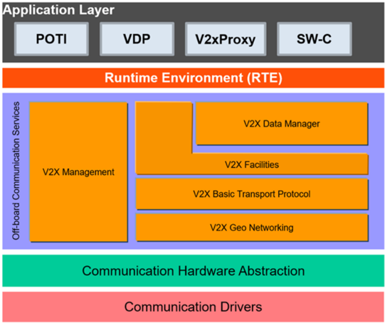
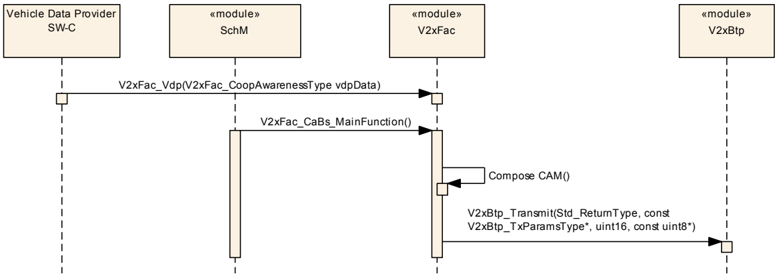
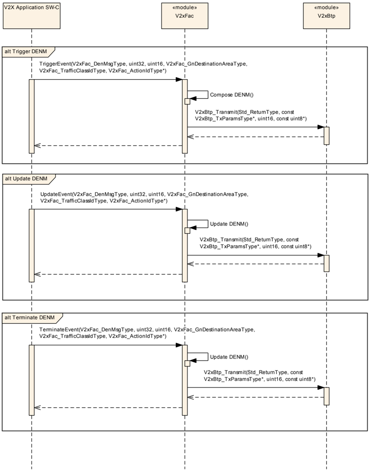
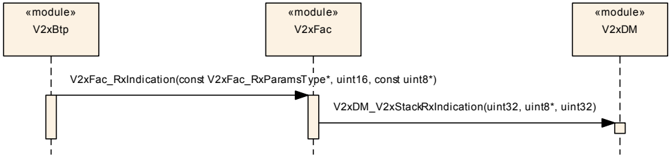
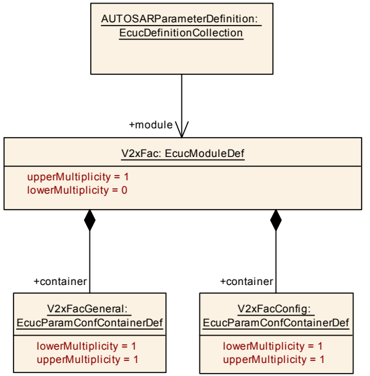
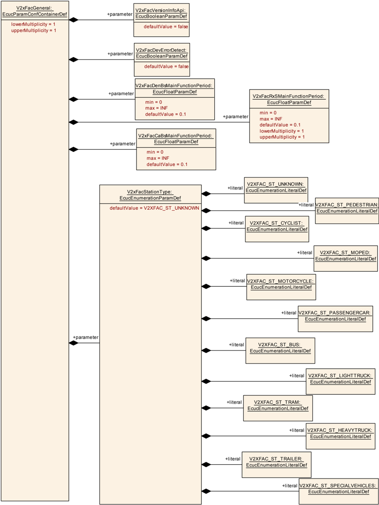
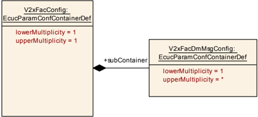
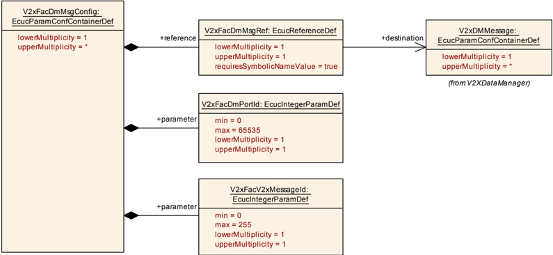

## 1. 简介和功能概述

本文档规定 **AUTOSAR** 基础软件模块 **Vehicle-2-X Facilities**（V2xFac）的功能、**API** 和配置。**Vehicle-2-X Facilities** 层与 **Vehicle-2-X Basic Transport**（V2xBtp）、**Vehicle-2-X GeoNetworking**（V2xGn）、**Vehicle-2-X Management**（V2xM）、**Vehicle-2-X Data Manager**（V2xDM）以及通信驱动层一起，在 **AUTOSAR** 架构中构成 V2X 协议栈。

**V2xFac** 模块设计为硬件无关。

**ETSI** 架构的 V2x Facilities 层被拆分为两个 **AUTOSAR** 模块 **V2xFac** 和 **V2xDM**。

**V2xFac** 模块依赖于应用层中 V2X 实体的服务和下层 **V2xBtp** 模块，并向 **V2xDM** 模块提供服务。

### 1.1. 架构总览

**V2xFac** 模块在 **AUTOSAR BSW** 和分层软件架构中的位置如下图所示。



**V2xFac** 模块支持 V2X 应用之间数据交换的公共消息管理。

它提供用于发送的基本服务（**BS**）协作感知（**CA**）和分布式环境通知（**DEN**）。在接收方向，它分析接收到的消息的报头，并将受支持消息的载荷提供给 **V2xDM** 模块。

### 1.2. 功能总览

**V2xFac** 模块实现用于发送的 **CA** 和 **DEN** 基本服务。在接收方向，支持以下服务的报头分析：

* CA
* DEN
* IVI
* RLT
* TLM。

消息按配置提供给 **V2XDM**。

每类消息都可以基于配置被系统地丢弃。

默认情况下，**CAM**、**DENM**、**IVIM**、**SPATEM** 和 **MAPEM** 消息可以被接收，并在提供给 **V2xDM** 进行拆解之前检查其 **ITS** 报头。或者，通过基于 **BTP** 端口和 **ITS AID** 的配置，其他消息可以提供给 **V2xDM** 模块而不是被丢弃。

#### 1.2.1. 协作感知（CA）

##### 1.2.1.1. AUTOSAR 架构中的 CA 基本服务

**CA** 基本服务是运行 **CAM** 协议的设施层实体。

它提供两种服务：**CAM** 的发送和接收。

**CA** 基本服务向其他 ITS-S 生成并发送 **CAM**，或者从 ITS-S 接收 **CAM** 并将其载荷提供给 **V2xDM** 模块（参见 [\[1\]](#ref-1) 第 4 章）。

**CA** 基本服务使用 V2X 协议栈下层协议实体提供的服务来分发 **CAM**。

收到 **CAM** 后，**CA** 基本服务使 **CAM** 的内容对 **V2xDM** 模块可用。

接收到的 **CAM** 的选定数据集由 **V2xDM** 模块通过标准化的 **AUTOSAR** 服务接口提供给上层应用层。

它可以与 **AUTOSAR** 应用层接口，以收集用于 **CAM** 生成的相关信息（车辆数据提供者 —— **VDP**）。

##### 1.2.1.2. CA 基本服务功能架构

「按照 **ETSI** TS 102 894-1 [\[2\]](#ref-2)，**CA** 基本服务是设施层应用支持域的一部分，图中展示了 **CA** 基本服务的功能块以及与其他设施和层的接口。」

对于 **CAM** 的发送和接收，**V2xFac** 的 **CA** 基本服务部分应提供以下子功能：

* 编码 **CAM**
* 解码 **CAM** 报头
* **CAM** 发送管理
* **CAM** 接收管理

详情参见 [\[1\]](#ref-1) 第 5.2 章。

#### 1.2.2. 分布式环境通知（DEN）

##### 1.2.2.1. AUTOSAR 架构中的 DEN 基本服务

**DEN** 基本服务是运行 **DENM** 协议的设施层实体。它向 **AUTOSAR** 应用层的实体和 **V2xDM** 模块提供服务（参见 [\[3\]](#ref-3) 第 4.2 章）。

**DEN** 基本服务向其他 ITS-S 生成并发送 **DENM**，或者从其他 ITS-S 接收 **DENM** 并将其载荷提供给 **V2xDM** 模块（参见 [\[3\]](#ref-3) 第 5 和 6 章）。

收到 **DENM** 后，**DEN** 基本服务在将其提供给 **V2xDM** 模块之前检查 **DENM** 的报头，**V2xDM** 模块使选定的内容对 V2X 应用可用。

##### 1.2.2.2. DEN 基本服务功能架构

对于 **DENM** 的发送和接收，**DEN** 基本服务应提供以下子功能：

* 编码 **DEN**
* 解码 **DEN** 报头
* **DEN** 发送管理
* **DEN** 接收管理
* 保活转发（Keep-Alive forwarding）

详情参见 [\[3\]](#ref-3) 第 5.3 章。

#### 1.2.3. 车辆数据提供者（VDP）

**VDP** 与车辆网络相连，提供车辆状态信息。

在 **AUTOSAR** 架构中，**VDP** 服务是应用层内的一个 V2X 应用，不属于 **V2xFac**。

**VDP** 向下层（V2X 服务）提供一个接口。

设施基本服务 **CA** 和 **DEN** 从该接口获取车辆相关数据。

**V2xM** 从该接口获取例如位置和时间信息。

#### 1.2.4. 局部动态地图（LDM）

[\[5\]](#ref-5) 中概述的 **LDM** 是 ITS-S 中的一个数据库，可以用接收到的 **CAM** 或 **DENM** 数据更新。

V2x 应用可以从 **LDM** 检索信息以进行进一步处理。

在 **AUTOSAR** 架构中，**LDM** 服务是应用层内的一个 V2X 应用，不属于 **V2xFac** 模块。

详情参见 [\[5\]](#ref-5) 第 5.1 章。

#### 1.2.5. 基础设施到车辆信息（IVI）

##### 1.2.5.1. AUTOSAR 架构中的 IVI 服务

**IVI** 服务是提供 **IVIM** 接收的设施层实体。

**IVI** 服务从基础设施 ITS-S 接收 **IVIM**，并在将其载荷提供给 **V2xDM** 模块之前检查其报头（参见 [\[6\]](#ref-6) 第 7 章）。

收到 IVIM 载荷后，**V2xDM** 模块使 **IVIM** 的选定内容对 V2X 应用可用。

由于这些消息不需要任何单独处理，它们在 **AUTOSAR** 中的接收通过一个通用服务实现（参见第 [7.5.3](#753-v2xfac_rxs_mainfunction) 节）。

##### 1.2.5.2. IVI 服务功能架构

按照 **ETSI** TS 103 301 [\[6\]](#ref-6)，**IVI** 服务是设施层应用支持域的一部分，其中展示了 **IVI** 服务的功能块以及与其他设施和层的接口。

对于 **IVIM** 的接收，**V2xFac** 的 **IVI** 服务部分应提供以下子功能：

* 解码 **IVIM** 报头
* **IVIM** 接收管理

#### 1.2.6. 道路与车道拓扑（RLT）服务

##### 1.2.6.1. AUTOSAR 架构中的 RLT 服务

**RLT** 服务是提供 **MAPEM** 接收的设施层实体。

**RLT** 服务从基础设施 ITS-S 接收 **MAPEM**，并在将其载荷提供给 **V2xDM** 模块之前检查其报头（参见 [\[6\]](#ref-6) 第 6 章）。

收到 MAPEM 载荷后，**V2XDM** 模块使 **MAPEM** 的选定内容对 V2X 应用可用。

由于这些消息不需要任何单独处理，它们在 **AUTOSAR** 中的接收通过一个通用服务实现（参见第 [7.5.3](#753-v2xfac_rxs_mainfunction) 节）。

##### 1.2.6.2. RLT 服务功能架构

按照 **ETSI** TS 103 301 [\[6\]](#ref-6)，**RLT** 服务是设施层应用支持域的一部分，其中展示了 **RLT** 服务的功能块以及与其他设施和层的接口。

对于 **MAPEM** 的接收，**V2xFac** 的 **RLT** 服务部分应提供以下子功能：

* 解码 **MAPEM** 报头
* **MAPEM** 接收管理

#### 1.2.7. 交通灯操控（TLM）服务

##### 1.2.7.1. AUTOSAR 架构中的 TLM 服务

**TLM** 服务是提供 **SPATEM** 接收的设施层实体。

**TLM** 服务从基础设施 ITS-S 接收 **SPATEM**，并在将其载荷提供给 **V2xDM** 模块之前检查其报头（参见 [\[6\]](#ref-6) 第 5 章）。

收到 SPATEM 载荷后，**V2xDM** 模块使 **SPATEM** 的选定内容对 V2X 应用可用。

由于这些消息不需要任何单独处理，它们在 **AUTOSAR** 中的接收通过一个通用服务实现（参见第 [7.5.3](#753-v2xfac_rxs_mainfunction) 节）。

##### 1.2.7.2. TLM 服务功能架构

按照 **ETSI** TS 103 301 [\[6\]](#ref-6)，**TLM** 服务是设施层应用支持域的一部分，其中展示了 **TLM** 服务的功能块以及与其他设施和层的接口。

对于 **SPATEM** 的接收，**V2xFac** 的 **TLM** 服务部分应提供以下子功能：

* 解码 **SPATEM** 报头
* **SPATEM** 接收管理

## 2. 缩略语

以下术语表包含与 **V2X Facilities** 模块相关、但未包含在 **AUTOSAR** 术语表 [\[7\]](#ref-7) 中的缩略语和缩写。

**DEM**
> 诊断事件管理器（**Diagnostic Event Manager**）。

**DET**
> 默认错误跟踪器（**Default Error Tracer**）。

**API**
> 应用编程接口（**Application Programming Interface**）。

**BS**
> 基本服务（**Basic Service**）。

**BSW**
> 基础软件（**Basic Software**）。

**BTP**
> 基本传输协议（**Basic Transport Protocol**）。

**CA**
> 协作感知（**Cooperative Awareness**）。

**CAM**
> 协作感知消息（**Cooperative Awareness Message**）。

**DCC**
> 分布式拥塞控制（**Decentralized Congestion Control**）。

**DE**
> 数据元素（**Data Element**）。

**DEN**
> 分布式环境通知（**Decentralized Environmental Notification**）。

**DENM**
> 分布式环境通知消息（**Decentralized Environmental Notification Messages**）。

**DF**
> 数据帧（**Data Frame**）。

**EcuM**
> 电子控制单元管理器（**Electronic Control Unit Manager**）。

**ETSI**
> 欧洲电信标准协会（**European Telecommunications Standards Institute**）。

**IF**
> 接口（**Interface**）。

**ITS**
> 智能交通系统（**Intelligent Transport System**）。

**ITS-S**
> ITS 站（**ITS-Station**）。

**KAF**
> **DENM** 保活转发（**DENM Keep Alive Forwarding**）。

**LDM**
> 局部动态地图（**Local Dynamic Map**）。

**POTI**
> 位置与时间管理（**Position and Time management**）。

**RSU**
> 路侧单元（**Road Side Unit**）。

**VDP**
> 车辆数据提供者（**Vehicle Data Provider**）。

**V2X**
> 车辆到车辆（**V2V**）、车辆到基础设施（**V2I**）和/或基础设施到车辆（**I2V**）。

**V2xM**
> **Vehicle-2-X** 管理（**Vehicle-2-X Management**）。

**V2xFac**
> **Vehicle-2-X** 设施（**Vehicle-2-X Facilities**）。

**V2xBtp**
> **Vehicle-2-X** 基本传输（**Vehicle-2-X Basic Transport**）。

**V2xGn**
> **Vehicle-2-X** 地理网络（**Vehicle-2-X Geo Networking**）。

**IVI**
> 基础设施到车辆信息（**Infrastructure to Vehicle Information**）。

**IVIM**
> 基础设施到车辆信息消息（**Infrastructure to Vehicle Information Message**）。

**RLT**
> 道路与车道拓扑（**Road and Lane Topology**）。

**MAPEM**
> **MAP** 扩展消息（**MAP Extended Message**）。

**TLM**
> 交通灯操控（**Traffic Light Maneuver**）。

**SPATEM**
> 信号相位与配时扩展消息（**Signal Phase And Timing Extended Message**）。

## 3. 相关文档

### 3.1. 输入文件和相关标准与规范

<a id="ref-1"></a>[1] EN 302 637-2 V1.4.1:Intelligent Transport Systems (ITS); Vehicular Communications; Basic Set of Applications; Part 2:Specification of Cooperative Awareness Basic Service

<a id="ref-2"></a>[2] TS 102 894-1 V1.1.1:Intelligent Transport Systems (ITS); Users and applications requirements; Part 1:Facility layer structure, functional requirements and specifications

<a id="ref-3"></a>[3] EN 302 637-3 V1.3.1:Intelligent Transport Systems (ITS); Vehicular Communications; Basic Set of Applications; Part 3:Specifications of Decentralized Environmental Notification Basic Service

<a id="ref-4"></a>[4] EN 302 890-2 v0.0.3:Intelligent Transport System (ITS); Facilities layer function; Part 2:Position and Time management (PoTi); Release 2

<a id="ref-5"></a>[5] EN 302 895 Ver. 1.1.1:Intelligent Transport Systems (ITS); Vehicular Communications; Basic Set of Applications; Local Dynamic Map (LDM)

<a id="ref-6"></a>[6] TS 103 301 V1.2.1:Intelligent Transport Systems (ITS); Vehicular Communications; Basic Set of Applications; Facilities layer protocols and communication requirements for infrastructure services

<a id="ref-7"></a>[7] Glossary
> AUTOSAR_FO_TR_Glossary

<a id="ref-8"></a>[8] General Specification of Basic Software Modules
> AUTOSAR_CP_SWS_BSWGeneral

<a id="ref-9"></a>[9] Specification of Default Error Tracer
> AUTOSAR_CP_SWS_DefaultErrorTracer

<a id="ref-10"></a>[10] Specification of ECU State Manager
> AUTOSAR_CP_SWS_ECUStateManager

<a id="ref-11"></a>[11] EN 302 636-5-1 V2.1.1:Vehicular Communication; Geonetworking; Part 5:Transport Protocols; Sub-part 1:Basic Transport Protocols

<a id="ref-12"></a>[12] General Requirements on Basic Software Modules
> AUTOSAR_CP_SRS_BSWGeneral

<a id="ref-13"></a>[13] Requirements on Vehicle-2-X Communication
> AUTOSAR_CP_SRS_V2XCommunication

<a id="ref-14"></a>[14] TS 102 894-2 V1.3.1:Intelligent Transport Systems (ITS); Users and applications requirements; Applications and facilities layer common data dictionary

<a id="ref-15"></a>[15] Car 2 Car Communication Consortium; Basic System Profile release 1.3

<a id="ref-16"></a>[16] SAE J2945/1_201603:On-Board System Requirements for V2V Safety Communications

<a id="ref-17"></a>[17] EN 302 636-4-1 V1.3.1:Vehicular Communication; Geonetworking; Part 4 Geographical addressing and forwarding for point-to-point and point-to-multipoint communications; Sub-part 1:Media-Independent Functionality

### 3.2. 相关规范

**AUTOSAR** 提供了基础软件模块的通用规范 [\[8\]](#ref-8)，该规范同样适用于 **V2xFac**。

因此，规范 **SWS BSW General** 应被视为 **V2xFac** 的附加且必需的规范。

## 4. 约束和假设

### 4.1. 限制

* V2X 模块遵循 Car-2-Car-Consortium 和 C-Roads 平台定义的 Day-1 场景指南。
* **V2xFac** 模块仅与欧洲 Day1 V2X 实现相关。

### 4.2. 汽车域的适用性

本规范适用于所有汽车域。

### 4.3. 授权票证与假名

授权票证（**AT**）在本文档中称为假名（**Pseudonym**）。

## 5. 对其他模块的依赖

本节描述 **V2xFac** 模块与 **AUTOSAR** 基础软件架构中其他模块的关系。它概述实现 **V2xFac** 模块所需或可选的模块，以及这些模块使用的 **V2xFac** 服务。

### 5.1. AUTOSAR DET（默认错误跟踪器）

在开发模式下，**V2xFac** 模块通过 **DET** 模块 [\[9\]](#ref-9) 的 Det_ReportError 函数上报错误。

### 5.2. AUTOSAR EcuM（ECU 状态管理器）

**EcuM** [\[10\]](#ref-10) 通过调用第 7.3.1 节规定的 [V2xFac_Init](#731-v2xfac_init) 来初始化 **V2xFac** 模块。

### 5.3. V2x 车辆数据提供者

**V2xFac** 模块通过发送者-接收者接口 [V2xFacVdp](#7711-v2xfacvdp)（参见第 [7.7.1.1](#7711-v2xfacvdp) 节）从 **VDP** 应用获取车辆相关数据。

### 5.4. AUTOSAR V2xDM

**V2xFac** 模块提供客户端-服务器接口 [V2xFacDenBs](#7721-v2xfacdenbs) 以使用 **DEN** 基本服务。提供操作 TriggerEvent、UpdateEvent 或 TerminateEvent。

在检查其报头的有效性之后，**V2xFac** 模块将接收到的消息的载荷交付给 **V2xDM** 模块。**V2xFac** 模块假定一个消息接收接口（参见第 [7.6.1](#761-强制接口) 节）由 **Vehicle-2-X Data Manager**（V2xDM）模块提供。

### 5.5. AUTOSAR V2xBtp

**V2xFac** 模块假定 **V2xBtp** 模块提供发送请求原语（V2xBtp_Transmit [\[11\]](#ref-11)，参见第 7.6.1 节）。

### 5.6. AUTOSAR V2xM

**V2xFac** 模块假定 **Vehicle-2-X Management**（V2xM）模块提供请求原语（参见第 [7.6.1](#761-强制接口) 节）。

## 6. 功能规格

**V2xFac** 模块运行基本服务协作感知（**CA**）和分布式环境通知（**DEN**）的发送部分。

在接收方向，它在将接收到的消息的载荷提供给 **V2xDM** 模块之前检查其报头的有效性。

除非本文档中另有规定，**V2xFac** 模块应按照 [\[1\]](#ref-1) 实现 **CA** 基本服务的发送部分。

除非本文档中另有规定，**V2xFac** 模块应按照 [\[3\]](#ref-3) 实现 **DEN** 基本服务的发送部分。

**V2xFac** 模块应基于其配置检查接收到的 Facilities 消息报头的有效性，该配置应定义 **ITS** 报头中 Facilities 消息 **ID** 与 **BTP** 端口的关联。

如果已配置，进入的消息传递给 **V2xDm**。**V2xFac** 负责确保：如果接收端口与配置给定的期望消息 **ID** 不匹配，则丢弃该消息。

某些消息的专用服务（例如 DenBs）可能为进入的消息定义附加的有效性检查。**V2xFac** 负责确保：如果消息被其专用服务判定为无效，则丢弃该消息。

对 **ITS** 报头字段的附加验证（例如在行为不当检测范围内对 Station **ID** 的验证，或与受支持协议版本的一致性验证）也是可能的，留给实现者决定。

除非本文档中另有规定，**V2xFac** 模块应按照 [\[1\]](#ref-1)、[\[3\]](#ref-3) 和 [\[6\]](#ref-6) 检查接收到的 **CAM**、**DENM**、**IVIM**、**MAPEM** 和 **SPATEM** 报头的有效性。

在第 [6.2](#62-通用格式规范) 节规定的标准化端口上接收到的 Facilities 消息应遵守端口与消息 **ID** 之间的一对一映射，否则应被丢弃。

| 标准化 BTP 端口号 | 服务 | ITS 报头中的消息 ID | Rx/Tx |
|---|---|---|---|
| 2001 | CA | CAM | Rx 和 Tx |
| 2002 | DEN | DENM | Rx 和 Tx |
| 2003 | RLT | MAPEM | 仅 Rx |
| 2004 | TLM | SPATEM | 仅 Rx |
| 2006 | IVI | IVIM | 仅 Rx |

**V2xFac** 模块应仅支持与这些 **BTP** 端口相关联的这些消息。

对于静止车辆，系统应上报最后估计的航向值。

系统关停时，系统应存储最后的航向值和相应的挡位位置（前进、空挡或倒车）。

系统启动时，系统应基于存储的航向值和当前挡位位置上报航向值，直到车辆不再静止。

### 6.1. 启动行为

**V2xFac** 的函数 [V2xFac_Init](#731-v2xfac_init)（参见第 [7.3.2](#732-v2xfac_getversioninfo) 节）应初始化 **V2xFac** 模块的内部状态。

**注意：** 函数 [V2xFac_Init](#731-v2xfac_init) 不应在 **Vehicle-2-X Management**（V2xM）被 **Electronic Control Unit Manager**（EcuM）初始化之前调用。

函数 [V2xFac_Init](#731-v2xfac_init) 应按照配置初始化用于发送的 **CA** 和 **DEN** 基本服务以及所有消息类型的接收服务。

### 6.2. 通用格式规范

构成 **CAM** 和 **DENM** 内容的数据元素应符合 [\[14\]](#ref-14)。

接收到的消息的报头格式应符合 [\[14\]](#ref-14)。

### 6.3. CA 功能规格

详情参见 [\[1\]](#ref-1) 第 6.1 章。

#### 6.3.1. CA 初始化、激活与去激活

当通过 [V2xFac_V2xM_SetCaBsOperation](#737-v2xfac_v2xm_setcabsoperation) **API** 使能发送功能时，应清除路径历史。

**CA** 基本服务初始化应使能 **CAM** 消息的发送。

函数 [V2xFac_Init](#731-v2xfac_init) 应按照 T_GenCamMax [\[1\]](#ref-1) 初始化 **CAM** 频率管理所需的参数 T_GenCam_DCC [\[1\]](#ref-1)。

详情参见 [\[1\]](#ref-1) 第 5.3.5 章和 [\[15\]](#ref-15)。

函数 [V2xFac_Init](#731-v2xfac_init) 应将参数 T_GenCam [\[1\]](#ref-1) 初始化为默认值 T_GenCamMax。

详情参见 [\[1\]](#ref-1) 第 6.1.3 章。

函数 [V2xFac_Init](#731-v2xfac_init) 应将参数 N_GenCam [\[1\]](#ref-1) 初始化为默认值 0。

函数 [V2xFac_Init](#731-v2xfac_init) 应将参数 T_CheckCamGen [\[1\]](#ref-1) 初始化为等于配置参数 T_GenCamMin [\[1\]](#ref-1) 的默认值。

详情参见 [\[1\]](#ref-1) 第 6.1.3 章。

#### 6.3.2. CAM 生成、发送与频率管理

**CAM** 接收参见第 [6.5](#65-消息接收功能规格) 节。

**CA** 基本服务应在 **CAM** 频率管理的控制下周期性生成 **CAM**（详情参见 [\[1\]](#ref-1) 第 6.1.3 章和 [\[14\]](#ref-14)）。

生成的 **CAM** 应由 **V2xBtp** 使用 **API** 函数 V2xBtp_Transmit() 发送（参见第 [7.6.1](#761-强制接口) 节）。

**CA** 基本服务应通过回调函数 [V2xFac_RxIndication](#741-v2xfac_rxindication)() 接收 **CAM**。

表示两次生成规则检查之间角度差（度）的 MAX_DANGLE [\[15\]](#ref-15) 应使用值 4°。

表示两次生成规则检查之间距离差（米）的 MAX_DDISTANCE [\[15\]](#ref-15) 应使用值 4 米。

表示两次生成规则检查之间速度差的 MAX_DSPEED [\[15\]](#ref-15) 应使用值 0,5 m/s。

**CAM** 生成频率管理中规定的可调 N_GenCam 参数（参见 [\[1\]](#ref-1)）对于 **V2xFac** 模块应设置为 3。

只要位置和时间信息可用，**V2xFac** 模块就应发送 **CAM** 消息。

#### 6.3.3. RSU ITS-S 的 CAM 生成频率管理

路侧单元（RSU-ITS）的 **CA** 消息生成目前 **AUTOSAR** 不支持。

#### 6.3.4. CAM 时间要求

**CAM** 生成应遵循 [\[1\]](#ref-1) 第 6.1.5 章和 [\[15\]](#ref-15) 的时间要求。

**V2xFac** 模块应将安全信封中的时间戳与接收时间进行比较，仅接受最近 2 秒内的 **CAM** 和最近 10 分钟内的其他消息。

由于 [\[15\]](#ref-15) 中 ITS 站时间的容差和允许的时钟偏差，**V2xFac** 模块应接受相比自车时钟来自未来的消息：

* 对于车辆最多 40 ms（估计自车偏差 20 ms + 发送车辆偏差 20 ms）。
* 对于 **RSU** 最多 220 ms（估计自车偏差 20 ms + 发送 **RSU** 偏差 200 ms）。

#### 6.3.5. CAM 格式规范

关于 **CAM** 数据格式的详情，参见以下 **ETSI** 文档：

* 参见 [\[1\]](#ref-1) 第 7 章
* 参见 [\[1\]](#ref-1) 附录 A：**CAM** 的 **ASN.1** 规范
* 参见 [\[1\]](#ref-1) 附录 B：数据元素和数据帧的描述
* 参见 [\[14\]](#ref-14) 附录 A、附录 B

**CAM** 低频（**LF**）容器内的路径历史字段应包含一个 PathHistory 数据元素，覆盖至少 200 m 的距离（[\[16\]](#ref-16) 附录 A.5 中的 K_PHDISTANCE_M 参数）。

只有当满足以下条件之一时，才可以偏离 PathHistory 的最小覆盖距离：

* 车辆尚未以其当前假名物理行驶完该距离（例如车辆启动后或行驶中假名更改后）
* 已使用最大数量的 PathPoint，而 PathHistory 覆盖的总长度仍未达到 200 m。

只有在上述两种情况下，车辆才可以发送覆盖距离低于 200 m 下限的 PathHistory 信息。

**CAM** 中的 PathHistory 应最多覆盖 500 m。

**V2xFac** 模块应在 PathHistory 的每个 PathPoint 中发送 PathDeltaTime。因此，PathHistory 应描述一个按时间排序的（最新点在前）实际行驶过的地理位置列表，包括当前自车位置。

在车辆不移动的情况下，即 PathPoint 位置信息不变时，第一个 PathPoint 的 PathDeltaTime 仍应随每条 **CAM** 更新。

当 **V2xFac** 模块静止的持续时间超过 PathDeltaTime 的最大值（在 [\[14\]](#ref-14) 中规定）时，**CAM** 中第一个 PathPoint 的 PathDeltaTime 应固定为该最大值。

**CAM** 消息的流量类别值应设置为 2。

**V2xFac** 模块应在其发送的所有 **CAM** 包上使用单跳广播（**SHB**）报头。因此，transportType 参数的值应设置为 0x50。

#### 6.3.6. 其他

收到 **CAM** 消息后，**V2xFac** 模块检查该 **CAM** 消息发送方的站点类型。

作为正常消息处理的例外，如果 **CAM** 消息中的站点类型指示 **RSU**，则在丢弃该消息之前，**V2xFac** 模块应通过 V2xM_SetTollingZoneInformation **API** 将受保护区域的位置和半径提供给 **V2xM** 模块。

如果依次收到来自同一 **RSU**（相同站点 **Id**）的多条 **CAM** 消息，则这些 **CAM** 消息应被丢弃，而不再次调用 V2xM_SetTollingZoneInformation **API**。

### 6.4. DEN 功能规格

按照 **ETSI** 文档的定义（参见 [\[3\]](#ref-3) 第 5.2 章），**DEN** 基本服务是实现 **DEN** 协议的设施层实体。它与 ITS-S 应用接口，以接收 **DENM** 发送的应用请求，并向 ITS-S 应用提供接收到的 **DENM** 内容。

#### 6.4.1. DEN 初始化

函数 [V2xFac_Init](#731-v2xfac_init) 应初始化一个空的源 ITS-S 消息表。

详情参见 [\[3\]](#ref-3) 第 8.2.1.6 章。

#### 6.4.2. DENM 发送管理

**DEN** 基本服务由 V2x 应用通过服务接口 [V2xFacDenBs](#7721-v2xfacdenbs) 的服务操作 TriggerEvent、UpdateEvent 或 TerminateEvent 触发。

上述操作给定的函数参数「EventID」应由 **DEN** 基本服务映射到为 **DENM** 生成的 actionID。

详情参见 [\[3\]](#ref-3) 第 5.3 和 8.2 章。

#### 6.4.3. DENM 接收管理

参见第 [6.5](#65-消息接收功能规格) 节。

#### 6.4.4. DENM 重复

在两个连续的 DENM 更新之间，**DEN** 基本服务可以重复一条 **DENM**。

详情参见 [\[3\]](#ref-3) 第 6.1.2.3 章。

#### 6.4.5. DENM 保活转发（KAF）

**ETSI** 定义的 **DEN** 基本服务的 KAF 功能不受支持。

参见 [\[3\]](#ref-3) 第 5.3 和 8.3 章。

#### 6.4.6. DENM 格式规范

关于 **DENM** 数据格式的详情，参见以下 **ETSI** 文档：

* 参见 [\[3\]](#ref-3) 第 7 章
* 参见 [\[3\]](#ref-3) 附录 A：**DENM** 的 **ASN.1** 规范
* 参见 [\[3\]](#ref-3) 附录 B：数据元素和数据帧的描述
* 参见 [\[14\]](#ref-14) 附录 A、附录 B

**DEN** 消息内的路径历史字段应包含覆盖至少 600 m 距离的 Trace 数据元素（[\[16\]](#ref-16) 附录 A.5 中的 K_PHDISTANCE_M 参数）。

只有当满足以下条件之一时，才可以偏离 Traces 的最小覆盖距离：

* 车辆尚未以其当前假名物理行驶完该距离（例如车辆启动后或行驶中假名更改后）
* 已使用最大数量的 PathPoint，而 PathHistory 覆盖的总长度仍未达到 200 m。

只有在上述两种情况下，车辆才可以发送覆盖距离低于 600 m 下限的 Traces 信息。

**DENM** 中的 Traces 应最多覆盖 1000 m。

**V2xFac** 模块应按如下方式使用 **DENM** traces：PathDeltaTime 应在第一条 **DENM** traces 元素的每个 PathPoint 中发送。因此，traces 的第一个元素应描述一个按时间排序的（最新点在前）实际行驶过并通往事件位置的地理位置列表，包括事件位置。

第一条 **DENM** traces 元素中 PathPoint 的 PathDeltaTime 数据元素仅在 **DENM** 被更新时才应更新。

在检测事件的车辆不移动的情况下，即 PathPoint 位置信息不变时，第一条 **DENM** traces 元素第一个 PathPoint 的 PathDeltaTime 仍应随每次 DEN_Update 更新。

**注意：** 这仅适用于检测车辆与事件同一体的静止事件，例如静止车辆警告。对于动态事件（例如危险情况），或事件与车辆非同一体的事件（例如恶劣天气警告），情况并非如此。

当 **V2xFac** 模块静止的持续时间超过 PathDeltaTime 的最大值（在 [\[14\]](#ref-14) 中规定）时，**DENM** 中第一个 PathPoint 的 PathDeltaTime 应设置为该最大值，并应创建一个新的 PathPoint。

**DENM** traces 中可以存在附加的 PathHistory 元素。然而，与第一个元素不同，这些元素应描述到达事件位置的替代路线。这些路线在检测到事件时可能存在也可能不存在。在替代路线中，PathPoint 应按位置排序（即最短路径路线），且不应包含 PathDeltaTime。

**V2xFac** 模块使用的 traces 和路径历史应按照 [\[16\]](#ref-16) 附录 A.5 规定的设计方法一（Design Method One）生成。

**V2xFac** 模块应使用具有以下设置的生成方法：

* K_PHALLOWABLEERROR_M = 0.47 m，其中 PH_ActualError &lt; K_PHALLOWABLEERROR_M
* 简明路径点之间的最大距离，K_PH_CHORDLENGTHTHRESHOLD = 22.5 m/s
* K_PH_MAXESTIMATEDRADIUS = REarthMeridian
* K_PHSMALLDELTAPHI_R = 1 度
* REarthMeridian = 6378.137 km

（按照 IUGG —— 国际大地测量学与地球物理学联合会），用于大圆或正交距离计算：

PH_ActualChordLength = REarthMeridian * cos⁻¹ [cos(lat1)cos(lat2)cos(long1 - long2) + sin(lat1)sin(lat2)]

**V2xFac** 模块应在其发送的所有 **DENM** 包上使用地理广播（**GBC**）报头。因此，transportType 参数的值应设置为 0x40。

**V2xFac** 模块应将所有 **GBC** 包的包传输参数 TxParams 的 maxPacketLifetime 参数设置为 ValidityDuration、RepetitionInterval 和 itsGnMaxPacketLifetime 的最小值，其中 ValidityDuration 和 RepetitionInterval 取应用请求的值，itsGnMaxPacketLifetime 按 [\[17\]](#ref-17) 附录 H 的规定。

### 6.5. 消息接收功能规格

收到消息后，**V2xFac** 模块检查接收到的消息 **ITS** 报头的有效性和一致性；如果报头一致且有效，则使消息的载荷对 **V2xDM** 模块可用。

接收到的消息的载荷应通过回调函数 V2xDM_V2xStackRxIndication() 发送给 **V2xDM** 模块。

### 6.6. 路径历史

当安全实体更改其假名身份时，设施层应清除本站的路径历史缓存（用于填充新消息）。

只有在位置置信度和 **ITS** 时间信息可用时才生成 Traces 和路径历史数据。

### 6.7. 错误分类

文档 [\[8\]](#ref-8)「基础软件模块通用规范」的「Error Handling」一章详细描述了基础软件的错误处理。其中最重要的是，它构成了一个由 **BSW** 模块中可能发生的五种错误类型组成的分类方案。

在此基础上，以下各小节按相应的子节规定了具体错误。

#### 6.7.1. 开发错误

如果为 **V2xFac** 模块启用了开发错误检测，**V2xFac** 模块应检查 **API** 参数的有效性，并将检测到的错误上报给 **DET**。

| 错误类型 | 相关错误代码 | 错误值 |
|---|---|---|
| 使用错误参数调用 **API** 服务 | V2XFAC_E_PARAM | 0x01 |
| 使用无效指针调用 **API** 服务 | V2XFAC_E_PARAM_POINTER | 0x02 |
| **V2xFac** 初始化失败 | V2XFAC_E_INIT_FAILED | 0x03 |
| 在 **V2xFac** 模块完全初始化之前调用了 **API** 函数 | V2XFAC_E_UNINIT | 0x04 |

#### 6.7.2. 运行时错误

没有运行时错误。

#### 6.7.3. 瞬态故障

没有瞬态故障。

#### 6.7.4. 生产错误

没有生产错误。

#### 6.7.5. 扩展生产错误

没有扩展生产错误。

### 6.8. 安全事件

本模块不上报安全事件。

## 7. API规范

### 7.1. 导入的类型

本章列出从以下文件包含的所有类型。

| 模块 | 头文件 | 导入的类型 |
|---|---|---|
| Std | Std_Types.h | Std_ReturnType |
| Std | Std_Types.h | Std_VersionInfoType |
| V2x_GeneralTypes | Rte_V2xM_Type.h | V2xM_PositionAndTimeType |
| V2x_GeneralTypes | V2x_GeneralTypes.h | V2x_GnAddressType |
| V2x_GeneralTypes | V2x_GeneralTypes.h | V2x_GnAreaShapeType |
| V2x_GeneralTypes | V2x_GeneralTypes.h | V2x_GnDestinationAreaType |
| V2x_GeneralTypes | V2x_GeneralTypes.h | V2x_GnDestinationType |
| V2x_GeneralTypes | V2x_GeneralTypes.h | V2x_GnLongPositionVectorType |
| V2x_GeneralTypes | V2x_GeneralTypes.h | V2x_GnPacketTransportType |
| V2x_GeneralTypes | V2x_GeneralTypes.h | V2x_GnUpperProtocolType |
| V2x_GeneralTypes | V2x_GeneralTypes.h | V2x_PseudonymType |
| V2x_GeneralTypes | V2x_GeneralTypes.h | V2x_SecProfileType |
| V2x_GeneralTypes | V2x_GeneralTypes.h | V2x_SecReportType |
| V2x_GeneralTypes | V2x_GeneralTypes.h | V2x_TrafficClassIdType |
| V2xBtp | V2xBtp.h | V2xBtp_TxParamsType |

### 7.2. 类型定义

#### 7.2.1. V2xFac_RxParamsType

| 名称 | V2xFac_RxParamsType | | |
| --- | --- | --- | --- |
| 类别 | Structure | | |
| 元素 | destinationPort | 类型 | uint16 |
| 元素 | 注释 | 标识 **BTP** 包目的地处 **ITS** 设施层的协议实体。 | |
| 元素 | destinationAddress | 类型 | V2x_GnAddressType |
| 元素 | 注释 | GeoUnicast 包的目的地址 | |
| 元素 | destinationArea | 类型 | V2x_GnDestinationAreaType |
| 元素 | 注释 | GeoBroadcast/GeoAnycast 包的目的区域。 | |
| 元素 | destinationType | 类型 | V2x_GnDestinationType |
| 元素 | 注释 | 选择该包使用哪种目的类型（destinationAddress 或 destinationArea）。 | |
| 元素 | sourcePositionVector | 类型 | V2x_GnLongPositionVectorType |
| 元素 | 注释 | 接收到的 **GeoNetworking** 包源的地理位置。 | |
| 元素 | securityReport | 类型 | V2x_SecReportType |
| 元素 | 注释 | 解密和验证安全操作的结果信息。该参数由 **V2xM** 模块提供，并经 **Geo Networking** 和 **BTP** 层向上转发到 **ITS** 设施层。 | |
| 元素 | certificateId | 类型 | uint64 |
| 元素 | 注释 | 源证书的标识，例如证书哈希。该参数由 **V2xM** 模块提供，并经 **GeoNetworking** 和 **BTP** 层向上转发到 **ITS** 设施层。 | |
| 元素 | sspBits | 类型 | Array of uint8 |
| 元素 | 大小 | 4 | |
| 元素 | 注释 | 发送方权限 | |
| 元素 | sspLength | 类型 | uint8 |
| 元素 | 注释 | 发送方权限长度 | |
| 元素 | trafficClass | 类型 | V2x_TrafficClassIdType |
| 元素 | 注释 | 源生成 **GeoNetworking** 包时使用的流量类别。 | |
| 元素 | remPacketLifetime | 类型 | uint16 |
| 元素 | 注释 | 包的剩余生存时间 [s]。 | |
| 元素 | itsAid | 类型 | uint32 |
| 元素 | 注释 | ITS-AID（应用标识符）的数值。 | |
| 描述 | 封装来自 **V2xBtp** 的 **GeoNetworking** 参数。 | | |
| 可通过 | V2xFac.h 获得 | | |

### 7.3. 函数定义

#### 7.3.1. V2xFac_Init

**说明**: 初始化 **V2xFac** 模块。可通过 **V2xFac.h** 获得。服务 **ID** 0x01。本服务为同步调用，不可重入。参数 CfgPtr（in）：指向空指针。返回值：无。

```C
void V2xFac_Init ( void* CfgPtr )
```

#### 7.3.2. V2xFac_GetVersionInfo

**说明**: 返回本模块的版本信息。可通过 **V2xFac.h** 获得。服务 **ID** 0x02。本服务为同步调用，可重入。参数 VersionInfoPtr（out）：存储本模块版本信息的指针。返回值：无。

```C
void V2xFac_GetVersionInfo ( Std_VersionInfoType* VersionInfoPtr )
```

如果 V2xFacDevErrorDetect 被使能：如果 VersionInfoPtr 指针参数无效（例如 **NULL**），则应向 **DET** 模块上报错误代码 [V2XFAC_E_PARAM_POINTER](#671-开发错误)。

#### 7.3.3. V2xFac_V2xM_PreparePseudonymChange

**说明**: 通过本 **API** 原语，**V2xFac** 模块获得一个指示：给定的假名以及由此而来的 StationId 即将被更改。可通过 V2xFac_V2xM.h 获得。服务 **ID** 0x03。本服务为同步调用，不可重入。参数 PseudonymPtr（in）：由 **V2xM** 提供的假名。返回值：Std_ReturnType，E_OK：操作成功；E_NOT_OK：假名更改被拒绝。

```C
Std_ReturnType V2xFac_V2xM_PreparePseudonymChange ( const V2x_PseudonymType* PseudonymPtr )
```

函数 V2xFac_V2xM_PreparePseudonymChange 应准备用于包发送的 StationId 中假名特定部分的设置。

如果启用了开发错误检测：该函数应检查先前是否已调用过服务 [V2xFac_Init](#731-v2xfac_init)。如果检查失败，该函数应引发开发错误 [V2XFAC_E_UNINIT](#671-开发错误)。

如果启用了开发错误检测：该函数应检查参数 PseudonymPtr 是否有效。如果检查失败，该函数应引发开发错误 [V2XFAC_E_PARAM_POINTER](#671-开发错误)。

#### 7.3.4. V2xFac_V2xM_CommitPseudonymChange

**说明**: 当所有模块都同意假名更改且该更改将被提交时，**V2xM** 调用本函数。可通过 V2xFac_V2xM.h 获得。服务 **ID** 0x04。本服务为同步调用，不可重入。参数：无。返回值：Std_ReturnType，E_OK：操作成功；E_NOT_OK：操作失败。

```C
Std_ReturnType V2xFac_V2xM_CommitPseudonymChange ( void )
```

函数 V2xFac_V2xM_CommitPseudonymChange 应设置用于包发送的 **GeoNetworking** 地址中假名特定的部分，并清除路径历史。**V2xFac** 应存储对 **GeoNetworking** 地址的访问，供后续 **API** 调用使用。

如果启用了开发错误检测：该函数应检查先前是否已调用过服务 [V2xFac_Init](#731-v2xfac_init)。如果检查失败，该函数应引发开发错误 [V2XFAC_E_UNINIT](#671-开发错误)。

**注意：** 该函数要求先前已通过 **API** 调用 [V2xFac_V2xM_PreparePseudonymChange](#733-v2xfac_v2xm_preparepseudonymchange) 准备假名。

#### 7.3.5. V2xFac_V2xM_AbortPseudonymChange

**说明**: 当并非所有模块都同意假名更改且该更改将被回退时，**V2xM** 调用本函数。可通过 V2xFac_V2xM.h 获得。服务 **ID** 0x05。本服务为同步调用，不可重入。参数：无。返回值：Std_ReturnType，E_OK：操作成功；E_NOT_OK：操作失败。

```C
Std_ReturnType V2xFac_V2xM_AbortPseudonymChange ( void )
```

函数 V2xFac_V2xM_AbortPseudonymChange 应回退已准备的假名更改。

如果启用了开发错误检测：该函数应检查先前是否已调用过服务 [V2xFac_Init](#731-v2xfac_init)。如果检查失败，该函数应引发开发错误 [V2XFAC_E_UNINIT](#671-开发错误)。

**注意：** 该函数要求先前已通过 **API** 调用 [V2xFac_V2xM_PreparePseudonymChange](#733-v2xfac_v2xm_preparepseudonymchange) 准备假名。

#### 7.3.6. V2xFac_V2xM_SetTGenCamDcc

**说明**: 通过本 **API** 原语，**V2xFac** 模块获得当前 TGenCamDcc 值的指示。可通过 V2xFac_V2xM.h 获得。服务 **ID** 0x06。本服务为同步调用，不可重入。参数 TGenCamDcc（in）：由 **V2xM** 提供的以 [ms] 为单位的 TGenCamDcc。返回值：无。

```C
void V2xFac_V2xM_SetTGenCamDcc ( uint16 TGenCamDcc )
```

函数 V2xFac_V2xM_SetTGenCamDcc 应为后续 **API** 调用设置 TGenCamDcc。

如果启用了开发错误检测：该函数应检查先前是否已调用过服务 [V2xFac_Init](#731-v2xfac_init)。如果检查失败，该函数应引发开发错误 [V2XFAC_E_UNINIT](#671-开发错误)。

#### 7.3.7. V2xFac_V2xM_SetCaBsOperation

**说明**: 通过本 **API** 原语，**V2xFac** 模块获得 **CA** 基本服务当前操作状态的指示。可通过 V2xFac_V2xM.h 获得。服务 **ID** 0x07。本服务为同步调用，不可重入。参数 OperationState（in）：FALSE：CaBs 禁用；TRUE：CaBs 使能。返回值：无。

```C
void V2xFac_V2xM_SetCaBsOperation ( boolean OperationState )
```

函数 V2xFac_V2xM_SetCaBsOperation 应使能或禁用 **CA** 基本服务。

如果启用了开发错误检测：该函数应检查先前是否已调用过服务 [V2xFac_Init](#731-v2xfac_init)。如果检查失败，该函数应引发开发错误 [V2XFAC_E_UNINIT](#671-开发错误)。

### 7.4. 回调通知

这是为其他模块提供的函数列表。

#### 7.4.1. V2xFac_RxIndication

**说明**: **V2xBtp** 模块调用本 **API** 原语，将接收到的 **BTP** 包的数据和 **GeoNetworking** 参数提供给 **V2xFac** 模块。可通过 **V2xFac.h** 获得。服务 **ID** 0x09。本服务为同步调用，不可重入。参数 ReceiveParams（in）：封装 RxIndication 参数。参数 Length（in）：DataPtr 所指数据的长度。参数 DataPtr（in）：接收到的 **BTP** 包的载荷。返回值：无。

```C
void V2xFac_RxIndication ( const V2xFac_RxParamsType* ReceiveParams, uint16 Length, const uint8* DataPtr )
```

如果启用了开发错误检测：该函数应检查先前是否已调用过服务 [V2xFac_Init](#731-v2xfac_init)。如果检查失败，该函数应引发开发错误 [V2XFAC_E_UNINIT](#671-开发错误)。

如果启用了开发错误检测：该函数应检查参数 ReceiveParams 是否有效。如果检查失败，该函数应引发开发错误 [V2XFAC_E_PARAM_POINTER](#671-开发错误)。

如果启用了开发错误检测：该函数应检查参数 DataPtr 是否有效。如果检查失败，该函数应引发开发错误 [V2XFAC_E_PARAM_POINTER](#671-开发错误)。

### 7.5. 调度函数

#### 7.5.1. V2xFac_CaBs_MainFunction

**说明**: 这是 **CA** 基本服务的主处理函数。可通过 SchM_V2xFac.h 获得。服务 **ID** 0x0a。

```C
void V2xFac_CaBs_MainFunction ( void )
```

#### 7.5.2. V2xFac_DenBs_MainFunction

**说明**: 这是 **DEN** 基本服务的主处理函数。可通过 SchM_V2xFac.h 获得。服务 **ID** 0x0b。

```C
void V2xFac_DenBs_MainFunction ( void )
```

#### 7.5.3. V2xFac_RxS_MainFunction

**说明**: 这是 Facilities 消息接收服务的主处理函数。可通过 SchM_V2xFac.h 获得。服务 **ID** 0x0c。

```C
void V2xFac_RxS_MainFunction ( void )
```

该函数应按照第 [6.5](#65-消息接收功能规格) 章处理 Facilities 消息接收服务。

### 7.6. 期望接口

本章列出从其他模块要求的全部接口。

#### 7.6.1. 强制接口

本节定义实现模块核心功能所需的全部接口。

| API 函数 | 头文件 | 描述 |
|---|---|---|
| V2xBtp_Transmit | V2xBtp.h | **V2xFac** 模块调用本 **API** 以请求向对端 **BTP** 实体发送一个 **BTP-PDU** |
| V2xDM_V2xStackRxIndication | V2xDM.h | 由底层 V2x 协议栈调用，向 **V2x Data Manager** 提供 V2x 消息 |
| V2xM_CalcDistance | V2xM.h | 在假定两点海拔为 0 的前提下计算地球上两个地理位置点之间的距离 |
| V2xM_CalcHeadingInTolerance | V2xM.h | 计算航向值之差是否在容差值内 |
| V2xM_GetPositionAndTime | V2xM.h | 提供瞬时位置信息。 |
| V2xM_GetRefTimePtr | V2xM.h | 提供指向 V2X-Stack 时间基准的指针。 |
| V2xM_SetTollingZoneInformation | V2xM.h | 设置可用的收费区域信息。由通过 **CAM** 消息接收到该信息的 **V2xFac** 完成。 |

#### 7.6.2. 可选接口

本节定义实现模块可选功能所需的全部接口。

| API 函数 | 头文件 | 描述 |
|---|---|---|
| Det_ReportError | Det.h | 上报开发错误的服务 |

### 7.7. 服务接口

#### 7.7.1. 发送者-接收者接口

##### 7.7.1.1. V2xFacVdp

**V2xFac** 需要一个按下文定义的接口 V2xFacVdp，以从 **VDP** 应用获取数据。

| 名称 | V2xFacVdp | | |
| --- | --- | --- | --- |
| 注释 | 从 **VDP** 应用接收数据的接口 | | |
| IsService | false | | |
| 变体 | - | | |
| 数据元素 | vdpData | 类型 | V2xFac_CoopAwarenessType |
| 数据元素 | 变体 | - | |

**注意：** 该接口应在下一版本中重构，因为使用完整的 **CAM** 结构并不必要，而 **CAM** 生成主要需要车辆动力学信息。

#### 7.7.2. 客户端-服务器接口

##### 7.7.2.1. V2xFacDenBs

**V2xFac** 模块向应用层提供客户端-服务器服务接口 V2xFacDenBs。服务接口 V2xFacDenBs 应实现以下操作：

* TriggerEvent
* UpdateEvent
* TerminateEvent

**V2X_Facilities** 应提供按下文定义的接口 V2xFacDenBs，以提供事件处理（触发、更新和终止 **DENM**）的能力。

| 名称 | V2xFacDenBs |
| --- | --- |
| 注释 | **V2xFac** 模块基本服务 **DEN** 的服务 |
| IsService | true |
| 变体 | - |
| 可能错误 | 0：E_OK —— 操作成功；1：E_NOT_OK —— 操作失败；2：E_ACTION_ID_NONEXISTENT —— 为 Update/Termination 提供的 ActionID 不存在；3：E_DENM_UNCONSTRUCTABLE —— 无法构造 **DENM**；4：E_DENM_TIME_OUT —— 在 **DENM** 超时之前尚未发送 **DENM** |

| 操作 | TerminateEvent |
| --- | --- |
| 注释 | 请求终止一个已有的 **DENM**（参见 [\[11\]](#ref-11) 第 4 和 5.4.1.4 章） |
| 映射到 API | - |
| 变体 | - |
| 参数 | EventData：类型 [V2xFac_DenMsgType](#77332-v2xfac_denmsgtype)；方向 IN；注释：预填充的 **DENM** 消息结构，包含来自 TriggerEvent 的 ActionID；变体：- |
| 参数 | RepetitionDuration：类型 uint32；方向 IN；注释：以毫秒为单位的 **DENM** 重复持续时间；变体：- |
| 参数 | RepetitionInterval：类型 uint16；方向 IN；注释：以毫秒为单位的 **DENM** 重复间隔；变体：- |
| 参数 | DestinationArea：类型 [V2xFac_GnDestinationAreaType](#77312-v2xfac_gndestinationareatype)；方向 IN；注释：按 **ETSI** EN 302 931 规定的 **DENM** 分发目的区域；变体：- |
| 参数 | TrafficClass：类型 [V2xFac_TrafficClassIdType](#77311-v2xfac_trafficclassidtype)；方向 IN；注释：按 **ETSI** EN 302 636-4-1 定义的 **DENM** 的 **GN** 流量类别；变体：- |
| 参数 | ActionID：类型 [V2xFac_ActionIdType](#77329-v2xfac_actionidtype)；方向 OUT；注释：**DEN** 基本服务将由其创建的 actionID 或其他适用标识符返回给请求的 ITS-S 应用；变体：- |
| 可能错误 | E_OK、E_NOT_OK、E_ACTION_ID_NONEXISTENT、E_DENM_UNCONSTRUCTABLE、E_DENM_TIME_OUT |

| 操作 | TriggerEvent |
| --- | --- |
| 注释 | 请求创建一条新的 **DENM**（参见 [\[11\]](#ref-11) 第 4 和 5.4.1.2 章） |
| 映射到 API | - |
| 变体 | - |
| 参数 | EventData：类型 [V2xFac_DenMsgType](#77332-v2xfac_denmsgtype)；方向 IN；注释：预填充的 **DENM** 消息结构；变体：- |
| 参数 | RepetitionDuration：类型 uint32；方向 IN；注释：以毫秒为单位的 **DENM** 重复持续时间；变体：- |
| 参数 | RepetitionInterval：类型 uint16；方向 IN；注释：以毫秒为单位的 **DENM** 重复间隔；变体：- |
| 参数 | DestinationArea：类型 [V2xFac_GnDestinationAreaType](#77312-v2xfac_gndestinationareatype)；方向 IN；注释：按 **ETSI** EN 302 931 规定的 **DENM** 分发目的区域；变体：- |
| 参数 | TrafficClass：类型 [V2xFac_TrafficClassIdType](#77311-v2xfac_trafficclassidtype)；方向 IN；注释：按 **ETSI** EN 302 636-4-1 定义的 **DENM** 的 **GN** 流量类别；变体：- |
| 参数 | ActionID：类型 [V2xFac_ActionIdType](#77329-v2xfac_actionidtype)；方向 OUT；注释：**DEN** 基本服务将由其创建的 actionID 或其他适用标识符返回给请求的 ITS-S 应用；变体：- |
| 可能错误 | E_OK、E_NOT_OK、E_DENM_UNCONSTRUCTABLE、E_DENM_TIME_OUT |

| 操作 | UpdateEvent |
| --- | --- |
| 注释 | 请求更新一个已有的 **DENM**（参见 [\[11\]](#ref-11) 第 4 和 5.4.1.3 章） |
| 映射到 API | - |
| 变体 | - |
| 参数 | EventData：类型 [V2xFac_DenMsgType](#77332-v2xfac_denmsgtype)；方向 IN；注释：预填充的 **DENM** 消息结构，包含来自 TriggerEvent 的 ActionID；变体：- |
| 参数 | RepetitionDuration：类型 uint32；方向 IN；注释：以毫秒为单位的 **DENM** 重复持续时间；变体：- |
| 参数 | RepetitionInterval：类型 uint16；方向 IN；注释：以毫秒为单位的 **DENM** 重复间隔；变体：- |
| 参数 | DestinationArea：类型 [V2xFac_GnDestinationAreaType](#77312-v2xfac_gndestinationareatype)；方向 IN；注释：按 **ETSI** EN 302 931 规定的 **DENM** 分发目的区域；变体：- |
| 参数 | TrafficClass：类型 [V2xFac_TrafficClassIdType](#77311-v2xfac_trafficclassidtype)；方向 IN；注释：按 **ETSI** EN 302 636-4-1 定义的 **DENM** 的 **GN** 流量类别；变体：- |
| 参数 | ActionID：类型 [V2xFac_ActionIdType](#77329-v2xfac_actionidtype)；方向 OUT；注释：**DEN** 基本服务将由其创建的 actionID 或其他适用标识符返回给请求的 ITS-S 应用；变体：- |
| 可能错误 | E_OK、E_NOT_OK、E_ACTION_ID_NONEXISTENT、E_DENM_UNCONSTRUCTABLE、E_DENM_TIME_OUT |

#### 7.7.3. 实现数据类型

##### 7.7.3.1. V2xFac 特定的实现数据类型

###### 7.7.3.1.1. V2xFac_TrafficClassIdType

| 名称 | V2xFac_TrafficClassIdType | | |
| --- | --- | --- | --- |
| 类别 | Type | | |
| 派生自 | uint8 | | |
| 描述 | 用于发送 **DENM** 的流量类别 | | |
| 变体 | - | | |
| 可通过 | Rte_V2xFac_Type.h 获得 | | |

###### 7.7.3.1.2. V2xFac_GnDestinationAreaType

| 名称 | V2xFac_GnDestinationAreaType | | |
| --- | --- | --- | --- |
| 类别 | Structure | | |
| 元素 | latitude | 类型 | sint32 |
| 元素 | 注释 | 纬度 [1/10 微度] | |
| 元素 | longitude | 类型 | sint32 |
| 元素 | 注释 | 经度 [1/10 微度] | |
| 元素 | distanceA | 类型 | uint16 |
| 元素 | 注释 | 几何形状的距离 a [米] | |
| 元素 | distanceB | 类型 | uint16 |
| 元素 | 注释 | 几何形状的距离 b [米] | |
| 元素 | angle | 类型 | uint16 |
| 元素 | 注释 | 几何形状的角度 [距北的度数] | |
| 元素 | shape | 类型 | [V2xFac_GnAreaShapeType](#77313-v2xfac_gnareashapetype) |
| 元素 | 注释 | 几何区域的形状类型 | |
| 描述 | 按 **ETSI** EN 302 931 规定的 **DENM** 分发目的区域。 | | |
| 变体 | - | | |
| 可通过 | Rte_V2xFac_Type.h 获得 | | |

###### 7.7.3.1.3. V2xFac_GnAreaShapeType

| 名称 | V2xFac_GnAreaShapeType | | |
| --- | --- | --- | --- |
| 类别 | Type | | |
| 派生自 | uint8 | | |
| 取值 | V2XFAC_GNAREASHAPE_CIRCLE | 0x00 | 圆形 |
| | V2XFAC_GNAREASHAPE_RECT | 0x01 | 矩形 |
| | V2XFAC_GNAREASHAPE_ELLIPSE | 0x02 | 椭圆 |
| 描述 | **GeoNetworking** 区域形状的枚举。 | | |
| 变体 | - | | |
| 可通过 | Rte_V2xFac_Type.h 获得 | | |

##### 7.7.3.2. 通用实现数据类型

###### 7.7.3.2.1. V2xFac_ItsPduHeaderType

| 名称 | V2xFac_ItsPduHeaderType | | |
| --- | --- | --- | --- |
| 类别 | Structure | | |
| 元素 | protocolVersion | 类型 | uint8 |
| 元素 | 注释 | **ITS** 消息和/或通信协议的版本 | |
| 元素 | messageId | 类型 | uint8 |
| 元素 | 注释 | **ITS** 消息的类型。 | |
| 元素 | stationId | 类型 | uint32 |
| 元素 | 注释 | 源 ITS-S 的标识符 | |
| 描述 | **ETSI** TS 102 894-2 中定义的 DF_ItsPduHeader。本结构内数据元素的值应按照该文档使用。 | | |
| 变体 | - | | |
| 可通过 | Rte_V2xFac_Type.h 获得 | | |

###### 7.7.3.2.2. V2xFac_DeltaReferencePositionType

| 名称 | V2xFac_DeltaReferencePositionType | | |
| --- | --- | --- | --- |
| 类别 | Structure | | |
| 元素 | deltaLatitude | 类型 | sint32 |
| 元素 | 注释 | 相对于参考纬度值定义纬度偏移。 | |
| 元素 | deltaLongitude | 类型 | sint32 |
| 元素 | 注释 | 相对于参考经度值定义经度偏移。 | |
| 元素 | deltaAltitude | 类型 | sint16 |
| 元素 | 注释 | 相对于参考海拔值定义海拔偏移。 | |
| 描述 | **ETSI** TS 102 894-2 中定义的 DF_DeltaReferencePosition。本结构内数据元素的值应按照该文档使用。 | | |
| 变体 | - | | |
| 可通过 | Rte_V2xFac_Type.h 获得 | | |

###### 7.7.3.2.3. V2xFac_AltitudeType

| 名称 | V2xFac_AltitudeType | | |
| --- | --- | --- | --- |
| 类别 | Structure | | |
| 元素 | altitudeValue | 类型 | sint32 |
| 元素 | 注释 | **WGS84** 坐标系中的海拔 | |
| 元素 | altitudeConfidence | 类型 | [V2xFac_AltitudeConfidenceType](#77324-v2xfac_altitudeconfidencetype) |
| 元素 | 注释 | 所报告海拔值的绝对精度 | |
| 描述 | **ETSI** TS 102 894-2 中定义的 DF_Altitude。本结构内数据元素的值应按照该文档使用。 | | |
| 变体 | - | | |
| 可通过 | Rte_V2xFac_Type.h 获得 | | |

###### 7.7.3.2.4. V2xFac_AltitudeConfidenceType

| 名称 | V2xFac_AltitudeConfidenceType | | |
| --- | --- | --- | --- |
| 类别 | Type | | |
| 派生自 | uint8 | | |
| 取值 | V2XFAC_ALTITUDECONFIDENCE_ALT_000_01 | 0x00 | 海拔精度等于或优于 0.01 米 |
| | V2XFAC_ALTITUDECONFIDENCE_ALT_000_02 | 0x01 | 海拔精度等于或优于 0.02 米 |
| | V2XFAC_ALTITUDECONFIDENCE_ALT_000_05 | 0x02 | 海拔精度等于或优于 0.05 米 |
| | V2XFAC_ALTITUDECONFIDENCE_ALT_000_10 | 0x03 | 海拔精度等于或优于 0.1 米 |
| | V2XFAC_ALTITUDECONFIDENCE_ALT_000_20 | 0x04 | 海拔精度等于或优于 0.2 米 |
| | V2XFAC_ALTITUDECONFIDENCE_ALT_000_50 | 0x05 | 海拔精度等于或优于 0.5 米 |
| | V2XFAC_ALTITUDECONFIDENCE_ALT_001_00 | 0x06 | 海拔精度等于或优于 1 米 |
| | V2XFAC_ALTITUDECONFIDENCE_ALT_002_00 | 0x07 | 海拔精度等于或优于 2 米 |
| | V2XFAC_ALTITUDECONFIDENCE_ALT_005_00 | 0x08 | 海拔精度等于或优于 5 米 |
| | V2XFAC_ALTITUDECONFIDENCE_ALT_010_00 | 0x09 | 海拔精度等于或优于 10 米 |
| | V2XFAC_ALTITUDECONFIDENCE_ALT_020_00 | 0x0a | 海拔精度等于或优于 20 米 |
| | V2XFAC_ALTITUDECONFIDENCE_ALT_050_00 | 0x0b | 海拔精度等于或优于 50 米 |
| | V2XFAC_ALTITUDECONFIDENCE_ALT_100_00 | 0x0c | 海拔精度等于或优于 100 米 |
| | V2XFAC_ALTITUDECONFIDENCE_ALT_200_00 | 0x0d | 海拔精度等于或优于 200 米 |
| | V2XFAC_ALTITUDECONFIDENCE_ALT_OUTOFRANGE | 0x0e | 海拔精度超出范围，即大于 200 米 |
| | V2XFAC_ALTITUDECONFIDENCE_ALT_UNAVAILABLE | 0x0f | 海拔精度信息不可用 |
| 描述 | **ETSI** TS 102 894-2 中定义的 DE_AltitudeConfidence 的枚举。 | | |
| 变体 | - | | |
| 可通过 | Rte_V2xFac_Type.h 获得 | | |

###### 7.7.3.2.5. V2xFac_PosConfidenceEllipseType

| 名称 | V2xFac_PosConfidenceEllipseType | | |
| --- | --- | --- | --- |
| 类别 | Structure | | |
| 元素 | semiMajorConfidence | 类型 | uint16 |
| 元素 | 注释 | 长轴长度的一半 | |
| 元素 | semiMinorConfidence | 类型 | uint16 |
| 元素 | 注释 | 短轴长度的一半 | |
| 元素 | semiMajorOrientation | 类型 | uint16 |
| 元素 | 注释 | 椭圆长轴的方向 | |
| 描述 | **ETSI** TS 102 894-2 中定义的 DF_PosConfidenceEllipse。本结构内数据元素的值应按照该文档使用。 | | |
| 变体 | - | | |
| 可通过 | Rte_V2xFac_Type.h 获得 | | |

###### 7.7.3.2.6. V2xFac_HeadingType

| 名称 | V2xFac_HeadingType | | |
| --- | --- | --- | --- |
| 类别 | Structure | | |
| 元素 | headingValue | 类型 | uint16 |
| 元素 | 注释 | 相对于 **WGS84** 北向的航向方向 | |
| 元素 | headingConfidence | 类型 | uint8 |
| 元素 | 注释 | 所报告航向值的绝对精度 | |
| 描述 | **ETSI** TS 102 894-2 中定义的 DF_Heading。本结构内数据元素的值应按照该文档使用。 | | |
| 变体 | - | | |
| 可通过 | Rte_V2xFac_Type.h 获得 | | |

###### 7.7.3.2.7. V2xFac_SpeedType

| 名称 | V2xFac_SpeedType | | |
| --- | --- | --- | --- |
| 类别 | Structure | | |
| 元素 | speedValue | 类型 | uint16 |
| 元素 | 注释 | 速度值 | |
| 元素 | speedConfidence | 类型 | uint8 |
| 元素 | 注释 | 速度值的绝对精度 | |
| 描述 | **ETSI** TS 102 894-2 中定义的 DF_Speed。本结构内数据元素的值应按照该文档使用。 | | |
| 变体 | - | | |
| 可通过 | Rte_V2xFac_Type.h 获得 | | |

###### 7.7.3.2.8. V2xFac_ReferencePositionType

| 名称 | V2xFac_ReferencePositionType | | |
| --- | --- | --- | --- |
| 类别 | Structure | | |
| 元素 | latitude | 类型 | sint32 |
| 元素 | 注释 | 地理位置点的纬度 | |
| 元素 | longitude | 类型 | sint32 |
| 元素 | 注释 | 地理位置点的经度 | |
| 元素 | posConfidenceEllipse | 类型 | [V2xFac_PosConfidenceEllipseType](#77325-v2xfac_posconfidenceellipsetype) |
| 元素 | 注释 | 地理位置的精度 | |
| 元素 | altitude | 类型 | [V2xFac_AltitudeType](#77323-v2xfac_altitudetype) |
| 元素 | 注释 | 地理位置点的海拔和海拔精度 | |
| 描述 | **ETSI** TS 102 894-2 中定义的 DF_ReferencePosition。本结构内数据元素的值应按照该文档使用。 | | |
| 变体 | - | | |
| 可通过 | Rte_V2xFac_Type.h 获得 | | |

###### 7.7.3.2.9. V2xFac_ActionIdType

| 名称 | V2xFac_ActionIdType | | |
| --- | --- | --- | --- |
| 类别 | Structure | | |
| 元素 | originatingStationID | 类型 | uint32 |
| 元素 | 注释 | ITS-S 的标识符 | |
| 元素 | sequenceNumber | 类型 | uint16 |
| 元素 | 注释 | sequenceNumber | |
| 描述 | **ETSI** TS 102 894-2 中定义的 DF_ActionID。本结构内数据元素的值应按照该文档使用。 | | |
| 变体 | - | | |
| 可通过 | Rte_V2xFac_Type.h 获得 | | |

###### 7.7.3.2.10. V2xFac_PathHistoryType

| 名称 | V2xFac_PathHistoryType | | |
| --- | --- | --- | --- |
| 类别 | Structure | | |
| 元素 | count | 类型 | uint8 |
| 元素 | 注释 | 数组内有效元素的数量。 | |
| 元素 | values | 类型 | Array of V2xFac_PathPointType |
| 元素 | 大小 | 23 | |
| 元素 | 注释 | - | |
| 描述 | **ETSI** TS 102 894-2 中定义的 DF_PathHistory。数组大小应为 **ETSI** EN 302 637-2 规定的 23。 | | |
| 变体 | - | | |
| 可通过 | Rte_V2xFac_Type.h 获得 | | |

###### 7.7.3.2.11. V2xFac_ClosedLanesType

| 名称 | V2xFac_ClosedLanesType | | |
| --- | --- | --- | --- |
| 类别 | Structure | | |
| 元素 | presence | 类型 | [V2xFac_ClosedLanesPresenceType](#773212-v2xfac_closedlanespresencetype) |
| 元素 | 注释 | 标记可选子元素是否存在 | |
| 元素 | hardShoulderStatus | 类型 | [V2xFac_HardShoulderStatusType](#773213-v2xfac_hardshoulderstatustype) |
| 元素 | 注释 | 指示硬路肩车道开放/关闭状态 | |
| 元素 | drivingLaneStatus | 类型 | [V2xFac_DrivingLaneStatusType](#773214-v2xfac_drivinglanestatustype) |
| 元素 | 注释 | 指示行驶车道是否对交通开放 | |
| 描述 | **ETSI** TS 102 894-2 中定义的 DF_ClosedLanes。本结构内数据元素的值应按照该文档使用。 | | |
| 变体 | - | | |
| 可通过 | Rte_V2xFac_Type.h 获得 | | |

###### 7.7.3.2.12. V2xFac_ClosedLanesPresenceType

| 名称 | V2xFac_ClosedLanesPresenceType | | | |
| --- | --- | --- | --- | --- |
| 类别 | Bitfield | | | |
| 派生自 | uint8 | | | |
| 元素 | Kind | Name | Mask | Description |
| | bit | hardShoulderStatus | 0x01 | 位 0（LSB）：可选子元素存在 |
| 描述 | V2xFac_ClosedLanesTypet 的存在标志。 | | | |
| 变体 | - | | | |
| 可通过 | Rte_V2xFac_Type.h 获得 | | | |

###### 7.7.3.2.13. V2xFac_HardShoulderStatusType

| 名称 | V2xFac_HardShoulderStatusType | | |
| --- | --- | --- | --- |
| 类别 | Type | | |
| 派生自 | uint8 | | |
| 取值 | V2XFAC_HARDSHOULDERSTATUS_AVAILABLE_FOR_STOPPING | 0x00 | 硬路肩车道可供停车 |
| | V2XFAC_HARDSHOULDERSTATUS_CLOSED | 0x01 | 硬路肩车道关闭 |
| | V2XFAC_HARDSHOULDERSTATUS_AVAILABLE_FOR_DRIVING | 0x02 | 硬路肩车道可供行驶 |
| 描述 | **ETSI** TS 102 894-2 中定义的 DE_HardShoulderStatus 的枚举。 | | |
| 变体 | - | | |
| 可通过 | Rte_V2xFac_Type.h 获得 | | |

###### 7.7.3.2.14. V2xFac_DrivingLaneStatusType

| 名称 | V2xFac_DrivingLaneStatusType | | | |
| --- | --- | --- | --- | --- |
| 类别 | Bitfield | | | |
| 派生自 | uint16 | | | |
| 元素 | Kind | Name | Mask | Description |
| 元素 | bit | outermostLaneClosed | 0x2000 | 位 13：最外侧车道关闭 |
| 元素 | bit | secondLaneFromOutsideClosed | 0x1000 | 位 12：从外数第二条车道关闭 |
| 元素 | bit | thirdLaneFromOutsideClosed | 0x800 | 位 11：从外数第三条车道关闭 |
| 元素 | bit | fourthLaneFromOutsideClosed | 0x400 | 位 10：从外数第四条车道关闭 |
| 元素 | bit | fifthLaneFromOutsideClosed | 0x200 | 位 9：从外数第五条车道关闭 |
| 元素 | bit | sixthLaneFromOutsideClosed | 0x100 | 位 8：从外数第六条车道关闭 |
| 元素 | bit | seventhLaneFromOutsideClosed | 0x80 | 位 7：从外数第七条车道关闭 |
| 元素 | bit | eighthLaneFromOutsideClosed | 0x40 | 位 6：从外数第八条车道关闭 |
| 元素 | bit | ninthLaneFromOutsideClosed | 0x20 | 位 5：从外数第九条车道关闭 |
| 元素 | bit | tenthLaneFromOutsideClosed | 0x10 | 位 4：从外数第十条车道关闭 |
| 元素 | bit | eleventhLaneFromOutsideClosed | 0x08 | 位 3：从外数第十一条车道关闭 |
| 元素 | bit | twelfthLaneFromOutsideClosed | 0x04 | 位 2：从外数第十二条车道关闭 |
| 元素 | bit | thirteenthLaneFromOutsideClosed | 0x02 | 位 1：从外数第十三条车道关闭 |
| 元素 | bit | fourteenthLaneFromOutsideClosed | 0x01 | 位 0（LSB）：从外数第十四条车道关闭 |
| 描述 | **ETSI** TS 102 894-2 V1.2.1 中定义的 DE_DrivingLaneStatus 位串。 | | | |
| 变体 | - | | | |
| 可通过 | Rte_V2xFac_Type.h 获得 | | | |

###### 7.7.3.2.15. V2xFac_CauseCodeType

| 名称 | V2xFac_CauseCodeType | | |
| --- | --- | --- | --- |
| 类别 | Structure | | |
| 元素 | causeCode | 类型 | uint8 |
| 元素 | 注释 | 交通事件类型的编码值 | |
| 元素 | subCauseCode | 类型 | uint8 |
| 元素 | 注释 | 所检测事件的子原因类型 | |
| 描述 | **ETSI** TS 102 894-2 中定义的 DF_CauseCode。本结构内数据元素的值应按照该文档使用。 | | |
| 变体 | - | | |
| 可通过 | Rte_V2xFac_Type.h 获得 | | |

##### 7.7.3.3. DENM 特定的实现数据类型

**V2xFac** 模块在发送方向不支持危险品（**Dangerous Goods**）和道路施工（**Road works**）容器。

**注意：** 支持接收，但由 **V2x Data Manager** 模块处理。**API** 应在下一版本中重构以更好地反映这一点。

###### 7.7.3.3.1. V2xFac_DenmMessageRootType

| 名称 | V2xFac_DenmMessageRootType | | |
| --- | --- | --- | --- |
| 类别 | Structure | | |
| 元素 | itsPduHeader | 类型 | [V2xFac_ItsPduHeaderType](#77321-v2xfac_itspduheadertype) |
| 元素 | 注释 | ItsPduHeader 的结构 | |
| 元素 | denm | 类型 | [V2xFac_DenMsgType](#77332-v2xfac_denmsgtype) |
| 元素 | 注释 | **DEN** 数据的结构 | |
| 描述 | **ETSI** EN 302 637-3 中定义的 **DENM** 根消息。本结构内数据元素的值应按照该文档使用。 | | |
| 变体 | - | | |
| 可通过 | Rte_V2xFac_Type.h 获得 | | |

###### 7.7.3.3.2. V2xFac_DenMsgType

| 名称 | V2xFac_DenMsgType | | |
| --- | --- | --- | --- |
| 类别 | Structure | | |
| 元素 | presence | 类型 | [V2xFac_DenMsgPresenceType](#77333-v2xfac_denmsgpresencetype) |
| 元素 | 注释 | 标记可选子元素是否存在 | |
| 元素 | management | 类型 | [V2xFac_ManagementContainerType](#77334-v2xfac_managementcontainertype) |
| 元素 | 注释 | management 容器 | |
| 元素 | situation | 类型 | [V2xFac_SituationContainerType](#77339-v2xfac_situationcontainertype) |
| 元素 | 注释 | situation 容器 | |
| 元素 | location | 类型 | [V2xFac_LocationContainerType](#773314-v2xfac_locationcontainertype) |
| 元素 | 注释 | location 容器 | |
| 元素 | alacarte | 类型 | [V2xFac_AlacarteContainerType](#773318-v2xfac_alacartecontainertype) |
| 元素 | 注释 | alacarte 容器 | |
| 描述 | **ETSI** EN 302 637-3 中定义的 DecentralizedEnvironmentalNotificationMessage。本结构内数据元素的值应按照该文档使用。 | | |
| 变体 | - | | |
| 可通过 | Rte_V2xFac_Type.h 获得 | | |

###### 7.7.3.3.3. V2xFac_DenMsgPresenceType

| 名称 | V2xFac_DenMsgPresenceType | | | |
| --- | --- | --- | --- | --- |
| 类别 | Bitfield | | | |
| 派生自 | uint8 | | | |
| 元素 | Kind | Name | Mask | Description |
| 元素 | bit | situation | 0x04 | 位 2：可选子元素存在 |
| 元素 | bit | location | 0x02 | 位 1：可选子元素存在 |
| 元素 | bit | alacarte | 0x01 | 位 0（LSB）：可选子元素存在 |
| 描述 | [V2xFac_DenMsgType](#77332-v2xfac_denmsgtype) 的存在标志。 | | | |
| 变体 | - | | | |
| 可通过 | Rte_V2xFac_Type.h 获得 | | | |

###### 7.7.3.3.4. V2xFac_ManagementContainerType

| 名称 | V2xFac_ManagementContainerType | | |
| --- | --- | --- | --- |
| 类别 | Structure | | |
| 元素 | presence | 类型 | [V2xFac_ManagementContainerPresenceType](#77338-v2xfac_managementcontainerpresencetype) |
| 元素 | 注释 | 标记可选子元素是否存在 | |
| 元素 | actionId | 类型 | [V2xFac_ActionIdType](#77329-v2xfac_actionidtype) |
| 元素 | 注释 | 动作标识符 | |
| 元素 | detectionTime | 类型 | uint64 |
| 元素 | 注释 | 检测到事件的时间 | |
| 元素 | referenceTime | 类型 | uint64 |
| 元素 | 注释 | 指生成新 DENM、更新 DENM 或取消 DENM 的时间 | |
| 元素 | termination | 类型 | [V2xFac_TerminationType](#77335-v2xfac_terminationtype) |
| 元素 | 注释 | 指示所生成的 **DENM** 类型是取消 DENM 还是否定 DENM。 | |
| 元素 | eventPosition | 类型 | [V2xFac_ReferencePositionType](#77328-v2xfac_referencepositiontype) |
| 元素 | 注释 | 所检测事件的地理位置 | |
| 元素 | relevanceDistance | 类型 | [V2xFac_RelevanceDistanceType](#77336-v2xfac_relevancedistancetype) |
| 元素 | 注释 | 事件信息对接收 ITS-S 相关的距离 | |
| 元素 | relevanceTrafficDirection | 类型 | [V2xFac_RelevanceTrafficDirectionType](#77337-v2xfac_relevancetrafficdirectiontype) |
| 元素 | 注释 | 与消息中指示的信息相关的交通方向 | |
| 元素 | validityDuration | 类型 | uint32 |
| 元素 | 注释 | 对事件可能持续时长的估计 | |
| 元素 | transmissionInterval | 类型 | uint16 |
| 元素 | 注释 | 两次连续消息发送之间的时间间隔 | |
| 元素 | stationType | 类型 | uint8 |
| 元素 | 注释 | 源 ITS-S 的站点类型信息 | |
| 描述 | **ETSI** EN 302 637-3 中定义的 ManagementContainer。本结构内数据元素的值应按照该文档使用。 | | |
| 变体 | - | | |
| 可通过 | Rte_V2xFac_Type.h 获得 | | |

###### 7.7.3.3.5. V2xFac_TerminationType

| 名称 | V2xFac_TerminationType | | |
| --- | --- | --- | --- |
| 类别 | Type | | |
| 派生自 | uint8 | | |
| 取值 | V2XFAC_TERMINATION_ISCANCELLATION | 0x00 | 取消 |
| | V2XFAC_TERMINATION_ISNEGATION | 0x01 | - |
| 描述 | **ETSI** EN 302 637-3 中定义的 Termination 的枚举。 | | |
| 变体 | - | | |
| 可通过 | Rte_V2xFac_Type.h 获得 | | |

###### 7.7.3.3.6. V2xFac_RelevanceDistanceType

| 名称 | V2xFac_RelevanceDistanceType | | |
| --- | --- | --- | --- |
| 类别 | Type | | |
| 派生自 | uint8 | | |
| 取值 | V2XFAC_RELEVANCEDISTANCE_LESS_THAN_50_M | 0x00 | 小于 50 m |
| | V2XFAC_RELEVANCEDISTANCE_LESS_THAN_100_M | 0x01 | 小于 100 m |
| | V2XFAC_RELEVANCEDISTANCE_LESS_THAN_200_M | 0x02 | 小于 200 m |
| | V2XFAC_RELEVANCEDISTANCE_LESS_THAN_500_M | 0x03 | 小于 500 m |
| | V2XFAC_RELEVANCEDISTANCE_LESS_THAN_1000_M | 0x04 | 小于 1000 m |
| | V2XFAC_RELEVANCEDISTANCE_LESS_THAN_5_KM | 0x05 | 小于 5 km |
| | V2XFAC_RELEVANCEDISTANCE_LESS_THAN_10_KM | 0x06 | 小于 10 km |
| | V2XFAC_RELEVANCEDISTANCE_OVER_10_KM | 0x07 | 超过 10 km |
| 描述 | **ETSI** TS 102 894-2 中定义的 DE_RelevanceDistance 的枚举。 | | |
| 变体 | - | | |
| 可通过 | Rte_V2xFac_Type.h 获得 | | |

###### 7.7.3.3.7. V2xFac_RelevanceTrafficDirectionType

| 名称 | V2xFac_RelevanceTrafficDirectionType | | |
| --- | --- | --- | --- |
| 类别 | Type | | |
| 派生自 | uint8 | | |
| 取值 | V2XFAC_RELEVANCETRAFFICDIRECTION_ALL_TRAFFIC_DIRECTIONS | 0x00 | 所有交通方向 |
| | V2XFAC_RELEVANCETRAFFICDIRECTION_UPSTREAM_TRAFFIC | 0x01 | 上游交通 |
| | V2XFAC_RELEVANCETRAFFICDIRECTION_DOWNSTREAM_TRAFFIC | 0x02 | 下游交通 |
| | V2XFAC_RELEVANCETRAFFICDIRECTION_OPPOSITE_TRAFFIC | 0x03 | 对向交通 |
| 描述 | **ETSI** TS 102 894-2 中定义的 DE_RelevanceTrafficDirection 的枚举。 | | |
| 变体 | - | | |
| 可通过 | Rte_V2xFac_Type.h 获得 | | |

###### 7.7.3.3.8. V2xFac_ManagementContainerPresenceType

| 名称 | V2xFac_ManagementContainerPresenceType | | | |
| --- | --- | --- | --- | --- |
| 类别 | Bitfield | | | |
| 派生自 | uint8 | | | |
| 元素 | Kind | Name | Mask | Description |
| 元素 | bit | termination | 0x08 | 位 3：可选子元素存在 |
| 元素 | bit | relevanceDistance | 0x04 | 位 2：可选子元素存在 |
| 元素 | bit | relevanceTrafficDirection | 0x02 | 位 1：可选子元素存在 |
| 元素 | bit | transmissionInterval | 0x01 | 位 0（LSB）：可选子元素存在 |
| 描述 | [V2xFac_ManagementContainerType](#77334-v2xfac_managementcontainertype) 的存在标志。 | | | |
| 变体 | - | | | |
| 可通过 | Rte_V2xFac_Type.h 获得 | | | |

###### 7.7.3.3.9. V2xFac_SituationContainerType

| 名称 | V2xFac_SituationContainerType | | |
| --- | --- | --- | --- |
| 类别 | Structure | | |
| 元素 | presence | 类型 | [V2xFac_SituationContainerPresenceType](#773310-v2xfac_situationcontainerpresencetype) |
| 元素 | 注释 | 标记可选子元素是否存在 | |
| 元素 | informationQuality | 类型 | uint8 |
| 元素 | 注释 | ITS-S 应用提供信息的质量等级 | |
| 元素 | eventType | 类型 | [V2xFac_CauseCodeType](#773215-v2xfac_causecodetype) |
| 元素 | 注释 | 交通事件类型的编码值 | |
| 元素 | linkedCause | 类型 | [V2xFac_CauseCodeType](#773215-v2xfac_causecodetype) |
| 元素 | 注释 | 交通事件类型的编码值 | |
| 元素 | eventHistory | 类型 | [V2xFac_EventHistoryType](#773311-v2xfac_eventhistorytype) |
| 元素 | 注释 | EventHistory | |
| 描述 | **ETSI** EN 302 637-3 中定义的 SituationContainer。本结构内数据元素的值应按照该文档使用。 | | |
| 变体 | - | | |
| 可通过 | Rte_V2xFac_Type.h 获得 | | |

###### 7.7.3.3.10. V2xFac_SituationContainerPresenceType

| 名称 | V2xFac_SituationContainerPresenceType | | | |
| --- | --- | --- | --- | --- |
| 类别 | Bitfield | | | |
| 派生自 | uint8 | | | |
| 元素 | Kind | Name | Mask | Description |
| 元素 | bit | linkedCause | 0x02 | 位 1：可选子元素存在 |
| 元素 | bit | eventHistory | 0x01 | 位 0（LSB）：可选子元素存在 |
| 描述 | [V2xFac_SituationContainerType](#77339-v2xfac_situationcontainertype) 的存在标志。 | | | |
| 变体 | - | | | |
| 可通过 | Rte_V2xFac_Type.h 获得 | | | |

###### 7.7.3.3.11. V2xFac_EventHistoryType

| 名称 | V2xFac_EventHistoryType | | |
| --- | --- | --- | --- |
| 类别 | Structure | | |
| 元素 | count | 类型 | uint8 |
| 元素 | 注释 | 数组内有效元素的数量。 | |
| 元素 | values | 类型 | Array of [V2xFac_EventPointType](#773312-v2xfac_eventpointtype) |
| 元素 | 大小 | 23 | |
| 元素 | 注释 | - | |
| 描述 | **ETSI** TS 102 894-2 中定义的 DF_EventHistory。 | | |
| 变体 | - | | |
| 可通过 | Rte_V2xFac_Type.h 获得 | | |

###### 7.7.3.3.12. V2xFac_EventPointType

| 名称 | V2xFac_EventPointType | | |
| --- | --- | --- | --- |
| 类别 | Structure | | |
| 元素 | presence | 类型 | [V2xFac_EventPointPresenceType](#773313-v2xfac_eventpointpresencetype) |
| 元素 | 注释 | 标记可选子元素是否存在 | |
| 元素 | eventPosition | 类型 | [V2xFac_DeltaReferencePositionType](#77322-v2xfac_deltareferencepositiontype) |
| 元素 | 注释 | 所检测事件点的偏移位置。 | |
| 元素 | eventDeltaTime | 类型 | uint16 |
| 元素 | 注释 | 检测 ITS-S 自上一个检测事件点以来经过的时间。 | |
| 元素 | informationQuality | 类型 | uint8 |
| 元素 | 注释 | 该事件点检测的信息质量。 | |
| 描述 | **ETSI** TS 102 894-2 中定义的 DF_EventPoint。本结构内数据元素的值应按照该文档使用。 | | |
| 变体 | - | | |
| 可通过 | Rte_V2xFac_Type.h 获得 | | |

###### 7.7.3.3.13. V2xFac_EventPointPresenceType

| 名称 | V2xFac_EventPointPresenceType | | | |
| --- | --- | --- | --- | --- |
| 类别 | Bitfield | | | |
| 派生自 | uint8 | | | |
| 元素 | Kind | Name | Mask | Description |
| | bit | eventDeltaTime | 0x01 | 位 0（LSB）：可选子元素存在 |
| 描述 | [V2xFac_EventPointType](#773312-v2xfac_eventpointtype) 的存在标志。 | | | |
| 变体 | - | | | |
| 可通过 | Rte_V2xFac_Type.h 获得 | | | |

###### 7.7.3.3.14. V2xFac_LocationContainerType

| 名称 | V2xFac_LocationContainerType | | |
| --- | --- | --- | --- |
| 类别 | Structure | | |
| 元素 | presence | 类型 | [V2xFac_LocationContainerPresenceType](#773317-v2xfac_locationcontainerpresencetype) |
| 元素 | 注释 | 标记可选子元素是否存在 | |
| 元素 | eventSpeed | 类型 | [V2xFac_SpeedType](#77327-v2xfac_speedtype) |
| 元素 | 注释 | 所检测事件的移动速度 | |
| 元素 | eventPositionHeading | 类型 | [V2xFac_HeadingType](#77326-v2xfac_headingtype) |
| 元素 | 注释 | 事件的航向方向 | |
| 元素 | traces | 类型 | [V2xFac_TracesType](#773316-v2xfac_tracestype) |
| 元素 | 注释 | 一条或多条路径 | |
| 元素 | roadType | 类型 | [V2xFac_RoadTypeType](#773315-v2xfac_roadtypetype) |
| 元素 | 注释 | 路段的类型。 | |
| 描述 | **ETSI** EN 302 637-3 中定义的 LocationContainer。本结构内数据元素的值应按照该文档使用。 | | |
| 变体 | - | | |
| 可通过 | Rte_V2xFac_Type.h 获得 | | |

###### 7.7.3.3.15. V2xFac_RoadTypeType

| 名称 | V2xFac_RoadTypeType | | |
| --- | --- | --- | --- |
| 类别 | Type | | |
| 派生自 | uint8 | | |
| 取值 | V2XFAC_ROADTYPE_URBAN_NOSTRUCTURALSEPARATIONTOOPPOSITELANES | 0x00 | 与对向车道无结构性分隔的城市道路。 |
| | V2XFAC_ROADTYPE_URBAN_WITHSTRUCTURALSEPARATIONTOOPPOSITELANES | 0x01 | 与对向车道有结构性分隔的城市道路。 |
| | V2XFAC_ROADTYPE_NONURBAN_NOSTRUCTURALSEPARATIONTOOPPOSITELANES | 0x02 | 与对向车道无结构性分隔的非城市道路。 |
| | V2XFAC_ROADTYPE_ONURBAN_WITHSTRUCTURALSEPARATIONTOOPPOSITELANES | 0x03 | 与对向车道有结构性分隔的非城市道路。 |
| 描述 | **ETSI** TS 102 894-2 中定义的 DE_RoadType 的枚举。 | | |
| 变体 | - | | |
| 可通过 | Rte_V2xFac_Type.h 获得 | | |

###### 7.7.3.3.16. V2xFac_TracesType

| 名称 | V2xFac_TracesType | | |
| --- | --- | --- | --- |
| 类别 | Structure | | |
| 元素 | count | 类型 | uint8 |
| 元素 | 注释 | 数组内有效元素的数量。 | |
| 元素 | values | 类型 | Array of [V2xFac_PathHistoryType](#773210-v2xfac_pathhistorytype) |
| 元素 | 大小 | 7 | |
| 元素 | 注释 | - | |
| 描述 | **ETSI** TS 102 894-2 中定义的 DF_Traces。数组大小应为 7。 | | |
| 变体 | - | | |
| 可通过 | Rte_V2xFac_Type.h 获得 | | |

###### 7.7.3.3.17. V2xFac_LocationContainerPresenceType

| 名称 | V2xFac_LocationContainerPresenceType | | | |
| --- | --- | --- | --- | --- |
| 类别 | Bitfield | | | |
| 派生自 | uint8 | | | |
| 元素 | Kind | Name | Mask | Description |
| 元素 | bit | eventSpeed | 0x04 | 位 2：可选子元素存在 |
| 元素 | bit | eventPositionHeading | 0x02 | 位 1：可选子元素存在 |
| 元素 | bit | roadType | 0x01 | 位 0（LSB）：可选子元素存在 |
| 描述 | [V2xFac_LocationContainerType](#773314-v2xfac_locationcontainertype) 的存在标志。 | | | |
| 变体 | - | | | |
| 可通过 | Rte_V2xFac_Type.h 获得 | | | |

###### 7.7.3.3.18. V2xFac_AlacarteContainerType

| 名称 | V2xFac_AlacarteContainerType | | |
| --- | --- | --- | --- |
| 类别 | Structure | | |
| 元素 | presence | 类型 | [V2xFac_AlacarteContainerPresenceType](#773320-v2xfac_alacartecontainerpresencetype) |
| 元素 | 注释 | 标记可选子元素是否存在 | |
| 元素 | lanePosition | 类型 | sint8 |
| 元素 | 注释 | 事件位置的车道位置 | |
| 元素 | impactReduction | 类型 | [V2xFac_ImpactReductionContainerType](#773321-v2xfac_impactreductioncontainertype) |
| 元素 | 注释 | - | |
| 元素 | externalTemperature | 类型 | sint8 |
| 元素 | 注释 | 指示事件位置处的环境温度 | |
| 元素 | positioningSolution | 类型 | [V2xFac_PositioningSolutionTypeType](#773319-v2xfac_positioningsolutiontypetype) |
| 元素 | 注释 | 指示用于估计地理位置的定位技术 | |
| 元素 | stationaryVehicle | 类型 | [V2xFac_StationaryVehicleContainerType](#773325-v2xfac_stationaryvehiclecontainertype) |
| 元素 | 注释 | - | |
| 描述 | **ETSI** EN 302 637-3 中定义的 AlacarteContainer。本结构内数据元素的值应按照该文档使用。 | | |
| 变体 | - | | |
| 可通过 | Rte_V2xFac_Type.h 获得 | | |

###### 7.7.3.3.19. V2xFac_PositioningSolutionTypeType

| 名称 | V2xFac_PositioningSolutionTypeType | | |
| --- | --- | --- | --- |
| 类别 | Type | | |
| 派生自 | uint8 | | |
| 取值 | V2XFAC_POSITIONINGSOLUTIONTYPE_NO_POSITIONING_SOLUTION | 0x00 | 无 **GNSS** |
| | V2XFAC_POSITIONINGSOLUTIONTYPE_SGNSS | 0x01 | 全球导航卫星系统 |
| | V2XFAC_POSITIONINGSOLUTIONTYPE_DGNSS | 0x02 | 差分 **GNSS** |
| | V2XFAC_POSITIONINGSOLUTIONTYPE_SGNSSPLUSDR | 0x03 | **GNSS** 和航位推算 |
| | V2XFAC_POSITIONINGSOLUTIONTYPE_DGNSSPLUSDR | 0x04 | 差分 **GNSS** 和航位推算 |
| | V2XFAC_POSITIONINGSOLUTIONTYPE_DR | 0x05 | 航位推算 |
| 描述 | **ETSI** TS 102 894-2 中定义的 DE_PositioningSolutionType 的枚举。 | | |
| 变体 | - | | |
| 可通过 | Rte_V2xFac_Type.h 获得 | | |

###### 7.7.3.3.20. V2xFac_AlacarteContainerPresenceType

| 名称 | V2xFac_AlacarteContainerPresenceType | | | |
| --- | --- | --- | --- | --- |
| 类别 | Bitfield | | | |
| 派生自 | uint8 | | | |
| 元素 | Kind | Name | Mask | Description |
| | bit | lanePosition | 0x20 | 位 5：可选子元素存在 |
| | bit | impactReduction | 0x10 | 位 4：可选子元素存在 |
| | bit | externalTemperature | 0x08 | 位 3：可选子元素存在 |
| | bit | roadWorks | 0x04 | 位 2：可选子元素存在 |
| | bit | positioningSolution | 0x02 | 位 1：可选子元素存在 |
| | bit | stationaryVehicle | 0x01 | 位 0（LSB）：可选子元素存在 |
| 描述 | [V2xFac_AlacarteContainerType](#773318-v2xfac_alacartecontainertype) 的存在标志。 | | | |
| 变体 | - | | | |
| 可通过 | Rte_V2xFac_Type.h 获得 | | | |

###### 7.7.3.3.21. V2xFac_ImpactReductionContainerType

| 名称 | V2xFac_ImpactReductionContainerType | | |
| --- | --- | --- | --- |
| 类别 | Structure | | |
| 元素 | heightLonCarrLeft | 类型 | uint8 |
| 元素 | 注释 | 车辆左纵向承载件从底到顶的高度 | |
| 元素 | heightLonCarrRight | 类型 | uint8 |
| 元素 | 注释 | 车辆右纵向承载件从底到顶的高度 | |
| 元素 | posLonCarrLeft | 类型 | uint8 |
| 元素 | 注释 | 从车辆前保险杠中心到车辆左纵向承载件前端的距离 | |
| 元素 | posLonCarrRight | 类型 | uint8 |
| 元素 | 注释 | 从车辆前保险杠中心到车辆右纵向承载件前端的距离 | |
| 元素 | positionOfPillars | 类型 | [V2xFac_PositionOfPillarsType](#773322-v2xfac_positionofpillarstype) |
| 元素 | 注释 | 指示相邻支柱的垂直间距 | |
| 元素 | posCentMass | 类型 | uint8 |
| 元素 | 注释 | 指示空载车辆质心的垂直距离 | |
| 元素 | wheelBaseVehicle | 类型 | uint8 |
| 元素 | 注释 | 车辆轴距前轴与后轴之间的垂直距离 | |
| 元素 | turningRadius | 类型 | uint8 |
| 元素 | 注释 | 车辆能够进行的最小圆周转弯（即 U 形转弯） | |
| 元素 | posFrontAx | 类型 | uint8 |
| 元素 | 注释 | 车辆边界框前缘与前轮轴之间以 10 厘米为单位的垂直距离 | |
| 元素 | positionOfOccupants | 类型 | [V2xFac_PositionOfOccupantsType](#773323-v2xfac_positionofoccupantstype) |
| 元素 | 注释 | 指示生成 impactReduction 时车内座椅是否被占用 | |
| 元素 | vehicleMass | 类型 | uint16 |
| 元素 | 注释 | 以 100 kg 为倍数的空载车辆质量 | |
| 元素 | requestResponseIndication | 类型 | [V2xFac_RequestResponseIndicationType](#773324-v2xfac_requestresponseindicationtype) |
| 元素 | 注释 | 该数据元素指示 **ITS** 消息是作为 ITS-S 的请求发送，还是 ITS-S 在收到其他 ITS-S 的请求后发送的响应 | |
| 描述 | **ETSI** EN 302 637-3 中定义的 ImpactReductionContainer。本结构内数据元素的值应按照该文档使用。 | | |
| 变体 | - | | |
| 可通过 | Rte_V2xFac_Type.h 获得 | | |

###### 7.7.3.3.22. V2xFac_PositionOfPillarsType

| 名称 | V2xFac_PositionOfPillarsType | | |
| --- | --- | --- | --- |
| 类别 | Structure | | |
| 元素 | count | 类型 | uint8 |
| 元素 | 注释 | 数组内有效元素的数量。 | |
| 元素 | values | 类型 | Array of uint8 |
| 元素 | 大小 | 3 | |
| 元素 | 注释 | - | |
| 描述 | **ETSI** TS 102 894-2 中定义的 DF_PositionOfPillars。数组大小应为 3。 | | |
| 变体 | - | | |
| 可通过 | Rte_V2xFac_Type.h 获得 | | |

###### 7.7.3.3.23. V2xFac_PositionOfOccupantsType

| 名称 | V2xFac_PositionOfOccupantsType | | | |
| --- | --- | --- | --- | --- |
| 类别 | Bitfield | | | |
| 派生自 | uint32 | | | |
| 元素 | Kind | Name | Mask | Description |
| | bit | row1LeftOccupied | 0x80000 | 位 19：第 1 排左侧占用 |
| | bit | row1RightOccupied | 0x40000 | 位 18：第 1 排右侧占用 |
| | bit | row1MidOccupied | 0x20000 | 位 17：第 1 排中间占用 |
| | bit | row1NotDetectable | 0x10000 | 位 16：第 1 排不可检测 |
| | bit | row1NotPresent | 0x8000 | 位 15：第 1 排不存在 |
| | bit | row2LeftOccupied | 0x4000 | 位 14：第 2 排左侧占用 |
| | bit | row2RightOccupied | 0x2000 | 位 13：第 2 排右侧占用 |
| | bit | row2MidOccupied | 0x1000 | 位 12：第 2 排中间占用 |
| | bit | row2NotDetectable | 0x800 | 位 11：第 2 排不可检测 |
| | bit | row2NotPresent | 0x400 | 位 10：第 2 排不存在 |
| | bit | row3LeftOccupied | 0x200 | 位 9：第 3 排左侧占用 |
| | bit | row3RightOccupied | 0x100 | 位 8：第 3 排右侧占用 |
| | bit | row3MidOccupied | 0x80 | 位 7：第 3 排中间占用 |
| | bit | row3NotDetectable | 0x40 | 位 6：第 3 排不可检测 |
| | bit | row3NotPresent | 0x20 | 位 5：第 3 排不存在 |
| | bit | row4LeftOccupied | 0x10 | 位 4：第 4 排左侧占用 |
| | bit | row4RightOccupied | 0x08 | 位 3：第 4 排右侧占用 |
| | bit | row4MidOccupied | 0x04 | 位 2：第 4 排中间占用 |
| | bit | row4NotDetectable | 0x02 | 位 1：第 4 排不可检测 |
| | bit | row4NotPresent | 0x01 | 位 0（LSB）：第 4 排不存在 |
| 描述 | **ETSI** TS 102 894-2 中定义的 DE_PositionOfOccupants 位串。 | | | |
| 变体 | - | | | |
| 可通过 | Rte_V2xFac_Type.h 获得 | | | |

###### 7.7.3.3.24. V2xFac_RequestResponseIndicationType

| 名称 | V2xFac_RequestResponseIndicationType | | |
| --- | --- | --- | --- |
| 类别 | Type | | |
| 派生自 | uint8 | | |
| 取值 | V2XFAC_REQUESTRESPONSEINDICATION_REQUEST | 0x00 | 请求 |
| | V2XFAC_REQUESTRESPONSEINDICATION_RESPONSE | 0x01 | 响应 |
| 描述 | **ETSI** TS 102 894-2 中定义的 DE_RequestResponseIndication 的枚举。 | | |
| 变体 | - | | |
| 可通过 | Rte_V2xFac_Type.h 获得 | | |

###### 7.7.3.3.25. V2xFac_StationaryVehicleContainerType

| 名称 | V2xFac_StationaryVehicleContainerType | | |
| --- | --- | --- | --- |
| 类别 | Structure | | |
| 元素 | presence | 类型 | [V2xFac_StationaryVehicleContainerPresenceType](#773328-v2xfac_stationaryvehiclecontainerpresencetype) |
| 元素 | 注释 | 标记可选子元素是否存在 | |
| 元素 | stationarySince | 类型 | [V2xFac_StationarySinceType](#773326-v2xfac_stationarysincetype) |
| 元素 | 注释 | 车辆处于静止状态的持续时间（分钟） | |
| 元素 | stationaryCause | 类型 | [V2xFac_CauseCodeType](#773215-v2xfac_causecodetype) |
| 元素 | 注释 | 描述静止车辆原因的附加信息 | |
| 元素 | numberOfOccupants | 类型 | uint8 |
| 元素 | 注释 | 车内乘员数量 | |
| 元素 | vehicleIdentification | 类型 | [V2xFac_VehicleIdentificationType](#773329-v2xfac_vehicleidentificationtype) |
| 元素 | 注释 | 提供与车辆标识相关的信息 | |
| 元素 | energyStorageType | 类型 | [V2xFac_EnergyStorageType](#773327-v2xfac_energystoragetype) |
| 元素 | 注释 | 所使用和存储的能量类型 | |
| 描述 | **ETSI** EN 302 637-3 中定义的 StationaryVehicleContainer。本结构内数据元素的值应按照该文档使用。 | | |
| 变体 | - | | |
| 可通过 | Rte_V2xFac_Type.h 获得 | | |

###### 7.7.3.3.26. V2xFac_StationarySinceType

| 名称 | V2xFac_StationarySinceType | | |
| --- | --- | --- | --- |
| 类别 | Type | | |
| 派生自 | uint8 | | |
| 取值 | V2XFAC_STATIONARYSINCE_LESS_THAN_1_MINUTE | 0x00 | 小于 1 分钟 |
| | V2XFAC_STATIONARYSINCE_LESS_THAN_2_MINUTES | 0x01 | 小于 2 分钟 |
| | V2XFAC_STATIONARYSINCE_LESS_THAN_15_MINUTES | 0x02 | 小于 15 分钟 |
| | V2XFAC_STATIONARYSINCE_EQUAL_OR_GREATER_15_MINUTES | 0x03 | 等于或大于 15 分钟 |
| 描述 | **ETSI** TS 102 894-2 中定义的 DE_StationarySince 的枚举。 | | |
| 变体 | - | | |
| 可通过 | Rte_V2xFac_Type.h 获得 | | |

###### 7.7.3.3.27. V2xFac_EnergyStorageType

| 名称 | V2xFac_EnergyStorageType | | | |
| --- | --- | --- | --- | --- |
| 类别 | Bitfield | | | |
| 派生自 | uint8 | | | |
| 元素 | Kind | Name | Mask | Description |
| | bit | hydrogenStorage | 0x40 | 位 6：氢储能 |
| | bit | electricEnergyStorage | 0x20 | 位 5：电储能 |
| | bit | liquidPropaneGas | 0x10 | 位 4：液化石油气 |
| | bit | compressedNaturalGas | 0x08 | 位 3：压缩天然气 |
| | bit | diesel | 0x04 | 位 2：柴油 |
| | bit | gasoline | 0x02 | 位 1：汽油 |
| | bit | ammonia | 0x01 | 位 0（LSB）：氨 |
| 描述 | **ETSI** TS 102 894-2 中定义的 DE_EnergyStorage 位串。 | | | |
| 变体 | - | | | |
| 可通过 | Rte_V2xFac_Type.h 获得 | | | |

###### 7.7.3.3.28. V2xFac_StationaryVehicleContainerPresenceType

| 名称 | V2xFac_StationaryVehicleContainerPresenceType | | | |
| --- | --- | --- | --- | --- |
| 类别 | Bitfield | | | |
| 派生自 | uint8 | | | |
| 元素 | Kind | Name | Mask | Description |
| | bit | stationarySince | 0x20 | 位 5：可选子元素存在 |
| | bit | stationaryCause | 0x10 | 位 4：可选子元素存在 |
| | bit | carryingDangerousGoods | 0x08 | 位 3：可选子元素存在 |
| | bit | numberOfOccupants | 0x04 | 位 2：可选子元素存在 |
| | bit | vehicleIdentification | 0x02 | 位 1：可选子元素存在 |
| | bit | energyStorageType | 0x01 | 位 0（LSB）：可选子元素存在 |
| 描述 | [V2xFac_StationaryVehicleContainerType](#773325-v2xfac_stationaryvehiclecontainertype) 的存在标志。 | | | |
| 变体 | - | | | |
| 可通过 | Rte_V2xFac_Type.h 获得 | | | |

###### 7.7.3.3.29. V2xFac_VehicleIdentificationType

| 名称 | V2xFac_VehicleIdentificationType | | |
| --- | --- | --- | --- |
| 类别 | Structure | | |
| 元素 | presence | 类型 | [V2xFac_VehicleIdentificationPresenceType](#773330-v2xfac_vehicleidentificationpresencetype) |
| 元素 | 注释 | 标记可选子元素是否存在 | |
| 元素 | wmiNumber | 类型 | [V2xFac_WmiNumberType](#773331-v2xfac_wminumbertype) |
| 元素 | 注释 | 世界制造商标识符（**WMI**） | |
| 元素 | vds | 类型 | [V2xFac_VdsType](#773332-v2xfac_vdstype) |
| 元素 | 注释 | 车辆描述段（**VDS**） | |
| 描述 | **ETSI** TS 102 894-2 中定义的 DF_VehicleIdentification。本结构内数据元素的值应按照该文档使用。 | | |
| 变体 | - | | |
| 可通过 | Rte_V2xFac_Type.h 获得 | | |

###### 7.7.3.3.30. V2xFac_VehicleIdentificationPresenceType

| 名称 | V2xFac_VehicleIdentificationPresenceType | | | |
| --- | --- | --- | --- | --- |
| 类别 | Bitfield | | | |
| 派生自 | uint8 | | | |
| 元素 | Kind | Name | Mask | Description |
| 元素 | bit | wmiNumber | 0x02 | 位 1：可选子元素存在 |
| 元素 | bit | vds | 0x01 | 位 0（LSB）：可选子元素存在 |
| 描述 | [V2xFac_VehicleIdentificationType](#773329-v2xfac_vehicleidentificationtype) 的存在标志。 | | | |
| 变体 | - | | | |
| 可通过 | Rte_V2xFac_Type.h 获得 | | | |

###### 7.7.3.3.31. V2xFac_WmiNumberType

| 名称 | V2xFac_WmiNumberType | | |
| --- | --- | --- | --- |
| 类别 | Structure | | |
| 元素 | count | 类型 | uint8 |
| 元素 | 注释 | 数组内有效元素的数量。 | |
| 元素 | values | 类型 | Array of uint8 |
| 元素 | 大小 | 3 | |
| 元素 | 注释 | - | |
| 描述 | **ETSI** TS 102 894-2 中定义的 DE_WMInumber。数组大小应为 3。 | | |
| 变体 | - | | |
| 可通过 | Rte_V2xFac_Type.h 获得 | | |

###### 7.7.3.3.32. V2xFac_VdsType

| 名称 | V2xFac_VdsType | | |
| --- | --- | --- | --- |
| 类别 | Structure | | |
| 元素 | count | 类型 | uint8 |
| 元素 | 注释 | 数组内有效元素的数量。 | |
| 元素 | values | 类型 | Array of uint8 |
| 元素 | 大小 | 6 | |
| 元素 | 注释 | - | |
| 描述 | **ETSI** TS 102 894-2 中定义的 DE_VDS。数组大小应为 6。 | | |
| 变体 | - | | |
| 可通过 | Rte_V2xFac_Type.h 获得 | | |

#### 7.7.4. 端口

##### 7.7.4.1. V2xFac_DenBs

| 名称 | V2xFac_DenBs |
| --- | --- |
| 类别 | ProvidedPort，接口 [V2xFacDenBs](#7721-v2xfacdenbs) |
| 描述 | 用于 **DEN** 特定服务请求的服务端口。 |
| 变体 | - |

##### 7.7.4.2. V2xFac_Vdp

| 名称 | V2xFac_Vdp | | |
| --- | --- | --- | --- |
| 类别 | RequiredPort | 接口 | [V2xFacVdp](#7711-v2xfacvdp) |
| 描述 | 用于从 **VDP** 应用获取数据的端口。 | | |
| 变体 | - | | |

## 8. 时序图

### 8.1. CAM 生成与发送



### 8.2. DENM 生成与发送



### 8.3. 消息接收



## 9. 配置规范

第 9.2 章规定模块 **V2xFac** 的结构（容器）和参数。

第 9.3 章规定模块 **V2xFac** 的发布信息。

### 9.1. 如何阅读本章

详情参见 [\[8\]](#ref-8) 的第 10.1 章「配置规范简介」。

### 9.2. 容器与配置参数

以下各章汇总所有配置参数。参数的详细含义见第 6 章和第 7 章。

#### 9.2.1. 变体

**V2xFac** 模块仅支持 VARIANT-PRE-COMPILE。

#### 9.2.2. V2xFac

| SWS 条目 | [ECUC_V2xFac_00001] |
|---|---|
| 模块名称 | V2xFac |
| 描述 | **V2xFac** 模块的配置。 |
| Post-Build 变体支持 | false |
| 支持的配置变体 | VARIANT-PRE-COMPILE |

| 容器名称 | 多重性 | 作用域/依赖 |
|---|---|---|
| V2xFacConfig | 1 | 该容器包含 **AUTOSAR** **V2xFac** 模块的配置参数和子容器。 |
| V2xFacGeneral | 1 | 该容器包含 **Vehicle-2-X Facilities** 的通用配置参数。 |



#### 9.2.3. V2xFacGeneral

| SWS 条目 | [ECUC_V2xFac_00002] |
|---|---|
| 容器名称 | V2xFacGeneral |
| 父容器 | V2xFac |
| 描述 | 该容器包含 **Vehicle-2-X Facilities** 的通用配置参数。 |
| 配置参数 | 见下方参数表 |

| SWS 条目 | [ECUC_V2xFac_00006] |
|---|---|
| 参数名称 | V2xFacCaBsMainFunctionPeriod |
| 父容器 | V2xFacGeneral |
| 描述 | 本参数定义 V2xFac_CaBs_MainFunction 的调度周期。单位：[s]。 |
| 多重性 | 1 |
| 类型 | EcucFloatParamDef |
| 范围 | ]0 .. INF[ |
| 默认值 | 0.1 |
| Post-Build 变体值 | false |
| 值配置类 | Pre-compile time：x（All Variants）；Link time：-；Post-build time：- |
| 作用域/依赖 | scope: local |

| SWS 条目 | [ECUC_V2xFac_00005] |
|---|---|
| 参数名称 | V2xFacDenBsMainFunctionPeriod |
| 父容器 | V2xFacGeneral |
| 描述 | 本参数定义 V2xFac_DenBs_MainFunction 的调度周期。单位：[s]。 |
| 多重性 | 1 |
| 类型 | EcucFloatParamDef |
| 范围 | ]0 .. INF[ |
| 默认值 | 0.1 |
| Post-Build 变体值 | false |
| 值配置类 | Pre-compile time：x（All Variants）；Link time：-；Post-build time：- |
| 作用域/依赖 | scope: local |

| SWS 条目 | [ECUC_V2xFac_00004] |
|---|---|
| 参数名称 | V2xFacDevErrorDetect |
| 父容器 | V2xFacGeneral |
| 描述 | 将默认错误跟踪器（**Det**）的检测和通知打开或关闭。* **true**：使能（ON）。* **false**：禁用（OFF）。 |
| 多重性 | 1 |
| 类型 | EcucBooleanParamDef |
| 默认值 | false |
| Post-Build 变体值 | false |
| 值配置类 | Pre-compile time：x（All Variants）；Link time：-；Post-build time：- |
| 作用域/依赖 | scope: local |

| SWS 条目 | [ECUC_V2xFac_00015] |
|---|---|
| 参数名称 | V2xFacRxSMainFunctionPeriod |
| 父容器 | V2xFacGeneral |
| 描述 | 本参数定义 V2xFac_RxS_MainFunction 的调度周期。单位：[s]。 |
| 多重性 | 1 |
| 类型 | EcucFloatParamDef |
| 范围 | ]0 .. INF[ |
| 默认值 | 0.1 |
| Post-Build 变体值 | false |
| 值配置类 | Pre-compile time：x（All Variants）；Link time：-；Post-build time：- |
| 作用域/依赖 | scope: local |

| SWS 条目 | [ECUC_V2xFac_00007] |
|---|---|
| 参数名称 | V2xFacStationType |
| 父容器 | V2xFacGeneral |
| 描述 | 本配置值定义源 ITS-S 的站点类型信息，**AUTOSAR** 不支持路侧单元（15）。 |
| 多重性 | 1 |
| 类型 | EcucEnumerationParamDef |
| 范围 | V2XFAC_ST_BUS；V2XFAC_ST_CYCLIST；V2XFAC_ST_HEAVYTRUCK；V2XFAC_ST_LIGHTTRUCK；V2XFAC_ST_MOPED；V2XFAC_ST_MOTORCYCLE；V2XFAC_ST_PASSENGERCAR；V2XFAC_ST_PEDESTRIAN；V2XFAC_ST_SPECIALVEHICLES；V2XFAC_ST_TRAILER；V2XFAC_ST_TRAM；V2XFAC_ST_UNKNOWN |
| 默认值 | V2XFAC_ST_UNKNOWN |
| Post-Build 变体值 | false |
| 值配置类 | Pre-compile time：x（All Variants）；Link time：-；Post-build time：- |
| 作用域/依赖 | scope: local |

| SWS 条目 | [ECUC_V2xFac_00003] |
|---|---|
| 参数名称 | V2xFacVersionInfoApi |
| 父容器 | V2xFacGeneral |
| 描述 | 使能/禁用读取 **V2xFac** 模块版本信息的 **API**。* **true**：使能（ON）。* **false**：禁用（OFF）。 |
| 多重性 | 1 |
| 类型 | EcucBooleanParamDef |
| 默认值 | false |
| Post-Build 变体值 | false |
| 值配置类 | Pre-compile time：x（All Variants）；Link time：-；Post-build time：- |
| 作用域/依赖 | scope: local |

无包含的容器。



#### 9.2.4. V2xFacConfig



| SWS 条目 | [ECUC_V2xFac_00011] |
|---|---|
| 容器名称 | V2xFacConfig |
| 父容器 | V2xFac |
| 描述 | 该容器包含 **AUTOSAR** **V2xFac** 模块的配置参数和子容器。 |
| 配置参数 | 见下方参数表 |

| 容器名称 | 多重性 | 作用域/依赖 |
|---|---|---|
| V2xFacDmMsgConfig | 1..* | 该容器包含应传递给 V2x Data Manager 的所有消息的配置。 |

#### 9.2.5. V2xFacDmMsgConfig

| SWS 条目 | [ECUC_V2xFac_00012] |
|---|---|
| 容器名称 | V2xFacDmMsgConfig |
| 父容器 | V2xFacConfig |
| 描述 | 该容器包含应传递给 V2x Data Manager 的所有消息的配置。 |
| Post-Build 变体多重性 | true |
| 多重性配置类 | Pre-compile time：x（VARIANT-PRE-COMPILE）；Link time：-；Post-build time：- |
| 配置参数 | 见下方参数表 |

| SWS 条目 | [ECUC_V2xFac_00013] |
|---|---|
| 参数名称 | V2xFacDmPortId |
| 父容器 | V2xFacDmMsgConfig |
| 描述 | 本参数包含引用消息的目的端口标识符。 |
| 多重性 | 1 |
| 类型 | EcucIntegerParamDef |
| 范围 | 0 .. 65535 |
| 默认值 | - |
| Post-Build 变体值 | false |
| 值配置类 | Pre-compile time：x（All Variants）；Link time：-；Post-build time：- |
| 作用域/依赖 | scope: local |

| SWS 条目 | [ECUC_V2xFac_00016] |
|---|---|
| 参数名称 | V2xFacV2xMessageId |
| 父容器 | V2xFacDmMsgConfig |
| 描述 | 本参数包含与按 **ETSI** ITS 102 894-2 在关联 **BTP** 端口上可接收的 V2X 消息相关的消息标识符。**注意：** 使用多个消息配置在多个 **BTP** 端口上接收同一类型的消息、或在同一 **BTP** 端口上接收多条消息并无禁止，即使这不是标准所预期的。 |
| 多重性 | 1 |
| 类型 | EcucIntegerParamDef |
| 范围 | 0 .. 255 |
| 默认值 | - |
| Post-Build 变体值 | false |
| 值配置类 | Pre-compile time：x（All Variants）；Link time：-；Post-build time：- |
| 作用域/依赖 | scope: local |

| SWS 条目 | [ECUC_V2xFac_00014] |
|---|---|
| 参数名称 | V2xFacDmMsgRef |
| 父容器 | V2xFacDmMsgConfig |
| 描述 | 对 [V2xDMMessage] 的符号名引用。 |
| 多重性 | 1 |
| 类型 | Symbolic name reference to V2xDMMessage |
| Post-Build 变体值 | false |
| 值配置类 | Pre-compile time：x（All Variants）；Link time：-；Post-build time：- |
| 作用域/依赖 | scope: local |

无包含的容器。



### 9.3. 发布信息

详情参见 [\[8\]](#ref-8) 的第 10.3 章「发布信息」。
