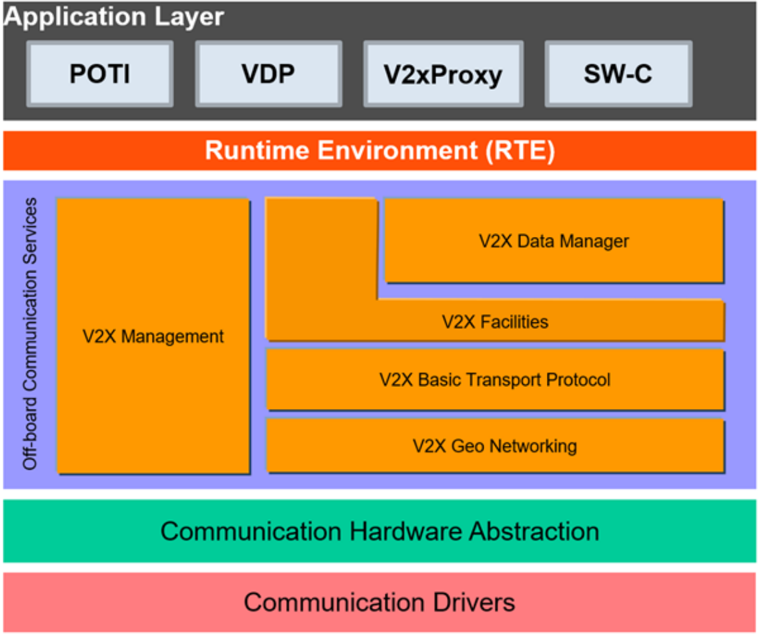
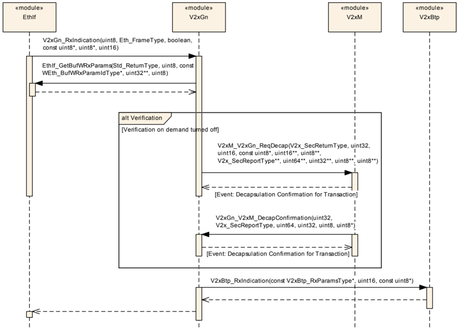
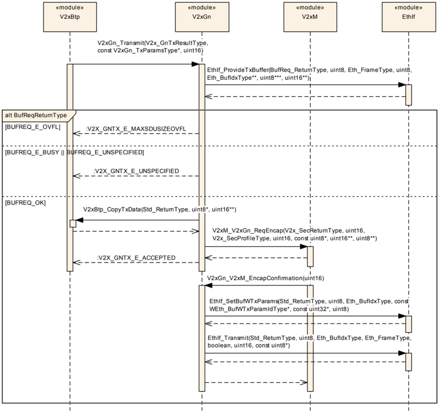
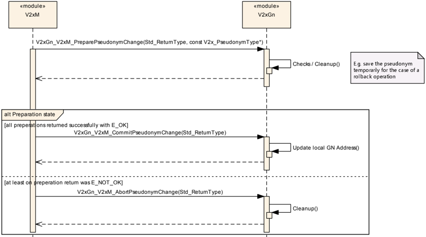
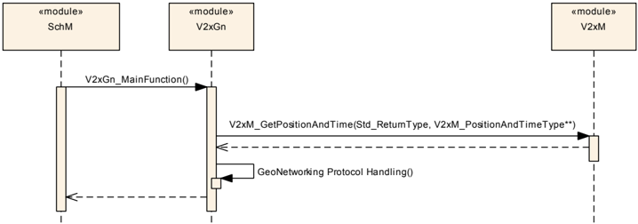
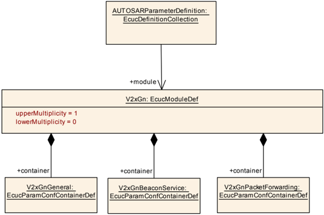
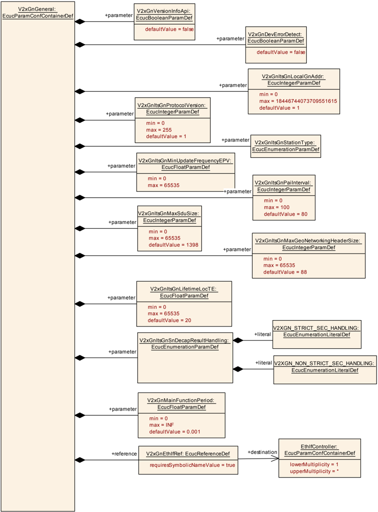
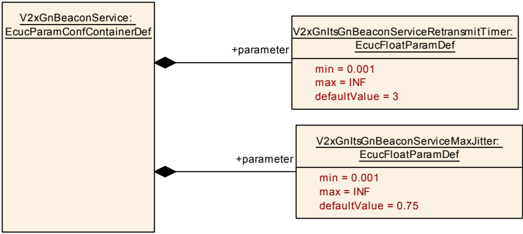
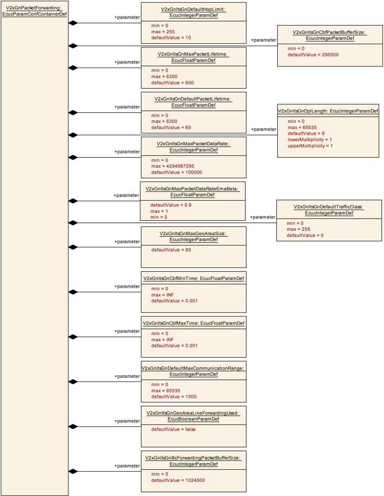

## 1. 简介和功能概述

本规范规定 **AUTOSAR** 基础软件模块 **Vehicle-2-X GeoNetworking**（V2xGn）的功能、**API** 和配置。

**V2xGn** 与 **Vehicle-2-X Facilities**（V2xFac）[\[1\]](#ref-1)、**Vehicle-2-X Basic Transport**（V2xBtp）[\[2\]](#ref-2)、**Vehicle-2-X Management**（V2xM）[\[3\]](#ref-3)、**Vehicle-2-X Data Manager** [\[4\]](#ref-4) 以及 **AUTOSAR BSW** 模块 **Ethernet Interface**（EthIf）[\[5\]](#ref-5)、**Wireless Ethernet Driver**（WEth）[\[6\]](#ref-6) 和 **Wireless Ethernet Transceiver Driver**（WEthTrcv）[\[7\]](#ref-7) 一起，在 **AUTOSAR** 架构中构成 V2X 协议栈。

本文档的基础是 **GeoNetworking** 规范 [\[8\]](#ref-8) [\[9\]](#ref-9)。假定读者已熟悉该规范。

### 1.1. 架构总览

**V2xGn** 向上层 **V2xBtp** 模块提供服务并依赖于它，同时使用下层 **EthIf** 模块的服务并从其获取服务，以实现本文第 [1.2](#12-功能总览) 节和第 [6](#6-功能规格) 章所述的功能。

**V2xGn** 模块在 **AUTOSAR BSW** 和分层软件架构中的位置如下图所示。



### 1.2. 功能总览

**V2xGn** 模块的内部功能应符合 **GeoNetworking** 协议的媒介无关规范 [\[8\]](#ref-8) 和媒介相关规范 [\[9\]](#ref-9)，并以 **ETSI** ITS-G5 技术作为媒介。本模块向 [\[2\]](#ref-2) 规定的上层 **V2xBtp** 模块提供服务；为了提供其包传输服务，它依赖下层 **EthIf** 模块 [\[5\]](#ref-5)。**Vehicle-2-X** 特定的数据还与 **V2xM** 模块交换。

**GeoNetworking** 协议是一组网络层功能，它利用通信实体的地理位置实现无需基础设施支持的自组织（ad hoc）通信。它支持各智能交通系统（**ITS**）站之间的通信以及包在地理区域内的分发。由于 **GeoNetworking** 可以在不同的 **ITS** 技术（例如 ITS-G5 和红外）上执行，**GeoNetworking** 规范由一个媒介无关功能标准 [\[8\]](#ref-8)（规定所有 **ITS** 接入技术共有的全部功能）和一个或多个媒介相关规范 [\[9\]](#ref-9)（包含针对特定 **ITS** 技术的扩展）组成。

## 2. 缩略语

以下术语表包含与 **V2xGeoNetworking** 模块相关、但未包含在 **AUTOSAR** 术语表 [\[10\]](#ref-10) 中的缩略语和缩写。

**BTP**
> 基本传输协议（**Basic Transport Protocol**）。

**CBF**
> 基于竞争的转发（**Contention-Based Forwarding**）。

**DET**
> 默认错误跟踪器（**Default Error Tracer**）。

**GAC**
> 地理任意播（**GeoAnycast**）。

**GBC**
> 地理广播（**GeoBroadcast**）。

**GN**
> 地理网络（**GeoNetworking**）。

**GN-SDU**
> **GeoNetworking** 服务数据单元（**GeoNetworking Service Data Unit**）。

**ITS**
> 智能交通系统（**Intelligent Transport System**）。

**MAC**
> 媒体访问控制（**Medium Access Control**）。

**SHB**
> 单跳广播（**Single Hop Broadcast**）。

**TC**
> 流量类别（**Traffic Class**）。

**TSB**
> 拓扑范围广播（**Topologically Scoped Broadcast**）。

## 3. 相关文档

### 3.1. 输入文件和相关标准与规范

<a id="ref-1"></a>[1] Specification of Vehicle-2-X Facilities
> AUTOSAR_CP_SWS_V2XFacilities

<a id="ref-2"></a>[2] Specification of Vehicle-2-X Basic Transport
> AUTOSAR_CP_SWS_V2XBasicTransport

<a id="ref-3"></a>[3] Specification of Vehicle-2-X Management
> AUTOSAR_CP_SWS_V2XManagement

<a id="ref-4"></a>[4] Specification of Vehicle-2-X Data Manager
> AUTOSAR_CP_SWS_V2XDataManager

<a id="ref-5"></a>[5] Specification of Ethernet Interface
> AUTOSAR_CP_SWS_EthernetInterface

<a id="ref-6"></a>[6] Specification of Wireless Ethernet Driver
> AUTOSAR_CP_SWS_WirelessEthernetDriver

<a id="ref-7"></a>[7] Specification of Wireless Ethernet Transceiver Driver
> AUTOSAR_CP_SWS_WirelessEthernetTransceiverDriver

<a id="ref-8"></a>[8] EN 302 636-4-1 V1.3.1:Vehicular Communication; Geonetworking; Part 4 Geographical addressing and forwarding for point-to-point and point-to-multipoint communications; Sub-part 1:Media-Independent Functionality

<a id="ref-9"></a>[9] TS 102 636-4-2 V1.1.1:Intelligent Transport Systems (ITS); GeoNetworking; Part 4:Geographical addressing and forwarding for point-to-point and point-to-multipoint communications; Sub-part 2:Media-dependent functionalities for ITSG5

<a id="ref-10"></a>[10] Glossary
> AUTOSAR_FO_TR_Glossary

<a id="ref-11"></a>[11] General Specification of Basic Software Modules
> AUTOSAR_CP_SWS_BSWGeneral

<a id="ref-12"></a>[12] IEEE Part 11:Wireless LAN Medium Access Control (MAC) and Physical Layer (PHY) Specification. Amendment 6:Wireless Access in Vehicular Environments (IEEE STD 802.11p-2010).

<a id="ref-13"></a>[13] Car 2 Car Communication Consortium; Basic System Profile release 1.3

<a id="ref-14"></a>[14] Specification of Default Error Tracer
> AUTOSAR_CP_SWS_DefaultErrorTracer

<a id="ref-15"></a>[15] Specification of ECU State Manager
> AUTOSAR_CP_SWS_ECUStateManager

<a id="ref-16"></a>[16] General Requirements on Basic Software Modules
> AUTOSAR_CP_SRS_BSWGeneral

<a id="ref-17"></a>[17] Requirements on Vehicle-2-X Communication
> AUTOSAR_CP_SRS_V2XCommunication

<a id="ref-18"></a>[18] TS 102 724 V1.1.1:Intelligent Transport Systems (ITS); Harmonized Channel Specifications for Intelligent Transport Systems operating in the 5 GHz frequency band

<a id="ref-19"></a>[19] List of EtherTypes by IEEE http://standards.ieee.org/develop/regauth/ethertype/eth.txt

### 3.2. 相关规范

**AUTOSAR** 提供了基础软件模块的通用规范 [\[11\]](#ref-11)，该规范同样适用于 **V2xGn**。

因此，规范 **SWS BSW General** 应被视为 **V2xGn** 的附加且必需的规范。

## 4. 约束和假设

### 4.1. 限制

* **GeoNetworking** 协议（进而 **V2xGn** 模块）需要具备广播能力的接入层才能提供发送服务。
* 无线通信仅支持 **IEEE 802.11p** [\[12\]](#ref-12)。其他 802.11 标准（例如用于基础设施网络及与 **TCP/IP** 集成）可以在 **AUTOSAR** 标准的未来版本中扩展。
* V2X 模块遵循 Car-2-Car-Consortium [\[13\]](#ref-13) 基本系统标准配置（Basic System Standards Profile）定义的 Day-1 场景指南。

### 4.2. 汽车域的适用性

本规范适用于所有汽车域。

### 4.3. 授权票证与假名

授权票证（**AT**）在本文档中称为假名（**Pseudonym**）。

## 5. 对其他模块的依赖

本节描述 **V2xGn** 模块与 **AUTOSAR** 基础软件架构中其他模块的关系。它概述实现 **V2xGn** 模块所需或可选的模块，以及这些模块使用的 **V2xGn** 服务。

### 5.1. AUTOSAR DET（默认错误跟踪器）

在开发模式下，**V2xGn** 模块通过 **DET** [\[14\]](#ref-14) 上报错误。

### 5.2. AUTOSAR EcuM（ECU 状态管理器）

**EcuM** [\[15\]](#ref-15) 负责 **V2xGn** 的初始化。

### 5.3. AUTOSAR 以太网接口（EthIf）

**Ethernet Interface** 是 **V2xGn** 模块的下层模块。

### 5.4. AUTOSAR Vehicle-2-X 基本传输协议（V2xBtp）

**V2xBtp** 是 **V2xGn** 模块的上层模块。

### 5.5. AUTOSAR Vehicle-2-X Management（V2xM）

**V2xM** 用于与其他 V2X 模块交换数据。安全机制由 **V2xM** 配置并由 **V2xGn** 使用。

### 5.6. 文件结构

#### 5.6.1. 代码文件结构

详情参见「基础软件模块通用规范」[\[11\]](#ref-11) 的第 5.1.6 章「代码文件结构」。

## 6. 功能规格

### 6.1. 通用功能

除非本文档中另有规定，**V2xGn** 模块应实现 [\[8\]](#ref-8)、[\[9\]](#ref-9) 和 [\[13\]](#ref-13) 中定义的 **GeoNetworking** 协议。

**GeoNetworking** 协议应支持 [\[13\]](#ref-13) 规定的 **GeoNetworking** 相关要求。

**V2xGn** 模块未在本文档中定义或覆盖的所有默认常量和参数应按 [\[8\]](#ref-8) 附录 H 的规定设置。

**V2xGn** 模块的实现应假定 **ETSI** 参数 itsGnSecurity 恒为 ENABLED。

**V2xGn** 模块应仅支持匿名地址配置模式。

**V2xGn** 模块应支持最大 80 km² 的地理区域。因此，itsGnMaxGeoAreaSize 的值应为 80。它可通过配置选项 V2xGnItsGnMaxGeoAreaSize 配置。

**V2xGn** 模块的实现应假定 **ETSI** 参数 itsGnIfType 恒为 ITS-G5。

**V2xGn** 模块应在 [V2xGn_Init](#731-v2xgn_init)() 内通过 V2xM_GetRefTimePtr() 获取指向当前时间信息的指针。

**V2xGn** 模块不应执行包重复（packet repetition），且不执行 [\[8\]](#ref-8) 第 10.3 章包处理过程中相应的步骤。服务原语 GN-DATA.request 的参数「Maximum repetition time」不适用。同样，**GN** 协议常量 itsGnMinPacketRepetitionInterval 不适用。

### 6.2. GeoNetworking 包结构与格式

**GeoNetworking** 协议应仅支持包报头类型：单跳广播（**SHB**）包报头、地理广播（**GBC**）包报头和信标（**Beacon**）包报头。

**V2xGn** 模块应将所有 **SHB** 包的 LifeTime 字段设置为 1 秒。因此，**LT** 字段的乘数位应设置为 1，**LT** 字段的基数位应设置为 1。

**V2xGn** 模块应将所有 **GBC** 包的 LifeTime 字段设置为发送参数 TxParams 中 maxPacketLifetime 的值。LifeTime 字段的值不应超过 [\[8\]](#ref-8) 附录 H 规定的 itsGnMaxPacketLifetime。

### 6.3. GeoNetworking 协议操作

#### 6.3.1. 网络管理

**V2xGn** 模块应更新本地位置和时间信息。最小更新频率由配置参数 V2xGnItsGnMinUpdateFrequencyEPV 配置。调度函数 [V2xGn_MainFunction](#751-v2xgn_mainfunction)() 应用于周期性更新。

**V2xGn** 模块应支持 **GeoNetworking** 信标（beaconing）。调度函数 [V2xGn_MainFunction](#751-v2xgn_mainfunction)() 应用于周期性信标发送。

只有当自车位置足够精确、可将位置精度指示符（**PAI**）置为 1 时，**V2xGn** 模块才应发送信标。

**V2xGn** 模块应支持位置表维护（**Location Table Maintainance**）。调度函数 [V2xGn_MainFunction](#751-v2xgn_mainfunction)() 应用于位置表的周期性维护。

**V2xGn** 模块应在 MainFunction 内通过 V2xM_GetPositionAndTime() 获取当前的位置和时间信息。

#### 6.3.2. 安全机制

**V2xGn** 模块应使用 **V2xM** 提供的安全服务 V2xM_V2xGn_ReqEncap() 和 V2xM_V2xGn_ReqDecap()。

当假名更改处于准备阶段时，**V2xGn** 应暂停消息的发送并清除发送缓冲区。

**注意：** **V2xM** 将通过 [V2xGn_V2xM_PreparePseudonymChange](#733-v2xgn_v2xm_preparepseudonymchange)()、[V2xGn_V2xM_CommitPseudonymChange](#734-v2xgn_v2xm_commitpseudonymchange)() 和 [V2xGn_V2xM_AbortPseudonymChange](#735-v2xgn_v2xm_abortpseudonymchange)() 把假名更改通知给 **V2xGn**。

### 6.4. 消息转发

**V2xGn** 模块应仅支持 [\[8\]](#ref-8) 附录 E.3 规定的区域转发算法。

转发包时，**V2xGn** 模块应使用 [\[18\]](#ref-18) 定义的 **DCC** 配置文件 DP3。

**V2xGn** 模块应检查与发送方位置的距离（如有安全信封，取自安全信封），并且只转发与发送方距离等于或小于 6 km 的消息。

### 6.5. 消息发送

**V2xGn** 模块应提供 **API** [V2xGn_Transmit](#736-v2xgn_transmit)()，以使能来自 **V2xBtp** 模块的发送请求。

**V2xGn** 模块应使用 EthIf_ProvideTxBuffer() 在无线以太网驱动内为待发送的 V2X 包获取一个缓冲区。这必须在 [V2xGn_Transmit](#736-v2xgn_transmit)() 上下文中完成。

**V2xGn** 模块应通过调用 **API** EthIf_SetBufWTxParams() 为待发送的 V2X 包向无线以太网驱动提供发送参数。这必须在 [V2xGn_Transmit](#736-v2xgn_transmit)() 上下文中完成。

**V2xGn** 模块应使用 **EthIf** 模块提供的 EthIf_Transmit() **API** 发送包。这必须在 [V2xGn_Transmit](#736-v2xgn_transmit)() 上下文中完成。

**V2xGn** 模块应为每个待发送的包创建一个唯一的 EncapReqId。该 EncapReqId 用于跟踪每个封装请求的结果，在封装请求中对要发送的包进行签名以认证发送 ITS 站。

如果 **GBC** 包的 **TC**（流量类别）字段的 **SCF** 位置为 1，则 **V2xGn** 模块应在无邻居可用时缓冲 **GBC** 包（存储-携带-转发，store-carry-forward）。

**V2xGn** 模块不要求将包分流到另一信道。因此，待发送 **BTP** 帧中 **TC**（流量类别）字段的信道分流位应设置为 0。值 1 反正会被忽略。

**V2xGn** 模块应仅使用第 [6.4](#64-消息转发) 节规定的 **DCC** 配置文件。因此，**TC**（流量类别）字段的 **DCC** 配置文件 **ID** 位应仅使用第 [6.4](#64-消息转发) 节定义的 **DPID** 值。

**V2xGn** 应将 Flags 字段的 itsGnIsMobile 位置为 1。

**V2xGn** 应将最大跳数限制（**MHL**）字段设置为 10。

**V2xGn** 模块发送的所有 **GeoNetworking** 帧应使用 **EtherType** 值 0x8947（如 **IEEE** 注册机构 [\[19\]](#ref-19) 所列）。

**GN** 源地址应按如下方式构造：

* 将字段 M（位 0）设置为 0。
* 将字段 ST（位 1 到 5）设置为 ITS-S 的站点类型。**GN** 源地址中的站点类型应与 **CAM**/**DENM** 中的站点类型相同。
* 将保留位 6 到 15 设置为 0。
* 将字段 MID（位 16 到 63）设置为 **MAC** 地址的值。

**V2xGn** 模块应调用 V2xM_GetGlobalTxParams()，它交付要在待发送 **GeoNetworking** 报头中设置的本信道 **CBR** 信息。

### 6.6. 消息接收

**V2xGn** 模块应为每个接收到的包创建一个唯一的 DecapReqId。该 DecapReqId 用于跟踪每个解封装请求的结果，在解封装请求中验证接收到的包的签名。

**V2xGn** 模块应通过 V2xBtp_RxIndication() 回调向 **BTP** 模块指示接收到的包。

**V2xGn** 模块应在 [V2xGn_RxIndication](#743-v2xgn_rxindication)() 期间通过调用 EthIf_GetBufWRxParams() 从 **EthIf** 模块获取接收到的包的接收状态。

**V2xGn** 模块应仅使用 [\[8\]](#ref-8) 附录 A.2 和 A.3 规定的重复包检测。

如果 **V2xGn** 模块检测到「证书摘要」/"hashedId8" 的低 32 位与另一 ITS 站的「证书摘要」/"hashedId8" 发生冲突，则仅当与另一「证书摘要」/"hashedId8" 对应的证书有效、且当前授权票证是按照第 [7.3.2](#732-v2xgn_getversioninfo) 节定义的规则选择时（即尚未有此类冲突触发对当前授权票证的更改），它才应发起其授权票证（假名）的更改。

**V2xGn** 模块应以从 **GeoNetworking** 报头提取的 **CBR** 信息调用 V2xM_SetGlobalRxParams()。

当 **V2xGn** 协议操作需要计算地理距离时，**V2xGn** 模块应使用 V2xM_CalcDistance()。

### 6.7. 错误分类

文档 [\[11\]](#ref-11)「基础软件模块通用规范」的「Error Handling」一章详细描述了基础软件的错误处理。其中最重要的是，它构成了一个由 **BSW** 模块中可能发生的五种错误类型组成的分类方案。

在此基础上，以下各小节按相应的子节规定了具体错误。

#### 6.7.1. 开发错误

如果为 **V2xGn** 模块启用了开发错误检测，**V2xGn** 模块应检查 **API** 参数的有效性，并将检测到的错误上报给 **DET**。

| 错误类型 | 相关错误代码 | 错误值 |
|---|---|---|
| 使用无效参数调用 **API** 服务 | V2XGN_E_PARAM | 0x01 |
| 使用无效指针调用 **API** 服务 | V2XGN_E_PARAM_POINTER | 0x02 |
| 在模块未初始化的情况下使用 **API** 服务 | V2XGN_E_UNINIT | 0x03 |
| 使用无效配置指针调用 **API** 服务 | V2XGN_E_INIT_FAILED | 0x04 |

#### 6.7.2. 运行时错误

没有运行时错误。

#### 6.7.3. 瞬态故障

没有瞬态故障。

#### 6.7.4. 生产错误

没有生产错误。

#### 6.7.5. 扩展生产错误

没有扩展生产错误。

## 7. API规范

### 7.1. 导入的类型

本章列出从以下模块包含的所有类型：

| 模块 | 头文件 | 导入的类型 |
|---|---|---|
| ComStack_Types | ComStack_Types.h | BufReq_ReturnType |
| Eth | Eth_GeneralTypes.h | Eth_BufIdxType |
| Eth | Eth_GeneralTypes.h | Eth_FrameType |
| Std | Std_Types.h | Std_ReturnType |
| Std | Std_Types.h | Std_VersionInfoType |
| V2x_GeneralTypes | Rte_V2xM_Type.h | V2xM_PositionAndTimeType |
| V2x_GeneralTypes | V2x_GeneralTypes.h | V2x_ChanType |
| V2x_GeneralTypes | V2x_GeneralTypes.h | V2x_GnAddressType |
| V2x_GeneralTypes | V2x_GeneralTypes.h | V2x_GnAreaShapeType |
| V2x_GeneralTypes | V2x_GeneralTypes.h | V2x_GnDestinationAreaType |
| V2x_GeneralTypes | V2x_GeneralTypes.h | V2x_GnDestinationType |
| V2x_GeneralTypes | V2x_GeneralTypes.h | V2x_GnLongPositionVectorType |
| V2x_GeneralTypes | V2x_GeneralTypes.h | V2x_GnPacketTransportType |
| V2x_GeneralTypes | V2x_GeneralTypes.h | V2x_GnTxResultType |
| V2x_GeneralTypes | V2x_GeneralTypes.h | V2x_GnUpperProtocolType |
| V2x_GeneralTypes | V2x_GeneralTypes.h | V2x_PseudonymType |
| V2x_GeneralTypes | V2x_GeneralTypes.h | V2x_SecProfileType |
| V2x_GeneralTypes | V2x_GeneralTypes.h | V2x_SecReportType |
| V2x_GeneralTypes | V2x_GeneralTypes.h | V2x_SecReturnType |
| V2x_GeneralTypes | V2x_GeneralTypes.h | V2x_TrafficClassIdType |
| V2xBtp | V2xBtp.h | V2xBtp_RxParamsType |
| WEth | WEth_GeneralTypes.h | WEth_BufWRxParamIdType |
| WEth | WEth_GeneralTypes.h | WEth_BufWTxParamIdType |

### 7.2. 类型定义

#### 7.2.1. V2xGn_TxParamsType

| 名称 | V2xGn_TxParamsType | | |
| --- | --- | --- | --- |
| 类别 | Structure | | |
| 元素 | upperProtocol | 类型 | V2x_GnUpperProtocolType |
| 元素 | 注释 | 触发请求的协议（例如 BTP-A 或 BTP-B）。 | |
| 元素 | transportType | 类型 | V2x_GnPacketTransportType |
| 元素 | 注释 | 指定包的传输类型 | |
| 元素 | destinationAddress | 类型 | V2x_GnAddressType |
| 元素 | 注释 | GeoUnicast 包的目的地址 | |
| 元素 | destinationArea | 类型 | V2x_GnDestinationAreaType |
| 元素 | 注释 | GeoBroadcast/GeoAnycast 包的目的区域。 | |
| 元素 | destinationType | 类型 | V2x_GnDestinationType |
| 元素 | 注释 | 选择该包使用哪种目的类型（destinationAddress 或 destinationArea）。 | |
| 元素 | secProfile | 类型 | V2x_SecProfileType |
| 元素 | 注释 | 取决于安全服务的参数。 | |
| 元素 | maxPacketLifetime | 类型 | uint16 |
| 元素 | 注释 | 包在被缓冲直至到达目的地之前的时间。 | |
| 元素 | trafficClassId | 类型 | V2x_TrafficClassIdType |
| 元素 | 注释 | 指定消息流量类别的参数集合。 | |
| 描述 | 包含 [V2xGn_Transmit](#736-v2xgn_transmit)() **API** 参数的结构。 | | |
| 可通过 | V2xGn.h 获得 | | |

### 7.3. 函数定义

#### 7.3.1. V2xGn_Init

**说明**: 初始化 **V2xGn** 模块。可通过 **V2xGn.h** 获得。服务 **ID** 0x01。本服务为同步调用，不可重入。参数 CfgPtr（in）：指向配置集的指针。返回值：无。

```C
void V2xGn_Init ( void* CfgPtr )
```

如果启用了开发错误检测：该函数应检查参数 CfgPtr 是否包含有效配置。如果检查失败，该函数应引发开发错误 [V2XGN_E_INIT_FAILED](#671-开发错误)。

#### 7.3.2. V2xGn_GetVersionInfo

**说明**: 返回本模块的版本信息。可通过 **V2xGn.h** 获得。服务 **ID** 0x02。本服务为同步调用，可重入。参数 VersionInfoPtr（out）：存储本模块版本信息的指针。返回值：无。

```C
void V2xGn_GetVersionInfo ( Std_VersionInfoType* VersionInfoPtr )
```

如果启用了开发错误检测：该函数应检查参数 VersionInfoPtr 是否有效。如果检查失败，该函数应引发开发错误 [V2XGN_E_PARAM_POINTER](#671-开发错误)。

#### 7.3.3. V2xGn_V2xM_PreparePseudonymChange

**说明**: 发生假名更改时由 **V2xM** 调用本函数，以在使用该假名的每个模块中准备该更改。可通过 V2xGn_V2xM.h 获得。服务 **ID** 0x05。本服务为同步调用，不可重入。参数 PseudonymPtr（in）：由 **V2xM** 提供的假名。返回值：Std_ReturnType，E_OK：操作成功；E_NOT_OK：操作失败。

```C
Std_ReturnType V2xGn_V2xM_PreparePseudonymChange ( const V2x_PseudonymType* PseudonymPtr )
```

函数 V2xGn_V2xM_PreparePseudonymChange() 应准备用于包发送的 **GeoNetworking** 地址中假名特定部分的设置。

如果启用了开发错误检测：该函数应检查先前是否已调用过服务 [V2xGn_Init](#731-v2xgn_init)()。如果检查失败，该函数应引发开发错误 [V2XGN_E_UNINIT](#671-开发错误)。

如果启用了开发错误检测：该函数应检查参数 PseudonymPtr 是否有效。如果检查失败，该函数应引发开发错误 [V2XGN_E_PARAM_POINTER](#671-开发错误)。

**注意：** 这会启动一个模块内部的假名更改事务。实际的假名更改只有在调用 **API** [V2xGn_V2xM_CommitPseudonymChange](#734-v2xgn_v2xm_commitpseudonymchange)() 之后才生效。

#### 7.3.4. V2xGn_V2xM_CommitPseudonymChange

**说明**: 当所有模块都同意假名更改且该更改将被提交时，**V2xM** 调用本函数。可通过 V2xGn_V2xM.h 获得。服务 **ID** 0x09。本服务为同步调用，不可重入。参数：无。返回值：Std_ReturnType，E_OK：操作成功；E_NOT_OK：操作失败。

```C
Std_ReturnType V2xGn_V2xM_CommitPseudonymChange ( void )
```

函数 V2xGn_V2xM_CommitPseudonymChange() 应更新本模块 **GeoNetworking** 地址中假名特定的部分。

如果启用了开发错误检测：该函数应检查先前是否已调用过服务 [V2xGn_Init](#731-v2xgn_init)()。如果检查失败，该函数应引发开发错误 [V2XGN_E_UNINIT](#671-开发错误)。

**注意：** 该函数要求先前已通过 **API** 调用 [V2xGn_V2xM_PreparePseudonymChange](#733-v2xgn_v2xm_preparepseudonymchange)() 准备假名。

#### 7.3.5. V2xGn_V2xM_AbortPseudonymChange

**说明**: 当并非所有模块都同意假名更改且该更改将被回退时，**V2xM** 调用本函数。可通过 V2xGn_V2xM.h 获得。服务 **ID** 0x0a。本服务为同步调用，不可重入。参数：无。返回值：Std_ReturnType，E_OK：操作成功；E_NOT_OK：操作失败。

```C
Std_ReturnType V2xGn_V2xM_AbortPseudonymChange ( void )
```

函数 V2xGn_V2xM_AbortPseudonymChange() 应将模块的状态设置回准备假名更改之前的状态。

如果启用了开发错误检测：该函数应检查先前是否已调用过服务 [V2xGn_Init](#731-v2xgn_init)()。如果检查失败，该函数应引发开发错误 [V2XGN_E_UNINIT](#671-开发错误)。

**注意：** 该函数要求先前已通过 **API** 调用 [V2xGn_V2xM_PreparePseudonymChange](#733-v2xgn_v2xm_preparepseudonymchange)() 准备假名。

#### 7.3.6. V2xGn_Transmit

**说明**: 由 V2x_Btp 调用以发送消息。可通过 **V2xGn.h** 获得。服务 **ID** 0x03。本服务为异步调用，不可重入。参数 TxParams（in）：附加的发送参数。参数 Length（in）：用户数据的长度。返回值：V2x_GnTxResultType，可返回该类型规定的值：V2X_GNTX_ACCEPTED —— 未发生错误，发送已被接受；V2X_GNTX_E_MAXSDUSIZEOVFL —— 由于超过最大长度而拒绝发送；V2X_GNTX_E_MAXPACKETLIFETIME —— 由于超过最大生存期而拒绝发送；V2X_GNTX_E_TCID —— 由于不支持的流量类别 **ID** 而拒绝发送；V2X_GNTX_E_MAXGEOAREASIZE —— 由于地理区域超过最大尺寸而拒绝发送；V2X_GNTX_E_UNSPECIFIED —— 由于未指明的原因而拒绝发送。

```C
V2x_GnTxResultType V2xGn_Transmit ( const V2xGn_TxParamsType* TxParams, uint16 Length )
```

函数 V2xGn_Transmit() 应发送一个 V2X 包。

如果启用了开发错误检测：该函数应检查先前是否已调用过服务 [V2xGn_Init](#731-v2xgn_init)()。如果检查失败，该函数应引发开发错误 [V2XGN_E_UNINIT](#671-开发错误)。

如果对 EthIf_ProvideTxBuffer 的调用返回 BUFREQ_E_OVFL，该函数应返回 V2X_GNTX_E_MAXSDUSIZEOVFL。

如果参数 TxParams.maxPacketLifetime 无效，该函数应返回 V2X_GNTX_E_MAXPACKETLIFETIME。

如果参数 TxParams.trafficClassId 无效，该函数应返回 V2X_GNTX_E_TCID。

如果参数 TxParams.destinationType 为 V2X_GNDESTINATION_AREA 且参数 TxParams.destinationArea 无效，该函数应返回 V2X_GNTX_E_MAXGEOAREASIZE。

### 7.4. 回调通知

#### 7.4.1. V2xGn_V2xM_EncapConfirmation

**说明**: 当封装完成时由 **V2xM** 调用本函数。可通过 V2xGn_V2xM.h 获得。服务 **ID** 0x0b。本服务为异步调用，不可重入。参数 EncapReqId（in）：已用发送 ITS 站的签名封装的包的唯一 **Id**。返回值：无。

```C
void V2xGn_V2xM_EncapConfirmation ( uint16 EncapReqId )
```

函数 V2xGn_V2xM_EncapConfirmation() 应通过将包发送给下层来完成包的传输。

如果启用了开发错误检测：该函数应检查先前是否已调用过服务 [V2xGn_Init](#731-v2xgn_init)()。如果检查失败，该函数应引发开发错误 [V2XGN_E_UNINIT](#671-开发错误)。

**注意：** 该函数要求先前已通过 **API** [V2xGn_Transmit](#736-v2xgn_transmit)() 成功发起发送请求。

#### 7.4.2. V2xGn_V2xM_DecapConfirmation

**说明**: 当解封装完成时由 **V2xM** 调用本函数。可通过 V2xGn_V2xM.h 获得。服务 **ID** 0x0c。本服务为异步调用，不可重入。参数 DecapReqId（in）：已解封装且签名已验证的接收包的唯一 **Id**。参数 SecReport（in）：安全报告。参数 CertificateId（in）：用于验证的标识（按证书哈希）。参数 ItsAid（in）：ITS-AID 的数值。参数 SspLength（in）：**SSP** 位的长度（以八位位组为单位，最大 31）。参数 SspBits（in）：**SSP** 位。返回值：无。

```C
void V2xGn_V2xM_DecapConfirmation ( uint32 DecapReqId, V2x_SecReportType SecReport, uint64 CertificateId, uint32 ItsAid, uint8 SspLength, const uint8* SspBits )
```

函数 V2xGn_V2xM_DecapConfirmation() 应通过继续 **V2xGn** 协议操作来继续处理接收到的包。

如果启用了开发错误检测：该函数应检查先前是否已调用过服务 [V2xGn_Init](#731-v2xgn_init)()。如果检查失败，该函数应引发开发错误 [V2XGN_E_UNINIT](#671-开发错误)。

**注意：** 该函数要求先前已通过 **API** [V2xGn_RxIndication](#743-v2xgn_rxindication)() 成功接收一个包。

#### 7.4.3. V2xGn_RxIndication

**说明**: 指示以太网帧的接收。可通过 **V2xGn.h** 获得。服务 **ID** 0x04。本服务为同步调用，不可重入。参数 CtrlIdx（in）：**Ethernet Interface** 上下文中以太网控制器的索引。参数 FrameType（in）：接收到的以太网帧的帧类型。参数 IsBroadcast（in）：指示广播帧的参数。参数 PhysAddrPtr（in）：指向接收到的以太网帧的物理源地址（网络字节序 **MAC** 地址）的指针。参数 DataPtr（in）：指向接收到的以太网帧载荷的指针（即不提供以太网报头）。参数 LenByte（in）：接收数据的长度。返回值：无。

```C
void V2xGn_RxIndication ( uint8 CtrlIdx, Eth_FrameType FrameType, boolean IsBroadcast, const uint8* PhysAddrPtr, uint8* DataPtr, uint16 LenByte )
```

函数 V2xGn_RxIndication() 应通过调用 **API** EthIf_GetBufWRxParams 为接收到的 V2X 包获取无线以太网驱动的接收参数。

这样做是为了访问该包的无线特定接收参数，这些参数无法通过 V2xGn_RxIndication() **API** 获得。

如果启用了开发错误检测：该函数应检查先前是否已调用过服务 [V2xGn_Init](#731-v2xgn_init)()。如果检查失败，该函数应引发开发错误 [V2XGN_E_UNINIT](#671-开发错误)。

如果启用了开发错误检测：该函数应检查参数 DataPtr 是否有效。如果检查失败，该函数应引发开发错误 [V2XGN_E_PARAM_POINTER](#671-开发错误)。

### 7.5. 调度函数

#### 7.5.1. V2xGn_MainFunction

**说明**: **V2xGn** 模块的主函数，用于周期性执行协议操作。可通过 SchM_V2xGn.h 获得。服务 **ID** 0x08。

```C
void V2xGn_MainFunction ( void )
```

### 7.6. 期望接口

本章列出从其他模块要求的全部外部接口。

#### 7.6.1. 强制接口

本章定义实现模块核心功能所需的全部外部接口。

| API 函数 | 头文件 | 描述 |
|---|---|---|
| EthIf_GetBufWRxParams | EthIf.h | 为接收到的包读取与收发器接收方向相关的值。例如，这可以是属于单个包的 **RSSI** 或信道 |
| EthIf_GetBufWTxParams | EthIf.h | 为发送的包读取与收发器发送方向相关的值 |
| EthIf_ProvideTxBuffer | EthIf.h | 提供对指定以太网控制器发送缓冲区的访问 |
| EthIf_SetBufWTxParams | EthIf.h | 为特定缓冲区（待发送的包）设置与收发器发送方向相关的值。例如，这可以是期望的发送功率或属于单个包的信道 |
| EthIf_Transmit | EthIf.h | 触发发送一个先前已填充的发送缓冲区 |
| V2xBtp_CopyTxData | V2xBtp.h | **V2xGn** 模块调用本 **API** 以请求 **V2xBtp** 模块将发送数据复制到特定位置 |
| V2xBtp_RxIndication | V2xBtp.h | 通过本 **API**，**V2xBtp** 模块获取接收到的 **GeoNetworking** 包的数据（**BTP-PDU**）和 **GeoNetworking** 参数 |
| V2xM_CalcDistance | V2xM.h | 在假定两点海拔为 0 的前提下计算地球上两个地理位置点之间的距离 |
| V2xM_GetPositionAndTime | V2xM.h | 提供瞬时位置信息。 |
| V2xM_GetRefTimePtr | V2xM.h | 提供指向 V2X-Stack 时间基准的指针。 |
| V2xM_TriggerPseudonymChange | V2xM.h | 由 **V2xFac**、**V2xGn** 或其他实体调用以更改 V2X-Stack 使用的假名，例如由于 **GeoNetworking** 地址冲突 |
| V2xM_V2xGn_GetGlobalTxParams | V2xM_V2xGn.h | 由 **V2xGn** 调用以获取指定信道的当前信道忙百分比 |
| V2xM_V2xGn_ReqDecap | V2xM_V2xGn.h | 由 **V2xGn** 调用以解密并验证消息。异步的 [V2xGn_V2xM_DecapConfirmation](#742-v2xgn_v2xm_decapconfirmation) 调用将用于向 **V2xGn** 通知结果 |
| V2xM_V2xGn_ReqEncap | V2xM_V2xGn.h | 由 **V2xGn** 调用以签名和/或加密消息。异步的 [V2xGn_V2xM_EncapConfirmation](#741-v2xgn_v2xm_encapconfirmation) 调用将用于向 **V2xGn** 通知结果 |
| V2xM_V2xGn_SetGlobalRxParams | V2xM_V2xGn.h | 由 **V2xGn** 调用以设置指定信道的当前信道忙百分比 |

#### 7.6.2. 可选接口

本章定义实现模块可选功能所需的全部外部接口。

| API 函数 | 头文件 | 描述 |
|---|---|---|
| Det_ReportError | Det.h | 上报开发错误的服务 |

## 8. 时序图

以下时序图展示 **V2xGn** 模块与其相邻模块之间的交互。

请注意，这些时序图是为了便于理解本规范而对说明目的的扩展，用于支持第 [6](#6-功能规格) 章所述的功能规格和第 [7](#7-api规范) 章所述的 **API** 规范。

注意，为使时序图更易于阅读和理解，所有参数和返回类型均已省略。

### 8.1. V2xGn_RxIndication



**注意：** 按需验证（verification on demand）不再支持。每条接收到的包的验证都是强制的。时序流程图将在下一版本中相应修正。

### 8.2. V2xGn_Transmit



### 8.3. V2xGn_V2xM_UpdatePseudonym



### 8.4. V2xGn_MainFunction



## 9. 配置规范

第 9.1 章规定模块 **V2xGn** 的结构（容器）和参数。

第 9.2 章规定模块 **V2xGn** 的附加发布信息。

### 9.1. 容器与配置参数

以下各章汇总所有配置参数。参数的详细含义见第 6 章和第 7 章。

#### 9.1.1. 变体

**V2xGn** 模块仅支持 VARIANT-PRE-COMPILE。

#### 9.1.2. V2xGn

| SWS 条目 | [ECUC_V2xGn_00001] |
|---|---|
| 模块名称 | V2xGn |
| 描述 | **V2xGn**（Vehicle-2-X Geo Networking）模块的配置。 |
| Post-Build 变体支持 | false |
| 支持的配置变体 | VARIANT-PRE-COMPILE |

| 容器名称 | 多重性 | 作用域/依赖 |
|---|---|---|
| V2xGnBeaconService | 1 | 该容器包含与信标服务相关的 **GeoNetworking** 配置参数。 |
| V2xGnGeneral | 1 | 该容器指定 **V2xGn** 模块的通用配置参数。 |
| V2xGnPacketForwarding | 1 | 该容器包含与包转发相关的 **GeoNetworking** 配置参数。 |



#### 9.1.3. V2xGnGeneral

| SWS 条目 | [ECUC_V2xGn_00002] |
|---|---|
| 容器名称 | V2xGnGeneral |
| 父容器 | V2xGn |
| 描述 | 该容器指定 **V2xGn** 模块的通用配置参数。 |
| 配置参数 | 见下方参数表 |

| SWS 条目 | [ECUC_V2xGn_00006] |
|---|---|
| 参数名称 | V2xGnDevErrorDetect |
| 父容器 | V2xGnGeneral |
| 描述 | 将默认错误跟踪器（**Det**）的检测和通知打开或关闭。* **true**：使能（ON）。* **false**：禁用（OFF）。 |
| 多重性 | 1 |
| 类型 | EcucBooleanParamDef |
| 默认值 | false |
| Post-Build 变体值 | false |
| 值配置类 | Pre-compile time：x（All Variants）；Link time：-；Post-build time：- |
| 作用域/依赖 | scope: local |

| SWS 条目 | [ECUC_V2xGn_00016] |
|---|---|
| 参数名称 | V2xGnItsGnLifetimeLocTE |
| 父容器 | V2xGnGeneral |
| 描述 | 位置表维护：位置表中条目的生存期 [s] |
| 多重性 | 1 |
| 类型 | EcucFloatParamDef |
| 范围 | [0 .. 65535] |
| 默认值 | 20 |
| Post-Build 变体值 | false |
| 值配置类 | Pre-compile time：x（All Variants）；Link time：-；Post-build time：- |
| 作用域/依赖 | scope: local 依赖：应为 V2xGnMainFunctionPeriod 的倍数 |

| SWS 条目 | [ECUC_V2xGn_00009] |
|---|---|
| 参数名称 | V2xGnItsGnLocalGnAddr |
| 父容器 | V2xGnGeneral |
| 描述 | 64 位 **GeoNetworking** 地址。 |
| 多重性 | 1 |
| 类型 | EcucIntegerParamDef |
| 范围 | 0 .. 18446744073709551615 |
| 默认值 | 1 |
| Post-Build 变体值 | false |
| 值配置类 | Pre-compile time：x（All Variants）；Link time：-；Post-build time：- |
| 作用域/依赖 | scope: local |

| SWS 条目 | [ECUC_V2xGn_00014] |
|---|---|
| 参数名称 | V2xGnItsGnMaxGeoNetworkingHeaderSize |
| 父容器 | V2xGnGeneral |
| 描述 | **GeoNetworking** 报头的最大尺寸 [Byte]。 |
| 多重性 | 1 |
| 类型 | EcucIntegerParamDef |
| 范围 | 0 .. 65535 |
| 默认值 | 88 |
| Post-Build 变体值 | false |
| 值配置类 | Pre-compile time：x（All Variants）；Link time：-；Post-build time：- |
| 作用域/依赖 | scope: local |

| SWS 条目 | [ECUC_V2xGn_00013] |
|---|---|
| 参数名称 | V2xGnItsGnMaxSduSize |
| 父容器 | V2xGnGeneral |
| 描述 | **GN-SDU** 的最大尺寸 [Byte]。 |
| 多重性 | 1 |
| 类型 | EcucIntegerParamDef |
| 范围 | 0 .. 65535 |
| 默认值 | 1398 |
| Post-Build 变体值 | false |
| 值配置类 | Pre-compile time：x（All Variants）；Link time：-；Post-build time：- |
| 作用域/依赖 | scope: local |

| SWS 条目 | [ECUC_V2xGn_00011] |
|---|---|
| 参数名称 | V2xGnItsGnMinUpdateFrequencyEPV |
| 父容器 | V2xGnGeneral |
| 描述 | 自车位置向量（**EPV**）的最小更新频率 [s]。 |
| 多重性 | 1 |
| 类型 | EcucFloatParamDef |
| 范围 | [0 .. 65535] |
| 默认值 | - |
| Post-Build 变体值 | false |
| 值配置类 | Pre-compile time：x（All Variants）；Link time：-；Post-build time：- |
| 作用域/依赖 | scope: local |

| SWS 条目 | [ECUC_V2xGn_00012] |
|---|---|
| 参数名称 | V2xGnItsGnPaiInterval |
| 父容器 | V2xGnGeneral |
| 描述 | 与纬度和经度置信区间相关的距离 [m]。用于确定 **PAI**。 |
| 多重性 | 1 |
| 类型 | EcucIntegerParamDef |
| 范围 | 0 .. 100 |
| 默认值 | 80 |
| Post-Build 变体值 | false |
| 值配置类 | Pre-compile time：x（All Variants）；Link time：-；Post-build time：- |
| 作用域/依赖 | scope: local |

| SWS 条目 | [ECUC_V2xGn_00008] |
|---|---|
| 参数名称 | V2xGnItsGnProtocolVersion |
| 父容器 | V2xGnGeneral |
| 描述 | [\[14\]](#ref-14) 附录 H 定义的 **GeoNetworking** 协议版本 |
| 多重性 | 1 |
| 类型 | EcucIntegerParamDef |
| 范围 | 0 .. 255 |
| 默认值 | 1 |
| Post-Build 变体值 | false |
| 值配置类 | Pre-compile time：x（All Variants）；Link time：-；Post-build time：- |
| 作用域/依赖 | scope: local |

| SWS 条目 | [ECUC_V2xGn_00017] |
|---|---|
| 参数名称 | V2xGnItsGnSnDecapResultHandling |
| 父容器 | V2xGnGeneral |
| 描述 | 指示 V2xM_ReqDecap 结果码的处理方式。 |
| 多重性 | 1 |
| 类型 | EcucEnumerationParamDef |
| 范围 | V2XGN_NON_STRICT_SEC_HANDLING：未正确验证和解密的 **GN** 包可以传递给上层协议实体做进一步处理；V2XGN_STRICT_SEC_HANDLING：未正确验证和解密的接收 **GN** 包总是被丢弃 |
| Post-Build 变体值 | false |
| 值配置类 | Pre-compile time：x（All Variants）；Link time：-；Post-build time：- |
| 作用域/依赖 | scope: local |

| SWS 条目 | [ECUC_V2xGn_00015] |
|---|---|
| 参数名称 | V2xGnItsGnStationType |
| 父容器 | V2xGnGeneral |
| 描述 | **GeoNetworking** 协议中使用的站点类型，**AUTOSAR** 不支持路侧单元（15）。 |
| 多重性 | 1 |
| 类型 | EcucEnumerationParamDef |
| 范围 | V2XFAC_ST_BUS；V2XFAC_ST_CYCLIST；V2XFAC_ST_HEAVYTRUCK；V2XFAC_ST_LIGHTTRUCK；V2XFAC_ST_MOPED；V2XFAC_ST_MOTORCYCLE；V2XFAC_ST_PASSENGERCAR；V2XFAC_ST_PEDESTRIAN；V2XFAC_ST_SPECIALVEHICLES；V2XFAC_ST_TRAILER；V2XFAC_ST_TRAM；V2XFAC_ST_UNKNOWN |
| Post-Build 变体值 | false |
| 值配置类 | Pre-compile time：x（All Variants）；Link time：-；Post-build time：- |
| 作用域/依赖 | scope: local |

| SWS 条目 | [ECUC_V2xGn_00018] |
|---|---|
| 参数名称 | V2xGnMainFunctionPeriod |
| 父容器 | V2xGnGeneral |
| 描述 | 以秒为单位指定主函数 V2xGn_MainFunction 的周期。**V2xGn** 不需要此信息，但 **BSW** 调度器需要。 |
| 多重性 | 1 |
| 类型 | EcucFloatParamDef |
| 范围 | ]0 .. INF[ |
| 默认值 | 0.001 |
| Post-Build 变体值 | false |
| 值配置类 | Pre-compile time：x（All Variants）；Link time：-；Post-build time：- |
| 作用域/依赖 | scope: local |

| SWS 条目 | [ECUC_V2xGn_00005] |
|---|---|
| 参数名称 | V2xGnVersionInfoApi |
| 父容器 | V2xGnGeneral |
| 描述 | 使能/禁用读取 **V2xGn** 模块版本信息的 **API**。* **true**：使能（ON）。* **false**：禁用（OFF）。 |
| 多重性 | 1 |
| 类型 | EcucBooleanParamDef |
| 默认值 | false |
| Post-Build 变体值 | false |
| 值配置类 | Pre-compile time：x（All Variants）；Link time：-；Post-build time：- |
| 作用域/依赖 | scope: local |

| SWS 条目 | [ECUC_V2xGn_00019] |
|---|---|
| 参数名称 | V2xGnEthIfRef |
| 父容器 | V2xGnGeneral |
| 描述 | 本参数表示对用于发送 V2X 包的以太网接口的引用。 |
| 多重性 | 1 |
| 类型 | Symbolic name reference to EthIfController |
| Post-Build 变体值 | false |
| 值配置类 | Pre-compile time：x（All Variants）；Link time：-；Post-build time：- |
| 作用域/依赖 | scope: local |

无包含的容器。



#### 9.1.4. V2xGnBeaconService

| SWS 条目 | [ECUC_V2xGn_00003] |
|---|---|
| 容器名称 | V2xGnBeaconService |
| 父容器 | V2xGn |
| 描述 | 该容器包含与信标服务相关的 **GeoNetworking** 配置参数。 |
| 配置参数 | 见下方参数表 |

| SWS 条目 | [ECUC_V2xGn_00021] |
|---|---|
| 参数名称 | V2xGnItsGnBeaconServiceMaxJitter |
| 父容器 | V2xGnBeaconService |
| 描述 | 最大信标抖动 [s]。抖动用于信标重传。实际抖动值是 0 与 V2xGnItsGnBeaconServiceMaxJitter 之间的随机数。该函数为定时器引入一个随机分量，以避免 GeoAdhoc 路由器之间的同步问题。 |
| 多重性 | 1 |
| 类型 | EcucFloatParamDef |
| 范围 | [0.001 .. INF] |
| 默认值 | 0.75 |
| Post-Build 变体值 | false |
| 值配置类 | Pre-compile time：x（All Variants）；Link time：-；Post-build time：- |
| 作用域/依赖 | scope: local |

| SWS 条目 | [ECUC_V2xGn_00020] |
|---|---|
| 参数名称 | V2xGnItsGnBeaconServiceRetransmitTimer |
| 父容器 | V2xGnBeaconService |
| 描述 | 信标服务重传定时器的持续时间 [s]。 |
| 多重性 | 1 |
| 类型 | EcucFloatParamDef |
| 范围 | [0.001 .. INF] |
| 默认值 | 3 |
| Post-Build 变体值 | false |
| 值配置类 | Pre-compile time：x（All Variants）；Link time：-；Post-build time：- |
| 作用域/依赖 | scope: local 依赖：应为 V2xGnMainFunctionPeriod 的倍数。 |

无包含的容器。



#### 9.1.5. V2xGnPacketForwarding

| SWS 条目 | [ECUC_V2xGn_00004] |
|---|---|
| 容器名称 | V2xGnPacketForwarding |
| 父容器 | V2xGn |
| 描述 | 该容器包含与包转发相关的 **GeoNetworking** 配置参数。 |
| 配置参数 | 见下方参数表 |

| SWS 条目 | [ECUC_V2xGn_00032] |
|---|---|
| 参数名称 | V2xGnItsGnBcForwardingPacketBufferSize |
| 父容器 | V2xGnPacketForwarding |
| 描述 | **BC** 转发包缓冲区的大小 [Byte]。 |
| 多重性 | 1 |
| 类型 | EcucIntegerParamDef |
| 范围 | 0 .. 18446744073709551615 |
| 默认值 | 1024000 |
| Post-Build 变体值 | false |
| 值配置类 | Pre-compile time：x（All Variants）；Link time：-；Post-build time：- |
| 作用域/依赖 | scope: local |

| SWS 条目 | [ECUC_V2xGn_00029] |
|---|---|
| 参数名称 | V2xGnItsGnCbfMaxTime |
| 父容器 | V2xGnPacketForwarding |
| 描述 | 一个 **GeoNetworking** 包在 **CBF** 包缓冲区中缓冲的最大持续时间 [s] |
| 多重性 | 1 |
| 类型 | EcucFloatParamDef |
| 范围 | ]0 .. INF[ |
| 默认值 | 0.001 |
| Post-Build 变体值 | false |
| 值配置类 | Pre-compile time：x（All Variants）；Link time：-；Post-build time：- |
| 作用域/依赖 | scope: local |

| SWS 条目 | [ECUC_V2xGn_00028] |
|---|---|
| 参数名称 | V2xGnItsGnCbfMinTime |
| 父容器 | V2xGnPacketForwarding |
| 描述 | 一个 **GeoNetworking** 包在 **CBF** 包缓冲区中缓冲的最小持续时间 [s] |
| 多重性 | 1 |
| 类型 | EcucFloatParamDef |
| 范围 | ]0 .. INF[ |
| 默认值 | 0.001 |
| Post-Build 变体值 | false |
| 值配置类 | Pre-compile time：x（All Variants）；Link time：-；Post-build time：- |
| 作用域/依赖 | scope: local |

| SWS 条目 | [ECUC_V2xGn_00033] |
|---|---|
| 参数名称 | V2xGnItsGnCbfPacketBufferSize |
| 父容器 | V2xGnPacketForwarding |
| 描述 | **CBF** 包缓冲区的大小 [Byte] |
| 多重性 | 1 |
| 类型 | EcucIntegerParamDef |
| 范围 | 0 .. 18446744073709551615 |
| 默认值 | 256000 |
| Post-Build 变体值 | false |
| 值配置类 | Pre-compile time：x（All Variants）；Link time：-；Post-build time：- |
| 作用域/依赖 | scope: local |

| SWS 条目 | [ECUC_V2xGn_00022] |
|---|---|
| 参数名称 | V2xGnItsGnDefaultHopLimit |
| 父容器 | V2xGnPacketForwarding |
| 描述 | 默认跳数限制，指示一个包可经过的最大跳数。 |
| 多重性 | 1 |
| 类型 | EcucIntegerParamDef |
| 范围 | 0 .. 255 |
| 默认值 | 10 |
| Post-Build 变体值 | false |
| 值配置类 | Pre-compile time：x（All Variants）；Link time：-；Post-build time：- |
| 作用域/依赖 | scope: local |

| SWS 条目 | [ECUC_V2xGn_00030] |
|---|---|
| 参数名称 | V2xGnItsGnDefaultMaxCommunicationRange |
| 父容器 | V2xGnPacketForwarding |
| 描述 | 默认理论最大通信距离 [m] |
| 多重性 | 1 |
| 类型 | EcucIntegerParamDef |
| 范围 | 0 .. 65535 |
| 默认值 | 1000 |
| Post-Build 变体值 | false |
| 值配置类 | Pre-compile time：x（All Variants）；Link time：-；Post-build time：- |
| 作用域/依赖 | scope: local |

| SWS 条目 | [ECUC_V2xGn_00024] |
|---|---|
| 参数名称 | V2xGnItsGnDefaultPacketLifetime |
| 父容器 | V2xGnPacketForwarding |
| 描述 | 默认包生存期 [s]。 |
| 多重性 | 1 |
| 类型 | EcucFloatParamDef |
| 范围 | [0 .. 6300] |
| 默认值 | 60 |
| Post-Build 变体值 | false |
| 值配置类 | Pre-compile time：x（All Variants）；Link time：-；Post-build time：- |
| 作用域/依赖 | scope: local |

| SWS 条目 | [ECUC_V2xGn_00034] |
|---|---|
| 参数名称 | V2xGnItsGnDefaultTrafficClass |
| 父容器 | V2xGnPacketForwarding |
| 描述 | 转发：默认流量类别 |
| 多重性 | 1 |
| 类型 | EcucIntegerParamDef |
| 范围 | 0 .. 255 |
| 默认值 | 0 |
| Post-Build 变体值 | false |
| 值配置类 | Pre-compile time：x（All Variants）；Link time：-；Post-build time：- |
| 作用域/依赖 | scope: local |

| SWS 条目 | [ECUC_V2xGn_00035] |
|---|---|
| 参数名称 | V2xGnItsGnDplLength |
| 父容器 | V2xGnPacketForwarding |
| 描述 | 每个源的重复包列表（**DPL**）的长度（[\[18\]](#ref-18) 第 A.2 章） |
| 多重性 | 1 |
| 类型 | EcucIntegerParamDef |
| 范围 | 0 .. 65535 |
| 默认值 | 8 |
| Post-Build 变体值 | false |
| 值配置类 | Pre-compile time：x（All Variants）；Link time：-；Post-build time：- |
| 作用域/依赖 | scope: local |

| SWS 条目 | [ECUC_V2xGn_00031] |
|---|---|
| 参数名称 | V2xGnItsGnGeoAreaLineForwardingUsed |
| 父容器 | V2xGnPacketForwarding |
| 描述 | 若 GeoAdhoc 路由器位于目的地理区域之外，对 **GBC**/**GAC** 包的转发。* **true**：使能（ON）。* **false**：禁用（OFF）。 |
| 多重性 | 1 |
| 类型 | EcucBooleanParamDef |
| 默认值 | false |
| Post-Build 变体值 | false |
| 值配置类 | Pre-compile time：x（All Variants）；Link time：-；Post-build time：- |
| 作用域/依赖 | scope: local |

| SWS 条目 | [ECUC_V2xGn_00027] |
|---|---|
| 参数名称 | V2xGnItsGnMaxGeoAreaSize |
| 父容器 | V2xGnPacketForwarding |
| 描述 | **GBC** 和 **GAC** 包地理区域的最大尺寸 [km²]。如果地理区域尺寸超过最大值，则不应发送（源）也不应转发（转发器）该 **GeoNetworking** 包。 |
| 多重性 | 1 |
| 类型 | EcucIntegerParamDef |
| 范围 | 0 .. 18446744073709551615 |
| 默认值 | 80 |
| Post-Build 变体值 | false |
| 值配置类 | Pre-compile time：x（All Variants）；Link time：-；Post-build time：- |
| 作用域/依赖 | scope: local |

| SWS 条目 | [ECUC_V2xGn_00025] |
|---|---|
| 参数名称 | V2xGnItsGnMaxPacketDataRate |
| 父容器 | V2xGnPacketForwarding |
| 描述 | GeoAdhoc 路由器的最大包数据速率 [Byte/s]。如果 GeoAdhoc 路由器的平均（**EMA**）包数据速率 a 超过该值，则不转发来自该 GeoAdhoc 路由器（源或发送方）的包。 |
| 多重性 | 1 |
| 类型 | EcucIntegerParamDef |
| 范围 | 0 .. 4294967295 |
| 默认值 | 100000 |
| Post-Build 变体值 | false |
| 值配置类 | Pre-compile time：x（All Variants）；Link time：-；Post-build time：- |
| 作用域/依赖 | scope: local |

| SWS 条目 | [ECUC_V2xGn_00026] |
|---|---|
| 参数名称 | V2xGnItsGnMaxPacketDataRateEmaBeta |
| 父容器 | V2xGnPacketForwarding |
| 描述 | 包数据速率 **PDR** 指数移动平均的权重因子，以百分比为单位。 |
| 多重性 | 1 |
| 类型 | EcucFloatParamDef |
| 范围 | ]0 .. 1] |
| 默认值 | 0.9 |
| Post-Build 变体值 | false |
| 值配置类 | Pre-compile time：x（All Variants）；Link time：-；Post-build time：- |
| 作用域/依赖 | scope: local |

| SWS 条目 | [ECUC_V2xGn_00023] |
|---|---|
| 参数名称 | V2xGnItsGnMaxPacketLifetime |
| 父容器 | V2xGnPacketForwarding |
| 描述 | 最大生存期的上限 [s] |
| 多重性 | 1 |
| 类型 | EcucFloatParamDef |
| 范围 | [0 .. 6300] |
| 默认值 | 600 |
| Post-Build 变体值 | false |
| 值配置类 | Pre-compile time：x（All Variants）；Link time：-；Post-build time：- |
| 作用域/依赖 | scope: local |

无包含的容器。



### 9.2. 发布信息

详情参见基础软件模块通用规范 [\[11\]](#ref-11) 的第 10.3 章「发布信息」。
