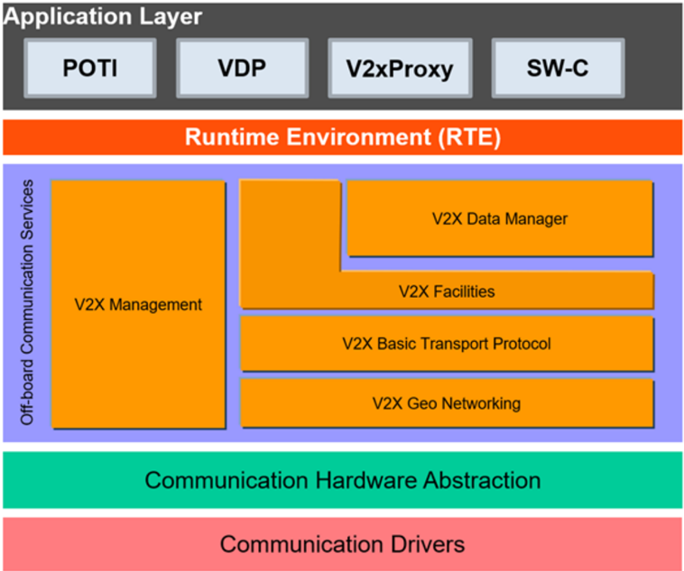
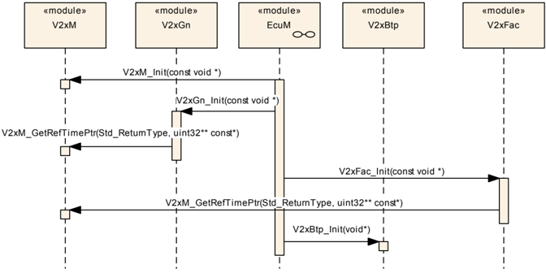
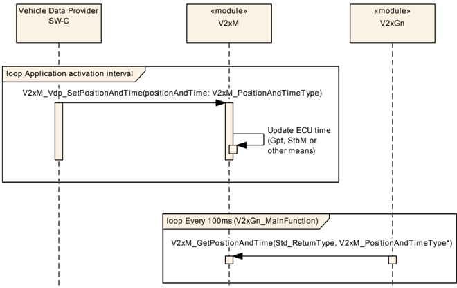
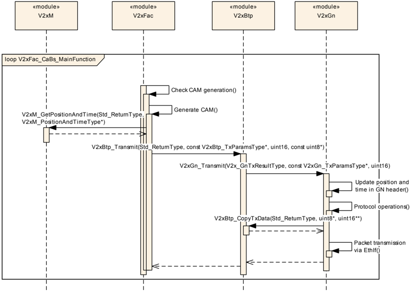
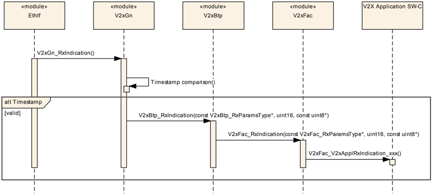
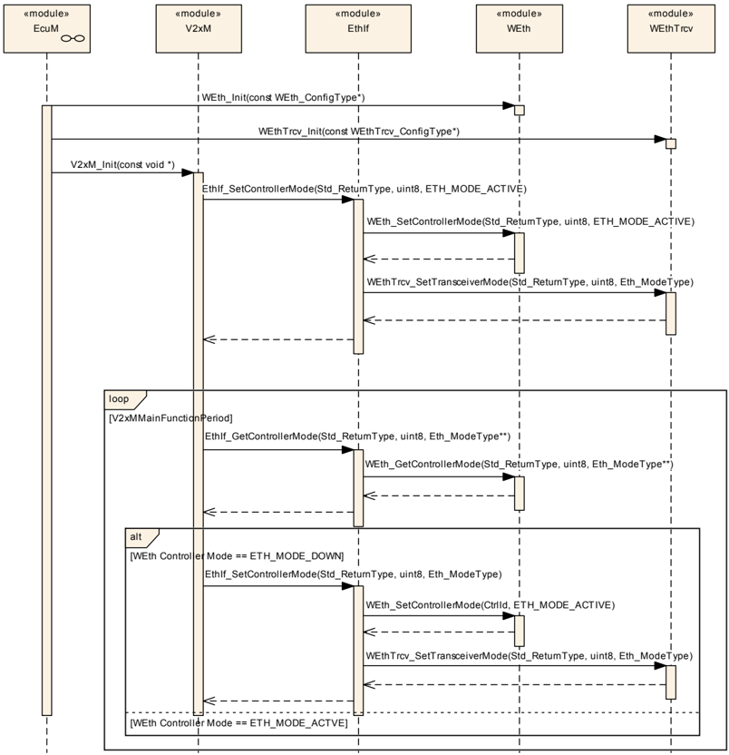

## 1. 简介和功能概述

本文档规定 **AUTOSAR** 基础软件模块 **Vehicle-2-X Management**（V2xM）的功能、**API** 和配置。**Vehicle-2-X Management** 模块与 **Vehicle-2-X Facilities**（V2xFac）[\[1\]](#ref-1)、**Vehicle-2-X Data Manager**（V2xDM）[\[2\]](#ref-2)、**Vehicle-2-X Basic Transport Protocol**（V2xBtp）[\[3\]](#ref-3)、**Vehicle-2-X GeoNetworking**（V2xGn）[\[4\]](#ref-4) 以及通信驱动层 [\[5\]](#ref-5) [\[6\]](#ref-6) [\[7\]](#ref-7) 一起，在 **AUTOSAR** 架构中构成 V2X 协议栈。

**V2xM** 设计为硬件无关。它控制并支持 V2X 协议栈实体的服务。

注意，本文档中的图不视为需求。

### 1.1. 架构总览

**V2xM** 模块在分层软件架构中的位置如下图所示。



### 1.2. 功能总览

**V2xM** 模块管理 V2X 协议栈的运行。它通过若干服务支持 V2X 协议栈模块，并且进一步提供一些应用接口，让应用能够在 **ETSI**/C2C-CC 需求为应用留下的有限范围内控制 V2X-Stack。

#### 1.2.1. 位置与时间管理（POTI）

在 **AUTOSAR** 架构中，**POTI** 服务是应用层内的一个 V2X 应用。**V2xM** 模块从 **POTI** 服务获取位置信息，并使其对 **V2xFac** 和 **V2xGn** 模块 [\[8\]](#ref-8) 可用。

#### 1.2.2. 标识

一个 V2X 站具有一个标识，每个在报头信息中使用标识的 V2X 模块都使用它。出于安全和隐私的原因，该标识随时间和行驶距离而更改。所有使用该标识的模块都应得到通知。

#### 1.2.3. 安全

**V2xM** 按照 **ETSI** 规范向 V2X-Stack 提供标准化的安全服务，这包括 [\[9\]](#ref-9) 所述的消息签名和验证。各 **API** 应使用 **AUTOSAR** 提供的 **CSM** 服务实现。

#### 1.2.4. 分布式拥塞控制（DCC）

**V2xM** 为 V2X 协议栈提供拥塞控制服务，以提供特定信道的当前 V2X 无线电拥塞状态。

## 2. 缩略语

以下术语表包含与 **V2xManagement** 模块相关、但未包含在 **AUTOSAR** 术语表 [\[10\]](#ref-10) 中的缩略语和缩写。

**DEM**
> 诊断事件管理器（**Diagnostic Event Manager**）。

**DET**
> 默认错误跟踪器（**Default Error Tracer**）。

**API**
> 应用编程接口（**Application Programming Interface**）。

**BSW**
> 基础软件（**Basic Software**）。

**BTP**
> 基本传输协议（**Basic Transport Protocol**）。

**CAM**
> 协作感知消息（**Cooperative Awareness Message**）。

**DCC**
> 分布式拥塞控制（**Decentralized Congestion Control**）。

**DENM**
> 分布式环境通知消息（**Decentralized Environmental Notification Messages**）。

**EcuM**
> 电子控制单元管理器（**Electronic Control Unit Manager**）。

**ITS**
> 智能交通系统（**Intelligent Transport System**）。

**LTC**
> 长期证书（**Long Term Certificate**）。

**POTI**
> 位置与时间管理（**Position and Time management**）。

**VOD**
> 按需验证（**Verification on Demand**）。

**hashedID8**
> 通过首先计算授权票证（**Authorisation Ticket**）的 **SHA 256** 哈希、然后取哈希输出的最低有效 8 字节而得到。

**ECDSA**
> 椭圆曲线数字签名算法（**Elliptic Curve Digital Signature Algorithm**）。

## 3. 相关文档

### 3.1. 输入文件和相关标准与规范

<a id="ref-1"></a>[1] Specification of Vehicle-2-X Facilities
> AUTOSAR_CP_SWS_V2XFacilities

<a id="ref-2"></a>[2] Specification of Vehicle-2-X Data Manager
> AUTOSAR_CP_SWS_V2XDataManager

<a id="ref-3"></a>[3] Specification of Vehicle-2-X Basic Transport
> AUTOSAR_CP_SWS_V2XBasicTransport

<a id="ref-4"></a>[4] Specification of Vehicle-2-X Geo Networking
> AUTOSAR_CP_SWS_V2XGeoNetworking

<a id="ref-5"></a>[5] Specification of Ethernet Interface
> AUTOSAR_CP_SWS_EthernetInterface

<a id="ref-6"></a>[6] Specification of Wireless Ethernet Driver
> AUTOSAR_CP_SWS_WirelessEthernetDriver

<a id="ref-7"></a>[7] Specification of Wireless Ethernet Transceiver Driver
> AUTOSAR_CP_SWS_WirelessEthernetTransceiverDriver

<a id="ref-8"></a>[8] EN 302 890-2 v0.0.3:Intelligent Transport System (ITS); Facilities layer function; Part 2:Position and Time management (PoTi); Release 2

<a id="ref-9"></a>[9] ETSI TS 102 723-8 V1.1.1:Intelligent Transport Systems (ITS); OSI cross-layer topics; Part 8:Interface between security entity and network and transport layer

<a id="ref-10"></a>[10] Glossary
> AUTOSAR_FO_TR_Glossary

<a id="ref-11"></a>[11] General Specification of Basic Software Modules
> AUTOSAR_CP_SWS_BSWGeneral

<a id="ref-12"></a>[12] Specification of Default Error Tracer
> AUTOSAR_CP_SWS_DefaultErrorTracer

<a id="ref-13"></a>[13] Specification of ECU State Manager
> AUTOSAR_CP_SWS_ECUStateManager

<a id="ref-14"></a>[14] Specification of NVRAM Manager
> AUTOSAR_CP_SWS_NVRAMManager

<a id="ref-15"></a>[15] General Requirements on Basic Software Modules
> AUTOSAR_CP_SRS_BSWGeneral

<a id="ref-16"></a>[16] Requirements on Vehicle-2-X Communication
> AUTOSAR_CP_SRS_V2XCommunication

<a id="ref-17"></a>[17] Security Policy &amp; Governance Framework for Deployment and Operation of European Cooperative Intelligent Transport Systems (C-ITS), Release 1, December 2017

<a id="ref-18"></a>[18] Certificate Policy for Deployment and Operation of European Cooperative Intelligent Transport Systems (C-ITS), Release 1.1, June 2018

<a id="ref-19"></a>[19] TS 102 687 V1.2.1:Decentralized Congestion Control Mechanisms for Intelligent Transport Systems operating in the 5 GHz range; Access layer part

<a id="ref-20"></a>[20] TS 102 894-2 V1.3.1:Intelligent Transport Systems (ITS); Users and applications requirements; Applications and facilities layer common data dictionary

<a id="ref-21"></a>[21] EN 302 637-2 V1.4.1:Intelligent Transport Systems (ITS); Vehicular Communications; Basic Set of Applications; Part 2:Specification of Cooperative Awareness Basic Service

<a id="ref-22"></a>[22] EN 302 571 V2.1.1:Intelligent Transport Systems (ITS); Radio communications equipment operating in the 5 855 MHz to 5 925 MHz frequency band; Harmonized EN covering the essential requirements of article 3.2 of the R&amp;TTE Directive

<a id="ref-23"></a>[23] Car 2 Car Communication Consortium; Basic System Profile release 1.3

### 3.2. 相关规范

**AUTOSAR** 提供了基础软件模块的通用规范 [\[11\]](#ref-11)，该规范同样适用于 **V2xM**。

因此，规范 **SWS BSW General** 应被视为 **V2xM** 的附加且必需的规范。

## 4. 约束和假设

### 4.1. 汽车域的适用性

本规范适用于所有汽车域。

### 4.2. 授权票证与假名

授权票证（**AT**）在本文档中称为假名（**Pseudonym**）。

## 5. 对其他模块的依赖

本节描述 **V2xM** 模块与 **AUTOSAR** 基础软件架构中其他模块的关系。它概述实现 **V2xM** 模块所需或可选的模块，以及这些模块使用的 **V2xM** 服务。

### 5.1. AUTOSAR DET（默认错误跟踪器）

在开发模式下，**V2xM** 模块通过 **DET** 模块 [\[12\]](#ref-12) 的 Det_ReportError 函数上报错误。

### 5.2. AUTOSAR EcuM（ECU 状态管理器）

**EcuM** [\[13\]](#ref-13) 初始化 **V2xM** 模块。

### 5.3. AUTOSAR CSM（加密服务管理器）

**CSM** 模块用于加密计算，V2X-Stack 需要它来保护包。因此会使用 **CSM** 的签名、验证及其他服务。

### 5.4. AUTOSAR NvM（NVRAMManager）

**NvM** [\[14\]](#ref-14) 被 **V2xM** 用于加载用于假名、V2X 消息的签名生成和验证的证书。此外，最后一次点火时间（V2x 协议栈的启动时间）由 **NvM** 存储和加载。

### 5.5. AUTOSAR 数学库（Mfl、Efx）

对于数学计算，需要 **Mfl** 或 **Efx** 库。

### 5.6. 文件结构

#### 5.6.1. 代码文件结构

详情参见「基础软件模块通用规范」[\[11\]](#ref-11) 的第 5.1.6 章「代码文件结构」。

## 6. 功能规格

### 6.1. 启动行为

**V2xM** 的函数 [V2xM_Init](#731-v2xm_init)() 应初始化 **V2xM** 模块的内部状态。

**V2xM** 的函数 [V2xM_Init](#731-v2xm_init)() 应通过调用 EthIf_SetControllerMode、使用 respective 已配置的 EthIfController V2xMEthIfCtrlRef 来初始化底层 **MCAL**/**ECUAL** 模块 **WEth** 和 **WEthTrcv**。

以太网状态管理器（EthSm）不应参与无线通信协议栈的启动。

**注意：** 无线通信协议栈 **MCAL**/**ECUAL** 模块的初始化参见图 9.5。

### 6.2. 关停行为

无线通信保持活动，直到 **ECU** 硬件被关机或复位。没有任何手段可以提前停止 **Vehicle-2-X** 无线通信。

### 6.3. 标识管理

**V2xM** 模块应实现标识管理，也称为假名。应将当前标识通知特定的 V2X 模块，以确保在 V2X 协议栈的每一层使用一致的值。

当所使用的假名更改时，**V2xM** 模块应更改通过无线通信媒体发送的其他层的所有地址和标识符（例如 **CAM**/**DENM** 中的 StationId、**GeoNetworking** 源地址、**MAC** 源地址）。这些更改对于确保用户隐私是必要的。

**注意：** 在 **V2xFac** 中，标识表示为 Station **Id**；在 **V2xGn** 中，标识表示为 **GeoNetworking** 地址；在无线以太网驱动中，标识表示为 **MAC** 地址。

按照第 [6.3](#63-标识管理) 节规定的所有标识符（**MAC** 源地址、**CAM**/**DENM** 中的 StationId、**GN** 源地址）应从「证书摘要」/"hashedId8" 派生。应使用「证书摘要」/"hashedId8" 的相应最低有效字节数作为 respective 标识符。

**V2xM** 模块应提供一种机制，允许 V2X 模块通过调用 **API** [V2xM_LockPseudonymChange](#738-v2xm_lockpseudonymchange)() 来禁止标识更改最长 15 分钟（例如在 **DENM** 事件期间）。

当假名标识过期时（即当提供当前假名的证书在请求禁止标识更改的期间内过期时），**V2xM** 不应禁止标识更改。

函数 [V2xM_Init](#731-v2xm_init) 应初始化标识管理，并向 V2X 协议栈模块提供一个初始标识。

**V2xM** 标识管理应在行程中于距起始位置 800 至 1500 米的范围内随机发起第一次假名更改。

第二次假名更改应在距上次假名更改至少 800 m 处执行，并随机在额外的 2 至 6 分钟间隔内执行。

第三次假名更改应在 15 公里 ± 5 公里（随机）之后执行。

进一步的假名更改应每再行驶 30 公里 ± 5 公里（随机）执行一次。

**V2xM** 应使用由授权机构（**AA**）按照根认证机构（**RCA**）的规则定义的假名有效期。

如果 **V2xM** 模块没有用于签名消息的有效假名证书，它应停止发送使用 [\[17\]](#ref-17) 第 7.1.1、7.1.2 和 7.1.3 章规定的安全配置文件的消息。

[V2xM_MainFunction](#751-v2xm_mainfunction)() 应用于发起标识的更改。

**注意：** [V2xM_MainFunction](#751-v2xm_mainfunction)() 也可用于软件实现特定的周期性任务执行。

**V2xM** 应分两个阶段发起假名更改：第一阶段为准备（prepare）阶段，第二阶段为提交（commit）或中止（abort）阶段。第二阶段取决于第一阶段中所有被调用模块的结果。如果第一阶段成功，则应启动提交阶段；如果第一阶段不成功，则应启动中止阶段。

在准备阶段，应调用相应的 **API** &lt;Module&gt;_PreparePseudonymChange()。

在提交阶段，应调用相应的 **API** &lt;Module&gt;_CommitPseudonymChange()。

在中止阶段，应调用相应的 **API** &lt;Module&gt;_AbortPseudonymChange()。

应由 **V2xM** 通过两阶段假名更改通知的模块是 **V2xGn** 和 **V2xFac**。

**EthernetInterface** 和无线以太网驱动不支持两阶段 id 更改。在两阶段假名更改的提交阶段内，应调用 **API** EthIf_SetPhysAddr 以在无线以太网驱动内发起假名更改。

每周的假名数量上限应为 100。

**V2xM** 模块所使用的假名应在每次车辆点火开启时更改，除非系统在 10 分钟的时间内重启——此时假名不应更改。

点火开启后的假名更改应在 1 分钟的宽限期内执行。

假名可以在其有效期内重用。

假名有效期不应长于一周 + 重叠期。

### 6.4. 安全

**V2xM** 模块应利用 **CSM** 提供 **V2xGn** 所需的封装（Encap）和解封装（Decap）服务以及按需验证（**VOD**）。

在位置不可用的情况下（例如无位置可用、航位推算退化、时间抖动/漂移），**V2xM** 应禁用 **CAM** 生成。这通过调用 V2xFac_V2xM_SetCaBsOperation() 完成。

**V2xM** 模块发送消息时应使用基于 **ECDSA** 的数字签名和证书，该算法在 [\[17\]](#ref-17) 所述的 **IEEE** 1609.2 中规定。

**注意：** 此外，[\[18\]](#ref-18) 要求实现椭圆曲线 brainpool P256r1 来签名消息。

**V2xM** 模块应通过对内部生成的公钥创建签名来支持密钥来源认证，其中注册证书（**Enrolment Certificates**）的公钥应使用模块私钥签名，假名证书（**Pseudonym Certificates**）的公钥应使用先前注册的注册证书私钥签名。

**注意：** 「模块私钥」是车辆特定的唯一私钥，可在 **ECU** 首次初始化时在 **HSM** 内随机生成。

函数 [V2xM_V2xGn_ReqEncap](#735-v2xm_v2xgn_reqencap)() 应按照 [\[19\]](#ref-19) 和 [\[17\]](#ref-17) 的定义封装待发送 **GeoNetworking** 包的载荷。

函数 [V2xM_V2xGn_ReqDecap](#736-v2xm_v2xgn_reqdecap)() 应按照 [\[19\]](#ref-19) 和 [\[17\]](#ref-17) 的定义解封装接收到的 **GeoNetworking** 包的载荷。

函数 [V2xM_V2xGn_ReqDecap](#736-v2xm_v2xgn_reqdecap)() 应调用 **CSM API** 来验证 SecuredDataPtr 给出的数据。

### 6.5. 位置与时间

应使用 [\[20\]](#ref-20) 定义的 **WGS 84** 作为参考坐标系。海拔信息应解释为 **WGS84** 椭球面以上的高度。

航向应解释为水平速度矢量的方向。速度矢量的起点应为 **CAM** 规范 [\[21\]](#ref-21) B.19 定义的 ITS 车辆参考点（**ITS Vehicle Reference Point**）。

函数 [V2xM_GetPositionAndTime](#733-v2xm_getpositionandtime)() 应提供当前已知的位置和时间信息。

函数 [V2xM_GetRefTimePtr](#734-v2xm_getreftimeptr)() 应提供指向包含当前 V2X 时间的 32 位数据的地址指针，即自 2004-01-01 00:00:00.000 起的 **TAI** 毫秒数对 2³² 取模。

函数 [V2xM_CalcDistance](#7312-v2xm_calcdistance)() 应计算两个地理位置点之间的距离。

函数 [V2xM_CalcHeadingInTolerance](#7313-v2xm_calcheadingintolerance)() 应计算两个航向值之差是否在给定容差值内。

### 6.6. DCC 管理

**V2xM** 模块应使用以下信道忙闲比（**CBR**）值的平滑函数：

CBR_new = (CBR(n)+CBR(n-1))/2

其中 n 和 n-1 分别是 [\[22\]](#ref-22) 定义的当前和前一个 **CBR** 采样周期，CBR() 函数也在 [\[22\]](#ref-22) 中定义。

| 状态 | CBR | 包速率 (R) | T off |
|---|---|---|---|
| Relaxed（宽松） | &lt; 30% | 20 Hz | 50 ms |
| Active_1（活动 1） | 30% 至 39% | 10 Hz | 100 ms |
| Active_2（活动 2） | 40% 至 49% | 5 Hz | 200 ms |
| Active_3（活动 3） | 50% 至 65% | 4 Hz | 250 ms |
| Restricted（受限） | &gt; 65% | 1 Hz | 1000 ms |

**V2xM** 模块应使用 [\[19\]](#ref-19) 第 5.3 章概述的反应式 **DCC** 算法。该表对应 [\[19\]](#ref-19) 中的表 A.2，平均 Ton 为 500 µs。

参数 T_GenCam_Dcc（参见 [\[21\]](#ref-21)）应设置为两次发送之间的最小时间 Toff 的值（由 **DCC** 机制给出，参见第 6.6 节），并通过 V2xFac_V2xM_SetTGenCamDcc() **API** 推送给 **V2xFac** 模块。

当前状态（受限、活动子状态、宽松，参见第 [6.6](#66-dcc-管理) 节）应周期性地设置给 **WEthTrcv** 模块，以允许在宽松状态下进行消息突发。

当前发送间隔（参见第 [6.6](#66-dcc-管理) 节）应周期性地设置给 **WEthTrcv** 模块，以允许触发发送队列。

### 6.7. 错误分类

文档 [\[11\]](#ref-11)「基础软件模块通用规范」的「Error Handling」一章详细描述了基础软件的错误处理。其中最重要的是，它构成了一个由 **BSW** 模块中可能发生的五种错误类型组成的分类方案。

在此基础上，以下各小节按相应的子节规定了具体错误。

#### 6.7.1. 开发错误

| 错误类型 | 相关错误代码 | 错误值 |
|---|---|---|
| 使用错误参数调用 **API** 服务 | V2XM_E_PARAM | 0x01 |
| 使用无效指针调用 **API** 服务 | V2XM_E_PARAM_POINTER | 0x02 |
| **V2xM** 初始化失败 | V2XM_E_INIT_FAILED | 0x03 |
| 在 **V2xM** 模块完全初始化之前调用了 **API** 函数 | V2XM_E_UNINIT | 0x04 |

#### 6.7.2. 运行时错误

没有运行时错误。

#### 6.7.3. 瞬态故障

没有瞬态故障。

#### 6.7.4. 生产错误

没有生产错误。

#### 6.7.5. 扩展生产错误

没有扩展生产错误。

### 6.8. 安全事件

本模块不上报安全事件。

## 7. API规范

### 7.1. 导入的类型

本章列出从以下文件包含的所有类型。

| 模块 | 头文件 | 导入的类型 |
|---|---|---|
| Csm | Rte_Csm_Type.h | Crypto_OperationModeType |
| Csm | Rte_Csm_Type.h | Crypto_VerifyResultType |
| Gpt | Gpt.h | Gpt_ChannelType |
| Gpt | Gpt.h | Gpt_PredefTimerType |
| Gpt | Gpt.h | Gpt_ValueType |
| NvM | Rte_NvM_Type.h | NvM_BlockIdType |
| NvM | Rte_NvM_Type.h | NvM_RequestResultType |
| StbM | Rte_StbM_Type.h | StbM_SynchronizedTimeBaseType |
| StbM | Rte_StbM_Type.h | StbM_TimeBaseStatusType |
| StbM | Rte_StbM_Type.h | StbM_TimeStampExtendedType（obsolete） |
| StbM | Rte_StbM_Type.h | StbM_TimeStampType |
| StbM | Rte_StbM_Type.h | StbM_TimeTupleType |
| StbM | Rte_StbM_Type.h | StbM_UserDataType |
| StbM | StbM.h | StbM_VirtualLocalTimeType |
| Std | Std_Types.h | Std_ReturnType |
| Std | Std_Types.h | Std_VersionInfoType |
| V2x_GeneralTypes | Rte_V2xM_Type.h | [V2xM_PositionAndTimeType](#7721-v2xm_positionandtimetype) |
| V2x_GeneralTypes | V2x_GeneralTypes.h | [V2x_ChanType](#7212-v2x_chantype) |
| V2x_GeneralTypes | V2x_GeneralTypes.h | [V2x_PseudonymType](#7215-v2x_pseudonymtype) |
| V2x_GeneralTypes | V2x_GeneralTypes.h | [V2x_SecProfileType](#728-v2x_secprofiletype) |
| V2x_GeneralTypes | V2x_GeneralTypes.h | [V2x_SecReportType](#7216-v2x_secreporttype) |
| V2x_GeneralTypes | V2x_GeneralTypes.h | [V2x_SecReturnType](#729-v2x_secreturntype) |
| WEthTrcv | WEth_GeneralTypes.h | WEthTrcv_GetChanRxParamIdType |
| WEthTrcv | WEth_GeneralTypes.h | WEthTrcv_SetChanRxParamIdType |
| WEthTrcv | WEth_GeneralTypes.h | WEthTrcv_SetChanTxParamIdType |
| WEthTrcv | WEth_GeneralTypes.h | WEthTrcv_SetRadioParamIdType |

**V2xM.h** 应包含 V2x_GeneralTypes.h，以引入通用 V2X 类型声明。

### 7.2. 类型定义

#### 7.2.1. V2xM_ConfigType

| 名称 | V2xM_ConfigType | | |
| --- | --- | --- | --- |
| 类别 | Structure | | |
| 元素 | implementation specific | 类型 | - |
| 元素 | 注释 | 配置数据结构的内容是实现特定的。 | |
| 描述 | **V2xM** 模块的配置数据结构。 | | |
| 可通过 | V2xM.h 获得 | | |

#### 7.2.2. V2x_GnPacketTransportType

| 名称 | V2x_GnPacketTransportType | | |
| --- | --- | --- | --- |
| 类别 | 枚举 | | |
| 取值 | V2X_GN_GEOUNICAST | 0x00 | - |
| | V2X_GN_GEOANYCAST | 0x01 | - |
| | V2X_GN_GEOBROADCAST | 0x02 | - |
| | V2X_GN_TSB | 0x03 | - |
| | V2X_GN_SHB | 0x04 | - |
| 描述 | 指定 **GeoNetworking** 包的包传输类型。例如在发送路径上经 **V2xFac** 和 **V2xBtp** 传递。 | | |
| 可通过 | V2x_GeneralTypes.h 获得 | | |

#### 7.2.3. V2x_GnDestinationType

| 名称 | V2x_GnDestinationType | | |
| --- | --- | --- | --- |
| 类别 | 枚举 | | |
| 取值 | V2X_GN_DESTINATION_ADDRESS | 0x00 | - |
| | V2X_GN_DESTINATION_AREA | 0x01 | - |
| 描述 | 指定 **GeoNetworking** 包的目的类型。例如在发送路径上经 **V2xFac** 和 **V2xBtp** 传递。 | | |
| 可通过 | V2x_GeneralTypes.h 获得 | | |

#### 7.2.4. V2x_GnAddressType

| 名称 | V2x_GnAddressType | | |
| --- | --- | --- | --- |
| 类别 | Type | | |
| 派生自 | uint64 | | |
| 描述 | **GeoNetworking** 地址。 | | |
| 可通过 | V2x_GeneralTypes.h 获得 | | |

#### 7.2.5. V2x_GnAreaShapeType

| 名称 | V2x_GnAreaShapeType | | |
| --- | --- | --- | --- |
| 类别 | 枚举 | | |
| 取值 | V2X_GN_SHAPE_CIRCLE | 0x00 | - |
| | V2X_GN_SHAPE_RECT | 0x01 | - |
| | V2X_GN_SHAPE_ELLIPSE | 0x02 | - |
| 描述 | 指定 **GeoNetworking** 区域的形状类型。 | | |
| 可通过 | V2x_GeneralTypes.h 获得 | | |

#### 7.2.6. V2x_GnDestinationAreaType

| 名称 | V2x_GnDestinationAreaType | | |
| --- | --- | --- | --- |
| 类别 | Structure | | |
| 元素 | latitude | 类型 | sint32 |
| 元素 | 注释 | 纬度 [1/10 微度] | |
| 元素 | longitude | 类型 | sint32 |
| 元素 | 注释 | 经度 [1/10 微度] | |
| 元素 | distanceA | 类型 | uint16 |
| 元素 | 注释 | 几何形状的距离 a [米] | |
| 元素 | distanceB | 类型 | uint16 |
| 元素 | 注释 | 几何形状的距离 b [米] | |
| 元素 | angle | 类型 | uint16 |
| 元素 | 注释 | 几何形状的角度 [距北的度数] | |
| 元素 | shape | 类型 | [V2x_GnAreaShapeType](#725-v2x_gnareashapetype) |
| 元素 | 注释 | 几何区域的形状类型 | |
| 描述 | **GeoNetworking** 目的区域的定义。 | | |
| 可通过 | V2x_GeneralTypes.h 获得 | | |

#### 7.2.7. V2x_GnTxResultType

| 名称 | V2x_GnTxResultType | | |
| --- | --- | --- | --- |
| 类别 | 枚举 | | |
| 取值 | V2X_GNTX_ACCEPTED | - | **GeoNetworking** 发送已被接受 |
| | V2X_GNTX_E_MAXSDUSIZEOVFL | - | 由于超过最大长度而拒绝 **GeoNetworking** 发送 |
| | V2X_GNTX_E_MAXPACKETLIFETIME | - | 由于超过最大生存期而拒绝 **GeoNetworking** 发送 |
| | V2X_GNTX_E_TCID | - | 由于不支持的流量类别 **ID** 而拒绝 **GeoNetworking** 发送 |
| | V2X_GNTX_E_MAXGEOAREASIZE | - | 由于地理区域超过最大尺寸而拒绝 **GeoNetworking** 发送 |
| | V2X_GNTX_E_UNSPECIFIED | - | 由于未指明的原因而拒绝 **GeoNetworking** 发送 |
| 描述 | 用于指定 V2xGn_Transmit 是否被成功处理的结果码。 | | |
| 可通过 | V2x_GeneralTypes.h 获得 | | |

#### 7.2.8. V2x_SecProfileType

| 名称 | V2x_SecProfileType | | |
| --- | --- | --- | --- |
| 类别 | 枚举 | | |
| 取值 | V2X_SECPROF_CAM | - | **CAM** 安全配置 |
| | V2X_SECPROF_DENM | - | **DENM** 安全配置 |
| | V2X_SECPROF_OTHER_SIGNED | - | 必须签名的其他消息类型的安全配置 |
| | V2X_SECPROF_OTHER_SIGNED_EXTERNAL | - | 由外部签名的其他消息类型的安全配置 |
| | V2X_SECPROF_OTHER_SIGNED_ENCRYPTED | - | 必须签名并加密的其他消息类型的安全配置 |
| 描述 | 用于描述由 **V2xM** 调用的安全服务。 | | |
| 可通过 | V2x_GeneralTypes.h 获得 | | |

#### 7.2.9. V2x_SecReturnType

| 名称 | V2x_SecReturnType | | |
| --- | --- | --- | --- |
| 类别 | 枚举 | | |
| 取值 | V2X_E_OK | - | 成功返回 |
| | V2X_E_NOT_OK | - | 操作期间失败 |
| | V2X_E_UNVERIFIED | - | 消息未被验证。用于 **VoD** |
| | V2X_E_BUF_OVFL | - | 目标缓冲区对于安全操作数据输出而言太小 |
| 描述 | 用于安全相关函数的返回值。 | | |
| 可通过 | V2x_GeneralTypes.h 获得 | | |

#### 7.2.10. V2x_MaximumPacketLifetimeType

| 名称 | V2x_MaximumPacketLifetimeType | | |
| --- | --- | --- | --- |
| 类别 | Type | | |
| 派生自 | uint16 | | |
| 取值 | 0..6300 | - | 有效值 |
| | 6301..uint16 最大值 | - | 无效 |
| 描述 | 指定一个 **GeoNetworking** 包可被缓冲的最大可容忍时间（秒）。 | | |
| 可通过 | V2x_GeneralTypes.h 获得 | | |

#### 7.2.11. V2x_TrafficClassIdType

| 名称 | V2x_TrafficClassIdType | | |
| --- | --- | --- | --- |
| 类别 | Type | | |
| 派生自 | uint8 | | |
| 取值 | 0..63 | - | 有效值 |
| | 64..uint8 最大值 | - | 无效 |
| 描述 | 来自 **ITS** 设施层的对包传输的要求 | | |
| 可通过 | V2x_GeneralTypes.h 获得 | | |

#### 7.2.12. V2x_ChanType

| 名称 | V2x_ChanType | | |
| --- | --- | --- | --- |
| 类别 | 枚举 | | |
| 取值 | V2X_SCH4 | 172 | 服务信道 4 |
| | V2X_SCH3 | 174 | 服务信道 3 |
| | V2X_SCH1 | 176 | 服务信道 1 |
| | V2X_SCH2 | 178 | 服务信道 2 |
| | V2X_CCH | 180 | 控制信道 |
| 描述 | 指定要使用的信道类型。使用 ITS-G5A 和 ITS-G5B 的信道。取值与 **IEEE** 802.11-2012 信道编号匹配。 | | |
| 可通过 | V2x_GeneralTypes.h 获得 | | |

#### 7.2.13. V2x_GnUpperProtocolType

| 名称 | V2x_GnUpperProtocolType | | |
| --- | --- | --- | --- |
| 类别 | 枚举 | | |
| 取值 | V2X_ANY | - | 未指定 |
| | V2X_BTPA | - | 传输协议：BTP-A（用于交互式包传输）。 |
| | V2X_BTPB | - | 传输协议：BTP-B（用于非交互式包传输）。 |
| | V2X_IPV6 | - | **IPv6** 报头 |
| 描述 | 指定 **GeoNetworking** 载荷。 | | |
| 可通过 | V2x_GeneralTypes.h 获得 | | |

#### 7.2.14. V2x_GnLongPositionVectorType

| 名称 | V2x_GnLongPositionVectorType | | |
| --- | --- | --- | --- |
| 类别 | Structure | | |
| 元素 | gnAddress | 类型 | [V2x_GnAddressType](#724-v2x_gnaddresstype) |
| 元素 | 注释 | **GeoNetworking** 地址 | |
| 元素 | timestamp | 类型 | uint32 |
| 元素 | 注释 | 时间戳 [ms] | |
| 元素 | latitude | 类型 | sint32 |
| 元素 | 注释 | 纬度 [1/10 微度] | |
| 元素 | longitude | 类型 | sint32 |
| 元素 | 注释 | 经度 [1/10 微度] | |
| 元素 | pai | 类型 | boolean |
| 元素 | 注释 | 位置精度指示符 | |
| 元素 | speed | 类型 | sint16 |
| 元素 | 注释 | 速度 [1/100 m/s] | |
| 元素 | heading | 类型 | uint16 |
| 元素 | 注释 | 航向 [1/10 度] | |
| 描述 | [25] 第 9.5.2 章定义的位置相关信息。 | | |
| 可通过 | V2x_GeneralTypes.h 获得 | | |

#### 7.2.15. V2x_PseudonymType

| 名称 | V2x_PseudonymType | | |
| --- | --- | --- | --- |
| 类别 | Type | | |
| 派生自 | uint64 | | |
| 描述 | 假名，从假名证书派生。该假名分发给不同模块，以支持 V2X 系统对外界的隐私。 | | |
| 可通过 | V2x_GeneralTypes.h 获得 | | |

#### 7.2.16. V2x_SecReportType

| 名称 | V2x_SecReportType | | |
| --- | --- | --- | --- |
| 类别 | Type | | |
| 派生自 | uint8 | | |
| 取值 | V2X_SECREP_SUCCESS | 0x00 | 指示安全服务已成功执行 |
| | V2X_SECREP_FALSE_SIGNATURE | 0x01 | 指示签名错误 |
| | V2X_SECREP_INVALID_CERTIFICATE | 0x02 | 指示证书无效 |
| | V2X_SECREP_REVOKED_CERTIFICATE | 0x03 | 指示证书被吊销 |
| | V2X_SECREP_INCONSISTENT_CHAIN | 0x04 | 指示证书链不一致 |
| | V2X_SECREP_INVALID_TIMESTAMP | 0x05 | 指示时间戳无效 |
| | V2X_SECREP_DUPLICATE_MESSAGE | 0x06 | 指示重复消息 |
| | V2X_SECREP_INVALID_MOBILITY_DATA | 0x07 | 指示机动性数据无效 |
| | V2X_SECREP_UNSIGNED_MESSAGE | 0x08 | 指示未签名的消息 |
| | V2X_SECREP_SIGNER_CERTIFICATE_NOT_FOUND | 0x09 | 指示未找到签名者证书 |
| | V2X_SECREP_UNSUPPORTED_SIGNER_IDENTIFIER_TYPE | 0x0a | 指示不支持的签名者标识符类型 |
| | V2X_SECREP_INCOMPATIBLE_PROTOCOL | 0x0b | 指示协议不兼容 |
| | V2X_SECREP_UNENCRYPTED_MESSAGE | 0x0c | 指示未加密的消息 |
| | V2X_SECREP_DECRYPTION_ERROR | 0x0d | 指示解密错误 |
| | V2X_SECREP_NONE | 0xff | 指示未执行任何安全服务。 |
| 描述 | 用于描述解封装（验证或解密）调用安全服务之后的安全报告。 | | |
| 可通过 | V2x_GeneralTypes.h 获得 | | |

### 7.3. 函数定义

这是为上层模块和其他 V2X 协议栈模块提供的函数列表。

#### 7.3.1. V2xM_Init

**说明**: 初始化 **V2xM** 模块。可通过 **V2xM.h** 获得。服务 **ID** 0x01。本服务为同步调用，不可重入。参数 CfgPtr（in）：ConfigPtr 指向所选配置集的指针。返回值：无。

```C
void V2xM_Init ( const void * CfgPtr )
```

该函数应存储对配置结构的访问，供后续 **API** 调用使用。

配置指针 CfgPtr 应始终具有 NULL_PTR 值。

#### 7.3.2. V2xM_GetVersionInfo

**说明**: 提供本模块的版本信息。可通过 **V2xM.h** 获得。服务 **ID** 0x02。本服务为同步调用，可重入。参数 VersionInfoPtr（in）：存储本模块版本信息的指针。返回值：无。

```C
void V2xM_GetVersionInfo ( Std_VersionInfoType* VersionInfoPtr )
```

如果启用了开发错误检测：该函数应检查参数 VersionInfoPtr 是否有效。如果检查失败，该函数应引发开发错误 [V2XM_E_PARAM_POINTER](#671-开发错误)。

#### 7.3.3. V2xM_GetPositionAndTime

**说明**: 提供瞬时位置信息。可通过 **V2xM.h** 获得。服务 **ID** 0x03。本服务为同步调用，可重入。参数 Poti（out）：当前的位置和时间信息，包括位置误差信息。返回值：Std_ReturnType，E_OK：请求成功；E_NOT_OK：时间和/或位置不可用。

```C
Std_ReturnType V2xM_GetPositionAndTime ( V2xM_PositionAndTimeType* Poti )
```

如果启用了开发错误检测：该函数应检查先前是否已调用过服务 [V2xM_Init](#731-v2xm_init)()。如果检查失败，该函数应引发开发错误 [V2XM_E_UNINIT](#671-开发错误)。

如果启用了开发错误检测：该函数应检查参数 Poti 是否有效。如果检查失败，该函数应引发开发错误 [V2XM_E_PARAM_POINTER](#671-开发错误)。

#### 7.3.4. V2xM_GetRefTimePtr

**说明**: 提供指向 V2X-Stack 时间基准的指针。可通过 **V2xM.h** 获得。服务 **ID** 0x04。本服务为同步调用，不可重入。参数 RefTimePtr（out）：指向当前时间信息的指针。返回值：Std_ReturnType，E_OK：请求成功；E_NOT_OK：请求失败。

```C
Std_ReturnType V2xM_GetRefTimePtr ( const uint32** RefTimePtr )
```

如果启用了开发错误检测：该函数应检查先前是否已调用过服务 [V2xM_Init](#731-v2xm_init)()。如果检查失败，该函数应引发开发错误 [V2XM_E_UNINIT](#671-开发错误)。

如果启用了开发错误检测：该函数应检查参数 RefTimePtr 是否有效。如果检查失败，该函数应引发开发错误 [V2XM_E_PARAM_POINTER](#671-开发错误)。

#### 7.3.5. V2xM_V2xGn_ReqEncap

**说明**: **V2xGn** 调用本函数以签名和/或加密消息。异步的 V2xGn_V2xM_EncapConfirmation 调用将用于向 **V2xGn** 通知结果。可通过 V2xM_V2xGn.h 获得。服务 **ID** 0x06。本服务为异步调用，不可重入。参数 EncapReqId（in）：要用发送 ITS 站的签名封装的包的唯一 **Id**。参数 SecProfile（in）：用于封装的安全配置。参数 UnsecuredDataLength（in）：用于封装的数据的长度。参数 UnsecuredDataPtr（in）：指向用于封装的数据的指针。参数 SecuredDataLength（inout）：包含输入方向 SecuredDataPtr 最大安全数据长度的长度指针；应包含输出方向 SecuredDataPtr 的实际安全数据大小。参数 SecuredDataPtr（inout）：安全数据应放置的指针。返回值：[V2x_SecReturnType](#729-v2x_secreturntype)，V2X_E_OK：请求成功；V2X_E_NOT_OK：请求失败；V2X_E_BUF_OVFL：SecuredDataLength 对于安全操作结果数据而言太小。

```C
V2x_SecReturnType V2xM_V2xGn_ReqEncap ( uint16 EncapReqId, V2x_SecProfileType SecProfile, uint16 UnsecuredDataLength, const uint8* UnsecuredDataPtr, uint16* SecuredDataLength, uint8* SecuredDataPtr )
```

如果启用了开发错误检测：该函数应检查先前是否已调用过服务 [V2xM_Init](#731-v2xm_init)()。如果检查失败，该函数应引发开发错误 [V2XM_E_UNINIT](#671-开发错误)，否则（如果 **DET** 被禁用）返回 V2X_E_NOT_OK。

如果启用了开发错误检测：该函数应检查参数 UnsecuredDataPtr 是否有效。如果检查失败，该函数应引发开发错误 [V2XM_E_PARAM_POINTER](#671-开发错误)，否则（如果 **DET** 被禁用）返回 V2X_E_NOT_OK。

如果启用了开发错误检测：该函数应检查参数 SecuredDataLength 是否有效。如果检查失败，该函数应引发开发错误 [V2XM_E_PARAM_POINTER](#671-开发错误)，否则（如果 **DET** 被禁用）返回 V2X_E_NOT_OK。

如果启用了开发错误检测：该函数应检查参数 SecuredDataPtr 是否有效。如果检查失败，该函数应引发开发错误 [V2XM_E_PARAM_POINTER](#671-开发错误)，否则（如果 **DET** 被禁用）返回 V2X_E_NOT_OK。

#### 7.3.6. V2xM_V2xGn_ReqDecap

**说明**: **V2xGn** 调用本函数以解密并验证消息。异步的 V2xGn_V2xM_DecapConfirmation 调用将用于向 **V2xGn** 通知结果。可通过 V2xM_V2xGn.h 获得。服务 **ID** 0x07。本服务为异步调用，不可重入。参数 DecapReqId（in）：要解封装的包的唯一 **Id**。参数 SecuredDataLength（in）：要解密和验证的数据的长度。参数 SecuredDataPtr（in）：指向要解密和验证的数据的指针。参数 UnsecuredDataLength（inout）：指向未受保护数据的数据长度的指针。应包含最大可用长度（输入方向）和实际使用的长度（输出方向）。参数 UnsecuredDataPtr（inout）：解密/验证后的数据应放置的指针。参数 SecReport（inout）：安全报告。参数 CertificateId（inout）：用于验证的标识（按证书哈希）。参数 ItsAid（inout）：ITS-AID 的数值。参数 SspLength（inout）：**SSP** 位的长度（以八位位组为单位，最大 31）。参数 SspBits（inout）：**SSP** 位。返回值：[V2x_SecReturnType](#729-v2x_secreturntype)，V2X_E_OK：请求成功；V2X_E_NOT_OK：请求失败；V2X_E_UNVERIFIED：正在使用 **VOD**；V2X_E_BUF_OVFL：UnsecuredDataLength 对于安全操作结果数据而言太小。

```C
V2x_SecReturnType V2xM_V2xGn_ReqDecap ( uint32 DecapReqId, uint16 SecuredDataLength, const uint8* SecuredDataPtr, uint16* UnsecuredDataLength, uint8* UnsecuredDataPtr, V2x_SecReportType* SecReport, uint64* CertificateId, uint32* ItsAid, uint8* SspLength, uint8* SspBits )
```

如果启用了开发错误检测：该函数应检查先前是否已调用过服务 [V2xM_Init](#731-v2xm_init)()。如果检查失败，该函数应引发开发错误 [V2XM_E_UNINIT](#671-开发错误)，否则（如果 **DET** 被禁用）返回 V2X_E_NOT_OK。

如果启用了开发错误检测：该函数应检查参数 SecuredDataPtr 是否有效。如果检查失败，该函数应引发开发错误 [V2XM_E_PARAM_POINTER](#671-开发错误)，否则（如果 **DET** 被禁用）返回 V2X_E_NOT_OK。

如果启用了开发错误检测：该函数应检查参数 UnsecuredDataLength 是否有效。如果检查失败，该函数应引发开发错误 [V2XM_E_PARAM_POINTER](#671-开发错误)，否则（如果 **DET** 被禁用）返回 V2X_E_NOT_OK。

如果启用了开发错误检测：该函数应检查参数 UnsecuredDataPtr 是否有效。如果检查失败，该函数应引发开发错误 [V2XM_E_PARAM_POINTER](#671-开发错误)，否则（如果 **DET** 被禁用）返回 V2X_E_NOT_OK。

如果启用了开发错误检测：该函数应检查参数 SecReport 是否有效。如果检查失败，该函数应引发开发错误 [V2XM_E_PARAM_POINTER](#671-开发错误)，否则（如果 **DET** 被禁用）返回 V2X_E_NOT_OK。

如果启用了开发错误检测：该函数应检查参数 CertificateId 是否有效。如果检查失败，该函数应引发开发错误 [V2XM_E_PARAM_POINTER](#671-开发错误)，否则（如果 **DET** 被禁用）返回 V2X_E_NOT_OK。

如果启用了开发错误检测：该函数应检查参数 ItsAid 是否有效。如果检查失败，该函数应引发开发错误 [V2XM_E_PARAM_POINTER](#671-开发错误)，否则（如果 **DET** 被禁用）返回 V2X_E_NOT_OK。

如果启用了开发错误检测：该函数应检查参数 SspLength 是否有效。如果检查失败，该函数应引发开发错误 [V2XM_E_PARAM_POINTER](#671-开发错误)，否则（如果 **DET** 被禁用）返回 V2X_E_NOT_OK。

如果启用了开发错误检测：该函数应检查参数 SspBits 是否有效。如果检查失败，该函数应引发开发错误 [V2XM_E_PARAM_POINTER](#671-开发错误)，否则（如果 **DET** 被禁用）返回 V2X_E_NOT_OK。

#### 7.3.7. V2xM_TriggerPseudonymChange

**说明**: 由 **V2xFac**、**V2xGn** 或其他实体调用本函数以更改 V2X-Stack 使用的假名，例如由于 **GeoNetworking** 地址冲突。可通过 **V2xM.h** 获得。服务 **ID** 0x08。本服务为同步调用，不可重入。参数：无。返回值：Std_ReturnType，E_OK：请求成功；E_NOT_OK：请求失败。

```C
Std_ReturnType V2xM_TriggerPseudonymChange ( void )
```

函数 V2xM_TriggerPseudonymChange() 应触发假名更改，并将 V2X-Stack 的标识更新到相邻模块。

如果启用了开发错误检测：该函数应检查先前是否已调用过服务 [V2xM_Init](#731-v2xm_init)()。如果检查失败，该函数应引发开发错误 [V2XM_E_UNINIT](#671-开发错误)。

如果假名更改被锁定，应返回 V2X_E_NOT_OK。

#### 7.3.8. V2xM_LockPseudonymChange

**说明**: 由 **V2xGn** 或应用服务接口调用本函数以锁定假名更改。可通过 **V2xM.h** 获得。服务 **ID** 0x09。本服务为同步调用，可重入。参数 Duration（in）：要锁定的秒数。参数 HandleId（out）：用于手动解锁的句柄。返回值：Std_ReturnType，E_OK：请求成功；E_NOT_OK：请求失败。

```C
Std_ReturnType V2xM_LockPseudonymChange ( uint16 Duration, uint64* HandleId )
```

函数 V2xM_LockPseudonymChange() 应阻止模块更改假名。[\[23\]](#ref-23) 的要求应适用。

如果启用了开发错误检测：该函数应检查先前是否已调用过服务 [V2xM_Init](#731-v2xm_init)()。如果检查失败，该函数应引发开发错误 [V2XM_E_UNINIT](#671-开发错误)。

如果启用了开发错误检测：该函数应检查参数 HandleId 是否有效。如果检查失败，该函数应引发开发错误 [V2XM_E_PARAM_POINTER](#671-开发错误)。

#### 7.3.9. V2xM_UnlockPseudonymChange

**说明**: 由 **V2xGn** 或应用服务接口调用本函数以解锁假名更改。可通过 **V2xM.h** 获得。服务 **ID** 0x0a。本服务为同步调用，可重入。参数 HandleId（in）：用于手动解锁的句柄，可从 LockPseudonymChange 函数获得。返回值：Std_ReturnType，E_OK：请求成功；E_NOT_OK：请求失败。

```C
Std_ReturnType V2xM_UnlockPseudonymChange ( uint64 HandleId )
```

函数 V2xM_UnlockPseudonymChange() 应再次允许模块更改假名。

如果启用了开发错误检测：该函数应检查先前是否已调用过服务 [V2xM_Init](#731-v2xm_init)()。如果检查失败，该函数应引发开发错误 [V2XM_E_UNINIT](#671-开发错误)。

如果启用了开发错误检测：该函数应检查参数 HandleId 是否有效。如果检查失败，该函数应引发开发错误 [V2XM_E_PARAM](#671-开发错误)。

#### 7.3.10. V2xM_V2xGn_SetGlobalRxParams

**说明**: 由 **V2xGn** 调用本函数以设置指定信道的当前信道忙百分比。可通过 V2xM_V2xGn.h 获得。服务 **ID** 0x0b。本服务为同步调用，不可重入。参数 Cbr_Gs（in）：当前信道忙值列表。参数 Channel（in）：忙值所属的信道类型列表。返回值：无。

```C
void V2xM_V2xGn_SetGlobalRxParams ( const uint16* Cbr_Gs, const V2x_ChanType* Channel )
```

如果启用了开发错误检测：该函数应检查先前是否已调用过服务 [V2xM_Init](#731-v2xm_init)()。如果检查失败，该函数应引发开发错误 [V2XM_E_UNINIT](#671-开发错误)。

如果启用了开发错误检测：该函数应检查参数 Cbr_Gs 是否有效。如果检查失败，该函数应引发开发错误 [V2XM_E_PARAM_POINTER](#671-开发错误)。

如果启用了开发错误检测：该函数应检查参数 Channel 是否有效。如果检查失败，该函数应引发开发错误 [V2XM_E_PARAM_POINTER](#671-开发错误)。

#### 7.3.11. V2xM_V2xGn_GetGlobalTxParams

**说明**: 由 **V2xGn** 调用本函数以获取指定信道的当前信道忙百分比。可通过 V2xM_V2xGn.h 获得。服务 **ID** 0x0c。本服务为同步调用，不可重入。参数 channel（in）：信道列表。参数 Cbr（out）：指定信道类型的当前信道忙值列表（以十分之一百分点为单位）。返回值：无。

```C
void V2xM_V2xGn_GetGlobalTxParams ( const V2x_ChanType* channel, uint16* Cbr )
```

函数 V2xM_V2xGn_GetGlobalTxParams() 应提供针对特定信道列表的 **CBR** 值列表。

如果启用了开发错误检测：该函数应检查先前是否已调用过服务 [V2xM_Init](#731-v2xm_init)()。如果检查失败，该函数应引发开发错误 [V2XM_E_UNINIT](#671-开发错误)。

如果启用了开发错误检测：该函数应检查参数 Cbr 是否有效。如果检查失败，该函数应引发开发错误 [V2XM_E_PARAM_POINTER](#671-开发错误)。

如果启用了开发错误检测：该函数应检查参数 channel 是否有效。如果检查失败，该函数应引发开发错误 [V2XM_E_PARAM_POINTER](#671-开发错误)。

#### 7.3.12. V2xM_CalcDistance

**说明**: 在假定两点海拔为 0 的前提下计算地球上两个地理位置点之间的距离。可通过 **V2xM.h** 获得。服务 **ID** 0x0e。本服务为同步调用，可重入。参数 LatitudeA（in）：地理位置点 A 的纬度。参数 LongitudeA（in）：地理位置点 A 的经度。参数 LatitudeB（in）：地理位置点 B 的纬度。参数 LongitudeB（in）：地理位置点 B 的经度。参数 Distance（out）：地理位置点 A 与 B 之间的距离 [m]。返回值：Std_ReturnType，E_OK：计算成功；E_NOT_OK：计算失败，输入参数超出范围。

```C
Std_ReturnType V2xM_CalcDistance ( sint32 LatitudeA, sint32 LongitudeA, sint32 LatitudeB, sint32 LongitudeB, float32* Distance )
```

如果启用了开发错误检测：该函数应检查参数 Distance 是否有效。如果检查失败，该函数应引发开发错误 [V2XM_E_PARAM_POINTER](#671-开发错误)。

#### 7.3.13. V2xM_CalcHeadingInTolerance

**说明**: 计算航向值之差是否在容差值内。可通过 **V2xM.h** 获得。服务 **ID** 0x0f。本服务为同步调用，可重入。参数 Heading1（in）：第一个航向值。参数 Heading2（in）：第二个航向值。参数 Tolerance（in）：航向值之间允许的容差。返回值：boolean，TRUE：航向之差在容差内；FALSE：航向之差超出容差。

```C
boolean V2xM_CalcHeadingInTolerance ( float32 Heading1, float32 Heading2, float32 Tolerance )
```

#### 7.3.14. V2xM_SetTollingZoneInformation

**说明**: 设置可用的收费区域信息。由通过 **CAM** 消息接收到该信息的 **V2xFac** 完成。可通过 **V2xM.h** 获得。服务 **ID** 0x10。本服务为同步调用，可重入。参数 protectedZoneLatitude（in）：收费区域的纬度。参数 protectedZoneLongitude（in）：收费区域的经度。参数 protectedZoneRadius（in）：受保护区域的半径（米），未知时使用默认值 55 m。参数 protectedZoneID（in）：收费区域的 **ID**，未知时使用 0xFFFFFFFF。返回值：无。

```C
void V2xM_SetTollingZoneInformation ( sint32 protectedZoneLatitude, sint32 protectedZoneLongitude, uint32 protectedZoneRadius, uint8 protectedZoneID )
```

**V2xM** 模块应检查所提供的位置信息。当距离小于 protectedZoneRadius 给定值时，应使能收费区域功率降低。

用于收费区域功率降低的处理。如果到 V2xM_SetTollingZoneInformation 给出的收费区域位置的距离小于 protectedZoneRadius 给定的距离，模块应通过 **API** EthIf_SetRadioParams 将其推送给 **WEthTrcv**，使 **WEthTrcv** 能够降低特定包的输出功率。如果位置超出该范围，应关闭收费区域功率降低。

**V2X Management** 模块应实现一个受保护区域中心位置列表。最少应内置 **ASECAP** 提供的官方列表（除固件更新外不应更新）。

具有相同 protectedZone **ID** 的受保护区域可视为一个站点。如果 **ASECAP** 数据库和 CEN-DSRC 缓解 **CAM** 包含具有相同 protectedZone **ID** 的有效保护区域，则应仅基于 CEN-DSRC 缓解 **CAM** 内容进行缓解。

#### 7.3.15. V2xM_Vdp_GetNextLongTermCertificateExpirationDate

**说明**: 获取最近将过期的长期证书的证书过期日期的服务。可通过 **V2xM.h** 获得。服务 **ID** 0x12。本服务为同步调用，可重入。参数 ExpirationDate（out）：日期基于 [\[19\]](#ref-19) 所述 **IEEE** 1609.2 规定的 Time32 格式。返回值：Std_ReturnType，E_OK：提供的值有效；E_NOT_OK：操作失败，提供的值不可靠。

```C
Std_ReturnType V2xM_Vdp_GetNextLongTermCertificateExpirationDate ( uint32* ExpirationDate )
```

函数 V2xM_Vdp_GetNextLongTermCertificateExpirationDate 应检查当前使用的长期证书（即注册凭证，**Enrolment Credentials (EC)**）。如果未找到，该函数应返回 E_NOT_OK。如果正在使用长期证书，则应通过参数 ExpirationDate 提供该证书的过期日期，且该函数应返回 E_OK。

#### 7.3.16. V2xM_Vdp_GetNextPseudonymCertificateExpirationDate

**说明**: 获取最近将过期的假名证书的证书过期日期的服务。可通过 **V2xM.h** 获得。服务 **ID** 0x13。本服务为同步调用，可重入。参数 expirationDate（out）：日期基于 [\[19\]](#ref-19) 所述 **IEEE** 1609.2 规定的 Time32 格式。返回值：Std_ReturnType，E_OK：提供的值有效；E_NOT_OK：操作失败，提供的值不可靠。

```C
Std_ReturnType V2xM_Vdp_GetNextPseudonymCertificateExpirationDate ( uint32* expirationDate )
```

函数 V2xM_Vdp_GetNextPseudonymCertificateExpirationDate 应检查当前使用的假名证书（即授权票证，**Authorization Tickets (AT)**）。如果未找到，该函数应返回 E_NOT_OK。如果正在使用假名证书，则应通过参数 expirationDate 提供该证书的过期日期，且该函数应返回 E_OK。

#### 7.3.17. V2xM_Vdp_SetPositionAndTime

**说明**: 用于设置与 V2X-Stack 相关的位置和时间信息的服务。可通过 **V2xM.h** 获得。服务 **ID** 0x14。本服务为同步调用，可重入。参数 PositionAndTime（in）：当前位置和时间。返回值：Std_ReturnType，E_OK：位置和时间设置成功；E_NOT_OK：设置位置和时间失败。

```C
Std_ReturnType V2xM_Vdp_SetPositionAndTime ( V2xM_PositionAndTimeType PositionAndTime )
```

车辆当前位置和时间应通过函数 V2xM_Vdp_SetPositionAndTime 设置。如果函数接受这些值，应返回 E_OK，否则应返回值 E_NOT_OK。

#### 7.3.18. V2xM_GetTime

**说明**: 获取由 V2X-Stack 估计的 **ITS** 时间的服务。可通过 **V2xM.h** 获得。服务 **ID** 0x15。本服务为同步调用，不可重入。参数 CurrentItsTime（out）：由 V2X 协议栈估计的当前 **ITS** 时间（ms）（自 2004-01-01T00:00:00.000Z（按 **ISO** 8601 规定，意味着插入闰秒）以来的毫秒数）。返回值：Std_ReturnType，E_OK：时间成功获取；E_NOT_OK：获取时间失败。

```C
Std_ReturnType V2xM_GetTime ( uint32* CurrentItsTime )
```

车辆的当前 **ITS** 时间应通过函数 V2xM_GetTime 获取。如果该函数成功获取 **ITS** 时间，应返回 E_OK，否则应返回值 E_NOT_OK。

### 7.4. 回调通知

#### 7.4.1. CSM 回调接口

如果 **V2xM** 模块异步使用 **Csm** 模块来计算或验证签名，**V2xM** 应按照 Csm_CallbackType 提供回调函数。

### 7.5. 调度函数

#### 7.5.1. V2xM_MainFunction

**说明**: **V2xM** 的调度主函数。可通过 SchM_V2xM.h 获得。服务 **ID** 0x0D。

```C
void V2xM_MainFunction ( void )
```

用于通过无线以太网收发器驱动的 EthIf_GetChanRxParamsAPI() 调用轮询 **DCC** 信息。

用于周期性假名更改。

用于向相邻 V2X 模块推送 **DCC** 信息。

用于轮询 **CSM** 异步安全函数的状态。

用于在锁定间隔到期时自动解锁假名更改。

### 7.6. 期望接口

本章列出从其他模块要求的全部接口。

#### 7.6.1. 强制接口

本章定义实现模块核心功能所需的全部外部接口。

| API 函数 | 头文件 | 描述 |
|---|---|---|
| Csm_Hash | Csm.h | 使用给定的数据执行哈希计算并存储哈希值 |
| Csm_KeyElementGet | Csm.h | 从 keyId 标识的密钥的特定密钥元素中检索密钥元素字节，并将密钥元素存储在密钥指针所指向的内存位置 |
| Csm_KeyElementSet | Csm.h | 将给定的密钥元素字节设置为 keyId 标识的密钥 |
| Csm_RandomGenerate | Csm.h | 生成一个随机数并将其存储在结果指针所指向的内存位置 |
| Csm_SignatureGenerate | Csm.h | 使用给定的数据执行签名计算，并将签名存储在结果指针所指向的内存位置 |
| Csm_SignatureVerify | Csm.h | 通过比较签名是否由给定数据生成来验证给定的 **MAC** |
| EthIf_GetChanRxParams | EthIf.h | 读取与收发器接收方向相关的值。例如，这可以是信道忙闲比（**CBR**）或平均信道空闲时间（**CIT**） |
| EthIf_SetChanRxParams | EthIf.h | 设置与收发器无线信道接收方向相关的值。例如，这可以是频率之类的信道参数 |
| EthIf_SetChanTxParams | EthIf.h | 设置与收发器无线信道发送方向相关的值。例如，这可以是信道的比特率 |
| EthIf_SetPhysAddr | EthIf.h | 设置被索引控制器使用的物理源地址 |
| EthIf_SetRadioParams | EthIf.h | 设置与收发器无线无线电相关的值。例如，这可以是无线电设置（信道等）的选择 |
| NvM_GetErrorStatus | NvM.h | 读取块相关的错误/状态信息的服务 |
| NvM_ReadBlock | NvM.h | 将 **NV** 块的数据复制到其对应 **RAM** 块的服务 |
| NvM_WriteBlock | NvM.h | 将 **RAM** 块的数据复制到其对应 **NV** 块的服务 |
| V2xFac_V2xM_AbortPseudonymChange | V2xFac_V2xM.h | 当并非所有模块都同意假名更改且该更改将被回退时，**V2xM** 调用本函数 |
| V2xFac_V2xM_CommitPseudonymChange | V2xFac_V2xM.h | 当所有模块都同意假名更改且该更改将被提交时，**V2xM** 调用本函数 |
| V2xFac_V2xM_PreparePseudonymChange | V2xFac_V2xM.h | 通过本 **API** 原语，**V2xFac** 模块获得一个指示：给定的假名以及由此而来的 StationId 即将被更改 |
| V2xFac_V2xM_SetCaBsOperation | V2xFac_V2xM.h | 通过本 **API** 原语，**V2xFac** 模块获得 **CA** 基本服务当前操作状态的指示 |
| V2xFac_V2xM_SetTGenCamDcc | V2xFac_V2xM.h | 通过本 **API** 原语，**V2xFac** 模块获得当前 TGenCamDcc 值的指示 |
| V2xGn_V2xM_AbortPseudonymChange | V2xGn_V2xM.h | 当并非所有模块都同意假名更改且该更改将被回退时，**V2xM** 调用本函数 |
| V2xGn_V2xM_CommitPseudonymChange | V2xGn_V2xM.h | 当所有模块都同意假名更改且该更改将被提交时，**V2xM** 调用本函数 |
| V2xGn_V2xM_DecapConfirmation | V2xGn_V2xM.h | 当解封装完成时，**V2xM** 调用本函数 |
| V2xGn_V2xM_EncapConfirmation | V2xGn_V2xM.h | 当封装完成时，**V2xM** 调用本函数 |
| V2xGn_V2xM_PreparePseudonymChange | V2xGn_V2xM.h | 发生假名更改时由 **V2xM** 调用本函数，以在使用该假名的每个模块中准备该更改 |

#### 7.6.2. 可选接口

本章定义实现模块可选功能所需的全部外部接口。

| API 函数 | 头文件 | 描述 |
|---|---|---|
| Det_ReportError | Det.h | 上报开发错误的服务 |
| Efx_ArcCos_s32_u32 | Efx.h | 本服务计算一个值的反余弦 |
| Efx_ArcSin_s32_s32 | Efx.h | 本服务计算一个值的反正弦 |
| Efx_Cos_s32_s32 | Efx.h | 本服务计算一个角度的余弦 |
| Efx_Sin_s32_s32 | Efx.h | 本服务计算一个角度的正弦 |
| Efx_Sqrt_u32_u32 | Efx.h | 本服务计算一个值的平方根 |
| Gpt_GetPredefTimerValue | Gpt.h | 交付所需的 **GPT** 预定义定时器的当前值 |
| Gpt_StartTimer | Gpt.h | 启动一个定时器信道 |
| Mfl_ArcCos_f32 | Mfl.h | 返回一个角度的反余弦，范围 0.0 至 pi |
| Mfl_ArcSin_f32 | Mfl.h | 返回一个角度的反正弦，范围 -pi/2 至 pi/2 |
| Mfl_Cos_f32 | Mfl.h | 计算参数的余弦 |
| Mfl_Sin_f32 | Mfl.h | 计算参数的正弦 |
| Mfl_Sqrt_f32 | Mfl.h | 按照以下等式返回操作数（ValSqrt）的平方根 |
| StbM_GetCurrentTime | StbM.h | 返回一个时间元组（本地时间、全局时间和时基状态）和用户数据详情。**注意：** 应在锁定中断的情况下/在独占区内调用本 **API** 以防止中断（即时间戳在函数调用返回时已过期的风险） |
| StbM_GetCurrentTimeExtended（obsolete） | StbM.h | 以扩展格式返回一个时间值（从全局时基派生的本地时基）。**注意：** 应在锁定中断的情况下/在独占区内调用本 **API** 以防止中断（即时间戳在函数调用返回时已过期的风险） |

### 7.7. 服务接口

#### 7.7.1. 客户端-服务器接口

##### 7.7.1.1. V2xM_Vdp

| 名称 | V2xM_Vdp |
| --- | --- |
| 注释 | 车辆数据提供者（**VDP**）用于在 **BSW** V2X-Stack 中获取和设置 V2X 相关车辆信息的接口 |
| IsService | true |
| 变体 | - |
| 可能错误 | 0：E_OK —— 操作成功；1：E_NOT_OK —— 操作失败 |

| 操作 | GetNextLongTermCertificateExpirationDate |
| --- | --- |
| 注释 | 获取最近将过期的长期证书的证书过期日期的服务 |
| 映射到 API | [V2xM_Vdp_GetNextLongTermCertificateExpirationDate](#7315-v2xm_vdp_getnextlongtermcertificateexpirationdate) |
| 变体 | - |
| 参数 | ExpirationDate：类型 uint32；方向 OUT；注释：日期基于 [\[19\]](#ref-19) 所述 **IEEE** 1609.2 规定的 Time32 格式；变体：- |
| 可能错误 | E_OK、E_NOT_OK |

| 操作 | GetNextPseudonymCertificateExpirationDate |
| --- | --- |
| 注释 | 获取最近将过期的假名证书的证书过期日期的服务 |
| 映射到 API | [V2xM_Vdp_GetNextPseudonymCertificateExpirationDate](#7316-v2xm_vdp_getnextpseudonymcertificateexpirationdate) |
| 变体 | - |
| 参数 | ExpirationDate：类型 uint32；方向 OUT；注释：日期基于 [\[19\]](#ref-19) 所述 **IEEE** 1609.2 规定的 Time32 格式；变体：- |
| 可能错误 | E_OK、E_NOT_OK |

| 操作 | GetTime32 |
| --- | --- |
| 注释 | 获取当前参考时间的服务 |
| 映射到 API | [V2xM_GetTime](#7318-v2xm_gettime) |
| 变体 | - |
| 参数 | Time32：类型 uint32；方向 OUT；注释：时间基于 TAI mod 2³²，其中 TAI 为自 2004-01-01 00:00:00.000 以来经过的 **TAI** 毫秒数；变体：- |
| 可能错误 | E_OK、E_NOT_OK |

| 操作 | SetPositionAndTime |
| --- | --- |
| 注释 | 用于设置与 V2X-Stack 相关的位置和时间信息的服务 |
| 映射到 API | [V2xM_Vdp_SetPositionAndTime](#7317-v2xm_vdp_setpositionandtime) |
| 变体 | - |
| 参数 | positionAndTime：类型 [V2xM_PositionAndTimeType](#7721-v2xm_positionandtimetype)；方向 IN；注释：-；变体：- |
| 可能错误 | E_OK、E_NOT_OK |

##### 7.7.1.2. V2xM_PseudonymChange

| 名称 | V2xM_PseudonymChange |
| --- | --- |
| 注释 | 应用用于在 V2X-BSW-Stack 内锁定和解锁假名更改的接口 |
| IsService | true |
| 变体 | - |
| 可能错误 | 0：E_OK —— 操作成功；1：E_NOT_OK —— 操作失败 |

| 操作 | Lock |
| --- | --- |
| 注释 | 锁定假名更改的服务。关于锁定假名更改的更多信息参见第 [7.3.8](#738-v2xm_lockpseudonymchange) 节。 |
| 映射到 API | [V2xM_LockPseudonymChange](#738-v2xm_lockpseudonymchange) |
| 变体 | - |
| 参数 | Duration：类型 uint16；方向 IN；注释：锁定的持续时间；变体：- |
| 参数 | HandleId：类型 uint64；方向 OUT；注释：用于手动 Unlock 的 HandleId；变体：- |
| 可能错误 | E_OK、E_NOT_OK |

| 操作 | Unlock |
| --- | --- |
| 注释 | 解锁假名更改的服务。关于锁定假名更改的更多信息参见第 [7.3.9](#739-v2xm_unlockpseudonymchange) 节。 |
| 映射到 API | [V2xM_UnlockPseudonymChange](#739-v2xm_unlockpseudonymchange) |
| 变体 | - |
| 参数 | HandleId：类型 uint64；方向 IN；注释：用于解锁的 HandleId；变体：- |
| 可能错误 | E_OK、E_NOT_OK |

##### 7.7.1.3. V2xM_GeoMath

| 名称 | V2xM_GeoMath |
| --- | --- |
| 注释 | 应用用于数学函数的接口 |
| IsService | true |
| 变体 | - |
| 可能错误 | 0：操作成功；1：操作失败 |

| 操作 | Distance |
| --- | --- |
| 注释 | 计算两个地理位置点之间距离的服务 |
| 映射到 API | [V2xM_CalcDistance](#7312-v2xm_calcdistance) |
| 变体 | - |
| 参数 | latitudeA：类型 sint32；方向 IN；注释：地理位置点 A 的纬度；变体：- |
| 参数 | longitudeA：类型 sint32；方向 IN；注释：地理位置点 A 的经度；变体：- |
| 参数 | latitudeB：类型 sint32；方向 IN；注释：地理位置点 B 的纬度；变体：- |
| 参数 | longitudeB：类型 sint32；方向 IN；注释：地理位置点 B 的经度；变体：- |
| 参数 | distance：类型 float32；方向 OUT；注释：地理位置点 A 与 B 之间的距离 [m]；变体：- |
| 可能错误 | E_OK |

| 操作 | HeadingInTolerance |
| --- | --- |
| 注释 | 计算航向值之差是否在容差值内的服务 |
| 映射到 API | [V2xM_CalcHeadingInTolerance](#7313-v2xm_calcheadingintolerance) |
| 变体 | - |
| 参数 | heading1：类型 float32；方向 IN；注释：第一个航向值；变体：- |
| 参数 | heading2：类型 float32；方向 IN；注释：下一个航向值；变体：- |
| 参数 | toleranceValue：类型 float32；方向 IN；注释：heading1 与 heading2 之间容忍的差值；变体：- |
| 参数 | tolerated：类型 boolean；方向 OUT；注释：返回值；变体：- |
| 可能错误 | E_OK、E_NOT_OK |

#### 7.7.2. 实现数据类型

##### 7.7.2.1. V2xM_PositionAndTimeType

| 名称 | V2xM_PositionAndTimeType | | |
| --- | --- | --- | --- |
| 类别 | Structure | | |
| 元素 | latitude | 类型 | sint32 |
| 元素 | 注释 | 纬度 [1/10 微度] | |
| 元素 | longitude | 类型 | sint32 |
| 元素 | 注释 | 经度 [1/10 微度] | |
| 元素 | altitude | 类型 | sint32 |
| 元素 | 注释 | 海拔 [1/100 m] | |
| 元素 | speed | 类型 | sint16 |
| 元素 | 注释 | 速度 [1/100 m/s] | |
| 元素 | heading | 类型 | uint16 |
| 元素 | 注释 | 航向 [1/10 度] | |
| 元素 | timestamp | 类型 | uint32 |
| 元素 | 注释 | 时间戳 [ms] | |
| 元素 | semiMajorConfidence | 类型 | uint16 |
| 元素 | 注释 | 来自位置置信椭圆 | |
| 元素 | semiMinorConfidence | 类型 | uint16 |
| 元素 | 注释 | 来自位置置信椭圆 | |
| 元素 | semiMajorOrientation | 类型 | uint16 |
| 元素 | 注释 | 来自位置置信椭圆 | |
| 元素 | pai | 类型 | boolean |
| 元素 | 注释 | 位置精度指示符 | |
| 元素 | informationValid | 类型 | boolean |
| 元素 | 注释 | 指示位置信息有效 | |
| 描述 | [25] 第 8.2 章定义的位置和时间相关信息。 | | |
| 变体 | - | | |
| 可通过 | Rte_V2xM_Type.h 获得 | | |

#### 7.7.3. 端口

##### 7.7.3.1. V2xM_GeoMath

| 名称 | [V2xM_GeoMath](#7713-v2xm_geomath) | | |
| --- | --- | --- | --- |
| 类别 | ProvidedPort | 接口 | [V2xM_GeoMath](#7713-v2xm_geomath) |
| 描述 | 用于地理计算请求的服务端口。 | | |
| 变体 | - | | |

##### 7.7.3.2. V2xM_PseudonymChange

| 名称 | [V2xM_PseudonymChange](#7712-v2xm_pseudonymchange) | | |
| --- | --- | --- | --- |
| 类别 | ProvidedPort | 接口 | [V2xM_PseudonymChange](#7712-v2xm_pseudonymchange) |
| 描述 | 用于假名锁定和解锁请求的服务端口。 | | |
| 变体 | - | | |

##### 7.7.3.3. V2xM_Vdp

| 名称 | V2xM_Vdp | | |
| --- | --- | --- | --- |
| 类别 | ProvidedPort | 接口 | V2xM_Vdp |
| 描述 | 用于交换车辆相关数据的服务端口。该端口由车辆数据提供者 **SW-C** 使用。 | | |
| 变体 | - | | |

## 8. 时序图

### 8.1. V2xM_Init —— 时间初始化



### 8.2. V2xGn 的位置与时间更新



### 8.3. V2xFac 的位置与时间更新



### 8.4. 接收时的时间处理



### 8.5. 无线驱动初始化

无线以太网驱动和无线以太网收发器驱动的初始化应如下图所示进行。



## 9. 配置规范

一般而言，本章定义配置参数及其到容器中的聚类。为支持本规范，第 9.1 章描述基本知识。我们还规定用于参数规范的模板（表）。我们打算将第 9.1 章保留在规范中以保证理解。

第 9.2 章规定模块 **V2xM** 的结构（容器）和参数。

第 9.3 章规定模块 **V2xM** 的发布信息。

### 9.1. 如何阅读本章

详情参见 [\[11\]](#ref-11) 的第 10.1 章「配置规范简介」。

### 9.2. 容器与配置参数

以下各章汇总所有配置参数。参数的详细含义见第 6 章和第 7 章。

#### 9.2.1. 变体

**V2xM** 模块仅支持 VARIANT-PRE-COMPILE。

#### 9.2.2. V2xM

| SWS 条目 | [ECUC_V2xM_00016] |
|---|---|
| 模块名称 | V2xM |
| 描述 | **V2xM**（V2XManagement）模块的配置。 |
| Post-Build 变体支持 | false |
| 支持的配置变体 | VARIANT-PRE-COMPILE |

| 容器名称 | 多重性 | 作用域/依赖 |
|---|---|---|
| V2xMConfig | 1 | 该容器包含 **AUTOSAR** **V2xM** 模块的配置参数和子容器。 |
| V2xMGeneral | 1 | **V2xM** 模块的通用配置。 |

#### 9.2.3. V2xMConfig

| SWS 条目 | [ECUC_V2xM_00001] |
|---|---|
| 容器名称 | V2xMConfig |
| 父容器 | V2xM |
| 描述 | 该容器包含 **AUTOSAR** **V2xM** 模块的配置参数和子容器。 |
| 配置参数 | 见下方参数表 |

| 容器名称 | 多重性 | 作用域/依赖 |
|---|---|---|
| V2xMSecurityConfig | 1 | **V2xM** 安全服务的配置。 |

#### 9.2.4. V2xMSecurityConfig

| SWS 条目 | [ECUC_V2xM_00002] |
|---|---|
| 容器名称 | V2xMSecurityConfig |
| 父容器 | V2xMConfig |
| 描述 | **V2xM** 安全服务的配置。 |
| 配置参数 | 见下方参数表 |

| SWS 条目 | [ECUC_V2xM_00005] |
|---|---|
| 参数名称 | V2xMSecurityVerificationOnDemand |
| 父容器 | V2xMSecurityConfig |
| 描述 | 将按需验证（**VoD**）打开或关闭。* **true**：使能（ON）。* **false**：禁用（OFF）。 |
| 多重性 | 1 |
| 类型 | EcucBooleanParamDef |
| 默认值 | - |
| Post-Build 变体值 | false |
| 值配置类 | Pre-compile time：x（All Variants）；Link time：-；Post-build time：- |
| 作用域/依赖 | scope: local |

| SWS 条目 | [ECUC_V2xM_00004] |
|---|---|
| 参数名称 | V2xMSecurityNvMBlockDescriptorLongTermCertificates |
| 父容器 | V2xMSecurityConfig |
| 描述 | 对包含长期证书非易失性数据的 **NVRAM** 块的引用。 |
| 多重性 | 1 |
| 类型 | Symbolic name reference to NvMBlockDescriptor |
| Post-Build 变体值 | false |
| 值配置类 | Pre-compile time：x（All Variants）；Link time：-；Post-build time：- |
| 作用域/依赖 | scope: local |

| SWS 条目 | [ECUC_V2xM_00003] |
|---|---|
| 参数名称 | V2xMSecurityNvMBlockDescriptorPseudonymCertificates |
| 父容器 | V2xMSecurityConfig |
| 描述 | 对包含假名证书非易失性数据的 **NVRAM** 块的引用。 |
| 多重性 | 1 |
| 类型 | Symbolic name reference to NvMBlockDescriptor |
| Post-Build 变体值 | false |
| 值配置类 | Pre-compile time：x（All Variants）；Link time：-；Post-build time：- |
| 作用域/依赖 | scope: local |

| SWS 条目 | [ECUC_V2xM_00017] |
|---|---|
| 参数名称 | V2xMSignatureGenerationJobRef |
| 父容器 | V2xMSecurityConfig |
| 描述 | 对为 V2x 消息执行签名生成的 **CSM** 作业的引用 |
| 多重性 | 1 |
| 类型 | Symbolic name reference to CsmJob |
| Post-Build 变体值 | false |
| 值配置类 | Pre-compile time：x（All Variants）；Link time：-；Post-build time：- |
| 作用域/依赖 | scope: local |

| SWS 条目 | [ECUC_V2xM_00018] |
|---|---|
| 参数名称 | V2xMSignatureVerifyJobRef |
| 父容器 | V2xMSecurityConfig |
| 描述 | 对为 V2x 消息执行签名验证的 **CSM** 作业的引用 |
| 多重性 | 1 |
| 类型 | Symbolic name reference to CsmJob |
| Post-Build 变体值 | false |
| 值配置类 | Pre-compile time：x（All Variants）；Link time：-；Post-build time：- |
| 作用域/依赖 | scope: local |

无包含的容器。

#### 9.2.5. V2xMGeneral

| SWS 条目 | [ECUC_V2xM_00008] |
|---|---|
| 容器名称 | V2xMGeneral |
| 父容器 | V2xM |
| 描述 | **V2xM** 模块的通用配置。 |
| 配置参数 | 见下方参数表 |

| SWS 条目 | [ECUC_V2xM_00009] |
|---|---|
| 参数名称 | V2xMDevErrorDetect |
| 父容器 | V2xMGeneral |
| 描述 | 将默认错误跟踪器（**Det**）的检测和通知打开或关闭。* **true**：使能（ON）。* **false**：禁用（OFF）。 |
| 多重性 | 1 |
| 类型 | EcucBooleanParamDef |
| 默认值 | false |
| Post-Build 变体值 | false |
| 值配置类 | Pre-compile time：x（All Variants）；Link time：-；Post-build time：- |
| 作用域/依赖 | scope: local |

| SWS 条目 | [ECUC_V2xM_00015] |
|---|---|
| 参数名称 | V2xMMainFunctionPeriod |
| 父容器 | V2xMGeneral |
| 描述 | 本参数定义 V2xM_MainFunction 的调度周期。单位：[s]。 |
| 多重性 | 1 |
| 类型 | EcucFloatParamDef |
| 范围 | ]0 .. 0.1[ |
| 默认值 | 0.1 |
| Post-Build 变体值 | false |
| 值配置类 | Pre-compile time：x（All Variants）；Link time：-；Post-build time：- |
| 作用域/依赖 | scope: local |

| SWS 条目 | [ECUC_V2xM_00010] |
|---|---|
| 参数名称 | V2xMVersionInfoApi |
| 父容器 | V2xMGeneral |
| 描述 | 使能/禁用读取 **V2xM** 模块版本信息的 **API**。* **true**：使能（ON）。* **false**：禁用（OFF）。 |
| 多重性 | 1 |
| 类型 | EcucBooleanParamDef |
| 默认值 | false |
| Post-Build 变体值 | false |
| 值配置类 | Pre-compile time：x（All Variants）；Link time：-；Post-build time：- |
| 作用域/依赖 | scope: local |

| SWS 条目 | [ECUC_V2xM_00012] |
|---|---|
| 参数名称 | V2xMEthIfCtrlRef |
| 父容器 | V2xMGeneral |
| 描述 | 对应读取和写入信道与无线电参数的 **EthIf** 控制器的引用。 |
| 多重性 | 1 |
| 类型 | Symbolic name reference to EthIfController |
| Post-Build 变体值 | false |
| 值配置类 | Pre-compile time：x（All Variants）；Link time：-；Post-build time：- |
| 作用域/依赖 | scope: local |

| SWS 条目 | [ECUC_V2xM_00013] |
|---|---|
| 参数名称 | V2xMGptChannelConfigurationRef |
| 父容器 | V2xMGeneral |
| 描述 | 对通用定时器（**General Purpose Timer**）的引用。 |
| 多重性 | 0..1 |
| 类型 | Symbolic name reference to GptChannelConfiguration |
| Post-Build 变体多重性 | false |
| Post-Build 变体值 | false |
| 多重性配置类 | Pre-compile time：x；Link time：-；Post-build time：- |
| 值配置类 | Pre-compile time：x；Link time：-；Post-build time：- |
| 作用域/依赖 | scope: local |

| SWS 条目 | [ECUC_V2xM_00011] |
|---|---|
| 参数名称 | V2xMNvMBlockDescriptor |
| 父容器 | V2xMGeneral |
| 描述 | 对包含非易失性数据的 **NVRAM** 块的引用。 |
| 多重性 | 1 |
| 类型 | Symbolic name reference to NvMBlockDescriptor |
| Post-Build 变体值 | false |
| 值配置类 | Pre-compile time：x（All Variants）；Link time：-；Post-build time：- |
| 作用域/依赖 | scope: local |

无包含的容器。

### 9.3. 发布信息

详情参见 [\[11\]](#ref-11) 的第 10.3 章「发布信息」。
