## 1. 简介和功能概述

本规范定义 AUTOSAR 基础软件模块 **J1939 Diagnostic Communication Manager**（J1939 诊断通信管理器）的功能、API 与配置。

### 1.1. 按照 SAE J1939 的诊断

SAE J1939-73 定义了所谓「诊断消息」（**Diagnostic Messages**，**DM**）的消息结构与行为，它们用于 SAE J1939 网络中的诊断通信。

除了车辆维修时的通信之外，诊断消息还用于车辆运行期间向车辆内部报告即时诊断信息，例如周期性地向仪表盘广播激活的 **DTC**，通过不同的灯状态（**Lamp Status**）向驾驶员传达车辆状态。

## 2. 缩略语

以下术语表包含与 **J1939Dcm** 模块相关、且未包含在 [\[1, AUTOSAR 术语表\]](#ref-1) 中的术语、缩略语和缩写。

**ACK**
> 控制字节置 0、肯定确认的 J1939 确认 PG（**ACKM**）

**ACKM**
> J1939 确认 PG（PGN = 0x0E800）

**BAM**
> 广播公告消息（Broadcast Announce Message），SAE J1939 传输层的广播变体

**BSW**
> 基础软件（模块）（**Basic Software** (module)）

**BswM**
> 基础软件模式管理器（**Basic Software Mode Manager**），见 [\[2, SWS Basic Software Mode Manager\]](#ref-2)

**CanIf**
> CAN 接口（**CAN Interface**），见 [\[3, SWS CAN Interface\]](#ref-3)

**CDD**
> 复杂驱动（**Complex Driver**），直接与 AUTOSAR **BSW** 交互、但不受 AUTOSAR 定义的任意软件，见 [\[4, CDD Design And Integration Guideline\]](#ref-4) 与 [\[5, TPS ECU Configuration\]](#ref-5)

**CMDT**
> 连接模式数据传输（**Connection Mode Data Transfer**），又称 RTS/CTS，SAE J1939 传输层的点对点变体

**ComM**
> 通信管理器（**Communication Manager**），[\[6, SWS Communication Manager\]](#ref-6)

**DA**
> 目标地址（**Destination Address**），SAE J1939 消息 29 位标识符的组成部分

**DEM**
> 诊断事件管理器（**Diagnostic Event Manager**），存储包含诊断事件与测试结果的 **DTC** 及相关信息，见 [\[7, SWS Diagnostic Event Manager\]](#ref-7)

**DET**
> 默认错误追踪器（**Default Error Tracer**），支持开发错误与运行时错误上报，见 [\[8, SWS Default Error Tracer\]](#ref-8)

**DM**
> SAE J1939 诊断消息（**SAE J1939 Diagnostic Message**），定义于 SAE J1939-73，多数由灯状态（**Lamp Status**）与可变数量的 **DTC** 组成

**DP**
> 数据页（**Data Page**），18 位 **PGN** 的最高有效位（MSB）

**DTC**
> 诊断故障码（**Diagnostic Trouble Code**），在诊断消息中传输，包含问题来源（**SPN**）、问题种类（**FMI**）与出现计数器（**OC**）

**EcuM**
> ECU 状态管理器（**ECU State Manager**），见 [\[9, SWS ECU State Manager\]](#ref-9)

**EDP**
> 扩展数据页（**Extended Data Page**），18 位 **PGN** 中 MSB 之后的第二位

**FMI**
> 故障模式指示符（**Failure Mode Indicator**），标识 **DTC** 中某个 **SPN** 对应的问题

**J1939Dcm**
> SAE J1939 诊断通信管理器（**SAE J1939 Diagnostic Communication Manager**，本模块）

**J1939Nm**
> SAE J1939 网络管理（**SAE J1939 Network Management**），见 [\[10, SWS SAE J1939 Network Management\]](#ref-10)

**J1939Rm**
> SAE J1939 请求管理器（**SAE J1939 Request Manager**），见 [\[11, SWS SAE J1939 Request Manager\]](#ref-11)

**J1939Tp**
> SAE J1939 传输层（**SAE J1939 Transport Layer**），见 [\[12, SWS SAE J1939 Transport Layer\]](#ref-12)

**LampStatus**
> 灯状态（**Lamp Status**）包含激活错误的严重程度信息，作为诊断消息的一部分传输

**MetaData**
> 随 **PDU** 一起传输的元数据，由一组元数据项组成

**MetaDataItem**
> 具有已定义类型与大小的单个元数据项

**NACK**
> 控制字节置 1、否定确认的 J1939 确认 PG（**ACKM**）

**OC**
> 出现计数器（**Occurrence Counter**），统计自 **DTC** 上次复位以来某个 **SPN** 的问题出现了多少次

**Parameter**
> 参数（**Parameter**），SAE J1939 对信号的称谓，包含已定义的量程、限值、偏移量与物理单位

**PDU**
> 协议数据单元（**Protocol Data Unit**），AUTOSAR 协议栈各层之间传输的消息，也称为 I-PDU

**PDU1**
> J1939 PDU 类型 1（**J1939 PDU Type 1**），这种 PG 可以发送到特定的目标地址

**PDU2**
> J1939 PDU 类型 2（**J1939 PDU Type 2**），这种 PG 只能以广播方式发送

## 3. 相关文档

### 3.1. 输入文件和相关标准与规范

<a id="ref-1"></a>- [1] 术语表 AUTOSAR\_FO\_TR\_Glossary
<a id="ref-2"></a>- [2] 基础软件模式管理器规范 AUTOSAR\_CP\_SWS\_BSWModeManager
<a id="ref-3"></a>- [3] CAN 接口规范 AUTOSAR\_CP\_SWS\_CANInterface
<a id="ref-4"></a>- [4] 复杂驱动设计与集成指南 AUTOSAR\_CP\_EXP\_CDDDesignAndIntegrationGuideline
<a id="ref-5"></a>- [5] ECU 配置规范 AUTOSAR\_CP\_TPS\_ECUConfiguration
<a id="ref-6"></a>- [6] 通信管理器规范 AUTOSAR\_CP\_SWS\_COMManager
<a id="ref-7"></a>- [7] 诊断事件管理器规范 AUTOSAR\_CP\_SWS\_DiagnosticEventManager
<a id="ref-8"></a>- [8] 默认错误追踪器规范 AUTOSAR\_CP\_SWS\_DefaultErrorTracer
<a id="ref-9"></a>- [9] ECU 状态管理器规范 AUTOSAR\_CP\_SWS\_ECUStateManager
<a id="ref-10"></a>- [10] SAE J1939 网络管理规范 AUTOSAR\_CP\_SWS\_SAEJ1939NetworkManagement
<a id="ref-11"></a>- [11] SAE J1939 请求管理器规范 AUTOSAR\_CP\_SWS\_SAEJ1939RequestManager
<a id="ref-12"></a>- [12] SAE J1939 传输层规范 AUTOSAR\_CP\_SWS\_SAEJ1939TransportLayer
<a id="ref-13"></a>- [13] PDU 路由器规范 AUTOSAR\_CP\_SWS\_PDURouter
<a id="ref-14"></a>- [14] RTE 软件规范 AUTOSAR\_CP\_SWS\_RTE
<a id="ref-15"></a>- [15] SAE J1939 - Serial Control and Communications Heavy Duty Vehicle Network
<a id="ref-16"></a>- [16] SAE J1939-21 Data Link Layer
<a id="ref-17"></a>- [17] SAE J1939-73 Application Layer - Diagnostics
<a id="ref-18"></a>- [18] 基础软件模块通用规范 AUTOSAR\_CP\_SWS\_BSWGeneral
<a id="ref-19"></a>- [19] 分层软件架构 AUTOSAR\_CP\_EXP\_LayeredSoftwareArchitecture
<a id="ref-20"></a>- [20] 诊断需求 AUTOSAR\_FO\_RS\_Diagnostics
<a id="ref-21"></a>- [21] 基础软件模块通用需求 AUTOSAR\_CP\_SRS\_BSWGeneral
<a id="ref-22"></a>- [22] 通信栈类型规范 AUTOSAR\_CP\_SWS\_CommunicationStackTypes
<a id="ref-23"></a>- [23] 标准类型规范 AUTOSAR\_CP\_SWS\_StandardTypes
<a id="ref-24"></a>- [24] 基础软件模块清单 AUTOSAR\_CP\_TR\_BSWModuleList
<a id="ref-25"></a>- [25] 系统模板 AUTOSAR\_CP\_TPS\_SystemTemplate

### 3.2. 相关规范

AUTOSAR 提供了一份基础软件模块通用规范 [\[18, SWS BSW General\]](#ref-18)，它同样适用于 **SAE J1939 Diagnostic Communication Manager**。

因此，规范 [\[18, SWS BSW General\]](#ref-18) 应被视为 **SAE J1939 Diagnostic Communication Manager** 的附加且必需的规范。

## 4. 约束和假设

### 4.1. 限制

**J1939 Diagnostic Communication Manager** 只实现表 7.1 定义的「诊断消息」（**DM**）子集。

DM13 不支持「Suspend Signal」与「Suspend Duration」。

对于不支持或未配置的已接收 DMx 消息，不提供 **NACK**。此限制主要影响 DM07 与 DM13 的处理。

### 4.2. 汽车域的适用性

J1939 由 SAE 制定，是针对重型公路车辆、农机车辆与工程车辆的标准。它不适用于乘用车或轻型卡车。**J1939 Diagnostic Communication Manager** 将主要应用于重型公路车辆。

## 5. 对其他模块的依赖

[\[19, EXP Layered Software Architecture\]](#ref-19) 给出了 **J1939 Diagnostic Communication Manager** 相邻模块的概览。

**J1939 Diagnostic Communication Manager** 模块（**J1939Dcm**）与诊断事件管理器（**DEM**）、PDU 路由器（**PduR**）、J1939 请求管理器（**J1939Rm**）、基础软件模式管理器（**BswM**）、ECU 状态管理器（**EcuM**）以及默认错误追踪器（**DET**）存在直接的接口和/或配置依赖，并通过 AUTOSAR 运行时环境（**RTE**）与应用软件组件（**SW-C**）、复杂驱动（**CDD**）存在直接接口和/或配置依赖。除此之外，还存在对通信管理器（**ComM**）、J1939 传输层（**J1939Tp**）与 CAN 接口（**CanIf**）的间接依赖。另见图 5.1。

**J1939 Diagnostic Communication Manager** 模块包含诊断事件管理器、PDU 路由器、基础软件模式管理器、J1939 请求管理器与默认错误追踪器的头文件。

### 5.1. 文件结构

#### 5.1.1. 代码文件结构

详细内容参见 [\[18, SWS BSW General\]](#ref-18) 的小节 5.1.6「代码文件结构」（Code file structure）。

#### 5.1.2. 头文件结构

详细内容参见 [\[18, SWS BSW General\]](#ref-18) 的小节 5.1.7「头文件结构」（Header file structure）。

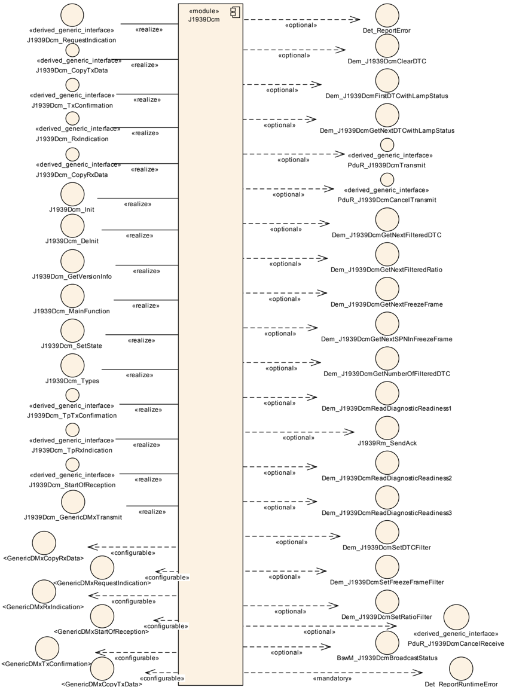

图 5.1：J1939Dcm 模块的模块依赖关系（**Module Dependencies of the J1939Dcm Module**）

## 6. 功能规格

本章定义 **J1939 Diagnostic Communication Manager** 的行为。模块的 API 在第 [7](#7-api规范) 章中定义，配置在第 [9](#9-配置规范) 章中定义。

### 6.1. 概述

**J1939 Diagnostic Communication Manager** 负责处理诊断请求消息，并发送相应的应答 **ACKM** PG。

#### 6.1.1. 支持的诊断消息

**J1939 Diagnostic Communication Manager** 应支持下表所示的诊断消息（**DMx**）。

表 7.1：支持的 DMx 消息（**Supported DMx Messages**）

| 名称 | PGN（十六进制） | 大小 | 接收 | 发送 | 说明 |
| --- | --- | --- | --- | --- | --- |
| DM01 | FECA | 可变 | - | 周期 1s | 激活的诊断故障码（Active Diagnostic Trouble Codes） |
| DM02 | FECB | 可变 | - | 应请求 | 先前激活的诊断故障码（Previously Active Diagnostic Trouble Codes） |
| DM03 | FECC | - | - | 应请求 | 先前激活 DTC 的诊断数据清除/复位（Diagnostic Data Clear/Reset for Previously Active DTCs） |
| DM04 | FECD | 可变 | - | 应请求 | 冻结帧参数（Freeze Frame Parameters） |
| DM05 | FECE | 8 | - | 应请求 | 诊断就绪 1（Diagnostic Readiness 1） |
| DM06 | FECF | 可变 | - | 应请求 | 排放相关未决 DTC（Emission Related Pending DTCs） |
| DM11 | FED3 | - | - | 应请求 | 激活 DTC 的诊断数据清除/复位（Diagnostic Data Clear/Reset for Active DTCs） |
| DM12 | FED4 | 可变 | - | 应请求 | 排放相关激活 DTC（Emissions Related Active DTCs） |
| DM13 | DF00 | 8 | X | - | 停止-启动广播（Stop Start Broadcast） |
| DM19 | D300 | 可变 | - | 应请求 | 标定信息（Calibration Information） |
| DM20 | C200 | 可变 | - | 应请求 | 监测性能比 SAE J1939-73 Revised SEP2006（Monitor Performance Ratio） |
| DM21 | C100 | 8 | - | 应请求 | 诊断就绪 2（Diagnostic Readiness 2） |
| DM23 | FDB5 | 可变 | - | 应请求 | 先前激活的排放相关故障（Previously Active Emission Related Faults） |
| DM24 | FDB6 | 8 | - | 应请求 | SPN 支持（SPN Support） |
| DM25 | FDB7 | 可变 | - | 应请求 | 扩展冻结帧（Expanded Freeze Frame） |
| DM26 | FDB8 | 可变 | - | 应请求 | 诊断就绪 3（Diagnostic Readiness 3） |
| DM28 | FD80 | 可变 | - | 应请求 | 永久 DTC（Permanent DTCs） |
| DM29 | 9E00 | 8 | - | 应请求 | 受监管的 DTC 计数（未决、永久、MIL-On、PMIL-On）（Regulated DTC Counts (Pending, Permanent, MIL-On, PMIL-On)） |
| DM31 | A300 | 可变 | - | 应请求 | DTC 与灯的关联（DTC to Lamp Association） |
| DM35 | 9F00 | 可变 | - | 应请求 | 即时故障状态（Immediate Fault Status） |
| DM53 | FCD1 | 可变 | - | 应请求 | 激活的仅服务 DTC（Active Service Only DTCs） |
| DM54 | FCD2 | 可变 | - | 应请求 | 先前激活的仅服务 DTC（Previously Active Service Only DTCs） |
| DM55 | FCD3 | 可变 | - | 应请求 | 全部仅服务 DTC 的诊断数据清除/复位（Diagnostic Data Clear/Reset for all Service Only DTCs） |

如果使能了 `J1939DcmGenericDMxSupport`，对于未列在上表中的 DMx 消息的请求，应通过配置为 `J1939DcmGenericDMxRequestFunction` 的 callout 转发。它们可以使用 `[J1939Dcm_GenericDMxTransmit](#735-j1939dcm_genericdmxtransmit)` 应答，后者会触发通过 `J1939DcmGenericDMxCopyTxDataFunction` 与 `J1939DcmGenericDMxTxConfirmationFunction` 配置的回调。

如果使能了 `J1939DcmGenericDMxSupport`，对于未列在上表中的已接收 DMx 消息，应使用通过 `J1939DcmGenericDMxStartOfReceptionFunction`、`J1939DcmGenericDMxCopyRxDataFunction` 与 `J1939DcmGenericDMxRxIndicationFunction` 配置的回调转发给应用。

大小可变的 DMx 消息通过 TP API 与 **J1939Tp** 交换（发送方向为 `PduR_J1939DcmTransmit`、`[J1939Dcm_CopyTxData](#747-j1939dcm_copytxdata)`、`[J1939Dcm_TpTxConfirmation](#748-j1939dcm_tptxconfirmation)`，接收方向为 `[J1939Dcm_StartOfReception](#744-j1939dcm_startofreception)`、`[J1939Dcm_CopyRxData](#745-j1939dcm_copyrxdata)`、`[J1939Dcm_TpRxIndication](#746-j1939dcm_tprxindication)`）。固定大小为 8 字节的 DMx 消息通过 IF API 与 **CanIf** 交换（发送方向为 `PduR_J1939DcmTransmit`、`[J1939Dcm_TxConfirmation](#743-j1939dcm_txconfirmation)`，接收方向为 `[J1939Dcm_RxIndication](#742-j1939dcm_rxindication)`）。

### 6.2. 模块处理

本节描述 **J1939 Diagnostic Communication Manager** 的辅助功能。

#### 6.2.1. 初始化

**J1939 Diagnostic Communication Manager** 通过 `[J1939Dcm_Init](#731-j1939dcm_init)` 初始化，通过 `[J1939Dcm_DeInit](#732-j1939dcm_deinit)` 去初始化。除 `[J1939Dcm_GetVersionInfo](#733-j1939dcm_getversioninfo)` 与 `[J1939Dcm_Init](#731-j1939dcm_init)` 之外，只有在模块已被正确初始化之后才允许调用 **J1939 Diagnostic Communication Manager** 的 API 函数。

调用 `[J1939Dcm_Init](#731-j1939dcm_init)` 会初始化所有内部变量，并将 **J1939 Diagnostic Communication Manager** 置于已初始化状态。

调用 `[J1939Dcm_DeInit](#732-j1939dcm_deinit)` 会将 **J1939 Diagnostic Communication Manager** 置回未初始化状态。

当在已初始化状态下调用 `[J1939Dcm_Init](#731-j1939dcm_init)` 时，**J1939 Diagnostic Communication Manager** 不得重新初始化其内部变量，而应调用 `Det_ReportError` 并使用错误码 `[J1939DCM_E_REINIT](#681-开发错误)`（如果 **DET** 上报已使能，参见 `J1939DcmDevErrorDetect`）。

#### 6.2.2. 错误处理

发生错误与异常时，**J1939Dcm** 模块不得修改其当前模块状态，而只需上报错误事件。

### 6.3. 消息处理

#### 6.3.1. 请求的接收

**J1939 Diagnostic Communication Manager** 通过 `[J1939Dcm_RequestIndication](#741-j1939dcm_requestindication)` 从 **J1939 Request Manager** 接收大多数 DMx PG 请求。例外是命令消息（在表 7.1 的「接收」列中标记的消息）。

在 **J1939Dcm** 中配置的 DMx 消息应与在 **J1939Rm** 中为某个 `J1939RmDcmUser` 配置的 `J1939RmUserPGN` 匹配。

如果配置参数 `J1939DcmDevErrorDetect` 已使能，函数 `[J1939Dcm_RequestIndication](#741-j1939dcm_requestindication)` 应检查 `requestedPgn` 参数是否寻址了一个已配置的 DMx 消息（即 `[J1939DcmDiagnosticMessageSupport](#916-j1939dcmdiagnosticmessagesupport)` 与对应的 PGN 能在上表「PGN（十六进制）」列中找到）。出错时，函数 `[J1939Dcm_RequestIndication](#741-j1939dcm_requestindication)` 应无任何效果地返回，并向 **Default Error Tracer** 上报错误码 `[J1939DCM_E_INVALID_PGN](#681-开发错误)`。

当 `[J1939Dcm_RequestIndication](#741-j1939dcm_requestindication)` 被调用且所请求的诊断消息受支持（通过容器 `[J1939DcmDiagnosticMessageSupport](#916-j1939dcmdiagnosticmessagesupport)` 中的 DMx 专属配置开关配置）时，除 DM01 与 DM35 消息之外，**J1939 Diagnostic Communication Manager** 应锁定公共缓冲区，并在下一次执行 `[J1939Dcm_MainFunction](#751-j1939dcm_mainfunction)` 时开始处理该消息。

DM01 的处理参见小节 6.7.1，DM35 的处理参见小节 6.7.20。

**注意：** 不会通过 `[J1939Dcm_RequestIndication](#741-j1939dcm_requestindication)` 发送 **NACK**，因为依据上文的匹配要求，**J1939Rm** 会为不支持的 DMx 消息发送 **NACK**。

如果新接收的诊断消息在当前模式条件下不被允许（依据配置参数 `J1939DcmDiagnosticMessageModeRuleRef`），**J1939Dcm** 应忽略当前请求。

**J1939Dcm** 应提供一块大小为 `J1939DcmCommonBufferSize` 的缓冲区，用于公共 DMx 消息处理，并附带一个锁定该缓冲区的信号量，以防止该缓冲区被多重使用。

当 `[J1939Dcm_RequestIndication](#741-j1939dcm_requestindication)` 被调用且当前正在处理任何其他诊断消息（DM01 与 DM35 除外）时，**J1939 Diagnostic Communication Manager** 应调用 `J1939Rm_SendAck`，参数 `ackCode` 置为 `J1939RM_ACK_CANNOT_RESPOND`，以发送否定确认（同时考虑下文的全局地址规则）。

SAE J1939 诊断不要求在向全局地址发出请求后进行肯定或否定确认。

当 `[J1939Dcm_RequestIndication](#741-j1939dcm_requestindication)` 被调用且目标地址（`destAddress`）为全局地址（0xFF）时，**J1939Dcm** 不得调用 `J1939Rm_SendAck` 发送确认。

#### 6.3.2. 消息发送失败

当 `PduR_J1939DcmTransmit` 返回 `E_OK` 以外的任何值，或 `[J1939Dcm_TpTxConfirmation](#748-j1939dcm_tptxconfirmation)` / `[J1939Dcm_TxConfirmation](#743-j1939dcm_txconfirmation)` 上报 `E_NOT_OK` 时，**J1939Dcm** 应从下一个主函数开始重试失败的发送，直至 `J1939DcmMaxTransmitRetries` 次。

#### 6.3.3. 消息的终止

对于通过 TP 发送的消息（上表中「大小」为「可变」），当请求的消息按上文规则被接受并处理后，在发送完成时调用 `[J1939Dcm_TpTxConfirmation](#748-j1939dcm_tptxconfirmation)` 即表示发送终止，此时 **J1939 Diagnostic Communication Manager** 应释放上述公共缓冲区。

对于通过 IF 发送的消息（上表中「大小」为 8），当请求的消息按上文规则被接受并处理后，在发送完成时调用 `[J1939Dcm_TxConfirmation](#743-j1939dcm_txconfirmation)` 即表示发送终止。此时 **J1939 Diagnostic Communication Manager** 应释放上述公共缓冲区。

#### 6.3.4. 元数据的处理

`CAN_ID_32` 类型的元数据项在第四个（最低有效）字节中包含源地址。

`CAN_ID_32` 类型的元数据项在第三个字节中包含目标地址。

`CAN_ID_32` 类型的元数据项在第一个（最高有效）字节的第 2–4 位中包含优先级，其中第 0 位是一个字节的最低有效位。

### 6.4. 通信状态处理

一般而言，只有当 **J1939Nm** 将 ECU 置为在线（online）时，诊断才是激活且可用的。**J1939 Diagnostic Communication Manager** 提供一个 API，供基础软件模式管理器（**BswM**）通知 J1939 通信状态。

在通过 `[J1939Dcm_Init](#731-j1939dcm_init)` 进行初始化期间，**J1939 Diagnostic Communication Manager** 处于离线（offline）状态。

调用 `[J1939Dcm_SetState](#734-j1939dcm_setstate)` 会将 **J1939 Diagnostic Communication Manager** 置为在线或离线状态。

在离线状态下，**J1939 Diagnostic Communication Manager** 不得继续处理任何周期性消息。

**注意：** 当 **J1939Rm** 处于 `J1939RM_STATE_OFFLINE` 状态时，它不会向 **J1939Dcm** 转发任何请求消息。

### 6.5. 模式相关的请求执行

请求的执行可以依据模式条件加以限制。这使 **J1939Dcm** 能够以形式化的方式表达环境检查。

`[J1939DcmModeRule](#9110-j1939dcmmoderule)` 应求值其引用的所有 `[J1939DcmModeCondition](#9111-j1939dcmmodecondition)` 和/或嵌套的 `[J1939DcmModeRule](#9110-j1939dcmmoderule)`：当 `J1939DcmLogicalOperator` 置为 `J1939DCM_AND` 时按逻辑与求值，当 `J1939DcmLogicalOperator` 置为 `J1939DCM_OR` 时按逻辑或求值。若只引用了单个 `[J1939DcmModeCondition](#9111-j1939dcmmodecondition)` 或 `[J1939DcmModeRule](#9110-j1939dcmmoderule)`，则 `J1939DcmLogicalOperator` 不应存在，因此也不被使用。

`[J1939DcmModeCondition](#9111-j1939dcmmodecondition)` 应以 `J1939DcmBswModeRef`、`J1939DcmSwcModeRef` 或 `J1939DcmSwcSRDataElementRef` 之一作为外部引用。

`[J1939DcmModeCondition](#9111-j1939dcmmodecondition)` 的 `J1939DcmSwcModeRef` 与 `J1939DcmBswModeRef` 应求值所引用的模式声明（Mode-Declaration）：当 `J1939DcmConditionType` 置为 `J1939DCM_EQUALS` 时判定其是否已设置，当 `J1939DcmConditionType` 置为 `J1939DCM_EQUALS_NOT` 时判定其是否未设置。

`[J1939DcmModeCondition](#9111-j1939dcmmodecondition)` 的 `J1939DcmSwcSRDataElementRef` 应对所引用的数据元素（经由 `[J1939DcmDspExternalSRDataElementClass](#9116-j1939dcmdspexternalsrdataelementclass)`）求值：

* 当 `J1939DcmConditionType` 置为 `J1939DCM_EQUALS` 时，是否等于 `[J1939DcmSwcSRDataElementValue](#9112-j1939dcmswcsrdataelementvalue)` 表示的值；
* 当 `J1939DcmConditionType` 置为 `J1939DCM_EQUALS_NOT` 时，是否不等于该值；
* 当 `J1939DcmConditionType` 置为 `J1939DCM_GREATER_THAN` 时，是否大于该值；
* 当 `J1939DcmConditionType` 置为 `J1939DCM_GREATER_OR_EQUAL` 时，是否大于或等于该值；
* 当 `J1939DcmConditionType` 置为 `J1939DCM_LESS_THAN` 时，是否小于该值；
* 当 `J1939DcmConditionType` 置为 `J1939DCM_LESS_OR_EQUAL` 时，是否小于或等于该值。

值 `J1939DCM_GREATER_THAN`、`J1939DCM_GREATER_OR_EQUAL`、`J1939DCM_LESS_OR_EQUAL` 与 `J1939DCM_LESS_THAN` 不得与模式引用（`J1939DcmBswModeRef` 或 `J1939DcmSwcModeRef`）一起使用。

**注意：** 所引用的 `ModeDeclarationGroupPrototype` 的当前模式既可以通过 API `SchM_Mode`（`J1939DcmBswModeRef` 的情况）读取，也可以通过 API `Rte_Mode`（`J1939DcmSwcModeRef` 的情况）读取。

若在一个 `[J1939DcmModeRule](#9110-j1939dcmmoderule)` 中引用了多个 `[J1939DcmModeCondition](#9111-j1939dcmmodecondition)`，它们应按 `J1939DcmArgumentRef` 的 `EcucReferenceValue` 索引属性的顺序求值。

**J1939Dcm** 应为 `[J1939DcmModeCondition](#9111-j1939dcmmodecondition)` 的各 `J1939DcmSwcModeRef` 所共同使用的 `ModeDeclarationGroupPrototype` 创建一个引用该 `ModeDeclarationGroupPrototype` 的必需模式切换端口。当该 `ModeDeclarationGroupPrototype` 短名唯一时，此端口原型的命名模式为 `J1939DcmModeUser_&lt;ModeDeclarationGroupPrototype&gt;`；否则命名模式由实现定义，但必须保留前缀 `J1939DcmModeUser_`。

**注意：** `ModeDeclarationGroupPrototype` 不一定唯一，因此需要该例外以避免 **J1939Dcm** 服务 SWC 中的命名冲突。

### 6.6. J1939Dcm 与 DEM 的交互

许多诊断消息从 **Diagnostic Event Manager** 报告 DTC 信息。这些消息中的大多数结构相同，因此使用相同的 API 序列。

**J1939Dcm** 应确保对 **DEM** 的访问严格串行化，即同一时间只执行一个 **DEM** 序列。

**注意：** 这通过为除 DM01、DM03、DM11 与 DM35 之外的所有诊断消息锁定全局缓冲区（见 [6.3.1](#631-请求的接收) 节）而隐式实现。因此，实现必须注意：在全局缓冲区被锁定时，DM01、DM03、DM11 与 DM35 的执行不得开始，反之亦然。

#### 6.6.1. DTC 状态

表 7.2：DTC 状态序列的过滤参数（**Dem_J1939DcmSetDTCFilter Parameters**）

| 诊断消息 | 诊断消息 | DTCStatusFilter | DTCKind | DTCOrigin |
| --- | --- | --- | --- | --- |
| DM01 | 激活的诊断故障码（Active Diagnostic Trouble Codes） | DEM_J1939DTC_ACTIVE | DEM_DTC_KIND_ALL_DTCS | DEM_DTC_ORIGIN_PRIMARY_MEMORY |
| DM02 | 先前激活的诊断故障码（Previously Active Diagnostic Trouble Codes） | DEM_J1939DTC_PREVIOUSLY_ACTIVE | DEM_DTC_KIND_ALL_DTCS | DEM_DTC_ORIGIN_PRIMARY_MEMORY |

在 DTC 状态序列开始时，**J1939 Diagnostic Communication Manager** 应调用 `Dem_J1939DcmSetDTCFilter`，参数 `DTCStatusFilter` 与 `DTCKind` 由触发该序列的 DMx 消息定义，同时传入所请求节点分配的 `ClientId`。

若 `Dem_J1939DcmSetRatioFilter`、`Dem_J1939DcmSetDTCFilter` 或 `Dem_J1939DcmSetFreezeFrameFilter` 返回 `E_OK`，参数 `LampStatus` 中的值应按照 SAE J1939-73 编码进响应消息布局。高字节是响应消息的字节 1，低字节是响应消息的字节 2。

**注意：** 参数 `LampStatus` 的位结构已由 **DEM** 模块按 SAE J1939-73 组织，因此 **J1939Dcm** 无需重新排列。

若 `Dem_J1939DcmSetRatioFilter`、`Dem_J1939DcmSetDTCFilter` 或 `Dem_J1939DcmSetFreezeFrameFilter` 返回 `E_NOT_OK`，**J1939 Diagnostic Communication Manager** 应调用 `J1939Rm_SendAck`，参数 `ackCode` 置为 `J1939RM_ACK_NEGATIVE`，发送否定确认（**NACK**）（同时考虑全局地址规则）。

**J1939 Diagnostic Communication Manager** 应通过后续调用 `Dem_J1939DcmGetNextFilteredDTC` 继续该序列，直至返回值为 `DEM_NO_SUCH_ELEMENT`。这些调用可以分布在多次 `[J1939Dcm_MainFunction](#751-j1939dcm_mainfunction)` 调用中。

表 7.3：诊断消息的过滤条件（**Filter Criteria for Diagnostic Messages**）

| 诊断消息 | 诊断消息 | DTCStatusFilter | DTCKind | DTCOrigin |
| --- | --- | --- | --- | --- |
| DM06 | 排放相关未决 DTC（Emission Related Pending DTCs） | DEM_J1939DTC_PENDING | DEM_DTC_KIND_EMISSION_REL_DTCS | DEM_DTC_ORIGIN_PRIMARY_MEMORY |
| DM12 | 排放相关激活 DTC（Emissions Related Active DTCs） | DEM_J1939DTC_ACTIVE | DEM_DTC_KIND_EMISSION_REL_DTCS | DEM_DTC_ORIGIN_PRIMARY_MEMORY |
| DM23 | 先前激活的排放相关故障（Previously Active Emission Related Faults） | DEM_J1939DTC_PREVIOUSLY_ACTIVE | DEM_DTC_KIND_EMISSION_REL_DTCS | DEM_DTC_ORIGIN_PRIMARY_MEMORY |
| DM28 | 永久 DTC（Permanent DTCs） | DEM_J1939DTC_PERMANENT | DEM_DTC_KIND_EMISSION_REL_DTCS | DEM_DTC_ORIGIN_PRIMARY_MEMORY |
| DM35 | 即时故障状态（Immediate Fault Status） | DEM_J1939DTC_CURRENTLY_ACTIVE | DEM_DTC_KIND_ALL_DTCS | DEM_DTC_ORIGIN_PRIMARY_MEMORY |
| DM53 | 激活的仅服务 DTC（Active Service Only DTCs） | DEM_J1939DTC_ACTIVE | DEM_DTC_KIND_ALL_DTCS | Origin definition from J1939DcmServiceOnlyDTCsMemoryDestinationRef |
| DM54 | 先前激活的仅服务 DTC（Previously Active Service Only DTCs） | DEM_J1939DTC_PREVIOUSLY_ACTIVE | DEM_DTC_KIND_ALL_DTCS | Origin definition from J1939DcmServiceOnlyDTCsMemoryDestinationRef |

如果返回值为 `E_OK`，参数 `J1939DTC` 与 `OccurenceCounter` 应被复制到由触发该序列的 DMx 消息所定义的响应消息中。

**J1939 Diagnostic Communication Manager** 应通过后续调用 `Dem_J1939DcmGetNextFilteredDTC` 继续该序列，除非每个 MainFunction 的最大序列计数阈值已达到（参见 `J1939DcmMaxDTCsPerMainFunction`）或返回值为 `DEM_PENDING`。此时执行被推迟到下一次 `[J1939Dcm_MainFunction](#751-j1939dcm_mainfunction)` 调用。

如果返回值为 `DEM_NO_SUCH_ELEMENT`，**J1939 Diagnostic Communication Manager** 应以所请求消息的 `PduId` 调用 `PduR_J1939DcmTransmit`，并通过 **MetaData** 将目标地址设置为请求的源地址；若请求的目标地址为 0xFF 则设为 0xFF；对于自发的 DM01 消息则设为 0xFF（广播）。

**注意：** 若同一 DTC 需要由不同节点报告，则每个节点都需要自己的 EventId。

#### 6.6.2. 冻结帧（FreezeFrame）

在冻结帧序列开始时，**J1939 Diagnostic Communication Manager** 应调用 `Dem_J1939DcmSetFreezeFrameFilter`，参数 `FreezeFrameKind` 由触发该序列的 DMx 消息定义，同时传入所请求节点分配的 `ClientId`。

若 `Dem_J1939DcmSetRatioFilter`、`Dem_J1939DcmSetDTCFilter` 或 `Dem_J1939DcmSetFreezeFrameFilter` 返回 `E_NOT_OK`，**J1939 Diagnostic Communication Manager** 应调用 `J1939Rm_SendAck`，参数 `ackCode` 置为 `J1939RM_ACK_NEGATIVE`，发送否定确认（**NACK**）（同时考虑全局地址规则）。

##### 6.6.2.1. FreezeFrameKind 等于 DEM_J1939DCM_FREEZEFRAME 或 DEM_J1939DCM_EXPANDED_FREEZEFRAME

此 `FreezeFrameKind` 由 DM04 与 DM25 使用。

若 `Dem_J1939DcmSetRatioFilter`、`Dem_J1939DcmSetDTCFilter` 或 `Dem_J1939DcmSetFreezeFrameFilter` 返回 `E_OK` 且 `FreezeFrameKind` 置为 `DEM_J1939DCM_FREEZEFRAME` 或 `DEM_J1939DCM_EXPANDED_FREEZEFRAME`，**J1939 Diagnostic Communication Manager** 应通过后续调用 `Dem_J1939DcmGetNextFreezeFrame` 继续该序列，直至返回值为 `DEM_NO_SUCH_ELEMENT`。这些调用可以分布在多次 `[J1939Dcm_MainFunction](#751-j1939dcm_mainfunction)` 调用中。

如果返回值为 `E_OK` 且 `FreezeFrameKind` 置为 `DEM_J1939DCM_FREEZEFRAME` 或 `DEM_J1939DCM_EXPANDED_FREEZEFRAME`，参数 `BufSize`、`DestBuffer`、`J1939DTC` 与 `OccurenceCounter` 应按照 SAE J1939-73 编码进响应消息布局。

**J1939 Diagnostic Communication Manager** 应通过后续调用 `Dem_J1939DcmGetNextFreezeFrame` 继续该序列，除非每个 MainFunction 的最大序列计数阈值已达到（参见 `J1939DcmMaxFreezeFramesPerMainFunction`）或返回值为 `DEM_PENDING`。

如果返回值为 `DEM_NO_SUCH_ELEMENT` 且 `FreezeFrameKind` 置为 `DEM_J1939DCM_FREEZEFRAME` 或 `DEM_J1939DCM_EXPANDED_FREEZEFRAME`，**J1939 Diagnostic Communication Manager** 应触发 `PduR_J1939DcmTransmit`，使用所请求消息的 `PduId`，并通过 **MetaData** 将目标地址设置为请求的源地址；若请求的目标地址为 0xFF 则设为 0xFF。

##### 6.6.2.2. FreezeFrameKind 等于 DEM_J1939DCM_SPNS_IN_EXPANDED_FREEZEFRAME

此 `FreezeFrameKind` 由 DM24 使用。

若 `Dem_J1939DcmSetRatioFilter`、`Dem_J1939DcmSetDTCFilter` 或 `Dem_J1939DcmSetFreezeFrameFilter` 返回 `E_OK` 且 `FreezeFrameKind` 置为 `DEM_J1939DCM_SPNS_IN_EXPANDED_FREEZEFRAME`，**J1939 Diagnostic Communication Manager** 应通过后续调用 `Dem_J1939DcmGetNextSPNInFreezeFrame` 继续该序列，直至返回值为 `DEM_NO_SUCH_ELEMENT`。这些调用可以分布在多次 `[J1939Dcm_MainFunction](#751-j1939dcm_mainfunction)` 调用中。

如果返回值为 `E_OK` 且 `FreezeFrameKind` 置为 `DEM_J1939DCM_SPNS_IN_EXPANDED_FREEZEFRAME`，参数 `SPNSupported` 与 `SPNDataLength` 应按照 SAE J1939-73 编码进响应消息布局，且「SPN support type」中的位 1「Supported in Expanded Freeze Frame」应置 0。

除上一条要求外，若该 **SPN** 也包含在配置参数 `J1939DcmSPNsInDataStream` 的列表中，则「SPN support type」中的位 2「Supported in Data Stream」应置 0。

如果返回值为 `DEM_NO_SUCH_ELEMENT` 且 `FreezeFrameKind` 置为 `DEM_J1939DCM_SPNS_IN_EXPANDED_FREEZEFRAME`，**J1939 Diagnostic Communication Manager** 应把只在 `J1939DcmSPNsInDataStream` 中支持、而不在扩展冻结帧中支持的 SPN 加入响应消息。「SPN support type」中的位 2「Supported in Data Stream」应置 0，「SPN Data Length」应置 0x00。随后应触发 `PduR_J1939DcmTransmit`，使用所请求消息的 `PduId`，并通过 **MetaData** 将目标地址设置为请求的源地址；若请求的目标地址为 0xFF 则设为 0xFF。

如果返回值为 `DEM_BUFFER_TOO_SMALL`，**J1939Dcm** 应向 **Default Error Tracer** 上报该错误，错误码为 `[J1939DCM_E_BUFFER_TOO_SMALL](#682-运行时错误)`，并应调用 `J1939Rm_SendAck`，参数 `ackCode` 置为 `J1939RM_ACK_NEGATIVE`，发送否定确认（**NACK**）（同时考虑全局地址规则）。

#### 6.6.3. 性价比（Ratio）

在性价比序列开始时，**J1939 Diagnostic Communication Manager** 应以所请求节点分配的 `ClientId` 调用 `Dem_J1939DcmSetRatioFilter`。

若 `Dem_J1939DcmSetRatioFilter`、`Dem_J1939DcmSetDTCFilter` 或 `Dem_J1939DcmSetFreezeFrameFilter` 返回 `E_OK`，参数 `IgnitionCycleCounter` 与 `OBDMonitoringConditionsEncountered` 中的值应按照 SAE J1939-73 编码进响应消息布局。

若 `Dem_J1939DcmSetRatioFilter`、`Dem_J1939DcmSetDTCFilter` 或 `Dem_J1939DcmSetFreezeFrameFilter` 返回 `E_NOT_OK`，**J1939 Diagnostic Communication Manager** 应调用 `J1939Rm_SendAck`，参数 `ackCode` 置为 `J1939RM_ACK_NEGATIVE`，发送否定确认（**NACK**）（同时考虑全局地址规则）。

**J1939 Diagnostic Communication Manager** 应通过后续调用 `Dem_J1939DcmGetNextFilteredRatio` 继续该序列，直至返回值为 `DEM_NO_SUCH_ELEMENT`。这些调用可以分布在多次 `[J1939Dcm_MainFunction](#751-j1939dcm_mainfunction)` 调用中。

如果返回值为 `E_OK`，参数 `SPN`、`Numerator` 与 `Denumerator` 应被复制到由触发该序列的 DMx 消息所定义的响应消息中。

**J1939 Diagnostic Communication Manager** 应通过后续调用 `Dem_J1939DcmGetNextFilteredRatio` 继续该序列，除非每个 MainFunction 的最大序列计数阈值已达到（参见 `J1939DcmMaxRatiosPerMainFunction`）或返回值为 `DEM_PENDING`。

如果返回值为 `DEM_NO_SUCH_ELEMENT`，**J1939 Diagnostic Communication Manager** 应以所请求消息的 `PduId` 调用 `PduR_J1939DcmTransmit`，并通过 **MetaData** 将目标地址设置为请求的源地址；若请求的目标地址为 0xFF 则设为 0xFF。

#### 6.6.4. 仅服务 DTC（Service Only DTCs）

J1939 有「仅服务 DTC」（Service only DTCs）的概念。这些 DTC 被认为存储在 **DEM** 的任一用户自定义故障记忆中（`Dem_DTCOriginType` 的 `DEM_DTC_ORIGIN_USERDEFINED_MEMORY_&lt;Name&gt;`）。所有其他 DTC 被认为存储在主故障记忆中（`Dem_DTCOriginType` 的 `DEM_DTC_ORIGIN_PRIMARY_MEMORY`）。

在处理 DM53、DM54 或 DM55 时，**J1939Dcm** 应调用 **DEM** API `Dem_J1939DcmClearDTC` 与 `Dem_J1939DcmSetDTCFilter`，使用与 `J1939DcmServiceOnlyDTCsMemoryDestinationRef` 所引用的 `DemUserDefinedMemory` 对应的 `Dem_DTCOriginType`。

`J1939DcmServiceOnlyDTCsMemoryDestinationRef` 应引用分配给当前 `J1939DcmDemClientRef` 的 `DemEventMemorySet` 的一个事件记忆。

### 6.7. 诊断消息

#### 6.7.1. 激活的诊断故障码（DM01）

DM01 用于以周期方式和变化触发方式广播本 ECU 激活的 **DTC** 与汇总的灯状态。

在收到 DM01 请求时（调用 `[J1939Dcm_RequestIndication](#741-j1939dcm_requestindication)`，参数 `requestedPgn` 按表 7.1「PGN（十六进制）」列设置），**J1939 Diagnostic Communication Manager** 应锁定专用的 DM01 缓冲区，并使用公共「DTC 状态」序列，参数 `DTCStatusFilter` 与 `DTCKind` 按对应表的相应列设置。公共「DTC 状态」序列在小节 [6.6.1](#661-dtc-状态) 中描述。

##### 6.7.1.1. DM01 消息的周期性收集与发送

**J1939 Diagnostic Communication Manager** 应锁定专用的 DM01 缓冲区，按照 SAE J1939-73 在该缓冲区中收集所有激活的 **DTC** 与灯状态，并以 1 s 的周期发送 DM01 消息，具体由下述四项要求定义。

**J1939Dcm** 应提供一块大小为 `J1939DcmDM01BufferSize` 的缓冲区用于并行的 DM01 处理，以支持上述周期收集与发送。

当 **DEM** 调用 `[J1939Dcm_DemTriggerOnDTCStatus](#7491-j1939dcm_demtriggerondtcstatus)` 时，应在常规周期发送之外，针对上报的 `ClientId` 对应的 `J1939DcmNmNodeRef`、在所有已配置的通道上发送 DM01 消息——但同一 **DTC** 的 `[J1939Dcm_DemTriggerOnDTCStatus](#7491-j1939dcm_demtriggerondtcstatus)` 在一秒内被触发多次时除外。应使用独立的 DM01 缓冲区。

**注意：** 该例外用于避免总线负载过高。

DM01 应对所有已配置的 DM01 消息（`J1939DcmDmxSupport` == `J1939DCM_DM01_SUPPORT`）、所有节点（`[J1939DcmNode](#915-j1939dcmnode)`）与所有通道（`J1939DcmDiagnosticMessageSupportChannelRef`）使用公共「DTC 状态」序列，参数 `DTCStatusFilter` 与 `DTCKind` 按对应表的相应列设置。公共「DTC 状态」序列在小节 [6.6.1](#661-dtc-状态) 中描述。

**注意：** 周期性的 DM01 消息会在所有已配置的网络上、针对所有已配置的节点广播。

**示例：** 节点 A 将在通道 1 与通道 2 上周期发送 DTC_A 与 DTC_B，而节点 B 只在通道 2 上发送 DTC_C。所请求的 DM01 消息只在所请求的通道上、针对所请求的节点发送。

返回值 `J1939DTC` 与 `OccurenceCounter` 应按照 SAE J1939-73 编码进 DM01 布局。

为了使 ECU 能将 **BAM** 用于周期 DM01 发送之外的用途，DTC 的最大数量必须受限。20 个 **DTC** 大约占用 **BAM** 可用带宽的 2/3。

在发送了配置参数 `J1939DcmDM01MaxDTCs` 数量的 **DTC** 之后，发送应停止。

**注意：** 对 **PduR** 的发送请求由小节 [6.6.1](#661-dtc-状态) 所述的公共「DTC 状态」序列覆盖。

#### 6.7.2. 先前激活的诊断故障码（DM02）

DM02 消息报告先前激活的 **DTC**。

在收到 DM02 请求时（调用 `[J1939Dcm_RequestIndication](#741-j1939dcm_requestindication)`，参数 `requestedPgn` 按表 7.1「PGN（十六进制）」列设置），**J1939 Diagnostic Communication Manager** 应使用公共「DTC 状态」序列，参数 `DTCStatusFilter` 与 `DTCKind` 按对应表的相应列设置。公共「DTC 状态」序列在小节 [6.6.1](#661-dtc-状态) 中描述。

返回值 `J1939DTC` 与 `OccurenceCounter` 应按照 SAE J1939-73 编码进 DM02 布局。

#### 6.7.3. 先前激活 DTC 的诊断数据清除/复位（DM03）

DM03 消息清除先前激活的 **DTC**。

在收到 DM03 请求时（调用 `[J1939Dcm_RequestIndication](#741-j1939dcm_requestindication)`，参数 `requestedPgn` 按表 7.1「PGN（十六进制）」列设置），**J1939 Diagnostic Communication Manager** 应触发 `Dem_J1939DcmClearDTC`，参数 `DTCTypeFilter` 置为 `DEM_J1939DTC_CLEAR_PREVIOUSLY_ACTIVE`。

如果 `Dem_J1939DcmClearDTC` 的返回值为 `DEM_PENDING`，**J1939 Diagnostic Communication Manager** 应在下一次 `[J1939Dcm_MainFunction](#751-j1939dcm_mainfunction)` 调用中重新触发 `Dem_J1939DcmClearDTC`（参数 `DTCTypeFilter` 置为 `DEM_J1939DTC_CLEAR_PREVIOUSLY_ACTIVE`）。

如果 `Dem_J1939DcmClearDTC` 的返回值为 `E_OK`，**J1939 Diagnostic Communication Manager** 应通过 `J1939Rm_SendAck`（参数 `ackCode` 置为 `J1939RM_ACK_POSITIVE`）发送肯定确认（**ACK**）。

如果返回值 `Std_ReturnType` 既不是 `E_OK` 也不是 `DEM_PENDING`，**J1939 Diagnostic Communication Manager** 应通过 `J1939Rm_SendAck`（参数 `ackCode` 置为 `J1939RM_ACK_NEGATIVE`）发送否定确认（**NACK**）。

**注意：** 若请求的目标地址为广播（0xFF），依据 SAE J1939-73 不应发送确认（参见上文的全局地址规则）。

#### 6.7.4. 冻结帧参数（DM04）

DM04 消息报告存储的冻结帧（FreezeFrame）。

在收到 DM04 请求时（调用 `[J1939Dcm_RequestIndication](#741-j1939dcm_requestindication)`，参数 `requestedPgn` 按表 7.1「PGN（十六进制）」列设置），**J1939 Diagnostic Communication Manager** 应使用公共「FreezeFrame」序列，参数 `FreezeFrameKind` 置为 `DEM_J1939DCM_FREEZEFRAME`。公共「FreezeFrame」序列在小节 [6.6.2](#662-冻结帧freezeframe) 中描述。

#### 6.7.5. 诊断就绪 1（DM05）

DM05 消息报告诊断就绪状态。

在收到 DM05 请求时（调用 `[J1939Dcm_RequestIndication](#741-j1939dcm_requestindication)`，参数 `requestedPgn` 按表 7.1「PGN（十六进制）」列设置），**J1939 Diagnostic Communication Manager** 应以所请求节点分配的 `ClientId` 调用 `Dem_J1939DcmReadDiagnosticReadiness1`，最迟在下一次 `[J1939Dcm_MainFunction](#751-j1939dcm_mainfunction)` 时调用。

如果 `Dem_J1939DcmReadDiagnosticReadiness1` 的返回值为 `E_OK`，返回参数 `DataValue` 应按照 SAE J1939-73 编码进 DM05 布局。随后应以所请求消息的 `PduId` 调用 `PduR_J1939DcmTransmit`，并通过 **MetaData** 将目标地址设置为请求的源地址；若请求的目标地址为 0xFF 则设为 0xFF。

如果 `Dem_J1939DcmReadDiagnosticReadiness1` 的返回值不等于 `E_OK`，**J1939 Diagnostic Communication Manager** 应调用 `J1939Rm_SendAck`，参数 `ackCode` 置为 `J1939RM_ACK_NEGATIVE`，发送否定确认（**NACK**）（同时考虑全局地址规则）。

#### 6.7.6. 排放相关未决 DTC（DM06）

DM06 消息报告与 **OBD** 相关的未决 **DTC**。

在收到 DM06 请求时（调用 `[J1939Dcm_RequestIndication](#741-j1939dcm_requestindication)`，参数 `requestedPgn` 按表 7.1「PGN（十六进制）」列设置），**J1939 Diagnostic Communication Manager** 应使用公共「DTC 状态」序列，参数 `DTCStatusFilter` 与 `DTCKind` 按对应表的相应列设置。公共「DTC 状态」序列在小节 [6.6.1](#661-dtc-状态) 中描述。

返回值 `J1939DTC` 与 `OccurenceCounter` 应按照 SAE J1939-73 编码进 DM06 布局。

#### 6.7.7. 激活 DTC 的诊断数据清除/复位（DM11）

DM11 消息应至少清除与激活 **DTC** 有关的所有适用的诊断数据（进一步受影响的诊断数据参见 SAE J1939-73）。

在收到 DM11 请求时（调用 `[J1939Dcm_RequestIndication](#741-j1939dcm_requestindication)`，参数 `requestedPgn` 按表 7.1「PGN（十六进制）」列设置），**J1939 Diagnostic Communication Manager** 应触发 `Dem_J1939DcmClearDTC`，参数 `DTCTypeFilter` 置为 `DEM_J1939DTC_CLEAR_ACTIVE`。

如果 `Dem_J1939DcmClearDTC` 的返回值为 `DEM_PENDING`，**J1939 Diagnostic Communication Manager** 应在下一次 `[J1939Dcm_MainFunction](#751-j1939dcm_mainfunction)` 调用中重新触发 `Dem_J1939DcmClearDTC`（参数 `DTCTypeFilter` 置为 `DEM_J1939DTC_CLEAR_ACTIVE`）。

如果 `Dem_J1939DcmClearDTC` 的返回值为 `E_OK`，**J1939 Diagnostic Communication Manager** 应通过 `J1939Rm_SendAck`（参数 `ackCode` 置为 `J1939RM_ACK_POSITIVE`）发送肯定确认（**ACK**）。

如果 `Dem_J1939DcmClearDTC` 的返回值不是 `E_OK`，**J1939 Diagnostic Communication Manager** 应通过 `J1939Rm_SendAck`（参数 `ackCode` 置为 `J1939RM_ACK_NEGATIVE`）发送否定确认（**NACK**）。

**注意：** 若请求的目标地址为广播（0xFF），依据 SAE J1939-73 不应发送确认（参见上文的全局地址规则）。

#### 6.7.8. 排放相关激活 DTC（DM12）

DM12 消息报告与 **OBD** 相关的激活 **DTC**。

在收到 DM12 请求时（调用 `[J1939Dcm_RequestIndication](#741-j1939dcm_requestindication)`，参数 `requestedPgn` 按表 7.1「PGN（十六进制）」列设置），**J1939 Diagnostic Communication Manager** 应使用公共「DTC 状态」序列，参数 `DTCStatusFilter` 与 `DTCKind` 按对应表的相应列设置。公共「DTC 状态」序列在小节 [6.6.1](#661-dtc-状态) 中描述。

返回值 `J1939DTC` 与 `OccurenceCounter` 应按照 SAE J1939-73 编码进 DM12 布局。

#### 6.7.9. 停止-启动广播（DM13）

DM13 消息停止和启动向特定网络的消息广播。

可用的网络如下：

* J1587
* J1922
* J1939 Network #1（主车辆网络）
* J1939 Network #2
* ISO 9141
* J1850
* Other, Manufacture Specified Port
* SAE J1939 Network #3
* Proprietary Network #1
* Proprietary Network #2
* J1939 Network #4

另见 `J1939DcmBusType`。

**J1939Dcm** 应维护 DM13 命令消息的广播状态信息。广播状态信息的初始值是所有网络的正常广播模式。

在通过 `[J1939Dcm_RxIndication](#742-j1939dcm_rxindication)`（参数 `RxPduId` 置为配置的 `J1939DcmRxPduId`）接收到 DM13 命令消息且 hold 信号置为 not available 时，**J1939 Diagnostic Communication Manager** 应启动超时监控，并以更新后的广播状态信息调用 `BswM_J1939DcmBroadcastStatus`。

对于网络「Current Data Link」，所接收 DM13 命令消息对应的 `ComMChannelId` 决定报告给 **BswM** 的网络位。

对于 DM13 命令消息中的其他总线类型，若存在合适的 `J1939DcmBusType`，则 `J1939DcmComMChannelRef` 对应引用的 `ComMChannelId` 应代表报告给 **BswM** 的 NetworkMask 中的网络位；否则忽略该请求。

「Stop Broadcast」应使提供给 **BswM** 的广播状态信息中与该网络关联的位为 0。

「Start Broadcast」应使提供给 **BswM** 的广播状态信息中与该网络关联的位为 1。

「Don't Care/take no action (leave as is)」不得更新 **J1939Dcm** 内部的广播状态信息中与该网络关联的位。

在通过 `[J1939Dcm_RxIndication](#742-j1939dcm_rxindication)`（参数 `RxPduId` 置为配置的 `J1939DcmRxPduId`）接收到 DM13 命令消息且 hold 信号置为 all devices 或 devices whose broadcast state has been modified 时，**J1939 Diagnostic Communication Manager** 应重启超时监控。

**注意：** 超时监控只在节点已按上文方式被寻址时启动。因此，当节点未被不带 hold 信号的 DM13 消息寻址过时，它不受 hold 信号 devices whose broadcast state has been modified 的影响。

当 6 秒内没有再收到 DM13 消息而发生超时后，所有总线应被置回广播模式，做法是以所有总线均置 1 的广播状态信息调用 `BswM_J1939DcmBroadcastStatus`。

**注意：** 如何使用报告给 **BswM** 的广播状态来避免因某些信号未及时接收而设置诊断故障码，由应用自行决定。

#### 6.7.10. 标定信息（DM19）

DM19 消息报告标定校验号（Calibration Verification Number，CVN）。

在收到 DM19 请求时（调用 `[J1939Dcm_RequestIndication](#741-j1939dcm_requestindication)`，参数 `requestedPgn` 按表 7.1「PGN（十六进制）」列设置），**J1939 Diagnostic Communication Manager** 应触发端口原型 `[J1939Dcm_CalibrationInformation](#7721-j1939dcm_calibrationinformation)` 的操作 `GetCalibrationVerificationNumber` 以收集 CVN。

如果返回值为 `E_NOT_READY`，**J1939 Diagnostic Communication Manager** 应通过 `J1939Rm_SendAck` 发送确认，参数 `ackCode` 置为 `J1939RM_ACK_CANNOT_RESPOND`（同时考虑全局地址规则）。

如果返回值为 `E_NOT_OK`，**J1939 Diagnostic Communication Manager** 应忽略返回参数，并按照 SAE J1939-73 将「CalibrationVerificationNumber」以零（0x00）、「CalibrationID」以高值（即 0xFF）上报。随后应触发 `PduR_J1939DcmTransmit`，使用所请求消息的 `PduId`，并通过 **MetaData** 将目标地址设置为请求的源地址；若请求的目标地址为 0xFF 则设为 0xFF。

**注意：** 一些法规要求在当前周期计算进行期间存储并上报上次计算得到的值。对于这种情况，应用需要存储上次计算的 CVN。

如果返回值为 `E_NEXT`，**J1939 Diagnostic Communication Manager** 应将返回参数「CalibrationVerificationNumber」与「CalibrationID」按照 SAE J1939-73 编码进 DM19 布局。随后应重新触发端口原型 `[J1939Dcm_CalibrationInformation](#7721-j1939dcm_calibrationinformation)` 的操作 `GetCalibrationVerificationNumber` 以收集 CVN 的下一部分。

如果返回值为 `E_OK`，**J1939 Diagnostic Communication Manager** 应将返回参数 `CalibrationVerificationNumber` 与 `CalibrationID` 按照 SAE J1939-73 编码进 DM19 布局。随后应触发 `PduR_J1939DcmTransmit`，使用所请求消息的 `PduId`，并通过 **MetaData** 将目标地址设置为请求的源地址；若请求的目标地址为 0xFF 则设为 0xFF。

#### 6.7.11. 监测性能比（DM20）

DM20 消息报告使用中监测性能比（In-Use-Monitor Performance Ratio，**IUMPR**）。

在收到 DM20 请求时（调用 `[J1939Dcm_RequestIndication](#741-j1939dcm_requestindication)`，参数 `requestedPgn` 按表 7.1「PGN（十六进制）」列设置），**J1939 Diagnostic Communication Manager** 应使用公共「Ratio」序列。公共「Ratio」序列在小节 [6.6.3](#663-性价比ratio) 中描述。

#### 6.7.12. 诊断就绪 2（DM21）

DM21 消息报告诊断就绪状态。

在收到 DM21 请求时（调用 `[J1939Dcm_RequestIndication](#741-j1939dcm_requestindication)`，参数 `requestedPgn` 按表 7.1「PGN（十六进制）」列设置），**J1939 Diagnostic Communication Manager** 应以所请求节点分配的 `ClientId` 调用 `Dem_J1939DcmReadDiagnosticReadiness2`，最迟在下一个 `[J1939Dcm_MainFunction](#751-j1939dcm_mainfunction)` 周期调用。

如果 `Dem_J1939DcmReadDiagnosticReadiness2` 的返回值为 `E_OK`，返回参数 `DataValue` 应按照 SAE J1939-73 编码进 DM21 布局。随后应触发 `PduR_J1939DcmTransmit`，使用 DM21 的 `PduId`，并通过 **MetaData** 将目标地址设置为请求的源地址；若请求的目标地址为 0xFF 则设为 0xFF。

如果 `Dem_J1939DcmReadDiagnosticReadiness2` 的返回值不等于 `E_OK`，**J1939 Diagnostic Communication Manager** 应调用 `J1939Rm_SendAck`，参数 `ackCode` 置为 `J1939RM_ACK_NEGATIVE`，发送否定确认（**NACK**）（同时考虑全局地址规则）。

#### 6.7.13. 先前激活的排放相关故障（DM23）

DM23 消息报告与 **OBD** 相关的先前激活 **DTC**。

在收到 DM23 请求时（调用 `[J1939Dcm_RequestIndication](#741-j1939dcm_requestindication)`，参数 `requestedPgn` 按表 7.1「PGN（十六进制）」列设置），**J1939 Diagnostic Communication Manager** 应使用公共「DTC 状态」序列，参数 `DTCStatusFilter` 与 `DTCKind` 按对应表的相应列设置。公共「DTC 状态」序列在小节 [6.6.1](#661-dtc-状态) 中描述。

返回值 `J1939DTC` 与 `OccurenceCounter` 应按照 SAE J1939-73 编码进 DM23 布局。

#### 6.7.14. SPN 支持（DM24）

DM24 消息报告 DM25 与 DataStream 支持的 **SPN**。

在收到 DM24 请求时（调用 `[J1939Dcm_RequestIndication](#741-j1939dcm_requestindication)`，参数 `requestedPgn` 按表 7.1「PGN（十六进制）」列设置），**J1939 Diagnostic Communication Manager** 应使用公共「FreezeFrame」序列，参数 `FreezeFrameKind` 置为 `DEM_J1939DCM_SPNS_IN_EXPANDED_FREEZEFRAME`。公共「FreezeFrame」序列在小节 [6.6.2](#662-冻结帧freezeframe) 中描述。

#### 6.7.15. 扩展冻结帧（DM25）

DM25 报告扩展冻结帧（Expanded Freeze Frame）的数据。

在收到 DM25 请求时（调用 `[J1939Dcm_RequestIndication](#741-j1939dcm_requestindication)`，参数 `requestedPgn` 按表 7.1「PGN（十六进制）」列设置），**J1939 Diagnostic Communication Manager** 应使用公共「FreezeFrame」序列，参数 `FreezeFrameKind` 置为 `DEM_J1939DCM_EXPANDED_FREEZEFRAME`。公共「FreezeFrame」序列在小节 [6.6.2](#662-冻结帧freezeframe) 中描述。

#### 6.7.16. 诊断就绪 3（DM26）

DM26 消息报告诊断就绪状态。

在收到 DM26 请求时（调用 `[J1939Dcm_RequestIndication](#741-j1939dcm_requestindication)`，参数 `requestedPgn` 按表 7.1「PGN（十六进制）」列设置），**J1939 Diagnostic Communication Manager** 应以所请求节点分配的 `ClientId` 调用 `Dem_J1939DcmReadDiagnosticReadiness3`，最迟在下一个 `[J1939Dcm_MainFunction](#751-j1939dcm_mainfunction)` 周期调用。

如果 `Dem_J1939DcmReadDiagnosticReadiness3` 的返回值为 `E_OK`，返回参数 `DataValue` 应按照 SAE J1939-73 编码进 DM26 布局。随后应触发 `PduR_J1939DcmTransmit`，使用 DM26 的 `PduId`，并通过 **MetaData** 将目标地址设置为请求的源地址；若请求的目标地址为 0xFF 则设为 0xFF。

如果 `Dem_J1939DcmReadDiagnosticReadiness3` 的返回值不等于 `E_OK`，**J1939 Diagnostic Communication Manager** 应调用 `J1939Rm_SendAck`，参数 `ackCode` 置为 `J1939RM_ACK_NEGATIVE`，发送否定确认（**NACK**）（同时考虑全局地址规则）。

#### 6.7.17. 永久 DTC（DM28）

DM28 消息报告与 **OBD** 相关的永久 **DTC**。

在收到 DM28 请求时（调用 `[J1939Dcm_RequestIndication](#741-j1939dcm_requestindication)`，参数 `requestedPgn` 按表 7.1「PGN（十六进制）」列设置），**J1939 Diagnostic Communication Manager** 应使用公共「DTC 状态」序列，参数 `DTCStatusFilter` 与 `DTCKind` 按对应表的相应列设置。公共「DTC 状态」序列在小节 [6.6.1](#661-dtc-状态) 中描述。

返回值 `J1939DTC` 与 `OccurenceCounter` 应按照 SAE J1939-73 编码进 DM28 布局。

#### 6.7.18. 受监管的 DTC 计数（DM29）

DM29 消息报告每个类别中的 **DTC** 数量。

在收到 DM29 请求时（调用 `[J1939Dcm_RequestIndication](#741-j1939dcm_requestindication)`，参数 `requestedPgn` 按表 7.1「PGN（十六进制）」列设置），**J1939 Diagnostic Communication Manager** 应对响应消息中的每个字节调用 `Dem_J1939DcmSetDTCFilter`，参数 `DTCStatusFilter` 与 `DTCKind` 按下表定义。

表 7.4：DM29 的响应消息结构（**Response Message Structure of DM29**）

| 字节位置 | 计数 | DTCStatusFilter | DTCKind |
| --- | --- | --- | --- |
| 字节 1 | Pending DTCs | DEM_J1939DTC_PENDING | DEM_DTC_KIND_EMISSION_REL_DTCS |
| 字节 2 | All Pending DTCs | DEM_J1939DTC_PENDING | DEM_DTC_KIND_ALL_DTCS |
| 字节 3 | MIL-On DTCs | DEM_J1939DTC_ACTIVE | DEM_DTC_KIND_EMISSION_REL_DTCS |
| 字节 4 | Previously MIL-On DTCs | DEM_J1939DTC_PREVIOUSLY_ACTIVE | DEM_DTC_KIND_EMISSION_REL_DTCS |
| 字节 5 | Permanent DTCs | DEM_J1939DTC_PERMANENT | DEM_DTC_KIND_EMISSION_REL_DTCS |
| 字节 6 | 0xFF |  |  |
| 字节 7 | 0xFF |  |  |
| 字节 8 | 0xFF |  |  |

在每次调用 `Dem_J1939DcmSetDTCFilter` 之后，**J1939 Diagnostic Communication Manager** 应调用 `Dem_J1939DcmGetNumberOfFilteredDTC` 以获取当前匹配 **DTC** 的数量。

如果返回值为 `E_OK`，**J1939 Diagnostic Communication Manager** 应把参数 `NumberOfFilteredDTC` 中返回的值复制到 DM29 响应消息的相应字节。

如果返回值为 `DEM_PENDING`，**J1939 Diagnostic Communication Manager** 应在下一次 `[J1939Dcm_MainFunction](#751-j1939dcm_mainfunction)` 调用中重新触发 `Dem_J1939DcmGetNumberOfFilteredDTC`。未使用的字节 6 到 8 应置为 0xFF。

#### 6.7.19. DTC 与灯的关联（DM31）

DM31 消息报告 **DTC** 与灯的关联（DTC to Lamp Association）。

在收到 DM31 请求时（调用 `[J1939Dcm_RequestIndication](#741-j1939dcm_requestindication)`，参数 `requestedPgn` 按表 7.1「PGN（十六进制）」列设置），**J1939 Diagnostic Communication Manager** 应调用函数 `Dem_J1939DcmFirstDTCwithLampStatus` 以启动数据流。

**J1939 Diagnostic Communication Manager** 应通过后续调用 `Dem_J1939DcmGetNextDTCwithLampStatus` 继续该序列，除非每个 MainFunction 的最大序列计数阈值已达到（参见 `J1939DcmMaxDTCsPerMainFunction`）或返回值为 `DEM_PENDING`。此时执行被推迟到下一次 `[J1939Dcm_MainFunction](#751-j1939dcm_mainfunction)` 调用。

每次调用 `Dem_J1939DcmGetNextDTCwithLampStatus` 的返回值 `J1939DTC`、`OccurenceCounter` 与 `LampStatus` 应依次按照 SAE J1939-73 编码进 DM31 布局。

如果返回值为 `DEM_NO_SUCH_ELEMENT`，**J1939 Diagnostic Communication Manager** 应以所请求消息的 `PduId` 调用 `PduR_J1939DcmTransmit`，并通过 **MetaData** 将目标地址设置为请求的源地址；若请求的目标地址为 0xFF 则设为 0xFF。

#### 6.7.20. 即时故障状态（DM35）

DM35 消息报告即时故障状态。

在收到 DM35 请求时（调用 `[J1939Dcm_RequestIndication](#741-j1939dcm_requestindication)`，参数 `requestedPgn` 按表 7.1「PGN（十六进制）」列设置），**J1939 Diagnostic Communication Manager** 应使用独立的 DM35 缓冲区开始收集所有即时 **DTC** 与汇总的灯状态，并以 1 s 的周期发送 DM35 消息，直至模块关闭。

**注意：** AUTOSAR 选择了每秒只发送一次该消息的方案。

**J1939Dcm** 应提供一块大小为 `J1939DcmDM35BufferSize` 的缓冲区用于并行的 DM35 处理，以支持上述收集与发送。

DM35 应使用公共「DTC 状态」序列，参数 `DTCStatusFilter` 与 `DTCKind` 按对应表的相应列设置。公共「DTC 状态」序列在小节 [6.6.1](#661-dtc-状态) 中描述。

返回值 `J1939DTC` 与 `OccurenceCounter` 应按照 SAE J1939-73 编码进 DM35 布局。

#### 6.7.21. 激活的仅服务 DTC（DM53）

DM53 消息报告激活的仅服务 **DTC**。

在收到 DM53 请求时（调用 `[J1939Dcm_RequestIndication](#741-j1939dcm_requestindication)`，参数 `requestedPgn` 按表 7.1「PGN（十六进制）」列设置），**J1939 Diagnostic Communication Manager** 应使用公共「DTC 状态」序列，参数 `DTCStatusFilter`、`DTCOrigin` 与 `DTCKind` 按对应表的相应列设置。公共「DTC 状态」序列在小节 [6.6.1](#661-dtc-状态) 中描述。

返回值 `J1939DTC` 与 `OccurenceCounter` 应按照 SAE J1939-73 编码进 DM53 布局。

#### 6.7.22. 先前激活的仅服务 DTC（DM54）

DM54 消息报告先前激活的仅服务 **DTC**。

在收到 DM54 请求时（调用 `[J1939Dcm_RequestIndication](#741-j1939dcm_requestindication)`，参数 `requestedPgn` 按表 7.1「PGN（十六进制）」列设置），**J1939 Diagnostic Communication Manager** 应使用公共「DTC 状态」序列，参数 `DTCStatusFilter`、`DTCOrigin` 与 `DTCKind` 按对应表的相应列设置。公共「DTC 状态」序列在小节 [6.6.1](#661-dtc-状态) 中描述。

返回值 `J1939DTC` 与 `OccurenceCounter` 应按照 SAE J1939-73 编码进 DM54 布局。

#### 6.7.23. 全部仅服务 DTC 的诊断数据清除/复位（DM55）

DM55 消息清除所有仅服务 **DTC**。

在收到 DM55 请求时（调用 `[J1939Dcm_RequestIndication](#741-j1939dcm_requestindication)`，参数 `requestedPgn` 按表 7.1「PGN（十六进制）」列设置），**J1939 Diagnostic Communication Manager** 应触发 `Dem_J1939DcmClearDTC`，参数 `DTCTypeFilter` 置为 `DEM_J1939DTC_CLEAR_ACTIVE_AND_PREVIOUSLY_ACTIVE`，`DTCOrigin` 置为 `J1939DcmServiceOnlyDTCsMemoryDestinationRef` 的定义值。

如果 `Dem_J1939DcmClearDTC` 的返回值为 `DEM_PENDING`，**J1939 Diagnostic Communication Manager** 应在下一次 `[J1939Dcm_MainFunction](#751-j1939dcm_mainfunction)` 调用中重新触发 `Dem_J1939DcmClearDTC`（参数 `DTCTypeFilter` 置为 `DEM_J1939DTC_CLEAR_ACTIVE_AND_PREVIOUSLY_ACTIVE`）。

如果 `Dem_J1939DcmClearDTC` 的返回值为 `E_OK` 或 `DEM_PENDING`，**J1939 Diagnostic Communication Manager** 应通过 `J1939Rm_SendAck`（参数 `ackCode` 置为 `J1939RM_ACK_POSITIVE`）发送肯定确认（**ACK**）。

如果返回值不是 `E_OK` 也不是 `DEM_PENDING`，**J1939 Diagnostic Communication Manager** 应通过 `J1939Rm_SendAck`（参数 `ackCode` 置为 `J1939RM_ACK_NEGATIVE`）发送否定确认（**NACK**）。

**注意：** 若请求的目标地址为广播（0xFF），依据 SAE J1939-73 不应发送确认（参见上文的全局地址规则）。

### 6.8. 错误分类

[\[18, SWS BSW General\]](#ref-18) 的小节 7.2「错误处理」（Error Handling）详细描述了基础软件的错误处理。其中最重要的是一个由五种错误类型构成的分类体系，这些错误可能发生在 **BSW** 模块中。

在此基础上，本节在下列各小节中规定具体的错误。

#### 6.8.1. 开发错误

表 7.5：模块 J1939Dcm 的开发错误定义（**Definiton of development errors in module J1939Dcm**）

| 错误类型 | 相关错误码 | 错误值 |
| --- | --- | --- |
| 以错误的 PDU 或 SDU 调用 API 服务 | J1939DCM_E_INVALID_PDU_SDU_ID | 0x01 |
| 以错误状态调用 API 服务或在错误状态下调用 | J1939DCM_E_INVALID_STATE | 0x06 |
| 以错误的节点参数调用 API 服务 | J1939DCM_E_INVALID_NODE | 0x08 |
| 以错误的通道参数调用 API 服务 | J1939DCM_E_INVALID_CHANNEL | 0x0B |
| 以错误的 PGN 参数调用 API 服务 | J1939DCM_E_INVALID_PGN | 0x0D |
| 以 NULL 指针调用 API 函数 | J1939DCM_E_PARAM_POINTER | 0x11 |
| J1939Dcm 初始化失败 | J1939DCM_E_INIT_FAILED | 0x14 |
| 在未初始化状态下使用 API 服务 | J1939DCM_E_UNINIT | 0x20 |
| 在已初始化状态下使用 [J1939Dcm_Init](#731-j1939dcm_init) | J1939DCM_E_REINIT | 0x21 |

#### 6.8.2. 运行时错误

表 7.6：模块 J1939Dcm 的运行时错误定义（**Definiton of runtime errors in module J1939Dcm**）

| 错误类型 | 相关错误码 | 错误值 |
| --- | --- | --- |
| 缓冲区太小 | J1939DCM_E_BUFFER_TOO_SMALL | 0x0E |

#### 6.8.3. 瞬态故障

没有瞬态故障。

#### 6.8.4. 产出错误

没有产出错误。

#### 6.8.5. 扩展产出错误

没有扩展产出错误。

## 7. API规范

### 7.1. 导入的类型

本节列出 **J1939 Diagnostic Communication Manager** 使用的全部类型及其定义模块。

表 7.7：模块 J1939Dcm 的导入数据类型定义（**Definition of imported datatypes of module J1939Dcm**）

| 模块 | 头文件 | 导入的类型 |
| --- | --- | --- |
| ComStack_Types | ComStack_Types.h | BufReq_ReturnType |
| ComStack_Types | ComStack_Types.h | NetworkHandleType |
| ComStack_Types | ComStack_Types.h | PduIdType |
| ComStack_Types | ComStack_Types.h | PduInfoType |
| ComStack_Types | ComStack_Types.h | PduLengthType |
| ComStack_Types | ComStack_Types.h | RetryInfoType |
| ComStack_Types | ComStack_Types.h | TpDataStateType |
| Dem | Dem.h | Dem_J1939DcmDTCStatusFilterType |
| Dem | Dem.h | Dem_J1939DcmDiagnosticReadiness1Type |
| Dem | Dem.h | Dem_J1939DcmDiagnosticReadiness2Type |
| Dem | Dem.h | Dem_J1939DcmDiagnosticReadiness3Type |
| Dem | Dem.h | Dem_J1939DcmLampStatusType |
| Dem | Dem.h | Dem_J1939DcmSetClearFilterType |
| Dem | Dem.h | Dem_J1939DcmSetFreezeFrameFilterType |
| Dem | Dem_J1939Dcm.h | Dem_DTCKindType |
| Dem | Rte_Dem_Type.h | Dem_DTCOriginType |
| J1939Rm | Rte_J1939Rm_Type.h | J1939Rm_AckCode |
| J1939Rm | Rte_J1939Rm_Type.h | J1939Rm_ExtIdInfoType |
| J1939Rm | Rte_J1939Rm_Type.h | J1939Rm_ExtIdType |
| Std | Std_Types.h | Std_ReturnType |
| Std | Std_Types.h | Std_VersionInfoType |

在 `ComStack_Types.h` 中声明的类型定义于 [\[22, SWS Communication Stack Types\]](#ref-22)，而在 `Std_Types.h` 中声明的类型定义于 [\[23, SWS Standard Types\]](#ref-23)。

### 7.2. 类型定义

图 8.1：类型定义概览（**Overview of Type Definitions**）

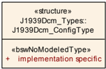

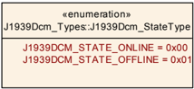

#### 7.2.1. J1939Dcm_ConfigType

表 7.8：数据类型 J1939Dcm_ConfigType 的定义（**Definition of datatype J1939Dcm_ConfigType**）

| 属性 | 值 |
| --- | --- |
| 名称 | J1939Dcm_ConfigType |
| 类别 | 结构体（Structure） |
| 元素 | 由实现定义 |
| 说明 | 这是 **J1939 Diagnostic Communication Manager** 配置的基础类型。在 **J1939 Diagnostic Communication Manager** 的初始化中会使用指向该结构体某个实例的指针。此结构体的内容在第 [9](#9-配置规范) 章「配置规范」中定义。 |
| 可用性 | J1939Dcm.h |

#### 7.2.2. J1939Dcm_StateType

表 7.9：数据类型 J1939Dcm_StateType 的定义（**Definition of datatype J1939Dcm_StateType**）

| 属性 | 值 |
| --- | --- |
| 名称 | J1939Dcm_StateType |
| 类别 | 枚举（Enumeration） |
| 说明 | 该类型表示 **J1939 Diagnostic Communication Manager** 的通信状态。 |
| 可用性 | J1939Dcm.h |

| 取值 | 值 | 说明 |
| --- | --- | --- |
| J1939DCM_STATE_ONLINE | 0x00 | 正常通信（Normal communication） |
| J1939DCM_STATE_OFFLINE | 0x01 | 无诊断通信（No diagnostic communication） |

### 7.3. 函数定义

以下是为上层模块提供的函数清单。

#### 7.3.1. J1939Dcm_Init

**说明**:

```C
void J1939Dcm_Init ( const J1939Dcm_ConfigType* configPtr )
```

| 属性 | 值 |
| --- | --- |
| 服务 ID [hex] | 0x01 |
| 同步/异步 | 同步（Synchronous） |
| 可重入性 | 不可重入（Non Reentrant） |
| 参数（输入） | configPtr：指向所选配置结构体的指针 |
| 参数（输入/输出） | 无 |
| 参数（输出） | 无 |
| 返回值 | 无 |
| 说明 | 该函数初始化 **J1939 Diagnostic Communication Manager**。 |
| 可用性 | J1939Dcm.h |

详细内容参见小节 6.2.1。

#### 7.3.2. J1939Dcm_DeInit

**说明**:

```C
void J1939Dcm_DeInit ( void )
```

| 属性 | 值 |
| --- | --- |
| 服务 ID [hex] | 0x02 |
| 同步/异步 | 同步（Synchronous） |
| 可重入性 | 不可重入（Non Reentrant） |
| 参数（输入） | 无 |
| 参数（输入/输出） | 无 |
| 参数（输出） | 无 |
| 返回值 | 无 |
| 说明 | 该函数将 **J1939 Diagnostic Communication Manager** 复位到未初始化状态。 |
| 可用性 | J1939Dcm.h |

详细内容参见小节 6.2.1。

#### 7.3.3. J1939Dcm_GetVersionInfo

**说明**:

```C
void J1939Dcm_GetVersionInfo ( Std_VersionInfoType * versioninfo )
```

| 属性 | 值 |
| --- | --- |
| 服务 ID [hex] | 0x03 |
| 同步/异步 | 同步（Synchronous） |
| 可重入性 | 不可重入（Non Reentrant） |
| 参数（输入） | 无 |
| 参数（输入/输出） | 无 |
| 参数（输出） | versioninfo：指向存储本模块版本信息位置的指针 |
| 返回值 | 无 |
| 说明 | 返回本模块的版本信息。 |
| 可用性 | J1939Dcm.h |

详细内容参见 [\[18, SWS BSW General\]](#ref-18) 的小节 8.3.4「获取版本信息」（Get Version Information）。**J1939 Diagnostic Communication Manager** 的模块 ID 定义于 [\[24, TR BSW Module List\]](#ref-24)。

#### 7.3.4. J1939Dcm_SetState

**说明**:

```C
Std_ReturnType J1939Dcm_SetState ( NetworkHandleType channel, uint8 node, J1939Dcm_StateType newState )
```

| 属性 | 值 |
| --- | --- |
| 服务 ID [hex] | 0x0b |
| 同步/异步 | 同步（Synchronous） |
| 可重入性 | 可重入（Reentrant） |
| 参数（输入） | channel：应改变状态的通道 |
| 参数（输入） | node：应改变状态的节点 |
| 参数（输入） | newState：**J1939Dcm** 应进入的新状态，可用状态见 `[J1939Dcm_StateType](#722-j1939dcm_statetype)` 的定义 |
| 参数（输入/输出） | 无 |
| 参数（输出） | 无 |
| 返回值 | Std_ReturnType：`E_OK`：新的通信状态已设置；`E_NOT_OK`：由于 `newState` 的值错误或模块初始化状态错误，通信状态未被改变 |
| 说明 | 将 **J1939Dcm** 的通信状态改为离线或在线。 |
| 可用性 | J1939Dcm.h |

当 `newState` 不在有效范围内时，**J1939 Diagnostic Communication Manager** 应拒绝该状态改变并返回 `E_NOT_OK`。如果通过 `J1939DcmDevErrorDetect` 使能了开发错误检测，应上报开发错误 `[J1939DCM_E_INVALID_STATE](#681-开发错误)`。

如果配置参数 `J1939DcmDevErrorDetect` 已使能，函数 `J1939Dcm_SetState` 应检查 `node` 参数是否已配置（`J1939DcmNmNodeRef`）。出错时，函数 `J1939Dcm_SetState` 应无任何效果地返回，并向 **Default Error Tracer** 上报错误码 `[J1939DCM_E_INVALID_NODE](#681-开发错误)`。

如果配置参数 `J1939DcmDevErrorDetect` 已使能，函数 `J1939Dcm_SetState` 应针对所请求的 `node` 参数检查 `channel` 参数是否已配置（`J1939DcmDiagnosticMessageSupportChannelRef`）。出错时，函数 `J1939Dcm_SetState` 应无任何效果地返回，并向 **Default Error Tracer** 上报错误码 `[J1939DCM_E_INVALID_CHANNEL](#681-开发错误)`。

#### 7.3.5. J1939Dcm_GenericDMxTransmit

**说明**:

```C
Std_ReturnType J1939Dcm_GenericDMxTransmit ( uint8 dmId, uint8 node, NetworkHandleType channel, uint8 destAddress, uint8 priority )
```

| 属性 | 值 |
| --- | --- |
| 服务 ID [hex] | 0x49 |
| 同步/异步 | 同步（Synchronous） |
| 可重入性 | 不可重入（Non Reentrant） |
| 参数（输入） | dmId：J1939 诊断消息的编号 |
| 参数（输入） | node：应发送该消息的节点 |
| 参数（输入） | channel：应在其上发送该消息的通道 |
| 参数（输入） | destAddress：应接收该诊断消息的节点地址，广播时为 0xFF |
| 参数（输入） | priority：诊断消息的优先级 |
| 参数（输入/输出） | 无 |
| 参数（输出） | 无 |
| 返回值 | Std_ReturnType：`E_OK`：发送请求已被接受；`E_NOT_OK`：发送请求未被接受 |
| 说明 | 请求发送一条诊断消息。 |
| 可用性 | J1939Dcm.h |

如果配置参数 `J1939DcmDevErrorDetect` 已使能，函数 `J1939Dcm_GenericDMxTransmit` 应检查 `dmId` 参数是否寻址了一个已配置（经由 `[J1939DcmDiagnosticMessageSupport](#916-j1939dcmdiagnosticmessagesupport)`）但不受支持的 DMx 消息。出错时，函数 `J1939Dcm_GenericDMxTransmit` 应无任何效果地返回，并向 **Default Error Tracer** 上报错误码 `[J1939DCM_E_INVALID_PGN](#681-开发错误)`。

当前支持的诊断消息列于表 7.1。

如果配置参数 `J1939DcmDevErrorDetect` 已使能，函数 `J1939Dcm_GenericDMxTransmit` 应检查 `node` 参数是否已配置（`J1939DcmNmNodeRef`）。出错时，函数 `J1939Dcm_GenericDMxTransmit` 应无任何效果地返回，并向 **Default Error Tracer** 上报错误码 `[J1939DCM_E_INVALID_NODE](#681-开发错误)`。

如果配置参数 `J1939DcmDevErrorDetect` 已使能，函数 `J1939Dcm_GenericDMxTransmit` 应针对所请求的 `node` 参数检查 `channel` 参数是否已配置（`J1939DcmDiagnosticMessageSupportChannelRef`）。出错时，函数 `J1939Dcm_GenericDMxTransmit` 应无任何效果地返回，并向 **Default Error Tracer** 上报错误码 `[J1939DCM_E_INVALID_CHANNEL](#681-开发错误)`。

### 7.4. 回调通知

以下是为其他模块提供的函数清单。

#### 7.4.1. J1939Dcm_RequestIndication

**说明**:

```C
void J1939Dcm_RequestIndication ( uint8 node, NetworkHandleType channel, uint32 requestedPgn, const J1939Rm_ExtIdInfoType* extIdInfo, uint8 sourceAddress, uint8 destAddress, uint8 priority )
```

| 属性 | 值 |
| --- | --- |
| 服务 ID [hex] | 0x47 |
| 同步/异步 | 同步（Synchronous） |
| 可重入性 | 可重入（Reentrant） |
| 参数（输入） | node：接收到请求的节点 |
| 参数（输入） | channel：接收到请求的通道 |
| 参数（输入） | requestedPgn：所请求 PG 的 PGN |
| 参数（输入） | extIdInfo：扩展标识符字节 |
| 参数（输入） | sourceAddress：发送 Request PG 的节点地址 |
| 参数（输入） | destAddress：本节点地址，广播时为 0xFF |
| 参数（输入） | priority：Request PG 的优先级 |
| 参数（输入/输出） | 无 |
| 参数（输出） | 无 |
| 返回值 | 无 |
| 说明 | 指示接收到 Request 或 Request2 PG。 |
| 可用性 | J1939Dcm.h |

当 **J1939Dcm** 处于离线状态（参见 `[J1939Dcm_SetState](#734-j1939dcm_setstate)`）时调用接口 `J1939Dcm_RequestIndication`，**J1939 Diagnostic Communication Manager** 应忽略该请求消息。此外，如果配置参数 `J1939DcmDevErrorDetect` 已使能，还应触发一次 **DET** 调用，参数为 `[J1939DCM_E_INVALID_STATE](#681-开发错误)`。

如果配置参数 `J1939DcmDevErrorDetect` 已使能，函数 `J1939Dcm_RequestIndication` 应检查 `node` 参数是否已配置（`J1939DcmNmNodeRef`）。出错时，函数 `J1939Dcm_RequestIndication` 应无任何效果地返回，并向 **Default Error Tracer** 上报错误码 `[J1939DCM_E_INVALID_NODE](#681-开发错误)`。

函数 `J1939Dcm_RequestIndication` 应针对所请求的 `node` 参数检查 `channel` 参数是否已配置（`J1939DcmDiagnosticMessageSupportChannelRef`）。若该通道未配置，函数 `J1939Dcm_RequestIndication` 应无任何效果地返回。

参数 `requestedPgn` 的校验见 [6.3.1](#631-请求的接收) 节。

参数 `destAddress` 只用于检查广播地址（0xFF），因此不需要专门的校验。

参数 `sourceAddress` 用于设置发送的目标地址，但已由 **J1939Rm** 校验。

参数 `priority` 无需校验，因为它完全不被使用。

#### 7.4.2. J1939Dcm_RxIndication

**说明**:

```C
void J1939Dcm_RxIndication ( PduIdType RxPduId, const PduInfoType* PduInfoPtr )
```

| 属性 | 值 |
| --- | --- |
| 服务 ID [hex] | 0x42 |
| 同步/异步 | 同步（Synchronous） |
| 可重入性 | 对不同 PduId 可重入；对同一 PduId 不可重入 |
| 参数（输入） | RxPduId：所接收 PDU 的 ID |
| 参数（输入） | PduInfoPtr：包含所接收 PDU 的长度（SduLength）、指向包含该 PDU 的缓冲区的指针（SduDataPtr），以及与该 PDU 相关的 MetaData |
| 参数（输入/输出） | 无 |
| 参数（输出） | 无 |
| 返回值 | 无 |
| 说明 | 来自下层通信接口模块的 PDU 接收指示。 |
| 可用性 | J1939Dcm.h |

当 **J1939Dcm** 处于离线状态（参见 `[J1939Dcm_SetState](#734-j1939dcm_setstate)`）时调用接口 `J1939Dcm_RxIndication`，**J1939 Diagnostic Communication Manager** 应忽略该命令消息。此外，如果配置参数 `J1939DcmDevErrorDetect` 已使能，还应触发一次 **DET** 调用，参数为 `[J1939DCM_E_INVALID_STATE](#681-开发错误)`。

如果配置参数 `J1939DcmDevErrorDetect` 已使能，函数 `J1939Dcm_RxIndication` 应检查 `RxPduId` 参数是否未在任何 DMx 消息（`[J1939DcmDiagnosticMessageSupport](#916-j1939dcmdiagnosticmessagesupport)`）上配置（`J1939DcmRxPduId`）。出错时，函数 `J1939Dcm_RxIndication` 应无任何效果地返回，并向 **Default Error Tracer** 上报错误码 `[J1939DCM_E_INVALID_PDU_SDU_ID](#681-开发错误)`。

#### 7.4.3. J1939Dcm_TxConfirmation

**说明**:

```C
void J1939Dcm_TxConfirmation ( PduIdType TxPduId, Std_ReturnType result )
```

| 属性 | 值 |
| --- | --- |
| 服务 ID [hex] | 0x40 |
| 同步/异步 | 同步（Synchronous） |
| 可重入性 | 对不同 PduId 可重入；对同一 PduId 不可重入 |
| 参数（输入） | TxPduId：已被发送的 PDU 的 ID |
| 参数（输入） | result：`E_OK`：该 PDU 已发送；`E_NOT_OK`：该 PDU 发送失败 |
| 参数（输入/输出） | 无 |
| 参数（输出） | 无 |
| 返回值 | 无 |
| 说明 | 下层通信接口模块确认一个 PDU 的发送，或其发送失败。 |
| 可用性 | J1939Dcm.h |

当 **J1939Dcm** 处于离线状态（参见 `[J1939Dcm_SetState](#734-j1939dcm_setstate)`）时调用接口 `J1939Dcm_TxConfirmation`，**J1939 Diagnostic Communication Manager** 应释放缓冲区（见 [6.3.1](#631-请求的接收) 节）。此外，如果配置参数 `J1939DcmDevErrorDetect` 已使能，还应触发一次 **DET** 调用，参数为 `[J1939DCM_E_INVALID_STATE](#681-开发错误)`。

如果配置参数 `J1939DcmDevErrorDetect` 已使能，函数 `J1939Dcm_TxConfirmation` 应检查 `TxPduId` 参数是否未在任何 DMx 消息（`[J1939DcmDiagnosticMessageSupport](#916-j1939dcmdiagnosticmessagesupport)`）上配置（`J1939DcmTxPduId`）。出错时，函数 `J1939Dcm_TxConfirmation` 应无任何效果地返回，并向 **Default Error Tracer** 上报错误码 `[J1939DCM_E_INVALID_PDU_SDU_ID](#681-开发错误)`。

函数 `J1939Dcm_TxConfirmation` 应检查是否被脱离上下文调用，即 **J1939Dcm** 当前是否正在通过 TP 协议发送一条响应消息。出错时，函数 `J1939Dcm_TxConfirmation` 应无任何效果地返回。此外，如果配置参数 `J1939DcmDevErrorDetect` 已使能，还应触发一次 **DET** 调用，参数为 `[J1939DCM_E_INVALID_STATE](#681-开发错误)`。

#### 7.4.4. J1939Dcm_StartOfReception

**说明**:

```C
BufReq_ReturnType J1939Dcm_StartOfReception ( PduIdType id, const PduInfoType* info, PduLengthType TpSduLength, PduLengthType* bufferSizePtr )
```

| 属性 | 值 |
| --- | --- |
| 服务 ID [hex] | 0x46 |
| 同步/异步 | 同步（Synchronous） |
| 可重入性 | 可重入（Reentrant） |
| 参数（输入） | id：I-PDU 的标识 |
| 参数（输入） | info：指向 `PduInfoType` 结构体的指针，包含传输协议 I-PDU 接收的首帧或单帧的载荷数据（不含协议信息）与载荷长度，以及与该 PDU 相关的 MetaData。若首帧/单帧数据与 MetaData 均不可用，此参数置为 `NULL_PTR` |
| 参数（输入） | TpSduLength：待接收 N-SDU 的总长度 |
| 参数（输入/输出） | 无 |
| 参数（输出） | bufferSizePtr：接收模块中可用的接收缓冲区。该参数将被传输协议模块用于计算块大小（BS） |
| 返回值 | BufReq_ReturnType：`BUFREQ_OK`：连接已被接受；`bufferSizePtr` 指示可用的接收缓冲区，接收继续。若没有所请求大小的缓冲区可用，应通过 `bufferSizePtr` 指示接收缓冲区大小为 0。`BUFREQ_E_NOT_OK`：连接被拒绝，接收中止；`bufferSizePtr` 保持不变。`BUFREQ_E_OVFL`：无法提供所需长度的缓冲区，接收中止；`bufferSizePtr` 保持不变 |
| 说明 | 该函数在开始接收一个 N-SDU 时被调用。N-SDU 可能被分片为多个 N-PDU（一个 FF 后跟一个或多个 CF），也可能由单个 N-PDU（SF）组成。当以 `TpSduLength` 调用时，该服务应提供当前可用的最大缓冲区大小。 |
| 可用性 | J1939Dcm.h |

当 **J1939Dcm** 处于离线状态（参见 `[J1939Dcm_SetState](#734-j1939dcm_setstate)`）时调用接口 `J1939Dcm_StartOfReception`，**J1939 Diagnostic Communication Manager** 应通过返回 `BUFREQ_E_NOT_OK` 拒绝该命令消息。此外，如果配置参数 `J1939DcmDevErrorDetect` 已使能，还应触发一次 **DET** 调用，参数为 `[J1939DCM_E_INVALID_STATE](#681-开发错误)`。

如果配置参数 `J1939DcmDevErrorDetect` 已使能，函数 `J1939Dcm_StartOfReception` 应检查 `id` 参数是否未在任何 DMx 消息（`[J1939DcmDiagnosticMessageSupport](#916-j1939dcmdiagnosticmessagesupport)`）上配置（`J1939DcmRxPduId`）。出错时，函数 `J1939Dcm_StartOfReception` 应以 `BUFREQ_E_NOT_OK` 返回且无任何效果，并向 **Default Error Tracer** 上报错误码 `[J1939DCM_E_INVALID_PDU_SDU_ID](#681-开发错误)`。

函数 `J1939Dcm_StartOfReception` 应检查 `TpSduLength` 参数是否小于或等于配置的缓冲区大小（`J1939DcmCommonBufferSize`）。出错时，函数 `J1939Dcm_StartOfReception` 应以 `BUFREQ_E_OVFL` 返回。

如果配置参数 `J1939DcmDevErrorDetect` 已使能，函数 `J1939Dcm_StartOfReception` 应检查 **J1939Dcm** 是否处于通过 TP 协议接收命令消息的正确状态。出错时，函数 `J1939Dcm_StartOfReception` 应以 `BUFREQ_E_NOT_OK` 返回且无任何效果，并向 **Default Error Tracer** 上报错误码 `[J1939DCM_E_INVALID_STATE](#681-开发错误)`。

当 API `J1939Dcm_StartOfReception` 以等于 0 的 `TpSduLength` 被调用时，应返回 `BUFREQ_E_NOT_OK`，且不采取任何进一步动作。

#### 7.4.5. J1939Dcm_CopyRxData

**说明**:

```C
BufReq_ReturnType J1939Dcm_CopyRxData ( PduIdType id, const PduInfoType* info, PduLengthType* bufferSizePtr )
```

| 属性 | 值 |
| --- | --- |
| 服务 ID [hex] | 0x44 |
| 同步/异步 | 同步（Synchronous） |
| 可重入性 | 可重入（Reentrant） |
| 参数（输入） | id：所接收 I-PDU 的标识 |
| 参数（输入） | info：提供源缓冲区（SduDataPtr）与要复制的字节数（SduLength）。`SduLength` 为 0 可用于查询上层模块当前可用的缓冲区量；此时 `SduDataPtr` 可为 `NULL_PTR` |
| 参数（输入/输出） | 无 |
| 参数（输出） | bufferSizePtr：数据复制后可用的接收缓冲区 |
| 返回值 | BufReq_ReturnType：`BUFREQ_OK`：数据成功复制；`BUFREQ_E_NOT_OK`：因发生错误而未复制数据 |
| 说明 | 调用该函数以把一个 I-PDU 段（N-PDU）的已接收数据提供给上层。每次调用提供 I-PDU 数据的下一部分。剩余缓冲区的大小被写入 `bufferSizePtr` 指示的位置。 |
| 可用性 | J1939Dcm.h |

函数 `J1939Dcm_CopyRxData` 应检查是否被脱离上下文调用，即 **J1939Dcm** 当前是否正在通过 TP 协议接收一条命令消息。出错时，函数 `J1939Dcm_CopyRxData` 应返回 `BUFREQ_E_NOT_OK`。此外，如果配置参数 `J1939DcmDevErrorDetect` 已使能，还应触发一次 **DET** 调用，参数为 `[J1939DCM_E_INVALID_STATE](#681-开发错误)`。

如果配置参数 `J1939DcmDevErrorDetect` 已使能，函数 `J1939Dcm_CopyRxData` 应检查 `id` 参数是否未在任何 DMx 消息（`[J1939DcmDiagnosticMessageSupport](#916-j1939dcmdiagnosticmessagesupport)`）上配置（`J1939DcmRxPduId`）。出错时，函数 `J1939Dcm_CopyRxData` 应以 `BUFREQ_E_NOT_OK` 返回且无任何效果，并向 **Default Error Tracer** 上报错误码 `[J1939DCM_E_INVALID_PDU_SDU_ID](#681-开发错误)`。

#### 7.4.6. J1939Dcm_TpRxIndication

**说明**:

```C
void J1939Dcm_TpRxIndication ( PduIdType id, Std_ReturnType result )
```

| 属性 | 值 |
| --- | --- |
| 服务 ID [hex] | 0x45 |
| 同步/异步 | 同步（Synchronous） |
| 可重入性 | 可重入（Reentrant） |
| 参数（输入） | id：所接收 I-PDU 的标识 |
| 参数（输入） | result：`E_OK`：该 PDU 已接收；`E_NOT_OK`：该 PDU 接收失败 |
| 参数（输入/输出） | 无 |
| 参数（输出） | 无 |
| 返回值 | 无 |
| 说明 | 在通过 TP API 接收到一个 I-PDU 之后被调用，result 指示接收是否成功。 |
| 可用性 | J1939Dcm.h |

函数 `J1939Dcm_TpRxIndication` 应检查是否被脱离上下文调用，即 **J1939Dcm** 当前是否正在通过 TP 协议接收一条响应消息。出错时，函数 `J1939Dcm_TpRxIndication` 应无任何效果地返回。此外，如果配置参数 `J1939DcmDevErrorDetect` 已使能，还应触发一次 **DET** 调用，参数为 `[J1939DCM_E_INVALID_STATE](#681-开发错误)`。

如果配置参数 `J1939DcmDevErrorDetect` 已使能，函数 `J1939Dcm_TpRxIndication` 应检查 `id` 参数是否未在任何 DMx 消息（`[J1939DcmDiagnosticMessageSupport](#916-j1939dcmdiagnosticmessagesupport)`）上配置（`J1939DcmRxPduId`）。出错时，函数 `J1939Dcm_TpRxIndication` 应无任何效果地返回，并向 **Default Error Tracer** 上报错误码 `[J1939DCM_E_INVALID_PDU_SDU_ID](#681-开发错误)`。

#### 7.4.7. J1939Dcm_CopyTxData

**说明**:

```C
BufReq_ReturnType J1939Dcm_CopyTxData ( PduIdType id, const PduInfoType* info, const RetryInfoType* retry, PduLengthType* availableDataPtr )
```

| 属性 | 值 |
| --- | --- |
| 服务 ID [hex] | 0x43 |
| 同步/异步 | 同步（Synchronous） |
| 可重入性 | 可重入（Reentrant） |
| 参数（输入） | id：被发送 I-PDU 的标识 |
| 参数（输入） | info：提供目标缓冲区（SduDataPtr）与要复制的字节数（SduLength）。若可用的发送数据不足，上层模块不复制数据并返回 `BUFREQ_E_BUSY`，下层模块可以重试该调用。`SduLength` 为 0 可用于指示 `retry` 参数中的状态变化，或查询上层模块当前可用的数据量；此时 `SduDataPtr` 可为 `NULL_PTR` |
| 参数（输入） | retry：该参数用于确认已发送的数据，或在发送问题后重传数据。若 `retry` 参数为 `NULL_PTR`，表示发送数据在复制完成后可立即从缓冲区移除。否则 `retry` 参数必须指向一个有效的 `RetryInfoType` 元素。若 `TpDataState` 指示 `TP_CONFPENDING`，先前复制的数据必须保留在 TP 缓冲区中，以备错误恢复使用。`TP_DATACONF` 表示在此调用之前复制的所有数据均已被确认，可从 TP 缓冲区移除；本次 API 调用复制的数据除外，它们将在稍后被确认。`TP_DATARETRY` 表示本次 API 调用应复制先前已复制的数据以从错误中恢复；此时 `TxTpDataCnt` 指定自当前数据复制位置起的字节偏移量 |
| 参数（输入/输出） | 无 |
| 参数（输出） | availableDataPtr：指示上层模块 Tx 缓冲区中剩余的可用字节数。支持动态载荷长度的 TP 模块（例如 FrIsoTp）可使用 `availableDataPtr` 确定后续 CF 的大小 |
| 返回值 | BufReq_ReturnType：`BUFREQ_OK`：数据已按要求完整复制到发送缓冲区；`BUFREQ_E_BUSY`：由于所需数量的 Tx 数据不可用，请求无法满足。下层模块可在稍后重试此调用。未复制任何数据；`BUFREQ_E_NOT_OK`：数据未被复制，请求失败 |
| 说明 | 调用该函数以获取一个 I-PDU 段（N-PDU）的发送数据。除非 `retry->TpDataState` 为 `TP_DATARETRY`，每次调用提供 I-PDU 数据的下一部分；此时该函数从 `retry->TxTpDataCnt` 指示的、自当前位置起的偏移处重新开始复制数据。剩余数据的大小被写入 `availableDataPtr` 指示的位置。 |
| 可用性 | J1939Dcm.h |

函数 `J1939Dcm_CopyTxData` 应检查是否被脱离上下文调用，即 **J1939Dcm** 当前是否正在通过 TP 协议发送一条响应消息。出错时，函数 `J1939Dcm_CopyTxData` 应返回 `BUFREQ_E_NOT_OK`。此外，如果配置参数 `J1939DcmDevErrorDetect` 已使能，还应触发一次 **DET** 调用，参数为 `[J1939DCM_E_INVALID_STATE](#681-开发错误)`。

如果配置参数 `J1939DcmDevErrorDetect` 已使能，函数 `J1939Dcm_CopyTxData` 应检查 `id` 参数是否未在任何 DMx 消息（`[J1939DcmDiagnosticMessageSupport](#916-j1939dcmdiagnosticmessagesupport)`）上配置（`J1939DcmTxPduId`）。出错时，函数 `J1939Dcm_CopyTxData` 应以 `BUFREQ_E_NOT_OK` 返回且无任何效果，并向 **Default Error Tracer** 上报错误码 `[J1939DCM_E_INVALID_PDU_SDU_ID](#681-开发错误)`。

#### 7.4.8. J1939Dcm_TpTxConfirmation

**说明**:

```C
void J1939Dcm_TpTxConfirmation ( PduIdType id, Std_ReturnType result )
```

| 属性 | 值 |
| --- | --- |
| 服务 ID [hex] | 0x48 |
| 同步/异步 | 同步（Synchronous） |
| 可重入性 | 可重入（Reentrant） |
| 参数（输入） | id：被发送 I-PDU 的标识 |
| 参数（输入） | result：`E_OK`：该 PDU 已发送；`E_NOT_OK`：该 PDU 发送失败 |
| 参数（输入/输出） | 无 |
| 参数（输出） | 无 |
| 返回值 | 无 |
| 说明 | 在 I-PDU 已在其网络上发送之后被调用，result 指示发送是否成功。 |
| 可用性 | J1939Dcm.h |

如果配置参数 `J1939DcmDevErrorDetect` 已使能，函数 `J1939Dcm_TpTxConfirmation` 应检查 `id` 参数是否未在任何 DMx 消息（`[J1939DcmDiagnosticMessageSupport](#916-j1939dcmdiagnosticmessagesupport)`）上配置（`J1939DcmTxPduId`）。出错时，函数 `J1939Dcm_TpTxConfirmation` 应无任何效果地返回，并向 **Default Error Tracer** 上报错误码 `[J1939DCM_E_INVALID_PDU_SDU_ID](#681-开发错误)`。

函数 `J1939Dcm_TpTxConfirmation` 应检查是否被脱离上下文调用，即 **J1939Dcm** 当前是否正在通过 TP 协议发送一条响应消息。出错时，函数 `J1939Dcm_TpTxConfirmation` 应无任何效果地返回。此外，如果配置参数 `J1939DcmDevErrorDetect` 已使能，还应触发一次 **DET** 调用，参数为 `[J1939DCM_E_INVALID_STATE](#681-开发错误)`。

#### 7.4.9. 来自 DEM 的回调通知

##### 7.4.9.1. J1939Dcm_DemTriggerOnDTCStatus

**说明**:

```C
void J1939Dcm_DemTriggerOnDTCStatus ( uint32 DTC, uint8 ClientId )
```

| 属性 | 值 |
| --- | --- |
| 服务 ID [hex] | 0x0a |
| 同步/异步 | 同步（Synchronous） |
| 可重入性 | 对不同 ClientID 可重入，对同一 ClientId 不可重入 |
| 参数（输入） | DTC：UDS 格式的诊断故障码 |
| 参数（输入） | ClientId：引用分配给该 DTC 的故障记忆的 DemClientId 值 |
| 参数（输入/输出） | 无 |
| 参数（输出） | 无 |
| 返回值 | 无 |
| 说明 | DM01 消息的触发器，表示发生了一次 UDS 状态变化。 |
| 可用性 | J1939Dcm_Dem.h |

### 7.5. 调度函数

这些函数由 **Basic Software Scheduler** 直接调用。下列函数没有返回值也没有参数。所有函数均不可重入。

#### 7.5.1. J1939Dcm_MainFunction

**说明**:

```C
void J1939Dcm_MainFunction ( void )
```

| 属性 | 值 |
| --- | --- |
| 服务 ID [hex] | 0x04 |
| 说明 | **J1939 Diagnostic Communication Manager** 的主函数，用于调度与超时监控。 |
| 可用性 | SchM_J1939Dcm.h |

`J1939Dcm_MainFunction` 的调用频率由配置参数 `J1939DcmMainFunctionPeriod` 决定。

### 7.6. 期望接口

本章列出从其他模块要求的全部外部接口。

#### 7.6.1. 必需接口

本章定义实现模块的必需功能所要求的全部外部接口。

表 7.10：模块 J1939Dcm 的必需接口定义（**Definition of mandatory interfaces in module J1939Dcm**）

| API 函数 | 头文件 | 说明 |
| --- | --- | --- |
| Det_ReportRuntimeError | Det.h | 上报运行时错误的服务。如果配置了 callout，则应调用该 callout。 |

#### 7.6.2. 可选接口

本章定义实现模块的可选功能所要求的全部外部接口。

表 7.11：模块 J1939Dcm 的可选接口定义（**Definition of optional interfaces in module J1939Dcm**）

| API 函数 | 头文件 | 说明 |
| --- | --- | --- |
| BswM_J1939DcmBroadcastStatus | BswM_J1939Dcm.h | 该 API 告知 **BswM** 可用网络的期望通信状态。该状态通常通过 COM I-PDU 组开关激活。 |
| Dem_J1939DcmClearDTC | Dem_J1939Dcm.h | 清除与指定 DTC 相关的所有事件的状态，以及这些事件的全部关联事件记忆条目。 |
| Dem_J1939DcmFirstDTCwithLampStatus | Dem_J1939Dcm.h | 该函数为特定节点将过滤器设置为 DM31 响应的第一个适用 DTC。 |
| Dem_J1939DcmGetNextDTCwithLampStatus | Dem_J1939Dcm.h | 获取 DM31 的下一个已过滤 J1939 DTC，包括当前 LampStatus。 |
| Dem_J1939DcmGetNextFilteredDTC | Dem_J1939Dcm.h | 获取下一个已过滤的 J1939 DTC。 |
| Dem_J1939DcmGetNextFilteredRatio | Dem_J1939Dcm.h | 获取下一个已过滤的性价比（Ratio）。 |
| Dem_J1939DcmGetNextFreezeFrame | Dem_J1939Dcm.h | 获取下一个冻结帧数据。该函数将数据存储在提供的 DestBuffer 中。 |
| Dem_J1939DcmGetNextSPNInFreezeFrame | Dem_J1939Dcm.h | 获取下一个 SPN。 |
| Dem_J1939DcmGetNumberOfFilteredDTC | Dem_J1939Dcm.h | 获取由函数 `Dem_J1939DcmSetDTCFilter` 设置的当前已过滤 DTC 的数量。 |
| Dem_J1939DcmReadDiagnosticReadiness1 | Dem_J1939Dcm.h | 上报由 Dem 计算的诊断就绪 1（DM05）之值的服务。 |
| Dem_J1939DcmReadDiagnosticReadiness2 | Dem_J1939Dcm.h | 上报由 Dem 计算的诊断就绪 2（DM21）之值的服务。 |
| Dem_J1939DcmReadDiagnosticReadiness3 | Dem_J1939Dcm.h | 上报由 Dem 计算的诊断就绪 3（DM26）之值的服务。 |
| Dem_J1939DcmSetDTCFilter | Dem_J1939Dcm.h | 该函数为特定节点设置 DTC 过滤器，并返回已过滤 DTC 的复合灯状态。 |
| Dem_J1939DcmSetFreezeFrameFilter | Dem_J1939Dcm.h | 该函数为特定节点设置 FreezeFrame 过滤器。 |
| Dem_J1939DcmSetRatioFilter | Dem_J1939Dcm.h | 该函数为特定节点设置 Ratio 过滤器，并返回对应的点火周期计数器（Ignition Cycle Counter）与通用分母（General Denominator）。 |
| Det_ReportError | Det.h | 上报开发错误的服务。 |
| J1939Rm_SendAck | J1939Rm.h | 请求发送一个确认 PG。 |
| PduR_J1939DcmCancelReceive | PduR_J1939Dcm.h | 请求取消下层传输协议模块中正在进行的 PDU 接收。 |
| PduR_J1939DcmCancelTransmit | PduR_J1939Dcm.h | 请求取消下层通信模块中正在进行的 PDU 发送。 |
| PduR_J1939DcmTransmit | PduR_J1939Dcm.h | 请求发送一个 PDU。 |

`J1939Rm_SendAck` 的参数 `broadcast` 应始终置为 `FALSE`。

`J1939Rm_SendAck` 的参数 `extIdInfo` 应始终置为 `NULL_PTR`。

**背景：** **ACKM** 消息绝不作为对广播请求的应答发送。SAE J1939-21 排除了否定确认的情形，SAE J1939-73 排除了对 DM03、DM11 与 DM55 肯定确认的情形。

#### 7.6.3. 可配置接口

本节列出目标函数可以配置的全部接口。目标函数通常是一个回调函数。这类接口的名称不固定，因为它们是可配置的。

##### 7.6.3.1. &lt;GenericDMxRequestIndication&gt;

**说明**:

```C
void <GenericDMxRequestIndication> ( uint8 dmId, NetworkHandleType channel, uint8 sourceAddress, uint8 destAddress, uint8 priority )
```

| 属性 | 值 |
| --- | --- |
| 同步/异步 | 同步（Synchronous） |
| 可重入性 | 不可重入（Non Reentrant） |
| 参数（输入） | dmId：所请求 J1939 诊断消息的编号 |
| 参数（输入） | channel：接收到请求的通道 |
| 参数（输入） | sourceAddress：发送 Request PG 的节点地址 |
| 参数（输入） | destAddress：本节点地址，广播时为 0xFF |
| 参数（输入） | priority：Request PG 的优先级 |
| 参数（输入/输出） | 无 |
| 参数（输出） | 无 |
| 返回值 | 无 |
| 说明 | 指示接收到针对一个不受支持诊断消息的 Request 或 Request2 PG。 |
| 可用性 | J1939Dcm.h |

##### 7.6.3.2. &lt;GenericDMxCopyTxData&gt;

**说明**:

```C
BufReq_ReturnType <GenericDMxCopyTxData> ( uint8 dmId, NetworkHandleType channel, const PduInfoType info, const RetryInfoType* retry, PduLengthType* availableDataPtr )
```

| 属性 | 值 |
| --- | --- |
| 同步/异步 | 同步（Synchronous） |
| 可重入性 | 不可重入（Non Reentrant） |
| 参数（输入） | dmId：J1939 诊断消息的编号 |
| 参数（输入） | channel：发送该消息所用的通道 |
| 参数（输入） | info：提供目标缓冲区（SduDataPtr）与要复制的字节数（SduLength）。若可用的发送数据不足，上层模块不复制数据并返回 `BUFREQ_E_BUSY`，下层模块可以重试该调用。`SduLength` 为 0 可用于指示 `retry` 参数中的状态变化，或查询上层模块当前可用的数据量；此时 `SduDataPtr` 可为 `NULL_PTR` |
| 参数（输入） | retry：该参数用于确认已发送的数据，或在发送问题后重传数据。若 `retry` 参数为 `NULL_PTR`，表示发送数据在复制完成后可立即从缓冲区移除。否则 `retry` 参数必须指向一个有效的 `RetryInfoType` 元素。若 `TpDataState` 指示 `TP_CONFPENDING`，先前复制的数据必须保留在 TP 缓冲区中，以备错误恢复使用。`TP_DATACONF` 表示在此调用之前复制的所有数据均已被确认，可从 TP 缓冲区移除；本次 API 调用复制的数据除外，它们将在稍后被确认。`TP_DATARETRY` 表示本次 API 调用应复制先前已复制的数据以从错误中恢复；此时 `TxTpDataCnt` 指定自当前数据复制位置起的字节偏移量 |
| 参数（输入/输出） | 无 |
| 参数（输出） | availableDataPtr：指示上层模块 Tx 缓冲区中剩余的可用字节数。支持动态载荷长度的 TP 模块（例如 FrIsoTp）可使用 `availableDataPtr` 确定后续 CF 的大小 |
| 返回值 | BufReq_ReturnType：`BUFREQ_OK`：数据已按要求完整复制到发送缓冲区；`BUFREQ_E_BUSY`：由于所需数量的 Tx 数据不可用，请求无法满足。下层模块可在稍后重试此调用。未复制任何数据；`BUFREQ_E_NOT_OK`：数据未被复制，请求失败 |
| 说明 | 调用该函数以获取一个诊断消息段的发送数据。除非 `retry->TpDataState` 为 `TP_DATARETRY`，每次调用提供诊断消息数据的下一部分；此时该函数从相应偏移处重新开始复制数据。剩余数据的大小被写入 `availableDataPtr` 指示的位置。 |
| 可用性 | J1939Dcm.h |

##### 7.6.3.3. &lt;GenericDMxTxConfirmation&gt;

**说明**:

```C
void <GenericDMxTxConfirmation> ( uint8 dmId, NetworkHandleType channel, Std_ReturnType result )
```

| 属性 | 值 |
| --- | --- |
| 同步/异步 | 同步（Synchronous） |
| 可重入性 | 不可重入（Non Reentrant） |
| 参数（输入） | dmId：J1939 诊断消息的编号 |
| 参数（输入） | channel：发送该消息所用的通道 |
| 参数（输入） | result：`E_OK`：该 PDU 已发送；`E_NOT_OK`：该 PDU 发送失败 |
| 参数（输入/输出） | 无 |
| 参数（输出） | 无 |
| 返回值 | 无 |
| 说明 | 在一条诊断消息发送完成后被调用，result 指示发送是否成功。 |
| 可用性 | J1939Dcm.h |

##### 7.6.3.4. &lt;GenericDMxStartOfReception&gt;

**说明**:

```C
BufReq_ReturnType <GenericDMxStartOfReception> ( uint8 mId, NetworkHandleType channel, PduLengthType length, PduLengthType bufferSizePtr, uint8 sourceAddress, uint8 priority )
```

| 属性 | 值 |
| --- | --- |
| 同步/异步 | 同步（Synchronous） |
| 可重入性 | 不可重入（Non Reentrant） |
| 参数（输入） | mId：J1939 诊断消息的编号 |
| 参数（输入） | channel：接收该消息所用的通道 |
| 参数（输入） | length：待接收诊断消息的总长度 |
| 参数（输入） | sourceAddress：发送该诊断消息的节点地址 |
| 参数（输入） | priority：诊断消息的优先级 |
| 参数（输入/输出） | 无 |
| 参数（输出） | bufferSizePtr：可用的接收缓冲区 |
| 返回值 | BufReq_ReturnType：`BUFREQ_OK`：连接已被接受；`bufferSizePtr` 指示可用的接收缓冲区，接收继续。若没有所请求大小的缓冲区可用，应通过 `bufferSizePtr` 指示接收缓冲区大小为 0。`BUFREQ_E_NOT_OK`：连接被拒绝，接收中止；`bufferSizePtr` 保持不变。`BUFREQ_E_OVFL`：无法提供所需长度的缓冲区，接收中止；`bufferSizePtr` 保持不变 |
| 说明 | 该函数在开始接收一条诊断消息时被调用。 |
| 可用性 | J1939Dcm.h |

##### 7.6.3.5. &lt;GenericDMxCopyRxData&gt;

**说明**:

```C
BufReq_ReturnType <GenericDMxCopyRxData> ( uint8 dmId, NetworkHandleType channel, const PduInfoType* info, PduLengthType* bufferSizePtr )
```

| 属性 | 值 |
| --- | --- |
| 同步/异步 | 同步（Synchronous） |
| 可重入性 | 不可重入（Non Reentrant） |
| 参数（输入） | dmId：J1939 诊断消息的编号 |
| 参数（输入） | channel：接收该消息所用的通道 |
| 参数（输入） | info：提供源缓冲区（SduDataPtr）与要复制的字节数（SduLength）。`SduLength` 为 0 可用于查询上层模块当前可用的缓冲区量；此时 `SduDataPtr` 可为 `NULL_PTR` |
| 参数（输入/输出） | 无 |
| 参数（输出） | bufferSizePtr：数据复制后可用的接收缓冲区 |
| 返回值 | BufReq_ReturnType：`BUFREQ_OK`：数据成功复制；`BUFREQ_E_NOT_OK`：因发生错误而未复制数据 |
| 说明 | 调用该函数以把一个诊断消息段的已接收数据提供给上层。每次调用提供诊断消息数据的下一部分。剩余缓冲区的大小被写入 `bufferSizePtr` 指示的位置。 |
| 可用性 | J1939Dcm.h |

##### 7.6.3.6. &lt;GenericDMxRxIndication&gt;

**说明**:

```C
void <GenericDMxRxIndication> ( uint8* dmId, NetworkHandleType channel, Std_ReturnType result )
```

| 属性 | 值 |
| --- | --- |
| 同步/异步 | 同步（Synchronous） |
| 可重入性 | 不可重入（Non Reentrant） |
| 参数（输入） | dmId：J1939 诊断消息的编号 |
| 参数（输入） | channel：接收该消息所用的通道 |
| 参数（输入） | result：接收的结果 |
| 参数（输入/输出） | 无 |
| 参数（输出） | 无 |
| 返回值 | 无 |
| 说明 | 在一条诊断消息接收完成后被调用，result 指示接收是否成功。 |
| 可用性 | J1939Dcm.h |

### 7.7. 服务接口

#### 7.7.1. 实现数据类型

##### 7.7.1.1. CalibrationIDArrayType

若 DM19 已配置（参见 `J1939DcmDmxSupport` == `J1939DCM_DM19_SUPPORT`），**J1939Dcm** 服务组件应提供实现数据类型 `CalibrationIDArrayType`。

表 7.12：实现数据类型 CalibrationIDArrayType 的定义（**Definition of ImplementationDataType CalibrationIDArrayType**）

| 属性 | 值 |
| --- | --- |
| 名称 | CalibrationIDArrayType |
| 类别 | 数组（Array） |
| 元素类型 | uint8 |
| 大小 | 16 个元素（16 Elements） |
| 说明 | - |
| 变体 | - |
| 可用性 | Rte_J1939Dcm_Type.h |

#### 7.7.2. 客户端-服务器接口

##### 7.7.2.1. J1939Dcm_CalibrationInformation

若 DM19 已配置（参见 `J1939DcmDmxSupport` == `J1939DCM_DM19_SUPPORT`），**J1939Dcm** 服务组件应提供端口接口 `J1939Dcm_CalibrationInformation`。

表 7.13：客户端-服务器接口 J1939Dcm_CalibrationInformation 的定义（**Definition of ClientServerInterface J1939Dcm_CalibrationInformation**）

| 属性 | 值 |
| --- | --- |
| 名称 | J1939Dcm_CalibrationInformation |
| 注释 | - |
| IsService | true |
| 变体 | {ecuc(J1939Dcm/[J1939DcmConfigSet](#913-j1939dcmconfigset)/[J1939DcmNode](#915-j1939dcmnode)/[J1939DcmDiagnosticMessageSupport](#916-j1939dcmdiagnosticmessagesupport).J1939DcmDmxSupport)} == J1939DcmDm19Support |
| 可能的错误 | 0：E_OK；1：E_NOT_READY；2：E_NEXT |

操作 `GetCalibrationVerificationNumber`：

| 属性 | 值 |
| --- | --- |
| 操作 | GetCalibrationVerificationNumber |
| 注释 | - |
| 映射到 API | - |
| 变体 | - |
| 可能的错误 | E_OK：操作成功；E_NOT_READY：CVN 计算尚未完成，工具需要再次发送请求；E_NEXT：CVN 计算已完成，但尚未返回全部 CVN |

| 参数 | 类型 | 方向 | 注释 | 变体 |
| --- | --- | --- | --- | --- |
| CalibrationVerificationNumber | uint32 | OUT | - | - |
| CalibrationID | [CalibrationIDArrayType](#7711-calibrationidarraytype) | OUT | - | - |

#### 7.7.3. 发送方-接收方接口

##### 7.7.3.1. DataCondition

表 7.14：发送方-接收方接口 DataCondition_{[ModeCondition](#7743-modecondition)} 的定义（**Definition of SenderReceiverInterface DataCondition_{[ModeCondition](#7743-modecondition)}**）

| 属性 | 值 |
| --- | --- |
| 名称 | DataCondition_{[ModeCondition](#7743-modecondition)} |
| 注释 | - |
| IsService | false |
| 变体 | ({ecuc(J1939Dcm/[J1939DcmConfigSet](#913-j1939dcmconfigset)/[J1939DcmProcessingConditions](#919-j1939dcmprocessingconditions)/[J1939DcmModeCondition](#9111-j1939dcmmodecondition)/J1939DcmSwcSRDataElementRef)} != NULL)，[ModeCondition](#7743-modecondition) = {ecuc(J1939Dcm/[J1939DcmConfigSet](#913-j1939dcmconfigset)/[J1939DcmProcessingConditions](#919-j1939dcmprocessingconditions)/[J1939DcmModeCondition](#9111-j1939dcmmodecondition).SHORT-NAME)} |
| 数据元素 | data |
| 类型 | {ecuc(J1939Dcm/[J1939DcmConfigSet](#913-j1939dcmconfigset)/[J1939DcmProcessingConditions](#919-j1939dcmprocessingconditions)/[J1939DcmModeCondition](#9111-j1939dcmmodecondition)/J1939DcmSwcSRDataElementRef->[J1939DcmDataElementInstance](#9117-j1939dcmdataelementinstance)/J1939DcmDataElementInstanceRef)} |
| 变体 | ({ecuc(J1939Dcm/[J1939DcmConfigSet](#913-j1939dcmconfigset)/[J1939DcmProcessingConditions](#919-j1939dcmprocessingconditions)/[J1939DcmModeCondition](#9111-j1939dcmmodecondition)/J1939DcmSwcSRDataElementRef->[J1939DcmDataElementInstance](#9117-j1939dcmdataelementinstance)/J1939DcmDataElementInstanceRef)} != NULL) |
| 数据元素 | data |
| 类型 | {ecuc(J1939Dcm/[J1939DcmConfigSet](#913-j1939dcmconfigset)/[J1939DcmProcessingConditions](#919-j1939dcmprocessingconditions)/[J1939DcmModeCondition](#9111-j1939dcmmodecondition)/J1939DcmSwcSRDataElementRef->[J1939DcmSubElementInDataElementInstance](#9118-j1939dcmsubelementindataelementinstance)/J1939DcmSubElementInDataElementInstanceRef)} |
| 变体 | ({ecuc(J1939Dcm/[J1939DcmConfigSet](#913-j1939dcmconfigset)/[J1939DcmProcessingConditions](#919-j1939dcmprocessingconditions)/[J1939DcmModeCondition](#9111-j1939dcmmodecondition)/J1939DcmSwcSRDataElementRef->[J1939DcmSubElementInDataElementInstance](#9118-j1939dcmsubelementindataelementinstance)/J1939DcmSubElementInDataElementInstanceRef)} != NULL) |
| 数据元素 | data |
| 类型 | {ecuc(J1939Dcm/[J1939DcmConfigSet](#913-j1939dcmconfigset)/[J1939DcmProcessingConditions](#919-j1939dcmprocessingconditions)/[J1939DcmModeCondition](#9111-j1939dcmmodecondition)/J1939DcmSwcSRDataElementRef->[J1939DcmSubElementInImplDataElementInstance](#9119-j1939dcmsubelementinimpldataelementinstance)/J1939DcmSubElementInImplDataElementInstanceRef)} |
| 变体 | ({ecuc(J1939Dcm/[J1939DcmConfigSet](#913-j1939dcmconfigset)/[J1939DcmProcessingConditions](#919-j1939dcmprocessingconditions)/[J1939DcmModeCondition](#9111-j1939dcmmodecondition)/J1939DcmSwcSRDataElementRef->[J1939DcmSubElementInImplDataElementInstance](#9119-j1939dcmsubelementinimpldataelementinstance)/J1939DcmSubElementInImplDataElementInstanceRef)} != NULL) |

#### 7.7.4. 端口

##### 7.7.4.1. J1939Dcm_CalibrationInformation

若 DM19 已配置（参见 `J1939DcmDmxSupport` == `J1939DCM_DM19_SUPPORT`），**J1939Dcm** 服务组件应提供端口原型 `[J1939Dcm_CalibrationInformation](#7721-j1939dcm_calibrationinformation)`。

表 7.15：模块 J1939Dcm 要求的端口 [J1939Dcm_CalibrationInformation](#7721-j1939dcm_calibrationinformation) 的定义（**Definition of Port [J1939Dcm_CalibrationInformation](#7721-j1939dcm_calibrationinformation) required by module J1939Dcm**）

| 属性 | 值 |
| --- | --- |
| 名称 | [J1939Dcm_CalibrationInformation](#7721-j1939dcm_calibrationinformation) |
| 类别 | RequiredPort / Interface：[J1939Dcm_CalibrationInformation](#7721-j1939dcm_calibrationinformation) |
| 说明 | 从应用获取标定校验号（Calibration Verification Numbers，CVN）的端口。 |
| 变体 | {ecuc(J1939Dcm/[J1939DcmConfigSet](#913-j1939dcmconfigset)/[J1939DcmNode](#915-j1939dcmnode)/[J1939DcmDiagnosticMessageSupport](#916-j1939dcmdiagnosticmessagesupport).J1939DcmDmxSupport)} == J1939DcmDm19Support |

##### 7.7.4.2. DataCondition

表 7.16：模块 J1939Dcm 要求的端口 DataCondition_{[ModeCondition](#7743-modecondition)} 的定义（**Definition of Port DataCondition_{[ModeCondition](#7743-modecondition)} required by module J1939Dcm**）

| 属性 | 值 |
| --- | --- |
| 名称 | DataCondition_{[ModeCondition](#7743-modecondition)} |
| 类别 | RequiredPort / Interface：DataCondition_{[ModeCondition](#7743-modecondition)} |
| 说明 | - |
| 变体 | ({ecuc(J1939Dcm/[J1939DcmConfigSet](#913-j1939dcmconfigset)/[J1939DcmProcessingConditions](#919-j1939dcmprocessingconditions)/[J1939DcmModeCondition](#9111-j1939dcmmodecondition)/J1939DcmSwcSRDataElementRef)} != NULL)，[ModeCondition](#7743-modecondition) = {ecuc(J1939Dcm/[J1939DcmConfigSet](#913-j1939dcmconfigset)/[J1939DcmProcessingConditions](#919-j1939dcmprocessingconditions)/[J1939DcmModeCondition](#9111-j1939dcmmodecondition).SHORT-NAME)} |

##### 7.7.4.3. ModeCondition

**J1939Dcm** 服务组件应为每个 `J1939DcmSwcModeRef` 提供端口原型 `ModeCondition`。

表 7.17：模块 J1939Dcm 要求的端口 ModeCondition_{ModeCondition} 的定义（**Definition of Port ModeCondition_{ModeCondition} required by module J1939Dcm**）

| 属性 | 值 |
| --- | --- |
| 名称 | ModeCondition_{ModeCondition} |
| 类别 | RequiredPort |
| 接口引用 | {ecuc(J1939Dcm/[J1939DcmConfigSet](#913-j1939dcmconfigset)/[J1939DcmProcessingConditions](#919-j1939dcmprocessingconditions)/[J1939DcmModeCondition](#9111-j1939dcmmodecondition)/J1939DcmSwcModeRef)}.parent |
| 说明 | - |
| 变体 | ({ecuc(J1939Dcm/[J1939DcmConfigSet](#913-j1939dcmconfigset)/[J1939DcmProcessingConditions](#919-j1939dcmprocessingconditions)/[J1939DcmModeCondition](#9111-j1939dcmmodecondition)/J1939DcmSwcModeRef)} != NULL)，ModeCondition = {ecuc(J1939Dcm/[J1939DcmConfigSet](#913-j1939dcmconfigset)/[J1939DcmProcessingConditions](#919-j1939dcmprocessingconditions)/[J1939DcmModeCondition](#9111-j1939dcmmodecondition).SHORT-NAME)} |

## 8. 时序图

本版本的 J1939 SWS 不包含时序图。

## 9. 配置规范

一般而言，本章定义配置参数及其到容器中的聚合。关于容器与参数定义的一般信息，参见 [\[18, SWS BSW General\]](#ref-18) 的小节 10.1「配置规范导论」（Introduction to configuration specification）。关于 **J1939 Diagnostic Communication Manager** 模块发布信息的细节，参见 [\[21, SWS BSW General\]](#ref-21) 的小节 10.3「发布信息」（Published Information）。

小节 9.1 规定模块 **J1939Dcm** 的结构（容器）与参数。

### 9.1. 容器与配置参数

以下小节汇总 **J1939 Diagnostic Communication Manager** 的全部配置参数。参数的详细含义在第 6 章与第 7 章中描述。

其中一部分容器与参数派生自 [\[25, TPS System Template\]](#ref-25) 的类与属性，[\[25, TPS System Template\]](#ref-25) 同时也包含这些派生的规则。

下列各图给出 **J1939Dcm** 可用配置参数的概览。

图 10.1：模块配置（**Module Configuration**）

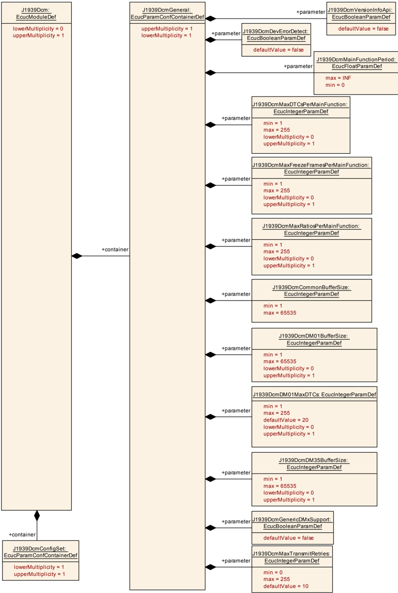

图 10.2：配置集（**Configuration Set**）

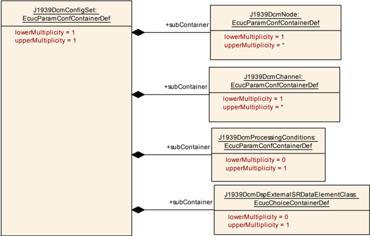

图 10.3：通道的配置（**Configuration of Channels**）

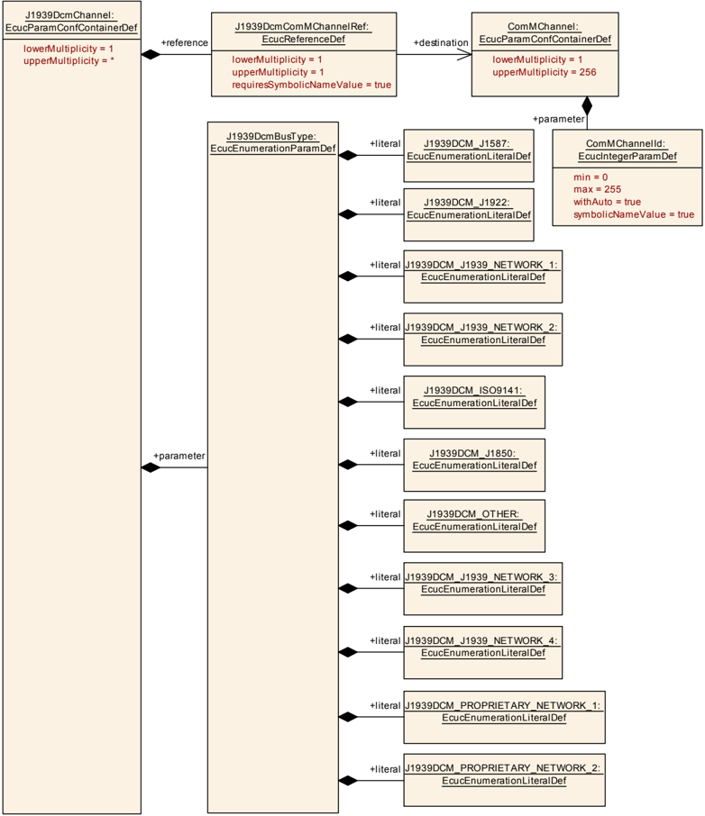

图 10.4：节点的配置 — 第 1 部分（**Configuration of Nodes - Part 1**）

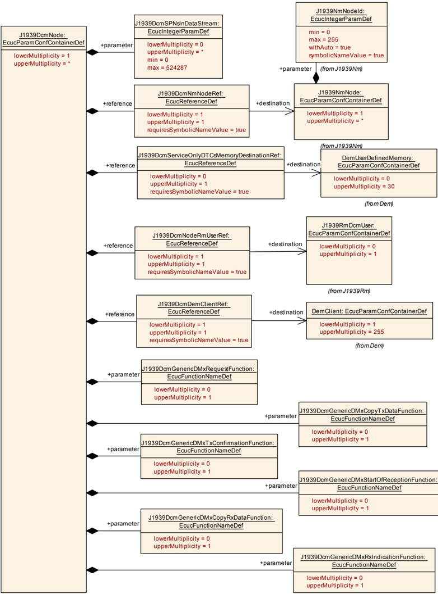

图 10.5：节点的配置 — 第 2 部分（**Configuration of Nodes - Part 2**）

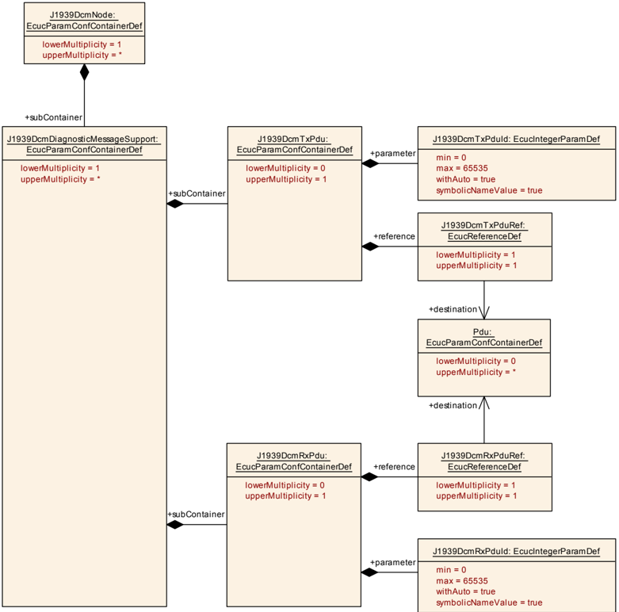

图 10.6：诊断消息的配置 — 第 1 部分（**Configuration of Diagnostic Messages - Part 1**）

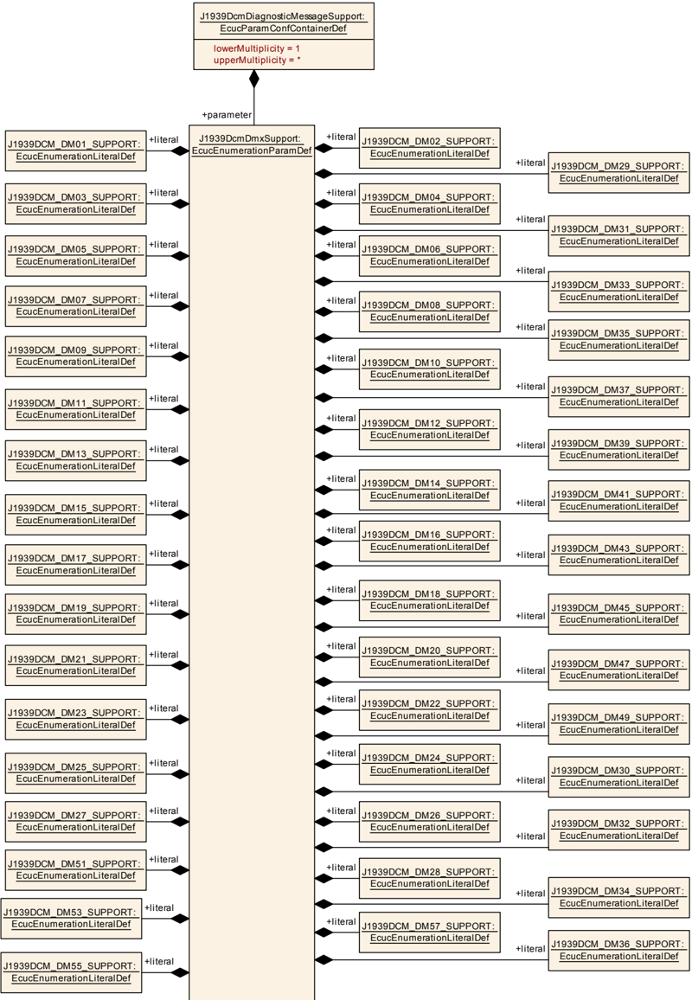

图 10.7：诊断消息的配置 — 第 2 部分（**Configuration of Diagnostic Messages - Part 2**）

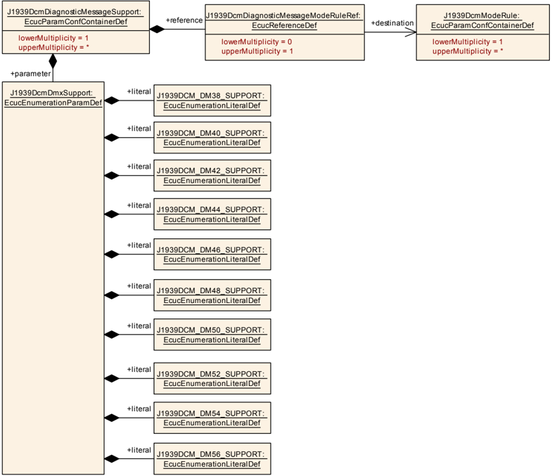

图 10.8：处理条件的配置 — 第 1 部分（**Configuration of Processing Conditions - Part 1**）

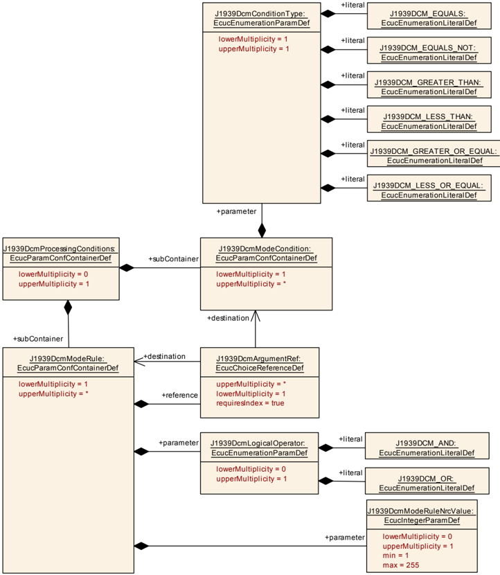

图 10.9：处理条件的配置 — 第 2 部分（**Configuration of Processing Conditions - Part 2**）

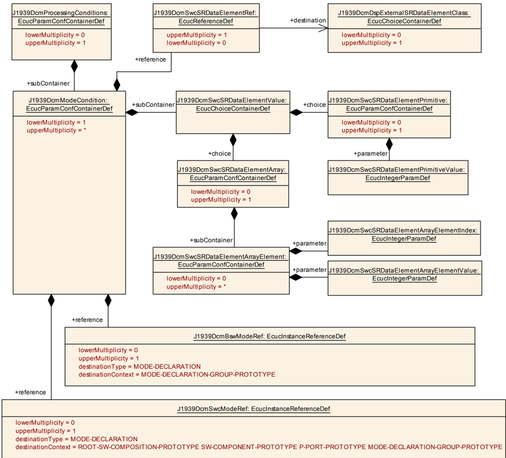

图 10.10：外部数据元素类的配置（**Configuration of External Data Element Class**）

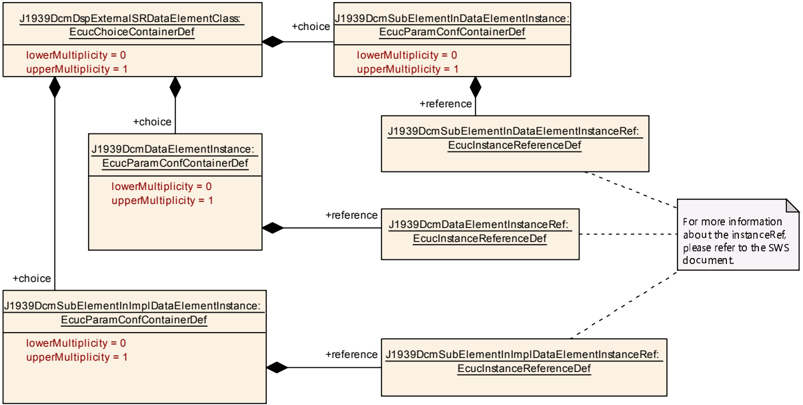

#### 9.1.1. J1939Dcm

| 属性 | 值 |
| --- | --- |
| 模块名称 | J1939Dcm |
| 描述 | SAE J1939 Dcm 模块（The SAE J1939 Dcm module） |
| Post-Build 变体支持 | true |
| 支持的配置变体 | VARIANT-LINK-TIME、VARIANT-POST-BUILD、VARIANT-PRE-COMPILE |

| 容器名称 | 多重性 | 作用域/依赖 |
| --- | --- | --- |
| J1939DcmConfigSet | 1 | 该容器包含 AUTOSAR J1939Dcm 模块的配置参数与子容器。 |
| J1939DcmGeneral | 1 | 包含模块的通用配置参数。 |

#### 9.1.2. J1939DcmGeneral

| 属性 | 值 |
| --- | --- |
| 容器名称 | J1939DcmGeneral |
| 父容器 | J1939Dcm |
| 描述 | 包含模块的通用配置参数。 |

参数 J1939DcmCommonBufferSize 的定义：

| 属性 | 值 |
| --- | --- |
| 参数名称 | J1939DcmCommonBufferSize |
| 父容器 | J1939DcmGeneral |
| 描述 | 公共缓冲区的大小（字节）。缓冲区大小应不小于最长的命令或响应消息。 |
| 多重性 | 1 |
| 类型 | EcucIntegerParamDef |
| 取值范围 | 1 .. 65535 |
| 默认值 | - |
| Post-Build 变体值 | false |
| 值配置类 | Pre-compile time：X（All Variants）；Link time：-；Post-build time：- |
| 作用域/依赖 | scope: local |

参数 J1939DcmDevErrorDetect 的定义：

| 属性 | 值 |
| --- | --- |
| 参数名称 | J1939DcmDevErrorDetect |
| 父容器 | J1939DcmGeneral |
| 描述 | 开启或关闭开发错误检测与通知。**true**：启用检测和通知；**false**：禁用检测和通知。 |
| 多重性 | 1 |
| 类型 | EcucBooleanParamDef |
| 默认值 | false |
| Post-Build 变体值 | false |
| 值配置类 | Pre-compile time：X（All Variants）；Link time：-；Post-build time：- |
| 作用域/依赖 | scope: local |

参数 J1939DcmDM01BufferSize 的定义：

| 属性 | 值 |
| --- | --- |
| 参数名称 | J1939DcmDM01BufferSize |
| 父容器 | J1939DcmGeneral |
| 描述 | DM01 缓冲区的大小（字节）。缓冲区大小应不小于最长的 DM01 响应消息。 |
| 多重性 | 0..1 |
| 类型 | EcucIntegerParamDef |
| 取值范围 | 1 .. 65535 |
| 默认值 | - |
| Post-Build 变体多重性 | false |
| Post-Build 变体值 | false |
| 多重性配置类 | Pre-compile time：X（All Variants）；Link time：-；Post-build time：- |
| 值配置类 | Pre-compile time：X（All Variants）；Link time：-；Post-build time：- |
| 作用域/依赖 | scope: local；依赖：若至少一个 J1939DcmDiagnosticMessageSupport 的 J1939DcmDmxSupport 置为 J1939DCM_DM01_SUPPORT，则必须存在 |

参数 J1939DcmDM01MaxDTCs 的定义：

| 属性 | 值 |
| --- | --- |
| 参数名称 | J1939DcmDM01MaxDTCs |
| 父容器 | J1939DcmGeneral |
| 描述 | DM01 消息中可上报的最大 DTC 数量限制的配置值。 |
| 多重性 | 0..1 |
| 类型 | EcucIntegerParamDef |
| 取值范围 | 1 .. 255 |
| 默认值 | 20 |
| Post-Build 变体值 | false |
| 值配置类 | Pre-compile time：X（All Variants）；Link time：-；Post-build time：- |
| 作用域/依赖 | scope: local；依赖：若至少一个 J1939DcmDiagnosticMessageSupport 的 J1939DcmDmxSupport 置为 J1939DCM_DM01_SUPPORT，则必须存在 |

参数 J1939DcmDM35BufferSize 的定义：

| 属性 | 值 |
| --- | --- |
| 参数名称 | J1939DcmDM35BufferSize |
| 父容器 | J1939DcmGeneral |
| 描述 | DM35 缓冲区的大小（字节）。缓冲区大小应不小于最长的 DM35 响应消息。 |
| 多重性 | 0..1 |
| 类型 | EcucIntegerParamDef |
| 取值范围 | 1 .. 65535 |
| 默认值 | - |
| Post-Build 变体多重性 | false |
| Post-Build 变体值 | false |
| 多重性配置类 | Pre-compile time：X（All Variants）；Link time：-；Post-build time：- |
| 值配置类 | Pre-compile time：X（All Variants）；Link time：-；Post-build time：- |
| 作用域/依赖 | scope: local |

参数 J1939DcmGenericDMxSupport 的定义：

| 属性 | 值 |
| --- | --- |
| 参数名称 | J1939DcmGenericDMxSupport |
| 父容器 | J1939DcmGeneral |
| 描述 | 开启或关闭对未在 **J1939Dcm** 中直接实现的全部 DMx 消息的支持。**true**：不受支持的 DMx 消息由 **CDD** 处理；**false**：不受支持的 DMx 消息被忽略/拒绝。 |
| 多重性 | 1 |
| 类型 | EcucBooleanParamDef |
| 默认值 | false |
| Post-Build 变体值 | false |
| 值配置类 | Pre-compile time：X（All Variants）；Link time：-；Post-build time：- |
| 作用域/依赖 | scope: local |

参数 J1939DcmMainFunctionPeriod 的定义：

| 属性 | 值 |
| --- | --- |
| 参数名称 | J1939DcmMainFunctionPeriod |
| 父容器 | J1939DcmGeneral |
| 描述 | `J1939Dcm_MainFunction` 的调用周期（秒）。 |
| 多重性 | 1 |
| 类型 | EcucFloatParamDef |
| 取值范围 | ]0 .. INF[ |
| 默认值 | - |
| Post-Build 变体值 | false |
| 值配置类 | Pre-compile time：X（VARIANT-PRE-COMPILE）；Link time：X（VARIANT-LINK-TIME、VARIANT-POST-BUILD）；Post-build time：- |
| 作用域/依赖 | scope: ECU |

参数 J1939DcmMaxDTCsPerMainFunction 的定义：

| 属性 | 值 |
| --- | --- |
| 参数名称 | J1939DcmMaxDTCsPerMainFunction |
| 父容器 | J1939DcmGeneral |
| 描述 | 单个 MainFunction 周期内可过滤的最大 DTC 数量阈值。 |
| 多重性 | 0..1 |
| 类型 | EcucIntegerParamDef |
| 取值范围 | 1 .. 255 |
| 默认值 | - |
| Post-Build 变体多重性 | false |
| Post-Build 变体值 | false |
| 多重性配置类 | Pre-compile time：X；Link time：-；Post-build time：- |
| 值配置类 | Pre-compile time：X；Link time：-；Post-build time：- |
| 作用域/依赖 | scope: local |

参数 J1939DcmMaxFreezeFramesPerMainFunction 的定义：

| 属性 | 值 |
| --- | --- |
| 参数名称 | J1939DcmMaxFreezeFramesPerMainFunction |
| 父容器 | J1939DcmGeneral |
| 描述 | 单个 MainFunction 周期内可过滤的最大冻结帧数量阈值。 |
| 多重性 | 0..1 |
| 类型 | EcucIntegerParamDef |
| 取值范围 | 1 .. 255 |
| 默认值 | - |
| Post-Build 变体多重性 | false |
| Post-Build 变体值 | false |
| 多重性配置类 | Pre-compile time：X；Link time：-；Post-build time：- |
| 值配置类 | Pre-compile time：X；Link time：-；Post-build time：- |
| 作用域/依赖 | scope: local |

参数 J1939DcmMaxRatiosPerMainFunction 的定义：

| 属性 | 值 |
| --- | --- |
| 参数名称 | J1939DcmMaxRatiosPerMainFunction |
| 父容器 | J1939DcmGeneral |
| 描述 | 单个 MainFunction 周期内可过滤的最大性价比（Ratio）数量阈值。 |
| 多重性 | 0..1 |
| 类型 | EcucIntegerParamDef |
| 取值范围 | 1 .. 255 |
| 默认值 | - |
| Post-Build 变体多重性 | false |
| Post-Build 变体值 | false |
| 多重性配置类 | Pre-compile time：X（All Variants）；Link time：-；Post-build time：- |
| 值配置类 | Pre-compile time：X（All Variants）；Link time：-；Post-build time：- |
| 作用域/依赖 | scope: local |

参数 J1939DcmMaxTransmitRetries 的定义：

| 属性 | 值 |
| --- | --- |
| 参数名称 | J1939DcmMaxTransmitRetries |
| 父容器 | J1939DcmGeneral |
| 描述 | 当 `PduR_J1939DcmTransmit` 返回 `E_NOT_OK` 时，发送一条诊断消息的最大重试次数。 |
| 多重性 | 1 |
| 类型 | EcucIntegerParamDef |
| 取值范围 | 0 .. 255 |
| 默认值 | 10 |
| Post-Build 变体值 | false |
| 值配置类 | Pre-compile time：X（All Variants）；Link time：-；Post-build time：- |
| 作用域/依赖 | scope: local |

参数 J1939DcmVersionInfoApi 的定义：

| 属性 | 值 |
| --- | --- |
| 参数名称 | J1939DcmVersionInfoApi |
| 父容器 | J1939DcmGeneral |
| 描述 | 用于启用版本信息 API 支持的预处理器开关。 |
| 多重性 | 1 |
| 类型 | EcucBooleanParamDef |
| 默认值 | false |
| Post-Build 变体值 | false |
| 值配置类 | Pre-compile time：X（All Variants）；Link time：-；Post-build time：- |
| 作用域/依赖 | scope: local |

无包含的容器（No Included Containers）。

#### 9.1.3. J1939DcmConfigSet

| 属性 | 值 |
| --- | --- |
| 容器名称 | J1939DcmConfigSet |
| 父容器 | J1939Dcm |
| 描述 | 该容器包含 AUTOSAR J1939Dcm 模块的配置参数与子容器。 |

| 容器名称 | 多重性 | 作用域/依赖 |
| --- | --- | --- |
| J1939DcmChannel | 1..* | 包含 J1939DcmChannel 的参数。 |
| J1939DcmDspExternalSRDataElementClass | 0..1 | 该容器定义 shall-read 的提供端口中的数据来源，以及 shall-write 的需求端口中的数据目标。该容器应包含一个 J1939DcmSubElementInDataElementInstance、J1939DcmDataElementInstance 或 J1939DcmSubElementInImplDataElementInstance 引用。 |
| J1939DcmNode | 1..* | 包含支持一个逻辑 J1939 节点的参数。 |
| J1939DcmProcessingConditions | 0..1 | 该容器包含 **J1939Dcm** 模式仲裁功能的配置。 |

#### 9.1.4. J1939DcmChannel

| 属性 | 值 |
| --- | --- |
| 容器名称 | J1939DcmChannel |
| 父容器 | J1939DcmConfigSet |
| 描述 | 包含 J1939DcmChannel 的参数。 |

参数 J1939DcmBusType 的定义：

| 属性 | 值 |
| --- | --- |
| 参数名称 | J1939DcmBusType |
| 父容器 | J1939DcmChannel |
| 描述 | 标识通信端口。 |
| 多重性 | 1 |
| 类型 | EcucEnumerationParamDef |
| Post-Build 变体值 | false |
| 值配置类 | Pre-compile time：X（All Variants）；Link time：-；Post-build time：- |
| 作用域/依赖 | scope: local |

| 取值 | 说明 |
| --- | --- |
| J1939DCM_ISO9141 | 标识 ISO 9141 通信端口。 |
| J1939DCM_J1587 | 标识 J1587 通信端口。 |
| J1939DCM_J1850 | 标识 J1850 通信端口。 |
| J1939DCM_J1922 | 标识 J1922 通信端口。 |
| J1939DCM_J1939_NETWORK_1 | 标识 J1939 Network #1（主车辆网络）通信端口。 |
| J1939DCM_J1939_NETWORK_2 | 标识 J1939 Network #2 通信端口。 |
| J1939DCM_J1939_NETWORK_3 | 标识 J1939 Network #3 通信端口。 |
| J1939DCM_J1939_NETWORK_4 | 标识 J1939 Network #4 通信端口。 |
| J1939DCM_OTHER | 标识「Other, Manufacture Specified Port」通信端口。 |
| J1939DCM_PROPRIETARY_NETWORK_1 | 标识 Proprietary Network #1 通信端口。 |
| J1939DCM_PROPRIETARY_NETWORK_2 | 标识 Proprietary Network #2 通信端口。 |

参数 J1939DcmComMChannelRef 的定义：

| 属性 | 值 |
| --- | --- |
| 参数名称 | J1939DcmComMChannelRef |
| 父容器 | J1939DcmChannel |
| 描述 | 对 ComMChannel 的引用。 |
| 多重性 | 1 |
| 类型 | 对 ComMChannel 的符号名引用（Symbolic name reference to ComMChannel） |
| Post-Build 变体值 | true |
| 值配置类 | Pre-compile time：X（VARIANT-PRE-COMPILE）；Link time：X（VARIANT-LINK-TIME）；Post-build time：X（VARIANT-POST-BUILD） |
| 作用域/依赖 | scope: ECU |

无包含的容器（No Included Containers）。

#### 9.1.5. J1939DcmNode

| 属性 | 值 |
| --- | --- |
| 容器名称 | J1939DcmNode |
| 父容器 | J1939DcmConfigSet |
| 描述 | 包含支持一个逻辑 J1939 节点的参数。 |

参数 J1939DcmGenericDMxCopyRxDataFunction 的定义：

| 属性 | 值 |
| --- | --- |
| 参数名称 | J1939DcmGenericDMxCopyRxDataFunction |
| 父容器 | J1939DcmNode |
| 描述 | 提供不受支持的 DMx 消息的一部分数据。若使能 `J1939DcmGenericDMxSupport` 则必需。 |
| 多重性 | 0..1 |
| 类型 | EcucFunctionNameDef |
| 默认值 | - |
| 正则表达式 | - |
| Post-Build 变体多重性 | false |
| Post-Build 变体值 | false |
| 多重性配置类 | Pre-compile time：X；Link time：-；Post-build time：- |
| 值配置类 | Pre-compile time：X；Link time：-；Post-build time：- |
| 作用域/依赖 | scope: local |

参数 J1939DcmGenericDMxCopyTxDataFunction 的定义：

| 属性 | 值 |
| --- | --- |
| 参数名称 | J1939DcmGenericDMxCopyTxDataFunction |
| 父容器 | J1939DcmNode |
| 描述 | 在调用 `J1939Dcm_GenericDMxTransmit` 之后，请求提供不受支持的 DMx 消息的一部分数据。若使能 `J1939DcmGenericDMxSupport` 则必需。 |
| 多重性 | 0..1 |
| 类型 | EcucFunctionNameDef |
| 默认值 | - |
| 正则表达式 | - |
| Post-Build 变体多重性 | false |
| Post-Build 变体值 | false |
| 多重性配置类 | Pre-compile time：X；Link time：-；Post-build time：- |
| 值配置类 | Pre-compile time：X；Link time：-；Post-build time：- |
| 作用域/依赖 | scope: local |

参数 J1939DcmGenericDMxRequestFunction 的定义：

| 属性 | 值 |
| --- | --- |
| 参数名称 | J1939DcmGenericDMxRequestFunction |
| 父容器 | J1939DcmNode |
| 描述 | 指示接收到针对一个不受支持的 DMx 消息的请求。若使能 `J1939DcmGenericDMxSupport` 则必需。 |
| 多重性 | 0..1 |
| 类型 | EcucFunctionNameDef |
| 默认值 | - |
| 正则表达式 | - |
| Post-Build 变体多重性 | false |
| Post-Build 变体值 | false |
| 多重性配置类 | Pre-compile time：X；Link time：-；Post-build time：- |
| 值配置类 | Pre-compile time：X；Link time：-；Post-build time：- |
| 作用域/依赖 | scope: local |

参数 J1939DcmGenericDMxRxIndicationFunction 的定义：

| 属性 | 值 |
| --- | --- |
| 参数名称 | J1939DcmGenericDMxRxIndicationFunction |
| 父容器 | J1939DcmNode |
| 描述 | 确认一个不受支持的 DMx 消息已完整接收。若使能 `J1939DcmGenericDMxSupport` 则必需。 |
| 多重性 | 0..1 |
| 类型 | EcucFunctionNameDef |
| 默认值 | - |
| 正则表达式 | - |
| Post-Build 变体多重性 | false |
| Post-Build 变体值 | false |
| 多重性配置类 | Pre-compile time：X（All Variants）；Link time：-；Post-build time：- |
| 值配置类 | Pre-compile time：X（All Variants）；Link time：-；Post-build time：- |
| 作用域/依赖 | scope: local |

参数 J1939DcmGenericDMxStartOfReceptionFunction 的定义：

| 属性 | 值 |
| --- | --- |
| 参数名称 | J1939DcmGenericDMxStartOfReceptionFunction |
| 父容器 | J1939DcmNode |
| 描述 | 指示接收到一个不受支持的 DMx 消息。若使能 `J1939DcmGenericDMxSupport` 则必需。 |
| 多重性 | 0..1 |
| 类型 | EcucFunctionNameDef |
| 默认值 | - |
| 正则表达式 | - |
| Post-Build 变体多重性 | false |
| Post-Build 变体值 | false |
| 多重性配置类 | Pre-compile time：X；Link time：-；Post-build time：- |
| 值配置类 | Pre-compile time：X；Link time：-；Post-build time：- |
| 作用域/依赖 | scope: local |

参数 J1939DcmGenericDMxTxConfirmationFunction 的定义：

| 属性 | 值 |
| --- | --- |
| 参数名称 | J1939DcmGenericDMxTxConfirmationFunction |
| 父容器 | J1939DcmNode |
| 描述 | 确认一个不受支持的 DMx 消息已发送。若使能 `J1939DcmGenericDMxSupport` 则必需。 |
| 多重性 | 0..1 |
| 类型 | EcucFunctionNameDef |
| 默认值 | - |
| 正则表达式 | - |
| Post-Build 变体多重性 | false |
| Post-Build 变体值 | false |
| 多重性配置类 | Pre-compile time：X；Link time：-；Post-build time：- |
| 值配置类 | Pre-compile time：X；Link time：-；Post-build time：- |
| 作用域/依赖 | scope: local |

参数 J1939DcmSPNsInDataStream 的定义：

| 属性 | 值 |
| --- | --- |
| 参数名称 | J1939DcmSPNsInDataStream |
| 父容器 | J1939DcmNode |
| 描述 | 定义 DM24 中可在数据流（data stream）中使用的 SPN。 |
| 多重性 | 0..* |
| 类型 | EcucIntegerParamDef |
| 取值范围 | 0 .. 524287 |
| 默认值 | - |
| Post-Build 变体多重性 | false |
| Post-Build 变体值 | false |
| 多重性配置类 | Pre-compile time：X；Link time：-；Post-build time：- |
| 值配置类 | Pre-compile time：X；Link time：-；Post-build time：- |
| 作用域/依赖 | scope: local |

参数 J1939DcmDemClientRef 的定义：

| 属性 | 值 |
| --- | --- |
| 参数名称 | J1939DcmDemClientRef |
| 父容器 | J1939DcmNode |
| 描述 | 对相应 Dem Client 的引用。 |
| 多重性 | 1 |
| 类型 | 对 DemClient 的符号名引用（Symbolic name reference to DemClient） |
| Post-Build 变体值 | false |
| 值配置类 | Pre-compile time：X（VARIANT-PRE-COMPILE）；Link time：X（VARIANT-LINK-TIME、VARIANT-POST-BUILD）；Post-build time：- |
| 作用域/依赖 | scope: local |

参数 J1939DcmNmNodeRef 的定义：

| 属性 | 值 |
| --- | --- |
| 参数名称 | J1939DcmNmNodeRef |
| 父容器 | J1939DcmNode |
| 描述 | 对相应 J1939Nm 节点的引用。 |
| 多重性 | 1 |
| 类型 | 对 J1939NmNode 的符号名引用（Symbolic name reference to J1939NmNode） |
| Post-Build 变体值 | false |
| 值配置类 | Pre-compile time：X（VARIANT-PRE-COMPILE）；Link time：X（VARIANT-LINK-TIME、VARIANT-POST-BUILD）；Post-build time：- |
| 作用域/依赖 | scope: local |

参数 J1939DcmNodeRmUserRef 的定义：

| 属性 | 值 |
| --- | --- |
| 参数名称 | J1939DcmNodeRmUserRef |
| 父容器 | J1939DcmNode |
| 描述 | 对 **J1939Dcm** 所使用的 J1939RmUser 的引用。 |
| 多重性 | 1 |
| 类型 | 对 J1939RmDcmUser 的符号名引用（Symbolic name reference to J1939RmDcmUser） |
| Post-Build 变体值 | true |
| 值配置类 | Pre-compile time：X（VARIANT-PRE-COMPILE）；Link time：X（VARIANT-LINK-TIME）；Post-build time：X（VARIANT-POST-BUILD） |
| 作用域/依赖 | scope: local |

参数 J1939DcmServiceOnlyDTCsMemoryDestinationRef 的定义：

| 属性 | 值 |
| --- | --- |
| 参数名称 | J1939DcmServiceOnlyDTCsMemoryDestinationRef |
| 父容器 | J1939DcmNode |
| 描述 | 对 DM53、DM54 与 DM55 处理的仅服务 DTC 所使用的用户自定义记忆的引用。 |
| 多重性 | 0..1 |
| 类型 | 对 DemUserDefinedMemory 的符号名引用（Symbolic name reference to DemUserDefinedMemory） |
| Post-Build 变体值 | false |
| 值配置类 | Pre-compile time：X（All Variants）；Link time：-；Post-build time：- |
| 作用域/依赖 | scope: local；依赖：被引用的事件记忆应分配给 `J1939DcmDemClientRef` 引用的 DemClient 的 DemEventMemorySet |

| 容器名称 | 多重性 | 作用域/依赖 |
| --- | --- | --- |
| J1939DcmDiagnosticMessageSupport | 1..* | 包含配置诊断消息支持的参数。 |

#### 9.1.6. J1939DcmDiagnosticMessageSupport

| 属性 | 值 |
| --- | --- |
| 容器名称 | J1939DcmDiagnosticMessageSupport |
| 父容器 | J1939DcmNode |
| 描述 | 包含配置诊断消息支持的参数。 |

参数 J1939DcmDmxSupport 的定义：

| 属性 | 值 |
| --- | --- |
| 参数名称 | J1939DcmDmxSupport |
| 父容器 | J1939DcmDiagnosticMessageSupport |
| 描述 | 该参数用于标识具体的 DMx 消息。 |
| 多重性 | 1 |
| 类型 | EcucEnumerationParamDef |
| Post-Build 变体值 | false |
| 值配置类 | Pre-compile time：X（All Variants）；Link time：-；Post-build time：- |
| 作用域/依赖 | scope: local |

| 取值 | 说明 |
| --- | --- |
| J1939DCM_DM01_SUPPORT | DM01: Active Diagnostic Trouble Codes |
| J1939DCM_DM02_SUPPORT | DM02: Previously Active Diagnostic Trouble Codes |
| J1939DCM_DM03_SUPPORT | DM03: Diagnostic Data Clear/Reset for Previously Active DTCs |
| J1939DCM_DM04_SUPPORT | DM04: Freeze Frame Parameters |
| J1939DCM_DM05_SUPPORT | DM05: Diagnostic Readiness 1 |
| J1939DCM_DM06_SUPPORT | DM06: Emission Related Pending DTCs |
| J1939DCM_DM07_SUPPORT | DM07: Command Non-continuously Monitored Test |
| J1939DCM_DM08_SUPPORT | DM08: Test Results for Non-continuously Monitored Systems |
| J1939DCM_DM09_SUPPORT | DM09: Oxygen Sensor Test Results |
| J1939DCM_DM10_SUPPORT | DM10: Non-continuously Monitored System Test Identifiers Support |
| J1939DCM_DM11_SUPPORT | DM11: Diagnostic Data Clear/Reset for Active DTCs |
| J1939DCM_DM12_SUPPORT | DM12: Emissions Related Active DTCs |
| J1939DCM_DM13_SUPPORT | DM13: Stop Start Broadcast |
| J1939DCM_DM14_SUPPORT | DM14: Memory Access Request |
| J1939DCM_DM15_SUPPORT | DM15: Memory Access Response |
| J1939DCM_DM16_SUPPORT | DM16: Binary Data Transfer |
| J1939DCM_DM17_SUPPORT | DM17: Boot Load Data |
| J1939DCM_DM18_SUPPORT | DM18: Data Security |
| J1939DCM_DM19_SUPPORT | DM19: Calibration Information |
| J1939DCM_DM20_SUPPORT | DM20: Monitor Performance Ratio |
| J1939DCM_DM21_SUPPORT | DM21: Diagnostic Readiness 2 |
| J1939DCM_DM22_SUPPORT | DM22: Individual Clear/Reset of Active and Previously Active DTC |
| J1939DCM_DM23_SUPPORT | DM23: Emission Related Previously Active DTCs |
| J1939DCM_DM24_SUPPORT | DM24: SPN Support |
| J1939DCM_DM25_SUPPORT | DM25: Expanded Freeze Frame |
| J1939DCM_DM26_SUPPORT | DM26: Diagnostic Readiness 3 |
| J1939DCM_DM27_SUPPORT | DM27: All Pending DTCs |
| J1939DCM_DM28_SUPPORT | DM28: Permanent DTCs |
| J1939DCM_DM29_SUPPORT | DM29: Regulated DTC Counts |
| J1939DCM_DM30_SUPPORT | DM30: Scaled Test Results |
| J1939DCM_DM31_SUPPORT | DM31: DTC to Lamp Association |
| J1939DCM_DM32_SUPPORT | DM32: Regulated Exhaust Emission Level Exceedance |
| J1939DCM_DM33_SUPPORT | DM33: Emission Increasing Auxiliary Emission Control Device Active Time |
| J1939DCM_DM34_SUPPORT | DM34: NTE Status |
| J1939DCM_DM35_SUPPORT | iDM35: Immediate Fault Status |
| J1939DCM_DM36_SUPPORT | DM36: Harmonized Roadworthiness - Vehicle (HRWV) |
| J1939DCM_DM37_SUPPORT | DM37: Harmonized Roadworthiness - System (HRWS) |
| J1939DCM_DM38_SUPPORT | DM38: Harmonized Global Regulation Description (HGRD) |
| J1939DCM_DM39_SUPPORT | DM39: Harmonized Cumulative Continuous Malfunction Indicator - System (HCMI) |
| J1939DCM_DM40_SUPPORT | DM40: Harmonized B1 Failure Counts (HB1C) |
| J1939DCM_DM41_SUPPORT | DM41: DTCs - A, Pending |
| J1939DCM_DM42_SUPPORT | DM42: DTCs - A, Confirmed and Active |
| J1939DCM_DM43_SUPPORT | DM43: DTCs - A, Previously Active |
| J1939DCM_DM44_SUPPORT | DM44: DTCs - B1, Pending |
| J1939DCM_DM45_SUPPORT | DM45: DTCs - B1, Confirmed and Active |
| J1939DCM_DM46_SUPPORT | DM46: DTCs - B1, Previously Active |
| J1939DCM_DM47_SUPPORT | DM47: DTCs - B2, Pending |
| J1939DCM_DM48_SUPPORT | DM48: DTCs - B2, Confirmed and Active |
| J1939DCM_DM49_SUPPORT | DM49: DTCs - B2, Previously Active |
| J1939DCM_DM50_SUPPORT | DM50: DTCs - C, Pending |
| J1939DCM_DM51_SUPPORT | DM51: DTCs - C, Confirmed and Active |
| J1939DCM_DM52_SUPPORT | DM52: DTCs - C, Previously Active |
| J1939DCM_DM53_SUPPORT | DM53: Active Service Only DTCs |
| J1939DCM_DM54_SUPPORT | DM54: Previously Active Service Only DTCs |
| J1939DCM_DM55_SUPPORT | DM55: Clear All Service Only DTCs |
| J1939DCM_DM56_SUPPORT | DM56: Engine Emissions Certification Information |
| J1939DCM_DM57_SUPPORT | DM57: OBD Information |

参数 J1939DcmDiagnosticMessageModeRuleRef 的定义：

| 属性 | 值 |
| --- | --- |
| 参数名称 | J1939DcmDiagnosticMessageModeRuleRef |
| 父容器 | J1939DcmDiagnosticMessageSupport |
| 描述 | 对控制一条诊断消息执行的 `J1939DcmModeRule` 的引用。 |
| 多重性 | 0..1 |
| 类型 | 对 J1939DcmModeRule 的引用（Reference to J1939DcmModeRule） |
| Post-Build 变体多重性 | false |
| Post-Build 变体值 | false |
| 多重性配置类 | Pre-compile time：X（VARIANT-PRE-COMPILE、VARIANT-POST-BUILD）；Link time：X（VARIANT-LINK-TIME）；Post-build time：- |
| 值配置类 | Pre-compile time：X（VARIANT-PRE-COMPILE、VARIANT-POST-BUILD）；Link time：X（VARIANT-LINK-TIME）；Post-build time：- |
| 作用域/依赖 | scope: ECU |

参数 J1939DcmDiagnosticMessageSupportChannelRef 的定义：

| 属性 | 值 |
| --- | --- |
| 参数名称 | J1939DcmDiagnosticMessageSupportChannelRef |
| 父容器 | J1939DcmDiagnosticMessageSupport |
| 描述 | 对支持该诊断消息的 J1939DcmChannel 的引用。 |
| 多重性 | 1 |
| 类型 | 对 J1939DcmChannel 的引用（Reference to J1939DcmChannel） |
| Post-Build 变体值 | false |
| 值配置类 | Pre-compile time：X（VARIANT-PRE-COMPILE）；Link time：X（VARIANT-LINK-TIME、VARIANT-POST-BUILD）；Post-build time：- |
| 作用域/依赖 | scope: local |

| 容器名称 | 多重性 | 作用域/依赖 |
| --- | --- | --- |
| J1939DcmRxPdu | 0..1 | 包含配置 J1939DcmRxPdu 的参数。对于从 **CanIf** 接收的 PDU，该 PDU 消耗 CAN_ID_32 类型的元数据项；对于从 **J1939Tp** 接收的 PDU，该 PDU 消耗 SOURCE_ADDRESS_16、TARGET_ADDRESS_16 与 PRIORITY_8 类型的元数据项。 |
| J1939DcmTxPdu | 0..1 | 包含配置 J1939DcmTxPdu 的参数。对于经由 **CanIf** 发送的 PDU，该 PDU 产生 CAN_ID_32 类型的元数据项；对于经由 **J1939Tp** 发送的 PDU，该 PDU 产生 SOURCE_ADDRESS_16、TARGET_ADDRESS_16 与 PRIORITY_8 类型的元数据项。 |

#### 9.1.7. J1939DcmRxPdu

| 属性 | 值 |
| --- | --- |
| 容器名称 | J1939DcmRxPdu |
| 父容器 | J1939DcmDiagnosticMessageSupport |
| 描述 | 包含配置 J1939DcmRxPdu 的参数。对于从 **CanIf** 接收的 PDU，该 PDU 消耗 CAN_ID_32 类型的元数据项；对于从 **J1939Tp** 接收的 PDU，该 PDU 消耗 SOURCE_ADDRESS_16、TARGET_ADDRESS_16 与 PRIORITY_8 类型的元数据项。 |

参数 J1939DcmRxPduId 的定义：

| 属性 | 值 |
| --- | --- |
| 参数名称 | J1939DcmRxPduId |
| 父容器 | J1939DcmRxPdu |
| 描述 | 用于与 **PduR** 通信的 I-PDU 标识符。 |
| 多重性 | 1 |
| 类型 | EcucIntegerParamDef（为该参数生成的符号名） |
| 取值范围 | 0 .. 65535 |
| 默认值 | - |
| Post-Build 变体值 | false |
| 值配置类 | Pre-compile time：X（All Variants）；Link time：-；Post-build time：- |
| 作用域/依赖 | scope: ECU；withAuto = true |

参数 J1939DcmRxPduRef 的定义：

| 属性 | 值 |
| --- | --- |
| 参数名称 | J1939DcmRxPduRef |
| 父容器 | J1939DcmRxPdu |
| 描述 | 对 Ecuc 模块中全局 Pdu 元素的引用。 |
| 多重性 | 1 |
| 类型 | 对 Pdu 的引用（Reference to Pdu） |
| Post-Build 变体值 | true |
| 值配置类 | Pre-compile time：X（VARIANT-PRE-COMPILE）；Link time：X（VARIANT-LINK-TIME）；Post-build time：X（VARIANT-POST-BUILD） |
| 作用域/依赖 | scope: local |

无包含的容器（No Included Containers）。

#### 9.1.8. J1939DcmTxPdu

| 属性 | 值 |
| --- | --- |
| 容器名称 | J1939DcmTxPdu |
| 父容器 | J1939DcmDiagnosticMessageSupport |
| 描述 | 包含配置 J1939DcmTxPdu 的参数。对于经由 **CanIf** 发送的 PDU，该 PDU 产生 CAN_ID_32 类型的元数据项；对于经由 **J1939Tp** 发送的 PDU，该 PDU 产生 SOURCE_ADDRESS_16、TARGET_ADDRESS_16 与 PRIORITY_8 类型的元数据项。 |

参数 J1939DcmTxPduId 的定义：

| 属性 | 值 |
| --- | --- |
| 参数名称 | J1939DcmTxPduId |
| 父容器 | J1939DcmTxPdu |
| 描述 | 用于标识 Tx 消息的 I-PDU 标识符。 |
| 多重性 | 1 |
| 类型 | EcucIntegerParamDef（为该参数生成的符号名） |
| 取值范围 | 0 .. 65535 |
| 默认值 | - |
| Post-Build 变体值 | false |
| 值配置类 | Pre-compile time：X（All Variants）；Link time：-；Post-build time：- |
| 作用域/依赖 | scope: ECU |

参数 J1939DcmTxPduRef 的定义：

| 属性 | 值 |
| --- | --- |
| 参数名称 | J1939DcmTxPduRef |
| 父容器 | J1939DcmTxPdu |
| 描述 | 对 Ecuc 模块中全局 Pdu 元素的引用。 |
| 多重性 | 1 |
| 类型 | 对 Pdu 的引用（Reference to Pdu） |
| Post-Build 变体值 | true |
| 值配置类 | Pre-compile time：X（VARIANT-PRE-COMPILE）；Link time：X（VARIANT-LINK-TIME）；Post-build time：X（VARIANT-POST-BUILD） |
| 作用域/依赖 | scope: local |

无包含的容器（No Included Containers）。

#### 9.1.9. J1939DcmProcessingConditions

| 属性 | 值 |
| --- | --- |
| 容器名称 | J1939DcmProcessingConditions |
| 父容器 | J1939DcmConfigSet |
| 描述 | 该容器包含 **J1939Dcm** 模式仲裁功能的配置。 |

| 容器名称 | 多重性 | 作用域/依赖 |
| --- | --- | --- |
| J1939DcmModeCondition | 1..* | 该容器包含一个模式条件或环境条件的配置，可用作 `J1939DcmModeRule` 中的实参。一个 `J1939DcmModeCondition` 应包含一个 `J1939DcmSwcModeRef`、一个 `J1939DcmBswModeRef` 或一个 `J1939DcmSwcSRDataElementRef`。请注意，**J1939Dcm** 同时也充当模式管理器。因此，`J1939DcmSwcModeRef` 或 `J1939DcmBswModeRef` 引用既可以指向 **J1939Dcm** 自身提供的 ModeDeclarationGroupPrototype，也可以指向其他 **BSW** 模块或软件组件提供的 ModeDeclarationGroupPrototype。在配置了 `J1939DcmSwcModeRef` 或 `J1939DcmBswModeRef` 的情况下，只有 `J1939DcmConditionType` 的 `J1939DCM_EQUALS` 或 `J1939DCM_EQUALS_NOT` 适用；在 `J1939DcmSwcSRDataElementRef` 的情况下，`J1939DcmConditionType` 的全部字面量都可用。 |
| J1939DcmModeRule | 1..* | 该容器包含一个模式规则的配置，该规则表示以 `J1939DcmModeCondition` 或其他 `J1939DcmModeRule` 为实参的逻辑表达式。全部实参用 `DcmLogicalOperator` 定义的运算符处理，例如：Argument_A AND Argument_B AND Argument_C |

#### 9.1.10. J1939DcmModeRule

| 属性 | 值 |
| --- | --- |
| 容器名称 | J1939DcmModeRule |
| 父容器 | J1939DcmProcessingConditions |
| 描述 | 该容器包含一个模式规则的配置，该规则表示以 `J1939DcmModeCondition` 或其他 `J1939DcmModeRule` 为实参的逻辑表达式。全部实参用 `DcmLogicalOperator` 定义的运算符处理，例如：Argument_A AND Argument_B AND Argument_C |

参数 J1939DcmLogicalOperator 的定义：

| 属性 | 值 |
| --- | --- |
| 参数名称 | J1939DcmLogicalOperator |
| 父容器 | J1939DcmModeRule |
| 描述 | 该参数指定逻辑表达式中使用的逻辑运算符。若表达式仅由单个条件组成，则不应使用该参数。 |
| 多重性 | 0..1 |
| 类型 | EcucEnumerationParamDef |
| Post-Build 变体多重性 | false |
| Post-Build 变体值 | false |
| 多重性配置类 | Pre-compile time：X（All Variants）；Link time：-；Post-build time：- |
| 值配置类 | Pre-compile time：X（All Variants）；Link time：-；Post-build time：- |
| 作用域/依赖 | scope: local |

| 取值 | 说明 |
| --- | --- |
| J1939DCM_AND | - |
| J1939DCM_OR | - |

参数 J1939DcmModeRuleNrcValue 的定义：

| 属性 | 值 |
| --- | --- |
| 参数名称 | J1939DcmModeRuleNrcValue |
| 父容器 | J1939DcmModeRule |
| 描述 | 可选参数，定义在模式规则条件无效时发送的 NRC。 |
| 多重性 | 0..1 |
| 类型 | EcucIntegerParamDef |
| 取值范围 | 1 .. 255 |
| 默认值 | - |
| Post-Build 变体多重性 | false |
| Post-Build 变体值 | false |
| 多重性配置类 | Pre-compile time：X（VARIANT-PRE-COMPILE）；Link time：X（VARIANT-LINK-TIME）；Post-build time：- |
| 值配置类 | Pre-compile time：X（VARIANT-PRE-COMPILE）；Link time：X（VARIANT-LINK-TIME）；Post-build time：- |
| 作用域/依赖 | scope: ECU |

参数 J1939DcmArgumentRef 的定义：

| 属性 | 值 |
| --- | --- |
| 参数名称 | J1939DcmArgumentRef |
| 父容器 | J1939DcmModeRule |
| 描述 | 选择引用，指向作为子表达式的模式条件或另一个模式规则。属性：requiresIndex=true |
| 多重性 | 1..* |
| 类型 | 对 [J1939DcmModeCondition, J1939DcmModeRule] 的选择引用（Choice reference） |
| Post-Build 变体多重性 | false |
| Post-Build 变体值 | false |
| 多重性配置类 | Pre-compile time：X；Link time：-；Post-build time：- |
| 值配置类 | Pre-compile time：X；Link time：-；Post-build time：- |
| 作用域/依赖 | scope: local |

无包含的容器（No Included Containers）。

#### 9.1.11. J1939DcmModeCondition

| 属性 | 值 |
| --- | --- |
| 容器名称 | J1939DcmModeCondition |
| 父容器 | J1939DcmProcessingConditions |
| 描述 | 该容器包含一个模式条件或环境条件的配置，可用作 `J1939DcmModeRule` 中的实参。一个 `J1939DcmModeCondition` 应包含一个 `J1939DcmSwcModeRef`、一个 `J1939DcmBswModeRef` 或一个 `J1939DcmSwcSRDataElementRef`。请注意，**J1939Dcm** 同时也充当模式管理器。因此，`J1939DcmSwcModeRef` 或 `J1939DcmBswModeRef` 引用既可以指向 **J1939Dcm** 自身提供的 ModeDeclarationGroupPrototype，也可以指向其他 **BSW** 模块或软件组件提供的 ModeDeclarationGroupPrototype。在配置了 `J1939DcmSwcModeRef` 或 `J1939DcmBswModeRef` 的情况下，只有 `J1939DcmConditionType` 的 `J1939DCM_EQUALS` 或 `J1939DCM_EQUALS_NOT` 适用；在 `J1939DcmSwcSRDataElementRef` 的情况下，`J1939DcmConditionType` 的全部字面量都可用。 |

参数 J1939DcmConditionType 的定义：

| 属性 | 值 |
| --- | --- |
| 参数名称 | J1939DcmConditionType |
| 父容器 | J1939DcmModeCondition |
| 描述 | 该参数指定求值模式条件时所进行的比较的种类。 |
| 多重性 | 1 |
| 类型 | EcucEnumerationParamDef |
| Post-Build 变体值 | false |
| 值配置类 | Pre-compile time：X（All Variants）；Link time：-；Post-build time：- |
| 作用域/依赖 | scope: local |

| 取值 | 说明 |
| --- | --- |
| J1939DCM_EQUALS | - |
| J1939DCM_EQUALS_NOT | - |
| J1939DCM_GREATER_OR_EQUAL | - |
| J1939DCM_GREATER_THAN | - |
| J1939DCM_LESS_OR_EQUAL | - |
| J1939DCM_LESS_THAN | - |

参数 J1939DcmBswModeRef 的定义：

| 属性 | 值 |
| --- | --- |
| 参数名称 | J1939DcmBswModeRef |
| 父容器 | J1939DcmModeCondition |
| 描述 | 该参数引用由某个基础软件模块提供的、用于该条件的 ModeDeclarationGroupPrototype 的一个模式。请注意，此类 ModeDeclarationGroupPrototype 由基础软件模块描述以 providedModeGroup 角色拥有。 |
| 多重性 | 0..1 |
| 类型 | 对 MODE-DECLARATION 上下文的实例引用（Instance reference）：MODE-DECLARATION-GROUP-PROTOTYPE |
| Post-Build 变体多重性 | false |
| Post-Build 变体值 | false |
| 多重性配置类 | Pre-compile time：X；Link time：-；Post-build time：- |
| 值配置类 | Pre-compile time：X；Link time：-；Post-build time：- |
| 作用域/依赖 | scope: local |

参数 J1939DcmSwcModeRef 的定义：

| 属性 | 值 |
| --- | --- |
| 参数名称 | J1939DcmSwcModeRef |
| 父容器 | J1939DcmModeCondition |
| 描述 | 该参数引用软件组件的某个特定模式请求端口中、用于该条件的一个模式。 |
| 多重性 | 0..1 |
| 类型 | 对 MODE-DECLARATION 上下文的实例引用（Instance reference）：ROOT-SW-COMPOSITION-PROTOTYPE SW-COMPONENT-PROTOTYPE P-PORT-PROTOTYPE MODE-DECLARATION-GROUP-PROTOTYPE |
| Post-Build 变体多重性 | false |
| Post-Build 变体值 | false |
| 多重性配置类 | Pre-compile time：X（All Variants）；Link time：-；Post-build time：- |
| 值配置类 | Pre-compile time：X（All Variants）；Link time：-；Post-build time：- |
| 作用域/依赖 | scope: local |

参数 J1939DcmSwcSRDataElementRef 的定义：

| 属性 | 值 |
| --- | --- |
| 参数名称 | J1939DcmSwcSRDataElementRef |
| 父容器 | J1939DcmModeCondition |
| 描述 | 对环境条件的引用。可以引用一个 S/R 接收端口以读取物理值，并将其（等于、大于、小于……）与由 `J1939DcmSwcSRDataElementValue` 定义的配置值进行比较。 |
| 多重性 | 0..1 |
| 类型 | 对 J1939DcmDspExternalSRDataElementClass 的引用（Reference to J1939DcmDspExternalSRDataElementClass） |
| Post-Build 变体多重性 | false |
| Post-Build 变体值 | false |
| 多重性配置类 | Pre-compile time：X；Link time：-；Post-build time：- |
| 值配置类 | Pre-compile time：X；Link time：-；Post-build time：- |
| 作用域/依赖 | scope: local |

| 容器名称 | 多重性 | 作用域/依赖 |
| --- | --- | --- |
| J1939DcmSwcSRDataElementValue | 1 | 该容器包含一个 S/R 比较值的配置。 |

#### 9.1.12. J1939DcmSwcSRDataElementValue

| 属性 | 值 |
| --- | --- |
| 选择容器名称 | J1939DcmSwcSRDataElementValue |
| 父容器 | J1939DcmModeCondition |
| 描述 | 该容器包含一个 S/R 比较值的配置。 |

| 容器名称 | 多重性 | 作用域/依赖 |
| --- | --- | --- |
| J1939DcmSwcSRDataElementArray | 0..1 | 该容器包含一个数组型 S/R 数据元素比较值的配置。 |
| J1939DcmSwcSRDataElementPrimitive | 0..1 | 该容器包含一个原始型 S/R 数据元素比较值的配置。 |

#### 9.1.13. J1939DcmSwcSRDataElementPrimitive

| 属性 | 值 |
| --- | --- |
| 容器名称 | J1939DcmSwcSRDataElementPrimitive |
| 父容器 | J1939DcmSwcSRDataElementValue |
| 描述 | 该容器包含一个原始型 S/R 数据元素比较值的配置。 |

参数 J1939DcmSwcSRDataElementPrimitiveValue 的定义：

| 属性 | 值 |
| --- | --- |
| 参数名称 | J1939DcmSwcSRDataElementPrimitiveValue |
| 父容器 | J1939DcmSwcSRDataElementPrimitive |
| 描述 | 对一个原始型 S/R 数据元素比较值的引用。 |
| 多重性 | 1 |
| 类型 | EcucIntegerParamDef |
| 取值范围 | 0 .. 18446744073709551615 |
| 默认值 | - |
| Post-Build 变体值 | false |
| 值配置类 | Pre-compile time：X（All Variants）；Link time：-；Post-build time：- |
| 作用域/依赖 |  |

无包含的容器（No Included Containers）。

#### 9.1.14. J1939DcmSwcSRDataElementArray

| 属性 | 值 |
| --- | --- |
| 容器名称 | J1939DcmSwcSRDataElementArray |
| 父容器 | J1939DcmSwcSRDataElementValue |
| 描述 | 该容器包含一个数组型 S/R 数据元素比较值的配置。 |

| 容器名称 | 多重性 | 作用域/依赖 |
| --- | --- | --- |
| J1939DcmSwcSRDataElementArrayElement | 0..* | 该容器包含一个数组元素 S/R 数据元素比较值的配置。 |

#### 9.1.15. J1939DcmSwcSRDataElementArrayElement

| 属性 | 值 |
| --- | --- |
| 容器名称 | J1939DcmSwcSRDataElementArrayElement |
| 父容器 | J1939DcmSwcSRDataElementArray |
| 描述 | 该容器包含一个数组元素 S/R 数据元素比较值的配置。 |

参数 J1939DcmSwcSRDataElementArrayElementIndex 的定义：

| 属性 | 值 |
| --- | --- |
| 参数名称 | J1939DcmSwcSRDataElementArrayElementIndex |
| 父容器 | J1939DcmSwcSRDataElementArrayElement |
| 描述 | 指向一个数组型 S/R 数据元素的索引。 |
| 多重性 | 1 |
| 类型 | EcucIntegerParamDef |
| 取值范围 | 0 .. 18446744073709551615 |
| 默认值 | - |
| Post-Build 变体值 | false |
| 值配置类 | Pre-compile time：X（All Variants）；Link time：-；Post-build time：- |
| 作用域/依赖 |  |

参数 J1939DcmSwcSRDataElementArrayElementValue 的定义：

| 属性 | 值 |
| --- | --- |
| 参数名称 | J1939DcmSwcSRDataElementArrayElementValue |
| 父容器 | J1939DcmSwcSRDataElementArrayElement |
| 描述 | 数组型 S/R 数据元素比较值的值。 |
| 多重性 | 1 |
| 类型 | EcucIntegerParamDef |
| 取值范围 | 0 .. 18446744073709551615 |
| 默认值 | - |
| Post-Build 变体值 | false |
| 值配置类 | Pre-compile time：X（All Variants）；Link time：-；Post-build time：- |
| 作用域/依赖 |  |

无包含的容器（No Included Containers）。

#### 9.1.16. J1939DcmDspExternalSRDataElementClass

| 属性 | 值 |
| --- | --- |
| 选择容器名称 | J1939DcmDspExternalSRDataElementClass |
| 父容器 | J1939DcmConfigSet |
| 描述 | 该容器定义 shall-read 的提供端口中的数据来源，以及 shall-write 的需求端口中的数据目标。该容器应包含一个 J1939DcmSubElementInDataElementInstance、J1939DcmDataElementInstance 或 J1939DcmSubElementInImplDataElementInstance 引用。 |

| 容器名称 | 多重性 | 作用域/依赖 |
| --- | --- | --- |
| J1939DcmDataElementInstance | 0..1 | 对端口中原始数据（数据元素以 ApplicationPrimitveDataType 或 ImplementationDataType 为类型）的实例引用。 |
| J1939DcmSubElementInDataElementInstance | 0..1 | 对端口中组合数据的原始子元素（任意层级）的实例引用，其中数据元素以 ApplicationCompositeDataType 为类型。 |
| J1939DcmSubElementInImplDataElementInstance | 0..1 | 对端口中组合数据的原始子元素（任意层级）的实例引用，其中数据元素以 ImplementationDataType 为类型。 |

#### 9.1.17. J1939DcmDataElementInstance

| 属性 | 值 |
| --- | --- |
| 容器名称 | J1939DcmDataElementInstance |
| 父容器 | J1939DcmDspExternalSRDataElementClass |
| 描述 | 对端口中原始数据（数据元素以 ApplicationPrimitveDataType 或 ImplementationDataType 为类型）的实例引用。 |

参数 J1939DcmDataElementInstanceRef 的定义：

| 属性 | 值 |
| --- | --- |
| 参数名称 | J1939DcmDataElementInstanceRef |
| 父容器 | J1939DcmDataElementInstance |
| 描述 | 对应被读取或写入的原始数据的实例引用。支持 SenderReceiverInterfaces 与 NvDataInterfaces 中的 VariableDataPrototype，以及 ParameterInterfaces 中的 ParameterDataPrototype（只读）。若 AutosarDataPrototype 以类别 VALUE 或 BOOLEAN 的 ApplicationPrimitiveDataType 为类型，或以（最终归结为 VALUE 的）类别 VALUE 或 TYPE_REFERENCE 的 ImplementationDataType 为类型，则该引用适用。 |
| 多重性 | 1 |
| 类型 | 对 AUTOSAR-DATA-PROTOTYPE 上下文的实例引用（Instance reference）：ROOT-SW-COMPOSITION-PROTOTYPE SW-COMPONENT-PROTOTYPE PORT-PROTOTYPE |
| Post-Build 变体值 | false |
| 值配置类 | Pre-compile time：X（All Variants）；Link time：-；Post-build time：- |
| 作用域/依赖 |  |

无包含的容器（No Included Containers）。

#### 9.1.18. J1939DcmSubElementInDataElementInstance

| 属性 | 值 |
| --- | --- |
| 容器名称 | J1939DcmSubElementInDataElementInstance |
| 父容器 | J1939DcmDspExternalSRDataElementClass |
| 描述 | 对端口中组合数据的原始子元素（任意层级）的实例引用，其中数据元素以 ApplicationCompositeDataType 为类型。 |

参数 J1939DcmSubElementInDataElementInstanceRef 的定义：

| 属性 | 值 |
| --- | --- |
| 参数名称 | J1939DcmSubElementInDataElementInstanceRef |
| 父容器 | J1939DcmSubElementInDataElementInstance |
| 描述 | 对端口中应被读取的组合数据的原始子元素（任意层级）的实例引用。支持 SenderReceiverInterfaces 与 NvDataInterfaces 中的 VariableDataPrototype，以及 ParameterInterfaces 中的 ParameterDataPrototype（只读）。若 AutosarDataPrototype 以 ApplicationCompositeDataType 为类型，则该引用适用。 |
| 多重性 | 1 |
| 类型 | 对 APPLICATION-COMPOSITE-ELEMENT-DATA-PROTOTYPE 上下文的实例引用（Instance reference）：ROOT-SW-COMPOSITION-PROTOTYPE SW-COMPONENT-PROTOTYPE PORT-PROTOTYPE AUTOSAR-DATA-PROTOTYPE APPLICATION-COMPOSITE-ELEMENT-DATA-PROTOTYPE* |
| Post-Build 变体值 | false |
| 值配置类 | Pre-compile time：X（All Variants）；Link time：-；Post-build time：- |
| 作用域/依赖 |  |

无包含的容器（No Included Containers）。

#### 9.1.19. J1939DcmSubElementInImplDataElementInstance

| 属性 | 值 |
| --- | --- |
| 容器名称 | J1939DcmSubElementInImplDataElementInstance |
| 父容器 | J1939DcmDspExternalSRDataElementClass |
| 描述 | 对端口中组合数据的原始子元素（任意层级）的实例引用，其中数据元素以 ImplementationDataType 为类型。 |

参数 J1939DcmSubElementInImplDataElementInstanceRef 的定义：

| 属性 | 值 |
| --- | --- |
| 参数名称 | J1939DcmSubElementInImplDataElementInstanceRef |
| 父容器 | J1939DcmSubElementInImplDataElementInstance |
| 描述 | 对端口中应被读取的组合数据的原始子元素（任意层级）的实例引用。支持 SenderReceiverInterfaces 与 NvDataInterfaces 中的 VariableDataPrototype，以及 ParameterInterfaces 中的 ParameterDataPrototype（只读）。若 AutosarDataPrototype 以类别 STRUCTURE 或 ARRAY 的 ImplementationDataType 为类型，则该引用适用。请注意，在 ARRAY 的情况下，必须设置目标引用中的 index 属性以选择单个数组元素。 |
| 多重性 | 1 |
| 类型 | 对 IMPLEMENTATION-DATA-TYPE-ELEMENT 上下文的实例引用（Instance reference）：ROOT-SW-COMPOSITION-PROTOTYPE SW-COMPONENT-PROTOTYPE PORT-PROTOTYPE AUTOSAR-DATA-PROTOTYPE IMPLEMENTATION-DATA-TYPE-ELEMENT* |
| Post-Build 变体值 | false |
| 值配置类 | Pre-compile time：X（All Variants）；Link time：-；Post-build time：- |
| 作用域/依赖 |  |

无包含的容器（No Included Containers）。
