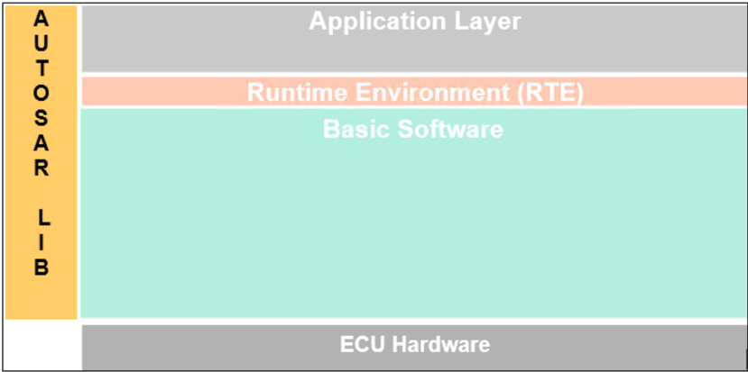

## 1. 简介和功能概述

**AUTOSAR** 库例程是 **AUTOSAR** 架构中系统服务的一部分，下图展示了 **AUTOSAR** 库在分层架构中的位置。



Bfx 例程规范规定了专用于定点算术例程的位（**BIT**）功能的 **AUTOSAR** 库的功能、**API** 和配置。

所有位函数都是可重入的，可以处理来自应用的多个并发请求。

## 2. 缩略语

下面的术语表包含了与 **Bfx** 库模块相关、但未包含在 [\[1, AUTOSAR 术语表\]](#ref-1) 中的缩略语和缩写。

**Bfx**
> 定点数位域函数（**Bitfield functions for fixed point**）的短名称。

**u8**
> **uint8** 的短名称，规定于 AUTOSAR_SWS_Platform Types。

**u16**
> **uint16** 的短名称，规定于 AUTOSAR_SWS_Platform Types。

**u32**
> **uint32** 的短名称，规定于 AUTOSAR_SWS_Platform Types。

**s8**
> **sint8** 的短名称，规定于 AUTOSAR_SWS_Platform Types。

**s16**
> **sint16** 的短名称，规定于 AUTOSAR_SWS_Platform Types。

**s32**
> **sint32** 的短名称，规定于 AUTOSAR_SWS_Platform Types。

**boolean**
> 布尔数据类型，规定于 AUTOSAR_SWS_Platform Types。

**DET**
> 默认错误跟踪器（**Default Error Tracer**）。

## 3. 相关文档

### 3.1. 输入文件和相关标准与规范

<a id="ref-1"></a>[1] Glossary
> AUTOSAR_FO_TR_Glossary

<a id="ref-2"></a>[2] ISO/IEC 9899:1990 Programming Language - C
> https://www.iso.org

<a id="ref-3"></a>[3] General Specification of Basic Software Modules
> AUTOSAR_CP_SWS_BSWGeneral

<a id="ref-4"></a>[4] Requirements on Libraries
> AUTOSAR_CP_SRS_Libraries

### 3.2. 相关规范

**AUTOSAR** 提供了基础软件模块通用规范 [\[3\]](#ref-3)（**SWS BSW General**），该规范同样适用于 **IFX** 库。

因此，**SWS BSW General** 规范应被视为 **IFX** 库的附加必需规范。

## 4. 约束和假设

### 4.1. 限制

无限制。

### 4.2. 汽车域的适用性

无限制。

## 5. 对其他模块的依赖

### 5.1. 文件结构

**Bfx** 模块应提供以下文件：

* **C** 文件，Bfx\_&lt;name&gt;.c，用于实现该库。所有 **C** 文件都应以「Bfx」为前缀。

头文件 Bfx.h 提供 **BFX** 库规范定义的所有公共函数原型和类型。

**Bfx** 模块中例程的实现与按 **C** 文件的分组应按照下面描述的选项之一完成。

选项 1：&lt;Name&gt; 可以是函数名，即每个函数一个 **C** 文件，

例如：Bfx\_setbit.c 等。

选项 2：&lt;Name&gt; 可以是函数组的通用名称：

* 2.1 按对象族分组：

例如：Bfx\_set.c、Bfx\_get.c

* 2.2 按例程族分组：
* 2.3 按其他方法分组：（允许单独分组）

例如：Bfx\_bit8.c、Bfx\_bit16.c 等。

选项 3：&lt;Name&gt; 可以去掉，使得单个 **C** 文件包含所有 **Bfx** 函数，例如：Bfx.c。

使用上述选项可以灵活地选择合适的粒度并减少 **C** 文件的数量。根据工具链的不同，按需链接可能可行，也可能不可行。

## 6. 功能规格

### 6.1. 错误分类

《**General Specification of Basic Software Modules**》（基础软件模块通用规范）一文的第 7.1 节「**Error Handling**」（错误处理）详细描述了基础软件的错误处理。其中最重要的是，它构成了一个由 **BSW** 模块中可能发生的五种错误类型组成的分类方案。

在此基础上，下文按相应的小节规定了具体的错误。

#### 6.1.1. 开发错误

不存在开发错误。

#### 6.1.2. 运行时错误

不存在运行时错误。

#### 6.1.3. 瞬态故障

不存在瞬态故障。

#### 6.1.4. 生产错误

不存在生产错误。

#### 6.1.5. 扩展生产错误

不存在扩展生产错误。

### 6.2. 初始化和关闭（**Initialization and shutdown**）

**Bfx** 库不应需要初始化阶段。库函数可以在 **ECU** 初始化的第一步就被调用，例如甚至由 **OS** 或 **EcuM** 调用，因此该库应是就绪的。

**Bfx** 库不应需要关闭操作阶段。

### 6.3. 库 API 的使用（**Using Library API**）

**Bfx API** 可以从 **BSW** 模块或 **SWC** 直接调用。不需要端口定义。它是纯粹的函数调用。

库的使用应有文档记录。如果 **BSW** 模块或 **SWC** 使用了某个库，开发者应在 **BSW**/**SWC** 模板中添加一个 Implementation-DependencyOnArtifact。

minVersion 和 maxVersion 参数对应于供应商版本。对于 **AUTOSAR** 库，这些参数可以留空，因为 **SWC** 或 **BSW** 模块可能依赖于库的行为，而不是依赖于某个供应商的实现。然而，**SWC** 或 **BSW** 模块应与其所集成的 **AUTOSAR** 平台兼容。

### 6.4. 库的实现（**Library implementation**）

**Bfx** 库的实现方式应使代码可以在不同内存分区中的调用者之间共享。

在库的上下文中必须避免使用宏。库函数必须声明为函数或内联函数，不应使用宏 #define。

库函数不得调用任何 **BSW** 模块函数，例如 **DET**。库函数可以调用任何其他库函数，因为所有库函数都是可重入的；而 **BSW** 模块函数则不一定可重入。

用 **C** 编程语言编写的库应符合 **MISRA C** 标准。

更多详情请参见 SWS\_BSW\_00115。

所有 **AUTOSAR** 库模块都应使用 **AUTOSAR** 数据类型（整数、布尔）而不是原生 **C** 数据类型，除非该库被明确标识为仅与某个平台兼容。

所有 **AUTOSAR** 库模块都应避免直接使用编译器和平台特定的关键字，除非该库被明确标识为仅与某个平台兼容。

所有位库模块应避免处理用户错误和超出规定范围的值。

## 7. API规范

### 7.1. 导入的类型

在本章中，列出了从以下文件包含的所有类型。

| 模块 | 头文件 | 导入类型 |
|---|---|---|
| Std | Std_Types.h | Std_VersionInfoType |

可以观察到，由于 **C** 语言提供的整数类型的大小是由实现定义的，因此每种整数类型可表示的值的范围在不同的实现之间会有所不同。

因此，为了提高软件的可移植性，这些类型定义在 Platform\_Types.h [6] 中。库例程名称中使用了以下助记符（**mnemonic**）。

**注意：**

返回类型/参数类型为布尔型的 **API** 的命名约定为 \_u8，应将其解释为 \_b（**Boolean**，布尔）。

如果返回类型/参数类型中没有布尔数据类型，则 \_u8 仅应解释为 \_u8。

表8.1：基本类型（**Base Types**）

| 大小 | 平台类型 | 助记符 |
|---|---|---|
| 无符号 8 位 | boolean | u8 |
| 有符号 8 位 | sint8 | s8 |
| 有符号 16 位 | sint16 | s16 |
| 有符号 32 位 | sint32 | s32 |
| 无符号 8 位 | uint8 | u8 |
| 无符号 16 位 | uint16 | u16 |
| 无符号 32 位 | uint32 | u32 |

如 [6] 中所述，各基本类型的取值范围见表 2。

表8.2：基本类型的取值范围（**Ranges for Base Types**）

| 基本类型 | 取值范围 |
|---|---|
| boolean | [TRUE,FALSE] |
| uint8 | [ 0, 255 ] |
| sint8 | [ -128, 127 ] |
| uint16 | [ 0, 65535 ] |
| sint16 | [ -32768, 32767 ] |
| uint32 | [ 0, 4294967295 ] |
| sint32 | [ -2147483648, 2147483647 ] |

作为文档其余部分的约定：

* 助记符将用于例程的名称中（&lt;InTypeMn1&gt; 表示输入 1 的类型助记符）；
* 真实类型将用于例程原型的描述中（使用 &lt;InType&gt; 或 &lt;OutType&gt;）。

本文档的位寻址约定为：

* 最低有效位的位位置定义为 0（零）；
* 位域长度定义为位的数量。

### 7.2. 类型定义

**Bfx** 模块没有类型定义。

### 7.3. 关于针对目标优化的函数的说明（**Comment about functions optimized for target**）

本库中描述的函数可以实现为常规函数或内联函数。

### 7.4. 位函数定义（**Bit functions definitions**）

#### 7.4.1. Bfx_SetBit

**说明**: 该函数应将输入数据在请求的位位置上的逻辑状态设置为「1」。服务 ID 0x01 至 0x03。本服务为同步调用，可重入。参数 BitPn（in）：位位置。参数 Data（inout）：指向输入数据的指针。参数（out）：无。返回值：无。可通过 **Bfx.h** 获得。

```C
void Bfx_SetBit_<TypeMn>u8 ( <Type>* Data, uint8 BitPn )
```

预期功能：

```C
*Data = *Data | (0x01 << BitPn)
```

例如：Data = 10001010b

Bfx\_SetBit\_u8u8(&amp;Data, 2)

Data 将被更新为 10001110b。

已实现函数列表：

| 函数 ID [hex] | 函数原型 | BitPn 的最大值 |
|---|---|---|
| 0x001 | void Bfx_SetBit_u8u8(uint8*, uint8) | 7 |
| 0x002 | void Bfx_SetBit_u16u8(uint16*, uint8) | 15 |
| 0x003 | void Bfx_SetBit_u32u8(uint32*, uint8) | 31 |
| 0x004 | void Bfx_SetBit_u64u8(uint64*, uint8) | 63 |

#### 7.4.2. Bfx_ClrBit

**说明**: 该函数应将输入数据在请求的位位置上的逻辑状态清除为「0」。服务 ID 0x06 至 0x08。本服务为同步调用，可重入。参数 BitPn（in）：位位置。参数 Data（inout）：指向输入数据的指针。参数（out）：无。返回值：无。可通过 **Bfx.h** 获得。

```C
void Bfx_ClrBit_<TypeMn>u8 ( <Type>* Data, uint8 BitPn )
```

预期功能：

```C
*Data = (*Data & ~(0x01 << BitPn))
```

例如：Data = 10001010b

Bfx\_ClrBit\_u8u8(&amp;Data, 1)

Data 将被更新为 10001000b。

已实现函数列表：

| 函数 ID [hex] | 函数原型 | BitPn 的最大值 |
|---|---|---|
| 0x006 | void Bfx_ClrBit_u8u8(uint8*, uint8) | 7 |
| 0x007 | void Bfx_ClrBit_u16u8(uint16*, uint8) | 15 |
| 0x008 | void Bfx_ClrBit_u32u8(uint32*, uint8) | 31 |
| 0x009 | void Bfx_ClrBit_u64u8(uint64*, uint8) | 63 |

#### 7.4.3. Bfx_GetBit

**说明**: 该函数应返回输入数据在请求的位位置上的逻辑状态。服务 ID 0x0a 至 0x0c。本服务为同步调用，可重入。参数 Data（in）：输入数据。参数 BitPn（in）：位位置。参数（inout）：无。参数（out）：无。返回值：boolean，位状态。可通过 **Bfx.h** 获得。

```C
boolean Bfx_GetBit_<InTypeMn>u8_u8 ( <InType> Data, uint8 BitPn )
```

```C
Result = TRUE, ((Data & (0x01 << BitPn)) != 0)
Result = FALSE, else
```

例如：

Bfx\_GetBit\_u8u8(10001010b, 1)

返回 **TRUE**。

已实现函数列表：

| 函数 ID [hex] | 函数原型 | BitPn 的最大值 |
|---|---|---|
| 0x00A | boolean Bfx_GetBit_u8u8_u8(uint8,uint8) | 7 |
| 0x00B | boolean Bfx_GetBit_u16u8_u8(uint16,uint8) | 15 |
| 0x00C | boolean Bfx_GetBit_u32u8_u8(uint32,uint8) | 31 |
| 0x00D | boolean Bfx_GetBit_u64u8_u8(uint64,uint8) | 63 |

#### 7.4.4. Bfx_SetBits

**说明**: 该函数应按照「Status」值，从「BitStartPn」开始、以「BitLn」为长度，将输入数据设置为「1」或「0」。服务 ID 0x20 至 0x22。本服务为同步调用，可重入。参数 BitStartPn（in）：起始位位置。参数 BitLn（in）：位域长度。参数 Status（in）：状态值。参数 Data（inout）：指向输入数据的指针。参数（out）：无。返回值：无。可通过 **Bfx.h** 获得。

```C
void Bfx_SetBits_<TypeMn>u8u8u8 ( <Type>* Data, uint8 BitStartPn, uint8 BitLn, uint8 Status )
```

| 15 | 14 | 13 | 12 | 11 | 10 | 9 | - | 2 | 1 | 0 |
|---|---|---|---|---|---|---|---|---|---|---|
| 1 | 1 | 1 | 0 | 1 | 0 | 0 | 0 | 0 | 0 | 0 |
|  |  |  |  |  |  | &lt;Bit Start Pn&gt; |  |  |  |  |
|  |  | &lt;BitLn&gt; |  |  |  |  |  |  |  |  |

例如：

Data = 1110100000000111b

Bfx\_SetBits\_u16u8u8u8(&amp;Data, 5, 5, 1)

Data 将被更新为 1110101111100111b。

已实现函数列表：

| 函数 ID [hex] | 函数原型 | BitLn 的最大值 | Bit StartPn 的最大值 | BitStartPn + BitLn 的最大值 |
|---|---|---|---|---|
| 0x020 | void Bfx_SetBits_u8u8u8u8(uint8*, uint8, uint8, uint8) | 8 | 7 | 8 |
| 0x021 | void Bfx_SetBits_u16u8u8u8(uint16*, uint8, uint8, uint8) | 16 | 15 | 16 |
| 0x022 | void Bfx_SetBits_u32u8u8u8(uint32*, uint8, uint8, uint8) | 32 | 31 | 32 |
| 0x023 | void Bfx_SetBits_u64u8u8u8(uint64*, uint8, uint8, uint8) | 64 | 63 | 64 |

#### 7.4.5. Bfx_GetBits

**说明**: 该函数应返回输入数据从「BitStartPn」开始、长度为「BitLn」的各个位。服务 ID 0x26 至 0x28。本服务为同步调用，可重入。参数 Data（in）：输入数据。参数 BitStartPn（in）：起始位位置。参数 BitLn（in）：位域长度。参数（inout）：无。参数（out）：无。返回值：&lt;Type&gt;，位域序列。可通过 **Bfx.h** 获得。

```C
<Type> Bfx_GetBits_<TypeMn>u8u8_<TypeMn> ( <Type> Data, uint8 BitStartPn, uint8 BitLn )
```

| 15 | 14 | 13 | 12 | 11 | 10 | 9 | - | 2 | 1 | 0 |
|---|---|---|---|---|---|---|---|---|---|---|
| 1 | 1 | 1 | 0 | 1 | 0 | 0 | 0 | 1 | 1 | 1 |
|  |  |  |  |  |  | BitStartPn |  |  |  |  |
|  |  | &lt;BitLn&gt; |  |  |  |  |  |  |  |  |

例如：

Bfx\_GetBits\_u16u8u8\_u16(1110100000000111b, 9, 5)

返回 0000000000010100b。

已实现函数列表：

| 函数 ID [hex] | 函数原型 | BitLn 的最大值 | Bit StartPn 的最大值 | BitStartPn + BitLn 的最大值 |
|---|---|---|---|---|
| 0x026 | uint8 Bfx_GetBits_u8u8u8_u8(uint8,uint8,uint8) | 8 | 7 | 8 |
| 0x027 | uint16 Bfx_GetBits_u16u8u8_u16(uint16,uint8,uint8) | 16 | 15 | 16 |
| 0x028 | uint32 Bfx_GetBits_u32u8u8_u32(uint32,uint8,uint8) | 32 | 31 | 32 |
| 0x029 | uint64 Bfx_GetBits_u64u8u8_u64(uint64,uint8,uint8) | 64 | 63 | 64 |

#### 7.4.6. Bfx_SetBitMask

**说明**: 该函数应按照相应的 Mask 位设置为 1 的情况，将数据设置为逻辑状态「1」，其余位保持其原始值。服务 ID 0x2a 至 0x2c。本服务为同步调用，可重入。参数 Mask（in）：用于置位的掩码。参数 Data（inout）：指向输入数据的指针。参数（out）：无。返回值：无。可通过 **Bfx.h** 获得。

```C
void Bfx_SetBitMask_<TypeMn><TypeMn> ( <Type>* Data, <Type> Mask )
```

预期功能：

```C
*Data = *Data | Mask
```

已实现函数列表：

| 函数 ID [hex] | 函数原型 |
|---|---|
| 0x02A | void Bfx_SetBitMask_u8u8(uint8*, uint8) |
| 0x02B | void Bfx_SetBitMask_u16u16(uint16*, uint16) |
| 0x02C | void Bfx_SetBitMask_u32u32(uint32*, uint32) |
| 0x02D | void Bfx_SetBitMask_u64u64(uint64*, uint64) |

#### 7.4.7. Bfx_ClrBitMask

**说明**: 该函数应按照掩码的规定，将输入数据所有位位置的逻辑状态清除为「0」。服务 ID 0x30 至 0x32。本服务为同步调用，可重入。参数 Mask（in）：掩码值。参数 Data（inout）：指向输入数据的指针。参数（out）：无。返回值：无。可通过 **Bfx.h** 获得。

```C
void Bfx_ClrBitMask_<TypeMn><TypeMn> ( <Type>* Data, <Type> Mask )
```

该函数应按照相应的掩码位设置为 1 的情况，将数据清除为逻辑状态「0」。其余位应保持其原始值。

预期功能：

```C
*Data = *Data & ~Mask
```

已实现函数列表：

| 函数 ID [hex] | 函数原型 |
|---|---|
| 0x030 | void Bfx_ClrBitMask_u8u8(uint8*, uint8) |
| 0x031 | void Bfx_ClrBitMask_u16u16(uint16*, uint16) |
| 0x032 | void Bfx_ClrBitMask_u32u32(uint32*, uint32) |
| 0x033 | void Bfx_ClrBitMask_u64u64(uint64*, uint64) |

#### 7.4.8. Bfx_TstBitMask

**说明**: 如果掩码值中定义的所有位都在输入 Data 值中被置位，则该函数应返回 **TRUE**。在所有其他情况下，该函数应返回 **FALSE**。服务 ID 0x36 至 0x38。本服务为同步调用，可重入。参数 Data（in）：输入数据。参数 Mask（in）：掩码值。参数（inout）：无。参数（out）：无。返回值：boolean，值。可通过 **Bfx.h** 获得。

```C
boolean Bfx_TstBitMask_<InTypeMn><InTypeMn>_u8 ( <InType> Data, <InType> Mask )
```

```C
Result = TRUE, ((Data & Mask) == Mask)
Result = FALSE, all other case
```

例如：

Bfx\_TstBitMask\_u8u8\_u8(10010011b,10010000b) 返回 **TRUE**。

已实现函数列表：

| 函数 ID [hex] | 函数原型 |
|---|---|
| 0x036 | boolean Bfx_TstBitMask_u8u8_u8(uint8,uint8) |
| 0x037 | boolean Bfx_TstBitMask_u16u16_u8(uint16,uint16) |
| 0x038 | boolean Bfx_TstBitMask_u32u32_u8(uint32,uint32) |
| 0x039 | boolean Bfx_TstBitMask_u64u64_u8(uint64,uint64) |

#### 7.4.9. Bfx_TstBitLnMask

**说明**: 该函数对输入数据进行测试，如果按照掩码至少有一个位被置位，则该函数应返回 **TRUE**，否则应返回 **FALSE**。服务 ID 0x3a 至 0x3c。本服务为同步调用，可重入。参数 Data（in）：输入数据。参数 Mask（in）：掩码值。参数（inout）：无。参数（out）：无。返回值：boolean，数据。可通过 **Bfx.h** 获得。

```C
boolean Bfx_TstBitLnMask_<InTypeMn><InTypeMn>_u8 ( <InType> Data, <InType> Mask )
```

已实现函数列表：

| 函数 ID [hex] | 函数原型 |
|---|---|
| 0x03A | boolean Bfx_TstBitLnMask_u8u8_u8(uint8,uint8) |
| 0x03B | boolean Bfx_TstBitLnMask_u16u16_u8(uint16,uint16) |
| 0x03C | boolean Bfx_TstBitLnMask_u32u32_u8(uint32,uint32) |
| 0x03D | boolean Bfx_TstBitLnMask_u64u64_u8(uint64,uint64) |

#### 7.4.10. Bfx_TstParityEven

**说明**: 该函数测试被置位为 1 的位的数量。如果该数量为偶数，它应返回 **TRUE**，否则返回 **FALSE**。服务 ID 0x40 至 0x42。本服务为同步调用，可重入。参数 Data（in）：输入数据。参数（inout）：无。参数（out）：无。返回值：boolean，状态。可通过 **Bfx.h** 获得。

```C
boolean Bfx_TstParityEven_<InTypeMn>_u8 ( <InTypeMn> Data )
```

已实现函数列表：

| 函数 ID [hex] | 函数原型 |
|---|---|
| 0x040 | boolean Bfx_TstParityEven_u8_u8(uint8) |
| 0x041 | boolean Bfx_TstParityEven_u16_u8(uint16) |
| 0x042 | boolean Bfx_TstParityEven_u32_u8(uint32) |
| 0x043 | boolean Bfx_TstParityEven_u64_u8(uint64) |

#### 7.4.11. Bfx_ToggleBits

**说明**: 该函数切换数据的所有位（数据的 1 的补码）。服务 ID 0x46 至 0x48。本服务为同步调用，可重入。参数（in）：无。参数 Data（inout）：指向输入数据的指针。参数（out）：无。返回值：无。可通过 **Bfx.h** 获得。

```C
void Bfx_ToggleBits_<TypeMn> ( <Type>* Data )
```

已实现函数列表：

| 函数 ID [hex] | 函数原型 |
|---|---|
| 0x046 | void Bfx_ToggleBits_u8(uint8*) |
| 0x047 | void Bfx_ToggleBits_u16(uint16*) |
| 0x048 | void Bfx_ToggleBits_u32(uint32*) |
| 0x049 | void Bfx_ToggleBits_u64(uint64*) |

#### 7.4.12. Bfx_ToggleBitMask

**说明**: 当掩码的相应位被启用并置为 1 时，该函数切换数据的相应位。服务 ID 0x4a 至 0x4c。本服务为同步调用，可重入。参数 Mask（in）：掩码。参数 Data（inout）：指向输入数据的指针。参数（out）：无。返回值：无。可通过 **Bfx.h** 获得。

```C
void Bfx_ToggleBitMask_<TypeMn><TypeMn> ( <Type>* Data, <Type> Mask )
```

已实现函数列表：

| 函数 ID [hex] | 函数原型 |
|---|---|
| 0x04A | void Bfx_ToggleBitMask_u8u8(uint8*, uint8) |
| 0x04B | void Bfx_ToggleBitMask_u16u16(uint16*, uint16) |
| 0x04C | void Bfx_ToggleBitMask_u32u32(uint32*, uint32) |
| 0x04D | void Bfx_ToggleBitMask_u64u64(uint64*, uint64) |

#### 7.4.13. Bfx_ShiftBitRt

**说明**: 该函数应将数据右移 ShiftCnt 位。在每个单位移位周期中，最高有效位（最左边的位）被「0」位替换，最低有效位（最右边的位）被丢弃。服务 ID 0x50 至 0x52。本服务为同步调用，可重入。参数 ShiftCnt（in）：右移计数。参数 Data（inout）：指向输入数据的指针。参数（out）：无。返回值：无。可通过 **Bfx.h** 获得。

```C
void Bfx_ShiftBitRt_<TypeMn>u8 ( <Type>* Data, uint8 ShiftCnt )
```

已实现函数列表：

| 函数 ID [hex] | 函数原型 | ShiftCnt 的最大值 |
|---|---|---|
| 0x050 | void Bfx_ShiftBitRt_u8u8(uint8*, uint8) | 7 |
| 0x051 | void Bfx_ShiftBitRt_u16u8(uint16*, uint8) | 15 |
| 0x052 | void Bfx_ShiftBitRt_u32u8(uint32*, uint8) | 31 |
| 0x053 | void Bfx_ShiftBitRt_u64u8(uint64*, uint8) | 63 |

#### 7.4.14. Bfx_ShiftBitLt

**说明**: 该函数应将数据左移 ShiftCnt 位。在每个单位移位周期中，最低有效位（最右边的位）被「0」位替换，最高有效位（最左边的位）被丢弃。服务 ID 0x56 至 0x58。本服务为同步调用，可重入。参数 ShiftCnt（in）：左移计数。参数 Data（inout）：指向输入数据的指针。参数（out）：无。返回值：无。可通过 **Bfx.h** 获得。

```C
void Bfx_ShiftBitLt_<TypeMn>u8 ( <Type>* Data, uint8 ShiftCnt )
```

已实现函数列表：

| 函数 ID [hex] | 函数原型 | ShiftCnt 的最大值 |
|---|---|---|
| 0x056 | void Bfx_ShiftBitLt_u8u8(uint8*, uint8) | 7 |
| 0x057 | void Bfx_ShiftBitLt_u16u8(uint16*, uint8) | 15 |
| 0x058 | void Bfx_ShiftBitLt_u32u8(uint32*, uint8) | 31 |
| 0x059 | void Bfx_ShiftBitLt_u64u8(uint64*, uint8) | 63 |

#### 7.4.15. Bfx_RotBitRt

**说明**: 该函数应将数据向右循环移位 ShiftCnt 位。在每个单位移位周期中，最低有效位被循环移到最高有效位的位置。服务 ID 0x5a 至 0x5c。本服务为同步调用，可重入。参数 ShiftCnt（in）：移位计数。参数 Data（inout）：指向输入数据的指针。参数（out）：无。返回值：无。可通过 **Bfx.h** 获得。

```C
void Bfx_RotBitRt_<TypeMn>u8 ( <Type>* Data, uint8 ShiftCnt )
```

例如：

如果 ShiftCnt = 1，则

uint8 Data = 0001 0111（右循环移位前）

Data = 1000 1011（右循环移位后）

如果 ShiftCnt = 3，则

uint8 Data = 0001 0111（右循环移位前）

Data = 1110 0010（右循环移位后）

已实现函数列表：

| 函数 ID [hex] | 函数原型 | ShiftCnt 的最大值 |
|---|---|---|
| 0x05A | void Bfx_RotBitRt_u8u8(uint8*, uint8) | 7 |
| 0x05B | void Bfx_RotBitRt_u16u8(uint16*, uint8) | 15 |
| 0x05C | void Bfx_RotBitRt_u32u8(uint32*, uint8) | 31 |
| 0x05D | void Bfx_RotBitRt_u64u8(uint64*, uint8) | 63 |

#### 7.4.16. Bfx_RotBitLt

**说明**: 该函数应将数据向左循环移位 ShiftCnt 位。在每个单位移位周期中，最高有效位被循环移到最低有效位的位置。服务 ID 0x60 至 0x62。本服务为同步调用，可重入。参数 ShiftCnt（in）：移位计数。参数 Data（inout）：指向输入数据的指针。参数（out）：无。返回值：无。可通过 **Bfx.h** 获得。

```C
void Bfx_RotBitLt_<TypeMn>u8 ( <Type>* Data, uint8 ShiftCnt )
```

例如：

如果 ShiftCnt = 1，则

uint8 Data = 1011 0111（左循环移位前）

Data = 0110 1111（左循环移位后）

如果 ShiftCnt = 3，则

uint8 Data = 1011 0111（左循环移位前）

Data = 1011 1101（左循环移位后）

已实现函数列表：

| 函数 ID [hex] | 函数原型 | ShiftCnt 的最大值 |
|---|---|---|
| 0x060 | void Bfx_RotBitLt_u8u8(uint8*, uint8) | 7 |
| 0x061 | void Bfx_RotBitLt_u16u8(uint16*, uint8) | 15 |
| 0x062 | void Bfx_RotBitLt_u32u8(uint32*, uint8) | 31 |
| 0x063 | void Bfx_RotBitLt_u64u8(uint64*, uint8) | 63 |

#### 7.4.17. Bfx_CopyBit

**说明**: 该函数应将一个位从源数据的某个位位置复制到目标数据的某个位位置。服务 ID 0x66 至 0x68。本服务为同步调用，可重入。参数 DestinationPosition（in）：目标位置。参数 SourceData（in）：源数据。参数 SourcePosition（in）：源位置。参数 DestinationData（inout）：指向目标数据的指针。参数（out）：无。返回值：无。可通过 **Bfx.h** 获得。

```C
void Bfx_CopyBit_<TypeMn>u8<TypeMn>u8 ( <Type>* DestinationData, uint8 DestinationPosition, <Type> SourceData, uint8 SourcePosition )
```

例如：

DestinationData = 10100001b

BFX\_CopyBit\_u8u8u8u8(&amp;DestinationData, 6, 11011010, 1)

DestinationData 将为 11100001b。

已实现函数列表：

| 函数 ID [hex] | 函数原型 | SourcePosition 和 DestinationPosition 的最大值 |
|---|---|---|
| 0x066 | void Bfx_CopyBit_u8u8u8u8(uint8*, uint8, uint8, uint8) | 7 |
| 0x067 | void Bfx_CopyBit_u16u8u16u8(uint16*, uint8, uint16, uint8) | 15 |
| 0x068 | void Bfx_CopyBit_u32u8u32u8(uint32*, uint8, uint32, uint8) | 31 |
| 0x069 | void Bfx_CopyBit_u64u8u64u8(uint64*, uint8, uint64, uint8) | 63 |

#### 7.4.18. Bfx_PutBits

**说明**: 该函数应按照 Pattern 中的规定，将位从指定的位位置开始放入输入 Data 中。服务 ID 0x70 至 0x72。本服务为同步调用，可重入。参数 BitStartPn（in）：起始位位置。参数 BitLn（in）：位域长度。参数 Pattern（in）：要设置的位模式。参数 Data（inout）：指向输入数据的指针。参数（out）：无。返回值：无。可通过 **Bfx.h** 获得。

```C
void Bfx_PutBits_<TypeMn>u8u8<TypeMn> ( <Type>* Data, uint8 BitStartPn, uint8 BitLn, <Type> Pattern )
```

例如：

Data = 11110000b

Bfx\_PutBits\_u8u8u8u8(&amp;Data, 1, 3, 00000011b)

Data 将为 11110110b。

已实现函数列表：

| 函数 ID [hex] | 函数原型 | BitLn 的最大值 | Bit StartPn 的最大值 | BitStartPn + BitLn 的最大值 |
|---|---|---|---|---|
| 0x070 | void Bfx_PutBits_u8u8u8u8(uint8*, uint8, uint8, uint8) | 8 | 7 | 8 |
| 0x071 | void Bfx_PutBits_u16u8u8u16(uint16*, uint8, uint8, uint16) | 16 | 15 | 16 |
| 0x072 | void Bfx_PutBits_u32u8u8u32(uint32*, uint8, uint8, uint32) | 32 | 31 | 32 |
| 0x073 | void Bfx_PutBits_u64u8u8u64(uint64*, uint8, uint8, uint64) | 64 | 63 | 64 |

#### 7.4.19. Bfx_PutBitsMask

**说明**: 该函数应将 Pattern 中定义的、且相应 Mask 位置位为 1 的所有位放入输入 Data 中。服务 ID 0x80 至 0x82。本服务为同步调用，可重入。参数 Pattern（in）：要设置的位模式。参数 Mask（in）：掩码值。参数 Data（inout）：指向输入数据的指针。参数（out）：无。返回值：无。可通过 **Bfx.h** 获得。

```C
void Bfx_PutBitsMask_<TypeMn><TypeMn><TypeMn> ( <Type>* Data, <Type> Pattern, <Type> Mask )
```

例如：

Bfx\_PutBitsMask\_u8u8u8(11100000b, 11001101b, 00001111b)

结果为 \*Data = 11101101b。

已实现函数列表：

| 函数 ID [hex] | 函数原型 |
|---|---|
| 0x080 | void Bfx_PutBitsMask_u8u8u8(uint8*, uint8, uint8) |
| 0x081 | void Bfx_PutBitsMask_u16u16u16(uint16*, uint16, uint16) |
| 0x082 | void Bfx_PutBitsMask_u32u32u32(uint32*, uint32, uint32) |
| 0x083 | void Bfx_PutBitsMask_u64u64u64(uint64*, uint64, uint64) |

#### 7.4.20. Bfx_PutBit

**说明**: 该函数应按照「Status」值，将输入数据中由 BitPn 指定的位更新为「1」或「0」。服务 ID 0x85 至 0x87。本服务为同步调用，可重入。参数 BitPn（in）：位位置。参数 Status（in）：状态值。参数 Data（inout）：指向输入数据的指针。参数（out）：无。返回值：无。可通过 **Bfx.h** 获得。

```C
void Bfx_PutBit_<TypeMn>u8u8 ( <Type>* Data, uint8 BitPn, boolean Status )
```

例如：

uint8 InputData = 11100111b；

Bfx\_PutBit\_u8u8u8(&amp;InputData, 4, TRUE)；

结果为 InputData = 11110111b。

已实现函数列表：

| 函数 ID [hex] | 函数原型 | BitPn 的最大值 |
|---|---|---|
| 0x085 | void Bfx_PutBit_u8u8u8(uint8*, uint8, boolean) | 7 |
| 0x086 | void Bfx_PutBit_u16u8u8(uint16*, uint8, boolean) | 15 |
| 0x087 | void Bfx_PutBit_u32u8u8(uint32*, uint8, boolean) | 31 |
| 0x088 | void Bfx_PutBit_u64u8u8(uint64*, uint8, boolean) | 63 |

#### 7.4.21. Bfx_ShiftBitSat

**说明**: 带饱和的算术移位。服务 ID 0x100。本服务为异步调用，不可重入。参数 ShiftCnt（in）：移位计数（-&lt;MaxShiftRight&gt; … -1：向右；1 … &lt;MaxShiftLeft&gt;：向左）。参数 Data（inout）：输入值。参数（out）：无。返回值：&lt;Type&gt;，移位并饱和后的位模式。可通过 **Bfx.h** 获得。

```C
<Type> Bfx_ShiftBitSat_<TypeMn>s8 ( sint8 ShiftCnt, <Type> Data )
```

如果移位计数大于或等于零，则将 Data 中的值向左移位，移位量为移位计数所指定的数量。

对于有符号数据，执行算术移位。空出的位用零填充；如果结果的符号位与被移出的符号位不同，则对结果进行饱和处理。

对于无符号数据，执行逻辑移位。在这种情况下，如果前导的 1 位被移出，则对结果进行饱和处理。

如果移位计数小于零，则将 Data 中的值向右移位，移位量为移位计数的绝对值。空出的位用符号位（最高有效位）填充，被移出的位被丢弃。

注意，按字宽右移会使结果全为零或全为一，取决于符号位。

32 位有符号整数的示例：移位计数的范围为 -32 到 +31，允许最多左移 31 位和最多右移 32 位（右移 32 位会使结果全为零或全为一，取决于符号位）。

已实现函数列表：

| 函数 ID [hex] | 函数原型 | 最大左移位数 | 最大右移位数 |
|---|---|---|---|
| 0x0F1 | Bfx_ShiftBitSat_s8s8_s8 | 8 | 8 |
| 0x0F2 | Bfx_ShiftBitSat_u8s8_u8 | 8 | 8 |
| 0x0F3 | Bfx_ShiftBitSat_s16s8_s16 | 16 | 16 |
| 0x0F4 | Bfx_ShiftBitSat_u16s8_u16 | 16 | 16 |
| 0x0F5 | Bfx_ShiftBitSat_s32s8_s32 | 31 | 32 |
| 0x0F6 | Bfx_ShiftBitSat_u32s8_u32 | 31 | 32 |
| 0x0F7 | Bfx_ShiftBitSat_s64s8_s64 | 63 | 64 |
| 0x0F8 | Bfx_ShiftBitSat_u64s8_u64 | 63 | 64 |

#### 7.4.22. Bfx_CountLeadingOnes

**说明**: 从最高有效位开始统计数据中连续 1 的数量并返回结果。服务 ID 0x101。本服务为同步调用，可重入。参数 Data（in）：输入数据。参数（inout）：无。参数（out）：无。返回值：uint8，位位置。可通过 **Bfx.h** 获得。

```C
uint8 Bfx_CountLeadingOnes_<TypeMn> ( <Type> Data )
```

已实现函数列表：

| 函数 ID [hex] | 函数原型 | 最大返回值 |
|---|---|---|
| 0xF0 | uint8 Bfx_CountLeadingOnes_u8 (uint8) | 8 |
| 0xF1 | uint8 Bfx_CountLeadingOnes_u16 (uint16) | 16 |
| 0xF2 | uint8 Bfx_CountLeadingOnes_u32 (uint32) | 32 |
| 0xF3 | uint8 Bfx_CountLeadingOnes_u64 (uint64) | 64 |

#### 7.4.23. Bfx_CountLeadingSigns

**说明**: 从 msb 减一的位置开始，统计数据中与最高有效位具有相同值的连续位的数量。将结果放入 Data 中。它是前导符号位的数量减一，即 Data 中冗余符号位的数量。服务 ID 0x102。本服务为同步调用，可重入。参数 Data（in）：输入数据。参数（inout）：无。参数（out）：无。返回值：uint8，位位置。可通过 **Bfx.h** 获得。

```C
uint8 Bfx_CountLeadingSigns_<TypeMn> ( <Type> Data )
```

已实现函数列表：

| 函数 ID [hex] | 函数原型 | 最大返回值 |
|---|---|---|
| 0xF4 | uint8 Bfx_CountLeadingSigns_s8 (sint8) | 8 |
| 0xF5 | uint8 Bfx_CountLeadingSigns_s16 (sint16) | 16 |
| 0xF6 | uint8 Bfx_CountLeadingSigns_s32 (sint32) | 32 |
| 0xF7 | uint8 Bfx_CountLeadingSigns_s64 (sint64) | 64 |

#### 7.4.24. Bfx_CountLeadingZeros

**说明**: 从最高有效位开始统计数据中连续 0 的数量并返回结果。服务 ID 0x103。本服务为同步调用，可重入。参数 Data（in）：输入数据。参数（inout）：无。参数（out）：无。返回值：uint8，位位置。可通过 **Bfx.h** 获得。

```C
uint8 Bfx_CountLeadingZeros_<TypeMn> ( <Type> Data )
```

已实现函数列表：

| 函数 ID [hex] | 函数原型 | 最大返回值 |
|---|---|---|
| 0xF8 | uint8 Bfx_CountLeadingZeros_u8 (uint8) | 8 |
| 0xF9 | uint8 Bfx_CountLeadingZeros_u16 (uint16) | 16 |
| 0xFA | uint8 Bfx_CountLeadingZeros_u32 (uint32) | 32 |
| 0xFB | uint8 Bfx_CountLeadingZeros_u64 (uint64) | 64 |

### 7.5. 回调通知

**Bfx** 库没有回调通知。

### 7.6. 调度函数

**Bfx** 库没有调度函数。

### 7.7. 期望接口

无期望接口。

#### 7.7.1. 强制接口

无强制接口。

#### 7.7.2. 可选接口

无可选接口。

#### 7.7.3. 可配置接口

无可配置接口。

### 7.8. 版本 API（**Version API**）

#### 7.8.1. Bfx_GetVersionInfo

**说明**: 返回本库的版本信息。服务 ID 0xff。本服务为同步调用，可重入。参数（in）：无。参数（inout）：无。参数 Versioninfo（out）：指向存储本模块版本信息的位置的指针。格式遵循 [BSW00321]。返回值：无。可通过 **Bfx.h** 获得。

```C
void Bfx_GetVersionInfo ( Std_VersionInfoType* Versioninfo )
```

**BSW** 模块的版本信息一般包含：

* Module Id
* Vendor Id
* 供应商特定的版本号

如果 Bfx\_GetVersionInfo 的调用方与被调用方的源代码都可用，**Bfx** 库应将 Bfx\_GetVersionInfo 实现为在模块头文件中定义的宏。

## 8. 配置规范

总体而言，本章定义配置参数及其到容器的聚类组织。为支持本规范，第 8.1 章描述基础知识，并规定了应用于参数规范的模板（表）。我们有意将第 8.1 章保留在规范中以保证可理解性。

第 8.2 章规定模块 **Bfx** 的结构（容器）和参数。

第 8.3 章规定模块 **Bfx** 的发布信息。

### 8.1. 如何阅读本章

详情请参阅 SWS\_BSWGeneral 中的第 10.1 章「Introduction to configuration specification」（配置规范简介）。

### 8.2. 容器与配置参数

**Bfx** 库不应有任何可能影响例程功能行为的配置选项。即对于给定的一组输入参数，输出应始终相同。例如，发生错误时返回的值不应是可配置的。

然而，允许库供应商添加与库实现相关的特定配置选项，例如用于资源消耗的优化。

### 8.3. 发布信息

详情请参阅 SWS\_BSWGeneral 中的第 10.3 章「Published Information」（发布信息）。

## B. AUTOSAR 可追溯项变更历史

请注意，本章中的列表还包含在后续版本中已从规范中删除的规范项。这些规范项在文档中不显示为超链接。

### B.1. 本文档与 AUTOSAR R22-11 相比的规范项变更历史

#### B.1.1. R23-11 中新增的规范项

无。

#### B.1.2. R23-11 中变更的规范项

表B.1：R23-11 中变更的规范项（**Changed Specification Items in R23-11**）

| 编号 | 标题 |
|---|---|
| [SWS_Bfx_00008] |  |
| [SWS_Bfx_00015] |  |
| [SWS_Bfx_00016] | Definition of API function Bfx_GetBit_&lt;InTypeMn&gt;u8_u8 |
| [SWS_Bfx_00020] |  |
| [SWS_Bfx_00025] |  |
| [SWS_Bfx_00034] |  |
| [SWS_Bfx_00038] |  |
| [SWS_Bfx_00045] |  |
| [SWS_Bfx_00046] | Definition of API function Bfx_TstBitMask_&lt;InTypeMn&gt;&lt;InTypeMn&gt;_u8 |
| [SWS_Bfx_00050] |  |
| [SWS_Bfx_00051] | Definition of API function Bfx_TstBitLnMask_&lt;InTypeMn&gt;&lt;InTypeMn&gt;_u8 |
| [SWS_Bfx_00055] |  |
| [SWS_Bfx_00056] | Definition of API function Bfx_TstParityEven_&lt;InTypeMn&gt;_u8 |
| [SWS_Bfx_00060] |  |
| [SWS_Bfx_00065] |  |
| [SWS_Bfx_00069] |  |
| [SWS_Bfx_00075] |  |
| [SWS_Bfx_00080] |  |
| [SWS_Bfx_00090] |  |
| [SWS_Bfx_00098] |  |
| [SWS_Bfx_00108] |  |
| [SWS_Bfx_00112] |  |
| [SWS_Bfx_00124] |  |
| [SWS_Bfx_00132] |  |
| [SWS_Bfx_00135] |  |
| [SWS_Bfx_00137] |  |
| [SWS_Bfx_00139] |  |
| [SWS_Bfx_00141] |  |
| [SWS_Bfx_91001] | Definition of imported datatypes of module Bfx |
| [SWS_Bfx_91003] | Definition of API function Bfx_CountLeadingOnes_&lt;TypeMn&gt; |
| [SWS_Bfx_91004] | Definition of API function Bfx_CountLeadingSigns_&lt;TypeMn&gt; |
| [SWS_Bfx_91005] | Definition of API function Bfx_CountLeadingZeros_&lt;TypeMn&gt; |

#### B.1.3. R23-11 中删除的规范项

无。
