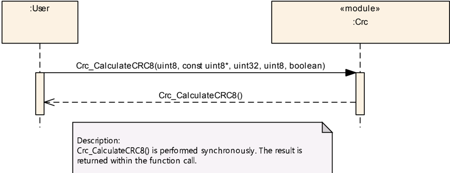
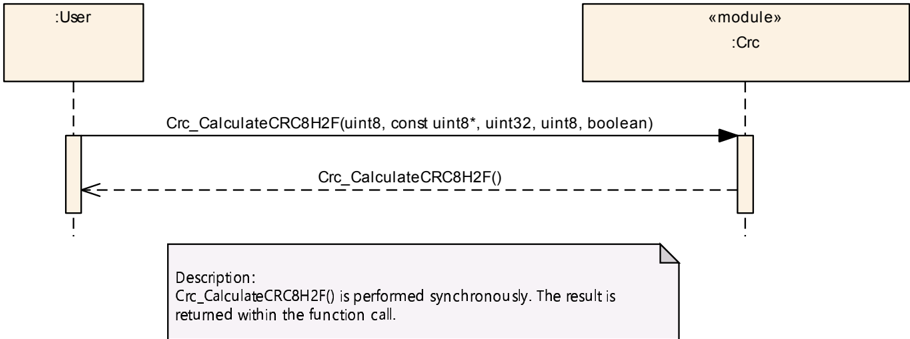
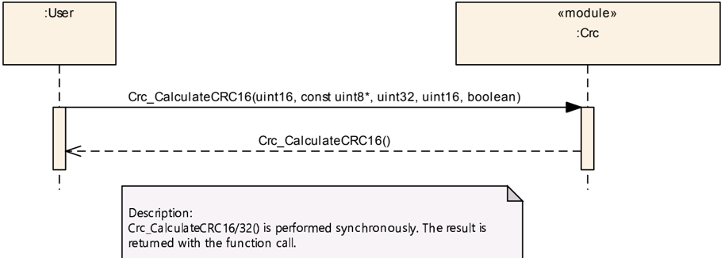
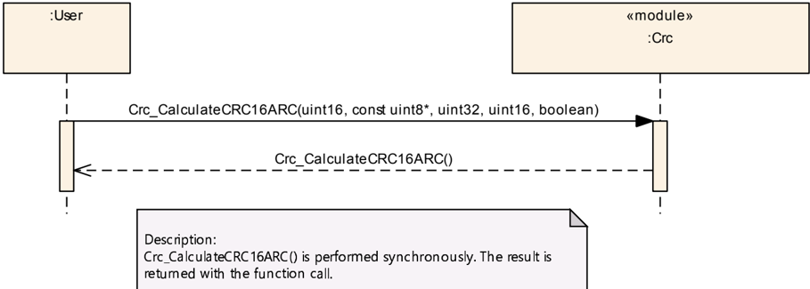
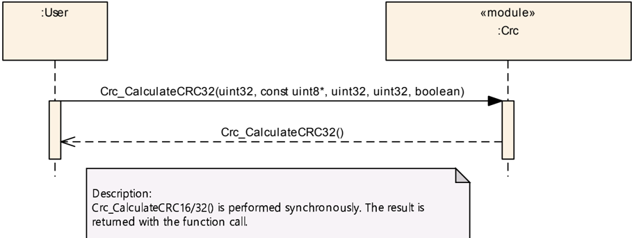
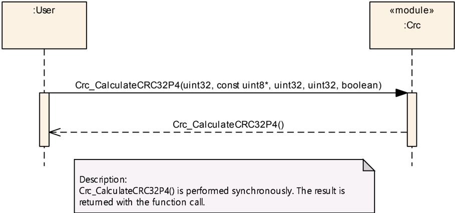
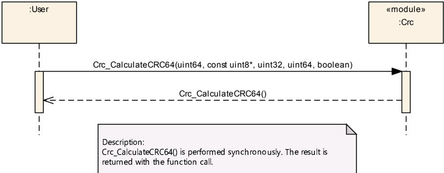
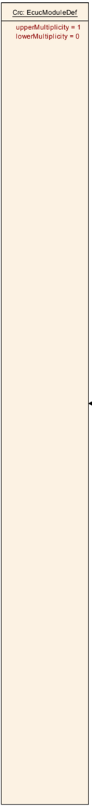
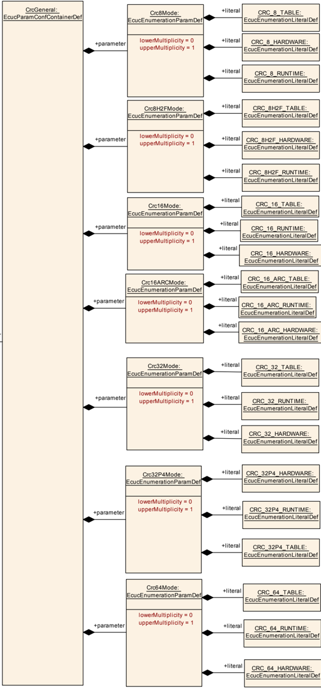

## 1. 简介和功能概述

本规范规定了 **AUTOSAR** 基础软件模块 **CRC** 的功能、**API** 和配置。

**CRC** 库包含以下用于 **CRC** 计算的例程：

* **CRC8**：**SAE J1850**
* **CRC8H2F**：0x2F 多项式 **CRC8**
* **CRC16**
* **CRC32**
* **CRC32P4**：0xF4ACFB13 多项式 **CRC32**
* **CRC64**：**CRC-64-ECMA**

对于所有例程（**CRC8**、**CRC8H2F**、**CRC16**、**CRC32**、**CRC32P4** 和 **CRC64**），可以使用以下计算方法：

* 基于表的计算：执行速度快，但代码规模较大（**ROM** 表）
* 运行时计算：执行较慢，但代码规模较小（无 **ROM** 表）
* 硬件支持的 **CRC** 计算（器件特定）：执行速度快，**CPU** 占用时间少

所有例程都是可重入的，可以被多个应用同时使用。未来某些器件可能会支持硬件辅助的 **CRC** 计算。

## 2. 缩略语

下面的术语表包含了与 **CRC** 模块相关、但未包含在 [\[1, **AUTOSAR** 术语表\]](#ref-1) 中的缩略语和缩写。

**CRC**
> 循环冗余校验（**Cyclic Redundancy Check**）

**ALU**
> 算术逻辑单元（**Arithmetic Logic Unit**）

## 3. 相关文档

### 3.1. 输入文件和相关标准与规范

<a id="ref-1"></a>[1] Glossary
> AUTOSAR_FO_TR_Glossary

<a id="ref-2"></a>[2] General Specification of Basic Software Modules
> AUTOSAR_CP_SWS_BSWGeneral

<a id="ref-3"></a>[3] General Requirements on Basic Software Modules
> AUTOSAR_CP_SRS_BSWGeneral

<a id="ref-4"></a>[4] Requirements on Libraries
> AUTOSAR_CP_SRS_Libraries

<a id="ref-5"></a>[5] ITU-T Recommendation X.25:Interface between Data Terminal Equipment (DTE) and Data Circuit-terminating Equipment (DCE) for terminals operating in the packet mode and connected to public data networks by dedicated circuit
> https://www.itu.int/rec/T-REC-X.25-199610-I/en

<a id="ref-6"></a>[6] 32-bit cyclic redundancy codes for Internet applications

<a id="ref-7"></a>[7] Listing of CRCs, including CRC-64-ECMA
> https://en.wikipedia.org/wiki/Cyclic_redundancy_check

<a id="ref-8"></a>[8] Layered Software Architecture
> AUTOSAR_CP_EXP_LayeredSoftwareArchitecture

<a id="ref-9"></a>[9] Specification of ECU Configuration
> AUTOSAR_CP_TPS_ECUConfiguration

<a id="ref-10"></a>[10] List of Basic Software Modules
> AUTOSAR_CP_TR_BSWModuleList

### 3.2. 相关规范

**AUTOSAR** 提供了基础软件模块通用规范 [\[2\]](#ref-2)（**SWS BSW General**），该规范同样适用于 **CRC**。

因此，**SWS BSW General** 规范应被视为 **AUTOSAR CRC** 库的附加必需规范。

## 4. 约束和假设

### 4.1. 限制

无已知限制。

### 4.2. 汽车域的适用性

无限制。

## 5. 对其他模块的依赖

不存在对其他模块的依赖。

## 6. 功能规格

### 6.1. CRC 码的基本概念

#### 6.1.1. 数学描述

设 D 为总位数为 n 的数据的按位表示，即

D = (d<sub>n−1</sub>, d<sub>n−2</sub>, d<sub>n−3</sub>, …, d<sub>1</sub>, d<sub>0</sub>)

其中 d<sub>0</sub>, d<sub>1</sub>, … = 0<sub>b</sub>, 1<sub>b</sub>。对应的冗余码 C 由 n + k 位表示为

C = (D, R) = (d<sub>n−1</sub>, d<sub>n−2</sub>, d<sub>n−3</sub>, …, d<sub>2</sub>, d<sub>1</sub>, d<sub>0</sub>, r<sub>k−1</sub>, …, r<sub>2</sub>, r<sub>1</sub>, r<sub>0</sub>)

其中 r<sub>0</sub>, r<sub>1</sub>, … = 0<sub>b</sub>, 1<sub>b</sub>，且 R = (r<sub>k−1</sub>, …, r<sub>2</sub>, r<sub>1</sub>, r<sub>0</sub>)。该码就是数据部分与冗余部分的简单拼接。（在我们的应用中，我们将选取 k = 16、32，且 n 为 16 或 32 的倍数。）

**CRC** 算法与系数取自二元有限域的多项式相关，并根据下表使用运算 ⊕ 和 ∗ 进行算术运算。

⊕ 运算就是二元运算「异或」（**exclusive-or**），任何 **CPU** 的 **ALU** 中通常都提供该运算。

| ⊕ | 0<sub>b</sub> | 1<sub>b</sub> |
|---|---|---|
| 0<sub>b</sub> | 0<sub>b</sub> | 1<sub>b</sub> |
| 1<sub>b</sub> | 1<sub>b</sub> | 0<sub>b</sub> |

| ∗ | 0<sub>b</sub> | 1<sub>b</sub> |
|---|---|---|
| 0<sub>b</sub> | 0<sub>b</sub> | 0<sub>b</sub> |
| 1<sub>b</sub> | 0<sub>b</sub> | 1<sub>b</sub> |

为简单起见，我们将以 ab 代替 a ∗ b。

我们给出一些系数取自二元有限域的多项式的例子，并给出它们的简化记法。

（例 1）p<sub>1</sub>(X) = 1<sub>b</sub>X<sup>3</sup> + 0<sub>b</sub>X<sup>2</sup> + 1<sub>b</sub>X<sup>1</sup> + 0<sub>b</sub>X<sup>0</sup> = X<sup>3</sup> + X

（例 2）p<sub>2</sub>(X) = 1<sub>b</sub>X<sup>2</sup> + 1<sub>b</sub>X<sup>1</sup> + 1<sub>b</sub>X<sup>0</sup> = X<sup>2</sup> + X<sup>1</sup> + 1<sub>b</sub>

任何由 n + k 位表示的码字都可以映射为一个阶数为 n + k − 1、系数取自二元有限域的多项式。我们对比特采用直观的映射，即

C(X) = d<sub>n−1</sub>X<sup>k+n−1</sup> + d<sub>n−2</sub>X<sup>k+n−2</sup> + … + d<sub>2</sub>X<sup>k+2</sup> + d<sub>1</sub>X<sup>k+1</sup> + d<sub>0</sub>X<sup>k</sup> + r<sub>k−1</sub>X<sup>k−1</sup> + r<sub>k−2</sub>X<sup>k−2</sup> + … + r<sub>1</sub>X + r<sub>0</sub>

C(X) = X<sup>k</sup>(d<sub>n−1</sub>X<sup>n−1</sup> + d<sub>n−2</sub>X<sup>n−2</sup> + … + d<sub>2</sub>X<sup>2</sup> + d<sub>1</sub>X<sup>1</sup> + d<sub>0</sub>) + r<sub>k−1</sub>X<sup>k−1</sup> + r<sub>k−2</sub>X<sup>k−2</sup> + … + r<sub>1</sub>X + r<sub>0</sub>

C(X) = X<sup>k</sup>D(X) ⊕ R(X)

该映射是一一映射。

某个循环冗余码多项式空间 CRC<sub>G</sub> 定义为给定的生成多项式 G(X) = X<sup>k</sup> + g<sub>k−1</sub>X<sup>k−1</sup> + g<sub>k−2</sub>X<sup>k−2</sup> + … + g<sub>2</sub>X<sup>2</sup> + g<sub>1</sub>X + g<sub>0</sub> 的倍式。根据定义，对于 CRC<sub>G</sub> 中的任何码多项式 C(X)，都存在一个多项式 M(X)，使得

C(X) = G(X)M(X)

对于一个固定的不可约（即素）多项式 G(X)，映射 M(X) → C(X) 是一一映射。那么，如何校验给定码字中的数据呢？这基本上是一次多项式除法，使用欧几里得算法（**Euclidian Algorithm**）。在实践中，我们关心的不是 M(X)，而是除法的余数 C(X) mod G(X)。对于正确的码字 C，该余数必须为零，即 C(X) mod G(X) = 0。如果不是这样——码字中就存在错误。如果 G(X) 具有某些附加的代数性质，就可以确定错误位置并纠正码字。

码字的计算同样可以用欧几里得算法完成。对于给定的数据多项式 D(x) = d<sub>n−1</sub>X<sup>n−1</sup> + d<sub>n−2</sub>X<sup>n−2</sup> + … + d<sub>1</sub>X<sup>1</sup> + d<sub>0</sub> 及对应的码多项式 C(X)，我们有

C(X) = X<sup>k</sup>D(X) ⊕ R(X) = M(X)G(X)

对等式两边执行 mod G(X) 运算，得到

0 = C(X) mod G(X) = [X<sup>k</sup>D(X)] mod G(X) ⊕ R(X) mod G(X)　　(7.1)

我们注意到多项式 R(X) 的阶数小于 G(X) 的阶数，因此模除法得到的商为零、余式为 R(X)：

R(X) mod G(X) = R(X)

对于系数取自二元有限域的多项式 R(X)，我们有一个显著的性质：R(X) + R(X) = 0。如果在式 (7.1) 的两边加上 R(X)，我们得到

R(X) = X<sup>k</sup>D(X) mod G(X)

重要的结论是：所求码的冗余部分可以通过对多项式使用欧几里得算法来确定。目前，任何 **CRC** 计算方法都是这一基本算法或多或少精巧的变体。

至此，关于 **CRC** 码的命题总结如下：

1. **CRC** 码的构造原理基于系数取自二元有限域的多项式。该域的 ⊕ 运算与二元运算「**XOR**」（异或）完全相同。
2. 从比特序列到该多项式空间存在一种自然的映射。
3. **CRC** 码多项式的计算与校验都基于对给定生成多项式的模除法。
4. 该生成多项式必须具备特定的代数性质，才能实现错误检测乃至错误纠正。

#### 6.1.2. 二进制多项式与比特序列的欧几里得算法

给定一个系数取自二元有限域的多项式 P<sub>n</sub>(X) = p<sub>n</sub>X<sup>n</sup> + p<sub>n−1</sub>X<sup>n−1</sup> + … + p<sub>2</sub>X<sup>2</sup> + p<sub>1</sub>X + p<sub>0</sub>。设 Q(X) = X<sup>k</sup> + q<sub>k−1</sub>X<sup>k−1</sup> + q<sub>k−2</sub>X<sup>k−2</sup> + … + q<sub>2</sub>X<sup>2</sup> + q<sub>1</sub>X + q<sub>0</sub> 为另一个精确阶数为 k &gt; 0 的多项式。设 R<sub>n</sub>(X) 为多项式除法中阶数最大为 k − 1 的余式，M<sub>n</sub>(X) 与之对应，使得

R<sub>n</sub>(X) ⊕ M<sub>n</sub>(X)Q(X) = P<sub>n</sub>(X)

**欧几里得算法——递归形式**

（递归终止）

若 n &lt; k，则取 R<sub>n</sub>(X) = P<sub>n</sub>(X)，M<sub>n</sub> = 0。

（递归 n + 1 → n）

设 P<sub>n+1</sub>(X) 的最大阶数为 n + 1。

若 n + 1 ≥ k，计算 P<sub>n</sub>(X) = P<sub>n+1</sub>(X) − p<sub>n+1</sub>Q(X)X<sup>n−k+1</sup>。该多项式的最大阶数为 n。于是

P<sub>n+1</sub>(X) mod Q(X) = P<sub>n</sub>(X) mod Q(X)

**递归的证明**

选取 R<sub>n+1</sub>(X) = P<sub>n+1</sub>(X) mod Q(X)，并选取 M<sub>n+1</sub>(X) 使得

R<sub>n+1</sub>(X) ⊕ M<sub>n+1</sub>(X)Q(X) = P<sub>n+1</sub>(X)

于是 R<sub>n+1</sub>(X) − R<sub>n</sub>(X) = P<sub>n+1</sub>(X) − M<sub>n+1</sub>(X)Q(X) − P<sub>n</sub>(X) ⊕ M<sub>n</sub>(X)Q(X)。

由 P<sub>n+1</sub>(X) − P<sub>n</sub>(X) = p<sub>n+1</sub>Q(X)X<sup>n−k+1</sup> 我们得到：

R<sub>n+1</sub>(X) − R<sub>n</sub>(X) = p<sub>n+1</sub>Q(X)X<sup>n−k+1</sup> + M<sub>n</sub>(X)Q(X) − M<sub>n+1</sub>(X)Q(X)

R<sub>n+1</sub>(X) − R<sub>n</sub>(X) = Q(X)[p<sub>n+1</sub>X<sup>n−k+1</sup> + M<sub>n</sub>(X) − M<sub>n+1</sub>(X)]

等式左边是一个阶数最大为 k − 1 的多项式。等式右边的 Q(X) 的精确阶数为 k。这意味着等式两边都平凡地等于零。由此得到

R<sub>n+1</sub>(X) = R<sub>n</sub>(X)　　(7.2)

M<sub>n+1</sub>(X) = M<sub>n</sub>(X) + p<sub>n+1</sub>X<sup>n−k+1</sup>　　(7.3)

（证毕）

**例 7.1**

P(X) = P<sub>4</sub>(X) = X<sup>4</sup> + X<sup>2</sup> + X + 1<sub>b</sub>；Q(X) = X<sup>2</sup> + X + 1<sub>b</sub>；n = 4；k = 2

P<sub>3</sub>(X) = X<sup>4</sup> + X<sup>2</sup> + X + 1<sub>b</sub> − 1<sub>b</sub>(X<sup>2</sup> + X + 1<sub>b</sub>)X<sup>2</sup> = X<sup>3</sup> + X + 1<sub>b</sub>

P<sub>2</sub>(X) = X<sup>3</sup> + X + 1<sub>b</sub> − 1<sub>b</sub>X(X<sup>2</sup> + X + 1<sub>b</sub>) = X<sup>2</sup> + 1<sub>b</sub>

P<sub>1</sub>(X) = X<sup>2</sup> + 1 − 1<sub>b</sub>(X<sup>2</sup> + X + 1) = X

R(X) = P(X) mod Q(X) = R<sub>1</sub>(X) = P<sub>1</sub>(X) = X

#### 6.1.3. CRC 计算、变体与参数

在欧几里得算法的基础上，人们开发了一些变体以提升计算性能。所有这些变体都不能提升检错或纠错能力——所得码的所谓汉明距离（**Hamming Distance**）仅由生成多项式决定。这些变体只是针对不同的实现 **ALU** 进行优化。

**CRC** 计算方法由以下要素刻画：

1. 数据到比特序列 (d<sub>n−1</sub>, d<sub>n−2</sub>, d<sub>n−3</sub>, …, d<sub>1</sub>, d<sub>0</sub>) 及相应数据多项式 D(X) 的映射规则（标准或反射数据）。
2. 生成多项式 G(X)。
3. 起始值及相应的多项式 S(X)。
4. A(X)，也称为用于修改最终结果的 **XOR** 值。
5. 将所得 **CRC** 余式 R(X) 映射为码字的规则（标准或反射数据）。

计算本身按以下步骤组织：

* 将数据映射为 D(X)
* 对 X<sup>k</sup>D(X) + X<sup>n−k−1</sup>S(X) + A(X) 执行欧几里得算法，并确定 R(X) = [X<sup>k</sup>D(X) + X<sup>n−k−1</sup>S(X) + A(X)] mod G(X)
* 将 D(X)、R(X) 映射为码字

#### 6.1.4. CRC 多项式的编码

多项式的编码有三种记法；为便于澄清，下面以 42'F0'E1'EB'A9'EA'36'93h 多项式为例展示所有这三种记法：

| 编号 | 记法 | 值 |
|---|---|---|
| 1 | 二进制形式的多项式（**Polynomial as binary**） | 0001'0100'0010'1111'0000'1110'0001'1110'1011'1010'1001'1110'1010'0011'0110'1001'0011 |
| 2 | 带最高位的常规表示（**Normal representation with high bit**） | 01'42'F0'E1'EB'A9'EA'36'93h |
| 3 | 常规表示（**Normal representation**） | 42'F0'E1'EB'A9'EA'36'93h |
| 4 | 反转互反表示（= **Koopman** 表示）（**Reversed reciprocal representation (=Koopman representation)**） | A1'78'70'F5'D4'F5'1B'49h |

**注意：**

1. 带最高位的常规表示 = 多项式二进制形式的十六进制表示
2. 带最高位的常规表示 = Koopman 表示 * 2 + 1

在本文档中（且除非另有说明，在 **AUTOSAR CP** 中始终如此），使用不带最高位的常规表示，即上表中的记法 3。

### 6.2. 标准参数

本节概要介绍 8 位、16 位和 32 位 **CRC** 计算中常用的标准参数。

* **CRC** 结果宽度（**CRC result width**）：定义 **CRC** 计算的结果数据宽度。
* 多项式（**Polynomial**）：定义 **CRC** 算法使用的生成多项式。
* 初始值（**Initial value**）：定义 **CRC** 算法的起始条件。
* 输入数据反射（**Input data reflected**）：定义在处理之前是否对每个输入字节的位进行反射（见下文定义）。
* 结果数据反射（**Result data reflected**）：与「输入数据反射」类似，该参数定义是否对 **CRC** 结果的位进行反射（见下文定义）。对 **CRC8** 结果按 8 位反射，对 **CRC16** 按 16 位反射，对 **CRC32** 按 32 位反射。
* **XOR** 值（**XOR value**）：在该值作为正式校验和返回之前，它与最终寄存器值进行 **XOR** 运算。
* 校验值（**Check**）：该字段是一个校验值，可用作算法实现的弱验证器。该字段包含将对应于值 31h 32h 33h 34h 35h 36h 37h 38h 39h 的 **ASCII** 字符 '1' '2' '3' '4' '5' '6' '7' '8' '9' 送入指定算法后得到的校验和。
* 魔术校验（**Magic check**）：**CRC** 检查过程对整个数据块（包括 **CRC** 结果）计算 **CRC**。无论数据块内容如何，无错误的数据块总会得到唯一的常数多项式（魔术校验）——即 **CRC** 结果与「**XOR** 值」异或的结果——而与数据块内容无关。

**例 7.2**

对数据字节 00h 00h 00h 00h 计算 **SAE-J1850 CRC8** 的魔术校验（详细参数见 [SWS_Crc_00030]）：

* **CRC** 生成：对 00h 00h 00h 00h 计算 **CRC**，起始值 FFh：
    * **CRC** 结果 = 59h
* **CRC** 校验：对 00h 00h 00h 00h 59h 计算 **CRC**，起始值 FFh：
    * **CRC** 结果 = 3Bh
    * 魔术校验 = **CRC** 结果与「**XOR** 值」异或：C4h = 3Bh xor FFh

数据反射（**Data reflection**）：这是一种按位进行的反射，数据位以相反的顺序书写。公式为：

reflect<sub>n</sub>(x) = Σ<sub>i=0</sub><sup>n−1</sup> x<sub>i</sub> × 2<sup>n−i−1</sup>

其中 x 为数据，n 为数据位数。

例如：2D<sub>16</sub>（n = 8）（0010 1101<sub>2</sub>）的 reflection<sub>16</sub> 为 B4<sub>16</sub>（1011 0100<sub>2</sub>）。

12345678<sub>16</sub>（n = 16）（0001 0010 0011 0100 0101 0110 0111 1000<sub>2</sub>）的 reflection<sub>16</sub> 为 1E6A2C48<sub>16</sub>（0001 1110 0110 1010 0010 1100 0100 1000<sub>2</sub>）。

123456789ABCDEF0（n = 32）（0001 0010 0011 0100 0101 0110 0111 1000 1001 1010 1011 1100 1101 1110 1111 0000<sub>2</sub>）的 reflection<sub>32</sub> 为 0F7B3D591E6A2C48<sub>16</sub>（0000 1111 0111 1011 0011 1101 0101 1001 0001 1110 0110 1010 0010 1100 0100 1000<sub>2</sub>）。

123456789ABCDEF0（n = 8）（0001 0010 0011 0100 0101 0110 0111 1000 1001 1010 1011 1100 1101 1110 1111 0000<sub>2</sub>）的 reflection<sub>8</sub> 为 84C2A6E195D3B7F0<sub>16</sub>（1000 0100 1100 0010 1010 0110 1110 0001 1001 0101 1101 0011 1011 0111 1111 0000<sub>2</sub>）。

### 6.2.1. 8 位 CRC 计算

#### 6.2.1.1. 8 位 SAE J1850 CRC 计算

**CRC** 模块的 Crc_CalculateCRC8 函数应按照 [SWS_Crc_00073] 实现基于 **SAE-J1850 CRC8** 标准的 **CRC8** 例程。

表7.1：SAE-J1850 CRC8 多项式（**SAE-J1850 CRC8 Polynomial**）

| CRC 结果宽度 | 8 bits |
|---|---|
| 多项式 | 1Dh |
| 初始值 | FFh |
| 输入数据反射 | 否 |
| 结果数据反射 | 否 |
| XOR 值 | FFh |
| 校验值 | 4Bh |
| 魔术校验 | C4h |

**CRC** 模块的 Crc_CalculateCRC8 函数应按照 [SWS_Crc_00074] 提供以下 **CRC** 计算结果：

表7.2：Crc_CalculateCRC8 结果（**Crc_CalculateCRC8 results**）

| 数据字节（十六进制） | | | | | | | | | CRC |
|---|---|---|---|---|---|---|---|---|---|
| 00 | 00 | 00 | 00 | | | | | | 59 |
| F2 | 01 | 83 | | | | | | | 37 |
| 0F | AA | 00 | 55 | | | | | | 79 |
| 00 | FF | 55 | 11 | | | | | | B8 |
| 33 | 22 | 55 | AA | BB | CC | DD | EE | FF | CB |
| 92 | 6B | 55 | | | | | | | 8C |
| FF | FF | FF | FF | | | | | | 74 |

#### 6.2.1.2. 8 位 0x2F 多项式 CRC 计算

**CRC** 模块的 Crc_CalculateCRC8H2F 函数应按照 [SWS_Crc_00075] 实现基于生成多项式 0x2F 的 **CRC8** 例程。

表7.3：CRC8 多项式（**CRC8 Polynomial**）

| CRC 结果宽度 | 8 bits |
|---|---|
| 多项式 | 2Fh |
| 初始值 | FFh |
| 输入数据反射 | 否 |
| 结果数据反射 | 否 |
| XOR 值 | FFh |
| 校验值 | DFh |
| 魔术校验 | 42h |

**CRC** 模块的 Crc_CalculateCRC8H2F 函数应按照 [SWS_Crc_00076] 提供以下 **CRC** 计算结果：

表7.4：Crc_CalculateCRC8H2F 结果（**Crc_CalculateCRC8H2F results**）

| 数据字节（十六进制） | | | | | | | | | CRC |
|---|---|---|---|---|---|---|---|---|---|
| 00 | 00 | 00 | 00 | | | | | | 12 |
| F2 | 01 | 83 | | | | | | | C2 |
| 0F | AA | 00 | 55 | | | | | | C6 |
| 00 | FF | 55 | 11 | | | | | | 77 |
| 33 | 22 | 55 | AA | BB | CC | DD | EE | FF | 11 |
| 92 | 6B | 55 | | | | | | | 33 |
| FF | FF | FF | FF | | | | | | 6C |

### 6.2.2. 16 位 CRC 计算

#### 6.2.2.1. 16 位 CCITT-FALSE CRC16

**CRC** 模块应按照 [SWS_Crc_00077] 实现基于 **CCITT-FALSE CRC16** 标准的 **CRC16** 例程。

关于标准文档 [\[5\]](#ref-5) 的说明：

当帧被构建时，计算得到的 **FCS** 等于 **CRC16** 异或 FFFFh（**CCITT-FALSE CRC16** 的一次补码）。

在验证时，对相同的数据 + **FCS** 计算 **CRC16**（**CCITT-FALSE**），得到的值始终为 1D0Fh。

注意，如果在验证期间，校验是在数据 + **CRC16**（即 **FCS** 异或 FFFFh）上进行的，那么得到的值将是 0000h，即 **CCITT-FALSE** 的魔术校验。

表7.5：CCITT-FALSE CRC16 多项式（**CCITT-FALSE CRC16 Polynomial**）

| CRC 结果宽度 | 16 bits |
|---|---|
| 多项式 | 1021h |
| 初始值 | FFFFh |
| 输入数据反射 | 否 |
| 结果数据反射 | 否 |
| XOR 值 | 0000h |
| 校验值 | 29B1h |
| 魔术校验 | 0000h |

**CRC** 模块的 Crc_CalculateCRC16 函数应按照 [SWS_Crc_00078] 提供以下 **CRC** 计算结果：

表7.6：Crc_CalculateCRC16 结果（**Crc_CalculateCRC16 results**）

| 数据字节（十六进制） | | | | | | | | | CRC |
|---|---|---|---|---|---|---|---|---|---|
| 00 | 00 | 00 | 00 | | | | | | 84C0 |
| F2 | 01 | 83 | | | | | | | D374 |
| 0F | AA | 00 | 55 | | | | | | 2023 |
| 00 | FF | 55 | 11 | | | | | | B8F9 |
| 33 | 22 | 55 | AA | BB | CC | DD | EE | FF | F53F |
| 92 | 6B | 55 | | | | | | | 0745 |
| FF | FF | FF | FF | | | | | | 1D0F |

#### 6.2.2.2. 16 位 0x8005 多项式 CRC 计算

**CRC** 模块应按照 [SWS_Crc_00079] 实现基于 **CRC16/ARC** 标准的 **CRC16** 例程。

表7.7：CRC-16/ARC 多项式（**CRC-16/ARC Polynomial**）

| CRC 结果宽度 | 16 bits |
|---|---|
| 多项式 | 8005h |
| 初始值 | 0000h |
| 输入数据反射 | 是 |
| 结果数据反射 | 是 |
| XOR 值 | 0000h |
| 校验值 | BB3Dh |
| 魔术校验 | 0000h |

**CRC** 模块的 Crc_CalculateCRC16ARC 函数应按照 [SWS_Crc_00080] 提供以下 **CRC** 计算结果：

表7.8：Crc_CalculateCRC16ARC 结果（**Crc_CalculateCRC16ARC results**）

| 数据字节（十六进制） | | | | | | | | | CRC |
|---|---|---|---|---|---|---|---|---|---|
| 00 | 00 | 00 | 00 | | | | | | 0000 |
| F2 | 01 | 83 | | | | | | | C2E1 |
| 0F | AA | 00 | 55 | | | | | | 0BE3 |
| 00 | FF | 55 | 11 | | | | | | 6CCF |
| 33 | 22 | 55 | AA | BB | CC | DD | EE | FF | AE98 |
| 92 | 6B | 55 | | | | | | | E24E |
| FF | FF | FF | FF | | | | | | 9401 |

### 6.2.3. 32 位 CRC 计算

#### 6.2.3.1. 32 位 Ethernet CRC 计算

**CRC** 模块应按照 [SWS_Crc_00081] 实现基于 **IEEE-802.3 CRC32 Ethernet** 标准的 **CRC32** 例程。

表7.9：IEEE-802.3 CRC32 Ethernet 多项式（**IEEE-802.3 CRC32 Ethernet Polynomial**）

| CRC 结果宽度 | 32 bits |
|---|---|
| 多项式 | 04C11DB7h |
| 初始值 | FFFFFFFFh |
| 输入数据反射 | 是 |
| 结果数据反射 | 是 |
| XOR 值 | FFFFFFFFh |
| 校验值 | CBF43926h |
| 魔术校验<sup>*</sup> | DEBB20E3h |

<sup>*</sup>**重要说明：** 要匹配魔术校验值，**CRC** 必须以小端序（即低有效字节在前）附加。这是由输入和结果的反射所致。

**CRC** 模块的 Crc_CalculateCRC32 函数应按照 [SWS_Crc_00082] 提供以下 **CRC** 计算结果：

表7.10：Crc_CalculateCRC32 结果（**Crc_CalculateCRC32 results**）

| 数据字节（十六进制） | | | | | | | | | CRC |
|---|---|---|---|---|---|---|---|---|---|
| 00 | 00 | 00 | 00 | | | | | | 2144DF1C |
| F2 | 01 | 83 | | | | | | | 24AB9D77 |
| 0F | AA | 00 | 55 | | | | | | B6C9B287 |
| 00 | FF | 55 | 11 | | | | | | 32A06212 |
| 33 | 22 | 55 | AA | BB | CC | DD | EE | FF | B0AE863D |
| 92 | 6B | 55 | | | | | | | 9CDEA29B |
| FF | FF | FF | FF | | | | | | FFFFFFFF |

#### 6.2.3.2. 32 位 0xF4ACFB13 多项式 CRC 计算

这个 32 位 **CRC** 函数在 [\[6\]](#ref-6) 中描述。相对于 Ethernet **CRC**，它的优势在于：在最大 4 kB 的范围内汉明距离为 6。

**CRC** 模块应按照 [SWS_Crc_00083] 使用 0xF4'AC'FB'13 多项式实现 **CRC32** 例程。

表7.11：0xF4'AC'FB'13 多项式（**0xF4'AC'FB'13 Polynomial**）

| CRC 结果宽度 | 32 bits |
|---|---|
| 多项式 | F4'AC'FB'13h |
| 初始值 | FFFFFFFFh |
| 输入数据反射 | 是 |
| 结果数据反射 | 是 |
| XOR 值 | FFFFFFFFh |
| 校验值 | 16'97'D0'6Ah |
| 魔术校验<sup>*</sup> | 90'4C'DD'BFh |
| 汉明距离 | 6，最大 4096 字节（含 **CRC**） |

<sup>*</sup>**重要说明：** 要匹配魔术校验值，**CRC** 必须以小端序（即低有效字节在前）附加。这是由输入和结果的反射所致。

**CRC** 模块的 Crc_CalculateCRC32P4 函数应按照 [SWS_Crc_00084] 提供以下 **CRC** 计算结果：

表7.12：Crc_CalculateCRC32P4 结果（**Crc_CalculateCRC32P4 results**）

| 数据字节（十六进制） | | | | | | | | | CRC |
|---|---|---|---|---|---|---|---|---|---|
| 00 | 00 | 00 | 00 | | | | | | 6FB32240h |
| F2 | 01 | 83 | | | | | | | 4F721A25h |
| 0F | AA | 00 | 55 | | | | | | 20662DF8h |
| 00 | FF | 55 | 11 | | | | | | 9BD7996Eh |
| 33 | 22 | 55 | AA | BB | CC | DD | EE | FF | A65A343Dh |
| 92 | 6B | 55 | | | | | | | EE688A78h |
| FF | FF | FF | FF | | | | | | FFFFFFFFh |

### 6.2.4. 64 位 CRC 计算

#### 6.2.4.1. 64 位 ECMA 多项式 CRC 计算

这个 64 位 **CRC** 函数在 [\[7\]](#ref-7) 中描述。对于长数据，它具有良好的汉明距离 4（见下文）。

**CRC** 模块应按照 [SWS_Crc_00085] 使用 0x42'F0'E1'EB'A9'EA'36'93 多项式实现 **CRC64** 例程。

表7.13：0x42'F0'E1'EB'A9'EA'36'93 多项式（**0x42'F0'E1'EB'A9'EA'36'93 Polynomial**）

| CRC 结果宽度 | 64 bits |
|---|---|
| 多项式 | 42'F0'E1'EB'A9'EA'36'93h |
| 初始值 | FFFFFFFFFFFFFFFFh |
| 输入数据反射 | 是 |
| 结果数据反射 | 是 |
| XOR 值 | FFFFFFFFFFFFFFFFh |
| 校验值 | 99'5D'C9'BB'DF'19'39'FAh |
| 魔术校验<sup>*</sup> | 49'95'8C'9A'BD'7D'35'3Fh |
| 汉明距离 | 4，最大接近 8 GB |

<sup>*</sup>**重要说明：** 要匹配魔术校验值，**CRC** 必须以小端序（即低有效字节在前）附加。这是由输入和结果的反射所致。

**CRC** 模块的 Crc_CalculateCRC64 函数应按照 [SWS_Crc_00086] 提供以下 **CRC** 计算结果：

表7.14：Crc_CalculateCRC64 结果（**Crc_CalculateCRC64 results**）

| 数据字节（十六进制） | | | | | | | | | CRC |
|---|---|---|---|---|---|---|---|---|---|
| 00 | 00 | 00 | 00 | | | | | | F4A586351E1B9F4Bh |
| F2 | 01 | 83 | | | | | | | 319C27668164F1C6h |
| 0F | AA | 00 | 55 | | | | | | 54C5D0F7667C1575h |
| 00 | FF | 55 | 11 | | | | | | A63822BE7E0704E6h |
| 33 | 22 | 55 | AA | BB | CC | DD | EE | FF | 701ECEB219A8E5D5h |
| 92 | 6B | 55 | | | | | | | 5FAA96A9B59F3E4Eh |
| FF | FF | FF | FF | | | | | | FFFFFFFF00000000h |

### 6.3. 一般行为

数据块通过参数「起始地址」「大小」和「起始值」传递给 **CRC** 例程。返回值即 **CRC** 计算结果。

### 6.4. 版本检查

详情请参阅 SWS_BSWGeneral 中的第 5.1.8 章「**Version Check**」（版本检查）。

### 6.5. 错误分类

《**General Specification of Basic Software Modules**》（基础软件模块通用规范）一文的第 7.2 节「**Error Handling**」（错误处理）详细描述了基础软件的错误处理。其中最重要的是，它构成了一个由 **BSW** 模块中可能发生的五种错误类型组成的分类方案。

在此基础上，下文按相应的小节规定了具体的错误。

#### 6.5.1. 开发错误

不存在开发错误。

#### 6.5.2. 运行时错误

不存在运行时错误。

#### 6.5.3. 瞬态故障

不存在瞬态故障。

#### 6.5.4. 生产错误

不存在生产错误。

#### 6.5.5. 扩展生产错误

不存在扩展生产错误。

## 7. API规范

### 7.1. 导入的类型

在本章中，列出了从以下模块包含的所有类型：

表7.15：模块 Crc 导入的数据类型定义（**Definition of imported datatypes of module Crc**）

| 模块 | 头文件 | 导入类型 |
|---|---|---|
| Std | Std_Types.h | Std_VersionInfoType |

### 7.2. 类型定义

**Crc** 模块没有类型定义。

### 7.3. 函数定义

如果要将 **CRC** 例程用作库，**CRC** 模块的实现者应以如下方式开发 **CRC** 模块：**CRC** 代码中只有被其他模块使用的部分才会被链接到最终的二进制文件中。

**CRC** 库函数不得调用任何 **BSW** 模块函数（例如 **DET**）。

**CRC** 函数（参数 Crc_IsFirstCall = TRUE 时）应执行以下操作：

1. 作为 **CRC** 计算的「初始值」，使用多项式的「初始值」（**Initial value**）属性：

   Crc = PolynomialInitVal

2. 如果多项式的「输入数据反射」（**Input data reflected**）属性为 TRUE，则对通过参数 Crc_DataPtr 和 Crc_Length 获得的输入数据进行（逐字节的）反射：

   Data = reflect<sub>8</sub>(Data)（在「输入数据反射」为 TRUE 的情况下）

3. 基于数据、上一次的 **CRC** 和 **CRC** 多项式计算 **CRC**：

   Crc = f(Data, Crc, Polynomial)

4. 在 crc 与多项式的「**XOR** 值」之间执行 **XOR** 运算：

   Crc = Crc ⊕ PolynomialXORVal

5. 如果多项式的「结果数据反射」（**Result data reflected**）属性为 TRUE，则对 **CRC** 进行反射（按 8、16 或 32 位，取决于 **CRC** 的大小）：

   Crc = reflect<sub>Crcsize</sub>(Crc)（在「结果数据反射」为 TRUE 的情况下）

6. 返回该 **CRC**：

   return Crc

只要数据可用，步骤 2 和步骤 3 就会一直执行。

**CRC** 函数（参数 Crc_IsFirstCall = FALSE 时）应执行以下操作：

1. 作为 **CRC** 计算的「初始值」，使用参数 Crc_StartValueX（其中 X 为 8、8H2F、16、32、P4 或 64），该参数应为上一次调用的 **CRC** 计算结果。随后该结果与「**XOR** 值」进行异或，并且如果多项式的「结果数据反射」属性为 TRUE，则进行反射：

   Crc = Crc_StartValueX ⊕ PolynomialXORVal

   Crc = reflect<sub>Crcsize</sub>(Crc)（在「结果数据反射」为 TRUE 的情况下）

步骤 2 至 6 与 [SWS_Crc_00014] 中相同。

**CRC** 函数的使用方法：

首次或唯一调用 **CRC** 函数时，**CRC** 函数的用户应：

1. 给出指向数据的指针（Crc_DataPtr）
2. 给出数据的字节数（Crc_Length）
3. 给 Crc_StartValueX 参数一个无关的值（初始化值由所选算法确定）
4. 将 Crc_IsFirstCall 参数赋值为 TRUE，以告知库这是首次或唯一调用
5. 调用 **CRC** 函数
6. 获取 **CRC**

对于后续调用，用户必须：

1. 给出指向数据的指针（Crc_DataPtr）
2. 给出数据的字节数（Crc_Length）
3. 将 Crc_StartValueX 参数（其中 X 为 8、8H2F、16、32、P4 或 64）赋值为上一次调用的 **CRC** 计算结果
4. 将 Crc_IsFirstCall 参数赋值为 FALSE，以告知库这不是首次调用
5. 调用 **CRC** 函数
6. 获取 **CRC**

**例 8.1**

**CRC8** 的计算：对 **SAE J1850** 规范定义的测试模式之一（00h、FFh、55h、11h，**CRC** 结果为 B8h）计算 **CRC8 SAE J1850**：

* 单步完成：

```C
uint8 Array[4] = {0x00, 0xFF, 0x55, 0x11};
uint8 ignored_val = 0x00l; /* any value, it is ignored */

uint8 resultSAE = Crc_CalculateCRC8(&Array[0], 4, ignored_val, TRUE);
```

resultSAE 应等于 B8h。

* 分多步完成：

```C
uint8 Array[4] = {0x00, 0xFF, 0x55, 0x11};
uint8 ignored_val = 0x00l; /* any value, it is ignored */

uint8 resultSAE = Crc_CalculateCRC8(&Array[0], 2, ignored_val, TRUE);
resultSAE = Crc_CalculateCRC8(&Array[2], 1, resultSAE, FALSE);
resultSAE = Crc_CalculateCRC8(&Array[3], 1, resultSAE, FALSE);
```

resultSAE 同样应等于 B8h。

**例 8.2**

**CRC8** 的计算：计算与 **SAE J1850** 不兼容、但与 **R4.0** 之前的 **AUTOSAR** 发行版兼容的 **CRC8**：

* 单步完成：

```C
uint8 Array[4] = {0x00, 0xFF, 0x55, 0x11};

/* The first call also gets IsFirstCall set to FALSE, and 0xFF as start
value, which is immediately XORed with 0xFF by CalculateCRC8,
resulting with start value equal to 0x00. */

uint8 resultRel3 = Crc_CalculateCRC8(&Array[0], 4, 0xFF, FALSE);

/* The last XORing must be negated by the caller, to come to 0x00 XOR
value. */

resultRel3 = resultR3 ^ 0xFF;
```

resultRel3 包含的值与 **AUTOSAR R3.2 CRC8** 计算出的值相同。

* 分多步完成：

```C
uint8 Array[4] = {0x00, 0xFF, 0x55, 0x11};

/* The first call also gets IsFirstCall set to FALSE, and 0xFF as start
value, which is immediately XORed with 0xFF by CalculateCRC8,
resulting with start value equal to 0x00. */

uint8 resultRel3 = Crc_CalculateCRC8(&Array[0], 2, 0xFF, FALSE);
resultRel3 = Crc_CalculateCRC8(&Array[2], 1, resultRel3,FALSE);
resultRel3 = Crc_CalculateCRC8(&Array[3], 1, resultRel3, FALSE);

/* The last XORing must be negated by the caller, to come to 0x00 XOR
value. */

resultRel3 = resultR3 ^ 0xFF; }
```

resultRel3 同样包含的值与 **AUTOSAR R3.2 CRC8** 计算出的值相同。

**例 8.3**

对数据字节 01h 02h 03h 04h 05h 06h 07h 08h 计算 **CRC32 Ethernet** 标准（详细参数见 [SWS_Crc_00003]）的 **CRC**：

* 在一次函数调用中：对 01h 02h 03h 04h 05h 06h 07h 08h 计算 **CRC**，起始值 FFFFFFFFh：
    * **CRC** 结果 = 3FCA88C5h（最终值）
* 在两次函数调用中：
    * 对 01h 02h 03h 04h 计算 **CRC**，起始值 FFFFFFFFh：
        * 第一次调用的 **CRC** 结果 = B63CFBCDh（中间值）
    * 对 05h 06h 07h 08h 计算 **CRC**，起始值：B63CFBCDh xor **XOR** 值（FFFFFFFFh）= 49C30432h，反射后为：4C20C392h
        * 最终调用的 **CRC** 结果 = 3FCA88C5h（最终值）

下面的 **C** 代码示例展示了调用者如何直接使用上一次的结果（无需任何加工）来修改起始值，并表明这不再是首次调用：

```C
InterResult = Crc_CalculateCRC32(&Array12345678[0], 4, 0xFFFFFFFF, TRUE );
result = Crc_CalculateCRC32(&Array12345678[4], 4, InterResult, FALSE);
```

#### 7.3.1. 8 位 CRC 计算

##### 7.3.1.1. 8 位 SAE J1850 CRC 计算

**说明**: 此服务对 Crc_Length 个数据字节执行采用 **SAE J1850** 参数的 **CRC8** 计算。服务 ID 0x01。本服务为同步调用，可重入。参数 Crc_DataPtr（in）：指向待计算数据块起始地址的指针。参数 Crc_Length（in）：待计算数据块的长度（以字节为单位）。参数 Crc_StartValue8（in）：算法启动时的起始值。参数 Crc_IsFirstCall（in）：TRUE：调用序列中的首次调用或单独的 **CRC** 计算；从初始值开始计算，忽略 Crc_StartValue8。FALSE：调用序列中的后续调用；Crc_StartValue8 被解释为上一次函数调用的返回值。参数（inout）：无。参数（out）：无。返回值：uint8，**CRC** 计算的 8 位结果。可通过 **Crc.h** 获得。

```C
uint8 Crc_CalculateCRC8 ( const uint8* Crc_DataPtr, uint32 Crc_Length, uint8 Crc_StartValue8, boolean Crc_IsFirstCall )
```

**CRC** 模块的 Crc_CalculateCRC8 函数应使用多项式 0x1D，对由 Crc_DataPtr 指向的 Crc_Length 个数据字节、以 Crc_StartValue8 为起始值执行 **CRC8** 计算。

**注意：** 如果必须计算较大的数据块（&gt;32 字节，取决于处理器平台的性能），应为 Crc_CalculateCRC8 函数配置基于表的计算方法，以缩短计算时间。

Crc_CalculateCRC8 函数需要规定 Crc8Mode 中定义的配置参数。

##### 7.3.1.2. 8 位 0x2F 多项式 CRC 计算

**说明**: 此服务对 Crc_Length 个数据字节执行采用 0x2F 多项式的 **CRC8** 计算。服务 ID 0x05。本服务为同步调用，可重入。参数 Crc_DataPtr（in）：指向待计算数据块起始地址的指针。参数 Crc_Length（in）：待计算数据块的长度（以字节为单位）。参数 Crc_StartValue8H2F（in）：算法启动时的起始值。参数 Crc_IsFirstCall（in）：TRUE：调用序列中的首次调用或单独的 **CRC** 计算；从初始值开始计算，忽略 Crc_StartValue8H2F。FALSE：调用序列中的后续调用；Crc_StartValue8H2F 被解释为上一次函数调用的返回值。参数（inout）：无。参数（out）：无。返回值：uint8，**CRC** 计算的 8 位结果。可通过 **Crc.h** 获得。

```C
uint8 Crc_CalculateCRC8H2F ( const uint8* Crc_DataPtr, uint32 Crc_Length, uint8 Crc_StartValue8H2F, boolean Crc_IsFirstCall )
```

**CRC** 模块的 Crc_CalculateCRC8H2F 函数应使用多项式 0x2F，对由 Crc_DataPtr 指向的 Crc_Length 个数据字节、以 Crc_StartValue8H2F 为起始值执行 **CRC8** 计算。

**注意：** 如果必须计算较大的数据块（&gt;32 字节，取决于处理器平台的性能），应为 Crc_CalculateCRC8H2F 函数配置基于表的计算方法，以缩短计算时间。

Crc_CalculateCRC8H2F 函数需要规定 Crc8H2FMode 中定义的配置参数。

#### 7.3.2. 16 位 CRC 计算

##### 7.3.2.1. 16 位 CCITT-FALSE CRC16

**说明**: 此服务对 Crc_Length 个数据字节执行 **CRC16** 计算。服务 ID 0x02。本服务为同步调用，可重入。参数 Crc_DataPtr（in）：指向待计算数据块起始地址的指针。参数 Crc_Length（in）：待计算数据块的长度（以字节为单位）。参数 Crc_StartValue16（in）：算法启动时的起始值。参数 Crc_IsFirstCall（in）：TRUE：调用序列中的首次调用或单独的 **CRC** 计算；从初始值开始计算，忽略 Crc_StartValue16。FALSE：调用序列中的后续调用；Crc_StartValue16 被解释为上一次函数调用的返回值。参数（inout）：无。参数（out）：无。返回值：uint16，**CRC** 计算的 16 位结果。可通过 **Crc.h** 获得。

```C
uint16 Crc_CalculateCRC16 ( const uint8* Crc_DataPtr, uint32 Crc_Length, uint16 Crc_StartValue16, boolean Crc_IsFirstCall )
```

**CRC** 模块的 Crc_CalculateCRC16 函数应使用多项式 0x1021，对由 Crc_DataPtr 指向的 Crc_Length 个数据字节、以 Crc_StartValue16 为起始值执行 **CRC16** 计算。

**注意：** 如果必须计算较大的数据块（&gt;32 字节，取决于处理器平台的性能），应为 Crc_CalculateCRC16 函数配置基于表的计算方法，以缩短计算时间。

Crc_CalculateCRC16 函数需要规定 Crc16Mode 中定义的配置参数。

##### 7.3.2.2. 16 位 0x8005 多项式 CRC 计算

**说明**: 此服务对 Crc_Length 个数据字节执行使用多项式 0x8005 的 **CRC16** 计算。服务 ID 0x08。本服务为同步调用，可重入。参数 Crc_DataPtr（in）：指向待计算数据块起始地址的指针。参数 Crc_Length（in）：待计算数据块的长度（以字节为单位）。参数 Crc_StartValue16（in）：算法启动时的起始值。参数 Crc_IsFirstCall（in）：TRUE：调用序列中的首次调用或单独的 **CRC** 计算；从初始值开始计算，忽略 Crc_StartValue16。FALSE：调用序列中的后续调用；Crc_StartValue16 被解释为上一次函数调用的返回值。参数（inout）：无。参数（out）：无。返回值：uint16，**CRC** 计算的 16 位结果。可通过 **Crc.h** 获得。

```C
uint16 Crc_CalculateCRC16ARC ( const uint8* Crc_DataPtr, uint32 Crc_Length, uint16 Crc_StartValue16, boolean Crc_IsFirstCall )
```

**CRC** 模块的 Crc_CalculateCRC16ARC 函数应使用多项式 0x8005，对由 Crc_DataPtr 指向的 Crc_Length 个数据字节、以 Crc_StartValue16 为起始值执行 **CRC16** 计算。

**注意：** 如果必须计算较大的数据块（&gt;32 字节，取决于处理器平台的性能），应为 Crc_CalculateCRC16ARC 函数配置基于表的计算方法，以缩短计算时间。

Crc_CalculateCRC16ARC 函数需要规定 Crc16ARCMode 中定义的配置参数。

#### 7.3.3. 32 位 CRC 计算

##### 7.3.3.1. 32 位 Ethernet CRC 计算

**说明**: 此服务对 Crc_Length 个数据字节执行 **CRC32** 计算。服务 ID 0x03。本服务为同步调用，可重入。参数 Crc_DataPtr（in）：指向待计算数据块起始地址的指针。参数 Crc_Length（in）：待计算数据块的长度（以字节为单位）。参数 Crc_StartValue32（in）：算法启动时的起始值。参数 Crc_IsFirstCall（in）：TRUE：调用序列中的首次调用或单独的 **CRC** 计算；从初始值开始计算，忽略 Crc_StartValue32。FALSE：调用序列中的后续调用；Crc_StartValue32 被解释为上一次函数调用的返回值。参数（inout）：无。参数（out）：无。返回值：uint32，**CRC** 计算的 32 位结果。可通过 **Crc.h** 获得。

```C
uint32 Crc_CalculateCRC32 ( const uint8* Crc_DataPtr, uint32 Crc_Length, uint32 Crc_StartValue32, boolean Crc_IsFirstCall )
```

**CRC** 模块的 Crc_CalculateCRC32 函数应使用多项式 0x04C11DB7，对由 Crc_DataPtr 指向的 Crc_Length 个数据字节、以 Crc_StartValue32 为起始值执行 **CRC32** 计算。

**注意：** 如果必须计算较大的数据块（&gt;32 字节，取决于处理器平台的性能），应为 Crc_CalculateCRC32 函数配置基于表的计算方法，以缩短计算时间。

Crc_CalculateCRC32 函数需要规定 Crc32Mode 中定义的配置参数。

##### 7.3.3.2. 32 位 0xF4ACFB13 多项式 CRC 计算

**说明**: 此服务对 Crc_Length 个数据字节执行使用多项式 0x F4ACFB13 的 **CRC32** 计算。该 **CRC** 例程由 **E2E** Profile 4 使用。服务 ID 0x06。本服务为同步调用，可重入。参数 Crc_DataPtr（in）：指向待计算数据块起始地址的指针。参数 Crc_Length（in）：待计算数据块的长度（以字节为单位）。参数 Crc_StartValue32（in）：算法启动时的起始值。参数 Crc_IsFirstCall（in）：TRUE：调用序列中的首次调用或单独的 **CRC** 计算；从初始值开始计算，忽略 Crc_StartValue32。FALSE：调用序列中的后续调用；Crc_StartValue32 被解释为上一次函数调用的返回值。参数（inout）：无。参数（out）：无。返回值：uint32，**CRC** 计算的 32 位结果。可通过 **Crc.h** 获得。

```C
uint32 Crc_CalculateCRC32P4 ( const uint8* Crc_DataPtr, uint32 Crc_Length, uint32 Crc_StartValue32, boolean Crc_IsFirstCall )
```

**CRC** 模块的 Crc_CalculateCRC32P4 函数应使用多项式 0xF4ACFB13，对由 Crc_DataPtr 指向的 Crc_Length 个数据字节、以 Crc_StartValue32 为起始值执行 **CRC32** 计算。

**注意：** 如果必须计算较大的数据块（&gt;32 字节，取决于处理器平台的性能），应为 Crc_CalculateCRC32P4 函数配置（1）硬件支持的 **CRC** 计算或（2）基于表的计算方法，以缩短计算时间。

Crc_CalculateCRC32P4 函数需要规定 Crc32P4Mode 中定义的配置参数。

#### 7.3.4. 64 位 CRC 计算

##### 7.3.4.1. 64 位 0x42F0E1EBA9EA3693 多项式 CRC 计算

**说明**: 此服务对 Crc_Length 个数据字节执行使用多项式 0x42F0E1EBA9EA3693 的 **CRC64** 计算。该 **CRC** 例程由 **E2E** Profile 7 使用。服务 ID 0x07。本服务为同步调用，可重入。参数 Crc_DataPtr（in）：指向待计算数据块起始地址的指针。参数 Crc_Length（in）：待计算数据块的长度（以字节为单位）。参数 Crc_StartValue64（in）：算法启动时的起始值。参数 Crc_IsFirstCall（in）：TRUE：调用序列中的首次调用或单独的 **CRC** 计算；从初始值开始计算，忽略 Crc_StartValue64。FALSE：调用序列中的后续调用；Crc_StartValue64 被解释为上一次函数调用的返回值。参数（inout）：无。参数（out）：无。返回值：uint64，**CRC** 计算的 64 位结果。可通过 **Crc.h** 获得。

```C
uint64 Crc_CalculateCRC64 ( const uint8* Crc_DataPtr, uint32 Crc_Length, uint64 Crc_StartValue64, boolean Crc_IsFirstCall )
```

**CRC** 模块的 Crc_CalculateCRC64 函数应使用多项式 0x42F0E1EBA9EA3693，对由 Crc_DataPtr 指向的 Crc_Length 个数据字节、以 Crc_StartValue64 为起始值执行 **CRC64** 计算。

**注意：** 如果必须计算较大的数据块（&gt;64 字节，取决于处理器平台的性能），应为 Crc_CalculateCRC64 函数配置（1）硬件支持的 **CRC** 计算或（2）基于表的计算方法，以缩短计算时间。

Crc_CalculateCRC64 函数需要规定 Crc64Mode 中定义的配置参数。

#### 7.3.5. Crc_GetVersionInfo

**说明**: 此服务返回本模块的版本信息。服务 ID 0x04。本服务为同步调用，可重入。参数（in）：无。参数（inout）：无。参数 Versioninfo（out）：指向存储本模块版本信息的位置的指针。返回值：无。可通过 **Crc.h** 获得。

```C
void Crc_GetVersionInfo ( Std_VersionInfoType* Versioninfo )
```

Crc_GetVersionInfo 函数应返回 **CRC** 模块的版本信息。版本信息包括：

* 模块 ID
* 供应商 ID
* 供应商特定的版本号（SRS_BSW_00407）

如果 Crc_GetVersionInfo 函数的调用方与被调用方的源代码都可用，**CRC** 模块应将该函数实现为在模块头文件中定义的宏。

### 7.4. 回调通知

**Crc** 模块没有回调通知。

### 7.5. 调度函数

**Crc** 模块没有调度函数。

### 7.6. 期望接口

在本章中，列出了本模块需要从其他模块获得的所有接口。

#### 7.6.1. 强制接口

无强制接口。

#### 7.6.2. 可选接口

无可选接口。

#### 7.6.3. 可配置接口

无可配置接口。

### 7.7. 服务接口

**Crc** 模块没有服务接口。

## 8. 时序图

### 8.1. Crc_CalculateCRC8()

下图展示了同步函数调用 Crc_CalculateCRC8。



### 8.2. Crc_CalculateCRC8H2F()

下图展示了同步函数调用 Crc_CalculateCRC8H2F。



### 8.3. Crc_CalculateCRC16()

下图展示了同步函数调用 Crc_CalculateCRC16。



### 8.4. Crc_CalculateCRC16ARC()

下图展示了同步函数调用 Crc_CalculateCRC16ARC。



### 8.5. Crc_CalculateCRC32()

下图展示了同步函数调用 Crc_CalculateCRC32。



### 8.6. Crc_CalculateCRC32P4()

下图展示了同步函数调用 Crc_CalculateCRC32P4。



### 8.7. Crc_CalculateCRC64()

下图展示了同步函数调用 Crc_CalculateCRC64。



## 9. 配置规范

总体而言，本章定义配置参数及其到容器的聚类组织。为支持本规范，第 9.1 章描述基础知识，并规定了应用于参数规范的模板（表）。我们有意将第 9.1 章保留在规范中以保证可理解性。

第 9.2 章规定模块 **CRC** 的结构（容器）和参数。

第 9.3 章规定模块 **CRC** 的发布信息。

### 9.1. 如何阅读本章

详情请参阅 SWS_BSWGeneral 中的第 10.1 章「**Introduction to configuration specification**」（配置规范简介）。

除本节之外，强烈建议阅读以下文档：

* **AUTOSAR** 分层架构 [\[8\]](#ref-8)
* **AUTOSAR ECU** 配置规范 [\[9\]](#ref-9)：该文档详细描述了 **AUTOSAR** 配置方法论和 **AUTOSAR** 配置元模型。

以下内容仅是对该主题的简要概述，不能取代 **ECU** 配置规范文档。

#### 9.1.1. 配置与配置参数

配置参数定义了模块实现的通用部分的可变性。这意味着只有通用或可配置的模块实现才能在系统和/或 **ECU** 配置期间适配使用中的环境（软件/硬件）。

参数的配置可以在软件过程的不同时间点进行：编译前、链接前或构建后。在下文中，术语「（参数的）配置类」（**configuration class**）用于指代特定的配置时间点。

#### 9.1.2. 容器

容器用于组织配置参数的集合。这意味着：

* 所有配置参数都保存在容器中。
* （子）容器可以引用（子）容器。可以为这些引用指定多重性。多重性定义了所包含参数实例的可能数量。

### 9.2. 容器与配置参数

以下各节汇总所有配置参数。各参数的详细含义见第 6 章和第 7 章。





#### 9.2.1. Crc

| SWS 条目 | [ECUC_Crc_00033] |
|---|---|
| 模块名称 | Crc |
| 描述 | Crc（**CRC** 例程）模块的配置。 |
| Post-Build 变体支持 | false |
| 支持的配置变体 | VARIANT-PRE-COMPILE |

| 包含的容器 | 多重性 | 作用域/依赖 |
|---|---|---|
| CrcGeneral | 1 | **CRC** 模块的通用配置 |

| SWS 条目 | [ECUC_Crc_00006] |
|---|---|
| 容器名称 | CrcGeneral |
| 父容器 | Crc |
| 描述 | **CRC** 模块的通用配置 |
| 配置参数 | 见下方参数表 |

| SWS 条目 | [ECUC_Crc_00035] |
|---|---|
| 参数名称 | Crc16ARCMode |
| 父容器 | CrcGeneral |
| 描述 | 用于选择可用的 **CRC-16/ARC**（多项式 8005）计算方法之一的开关 |
| 多重性 | 0..1 |
| 类型 | EcucEnumerationParamDef |
| 取值 | CRC_16_ARC_HARDWARE：基于硬件的 **CRC16** 计算 |
|  | CRC_16_ARC_RUNTIME：基于运行时的 **CRC16** 计算 |
|  | CRC_16_ARC_TABLE：基于表的 **CRC16** 计算（默认选择） |
| Post-Build 变体多重性 | false |
| Post-Build 变体值 | false |
| 多重性配置类 | Pre-compile time：x（All Variants）；Link time：-；Post-build time：- |
| 值配置类 | Pre-compile time：x（All Variants）；Link time：-；Post-build time：- |
| 作用域/依赖 | scope: local |

| SWS 条目 | [ECUC_Crc_00025] |
|---|---|
| 参数名称 | Crc16Mode |
| 父容器 | CrcGeneral |
| 描述 | 用于选择可用的 **CRC 16** 位（**CCITT**）计算方法之一的开关 |
| 多重性 | 0..1 |
| 类型 | EcucEnumerationParamDef |
| 取值 | CRC_16_HARDWARE：基于硬件的 **CRC16** 计算 |
|  | CRC_16_RUNTIME：基于运行时的 **CRC16** 计算 |
|  | CRC_16_TABLE：基于表的 **CRC16** 计算（默认选择） |
| Post-Build 变体多重性 | false |
| Post-Build 变体值 | false |
| 多重性配置类 | Pre-compile time：x（All Variants）；Link time：-；Post-build time：- |
| 值配置类 | Pre-compile time：x（All Variants）；Link time：-；Post-build time：- |
| 作用域/依赖 | scope: local |

| SWS 条目 | [ECUC_Crc_00026] |
|---|---|
| 参数名称 | Crc32Mode |
| 父容器 | CrcGeneral |
| 描述 | 用于选择可用的 **CRC 32** 位（**IEEE-802.3 CRC32 Ethernet** 标准）计算方法之一的开关 |
| 多重性 | 0..1 |
| 类型 | EcucEnumerationParamDef |
| 取值 | CRC_32_HARDWARE：基于硬件的 **CRC32** 计算 |
|  | CRC_32_RUNTIME：基于运行时的 **CRC32** 计算 |
|  | CRC_32_TABLE：基于表的 **CRC32** 计算（默认选择） |
| Post-Build 变体多重性 | false |
| Post-Build 变体值 | false |
| 多重性配置类 | Pre-compile time：x（All Variants）；Link time：-；Post-build time：- |
| 值配置类 | Pre-compile time：x（All Variants）；Link time：-；Post-build time：- |
| 作用域/依赖 | scope: local |

| SWS 条目 | [ECUC_Crc_00032] |
|---|---|
| 参数名称 | Crc32P4Mode |
| 父容器 | CrcGeneral |
| 描述 | 用于选择可用的 **CRC 32** 位 **E2E** Profile 4 计算方法之一的开关。 |
| 多重性 | 0..1 |
| 类型 | EcucEnumerationParamDef |
| 取值 | CRC_32P4_HARDWARE：基于硬件的 **CRC32P4** 计算 |
|  | CRC_32P4_RUNTIME：基于运行时的 **CRC32P4** 计算 |
|  | CRC_32P4_TABLE：基于表的 **CRC32P4** 计算（默认选择） |
| Post-Build 变体多重性 | false |
| Post-Build 变体值 | false |
| 多重性配置类 | Pre-compile time：x（All Variants）；Link time：-；Post-build time：- |
| 值配置类 | Pre-compile time：x（All Variants）；Link time：-；Post-build time：- |
| 作用域/依赖 | scope: local |

| SWS 条目 | [ECUC_Crc_00034] |
|---|---|
| 参数名称 | Crc64Mode |
| 父容器 | CrcGeneral |
| 描述 | 用于选择可用的 **CRC 64** 位计算方法之一的开关。 |
| 多重性 | 0..1 |
| 类型 | EcucEnumerationParamDef |
| 取值 | CRC_64_HARDWARE：基于硬件的 **CRC64** 计算 |
|  | CRC_64_RUNTIME：基于运行时的 **CRC64** 计算 |
|  | CRC_64_TABLE：基于表的 **CRC64** 计算（默认选择） |
| Post-Build 变体多重性 | false |
| Post-Build 变体值 | false |
| 多重性配置类 | Pre-compile time：x（All Variants）；Link time：-；Post-build time：- |
| 值配置类 | Pre-compile time：x（All Variants）；Link time：-；Post-build time：- |
| 作用域/依赖 | scope: local |

| SWS 条目 | [ECUC_Crc_00031] |
|---|---|
| 参数名称 | Crc8H2FMode |
| 父容器 | CrcGeneral |
| 描述 | 用于选择可用的 **CRC 8** 位（2Fh 多项式）计算方法之一的开关 |
| 多重性 | 0..1 |
| 类型 | EcucEnumerationParamDef |
| 取值 | CRC_8H2F_HARDWARE：基于硬件的 **CRC8H2F** 计算 |
|  | CRC_8H2F_RUNTIME：基于运行时的 **CRC8H2F** 计算 |
|  | CRC_8H2F_TABLE：基于表的 **CRC8H2F** 计算（默认选择） |
| Post-Build 变体多重性 | false |
| Post-Build 变体值 | false |
| 多重性配置类 | Pre-compile time：x（All Variants）；Link time：-；Post-build time：- |
| 值配置类 | Pre-compile time：x（All Variants）；Link time：-；Post-build time：- |
| 作用域/依赖 | scope: local |

| SWS 条目 | [ECUC_Crc_00030] |
|---|---|
| 参数名称 | Crc8Mode |
| 父容器 | CrcGeneral |
| 描述 | 用于选择可用的 **CRC 8** 位（**SAE J1850**）计算方法之一的开关 |
| 多重性 | 0..1 |
| 类型 | EcucEnumerationParamDef |
| 取值 | CRC_8_HARDWARE：基于硬件的 **CRC8** 计算 |
|  | CRC_8_RUNTIME：基于运行时的 **CRC8** 计算 |
|  | CRC_8_TABLE：基于表的 **CRC8** 计算（默认选择） |
| Post-Build 变体多重性 | false |
| Post-Build 变体值 | false |
| 多重性配置类 | Pre-compile time：x（All Variants）；Link time：-；Post-build time：- |
| 值配置类 | Pre-compile time：x（All Variants）；Link time：-；Post-build time：- |
| 作用域/依赖 | scope: local |

无包含的容器。

### 9.3. 发布信息

详情请参阅 SWS BSWGeneral [\[2\]](#ref-2) 中的第 10.3 章「**Published Information**」（发布信息）。

标准化的通用发布参数——如《基础软件模块通用需求》一文 [\[3\]](#ref-3) 中的 SRS_BSW_00402 所要求的——应在本模块的头文件中发布，并需在 **BSW** 模块描述中提供。相应的模块缩写可在《基础软件模块列表》[\[10\]](#ref-10) 中找到。

如果适用，下面列出了其他模块特定的发布参数。

表7.16：模块 Crc 的发布信息（**Published information of module Crc**）

| 信息元素名称 | 类型/范围 | 信息元素描述 |
|---|---|---|
| CRC_VENDOR_ID | #define/ uint16 | 根据 **AUTOSAR** 供应商列表，该模块专用实现的供应商 ID |
| CRC_MODULE_ID | #define/ uint16 | 来自模块列表的本模块的模块 ID |
| CRC_AR_RELEASE_MAJOR_VERSION | #define/ uint8 | 相应实现所基于的 **AUTOSAR** 发行的主版本号。 |
| CRC_AR_RELEASE_MINOR_VERSION | #define/ uint8 | 相应实现所基于的 **AUTOSAR** 发行的次版本号。 |
| CRC_AR_RELEASE_REVISION_VERSION | #define/ uint8 | 相应实现所基于的 **AUTOSAR** 发行的补丁级别版本号。 |
| CRC_SW_MAJOR_VERSION | #define/ uint8 | 该模块供应商特定实现的主版本号。编号由供应商定义。 |
| CRC_SW_MINOR_VERSION | #define/ uint8 | 该模块供应商特定实现的次版本号。编号由供应商定义。 |
| CRC_SW_PATCH_VERSION | #define/ uint8 | 该模块供应商特定实现的补丁级别版本号。编号由供应商定义。 |

## B. AUTOSAR 可追溯项变更历史

请注意，本章中的列表还包含在后续版本中已从规范中删除的约束和规范项。这些约束和规范项在文档中不显示为超链接。

### B.1. 本文档按照 AUTOSAR 发行版 R22-11 的变更历史

#### B.1.1. R22-11 中新增的规范项

```
[SWS_Crc_NA_00051]
```

#### B.1.2. R22-11 中变更的规范项

```
[SWS_Crc_00002] [SWS_Crc_00003] [SWS_Crc_00018] [SWS_Crc_00019] [SWS_Crc_00020] [SWS_Crc_00021] [SWS_Crc_00030] [SWS_Crc_00031] [SWS_Crc_00042] [SWS_Crc_00043] [SWS_Crc_00052] [SWS_Crc_00053] [SWS_Crc_00054] [SWS_Crc_00055] [SWS_Crc_00056] [SWS_Crc_00057] [SWS_Crc_00058] [SWS_Crc_00061] [SWS_Crc_00062] [SWS_Crc_00063] [SWS_Crc_00067] [SWS_Crc_00068] [SWS_Crc_00071]
```

#### B.1.3. R22-11 中删除的规范项

```
[SWS_Crc_00051]
```

### B.2. 本文档按照 AUTOSAR 发行版 R23-11 的变更历史

#### B.2.1. R23-11 中新增的规范项

```
[SWS_Crc_00073] [SWS_Crc_00074] [SWS_Crc_00075] [SWS_Crc_00076] [SWS_Crc_00077] [SWS_Crc_00078] [SWS_Crc_00079] [SWS_Crc_00080] [SWS_Crc_00081] [SWS_Crc_00082] [SWS_Crc_00083] [SWS_Crc_00084] [SWS_Crc_00085] [SWS_Crc_00086]
```

#### B.2.2. R23-11 中变更的规范项

无。

#### B.2.3. R23-11 中删除的规范项

```
[SWS_Crc_00009] [SWS_Crc_00010] [SWS_Crc_00033] [SWS_Crc_00045] [SWS_Crc_00060] [SWS_Crc_00065] [SWS_Crc_00070]
```
