## 1. 简介和功能概述

本文档包含 **PRS E2E Protocol** 的平台特定实现需求。这包括所使用的接口和数据类型。

功能规格的主要部分由 **AUTOSAR** Foundation 文档 849「**E2E Protocol Specification**」（**E2E** 协议规范）给出。

扩展协议规范的平台相关功能规格汇总在以下小节中。

**E2E** 保护的概念假定：安全相关数据交换在运行时应受到保护，以免受通信链路内故障的影响（见图1.1）。此类故障的例子包括随机硬件故障（例如 **CAN** 收发器的寄存器损坏）、干扰（例如由 **EMC** 引起）以及实现 **VFB** 通信的软件（例如 **RTE**、**IOC**、**COM** 和网络协议栈）内部的系统性故障。

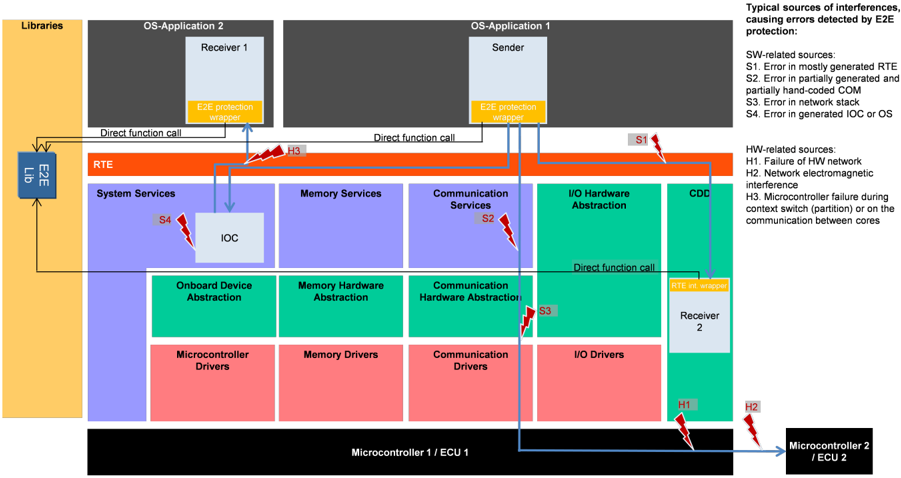

通过使用 **E2E** 通信保护机制，可以在运行时检测并处理通信链路中的故障。**E2E** 库提供了适用于安全相关通信的 **E2E** 保护机制，可满足高达 **ASIL D** 的要求。

保护机制的算法在 **E2E** 库中实现。**E2E** 库的调用者负责正确使用该库，特别是为 **E2E** 库例程提供正确的参数。

**E2E** 保护允许：

* 通过附加控制数据来保护将通过 **RTE** 发送的安全相关数据元素；
* 使用该控制数据校验从 **RTE** 接收到的安全相关数据元素；以及
* 指示接收到的安全相关数据元素有故障，随后由接收方 **SW-C** 进行处理。

为了提供兼顾灵活性与标准化的适当解决方案，**AUTOSAR** 规定了一组灵活的 **E2E** 配置文件（**profile**），它们实现了 **E2E** 保护机制的适当组合。每个规定的 **E2E** 配置文件都具有固定的行为，但通过函数参数提供了一些配置选项（例如 **CRC** 相对于待保护数据的位置）。

**E2E** 库由以下方式调用：

1. **E2E Transformer**（**E2E** 的一种新的标准化调用方式，在 **R4.2.1** 中引入）
2. **E2E Protection Wrapper**
3. **COM E2E Callout**

无论 **E2E** 在何处执行，**E2E** 保护都是针对数据元素的。**E2E** 保护在数据元素的序列化表示上执行，其位布局与总线上传输的位布局相同。这意味着：

* 如果使用 **E2E Transformer**，则序列化由 **E2E Transformer** 之上的转换器（基于 **COM** 的转换器或 **Some/IP** 转换器）执行。
* 如果使用 **E2E Protection Wrapper**，则包装器需要将数据元素序列化为相应信号组的序列化形式（换言之，包装器创建 **I-PDU** 中表示信号组、同时也是数据元素的那一部分）。
* 如果使用 **COM** callout，则序列化由通信协议栈（**RTE**、**COM**）完成，因此 callout 直接对 **I-PDU** 中序列化的信号组进行操作。

一个数据元素（及相应的信号组）要么被完全 **E2E** 保护，要么不被保护。不可能只保护其中的一部分。

一个 **I-PDU** 可以承载多个数据元素（及相应的信号组）。可以独立地对这些数据元素的一个子集进行 **E2E** 保护。

仅正确使用 **E2E** 库本身并不足以实现符合 **ASIL D** 要求的安全 **E2E** 通信。只有用户自己负责证明所选配置文件为所考虑的网络提供了足够的错误检测能力（例如通过评估硬件故障率、误码率、网络中节点的数量、消息的重复率以及网关的使用）。

## 2. 缩略语

本文档中使用的所有技术术语——下表所列者除外——均可在 **AUTOSAR** 官方术语表 [\[1, **AUTOSAR\_TR\_Glossary**\]](#ref-1) 中找到。

具有局部作用域、因而未包含在 **AUTOSAR** 术语表中的缩略语和缩写见下表。

表2.1：本文档范围内使用的缩略语和缩写（**Acronyms and abbreviations used in the scope of this Document**）

**E2E Library**
> 端到端通信保护库（**End-to-End Communication Protection Library**）的短名称。

**Data ID**
> 唯一标识消息/数据元素/数据的标识符。

**Source ID**
> 唯一标识消息/数据元素/数据的源（origin）的标识符。

**Repetition**
> 信息的重复。

**Loss**
> 信息的丢失。

**Delay**
> 信息的延迟。

**Insertion**
> 信息的插入。

**Masquerade**
> 伪装。

**Incorrect addressing**
> 信息的错误寻址。

**Incorrect sequence**
> 信息的错误序列。

**Corruption**
> 信息的损坏。

**Asymmetric information**
> 从一个发送方发送给多个接收方的不对称信息。

**Subset**
> 来自一个发送方的信息仅被接收方的一个子集接收到。

**Blocking**
> 阻塞对通信信道的访问。

在整个文档中，有许多需求同时适用于所有 **E2E** 配置文件。这样的需求被定义为一条同时适用于所有配置文件的需求。如果某些名称依赖于配置文件，则使用 XX 记法：如果需求中出现了包含 XX 的字符串，则该字符串分别展开为 01、02、04、4m、05、06、07、7m、11、12、22 和 44 来代替 XX。例如，E2E\_PXXCheck() 展开为 E2E\_P01Check()、E2E\_P02Check() 等等。

## 3. 相关文档

### 3.1. 输入文件和相关标准与规范

<a id="ref-1"></a>[1] Glossary
> AUTOSAR_FO_TR_Glossary

<a id="ref-2"></a>[2] General Specification of Basic Software Modules
> AUTOSAR_CP_SWS_BSWGeneral

<a id="ref-3"></a>[3] E2E Protocol Specification
> AUTOSAR_FO_PRS_E2EProtocol

<a id="ref-4"></a>[4] Requirements on E2E
> AUTOSAR_FO_RS_E2E

<a id="ref-5"></a>[5] Requirements on Libraries
> AUTOSAR_CP_SRS_Libraries

<a id="ref-6"></a>[6] General Requirements on Basic Software Modules
> AUTOSAR_CP_SRS_BSWGeneral

<a id="ref-7"></a>[7] List of Basic Software Modules
> AUTOSAR_CP_TR_BSWModuleList

<a id="ref-8"></a>[8] Requirements on System Template
> AUTOSAR_CP_RS_SystemTemplate

<a id="ref-9"></a>[9] Software Component Template
> AUTOSAR_CP_TPS_SoftwareComponentTemplate

<a id="ref-10"></a>[10] Specification of ECU Configuration
> AUTOSAR_CP_TPS_ECUConfiguration

### 3.2. 相关规范

**AUTOSAR** 提供了基础软件模块通用规范 [\[2\]](#ref-2)（**SWS BSW General**），该规范同样适用于 **E2ELibrary**。

因此，**SWS BSW General** 规范应被视为 **E2ELibrary** 的附加必需规范。

## 4. 约束和假设

### 4.1. 限制

关于 **E2E** 保护以及可检测失效模式的一般限制在 [\[3, **AUTOSAR PRS E2EProtocol**\]](#ref-3) 中描述。**E2E** Profile 2 在 **R4.2.1** 中有了一个新的设置 offset（偏移量）。该偏移量可以在系统模板中配置。然而，**E2E** Profile 2 规范不支持 offset 不为 0 的情况。**E2E** Profile 2 的规范将在未来的 **AUTOSAR** 发行版中修正，以支持可配置的 offset。

**E2E** Profile 1 在「双 Data ID 配置」（**Double Data ID configuration**）中使用隐式的 2 字节 Data ID，并对其计算 **CRC8**。由于对两个不同的 2 字节数计算 **CRC** 可能得到相同的 **CRC**，用户必须采取一些预防措施。见 PRS\_E2E\_UC\_00072 和 PRS\_E2E\_UC\_00073。

**E2E** Profile 2 使用隐式的 1 字节 Data ID（根据 counter 的每个值从 Data ID 列表中选取）来计算 **CRC**。有关 **E2E** profile 2 的 DataIDList 的使用和生成的详细信息，请参见 [\[3, **AUTOSAR PRS E2EProtocol**\]](#ref-3)。

### 4.2. E2E 库的实现

**E2E** 库的实现应符合汽车领域安全相关软件的开发要求。

分配给 **E2E** 库所实现需求（requirements）的 **ASIL** 取决于特定系统的安全概念。根据应用的不同，**E2E** 库至少可能需要符合 **ASIL A**、**B**、**C** 或 **D** 的开发流程。因此，按照最高的 **ASIL** 开发该库可能是最有效的方式，这使得同一库也可以用于较低的 **ASIL**。

**E2E** 库以及调用它的代码（例如 **E2E** wrapper、**E2E** callout、**E2E** transformer）的配置应按照汽车领域安全相关软件的开发要求进行实现和配置（包括从其他子系统使用的配置选项，例如 **COM** 信号到 **I-PDU** 的映射）。

## 5. 对其他模块的依赖

### 5.1. 所需的文件结构

**E2E** 库应由以下文件构成：E2E.h（公共头文件）、E2E.c（公共部分的实现）、E2E\_PXX.c（其中 XX：例如 01、02、……，代表配置文件）以及 E2E\_SM.c（用于 **E2E** 状态机）。

文件 E2E\_PXX.c 和 E2E.h 应包含每个配置文件特有的实现部分。

下面的需求与上面的需求重复，但明确指出它很重要：

**E2E** 库文件（即 E2E\_\*.\*）不得包含任何 **RTE** 文件。

### 5.2. 对 CRC 库的依赖

需要注意的是，CRC 库/CRC 例程中的 Crc\_CalculateCRC8 函数自 **R4.0** 起改变了其功能，即它在 **R3.2** 和 &gt;=**R4.0** 中是不同的：

* 增加了一个参数 Crc\_IsFirstCall
* 该函数具有不同的起始值和不同的 **XOR** 值（从 0x00 改为 OxFF）。

这导致对给定缓冲区计算出的 **CRC** 值不同。

为了在使用功能不同的 CRC 库的情况下，使 E2E\_P01Protect() 和 E2E\_P01Check() 函数在 &gt;=**R4.0** 和 **R3.2** 中得到相同的结果，**E2E** 「补偿」了 CRC 库的不同行为。这导致 **E2E** 库在 &gt;=**R4.0** 和 **R3.2** 中对 CRC 库的调用方式不同。

## 6. 功能规格

### 6.1. 错误分类

库没有配置，因此无法禁用或启用对开发错误的追踪。因此，无法将由库内部机制检测到的错误分类为开发错误或生产错误。此外，库不能调用 **BSW** 模块（例如 **DEM** 或 **DET**）。因此，由库内部机制检测到的错误会同步报告给调用者。注意，CRC 库和 **E2E** 库都不是 **BSW** 模块；库之间允许相互调用。

**E2E** 库不应包含会被追踪为开发错误的库内部错误检测机制。

**E2E** 库应通过返回值把由库内部机制检测到的错误报告给 **E2E** 函数的调用者。

**E2E** 库不得为了错误报告（特别是 **DEM** 和 **DET**）或任何其他目的而调用 **BSW** 模块。**E2E** 库不得调用 **RTE**。

#### 6.1.1. 开发错误

所有 **E2E** 库函数应使用以下错误标志（error flags）来指示错误：

| 错误类型 | 相关错误码 | 错误值 |
|---|---|---|
| 至少一个指针参数为 **NULL** 指针 | E2E_E_INPUTERR_NULL | 0x13 |
| 至少一个输入参数错误，例如超出范围 | E2E_E_INPUTERR_WRONG | 0x17 |
| 发生了内部库错误（例如由程序流监控检测到的错误、违反不变式或后置条件） | E2E_E_INTERR | 0x19 |
| 函数在错误的状态下执行 | E2E_E_WRONGSTATE | 0x1A |

范围 0x80..0xFE 仅预留给通过供应商特定的返回值扩展 **AUTOSAR** 配置文件。

E2E\_PXXProtect() / E2E\_PXXCheck() 函数的调用者应按照「**E2E** 的调用者应如何处理它」（**How do caller of E2E shall handle it**）列中的规定，处理 SWS\_E2E\_00047 中定义的错误/状态。

换言之，**E2E** 库本身没有为其定义任何集成错误。然而，**E2E** 库的调用者使用 **E2E** 函数的返回值并执行相应的错误处理。

#### 6.1.2. 运行时错误

不存在运行时错误。

#### 6.1.3. 瞬态故障

不存在瞬态故障。

#### 6.1.4. 生产错误

不存在生产错误。

## 7. API规范

本章规定 **E2E** 库的 **API**。

配置结构的成员（例如图7.1中）按字母顺序排列。然而，对于实现而言，该数据结构成员的顺序由表规范项（例如 [SWS_E2E_00386]）提供。

### 7.1. 导入的类型

在本章中，列出了从以下文件包含的所有类型和 #define：

| 模块 | 头文件 | 导入类型 |
|---|---|---|
| Std | Std_Types.h | Std_MessageResultType |
|  | Std_Types.h | Std_MessageTypeType |
|  | Std_Types.h | Std_ReturnType |
|  | Std_Types.h | Std_VersionInfoType |

### 7.2. 类型定义

本章定义 **E2E** 库定义的、对调用者可见的数据类型。

下面所示的一些属性定义了数据偏移量（offset）。偏移量根据以下规则定义：

* 偏移量以位为单位；
* 在一个字节内，位从 0 向上编号，位 0 为最低有效位（无论微控制器或总线的字节序如何）。

例 1 —— 在 **MSB** 微控制器上位偏移 = 8 的 Counter：

|  | MSB |  |  |  |  |  |  | LSB |
|---|---|---|---|---|---|---|---|---|
| Data[0] | 7 | 6 | 5 | 4 | 3 | 2 | 1 | 0 |
|  | 位偏移 0 的 CRC | 位偏移 0 的 CRC | 位偏移 0 的 CRC | 位偏移 0 的 CRC | 位偏移 0 的 CRC | 位偏移 0 的 CRC | 位偏移 0 的 CRC | 位偏移 0 的 CRC |
| Data[1] | 15 | 14 | 13 | 12 | 11 | 10 | 9 | 8 |
|  | 位偏移 12 的用户数据 | 位偏移 12 的用户数据 | 位偏移 12 的用户数据 | 位偏移 12 的用户数据 | 偏移 8 的 Counter | 偏移 8 的 Counter | 偏移 8 的 Counter | 偏移 8 的 Counter |
| Data[2] | 23 | 22 | 21 | 20 | 19 | 18 | 17 | 16 |
|  | 位偏移 20 的用户数据 | 位偏移 20 的用户数据 | 位偏移 20 的用户数据 | 位偏移 20 的用户数据 | 位偏移 16 的用户数据 | 位偏移 16 的用户数据 | 位偏移 16 的用户数据 | 位偏移 16 的用户数据 |

#### 7.2.1. E2E Profile 1 类型

**注意：** 自 **AUTOSAR 4.1.1** 起，类型名已被重命名。如果使用 **E2E** 库的现有应用需要与先前发行版本保持接口兼容，则头文件 E2E.h 应包含以下类型定义：

```C
typedef E2E_P01ProtectStateType E2E_P01SenderStateType;
typedef E2E_P01CheckStateType   E2E_P01ReceiverStateType;
typedef E2E_P01CheckStatusType  E2E_P01ReceiverStatusType;
```

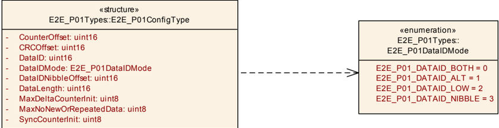

##### 7.2.1.1. E2E_P01ConfigType

结构类型（**Structure**），包含以下元素：**CounterOffset**（类型 **uint16**）：**Counter** 在 **MSB** 先序中的位偏移。CounterOffset 应为 4 的倍数。在变体 1A、1B 和 1C 中，CounterOffset 为 8；**CRCOffset**（类型 **uint16**）：**CRC** 的位偏移（即自 \*Data 起），**MSB** 先序。该偏移应为 8 的倍数。在变体 1A、1B 和 1C 中，CRCOffset 为 0；**DataID**（类型 **uint16**）：唯一标识符，用于防止伪装（**masquerading**）。ID 值的选择有一些约束，在「Data ID 的配置约束」一节中描述；**DataIDNibbleOffset**（类型 **uint16**）：Data ID 高字节的低半字节（**nibble**）的位偏移。仅当 DataIDMode = E2E_P01_DATAID_NIBBLE 时 **E2E** 库才使用此参数（否则 **E2E** 库会忽略它）。对于不同于 E2E_P01_DATAID_NIBBLE 的 DataIDMode，DataIDNibbleOffset 应初始化为 0（即使 **E2E** 库忽略它）；**DataIDMode**（类型 [E2E_P01DataIDMode](#7212-e2e_p01dataidmode)）：ID 包含在 **CRC** 计算中的包含模式（包含两个字节、交替包含或仅包含低字节）；**DataLength**（类型 **uint16**）：数据长度（以位为单位）。该值应为 8 的倍数；**MaxDeltaCounterInit**（类型 **uint8**）：两个连续接收的有效 Data 的两个 counter 值之间最初允许的最大间隔。例如，如果接收方接收到 counter 为 1 的 Data 且 MaxDeltaCounterInit 为 1，则在下次接收时接收方可以接受值为 2 和 3 的 Counter，但不能接受 4。注意，如果接收方在连续读取时未接收到新 Data，则接收方将容差加 1；**MaxNoNewOrRepeatedData**（类型 **uint8**）：在正常通信条件下，接收方不期望超过的缺失或重复 Data 的最大数量；**SyncCounterInit**（类型 **uint8**）：在检测到接收到的 counter 出现意外行为之后，为验证 counter 的一致性所需的、必须以有效 counter（即处于允许的锁定范围内的 counter）接收到的 Data 数量。所发送 Data（数据元素或 **I-PDU**）的配置，用于 **E2E** Profile 1。对于每个发送的 Data，都存在该 typedef 的一个实例。可通过**E2E.h**获得。

##### 7.2.1.2. E2E_P01DataIDMode

**注意：** 枚举常量的值在相关的 **UML** 图中规定。

枚举类型（**Enumeration**）：

* **E2E_P01_DATAID_BOTH**（0）：两个字节都包含在 **CRC** 中（双 ID 配置）。用于 **E2E** 变体 1A。
* **E2E_P01_DATAID_ALT**（1）：包含两个字节中的一个字节，根据 counter 的奇偶性交替包含高字节和低字节（交替 ID 配置）。对于偶数 counter，包含低字节；对于奇数 counter，包含高字节。用于 **E2E** 变体 1B。
* **E2E_P01_DATAID_LOW**（2）：仅包含低字节，从不使用高字节。适用于特定系统中的 ID 为 8 位的情况。
* **E2E_P01_DATAID_NIBBLE**（3）：低字节包含在隐式 **CRC** 计算中，高字节的低半字节随数据一起传输（即被显式包含），高字节的高半字节不使用。适用于最大 12 位的 ID。用于 **E2E** 变体 1C。

在 **E2E** Profile 1 中，Data ID 的长度为两个字节。有四种包含模式可将隐式的两字节 Data ID 包含进单字节 **CRC** 中。可通过**E2E.h**获得。

##### 7.2.1.3. E2E_P01ProtectStateType

结构类型（**Structure**），包含以下元素：**Counter**（类型 **uint8**）：用于保护下一个 Data 的 counter。初始值为 0，这意味着第一个 Data 的 counter 将为 0。在使用 Counter 进行保护之后，Counter 以模 0xF 递增。值 0xF 被跳过（0xE 之后的下一个是 0x0），因为 0xF 值表示错误值。高四位始终为 0。使用 **E2E** Profile 1 保护的 Data 的发送方状态。可通过**E2E.h**获得。

##### 7.2.1.4. E2E_P01CheckStateType

**注意：** 枚举常量的值在相关的 **UML** 图中规定。注意，在先前的 **SWS E2E** 版本中，E2E\_P01STATUS\_OK 等于 0x10。

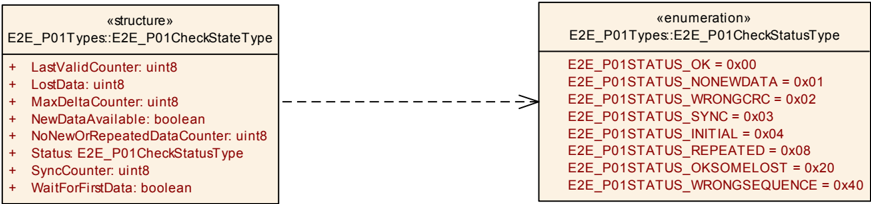

结构类型（**Structure**），包含以下元素：**LastValidCounter**（类型 **uint8**）：最近接收到的 counter 值。如果尚未接收到任何数据，则该值为 0x0。每次接收之后，counter 都会用接收到的值更新；**MaxDeltaCounter**（类型 **uint8**）：MaxDeltaCounter 规定连续接收的有效消息的两个 counter 值之间允许的最大差值；**WaitForFirstData**（类型 **boolean**）：为 true 表示在接收方初始化或重新初始化之后，尚未接收到正确的数据（具有正确的 Data ID 和 **CRC**）；**NewDataAvailable**（类型 **boolean**）：向 **E2E** 库指示有新数据可供库进行校验。该属性由 **E2E** 库的调用者设置，而不是由 **E2E** 库设置；**LostData**（类型 **uint8**）：自上次接收到有效数据以来丢失的数据（消息）数量。仅当 Status 等于 E2E_P01STATUS_OK 或 E2E_P01STATUS_OKSOMELOST 时才设置该属性。对于 Status 的其他值，LostData 的值是未定义的；**Status**（类型 [E2E_P01CheckStatusType](#7215-e2e_p01checkstatustype)）：由 Check 函数确定的 Data 校验结果；**SyncCounter**（类型 **uint8**）：在检测到接收到的 counter 出现意外行为之后，为验证 counter 的一致性所需的、必须以有效 counter（即处于允许的锁定范围内的 counter）接收到的 Data 数量；**NoNewOrRepeatedDataCounter**（类型 **uint8**）：出现以下情况的连续接收周期数：（1）没有新数据，或（2）数据被重复。使用 **E2E** Profile 1 保护的 Data 的接收方状态。可通过**E2E.h**获得。

##### 7.2.1.5. E2E_P01CheckStatusType

枚举类型（**Enumeration**）：

* **E2E_P01STATUS_OK**（0x00）：OK：已根据通信介质接收到新数据，**CRC** 正确，相对于最近一次以 Status \_INITIAL、\_OK 或 \_OKSOMELOST 接收的 Data，Counter 递增 1。这意味着自上次正确接收数据以来没有丢失任何 Data。
* **E2E_P01STATUS_NONEWDATA**（0x01）：错误：Check 函数已被调用，但自上次调用以来，根据通信介质（例如 **RTE**、**COM**）没有新数据可用。因此，没有对 Data 执行任何 **E2E** 校验。
* **E2E_P01STATUS_WRONGCRC**（0x02）：错误：已根据通信介质接收到数据，但是 1. **CRC** 不正确（适用于所有 **E2E** Profile 1 配置），或 2. Data ID 高字节的低半字节不正确（仅适用于 DataIDMode = E2E_P01_DATAID_NIBBLE 的 **E2E** Profile 1）。上述两个错误可能是损坏、错误寻址或伪装的结果。
* **E2E_P01STATUS_SYNC**（0x03）：NOT VALID：在检测到 counter 的意外行为之后接收到了新数据。该数据具有正确的 **CRC**，且其 counter 相对于最近接收的 Data 处于预期范围内，但所确定的 counter 连续性校验尚未完成。
* **E2E_P01STATUS_INITIAL**（0x04）：Initial：已根据通信介质接收到新数据，**CRC** 正确，但这是接收方初始化或重新初始化以来的第一个 Data，因此尚无法校验 Counter。
* **E2E_P01STATUS_REPEATED**（0x08）：错误：已根据通信介质接收到新数据，**CRC** 正确，但 Counter 与最近一次以 Status \_INITIAL、\_OK 或 \_OKSOMELOST 接收的 Data 相同。
* **E2E_P01STATUS_OKSOMELOST**（0x20）：OK：已根据通信介质接收到新数据，**CRC** 正确，相对于最近一次以 Status \_INITIAL、\_OK 或 \_OKSOMELOST 接收的 Data，Counter 递增了 DeltaCounter（1 &lt; DeltaCounter = MaxDeltaCounter）。这意味着自上次正确/初始接收以来，序列中可能丢失了一些 Data，但这在配置的容差范围内。
* **E2E_P01STATUS_WRONGSEQUENCE**（0x40）：错误：已根据通信介质接收到新数据，**CRC** 正确，但相对于最近一次以 Status \_INITIAL、\_OK 或 \_OKSOMELOST 接收的 Data，Counter 增量过大（DeltaCounter &gt; MaxDeltaCounter）。这意味着自上次正确/初始接收以来，序列中可能丢失了过多 Data。

由 Check 函数确定的 **E2E** Profile 1 中 Data 校验的结果。可通过**E2E.h**获得。

#### 7.2.2. E2E Profile 2 类型

自 **AUTOSAR 4.1.1** 起，类型名已被重命名。如果使用 **E2E** 库的现有应用需要与先前发行版本保持接口兼容，则头文件 E2E.h 应包含以下类型定义：

```C
typedef E2E_P02ProtectStateType E2E_P02SenderStateType;
typedef E2E_P02CheckStateType   E2E_P02ReceiverStateType;
typedef E2E_P02CheckStatusType  E2E_P02ReceiverStatusType;
```

##### 7.2.2.1. E2E_P02ConfigType

结构类型（**Structure**），包含以下元素：**DataLength**（类型 **uint16**）：Data 的长度（以位为单位）。该值应为 8 的倍数；**DataIDList**（类型 **uint8** 数组，大小 16）：为防止伪装而适当选择的一组 Data ID；**MaxDeltaCounterInit**（类型 **uint8**）：两个连续接收的有效 Data 的两个 counter 值之间最初允许的最大间隔。例如，如果接收方接收到 counter 为 1 的 Data 且 MaxDeltaCounterInit 为 1，则在下次接收时接收方可以接受值为 2 和 3 的 Counter，但不能接受 4。注意，如果接收方在连续读取时未接收到新 Data，则接收方将容差加 1；**MaxNoNewOrRepeatedData**（类型 **uint8**）：在正常通信条件下，接收方不期望超过的缺失或重复 Data 的最大数量；**SyncCounterInit**（类型 **uint8**）：在检测到接收到的 counter 出现意外行为之后，为验证 counter 的一致性所需的、必须以有效 counter（即处于允许的锁定范围内的 counter）接收到的 Data 数量；**Offset**（类型 **uint16**）：**E2E** 头在 Data[] 数组中的偏移量（以位为单位）。应满足：0 &lt;= Offset &lt;= DataLength-(2\*8)。通过 **RTE** 端口发送的数据元素的非可修改配置，用于 **E2E** profile 2。可通过**E2E.h**获得。

##### 7.2.2.2. E2E_P02ProtectStateType

结构类型（**Structure**），包含以下元素：**Counter**（类型 **uint8**）：用于保护 Data 的 counter。初始值为 0。由于 counter 在发送之前递增，因此第一个 Data 的 counter 值将为 1。使用 **E2E** Profile 2 保护的 Data 的发送方状态。可通过**E2E.h**获得。

##### 7.2.2.3. E2E_P02CheckStateType

注意，在先前的 **SWS E2E** 版本中，E2E\_P02STATUS\_OK 等于 0x10。

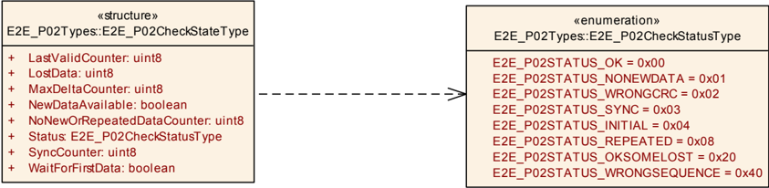

结构类型（**Structure**），包含以下元素：**LastValidCounter**（类型 **uint8**）：最后一个有效接收消息的 counter；**MaxDeltaCounter**（类型 **uint8**）：MaxDeltaCounter 规定连续接收的有效消息的两个 counter 值之间允许的最大差值；**WaitForFirstData**（类型 **boolean**）：为 true 表示在接收方初始化或重新初始化之后，尚未接收到正确的数据（具有正确的 Data ID 和 **CRC**）；**NewDataAvailable**（类型 **boolean**）：向 **E2E** 库指示有新数据可供库进行校验。该属性由 **E2E** 库的调用者设置，而不是由 **E2E** 库设置；**LostData**（类型 **uint8**）：自上次接收到有效数据以来丢失的数据（消息）数量；**Status**（类型 [E2E_P02CheckStatusType](#7224-e2e_p02checkstatustype)）：由 Check 函数确定的 Data 校验结果；**SyncCounter**（类型 **uint8**）：在检测到接收到的 counter 出现意外行为之后，为验证 counter 的一致性所需的、必须以有效 counter（即处于允许的锁定范围内的 counter）接收到的 Data 数量；**NoNewOrRepeatedDataCounter**（类型 **uint8**）：出现以下情况的连续接收周期数：（1）没有新数据，或（2）数据被重复。使用 **E2E** Profile 2 保护的 Data 的发送方状态。可通过**E2E.h**获得。

##### 7.2.2.4. E2E_P02CheckStatusType

**注意：** 枚举常量的值在相关的 **UML** 图中规定。

枚举类型（**Enumeration**）：

* **E2E_P02STATUS_OK**（0x00）：OK：已根据通信介质接收到新数据，**CRC** 正确，相对于最近一次以 Status \_INITIAL、\_OK 或 \_OKSOMELOST 接收的 Data，Counter 递增 1。这意味着自上次正确接收数据以来没有丢失任何 Data。
* **E2E_P02STATUS_NONEWDATA**（0x01）：错误：Check 函数已被调用，但自上次调用以来，根据通信介质（例如 **RTE**、**COM**）没有新数据可用。因此，没有对 Data 执行任何 **E2E** 校验。
* **E2E_P02STATUS_WRONGCRC**（0x02）：错误：已根据通信介质接收到数据，但 **CRC** 不正确。
* **E2E_P02STATUS_SYNC**（0x03）：NOT VALID：在检测到 counter 的意外行为之后接收到了新数据。该数据具有正确的 **CRC**，且其 counter 相对于最近接收的 Data 处于预期范围内，但所确定的 counter 连续性校验尚未完成。
* **E2E_P02STATUS_INITIAL**（0x04）：Initial：已根据通信介质接收到新数据，**CRC** 正确，但这是接收方初始化或重新初始化以来的第一个 Data，因此尚无法校验 Counter。
* **E2E_P02STATUS_REPEATED**（0x08）：错误：已根据通信介质接收到新数据，**CRC** 正确，但 Counter 与最近一次以 Status \_INITIAL、\_OK 或 \_OKSOMELOST 接收的 Data 相同。
* **E2E_P02STATUS_OKSOMELOST**（0x20）：OK：已根据通信介质接收到新数据，**CRC** 正确，相对于最近一次以 Status \_INITIAL、\_OK 或 \_OKSOMELOST 接收的 Data，Counter 递增了 DeltaCounter（1 &lt; DeltaCounter = MaxDeltaCounter）。这意味着自上次正确/初始接收以来，序列中可能丢失了一些 Data，但这在配置的容差范围内。
* **E2E_P02STATUS_WRONGSEQUENCE**（0x40）：错误：已根据通信介质接收到新数据，**CRC** 正确，但相对于最近一次以 Status \_INITIAL、\_OK 或 \_OKSOMELOST 接收的 Data，Counter 增量过大（DeltaCounter &gt; MaxDeltaCounter）。这意味着自上次正确/初始接收以来，序列中可能丢失了过多 Data。

由 Check 函数确定的 **E2E** Profile 2 中 Data 校验的结果。可通过**E2E.h**获得。

#### 7.2.3. E2E Profile 4 类型

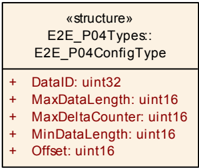

##### 7.2.3.1. E2E_P04ConfigType

结构类型（**Structure**），包含以下元素：**DataID**（类型 **uint32**）：Data 的系统唯一标识符；**Offset**（类型 **uint16**）：**E2E** 头的第一个位自 Data 起始处的位偏移（位编号：位 0 为最低有效位）。该偏移应为 8 的倍数，且 0 &lt;= Offset &lt;= MaxDataLength-(12\*8)。例如：如果 Offset 等于 8，则 **E2E** Length（16 位）的高字节写入字节 1，低字节写入字节 2；**MinDataLength**（类型 **uint16**）：Data 的最小长度（以位为单位）。**E2E** 检查 DataLength 是否 &gt;= MinDataLength（见 [PRS_E2E_00651]）；**MaxDataLength**（类型 **uint16**）：Data 的最大长度（以位为单位）。**E2E** 检查 DataLength 是否 &lt;= MaxDataLength（见 [PRS_E2E_00651]）；**MaxDeltaCounter**（类型 **uint16**）：两个连续接收的有效 Data 的两个 counter 值之间允许的最大间隔。例如，如果接收方接收到 counter 为 1 的 Data 且 MaxDeltaCounter 为 3，则在下次接收时接收方可以接受值为 2、3 或 4 的 Counter。所发送 Data（数据元素或 **I-PDU**）的配置，用于 **E2E** Profile 4。对于每个发送的 Data，都存在该 typedef 的一个实例。可通过**E2E.h**获得。

##### 7.2.3.2. E2E_P04ProtectStateType

结构类型（**Structure**），包含以下元素：**Counter**（类型 **uint16**）：用于保护下一个 Data 的 counter。初始值为 0，这意味着在第一个周期中 Counter 为 0。每次调用 E2E\_P04Protect() 时，它都会将 counter 递增，最高到 0xFF'FF。达到最大值之后，下一个值为 0x0。溢出不会报告给调用者。使用 **E2E** Profile 4 保护的 Data 的发送方状态。可通过**E2E.h**获得。

##### 7.2.3.3. E2E_P04CheckStateType

**注意：** 枚举常量的值仅在相关的 **UML** 图中规定（不在表中）。

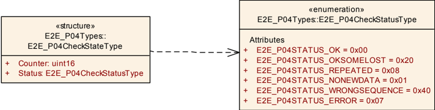

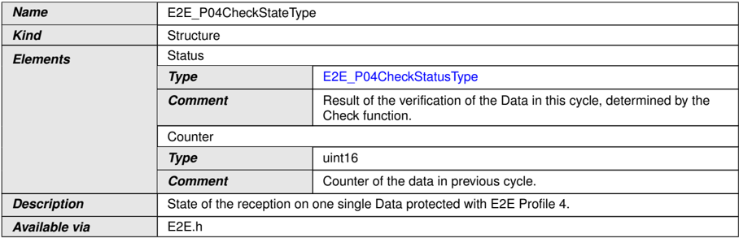

结构类型（**Structure**），包含以下元素：**Status**（类型 [E2E_P04CheckStatusType](#7234-e2e_p04checkstatustype)）：由 Check 函数确定的本周周期中 Data 的校验结果；**Counter**（类型 **uint16**）：上一周期中数据的 counter。使用 **E2E** Profile 4 保护的单个 Data 的接收状态。可通过**E2E.h**获得。

##### 7.2.3.4. E2E_P04CheckStatusType

枚举类型（**Enumeration**）：

* **E2E_P04STATUS_OK**（0x00）：OK：本周期中对 Data 的校验成功（包括 counter 校验，counter 递增了 1）。
* **E2E_P04STATUS_NONEWDATA**（0x01）：错误：Check 函数已被调用，但自上次调用以来，根据通信介质（例如 **RTE**、**COM**）没有新数据可用。因此，没有对 Data 执行任何 **E2E** 校验。这可以认为与 E2E\_P04STATUS_REPEATED 类似。
* **E2E_P04STATUS_ERROR**（0x07）：错误：发生了与 counter 无关的错误（例如错误的 **CRC**、错误的长度、错误的选项、错误的 Data ID）。
* **E2E_P04STATUS_REPEATED**（0x08）：错误：本周期中对 Data 的校验成功，但存在重复。
* **E2E_P04STATUS_OKSOMELOST**（0x20）：OK：本周期中对 Data 的校验成功（包括 counter 校验，counter 在允许的配置增量内递增）。
* **E2E_P04STATUS_WRONGSEQUENCE**（0x40）：错误：本周期中对 Data 的校验成功，但 counter 跳变除外，其变化超过了允许的增量。

使用 **E2E** Profile 4 保护的单个 Data 在单个周期内的接收状态。可通过**E2E.h**获得。

注意，状态 E2E\_P04STATUS\_ERROR 是新的（相对于 **E2E** Profiles 1 和 2）。

#### 7.2.4. E2E Profile 4m 类型


##### 7.2.4.1. E2E_P04mConfigType

结构类型（**Structure**），包含以下元素：**DataID**（类型 **uint32**）：Data 的系统唯一标识符；**Offset**（类型 **uint16**）：**E2E** 头的第一个位自 Data 起始处的位偏移（位编号：位 0 为最低有效位）。该偏移应为 8 的倍数，且 0 &lt;= Offset &lt;= MaxDataLength-(12\*8)。例如：如果 Offset 等于 8，则 **E2E** Length（16 位）的高字节写入字节 1，低字节写入字节 2；**MinDataLength**（类型 **uint16**）：Data 的最小长度（以位为单位）。**E2E** 检查 DataLength 是否 &gt;= MinDataLength（见 [PRS_E2E_00852]）；**MaxDataLength**（类型 **uint16**）：Data 的最大长度（以位为单位）。**E2E** 检查 DataLength 是否 &lt;= MaxDataLength（见 [PRS_E2E_00852]）；**MaxDeltaCounter**（类型 **uint16**）：两个连续接收的有效 Data 的两个 counter 值之间允许的最大间隔。例如，如果接收方接收到 counter 为 1 的 Data 且 MaxDeltaCounter 为 3，则在下次接收时接收方可以接受值为 2、3 或 4 的 Counter。所发送 Data（数据元素或 **I-PDU**）的配置，用于 **E2E** Profile 4m。对于每个发送的 Data，都存在该 typedef 的一个实例。可通过**E2E.h**获得。

##### 7.2.4.2. E2E_P04mProtectStateType

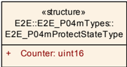

结构类型（**Structure**），包含以下元素：**Counter**（类型 **uint16**）：用于保护下一个 Data 的 counter。初始值为 0，这意味着在第一个周期中 Counter 为 0。每次调用 E2E\_P04mProtect() 时，它都会将 counter 递增，最高到 0xFF'FF。达到最大值之后，下一个值为 0x0。溢出不会报告给调用者。使用 **E2E** Profile 4m 保护的 Data 的发送方状态。可通过**E2E.h**获得。

##### 7.2.4.3. E2E_P04mCheckStateType

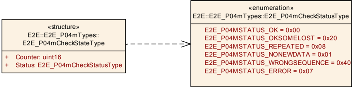

结构类型（**Structure**），包含以下元素：**Status**（类型 [E2E_P04mCheckStatusType](#7244-e2e_p04mcheckstatustype)）：由 Check 函数确定的本周周期中 Data 的校验结果；**Counter**（类型 **uint16**）：上一周期中数据的 counter。使用 **E2E** Profile 4m 保护的单个 Data 的接收状态。可通过**E2E.h**获得。

##### 7.2.4.4. E2E_P04mCheckStatusType

枚举类型（**Enumeration**）：

* **E2E_P04MSTATUS_OK**（0x00）：-
* **E2E_P04MSTATUS_NONEWDATA**（0x01）：错误：Check 函数已被调用，但自上次调用以来，根据通信介质（例如 **RTE**、**COM**）没有新数据可用。因此，没有对 Data 执行任何 **E2E** 校验。这可以认为与 E2E\_P04STATUS_REPEATED 类似。
* **E2E_P04MSTATUS_ERROR**（0x07）：错误：发生了与 counter 无关的错误（例如错误的 **CRC**、错误的长度、错误的选项、错误的 Data ID）。
* **E2E_P04MSTATUS_REPEATED**（0x08）：错误：本周期中对 Data 的校验成功，但存在重复。
* **E2E_P04MSTATUS_OKSOMELOST**（0x20）：OK：本周期中对 Data 的校验成功（包括 counter 校验，counter 在允许的配置增量内递增）。
* **E2E_P04MSTATUS_WRONGSEQUENCE**（0x40）：错误：本周期中对 Data 的校验成功，但 counter 跳变除外，其变化超过了允许的增量。

使用 **E2E** Profile 4m 保护的单个 Data 在单个周期内的接收状态。可通过**E2E.h**获得。

注意，状态 E2E\_P04MSTATUS\_ERROR 是新的（相对于 **E2E** Profiles 1 和 2）。

#### 7.2.5. E2E Profile 5 类型

##### 7.2.5.1. E2E_P05ConfigType

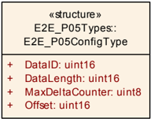

结构类型（**Structure**），包含以下元素：**Offset**（类型 **uint16**）：**E2E** 头的第一个位自 Data 起始处的位偏移（位编号：位 0 为最低有效位）。该偏移应为 8 的倍数，且 0 &lt;= Offset &lt;= DataLength-(3\*8)。例如：如果 Offset 等于 8，则 **E2E** Crc（16 位）的低字节写入字节 1，高字节写入字节 2；**DataLength**（类型 **uint16**）：数据长度（以位为单位）。该长度应 &lt;= 4096\*8（4KB）且应 &gt;= 3\*8；**DataID**（类型 **uint16**）：Data 的系统唯一标识符；**MaxDeltaCounter**（类型 **uint8**）：两个连续接收的有效 Data 的两个 counter 值之间允许的最大间隔。例如，如果接收方接收到 counter 为 1 的 Data 且 MaxDeltaCounter 为 3，则在下次接收时接收方可以接受值为 2、3 或 4 的 Counter。所发送 Data（数据元素或 **I-PDU**）的配置，用于 **E2E** Profile 5。对于每个发送的 Data，都存在该 typedef 的一个实例。可通过**E2E.h**获得。

##### 7.2.5.2. E2E_P05ProtectStateType

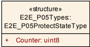

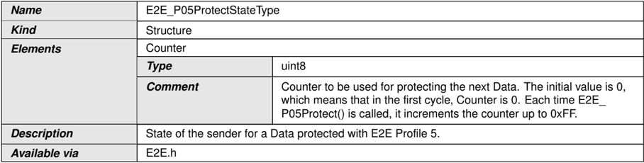

结构类型（**Structure**），包含以下元素：**Counter**（类型 **uint8**）：用于保护下一个 Data 的 counter。初始值为 0，这意味着在第一个周期中 Counter 为 0。每次调用 E2E\_P05Protect() 时，它都会将 counter 递增，最高到 0xFF。使用 **E2E** Profile 5 保护的 Data 的发送方状态。可通过**E2E.h**获得。

##### 7.2.5.3. E2E_P05CheckStateType

**注意：** 枚举常量的值仅在相关的 **UML** 图中规定（不在表中）。

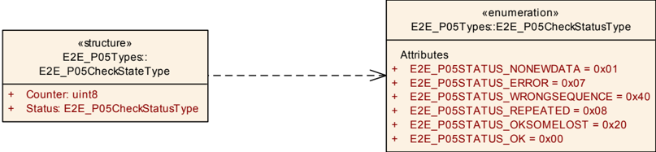

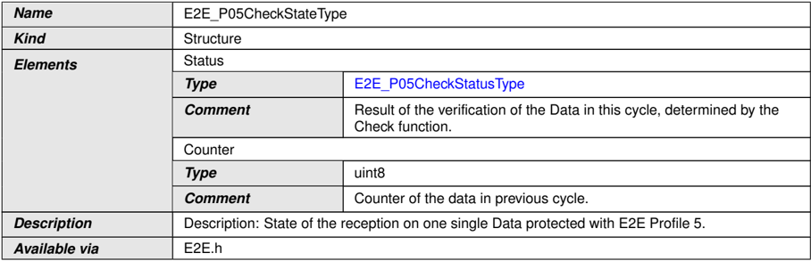

结构类型（**Structure**），包含以下元素：**Status**（类型 [E2E_P05CheckStatusType](#7254-e2e_p05checkstatustype)）：由 Check 函数确定的本周周期中 Data 的校验结果；**Counter**（类型 **uint8**）：上一周期中数据的 counter。使用 **E2E** Profile 5 保护的单个 Data 的接收状态。可通过**E2E.h**获得。

##### 7.2.5.4. E2E_P05CheckStatusType

枚举类型（**Enumeration**）：

* **E2E_P05STATUS_OK**（0x00）：OK：本周期中对 Data 的校验成功（包括 counter 校验，counter 递增了 1）。
* **E2E_P05STATUS_NONEWDATA**（0x01）：错误：Check 函数已被调用，但自上次调用以来，根据通信介质（例如 **RTE**、**COM**）没有新数据可用。因此，没有对 Data 执行任何 **E2E** 校验。这可以认为与 E2E\_P05STATUS_REPEATED 类似。
* **E2E_P05STATUS_ERROR**（0x07）：错误：发生了与 counter 无关的错误（例如错误的 **CRC**、错误的长度）。
* **E2E_P05STATUS_REPEATED**（0x08）：错误：本周期中对 Data 的校验成功，但存在重复。
* **E2E_P05STATUS_OKSOMELOST**（0x20）：OK：本周期中对 Data 的校验成功（包括 counter 校验，counter 在允许的配置增量内递增）。
* **E2E_P05STATUS_WRONGSEQUENCE**（0x40）：错误：本周期中对 Data 的校验成功，但 counter 跳变除外，其变化超过了允许的增量。

使用 **E2E** Profile 5 保护的单个 Data 在单个周期内的接收状态。可通过**E2E.h**获得。

#### 7.2.6. E2E Profile 6 类型

##### 7.2.6.1. E2E_P06ConfigType

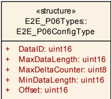

结构类型（**Structure**），包含以下元素：**Offset**（类型 **uint16**）：**E2E** 头的第一个位自 Data 起始处的位偏移（位编号：位 0 为最低有效位）。该偏移应为 8 的倍数，且 0 &lt;= Offset &lt;= MaxDataLength-(5\*8)。例如：如果 Offset 等于 8，则 **E2E** Crc（16 位）的高字节写入字节 1，低字节写入字节 2；**MinDataLength**（类型 **uint16**）：Data 的最小长度（以位为单位）。**E2E** 检查 DataLength 是否 &gt;= MinDataLength（见 [PRS_E2E_00657]）；**MaxDataLength**（类型 **uint16**）：Data 的最大长度（以位为单位）。**E2E** 检查 DataLength 是否 &lt;= MaxDataLength（见 [PRS_E2E_00657]）；**DataID**（类型 **uint16**）：Data 的系统唯一标识符；**MaxDeltaCounter**（类型 **uint8**）：两个连续接收的有效 Data 的两个 counter 值之间允许的最大间隔。例如，如果接收方接收到 counter 为 1 的 Data 且 MaxDeltaCounter 为 3，则在下次接收时接收方可以接受值为 2、3 或 4 的 Counter。所发送 Data（数据元素或 **I-PDU**）的配置，用于 **E2E** Profile 6。对于每个发送的 Data，都存在该 typedef 的一个实例。可通过**E2E.h**获得。

##### 7.2.6.2. E2E_P06ProtectStateType

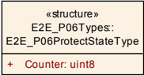

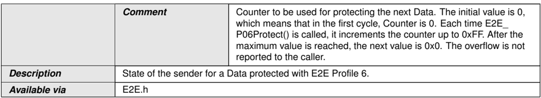

结构类型（**Structure**），包含以下元素：**Counter**（类型 **uint8**）：用于保护下一个 Data 的 counter。初始值为 0，这意味着在第一个周期中 Counter 为 0。每次调用 E2E\_P06Protect() 时，它都会将 counter 递增，最高到 0xFF。达到最大值之后，下一个值为 0x0。溢出不会报告给调用者。使用 **E2E** Profile 6 保护的 Data 的发送方状态。可通过**E2E.h**获得。

##### 7.2.6.3. E2E_P06CheckStateType

**注意：** 枚举常量的值仅在相关的 **UML** 图中规定（不在表中）。

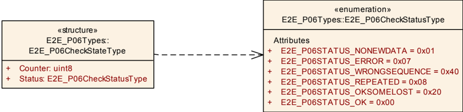

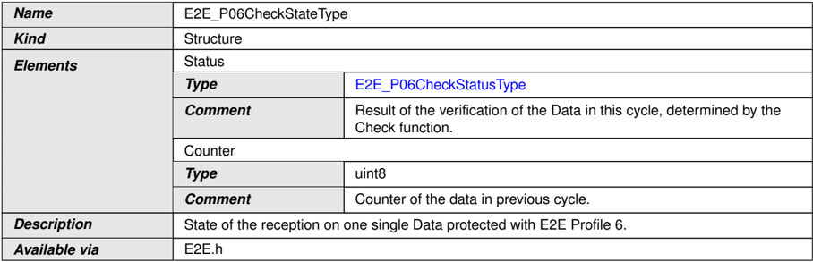

结构类型（**Structure**），包含以下元素：**Status**（类型 [E2E_P06CheckStatusType](#7264-e2e_p06checkstatustype)）：由 Check 函数确定的本周周期中 Data 的校验结果；**Counter**（类型 **uint8**）：上一周期中数据的 counter。使用 **E2E** Profile 6 保护的单个 Data 的接收状态。可通过**E2E.h**获得。

##### 7.2.6.4. E2E_P06CheckStatusType

枚举类型（**Enumeration**）：

* **E2E_P06STATUS_OK**（0x00）：OK：本周期中对 Data 的校验成功（包括 counter 校验，counter 递增了 1）。
* **E2E_P06STATUS_NONEWDATA**（0x01）：错误：Check 函数已被调用，但自上次调用以来，根据通信介质（例如 **RTE**、**COM**）没有新数据可用。因此，没有对 Data 执行任何 **E2E** 校验。这可以认为与 E2E\_P06STATUS_REPEATED 类似。
* **E2E_P06STATUS_ERROR**（0x07）：错误：发生了与 counter 无关的错误（例如错误的 **CRC**、错误的长度）。
* **E2E_P06STATUS_REPEATED**（0x08）：错误：本周期中对 Data 的校验成功，但存在重复。
* **E2E_P06STATUS_OKSOMELOST**（0x20）：OK：本周期中对 Data 的校验成功（包括 counter 校验，counter 在允许的配置增量内递增）。
* **E2E_P06STATUS_WRONGSEQUENCE**（0x40）：错误：本周期中对 Data 的校验成功，但 counter 跳变除外，其变化超过了允许的增量。

使用 **E2E** Profile 6 保护的单个 Data 在单个周期内的接收状态。可通过**E2E.h**获得。

#### 7.2.7. E2E Profile 7 类型

##### 7.2.7.1. E2E_P07ConfigType

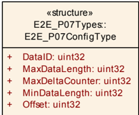

结构类型（**Structure**），包含以下元素：**DataID**（类型 **uint32**）：Data 的系统唯一标识符；**Offset**（类型 **uint32**）：**E2E** 头的第一个位自 Data 起始处的位偏移（位编号：位 0 为最低有效位）。该偏移应为 8 的倍数，且 0 &lt;= Offset &lt;= MaxDataLength-(20\*8)。例如：如果 Offset 等于 8，则 **E2E** Length（32 位）的第一个字节写入字节 1，下一个字节写入字节 2，依此类推；**MinDataLength**（类型 **uint32**）：Data 的最小长度（以位为单位）。**E2E** 检查 DataLength 是否 &gt;= MinDataLength（见 [PRS_E2E_00660]）；**MaxDataLength**（类型 **uint32**）：Data 的最大长度（以位为单位）。**E2E** 检查 DataLength 是否 &lt;= MaxDataLength（见 [PRS_E2E_00660]）；**MaxDeltaCounter**（类型 **uint32**）：两个连续接收的有效 Data 的两个 counter 值之间允许的最大间隔。例如，如果接收方接收到 counter 为 1 的 Data 且 MaxDeltaCounter 为 3，则在下次接收时接收方可以接受值为 2、3 或 4 的 Counter。所发送 Data（数据元素或 **I-PDU**）的配置，用于 **E2E** Profile 7。对于每个发送的 Data，都存在该 typedef 的一个实例。可通过**E2E.h**获得。

##### 7.2.7.2. E2E_P07ProtectStateType

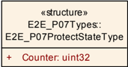

结构类型（**Structure**），包含以下元素：**Counter**（类型 **uint32**）：用于保护下一个 Data 的 counter。初始值为 0，这意味着在第一个周期中 Counter 为 0。每次调用 E2E\_P07Protect() 时，它都会将 counter 递增，最高到 0xFF'FF'FF'FF。使用 **E2E** Profile 7 保护的 Data 的发送方状态。可通过**E2E.h**获得。

##### 7.2.7.3. E2E_P07CheckStateType

**注意：** 枚举常量的值仅在相关的 **UML** 图中规定（不在表中）。

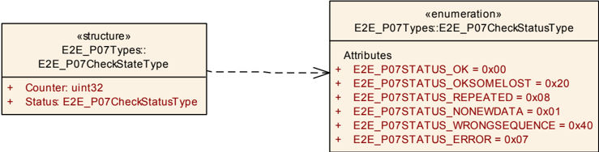

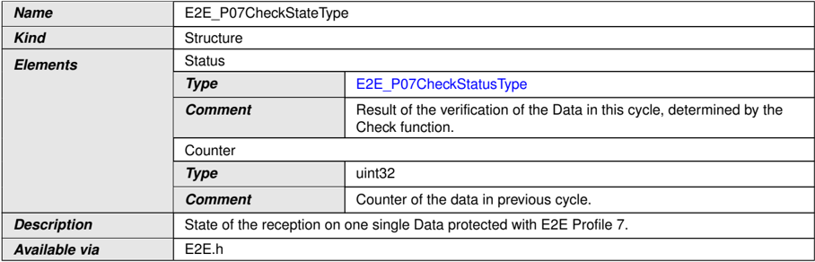

结构类型（**Structure**），包含以下元素：**Status**（类型 [E2E_P07CheckStatusType](#7274-e2e_p07checkstatustype)）：由 Check 函数确定的本周周期中 Data 的校验结果；**Counter**（类型 **uint32**）：上一周期中数据的 counter。使用 **E2E** Profile 7 保护的单个 Data 的接收状态。可通过**E2E.h**获得。

##### 7.2.7.4. E2E_P07CheckStatusType

枚举类型（**Enumeration**）：

* **E2E_P07STATUS_OK**（0x00）：OK：本周期中对 Data 的校验成功（包括 counter 校验，counter 递增了 1）。
* **E2E_P07STATUS_NONEWDATA**（0x01）：错误：Check 函数已被调用，但自上次调用以来，根据通信介质（例如 **RTE**、**COM**）没有新数据可用。因此，没有对 Data 执行任何 **E2E** 校验。这可以认为与 E2E\_P07STATUS_REPEATED 类似。
* **E2E_P07STATUS_ERROR**（0x07）：错误：发生了与 counter 无关的错误（例如错误的 **CRC**、错误的长度、错误的选项、错误的 Data ID）。
* **E2E_P07STATUS_REPEATED**（0x08）：错误：本周期中对 Data 的校验成功，但存在重复。
* **E2E_P07STATUS_OKSOMELOST**（0x20）：OK：本周期中对 Data 的校验成功（包括 counter 校验，counter 在允许的配置增量内递增）。
* **E2E_P07STATUS_WRONGSEQUENCE**（0x40）：错误：本周期中对 Data 的校验成功，但 counter 跳变除外，其变化超过了允许的增量。

使用 **E2E** Profile 7 保护的单个 Data 在单个周期内的接收状态。可通过**E2E.h**获得。

#### 7.2.8. E2E Profile 7m 类型

##### 7.2.8.1. E2E_P07mConfigType

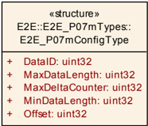

结构类型（**Structure**），包含以下元素：**DataID**（类型 **uint32**）：Data 的系统唯一标识符；**Offset**（类型 **uint32**）：**E2E** 头的第一个位自 Data 起始处的位偏移（位编号：位 0 为最低有效位）。该偏移应为 8 的倍数，且 0 &lt;= Offset &lt;= MaxDataLength-(24\*8)。例如：如果 Offset 等于 8，则 **E2E** Length（16 位）的高字节写入字节 1，低字节写入字节 2；**MinDataLength**（类型 **uint32**）：Data 的最小长度（以位为单位）。**E2E** 检查 DataLength 是否 &gt;= MinDataLength（见 [PRS_E2E_00851]）；**MaxDataLength**（类型 **uint32**）：Data 的最大长度（以位为单位）。**E2E** 检查 DataLength 是否 &lt;= MaxDataLength（见 [PRS_E2E_00851]）；**MaxDeltaCounter**（类型 **uint32**）：两个连续接收的有效 Data 的两个 counter 值之间允许的最大间隔。例如，如果接收方接收到 counter 为 1 的 Data 且 MaxDeltaCounter 为 3，则在下次接收时接收方可以接受值为 2、3 或 4 的 Counter。所发送 Data（数据元素或 **I-PDU**）的配置，用于 **E2E** Profile 7m。对于每个发送的 Data，都存在该 typedef 的一个实例。可通过**E2E.h**获得。

##### 7.2.8.2. E2E_P07mProtectStateType

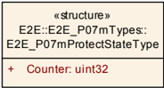

结构类型（**Structure**），包含以下元素：**Counter**（类型 **uint32**）：用于保护下一个 Data 的 counter。初始值为 0，这意味着在第一个周期中 Counter 为 0。每次调用 E2E\_P07mProtect() 时，它都会将 counter 递增，最高到 0xFF'FF'FF'FF。达到最大值之后，下一个值为 0x0。溢出不会报告给调用者。使用 **E2E** Profile 7m 保护的 Data 的发送方状态。可通过**E2E.h**获得。

##### 7.2.8.3. E2E_P07mCheckStateType

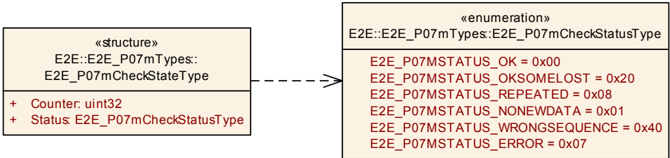

结构类型（**Structure**），包含以下元素：**Status**（类型 [E2E_P07mCheckStatusType](#7284-e2e_p07mcheckstatustype)）：由 Check 函数确定的本周周期中 Data 的校验结果；**Counter**（类型 **uint32**）：上一周期中数据的 counter。使用 **E2E** Profile 7m 保护的单个 Data 的接收状态。可通过**E2E.h**获得。

##### 7.2.8.4. E2E_P07mCheckStatusType

枚举类型（**Enumeration**）：

* **E2E_P07MSTATUS_OK**（0x00）：OK：本周期中对 Data 的校验成功（包括 counter 校验，counter 递增了 1）。
* **E2E_P07MSTATUS_NONEWDATA**（0x01）：错误：Check 函数已被调用，但自上次调用以来，根据通信介质（例如 **RTE**、**COM**）没有新数据可用。因此，没有对 Data 执行任何 **E2E** 校验。这可以认为与 E2E\_P07STATUS_REPEATED 类似。
* **E2E_P07MSTATUS_ERROR**（0x07）：错误：发生了与 counter 无关的错误（例如错误的 **CRC**、错误的长度、错误的选项、错误的 Data ID）。
* **E2E_P07MSTATUS_REPEATED**（0x08）：错误：本周期中对 Data 的校验成功，但存在重复。
* **E2E_P07MSTATUS_OKSOMELOST**（0x20）：OK：本周期中对 Data 的校验成功（包括 counter 校验，counter 在允许的配置增量内递增）。
* **E2E_P07MSTATUS_WRONGSEQUENCE**（0x40）：错误：本周期中对 Data 的校验成功，但 counter 跳变除外，其变化超过了允许的增量。

使用 **E2E** Profile 7m 保护的单个 Data 在单个周期内的接收状态。可通过**E2E.h**获得。

#### 7.2.9. E2E Profile 8 类型

##### 7.2.9.1. E2E_P08ConfigType

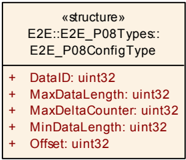

结构类型（**Structure**），包含以下元素：**DataID**（类型 **uint32**）：Data 的系统唯一标识符；**Offset**（类型 **uint32**）：**E2E** 头的第一个位自 Data 起始处的位偏移（位编号：位 0 为最低有效位）。该偏移应为 8 的倍数，且 0 &lt;= Offset &lt;= MaxDataLength-(16\*8)。例如：如果 Offset 等于 8，则 **E2E** Length（32 位）的高字节写入字节 1，下一个字节写入字节 2，依此类推；**MinDataLength**（类型 **uint32**）：Data 的最小长度（以位为单位）。**E2E** 检查 DataLength 是否 &gt;= MinDataLength（见 [PRS_E2E_00706]）；**MaxDataLength**（类型 **uint32**）：Data 的最大长度（以位为单位）。**E2E** 检查 DataLength 是否 &lt;= MaxDataLength（见 [PRS_E2E_00706]）；**MaxDeltaCounter**（类型 **uint32**）：两个连续接收的有效 Data 的两个 counter 值之间允许的最大间隔。例如，如果接收方接收到 counter 为 1 的 Data 且 MaxDeltaCounter 为 3，则在下次接收时接收方可以接受值为 2、3 或 4 的 Counter。所发送 Data（数据元素或 **I-PDU**）的配置，用于 **E2E** Profile 08。对于每个发送的 Data，都存在该 typedef 的一个实例。可通过**E2E.h**获得。

##### 7.2.9.2. E2E_P08ProtectStateType

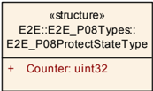

结构类型（**Structure**），包含以下元素：**Counter**（类型 **uint32**）：用于保护下一个 Data 的 counter。初始值为 0，这意味着在第一个周期中 Counter 为 0。每次调用 E2E\_P08Protect() 时，它都会将 counter 递增，最高到 0xFF'FF'FF'FF。使用 **E2E** Profile 08 保护的 Data 的发送方状态。可通过**E2E.h**获得。

##### 7.2.9.3. E2E_P08CheckStateType

**注意：** 枚举常量的值仅在相关的 **UML** 图中规定（不在表中）。

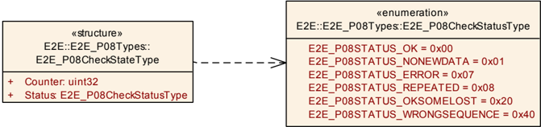


结构类型（**Structure**），包含以下元素：**Status**（类型 [E2E_P08CheckStatusType](#7294-e2e_p08checkstatustype)）：由 Check 函数确定的本周周期中 Data 的校验结果；**Counter**（类型 **uint32**）：上一周期中数据的 counter。使用 **E2E** Profile 08 保护的单个 Data 的接收状态。可通过**E2E.h**获得。

##### 7.2.9.4. E2E_P08CheckStatusType

枚举类型（**Enumeration**）：

* **E2E_P08STATUS_OK**（0x00）：OK：本周期中对 Data 的校验成功（包括 counter 校验，counter 递增了 1）。
* **E2E_P08STATUS_NONEWDATA**（0x01）：错误：Check 函数已被调用，但自上次调用以来，根据通信介质（例如 **RTE**、**COM**）没有新数据可用。因此，没有对 Data 执行任何 **E2E** 校验。这可以认为与 E2E\_P08STATUS_REPEATED 类似。
* **E2E_P08STATUS_ERROR**（0x07）：错误：发生了与 counter 无关的错误（例如错误的 **CRC**、错误的长度、错误的选项、错误的 Data ID）。
* **E2E_P08STATUS_REPEATED**（0x08）：错误：本周期中对 Data 的校验成功，但存在重复。
* **E2E_P08STATUS_OKSOMELOST**（0x20）：OK：本周期中对 Data 的校验成功（包括 counter 校验，counter 在允许的配置增量内递增）。
* **E2E_P08STATUS_WRONGSEQUENCE**（0x40）：错误：本周期中对 Data 的校验成功，但 counter 跳变除外，其变化超过了允许的增量。

使用 **E2E** Profile 08 保护的单个 Data 在单个周期内的接收状态。可通过**E2E.h**获得。

注意，状态 E2E\_P08STATUS\_ERROR 是新的（相对于 **E2E** Profiles 1 和 2）。

#### 7.2.10. E2E Profile 8m 类型

##### 7.2.10.1. E2E_P08mConfigType

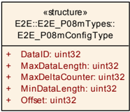

结构类型（**Structure**），包含以下元素：**DataID**（类型 **uint32**）：Data 的系统唯一标识符；**MinDataLength**（类型 **uint32**）：Data 的最小长度（以位为单位）。**E2E** 检查 DataLength 是否 &gt;= MinDataLength（见 [PRS_E2E_01154]）；**MaxDataLength**（类型 **uint32**）：Data 的最大长度（以位为单位）。**E2E** 检查 DataLength 是否 &lt;= MaxDataLength（见 [PRS_E2E_01154]）；**MaxDeltaCounter**（类型 **uint32**）：两个连续接收的有效 Data 的两个 counter 值之间允许的最大间隔。例如，如果接收方接收到 counter 为 1 的 Data 且 MaxDeltaCounter 为 3，则在下次接收时接收方可以接受值为 2、3 或 4 的 Counter；**Offset**（类型 **uint32**）：**E2E** 头的第一个位自 Data 起始处的位偏移（位编号：位 0 为最低有效位）。该偏移应为 8 的倍数，且 0 &lt;= Offset &lt;= MaxDataLength-(16\*8)。例如：如果 Offset 等于 8，则 **E2E** Length（32 位）的高字节写入字节 1，下一个字节写入字节 2，依此类推。所发送 Data（数据元素或 **I-PDU**）的配置，用于 **E2E** Profile 08m。对于每个发送的 Data，都存在该 typedef 的一个实例。可通过**E2E.h**获得。

##### 7.2.10.2. E2E_P08mProtectStateType

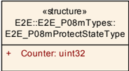

结构类型（**Structure**），包含以下元素：**Counter**（类型 **uint32**）：用于保护下一个 Data 的 counter。初始值为 0，这意味着在第一个周期中 Counter 为 0。每次调用 E2E\_P08mProtect() 时，它都会将 counter 递增，最高到 0xFF'FF'FF'FF。使用 **E2E** Profile 08m 保护的 Data 的发送方状态。可通过**E2E.h**获得。

##### 7.2.10.3. E2E_P08mCheckStateType

**注意：** 枚举常量的值仅在相关的 **UML** 图中规定（不在表中）。

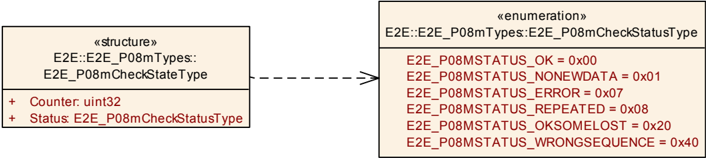

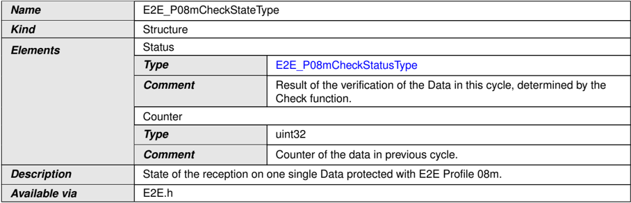

结构类型（**Structure**），包含以下元素：**Status**（类型 [E2E_P08mCheckStatusType](#72104-e2e_p08mcheckstatustype)）：由 Check 函数确定的本周周期中 Data 的校验结果；**Counter**（类型 **uint32**）：上一周期中数据的 counter。使用 **E2E** Profile 08m 保护的单个 Data 的接收状态。可通过**E2E.h**获得。

##### 7.2.10.4. E2E_P08mCheckStatusType

枚举类型（**Enumeration**）：

* **E2E_P08MSTATUS_OK**（0x00）：OK：本周期中对 Data 的校验成功（包括 counter 校验，counter 递增了 1）。
* **E2E_P08MSTATUS_NONEWDATA**（0x01）：错误：Check 函数已被调用，但自上次调用以来，根据通信介质（例如 **RTE**、**COM**）没有新数据可用。因此，没有对 Data 执行任何 **E2E** 校验。这可以认为与 E2E\_P08MSTATUS_REPEATED 类似。
* **E2E_P08MSTATUS_ERROR**（0x07）：错误：发生了与 counter 无关的错误（例如错误的 **CRC**、错误的长度、错误的选项、错误的 Data ID）。
* **E2E_P08MSTATUS_REPEATED**（0x08）：错误：本周期中对 Data 的校验成功，但存在重复。
* **E2E_P08MSTATUS_OKSOMELOST**（0x20）：OK：本周期中对 Data 的校验成功（包括 counter 校验，counter 在允许的配置增量内递增）。
* **E2E_P08MSTATUS_WRONGSEQUENCE**（0x40）：错误：本周期中对 Data 的校验成功，但 counter 跳变除外，其变化超过了允许的增量。

使用 **E2E** Profile 08m 保护的单个 Data 在单个周期内的接收状态。可通过**E2E.h**获得。

注意，状态 E2E\_P08MSTATUS\_ERROR 是新的（相对于 **E2E** Profiles 1 和 2）。

#### 7.2.11. E2E Profile 11 类型

##### 7.2.11.1. E2E_P11ConfigType

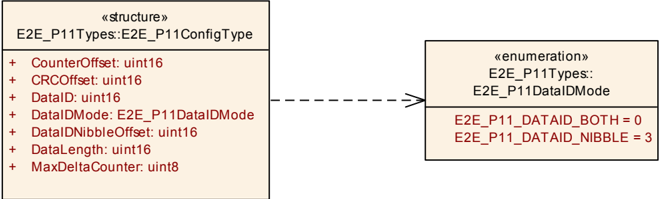

结构类型（**Structure**），包含以下元素：**DataLength**（类型 **uint16**）：数据长度（以位为单位）。该值应为 8 的倍数；**DataID**（类型 **uint16**）：唯一标识符，用于防止伪装（**masquerading**）。ID 值的选择有一些约束，在「Data ID 的配置约束」一节中描述；**MaxDeltaCounter**（类型 **uint8**）：两个连续接收的有效 Data 的两个 counter 值之间允许的最大间隔。例如，如果接收方接收到 counter 为 1 的 Data 且 MaxDeltaCounter 为 3，则在下次接收时接收方可以接受值为 2、3 或 4 的 Counter；**DataIDMode**（类型 [E2E_P11DataIDMode](#72112-e2e_p11dataidmode)）：-；**CRCOffset**（类型 **uint16**）：**CRC** 的位偏移（即自 \*Data 起），**MSB** 先序。在变体 1A 和 1B 中，CRCOffset 为 0。该偏移应为 8 的倍数；**CounterOffset**（类型 **uint16**）：**Counter** 在 **MSB** 先序中的位偏移。在变体 1A 和 1B 中，CounterOffset 为 8。该偏移应为 4 的倍数；**DataIDNibbleOffset**（类型 **uint16**）：Data ID 高字节的低半字节（**nibble**）的位偏移。仅当 DataIDMode = E2E_P11_DATAID_NIBBLE 时 **E2E** 库才使用此参数（否则 **E2E** 库会忽略它）。对于不同于 E2E_P11_DATAID_NIBBLE 的 DataIDMode，DataIDNibbleOffset 应初始化为 0（即使 **E2E** 库忽略它）。所发送 Data（数据元素或 **I-PDU**）的配置，用于 **E2E** Profile 11。对于每个发送的 Data，都存在该 typedef 的一个实例。可通过**E2E.h**获得。

##### 7.2.11.2. E2E_P11DataIDMode

枚举类型（**Enumeration**）：

* **E2E_P11_DATAID_BOTH**（0）：两个字节都包含在 **CRC** 中（双 ID 配置）。用于 **E2E** 变体 1A。
* **E2E_P11_DATAID_NIBBLE**（3）：低字节包含在隐式 **CRC** 计算中，高字节的低半字节随数据一起传输（即被显式包含），高字节的高半字节不使用。适用于最大 12 位的 ID。用于 **E2E** 变体 1C。

在 **E2E** Profile 1 中，Data ID 的长度为两个字节。有四种包含模式可将隐式的两字节 Data ID 包含进单字节 **CRC** 中。可通过**E2E.h**获得。

##### 7.2.11.3. E2E_P11ProtectStateType

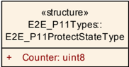

结构类型（**Structure**），包含以下元素：**Counter**（类型 **uint8**）：用于保护下一个 Data 的 counter。初始值为 0，这意味着在第一个周期中 Counter 为 0。每次调用 E2E\_P11Protect() 时，它都会将 counter 递增，最高到 0x0E。使用 **E2E** Profile 11 保护的 Data 的发送方状态。可通过**E2E.h**获得。

##### 7.2.11.4. E2E_P11CheckStateType

**注意：** 枚举常量的值仅在相关的 **UML** 图中规定（不在表中）。

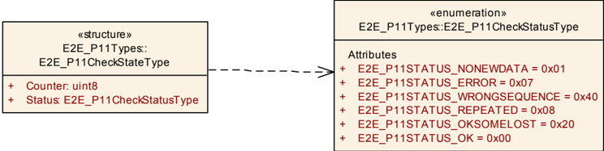

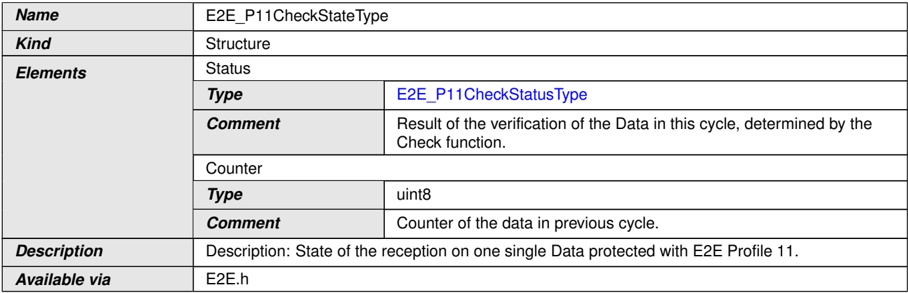

结构类型（**Structure**），包含以下元素：**Status**（类型 [E2E_P11CheckStatusType](#72115-e2e_p11checkstatustype)）：由 Check 函数确定的本周周期中 Data 的校验结果；**Counter**（类型 **uint8**）：上一周期中数据的 counter。使用 **E2E** Profile 11 保护的单个 Data 的接收状态。可通过**E2E.h**获得。

##### 7.2.11.5. E2E_P11CheckStatusType

枚举类型（**Enumeration**）：

* **E2E_P11STATUS_OK**（0x00）：OK：本周期中对 Data 的校验成功（包括 counter 校验，counter 递增了 1）。
* **E2E_P11STATUS_NONEWDATA**（0x01）：错误：Check 函数已被调用，但自上次调用以来，根据通信介质（例如 **RTE**、**COM**）没有新数据可用。因此，没有对 Data 执行任何 **E2E** 校验。这可以认为与 E2E\_P11STATUS_REPEATED 类似。
* **E2E_P11STATUS_ERROR**（0x07）：错误：发生了与 counter 无关的错误（例如错误的 **CRC**、错误的长度）。
* **E2E_P11STATUS_REPEATED**（0x08）：错误：本周期中对 Data 的校验成功，但存在重复。
* **E2E_P11STATUS_OKSOMELOST**（0x20）：OK：本周期中对 Data 的校验成功（包括 counter 校验，counter 在允许的配置增量内递增）。
* **E2E_P11STATUS_WRONGSEQUENCE**（0x40）：错误：本周期中对 Data 的校验成功，但 counter 跳变除外，其变化超过了允许的增量。

使用 **E2E** Profile 11 保护的单个 Data 在单个周期内的接收状态。可通过**E2E.h**获得。

#### 7.2.12. E2E Profile 22 类型

##### 7.2.12.1. E2E_P22ConfigType

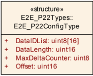

结构类型（**Structure**），包含以下元素：**DataLength**（类型 **uint16**）：Data 的长度（以位为单位）。该值应为 8 的倍数；**DataIDList**（类型 **uint8** 数组，大小 16）：为防止伪装而适当选择的一组 Data ID；**MaxDeltaCounter**（类型 **uint8**）：两个连续接收的有效 Data 的两个 counter 值之间最初允许的最大间隔。例如，如果接收方接收到 counter 为 1 的 Data 且 MaxDeltaCounterInit 为 1，则在下次接收时接收方可以接受值为 2 和 3 的 Counter，但不能接受 4。注意，如果接收方在连续读取时未接收到新 Data，则接收方将容差加 1；**Offset**（类型 **uint16**）：**E2E** 头在 Data[] 数组中的偏移量（以位为单位）。应满足：0 &lt;= Offset &lt;= DataLength-(2\*8)。通过 **RTE** 端口发送的数据元素的非可修改配置，用于 **E2E** profile 22。可通过**E2E.h**获得。

##### 7.2.12.2. E2E_P22ProtectStateType

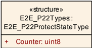

结构类型（**Structure**），包含以下元素：**Counter**（类型 **uint8**）：用于保护 Data 的 counter。初始值为 0，这意味着第一个 Data 的 counter 将为 0。在用 counter 进行保护之后，counter 以模 16 递增。使用 **E2E** Profile 22 保护的 Data 的发送方状态。可通过**E2E.h**获得。

##### 7.2.12.3. E2E_P22CheckStateType

**注意：** 枚举常量的值仅在相关的 **UML** 图中规定（不在表中）。

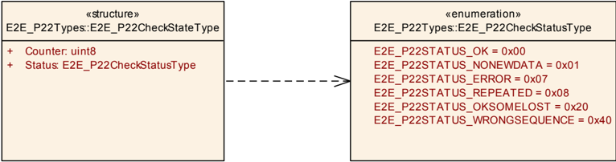

结构类型（**Structure**），包含以下元素：**Counter**（类型 **uint8**）：最后一个有效接收消息的 counter；**Status**（类型 [E2E_P22CheckStatusType](#72124-e2e_p22checkstatustype)）：由 Check 函数确定的 Data 校验结果。使用 **E2E** Profile 22 保护的 Data 的发送方状态。可通过**E2E.h**获得。

##### 7.2.12.4. E2E_P22CheckStatusType

枚举类型（**Enumeration**）：

* **E2E_P22STATUS_OK**（0x00）：OK：已根据通信介质接收到新数据，**CRC** 正确，相对于最近一次以 Status \_INITIAL、\_OK 或 \_OKSOMELOST 接收的 Data，Counter 递增 1。这意味着自上次正确接收数据以来没有丢失任何 Data。
* **E2E_P22STATUS_NONEWDATA**（0x01）：错误：Check 函数已被调用，但自上次调用以来，根据通信介质（例如 **RTE**、**COM**）没有新数据可用。因此，没有对 Data 执行任何 **E2E** 校验。
* **E2E_P22STATUS_ERROR**（0x07）：错误：已根据通信介质接收到数据，但 **CRC** 不正确。
* **E2E_P22STATUS_REPEATED**（0x08）：错误：已根据通信介质接收到新数据，**CRC** 正确，但 Counter 与最近一次以 Status \_INITIAL、\_OK 或 \_OKSOMELOST 接收的 Data 相同。
* **E2E_P22STATUS_OKSOMELOST**（0x20）：OK：已根据通信介质接收到新数据，**CRC** 正确，相对于最近一次以 Status \_INITIAL、\_OK 或 \_OKSOMELOST 接收的 Data，Counter 递增了 DeltaCounter（1 &lt; DeltaCounter = MaxDeltaCounter）。这意味着自上次正确/初始接收以来，序列中可能丢失了一些 Data，但这在配置的容差范围内。
* **E2E_P22STATUS_WRONGSEQUENCE**（0x40）：错误：已根据通信介质接收到新数据，**CRC** 正确，但相对于最近一次以 Status \_INITIAL、\_OK 或 \_OKSOMELOST 接收的 Data，Counter 增量过大（DeltaCounter &gt; MaxDeltaCounter）。这意味着自上次正确/初始接收以来，序列中可能丢失了过多 Data。

由 Check 函数确定的 **E2E** Profile 22 中 Data 校验的结果。可通过**E2E.h**获得。

#### 7.2.13. E2E Profile 44 类型

##### 7.2.13.1. E2E_P44ConfigType

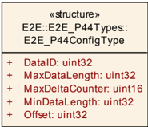

结构类型（**Structure**），包含以下元素：**DataID**（类型 **uint32**）：Data 的系统唯一标识符；**Offset**（类型 **uint32**）：**E2E** 头的第一个位自 Data 起始处的位偏移（位编号：位 0 为最低有效位）。该偏移应为 8 的倍数，且 0 &lt;= Offset &lt;= MaxDataLength-(12\*8)。例如：如果 Offset 等于 8，则 **E2E** Length（16 位）的高字节写入字节 1，低字节写入字节 2；**MinDataLength**（类型 **uint32**）：Data 的最小长度（以位为单位）。**E2E** 检查 DataLength 是否 &gt;= MinDataLength（见 [PRS_E2E_00735]）；**MaxDataLength**（类型 **uint32**）：Data 的最大长度（以位为单位）。**E2E** 检查 DataLength 是否 &lt;= MaxDataLength（见 [PRS_E2E_00735]）；**MaxDeltaCounter**（类型 **uint16**）：两个连续接收的有效 Data 的两个 counter 值之间允许的最大间隔。例如，如果接收方接收到 counter 为 1 的 Data 且 MaxDeltaCounter 为 3，则在下次接收时接收方可以接受值为 2、3 或 4 的 Counter。所发送 Data（数据元素或 **I-PDU**）的配置，用于 **E2E** Profile 44。对于每个发送的 Data，都存在该 typedef 的一个实例。可通过**E2E.h**获得。

##### 7.2.13.2. E2E_P44ProtectStateType

结构类型（**Structure**），包含以下元素：**Counter**（类型 **uint16**）：用于保护下一个 Data 的 counter。初始值为 0，这意味着在第一个周期中 Counter 为 0。每次调用 E2E\_P44Protect() 时，它都会将 counter 递增，最高到 0xFF'FF。达到最大值之后，下一个值为 0x0。溢出不会报告给调用者。使用 **E2E** Profile 44 保护的 Data 的发送方状态。可通过**E2E.h**获得。

##### 7.2.13.3. E2E_P44CheckStateType

**注意：** 枚举常量的值仅在相关的 **UML** 图中规定（不在表中）。

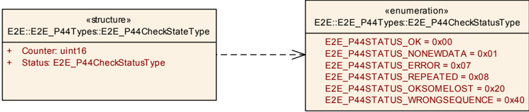

结构类型（**Structure**），包含以下元素：**Status**（类型 [E2E_P44CheckStatusType](#72134-e2e_p44checkstatustype)）：由 Check 函数确定的本周周期中 Data 的校验结果；**Counter**（类型 **uint16**）：上一周期中数据的 counter。使用 **E2E** Profile 44 保护的单个 Data 的接收状态。可通过**E2E.h**获得。

##### 7.2.13.4. E2E_P44CheckStatusType

枚举类型（**Enumeration**）：

* **E2E_P44STATUS_OK**（0x00）：OK：本周期中对 Data 的校验成功（包括 counter 校验，counter 递增了 1）。
* **E2E_P44STATUS_NONEWDATA**（0x01）：错误：Check 函数已被调用，但自上次调用以来，根据通信介质（例如 **RTE**、**COM**）没有新数据可用。因此，没有对 Data 执行任何 **E2E** 校验。这可以认为与 E2E\_P44STATUS_REPEATED 类似。
* **E2E_P44STATUS_ERROR**（0x07）：错误：发生了与 counter 无关的错误（例如错误的 **CRC**、错误的长度、错误的选项、错误的 Data ID）。
* **E2E_P44STATUS_REPEATED**（0x08）：错误：本周期中对 Data 的校验成功，但存在重复。
* **E2E_P44STATUS_OKSOMELOST**（0x20）：OK：本周期中对 Data 的校验成功（包括 counter 校验，counter 在允许的配置增量内递增）。
* **E2E_P44STATUS_WRONGSEQUENCE**（0x40）：错误：本周期中对 Data 的校验成功，但 counter 跳变除外，其变化超过了允许的增量。

使用 **E2E** Profile 44 保护的单个 Data 在单个周期内的接收状态。可通过**E2E.h**获得。

注意，状态 E2E\_P44STATUS\_ERROR 是新的（相对于 **E2E** Profiles 1 和 2）。

#### 7.2.14. E2E Profile 44m 类型

##### 7.2.14.1. E2E_P44mConfigType

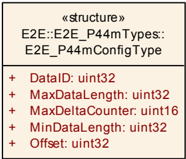

结构类型（**Structure**），包含以下元素：**DataID**（类型 **uint32**）：Data 的系统唯一标识符；**MinDataLength**（类型 **uint32**）：Data 的最小长度（以位为单位）。**E2E** 检查 DataLength 是否 &gt;= MinDataLength（见 [PRS_E2E_01202]）；**MaxDataLength**（类型 **uint32**）：Data 的最大长度（以位为单位）。**E2E** 检查 DataLength 是否 &lt;= MaxDataLength（见 [PRS_E2E_01202]）；**MaxDeltaCounter**（类型 **uint16**）：两个连续接收的有效 Data 的两个 counter 值之间允许的最大间隔。例如，如果接收方接收到 counter 为 1 的 Data 且 MaxDeltaCounter 为 3，则在下次接收时接收方可以接受值为 2、3 或 4 的 Counter；**Offset**（类型 **uint32**）：**E2E** 头的第一个位自 Data 起始处的位偏移（位编号：位 0 为最低有效位）。该偏移应为 8 的倍数，且 0 &lt;= Offset &lt;= MaxDataLength-(12\*8)。例如：如果 Offset 等于 8，则 **E2E** Length（16 位）的高字节写入字节 1，低字节写入字节 2。所发送 Data（数据元素或 **I-PDU**）的配置，用于 **E2E** Profile 44m。对于每个发送的 Data，都存在该 typedef 的一个实例。可通过**E2E.h**获得。

##### 7.2.14.2. E2E_P44mProtectStateType

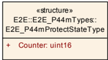

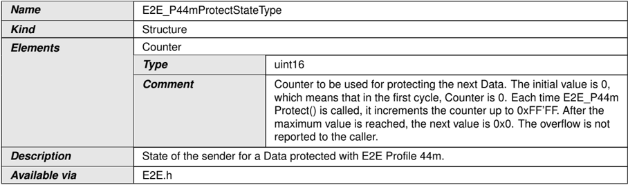

结构类型（**Structure**），包含以下元素：**Counter**（类型 **uint16**）：用于保护下一个 Data 的 counter。初始值为 0，这意味着在第一个周期中 Counter 为 0。每次调用 E2E\_P44mProtect() 时，它都会将 counter 递增，最高到 0xFF'FF。达到最大值之后，下一个值为 0x0。溢出不会报告给调用者。使用 **E2E** Profile 44m 保护的 Data 的发送方状态。可通过**E2E.h**获得。

##### 7.2.14.3. E2E_P44mCheckStateType

**注意：** 枚举常量的值仅在相关的 **UML** 图中规定（不在表中）。

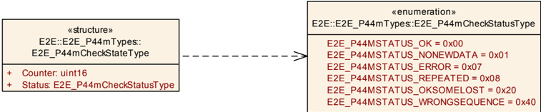

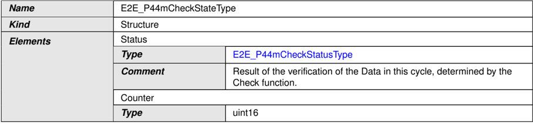

结构类型（**Structure**），包含以下元素：**Status**（类型 [E2E_P44mCheckStatusType](#72144-e2e_p44mcheckstatustype)）：由 Check 函数确定的本周周期中 Data 的校验结果；**Counter**（类型 **uint16**）：上一周期中数据的 counter。使用 **E2E** Profile 44m 保护的单个 Data 的接收状态。可通过**E2E.h**获得。

##### 7.2.14.4. E2E_P44mCheckStatusType

枚举类型（**Enumeration**）：

* **E2E_P44MSTATUS_OK**（0x00）：OK：本周期中对 Data 的校验成功（包括 counter 校验，counter 递增了 1）。
* **E2E_P44MSTATUS_NONEWDATA**（0x01）：错误：Check 函数已被调用，但自上次调用以来，根据通信介质（例如 **RTE**、**COM**）没有新数据可用。因此，没有对 Data 执行任何 **E2E** 校验。这可以认为与 E2E\_P44MSTATUS_REPEATED 类似。
* **E2E_P44MSTATUS_ERROR**（0x07）：错误：发生了与 counter 无关的错误（例如错误的 **CRC**、错误的长度、错误的选项、错误的 Data ID）。
* **E2E_P44MSTATUS_REPEATED**（0x08）：错误：本周期中对 Data 的校验成功，但存在重复。
* **E2E_P44MSTATUS_OKSOMELOST**（0x20）：OK：本周期中对 Data 的校验成功（包括 counter 校验，counter 在允许的配置增量内递增）。
* **E2E_P44MSTATUS_WRONGSEQUENCE**（0x40）：错误：本周期中对 Data 的校验成功，但 counter 跳变除外，其变化超过了允许的增量。

使用 **E2E** Profile 44m 保护的单个 Data 在单个周期内的接收状态。可通过**E2E.h**获得。

注意，状态 E2E\_P44MSTATUS\_ERROR 是新的（相对于 **E2E** Profiles 1 和 2）。

#### 7.2.15. E2E 状态机类型

##### 7.2.15.1. E2E_PCheckStatusType

枚举类型（**Enumeration**）：

* **E2E_P_OK**（0x00）：OK：本周期中对 Data 的校验成功（包括 counter 校验）。
* **E2E_P_REPEATED**（0x01）：Data 具有重复的 counter。
* **E2E_P_WRONGSEQUENCE**（0x02）：本周期中对 Data 的校验成功，但 counter 跳变除外，其变化超过了允许的增量。
* **E2E_P_ERROR**（0x03）：发生了与 counter 无关的错误（例如错误的 **CRC**、错误的长度、错误的 Data ID），或校验函数的返回值不为 OK。
* **E2E_P_NOTAVAILABLE**（0x04）：尚未接收到任何值（例如在初始化期间）。它用作缓冲区的初始化值，任何 **E2E** profile 都不会返回它。
* **E2E_P_NONEWDATA**（0x05）：没有可用的新数据。
* **reserved**（0x07、0x0F）：预留给运行时错误（将来不得用于任何状态）。

单个 Data 在单个周期内的接收的、与 profile 无关的状态。可通过**E2E.h**获得。

##### 7.2.15.2. E2E_SMConfigType

结构类型（**Structure**），包含以下元素：**WindowSizeValid**（类型 **uint8**）：状态机在 **VALID** 状态期间的监视窗口大小；**MinOkStateInit**（类型 **uint8**）：在最后 WindowSize 次校验中（针对状态 E2E\_SM\_INIT），确定为 ProfileStatus 等于 E2E_P_OK 的最少校验次数，这是切换到状态 E2E_SM_VALID 所必需的；**MaxErrorStateInit**（类型 **uint8**）：在最后 WindowSize 次校验中（针对状态 E2E\_SM\_INIT），确定为 ProfileStatus 等于 E2E_P_ERROR 的最多校验次数；**MinOkStateValid**（类型 **uint8**）：在最后 WindowSize 次校验中（针对状态 E2E\_SM\_VALID），确定为 ProfileStatus 等于 E2E_P_OK 的最少校验次数，这是保持在状态 E2E_SM_VALID 所必需的；**MaxErrorStateValid**（类型 **uint8**）：在最后 WindowSize 次校验中（针对状态 E2E\_SM\_VALID），确定为 ProfileStatus 等于 E2E_P_ERROR 的最多校验次数；**MinOkStateInvalid**（类型 **uint8**）：在最后 WindowSize 次校验中（针对状态 E2E\_SM\_INVALID），确定为 ProfileStatus 等于 E2E_P_OK 的最少校验次数，这是切换到状态 E2E_SM_VALID 所必需的；**MaxErrorStateInvalid**（类型 **uint8**）：在最后 WindowSize 次校验中（针对状态 E2E\_SM\_INVALID），确定为 ProfileStatus 等于 E2E_P_ERROR 的最多校验次数；**WindowSizeInit**（类型 **uint8**）：状态机在 **INIT** 状态期间的监视窗口大小；**WindowSizeInvalid**（类型 **uint8**）：状态机在 **INVALID** 状态期间的监视窗口大小；**ClearToInvalid**（类型 **boolean**）：在转换到 **INVALID** 状态时清除监视窗口数据；**transitToInvalidExtended**（类型 **boolean**）：限制/允许从 **INIT**/**NODATA** 状态到 **INVALID** 状态的转换。用于交换 Data 的通信信道的配置。可通过**E2E.h**获得。

##### 7.2.15.3. E2E_SMCheckStateType

**注意：** 枚举常量的值仅在相关的 **UML** 图中规定（不在表中）。

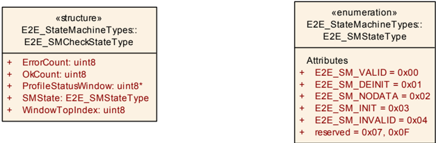

结构类型（**Structure**），包含以下元素：**ProfileStatusWindow**（类型 **uint8\***）：指向一个数组的指针，其中存储了最后若干次 **E2E** 校验的 ProfileStatus。该数组的大小应为 WindowSize；**WindowTopIndex**（类型 **uint8**）：数组中的索引，下一个 ProfileStatus 将写入该位置；**OkCount**（类型 **uint8**）：在最后 WindowSize 次校验中，确定为 ProfileStatus 等于 E2E_P_OK 的校验计数；**ErrorCount**（类型 **uint8**）：在最后 WindowSize 次校验中，确定为 ProfileStatus 等于 E2E_P_ERROR 的校验计数；**SMState**（类型 [E2E_SMStateType](#72154-e2e_smstatetype)）：状态机中的当前状态。该值未在状态机的伪代码中显式使用，因为它在 **UML** 中表示为 **UML** 状态。通信信道保护的状态。可通过**E2E.h**获得。

##### 7.2.15.4. E2E_SMStateType

枚举类型（**Enumeration**）：

* **E2E_SM_VALID**（0x00）：根据 **E2E**，通信运行正常，数据可以使用。
* **E2E_SM_DEINIT**（0x01）：调用 E2E\_SMCheckInit() 之前的状态，数据不能使用。
* **E2E_SM_NODATA**（0x02）：自初始化以来发送方没有数据可用，数据不能使用。
* **E2E_SM_INIT**（0x03）：自启动以来已接收到一些数据，但尚无法使用，数据不能使用。
* **E2E_SM_INVALID**（0x04）：通信运行不正常，数据不能使用。
* **reserved**（0x07、0x0F）：预留给运行时错误（将来不得用于任何状态）。

交换数据的通信信道的状态。如果状态为 OK，则可以使用该数据。可通过**E2E.h**获得。

### 7.3. 例程定义

本章定义 **E2E** 库提供的例程。所提供的例程可以实现为：

* 函数
* 内联函数
* 宏

#### 7.3.1. E2E Profile 1 例程

##### 7.3.1.1. E2E_P01Protect

**说明**: 使用 **E2E** profile 1 保护要发送的数组/缓冲区。这包括校验和计算以及 counter 和 Data ID 的处理。服务 ID 0x01。本服务为同步调用，可重入。参数 ConfigPtr（in）：指向静态配置的指针。参数 StatePtr（inout）：指向端口/数据通信状态的指针。参数 DataPtr（inout）：指向要发送的 Data 的指针。参数（out）：无。返回值：Std_ReturnType，[E2E_E_INPUTERR_NULL](#611-开发错误)、[E2E_E_INPUTERR_WRONG](#611-开发错误)、[E2E_E_INTERR](#611-开发错误)、E2E_E_OK——返回值的定义见 SWS_E2E_00047。可通过**E2E.h**获得。

```C
Std_ReturnType E2E_P01Protect ( const E2E_P01ConfigType* ConfigPtr, E2E_P01ProtectStateType* StatePtr, uint8* DataPtr )
```

##### 7.3.1.2. E2E_P01ProtectInit

**说明**: 初始化保护状态。服务 ID 0x1b。本服务为同步调用，可重入。参数（in）：无。参数（inout）：无。参数 StatePtr（out）：指向端口/数据通信状态的指针。返回值：Std_ReturnType，[E2E_E_INPUTERR_NULL](#611-开发错误)——传入了空指针；E2E_E_OK。可通过**E2E.h**获得。

```C
Std_ReturnType E2E_P01ProtectInit ( E2E_P01ProtectStateType* StatePtr )
```

如果 State 为 **NULL**，E2E\_P01ProtectInit 应立即以 E2E\_E\_INPUTERR\_NULL 返回。否则，它应初始化状态结构，将 Counter 设置为 0。

##### 7.3.1.3. E2E_P01Forward

**说明**: 使用 **E2E** profile 01 保护被转发的数据。这包括校验和计算以及 counter 和 Data ID 的处理。接收消息中检测到的错误将在输出数据上重建。服务 ID 0x38。本服务为同步调用，可重入。参数 ConfigPtr（in）：指向静态配置的指针。参数 Checkstatus（in）：接收到的消息的 **E2E** 状态。参数 StatePtr（inout）：指向端口/数据通信状态的指针。参数 DataPtr（inout）：指向要发送的 Data 的指针。参数（out）：无。返回值：Std_ReturnType，[E2E_E_INPUTERR_NULL](#611-开发错误)、[E2E_E_INPUTERR_WRONG](#611-开发错误)、[E2E_E_INTERR](#611-开发错误)、E2E_E_OK——返回值的定义见 SWS_E2E_00047。可通过**E2E.h**获得。

```C
Std_ReturnType E2E_P01Forward ( const E2E_P01ConfigType* ConfigPtr, E2E_PCheckStatusType Checkstatus, E2E_P01ProtectStateType* StatePtr, uint8* DataPtr )
```

##### 7.3.1.4. E2E_P01Check

**说明**: 使用 **E2E** profile 1 校验接收到的 Data。这包括 **CRC** 计算以及 Counter 和 Data ID 的处理。服务 ID 0x02。本服务为同步调用，可重入。参数 Config（in）：指向静态配置的指针。参数 Data（in）：指向接收到的数据的指针。参数 State（inout）：指向端口/数据通信状态的指针。参数（out）：无。返回值：Std_ReturnType，[E2E_E_INPUTERR_NULL](#611-开发错误)、[E2E_E_INPUTERR_WRONG](#611-开发错误)、[E2E_E_INTERR](#611-开发错误)、E2E_E_OK——返回值的定义见 SWS_E2E_00047。可通过**E2E.h**获得。

```C
Std_ReturnType E2E_P01Check ( const E2E_P01ConfigType* Config, E2E_P01CheckStateType* State, const uint8* Data )
```

##### 7.3.1.5. E2E_P01CheckInit

**说明**: 初始化校验状态。服务 ID 0x1c。本服务为同步调用，可重入。参数（in）：无。参数（inout）：无。参数 StatePtr（out）：指向端口/数据通信状态的指针。返回值：Std_ReturnType，[E2E_E_INPUTERR_NULL](#611-开发错误)——传入了空指针；E2E_E_OK。可通过**E2E.h**获得。

```C
Std_ReturnType E2E_P01CheckInit ( E2E_P01CheckStateType* StatePtr )
```

如果 State 为 **NULL**，E2E\_P01CheckInit 应立即以 E2E\_E\_INPUTERR\_NULL 返回。否则，它应初始化状态结构，设置：

* LastValidCounter = 0
* MaxDeltaCounter = 0
* WaitForFirstData = TRUE
* NewDataAvailable = TRUE
* LostData = 0
* Status = E2E\_P01STATUS\_NONEWDATA
* NoNewOrRepeatedDataCounter = 0
* SyncCounter = 0。

在最初的若干个周期中 LastValidCounter 会被忽略，因为 WaitForFirstData 被设置为 TRUE，因此该值不需要设置为 0xE。

##### 7.3.1.6. E2E_P01MapStatusToSM

**说明**: 该函数将 Profile 1 的校验状态映射为一个通用校验状态，**E2E** 状态机校验函数可以使用该状态。**E2E** Profile 1 提供了更细粒度的状态，但这对 **E2E** 状态机而言并不重要。服务 ID 0x1d。本服务为同步调用，可重入。参数 CheckReturn（in）：[E2E_P01Check](#7314-e2e_p01check) 函数的返回值。参数 Status（in）：由 [E2E_P01Check](#7314-e2e_p01check) 函数确定的状态。参数 profileBehavior（in）：FALSE：校验具有 **R4.2** 之前的遗留行为；TRUE：校验的行为类似于 **R4.2** 中引入的新 P4/P5/P6 profile。参数（inout）：无。参数（out）：无。返回值：[E2E_PCheckStatusType](#72151-e2e_pcheckstatustype)，单个 Data 在单个周期内的接收的、与 profile 无关的状态。可通过**E2E.h**获得。

```C
E2E_PCheckStatusType E2E_P01MapStatusToSM ( Std_ReturnType CheckReturn, E2E_P01CheckStatusType Status, boolean profileBehavior )
```

这表示 **R4.2** 的行为：

如果 CheckReturn == E2E\_E\_OK 且 ProfileBehavior == TRUE，则 E2E\_P01MapStatusToSM 函数应根据 Status 的值返回相应的值：

Profile 01 的映射（**Mapping of profile 01**）：

| Status | 返回值 |
|---|---|
| E2E_P01STATUS_OK、E2E_P01STATUS_OKSOMELOST、E2E_P01STATUS_SYNC | E2E_P_OK |
| E2E_P01STATUS_WRONGCRC | E2E_P_ERROR |
| E2E_P01STATUS_REPEATED | E2E_P_REPEATED |
| E2E_P01STATUS_NONEWDATA | E2E_P_NONEWDATA |
| E2E_P01STATUS_WRONGSEQUENCE、E2E_P01STATUS_INITIAL | E2E_P_WRONGSEQUENCE |

这表示 **R4.2** 之前的行为：

如果 CheckReturn == E2E\_E\_OK 且 ProfileBehavior == FALSE，则 E2E\_P01MapStatusToSM 函数应根据 Status 的值返回相应的值：

Profile 01 的映射（**Mapping of profile 01**）：

| Status | 返回值 |
|---|---|
| E2E_P01STATUS_OK、E2E_P01STATUS_OKSOMELOST、E2E_P01STATUS_INITIAL | E2E_P_OK |
| E2E_P01STATUS_WRONGCRC | E2E_P_ERROR |
| E2E_P01STATUS_REPEATED | E2E_P_REPEATED |
| E2E_P01STATUS_NONEWDATA | E2E_P_NONEWDATA |
| E2E_P01STATUS_WRONGSEQUENCE、E2E_P01STATUS_SYNC | E2E_P_WRONGSEQUENCE |

如果 CheckReturn != E2E\_E\_OK，则 E2E\_P01MapStatusToSM() 函数应返回 E2E\_P\_ERROR（无论 Status 的值如何）。

#### 7.3.2. E2E Profile 2 例程

##### 7.3.2.1. E2E_P02Protect

**说明**: 使用 **E2E** profile 2 保护要发送的数组/缓冲区。这包括校验和计算以及序列 counter 和 Data ID 的处理。服务 ID 0x03。本服务为同步调用，可重入。参数 ConfigPtr（in）：指向静态配置的指针。参数 StatePtr（inout）：指向端口/数据通信状态的指针。参数 DataPtr（inout）：指向要保护的数据的指针。参数（out）：无。返回值：Std_ReturnType，[E2E_E_INPUTERR_NULL](#611-开发错误)、[E2E_E_INPUTERR_WRONG](#611-开发错误)、[E2E_E_INTERR](#611-开发错误)、E2E_E_OK——返回值的定义见 SWS_E2E_00047。可通过**E2E.h**获得。

```C
Std_ReturnType E2E_P02Protect ( const E2E_P02ConfigType* ConfigPtr, E2E_P02ProtectStateType* StatePtr, uint8* DataPtr )
```

##### 7.3.2.2. E2E_P02ProtectInit

**说明**: 初始化保护状态。服务 ID 0x1e。本服务为同步调用，可重入。参数（in）：无。参数（inout）：无。参数 StatePtr（out）：指向端口/数据通信状态的指针。返回值：Std_ReturnType，[E2E_E_INPUTERR_NULL](#611-开发错误)——传入了空指针；E2E_E_OK。可通过**E2E.h**获得。

```C
Std_ReturnType E2E_P02ProtectInit ( E2E_P02ProtectStateType* StatePtr )
```

如果 State 为 **NULL**，E2E\_P02ProtectInit 应立即以 E2E\_E\_INPUTERR\_NULL 返回。否则，它应初始化状态结构，将 Counter 设置为 0。

##### 7.3.2.3. E2E_P02Forward

**说明**: 使用 **E2E** profile 02 保护被转发的数据。这包括校验和计算以及 counter 和 Data ID 的处理。接收消息中检测到的错误将在输出数据上重建。服务 ID 0x32。本服务为同步调用，可重入。参数 ConfigPtr（in）：指向静态配置的指针。参数 Checkstatus（in）：接收到的消息的 **E2E** 状态。参数 StatePtr（inout）：指向端口/数据通信状态的指针。参数 DataPtr（inout）：指向要发送的 Data 的指针。参数（out）：无。返回值：Std_ReturnType，[E2E_E_INPUTERR_NULL](#611-开发错误)、[E2E_E_INPUTERR_WRONG](#611-开发错误)、[E2E_E_INTERR](#611-开发错误)、E2E_E_OK——返回值的定义见 SWS_E2E_00047。可通过**E2E.h**获得。

```C
Std_ReturnType E2E_P02Forward ( const E2E_P02ConfigType* ConfigPtr, E2E_PCheckStatusType Checkstatus, E2E_P02ProtectStateType* StatePtr, uint8* DataPtr )
```

##### 7.3.2.4. E2E_P02Check

**说明**: 使用 **E2E** profile 2 校验数组/缓冲区。这包括校验和计算以及序列 counter 和 Data ID 的处理。服务 ID 0x04。本服务为同步调用，可重入。参数 ConfigPtr（in）：指向静态配置的指针。参数 DataPtr（in）：-。参数 StatePtr（inout）：指向端口/数据通信状态的指针。参数（out）：无。返回值：Std_ReturnType，[E2E_E_INPUTERR_NULL](#611-开发错误)、[E2E_E_INPUTERR_WRONG](#611-开发错误)、[E2E_E_INTERR](#611-开发错误)、E2E_E_OK——返回值的定义见 SWS_E2E_00047。可通过**E2E.h**获得。

```C
Std_ReturnType E2E_P02Check ( const E2E_P02ConfigType* ConfigPtr, E2E_P02CheckStateType* StatePtr, const uint8* DataPtr )
```

##### 7.3.2.5. E2E_P02CheckInit

**说明**: 初始化校验状态。服务 ID 0x1f。本服务为同步调用，可重入。参数（in）：无。参数（inout）：无。参数 StatePtr（out）：指向端口/数据通信状态的指针。返回值：Std_ReturnType，[E2E_E_INPUTERR_NULL](#611-开发错误)——传入了空指针；E2E_E_OK。可通过**E2E.h**获得。

```C
Std_ReturnType E2E_P02CheckInit ( E2E_P02CheckStateType* StatePtr )
```

如果 State 为 **NULL**，E2E\_P02CheckInit 应立即以 E2E\_E\_INPUTERR\_NULL 返回。否则，它应初始化状态结构，设置：

* LastValidCounter = 0
* MaxDeltaCounter = 0
* WaitForFirstData = TRUE
* NewDataAvailable = TRUE
* LostData = 0
* Status = E2E\_P02STATUS\_NONEWDATA
* NoNewOrRepeatedDataCounter = 0
* SyncCounter = 0。

在最初的若干个周期中 LastValidCounter 会被忽略，因为 WaitForFirstData 被设置为 TRUE，因此该值不需要设置为 0xF。

##### 7.3.2.6. E2E_P02MapStatusToSM

**说明**: 该函数将 Profile 2 的校验状态映射为一个通用校验状态，**E2E** 状态机校验函数可以使用该状态。**E2E** Profile 2 提供了更细粒度的状态，但这对 **E2E** 状态机而言并不重要。服务 ID 0x20。本服务为同步调用，可重入。参数 CheckReturn（in）：[E2E_P02Check](#7324-e2e_p02check) 函数的返回值。参数 Status（in）：由 [E2E_P02Check](#7324-e2e_p02check) 函数确定的状态。参数 profileBehavior（in）：FALSE：校验具有 **R4.2** 之前的遗留行为；TRUE：校验的行为类似于 **R4.2** 中引入的新 P4/P5/P6 profile。参数（inout）：无。参数（out）：无。返回值：[E2E_PCheckStatusType](#72151-e2e_pcheckstatustype)，单个 Data 在单个周期内的接收的、与 profile 无关的状态。可通过**E2E.h**获得。

```C
E2E_PCheckStatusType E2E_P02MapStatusToSM ( Std_ReturnType CheckReturn, E2E_P02CheckStatusType Status, boolean profileBehavior )
```

这表示 **R4.2** 的行为：

如果 CheckReturn == E2E\_E\_OK 且 ProfileBehavior == 1，则 E2E\_P02MapStatusToSM 函数应根据 Status 的值返回相应的值：

Profile 02 的映射（**Mapping of profile 02**）：

| Status | 返回值 |
|---|---|
| E2E_P02STATUS_OK、E2E_P02STATUS_OKSOMELOST、E2E_P02STATUS_SYNC | E2E_P_OK |
| E2E_P02STATUS_WRONGCRC | E2E_P_ERROR |
| E2E_P02STATUS_REPEATED | E2E_P_REPEATED |
| E2E_P02STATUS_NONEWDATA | E2E_P_NONEWDATA |
| E2E_P02STATUS_WRONGSEQUENCE、E2E_P02STATUS_INITIAL | E2E_P_WRONGSEQUENCE |

这表示 **R4.2** 之前的行为：

如果 CheckReturn == E2E\_E\_OK 且 ProfileBehavior == 0，则 E2E\_P02MapStatusToSM 函数应根据 Status 的值返回相应的值：

Profile 02 的映射（**Mapping of profile 02**）：

| Status | 返回值 |
|---|---|
| E2E_P02STATUS_OK、E2E_P02STATUS_OKSOMELOST、E2E_P02STATUS_INITIAL | E2E_P_OK |
| E2E_P02STATUS_WRONGCRC | E2E_P_ERROR |
| E2E_P02STATUS_REPEATED | E2E_P_REPEATED |
| E2E_P02STATUS_NONEWDATA | E2E_P_NONEWDATA |
| E2E_P02STATUS_WRONGSEQUENCE、E2E_P02STATUS_SYNC | E2E_P_WRONGSEQUENCE |

如果 CheckReturn != E2E\_E\_OK，则 E2E\_P02MapStatusToSM() 函数应返回 E2E\_P\_ERROR（无论 Status 的值如何）。

#### 7.3.3. E2E Profile 4 例程

##### 7.3.3.1. E2E_P04Protect

**说明**: 使用 **E2E** profile 4 保护要发送的数组/缓冲区。这包括校验和计算以及 counter 和 Data ID 的处理。服务 ID 0x70。本服务为同步调用，可重入。参数 ConfigPtr（in）：指向静态配置的指针。参数 Length（in）：数据的长度（以字节为单位）。参数 StatePtr（inout）：指向端口/数据通信状态的指针。参数 DataPtr（inout）：指向要发送的 Data 的指针。参数（out）：无。返回值：Std_ReturnType，[E2E_E_INPUTERR_NULL](#611-开发错误)、[E2E_E_INPUTERR_WRONG](#611-开发错误)、[E2E_E_INTERR](#611-开发错误)、E2E_E_OK——返回值的定义见 SWS_E2E_00047。可通过**E2E.h**获得。

```C
Std_ReturnType E2E_P04Protect ( const E2E_P04ConfigType* ConfigPtr, E2E_P04ProtectStateType* StatePtr, uint8* DataPtr, uint16 Length )
```

##### 7.3.3.2. E2E_P04ProtectInit

**说明**: 初始化保护状态。服务 ID 0x22。本服务为同步调用，可重入。参数（in）：无。参数（inout）：无。参数 StatePtr（out）：指向端口/数据通信状态的指针。返回值：Std_ReturnType，[E2E_E_INPUTERR_NULL](#611-开发错误)——传入了空指针；E2E_E_OK。可通过**E2E.h**获得。

```C
Std_ReturnType E2E_P04ProtectInit ( E2E_P04ProtectStateType* StatePtr )
```

如果 State 为 **NULL**，E2E\_P04ProtectInit 应立即以 E2E\_E\_INPUTERR\_NULL 返回。否则，它应初始化状态结构，将 Counter 设置为 0。

##### 7.3.3.3. E2E_P04Forward

**说明**: 使用 **E2E** profile 04 保护被转发的数据。这包括校验和计算以及 counter 和 Data ID 的处理。接收消息中检测到的错误将在输出数据上重建。服务 ID 0x33。本服务为同步调用，可重入。参数 ConfigPtr（in）：指向静态配置的指针。参数 Length（in）：数据的长度（以字节为单位）。参数 Checkstatus（in）：接收到的消息的 **E2E** 状态。参数 StatePtr（inout）：指向端口/数据通信状态的指针。参数 DataPtr（inout）：指向要发送的 Data 的指针。参数（out）：无。返回值：Std_ReturnType，[E2E_E_INPUTERR_NULL](#611-开发错误)、[E2E_E_INPUTERR_WRONG](#611-开发错误)、[E2E_E_INTERR](#611-开发错误)、E2E_E_OK——返回值的定义见 SWS_E2E_00047。可通过**E2E.h**获得。

```C
Std_ReturnType E2E_P04Forward ( const E2E_P04ConfigType* ConfigPtr, uint16 Length, E2E_PCheckStatusType Checkstatus, E2E_P04ProtectStateType StatePtr, uint8* DataPtr )
```

##### 7.3.3.4. E2E_P04Check

**说明**: 使用 **E2E** profile 4 校验接收到的 Data。这包括 **CRC** 计算以及 Counter 和 Data ID 的处理。该函数在一个周期内只校验单个数据，它不确定/不计算通信链路的累积状态。服务 ID 0x23。本服务为同步调用，可重入。参数 ConfigPtr（in）：指向静态配置的指针。参数 DataPtr（in）：指向接收到的数据的指针。参数 Length（in）：数据的长度（以字节为单位）。参数 StatePtr（inout）：指向接收到的数据的指针。参数（out）：无。返回值：Std_ReturnType，[E2E_E_INPUTERR_NULL](#611-开发错误)、[E2E_E_INPUTERR_WRONG](#611-开发错误)、[E2E_E_INTERR](#611-开发错误)、E2E_E_OK——返回值的定义见 SWS_E2E_00047。可通过**E2E.h**获得。

```C
Std_ReturnType E2E_P04Check ( const E2E_P04ConfigType* ConfigPtr, E2E_P04CheckStateType* StatePtr, const uint8* DataPtr, uint16 Length )
```

##### 7.3.3.5. E2E_P04CheckInit

**说明**: 初始化校验状态。服务 ID 0x24。本服务为同步调用，可重入。参数（in）：无。参数（inout）：无。参数 StatePtr（out）：指向端口/数据通信状态的指针。返回值：Std_ReturnType，[E2E_E_INPUTERR_NULL](#611-开发错误)——传入了空指针；E2E_E_OK。可通过**E2E.h**获得。

```C
Std_ReturnType E2E_P04CheckInit ( E2E_P04CheckStateType* StatePtr )
```

如果 State 为 **NULL**，E2E\_P04CheckInit 应立即以 E2E\_E\_INPUTERR\_NULL 返回。否则，它应初始化状态结构，设置：

1. Counter 为 0xFF'FF。
2. Status 为 E2E\_P04STATUS\_ERROR。

##### 7.3.3.6. E2E_P04MapStatusToSM

**说明**: 该函数将 Profile 4 的校验状态映射为一个通用校验状态，**E2E** 状态机校验函数可以使用该状态。**E2E** Profile 4 提供了更细粒度的状态，但这对 **E2E** 状态机而言并不重要。服务 ID 0x25。本服务为同步调用，可重入。参数 CheckReturn（in）：[E2E_P04Check](#7334-e2e_p04check) 函数的返回值。参数 Status（in）：由 [E2E_P04Check](#7334-e2e_p04check) 函数确定的状态。参数（inout）：无。参数（out）：无。返回值：[E2E_PCheckStatusType](#72151-e2e_pcheckstatustype)，单个 Data 在单个周期内的接收的、与 profile 无关的状态。可通过**E2E.h**获得。

```C
E2E_PCheckStatusType E2E_P04MapStatusToSM ( Std_ReturnType CheckReturn, E2E_P04CheckStatusType Status )
```

如果 CheckReturn = E2E\_E\_OK，则 E2E\_P04MapStatusToSM 函数应根据 Status 的值返回相应的值：

Profile 04 的映射（**Mapping of profile 04**）：

| Status | 返回值 |
|---|---|
| E2E_P04STATUS_OK 或 E2E_P04STATUS_OKSOMELOST | E2E_P_OK |
| E2E_P04STATUS_ERROR | E2E_P_ERROR |
| E2E_P04STATUS_REPEATED | E2E_P_REPEATED |
| E2E_P04STATUS_NONEWDATA | E2E_P_NONEWDATA |
| E2E_P04STATUS_WRONGSEQUENCE | E2E_P_WRONGSEQUENCE |

如果 CheckReturn != E2E\_E\_OK，则 E2E\_P04MapStatusToSM() 函数应返回 E2E\_P\_ERROR（无论 Status 的值如何）。

#### 7.3.4. E2E Profile 4m 例程

##### 7.3.4.1. E2E_P04mProtect

**说明**: 使用 **E2E** profile 4m 保护要发送的数组/缓冲区。这包括 **CRC** 计算以及 Counter、Data ID、Message Type、Message Result 和 Source ID 的处理。服务 ID 0x46。本服务为同步调用，可重入。参数 ConfigPtr（in）：指向静态配置的指针。参数 SourceID（in）：Data 源的系统唯一标识符。参数 MessageType（in）：消息的类型（请求/响应）。参数 MessageResult（in）：消息的结果（OK/ERROR）。参数 Length（in）：数据的长度（以字节为单位）。参数 StatePtr（inout）：指向端口/数据通信状态的指针。参数 DataPtr（inout）：指向要发送的 Data 的指针。参数（out）：无。返回值：Std_ReturnType，[E2E_E_INPUTERR_NULL](#611-开发错误)、[E2E_E_INPUTERR_WRONG](#611-开发错误)、[E2E_E_INTERR](#611-开发错误)、E2E_E_OK——返回值的定义见 SWS_E2E_00047。可通过**E2E.h**获得。

```C
Std_ReturnType E2E_P04mProtect ( const E2E_P04mConfigType* ConfigPtr, E2E_P04mProtectStateType* StatePtr, uint32 SourceID, Std_MessageTypeType MessageType, Std_MessageResultType MessageResult, uint8* DataPtr, uint16 Length )
```

##### 7.3.4.2. E2E_P04mProtectInit

**说明**: 初始化保护状态。服务 ID 0x47。本服务为同步调用，可重入。参数（in）：无。参数（inout）：无。参数 StatePtr（out）：指向端口/数据通信状态的指针。返回值：Std_ReturnType，[E2E_E_INPUTERR_NULL](#611-开发错误)——传入了空指针；E2E_E_OK。可通过**E2E.h**获得。

```C
Std_ReturnType E2E_P04mProtectInit ( E2E_P04mProtectStateType* StatePtr )
```

如果 State 为 **NULL**，E2E\_P04mProtectInit 应立即以 E2E\_E\_INPUTERR\_NULL 返回。否则，它应初始化状态结构，将 Counter 设置为 0。

##### 7.3.4.3. E2E_P04mForward

**说明**: 使用 **E2E** profile 4m 保护被转发的数据。这包括 **CRC** 计算以及 Counter、Data ID、Message Type、Message Result 和 Source ID 的处理。接收消息中检测到的错误将在输出数据上重建。服务 ID 0x48。本服务为同步调用，可重入。参数 ConfigPtr（in）：指向静态配置的指针。参数 Length（in）：数据的长度（以字节为单位）。参数 Checkstatus（in）：接收到的消息的 **E2E** 状态。参数 SourceID（in）：Data 源的系统唯一标识符。参数 MessageType（in）：消息的类型（请求/响应）。参数 MessageResult（in）：消息的结果（OK/ERROR）。参数 StatePtr（inout）：指向端口/数据通信状态的指针。参数 DataPtr（inout）：指向要发送的 Data 的指针。参数（out）：无。返回值：Std_ReturnType，[E2E_E_INPUTERR_NULL](#611-开发错误)、[E2E_E_INPUTERR_WRONG](#611-开发错误)、[E2E_E_INTERR](#611-开发错误)、E2E_E_OK——返回值的定义见 SWS_E2E_00047。可通过**E2E.h**获得。

```C
Std_ReturnType E2E_P04mForward ( const E2E_P04mConfigType* ConfigPtr, uint16 Length, E2E_PCheckStatusType Checkstatus, E2E_P04mProtectStateType* StatePtr, uint32 SourceID, Std_MessageTypeType MessageType, Std_MessageResultType MessageResult, uint8* DataPtr )
```

##### 7.3.4.4. E2E_P04mSourceCheck

**说明**: 使用 **E2E** profile 4m 校验接收到的 Data。这包括 **CRC** 计算以及 Counter、Data ID、Message Type、Message Result 和 Source ID 的处理。该函数在一个周期内只校验单个数据，它不确定/不计算通信链路的累积状态。该函数用于在数据源处使用（即，对于 **C/S** 通信，在客户端处）。服务 ID 0x43。本服务为同步调用，可重入。参数 ConfigPtr（in）：指向静态配置的指针。参数 SourceID（in）：Data 源的系统唯一标识符。参数 MessageType（in）：消息的类型（请求/响应）。参数 MessageResult（in）：消息的结果（OK/ERROR）。参数 DataPtr（in）：指向接收到的数据的指针。参数 Length（in）：数据的长度（以字节为单位）。参数 StatePtr（inout）：指向接收到的数据的指针。参数（out）：无。返回值：Std_ReturnType，[E2E_E_INPUTERR_NULL](#611-开发错误)、[E2E_E_INPUTERR_WRONG](#611-开发错误)、[E2E_E_INTERR](#611-开发错误)、E2E_E_OK——返回值的定义见 SWS_E2E_00047。可通过**E2E.h**获得。

```C
Std_ReturnType E2E_P04mSourceCheck ( const E2E_P04mConfigType* ConfigPtr, E2E_P04mCheckStateType* StatePtr, uint32 SourceID, Std_MessageTypeType MessageType, Std_MessageResultType MessageResult, const uint8* DataPtr, uint16 Length )
```

##### 7.3.4.5. E2E_P04mSinkCheck

**说明**: 使用 **E2E** profile 4m 校验接收到的 Data。这包括 **CRC** 计算以及 Counter、Data ID、Message Type、Message Result 和 Source ID 的处理。该函数在一个周期内只校验单个数据，它不确定/不计算通信链路的累积状态。该函数用于在数据汇处使用（即，对于 **C/S** 通信，在服务器处）。服务 ID 0x44。本服务为同步调用，可重入。参数 ConfigPtr（in）：指向静态配置的指针。参数 MessageType（in）：消息的类型（请求/响应）。参数 MessageResult（in）：消息的结果（OK/ERROR）。参数 DataPtr（in）：指向接收到的数据的指针。参数 Length（in）：数据的长度（以字节为单位）。参数 StatePtr（inout）：指向接收到的数据的指针。参数 SourceID（out）：Data 源的系统唯一标识符。返回值：Std_ReturnType，[E2E_E_INPUTERR_NULL](#611-开发错误)、[E2E_E_INPUTERR_WRONG](#611-开发错误)、[E2E_E_INTERR](#611-开发错误)、E2E_E_OK——返回值的定义见 SWS_E2E_00047。可通过**E2E.h**获得。

```C
Std_ReturnType E2E_P04mSinkCheck ( const E2E_P04mConfigType* ConfigPtr, E2E_P04mCheckStateType StatePtr, uint32* SourceID, Std_MessageTypeType MessageType, Std_MessageResultType MessageResult, const uint8* DataPtr, uint16 Length )
```

##### 7.3.4.6. E2E_P04mCheckInit

**说明**: 初始化校验状态。服务 ID 0x42。本服务为同步调用，可重入。参数（in）：无。参数（inout）：无。参数 StatePtr（out）：指向端口/数据通信状态的指针。返回值：Std_ReturnType，[E2E_E_INPUTERR_NULL](#611-开发错误)——传入了空指针；E2E_E_OK。可通过**E2E.h**获得。

```C
Std_ReturnType E2E_P04mCheckInit ( E2E_P04mCheckStateType* StatePtr )
```

如果 State 为 **NULL**，E2E\_P04mCheckInit 应立即以 E2E\_E\_INPUTERR\_NULL 返回。否则，它应初始化状态结构，设置：

1. Counter 为 0xFF'FF。
2. Status 为 E2E\_P04MSTATUS\_ERROR。

##### 7.3.4.7. E2E_P04mMapStatusToSM

**说明**: 该函数将 Profile 4m 的校验状态映射为一个通用校验状态，**E2E** 状态机校验函数可以使用该状态。**E2E** Profile 4m 提供了更细粒度的状态，但这对 **E2E** 状态机而言并不重要。服务 ID 0x45。本服务为同步调用，可重入。参数 CheckReturn（in）：[E2E_P04mSinkCheck](#7345-e2e_p04msinkcheck)/[E2E_P04mSourceCheck](#7344-e2e_p04msourcecheck) 函数的返回值。参数 Status（in）：由 [E2E_P04mSinkCheck](#7345-e2e_p04msinkcheck)/[E2E_P04mSourceCheck](#7344-e2e_p04msourcecheck) 函数确定的状态。参数（inout）：无。参数（out）：无。返回值：[E2E_PCheckStatusType](#72151-e2e_pcheckstatustype)，单个 Data 在单个周期内的接收的、与 profile 无关的状态。可通过**E2E.h**获得。

```C
E2E_PCheckStatusType E2E_P04mMapStatusToSM ( Std_ReturnType CheckReturn, E2E_P04mCheckStatusType Status )
```

如果 CheckReturn = E2E\_E\_OK，则 E2E\_P04mMapStatusToSM 函数应根据 Status 的值返回相应的值：

Profile 04m 的映射（**Mapping of profile 04m**）：

| Status | 返回值 |
|---|---|
| E2E_P04MSTATUS_OK 或 E2E_P04MSTATUS_OKSOMELOST | E2E_P_OK |
| E2E_P04MSTATUS_ERROR | E2E_P_ERROR |
| E2E_P04MSTATUS_REPEATED | E2E_P_REPEATED |
| E2E_P04MSTATUS_NONEWDATA | E2E_P_NONEWDATA |
| E2E_P04MSTATUS_WRONGSEQUENCE | E2E_P_WRONGSEQUENCE |

如果 CheckReturn != E2E\_E\_OK，则 E2E\_P04mMapStatusToSM() 函数应返回 E2E\_P\_ERROR（无论 Status 的值如何）。

#### 7.3.5. E2E Profile 5 例程

##### 7.3.5.1. E2E_P05Protect

**说明**: 使用 **E2E** profile 5 保护要发送的数组/缓冲区。这包括校验和计算以及 counter 的处理。服务 ID 0x26。本服务为同步调用，可重入。参数 ConfigPtr（in）：指向静态配置的指针。参数 Length（in）：数据的长度（以字节为单位）。参数 StatePtr（inout）：指向端口/数据通信状态的指针。参数 DataPtr（inout）：指向要发送的 Data 的指针。参数（out）：无。返回值：Std_ReturnType，[E2E_E_INPUTERR_NULL](#611-开发错误)、[E2E_E_INPUTERR_WRONG](#611-开发错误)、[E2E_E_INTERR](#611-开发错误)、E2E_E_OK——返回值的定义见 SWS_E2E_00047。可通过**E2E.h**获得。

```C
Std_ReturnType E2E_P05Protect ( const E2E_P05ConfigType* ConfigPtr, E2E_P05ProtectStateType* StatePtr, uint8* DataPtr, uint16 Length )
```

##### 7.3.5.2. E2E_P05ProtectInit

**说明**: 初始化保护状态。服务 ID 0x27。本服务为同步调用，可重入。参数（in）：无。参数（inout）：无。参数 StatePtr（out）：指向端口/数据通信状态的指针。返回值：Std_ReturnType，[E2E_E_INPUTERR_NULL](#611-开发错误)——传入了空指针；E2E_E_OK。可通过**E2E.h**获得。

```C
Std_ReturnType E2E_P05ProtectInit ( E2E_P05ProtectStateType* StatePtr )
```

如果 State 为 **NULL**，E2E\_P05ProtectInit 应立即以 E2E\_E\_INPUTERR\_NULL 返回。否则，它应初始化状态结构，将 Counter 设置为 0。

##### 7.3.5.3. E2E_P05Forward

**说明**: 使用 **E2E** profile 05 保护被转发的数据。这包括校验和计算以及 counter 和 Data ID 的处理。接收消息中检测到的错误将在输出数据上重建。服务 ID 0x34。本服务为同步调用，可重入。参数 ConfigPtr（in）：指向静态配置的指针。参数 Length（in）：数据的长度（以字节为单位）。参数 Checkstatus（in）：接收到的消息的 **E2E** 状态。参数 StatePtr（inout）：指向端口/数据通信状态的指针。参数 DataPtr（inout）：指向要发送的 Data 的指针。参数（out）：无。返回值：Std_ReturnType，[E2E_E_INPUTERR_NULL](#611-开发错误)、[E2E_E_INPUTERR_WRONG](#611-开发错误)、[E2E_E_INTERR](#611-开发错误)、E2E_E_OK——返回值的定义见 SWS_E2E_00047。可通过**E2E.h**获得。

```C
Std_ReturnType E2E_P05Forward ( const E2E_P05ConfigType* ConfigPtr, uint16 Length, E2E_PCheckStatusType Checkstatus, E2E_P05ProtectStateType* StatePtr, uint8* DataPtr )
```

##### 7.3.5.4. E2E_P05Check

**说明**: 使用 **E2E** profile 5 校验接收到的 Data。这包括 **CRC** 计算以及 Counter 的处理。该函数在一个周期内只校验单个数据，它不确定/不计算通信链路的累积状态。服务 ID 0x28。本服务为同步调用，可重入。参数 ConfigPtr（in）：指向静态配置的指针。参数 DataPtr（in）：指向接收到的数据的指针。参数 Length（in）：数据的长度（以字节为单位）。参数 StatePtr（inout）：指向端口/数据通信状态的指针。参数（out）：无。返回值：Std_ReturnType，[E2E_E_INPUTERR_NULL](#611-开发错误)、[E2E_E_INPUTERR_WRONG](#611-开发错误)、[E2E_E_INTERR](#611-开发错误)、E2E_E_OK——返回值的定义见 SWS_E2E_00047。可通过**E2E.h**获得。

```C
Std_ReturnType E2E_P05Check ( const E2E_P05ConfigType* ConfigPtr, E2E_P05CheckStateType* StatePtr, const uint8* DataPtr, uint16 Length )
```

##### 7.3.5.5. E2E_P05CheckInit

**说明**: 初始化校验状态。服务 ID 0x29。本服务为同步调用，可重入。参数（in）：无。参数（inout）：无。参数 StatePtr（out）：指向端口/数据通信状态的指针。返回值：Std_ReturnType，[E2E_E_INPUTERR_NULL](#611-开发错误)——传入了空指针；E2E_E_OK。可通过**E2E.h**获得。

```C
Std_ReturnType E2E_P05CheckInit ( E2E_P05CheckStateType* StatePtr )
```

如果 State 为 **NULL**，E2E\_P05CheckInit 应立即以 E2E\_E\_INPUTERR\_NULL 返回。否则，它应初始化状态结构，设置：

1. Counter 为 0xFF
2. Status 为 E2E\_P05STATUS\_ERROR。

##### 7.3.5.6. E2E_P05MapStatusToSM

**说明**: 该函数将 Profile 5 的校验状态映射为一个通用校验状态，**E2E** 状态机校验函数可以使用该状态。**E2E** Profile 5 提供了更细粒度的状态，但这对 **E2E** 状态机而言并不重要。服务 ID 0x2a。本服务为同步调用，可重入。参数 CheckReturn（in）：[E2E_P05Check](#7354-e2e_p05check) 函数的返回值。参数 Status（in）：由 [E2E_P05Check](#7354-e2e_p05check) 函数确定的状态。参数（inout）：无。参数（out）：无。返回值：[E2E_PCheckStatusType](#72151-e2e_pcheckstatustype)，单个 Data 在单个周期内的接收的、与 profile 无关的状态。可通过**E2E.h**获得。

```C
E2E_PCheckStatusType E2E_P05MapStatusToSM ( Std_ReturnType CheckReturn, E2E_P05CheckStatusType Status )
```

如果 CheckReturn = E2E\_E\_OK，则 E2E\_P05MapStatusToSM 函数应根据 Status 的值返回相应的值：

Profile 05 的映射（**Mapping of profile 05**）：

| Status | 返回值 |
|---|---|
| E2E_P05STATUS_OK 或 E2E_P05STATUS_OKSOMELOST | E2E_P_OK |
| E2E_P05STATUS_ERROR | E2E_P_ERROR |
| E2E_P05STATUS_REPEATED | E2E_P_REPEATED |
| E2E_P05STATUS_NONEWDATA | E2E_P_NONEWDATA |
| E2E_P05STATUS_WRONGSEQUENCE | E2E_P_WRONGSEQUENCE |

如果 CheckReturn != E2E\_E\_OK，则 E2E\_P05MapStatusToSM() 函数应返回 E2E\_P\_ERROR（无论 Status 的值如何）。

#### 7.3.6. E2E Profile 6 例程

##### 7.3.6.1. E2E_P06Protect

**说明**: 使用 **E2E** profile 6 保护要发送的数组/缓冲区。这包括校验和计算以及 counter 的处理。服务 ID 0x2b。本服务为同步调用，可重入。参数 ConfigPtr（in）：指向静态配置的指针。参数 Length（in）：数据的长度（以字节为单位）。参数 StatePtr（inout）：指向端口/数据通信状态的指针。参数 DataPtr（inout）：指向要发送的 Data 的指针。参数（out）：无。返回值：Std_ReturnType，[E2E_E_INPUTERR_NULL](#611-开发错误)、[E2E_E_INPUTERR_WRONG](#611-开发错误)、[E2E_E_INTERR](#611-开发错误)、E2E_E_OK——返回值的定义见 SWS_E2E_00047。可通过**E2E.h**获得。

```C
Std_ReturnType E2E_P06Protect ( const E2E_P06ConfigType* ConfigPtr, E2E_P06ProtectStateType* StatePtr, uint8* DataPtr, uint16 Length )
```

##### 7.3.6.2. E2E_P06ProtectInit

**说明**: 初始化保护状态。服务 ID 0x2c。本服务为同步调用，可重入。参数（in）：无。参数（inout）：无。参数 StatePtr（out）：指向端口/数据通信状态的指针。返回值：Std_ReturnType，[E2E_E_INPUTERR_NULL](#611-开发错误)——传入了空指针；E2E_E_OK。可通过**E2E.h**获得。

```C
Std_ReturnType E2E_P06ProtectInit ( E2E_P06ProtectStateType* StatePtr )
```

如果 State 为 **NULL**，E2E\_P06ProtectInit 应立即以 E2E\_E\_INPUTERR\_NULL 返回。否则，它应初始化状态结构，将 Counter 设置为 0。

##### 7.3.6.3. E2E_P06Forward

**说明**: 使用 **E2E** profile 06 保护被转发的数据。这包括校验和计算以及 counter 和 Data ID 的处理。接收消息中检测到的错误将在输出数据上重建。服务 ID 0x35。本服务为同步调用，可重入。参数 ConfigPtr（in）：指向静态配置的指针。参数 Length（in）：数据的长度（以字节为单位）。参数 Checkstatus（in）：接收到的消息的 **E2E** 状态。参数 StatePtr（inout）：指向端口/数据通信状态的指针。参数 DataPtr（inout）：指向要发送的 Data 的指针。参数（out）：无。返回值：Std_ReturnType，[E2E_E_INPUTERR_NULL](#611-开发错误)、[E2E_E_INPUTERR_WRONG](#611-开发错误)、[E2E_E_INTERR](#611-开发错误)、E2E_E_OK——返回值的定义见 SWS_E2E_00047。可通过**E2E.h**获得。

```C
Std_ReturnType E2E_P06Forward ( const E2E_P06ConfigType* ConfigPtr, uint16 Length, E2E_PCheckStatusType Checkstatus, E2E_P06ProtectStateType* StatePtr, uint8* DataPtr )
```

##### 7.3.6.4. E2E_P06Check

**说明**: 使用 **E2E** profile 6 校验接收到的 Data。这包括 **CRC** 计算以及 Counter 的处理。服务 ID 0x2d。本服务为同步调用，可重入。参数 ConfigPtr（in）：指向静态配置的指针。参数 DataPtr（in）：指向接收到的数据的指针。参数 Length（in）：数据的长度（以字节为单位）。参数 StatePtr（inout）：指向端口/数据通信状态的指针。参数（out）：无。返回值：Std_ReturnType，[E2E_E_INPUTERR_NULL](#611-开发错误)、[E2E_E_INPUTERR_WRONG](#611-开发错误)、[E2E_E_INTERR](#611-开发错误)、E2E_E_OK——返回值的定义见 SWS_E2E_00047。可通过**E2E.h**获得。

```C
Std_ReturnType E2E_P06Check ( const E2E_P06ConfigType* ConfigPtr, E2E_P06CheckStateType* StatePtr, const uint8* DataPtr, uint16 Length )
```

##### 7.3.6.5. E2E_P06CheckInit

**说明**: 初始化校验状态。服务 ID 0x2e。本服务为同步调用，可重入。参数（in）：无。参数（inout）：无。参数 StatePtr（out）：指向端口/数据通信状态的指针。返回值：Std_ReturnType，[E2E_E_INPUTERR_NULL](#611-开发错误)——传入了空指针；E2E_E_OK。可通过**E2E.h**获得。

```C
Std_ReturnType E2E_P06CheckInit ( E2E_P06CheckStateType* StatePtr )
```

如果 State 为 **NULL**，E2E\_P06CheckInit 应立即以 E2E\_E\_INPUTERR\_NULL 返回。否则，它应初始化状态结构，设置：

1. Counter 为 0xFF
2. Status 为 E2E\_P06STATUS\_ERROR。

##### 7.3.6.6. E2E_P06MapStatusToSM

**说明**: 该函数将 Profile 6 的校验状态映射为一个通用校验状态，**E2E** 状态机校验函数可以使用该状态。**E2E** Profile 6 提供了更细粒度的状态，但这对 **E2E** 状态机而言并不重要。服务 ID 0x2f。本服务为同步调用，可重入。参数 CheckReturn（in）：[E2E_P06Check](#7364-e2e_p06check) 函数的返回值。参数 Status（in）：由 [E2E_P06Check](#7364-e2e_p06check) 函数确定的状态。参数（inout）：无。参数（out）：无。返回值：[E2E_PCheckStatusType](#72151-e2e_pcheckstatustype)，单个 Data 在单个周期内的接收的、与 profile 无关的状态。可通过**E2E.h**获得。

```C
E2E_PCheckStatusType E2E_P06MapStatusToSM ( Std_ReturnType CheckReturn, E2E_P06CheckStatusType Status )
```

如果 CheckReturn = E2E\_E\_OK，则 E2E\_P06MapStatusToSM 函数应根据 Status 的值返回相应的值：

Profile 06 的映射（**Mapping of profile 06**）：

| Status | 返回值 |
|---|---|
| E2E_P06STATUS_OK 或 E2E_P06STATUS_OKSOMELOST | E2E_P_OK |
| E2E_P06STATUS_ERROR | E2E_P_ERROR |
| E2E_P06STATUS_REPEATED | E2E_P_REPEATED |
| E2E_P06STATUS_NONEWDATA | E2E_P_NONEWDATA |
| E2E_P06STATUS_WRONGSEQUENCE | E2E_P_WRONGSEQUENCE |

如果 CheckReturn != E2E\_E\_OK，则 E2E\_P06MapStatusToSM() 函数应返回 E2E\_P\_ERROR（无论 Status 的值如何）。

#### 7.3.7. E2E Profile 7 例程

##### 7.3.7.1. E2E_P07Protect

**说明**: 使用 **E2E** profile 7 保护要发送的数组/缓冲区。这包括校验和计算以及 counter 和 Data ID 的处理。服务 ID 0x21。本服务为同步调用，可重入。参数 ConfigPtr（in）：指向静态配置的指针。参数 Length（in）：数据的长度（以字节为单位）。参数 StatePtr（inout）：指向端口/数据通信状态的指针。参数 DataPtr（inout）：指向要发送的 Data 的指针。参数（out）：无。返回值：Std_ReturnType，[E2E_E_INPUTERR_NULL](#611-开发错误)、[E2E_E_INPUTERR_WRONG](#611-开发错误)、[E2E_E_INTERR](#611-开发错误)、E2E_E_OK——返回值的定义见 SWS_E2E_00047。可通过**E2E.h**获得。

```C
Std_ReturnType E2E_P07Protect ( const E2E_P07ConfigType* ConfigPtr, E2E_P07ProtectStateType* StatePtr, uint8* DataPtr, uint32 Length )
```

##### 7.3.7.2. E2E_P07ProtectInit

**说明**: 初始化保护状态。服务 ID 0x77。本服务为同步调用，可重入。参数（in）：无。参数（inout）：无。参数 StatePtr（out）：指向端口/数据通信状态的指针。返回值：Std_ReturnType，[E2E_E_INPUTERR_NULL](#611-开发错误)、[E2E_E_INPUTERR_WRONG](#611-开发错误)、[E2E_E_INTERR](#611-开发错误)、E2E_E_OK——返回值的定义见 SWS_E2E_00047。可通过**E2E.h**获得。

```C
Std_ReturnType E2E_P07ProtectInit ( E2E_P07ProtectStateType* StatePtr )
```

如果 State 为 **NULL**，E2E\_P07ProtectInit 应立即以 E2E\_E\_INPUTERR\_NULL 返回。否则，它应初始化状态结构，将 Counter 设置为 0。

##### 7.3.7.3. E2E_P07Forward

**说明**: 使用 **E2E** profile 07 保护被转发的数据。这包括校验和计算以及 counter 和 Data ID 的处理。接收消息中检测到的错误将在输出数据上重建。服务 ID 0x39。本服务为同步调用，可重入。参数 ConfigPtr（in）：指向静态配置的指针。参数 Length（in）：数据的长度（以字节为单位）。参数 Checkstatus（in）：接收到的消息的 **E2E** 状态。参数 StatePtr（inout）：指向端口/数据通信状态的指针。参数 DataPtr（inout）：指向要发送的 Data 的指针。参数（out）：无。返回值：Std_ReturnType，[E2E_E_INPUTERR_NULL](#611-开发错误)、[E2E_E_INPUTERR_WRONG](#611-开发错误)、[E2E_E_INTERR](#611-开发错误)、E2E_E_OK——返回值的定义见 SWS_E2E_00047。可通过**E2E.h**获得。

```C
Std_ReturnType E2E_P07Forward ( E2E_P07ConfigType* ConfigPtr, uint32 Length, E2E_PCheckStatusType Checkstatus, E2E_P07ProtectStateType* StatePtr, uint8* DataPtr )
```

##### 7.3.7.4. E2E_P07Check

**说明**: 使用 **E2E** profile 7 校验接收到的 Data。这包括 **CRC** 计算以及 Counter 和 Data ID 的处理。该函数在一个周期内只校验单个数据，它不确定/不计算通信链路的累积状态。服务 ID 0x78。本服务为同步调用，可重入。参数 ConfigPtr（in）：指向静态配置的指针。参数 DataPtr（in）：指向接收到的数据的指针。参数 Length（in）：数据的长度（以字节为单位）。参数 StatePtr（inout）：指向接收到的数据的指针。参数（out）：无。返回值：Std_ReturnType，[E2E_E_INPUTERR_NULL](#611-开发错误)、[E2E_E_INPUTERR_WRONG](#611-开发错误)、[E2E_E_INTERR](#611-开发错误)、E2E_E_OK——返回值的定义见 SWS_E2E_00047。可通过**E2E.h**获得。

```C
Std_ReturnType E2E_P07Check ( const E2E_P07ConfigType* ConfigPtr, E2E_P07CheckStateType* StatePtr, const uint8* DataPtr, uint32 Length )
```

##### 7.3.7.5. E2E_P07CheckInit

**说明**: 初始化校验状态。服务 ID 0x79。本服务为同步调用，可重入。参数（in）：无。参数（inout）：无。参数 StatePtr（out）：指向端口/数据通信状态的指针。返回值：Std_ReturnType，[E2E_E_INPUTERR_NULL](#611-开发错误)、[E2E_E_INPUTERR_WRONG](#611-开发错误)、[E2E_E_INTERR](#611-开发错误)、E2E_E_OK——返回值的定义见 SWS_E2E_00047。可通过**E2E.h**获得。

```C
Std_ReturnType E2E_P07CheckInit ( E2E_P07CheckStateType* StatePtr )
```

如果 State 为 **NULL**，E2E\_P07CheckInit 应立即以 E2E\_E\_INPUTERR\_NULL 返回。否则，它应初始化状态结构，设置：

1. Counter 为 0xFF'FF'FF'FF
2. Status 为 E2E\_P07STATUS\_ERROR。

##### 7.3.7.6. E2E_P07MapStatusToSM

**说明**: 该函数将 Profile 7 的校验状态映射为一个通用校验状态，**E2E** 状态机校验函数可以使用该状态。**E2E** Profile 7 提供了更细粒度的状态，但这对 **E2E** 状态机而言并不重要。服务 ID 0x80。本服务为同步调用，可重入。参数 return（in）：单个 Data 在单个周期内的接收的、与 profile 无关的状态。参数 Status（in）：由 [E2E_P07Check](#7374-e2e_p07check) 函数确定的状态。参数（inout）：无。参数（out）：无。返回值：[E2E_PCheckStatusType](#72151-e2e_pcheckstatustype)，单个 Data 在单个周期内的接收的、与 profile 无关的状态。可通过**E2E.h**获得。

```C
E2E_PCheckStatusType E2E_P07MapStatusToSM ( E2E_PCheckStatusType return, E2E_P07CheckStatusType Status )
```

如果 CheckReturn = E2E\_E\_OK，则 E2E\_P07MapStatusToSM 函数应根据 Status 的值返回相应的值：

Profile 07 的映射（**Mapping of profile 07**）：

| Status | 返回值 |
|---|---|
| E2E_P07STATUS_OK 或 E2E_P07STATUS_OKSOMELOST | E2E_P_OK |
| E2E_P07STATUS_ERROR | E2E_P_ERROR |
| E2E_P07STATUS_REPEATED | E2E_P_REPEATED |
| E2E_P07STATUS_NONEWDATA | E2E_P_NONEWDATA |
| E2E_P07STATUS_WRONGSEQUENCE | E2E_P_WRONGSEQUENCE |

如果 CheckReturn != E2E\_E\_OK，则 E2E\_P07MapStatusToSM() 函数应返回 E2E\_P\_ERROR（无论 Status 的值如何）。

#### 7.3.8. E2E Profile 7m 例程

##### 7.3.8.1. E2E_P07mProtect

**说明**: 使用 **E2E** profile 7m 保护要发送的数组/缓冲区。这包括 **CRC** 计算以及 Counter、Data ID、Message Type、Message Result 和 Source ID 的处理。服务 ID 0x4b。本服务为同步调用，可重入。参数 ConfigPtr（in）：指向静态配置的指针。参数 SourceID（in）：Data 源的系统唯一标识符。参数 MessageType（in）：消息的类型（请求/响应）。参数 MessageResult（in）：消息的结果（OK/ERROR）。参数 Length（in）：数据的长度（以字节为单位）。参数 StatePtr（inout）：指向端口/数据通信状态的指针。参数 DataPtr（inout）：指向要发送的 Data 的指针。参数（out）：无。返回值：Std_ReturnType，[E2E_E_INPUTERR_NULL](#611-开发错误)、[E2E_E_INPUTERR_WRONG](#611-开发错误)、[E2E_E_INTERR](#611-开发错误)、E2E_E_OK——返回值的定义见 SWS_E2E_00047。可通过**E2E.h**获得。

```C
Std_ReturnType E2E_P07mProtect ( const E2E_P07mConfigType* ConfigPtr, E2E_P07mProtectStateType* StatePtr, uint32 SourceID, Std_MessageTypeType MessageType, Std_MessageResultType MessageResult, uint8* DataPtr, uint32 Length )
```

##### 7.3.8.2. E2E_P07mProtectInit

**说明**: 初始化保护状态。服务 ID 0x4c。本服务为同步调用，可重入。参数（in）：无。参数（inout）：无。参数 StatePtr（out）：指向端口/数据通信状态的指针。返回值：Std_ReturnType，[E2E_E_INPUTERR_NULL](#611-开发错误)——传入了空指针；E2E_E_OK。可通过**E2E.h**获得。

```C
Std_ReturnType E2E_P07mProtectInit ( E2E_P07mProtectStateType* StatePtr )
```

如果 State 为 **NULL**，E2E\_P07mProtectInit 应立即以 E2E\_E\_INPUTERR\_NULL 返回。否则，它应初始化状态结构，将 Counter 设置为 0。

##### 7.3.8.3. E2E_P07mForward

**说明**: 使用 **E2E** profile 7m 保护被转发的数据。这包括 **CRC** 计算以及 Counter、Data ID、Message Type、Message Result 和 Source ID 的处理。接收消息中检测到的错误将在输出数据上重建。服务 ID 0x4d。本服务为同步调用，可重入。参数 ConfigPtr（in）：指向静态配置的指针。参数 Length（in）：数据的长度（以字节为单位）。参数 Checkstatus（in）：接收到的消息的 **E2E** 状态。参数 SourceID（in）：Data 源的系统唯一标识符。参数 MessageType（in）：消息的类型（请求/响应）。参数 MessageResult（in）：消息的结果（OK/ERROR）。参数 StatePtr（inout）：指向端口/数据通信状态的指针。参数 DataPtr（inout）：指向要发送的 Data 的指针。参数（out）：无。返回值：Std_ReturnType，[E2E_E_INPUTERR_NULL](#611-开发错误)、[E2E_E_INPUTERR_WRONG](#611-开发错误)、[E2E_E_INTERR](#611-开发错误)、E2E_E_OK——返回值的定义见 SWS_E2E_00047。可通过**E2E.h**获得。

```C
Std_ReturnType E2E_P07mForward ( const E2E_P07mConfigType* ConfigPtr, uint32 Length, E2E_PCheckStatusType Checkstatus, E2E_P07mProtectStateType* StatePtr, uint32 SourceID, Std_MessageTypeType MessageType, Std_MessageResultType MessageResult, uint8* DataPtr )
```

##### 7.3.8.4. E2E_P07mSourceCheck

**说明**: 使用 **E2E** profile 7m 校验接收到的 Data。这包括 **CRC** 计算以及 Counter、Data ID、Message Type、Message Result 和 Source ID 的处理。该函数在一个周期内只校验单个数据，它不确定/不计算通信链路的累积状态。该函数用于在数据源处使用（即，对于 **C/S** 通信，在客户端处）。服务 ID 0x4f。本服务为同步调用，可重入。参数 ConfigPtr（in）：指向静态配置的指针。参数 SourceID（in）：Data 源的系统唯一标识符。参数 MessageType（in）：消息的类型（请求/响应）。参数 MessageResult（in）：消息的结果（OK/ERROR）。参数 DataPtr（in）：指向接收到的数据的指针。参数 Length（in）：数据的长度（以字节为单位）。参数 StatePtr（inout）：指向接收到的数据的指针。参数（out）：无。返回值：Std_ReturnType，[E2E_E_INPUTERR_NULL](#611-开发错误)、[E2E_E_INPUTERR_WRONG](#611-开发错误)、[E2E_E_INTERR](#611-开发错误)、E2E_E_OK——返回值的定义见 SWS_E2E_00047。可通过**E2E.h**获得。

```C
Std_ReturnType E2E_P07mSourceCheck ( const E2E_P07mConfigType* ConfigPtr, E2E_P07mCheckStateType* StatePtr, uint32 SourceID, Std_MessageTypeType MessageType, Std_MessageResultType MessageResult, const uint8* DataPtr, uint32 Length )
```

##### 7.3.8.5. E2E_P07mSinkCheck

**说明**: 使用 **E2E** profile 7m 校验接收到的 Data。这包括 **CRC** 计算以及 Counter、Data ID、Message Type、Message Result 和 Source ID 的处理。该函数在一个周期内只校验单个数据，它不确定/不计算通信链路的累积状态。该函数用于在数据汇处使用（即，对于 **C/S** 通信，在服务器处）。服务 ID 0x4e。本服务为同步调用，可重入。参数 ConfigPtr（in）：指向静态配置的指针。参数 MessageType（in）：消息的类型（请求/响应）。参数 MessageResult（in）：消息的结果（OK/ERROR）。参数 DataPtr（in）：指向接收到的数据的指针。参数 Length（in）：数据的长度（以字节为单位）。参数 StatePtr（inout）：指向接收到的数据的指针。参数 SourceID（out）：Data 源的系统唯一标识符。返回值：Std_ReturnType，[E2E_E_INPUTERR_NULL](#611-开发错误)、[E2E_E_INPUTERR_WRONG](#611-开发错误)、[E2E_E_INTERR](#611-开发错误)、E2E_E_OK——返回值的定义见 SWS_E2E_00047。可通过**E2E.h**获得。

```C
Std_ReturnType E2E_P07mSinkCheck ( const E2E_P07mConfigType* ConfigPtr, E2E_P07mCheckStateType* StatePtr, uint32* SourceID, Std_MessageTypeType MessageType, Std_MessageResultType MessageResult, const uint8* DataPtr, uint32 Length )
```

##### 7.3.8.6. E2E_P07mCheckInit

**说明**: 初始化校验状态。服务 ID 0x49。本服务为同步调用，可重入。参数（in）：无。参数（inout）：无。参数 StatePtr（out）：指向端口/数据通信状态的指针。返回值：Std_ReturnType，[E2E_E_INPUTERR_NULL](#611-开发错误)——传入了空指针；E2E_E_OK。可通过**E2E.h**获得。

```C
Std_ReturnType E2E_P07mCheckInit ( E2E_P07mCheckStateType* StatePtr )
```

如果 State 为 **NULL**，E2E\_P07mCheckInit 应立即以 E2E\_E\_INPUTERR\_NULL 返回。否则，它应初始化状态结构，设置：

1. Counter 为 0xFF'FF'FF'FF。
2. Status 为 E2E\_P07MSTATUS\_ERROR。

##### 7.3.8.7. E2E_P07mMapStatusToSM

**说明**: 该函数将 Profile 7m 的校验状态映射为一个通用校验状态，**E2E** 状态机校验函数可以使用该状态。**E2E** Profile 7m 提供了更细粒度的状态，但这对 **E2E** 状态机而言并不重要。服务 ID 0x4a。本服务为同步调用，可重入。参数 CheckReturn（in）：[E2E_P07mSinkCheck](#7385-e2e_p07msinkcheck)/[E2E_P07mSourceCheck](#7384-e2e_p07msourcecheck) 函数的返回值。参数 Status（in）：由 [E2E_P07mSinkCheck](#7385-e2e_p07msinkcheck)/[E2E_P07mSourceCheck](#7384-e2e_p07msourcecheck) 函数确定的状态。参数（inout）：无。参数（out）：无。返回值：[E2E_PCheckStatusType](#72151-e2e_pcheckstatustype)，单个 Data 在单个周期内的接收的、与 profile 无关的状态。可通过**E2E.h**获得。

```C
E2E_PCheckStatusType E2E_P07mMapStatusToSM ( Std_ReturnType CheckReturn, E2E_P07mCheckStatusType Status )
```

如果 CheckReturn = E2E\_E\_OK，则 E2E\_P07mMapStatusToSM 函数应根据 Status 的值返回相应的值：

Profile 07m 的映射（**Mapping of profile 07m**）：

| Status | 返回值 |
|---|---|
| E2E_P07MSTATUS_OK 或 E2E_P07MSTATUS_OKSOMELOST | E2E_P_OK |
| E2E_P07MSTATUS_ERROR | E2E_P_ERROR |
| E2E_P07MSTATUS_REPEATED | E2E_P_REPEATED |
| E2E_P07MSTATUS_NONEWDATA | E2E_P_NONEWDATA |
| E2E_P07MSTATUS_WRONGSEQUENCE | E2E_P_WRONGSEQUENCE |

如果 CheckReturn != E2E\_E\_OK，则 E2E\_P07mMapStatusToSM() 函数应返回 E2E\_P\_ERROR（无论 Status 的值如何）。

#### 7.3.9. E2E Profile 8 例程

##### 7.3.9.1. E2E_P08Protect

**说明**: 使用 **E2E** profile 08 保护要发送的数组/缓冲区。这包括校验和计算以及 counter 和 Data ID 的处理。服务 ID 0x57。本服务为同步调用，可重入。参数 ConfigPtr（in）：指向静态配置的指针。参数 Length（in）：数据的长度（以字节为单位）。参数 StatePtr（inout）：指向端口/数据通信状态的指针。参数 DataPtr（out）：指向要发送的 Data 的指针。返回值：Std_ReturnType，[E2E_E_INPUTERR_NULL](#611-开发错误)、[E2E_E_INPUTERR_WRONG](#611-开发错误)、[E2E_E_INTERR](#611-开发错误)、E2E_E_OK——返回值的定义见 SWS_E2E_00047。可通过**E2E.h**获得。

```C
Std_ReturnType E2E_P08Protect ( const E2E_P08ConfigType* ConfigPtr, E2E_P08ProtectStateType* StatePtr, uint8* DataPtr, uint32 Length )
```

##### 7.3.9.2. E2E_P08ProtectInit

**说明**: 初始化保护状态。服务 ID 0x58。本服务为同步调用，可重入。参数（in）：无。参数（inout）：无。参数 StatePtr（out）：指向端口/数据通信状态的指针。返回值：Std_ReturnType，[E2E_E_INPUTERR_NULL](#611-开发错误)、[E2E_E_INPUTERR_WRONG](#611-开发错误)、[E2E_E_INTERR](#611-开发错误)、E2E_E_OK——返回值的定义见 SWS_E2E_00047。可通过**E2E.h**获得。

```C
Std_ReturnType E2E_P08ProtectInit ( E2E_P08ProtectStateType* StatePtr )
```

如果 State 为 **NULL**，E2E\_P08ProtectInit 应立即以 E2E\_E\_INPUTERR\_NULL 返回。否则，它应初始化状态结构，将 Counter 设置为 0。

##### 7.3.9.3. E2E_P08Forward

**说明**: 使用 **E2E** profile 08 保护被转发的数据。这包括校验和计算以及 counter 和 Data ID 的处理。接收消息中检测到的错误将在输出数据上重建。服务 ID 0x59。本服务为同步调用，可重入。参数 ConfigPtr（in）：指向静态配置的指针。参数 Length（in）：数据的长度（以字节为单位）。参数 Checkstatus（in）：接收到的消息的 **E2E** 状态。参数 StatePtr（inout）：指向端口/数据通信状态的指针。参数 DataPtr（inout）：指向要发送的 Data 的指针。参数（out）：无。返回值：Std_ReturnType，[E2E_E_INPUTERR_NULL](#611-开发错误)、[E2E_E_INPUTERR_WRONG](#611-开发错误)、[E2E_E_INTERR](#611-开发错误)、E2E_E_OK——返回值的定义见 SWS_E2E_00047。可通过**E2E.h**获得。

```C
Std_ReturnType E2E_P08Forward ( const E2E_P08ConfigType* ConfigPtr, uint32 Length, E2E_PCheckStatusType Checkstatus, E2E_P08ProtectStateType StatePtr, uint8* DataPtr )
```

##### 7.3.9.4. E2E_P08Check

**说明**: 使用 **E2E** profile 08 校验接收到的 Data。这包括 **CRC** 计算以及 Counter 和 Data ID 的处理。该函数在一个周期内只校验单个数据，它不确定/不计算通信链路的累积状态。服务 ID 0x5a。本服务为同步调用，可重入。参数 ConfigPtr（in）：指向静态配置的指针。参数 DataPtr（in）：指向接收到的数据的指针。参数 Length（in）：数据的长度（以字节为单位）。参数 StatePtr（inout）：指向接收到的数据的指针。参数（out）：无。返回值：Std_ReturnType，[E2E_E_INPUTERR_NULL](#611-开发错误)、[E2E_E_INPUTERR_WRONG](#611-开发错误)、[E2E_E_INTERR](#611-开发错误)、E2E_E_OK——返回值的定义见 SWS_E2E_00047。可通过**E2E.h**获得。

```C
Std_ReturnType E2E_P08Check ( const E2E_P08ConfigType* ConfigPtr, E2E_P08CheckStateType* StatePtr, const uint8* DataPtr, uint32 Length )
```

##### 7.3.9.5. E2E_P08CheckInit

**说明**: 初始化校验状态。服务 ID 0x5b。本服务为同步调用，可重入。参数（in）：无。参数（inout）：无。参数 StatePtr（out）：指向端口/数据通信状态的指针。返回值：Std_ReturnType，[E2E_E_INPUTERR_NULL](#611-开发错误)——传入了空指针；E2E_E_OK。可通过**E2E.h**获得。

```C
Std_ReturnType E2E_P08CheckInit ( E2E_P08CheckStateType* StatePtr )
```

如果 State 为 **NULL**，E2E\_P08CheckInit 应立即以 E2E\_E\_INPUTERR\_NULL 返回。否则，它应初始化状态结构，设置：

1. Counter 为 0xFF'FF'FF'FF
2. Status 为 E2E\_P08STATUS\_ERROR。

##### 7.3.9.6. E2E_P08MapStatusToSM

**说明**: 该函数将 Profile 08 的校验状态映射为一个通用校验状态，**E2E** 状态机校验函数可以使用该状态。**E2E** Profile 08 提供了更细粒度的状态，但这对 **E2E** 状态机而言并不重要。服务 ID 0x5C。本服务为同步调用，可重入。参数 CheckReturn（in）：[E2E_P08Check](#7394-e2e_p08check) 函数的返回值。参数 Status（in）：由 [E2E_P08Check](#7394-e2e_p08check) 函数确定的状态。参数（inout）：无。参数（out）：无。返回值：[E2E_PCheckStatusType](#72151-e2e_pcheckstatustype)，单个 Data 在单个周期内的接收的、与 profile 无关的状态。可通过**E2E.h**获得。

```C
E2E_PCheckStatusType E2E_P08MapStatusToSM ( Std_ReturnType CheckReturn, E2E_P08CheckStatusType Status )
```

如果 CheckReturn = E2E\_E\_OK，则 E2E\_P08MapStatusToSM 函数应根据 Status 的值返回相应的值：

Profile 08 的映射（**Mapping of profile 08**）：

| Status | 返回值 |
|---|---|
| E2E_P08STATUS_OK 或 E2E_P08STATUS_OKSOMELOST | E2E_P_OK |
| E2E_P08STATUS_ERROR | E2E_P_ERROR |
| E2E_P08STATUS_REPEATED | E2E_P_REPEATED |
| E2E_P08STATUS_NONEWDATA | E2E_P_NONEWDATA |
| E2E_P08STATUS_WRONGSEQUENCE | E2E_P_WRONGSEQUENCE |

如果 CheckReturn != E2E\_E\_OK，则 E2E\_P08MapStatusToSM() 函数应返回 E2E\_P\_ERROR（无论 Status 的值如何）。

#### 7.3.10. E2E Profile 8m 例程

##### 7.3.10.1. E2E_P08mProtect

**说明**: 使用 **E2E** profile 08m 保护要发送的数组/缓冲区。这包括 **CRC** 计算以及 counter、Data ID、Message Type、Message Result 和 Source ID 的处理。服务 ID 0x60。本服务为同步调用，可重入。参数 ConfigPtr（in）：指向静态配置的指针。参数 SourceID（in）：Data 源的系统唯一标识符。参数 MessageType（in）：消息的类型（请求/响应）。参数 Messageresult（in）：消息的结果（OK/Error）。参数 Length（in）：数据的长度（以字节为单位）。参数 StatePtr（inout）：指向端口/数据通信状态的指针。参数 DataPtr（inout）：指向要发送的 Data 的指针。参数（out）：无。返回值：Std_ReturnType，[E2E_E_INPUTERR_NULL](#611-开发错误)、[E2E_E_INPUTERR_WRONG](#611-开发错误)、[E2E_E_INTERR](#611-开发错误)、E2E_E_OK——返回值的定义见 SWS_E2E_00047。可通过**E2E.h**获得。

```C
Std_ReturnType E2E_P08mProtect ( const E2E_P08mConfigType* ConfigPtr, E2E_P08mProtectStateType* StatePtr, uint32 SourceID, Std_MessageTypeType MessageType, Std_MessageResultType Messageresult, uint8* DataPtr, uint32 Length )
```

##### 7.3.10.2. E2E_P08mProtectInit

**说明**: 初始化保护状态。服务 ID 0x61。本服务为同步调用，可重入。参数（in）：无。参数（inout）：无。参数 StatePtr（out）：指向端口/数据通信状态的指针。返回值：Std_ReturnType，[E2E_E_INPUTERR_NULL](#611-开发错误)——传入了空指针；E2E_E_OK。可通过**E2E.h**获得。

```C
Std_ReturnType E2E_P08mProtectInit ( E2E_P08mProtectStateType* StatePtr )
```

如果 State 为 **NULL**，E2E\_P08mProtectInit 应立即以 E2E\_E\_INPUTERR\_NULL 返回。否则，它应初始化状态结构，将 Counter 设置为 0。

##### 7.3.10.3. E2E_P08mForward

**说明**: 使用 **E2E** profile 08m 保护被转发的数据。这包括校验和计算以及 counter 和 Data ID 的处理。接收消息中检测到的错误将在输出数据上重建。服务 ID 0x62。本服务为同步调用，可重入。参数 ConfigPtr（in）：指向静态配置的指针。参数 Length（in）：数据的长度（以字节为单位）。参数 Checkstatus（in）：接收到的消息的 **E2E** 状态。参数 SourceID（in）：Data 源的系统唯一标识符。参数 MessageType（in）：消息的类型（请求/响应）。参数 Messageresult（in）：消息的结果（OK/Error）。参数 StatePtr（inout）：指向端口/数据通信状态的指针。参数 DataPtr（inout）：指向要发送的 Data 的指针。参数（out）：无。返回值：Std_ReturnType，[E2E_E_INPUTERR_NULL](#611-开发错误)、[E2E_E_INPUTERR_WRONG](#611-开发错误)、[E2E_E_INTERR](#611-开发错误)、E2E_E_OK——返回值的定义见 SWS_E2E_00047。可通过**E2E.h**获得。

```C
Std_ReturnType E2E_P08mForward ( const E2E_P08mConfigType* ConfigPtr, uint32 Length, E2E_PCheckStatusType Checkstatus, E2E_P08mProtectStateType* StatePtr, uint32 SourceID, Std_MessageTypeType MessageType, Std_MessageResultType Messageresult, uint8* DataPtr )
```

##### 7.3.10.4. E2E_P08mSourceCheck

**说明**: 使用 **E2E** profile 8m 校验接收到的 Data。这包括 **CRC** 计算以及 Counter、Data ID、Message Type、Message Result 和 Source ID 的处理。该函数在一个周期内只校验单个数据，它不确定/不计算通信链路的累积状态。该函数用于在数据源处使用（即，对于 **C/S** 通信，在客户端处）。服务 ID 0x63。本服务为同步调用，可重入。参数 ConfigPtr（in）：指向静态配置的指针。参数 SourceID（in）：Data 源的系统唯一标识符。参数 MessageType（in）：消息的类型（请求/响应）。参数 Messageresult（in）：消息的结果（OK/Error）。参数 DataPtr（in）：指向接收到的数据的指针。参数 Length（in）：数据的长度（以字节为单位）。参数 StatePtr（inout）：指向接收到的数据的指针。参数（out）：无。返回值：Std_ReturnType，[E2E_E_INPUTERR_NULL](#611-开发错误)、[E2E_E_INPUTERR_WRONG](#611-开发错误)、[E2E_E_INTERR](#611-开发错误)、E2E_E_OK——返回值的定义见 SWS_E2E_00047。可通过**E2E.h**获得。

```C
Std_ReturnType E2E_P08mSourceCheck ( const E2E_P08mConfigType* ConfigPtr, E2E_P08mCheckStateType* StatePtr, uint32 SourceID, Std_MessageTypeType MessageType, Std_MessageResultType Messageresult, const uint8* DataPtr, uint32 Length )
```

##### 7.3.10.5. E2E_P08mSinkCheck

**说明**: 使用 **E2E** profile 8m 校验接收到的 Data。这包括 **CRC** 计算以及 Counter、Data ID、Message Type、Message Result 和 Source ID 的处理。该函数在一个周期内只校验单个数据，它不确定/不计算通信链路的累积状态。该函数用于在数据汇处使用（即，对于 **C/S** 通信，在服务器处）。服务 ID 0x64。本服务为同步调用，可重入。参数 ConfigPtr（in）：指向静态配置的指针。参数 MessageType（in）：消息的类型（请求/响应）。参数 Messageresult（in）：消息的结果（OK/Error）。参数 DataPtr（in）：指向接收到的数据的指针。参数 Length（in）：数据的长度（以字节为单位）。参数 StatePtr（inout）：指向接收到的数据的指针。参数 SourceID（out）：Data 源的系统唯一标识符。返回值：Std_ReturnType，[E2E_E_INPUTERR_NULL](#611-开发错误)、[E2E_E_INPUTERR_WRONG](#611-开发错误)、[E2E_E_INTERR](#611-开发错误)、E2E_E_OK——返回值的定义见 SWS_E2E_00047。可通过**E2E.h**获得。

```C
Std_ReturnType E2E_P08mSinkCheck ( const E2E_P08mConfigType* ConfigPtr, E2E_P08mCheckStateType* StatePtr, uint32 SourceID, Std_MessageTypeType MessageType, Std_MessageResultType Messageresult, const uint8* DataPtr, uint32 Length )
```

##### 7.3.10.6. E2E_P08mCheckInit

**说明**: 初始化校验状态。服务 ID 0x65。本服务为同步调用，可重入。参数（in）：无。参数（inout）：无。参数 StatePtr（out）：指向端口/数据通信状态的指针。返回值：Std_ReturnType，[E2E_E_INPUTERR_NULL](#611-开发错误)——传入了空指针；E2E_E_OK。可通过**E2E.h**获得。

```C
Std_ReturnType E2E_P08mCheckInit ( E2E_P08mCheckStateType* StatePtr )
```

如果 State 为 **NULL**，E2E\_P08mCheckInit 应立即以 E2E\_E\_INPUTERR\_NULL 返回。否则，它应初始化状态结构，设置：

1. Counter 为 0x FF'FF'FF'FF。
2. Status 为 E2E\_P08MSTATUS\_ERROR。

##### 7.3.10.7. E2E_P08mMapStatusToSM

**说明**: 该函数将 Profile 08m 的校验状态映射为一个通用校验状态，**E2E** 状态机校验函数可以使用该状态。**E2E** Profile 08m 提供了更细粒度的状态，但这对 **E2E** 状态机而言并不重要。服务 ID 0x66。本服务为同步调用，可重入。参数 CheckReturn（in）：[E2E_P08mSinkCheck](#73105-e2e_p08msinkcheck)/[E2E_P08mSourceCheck](#73104-e2e_p08msourcecheck) 函数的返回值。参数 Status（in）：由 [E2E_P08mSinkCheck](#73105-e2e_p08msinkcheck)/[E2E_P08mSourceCheck](#73104-e2e_p08msourcecheck) 函数确定的状态。参数（inout）：无。参数（out）：无。返回值：[E2E_PCheckStatusType](#72151-e2e_pcheckstatustype)，单个 Data 在单个周期内的接收的、与 profile 无关的状态。可通过**E2E.h**获得。

```C
E2E_PCheckStatusType E2E_P08mMapStatusToSM ( Std_ReturnType CheckReturn, E2E_P08mCheckStatusType Status )
```

如果 CheckReturn = E2E\_E\_OK，则 E2E\_P08mMapStatusToSM 函数应根据 Status 的值返回相应的值：

Profile 08m 的映射（**Mapping of profile 08m**）：

| Status | 返回值 |
|---|---|
| E2E_P08MSTATUS_OK 或 E2E_P08MSTATUS_OKSOMELOST | E2E_P_OK |
| E2E_P08MSTATUS_ERROR | E2E_P_ERROR |
| E2E_P08MSTATUS_REPEATED | E2E_P_REPEATED |
| E2E_P08MSTATUS_NONEWDATA | E2E_P_NONEWDATA |
| E2E_P08MSTATUS_WRONGSEQUENCE | E2E_P_WRONGSEQUENCE |

如果 CheckReturn != E2E\_E\_OK，则 E2E\_P08mMapStatusToSM() 函数应返回 E2E\_P\_ERROR（无论 Status 的值如何）。

#### 7.3.11. E2E Profile 11 例程

##### 7.3.11.1. E2E_P11Protect

**说明**: 使用 **E2E** profile 11 保护要发送的数组/缓冲区。这包括校验和计算以及 counter 的处理。服务 ID 0x3b。本服务为同步调用，可重入。参数 ConfigPtr（in）：指向静态配置的指针。参数 Length（in）：数据的长度（以字节为单位）。参数 StatePtr（inout）：指向端口/数据通信状态的指针。参数 DataPtr（inout）：指向要发送的 Data 的指针。参数（out）：无。返回值：Std_ReturnType，[E2E_E_INPUTERR_NULL](#611-开发错误)、E2E_E_OK、[E2E_E_INPUTERR_WRONG](#611-开发错误)——返回值的定义见 SWS_E2E_00047。可通过**E2E.h**获得。

```C
Std_ReturnType E2E_P11Protect ( const E2E_P11ConfigType* ConfigPtr, E2E_P11ProtectStateType* StatePtr, uint8* DataPtr, uint16 Length )
```

##### 7.3.11.2. E2E_P11ProtectInit

**说明**: 初始化保护状态。服务 ID 0x3c。本服务为同步调用，可重入。参数（in）：无。参数（inout）：无。参数 StatePtr（out）：指向端口/数据通信状态的指针。返回值：Std_ReturnType，[E2E_E_INPUTERR_NULL](#611-开发错误)——传入了空指针；E2E_E_OK。可通过**E2E.h**获得。

```C
Std_ReturnType E2E_P11ProtectInit ( E2E_P11ProtectStateType* StatePtr )
```

如果 State 为 **NULL**，E2E\_P11ProtectInit 应立即以 E2E\_E\_INPUTERR\_NULL 返回。否则，它应初始化状态结构，将 Counter 设置为 0。

##### 7.3.11.3. E2E_P11Forward

**说明**: 使用 **E2E** profile 11 保护被转发的数据。这包括校验和计算以及 counter 和 Data ID 的处理。接收消息中检测到的错误将在输出数据上重建。服务 ID 0x36。本服务为同步调用，可重入。参数 ConfigPtr（in）：指向静态配置的指针。参数 Length（in）：数据的长度（以字节为单位）。参数 Checkstatus（in）：接收到的消息的 **E2E** 状态。参数 StatePtr（inout）：指向端口/数据通信状态的指针。参数 DataPtr（inout）：指向要发送的 Data 的指针。参数（out）：无。返回值：Std_ReturnType，[E2E_E_INPUTERR_NULL](#611-开发错误)、[E2E_E_INPUTERR_WRONG](#611-开发错误)、[E2E_E_INTERR](#611-开发错误)、E2E_E_OK——返回值的定义见 SWS_E2E_00047。可通过**E2E.h**获得。

```C
Std_ReturnType E2E_P11Forward ( const E2E_P11ConfigType* ConfigPtr, uint16 Length, E2E_PCheckStatusType Checkstatus, E2E_P11ProtectStateType* StatePtr, uint8* DataPtr )
```

##### 7.3.11.4. E2E_P11Check

**说明**: 使用 **E2E** profile 11 校验接收到的 Data。这包括 **CRC** 计算以及 Counter 的处理。该函数在一个周期内只校验单个数据，它不确定/不计算通信链路的累积状态。服务 ID 0x81。本服务为同步调用，可重入。参数 ConfigPtr（in）：指向静态配置的指针。参数 DataPtr（in）：指向接收到的数据的指针。参数 Length（in）：数据的长度（以字节为单位）。参数 StatePtr（inout）：指向端口/数据通信状态的指针。参数（out）：无。返回值：Std_ReturnType，[E2E_E_INPUTERR_NULL](#611-开发错误)、E2E_E_OK、[E2E_E_INPUTERR_WRONG](#611-开发错误)——返回值的定义见 SWS_E2E_00047。可通过**E2E.h**获得。

```C
Std_ReturnType E2E_P11Check ( const E2E_P11ConfigType* ConfigPtr, E2E_P11CheckStateType* StatePtr, const uint8* DataPtr, uint16 Length )
```

##### 7.3.11.5. E2E_P11CheckInit

**说明**: 初始化校验状态。服务 ID 0x82。本服务为同步调用，可重入。参数（in）：无。参数（inout）：无。参数 StatePtr（out）：指向端口/数据通信状态的指针。返回值：Std_ReturnType，[E2E_E_INPUTERR_NULL](#611-开发错误)——传入了空指针；E2E_E_OK。可通过**E2E.h**获得。

```C
Std_ReturnType E2E_P11CheckInit ( E2E_P11CheckStateType* StatePtr )
```

如果 State 为 **NULL**，E2E\_P11CheckInit 应立即以 E2E\_E\_INPUTERR\_NULL 返回。否则，它应初始化状态结构，设置：

1. Counter 为 0xE
2. Status 为 E2E\_P11STATUS\_ERROR。

##### 7.3.11.6. E2E_P11MapStatusToSM

**说明**: 该函数将 Profile 11 的校验状态映射为一个通用校验状态，**E2E** 状态机校验函数可以使用该状态。**E2E** Profile 11 提供了更细粒度的状态，但这对 **E2E** 状态机而言并不重要。服务 ID 0x3a。本服务为同步调用，可重入。参数 CheckReturn（in）：[E2E_P11Check](#73114-e2e_p11check) 函数的返回值。参数 Status（in）：由 [E2E_P11Check](#73114-e2e_p11check) 函数确定的状态。参数（inout）：无。参数（out）：无。返回值：[E2E_PCheckStatusType](#72151-e2e_pcheckstatustype)，单个 Data 在单个周期内的接收的、与 profile 无关的状态。可通过**E2E.h**获得。

```C
E2E_PCheckStatusType E2E_P11MapStatusToSM ( Std_ReturnType CheckReturn, E2E_P11CheckStatusType Status )
```

如果 CheckReturn = E2E\_E\_OK，则 E2E\_P11MapStatusToSM 函数应根据 Status 的值返回相应的值：

Profile 11 的映射（**Mapping of profile 11**）：

| Status | 返回值 |
|---|---|
| E2E_P11STATUS_OK 或 E2E_P11STATUS_OKSOMELOST | E2E_P_OK |
| E2E_P11STATUS_ERROR | E2E_P_ERROR |
| E2E_P11STATUS_REPEATED | E2E_P_REPEATED |
| E2E_P11STATUS_NONEWDATA | E2E_P_NONEWDATA |
| E2E_P11STATUS_WRONGSEQUENCE | E2E_P_WRONGSEQUENCE |

如果 CheckReturn != E2E\_E\_OK，则 E2E\_P11MapStatusToSM() 函数应返回 E2E\_P\_ERROR（无论 Status 的值如何）。

#### 7.3.12. E2E Profile 22 例程

##### 7.3.12.1. E2E_P22Protect

**说明**: 使用 **E2E** profile 22 保护要发送的数组/缓冲区。这包括校验和计算以及 counter 的处理。服务 ID 0x40。本服务为同步调用，可重入。参数 ConfigPtr（in）：指向静态配置的指针。参数 Length（in）：数据的长度（以字节为单位）。参数 StatePtr（inout）：指向端口/数据通信状态的指针。参数 DataPtr（inout）：指向要发送的 Data 的指针。参数（out）：无。返回值：Std_ReturnType，[E2E_E_INPUTERR_NULL](#611-开发错误)、E2E_E_OK、[E2E_E_INPUTERR_WRONG](#611-开发错误)——返回值的定义见 SWS_E2E_00047。可通过**E2E.h**获得。

```C
Std_ReturnType E2E_P22Protect ( const E2E_P22ConfigType* ConfigPtr, E2E_P22ProtectStateType* StatePtr, uint8* DataPtr, uint16 Length )
```

##### 7.3.12.2. E2E_P22ProtectInit

**说明**: 初始化保护状态。服务 ID 0x41。本服务为同步调用，可重入。参数（in）：无。参数（inout）：无。参数 StatePtr（out）：指向端口/数据通信状态的指针。返回值：Std_ReturnType，[E2E_E_INPUTERR_NULL](#611-开发错误)——传入了空指针；E2E_E_OK。可通过**E2E.h**获得。

```C
Std_ReturnType E2E_P22ProtectInit ( E2E_P22ProtectStateType* StatePtr )
```

如果 State 为 **NULL**，E2E\_P22ProtectInit 应立即以 E2E\_E\_INPUTERR\_NULL 返回。否则，它应初始化状态结构，将 Counter 设置为 0。

##### 7.3.12.3. E2E_P22Forward

**说明**: 使用 **E2E** profile 22 保护被转发的数据。这包括校验和计算以及 counter 和 Data ID 的处理。接收消息中检测到的错误将在输出数据上重建。服务 ID 0x37。本服务为同步调用，可重入。参数 ConfigPtr（in）：指向静态配置的指针。参数 Length（in）：数据的长度（以字节为单位）。参数 Checkstatus（in）：接收到的消息的 **E2E** 状态。参数 StatePtr（inout）：指向端口/数据通信状态的指针。参数 DataPtr（inout）：指向要发送的 Data 的指针。参数（out）：无。返回值：Std_ReturnType，[E2E_E_INPUTERR_NULL](#611-开发错误)、[E2E_E_INPUTERR_WRONG](#611-开发错误)、[E2E_E_INTERR](#611-开发错误)、E2E_E_OK——返回值的定义见 SWS_E2E_00047。可通过**E2E.h**获得。

```C
Std_ReturnType E2E_P22Forward ( E2E_P22ConfigType* ConfigPtr, uint16 Length, E2E_PCheckStatusType Checkstatus, E2E_P22ProtectStateType* StatePtr, uint8 DataPtr )
```

##### 7.3.12.4. E2E_P22Check

**说明**: 使用 **E2E** profile 22 校验接收到的 Data。这包括 **CRC** 计算以及 Counter 的处理。该函数在一个周期内只校验单个数据，它不确定/不计算通信链路的累积状态。服务 ID 0x3d。本服务为同步调用，可重入。参数 ConfigPtr（in）：指向静态配置的指针。参数 DataPtr（in）：指向接收到的数据的指针。参数 Length（in）：数据的长度（以字节为单位）。参数 StatePtr（inout）：指向端口/数据通信状态的指针。参数（out）：无。返回值：Std_ReturnType，[E2E_E_INPUTERR_NULL](#611-开发错误)、E2E_E_OK、[E2E_E_INPUTERR_WRONG](#611-开发错误)——返回值的定义见 SWS_E2E_00047。可通过**E2E.h**获得。

```C
Std_ReturnType E2E_P22Check ( const E2E_P22ConfigType* ConfigPtr, E2E_P22CheckStateType* StatePtr, const uint8* DataPtr, uint16 Length )
```

##### 7.3.12.5. E2E_P22CheckInit

**说明**: 初始化校验状态。服务 ID 0x3e。本服务为同步调用，可重入。参数（in）：无。参数（inout）：无。参数 StatePtr（out）：指向端口/数据通信状态的指针。返回值：Std_ReturnType，[E2E_E_INPUTERR_NULL](#611-开发错误)——传入了空指针；E2E_E_OK。可通过**E2E.h**获得。

```C
Std_ReturnType E2E_P22CheckInit ( E2E_P22CheckStateType* StatePtr )
```

如果 State 为 **NULL**，E2E\_P22CheckInit 应立即以 E2E\_E\_INPUTERR\_NULL 返回。否则，它应初始化状态结构，设置：

1. Counter 为 0xF
2. Status 为 E2E\_P22STATUS\_ERROR。

##### 7.3.12.6. E2E_P22MapStatusToSM

**说明**: 该函数将 Profile 22 的校验状态映射为一个通用校验状态，**E2E** 状态机校验函数可以使用该状态。**E2E** Profile 22 提供了更细粒度的状态，但这对 **E2E** 状态机而言并不重要。服务 ID 0x3f。本服务为同步调用，可重入。参数 CheckReturn（in）：[E2E_P22Check](#73124-e2e_p22check) 函数的返回值。参数 Status（in）：由 [E2E_P22Check](#73124-e2e_p22check) 函数确定的状态。参数（inout）：无。参数（out）：无。返回值：[E2E_PCheckStatusType](#72151-e2e_pcheckstatustype)，单个 Data 在单个周期内的接收的、与 profile 无关的状态。可通过**E2E.h**获得。

```C
E2E_PCheckStatusType E2E_P22MapStatusToSM ( Std_ReturnType CheckReturn, E2E_P22CheckStatusType Status )
```

如果 CheckReturn = E2E\_E\_OK，则 E2E\_P22MapStatusToSM 函数应根据 Status 的值返回相应的值：

Profile 22 的映射（**Mapping of profile 22**）：

| Status | 返回值 |
|---|---|
| E2E_P22STATUS_OK 或 E2E_P22STATUS_OKSOMELOST | E2E_P_OK |
| E2E_P22STATUS_ERROR | E2E_P_ERROR |
| E2E_P22STATUS_REPEATED | E2E_P_REPEATED |
| E2E_P22STATUS_NONEWDATA | E2E_P_NONEWDATA |
| E2E_P22STATUS_WRONGSEQUENCE | E2E_P_WRONGSEQUENCE |

如果 CheckReturn != E2E\_E\_OK，则 E2E\_P22MapStatusToSM() 函数应返回 E2E\_P\_ERROR（无论 Status 的值如何）。

#### 7.3.13. E2E Profile 44 例程

##### 7.3.13.1. E2E_P44Protect

**说明**: 使用 **E2E** profile 44 保护要发送的数组/缓冲区。这包括校验和计算以及 counter 和 Data ID 的处理。服务 ID 0x50。本服务为同步调用，可重入。参数 ConfigPtr（in）：指向静态配置的指针。参数 Length（in）：数据的长度（以字节为单位）。参数 StatePtr（inout）：指向端口/数据通信状态的指针。参数 DataPtr（inout）：指向要发送的 Data 的指针。参数（out）：无。返回值：Std_ReturnType，[E2E_E_INPUTERR_NULL](#611-开发错误)、[E2E_E_INPUTERR_WRONG](#611-开发错误)、[E2E_E_INTERR](#611-开发错误)、E2E_E_OK——返回值的定义见 SWS_E2E_00047。可通过**E2E.h**获得。

```C
Std_ReturnType E2E_P44Protect ( const E2E_P44ConfigType* ConfigPtr, E2E_P44ProtectStateType* StatePtr, uint8* DataPtr, uint16 Length )
```

##### 7.3.13.2. E2E_P44ProtectInit

**说明**: 初始化保护状态。服务 ID 0x51。本服务为同步调用，可重入。参数（in）：无。参数（inout）：无。参数 StatePtr（out）：指向端口/数据通信状态的指针。返回值：Std_ReturnType，[E2E_E_INPUTERR_NULL](#611-开发错误)——传入了空指针；E2E_E_OK。可通过**E2E.h**获得。

```C
Std_ReturnType E2E_P44ProtectInit ( E2E_P44ProtectStateType* StatePtr )
```

如果 State 为 **NULL**，E2E\_P44ProtectInit 应立即以 E2E\_E\_INPUTERR\_NULL 返回。否则，它应初始化状态结构，将 Counter 设置为 0。

##### 7.3.13.3. E2E_P44Forward

**说明**: 使用 **E2E** profile 44 保护被转发的数据。这包括校验和计算以及 counter 和 Data ID 的处理。接收消息中检测到的错误将在输出数据上重建。服务 ID 0x52。本服务为同步调用，可重入。参数 ConfigPtr（in）：指向静态配置的指针。参数 Length（in）：数据的长度（以字节为单位）。参数 Checkstatus（in）：接收到的消息的 **E2E** 状态。参数 StatePtr（inout）：指向端口/数据通信状态的指针。参数 DataPtr（inout）：指向要发送的 Data 的指针。参数（out）：无。返回值：Std_ReturnType，[E2E_E_INPUTERR_NULL](#611-开发错误)、[E2E_E_INPUTERR_WRONG](#611-开发错误)、[E2E_E_INTERR](#611-开发错误)、E2E_E_OK——返回值的定义见 SWS_E2E_00047。可通过**E2E.h**获得。

```C
Std_ReturnType E2E_P44Forward ( const E2E_P44ConfigType* ConfigPtr, uint16 Length, E2E_P44CheckStatusType Checkstatus, E2E_P44ProtectStateType StatePtr, uint8* DataPtr )
```

##### 7.3.13.4. E2E_P44Check

**说明**: 使用 **E2E** profile 44 校验接收到的 Data。这包括 **CRC** 计算以及 Counter 和 Data ID 的处理。该函数在一个周期内只校验单个数据，它不确定/不计算通信链路的累积状态。服务 ID 0x53。本服务为同步调用，可重入。参数 ConfigPtr（in）：指向静态配置的指针。参数 DataPtr（in）：指向接收到的数据的指针。参数 Length（in）：数据的长度（以字节为单位）。参数 StatePtr（inout）：指向接收到的数据的指针。参数（out）：无。返回值：Std_ReturnType，[E2E_E_INPUTERR_NULL](#611-开发错误)、[E2E_E_INPUTERR_WRONG](#611-开发错误)、[E2E_E_INTERR](#611-开发错误)、E2E_E_OK——返回值的定义见 SWS_E2E_00047。可通过**E2E.h**获得。

```C
Std_ReturnType E2E_P44Check ( const E2E_P44ConfigType* ConfigPtr, E2E_P44CheckStateType* StatePtr, const uint8* DataPtr, uint16 Length )
```

##### 7.3.13.5. E2E_P44CheckInit

**说明**: 初始化校验状态。服务 ID 0x55。本服务为同步调用，可重入。参数（in）：无。参数（inout）：无。参数 StatePtr（out）：指向端口/数据通信状态的指针。返回值：Std_ReturnType，[E2E_E_INPUTERR_NULL](#611-开发错误)——传入了空指针；E2E_E_OK。可通过**E2E.h**获得。

```C
Std_ReturnType E2E_P44CheckInit ( E2E_P44CheckStateType* StatePtr )
```

如果 State 为 **NULL**，E2E\_P44CheckInit 应立即以 E2E\_E\_INPUTERR\_NULL 返回。否则，它应初始化状态结构，设置：

1. Counter 为 0xFF'FF。
2. Status 为 E2E\_P44STATUS\_ERROR。

##### 7.3.13.6. E2E_P44MapStatusToSM

**说明**: 该函数将 Profile 44 的校验状态映射为一个通用校验状态，**E2E** 状态机校验函数可以使用该状态。**E2E** Profile 44 提供了更细粒度的状态，但这对 **E2E** 状态机而言并不重要。服务 ID 0x56。本服务为同步调用，可重入。参数 CheckReturn（in）：[E2E_P44Check](#73134-e2e_p44check) 函数的返回值。参数 Status（in）：由 [E2E_P44Check](#73134-e2e_p44check) 函数确定的状态。参数（inout）：无。参数（out）：无。返回值：[E2E_PCheckStatusType](#72151-e2e_pcheckstatustype)，单个 Data 在单个周期内的接收的、与 profile 无关的状态。可通过**E2E.h**获得。

```C
E2E_PCheckStatusType E2E_P44MapStatusToSM ( Std_ReturnType CheckReturn, E2E_P44CheckStatusType Status )
```

如果 CheckReturn = E2E\_E\_OK，则 E2E\_P44MapStatusToSM 函数应根据 Status 的值返回相应的值；如果 CheckReturn != E2E\_E\_OK，则 E2E\_P44MapStatusToSM() 函数应返回 E2E\_P\_ERROR（无论 Status 的值如何）。

Profile 44 的映射（**Mapping of profile 44**）：

| Status | 返回值 |
|---|---|
| E2E_P44STATUS_OK 或 E2E_P44STATUS_OKSOMELOST | E2E_P_OK |
| E2E_P44STATUS_ERROR | E2E_P_ERROR |
| E2E_P44STATUS_REPEATED | E2E_P_REPEATED |
| E2E_P44STATUS_NONEWDATA | E2E_P_NONEWDATA |
| E2E_P44STATUS_WRONGSEQUENCE | E2E_P_WRONGSEQUENCE |

#### 7.3.14. E2E Profile 44m 例程

##### 7.3.14.1. E2E_P44mProtect

**说明**: 使用 **E2E** profile 44m 保护要发送的数组/缓冲区。这包括 **CRC** 计算以及 counter、Data ID、Message Type、Message Result 和 Source ID 的处理。服务 ID 0x68。本服务为同步调用，可重入。参数 ConfigPtr（in）：指向静态配置的指针。参数 SourceID（in）：Data 源的系统唯一标识符。参数 MessageType（in）：消息的类型（请求/响应）。参数 Messageresult（in）：消息的结果（OK/Error）。参数 Length（in）：数据的长度（以字节为单位）。参数 StatePtr（inout）：指向端口/数据通信状态的指针。参数 DataPtr（inout）：指向要发送的 Data 的指针。参数（out）：无。返回值：Std_ReturnType，[E2E_E_INPUTERR_NULL](#611-开发错误)、[E2E_E_INPUTERR_WRONG](#611-开发错误)、[E2E_E_INTERR](#611-开发错误)、E2E_E_OK——返回值的定义见 SWS_E2E_00047。可通过**E2E.h**获得。

```C
Std_ReturnType E2E_P44mProtect ( const E2E_P44mConfigType* ConfigPtr, E2E_P44mProtectStateType* StatePtr, uint32 SourceID, Std_MessageTypeType MessageType, Std_MessageResultType Messageresult, uint8* DataPtr, uint32 Length )
```

##### 7.3.14.2. E2E_P44mProtectInit

**说明**: 初始化保护状态。服务 ID 0x69。本服务为同步调用，可重入。参数（in）：无。参数（inout）：无。参数 StatePtr（out）：指向端口/数据通信状态的指针。返回值：Std_ReturnType，[E2E_E_INPUTERR_NULL](#611-开发错误)——传入了空指针；E2E_E_OK。可通过**E2E.h**获得。

```C
Std_ReturnType E2E_P44mProtectInit ( E2E_P44mProtectStateType* StatePtr )
```

如果 State 为 **NULL**，E2E\_P44mProtectInit 应立即以 E2E\_E\_INPUTERR\_NULL 返回。否则，它应初始化状态结构，将 Counter 设置为 0。

##### 7.3.14.3. E2E_P44mForward

**说明**: 使用 **E2E** profile 44m 保护被转发的数据。这包括 **CRC** 计算以及 Counter、Data ID、Message Type、Message Result 和 Source ID 的处理。接收消息中检测到的错误将在输出数据上重建。服务 ID 0x6A。本服务为同步调用，可重入。参数 ConfigPtr（in）：指向静态配置的指针。参数 Length（in）：数据的长度（以字节为单位）。参数 SourceID（in）：Data 源的系统唯一标识符。参数 MessageType（in）：消息的类型（请求/响应）。参数 Messageresult（in）：消息的结果（OK/Error）。参数 StatePtr（inout）：指向端口/数据通信状态的指针。参数 DataPtr（inout）：指向要发送的 Data 的指针。参数（out）：无。返回值：Std_ReturnType，[E2E_E_INPUTERR_NULL](#611-开发错误)、[E2E_E_INPUTERR_WRONG](#611-开发错误)、[E2E_E_INTERR](#611-开发错误)、E2E_E_OK——返回值的定义见 SWS_E2E_00047。可通过**E2E.h**获得。

```C
Std_ReturnType E2E_P44mForward ( const E2E_P44mConfigType* ConfigPtr, uint16 Length, uint32 SourceID, Std_MessageTypeType MessageType, Std_MessageResultType Messageresult, E2E_P44mProtectStateType* StatePtr, uint8* DataPtr )
```

##### 7.3.14.4. E2E_P44mSourceCheck

**说明**: 使用 **E2E** profile 44m 校验接收到的 Data。这包括 **CRC** 计算以及 Counter、Data ID、Message Type、Message Result 和 Source ID 的处理。该函数在一个周期内只校验单个数据，它不确定/不计算通信链路的累积状态。该函数用于在数据源处使用（即，对于 **C/S** 通信，在客户端处）。服务 ID 0x6B。本服务为同步调用，可重入。参数 ConfigPtr（in）：指向静态配置的指针。参数 SourceID（in）：Data 源的系统唯一标识符。参数 MessageType（in）：消息的类型（请求/响应）。参数 Messageresult（in）：消息的结果（OK/Error）。参数 DataPtr（in）：指向接收到的数据的指针。参数 Length（in）：数据的长度（以字节为单位）。参数 StatePtr（inout）：指向接收到的数据的指针。参数（out）：无。返回值：Std_ReturnType，[E2E_E_INPUTERR_NULL](#611-开发错误)、[E2E_E_INPUTERR_WRONG](#611-开发错误)、[E2E_E_INTERR](#611-开发错误)、E2E_E_OK——返回值的定义见 SWS_E2E_00047。可通过**E2E.h**获得。

```C
Std_ReturnType E2E_P44mSourceCheck ( const E2E_P44mConfigType* ConfigPtr, E2E_P44mCheckStateType* StatePtr, uint32 SourceID, Std_MessageTypeType MessageType, Std_MessageResultType Messageresult, const uint8* DataPtr, uint16 Length )
```

##### 7.3.14.5. E2E_P44mSinkCheck

**说明**: 使用 **E2E** profile 44m 校验接收到的 Data。这包括 **CRC** 计算以及 Counter、Data ID、Message Type、Message Result 和 Source ID 的处理。该函数在一个周期内只校验单个数据，它不确定/不计算通信链路的累积状态。该函数用于在数据汇处使用（即，对于 **C/S** 通信，在服务器处）。服务 ID 0x6C。本服务为同步调用，可重入。参数 ConfigPtr（in）：指向静态配置的指针。参数 MessageType（in）：消息的类型（请求/响应）。参数 Messageresult（in）：消息的结果（OK/Error）。参数 DataPtr（in）：指向接收到的数据的指针。参数 Length（in）：数据的长度（以字节为单位）。参数 StatePtr（inout）：指向接收到的数据的指针。参数 SourceID（out）：Data 源的系统唯一标识符。返回值：Std_ReturnType，[E2E_E_INPUTERR_NULL](#611-开发错误)、[E2E_E_INPUTERR_WRONG](#611-开发错误)、[E2E_E_INTERR](#611-开发错误)、E2E_E_OK——返回值的定义见 SWS_E2E_00047。可通过**E2E.h**获得。

```C
Std_ReturnType E2E_P44mSinkCheck ( const E2E_P44mConfigType* ConfigPtr, E2E_P44mCheckStateType* StatePtr, uint32* SourceID, Std_MessageTypeType MessageType, Std_MessageResultType Messageresult, const uint8* DataPtr, uint32 Length )
```

##### 7.3.14.6. E2E_P44mCheckInit

**说明**: 初始化校验状态。服务 ID 0x6E。本服务为同步调用，可重入。参数（in）：无。参数（inout）：无。参数 StatePtr（out）：指向端口/数据通信状态的指针。返回值：Std_ReturnType，[E2E_E_INPUTERR_NULL](#611-开发错误)——传入了空指针；E2E_E_OK。可通过**E2E.h**获得。

```C
Std_ReturnType E2E_P44mCheckInit ( E2E_P44mCheckStateType* StatePtr )
```

如果 State 为 **NULL**，E2E\_P44mCheckInit 应立即以 E2E\_E\_INPUTERR\_NULL 返回。否则，它应初始化状态结构，设置：

1. Counter 为 0x FF'FF'FF'FF。
2. Status 为 E2E\_P44MSTATUS\_ERROR。

##### 7.3.14.7. E2E_P44mMapStatusToSM

**说明**: 该函数将 Profile 44m 的校验状态映射为一个通用校验状态，**E2E** 状态机校验函数可以使用该状态。**E2E** Profile 44m 提供了更细粒度的状态，但这对 **E2E** 状态机而言并不重要。服务 ID 0x6F。本服务为同步调用，可重入。参数 CheckReturn（in）：E2E_P44mCheck 函数的返回值。参数 Status（in）：由 E2E_P44mCheck 函数确定的状态。参数（inout）：无。参数（out）：无。返回值：[E2E_PCheckStatusType](#72151-e2e_pcheckstatustype)，单个 Data 在单个周期内的接收的、与 profile 无关的状态。可通过**E2E.h**获得。

```C
E2E_PCheckStatusType E2E_P44mMapStatusToSM ( Std_ReturnType CheckReturn, E2E_P44mCheckStatusType Status )
```

如果 CheckReturn = E2E\_E\_OK，则 E2E\_P44mMapStatusToSM 函数应根据 Status 的值返回相应的值：

Profile 44m 的映射（**Mapping of profile 44m**）：

| Status | 返回值 |
|---|---|
| E2E_P44MSTATUS_OK 或 E2E_P44MSTATUS_OKSOMELOST | E2E_P_OK |
| E2E_P44MSTATUS_ERROR | E2E_P_ERROR |
| E2E_P44MSTATUS_REPEATED | E2E_P_REPEATED |
| E2E_P44MSTATUS_NONEWDATA | E2E_P_NONEWDATA |
| E2E_P44MSTATUS_WRONGSEQUENCE | E2E_P_WRONGSEQUENCE |

如果 CheckReturn != E2E\_E\_OK，则 E2E\_P44mMapStatusToSM() 函数应返回 E2E\_P\_ERROR（无论 Status 的值如何）。

#### 7.3.15. E2E 状态机例程

##### 7.3.15.1. E2E_SMCheck

**说明**: 校验通信信道。它基于相应的 E2E\_P0XCheck() 函数所执行校验的历史，确定数据是否可用于安全相关应用。服务 ID 0x30。本服务为同步调用，可重入。参数 ProfileStatus（in）：单个 Data 在单个周期内的接收的、与 profile 无关的状态。参数 ConfigPtr（in）：指向静态配置的指针。参数 StatePtr（inout）：指向端口/数据通信状态的指针。参数（out）：无。返回值：Std_ReturnType，[E2E_E_INPUTERR_NULL](#611-开发错误)、[E2E_E_INPUTERR_WRONG](#611-开发错误)、[E2E_E_INTERR](#611-开发错误)、E2E_E_OK、[E2E_E_WRONGSTATE](#611-开发错误)——返回值的定义见 SWS_E2E_00047。可通过**E2E.h**获得。

```C
Std_ReturnType E2E_SMCheck ( E2E_PCheckStatusType ProfileStatus, const E2E_SMConfigType* ConfigPtr, E2E_SMCheckStateType* StatePtr )
```

如果 State 为 **NULL** 或 Config 为 **NULL**，E2E\_SMCheck 函数应立即以 E2E\_E\_INPUTERR\_NULL 返回。

否则，E2E\_SMCheck 函数应按照规定的状态机执行逻辑。

##### 7.3.15.2. E2E_SMCheckInit

**说明**: 初始化状态机。服务 ID 0x31。本服务为同步调用，可重入。参数 ConfigPtr（in）：指向状态机配置的指针。参数（inout）：无。参数 StatePtr（out）：指向端口/数据通信状态的指针。返回值：Std_ReturnType，[E2E_E_INPUTERR_NULL](#611-开发错误)——传入了空指针；E2E_E_OK。可通过**E2E.h**获得。

```C
Std_ReturnType E2E_SMCheckInit ( E2E_SMCheckStateType* StatePtr, const E2E_SMConfigType* ConfigPtr )
```

如果 State 为 **NULL** 或 Config 为 **NULL**，E2E\_SMCheckInit 函数应立即以 E2E\_E\_INPUTERR\_NULL 返回。

否则（即两个指针都不为 **NULL**），E2E\_SMCheckInit 函数应初始化 State 结构，设置：

1. ProfileStatusWindow[]：数组的每个元素设置为 E2E\_P\_NOTAVAILABLE
2. WindowTopIndex 为 0
3. OKCount 为 0
4. ERRORCount 为 0
5. SMState 为 E2E\_SM\_NODATA

并且它应以 E2E\_E\_OK 返回。

#### 7.3.16. 辅助函数

##### 7.3.16.1. E2E_GetVersionInfo

**说明**: 返回本模块的版本信息。服务 ID 0x14。本服务为同步调用，可重入。参数（in）：无。参数（inout）：无。参数 VersionInfo（out）：指向存储本模块版本信息的位置的指针。返回值：无。可通过**E2E.h**获得。

```C
void E2E_GetVersionInfo ( Std_VersionInfoType* VersionInfo )
```

E2E\_GetVersionInfo 函数应返回本模块的版本信息。版本信息包括：

* vendor ID
* module ID
* sw\_major\_version
* sw\_minor\_version
* sw\_patch\_version

### 7.4. 回调通知

无。**E2E** 库没有回调通知。

### 7.5. 调度函数

无。**E2E** 库没有调度函数。

### 7.6. 期望接口

在本章中，列出了需要从其他模块获得的所有接口。**E2E** 库的函数不允许调用下面所列之外的任何其他外部函数。特别是，**E2E** 库不调用 **RTE**。

**E2E** 库不得调用 **E2E** 库显式列出的期望接口之外的任何外部模块函数。

#### 7.6.1. 强制接口

本章定义了实现本模块核心功能所需的接口。

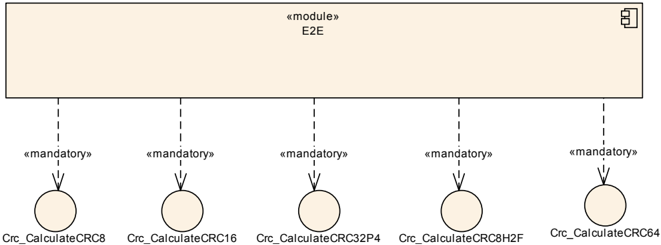

## 8. 时序图

本章描述 **E2E** 库的调用者应如何调用它。它展示了如何使用 **E2E** 库来保护数据元素和 **I-PDU**。

### 8.1. 发送方（**Sender**）

在其初始化期间，发送方应为每个要保护的 Data 分别实例化结构 PXXConfigType 和 PXXProtectStateType。

在其初始化期间，发送方应为每个要保护的 Data 用所需的配置设置初始化 PXXConfigType。

PXXConfigType 的每个实例对每个 Data 的设置都不同；它们在软件组件模板的 EndToEndDescription 类中定义。

在其初始化期间，发送方应为每个 Data 用如下配置值初始化 E2E\_PXXProtectStateType：Counter = 0。

在每个发送周期中，发送方应调用一次 E2E\_PXXProtect() 函数，然后调用一次发送数据的函数（例如 Rte\_Send\_&lt;p&gt;\_&lt;o&gt;() 或 PduR\_ComTransmit()）。

这意味着例如不允许在没有 Rte\_Send\_&lt;p&gt;\_&lt;o&gt;() 介入的情况下调用 E2E\_PXXProtect() 两次。同样例如不允许在没有 E2E\_PXXProtect() 介入的情况下调用 PduR\_ComTransmit() 两次。

#### 8.1.1. 数据元素的发送方（**Sender of data elements**）

下图规定了由数据元素的发送方调用的 **E2E** 库的总体时序。发送方本身可以由一个或多个模块/文件实现。该图之后是针对数据元素发送方的需求。

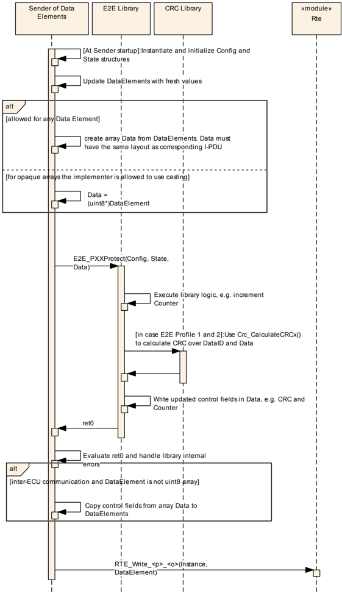

在新数据元素可用之后、调用 E2E\_PXXProtect() 之前，数据元素的发送方应：

如果数据元素通信是跨 **ECU** 的，且该数据元素不是不透明的 **uint8** 数组，则 **E2E** 库的用户应将该数据元素序列化到数组 Data 中。数组 Data 的内容应等于对应信号组在 **I-PDU** 中序列化表示的内容。

注意，一个 **I-PDU** 中可以有多个被保护的信号组。

为了满足上述需求，**E2E** 库的用户需要知道安全相关数据元素是如何被 **RTE** 映射到信号、然后被 **COM** 映射到 **I-PDU** 中的区域的，以便它能重放这一步骤。这是一项相当复杂的活动，因为这意味着发送方需要执行一个「用户级 **COM**」。

对于发送不同于不透明数组的数据元素，**E2E** 库的调用者应将该数据元素序列化到 Data，然后调用 E2E\_PXXProtect() 例程，随后将控制字段从 Data 拷贝回数据元素。

就其本质而言，序列化涉及数据拷贝。如果数据元素是不透明数组，则无需向数组序列化数据，调用者可以将数据元素直接转换为 **uint8\***。然而，为了避免不透明数组相对于其他数据类型的特殊处理，实现者也可以决定对不透明数组同样执行数据元素到 Data 的序列化。

Data 中控制字段的偏移量在软件组件模板元类 EndToEndDescription 中定义。

#### 8.1.2. 信号组层面的发送方（**Sender at signal group level**）

下图规定了由信号组层面的发送方调用的 **E2E** 库的总体时序。发送方本身可以由一个或多个模块/文件实现（例如 **COM** 加 callout，或 **COM** 加复杂设备驱动）。

该图展示的是 **I-PDU** 中只有一个 **E2E** 被保护信号组的示例，但一般来说可以有几个（每个信号组 0 或 1 个 **E2E** 保护）。在这种情况下，**I-PDU** 的发送方对每个 **E2E** 被保护的信号组调用 E2E\_PXXProtect。


### 8.2. 接收方（**Receiver**）

在其初始化期间，接收方应实例化结构 PXXConfigType 和 PXXReceiverType。

**注意：** 当选择以下初始化和配置参数时，增强的 E2E\_PXXCheck() 函数（在 **AUTOSAR R4.0.4** 和 **R3.2.2** 中引入）的功能行为在应用层面向后兼容于早期 **AUTOSAR** 发行版的 E2E\_PxxCheck() 函数：

```C
State -> SyncCounter := 0;
Config -> MaxNoNewOrRepeatedData := 14 (when using Profile 1);
Config -> MaxNoNewOrRepeatedData := 15 (when using Profile 2);
Config -> SyncCounterInit := 0;
```

E2E\_PxxCheck 函数的示例性配置参数及其产生的行为：

Config → MaxDeltaCounterInit（\_PxxConfigType）= 2（即初始 counter 差值的容差区间）；Config → MaxNoNewOrRepeatedData = 3（即最大 counter 差值的容差区间）；由 **SWC** 检查的超时区间（**Timout interval checked by SWC**）；由接收方监视的超时区间（**Timout interval monitored by receiver**）。


关于图 Figure 9.3 中 **SYNC** 状态的澄清：在第 9 个周期中，由于 NoNewOrRepeatedData 超过了 MaxNoNewOrRepeatedData，counter 值不再可信。其产生的行为类似于在第 9 个周期中检测到「counter 的意外行为」。因此，「counter 连续性校验」跨越第 10–11 个周期。

在其初始化期间，接收方应为每个 Data 用所需的配置设置初始化 PXXConfigType。

PXXConfigType 的每个实例对每个 Data 的设置都不同；它们在软件组件模板的 EndToEndDescription 类中定义。

在每个接收周期中，接收方应：

* 调用一次接收函数 Rte\_Read\_&lt;p&gt;\_&lt;o&gt;()。
1. 如果新数据已被无错误地接收，则将属性 State-&gt;NewDataAvailable 设置为 TRUE：
    * 单信道或信道 1 的情况：State-&gt;NewDataAvailable = (retRteRead == RTE\_E\_OK) ? TRUE : FALSE；
    * 信道 2 的情况：State-&gt;NewDataAvailable = TRUE；（注意：第二个信道无法访问 Rte\_Read 的返回值）。
2. 使用接收到的数据元素或 **I-PDU** 更新 Data。
3. 调用一次 E2E\_PXXCheck() 函数。
4. 处理 E2E\_PXXCheck() 返回的结果（返回值和 State 参数）。

**注意：** 仅在单信道的情况下，NewDataAvailable 标志还可以（如果可用）以下列方式并入 Rte\_IsUpdated() **API** 的返回值：

1. 调用一次函数 Rte\_IsUpdated\_&lt;p&gt;\_&lt;o&gt;()。
2. 区分：
    * 如果 Rte\_IsUpdated\_&lt;p&gt;\_&lt;o&gt;() 返回 FALSE：将属性 State-&gt;NewDataAvailable 设置为 FALSE，并将 retRteRead 设置为 RTE\_E\_OK；
    * 如果 Rte\_IsUpdated\_&lt;p&gt;\_&lt;o&gt;() 返回 TRUE：
        * 调用一次接收函数 Rte\_Read\_&lt;p&gt;\_&lt;o&gt;()；
        * 如果 Rte\_Read\_&lt;p&gt;\_&lt;o&gt;() 返回 RTE\_E\_OK，则将属性 State-&gt;NewDataAvailable 设置为 TRUE，否则设置为 FALSE。
3. 步骤 3.–5. 如 [UC\_E2E\_00209] 中所述。

这类似于 E2EPW\_Read\_&lt;p&gt;\_&lt;o&gt;() 在 **AR 3.2.1 - 3.2.2 / AR 4.0.1 - AR 4.1.1** 中规定的可选功能。之所以做了更改，是因为 Rte\_IsUpdated\_&lt;p&gt;\_&lt;o&gt;() 的功能在很大程度上依赖于底层的 **Com** 协议栈来提供可靠的接收指示（回调）。否则，损坏的数据可能被掩盖。

**注意：** 仅在单信道的情况下，且如果配置了 AliveTimeout，NewDataAvailable 标志还可以（如果可用）以下列方式并入 Rte\_IsUpdated() **API** 的返回值：

1. 调用 Rte\_IsUpdated\_&lt;p&gt;\_&lt;o&gt;
2. 调用 Rte\_Read\_&lt;p&gt;\_&lt;o&gt;
3. 区分：
    * 如果 Rte\_Read\_&lt;p&gt;\_&lt;o&gt; 返回 TRUE 且 Rte\_IsUpdated\_&lt;p&gt;\_&lt;o&gt; 返回 TRUE，则将 State-&gt;NewDataAvailable 设置为 TRUE；
    * 否则将 State-&gt;NewDataAvailable 设置为 FALSE。

这样，AliveTimeout「RTE\_E\_MAX\_AGE\_EXCEEDED」通过 Rte\_Read\_&lt;p&gt;\_&lt;o&gt; 返回给 **SWC**。

函数 E2E\_PXXCheck() 通过参数 State 返回校验结果。在 State（结构 E2E\_PXXCheckStateType）中，有一个属性 LostData，它仅在以下状态下才有定义的值和意义：E2E\_PXXSTATUS\_OK 和 E2E\_PXXSTATUS\_OKSOMELOST。

如果 E2E\_PXXCheck() 函数的返回值不同于 E2E\_PXXSTATUS\_OK 和 E2E\_PXXSTATUS\_OKSOMELOST，则调用者不应评估属性 State-&gt;LostData。

#### 8.2.1. 数据元素层面的接收方（**Receiver at data element level**）

下图规定了由数据元素层面的接收方调用的 **E2E** 库的总体时序。发送方本身可以由一个或多个模块/文件实现。该图之后是针对数据元素发送方的需求。


如果数据元素通信是跨 **ECU** 的，且该数据元素不是不透明的 **uint8** 数组，则接收方应将该数据元素序列化到数组 Data 中。Data 的布局（内容）应与发送该数据元素所用的对应 **I-PDU** 的布局相同。此外，接收方还应校验 **I-PDU** 中未传输的所有位（即 Data 中不存在的位）都等于 0。

为了满足上述需求，接收方需要知道安全相关数据元素是如何被 **RTE** 映射到信号、然后被 **COM** 映射到 **I-PDU** 的，以便它能重放这一步骤。这是一项相当复杂的活动，因为这意味着发送方需要执行一个「用户级 **COM**」。

位校验的一个例子：假设 **I-PDU** 中的 10 位被 **COM** 扩展成 16 位信号，然后被 **RTE** 扩展成 16 位数据元素。在这种情况下，数据元素的 6 个最高有效位应为 0。这应由接收方进行校验。

对于接收不同于不透明数组的数据元素，**E2E** 库的调用者应将该数据元素序列化到 Data，然后调用校验例程。

#### 8.2.2. 信号组层面的接收方（**Receiver at signal group level**）

下图总结了由信号组层面的接收方调用的 **E2E** 库的时序。

该图展示的是 **I-PDU** 中只有一个 **E2E** 被保护信号组的示例，但一般来说可以有几个（每个信号组 0 或 1 个 **E2E** 保护）。在这种情况下，**I-PDU** 的接收方对每个 **E2E** 被保护的信号组调用 E2E\_PXXCheck。

下图展示了「State.」这一步。

这仅适用于信道 2。对于信道 1 和单信道，该步骤为「State.NewDataAvailable = (ret0 == RTE\_E\_OK) ? TRUE : FALSE」。


## 9. 配置规范

**E2E** 库与所有 **AUTOSAR** 库一样，没有配置选项。执行库函数所需的所有信息都在运行时通过函数参数传递。对于 E2E\_PXXProtect() 和 E2E\_PXXCheck() 函数，其中一个参数是 Config，它包含 Data 保护的选项。

**E2E** 库不应有任何配置选项。

### 9.1. 发布信息

如 [\[6, General Requirements on Basic Software Modules\]](#ref-6) 中的 SRS\_BSW\_00402 所要求的标准化的通用发布参数，应在本模块的头文件中发布，并需在 **BSW** 模块描述中提供。相应的模块缩写可在 [\[7, List of Basic Software Modules\]](#ref-7) 中找到。

如果适用，下面列出了其他模块特定的发布参数。

## 10. E2E 库使用的安全手册（**Safety Manual for usage of E2E Library**）

本章包含在设计和实现依赖于通信 **E2E** 保护的安全相关系统时，使用 **E2E** 库的需求。

如何调用 **E2E** 库 **API** 的描述在第 8 章中定义。

### 10.1. E2E profile 及其标准变体

**E2E** 库提供两个 **E2E** Profile。它们可用于 **ECU** 间和 **ECU** 内通信。

由于 **E2E** Profile 1 有多个配置选项，因此这些选项的推荐/默认值被定义为标准的 **E2E** profile 1 变体。

**E2E** Profile 1 的任何用户应尽可能使用已定义的 **E2E** 变体。

### 10.2. E2E 错误处理

**E2E** 库本身不处理检测到的通信错误。它只针对单个接收到的数据元素检测此类错误，并将该信息返回给调用者（例如 **SW-C**），由调用者做出适当的反应。

通常不可能对应用的错误处理进行通用标准化。

**E2E** 库的用户（调用者），特别是接收方，应为 **E2E** 库检测到的故障提供错误处理机制。

### 10.3. E2E 库的使用方法论（**Methodology of usage of E2E Library**）

本节总结了使用 **E2E** 库所需的步骤。在 **AUTOSAR R4.0** 中，**E2E** 库的使用并未由 **AUTOSAR** 方法论定义。共有四个主要步骤，如下所述。

在第一步中，用户选择在给定系统中如何使用 **E2E** 库的架构方法（通过 **COM** callout、通过 **E2E** Protection wrapper 等）。第 10.5 节中描述了 **E2E** 库使用的几种架构解决方案。

在第二步中，用户选择哪些数据元素或信号组需要保护，以及使用哪种 **E2E** Profile。原则上，所有被识别为安全相关的传输数据都是需要保护的数据。

在第三步中，用户为每个选定的要保护的数据元素或信号组确定设置。这些设置存储在软件组件模板元类 EndToEndDescription 中。设置包括例如 Data ID、**CRC** 偏移量等。

1. 对于每个要保护的信号组，都有一个单独的 EndToEndDescription 实例，在系统模板中与 ISignalIPdu 元类关联。
2. 对于每个要保护的数据元素，都有一个单独的 EndToEndDescription 实例，间接地与 VariableDataPrototype、SenderComSpec 和 ReceiverComSpec 元类关联。

在第四步也是最后一步中，用户生成（或以其他方式开发）必要的胶水代码（例如 **E2E** Protection Wrapper、**COM** callout），负责调用 **E2E** 库函数。胶水代码充当通信模块（例如 **COM**、**RTE**）与 **E2E** 库之间的适配器。

### 10.4. SW-C 级保护的 RTE 配置约束（**RTE configuration constraints for SW-C level protection**）

如果使用 **E2E** 库来保护数据元素，则在 **RTE** 的配置方式上存在一些约束。

如果保护发生在 **I-PDU** 层面，那么 **E2E** 对 **RTE** 配置没有任何约束。

#### 10.4.1. SW-C 级保护的通信模型（**Communication model for SW-C level protection**）

**AUTOSAR RTE** 支持不同的通信模型，如客户端-服务器（**client-server**）、发送方-接收方（**sender-receiver**）、模式切换（**mode switch**）等。

#### 10.4.2. SW-C 级保护的多重性（**Multiplicities for SW-C level protection**）

**E2E** 库不打算用于 N:1 的发送方-接收方多重性。

如果使用 **E2E** 库来保护数据元素，则所选的多重性应为 1:N 或 1:1。

#### 10.4.3. 显式访问（**Explicit access**）

发送方-接收方 **SW-C** 通信是异步的，其意义在于发送方不等待接收方。这意味着发送方将数据元素传递给 **RTE** 后继续执行——它不等待接收方接收数据——这是不可配置的。**RTE** 在发送方执行的同时并发地将数据传输给接收方。

现在的问题是接收方如何获取数据。在 **AUTOSAR** 中有两种方法，可在 **RTE** 中配置：

* 接收方等待新数据：它被阻塞/等待，直到来自发送方的新数据元素到达（**RTE** 通信模式「唤醒等待点」（**wake up of wait point**）和「Runnable 实体的激活」（**activation of Runnable entity**））；
* 接收方从 **RTE** 获取当前可用的数据元素，即最新的数据元素（**RTE** 通信模式「隐式数据读取访问」（**Implicit data read access**）和「显式数据读取访问」（**Explicit data read access**））。

**E2E** Profile 1 和 2 连同所提出的 **E2E** 保护包装器一起提供了超时检测（这是要处理的失效模式之一——例如消息丢失）。这是通过让接收方独立于数据的接收而执行，以及通过在 **E2E** Profile 中使用 counter 来实现的。通过这种方式，例如如果一个数据元素丢失，接收方会看到每次读取的数据元素都具有相同的 counter。然而，这要求接收方不仅是在数据到达时才执行。

如果接收方是事件驱动的，则需要在接收方处使用超时机制。该超时机制不是 **E2E** 库的一部分。

如果使用 **E2E** 库来保护数据元素，则通过 **E2E** Protection Wrapper 访问的数据元素应使用「显式数据读取访问」激活（即不应使用「隐式数据读取访问」激活）。

### 10.5. COM 特性使用的限制（**Restrictions on the use of COM features**）

下表列出了 **COM** 特性及其简要说明，并给出了与本文档所述端到端通信保护组合使用时的限制分类。

**注意：** 该列表仅涵盖 **BSW** 模块 **COM** 与 **E2E** 库和 **E2E** Protection Wrapper 组合使用时的特性。它不涉及上层（例如 **RTE**）的特性，也不涉及使用 **E2E Transformer** 的用例。后者通常在 **BSW** 模块 **LdCom** 之上使用。

限制类别如下：

* 「supported（支持）」表示 **E2E COM Callout** 和 **E2EPW** 两者都支持该特性。
* 「use case dependent（取决于用例）」表示该特性可能可以使用，具体取决于发送方和接收方侧的实际用例和配置。然而，必须分析其对实际系统的适用性及其对安全需求的影响。
* 「not supported（不支持）」表示至少有一个变体（**E2E COM Callout** 或 **E2EPW**）不支持该特性，或者某个失效模式可能被掩盖。

表A.1：COM 特性分类（**Classification of COM features**）

| COM 特性/简要说明 | 分类 |
|---|---|
| [SRS_Com_02078] 支持字节序转换 | supported |
| [SRS_Com_02086] 支持接收信号的符号扩展（**Sign-Extension**） | supported |
| [SRS_Com_02042] **I-PDU** 未使用区域/位的初始化 | supported |
| [SRS_Com_02083] 传输模式（**Transmission Modes**） | use case dependent |
| [SRS_Com_02082] 两种不同的传输模式 | use case dependent |
| [SRS_Com_02084] 基于信号数据的传输模式选择 | use case dependent |
| [SRS_Com_02113] 针对已配置序列化数据的基于信号数据的传输模式 | use case dependent |
| [SRS_Com_02046] 信号通知的配置 | supported |
| [SRS_Com_02080] 在新的发送请求时取消未完成的重复 | use case dependent |
| [SRS_Com_02089] 在接收方侧处理信号超时的两个可配置选项 | use case dependent |
| [SRS_Com_02077] 发送方侧的信号失效机制 | use case dependent |
| [SRS_Com_02079] 接收方侧的信号失效机制 | use case dependent |
| [SRS_Com_02087] 用可配置的数据值替换无效值 | use case dependent |
| [SRS_Com_02088] 在信号超时的情况下用初始值替换最后接收到的值 | use case dependent |
| [SRS_Com_00218] 启动/停止 **I-PDU** 组的通信 | supported |
| [SRS_Com_00192] 启用/禁用 **I-PDU** 组的接收截止期监控 | use case dependent |
| [SRS_Com_02041] 复杂数据类型的一致传输 | supported |
| [SRS_Com_02091] 大长度或动态长度信号的放置 | not supported |
| [SRS_Com_02092] 每个 **I-PDU** 仅支持一个动态长度信号 | not supported |
| [SRS_Com_02093] 动态长度信号必须放在 **I-PDU** 的最后 | not supported |
| [SRS_Com_02094] 动态长度信号必须是 **UINT8[n]** 类型 | not supported |
| [SRS_Com_02095] 应使用 **TP** 来分段和重组大信号和动态信号 | not supported |
| [SRS_Com_02030] 识别信号/信号组是否已被发送方更新 | use case dependent |
| [SRS_Com_02058] 对接收到的已更新信号/信号组的截止期监控 | use case dependent |
| [SRS_Com_02099] **I-PDU** Counter 机制 | use case dependent |
| [SRS_Com_02100] **I-PDU** Counter 配置 | use case dependent |
| [SRS_Com_02101] 使用 **I-PDU** Counter 的传输与接收 | use case dependent |
| [SRS_Com_02102] **I-PDU** Counter 错误处理 | use case dependent |
| [SRS_Com_02103] **I-PDU** 复制（**Replication**）机制 | use case dependent |
| [SRS_Com_02104] **I-PDU** 复制配置 | use case dependent |
| [SRS_Com_02105] 使用 **I-PDU** 复制的传输与接收 | use case dependent |
| [SRS_Com_02106] **I-PDU** 复制错误处理 | use case dependent |
| Minimum Delay Time（最小延迟时间） | use case dependent |
| 接收方侧的滤波（例如 **COM273**） | use case dependent |
| 发送方侧的滤波 | use case dependent |
| 一个 **I-PDU** 内的多个信号组 | use case dependent |

## 11. E2E 库使用的应用提示（**Application hints on usage of E2E Library**）

为了能够正确使用 **E2E** 库，可以采用不同的解决方案。它们可能取决于例如 **RTE**、**COM** 或其他基础软件模块的完整性，以及其它软/硬件机制的使用。

用户负责选择满足其特定安全相关系统的安全需求的 **E2E** 库使用解决方案。

基于本章所述解决方案的每个具体实现，在使用之前都需要进行功能安全评估。

**E2E** 库可以用不同的方式使用（每一种都在本章单独的一节中说明）：

* **E2E Protection Wrapper**——在 **RTE** 之上保护数据的非标准集成软件（第 11.1 节）
* **COM** callout——保护 **I-PDU** 的非标准集成代码（第 11.2 节）
* 混合/未使用（第 11.3 节）
- **RTE** 层面的开箱即用保护（**E2E Transformer**）（第 11.4 节）

也可以有混合的场景，例如：

* 对于某个特定的数据元素，发送方使用 **E2E** Protection Wrapper，接收方使用 **COM E2E** callout（或反过来）
* 在给定的 **ECU** 网络或一个 **ECU** 中：一些数据元素用 **E2E** protection Wrapper 保护，另一些用 **COM E2E** callout 保护。

第一种场景对网络诊断很有用（例如当没有 **RTE** 的监控设备检查消息时），或者当其中一个通信方没有 **RTE** 时。

最好的情况是能够保证 **RTE** 和 **COM** 在传输/转换安全相关数据时操作的完整性。简而言之，我们称之为安全的 **RTE** 和安全的 **COM**。

本附录描述了如何调用 **E2E** 库的两个示例性基本解决方案。第一，通过为某个 **SW-C** 或多个 **SW-C** 提供专用子层（称为 **E2E** Protection Wrapper，见第 11.1 节）。第二，通过专用的 **COM** Callout 调用 **E2E** 库来保护代表数据元素的信号组（称为 **COM E2E** Callout，见第 11.2 节）。

第 11.3 节展示了需要 Protection Wrapper 接口（第 11.1 节）的组件如何集成到提供 **COM** Callout 解决方案（第 11.2 节）的 **ECU** 上。

所有必要的、用于生成所述解决方案代码的选项都在 **AUTOSAR** 配置中可用，定义于 [\[8, **System Template**\]](#ref-8) 和 [\[9, **Software Component Template**\]](#ref-9)。这包括例如 **I-PDU** 与 Data ID 的关联。

为了生成包装器，用户定义 EndToEnd\* 元类并将它们关联到 VariableDataPrototype（代表复杂数据元素）。为了为一个 **I-PDU** 生成 **COM E2E** callout，用户定义 EndToEnd\* 元类并将它们关联到 ISignalIPdu 元类（代表该 **I-PDU**）。

有几种 **E2E** 机制可以保护 **I-PDU**。有一种新的标准机制：**E2E Transformer**，还有两种事实标准机制：**COM E2E** callout 和 **E2E** Protection Wrapper。最后，一些集成商使用他们自己的机制，如安全 **COM** 模块。对于给定的 **I-PDU**，只使用其中一种机制才有意义。

给定的 **I-PDU** 如果受到 **E2E** 保护，则应仅由一种 **E2E** 机制保护。

### 11.1. E2E Protection Wrapper（**E2E** 保护包装器）

**警告：** **E2E** 包装器方法涉及的技术不受 **AUTOSAR** 标准约束，并且已被更优的 **E2E** transformer 方法（由 **AUTOSAR** 完全标准化）取代。因此，新项目（没有因遗留部件而产生的约束）应使用完全标准化的 **E2E** transformer 方法。

在这种方法中，每个安全相关的 **SW-C** 都有自己的附加子层（这是一个 .h/.c 文件对），称为 **E2E** Protection Wrapper，它负责将复杂数据元素编组（**marshalling**）为与相应 **I-PDU**（对于跨 **ECU** 通信）相同的布局，并负责正确调用 **E2E** 库和 **RTE**。

**E2E** Protection Wrapper 的使用允许在 **SW-C** 之间使用 **VFB** 通信，而无需进一步的措施来确保 **VFB** 的完整性。

这类 **SW-C** 之间的通信可以在一个 **ECU** 内（这意味着在微控制器的相同或不同内核上，或在相同或不同内存分区内），也可以跨 **ECU**（通过 **VFB** 连接的 **SW-C** 也使用网络）。

端到端保护是保护 **SW-C** 通信的系统性解决方案，无论使用何种通信资源（例如 **COM** 和网络、**OS**/**IOC** 或 **RTE** 内部的内部通信）。**SW-C** 的迁移可能只需要选择其他保护参数，而不需要更改 **SW-C** 应用代码。

**E2E** Protection Wrapper 的使用可以通过适当的软件/内存分区进行优化。

**E2E** Protection Wrapper 不支持 **SW-C** 的多实例化。这意味着，如果一个 **SW-C** 要使用 **E2E** Protection Wrapper，那么该 **SW-C** 必须是单实例化的。

1 术语 **SW-C** 包括任何具有 **RTE** 接口的软件模块，即传感器/执行器/应用 **SW-C**、**AUTOSAR** 服务或复杂驱动程序。

如果从 **E2E** Protection Wrapper（在数据元素层面）调用 **E2E** 库，则不允许进行多实例化。对于使用 **E2E** Protection Wrapper 的 **AUTOSAR** 软件组件，**AUTOSAR** 软件组件描述中 SwcInternalBehavior 的 supportsMultipleInstantiation 属性值应设置为 **FALSE**。

**E2E** Protection Wrapper 本身不是 **E2E** 库的一部分。但是，它的选项是标准化的。**E2E** Protection Wrapper 的大多数选项定义在 [\[8, **System Template**\]](#ref-8) 中，其中一些定义在 [\[9, **Software Component Template**\]](#ref-9) 中。

应保证 **E2E** Protection Wrapper 操作（用于传输/转换安全相关数据）的完整性。

**E2E** Protection Wrapper 的函数不可重入，因此不得并发调用它们。

每个 **E2E** Protection Wrapper 函数都不得被并发调用。

为了实现上述需求，建议将 **SW-C** 和 **E2E** 端口设计成一个特定的 **E2E** Protection Wrapper 函数只从一个 Runnable 中调用，即一个 **E2E** Protection Wrapper 应「属于」一个特定的 Runnable。

**注意：** E2EPW **API** 函数的调用者应确保 E2EPW 的内部状态数据结构被正确初始化。初始化可以通过 **ECU** 启动代码完成，也可以通过 E2EPW init 函数显式完成。

#### 11.1.1. 功能概述（**Functional overview**）

**E2E** Protection Wrapper 在提供给 **SW-C** 的 Rte\_Write 和 Rte\_Read 函数之上充当包装器。**E2E** Protection Wrapper 封装了 Rte\_Read/Rte\_Write 调用，以及使用 **E2E** 库进行的数据交换保护。

对于要传输的数据元素，会为发送方和接收方生成一组包装函数（Read/Write/Init）。

**E2E** Protection Wrapper 函数负责实例化和初始化调用 **E2E** 库所需的数据结构、调用 **E2E** 库和调用 Rte\_Read/Rte\_Write 函数，以及数据元素的序列化。数据结构的初始化取决于特定的数据元素，例如 Data ID，或要使用的 **E2E** Profile。

函数 E2EPW\_Write\_&lt;p&gt;\_&lt;o&gt;() 和 E2EPW\_Read\_&lt;p&gt;\_&lt;o&gt;() 返回表示状态的 32 位整数。

图 Figure B.1 展示了 **SW-C** 使用 **E2E** 库和 **E2E** Protection Wrapper 的总体流程（标签上的第 1 个数字定义了执行顺序）：


#### 11.1.2. 使用传输管理器（**Transmission Manager**）的应用场景

可以有一个中央 **SW-C** 来收集给定 **ECU** 上多个 **SW-C** 的安全相关数据，并将它们组合后通过网络传输。

在发送方 **ECU** 上，有一个称为传输管理器（**Transmission Manager**）的专用 **SW-C**，它包含 **E2E** Protection Wrapper。传输管理器从相关 **SW-C** 收集安全相关数据，将它们组合起来并使用 **E2E** Protection Wrapper 进行保护。最后，它将组合并受保护的数据作为数据元素提供给 **RTE**。

在接收方 **ECU** 上也可以有一个传输管理器，它对接收此类数据执行相反的步骤。

传输管理器 **SW-C** 模块既不是 **E2E** 库的一部分，也不是 **AUTOSAR** 的一部分。


在这个例子中，对于 **SW-C1** 和 **SW-C2** 来说，通信通过这样一个传输管理器是不可见的，这可以支持可移植性并优化通信网络的资源使用。只有通过 **AUTOSAR** 配置才能看出 **SW-C1** 和 **SW-C2** 的接收方是 **SW-C3**。

传输管理器（作为安全相关的软件组件）的实现应符合汽车领域安全相关软件的开发要求。

#### 11.1.3. 使用 E2E 管理器与转换管理器（**E2E Manager and Conversion Manager**）的应用场景

该应用场景与前一个类似，不同之处在于传输管理器被拆分为两个单独的 **SW-C**（**E2E** Manager 和转换管理器 **Conversion Manager**）。该场景的优点是 **E2E** Manager 可以自动生成，并且转换管理器完全独立于 **E2E** 保护。

转换管理器是负责数据转换的 **SW-C**，例如浮点数到整数的转换。在发送方 **ECU** 上，**E2E** Manager 负责组装所有要发送的数据元素，并通过 **E2E** Protection Wrapper 保护它们。在接收方 **ECU** 上，转换管理器负责通过 **E2E** Protection Wrapper 校验数据，然后过滤掉接收方转换管理器不需要的数据。

**E2E** Manager 和转换管理器的 **SW-C** 模块既不是 **E2E** 库的一部分，也不是 **AUTOSAR** 的一部分。


在上面的例子中，发送方 **ECU** 的 **SW-C** 生成三个数据元素（dataEl1、dataEl2 和 dataEl3），但接收方 **ECU** 的 **SW-C** 只使用两个数据元素（dataEl1 和 dataEl2）。未使用的 DataEl3c 不会交付给转换管理器。

由于这一点，如果由于例如系统的演进，DataEl3 的定义发生了变化，那么接收方 **SW-C**（**SW-C 5**、**SW-C 6** 和 **SW-C 7** 转换管理器）不需要更改。

相应的系统配置描述如图 Figure B.7 所示。注意 **SW-C 7** 只有其所需的数据元素作为输入。未使用的数据元素（**CRC**、counter、dataEl3c）不提供：


**E2E** manager 的 **E2E** 保护包装器可以自动生成。

**E2E** manager 的应用代码只负责将输入数据元素「路由」到输出数据元素，这也很简单，可以生成。对于上面的例子，**E2E** Manager 的应用代码可能如下所示：

```C
/* the input complex data element contains primitive data elements unused by other SW-Cs of the ECU */
typedef struct {
  uint8 crc;
  uint8 counter;
  uint16 dataEl1c;
  uint16 dataEl2c;
  uint16 dataEl3c;
} Inputswc8Type;

/* the output complex data element is a subset of input, with the data used by other SW-Cs of the ECU */
typedef struct {
  uint16 dataEl1c;
  uint16 dataEl2c;
} Outputswc8DataType;

Inputswc8Type Inputswc8;
Outputswc8Type Outputswc8;
...
/* copy from Inputswc8 the primitive data elements that are also in outputswc8 */
Outputswc8Type.dataEl1c = Inputswc8Type.dataEl1c;
Outputswc8Type.dataEl2c = Inputswc8Type.dataEl2c;
```

**E2E** Manager 应具有带前缀 Input 或带前缀 Output 的复杂数据元素。带输入前缀的数据元素与带输出前缀的数据元素之间存在一对一的关系。

在上面的例子中，有 Inputswc8 和对应的 Outputswc8。

输出数据元素应包含相应输入数据元素的基本数据元素的子集（特别是，它们可以相等）。

在上面的例子中，Outputswc8 包含 Inputswc8 的属性的子集。它不包含 dataEl3c、crc 和 counter。

对于输出复杂数据元素的每个基本数据元素，（生成的）**E2E** manager 应用代码应以从输入复杂数据元素的相应基本数据元素中读到的值来写入它。

在上面的例子中，**E2E** manager 的应用代码将 dataEl1c 和 dataEl2c 从 Inputswc8 复制到 Outputswc8。

转换管理器和 **E2E** Manager（作为安全相关的软件组件）的实现应符合汽车领域安全相关软件的开发要求。

接收方 **ECU** 上的 **E2E** Manager **SW-C** 应过滤掉该 **ECU** 的 **SW-C** 不使用的数据元素。接收方 **ECU** 上的 **E2E** Manager **SW-C** 应只向转换管理器 **SW-C** 转发转换管理器 **SW-C** 使用的数据元素。

#### 11.1.4. 文件结构（**File structure**）

对于以 &lt;SWC-Type-short name&gt; 标识的给定 **SW-C**，其 **E2E** Protection Wrapper 应由两个文件组成：E2EPW\_&lt;SWC-Type-short name&gt;.c 和 E2EPW\_&lt;SWC-Type-short name&gt;.h。

调用 **E2E** Protection Wrapper 函数的 **SW-C** 实现文件应包含 E2EPW\_&lt;SWC-Type-short name&gt;.h。

**E2E** Protection Wrapper 应确保安全相关数据元素的完整性。

**E2E** Protection Wrapper（作为安全相关的软件组件）的实现应符合汽车领域安全相关软件的开发要求。

#### 11.1.5. 方法论（**Methodology**）

**注意：** **AUTOSAR** 的不同发行版对 **COM** 类使用了不同的名称。下面的文字描述进行了泛化以适应不同的发行版，但这些图略有不同（主要区别是类和对象的名称不同）。

在 **RTE** 合同阶段（即生成 **SW-C** 接口文件时），标准 **AUTOSAR RTE** 生成器为一个 **SW-C** 生成 **SW-C** 接口文件 Rte\_&lt;SWC-Type-short name&gt;.h。该文件包含 **RTE** 生成的函数，如 Rte\_Write\_&lt;p&gt;\_&lt;o&gt;()。对于该文件中用于传输安全相关数据的每个函数，在 Rte\_&lt;SWC-Type-short name&gt;.h 中都有对应的包装函数。

**E2E** 保护包装器可以手动实现，也可以根据其描述生成/配置。生成 **E2E** Protection Wrapper 所需的所有必要信息都可以使用 **AUTOSAR** 模板（系统模板、**SW-C** 模板、**ECU** 配置）进行配置。

**E2E** 保护包装器的生成可以随「Generate Component API」步骤的执行一起完成，该步骤生成「Component API」。

应为定义了相应 EndToEnd\* 元类的复杂数据元素（由 VariableDataPrototype 元类表示）生成 **E2E** Protection Wrapper。

如果在 **E2E** Wrapper 中进行 **E2E** 保护，则 EndToEndProtectionISignalIPdu 和 EndToEndProtectionVariablePrototype 都应被定义。

大多数设置定义在 [\[9, **Software Component Template**\]](#ref-9) 下。

图 Figure B.8：**R4.0.1** 及更新版本：**E2E** Protection Wrapper 配置（摘自 DOC\_EndtoEndProtection 的截图）：


元类 EndToEndProtectionVariablePrototype 定义了一个特定的（复杂）数据元素应被保护。该数据元素至多有一个特定的发送方和任意数量的接收方（VariableDataPrototype）。数据元素应如何保护的具体设置定义在 EndToEndDescription 类中（这些设置可以被不同的数据原型重用）。

除了配置 EndToEndProtectionVariablePrototype 之外，进一步的设置涉及信号组到 **I-PDU** 的映射，这是根据 [\[8, **System Template**\]](#ref-8) 完成的：

图 Figure B.9：**R4.0.1** 及更新版本：**E2E** Protection Wrapper 配置（摘自 DOC\_PduEndToEndProtection 的截图）：


重要的设置包括：

* ISignalIPdu（代表一个 **I-PDU**）
    * ISignalIPdu.unusedBitPattern：**I-PDU** 中未使用的位，
* ISignalToIPduMapping：描述信号到 **I-PDU** 的映射，
    * ISignalToIPduMapping.startPosition：信号在 **I-PDU** 中的位偏移，
* EndToEndProtectionISignalIPdu：一个 **E2E** 保护与一个 **I-PDU** 和一个信号组的关联，
    * EndToEndProtectionISignalIPdu.dataOffset：信号组在 **I-PDU** 中的位偏移。

可以使用多个 EndToEndProtectionISignalIPdu 元素将多个信号组加入一个 **I-PDU**。

ISignalIPdu.unusedBitPattern 由 **COM** 用于创建最终的 **I-PDU**，并由 **E2E** Protection Wrapper 用于创建被保护数据的正确 **I-PDU** 表示（在其上可以计算出正确的 **CRC**）。

还有必要配置 SenderComSpec 和 ReceiverComSpec。ReceiverComSpec 可以覆盖 EndToEndDescription 提供的 maxDeltaCounterInit（通过属性 ReceiverComSpec.maxDeltaCounter）。如果同一发送方的一个数据元素的不同接收方需要不同的设置，这可能很有用。

图 Figure B.10：**R4.0.1** 及更新版本：SenderComSpec（摘自 DOC\_SenderComSpec 的截图）：


图 Figure B.11：**R4.0.1** 及更新版本：ReceiverComSpec（摘自 DOC\_ReceiverComSpec 的截图）：


#### 11.1.6. 错误分类（**Error classification**）

该包装器使用 **E2E** 库函数的标准 **E2E** 错误码，并扩展了额外的错误码。

在适用的地方，**E2E** Wrapper 函数应在返回值的字节 3 中使用以下错误状态。其他错误码已由 SWS\_E2E\_00047（第 6.1 节）定义。

表B.1：E2E Wrapper 函数的错误码（**E2E Wrapper** 函数的错误码，**E2E Library** 错误码之外的补充）

| 错误或状态类型 | **E2E Wrapper** 的调用者应如何处理它 | 相关错误码 | 值 [hex] |
|---|---|---|---|
| OK：已根据通信介质接收到新数据，**CRC** 正确，相对于最近一次以 Status \_INITIAL、\_OK 或 \_OKSOMELOST 接收的 Data，Counter 递增 1。这意味着自上次正确接收数据以来没有丢失任何 Data。 | Production | E2EPW_STATUS_OK | 0x0 |
| 错误：Check 函数已被调用，但自上次调用以来，根据通信介质（例如 **RTE**、**COM**）没有新数据可用。因此，没有对 Data 执行任何 **E2E** 校验。 | Production | E2EPW_STATUS_NONEWDATA | 0x1 |
| 错误：已根据通信介质接收到数据，但 **CRC** 或 Data 或 Data 的一部分不正确/已损坏。这可能由损坏、插入或寻址故障引起。 | Production | E2EPW_STATUS_WRONGCRC | 0x2 |
| NOT VALID：在检测到 counter 的意外行为之后接收到了新数据。该数据具有正确的 **CRC**，且其 counter 相对于最近接收的 Data 处于预期范围内，但所确定的 counter 连续性校验尚未完成。 | Production | E2EPW_STATUS_SYNC | 0x3 |
| 错误：已根据通信介质接收到新数据，**CRC** 正确，但这是接收方初始化或重新初始化以来的第一个 Data，因此尚无法校验 Counter。 | Production | E2EPW_STATUS_INITIAL | 0x4 |
| 错误：已根据通信介质接收到新数据，**CRC** 正确，但 Counter 与最近一次以 Status \_INITIAL、\_OK 或 \_OKSOMELOST 接收的 Data 相同。 | Production | E2EPW_STATUS_REPEATED | 0x8 |
| OK：已根据通信介质接收到新数据，**CRC** 正确，相对于最近一次以 Status \_INITIAL、\_OK 或 \_OKSOMELOST 接收的 Data，Counter 递增了 DeltaCounter（1 &lt; DeltaCounter &lt;= MaxDeltaCounter）。这意味着自上次正确/初始接收以来，序列中可能丢失了一些 Data，但这在配置的容差范围内。 | Production | E2EPW_STATUS_OKSOMELOST | 0x20 |
| 错误：已根据通信介质接收到新数据，**CRC** 正确，但相对于最近一次以 Status \_INITIAL、\_OK 或 \_OKSOMELOST 接收的 Data，Counter 增量过大（DeltaCounter &gt; MaxDeltaCounter）。这意味着自上次正确/初始接收以来，序列中可能丢失了过多 Data。 | Production | E2EPW_STATUS_WRONGSEQUENCE | 0x40 |

注意，**E2E** 库的先前版本（**R3.2.1**、**R4.0.1**、**R4.0.2**）返回值 0x10 作为 E2EPW\_STATUS\_OK，因此在从这些版本升级 **E2E** 库时，**SW-C** 需要更新。

在适用的地方，**E2E** Wrapper 函数应在返回值的字节 1 上使用以下错误标志。其他错误码已由 [SWS\_E2E\_00047]（第 6.1 节）定义：

表B.2：E2E Wrapper 函数的错误码（**E2E Wrapper** 函数的错误码，**E2E Library** 错误码之外的补充）

| 错误或状态类型 | **E2E Wrapper** 的调用者应如何处理它 | 相关错误码 | 值 [hex] |
|---|---|---|---|
| 发生了扩展/展开（**Extension/expansion**）错误。它是位扩展（将缩短的 **I-PDU** 表示转换为数据元素）正确与否的状态。例如，如果 **I-PDU** 中的 12 位被扩展为 16 位 **uint**，则最高的 4 位应为 0。 | Integration or production | E2EPW_E_DESERIALIZATION | 0x3 |
| Write1 和 Write2 计算出的控制字段不相等，即 Write1 与 Write2 之间的表决（**voting**）状态失败 | Integration or production | E2EPW_E_REDUNDANCY | 0x5 |

**E2E** Wrapper 函数的调用者应按照「**E2E** 的调用者应如何处理它」（**How do caller of E2E shall handle it**）列中的规定，处理 UC\_E2E\_0302 和 UC\_E2E\_0303 中定义的错误/状态。

换言之，**E2E** 库本身没有为其定义任何集成错误，它不调用 **DEM** 和 **DET**。然而，**E2E** 库的调用者使用 **E2E** 函数的返回值并执行相应的错误处理。

#### 11.1.7. E2E Protection Wrapper 例程（**E2E Protection Wrapper routines**）

包装器的生成有两种方式。第一种方式是使用单信道函数 Read 和 Write。第二种方式是使用冗余函数 Write1、Write2、Read1 和 Read2。通常，用户应使用单信道函数集或冗余函数集之一。

**E2E** Protection Wrapper 例程的参数 &lt;instance&gt; 当且仅当调用软件组件是多实例化时才应存在。由于当前发行版的 **E2E** Protection wrapper 不支持软件组件的多实例化，这意味着可选参数 &lt;instance&gt; 永远不应出现。

由于上述情况在未来可能会改变（可能会引入对多实例的支持），并且由于要与 **RTE** 的相应 **API** 保持相同的 **API**，可选参数 &lt;instance&gt; 被保留。

为了一方面支持未来的协议和包装器扩展，另一方面支持专有扩展，返回值集合（对每个字节）被划分为 **AUTOSAR** 用途和专有用途。

**E2E** Wrapper 读写函数返回的返回值应按如下方式使用：

* 对于字节 1、2 和 3，取值范围 0x00 到 0x7F（即十进制 0 到 127）的返回值集合仅限于在 **AUTOSAR** 规范内使用，不得用于不属于 **AUTOSAR** 规范的专有返回值。
* 对于字节 1、2 和 3，取值范围 0x80 到 0xFE（即十进制 128 到 254）的返回值集合不受限制，应用于不属于 **AUTOSAR** 规范的专有实现特定返回值。
* 对于字节 1、2 和 3，值 0xFF（即十进制 255）表示无效值。

目前在 **AUTOSAR** 规范中只使用了受限返回值集合（即 0x00 到 0x7F）中的一个子集，其余的预留给 **AUTOSAR** 未来的使用。

冗余包装例程应为每个冗余信道使用单独的配置和状态数据结构。

例如，信道 1 使用 config1\_&lt;p&gt;\_&lt;o&gt;/state1\_&lt;p&gt;\_&lt;o&gt;，信道 2 使用 config2\_&lt;p&gt;\_&lt;o&gt;/state2\_&lt;p&gt;\_&lt;o&gt;，如第 11.1.9.2 节中的代码示例所示。

##### 11.1.7.1. 单信道包装例程与初始化例程（**Single channel wrapper routines and init routines**）

###### 11.1.7.1.1. E2EPW_Write_&lt;p&gt;_&lt;o&gt;

**说明**: 发起具有数据语义的安全相关数据元素的安全显式发送方-接收方传输。它使用 **E2E** 库函数 E2E\_PXXProtect 保护数据，然后调用相应的 Rte\_Write\_&lt;p&gt;\_&lt;o&gt;()。服务 ID 0x71。本服务为同步调用，不可重入。参数 &lt;instance&gt;（in）：**SW-C** 实例。该参数被传递给相应的 Rte\_Write 函数，除此之外 **E2E** Protection Wrapper 不使用该参数。这意味着包装器忽略 **SW-C** 的实例。名称和数据类型与相应的 Rte\_Write 函数相同。参数 &lt;data&gt;（inout）：要保护和发送的数据元素。该参数是 inout，因为此函数会调用 E2E_PXXProtect 函数，后者会更新控制字段的值。名称和数据类型与相应的 Rte\_Write 函数相同。参数（out）：无。返回值：uint32——字节 0（最低字节）为 Rte\_Write 函数的状态：RTE\_E\_COM\_STOPPED——由于 **COM** 服务当前不可用，**RTE** 无法执行该操作（仅限跨 **ECU** 通信）；RTE\_E\_SEG\_FAULT——在传递给 **RTE API** 的参数中检测到段违规。不执行传输；RTE\_E\_OK——数据成功传递给通信服务。字节 1 为 **E2E** Protection Wrapper 函数内完成的运行时检查的状态：E2E\_E\_INPUTERR\_NULL——E2EPW\_Write 的至少一个指针参数是 **NULL** 指针；E2E\_E\_INPUTERR\_WRONG——E2EPW\_Write 的至少一个输入参数错误，例如超出范围；E2E\_E\_INTERR——E2EPW\_Write 中发生了内部错误（例如由程序流监控检测到的错误、违反不变式或后置条件）；E2E\_E\_OK——函数 E2EPW\_Write 成功完成。字节 2 为 E2E\_PXXProtect 函数的返回值：E2E\_E\_INPUTERR\_NULL——E2E\_PXXProtect 的至少一个指针参数是 **NULL** 指针；E2E\_E\_INPUTERR\_WRONG——E2E\_PXXProtect 的至少一个输入参数错误，例如超出范围；E2E\_E\_INTERR——E2E\_PXXProtect 中发生了内部错误（例如由程序流监控检测到的错误、违反不变式或后置条件）；E2E\_E\_OK——函数 E2E\_PXXProtect 成功完成。字节 3 是为将来使用保留的占位符，取以下值：E2E\_E\_OK——默认情况。可通过**E2EPW_&lt;SWC-Type-short name&gt;.h**获得。

```C
uint32 E2EPW_Write_<p>_<o> ( Rte_Instance <instance>, <data> )
```

函数 E2EPW\_Write\_&lt;p&gt;\_&lt;o&gt;() 应：

1. 如果此通信是跨 **ECU** 的且 Data 元素不是不透明的 **uint8** 字节数组，则将数据元素序列化为与 **I-PDU** 中相应区域相同的布局
2. 调用 **E2E** 库函数 E2E\_PXXProtect()
3. 如果此通信是跨 **ECU** 的且 Data 元素不是不透明的 **uint8** 字节数组，则将计算出的 **CRC**/Counter 存储在数据元素中
4. 调用 Rte\_Write\_&lt;p&gt;\_&lt;o&gt;()

另见第 11.1.8 节和图 Figure B.17。

###### 11.1.7.1.2. E2EPW_WriteInit_&lt;p&gt;_&lt;o&gt;

**说明**: 该函数在检测到错误之后或启动时重新初始化相应的数据结构。服务 ID 0x15。本服务为同步调用，不可重入。参数 &lt;instance&gt;（in）：**SW-C** 实例。该参数未被使用（被忽略）。参数（inout）：无。参数（out）：无。返回值：Std_ReturnType，运行时检查的状态：E2E\_E\_INTERR——函数中发生了内部错误（例如由程序流监控检测到的错误、违反不变式或后置条件）；E2E\_E\_OK——函数成功完成。可通过**E2EPW_&lt;SWC-Type-short name&gt;.h**获得。

```C
Std_ReturnType E2EPW_WriteInit_<p>_<o> ( Rte_Instance <instance> )
```

函数 E2EPW\_WriteInit\_&lt;p&gt;\_&lt;o&gt; 应以以下值初始化 E2E\_PXXProtectStateType\_&lt;p&gt;\_&lt;o&gt;：Counter = 0。

###### 11.1.7.1.3. E2EPW_Read_&lt;p&gt;_&lt;o&gt;

**说明**: 对具有数据语义的发送方-接收方安全相关通信数据元素执行安全的显式读取。该函数调用相应的函数 RTE\_Read，然后使用 E2E_PXXCheck 校验接收到的数据。服务 ID 0x72。本服务为同步调用，不可重入。参数 &lt;instance&gt;（in）：**SW-C** 实例。该参数被传递给相应的 Rte\_Read 函数，除此之外 **E2E** Protection Wrapper 不使用该参数。这意味着包装器忽略 **SW-C** 的实例。名称和数据类型与相应的 Rte\_Read 函数相同。参数（inout）：无。参数 &lt;data&gt;（out）：传回接收到的数据的参数。指向 **OUT** 参数 &lt;data&gt; 的指针必须保持有效，直到函数调用返回。返回值：uint32——字节 0（最低字节）为 Rte\_Read 函数的状态：RTE\_E\_INVALID——数据元素无效；RTE\_E\_MAX\_AGE\_EXCEEDED——数据元素已过期；RTE\_E\_NEVER\_RECEIVED——自系统启动或分区重启以来未接收到数据；RTE\_E\_UNCONNECTED——指示接收方端口未连接；RTE\_E\_OK——数据读取成功。字节 1 为 **E2E** Protection Wrapper 函数内完成的运行时检查的状态（外加位扩展检查）：E2E\_E\_INPUTERR\_NULL——E2EPW\_Read 的至少一个指针参数是 **NULL** 指针；E2E\_E\_INPUTERR\_WRONG——E2EPW\_Read 的至少一个输入参数错误，例如超出范围；E2E\_E\_INTERR——E2EPW\_Read 中发生了内部错误（例如由程序流监控检测到的错误、违反不变式或后置条件）；E2EPW\_E\_DESERIALIZATION——发生了扩展/展开错误。它是位扩展（将缩短的 **I-PDU** 表示转换为数据元素）是否正确的状态。例如，如果 **I-PDU** 中的 12 位被扩展为 16 位 **uint**，则最高的 4 位应为 0；E2E\_E\_OK——函数 E2EPW\_Read 成功完成。字节 2 为 E2E\_PXXCheck 函数的返回值：E2E\_E\_INPUTERR\_NULL——E2E\_PXXCheck 的至少一个指针参数是 **NULL** 指针；E2E\_E\_INPUTERR\_WRONG——E2E\_PXXCheck 的至少一个输入参数错误，例如超出范围；E2E\_E\_INTERR——E2E\_PXXCheck 中发生了内部错误（例如由程序流监控检测到的错误、违反不变式或后置条件）；E2E\_E\_OK——函数 E2E\_PXXCheck 成功完成。字节 3 是 E2E_PXXCheckStatusType 枚举的值，表示由 Check 函数确定的 **E2E** Profile XX 中 Data 校验的结果：E2EPW\_STATUS\_NONEWDATA——错误：Check 函数已被调用，但自上次调用以来，根据通信介质（例如 **RTE**、**COM**）没有新数据可用。因此，没有对 Data 执行任何 **E2E** 校验；E2EPW\_STATUS\_WRONGCRC——错误：已根据通信介质接收到数据，但 **CRC** 或 Data 或 Data 的一部分不正确/已损坏。这可能由损坏、插入或寻址故障引起；E2EPW\_STATUS\_INITIAL——错误：已根据通信介质接收到新数据，**CRC** 正确，但这是接收方初始化或重新初始化以来的第一个 Data，因此尚无法校验 Counter；E2EPW\_STATUS\_REPEATED——错误：已根据通信介质接收到新数据，**CRC** 正确，但 Counter 与最近一次以 Status \_INITIAL、\_OK 或 \_OKSOMELOST 接收的 Data 相同；E2EPW\_STATUS\_OK——OK：已根据通信介质接收到新数据，**CRC** 正确，相对于最近一次以 Status \_INITIAL、\_OK 或 \_OKSOMELOST 接收的 Data，Counter 递增 1。这意味着自上次正确接收数据以来没有丢失任何 Data；E2EPW\_STATUS\_OKSOMELOST——OK：已根据通信介质接收到新数据，**CRC** 正确，相对于最近一次以 Status \_INITIAL、\_OK 或 \_OKSOMELOST 接收的 Data，Counter 递增了 DeltaCounter（1 &lt; DeltaCounter = MaxDeltaCounter）。这意味着自上次正确/初始接收以来，序列中可能丢失了一些 Data，但这在配置的容差范围内；E2EPW\_STATUS\_WRONGSEQUENCE——错误：已根据通信介质接收到新数据，**CRC** 正确，但相对于最近一次以 Status \_INITIAL、\_OK 或 \_OKSOMELOST 接收的 Data，Counter 增量过大（DeltaCounter &gt; MaxDeltaCounter）。这意味着自上次正确/初始接收以来，序列中可能丢失了过多 Data；E2EPW\_STATUS\_SYNC——NOT VALID：在检测到 counter 的意外行为之后接收到了新数据。该数据具有正确的 **CRC**，且其 counter 相对于最近接收的 Data 处于预期范围内，但所确定的 counter 连续性校验尚未完成。可通过**E2EPW_&lt;SWC-Type-short name&gt;.h**获得。

```C
uint32 E2EPW_Read_<p>_<o> ( Rte_Instance <instance>, <data> )
```

函数 E2EPW\_Read\_&lt;p&gt;\_&lt;o&gt;() 应：

* 调用 Rte\_Read\_&lt;p&gt;\_&lt;o&gt;()
* 如果此通信是跨 **ECU** 的且 Data 元素不是不透明的 **uint8** 字节数组，则将数据元素序列化为与 **I-PDU** 中相应区域相同的布局
* 调用 **E2E** 库函数 E2E\_PXXCheck()
* 执行反序列化校验。

另见图 Figure B.13 和图 Figure B.14。

###### 11.1.7.1.4. E2EPW_ReadInit_&lt;p&gt;_&lt;o&gt;

**说明**: 该函数在检测到错误之后或启动时重新初始化相应的数据结构。服务 ID 0x16。本服务为同步调用，不可重入。参数 &lt;instance&gt;（in）：**SW-C** 实例。该参数未被使用（被忽略）。参数（inout）：无。参数（out）：无。返回值：Std_ReturnType，运行时检查的状态：E2E\_E\_INTERR——函数中发生了内部错误（例如由程序流监控检测到的错误、违反不变式或后置条件）；E2E\_E\_OK——函数成功完成。可通过**E2EPW_&lt;SWC-Type-short name&gt;.h**获得。

```C
Std_ReturnType E2EPW_ReadInit_<p>_<o> ( Rte_Instance <instance> )
```

函数 E2EPW\_ReadInit\_&lt;p&gt;\_&lt;o&gt; 应以以下值初始化 E2E\_PXXCheckStateType\_&lt;p&gt;\_&lt;o&gt;：

* LastValidCounter 0
* MaxDeltaCounter = 0
* WaitForFirstData = TRUE
* NewDataAvailable = FALSE
* LostData = 0
* Status = E2E\_PXXSTATUS\_NONEWDATA
* NoNewOrRepeatedDataCounter = 0
* SyncCounter = 0

##### 11.1.7.2. 冗余包装例程（**Redundant wrapper routines**）

###### 11.1.7.2.1. E2EPW_Write1_&lt;p&gt;_&lt;o&gt;

**说明**: 它使用 **E2E** 库函数 E2E\_PXXProtect 保护数据。它不调用相应的 Rte\_Write\_&lt;p&gt;\_&lt;o&gt;()。服务 ID 0x73。本服务为同步调用，不可重入。参数 &lt;instance&gt;（in）：**SW-C** 实例。该参数被传递给相应的 Rte\_Write 函数，除此之外 **E2E** Protection Wrapper 不使用该参数。这意味着包装器忽略 **SW-C** 的实例。名称和数据类型与相应的 Rte\_Write 函数相同。参数 &lt;data&gt;（inout）：要保护和发送的数据元素。该参数是 inout，因为此函数会调用 E2E_PXXProtect 函数，后者会更新控制字段的值。名称和数据类型与相应的 Rte\_Write 函数相同。参数（out）：无。返回值：uint32——字节 0（最低字节）等于 E2E\_E\_OK（因为未调用 Rte\_Write）；字节 1 为 **E2E** Protection Wrapper 函数内完成的运行时检查的状态：E2E\_E\_INPUTERR\_NULL——E2EPW\_Write 的至少一个指针参数是 **NULL** 指针；E2E\_E\_INPUTERR\_WRONG——E2EPW\_Write 的至少一个输入参数错误，例如超出范围；E2E\_E\_INTERR——E2EPW\_Write 中发生了内部错误（例如由程序流监控检测到的错误、违反不变式或后置条件）；E2E\_E\_OK——函数 E2EPW\_Write 成功完成。字节 2 为 E2E\_PXXProtect 函数的返回值：E2E\_E\_INPUTERR\_NULL——E2E\_PXXProtect 的至少一个指针参数是 **NULL** 指针；E2E\_E\_INPUTERR\_WRONG——E2E\_PXXProtect 的至少一个输入参数错误，例如超出范围；E2E\_E\_INTERR——E2E\_PXXProtect 中发生了内部错误（例如由程序流监控检测到的错误、违反不变式或后置条件）；E2E\_E\_OK——函数 E2E\_PXXProtect 成功完成。字节 3 是为将来使用保留的占位符，取以下值：E2E\_E\_OK——默认情况。可通过**E2EPW_&lt;SWC-Type-short name&gt;.h**获得。

```C
uint32 E2EPW_Write1_<p>_<o> ( Rte_Instance <instance>, <data> )
```

函数 E2EPW\_Write1\_&lt;p&gt;\_&lt;o&gt;() 应：

* 如果此通信是跨 **ECU** 的且 Data 元素不是不透明的 **uint8** 字节数组，则将数据元素序列化为与 **I-PDU** 中相应区域相同的布局。
* 调用 **E2E** 库函数 E2E\_PXXProtect()
* 如果此通信是跨 **ECU** 的且 Data 元素不是不透明的 **uint8** 字节数组，则将计算出的 **CRC**/Counter 存储在数据元素中。

另见图 Figure B.18。

###### 11.1.7.2.2. E2EPW_Write2_&lt;p&gt;_&lt;o&gt;

**说明**: 发起具有数据语义的安全相关数据元素的安全显式发送方-接收方传输。它使用 **E2E** 库函数 E2E\_PXXProtect 保护数据，比较计算出的控制字段与 E2EPW\_Write1 计算出的控制字段，然后调用相应的 Rte\_Write\_&lt;p&gt;\_&lt;o&gt;()。服务 ID 0x74。本服务为同步调用，不可重入。参数 &lt;instance&gt;（in）：**SW-C** 实例。该参数被传递给相应的 Rte\_Write 函数，除此之外 **E2E** Protection Wrapper 不使用该参数。这意味着包装器忽略 **SW-C** 的实例。名称和数据类型与相应的 Rte\_Write 函数相同。参数 &lt;data&gt;（in）：要保护和发送的数据元素。该参数是 IN，因为此函数将 E2EPW\_Write1 计算出的保护字段与通过调用 E2E_PXXProtect 独立计算出的字段进行比较。成功时不更改 &lt;data&gt;。名称和数据类型与相应的 Rte\_Write 函数相同。参数（inout）：无。参数（out）：无。返回值：uint32——字节 0（最低字节）为 Rte\_Write 函数的状态：RTE\_E\_COM\_STOPPED——由于 **COM** 服务当前不可用，**RTE** 无法执行该操作（仅限跨 **ECU** 通信）；RTE\_E\_SEG\_FAULT——在传递给 **RTE API** 的参数中检测到段违规。不执行传输；RTE\_E\_OK——数据成功传递给通信服务。字节 1 为 **E2E** Protection Wrapper 函数内完成的运行时检查的状态：E2E\_E\_INPUTERR\_NULL——E2EPW\_Write 的至少一个指针参数是 **NULL** 指针；E2E\_E\_INPUTERR\_WRONG——E2EPW\_Write 的至少一个输入参数错误，例如超出范围；E2E\_E\_INTERR——E2EPW\_Write 中发生了内部错误（例如由程序流监控检测到的错误、违反不变式或后置条件）；E2EPW\_E\_REDUNDANCY——Write1 和 Write2 计算出的控制字段不相等，即 Write1 与 Write2 之间的表决状态失败；E2E\_E\_OK——函数 E2EPW\_Write 成功完成。字节 2 为 E2E\_PXXProtect 函数的返回值：E2E\_E\_INPUTERR\_NULL——E2E\_PXXProtect 的至少一个指针参数是 **NULL** 指针；E2E\_E\_INPUTERR\_WRONG——E2E\_PXXProtect 的至少一个输入参数错误，例如超出范围；E2E\_E\_INTERR——E2E\_PXXProtect 中发生了内部错误（例如由程序流监控检测到的错误、违反不变式或后置条件）；E2E\_E\_OK——函数 E2E\_PXXProtect 成功完成。字节 3 是为将来使用保留的占位符，取以下值。可通过**E2EPW_&lt;SWC-Type-short name&gt;.h**获得。

```C
uint32 E2EPW_Write2_<p>_<o> ( Rte_Instance <instance>, <data> )
```

函数 E2EPW\_Write2\_&lt;p&gt;\_&lt;o&gt;() 应：

* 如果此通信是跨 **ECU** 的且 Data 元素不是不透明的 **uint8** 字节数组，则将数据元素序列化为与 **I-PDU** 中相应区域相同的布局
* 调用 **E2E** 库函数 E2E\_PXXProtect()
* 在 Write1 与 Write2 之间对控制字段执行表决
* 调用 Rte\_Write\_&lt;p&gt;\_&lt;o&gt;()。

另见图 Figure B.19。

###### 11.1.7.2.3. E2EPW_WriteInit1_&lt;p&gt;_&lt;o&gt;

**说明**: 该函数在检测到错误之后或启动时重新初始化相应的数据结构。服务 ID 0x17。本服务为同步调用，不可重入。参数 &lt;instance&gt;（in）：**SW-C** 实例。该参数未被使用（被忽略）。参数（inout）：无。参数（out）：无。返回值：uint8，字节 0 为运行时检查的状态：E2E\_E\_INTERR——函数中发生了内部错误（例如由程序流监控检测到的错误、违反不变式或后置条件）；E2E\_E\_OK——函数成功完成。可通过**E2EPW_&lt;SWC-Type-short name&gt;.h**获得。

```C
uint8 E2EPW_WriteInit1_<p>_<o> ( Rte_Instance <instance> )
```

函数 E2EPW\_WriteInit1\_&lt;p&gt;\_&lt;o&gt; 应以以下值初始化与冗余信道 1 相关的 E2E\_PXXProtectStateType\_&lt;p&gt;\_&lt;o&gt;：Counter = 0。

###### 11.1.7.2.4. E2EPW_WriteInit2_&lt;p&gt;_&lt;o&gt;

**说明**: 该函数在检测到错误之后或启动时重新初始化相应的数据结构。服务 ID 0x18。本服务为同步调用，不可重入。参数 &lt;instance&gt;（in）：**SW-C** 实例。该参数未被使用（被忽略）。参数（inout）：无。参数（out）：无。返回值：uint8，字节 0 为运行时检查的状态：E2E\_E\_INTERR——函数中发生了内部错误（例如由程序流监控检测到的错误、违反不变式或后置条件）；E2E\_E\_OK——函数成功完成。可通过**E2EPW_&lt;SWC-Type-short name&gt;.h**获得。

```C
uint8 E2EPW_WriteInit2_<p>_<o> ( Rte_Instance <instance> )
```

函数 E2EPW\_WriteInit2\_&lt;p&gt;\_&lt;o&gt; 应以以下值初始化与冗余信道 2 相关的 E2E\_PXXProtectStateType\_&lt;p&gt;\_&lt;o&gt;：Counter = 0。

###### 11.1.7.2.5. E2EPW_Read1_&lt;p&gt;_&lt;o&gt;

**说明**: 对具有数据语义的发送方-接收方安全相关通信数据元素执行安全的显式读取。该函数调用相应的函数 RTE\_Read，然后校验接收到的数据。服务 ID 0x75。本服务为同步调用，不可重入。参数 &lt;instance&gt;（in）：**SW-C** 实例。该参数被传递给相应的 Rte\_Read 函数，除此之外 **E2E** Protection Wrapper 不使用该参数。这意味着包装器忽略 **SW-C** 的实例。名称和数据类型与相应的 Rte\_Read 函数相同。参数（inout）：无。参数 &lt;data&gt;（out）：传回接收到的数据的参数。指向 **OUT** 参数 &lt;data&gt; 的指针必须保持有效，直到函数调用返回。返回值：uint32——字节 0（最低字节）为 Rte\_Read 函数的状态：RTE\_E\_INVALID——数据元素无效；RTE\_E\_MAX\_AGE\_EXCEEDED——数据元素已过期；RTE\_E\_NEVER\_RECEIVED——自系统启动或分区重启以来未接收到数据；RTE\_E\_UNCONNECTED——指示接收方端口未连接；RTE\_E\_OK——数据读取成功。字节 1 为 **E2E** Protection Wrapper 函数内完成的运行时检查的状态：E2E\_E\_INPUTERR\_NULL——E2EPW\_Read 的至少一个指针参数是 **NULL** 指针；E2E\_E\_INPUTERR\_WRONG——E2EPW\_Read 的至少一个输入参数错误，例如超出范围；E2E\_E\_INTERR——E2EPW\_Read 中发生了内部错误（例如由程序流监控检测到的错误、违反不变式或后置条件）；E2EPW\_E\_DESERIALIZATION——发生了扩展/展开错误。它是位扩展（将缩短的 **I-PDU** 表示转换为数据元素）是否正确的状态。例如，如果 **I-PDU** 中的 12 位被扩展为 16 位 **uint**，则最高的 4 位应为 0；E2E\_E\_OK——函数 E2EPW\_Read 成功完成。字节 2 为 E2E\_PXXCheck 函数的返回值：E2E\_E\_INPUTERR\_NULL——E2E\_PXXCheck 的至少一个指针参数是 **NULL** 指针；E2E\_E\_INPUTERR\_WRONG——E2E\_PXXCheck 的至少一个输入参数错误，例如超出范围；E2E\_E\_INTERR——E2E\_PXXCheck 中发生了内部错误（例如由程序流监控检测到的错误、违反不变式或后置条件）；E2E\_E\_OK——函数 E2E\_PXXCheck 成功完成。字节 3 是 E2E_PXXCheckStatusType 枚举的值，表示由 Check 函数确定的 **E2E** Profile XX 中 Data 校验的结果：E2EPW\_STATUS\_NONEWDATA——错误：Check 函数已被调用，但自上次调用以来，根据通信介质（例如 **RTE**、**COM**）没有新数据可用。因此，没有对 Data 执行任何 **E2E** 校验；E2EPW\_STATUS\_WRONGCRC——错误：已根据通信介质接收到数据，但 **CRC** 或 Data 或 Data 的一部分不正确/已损坏。这可能由损坏、插入或寻址故障引起；E2EPW\_STATUS\_INITIAL——错误：已根据通信介质接收到新数据，**CRC** 正确，但这是接收方初始化或重新初始化以来的第一个 Data，因此尚无法校验 Counter；E2EPW\_STATUS\_REPEATED——错误：已根据通信介质接收到新数据，**CRC** 正确，但 Counter 与最近一次以 Status \_INITIAL、\_OK 或 \_OKSOMELOST 接收的 Data 相同；E2EPW\_STATUS\_OK——OK：已根据通信介质接收到新数据，**CRC** 正确，相对于最近一次以 Status \_INITIAL、\_OK 或 \_OKSOMELOST 接收的 Data，Counter 递增 1。这意味着自上次正确接收数据以来没有丢失任何 Data；E2EPW\_STATUS\_OKSOMELOST——OK：已根据通信介质接收到新数据，**CRC** 正确，相对于最近一次以 Status \_INITIAL、\_OK 或 \_OKSOMELOST 接收的 Data，Counter 递增了 DeltaCounter（1 &lt; DeltaCounter = MaxDeltaCounter）。这意味着自上次正确/初始接收以来，序列中可能丢失了一些 Data，但这在配置的容差范围内；E2EPW\_STATUS\_WRONGSEQUENCE——错误：已根据通信介质接收到新数据，**CRC** 正确，但相对于最近一次以 Status \_INITIAL、\_OK 或 \_OKSOMELOST 接收的 Data，Counter 增量过大（DeltaCounter &gt; MaxDeltaCounter）。这意味着自上次正确/初始接收以来，序列中可能丢失了过多 Data；E2EPW\_STATUS\_SYNC——NOT VALID：在检测到 counter 的意外行为之后接收到了新数据。可通过**E2EPW_&lt;SWC-Type-short name&gt;.h**获得。

```C
uint32 E2EPW_Read1_<p>_<o> ( Rte_Instance <instance>, <data> )
```

函数 E2EPW\_Read1\_&lt;p&gt;\_&lt;o&gt;() 应：

* 调用 Rte\_Read\_&lt;p&gt;\_&lt;o&gt;()
* 如果此通信是跨 **ECU** 的且 Data 元素不是不透明的 **uint8** 字节数组，则将数据元素序列化为与 **I-PDU** 中相应区域相同的布局。
* 调用 **E2E** 库函数 E2E\_PXXCheck()
* 执行反序列化校验。

另见图 Figure B.15。

###### 11.1.7.2.6. E2EPW_Read2_&lt;p&gt;_&lt;o&gt;

**说明**: 该函数通过由 E2EPW\_Read1\_&lt;p&gt;\_&lt;o&gt; 获得的已接收数据对保护字段进行重新校验。服务 ID 0x76。本服务为同步调用，不可重入。参数 &lt;instance&gt;（in）：**SW-C** 实例。该参数被传递给相应的 Rte\_Read 函数，除此之外 **E2E** Protection Wrapper 不使用该参数。这意味着包装器忽略 **SW-C** 的实例。名称和数据类型与相应的 Rte\_Read 函数相同。参数 &lt;data&gt;（in）：要校验的已接收数据。该参数是 IN，因为此函数对已经接收到的数据（由 E2EPW\_Read1\_&lt;p&gt;\_&lt;o&gt; 接收）重新执行校验。&lt;data&gt; 中不做任何更改。指向 **IN** 参数 &lt;data&gt; 的指针必须保持有效，直到函数调用返回。参数（inout）：无。参数（out）：无。返回值：uint32——字节 0（最低字节）等于 RTE\_E\_OK（因为未调用 Rte\_Read）；字节 1 为 **E2E** Protection Wrapper 函数内完成的运行时检查的状态：E2E\_E\_INPUTERR\_NULL——E2EPW\_Read 的至少一个指针参数是 **NULL** 指针；E2E\_E\_INPUTERR\_WRONG——E2EPW\_Read 的至少一个输入参数错误，例如超出范围；E2E\_E\_INTERR——E2EPW\_Read 中发生了内部错误（例如由程序流监控检测到的错误、违反不变式或后置条件）；E2EPW\_E\_DESERIALIZATION——发生了扩展/展开错误。它是位扩展（将缩短的 **I-PDU** 表示转换为数据元素）是否正确的状态。例如，如果 **I-PDU** 中的 12 位被扩展为 16 位 **uint**，则最高的 4 位应为 0；E2E\_E\_OK——函数 E2EPW\_Read 成功完成。字节 2 为 E2E\_PXXCheck 函数的返回值：E2E\_E\_INPUTERR\_NULL——E2E\_PXXCheck 的至少一个指针参数是 **NULL** 指针；E2E\_E\_INPUTERR\_WRONG——E2E\_PXXCheck 的至少一个输入参数错误，例如超出范围；E2E\_E\_INTERR——E2E\_PXXCheck 中发生了内部错误（例如由程序流监控检测到的错误、违反不变式或后置条件）；E2E\_E\_OK——函数 E2E\_PXXCheck 成功完成。字节 3 是 E2E_PXXCheckStatusType 枚举的值，表示由 Check 函数确定的 **E2E** Profile XX 中 Data 校验的结果：E2EPW\_STATUS\_NONEWDATA——错误：Check 函数已被调用，但自上次调用以来，根据通信介质（例如 **RTE**、**COM**）没有新数据可用。因此，没有对 Data 执行任何 **E2E** 校验；E2EPW\_STATUS\_WRONGCRC——错误：已根据通信介质接收到数据，但 **CRC** 或 Data 或 Data 的一部分不正确/已损坏。这可能由损坏、插入或寻址故障引起；E2EPW\_STATUS\_INITIAL——错误：已根据通信介质接收到新数据，**CRC** 正确，但这是接收方初始化或重新初始化以来的第一个 Data，因此尚无法校验 Counter；E2EPW\_STATUS\_REPEATED——错误：已根据通信介质接收到新数据，**CRC** 正确，但 Counter 与最近一次以 Status \_INITIAL、\_OK 或 \_OKSOMELOST 接收的 Data 相同；E2EPW\_STATUS\_OK——OK：已根据通信介质接收到新数据，**CRC** 正确，相对于最近一次以 Status \_INITIAL、\_OK 或 \_OKSOMELOST 接收的 Data，Counter 递增 1。这意味着自上次正确接收数据以来没有丢失任何 Data；E2EPW\_STATUS\_OKSOMELOST——OK：已根据通信介质接收到新数据，**CRC** 正确，相对于最近一次以 Status \_INITIAL、\_OK 或 \_OKSOMELOST 接收的 Data，Counter 递增了 DeltaCounter（1 &lt; DeltaCounter = MaxDeltaCounter）。这意味着自上次正确/初始接收以来，序列中可能丢失了一些 Data，但这在配置的容差范围内；E2EPW\_STATUS\_WRONGSEQUENCE——错误：已根据通信介质接收到新数据，**CRC** 正确，但相对于最近一次以 Status \_INITIAL、\_OK 或 \_OKSOMELOST 接收的 Data，Counter 增量过大（DeltaCounter &gt; MaxDeltaCounter）。这意味着自上次正确/初始接收以来，序列中可能丢失了过多 Data；E2EPW\_STATUS\_SYNC——NOT VALID：在检测到 counter 的意外行为之后接收到了新数据。该数据具有正确的 **CRC**，且其 counter 相对于最近接收的 Data 处于预期范围内，但所确定的 counter 连续性校验尚未完成。可通过**E2EPW_&lt;SWC-Type-short name&gt;.h**获得。

```C
uint32 E2EPW_Read2_<p>_<o> ( Rte_Instance <instance>, <data> )
```

函数 E2EPW\_Read2\_&lt;p&gt;\_&lt;o&gt;() 应：

* 如果此通信是跨 **ECU** 的且 Data 元素不是不透明的 **uint8** 字节数组，则将数据元素序列化为与 **I-PDU** 中相应区域相同的布局。
* 调用 **E2E** 库函数 E2E\_PXXCheck()
* 执行反序列化校验。

另见图 Figure B.16。

###### 11.1.7.2.7. E2EPW_ReadInit1_&lt;p&gt;_&lt;o&gt;

**说明**: 该函数在检测到错误之后或启动时重新初始化相应的数据结构。服务 ID 0x19。本服务为同步调用，不可重入。参数 &lt;instance&gt;（in）：**SW-C** 实例。该参数未被使用（被忽略）。参数（inout）：无。参数（out）：无。返回值：uint8，字节 0 为运行时检查的状态：E2E\_E\_INTERR——函数中发生了内部错误（例如由程序流监控检测到的错误、违反不变式或后置条件）；E2E\_E\_OK——函数成功完成。可通过**E2EPW_&lt;SWC-Type-short name&gt;.h**获得。

```C
uint8 E2EPW_ReadInit1_<p>_<o> ( Rte_Instance <instance> )
```

函数 E2EPW\_ReadInit1\_&lt;p&gt;\_&lt;o&gt; 应以以下值初始化与冗余信道 1 相关的 E2E\_PXXCheckStateType\_&lt;p&gt;\_&lt;o&gt;：

* LastValidCounter = 0
* MaxDeltaCounter = 0
* WaitForFirstData = TRUE
* NewDataAvailable = FALSE
* LostData = 0
* Status = E2E\_PXXSTATUS\_NONEWDATA
* NoNewOrRepeatedDataCounter = 0
* SyncCounter = 0。

###### 11.1.7.2.8. E2EPW_ReadInit2_&lt;p&gt;_&lt;o&gt;

**说明**: 该函数在检测到错误之后或启动时重新初始化相应的数据结构。服务 ID 0x1a。本服务为同步调用，不可重入。参数 &lt;instance&gt;（in）：**SW-C** 实例。该参数未被使用（被忽略）。参数（inout）：无。参数（out）：无。返回值：uint8，字节 0 为运行时检查的状态：E2E\_E\_INTERR——函数中发生了内部错误（例如由程序流监控检测到的错误、违反不变式或后置条件）；E2E\_E\_OK——函数成功完成。可通过**E2EPW_&lt;SWC-Type-short name&gt;.h**获得。

```C
uint8 E2EPW_ReadInit2_<p>_<o> ( Rte_Instance <instance> )
```

函数 E2EPW\_ReadInit2\_&lt;p&gt;\_&lt;o&gt; 应以以下值初始化与冗余信道 2 相关的 E2E\_PXXCheckStateType\_&lt;p&gt;\_&lt;o&gt;：

* LastValidCounter = 0
* MaxDeltaCounter = 0
* WaitForFirstData = TRUE
* NewDataAvailable = FALSE
* LostData = 0
* Status = E2E\_PXXSTATUS\_NONEWDATA
* NoNewOrRepeatedDataCounter = 0
* SyncCounter = 0。

#### 11.1.8. E2EPW 例程图（**E2EPW Routines Diagrams**）

##### 11.1.8.1. 时序图——Read 与 Write（**Sequence Diagrams - Read and Write**）


##### 11.1.8.2. 活动图——E2EPW Read、Read1 与 Read2（**Activity Diagrams - E2EPW Read, Read1 and Read2**）


##### 11.1.8.3. 活动图——E2EPW Write、Write1 与 Write2（**Activity Diagrams - E2EPW Write, Write1 and Write2**）


#### 11.1.9. 代码示例（**Code Example**）

**重要：**

为了使 **AUTOSAR** memmap 方法论能够进行正确的内存映射，并为了能够使用 init 函数，不能使用函数静态（**function-static**）和函数常量（**function-constant**）变量，必须在模块级定义它们。为避免命名冲突，应为其添加后缀。

应使用的后缀为：

* 对于函数 E2EPW\_Write\_&lt;p&gt;\_&lt;o&gt; 和 E2EPW\_Read\_&lt;p&gt;\_&lt;o&gt;：使用后缀「\_&lt;p&gt;\_&lt;o&gt;」（例如用 variable\_&lt;p&gt;\_&lt;o&gt; 代替 variable）
* 对于函数 E2EPW\_Write1\_&lt;p&gt;\_&lt;o&gt; 和 E2EPW\_Read1\_&lt;p&gt;\_&lt;o&gt;：使用后缀「1\_&lt;p&gt;\_&lt;o&gt;」（例如用 variable1\_&lt;p&gt;\_&lt;o&gt; 代替 variable）
* 对于函数 E2EPW\_Write2\_&lt;p&gt;\_&lt;o&gt; 和 E2EPW\_Read2\_&lt;p&gt;\_&lt;o&gt;：使用后缀「2\_&lt;p&gt;\_&lt;o&gt;」（例如用 variable2\_&lt;p&gt;\_&lt;o&gt; 代替 variable）

在代码示例中，后缀的格式如下：\_&lt;p&gt;\_&lt;o&gt;

这是为了强调 &lt;p&gt; 和 &lt;o&gt; 是占位符。

下面的代码示例展示了 **E2E** Protection wrapper 的一种可能实现。示例展示的是 Profile 1，但这也适用于 Profile 2。

**注意：** 下面的代码只是伪代码，用于更好地理解该功能的意图，并不声称是正确的或作为参考实现。

代码示例展示了单信道包装器和冗余包装器。单信道包装器是使 **SW-C** 的应用逻辑独立于数据保护的最简单方式，由包装器代表应用保护数据。

冗余包装器要求应用调用它两次，但它具有以下附加特性：

* 代码冗余：
    * 对于每个 Rte\_Write\* 函数，都有对应的 E2EPW\_Write1\* 和 E2EPW\_Write2\* 函数
    * 对于每个 Rte\_Read\* 函数，都有对应的 E2EPW\_Read1\* 和 E2EPW\_Read2\* 函数
* 时间多样性（**Time diversity**）：
    * 发送方侧的函数 E2EPW\_Write1\* 和 E2EPW\_Write2\*，以及 E2EPW\_Read1\* 和 E2EPW\_Read2\* 是相继执行的。
* 数据冗余：
    * 冗余包装器使用的所有数据（应用数据元素除外）都是冗余的
    * 应用数据元素由 **Rte** 仅实例化一次。为了缓解故障，应用在每次调用 E2EPW\_Write1、E2EPW\_Write2、E2EPW\_Read1、E2EPW\_Read2 时都会写入/读取它。

**AUTOSAR** 模板中没有用于选择生成哪个包装器的配置选项。应生成冗余函数或单信道函数之一（为相同的 **SW-C** 同时生成单信道和冗余包装器调用意味着生成死代码）。生成哪个包装器的选择可以是包装器生成器中的一个全局选项。或者，一个包装器也可以只生成单信道包装器或冗余包装器之一。

##### 11.1.9.1. Write/Read 对称性（**Write/Read symmetry**）

在发送方侧，两个函数 Write1 和 Write2 计算（创建）控制字段的值（对于 Profile 1 和 2，即 **CRC** 和 counter）。由于会生成两个不同的输出（一个来自 Write1，一个来自 Write2），Write2 会在通过 **RTE** 发送之前对它们进行比较。

而在接收方侧，没有控制字段的创建。相反，它们会被双重校验（一次由 Read1，一次由 Read2）。因此，会检查 Read1 和 Read2 函数是否在校验结果上达成一致（例如 Read1 和 Read2 是否都报告 **CRC** 正确）。该表决通过比较 Read1 和 Read2 返回值的字节 2 来完成（并由应用执行，而不是由包装器执行）。

##### 11.1.9.2. 代码示例——发送方 SW-C（**Code Example - Sender SW-C**）

###### 11.1.9.2.1. 发送方——E2EPW_WriteInit、E2EPW_WriteInit1 与 E2EPW_WriteInit2

本节给出函数 E2EPW\_WriteInit\_&lt;p&gt;\_&lt;o&gt;()、E2EPW\_WriteInit1\_&lt;p&gt;\_&lt;o&gt;() 和 E2EPW\_WriteInit2\_&lt;p&gt;\_&lt;o&gt;() 的示例实现，以及模块静态配置和状态数据结构的定义。&lt;DataLength / 8&gt; 是除以 8（以表示以字节为单位的长度）后的 dataLength 配置值。示例配置值是随机的但有效的值。

```C
static const E2E_P01ConfigType Config_<p>_<o> = {
  8,  /* CounterOffset */
  0,  /* CRCOffset */
  0x12,  /* DataID */
  12,  /* DataIDNibbleOffset */
  E2E_P01_DATAID_BOTH,  /* DataIDMode */
  64,  /* DataLength */
  1,  /* MaxDeltaCounterInit */
  3,  /* MaxNoNewOrRepeatedData */
  2  /* SyncCounterInit */
};
static E2E_P01ProtectStateType State_<p>_<o> = { 0 /* Counter */ };

/* byte array for call of E2Elib */
static uint8 Data_<p>_<o>[<DataLength / 8>];

Std_ReturnType E2EPW_WriteInit_<p>_<o>(Rte_Instance Instance)
{
  State_<p>_<o>.Counter = 0;
  return E2E_E_OK;
}
```

对于冗余包装器：

```C
static const E2E_P01ConfigType Config1_<p>_<o> = {
  8,  /* CounterOffset */
  0,  /* CRCOffset */
  0x12,  /* DataID */
  12,  /* DataIDNibbleOffset */
  E2E_P01_DATAID_BOTH,  /* DataIDMode */
  64,  /* DataLength */
  1,  /* MaxDeltaCounterInit */
  3,  /* MaxNoNewOrRepeatedData */
  2  /* SyncCounterInit */
};
static E2E_P01ProtectStateType State1_<p>_<o> = { 0 /* Counter */ };

static const E2E_P01ConfigType Config2_<p>_<o> = {
  8,  /* CounterOffset */
  0,  /* CRCOffset */
  0x12,  /* DataID */
  12,  /* DataIDNibbleOffset */
  E2E_P01_DATAID_BOTH,  /* DataIDMode */
  64,  /* DataLength */
  1,  /* MaxDeltaCounterInit */
  3,  /* MaxNoNewOrRepeatedData */
  2  /* SyncCounterInit */
};
static E2E_P01ProtectStateType State2_<p>_<o> = { 0 /* Counter */ };

/* byte array for call of E2Elib -only one is needed for redundant wrapper */
static uint8 Data_<p>_<o>[<DataLength * 8>];

Std_ReturnType E2EPW_WriteInit1_<p>_<o>(Rte_Instance Instance)
{
  State1_<p>_<o>.Counter = 0;
  return E2E_E_OK;
}

Std_ReturnType E2EPW_WriteInit2_<p>_<o>(Rte_Instance Instance)
{
  State2_<p>_<o>.Counter = 0;
  return E2E_E_OK;
}
```

###### 11.1.9.2.2. 发送方——E2EPW_Write 与 E2EPW_Write1

本节给出函数 E2EPW\_Write\_&lt;p&gt;\_&lt;o&gt;() 和 E2EPW\_Write1\_&lt;p&gt;\_&lt;o&gt;() 的示例实现。

**生成 / 初始化（Generation / Initialization）**：**RTE** 生成一个复杂数据元素（情况 A）或一个不透明的 **uint8** 数组（情况 B）。

情况 A（复杂数据类型）：

**RTE** 生成器生成复杂数据元素。该复杂数据元素有两个附加的数据元素 crc 和 counter，它们不被 **SW-C** 应用部分使用，而只被 **E2E** Protection Wrapper 使用。

```C
typedef struct {
  uint8 crc;                /* additional data el, unused by SW-C */
  uint8 counter;            /* additional data el, unused by SW-C */
  uint8 dataIDHighByteNibble; /* for nibble configuration of E2E profile 1 only */
  uint16 speed;             /* 16-bit, but 12 bits used in I-PDU */
  uint8 accel;              /* 8-bit number, 4 bits used */
} DataType;
...
static DataType AppDataElVal;
static DataType *AppDataEl = &AppDataElVal;
```

情况 B（数组）：

**RTE** 生成器生成一个不透明的 **uint8** 数组。

```C
static uint8 AppDataEl[8];
```

**步骤 S0**：应用向复杂数据类型写入值：

情况 A（复杂数据类型）：

```C
AppDataEl->speed = U16_V_MAX; /* 16-bit number, 12 bits used */
AppDataEl->accel = U8_G_EARTH; /* 8-bit number, 4 bits used */
```

情况 B（数组）：

```C
AppDataEl[1] = (U8_G_EARTH & 0x0F) << 4;
AppDataEl[2] = (uint8) (U16_V_MAX & 0x00FF);
AppDataEl[3] = (uint8) (U16_V_MAX) >> 8;
AppDataEl[3] |= 0xF0;
AppDataEl[4] = 0xFF;
```

**步骤 S1**：应用调用 **E2E** Protection Wrapper。

```C
/* single channel -Write */
uint32 wrapperRet = E2EPW_Write_<p>_<o>(Instance, AppDataEl);
```

冗余步骤除「1」后缀外完全相同：

```C
/* redundant -Write1 */
uint32 wrapperRet1 = E2EPW_Write1_<p>_<o>(Instance, AppDataEl);
```

**步骤 S2**：**E2E** Wrapper（E2EPW\_Write\_&lt;p&gt;\_&lt;o&gt;、E2EPW\_Write1\_&lt;p&gt;\_&lt;o&gt;()）检查来自 **SW-C** 的错误参数，并创建一个数据副本：

情况 A（复杂数据类型）：

**E2E** Protection Wrapper（E2EPW\_Write\_&lt;p&gt;\_&lt;o&gt;、E2EPW\_Write1\_&lt;p&gt;\_&lt;o&gt;()）将数据序列化为与 **I-PDU** 中相应信号组布局相同的布局。它用预定义的模式（例如 '1'）填充未使用的位（如 ISignalIPdu 的 unusedBitPattern 所定义；要得到 '1'，unusedBitPattern 为 0xFF）。

注意，一个 **I-PDU** 中可以有多个信号组，每个信号组通过包装器受 **E2E** 保护或不受保护。这意味着 Data\_&lt;p&gt;\_&lt;o&gt; 数组只包含映射到该 **I-PDU** 的一个信号组的表示。

```C
Std_ReturnType plausibilityChecks = E2E_E_OK;
...
/* example of possible plausibility checks */
if (AppDataEl == NULL) {
  return (E2E_E_INPUTERR_NULL << 8);
}
/* Data has the same layout as serialized signal group in I-PDU.
   Initialize all bytes of Data[] with the unused bit pattern
   (called unusedBitPattern in system template. */
Data_<p>_<o>[0] = 0;
/* in accel, only 4 bits are used, they go to high nibble of Data[1], next to Counter. */
Data_<p>_<o>[1] = (AppDataEl->accel & 0x0F) << 4;
/* in speed, only 8+4 bits are used. low byte of speed goes to Data[2]. */
Data_<p>_<o>[2] = (AppDataEl->speed & 0x00FF);
/* low nibble of high byte goes to Data[3] */
Data_<p>_<o>[3] = (AppDataEl->speed & 0x0F00) >> 8;
/* high nibble of high byte of Data[3] is unused, so it is set with 1s on each unused bit */
Data_<p>_<o>[3] |= 0xF0;
/* Data[4] is unused but transmitted, so it is explicitly set to 0xFF */
Data_<p>_<o>[4] = 0xFF;
```

上面的例子如下图所示：

Figure B.20：数据元素到 **I-PDU** 的映射（**Mapping of Data elements into I-PDU**）（源文档中的该图图像在 markdown 转换中缺失，仅存题注）

情况 B（数组）：

**E2E** Protection Wrapper（E2EPW\_Write\_&lt;p&gt;\_&lt;o&gt;、E2EPW\_Write1\_&lt;p&gt;\_&lt;o&gt;()）简单地将数据元素转换为数组并复制它：

```C
Std_ReturnType plausibilityChecks = E2E_E_OK;
...
/* example of possible plausibility checks */
if (AppDataEl == NULL) {
  return (E2E_E_INPUTERR_NULL << 8);
}
memcpy(Data_<p>_<o>, AppDataEl, 8);
```

**步骤 S3**：**E2E** Protection Wrapper（E2EPW\_Write\_&lt;p&gt;\_&lt;o&gt;、E2EPW\_Write1\_&lt;p&gt;\_&lt;o&gt;()）调用 **E2E** 库来保护数据元素。

```C
/* single channel -Write */
Std_ReturnType retE2EProtect = E2E_P01Protect(&Config_<p>_<o>, &State_<p>_<o>, Data_<p>_<o>);
```

冗余步骤除「1」后缀外完全相同：

```C
/* redundant -Write1 */
Std_ReturnType retE2EProtect = E2E_P01Protect(&Config1_<p>_<o>, &State1_<p>_<o>, Data_<p>_<o>);
```

**步骤 S4**：**E2E** 执行保护，更新 State 和 AppDataEl。


**步骤 S5**：**E2E** Protection Wrapper（E2EPW\_Write\_&lt;p&gt;\_&lt;o&gt;、E2EPW\_Write1\_&lt;p&gt;\_&lt;o&gt;()）将控制字段拷贝回 AppDataEl。

情况 A（复杂数据类型）：

```C
AppDataEl->crc = Data_<p>_<o>[0];          /* Copy CRC from byte 0 */
AppDataEl->counter = Data_<p>_<o>[1] & 0x0F; /* Copy counter from byte 1 */
```

这由图 Figure B.22 说明：


情况 B（数组）：

```C
AppDataEl[0] = Data_<p>_<o>[0]; /* Copy CRC from byte 0 */
AppDataEl[1] = (AppDataEl[1] & 0xF0) | (Data_<p>_<o>[1] & 0x0F); /* Copy CRC */
```

**步骤 S6**：单信道 Wrapper（E2EPW\_Write\_&lt;p&gt;\_&lt;o&gt;）调用 **RTE** 函数发送数据元素，并将扩展状态返回给 **SW-C**。

```C
/* Single channel - Write */
Std_ReturnType retRteWrite = Rte_Write_<p>_<o>(Instance, AppDataEl);
```

冗余包装器（E2EPW\_Write1\_&lt;p&gt;\_&lt;o&gt;）在步骤 S7 中不调用 Rte\_Write\_&lt;p&gt;\_&lt;o&gt;() 函数。

```C
/* Redundant -Write1 */
Std_ReturnType retRteWrite = E2E_E_OK;
```

**步骤 S7**：**E2E** Wrapper 创建返回值并返回。

```C
return ((retRteWrite) | (retE2EProtect << 16) | (plausibilityChecks << 8));
```

**步骤 S8**：调用方 **SW-C** 检查包装器的返回值并处理错误（如有）。此行为是应用特定的。

```C
/* single channel -Write */
if (wrapperRet != 0) swc_error_handler(wrapperRet);
/* redundant -Write1 */
if (wrapperRet1 != 0) swc_error_handler(wrapperRet1);
```

###### 11.1.9.2.3. 发送方——E2EPW_Write2

本节给出函数 E2EPW\_Write2\_&lt;p&gt;\_&lt;o&gt;() 的示例实现。

**步骤 S10**：应用向复杂数据类型写入值。

步骤 S10–S19 仅用于冗余场景。步骤 S0 只是在相同的值上重复 S0。应用重写 AppDataEl 中的数据。这些值必须与步骤 S0 中写入的值相同，否则步骤 S17 中的表决将失败。这种冗余写入是为了防止与 AppDataEl 相关的一些故障（例如来自外部的损坏、该区域的随机内存故障）。

**步骤 S11**：步骤 S11–S18 表示函数 E2EPW\_Write2\_&lt;p&gt;\_&lt;o&gt;() 的步骤。

步骤 S11：应用第二次调用 **E2E** Protection Wrapper，这次调用 E2EPW\_Write2\_&lt;p&gt;\_&lt;o&gt;() 函数。

```C
uint32 wrapperRet2 = E2EPW_Write2_<p>_<o>(Instance, AppDataEl);
```

**步骤 S12**：步骤 S12（函数 E2EPW\_Write2\_&lt;p&gt;\_&lt;o&gt;() 的）与步骤 S2（函数 E2EPW\_Write1\_&lt;p&gt;\_&lt;o&gt;() 的）100% 相同。

**步骤 S13**：**E2E** Protection Wrapper（E2EPW\_Write2\_&lt;p&gt;\_&lt;o&gt;()）调用 **E2E** 库来保护数据元素。

```C
/* redundant -Write2 */
Std_ReturnType retE2EProtect = E2E_P01Protect(&Config2_<p>_<o>, &State2_<p>_<o>, Data_<p>_<o>);
```

**步骤 S14**：步骤 S14（函数 E2EPW\_Write2\_&lt;p&gt;\_&lt;o&gt;() 的）与步骤 S4（函数 E2EPW\_Write1\_&lt;p&gt;\_&lt;o&gt;() 的）100% 相同。

**步骤 S15——跳过**：与步骤 S5 相反，E2EPW\_Write2\_&lt;p&gt;\_&lt;o&gt;() 中没有将控制字段拷贝回 AppDataEl 的操作。

**步骤 S16**：在此阶段，Wrapper（E2EPW\_Write2\_&lt;p&gt;\_&lt;o&gt;()）拥有以下内容：

* AppDataEl 包含部分来自步骤 S0 和步骤 S10 的数据：
    * 由 **SW-C** 在步骤 S10 中填入的应用数据
    * 由 E2EPW\_Write1\_&lt;p&gt;\_&lt;o&gt;() 基于步骤 S0 中填入的 AppDataEl 填入的 crc 和 counter
* Data 包含：
    * 由 E2EPW\_Write2\_&lt;p&gt;\_&lt;o&gt;() 基于步骤 S10 的 AppDataEl 填入的 crc 和 counter

提供了两种安全机制：

* 控制字段（来自 AppDataEl 和 Data 的 crc 和 counter）由表决器（**voter**）进行二进制比较。通过这种方式，发送方对 Write1 和 Write2 的结果进行表决
* 此阶段的 AppDataEl 包含步骤 S10 中填入的应用数据，但控制字段是基于步骤 S0 中填入的数据计算的。在发送方表决器未检测到错误（差异）的情况下，接收方充当第二个表决器。

只有在表决成功的情况下，数据（来自第二轮的应用数据和来自第一轮的控制字段）才会通过 **RTE** 传输。

情况 A（结构体）：

```C
if ((AppDataEl->counter != (Data_port1_de1[1] & 0x0F)) ||
    (AppDataEl->crc != (Data_port1_de1[0])))
  plausibilityChecks = E2EPW_E_REDUNDANCY; /* 0x05 */
Std_ReturnType retRteWrite = E2E_E_OK;
/* Write data regardless if redundancy error detected ... */
retRteWrite = Rte_Write_<p>_<o>(Instance, AppDataEl);
```

情况 B（数组）：

```C
if (((AppDataEl[1] & 0x0F) != (Data_port1_de1[1] & 0x0F)) ||
    (AppDataEl[0] != (Data_port1_de1[0])))
  plausibilityChecks = E2EPW_E_REDUNDANCY; /* 0x05 */
Std_ReturnType retRteWrite = E2E_E_OK;
/* Write data regardless if redundancy error detected ... */
retRteWrite = Rte_Write_<p>_<o>(Instance, AppDataEl);
```

**步骤 S17**：**E2E** Wrapper 创建返回值并返回。

```C
return ((retRteWrite) | (retE2EProtect << 16) | (plausibilityChecks << 8));
```

**步骤 S18**：调用方 **SW-C** 检查返回值（函数 E2EPW\_Write2\_&lt;p&gt;\_&lt;o&gt;() 的）并处理错误（如有）。它还将 E2EPW\_Write2\_&lt;p&gt;\_&lt;o&gt;() 的返回值与 E2EPW\_Write1\_&lt;p&gt;\_&lt;o&gt;() 的返回值进行比较。

```C
if (wrapperRet2 != 0) swc_error_handler(wrapperRet2);
```

##### 11.1.9.3. 代码示例——接收方 SW-C（**Code Example - Receiver SW-C**）

###### 11.1.9.3.1. 接收方——E2EPW_ReadInit、E2EPW_ReadInit1 与 E2EPW_ReadInit2

本节给出函数 E2EPW\_ReadInit\_&lt;p&gt;\_&lt;o&gt;()、E2EPW\_ReadInit1\_&lt;p&gt;\_&lt;o&gt;() 和 E2EPW\_ReadInit2\_&lt;p&gt;\_&lt;o&gt;() 的示例实现，以及模块静态配置和状态数据结构的定义。

```C
static const E2E_P01ConfigType Config_<p>_<o> = {
  8,  /* CounterOffset */
  0,  /* CRCOffset */
  0x12,  /* DataID */
  12,  /* DataIDNibbleOffset */
  E2E_P01_DATAID_BOTH,  /* DataIDMode */
  64,  /* DataLength */
  1,  /* MaxDeltaCounterInit */
  3,  /* MaxNoNewOrRepeatedData */
  2  /* SyncCounterInit */
};
static E2E_P01CheckStateType State_<p>_<o> = {
  0,  /* LastValidCounter */
  0,  /* MaxDeltaCounter */
  TRUE,  /* WaitForFirstData */
  FALSE,  /* NewDataAvailable */
  0,  /* LostData */
  E2E_P01STATUS_NONEWDATA,  /* Status */
  0,  /* SyncCounter */
  0  /* NoNewOrRepeatedDataCounter */
};
/* byte array for call of E2Elib */
static uint8 Data_<p>_<o>[<DataLength / 8>];

Std_ReturnType E2EPW_ReadInit_<p>_<o>(Rte_Instance Instance)
{
  State_<p>_<o>.LastValidCounter = 0;
  State_<p>_<o>.MaxDeltaCounter = 0;
  State_<p>_<o>.WaitForFirstData = TRUE;
  State_<p>_<o>.NewDataAvailable = FALSE;
  State_<p>_<o>.LostData = 0;
  State_<p>_<o>.Status = E2E_P01STATUS_NONEWDATA;
  State_<p>_<o>.SyncCounter = 0;
  State_<p>_<o>.NoNewOrRepeatedDataCounter = 0;
  return E2E_E_OK;
}
```

对于冗余包装器：

```C
static const E2E_P01ConfigType Config1_<p>_<o> = {
  8,  /* CounterOffset */
  0,  /* CRCOffset */
  0x12,  /* DataID */
  12,  /* DataIDNibbleOffset */
  E2E_P01_DATAID_BOTH,  /* DataIDMode */
  64,  /* DataLength */
  1,  /* MaxDeltaCounterInit */
  3,  /* MaxNoNewOrRepeatedData */
  2  /* SyncCounterInit */
};
static const E2E_P01ConfigType Config2_<p>_<o> = {
  8,  /* CounterOffset */
  0,  /* CRCOffset */
  0x12,  /* DataID */
  12,  /* DataIDNibbleOffset */
  E2E_P01_DATAID_BOTH,  /* DataIDMode */
  64,  /* DataLength */
  1,  /* MaxDeltaCounterInit */
  3,  /* MaxNoNewOrRepeatedData */
  2  /* SyncCounterInit */
};
static E2E_P01CheckStateType State1_<p>_<o> = {
  0,  /* LastValidCounter */
  0,  /* MaxDeltaCounter */
  TRUE,  /* WaitForFirstData */
  FALSE,  /* NewDataAvailable */
  0,  /* LostData */
  E2E_P01STATUS_NONEWDATA,  /* Status */
  0,  /* SyncCounter */
  0  /* NoNewOrRepeatedDataCounter */
};
static E2E_P01CheckStateType State2_<p>_<o> = {
  0,  /* LastValidCounter */
  0,  /* MaxDeltaCounter */
  TRUE,  /* WaitForFirstData */
  FALSE,  /* NewDataAvailable */
  0,  /* LostData */
  E2E_P01STATUS_NONEWDATA,  /* Status */
  0,  /* SyncCounter */
  0  /* NoNewOrRepeatedDataCounter */
};
/* byte array for call of E2Elib */
static uint8 Data_<p>_<o>[<DataLength * 8>];

Std_ReturnType E2EPW_ReadInit1_<p>_<o>(Rte_Instance Instance)
{
  State1_<p>_<o>.LastValidCounter = 0;
  State1_<p>_<o>.MaxDeltaCounter = 0;
  State1_<p>_<o>.WaitForFirstData = TRUE;
  State1_<p>_<o>.NewDataAvailable = FALSE;
  State1_<p>_<o>.LostData = 0;
  State1_<p>_<o>.Status = E2E_P01STATUS_NONEWDATA;
  State1_<p>_<o>.SyncCounter = 0;
  State1_<p>_<o>.NoNewOrRepeatedDataCounter = 0;
  return E2E_E_OK;
}

Std_ReturnType E2EPW_ReadInit2_<p>_<o>(Rte_Instance Instance)
{
  State2_<p>_<o>.LastValidCounter = 0;
  State2_<p>_<o>.MaxDeltaCounter = 0;
  State2_<p>_<o>.WaitForFirstData = TRUE;
  State2_<p>_<o>.NewDataAvailable = FALSE;
  State2_<p>_<o>.LostData = 0;
  State2_<p>_<o>.Status = E2E_P01STATUS_NONEWDATA;
  State2_<p>_<o>.SyncCounter = 0;
  State2_<p>_<o>.NoNewOrRepeatedDataCounter = 0;
  return E2E_E_OK;
}
```

###### 11.1.9.3.2. 接收方——E2EPW_Read 与 E2EPW_Read1

本节给出函数 E2EPW\_Read\_&lt;p&gt;\_&lt;o&gt;() 和 E2EPW\_Read1\_&lt;p&gt;\_&lt;o&gt;() 的示例实现。

**生成 / 初始化（Generation / Initialization）**：**RTE** 生成一个复杂数据元素（情况 A）或一个不透明的 **uint8** 数组（情况 B）。

情况 A（复杂数据类型）：

**RTE** 生成器为接收方生成复杂数据元素。该复杂数据元素有两个附加的数据元素 crc 和 counter，它们不被 **SW-C** 应用部分使用，而只被 **E2E** Protection Wrapper 使用。该数据元素在发送方和接收方 **SW-C** 上是相同的。

```C
typedef struct {
  uint8 crc;                /* additional data el, unused by SW-C */
  uint8 counter;            /* additional data el, unused by SW-C */
  uint8 dataIDHighByteNibble; /* for nibble configuration of E2E profile 1 only */
  uint16 speed;             /* 16-bit, but 12 bits used in I-PDU */
  uint8 accel;              /* 16-bit, but 12 bits used in I-PDU */
} DataType;
...
static DataType AppDataElVal;
static DataType *AppDataEl = &AppDataElVal;
```

情况 B（数组）：

**RTE** 生成器生成一个不透明的 **uint8** 数组。

```C
static uint8 AppDataEl[8];
```

**步骤 R1**：应用调用 **E2E** Protection Wrapper 来获取数据。

```C
/* single channel -Read */
uint32 wrapperRet = E2EPW_Read_<p>_<o>(Instance, AppDataEl);
/* redundant -Read1 */
uint32 wrapperRet1 = E2EPW_Read1_<p>_<o>(Instance, AppDataEl);
```

**步骤 R2**：Wrapper（E2EPW\_Read\_&lt;p&gt;\_&lt;o&gt;、E2EPW\_Read1\_&lt;p&gt;\_&lt;o&gt;()）检查参数，然后调用 **RTE** 函数 Rte\_Read 接收数据元素。

```C
Std_ReturnType plausibilityChecks = E2E_E_OK, retRteRead;
...
/* example of possible plausibility checks */
if (AppDataEl == NULL) {
  return (E2E_E_INPUTERR_NULL);
}
retRteRead = Rte_Read_<p>_<o>(Instance, AppDataEl);
```

**步骤 R3**：如果 Rte\_Read\_&lt;p&gt;\_&lt;o&gt;() 无错误返回，则设置 NewDataAvailable。

```C
/* single channel */
State_<p>_<o>.NewDataAvailable = (retRteRead == RTE_E_OK) ? TRUE : FALSE;
/* redundant */
State1_<p>_<o>.NewDataAvailable = (retRteRead == RTE_E_OK) ? TRUE : FALSE;
```

**步骤 R4**：**E2E** Protection Wrapper 将数据序列化为与相应 **I-PDU** 相同的布局。**E2E** Protection Wrapper 需要执行序列化（从接收到的数据生成 **I-PDU**），以便 **E2E** 库能够计算和校验 **CRC**。

情况 A（复杂数据类型）：

```C
/* For storing the same layout as the one of I-PDU */
Data_<p>_<o>[0] = 0;
/* in accel, only 4 bits are used, they go to high nibble of Data[1], next to Counter. */
Data_<p>_<o>[1] = (AppDataEl->accel & 0x0F) << 4;
/* in speed, only 8+4 bits are used. low byte of speed goes to Data[2]. */
Data_<p>_<o>[2] = (AppDataEl->speed & 0x00FF);
/* low nibble of high byte goes to Data[3] */
Data_<p>_<o>[3] = (AppDataEl->speed & 0x0F00) >> 8;
/* high nibble of high byte of Data[3] is unused, so it is set with 1s on each unused bit */
Data_<p>_<o>[3] |= 0xF0;
/* Data[4] is unused but transmitted, so it is explicitly set to 0xFF */
Data_<p>_<o>[4] = 0xFF;
```

情况 B：

**E2E** Protection Wrapper（E2EPW\_Read\_&lt;p&gt;\_&lt;o&gt;、E2EPW\_Read1\_&lt;p&gt;\_&lt;o&gt;()）简单地将数据元素转换为数组并复制它：

```C
/* Copy from AppDataEl to Data */
memcpy(Data_<p>_<o>, AppDataEl, 8);
```

**步骤 R5**：**E2E** Protection Wrapper 调用 **E2E** 库来校验数据元素。

```C
/* single channel -Read */
Std_ReturnType retE2ECheck = E2E_P01Check(&Config_<p>_<o>, &State_<p>_<o>, Data_<p>_<o>);
```

冗余步骤除「1」后缀外完全相同：

```C
/* redundant -Read1 */
Std_ReturnType retE2ECheck = E2E_P01Check(&Config1_<p>_<o>, &State1_<p>_<o>, Data_<p>_<o>);
```

**步骤 R6**：**E2E** 计算 **CRC** 并执行校验。


**步骤 R7**：**E2E** Protection Wrapper 检查反序列化是否正确完成。

情况 A（复杂数据类型）：

**E2E** Protection Wrapper 校验由 **COM** 完成的位扩展是否正确。需要这一步骤，因为基本数据元素未使用的最高有效位被直接切除（不放入 **I-PDU**）。在接收方侧，这些未使用的位应具有规定的值（例如对于无符号数它们应为 0）。注意，信号的未使用最高有效位与 **I-PDU** 中信号之间的未使用位无关。

```C
/* in accel, only 4 bits are used, they go to high nibble of Data[1], next to Counter. */
if ((AppDataEl->accel & 0xF0) != 0)
  plausibilityChecks = E2EPW_E_DESERIALIZATION;
/* in speed, only 8+4 bits are used. topmost 4 bits shall be 0 */
if ((AppDataEl->accel & 0xF000) != 0)
  plausibilityChecks = E2EPW_E_DESERIALIZATION;
```

情况 B（数组）：

不存在，因为 **COM** 没有做位扩展。

```C
plausibilityChecks = E2E_E_OK;
```

**步骤 R8**：**E2E** wrapper 返回给应用。

```C
/* single channel */
return ((retRteRead) | (retE2ECheck << 16) | (plausibilityChecks << 8) |
        (uint32)(State_<p>_<o>.Status) << 24);
```

冗余步骤除「1」后缀外完全相同：

```C
/* redundant */
return ((retRteRead) | (retE2ECheck << 16) | (plausibilityChecks << 8) |
        (uint32)(State1_<p>_<o>.Status) << 24);
```

**步骤 R9**：调用方 **SW-C** 检查返回值并处理错误（如有）。此行为是应用特定的。然后它将数据从 AppDataEl 复制到应用缓冲区并使用它。

注意，调用方可以接受字节 3 上的一些错误（例如它可以接受字节 3 等于 E2E\_PXXSTATUS\_OKSOMELOST）。

情况 A（复杂数据类型）：

```C
/* single channel */
if (((wrapperRet & 0xFF) != 0) || ((wrapperRet >> 8) & 0xFF != 0) ||
    ((wrapperRet >> 16) & 0xFF != 0) ||
    ((wrapperRet >> 24) & 0xFF != E2EPW_STATUS_OK)) {
  swc_error_handler(wrapperRet);
}
```

如果可以接受一些丢失：

```C
/* single channel */
if (((wrapperRet & 0xFF) != 0) || ((wrapperRet >> 8) & 0xFF != 0) ||
    ((wrapperRet >> 16) & 0xFF != 0) ||
    (((wrapperRet >> 24) & 0xFF != E2EPW_STATUS_OKSOMELOST) &&
     ((wrapperRet >> 24) & 0xFF != E2EPW_STATUS_OK))) {
  swc_error_handler(wrapperRet);
}
targetSpeed = AppDataEl->speed;
targetAccel = AppDataEl->accel;
/* redundant */
if (((wrapperRet1 & 0xFF) != 0) || ((wrapperRet1 >> 8) & 0xFF != 0) ||
    ((wrapperRet1 >> 16) & 0xFF != 0) ||
    (((wrapperRet1 >> 24) & 0xFF != E2EPW_STATUS_OKSOMELOST) &&
     ((wrapperRet1 >> 24) & 0xFF != E2EPW_STATUS_OK))) {
  swc_error_handler(wrapperRet1);
}
targetSpeed1 = AppDataEl->speed;
targetAccel1 = AppDataEl->accel;
```

情况 B（数组）：

```C
uint16 targetSpeed = (AppDataEl[2]) | (AppDataEl[3] << 8 & 0x0F);
uint8 targetAccel = AppDataEl[1] >> 4;
/* redundant */
if (((wrapperRet1 & 0xFF) != 0) || ((wrapperRet1 >> 8) & 0xFF != 0) ||
    ((wrapperRet1 >> 16) & 0xFF != 0) ||
    (((wrapperRet1 >> 24) & 0xFF != E2EPW_STATUS_OKSOMELOST) &&
     ((wrapperRet1 >> 24) & 0xFF != E2EPW_STATUS_OK))) {
  swc_error_handler(wrapperRet1);
}
uint16 targetSpeed1 = (AppDataEl[2]) | (AppDataEl[3] << 8 & 0x0F);
uint8 targetAccel1 = AppDataEl[1] >> 4;
```

###### 11.1.9.3.3. 接收方——E2EPW_Read2

本节给出函数 E2EPW\_Read2\_&lt;p&gt;\_&lt;o&gt;() 的示例实现。

**步骤 R10——跳过**：由于编号一致性而未使用该值。

**步骤 R11**：应用再次调用包装器。

```C
uint32 wrapperRet2 = E2EPW_Read2_<p>_<o>(Instance, AppDataEl);
```

**步骤 R12——部分跳过**：与步骤 R2 相反，不读取 **RTE**。两个读取步骤使用来自 **RTE** 的相同数据。只进行参数检查：

```C
Std_ReturnType plausibilityChecks = E2E_E_OK, retRteRead = E2E_E_OK;
...
/* example of possible plausibility checks */
if (AppDataEl == NULL) {
  return (E2E_E_INPUTERR_NULL);
}
```

**步骤 R13**：与 R3 相反，NewDataAvailable 总是被设置。

```C
/* set always to true, because Rte_Read is not invoked. */
State2_<p>_<o>.NewDataAvailable = TRUE;
```

**步骤 R14**：步骤 R14（函数 E2EPW\_Read2\_&lt;p&gt;\_&lt;o&gt;() 的）与步骤 R4（函数 E2EPW\_Read1\_&lt;p&gt;\_&lt;o&gt;() 的）100% 相同。

**步骤 R15**：**E2E** Protection Wrapper 调用 **E2E** 库来校验数据元素。

```C
Std_ReturnType retE2ECheck = E2E_P01Check(&Config2_<p>_<o>, &State2_<p>_<o>, Data_<p>_<o>);
```

**步骤 R16**：步骤 R16（函数 E2EPW\_Read2\_&lt;p&gt;\_&lt;o&gt;() 的）与步骤 R6（函数 E2EPW\_Read1\_&lt;p&gt;\_&lt;o&gt;() 的）100% 相同。

**步骤 R17**：步骤 R17（函数 E2EPW\_Read2\_&lt;p&gt;\_&lt;o&gt;() 的）与步骤 R7（函数 E2EPW\_Read1\_&lt;p&gt;\_&lt;o&gt;() 的）100% 相同。

**步骤 R18**：**E2E** wrapper 返回给应用。

```C
return ((retRteRead) | (retE2ECheck << 16) | (plausibilityChecks << 8) |
        (uint32)(State2_<p>_<o>.Status) << 24);
```

**步骤 R19**：应用从复杂数据类型读取值，对它们（来自 Read1 和来自 Read2 的）进行比较并使用它们。

情况 A（复杂数据类型）：

```C
/* copy values from data element */
uint16 targetSpeed2 = AppDataEl->speed;
uint8 targetAccel2 = AppDataEl->accel;
/* check if E2EPW_Read2 was successful */
if (wrapperRet2 != 0) swc_error_handler(wrapperRet2);
/* Check if both Read1 and Read2 report the same status. In particular,
   byte2 of ret1 and ret2 shall be identical. If not, then it means that
   there is a disagreement on evaluation of data between Read1 and Read2 */
if (wrapperRet2 != wrapperRet1) swc_error_handlerR(wrapperRet1, wrapperRet2);
/* check for corruption of AppDataEl after CRC has been checked */
if (targetSpeed2 != targetSpeed1) swc_error_handlerR(wrapperRet1, wrapperRet2);
if (targetAccel2 != targetAccel1) swc_error_handlerR(wrapperRet1, wrapperRet2);
/* consume targetSpeed1/targetSpeed2 and targetAccel1/targetAccel2 */
```

情况 B（数组）：

```C
/* copy values from data element */
uint16 targetSpeed2 = (AppDataEl[2]) | (AppDataEl[3] << 8 & 0x0F);
uint8 targetAccel2 = AppDataEl[1] >> 4;
/* check if E2EPW_Read2 was successful */
if (wrapperRet2 != 0) swc_error_handler(wrapperRet2);
/* Check if both Read1 and Read2 report the same status. In particular,
   byte2 of ret1 and ret2 shall be identical. If not, then it means that
   there is a disagreement on evaluation of data between Read1 and Read2 */
if (wrapperRet2 != wrapperRet1) swc_error_handlerR(wrapperRet1, wrapperRet2);
/* check for corruption of AppDataEl after CRC has been checked */
if (targetSpeed2 != targetSpeed1) swc_error_handlerR(wrapperRet1, wrapperRet2);
if (targetAccel2 != targetAccel1) swc_error_handlerR(wrapperRet1, wrapperRet2);
/* consume targetSpeed1/targetSpeed2 and targetAccel1/targetAccel2 */
```

### 11.2. COM E2E Callouts（**COM E2E Callouts**）

在这种方法中，**E2E** 通信保护保护 **COM** 模块之间的数据交换。保护在 **COM** 的信号组层面完成，信号组由 **E2E** 库进行保护和校验。

该解决方案适用于 **RTE** 为跨 **ECU** 通信提供的所有通信模型和多重性。

该 callout 对给定 **I-PDU** 中的每个 **E2E** 被保护的信号组调用一次 **E2E** 库。

该解决方案可用于 **COM** 和 **RTE** 操作完整性得到保证的系统。

#### 11.2.1. 功能概述（**Functional overview**）

对于每个 **I-PDU**，都有一个单独的 callout 函数。每个 **I-PDU** callout 函数都「知道」该 **I-PDU** 的每个信号组是否以及如何需要被保护/校验。这意味着 callout 用适当的设置和状态参数调用 **E2E** 库函数。**E2E** 库并不「知道」信号组及其设置——全部信息都作为函数参数传递给 **E2E** 库函数。

在接收方和发送方两侧，如果 callout 返回 **TRUE**，则 **COM** 继续处理。如果 **COM E2E** Callout 返回 **FALSE**，则 **COM** 停止（在本周期内）处理给定的 **I-PDU**。**COM E2E** Callout 当且仅当存在内部错误（例如 **E2E** 库中的程序流错误、数据损坏错误）时才返回 **FALSE**。

如果未检测到运行时错误（例如错误的参数），发送方 callout 始终返回 **TRUE**，否则返回 **FALSE**。接收方 callout 在未检测到运行时错误且校验结果为 E2E\_P02STATUS\_OK 或 E2E\_P02STATUS\_OKSOMELOST 时返回 **TRUE**。

下图总结了发送方侧的 **COM E2E** Callout 解决方案。**SW-C** 完全不受影响，**COM** 中的唯一附加活动是调用生成的 callout（步骤 6）。如果 callout 的返回值为 **TRUE**，则由 **E2E** 库修改的 IpduData 随后由 **PDU** 路由器传输。如果为 **FALSE**，则 **COM** 在本周期内停止对该 **I-PDU** 的进一步处理。


下图总结了 **COM E2E** Callout 解决方案。非常重要的步骤是：**E2E** 库用校验状态位（E2E\_PXXCheckStateType）覆写信号组中的 **CRC** 字节。然后，这个被覆写的 **CRC** 字节由 **COM** 转换为信号，再由 **RTE** 转换为数据元素。结果，**SW-C** 在 **CRC** 数据元素中接收到的是 **E2E** 校验位，而不是 **CRC** 值。


##### 11.2.1.1. 发送/调用（**Sending/Calling**）

在发送方 **COM** 侧，当 **I-PDU** 已从信号构建完成、转换（例如字节序）已经发生且 **I-PDU** 就绪时，**COM** 调用一个 callout 函数。每个 **I-PDU**（如果定义了）都有一个单独的 callout。callout 一旦返回，**COM** 就调用 **PDU** 路由器来传输数据（函数 PduR\_ComTransmit）。

callout 函数的生成是为了保护一个 **I-PDU** 的信号组，它只是用正确的硬编码设置调用 **E2E** 库（每个 **E2E** 被保护的信号组调用一次）。这些硬编码设置是根据上一节描述的设置生成的。

当 callout 返回 **TRUE** 时，**COM** 调用 PduR\_ComTransmit()，将该 **I-PDU** 通过网络路由。


根据 **COM SWS**，callout 应符合以下语法：

boolean &lt;IPDU\_CalloutName&gt; (PduIdType TxPduId, const PduInfoType\* PduInfoPtr)

用于 **E2E** 的传输 callout 应为：IPDU\_E2EProtect\_&lt;IPDU ID&gt;(PduIdType TxPduId, PduInfoType\* PduInfoPtr)。

例如，保护句柄为 21 的 **I-PDU** 的 callout 应命名为 IPDU\_E2EProtect\_21()。

##### 11.2.1.2. 接收（**Reception**）

在接收方 **COM** 侧，当 **I-PDU** 到达 **PDU** 路由器时，**PDU** 路由器调用 **COM** 的函数 COM\_RxIndication()。**COM** 随后调用生成的 **I-PDU** callout（如果为给定的 **I-PDU** 配置了）。专门为该 **I-PDU** 生成的 callout 用特定参数调用 **E2E** 库（每个 **E2E** 被保护的信号组调用一次）。**E2E** 库执行校验并将校验结果存储在状态中。

**E2E** 库校验函数一旦返回，callout 就将状态复制到 **CRC** 字节中，以便接收方 **SW-C** 在需要时可以对其进行分析。


用于 **E2E** 的接收 callout 应为：IPDU\_E2ECheck\_&lt;IPDU ID&gt;(PduIdType RxPduId, PduInfoType\* PduInfoPtr)。

例如，保护句柄为 21 的 **I-PDU** 中的信号组的 callout 应命名为 IPDU\_E2ECheck\_21()。

#### 11.2.2. 方法论（**Methodology**）

**注意：** **AUTOSAR** 的不同发行版对 **COM** 类使用了不同的名称。下面的文字描述进行了泛化以适应不同的发行版，但这些图略有不同（主要区别是类和对象的名称不同）。

每个信号组需要如何被保护（例如哪种 **E2E** Profile、哪个偏移量）的信息定义在 [\[8, **System Template**\]](#ref-8)、[\[9, **Software Component Template**\]](#ref-9) 和 [\[10, **Specification of ECU Configuration**\]](#ref-10) 中。此配置信息用于生成 callout 函数。

借助 **AUTOSAR** 模板定义的设置，可以生成用于调用 **E2E** 库的 **COM** callout。

配置在以下配置区域完成：

* **I-PDU** 的定义（系统模板）
* **E2E** 设置的定义（[\[9, **Software Component Template**\]](#ref-9)）
* **I-PDU** 与 **E2E** 保护设置的关联（系统模板）
* **I-PDU** 细节的定义（**ECU** 配置）

上述四个步骤将在下面更详细地描述。

首先，根据系统模板，定义由 **COM** 交换的 **I-PDU**。

其次，根据软件组件模板，对于每个要保护的信号组，定义类 EndToEndProtection 和 EndToEndDescription。设置包括 **CRC** 偏移量等信息。

第三，根据系统模板，将每个要保护的 **I-PDU** 关联到相应的 EndToEndProtection。

第四，在提取 **ECU** 配置之后，根据 **ECU** 配置，定义 **I-PDU** 句柄（数字 **I-PDU** 标识符）和 callout 函数。**COM** 要求每个 **I-PDU**（单独的代码片段）都有一个单独的 callout 函数。

自动生成 **COM** callout 所需的所有配置选项在 **AUTOSAR** 方法论中都可用。对于每个要保护/校验的 **I-PDU**，应生成一个单独的 callout 例程，它调用 **E2E** 库（一次或多次）。

应为定义了相应 EndToEnd\* 元类的 **I-PDU** 生成 **COM E2E** callout。

如果通过 **COM** Callout 进行 **E2E** 保护，则应定义 EndToEndProtectionISignalIPdu。见图 Figure B.9。

注意，在 **R3.2** 中（与 &gt;=**R4.0** 相反），ISignalIPdu 被称为「SignalIPdu」，并且它从 IPdu 继承 unusedBitPattern 属性。

重要的设置包括：

* ISignalIPdu（代表一个 **I-PDU**）
    * ISignalIPdu.unusedBitPattern：**I-PDU** 中未使用的位，
* ISignalToIPduMapping：描述信号到 **I-PDU** 的映射，
    * ISignalToIPduMapping.startPosition：信号在 **I-PDU** 中的位偏移，
* EndToEndProtectionISignalIPdu：一个 **E2E** 保护与一个 **I-PDU** 和一个信号组的关联，
    * EndToEndProtectionISignalIPdu.dataOffset：信号组在 **I-PDU** 中的位偏移。

ISignalIPdu.unusedBitPattern 不被 **E2E COM** callout 使用，因为它由 **COM** 设置，而 **E2E COM** callout 在相同的缓冲区上操作。

#### 11.2.3. 代码示例（**Code Example**）

注意，**COM E2E** callout 的代码示例适用于 **I-PDU** 中只有一个信号组的情况。一般来说，一个 **I-PDU** 中可以有 N 个信号组，其中 M 个信号组受 **E2E** 保护，0 &lt;= M &lt;= N。在这种情况下，callout 会调用 **E2E** 库函数 M 次（对每个被保护的信号组）。

**发送方：**

```C
boolean IPDU_E2EProtect_21 (PduIdType RxPduId, PduInfoPtr *)
{
  /* At first run, instantiate the structures and set the init Values */
  static E2E_P01ConfigType Cfg_Write_21 = { 64, 21, E2E_P01_DATAID_BOTH, 1, 0, 8 };
  static E2E_P01ProtectStateType Sta_Write_21 = {0};

  Std_ReturnType ret = E2E_P01Protect(&Cfg_Write_21, &Sta_Write_21,
                                      IPduInfo->SduDataPtr);
  /* return TRUE if no error in protect function */
  return (ret != 0);
}
```

**接收方：**

```C
boolean IPDU_E2ECheck_21 (PduIdType RxPduId, const PduInfoPtr *)
{
  /* At first run, instantiate the structures and set the init values */
  static E2E_P01ConfigType Cfg_Read_21 = { 64, 21, E2E_P01_DATAID_BOTH, 1, 0, 8 };
  static E2E_P01CheckStateType Sta_Read_21 = {0, 0, TRUE, FALSE, E2E_P01STATUS_NONEWDATA};

  /* If callout is invoked, this means that new data is available At COM */
  Sta_Read_21.NewDataAvailable = TRUE;

  Std_ReturnType ret = E2E_P01Check(Cfg_Read_21, Sta_Read_21, IPduInfo->SduDataPtr);
  /* return TRUE if no error, possibly only some messages lost within counter tolerance */
  if (ret == E2E_OK && (Sta_Read_21.Status == E2E_P01STATUS_OK ||
                        Sta_Read_21.Status == E2E_P02STATUS_OKSOMELOST)) {
    return TRUE;
  } else {
    return FALSE;
  }
}
```

### 11.3. 在采用 COM Callout 解决方案的 ECU 上提供 Protection Wrapper 接口（**Provision of the Protection Wrapper Interface on a ECU with COM Callout solution**）

如果一个 **ECU** 可以提供安全的硬件、**COM** 层和 **RTE**，则可以通过将 **E2E** Wrapper 接口直接映射到 **RTE** 接口，并按照「**COM** Callout」方法执行 **E2E** 保护，来集成需要 **E2E** Protection Wrapper 接口的 **SWC**。通过这种方法，实现了「**E2E** Protection Wrapper」与「**COM** Callout」两种解决方案之间的兼容性。这意味着在发送方向上，**CRC** 和 Ctr 字段在 **RTE** 层面尚未填充。在接收方向上，**RTE** 层面的 **CRC** 和 Ctr 已由 **COM** 评估并填充了状态信息，因此不再包含 **PDU** 校验和与 counter。

**警告：** **E2E** 包装器方法涉及的技术不受 **AUTOSAR** 标准约束，并且已被更优的 **E2E** transformer 方法（由 **AUTOSAR** 完全标准化）取代。因此，新项目（没有因遗留部件而产生的约束）应使用完全标准化的 **E2E** transformer 方法。

### 11.4. 通过 E2E Transformer 在 RTE 层面进行保护（**Protection at RTE level through E2E Transformer**）

在这种场景中，**RTE** 被视为安全相关。**COM** 为 **QM**。**RTE** 将数据元素序列化为一个动态大小的信号，然后 **RTE** 调用 **E2E** 来保护它。随后，**RTE** 将这个受 **E2E** 保护的动态大小信号提供给 **COM**。

该解决方案是开箱即用的，这意味着需要对 **AUTOSAR** 进行配置，但不需要用于 **E2E** 调用的集成代码。

该场景在 SWS **E2E Transformer** 中有详细规定。

## B. AUTOSAR 可追溯项变更历史

### B.1. 本文档按照 AUTOSAR 发行版 R22-11 的变更历史

#### B.1.1. R22-11 中新增的规范项

```
[SWS_E2E_00011] [SWS_E2E_00017] [SWS_E2E_00018] [SWS_E2E_00020] [SWS_E2E_00021] [SWS_E2E_00022] [SWS_E2E_00032] [SWS_E2E_00033] [SWS_E2E_00037] [SWS_E2E_00038] [SWS_E2E_00047] [SWS_E2E_00048] [SWS_E2E_00049] [SWS_E2E_00050] [SWS_E2E_00110] [SWS_E2E_00115] [SWS_E2E_00152] [SWS_E2E_00153] [SWS_E2E_00154] [SWS_E2E_00158] [SWS_E2E_00160] [SWS_E2E_00161] [SWS_E2E_00166] [SWS_E2E_00200] [SWS_E2E_00214] [SWS_E2E_00215] [SWS_E2E_00216] [SWS_E2E_00311] [SWS_E2E_00314] [SWS_E2E_00318] [SWS_E2E_00319] [SWS_E2E_00320] [SWS_E2E_00321] [SWS_E2E_00322] [SWS_E2E_00323] [SWS_E2E_00324] [SWS_E2E_00325] [SWS_E2E_00334] [SWS_E2E_00335] [SWS_E2E_00336] [SWS_E2E_00337] [SWS_E2E_00338] [SWS_E2E_00339] [SWS_E2E_00340] [SWS_E2E_00342] [SWS_E2E_00343] [SWS_E2E_00344] [SWS_E2E_00347] [SWS_E2E_00349] [SWS_E2E_00350] [SWS_E2E_00351] [SWS_E2E_00352] [SWS_E2E_00353] [SWS_E2E_00370] [SWS_E2E_00371] [SWS_E2E_00373] [SWS_E2E_00377] [SWS_E2E_00378] [SWS_E2E_00379] [SWS_E2E_00380] [SWS_E2E_00381] [SWS_E2E_00382] [SWS_E2E_00383] [SWS_E2E_00384] [SWS_E2E_00385] [SWS_E2E_00386] [SWS_E2E_00387] [SWS_E2E_00388] [SWS_E2E_00389] [SWS_E2E_00390] [SWS_E2E_00391] [SWS_E2E_00392] [SWS_E2E_00393] [SWS_E2E_00437] [SWS_E2E_00438] [SWS_E2E_00439] [SWS_E2E_00440] [SWS_E2E_00441] [SWS_E2E_00443] [SWS_E2E_00444] [SWS_E2E_00445] [SWS_E2E_00446] [SWS_E2E_00447] [SWS_E2E_00448] [SWS_E2E_00449] [SWS_E2E_00450] [SWS_E2E_00451] [SWS_E2E_00452] [SWS_E2E_00453] [SWS_E2E_00454] [SWS_E2E_00455] [SWS_E2E_00456] [SWS_E2E_00457] [SWS_E2E_00458] [SWS_E2E_00459] [SWS_E2E_00460] [SWS_E2E_00461] [SWS_E2E_00462] [SWS_E2E_00476] [SWS_E2E_00477] [SWS_E2E_00542] [SWS_E2E_00544] [SWS_E2E_00545] [SWS_E2E_00546] [SWS_E2E_00547] [SWS_E2E_00548] [SWS_E2E_00549] [SWS_E2E_00550] [SWS_E2E_00551] [SWS_E2E_00552] [SWS_E2E_00553] [SWS_E2E_00554] [SWS_E2E_00555] [SWS_E2E_00556] [SWS_E2E_00557] [SWS_E2E_00558] [SWS_E2E_00559] [SWS_E2E_00560] [SWS_E2E_00561] [SWS_E2E_00562] [SWS_E2E_00563] [SWS_E2E_00564] [SWS_E2E_00565] [SWS_E2E_00567] [SWS_E2E_00568] [SWS_E2E_00569] [SWS_E2E_00570] [SWS_E2E_00571] [SWS_E2E_00572] [SWS_E2E_00573] [SWS_E2E_00574] [SWS_E2E_00575] [SWS_E2E_00576] [SWS_E2E_00577] [SWS_E2E_00578] [SWS_E2E_00579] [SWS_E2E_00580] [SWS_E2E_00581] [SWS_E2E_00583] [SWS_E2E_00584] [SWS_E2E_00585] [SWS_E2E_00586] [SWS_E2E_00587] [SWS_E2E_00588] [SWS_E2E_00589] [SWS_E2E_00590] [SWS_E2E_00591] [SWS_E2E_00592] [SWS_E2E_00593] [SWS_E2E_00594] [SWS_E2E_00595] [SWS_E2E_00596]
```

#### B.1.2. R22-11 中变更的规范项

无。

#### B.1.3. R22-11 中删除的规范项

无。

### B.2. 本文档按照 AUTOSAR 发行版 R23-11 的变更历史

#### B.2.1. R23-11 中新增的规范项

```
[SWS_E2E_00566] [SWS_E2E_00600] [SWS_E2E_00601] [SWS_E2E_00602] [SWS_E2E_00603] [SWS_E2E_00604] [SWS_E2E_00605] [SWS_E2E_00606] [SWS_E2E_00607] [SWS_E2E_00608] [SWS_E2E_00609] [SWS_E2E_00610] [SWS_E2E_00611] [SWS_E2E_00612] [SWS_E2E_00613] [SWS_E2E_00614] [SWS_E2E_00615]
```

#### B.2.2. R23-11 中变更的规范项

```
[SWS_E2E_00572] [SWS_E2E_00589] [SWS_E2E_91088] [SWS_E2E_91090] [SWS_E2E_91091] [SWS_E2E_91092]
```

#### B.2.3. R23-11 中删除的规范项

无。
