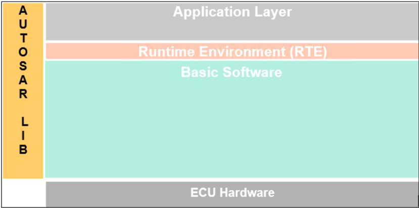

## 1. 简介和功能概述

**AUTOSAR** 库例程是 **AUTOSAR** 架构中系统服务的一部分，下图展示了 **AUTOSAR** 库在分层架构中的位置。



本规范规定了专用于定点值扩展数学函数的 **AUTOSAR** 库的功能、**API** 和配置。

该扩展数学库（**Efx**）包含以下例程：

- 滑动平均值（**Moving average**）
- 一阶高通滤波器（**First order high pass filter**）
- 一阶低通滤波器（**First order low-pass filter**）
- 控制器例程（**Controller routines**）
- 平方根（**Square root**）
- 指数（**Exponential**）
- 平均值（**Average**）
- 数组平均值（**Array Average**）
- 滑动平均值（**Moving Average**）
- 斜边（**Hypotenuse**）
- 三角函数（**Trigonometric functions**）
- 斜率限幅器函数（**Rate limiter functions**）
- 斜坡例程（**Ramp routines**）
- 滞回函数（**Hysteresis function**）
- 死区时间（**Dead Time**）
- 去抖（**Debounce**）
- 升序排序例程（**Ascending Sort Routine**）
- 降序排序例程（**Descending Sort Routine**）
- 中值排序（**Median Sort**）
- 边沿检测例程（**Edge detection routines**）
- 区间例程（**Interval routines**）
- 计数器例程（**Counter routines**）
- 触发器例程（**Flip-Flop routine**）
- 限幅器例程（**Limiter routines**）
- 64 位函数（**64 bit functions**）

所有例程都是可重入的，可以同时被多个 runnable 使用。

## 2. 缩略语

下面的术语表包含了与 **EFX** 库模块相关、但未包含在 [\[1, AUTOSAR 术语表\]](#ref-1) 中的缩略语和缩写。

**Arcsin**
> 反正弦（**Inverse Sine**）。

**Arccos**
> 反余弦（**Inverse Cosine**）。

**BSW**
> 基础软件（**Basic Software**）。

**Cos**
> 余弦（**Cosine**）。

**DET**
> 默认错误跟踪器（**Default Error Tracer**）。

**EFX**
> 扩展定点数学库（**Extended Mathematical library - Fixed point**）。

**Hypot**
> 斜边（**Hypotenuse**）。

**HpFilter**
> 高通滤波器（**High pass filter**）。

**LpFilterFac1**
> 因子为 1（包含于 [0, 1]）的低通滤波器（**Low pass filter with a factor of 1 (included in [0, 1])**）。

**LpFilter**
> 低通滤波器（**Low pass filter**）。

**Mn**
> 助记符（**Mnemonic**）。

**Lib**
> 库（**Library**）。

**Sqrt**
> 平方根（**Square root**）。

**Sin**
> 正弦（**Sine**）。

**SWS**
> 软件规范（**Software Specification**）。

**SRS**
> 软件需求规范（**Software Requirement Specification**）。

**u8**
> **uint8** 的助记符，规定于 AUTOSAR_SWS_PlatformTypes。

**u16**
> **uint16** 的助记符，规定于 AUTOSAR_SWS_PlatformTypes。

**u32**
> **uint32** 的助记符，规定于 AUTOSAR_SWS_PlatformTypes。

**s8**
> **sint8** 的助记符，规定于 AUTOSAR_SWS_PlatformTypes。

**s16**
> **sint16** 的助记符，规定于 AUTOSAR_SWS_PlatformTypes。

**s32**
> **sint32** 的助记符，规定于 AUTOSAR_SWS_PlatformTypes。

**s64**
> **sint64** 的助记符，规定于 AUTOSAR_SWS_PlatformTypes。

**u64**
> **uint64** 的助记符，规定于 AUTOSAR_SWS_PlatformTypes。

## 3. 相关文档

### 3.1. 输入文件和相关标准与规范

<a id="ref-1"></a>[1] Glossary
> AUTOSAR_FO_TR_Glossary

<a id="ref-2"></a>[2] ISO/IEC 9899:1990 Programming Language - C
> https://www.iso.org

<a id="ref-3"></a>[3] General Specification of Basic Software Modules
> AUTOSAR_CP_SWS_BSWGeneral

<a id="ref-4"></a>[4] Requirements on Libraries
> AUTOSAR_CP_SRS_Libraries

### 3.2. 相关规范

**AUTOSAR** 提供了基础软件模块通用规范 [\[3, SWS BSW General\]](#ref-3)，该规范同样适用于 **EFX** 库。

因此，**SWS BSW General** 规范应被视为 **EFX** 库的附加必需规范。

## 4. 约束和假设

### 4.1. 限制

无限制。

### 4.2. 汽车域的适用性

无限制。

## 5. 对其他模块的依赖

### 5.1. 文件结构

例程的实现与按 **C** 文件的分组建议按照下面描述的选项之一完成，且不强制遵循这些建议。

选项 1：&lt;Name&gt; 可以是函数名，即每个函数一个 **C** 文件，

例如：Efx\_Pt1\_s32.c 等。

选项 2：&lt;Name&gt; 可以是一组函数的通用名称：

* 2.1 按对象族分组：

例如：Efx\_Pt1.c、Efx\_Dt1.c、Efx\_Pid.c

* 2.2 按例程族分组：

例如：Efx\_Filter.c、Efx\_Controller.c、Efx\_Average.c 等。

* 2.3 按方法族分组：
* 2.4 按体系结构分组：

例如：Efx\_Sin.c、Efx\_Exp.c、Efx\_Arcsin.c 等。

例如：Efx\_Slewrate16.c、Efx\_Slewrate32.c

* 2.5 按其他方法分组：（允许单独分组）

选项 3：&lt;Name&gt; 可以去掉，使得单个 **C** 文件包含所有 **Efx** 函数，例如：Efx.c。

使用上述选项可以灵活地选择合适的粒度并减少 **C** 文件的数量。在某些选项下，按需链接也是可能的。

## 6. 功能规格

### 6.1. 错误分类（**Error Classification**）

《**General Specification of Basic Software Modules**》（基础软件模块通用规范）一文的第 7.1 节「**Error Handling**」（错误处理）详细描述了基础软件的错误处理。其中最重要的是，它构成了一个由 **BSW** 模块中可能发生的五种错误类型组成的分类方案。

在此基础上，下文按相应的小节规定了具体的错误。

#### 6.1.1. 开发错误

不存在开发错误。

#### 6.1.2. 运行时错误

不存在运行时错误。

#### 6.1.3. 瞬态故障

不存在瞬态故障。

#### 6.1.4. 生产错误

不存在生产错误。

#### 6.1.5. 扩展生产错误

不存在扩展生产错误。

### 6.2. 初始化和关闭（**Initialization and shutdown**）

**Efx** 库不应需要初始化阶段。库函数可以在 **ECU** 初始化的第一步就被调用，例如甚至由 **OS** 或 **EcuM** 调用，因此该库应是就绪的。

**Efx** 库不应需要关闭操作阶段。

### 6.3. 库 API 的使用（**Using Library API**）

**Efx API** 可以从 **BSW** 模块或 **SWC** 直接调用。不需要端口定义。它是纯粹的函数调用。

语句「Efx.h」应由开发者或应用代码生成器放置，而不是由 **RTE** 生成器放置。

库的使用应有文档记录。如果 **BSW** 模块或 **SWC** 使用了某个库，开发者应在 **BSW**/**SWC** 模板中添加一个 Implementation-DependencyOnArtifact。

minVersion 和 maxVersion 参数对应于供应商版本。对于 **AUTOSAR** 库，这些参数可以留空，因为 **SWC** 或 **BSW** 模块可能依赖于库的行为，而不是依赖于某个供应商的实现。然而，**SWC** 或 **BSW** 模块应与其所集成的 **AUTOSAR** 平台兼容。

### 6.4. 库的实现（**library implementation**）

**Efx** 库的实现方式应使代码可以在不同内存分区中的调用者之间共享。

应避免使用宏。函数应声明为函数或内联函数。不应使用宏 #define。

库函数不得调用任何 **BSW** 模块函数，例如 **DET**。库函数可以调用其他库函数。因为库函数应是可重入的，而其他 **BSW** 模块函数则不一定可重入。

用 **C** 编程语言编写的库应符合 **MISRA C** 标准。

更多详情请参见 SWS\_BSW\_00115。

每个 **AUTOSAR** 库模块实现 &lt;library&gt;*.c 和 &lt;library&gt;*.h 都应使用 **AUTOSAR** 内存映射机制将其代码映射到内存段。

所有 **AUTOSAR** 库模块都应使用 **AUTOSAR** 数据类型（整数、布尔）而不是原生 **C** 数据类型，除非该库被明确标识为仅与某个平台兼容。

所有 **AUTOSAR** 库模块都应避免直接使用编译器和平台特定的关键字，除非该库被明确标识为仅与某个平台兼容。例如 #pragma、typeof 等。

在实现 Efx 服务时必须遵守整数提升（**integral promotion**）规则。因此，为了获得最大精度，中间结果不应被限制。

## 7. API规范

### 7.1. 导入的类型

在本章中，列出了从以下模块包含的所有类型：

| 模块 | 头文件 | 导入类型 |
|---|---|---|
| Std | Std_Types.h | Std_VersionInfoType |

可以观察到，由于 **C** 语言提供的整数类型的大小是由实现定义的，因此每种整数类型可表示的值的范围在不同的实现之间会有所不同。

库例程名称中使用了以下助记符。

表8.1：基本类型（**Base Types**）

| 大小 | 平台类型 | 助记符 | 取值范围 |
|---|---|---|---|
| 无符号 8 位 | boolean | u8 | [ TRUE, FALSE ] |
| 有符号 8 位 | sint8 | s8 | [ -128, 127 ] |
| 有符号 16 位 | sint16 | s16 | [ -32768, 32767 ] |
| 有符号 32 位 | sint32 | s32 | [ -2147483648, 2147483647 ] |
| 有符号 64 位 | sint64 | s64 | [-9223372036854775808, 9223372036854775807] |
| 无符号 8 位 | uint8 | u8 | [ 0, 255 ] |
| 无符号 16 位 | uint16 | u16 | [ 0, 65535 ] |
| 无符号 32 位 | uint32 | u32 | [ 0, 4294967295 ] |
| 无符号 64 位 | uint64 | u64 | [0, 18446744073709551615] |

作为文档其余部分的约定：

* 助记符将用于例程的名称中（&lt;InTypeMn1&gt; 表示输入 1 的类型助记符）；
* 真实类型将用于例程原型的描述中（使用 &lt;InTypeMn1&gt; 或 &lt;OutType&gt;）。

**注意：**

返回类型/参数类型为布尔型的 **API** 的命名约定为 \_u8，应将其解释为 \_b（**Boolean**，布尔）。

如果返回类型/参数类型中没有布尔数据类型，则 \_u8 仅应解释为 \_u8。

### 7.2. 类型定义

**Efx** 模块没有类型定义。

### 7.3. 关于舍入的说明（**Comment about rounding**）

可应用两种舍入类型：

结果被「四舍五入」（**rounded off**），即：

- 0 &lt;= X &lt; 0.5 舍入为 0
- 0.5 &lt;= X &lt; 1 舍入为 1
- -0.5 &lt; X &lt;= 0 舍入为 0
- -1 &lt; X &lt;= -0.5 舍入为 -1

结果向零舍入：

- 0 &lt;= X &lt; 1 舍入为 0
- -1 &lt; X &lt;= 0 舍入为 0

### 7.4. 关于针对目标优化的例程的说明（**Comment about routines optimized for target**）

本库中描述的例程可以实现为常规例程或内联函数。出于 **ROM** 优化的目的，建议将 **C** 例程实现为单独的源文件，以便按需链接。

例如，根据目标的不同，可以进行两种类型的优化：

- 某些例程可以由使用整数提升（**integer promotion**）的另一例程替换。
- 某些例程可以由限幅例程与具有不同签名的例程的组合替换。

### 7.5. 数学函数定义（**Mathematical functions definitions**）

下表描述了下文各节中使用的符号的含义。

| 符号 | 说明 |
|---|---|
| Yn | 实际要计算的输出 |
| Yn-1 | 一个时间步之前的输出值 |
| Xn | 来自输入的实际输入 |
| Xn-1 | 一个时间步之前的输入 |
| a, b0, b1 | 滤波器相关的常数 |

#### 7.5.1. 一阶低通滤波器（**First-order low-pass filter**）

我们考虑具有以下传递函数的递归一阶低通滤波器：

Y<sub>n</sub> = Y<sub>n−1</sub> + (X<sub>n</sub> − Y<sub>n−1</sub>) * K

在任意时刻，新的返回值（Yn）都可以由前一个值（Yn-1）、当前值（Xn）和一个已知常数（K）计算得出。计算公式如下：

其中 b1=K 且 a = K - 1。

只有当平均值 K 包含于 [0,1] 时，该滤波器才是收敛的低通滤波器。

##### 7.5.1.1. 第一次计算（**First computation**）

###### 7.5.1.1.1. Efx_LpFilterFac1_&lt;InTypeMn&gt;&lt;InTypeMn&gt;&lt;InTypeMn&gt;_&lt;OutTypeMn&gt;

**说明**: 本服务计算一阶低通滤波器的输出。服务 ID 0x01 至 0x08。本服务为同步调用，可重入。参数 Yn-1（in）：旧的输出值。参数 Xn（in）：当前测量值。参数 fac（in）：表示物理范围的因子值。sint16：[-1, 0.999969482421875]；uint8：[0, 0.9960937500000]；uint16：[0, 0.9999847412109]；uint32：[0, 0.9999999997671]。如果滤波器要收敛，则只应使用物理值 [0, 1]。参数（inout）：无。参数（out）：无。返回值：&lt;OutType&gt;，计算结果（Yn）。可通过 **Efx.h** 获得。

```C
<OutType> Efx_LpFilterFac1_<InTypeMn><InTypeMn><InTypeMn>_<OutTypeMn> ( <InType> Yn-1, <InType> Xn, <InType> fac )
```

```C
Yn = Yn-1 + (((Xn - Yn-1) * fac) >> n)
```

其中「n」是一个移位量，取决于函数用于因子的类型。

为了始终收敛，使用以下逻辑对结果的值饱和进行修正：

```C
If (Yn == Yn-1)
  If (((Xn - Yn-1) * fac) > 0)
    Yn ++
  Else If (((Xn - Yn-1) * fac) < 0)
    Yn -
  End If
Endif
```

以下是已实现函数的列表：

| 服务 ID [hex] | 语法 | 关联移位 |
|---|---|---|
| 0x01 | sint16 Efx_LpFilterFac1_s16s16s16_s16 ( sint16, sint16, sint16) | 15 |
| 0x02 | sint16 Efx_LpFilterFac1_s16s16u16_s16 ( sint16, sint16, uint16) | 16 |
| 0x03 | sint32 Efx_LpFilterFac1_s32s32u16_s32 ( sint32, sint32, uint16) | 16 |
| 0x04 | uint16 Efx_LpFilterFac1_u16u16s16_u16 ( uint16, uint16, sint16 ) | 15 |
| 0x05 | uint16 Efx_LpFilterFac1_u16u16u16_u16 ( uint16, uint16, uint16) | 16 |
| 0x06 | uint8 Efx_LpFilterFac1_u8u8u8_u8 ( uint8, uint8, uint8) | 8 |
| 0x07 | uint32 Efx_LpFilterFac1_u32u32u32_u32 ( uint32, uint32, uint32) | 32 |
| 0x08 | uint32 Efx_LpFilterFac1_u32u32u16_u32 ( uint32, uint32, uint16) | 16 |

##### 7.5.1.2. 第三次计算（**Third computation**）

###### 7.5.1.2.1. Efx_LpFilter_&lt;InTypeMn&gt;_&lt;OutTypeMn&gt;

**说明**: 本服务计算一阶离散滤波器。服务 ID 0x0D 和 0x0E。本服务为同步调用，可重入。参数 input（in）：输入信号。参数 old_output（in）：输出值（滤波后的信号）的前一个值。参数 tau_const（in）：滤波器的参数 Tau：时间常数（秒）。参数 recurrence（in）：两次执行该函数之间的时间差。参数 reset（in）：用于复位滤波信号的标志。参数 init_val（in）：滤波器的初始值。参数 started（inout）：指向用于检测该函数首次调用的标志的指针。参数（out）：无。返回值：&lt;OutType&gt;，滤波器的返回值。可通过 **Efx.h** 获得。

```C
<OutType> Efx_LpFilter_<InTypeMn>_<OutTypeMn> ( <InType> input, <InType> old_output, uint32 tau_const, uint16 recurrence, uint8 reset, <InType> init_val, uint8* started )
```

如果 (tau_const==0)，则 output = input。

如果 (*started==0)，则 output = init_val。

该标志用于指示滤波器的状态。*Started = 0 表示当前函数调用是该函数的首次调用，用于触发初始化。

本服务计算一阶离散滤波器：

```C
output = old_output * exp(-recurrence / tau_const)
```

**注意：** 指数函数可以通过插值计算。

如果 ((reset == 1) or (*started == 0))，则 output = init_val。

如果 (*started == 0)，则 *started=1。

以下是已实现函数的列表：

| 服务 ID [hex] | 语法 |
|---|---|
| 0x0D | uint32 Efx_LpFilter_u32_u32 (uint32, uint32, uint32, uint16, uint8, uint32, uint8* ) |
| 0x0E | sint32 Efx_LpFilter_s32_s32 (sint32, sint32, uint32, uint16, uint8, sint32, uint8 * ) |

input、old_output 和 init_val 必须具有相同的分辨率和相同的物理单位。

tau_const 和 recurrence 必须具有相同的分辨率和相同的物理单位。

不建议在任何条件下调用 Efx\_LpFilter\_&lt;InTypeMn&gt;\_&lt;OutTypeMn&gt;。必须在每次 recurrence 时调用它，即使它未被使用。如果不满足这些条件，则输出应始终冻结为前一个值。

参数 started 必须由调用方声明为私有变量并初始化为 0（默认初始化），因为该函数会使用此输出的前一个值（因此不得使用栈）。

#### 7.5.2. 一阶高通滤波器（**First-order High-pass filter**）

我们考虑具有以下传递函数的递归一阶高通滤波器：

在任意时刻，新的返回值（Yn）都可以由前一个值（Yn-1）、当前输入（Xn）、前一个输入（Xn-1）和一个已知常数（K）计算得出。计算公式如下：

Y<sub>n</sub> = Y<sub>n−1</sub> − K * Y<sub>n−1</sub> + ( X<sub>n</sub> − X<sub>n−1</sub>)

其中 b0 = 1、b1 = -1 且 a=K -1。

只有当因子值 m 包含于 [0,1] 时，该滤波器才是收敛的高通滤波器。

###### 7.5.2.1. Efx_HpFilter_u8_s16

**说明**: 本服务计算一阶高通滤波器的输出。服务 ID 0x10。本服务为同步调用，可重入。参数 Yn-1（in）：前一个 sint16 输出。物理范围：[-256, 255.9921875]，分辨率：1/2<sup>7</sup>。参数 Xn（in）：当前 uint8 输入。物理范围：[0,255]，分辨率：1。参数 Xn-1（in）：前一个 uint8 输入。物理范围：[0,255]，分辨率：1。参数 K（in）：常量 uint16 乘法因子。物理范围：[0,0.99998]，分辨率：1/2<sup>16</sup>。参数（inout）：无。参数（out）：无。返回值：sint16，Yn：计算结果。物理范围：[-256, 255.9921875]，分辨率：1/2<sup>7</sup>。可通过 **Efx.h** 获得。

```C
sint16 Efx_HpFilter_u8_s16 ( sint16 Yn-1, uint8 Xn, uint8 Xn-1, uint16 K )
```

```C
Yn = Yn-1 - (K * Yn-1 / 2^16) + (Xn - Xn-1) * 2^7
```

结果向零舍入。

发生负上溢或正上溢时，返回值应饱和到边界值。

对结果应用使输出收敛到零的饱和修正：

```C
If ((Yn equals Yn-1) and (Yn-1 > 0))
decrement Yn by one
If ((Yn equals Yn-1) and (Yn-1 < 0))
increment Yn by one
```

###### 7.5.2.2. Efx_HpFilter_s8_s16

**说明**: 本服务计算一阶高通滤波器的输出。服务 ID 0x11。本服务为同步调用，可重入。参数 Yn-1（in）：前一个 sint16 输出。物理范围：[-256, 255.9921875]，分辨率：1/2<sup>7</sup>。参数 Xn（in）：当前 sint8 输入。物理范围：[-128, 127]，分辨率：1。参数 Xn-1（in）：前一个 sint8 输入。物理范围：[-128, 127]，分辨率：1。参数 K（in）：常量 uint16 乘法因子。物理范围：[0,0.99998]，分辨率：1/2<sup>16</sup>。参数（inout）：无。参数（out）：无。返回值：sint16，Yn：计算结果。物理范围：[-256, 255.9921875]，分辨率：1/2<sup>7</sup>。可通过 **Efx.h** 获得。

```C
sint16 Efx_HpFilter_s8_s16 ( sint16 Yn-1, sint8 Xn, sint8 Xn-1, uint16 K )
```

```C
Yn = Yn-1 - (K * Yn-1 / 2^16) + (Xn - Xn-1) * 2^7
```

结果向零舍入。

发生负上溢或正上溢时，返回值应饱和到边界值。

对结果应用使输出收敛到零的饱和修正：

```C
If ((Yn equals Yn-1) and (Yn-1 > 0))
decrement Yn by one
If ((Yn equals Yn-1) and (Yn-1 < 0))
increment Yn by one
```

###### 7.5.2.3. Efx_HpFilter_u16_s32

**说明**: 本服务计算一阶高通滤波器的输出。服务 ID 0x12。本服务为同步调用，可重入。参数 Yn-1（in）：前一个 sint32 输出。物理范围：[-65536, 65535.99996]，分辨率：1/2<sup>15</sup>。参数 Xn（in）：当前 uint16 输入。物理范围：[0,65535]，分辨率：1。参数 Xn-1（in）：前一个 uint16 输入。物理范围：[0,65535]，分辨率：1。参数 K（in）：常量 uint16 乘法因子。物理范围：[0,0.99998]，分辨率：1/2<sup>16</sup>。参数（inout）：无。参数（out）：无。返回值：sint32，Yn：计算结果。物理范围：[-65536, 65535.99996]，分辨率：1/2<sup>15</sup>。可通过 **Efx.h** 获得。

```C
sint32 Efx_HpFilter_u16_s32 ( sint32 Yn-1, uint16 Xn, uint16 Xn-1, uint16 K )
```

```C
Yn = Yn-1 - (K * Yn-1 / 2^16) + (Xn - Xn-1) * 2^15
```

结果向零舍入。

发生负上溢或正上溢时，返回值应饱和到边界值。

对结果应用使输出收敛到零的饱和修正：

```C
If ((Yn equals Yn-1) and (Yn-1 > 0))
decrement Yn by one
If ((Yn equals Yn-1) and (Yn-1 < 0))
increment Yn by one
```

###### 7.5.2.4. Efx_HpFilter_s16_s32

**说明**: 本服务计算一阶高通滤波器的输出。服务 ID 0x13。本服务为同步调用，可重入。参数 Yn-1（in）：前一个 sint32 输出。物理范围：[-65536, 65535.99996]，分辨率：1/2<sup>15</sup>。参数 Xn（in）：当前 sint16 输入。物理范围：[-32768,32767]，分辨率：1。参数 Xn-1（in）：前一个 sint16 输入。物理范围：[-32768,32767]，分辨率：1。参数 K（in）：常量 uint16 乘法因子。物理范围：[0,0.99998]，分辨率：1/2<sup>16</sup>。参数（inout）：无。参数（out）：无。返回值：sint32，Yn：计算结果。物理范围：[-65536, 65535.99996]，分辨率：1/2<sup>31</sup>。可通过 **Efx.h** 获得。

```C
sint32 Efx_HpFilter_s16_s32 ( sint32 Yn-1, sint16 Xn, sint16 Xn-1, uint16 K )
```

```C
Yn = Yn-1 - (K * Yn-1 / 2^16) + (Xn - Xn-1) * 2^15
```

结果向零舍入。

发生负上溢或正上溢时，返回值应饱和到边界值。

对结果应用使输出收敛到零的饱和修正：

```C
If ((Yn equals Yn-1) and (Yn-1 > 0))
decrement Yn by one
If ((Yn equals Yn-1) and (Yn-1 < 0))
increment Yn by one
```

#### 7.5.3. 控制器例程（**Controller routines**）

控制器例程包括控制系统应用中使用的 P、PT1、DT1、PD、I、PI、PID 调节器。对于这些控制器，所需的参数通过拉普拉斯-Z 变换（**Laplace-Z transformation**）推导得出。计算新的控制器输出 yn 所需的参数可表示为以下等式。

Y<sub>n</sub> = a1 * Y<sub>n−1</sub> + b0 * X<sub>n</sub> + b1 * X<sub>n−1</sub> + b2 * X<sub>n−2</sub> + ….. + b<sub>n−1</sub> * X<sub>1</sub> + b<sub>n</sub> * X<sub>0</sub>

在该等式中，使用了以下符号：

| 符号 | 说明 |
|---|---|
| Yn | 实际要计算的输出 |
| Yn-1 | 一个时间步之前的输出值 |
| Xn | 来自输入的实际输入 |
| Xn-1 | 一个时间步之前的输入 |
| Xn-2 | 两个时间步之前的输入 |
| X1 | n-1 个时间步之前的输入 |
| X0 | n 个时间步之前的输入 |
| a1, b0, b1, b2, bn-1, bn | 控制器相关的比例参数，用于描述各状态的权重 |

##### 7.5.3.1. 控制器例程的结构定义（**Structure definitions for controller routines**）

系统参数与时间或时间等效参数是分开的。系统参数被分组在控制器相关的结构 Efx\_Param&lt;controller&gt;\_Type 中，而时间（等效）参数则直接赋值。系统状态被分组在结构 Efx\_State&lt;controller&gt;\_Type 中，实际输入值 Xn 除外，它被直接赋值。

等式中使用的系统参数为：

K：放大系数（**Amplification factor**）。放大系数 K 的分辨率应为 1/2<sup>16</sup>。

T1：衰减时间常数。

T1rec 按 2<sup>32</sup> 因子缩放。

T1rec 由等式给出：2<sup>32</sup> / (10<sup>6</sup> * T1)。

Tv：导前时间。物理单位 [秒] 描述导前时间。

Tv 以 us（微秒）表示，分辨率应为 1/(2<sup>8</sup> * 10<sup>6</sup>)。

Tv 范围 = [0.003906 us, 8388607 us] dT，相对于 [Tv_min, Tv_max]。

Tn：跟进时间。物理单位 [秒] 描述跟进时间。

Tn 以 us 表示，分辨率为 1/10<sup>6</sup>。

Tn 由其倒数（Tnrec）给出，以避免在实现中进行除法。

Tnrec 按 2<sup>32</sup> 因子缩放。

Tnrec 由等式给出：2<sup>32</sup> / (10<sup>6</sup> * Tn)。

等式/实现中的时间及时间等效参数为：

dT：时间步 = 采样间隔。dT 以 us（微秒）表示，分辨率应为 1/10<sup>6</sup>。

与上述缩写类似，实现中使用了以下缩写：

K\_&lt;size&gt;、K\_C：放大系数

T1rec\_&lt;size&gt;：延迟时间常数倒数 = 1/ T1。结果应向零舍入。

Tv\_&lt;size&gt;、Tv\_C：导前时间

Tnrec\_&lt;size&gt;、Tnrec\_C：跟进时间倒数 = 1/ Tn。结果应向零舍入。

dT\_&lt;size&gt;：时间步 = 采样间隔 [每个数据表示单位增量 10<sup>-6</sup> 秒]

TeQ\_&lt;size&gt;：时间等效值，TeQ = exp (- dT/ T1)。

其中「&lt;size&gt;」表示变量的大小，例如 \_s32 表示 sint32 位变量。

**注意：**

1. Tv 和 Tn 不能为负。
2. Dt 应始终大于零。

以下 **C** 结构是专为控制器例程特别定义的。

**Efx_StatePT1_Type**

结构类型（**Structure**），包含以下元素：

| 元素 | 类型 | 说明 |
|---|---|---|
| X1 | sint32 | 输入值，一个时间步之前 |
| Y1 | sint32 | 输出值，一个时间步之前 |

描述：PT1 控制器例程的系统状态结构。可通过 **Efx.h** 获得。

**Efx_StateDT1Typ1_Type**

结构类型（**Structure**），包含以下元素：

| 元素 | 类型 | 说明 |
|---|---|---|
| X1 | sint32 | 输入值，一个时间步之前 |
| X2 | sint32 | 输入值，两个时间步之前 |
| Y1 | sint32 | 输出值，一个时间步之前 |

描述：DT1-Type1 控制器例程的系统状态结构。可通过 **Efx.h** 获得。

**Efx_StateDT1Typ2_Type**

结构类型（**Structure**），包含以下元素：

| 元素 | 类型 | 说明 |
|---|---|---|
| X1 | sint32 | 输入值，一个时间步之前 |
| Y1 | sint32 | 输出值，一个时间步之前 |

描述：DT1-Type2 控制器例程的系统状态结构。可通过 **Efx.h** 获得。

**Efx_StatePD_Type**

结构类型（**Structure**），包含以下元素：

| 元素 | 类型 | 说明 |
|---|---|---|
| X1 | sint32 | 输入值，一个时间步之前 |
| Y1 | sint32 | 输出值，一个时间步之前 |

描述：PD 控制器例程的系统状态结构。可通过 **Efx.h** 获得。

**Efx_ParamPD_Type**

结构类型（**Structure**），包含以下元素：

| 元素 | 类型 | 说明 |
|---|---|---|
| K_C | sint32 | 放大系数 |
| Tv_C | sint32 | 导前时间 |

描述：PD 控制器例程的系统与时间等效参数结构。可通过 **Efx.h** 获得。

**Efx_StateI_Type**

结构类型（**Structure**），包含以下元素：

| 元素 | 类型 | 说明 |
|---|---|---|
| X1 | sint32 | 输入值，一个时间步之前 |
| Y1 | sint32 | 输出值，一个时间步之前 |

描述：I 控制器例程的系统状态结构。可通过 **Efx.h** 获得。

**Efx_StatePI_Type**

结构类型（**Structure**），包含以下元素：

| 元素 | 类型 | 说明 |
|---|---|---|
| X1 | sint32 | 输入值，一个时间步之前 |
| Y1 | sint32 | 输出值，一个时间步之前 |

描述：PI 加法（Type1 和 Type2）控制器例程的系统状态结构。可通过 **Efx.h** 获得。

**Efx_ParamPI_Type**

结构类型（**Structure**），包含以下元素：

| 元素 | 类型 | 说明 |
|---|---|---|
| K_C | sint32 | 放大系数 |
| Tnrec_C | sint32 | 跟进时间倒数 (1/Tn) |

描述：PI 加法（Type1 和 Type2）控制器例程的系统与时间等效参数结构。可通过 **Efx.h** 获得。

**Efx_StatePID_Type**

结构类型（**Structure**），包含以下元素：

| 元素 | 类型 | 说明 |
|---|---|---|
| X1 | sint32 | 输入值，一个时间步之前 |
| X2 | sint32 | 输入值，两个时间步之前 |
| Y1 | sint32 | 输出值，一个时间步之前 |

描述：PID 加法（Type1 和 Type2）控制器例程的系统状态结构。可通过 **Efx.h** 获得。

**Efx_ParamPID_Type**

结构类型（**Structure**），包含以下元素：

| 元素 | 类型 | 说明 |
|---|---|---|
| K_C | sint32 | 放大系数 |
| Tv_C | sint32 | 导前时间 |
| Tnrec_C | sint32 | 跟进时间倒数 (1/Tn) |

描述：PID 加法（Type1 和 Type2）控制器例程的系统与时间等效参数结构。可通过 **Efx.h** 获得。

**Efx_Limits_Type**

结构类型（**Structure**），包含以下元素：

| 元素 | 类型 | 说明 |
|---|---|---|
| Min_C | sint32 | 最小限值 |
| Max_C | sint32 | 最大限值 |

描述：控制器限值结构。可通过 **Efx.h** 获得。

##### 7.5.3.2. 比例控制器（**Proportional Controller**）

比例组件计算 Y(x) = Kp * X。

1. 「P」控制器

###### 7.5.3.2.1. Efx_PCalc

**说明**: 本例程计算微分方程。微分方程：Y = K * X。服务 ID 0x14。本服务为同步调用，可重入。参数 X_s32（in）：输入值。参数 K_s32（in）：放大系数（每个数据表示单位增量量化为 1/2<sup>16</sup>）。参数 P_ps32（inout）：指向已计算状态的指针。参数（out）：无。返回值：void，无返回值。可通过 **Efx.h** 获得。

```C
void Efx_PCalc ( sint32 X_s32, sint32* P_ps32, sint32 K_s32 )
```

计算值：

```C
*P_ps32 = (K_s32 * X_s32) >> 16
```

放大系数以每个数据表示单位增量 1/2<sup>16</sup> 的方式量化。

1. 「P」状态设置

该例程可以使用内联函数实现。

###### 7.5.3.2.2. Efx_PSetState

**说明**: 该例程设置 P 组件的内部状态变量。服务 ID 0x21。本服务为同步调用，可重入。参数 Y_s16（in）：输入值。参数 P_s32（inout）：指向已计算状态的指针。参数（out）：无。返回值：void，无返回值。可通过 **Efx.h** 获得。

```C
void Efx_PSetState ( sint32* P_s32, sint16 Y_s16 )
```

输出值：

```C
*P_s32 = Y_s16 << 16
```

P 组件的内部状态存储为 (Y\_s16 &lt;&lt; 16)。

1. 获取「P」输出

该例程可以使用内联函数实现。

###### 7.5.3.2.3. Efx_POut_&lt;OutTypeMn&gt;

**说明**: 本例程返回「P」控制器的输出值。服务 ID 0x22 至 0x23。本服务为同步调用，可重入。参数 P_ps32（in）：指向已计算状态的指针。参数（inout）：无。参数（out）：无。返回值：&lt;OutType&gt;，返回「P」控制器输出值。可通过 **Efx.h** 获得。

```C
<OutType> Efx_POut_<OutTypeMn> ( const sint32* P_ps32 )
```

```C
Output value = *P_ps32 >> 16
```

发生负上溢或正上溢时，返回值应饱和到返回数据类型的边界值。

以下是已实现函数的列表：

| 服务 ID [hex] | 语法 |
|---|---|
| 0x22 | sint16 Efx_POut_s16(const sint32 *) |
| 0x23 | sint8 Efx_POut_s8(const sint32 *) |

##### 7.5.3.3. 具有一阶时间常数的比例控制器（**Proportional controller with first order time constant**）

本例程计算具有一阶时间常数的比例组件。

1. 「PT1」控制器

###### 7.5.3.3.1. Efx_PT1Calc

**说明**: 本例程使用以下差分方程计算 PT1 控制器输出值：Y<sub>n</sub> = exp(-dT/T1) * Y<sub>n−1</sub> + K(1 - exp(-dT/T1)) * X<sub>n−1</sub>。服务 ID 0x2A。本服务为同步调用，可重入。参数 X_s32（in）：PT1 组件的输入值。参数 K_s32（in）：放大系数。参数 TeQ_s32（in）：时间等效值。参数 State_cpst（inout）：指向 PT1 状态结构的指针。参数（out）：无。返回值：void，无返回值。可通过 **Efx.h** 获得。

```C
void Efx_PT1Calc ( sint32 X_s32, Efx_StatePT1_Type* State_cpst, sint32 K_s32, sint32 TeQ_s32 )
```

该等式推导出实现：

```C
Output_value = (TeQ_s32 * State_cpst->Y1) + K_s32 * (1 - TeQ_s32) * State_cpst->X1
```

其中 TeQ_s32 = exp (-dT/T1)。

仅当 T1 &gt; 0 时，才应使用 [Efx_CalcTeQ_s32](#75334-efx_calcteq_s32) 计算时间等效参数 TeQ_s32。

**注意：** 如果 T1 = 0，PT1 控制器的行为类似于 P 控制器。在这种情况下，应避免使用 Efx\_CalcTeq\_s32，且 Teq 值应传入 0。

如果 (Teq = 0)，则 PT1 控制器跟随输入值：

```C
State_cpst->Y1 = k_s32 * State_cpst->X1
```

计算得到的 Output_value 和当前输入值应分别存储到 State\_cpst-&gt;Y1 和 State\_cpst-&gt;X1 中。

```C
State_cpst->Y1 = Output_value
State_cpst->X1 = X_s32
```

1. 「PT1」控制器 - Type1

###### 7.5.3.3.2. Efx_PT1Typ1Calc

**说明**: 本例程使用以下差分方程计算 PT1 控制器输出值：Y<sub>n</sub> = exp(-dT/T1) * Y<sub>n−1</sub> + K(1 - exp(-dT/T1)) * X<sub>n</sub>。服务 ID 0x38。本服务为同步调用，可重入。参数 X_s32（in）：PT1 组件的输入值。参数 K_s32（in）：放大系数。参数 TeQ_s32（in）：时间等效值。参数 State_cpst（inout）：指向 PT1 状态结构的指针。参数（out）：无。返回值：无。可通过 **Efx.h** 获得。

```C
void Efx_PT1Typ1Calc ( sint32 X_s32, Efx_StatePT1_Type* State_cpst, sint32 K_s32, sint32 TeQ_s32 )
```

该等式推导出实现：

```C
Output_value = (TeQ_s32 * State_cpst->Y1) + K_s32 * (1 - TeQ_s32) * State_cpst->X1
```

其中 TeQ_s32 = exp (-dT/T1)。

仅当 T1 &gt; 0 时，才应使用 [Efx_CalcTeQ_s32](#75334-efx_calcteq_s32) 计算时间等效参数 TeQ_s32。

**注意：** 如果 T1 = 0，PT1 控制器的行为类似于 P 控制器。在这种情况下，应避免使用 Efx\_CalcTeq\_s32，且 Teq 值应传入 0。

如果 (Teq = 0)，则 PT1 控制器跟随输入值：

```C
State_cpst->Y1 = k_s32 * State_cpst->X1
```

计算得到的 Output_value 和当前输入值应分别存储到 State\_cpst-&gt;Y1 和 State\_cpst-&gt;X1 中。

```C
State_cpst->Y1 = Output_value
State_cpst->X1 = X_s32
```

1. 「PT1」状态值设置

该例程可以使用内联函数实现。

###### 7.5.3.3.3. Efx_PT1SetState

**说明**: 该例程初始化 PT1 组件的内部状态变量。服务 ID 0x2B。本服务为同步调用，可重入。参数 X1_s32（in）：输入状态的初始值。参数 Y1_s16（in）：输出状态的初始值。参数（inout）：无。参数 State_cpst（out）：指向 PT1 状态结构的指针。返回值：void，无返回值。可通过 **Efx.h** 获得。

```C
void Efx_PT1SetState ( Efx_StatePT1_Type* State_cpst, sint32 X1_s32, sint16 Y1_s16 )
```

输出状态变量 Y1 的初始化。

```C
State_cpst->Y1 = Y1_s16 << 16
```

PT1 组件的内部状态存储为 (Y1\_s16 &lt;&lt; 16)。

输入状态变量 X1 的初始化。

```C
State_cpst->X1 = X1_s32
```

1. 计算时间等效值

该例程可以使用内联函数实现。

###### 7.5.3.3.4. Efx_CalcTeQ_s32

**说明**: 本例程计算时间等效系数。服务 ID 0x2C。本服务为同步调用，可重入。参数 T1rec_s32（in）：延迟时间倒数。参数 dT_s32（in）：采样时间 [每个数据表示单位增量 10<sup>-6</sup> 秒]。参数（inout）：无。参数（out）：无。返回值：sint32，时间等效值 TeQ。可通过 **Efx.h** 获得。

```C
sint32 Efx_CalcTeQ_s32 ( sint32 T1rec_s32, sint32 dT_s32 )
```

```C
TeQ = exp(-T1rec_s32 * dT_s32)
```

dT_s32 的分辨率为每个数据表示单位增量 10<sup>-6</sup> 秒。

1. 计算近似时间等效值

本例程计算近似时间等效值，可以使用内联函数实现。

###### 7.5.3.3.5. Efx_CalcTeQApp_s32

**说明**: 本例程计算时间等效系数。服务 ID 0x29。本服务为同步调用，可重入。参数 T1rec_s32（in）：延迟时间倒数。参数 dT_s32（in）：采样时间 [每个数据表示单位增量 10<sup>-6</sup> 秒]。参数（inout）：无。参数（out）：无。返回值：sint32，时间等效值 TeQ（近似值）。可通过 **Efx.h** 获得。

```C
sint32 Efx_CalcTeQApp_s32 ( sint32 T1rec_s32, sint32 dT_s32 )
```

```C
TeQApp = 1 - (T1rec_s32 * dT_s32)
```

TeQApp 以 2<sup>16</sup> 因子化。

只有当 T1rec_s32 和 dt_s32 的物理值的乘积小于 1 时，此近似值才有效，即 (T1rec\_s32 * dT\_s32) &lt; 1。

dT_s32 的分辨率为每个数据表示单位增量 10<sup>-6</sup> 秒。

1. 获取「PT1」输出

该例程可以使用内联函数实现。

###### 7.5.3.3.6. Efx_PT1Out_&lt;OutTypeMn&gt;

**说明**: 本例程返回「PT1」控制器的输出值。服务 ID 0x2D 至 0x2E。本服务为同步调用，可重入。参数 State_cpst（in）：指向常量状态结构的指针。参数（inout）：无。参数（out）：无。返回值：&lt;OutType&gt;，返回「PT1」控制器输出值。可通过 **Efx.h** 获得。

```C
<OutType> Efx_PT1Out_<OutTypeMn> ( const Efx_StatePT1_Type* State_cpst )
```

```C
Output value = State_cpst->Y1_s32 >> 16
```

输出值应通过内部状态变量的 16 位右移进行归一化。

返回值应受返回数据类型边界值的限制。

以下是已实现函数的列表：

| 服务 ID [hex] | 语法 |
|---|---|
| 0x2D | sint16 Efx_PT1Out_s16(const Efx_StatePT1_Type *) |
| 0x2E | sint8 Efx_PT1Out_s8(const Efx_StatePT1_Type *) |

##### 7.5.3.4. 具有时间延迟的微分组件：DT1（**Differential component with time delay : DT1**）

本例程计算具有一阶时间常数的微分组件。

应使用例程 [Efx_CalcTeQ_s32](#75334-efx_calcteq_s32)（见相关章节）为 Efx_DT1_s32 函数计算时间等效值 TeQ。

1. 「DT1」控制器 - Type1

###### 7.5.3.4.1. Efx_DT1Typ1Calc

**说明**: 本例程使用微分方程计算 DT1 控制器输出值：Y<sub>n</sub> = exp(-dT/T1) * Y<sub>n−1</sub> + K * (1- exp(-dT/T1)) * ((X<sub>n−1</sub> - X<sub>n−2</sub>) / dT)。服务 ID 0x30。本服务为同步调用，可重入。参数 X_s32（in）：DT1 控制器的输入值。参数 K_s32（in）：放大系数。参数 TeQ_s32（in）：时间等效值。参数 dT_s32（in）：采样时间 [每个数据表示单位增量 10<sup>-6</sup> 秒]。参数 State_cpst（inout）：指向状态结构的指针。参数（out）：无。返回值：void，无返回值。可通过 **Efx.h** 获得。

```C
void Efx_DT1Typ1Calc ( sint32 X_s32, Efx_StateDT1Typ1_Type* State_cpst, sint32 K_s32, sint32 TeQ_s32, sint32 dT_s32 )
```

该等式推导出实现：

```C
Output_value = (TeQ * State_cpst->Y1) + K_s32 * (1 - TeQ) * ((State_cpst->X1 - State_cpst->X2) / dT)
```

其中 TeQ = exp(-dT/T1)。结果应向零舍入。

仅当 T1 &gt; 0 时，才应使用 [Efx_CalcTeQ_s32](#75334-efx_calcteq_s32) 计算时间等效参数 TeQ_s32。

**注意：** 如果 T1 = 0，DT1 控制器的行为类似于 D 控制器。在这种情况下，应避免使用 Efx\_CalcTeq\_s32，且 Teq 值应传入 0。

如果 (Teq = 0)，则 DT1 控制器跟随输入值：

```C
Output_value = k_s32 * (State_cpst->X1 - State_cpst->X2) / dT
```

计算得到的 Output_value 应存储到 State\_cpst-&gt;Y1 中。

```C
State_cpst->Y1 = Output_value
```

旧的输入值 State-&gt;cpst-&gt;X1 应存储到 State\_cpst-&gt;X2 中。

```C
State_cpst->X2 = State_cpst->X1
```

当前输入值 X_s32 应存储到 State\_cpst-&gt;X1 中。

```C
State_cpst->X1 = X_s32
```

dT_s32 的分辨率为每个数据表示单位增量 10<sup>-6</sup> 秒。

1. 「DT1」控制器 - Type2

###### 7.5.3.4.2. Efx_DT1Typ2Calc

**说明**: 本例程使用微分方程计算 DT1 控制器输出值：Y<sub>n</sub> = exp(-dT/T1) * Y<sub>n−1</sub> + K * (1- exp(-dT/T1)) * ((X<sub>n</sub> - X<sub>n−1</sub>) / dT)。服务 ID 0x2F。本服务为同步调用，可重入。参数 X_s32（in）：DT1 控制器的输入值。参数 K_s32（in）：放大系数。参数 TeQ_s32（in）：时间等效值。参数 dT_s32（in）：采样时间 [每个数据表示单位增量 10<sup>-6</sup> 秒]。参数 State_cpst（inout）：指向状态结构的指针。参数（out）：无。返回值：void，无返回值。可通过 **Efx.h** 获得。

```C
void Efx_DT1Typ2Calc ( sint32 X_s32, Efx_StateDT1Typ2_Type* State_cpst, sint32 K_s32, sint32 TeQ_s32, sint32 dT_s32 )
```

该等式推导出实现：

```C
Output_value = (TeQ * State_cpst->Y1) + K_s32 * (1 - TeQ) * ((X_s32 - State_cpst->X1) / dT)
```

其中 TeQ = exp(-dT/T1)。结果应向零舍入。

应使用 [Efx_CalcTeQ_s32](#75334-efx_calcteq_s32) 计算时间等效参数 TeQ_s32。

如果 (Teq = 0)，则 DT1 控制器跟随输入值：

```C
Output_value = k_s32 * (X_s32 - State_cpst->X1) / dT
```

计算得到的 Output_value 应存储到 State\_cpst-&gt;Y1 中。

```C
State_cpst->Y1 = Output_value
```

当前输入值 X_s32 应存储到 State\_cpst-&gt;X1 中。

```C
State_cpst->X1 = X_s32
```

dT_s32 的分辨率为每个数据表示单位增量 10<sup>-6</sup> 秒。

1. 「DT1」状态值设置 - Type1

该例程可以使用内联函数实现。

###### 7.5.3.4.3. Efx_DT1Typ1SetState

**说明**: 该例程初始化 DT1 组件的内部状态变量。服务 ID 0x31。本服务为同步调用，可重入。参数 X1_s32（in）：输入状态 X1 的初始值。参数 X2_s32（in）：输入状态 X2 的初始值。参数 Y1_s16（in）：输出状态的初始值。参数（inout）：无。参数 State_cpst（out）：指向内部状态结构的指针。返回值：void，无返回值。可通过 **Efx.h** 获得。

```C
void Efx_DT1Typ1SetState ( Efx_StateDT1Typ1_Type* State_cpst, sint32 X1_s32, sint32 X2_s32, sint16 Y1_s16 )
```

输出状态变量 Y1 的初始化。

```C
State_cpst->Y1 = Y1_s16 << 16
```

DT1 组件的内部状态存储为 (Y1\_s16 &lt;&lt; 16)。

输入状态变量 X1 和 X2 的初始化。

```C
State_cpst->X1 = X1_s32
State_cpst->X2 = X2_s32
```

1. 「DT1」状态值设置 - Type2

该例程可以使用内联函数实现。

###### 7.5.3.4.4. Efx_DT1Typ2SetState

**说明**: 该例程初始化 DT1 组件的内部状态变量。服务 ID 0x32。本服务为同步调用，可重入。参数 X1_s32（in）：输入状态的初始值。参数 Y1_s16（in）：输出状态的初始值。参数（inout）：无。参数 State_cpst（out）：指向内部状态结构的指针。返回值：void，无返回值。可通过 **Efx.h** 获得。

```C
void Efx_DT1Typ2SetState ( Efx_StateDT1Typ2_Type* State_cpst, sint32 X1_s32, sint16 Y1_s16 )
```

输出状态变量 Y1 的初始化。

```C
State_cpst->Y1 = Y1_s16 << 16
```

DT1 组件的内部状态存储为 (Y1\_s16 &lt;&lt; 16)。

输入状态变量 X1 的初始化。

```C
State_cpst->X1 = X1_s32
```

1. 获取「DT1」输出 - Type1

该例程可以使用内联函数实现。

###### 7.5.3.4.5. Efx_DT1Typ1Out_&lt;OutTypeMn&gt;

**说明**: 本例程返回「DT1」控制器的输出值。服务 ID 0x33 至 0x34。本服务为同步调用，可重入。参数 State_cpst（in）：指向状态结构的指针。参数（inout）：无。参数（out）：无。返回值：&lt;OutType&gt;，返回「DT1」控制器输出值。可通过 **Efx.h** 获得。

```C
<OutType> Efx_DT1Typ1Out_<OutTypeMn> ( const Efx_StateDT1Typ1_Type* State_cpst )
```

```C
Output value = State_cpst->Y1 >> 16
```

输出值应通过内部状态变量的 16 位右移进行归一化。

返回值应受返回数据类型边界值的限制。

以下是已实现函数的列表：

| 服务 ID [hex] | 语法 |
|---|---|
| 0x33 | sint16 Efx_DT1Typ1Out_s16(const Efx_StateDT1Typ1_Type *) |
| 0x34 | sint8 Efx_DT1Typ1Out_s8(const Efx_StateDT1Typ1_Type *) |

1. 获取「DT1」输出 - Type2

该例程可以使用内联函数实现。

###### 7.5.3.4.6. Efx_DT1Typ2Out_&lt;OutTypeMn&gt;

**说明**: 本例程返回「DT1」控制器的输出值。服务 ID 0x35 至 0x36。本服务为同步调用，可重入。参数 State_cpst（in）：指向状态结构的指针。参数（inout）：无。参数（out）：无。返回值：&lt;OutType&gt;，返回「DT1」控制器输出值。可通过 **Efx.h** 获得。

```C
<OutType> Efx_DT1Typ2Out_<OutTypeMn> ( const Efx_StateDT1Typ2_Type* State_cpst )
```

```C
Output value = State_cpst->Y1 >> 16
```

输出值应通过内部状态变量的 16 位右移进行归一化。

返回值应受返回数据类型边界值的限制。

以下是已实现函数的列表：

| 服务 ID [hex] | 语法 |
|---|---|
| 0x35 | sint16 Efx_DT1Typ2Out_s16(const Efx_StateDT1Typ2_Type *) |
| 0x36 | sint8 Efx_DT1Typ2Out_s8(const Efx_StateDT1Typ2_Type *) |

##### 7.5.3.5. 比例与微分控制器（**Proportional and Differential controller**）

本例程是比例与微分控制器的组合。

1. PD 控制器

###### 7.5.3.5.1. Efx_PDCalc

**说明**: 本例程使用微分方程计算比例加微分控制器的输出值：Y<sub>n</sub> = K(1+Tv/dT) * X<sub>n</sub> - K(Tv/dT) * X<sub>n−1</sub>。服务 ID 0x3A。本服务为同步调用，可重入。参数 X_s32（in）：PD 控制器的输入值。参数 Param_cpst（in）：指向参数结构的指针。参数 dT_s32（in）：采样时间 [每个数据表示单位增量 10<sup>-6</sup> 秒]。参数 State_cpst（inout）：指向内部状态结构的指针。参数（out）：无。返回值：void，无返回值。可通过 **Efx.h** 获得。

```C
void Efx_PDCalc ( sint32 X_s32, Efx_StatePD_Type* State_cpst, const Efx_ParamPD_Type* Param_cpst, sint32 dT_s32 )
```

该等式推导出实现：

```C
Output_value = (Param_cpst->K_C * (1+ Param_cpst->Tv_C/dT_s32) * X_s32) - (Param_cpst->K_C * (Param_cpst->Tv_C/dT_s32) * State_cpst->X1)
```

结果应向零舍入。

计算得到的 Output_value 应存储到 State\_cpst-&gt;Y1 中。

```C
State_cpst->Y1 = Output_value
```

当前输入值 X_s32 应存储到 State\_cpst-&gt;X1 中。

```C
State_cpst->X1 = X_s32
```

dT_s32 的分辨率为每个数据表示单位增量 10<sup>-6</sup> 秒。

1. PD 状态值设置

该例程可以使用内联函数实现。

###### 7.5.3.5.2. Efx_PDSetState

**说明**: 该例程初始化 PD 组件的内部状态变量。服务 ID 0x3B。本服务为同步调用，可重入。参数 X1_s32（in）：输入状态的初始值。参数 Y1_s16（in）：输出状态的初始值。参数（inout）：无。参数 State_cpst（out）：指向内部状态结构的指针。返回值：void，无返回值。可通过 **Efx.h** 获得。

```C
void Efx_PDSetState ( Efx_StatePD_Type* State_cpst, sint32 X1_s32, sint16 Y1_s16 )
```

输出状态变量 Y1 的初始化。

```C
State_cpst->Y1 = Y1_s16 << 16
```

PD 组件的内部状态存储为 (Y1\_s16 &lt;&lt; 16)。

输入状态变量 X1 的初始化。

```C
State_cpst->X1 = X1_s32
```

1. 「PD」参数设置

该例程可以使用内联函数实现。

###### 7.5.3.5.3. Efx_PDSetParam

**说明**: 该例程设置 PD 组件的参数结构。服务 ID 0x3C。本服务为同步调用，可重入。参数 K_s32（in）：放大系数。参数 Tv_s32（in）：导前时间。参数（inout）：无。参数 Param_cpst（out）：指向内部参数结构的指针。返回值：void，无返回值。可通过 **Efx.h** 获得。

```C
void Efx_PDSetParam ( Efx_ParamPD_Type* Param_cpst, sint32 K_s32, sint32 Tv_s32 )
```

放大系数的初始化。

```C
Param_cpst->K_C = K_s32
```

导前时间状态变量的初始化。

```C
Param_cpst->Tv_C = Tv_s32
```

1. 获取「PD」输出

该例程可以使用内联函数实现。

###### 7.5.3.5.4. Efx_PDOut_&lt;OutTypeMn&gt;

**说明**: 本例程返回「PD」控制器的输出值。服务 ID 0x3D 至 0x3E。本服务为同步调用，可重入。参数 State_cpcst（in）：指向常量状态结构的指针。参数（inout）：无。参数（out）：无。返回值：&lt;OutType&gt;，返回「PD」控制器输出值。可通过 **Efx.h** 获得。

```C
<OutType> Efx_PDOut_<OutTypeMn> ( const Efx_StatePD_Type* State_cpcst )
```

```C
Output value = State_cpst->Y1 >> 16
```

输出值应通过内部状态变量的 16 位右移进行归一化。

返回值应受返回数据类型边界值的限制。

以下是已实现函数的列表：

| 服务 ID [hex] | 语法 |
|---|---|
| 0x3D | sint16 Efx_PDOut_s16(const Efx_StatePD_Type *) |
| 0x3E | sint8 Efx_PDOut_s8(const Efx_StatePD_Type *) |

##### 7.5.3.6. 积分组件（**Integral component**）

本例程计算积分组件。

1. 「I」控制器

###### 7.5.3.6.1. Efx_ICalc

**说明**: 本例程使用微分方程计算「I」控制器输出值：Y<sub>n</sub> = Y<sub>n−1</sub> + K * dT * X<sub>n−1</sub>。服务 ID 0x40。本服务为同步调用，可重入。参数 X_s32（in）：「I」控制器的输入值。参数 K_s32（in）：放大系数。参数 dT_s32（in）：采样时间 [每个数据表示单位增量 10<sup>-6</sup> 秒]。参数 State_cpst（inout）：指向状态变量的指针。参数（out）：无。返回值：void，无返回值。可通过 **Efx.h** 获得。

```C
void Efx_ICalc ( sint32 X_s32, Efx_StateI_Type* State_cpst, sint32 K_s32, sint32 dT_s32 )
```

该等式推导出实现：

```C
Output_value = State_cpst->Y1 + K_s32 * dT_s32 * State_cpst->X1
```

计算得到的 Output_value 和当前输入值应分别存储到 State\_cpst-&gt;Y1 和 State\_cpst-&gt;X1 中。

```C
State_cpst->Y1 = Output_value
State_cpst->X1 = X_s32
```

dT_s32 的分辨率为每个数据表示单位增量 10<sup>-6</sup> 秒。

1. 带限幅的「I」控制器

###### 7.5.3.6.2. Efx_ILimCalc

**说明**: 本例程使用微分方程计算 DT1 控制器输出值：Y<sub>n</sub> = Y<sub>n−1</sub> + K * dT * X<sub>n−1</sub>。服务 ID 0x3F。本服务为同步调用，可重入。参数 X_s32（in）：「I」控制器的输入值。参数 K_s32（in）：放大系数。参数 Limit_cpst（in）：指向限幅结构的指针。参数 dT_s32（in）：采样时间 [每个数据表示单位增量 10<sup>-6</sup> 秒]。参数 State_cpst（inout）：指向状态变量的指针。参数（out）：无。返回值：void，无返回值。可通过 **Efx.h** 获得。

```C
void Efx_ILimCalc ( sint32 X_s32, Efx_StateI_Type* State_cpst, sint32 K_s32, const Efx_Limits_Type* Limit_cpst, sint32 dT_s32 )
```

该等式推导出实现：

```C
Output_value = State_cpst->Y1 + K_s32 * dT_s32 * State_cpst->X1
```

用控制器的最小和最大限幅值对输出值进行限幅。

```C
If (Output value < Limit_cpst->Min_C) Then,
Output_value = Limit_cpst->Min_C
If (Output value > Limit_cpst->Max_C) Then,
Output_value = Limit_cpst->Max_C
```

计算得到的 Output_value 和当前输入值应分别存储到 State\_cpst-&gt;Y1 和 State\_cpst-&gt;X1 中。

```C
State_cpst->Y1 = Output_value
State_cpst->X1 = X_s32
```

dT_s32 的分辨率为每个数据表示单位增量 10<sup>-6</sup> 秒。

1. 为控制器设置限幅

###### 7.5.3.6.3. Efx_CtrlSetLimits

**说明**: 更新限幅结构。服务 ID 0x97。本服务为同步调用，可重入。参数 Min_s32（in）：最小限幅。参数 Max_s32（in）：最大限幅。参数 Limit_cpst（inout）：指向限幅结构的指针。参数（out）：无。返回值：无。可通过 **Efx.h** 获得。

```C
void Efx_CtrlSetLimits ( Efx_Limits_Type* Limit_cpst, sint32 Min_s32, sint32 Max_s32 )
```

更新限幅结构。

```C
Limit_cpst->Min_C = Min_s32
Limit_cpst->Max_C = Max_s32
```

1. 「I」状态值设置

该例程可以使用内联函数实现。

###### 7.5.3.6.4. Efx_ISetState

**说明**: 该例程初始化 I 组件的内部状态变量。服务 ID 0x41。本服务为同步调用，可重入。参数 X1_s32（in）：输入状态的初始值。参数 Y1_s16（in）：输出状态的初始值。参数（inout）：无。参数 State_cpst（out）：指向内部状态结构的指针。返回值：void，无返回值。可通过 **Efx.h** 获得。

```C
void Efx_ISetState ( Efx_StateI_Type* State_cpst, sint32 X1_s32, sint16 Y1_s16 )
```

输出状态变量 Y1 的初始化。

```C
State_cpst->Y1 = Y1_s16 << 16
```

DT1 组件的内部状态存储为 (Y1\_s16 &lt;&lt; 16)。

输入状态变量 X1 的初始化。

```C
State_cpst->X1 = X1_s32
```

1. 获取「I」输出

该例程可以使用内联函数实现。

###### 7.5.3.6.5. Efx_IOut_&lt;OutTypeMn&gt;

**说明**: 本例程返回「I」控制器的输出值。服务 ID 0x43 至 0x44。本服务为同步调用，可重入。参数 State_cpst（in）：指向常量状态结构的指针。参数（inout）：无。参数（out）：无。返回值：&lt;OutType&gt;，返回「I」控制器输出值。可通过 **Efx.h** 获得。

```C
<OutType> Efx_IOut_<OutTypeMn> ( const Efx_StateI_Type* State_cpst )
```

```C
Output value = State_cpst->Y1 >> 16
```

输出值应通过内部状态变量的 16 位右移进行归一化。

返回值应受返回数据类型边界值的限制。

以下是已实现函数的列表：

| 服务 ID [hex] | 语法 |
|---|---|
| 0x43 | sint16 Efx_IOut_s16(const Efx_StateI_Type*) |
| 0x44 | sint8 Efx_IOut_s8(const Efx_StateI_Type *) |

##### 7.5.3.7. 比例与积分控制器（**Proportional and Integral controller**）

本例程是比例与积分控制器的组合。在具有限幅功能的情况下，应使用例程 [Efx_CtrlSetLimits](#75363-efx_ctrlsetlimits) 为该控制器设置限幅。

1. 「PI」控制器 - Type1（隐式类型）

###### 7.5.3.7.1. Efx_PITyp1Calc

**说明**: 本例程使用微分方程计算比例加积分控制器（隐式类型）的输出值：Y<sub>n</sub> = Y<sub>n−1</sub> + K * X<sub>n</sub> - K * (1 - dT/Tn) * X<sub>n−1</sub>。服务 ID 0x45。本服务为同步调用，可重入。参数 X_s32（in）：「PI」控制器的输入值。参数 Param_cpst（in）：指向参数结构的指针。参数 dT_s32（in）：采样时间 [每个数据表示单位增量 10<sup>-6</sup> 秒]。参数 State_cpst（inout）：指向内部状态结构的指针。参数（out）：无。返回值：void，无返回值。可通过 **Efx.h** 获得。

```C
void Efx_PITyp1Calc ( sint32 X_s32, Efx_StatePI_Type* State_cpst, const Efx_ParamPI_Type* Param_cpst, sint32 dT_s32 )
```

该等式推导出实现：

```C
Output_value = State_cpst->Y1 + (Param_cpst->K_C * X_s32) - (Param_cpst->K_C * (1 - Param_cpst->Tnrec_C * dT_s32) * State_cpst->X1)
```

计算得到的 Output_value 应存储到 State\_cpst-&gt;Y1 中。

```C
State_cpst->Y1 = Output_value
```

当前输入值 X_s32 应存储到 State\_cpst-&gt;X1 中。

```C
State_cpst->X1 = X_s32
```

dT_s32 的分辨率为每个数据表示单位增量 10<sup>-6</sup> 秒。

1. 「PI」控制器 - 带限幅的 Type1（隐式类型）

###### 7.5.3.7.2. Efx_PITyp1LimCalc

**说明**: 本例程使用微分方程计算比例加积分控制器（隐式类型）的输出值：Y<sub>n</sub> = Y<sub>n−1</sub> + K * X<sub>n</sub> - K * (1 - dT/Tn) * X<sub>n−1</sub>。服务 ID 0x42。本服务为同步调用，可重入。参数 X_s32（in）：「PI」控制器的输入值。参数 Param_cpst（in）：指向参数结构的指针。参数 Limit_cpst（in）：指向限幅结构的指针。参数 dT_s32（in）：采样时间 [每个数据表示单位增量 10<sup>-6</sup> 秒]。参数 State_cpst（inout）：指向内部状态结构的指针。参数（out）：无。返回值：void，无返回值。可通过 **Efx.h** 获得。

```C
void Efx_PITyp1LimCalc ( sint32 X_s32, Efx_StatePI_Type* State_cpst, const Efx_ParamPI_Type* Param_cpst, const Efx_Limits_Type* Limit_cpst, sint32 dT_s32 )
```

该等式推导出实现：

```C
Output_value = State_cpst->Y1 + (Param_cpst->K_C * X_s32) - (Param_cpst->K_C * (1 - Param_cpst->Tnrec_C * dT_s32) * State_cpst->X1)
```

用控制器的最小和最大限幅值对输出值进行限幅。

```C
If (Output value < Limit_cpst->Min_C) Then,
Output_value = Limit_cpst->Min_C
If (Output value > Limit_cpst->Max_C) Then,
Output_value = Limit_cpst->Max_C
```

计算得到的 Output_value 应存储到 State\_cpst-&gt;Y1 中。

```C
State_cpst->Y1 = Output_value
```

当前输入值 X_s32 应存储到 State\_cpst-&gt;X1 中。

```C
State_cpst->X1 = X_s32
```

dT_s32 的分辨率为每个数据表示单位增量 10<sup>-6</sup> 秒。

1. 「PI」控制器 - Type2（显式类型）

###### 7.5.3.7.3. Efx_PITyp2Calc

**说明**: 本例程使用微分方程计算比例加积分控制器（显式类型）的输出值：Y<sub>n</sub> = Y<sub>n−1</sub> + K * (1 + dT/Tn) * X<sub>n</sub> - K * X<sub>n−1</sub>。服务 ID 0x46。本服务为同步调用，可重入。参数 X_s32（in）：「PI」控制器的输入值。参数 Param_cpst（in）：指向参数结构的指针。参数 dT_s32（in）：采样时间 [每个数据表示单位增量 10<sup>-6</sup> 秒]。参数 State_cpst（inout）：指向内部状态结构的指针。参数（out）：无。返回值：void，无返回值。可通过 **Efx.h** 获得。

```C
void Efx_PITyp2Calc ( sint32 X_s32, Efx_StatePI_Type* State_cpst, const Efx_ParamPI_Type* Param_cpst, sint32 dT_s32 )
```

该等式推导出实现：

```C
Output_value = State_cpst->Y1 + (Param_cpst->K_C * (1 + Param_cpst->Tnrec_C * dT_s32) * X_s32) - (Param_cpst->K_C * State_cpst->X1)
```

计算得到的 Output_value 应存储到 State\_cpst-&gt;Y1 中。

```C
State_cpst->Y1 = Output_value
```

当前输入值 X_s32 应存储到 State\_cpst-&gt;X1 中。

```C
State_cpst->X1 = X_s32
```

dT_s32 的分辨率为每个数据表示单位增量 10<sup>-6</sup> 秒。

1. 「PI」控制器 - 带限幅的 Type2（显式类型）

###### 7.5.3.7.4. Efx_PITyp2LimCalc

**说明**: 本例程使用微分方程计算比例加积分控制器（显式类型）的输出值：Y<sub>n</sub> = Y<sub>n−1</sub> + K * (1 + dT/Tn) * X<sub>n</sub> - K * X<sub>n−1</sub>。服务 ID 0x39。本服务为同步调用，可重入。参数 X_s32（in）：「PI」控制器的输入值。参数 Param_cpst（in）：指向参数结构的指针。参数 Limit_cpst（in）：指向限幅结构的指针。参数 dT_s32（in）：采样时间 [每个数据表示单位增量 10<sup>-6</sup> 秒]。参数 State_cpst（inout）：指向内部状态结构的指针。参数（out）：无。返回值：void，无返回值。可通过 **Efx.h** 获得。

```C
void Efx_PITyp2LimCalc ( sint32 X_s32, Efx_StatePI_Type* State_cpst, const Efx_ParamPI_Type* Param_cpst, const Efx_Limits_Type* Limit_cpst, sint32 dT_s32 )
```

该等式推导出实现：

```C
Output_value = State_cpst->Y1 + (Param_cpst->K_C * (1 + Param_cpst->Tnrec_C * dT_s32) * X_s32) - (Param_cpst->K_C * State_cpst->X1)
```

用控制器的最小和最大限幅值对输出值进行限幅。

```C
If (Output value < Limit_cpst->Min_C) Then,
Output_value = Limit_cpst->Min_C
If (Output value > Limit_cpst->Max_C) Then,
Output_value = Limit_cpst->Max_C
```

计算得到的 Output_value 应存储到 State\_cpst-&gt;Y1 中。

```C
State_cpst->Y1 = Output_value
```

当前输入值 X_s32 应存储到 State\_cpst-&gt;X1 中。

```C
State_cpst->X1 = X_s32
```

dT_s32 的分辨率为每个数据表示单位增量 10<sup>-6</sup> 秒。

1. 「PI」状态值设置

该例程可以使用内联函数实现。

###### 7.5.3.7.5. Efx_PISetState

**说明**: 该例程初始化 PI 组件的内部状态变量。服务 ID 0x47。本服务为同步调用，可重入。参数 X1_s32（in）：输入状态的初始值。参数 Y1_s16（in）：输出状态的初始值。参数（inout）：无。参数 State_cpst（out）：指向内部状态结构的指针。返回值：void，无返回值。可通过 **Efx.h** 获得。

```C
void Efx_PISetState ( Efx_StatePI_Type* State_cpst, sint32 X1_s32, sint16 Y1_s16 )
```

输出状态变量 Y1 的初始化。

```C
State_cpst->Y1 = Y1_s16 << 16
```

PD 组件的内部状态存储为 (Y1\_s16 &lt;&lt; 16)。

输入状态变量 X1 的初始化。

```C
State_cpst->X1 = X1_s32
```

1. 「PI」参数设置

该例程可以使用内联函数实现。

###### 7.5.3.7.6. Efx_PISetParam

**说明**: 该例程设置 PI 组件的参数结构。服务 ID 0x48。本服务为同步调用，可重入。参数 K_s32（in）：放大系数。参数 Tnrec（in）：跟进时间倒数。参数（inout）：无。参数 Param_cpst（out）：指向内部参数结构的指针。返回值：void，无返回值。可通过 **Efx.h** 获得。

```C
void Efx_PISetParam ( Efx_ParamPI_Type* Param_cpst, sint32 K_s32, sint32 Tnrec )
```

放大系数的初始化。

```C
Param_cpst->K_C = K_s32
```

跟进时间倒数状态变量的初始化。

```C
Param_cpst->Tnrec_C = Tnrec_s32
```

1. 获取「PI」输出

该例程可以使用内联函数实现。

###### 7.5.3.7.7. Efx_PIOut_&lt;OutTypeMn&gt;

**说明**: 本例程返回「PI」控制器的输出值。服务 ID 0x49 至 0x4A。本服务为同步调用，可重入。参数 State_cpst（in）：指向常量状态结构的指针。参数（inout）：无。参数（out）：无。返回值：&lt;OutType&gt;，返回「PI」控制器输出值。可通过 **Efx.h** 获得。

```C
<OutType> Efx_PIOut_<OutTypeMn> ( const Efx_StatePI_Type* State_cpst )
```

```C
Output value = State_cpst->Y1 >> 16
```

输出值应通过内部状态变量的 16 位右移进行归一化。

返回值应受返回数据类型边界值的限制。

以下是已实现函数的列表：

| 服务 ID [hex] | 语法 |
|---|---|
| 0x49 | sint16 Efx_PIOut_s16(const Efx_StatePI_Type *) |
| 0x4A | sint8 Efx_PIOut_s8(const Efx_StatePI_Type *) |

##### 7.5.3.8. 比例、积分与微分控制器（**Proportional, Integral and Differential controller**）

本例程是比例、积分与微分控制器的组合。在具有限幅功能的情况下，应使用例程 [Efx_CtrlSetLimits](#75363-efx_ctrlsetlimits) 为该控制器设置限幅。

1. 「PID」控制器 - Type1（隐式类型）

###### 7.5.3.8.1. Efx_PIDTyp1Calc

**说明**: 本例程使用微分方程计算比例加积分加微分控制器（隐式类型）的输出值：Y<sub>n</sub> = Y<sub>n−1</sub> + K * (1 + Tv/dT) * X<sub>n</sub> - K * (1 - dT/Tn + 2Tv/dT) * X<sub>n−1</sub> + K * (Tv/dT) * X<sub>n−2</sub>。服务 ID 0x4B。本服务为同步调用，可重入。参数 X_s32（in）：「PID」控制器的输入值。参数 Param_cpst（in）：参数结构。参数 dT_s32（in）：采样时间 [每个数据表示单位增量 10<sup>-6</sup> 秒]。参数 State_cpst（inout）：指向内部状态结构的指针。参数（out）：无。返回值：void，无返回值。可通过 **Efx.h** 获得。

```C
void Efx_PIDTyp1Calc ( sint32 X_s32, Efx_StatePID_Type* State_cpst, const Efx_ParamPID_Type* Param_cpst, sint32 dT_s32 )
```

该等式推导出实现：

```C
calc1 = Param_cpst->K_C * (1 + t_val) * X_s32
calc2 = Param_cpst->K_C * (1 - dT_s32 * Param_cpst->Tnrec_C + 2 * t_val) * State_cpst->X1
calc3 = Param_cpst->K_C * t_val * State_cpst->X2
Output_value = State_cpst->Y1 + calc1 - calc2 + calc3
Where t_val = Param_cpst->Tv_C / dT_s32
```

结果应向零舍入。

计算得到的 Output_value 应存储到 State\_cpst-&gt;Y1 中。

```C
State_cpst->Y1 = Output_value
```

旧的输入值 State\_cpst-&gt;X1 应存储到 State\_cpst-&gt;X2 中。

```C
State_cpst->X2 = State_cpst->X1
```

当前输入值 X_s32 应存储到 State\_cpst-&gt;X1 中。

```C
State_cpst->X1 = X_s32
```

dT_s32 的分辨率为每个数据表示单位增量 10<sup>-6</sup> 秒。

1. 「PID」控制器 - 带限幅的 Type1（隐式类型）

###### 7.5.3.8.2. Efx_PIDTyp1LimCalc

**说明**: 本例程使用微分方程计算比例加积分加微分控制器（隐式类型）的输出值：Y<sub>n</sub> = Y<sub>n−1</sub> + K * (1 + Tv/dT) * X<sub>n</sub> - K * (1 - dT/Tn + 2Tv/dT) * X<sub>n−1</sub> + K * (Tv/dT) * X<sub>n−2</sub>。服务 ID 0x37。本服务为同步调用，可重入。参数 X_s32（in）：「PID」控制器的输入值。参数 Param_cpst（in）：指向参数结构的指针。参数 Limit_cpst（in）：指向限幅结构的指针。参数 dT_s32（in）：采样时间 [每个数据表示单位增量 10<sup>-6</sup> 秒]。参数 State_cpst（inout）：指向内部状态结构的指针。参数（out）：无。返回值：void，无返回值。可通过 **Efx.h** 获得。

```C
void Efx_PIDTyp1LimCalc ( sint32 X_s32, Efx_StatePID_Type* State_cpst, const Efx_ParamPID_Type* Param_cpst, const Efx_Limits_Type* Limit_cpst, sint32 dT_s32 )
```

该等式推导出实现：

```C
calc1 = Param_cpst->K_C * (1 + t_val) * X_s32
calc2 = Param_cpst->K_C * (1 - dT_s32 * Param_cpst->Tnrec_C + 2 * t_val) * State_cpst->X1
calc3 = Param_cpst->K_C * t_val * State_cpst->X2
Output_value = State_cpst->Y1 + calc1 - calc2 + calc3
Where t_val = Param_cpst->Tv_C / dT_s32
```

用控制器的最小和最大限幅值对输出值进行限幅。

```C
If (Output value < Limit_cpst->Min_C) Then,
Output_value = Limit_cpst->Min_C
If (Output value > Limit_cpst->Max_C) Then,
Output_value = Limit_cpst->Max_C
```

计算得到的 Output_value 应存储到 State\_cpst-&gt;Y1 中。

```C
State_cpst->Y1 = Output_value
```

旧的输入值 State\_cpst-&gt;X1 应存储到 State\_cpst-&gt;X2 中。

```C
State_cpst->X2 = State_cpst->X1
```

当前输入值 X_s32 应存储到 State\_cpst-&gt;X1 中。

```C
State_cpst->X1 = X_s32
```

dT_s32 的分辨率为每个数据表示单位增量 10<sup>-6</sup> 秒。

1. 「PID」控制器 - Type2

###### 7.5.3.8.3. Efx_PIDTyp2Calc

**说明**: 本例程使用微分方程计算比例加积分加微分控制器（显式类型）的输出值：Y<sub>n</sub> = Y<sub>n−1</sub> + K * (1 + dT/Tn + Tv/dT) * X<sub>n</sub> - K * (1 + 2Tv/dT) * X<sub>n−1</sub> + K * (Tv/dT) * X<sub>n−2</sub>。服务 ID 0x4C。本服务为同步调用，可重入。参数 X_s32（in）：「PID」控制器的输入值。参数 Param_cpst（in）：参数结构。参数 dT_s32（in）：采样时间 [每个数据表示单位增量 10<sup>-6</sup> 秒]。参数 State_cpst（inout）：指向内部状态结构的指针。参数（out）：无。返回值：void，无返回值。可通过 **Efx.h** 获得。

```C
void Efx_PIDTyp2Calc ( sint32 X_s32, Efx_StatePID_Type* State_cpst, const Efx_ParamPID_Type* Param_cpst, sint32 dT_s32 )
```

该等式推导出实现：

```C
calc1 = Param_cpst->K_C * (1 + dT_s32 * Param_cpst->Tnrec_C + t_val) * X_s32
calc2 = Param_cpst->K_C * (1 + 2 * t_val) * State_cpst->X1
calc3 = Param_cpst->K_C * t_val * State_cpst->X2
Output_value = State_cpst->Y1 + calc1 - calc2 + calc3
Where t_val = Param_cpst->Tv_C / dT_s32
```

结果应向零舍入。

计算得到的 Output_value 应存储到 State\_cpst-&gt;Y1 中。

```C
State_cpst->Y1 = Output_value
```

旧的输入值 State\_cpst-&gt;X1 应存储到 State\_cpst-&gt;X2 中。

```C
State_cpst->X2 = State_cpst->X1
```

当前输入值 X_s32 应存储到 State\_cpst-&gt;X1 中。

```C
State_cpst->X1 = X_s32
```

dT_s32 的分辨率为每个数据表示单位增量 10<sup>-6</sup> 秒。

1. 「PID」控制器 - 带限幅的 Type2

###### 7.5.3.8.4. Efx_PIDTyp2LimCalc

**说明**: 本例程使用微分方程计算比例加积分加微分控制器（显式类型）的输出值：Y<sub>n</sub> = Y<sub>n−1</sub> + K * (1 + dT/Tn + Tv/dT) * X<sub>n</sub> - K * (1 + 2Tv/dT) * X<sub>n−1</sub> + K * (Tv/dT) * X<sub>n−2</sub>。服务 ID 0x4F。本服务为同步调用，可重入。参数 X_s32（in）：「PID」控制器的输入值。参数 Param_cpst（in）：指向参数结构的指针。参数 Limit_cpst（in）：指向限幅结构的指针。参数 dT_s32（in）：采样时间 [每个数据表示单位增量 10<sup>-6</sup> 秒]。参数 State_cpst（inout）：指向内部状态结构的指针。参数（out）：无。返回值：void，无返回值。可通过 **Efx.h** 获得。

```C
void Efx_PIDTyp2LimCalc ( sint32 X_s32, Efx_StatePID_Type* State_cpst, const Efx_ParamPID_Type* Param_cpst, const Efx_Limits_Type* Limit_cpst, sint32 dT_s32 )
```

该等式推导出实现：

```C
calc1 = Param_cpst->K_C * (1 + dT_s32 * Param_cpst->Tnrec_C + t_val) * X_s32
calc2 = Param_cpst->K_C * (1 + 2 * t_val) * State_cpst->X1
calc3 = Param_cpst->K_C * t_val * State_cpst->X2
Output_value = State_cpst->Y1 + calc1 - calc2 + calc3
Where t_val = Param_cpst->Tv_C / dT_s32
```

用控制器的最小和最大限幅值对输出值进行限幅。

```C
If (Output value < Limit_cpst->Min_C) Then,
Output_value = Limit_cpst->Min_C
If (Output value > Limit_cpst->Max_C) Then,
Output_value = Limit_cpst->Max_C
```

计算得到的 Output_value 应存储到 State\_cpst-&gt;Y1 中。

```C
State_cpst->Y1 = Output_value
```

旧的输入值 State\_cpst-&gt;X1 应存储到 State\_cpst-&gt;X2 中。

```C
State_cpst->X2 = State_cpst->X1
```

当前输入值 X_s32 应存储到 State\_cpst-&gt;X1 中。

```C
State_cpst->X1 = X_s32
```

dT_s32 的分辨率为每个数据表示单位增量 10<sup>-6</sup> 秒。

1. 「PID」状态值设置

该例程可以使用内联函数实现。

###### 7.5.3.8.5. Efx_PIDSetState

**说明**: 该例程初始化 PID 组件的内部状态变量。服务 ID 0x4D。本服务为同步调用，可重入。参数 X1_s32（in）：输入状态的初始值。参数 X2_s32（in）：输入状态的初始值。参数 Y1_s16（in）：输出状态的初始值。参数（inout）：无。参数 State_cpst（out）：指向内部状态结构的指针。返回值：void，无返回值。可通过 **Efx.h** 获得。

```C
void Efx_PIDSetState ( Efx_StatePID_Type* State_cpst, sint32 X1_s32, sint32 X2_s32, sint16 Y1_s16 )
```

输出状态变量 Y1 的初始化。

```C
State_cpst->Y1 = Y1_s16 << 16
```

PD 组件的内部状态存储为 (Y1\_s16 &lt;&lt; 16)。

输入状态变量 X1 的初始化。

```C
State_cpst->X1 = X1_s32
```

输入状态变量 X2 的初始化。

```C
State_cpst->X2 = X2_s32
```

1. 「PID」参数设置

该例程可以使用内联函数实现。

###### 7.5.3.8.6. Efx_PIDSetParam

**说明**: 该例程设置 PID 组件的参数结构。服务 ID 0x4E。本服务为同步调用，可重入。参数 K_s32（in）：放大系数。参数 Tv_s32（in）：导前时间。参数 Tnrec_s32（in）：跟进时间倒数。参数（inout）：无。参数 Param_cpst（out）：指向内部参数结构的指针。返回值：void，无返回值。可通过 **Efx.h** 获得。

```C
void Efx_PIDSetParam ( Efx_ParamPID_Type* Param_cpst, sint32 K_s32, sint32 Tv_s32, sint32 Tnrec_s32 )
```

放大系数的初始化。

```C
Param_cpst->K_C = K_s32
```

导前时间状态变量的初始化。

```C
Param_cpst->Tv_C = Tv_s32
```

跟进时间倒数状态变量的初始化。

```C
Param_cpst->Tnrec_C = Tnrec_s32
```

1. 获取「PID」输出

该例程可以使用内联函数实现。

###### 7.5.3.8.7. Efx_PIDOut_&lt;OutTypeMn&gt;

**说明**: 本例程返回「PID」控制器的输出值。服务 ID 0x50 至 0x51。本服务为同步调用，可重入。参数 State_cpst（in）：指向常量状态结构的指针。参数（inout）：无。参数（out）：无。返回值：&lt;OutType&gt;，返回「PID」控制器输出值。可通过 **Efx.h** 获得。

```C
<OutType> Efx_PIDOut_<OutTypeMn> ( const Efx_StatePID_Type* State_cpst )
```

```C
Output value = State_cpst->Y1 >> 16
```

输出值应通过内部状态变量的 16 位右移进行归一化。

返回值应受返回数据类型边界值的限制。

以下是已实现函数的列表：

| 服务 ID [hex] | 语法 |
|---|---|
| 0x50 | sint16 Efx_PIDOut_s16(const Efx_StatePID_Type *) |
| 0x51 | sint8 Efx_PIDOut_s8(const Efx_StatePID_Type *) |

#### 7.5.4. 平方根（**Square root**）

###### 7.5.4.1. Efx_Sqrt_u32_u32

**说明**: 本服务计算一个值的平方根。服务 ID 0x52。本服务为同步调用，可重入。参数 x_value（in）：参数。物理范围：[0, 0.999999999767169]，分辨率：1/2<sup>32</sup>。参数（inout）：无。参数（out）：无。返回值：uint32，函数的返回值。可通过 **Efx.h** 获得。

```C
uint32 Efx_Sqrt_u32_u32 ( uint32 x_value )
```

```C
Result = square_root ( x_value )
```

结果四舍五入。

###### 7.5.4.2. Efx_Sqrt_u16_u16

**说明**: 本服务计算一个值的平方根。服务 ID 0x53。本服务为同步调用，可重入。参数 x_value（in）：参数。物理范围：[0, 0.9999847]，分辨率：1/2<sup>16</sup>。参数（inout）：无。参数（out）：无。返回值：uint16，函数的返回值。物理范围：[0, 0.9999847]，分辨率：1/2<sup>16</sup>。可通过 **Efx.h** 获得。

```C
uint16 Efx_Sqrt_u16_u16 ( uint16 x_value )
```

```C
Result = square_root ( x_value )
```

结果四舍五入。

###### 7.5.4.3. Efx_Sqrt_u8_u8

**说明**: 本服务计算一个值的平方根。服务 ID 0x54。本服务为同步调用，可重入。参数 x_value（in）：参数。物理范围：[0, 0.996]，分辨率：1/2<sup>8</sup>。参数（inout）：无。参数（out）：无。返回值：uint8，函数的返回值。物理范围：[0, 0.996]，分辨率：1/2<sup>8</sup>。可通过 **Efx.h** 获得。

```C
uint8 Efx_Sqrt_u8_u8 ( uint8 x_value )
```

```C
Result = square_root ( x_value )
```

结果四舍五入。

#### 7.5.5. 指数（**Exponential**）

###### 7.5.5.1. Efx_Exp_s32_s32

**说明**: 该例程返回输入值的指数值。服务 ID 0x55。本服务为同步调用，可重入。参数 Value1（in）：输入值。参数（inout）：无。参数（out）：无。返回值：sint32，函数的返回值。可通过 **Efx.h** 获得。

```C
sint32 Efx_Exp_s32_s32 ( sint32 Value1 )
```

```C
Output = e^-x   where x = Value1
```

输出以 2<sup>16</sup> 量化。

输出范围 = ([0.00004539....22026.4657948] * 2<sup>16</sup>) = [2....1443526462]。

输入范围 = ([-10....10] * 2<sup>16</sup>) = [0xFFF60000....0x000A0000]。

#### 7.5.6. 平均值（**Average**）

###### 7.5.6.1. Efx_Average_s32_s32

**说明**: 该例程返回平均值。服务 ID 0x5A。本服务为同步调用，可重入。参数 value1（in）：输入值 1。参数 value2（in）：输入值 2。参数（inout）：无。参数（out）：无。返回值：sint32，函数的返回值。可通过 **Efx.h** 获得。

```C
sint32 Efx_Average_s32_s32 ( sint32 value1, sint32 value2 )
```

```C
Output = (Value1 + Value2 ) / 2
```

结果向零舍入。

#### 7.5.7. 数组平均值（**Array Average**）

###### 7.5.7.1. Efx_Array_Average_&lt;InTypeMn&gt;_&lt;OutTypeMn&gt;

**说明**: 该例程返回数组的平均值。服务 ID 0x60 和 0x61。本服务为同步调用，可重入。参数 Array（in）：指向数组的指针。参数 Count（in）：数组元素的数量。参数（inout）：无。参数（out）：无。返回值：&lt;OutType&gt;，函数的返回值。可通过 **Efx.h** 获得。

```C
<OutType> Efx_Array_Average_<InTypeMn>_<OutTypeMn> ( const <InType>* Array, uint16 Count )
```

```C
Output = (Array[0] + Array[1] + ... + Array[N-1] ) / Count
```

结果向零舍入。

以下是已实现函数的列表：

| 服务 ID [hex] | 语法 |
|---|---|
| 0x60 | sint32 Efx_Array_Average_s32_s32(sint32*, uint16) |
| 0x61 | sint16 Efx_Array_Average_s16_s16(sint16*, uint16) |

#### 7.5.8. 滑动平均值（**Moving Average**）

###### 7.5.8.1. Efx_MovingAverage_&lt;InTypeMn&gt;_&lt;OutTypeMn&gt;

**说明**: 该例程返回数组最后 n - 1 个连续值加上一个新值的滑动平均值。服务 ID 0x6A 至 0x6B。本服务为同步调用，可重入。参数 value（in）：输入值。参数 state（inout）：指向滑动平均结构的指针。参数（out）：无。返回值：&lt;OutType&gt;，函数的返回值。可通过 **Efx.h** 获得。

```C
<OutType> Efx_MovingAverage_<InTypeMn>_<OutTypeMn> ( Efx_MovingAvrg<InTypeMn>_Type* state, <InType> value )
```

state-&gt;p_beg 指针保存数组的起始地址。

state-&gt;p_end 指针保存数组的结束地址。

state-&gt;p_act 指针保存数组最旧条目的地址。

state-&gt;sum 应保存包含「value」但不包含最旧条目的总和。

```C
state->sum = state->sum - *(state->p_act) + value
```

在每次例程调用中，state-&gt;p_act 都应以回绕（**wrap around**）方式递增。该递增确保最旧条目被新条目替换。

```C
Output_value = state->sum / state->n
```

如果 state-&gt;n = 0，则根据定义结果应为零。

结果向零舍入。

函数参数的结构定义：

**Efx_MovingAvrgS16_Type**

结构类型（**Structure**），包含以下元素：

| 元素 | 类型 | 说明 |
|---|---|---|
| sum | sint32 | 数组元素之和 |
| n | sint16 | 数组的大小（仅正值） |
| *p_beg | sint16 | 指向第一个数组元素的指针 |
| *p_end | sint16 | 指向最后一个数组元素的指针 |
| *p_act | sint16 | 指向数组最旧条目元素的指针 |

描述：用于 sint16 输入值的滑动平均例程的结构定义。可通过 **Efx.h** 获得。

**Efx_MovingAvrgS32_Type**

结构类型（**Structure**），包含以下元素：

| 元素 | 类型 | 说明 |
|---|---|---|
| sum | sint64 | 数组元素之和 |
| n | sint32 | 数组的大小（仅正值） |
| *p_beg | sint32 | 指向第一个数组元素的指针 |
| *p_end | sint32 | 指向最后一个数组元素的指针 |
| *p_act | sint32 | 指向数组最旧条目元素的指针 |

描述：用于 sint32 输入值的滑动平均例程的结构定义。可通过 **Efx.h** 获得。

以下是已实现函数的列表：

| 服务 ID [hex] | 语法 |
|---|---|
| 0x6A | sint16 Efx_MovingAverage_s16_s16(Efx_MovingAvrgS16_Type*, sint16) |
| 0x6B | sint32 Efx_MovingAverage_s32_s32(Efx_MovingAvrgS32_Type*, sint32) |

#### 7.5.9. 斜边（**Hypotenuse**）

下面的斜边需求中用于计算的公式是 sqrt(x\_value * x\_value/2 + y\_value * y\_value/2)。

这是为了在结果中达到规定的分辨率。

**注意：** 斜边函数不得直接用于距离计算，因为结果的分辨率与输入不同。

###### 7.5.9.1. Efx_Hypot_u32u32_u32

**说明**: 本服务计算向量的长度。服务 ID 0x70。本服务为同步调用，可重入。参数 x_value（in）：第一个参数。物理范围：[0, 0.999999999767169]，分辨率：1/2<sup>32</sup>。参数 y_value（in）：第二个参数。物理范围：[0, 0.999999999767169]，分辨率：1/2<sup>32</sup>。参数（inout）：无。参数（out）：无。返回值：uint32，函数的返回值。物理范围：[0, sqrt(2)]，分辨率：sqrt(2)/2<sup>32</sup>。可通过 **Efx.h** 获得。

```C
uint32 Efx_Hypot_u32u32_u32 ( uint32 x_value, uint32 y_value )
```

```C
Result = sqrt(x_value * x_value/2 + y_value * y_value/2)
```

结果四舍五入。

###### 7.5.9.2. Efx_Hypot_u16u16_u16

**说明**: 本服务计算向量的长度。服务 ID 0x71。本服务为同步调用，可重入。参数 x_value（in）：第一个参数。物理范围：[0, 0.9999847]，分辨率：1/2<sup>16</sup>。参数 y_value（in）：第二个参数。物理范围：[0, 0.9999847]，分辨率：1/2<sup>16</sup>。参数（inout）：无。参数（out）：无。返回值：uint16，函数的返回值。物理范围：[0, sqrt(2)]，分辨率：sqrt(2)/2<sup>16</sup>。可通过 **Efx.h** 获得。

```C
uint16 Efx_Hypot_u16u16_u16 ( uint16 x_value, uint16 y_value )
```

```C
Result = sqrt(x_value * x_value/2 + y_value * y_value/2)
```

结果四舍五入。

###### 7.5.9.3. Efx_Hypot_u8u8_u8

**说明**: 本服务计算向量的长度。服务 ID 0x72。本服务为同步调用，可重入。参数 x_value（in）：第一个参数。物理范围：[0, 0.996]，分辨率：1/2<sup>8</sup>。参数 y_value（in）：第二个参数。物理范围：[0, 0.996]，分辨率：1/2<sup>8</sup>。参数（inout）：无。参数（out）：无。返回值：uint8，函数的返回值。物理范围：[0, sqrt(2)]，分辨率：sqrt(2)/2<sup>8</sup>。可通过 **Efx.h** 获得。

```C
uint8 Efx_Hypot_u8u8_u8 ( uint8 x_value, uint8 y_value )
```

```C
Result = sqrt(x_value * x_value/2 + y_value * y_value/2)
```

结果四舍五入。

#### 7.5.10. 三角函数（**Trigonometric functions**）

##### 7.5.10.1. 正弦函数（**Sine function**）

###### 7.5.10.1.1. Efx_Sin_s32_s32

**说明**: 本服务计算角度的正弦。服务 ID 0x75。本服务为同步调用，可重入。参数 x_value（in）：参数。物理范围：[-PI, PI[，分辨率：2*PI/(2<sup>32</sup>)。参数（inout）：无。参数（out）：无。返回值：sint32，函数的返回值。物理范围：[-1, 1[，分辨率：1/(2<sup>31</sup>)。可通过 **Efx.h** 获得。

```C
sint32 Efx_Sin_s32_s32 ( sint32 x_value )
```

结果四舍五入。

###### 7.5.10.1.2. Efx_Sin_s16_s16

**说明**: 本服务计算角度的正弦。服务 ID 0x76。本服务为同步调用，可重入。参数 x_value（in）：参数。物理范围：[-PI, PI[，分辨率：2*PI/(2<sup>16</sup>)。参数（inout）：无。参数（out）：无。返回值：sint16，函数的返回值。物理范围：[-1, 1[，分辨率：1/(2<sup>15</sup>)。可通过 **Efx.h** 获得。

```C
sint16 Efx_Sin_s16_s16 ( sint16 x_value )
```

结果四舍五入。

###### 7.5.10.1.3. Efx_Sin_s8_s8

**说明**: 本服务计算角度的正弦。服务 ID 0x77。本服务为同步调用，可重入。参数 x_value（in）：参数。物理范围：[-PI, PI[，分辨率：2*PI/(2<sup>8</sup>)。参数（inout）：无。参数（out）：无。返回值：sint8，函数的返回值。物理范围：[-1, 1[，分辨率：1/(2<sup>7</sup>)。可通过 **Efx.h** 获得。

```C
sint8 Efx_Sin_s8_s8 ( sint8 x_value )
```

结果四舍五入。

##### 7.5.10.2. 余弦函数（**Cosine function**）

###### 7.5.10.2.1. Efx_Cos_s32_s32

**说明**: 本服务计算角度的余弦。服务 ID 0x7A。本服务为同步调用，可重入。参数 x_value（in）：参数。物理范围：[-PI, PI[，分辨率：2*PI/(2<sup>32</sup>)。参数（inout）：无。参数（out）：无。返回值：sint32，函数的返回值。物理范围：[-1, 1[，分辨率：1/(2<sup>31</sup>)。可通过 **Efx.h** 获得。

```C
sint32 Efx_Cos_s32_s32 ( sint32 x_value )
```

结果四舍五入。

###### 7.5.10.2.2. Efx_Cos_s16_s16

**说明**: 本服务计算角度的余弦。服务 ID 0x7B。本服务为同步调用，可重入。参数 x_value（in）：参数。物理范围：[-PI, PI[，分辨率：2*PI/(2<sup>16</sup>)。参数（inout）：无。参数（out）：无。返回值：sint16，函数的返回值。物理范围：[-1, 1[，分辨率：1/(2<sup>15</sup>)。可通过 **Efx.h** 获得。

```C
sint16 Efx_Cos_s16_s16 ( sint16 x_value )
```

结果四舍五入。

###### 7.5.10.2.3. Efx_Cos_s8_s8

**说明**: 本服务计算角度的余弦。服务 ID 0x7C。本服务为同步调用，可重入。参数 x_value（in）：参数。物理范围：[-PI, PI[，分辨率：2*PI/(2<sup>8</sup>)。参数（inout）：无。参数（out）：无。返回值：sint8，函数的返回值。物理范围：[-1, 1[，分辨率：1/(2<sup>7</sup>)。可通过 **Efx.h** 获得。

```C
sint8 Efx_Cos_s8_s8 ( sint8 x_value )
```

结果四舍五入。

##### 7.5.10.3. 反正弦函数（**Inverse Sine function**）

###### 7.5.10.3.1. Efx_ArcSin_s32_s32

**说明**: 本服务计算一个值的反正弦。服务 ID 0x80。本服务为同步调用，可重入。参数 x_value（in）：参数。物理范围：[-1, 1[，分辨率：1/(2<sup>31</sup>)。参数（inout）：无。参数（out）：无。返回值：sint32，函数的返回值。物理范围：[-PI/2, PI/2[，分辨率：2*PI/(2<sup>32</sup>)。可通过 **Efx.h** 获得。

```C
sint32 Efx_ArcSin_s32_s32 ( sint32 x_value )
```

结果四舍五入。

###### 7.5.10.3.2. Efx_ArsSin_s16_s16

**说明**: 本服务计算一个值的反正弦。服务 ID 0x81。本服务为同步调用，可重入。参数 x_value（in）：参数。物理范围：[-1, 1[，分辨率：1/(2<sup>15</sup>)。参数（inout）：无。参数（out）：无。返回值：sint16，函数的返回值。物理范围：[-PI/2, PI/2[，分辨率：2*PI/(2<sup>16</sup>)。可通过 **Efx.h** 获得。

```C
sint16 Efx_ArsSin_s16_s16 ( sint16 x_value )
```

结果四舍五入。

###### 7.5.10.3.3. Efx_ArcSin_s8_s8

**说明**: 本服务计算一个值的反正弦。服务 ID 0x82。本服务为同步调用，可重入。参数 x_value（in）：参数。物理范围：[-1, 1[，分辨率：1/(2<sup>7</sup>)。参数（inout）：无。参数（out）：无。返回值：sint8，函数的返回值。物理范围：[-PI/2, PI/2[，分辨率：2*PI/(2<sup>8</sup>)。可通过 **Efx.h** 获得。

```C
sint8 Efx_ArcSin_s8_s8 ( sint8 x_value )
```

结果四舍五入。

##### 7.5.10.4. 反余弦函数（**Inverse cosine function**）

###### 7.5.10.4.1. Efx_ArcCos_s32_u32

**说明**: 本服务计算一个值的反余弦。服务 ID 0x85。本服务为同步调用，可重入。参数 x_value（in）：参数。物理范围：[-1, 1[，分辨率：1/(2<sup>31</sup>)。参数（inout）：无。参数（out）：无。返回值：uint32，函数的返回值。物理范围：[0, PI[，分辨率：PI/(2<sup>32</sup>)。可通过 **Efx.h** 获得。

```C
uint32 Efx_ArcCos_s32_u32 ( sint32 x_value )
```

结果四舍五入。

###### 7.5.10.4.2. Efx_ArcCos_s16_u16

**说明**: 本服务计算一个值的反余弦。服务 ID 0x86。本服务为同步调用，可重入。参数 x_value（in）：参数。物理范围：[-1, 1[，分辨率：1/(2<sup>15</sup>)。参数（inout）：无。参数（out）：无。返回值：uint16，函数的返回值。物理范围：[0, PI[，分辨率：PI/(2<sup>16</sup>)。可通过 **Efx.h** 获得。

```C
uint16 Efx_ArcCos_s16_u16 ( sint16 x_value )
```

结果四舍五入。

###### 7.5.10.4.3. Efx_ArcCos_s8_u8

**说明**: 本服务计算一个值的反余弦。服务 ID 0x87。本服务为同步调用，可重入。参数 x_value（in）：参数。物理范围：[-1, 1[，分辨率：1/(2<sup>7</sup>)。参数（inout）：无。参数（out）：无。返回值：uint8，函数的返回值。物理范围：[0, PI[，分辨率：PI/(2<sup>8</sup>)。可通过 **Efx.h** 获得。

```C
uint8 Efx_ArcCos_s8_u8 ( sint8 x_value )
```

结果四舍五入。

#### 7.5.11. 斜率限幅器（**Rate limiter**）

###### 7.5.11.1. Efx_SlewRate_&lt;InTypeMn&gt;

**说明**: 该例程通过使用可调斜率来限制输入项的增加和减少。服务 ID 0x8B 至 0x8E。本服务为同步调用，可重入。参数 limit_pos（in）：正斜率。参数 input（in）：输入信号。参数 limit_neg（in）：负斜率。参数 output（inout）：输出信号。参数 init（inout）：指向用于检测该 **API** 首次调用的标志的指针。参数（out）：无。返回值：void，无返回值。可通过 **Efx.h** 获得。

```C
void Efx_SlewRate_<InTypeMn> ( <InType> limit_pos, <InType> input, <InType> limit_neg, <InType>* output, uint8* init )
```

如果 *init==0，则 *output=input。

Input、limit\_pos、limit\_neg 和 output 必须具有相同的分辨率和相同的物理单位。

如果 Efx_SlewRate 的结果只在满足某些条件时才计算，则不要在该条件下调用斜率限幅器，而应系统地调用！斜率限幅器必须在每次 recurrence 时调用，即使它未被使用，因为如果不满足条件，输出将始终冻结为前一个值。

作为 output 和 init 传入的参数（我们接收其地址）必须由调用方声明为私有变量并初始化为 0，因为该函数会使用这些输出的前一个值（因此不得使用栈）。

limit\_pos 和 limit\_neg 的物理值为正。在内部，limit\_pos 被加到输出值上，limit\_neg 从输出值中减去，从而得到输出值被限制在内的上、下限幅带。

在第一步（当 *init==0 时），output 取 input 的值，且 *init 将被置为 1。

limit\_pos 被加到输出上并成为新输出的最大值；limit\_neg 从输出中扣除并成为新输出的最小值。如果输入在此范围之外，则输出被限制为这些值；在其他情况下，输出取 input 的值。

limit\_pos 和 limit\_neg 的值应适应该服务调用频率。

以下是已实现函数的列表：

| 服务 ID [hex] | 语法 |
|---|---|
| 0x8B | void Efx_SlewRate_u16 ( uint16, uint16, uint16, uint16 *, uint8 *) |
| 0x8C | void Efx_SlewRate_s16 ( uint16, sint16, uint16, sint16 *, uint8 *) |
| 0x8D | void Efx_SlewRate_u32 ( uint32, uint32, uint32, uint32 *, uint8 *) |
| 0x8E | void Efx_SlewRate_s32 ( uint32, sint32, uint32, sint32 *, uint8 *) |

#### 7.5.12. 斜坡例程（**Ramp routines**）

在输入值发生变化时，斜坡输出值以规定的受限斜率跟随输入值。

Efx\_ParamRamp\_Type 和 Efx\_StateRamp\_Type 是用于存储斜坡参数的数据类型。根据功能需求，Switch 例程和 Jump 例程的使用是可选的。Switch 例程、Jump 例程、Calc 例程和 Out 方法的使用有以下关于调用顺序的前提条件：

- Efx\_RampCalcSwitch
- Efx\_RampCalcJump
- Efx\_RampCalc
- Efx\_RampOut\_S32

函数参数的结构定义：

**Efx_ParamRamp_Type**

结构类型（**Structure**），包含以下元素：

| 元素 | 类型 | 说明 |
|---|---|---|
| SlopePos_u32 | uint32 | 绝对值的斜坡正斜率。SlopePos\_u32 的分辨率应为 1/2<sup>16</sup>。 |
| SlopeNeg_u32 | uint32 | 绝对值的斜坡负斜率。SlopeNeg\_u32 的分辨率应为 1/2<sup>16</sup>。 |

描述：斜坡例程的结构定义。可通过 **Efx.h** 获得。

**Efx_StateRamp_Type**

结构类型（**Structure**），包含以下元素：

| 元素 | 类型 | 说明 |
|---|---|---|
| State_s32 | sint32 | 斜坡的状态 |
| Dir_s8 | sint8 | 斜坡方向 |
| Switch_s8 | sint8 | 开关位置 |

描述：斜坡例程的结构定义。可通过 **Efx.h** 获得。

##### 7.5.12.1. 斜坡例程（**Ramp routine**）

###### 7.5.12.1.1. Efx_RampCalc

**说明**: 斜坡输出值根据 (State\_cpst-&gt;State\_s32 &lt; X\_s32) 还是 (State\_cpst-&gt;State\_s32 &gt; X\_s32)，以斜率 * dT_s32 增加或减小一个值。服务 ID 0x90。本服务为同步调用，可重入。参数 X_s32（in）：斜坡要到达的目标值。参数 Param_cpcst（in）：指向参数结构的指针。参数 dT_s32（in）：采样时间 [每个数据表示单位增量 10<sup>-6</sup> 秒]。dT_s32 应 &gt; 0。参数 State_cpst（inout）：指向状态结构的指针。参数（out）：无。返回值：无。可通过 **Efx.h** 获得。

```C
void Efx_RampCalc ( sint32 X_s32, Efx_StateRamp_Type* State_cpst, const Efx_ParamRamp_Type* Param_cpcst, sint32 dT_s32 )
```

如果在斜坡方向为 RISING/FALLING 期间，斜坡状态 State\_cpst-&gt;State\_s32 已到达或越过目标值 X\_s32，则设置 State\_cpst-&gt;State\_s32 = X\_s32。

如果斜坡方向为上升，则斜坡以斜率 * dT_s32 增加一个值：

```C
if (State_cpst->Dir_s8 == RISING)
State_cpst->State_s32 = State_cpst->State_s32 + (Param_cpcst->SlopePos_u32 * dT_s32)
```

当 Param-&gt;SlopePos &gt; 0 时，Param\_cpcst-&gt;SlopePos\_u32 * dT\_s32 的最小值应为 1。中间结果应四舍五入。

例如：Param\_cpcst-&gt;SlopePos\_u32 * dT\_s32 的最小增量为 1/(2<sup>16</sup>*10<sup>6</sup>)。

如果斜坡方向为下降，则斜坡以斜率 * dT_s32 减小一个值：

```C
if (State_cpst->Dir_s8 == FALLING)
State_cpst->State_s32 = State_cpst->State_s32 - (Param_cpcst->SlopeNeg_u32 * dT_s32)
```

当 Param-&gt;SlopeNeg &gt; 0 时，Param\_cpcst-&gt;SlopeNeg\_u32 * dT\_s32 的最小值应为 1。中间结果应四舍五入。

例如：Param\_cpcst-&gt;SlopeNeg\_u32 * dT\_s32 的最小减量为 1/(2<sup>16</sup>*10<sup>6</sup>)。

斜坡的方向会被存储，以便能够识别目标的变化，并且输出将立即跟随新的目标值。

State\_cpst-&gt;Dir\_s8 的状态为：RISING、FALLING、END。

状态与目标的比较决定斜坡方向。

```C
If(State_cpst->State_s32 > X_s32) then State_cpst->Dir_s8 = FALLING
If(State_cpst->State_s32 < X_s32) then State_cpst->Dir_s8 = RISING
If(State_cpst->State_s32 == X_s32) then State_cpst->Dir_s8 = END
```

dT_s32 的分辨率为每个数据表示单位增量 10<sup>-6</sup> 秒。

##### 7.5.12.2. 斜坡初始化（**Ramp Initialisation**）

###### 7.5.12.2.1. Efx_RampInitState

**说明**: 初始化斜坡的状态、方向和开关参数。服务 ID 0x91。本服务为同步调用，可重入。参数 Val_s32（in）：状态变量的初始值。参数 State_cpst（inout）：指向状态结构的指针。参数（out）：无。返回值：无。可通过 **Efx.h** 获得。

```C
void Efx_RampInitState ( Efx_StateRamp_Type* State_cpst, sint32 Val_s32 )
```

斜坡方向以 END 值初始化。用户无法更改或修改斜坡方向。

```C
State_cpst->Dir_s8 = END
```

斜坡方向状态示例：RISING = 1，FALLING = -1，END = 0。

状态变量的初始化。

```C
State_cpst->State_s32 = Val_s32
```

开关变量的初始化。用户无法更改或修改开关初始化值。

```C
State_cpst->Switch_s8 = OFF
```

开关状态示例：TARGET_A = 1，TARGET_B = -1，OFF = 0。

##### 7.5.12.3. 斜坡设置斜率（**Ramp Set Slope**）

###### 7.5.12.3.1. Efx_RampSetParam

**说明**: 为结构 Efx\_ParamRamp\_Type 所提供的斜坡设置斜率参数。服务 ID 0x92。本服务为同步调用，可重入。参数 SlopePosVal_u32（in）：正斜率值。参数 SlopeNegVal_u32（in）：负斜率值。参数（inout）：无。参数 Param_cpst（out）：指向参数结构的指针。返回值：无。可通过 **Efx.h** 获得。

```C
void Efx_RampSetParam ( Efx_ParamRamp_Type* Param_cpst, uint32 SlopePosVal_u32, uint32 SlopeNegVal_u32 )
```

设置正、负斜坡斜率。

```C
Param_cpst->SlopePos_u32 = SlopePosVal_u32
Param_cpst->SlopeNeg_u32 = SlopeNegVal_u32
```

##### 7.5.12.4. 斜坡输出例程（**Ramp out routines**）

###### 7.5.12.4.1. Efx_RampOut_s32

**说明**: 返回斜坡组件的内部状态。服务 ID 0x93。本服务为同步调用，可重入。参数 State_cpcst（in）：指向状态值的指针。参数（inout）：无。参数（out）：无。返回值：sint32，斜坡组件的内部状态。可通过 **Efx.h** 获得。

```C
sint32 Efx_RampOut_s32 ( const Efx_StateRamp_Type* State_cpcst )
```

```C
Return Value = State_cpcst->State_s32
```

##### 7.5.12.5. 斜坡跳变例程（**Ramp Jump routine**）

###### 7.5.12.5.1. Efx_RampCalcJump

**说明**: 本例程在主斜坡函数 [Efx_RampCalc](#751211-efx_rampcalc) 的基础上工作，以提供对目标值的更快适配。服务 ID 0x94。本服务为同步调用，可重入。参数 X_s32（in）：斜坡要跳变到的目标值。参数 State_cpst（inout）：指向状态值的指针。参数（out）：无。返回值：无。可通过 **Efx.h** 获得。

```C
void Efx_RampCalcJump ( sint32 X_s32, Efx_StateRamp_Type* State_cpst )
```

如果目标值变为与当前斜坡方向相反的值，且斜坡尚未到达其旧目标值，则斜坡状态立即跳变到新的目标值。

```C
State_cpst->State_s32 = X_s32
State_cpst->Dir_s8 = END
```

如果目标值更改为新值且斜坡已到达其旧目标值，则保持正常的斜坡行为。

```C
State_cpst->Dir_s8 = END
```

斜坡的方向会被存储，以便能够识别目标的变化，并且输出将立即跟随新的目标值。

State\_cpst-&gt;Dir\_s8 的状态为：RISING、FALLING、END。

状态与目标的比较决定斜坡方向。

```C
If(State_cpst->State_s32 > X_s32) then State_cpst->Dir_s8 = FALLING
If(State_cpst->State_s32 < X_s32) then State_cpst->Dir_s8 = RISING
If(State_cpst->State_s32 == X_s32) then State_cpst->Dir_s8 = END
```

本例程决定在目标发生变化时是否必须进行跳变。在此函数之后应调用 [Efx_RampCalc](#751211-efx_rampcalc) 函数，以执行跳变或标准的斜坡行为。

##### 7.5.12.6. 斜坡开关例程（**Ramp switch routine**）

###### 7.5.12.6.1. Efx_RampCalcSwitch

**说明**: 本例程基于 Switch 参数在斜坡服务的两个目标值之间切换。服务 ID 0x96。本服务为同步调用，可重入。参数 Xa_s32（in）：开关处于位置「A」时斜坡要到达的目标值。参数 Xb_s32（in）：开关处于位置「B」时斜坡要到达的目标值。参数 Switch（in）：决定目标值的开关。参数 State_cpst（inout）：指向 StateRamp 结构的指针。参数（out）：无。返回值：sint32，返回所选的目标值。可通过 **Efx.h** 获得。

```C
sint32 Efx_RampCalcSwitch ( sint32 Xa_s32, sint32 Xb_s32, boolean Switch, Efx_StateRamp_Type* State_cpst )
```

参数 Switch 决定选择哪个目标值。

如果 Switch = TRUE，则选择 Xa_s32，State\_cpst-&gt;Switch\_s8 被设置为 TARGET_A，返回值 = Xa_s32。

如果 Switch = FALSE，则选择 Xb_s32，State\_cpst-&gt;Switch\_s8 被设置为 TARGET_B，返回值 = Xb_s32。

State\_cpst-&gt;Dir\_s8 保存方向信息。

在目标切换的情况下，应将 State\_cpst-&gt;Dir\_s8 设置为 END 以重置方向信息。

必须在 [Efx_RampCalc](#751211-efx_rampcalc) 之前调用 Efx_RampCalcSwitch 例程。

##### 7.5.12.7. 获取斜坡开关位置（**Get Ramp Switch position**）

###### 7.5.12.7.1. Efx_RampGetSwitchPos

**说明**: 获取斜坡开关函数的当前开关位置。服务 ID 0x98。本服务为同步调用，可重入。参数 State_cpst（in）：指向状态结构的指针。参数（inout）：无。参数（out）：无。返回值：boolean，返回值 TRUE 或 FALSE。可通过 **Efx.h** 获得。

```C
boolean Efx_RampGetSwitchPos ( const Efx_StateRamp_Type* State_cpst )
```

```C
Return value = TRUE if Switch position State_cpst->Switch_s8 = TARGET_A
Return value = FALSE if Switch position State_cpst->Switch_s8 = TARGET_B
```

**注意：** 函数「Efx\_RampGetSwitchPos」应仅在调用函数「Efx\_RampCalcSwitch」或「Efx\_RampCalc」之后调用。

##### 7.5.12.8. 检查斜坡活动状态（**Check Ramp Activity**）

###### 7.5.12.8.1. Efx_RampCheckActivity

**说明**: 本例程检查斜坡的状态，如果斜坡处于活动状态则返回 TRUE，否则返回 FALSE。服务 ID 0x99。本服务为同步调用，可重入。参数 State_cpst（in）：指向状态结构的指针。参数（inout）：无。参数（out）：无。返回值：boolean，返回值 TRUE 或 FALSE。可通过 **Efx.h** 获得。

```C
boolean Efx_RampCheckActivity ( const Efx_StateRamp_Type* State_cpst )
```

```C
return value = TRUE,  if Ramp is active   (State_cpst->Dir_s8 != END)
return value = FALSE, if Ramp is inactive (State_cpst->Dir_s8 == END)
```

#### 7.5.13. 滞回例程（**Hysteresis routines**）

##### 7.5.13.1. 滞回（**Hysteresis**）

###### 7.5.13.1.1. Efx_Hysteresis_&lt;InTypeMn&gt;_&lt;OutTypeMn&gt;

**说明**: 该例程估算滞回的输出。服务 ID 0x9A 至 0x9F。本服务为同步调用，可重入。参数 input（in）：输入信号。参数 thresholdLow（in）：用于计算输出的第一个阈值。参数 thresholdHigh（in）：用于计算输出的第二个阈值。参数 Out_Val（in）：阈值之间的输出值。参数 Out_LowThresholdVal（in）：低阈值触发时的输出值。参数 Out_HighThresholdVal（in）：高阈值触发时的输出值。参数（inout）：无。参数（out）：无。返回值：&lt;OutType&gt;，函数的返回值。可通过 **Efx.h** 获得。

```C
<OutType> Efx_Hysteresis_<InTypeMn>_<OutTypeMn> ( <InType> input, <InType> thresholdLow, <InType> thresholdHigh, <InType> Out_Val, <InType> Out_LowThresholdVal, <InType> Out_HighThresholdVal )
```

```C
If Input < thresholdLow,       Then return_value = Out_LowThresholdVal
If Input > thresholdHigh,      Then return_value = Out_HighThresholdVal
If thresholdLow ≤ Input ≤ thresholdHigh, then return_value = Out_Val
```

Input、thresholdLow 和 thresholdHigh 必须具有相同的分辨率和相同的物理单位。

Return\_value、Out\_Val、Out\_LowThresholdVal 和 Out\_HighThresholdVal 必须具有相同的分辨率和相同的物理单位。

以下是已实现函数的列表：

| 服务 ID [hex] | 语法 |
|---|---|
| 0x9A | uint8 Efx_Hysteresis_u8_u8 (uint8, uint8, uint8, uint8, uint8, uint8) |
| 0x9B | uint16 Efx_Hysteresis_u16_u16(uint16, uint16, uint16, uint16, uint16, uint16) |
| 0x9C | uint32 Efx_Hysteresis_u32_u32 ( uint32, uint32, uint32, uint32, uint32, uint32) |
| 0x9D | sint8 Efx_Hysteresis_s8_s8 ( sint8, sint8, sint8, sint8, sint8, sint8) |
| 0x9E | sint16 Efx_Hysteresis_s16_s16 ( sint16, sint16, sint16, sint16, sint16, sint16) |
| 0x9F | sint32 Efx_Hysteresis_s32_s32 ( sint32, sint32, sint32, sint32, sint32, sint32) |

##### 7.5.13.2. 中心半增量滞回（**Hysteresis center half delta**）

###### 7.5.13.2.1. Efx_HystCenterHalfDelta_&lt;InTypeMn&gt;_&lt;OutTypeMn&gt;

**说明**: 具有中心及左右两侧 halfDelta 切换点的滞回。服务 ID 0xA0 至 0xA1、0x100 至 0x103（参见 SWS\_Efx\_00324）。本服务为同步调用，可重入。参数 X（in）：输入值。参数 center（in）：滞回范围的中心。参数 halfDelta（in）：滞回范围的半宽。参数 State（inout）：指向状态值的指针。参数（out）：无。返回值：boolean，根据输入值和状态值返回 TRUE 或 FALSE。可通过 **Efx.h** 获得。

```C
boolean Efx_HystCenterHalfDelta_<InTypeMn>_<OutTypeMn> ( <InType> X, <InType> center, <InType> halfDelta, boolean* State )
```

```C
Return value = TRUE,  if X > center + halfDelta
Return value = FALSE, if X < center - halfDelta
Return value is former state value if (center - halfDelta) ≤ X ≤ (center + halfDelta)
```

参数 X、center 和 halfDelta 应具有相同的数据类型。

状态变量应存储旧的布尔结果。

以下是已实现函数的列表：

| 服务 ID [hex] | 语法 |
|---|---|
| 0xA0 | boolean Efx_HystCenterHalfDelta_s32_u8(sint32, sint32, sint32, boolean *) |
| 0xA1 | boolean Efx_HystCenterHalfDelta_u32_u8 (uint32, uint32, uint32, boolean *) |
| 0x100 | boolean Efx_HystCenterHalfDelta_s8_u8 (sint8, sint8, sint8, boolean *) |
| 0x101 | boolean Efx_HystCenterHalfDelta_u8_u8 (uint8, uint8, uint8, boolean *) |
| 0x102 | boolean Efx_HystCenterHalfDelta_s16_u8(sint16, sint16, sint16, boolean *) |
| 0x103 | boolean Efx_HystCenterHalfDelta_u16_u8(uint16, uint16, uint16, boolean *) |

##### 7.5.13.3. 左右滞回（**Hysteresis left right**）

###### 7.5.13.3.1. Efx_HystLeftRight_&lt;InTypeMn&gt;_&lt;OutTypeMn&gt;

**说明**: 具有左、右切换点的滞回。服务 ID 0xA3 至 0xA4、0x104 至 0x107（参见 SWS\_Efx\_00330）。本服务为同步调用，可重入。参数 X（in）：输入值。参数 Lsp（in）：左切换点。参数 Rsp（in）：右切换点。参数 State（inout）：指向状态值的指针。参数（out）：无。返回值：boolean，根据输入值和状态值返回 TRUE 或 FALSE。可通过 **Efx.h** 获得。

```C
boolean Efx_HystLeftRight_<InTypeMn>_<OutTypeMn> ( <InType> X, <InType> Lsp, <InType> Rsp, boolean* State )
```

```C
Return value = TRUE,  if X > Rsp (right switching point)
Return value = FALSE, if X < Lsp (left switching point)
Return value is former state value if Lsp ≤ X ≤ Rsp
```

参数 X、Lsp 和 Rsp 应具有相同的数据类型。

状态变量应存储旧的布尔结果。

Rsp 应始终大于 Lsp。

以下是已实现函数的列表：

| 服务 ID [hex] | 语法 |
|---|---|
| 0xA3 | boolean Efx_HystLeftRight_s32_u8 (sint32, sint32, sint32, boolean *) |
| 0xA4 | boolean Efx_HystLeftRight_u32_u8 (uint32, uint32, uint32, boolean *) |
| 0x104 | boolean Efx_HystLeftRight_s8_u8 (sint8, sint8, sint8, boolean *) |
| 0x105 | boolean Efx_HystLeftRight_u8_u8 (uint8, uint8, uint8, boolean *) |
| 0x106 | boolean Efx_HystLeftRight_s16_u8(sint16, sint16, sint16, boolean *) |
| 0x107 | boolean Efx_HystLeftRight_u16_u8(uint16, uint16, uint16, boolean *) |

##### 7.5.13.4. 右增量滞回（**Hysteresis delta right**）

###### 7.5.13.4.1. Efx_HystDeltaRight_&lt;InTypeMn&gt;_&lt;OutTypeMn&gt;

**说明**: 具有右切换点和到左切换点增量的滞回。服务 ID 0xA5 至 0xA6、0x108 至 0x10B（参见 SWS\_Efx\_00335）。本服务为同步调用，可重入。参数 X（in）：输入值。参数 Delta（in）：左切换点 = rsp - delta。参数 Rsp（in）：右切换点。参数 State（inout）：指向状态值的指针。参数（out）：无。返回值：boolean，根据输入值和状态值返回 TRUE 或 FALSE。可通过 **Efx.h** 获得。

```C
boolean Efx_HystDeltaRight_<InTypeMn>_<OutTypeMn> ( <InType> X, <InType> Delta, <InType> Rsp, boolean* State )
```

```C
Return value = TRUE if X > Rsp (right switching point)
Return value = FALSE if X < (Rsp - Delta)
Return value is former state value if (Rsp - Delta) ≤ X ≤ Rsp
```

参数 X、Rsp 和 Delta 应具有相同的数据类型。

状态变量应存储旧的布尔结果。

以下是已实现函数的列表：

| 服务 ID [hex] | 语法 |
|---|---|
| 0xA5 | boolean Efx_HystDeltaRight_s32_u8 (sint32, sint32, sint32, boolean *) |
| 0xA6 | boolean Efx_HystDeltaRight_u32_u8 (uint32, uint32, uint32, boolean *) |
| 0x108 | boolean Efx_HystDeltaRight_s8_u8 (sint8, sint8, sint8, boolean *) |
| 0x109 | boolean Efx_HystDeltaRight_u8_u8 (uint8, uint8, uint8, boolean *) |
| 0x10A | boolean Efx_HystDeltaRight_s16_u8(sint16, sint16, sint16, boolean *) |
| 0x10B | boolean Efx_HystDeltaRight_u16_u8(uint16, uint16, uint16, boolean *) |

##### 7.5.13.5. 左增量滞回（**Hysteresis left delta**）

###### 7.5.13.5.1. Efx_HystLeftDelta_&lt;InTypeMn&gt;_&lt;OutTypeMn&gt;

**说明**: 具有左切换点和到右切换点增量的滞回。服务 ID 0xA7 至 0xA8、0x10C 至 0x10E（参见 SWS\_Efx\_00340）。本服务为同步调用，可重入。参数 X（in）：输入值。参数 Lsp（in）：左切换点。参数 Delta（in）：右切换点 = lsp + delta。参数 State（inout）：指向状态值的指针。参数（out）：无。返回值：boolean，根据输入值和状态值返回 TRUE 或 FALSE。可通过 **Efx.h** 获得。

```C
boolean Efx_HystLeftDelta_<InTypeMn>_<OutTypeMn> ( <InType> X, <InType> Lsp, <InType> Delta, boolean* State )
```

```C
Return value is TRUE if X > (Lsp + Delta)
Return value is FALSE if X < Lsp
Return value is former state value if Lsp ≤ X ≤ (Lsp + Delta)
```

参数 X、Lsp 和 Delta 应具有相同的数据类型。

状态变量应存储旧的布尔结果。

以下是已实现函数的列表：

| 服务 ID [hex] | 语法 |
|---|---|
| 0xA7 | boolean Efx_HystLeftDelta_s32_u8 (sint32, sint32, sint32, boolean *) |
| 0xA8 | boolean Efx_HystLeftDelta_u32_u8 (uint32, uint32, uint32, boolean *) |
| 0x10C | boolean Efx_HystLeftDelta_s8_u8 (sint8, sint8, sint8, boolean *) |
| 0x10D | boolean Efx_HystLeftDelta_u8_u8 (uint8, uint8, uint8, boolean *) |
| 0x10E | boolean Efx_HystLeftDelta_s16_u8(sint16, sint16, sint16, boolean *) |
| 0x10F | boolean Efx_HystLeftDelta_u16_u8(uint16, uint16, uint16, boolean *) |

#### 7.5.14. 去抖例程（**Debounce routines**）

##### 7.5.14.1. Efx_Debounce

###### 7.5.14.1.1. Efx_Debounce_u8_u8

**说明**: 本例程对数字输入信号进行去抖，并以布尔值返回信号的状态。服务 ID 0xB0。本服务为同步调用，可重入。参数 X（in）：输入值。参数 Param（in）：指向 Efx\_DebounceParam\_Type 类型状态结构的指针。参数 dT（in）：采样时间。参数 State（inout）：指向 Efx\_DebounceState\_Type 类型状态结构的指针。参数（out）：无。返回值：boolean，返回去抖后的输入值。可通过 **Efx.h** 获得。

```C
boolean Efx_Debounce_u8_u8 ( boolean X, Efx_DebounceState_Type * State, const Efx_DebounceParam_Type * Param, sint32 dT )
```

如果 X != State-&gt;XOld，则检查开始去抖。

如果发生从 FALSE 到 TRUE 的转换（即 State-&gt;XOld = FALSE 且 X = TRUE），则使用 Param-&gt;TimeLowHigh 作为去抖时间；否则使用 Param-&gt;TimeHighLow。

State-&gt;Timer 以采样时间递增以对输入信号进行去抖。一旦达到设定的周期，旧状态将更新为 X。

```C
State->Timer += dT;
If (State->Timer ≥ (TimePeriod * 10000))
State->XOld = X, and stop the timer, State->Timer = 0
where TimePeriod = Param->TimeLowHigh or Param->TimeHighLow
```

应返回旧值作为输出值。当前输入被存储到旧状态中。

```C
Return value = State->XOld
State->XOld = X
```

dT 的分辨率为每个数据表示单位增量 10<sup>-6</sup> 秒。

函数参数的结构定义：

**Efx_DebounceParam_Type**

结构类型（**Structure**），包含以下元素：

| 元素 | 类型 | 说明 |
|---|---|---|
| TimeHighLow | sint16 | 高到低转换的时间，以 10ms 为步长给出 |
| TimeLowHigh | sint16 | 低到高转换的时间，以 10ms 为步长给出 |

描述：去抖例程的结构定义。可通过 **Efx.h** 获得。

**Efx_DebounceState_Type**

结构类型（**Structure**），包含以下元素：

| 元素 | 类型 | 说明 |
|---|---|---|
| XOld | boolean | 上次调用的旧输入值 |
| Timer | sint32 | 内部状态的定时器 |

描述：去抖例程的结构定义。可通过 **Efx.h** 获得。

##### 7.5.14.2. Efx_DebounceInit

###### 7.5.14.2.1. Efx_DebounceInit

**说明**: 该例程调用应停止去抖定时器。服务 ID 0xB1。本服务为同步调用，可重入。参数 X（in）：输入状态的初始值。参数（inout）：无。参数 State（out）：指向 Efx\_DebounceState\_Type 类型状态结构的指针。返回值：void，无返回值。可通过 **Efx.h** 获得。

```C
void Efx_DebounceInit ( Efx_DebounceState_Type* State, boolean X )
```

```C
State->Timer = 0
```

```C
State->XOld = X;
```

将输入状态设置为给定的初始值。

##### 7.5.14.3. Efx_DebounceSetparam

###### 7.5.14.3.1. Efx_DebounceSetParam

**说明**: 本例程设置去抖的定时参数，即高到低转换的时间和低到高转换的时间。服务 ID 0xB2。本服务为同步调用，可重入。参数 THighLow（in）：Efx\_DebounceParam\_Type 的 TimeHighLow 的值。参数 TLowHigh（in）：Efx\_DebounceParam\_Type 的 TimeLowHigh 的值。参数（inout）：无。参数 Param（out）：指向 Efx\_DebounceParam\_Type 类型状态结构的指针。返回值：void，无返回值。可通过 **Efx.h** 获得。

```C
void Efx_DebounceSetParam ( Efx_DebounceParam_Type * Param, sint16 THighLow, sint16 TLowHigh )
```

```C
Param->TimeHighLow = THighLow
Param->TimeLowHigh = TLowHigh
```

#### 7.5.15. 升序排序例程（**Ascending Sort Routine**）

###### 7.5.15.1. Efx_SortAscend_&lt;InTypeMn&gt;

**说明**: 排序算法修改给定的输入数组并按升序重新排列数据。服务 ID 0xB4 至 0xB9。本服务为同步调用，可重入。参数 Num（in）：数据数组的大小。参数 Array（inout）：指向数据数组的指针。参数（out）：无。返回值：void，无返回值。可通过 **Efx.h** 获得。

```C
void Efx_SortAscend_<InTypeMn> ( <OutType> * Array, uint16 Num )
```

例如（无符号数组）：

```C
Input array : uint16 Array [5] = [42, 10, 88, 8, 15]
Result : Array will be sorted to [8, 10, 15, 42, 88]
```

例如（有符号数组）：

```C
Input array : sint16 Array [5] = [-42, -10, 88, 8, 15]
Result : Array will be sorted to [-42, -10, 8, 15, 88]
```

以下是已实现函数的列表：

| 服务 ID [hex] | 语法 |
|---|---|
| 0xB4 | void Efx_SortAscend_s8 (sint8*, uint16) |
| 0xB5 | void Efx_SortAscend_u8 (uint8*, uint16) |
| 0xB6 | void Efx_SortAscend_u16 (uint16*, uint16) |
| 0xB7 | void Efx_SortAscend_s16 (sint16*, uint16) |
| 0xB8 | void Efx_SortAscend_u32 (uint32*, uint16) |
| 0xB9 | void Efx_SortAscend_s32 (sint32*, uint16) |

#### 7.5.16. 降序排序例程（**Descending Sort Routine**）

###### 7.5.16.1. Efx_SortDescend_&lt;InTypeMn&gt;

**说明**: 排序算法修改给定的输入数组并按降序重新排列数据。服务 ID 0xBA 至 0xBF。本服务为同步调用，可重入。参数 Num（in）：数据数组的大小。参数 Array（inout）：指向数据数组的指针。参数（out）：无。返回值：void，无返回值。可通过 **Efx.h** 获得。

```C
void Efx_SortDescend_<InTypeMn> ( <OutType> * Array, uint16 Num )
```

例如（无符号数组）：

```C
Input array : uint16 Array [5] = [42, 10, 88, 8, 15]
Result : Array will be sorted to [88, 42, 15, 10, 8]
```

例如（有符号数组）：

```C
Input array : sint16 Array [5] = [-42, -10, 88, 8, 15]
Result : Array will be sorted to [88, 15, 8, -10, -42]
```

以下是已实现函数的列表：

| 服务 ID [hex] | 语法 |
|---|---|
| 0xBF | void Efx_SortDescend_s8 (sint8*, uint16) |
| 0xBA | void Efx_SortDescend_u8 (uint8*, uint16) |
| 0xBB | void Efx_SortDescend_u16 (uint16*, uint16) |
| 0xBC | void Efx_SortDescend_s16 (sint16*, uint16) |
| 0xBD | void Efx_SortDescend_u32 (uint32*, uint16) |
| 0xBE | void Efx_SortDescend_s32 (sint32*, uint16) |

#### 7.5.17. 中值排序例程（**Median sort routine**）

###### 7.5.17.1. Efx_MedianSort_&lt;InTypeMn&gt;_&lt;OutTypeMn&gt;

**说明**: 对数组进行排序并返回其中值。服务 ID 0xC0 至 0xC4、0xC8。本服务为同步调用，可重入。参数 N（in）：数组的大小。参数 Array（inout）：指向数组的指针。参数（out）：无。返回值：&lt;OutType&gt;，函数的返回值。可通过 **Efx.h** 获得。

```C
<OutType> Efx_MedianSort_<InTypeMn>_<OutTypeMn> ( <InType>* Array, uint8 N )
```

本例程按升序对数组的值进行排序。通过指针传入的输入数组在此例程调用后应具有排序后的值。

例如：

输入数组 [5] = [42, 10, 88, 8, 15]

排序后的数组 [5] = [8, 10, 15, 42, 88]

当 N 为偶数时，返回排序后数组的中值。

```C
Result = (Sorted_array[N/2] + Sorted_array[(N/2) - 1] ) / 2
```

例如：

Sorted\_array[\[4\]](#ref-4) = [8, 10, 15, 42]

Result = (15 + 10) / 2 = 12

当 N 为奇数时，返回排序后数组的中值。

```C
Return_Value = Sorted_array [N/2]
```

例如：

Sorted\_array[5] = [8, 10, 15, 42, 88]

Result = 15

在上述计算中，N/2 应向零舍入。

以下是已实现函数的列表：

| 服务 ID [hex] | 语法 |
|---|---|
| 0xC0 | uint8 Efx_MedianSort_u8_u8(uint8*, uint8) |
| 0xC1 | uint16 Efx_MedianSort_u16_u16(uint16*, uint8) |
| 0xC2 | sint16 Efx_MedianSort_s16_s16(sint16*, uint8) |
| 0xC3 | sint8 Efx_MedianSort_s8_s8(sint8*, uint8) |
| 0xC4 | uint32 Efx_MedianSort_u32_u32(uint32*, uint8) |
| 0xC8 | sint32 Efx_MedianSort_s32_s32(sint32*, uint8) |

#### 7.5.18. 边沿检测例程（**Edge detection routines**）

##### 7.5.18.1. 双沿检测（**Edge bipol detection**）

###### 7.5.18.1.1. Efx_EdgeBipol_u8_u8

**说明**: 本例程检测信号自上次调用以来是否发生了变化，若发生变化则返回 TRUE。如果信号未发生变化，则返回 FALSE。服务 ID 0xC5。本服务为同步调用，可重入。参数 Inp_Val（in）：信号的实际值。参数 Old_Val（inout）：指向来自上次调用的信号值的指针。参数（out）：无。返回值：boolean，当信号自上次调用以来已发生变化时返回 TRUE。可通过 **Efx.h** 获得。

```C
boolean Efx_EdgeBipol_u8_u8 ( boolean Inp_Val, boolean* Old_Val )
```

```C
if (Inp_Val != *Old_Val) return value = TRUE
else return value = FALSE
```

##### 7.5.18.2. 下降沿检测（**Edge falling detection**）

###### 7.5.18.2.1. Efx_EdgeFalling_u8_u8

**说明**: 当信号具有下降沿（即信号在上次调用时为 TRUE，而在此例程的当前调用时为 FALSE）时返回 TRUE。服务 ID 0xC6。本服务为同步调用，可重入。参数 Inp_Val（in）：信号的实际值。参数 Old_Val（inout）：指向来自上次调用的信号值的指针。参数（out）：无。返回值：boolean，当信号具有下降沿时返回 TRUE。可通过 **Efx.h** 获得。

```C
boolean Efx_EdgeFalling_u8_u8 ( boolean Inp_Val, boolean* Old_Val )
```

```C
Return value = TRUE,  If (*Old_Val == TRUE && Inp_Val == FALSE)
Return value = FALSE, otherwise.
```

##### 7.5.18.3. 上升沿检测（**Edge rising detection**）

###### 7.5.18.3.1. Efx_EdgeRising_u8_u8

**说明**: 当信号具有上升沿（即信号在上次调用时为 FALSE，而在此例程的当前调用时为 TRUE）时返回 TRUE。服务 ID 0xC7。本服务为同步调用，可重入。参数 Inp_Val（in）：信号的实际值。参数 Old_Val（inout）：指向来自上次调用的信号值的指针。参数（out）：无。返回值：boolean，当信号具有上升沿时返回 TRUE。可通过 **Efx.h** 获得。

```C
boolean Efx_EdgeRising_u8_u8 ( boolean Inp_Val, boolean* Old_Val )
```

```C
Return value = TRUE,  If (*Old_Val == FALSE && Inp_Val == TRUE)
Return value = FALSE, otherwise.
```

#### 7.5.19. 区间例程（**Interval routines**）

##### 7.5.19.1. 闭区间（**Interval Closed**）

###### 7.5.19.1.1. Efx_IntervalClosed_&lt;InTypeMn&gt;_&lt;OutTypeMn&gt;

**说明**: 本例程将值「InpVal」分别与下限和上限「MinVal」和「MaxVal」进行比较。服务 ID 0xCA 至 0xCB。本服务为同步调用，可重入。参数 MinVal（in）：最小限值。参数 InpVal（in）：信号的实际值。参数 MaxVal（in）：最大限值。参数（inout）：无。参数（out）：无。返回值：boolean，当 MinVal &lt;= InpVal &lt;= MaxVal 时返回 TRUE。可通过 **Efx.h** 获得。

```C
boolean Efx_IntervalClosed_<InTypeMn>_<OutTypeMn> ( <InType> MinVal, <InType> InpVal, <InType> MaxVal )
```

```C
Return value = TRUE,  if (MinVal ≤ InpVal ≤ MaxVal)
Return value = FALSE, otherwise.
```

以下是已实现函数的列表：

| 服务 ID [hex] | 语法 |
|---|---|
| 0xCA | boolean Efx_IntervalClosed_s32_u8(sint32, sint32, sint32) |
| 0xCB | boolean Efx_IntervalClosed_u32_u8(uint32, uint32, uint32) |

##### 7.5.19.2. 开区间（**Interval Open**）

###### 7.5.19.2.1. Efx_IntervalOpen_&lt;InTypeMn&gt;_&lt;OutTypeMn&gt;

**说明**: 本例程将值「InpVal」分别与下限和上限「MinVal」和「MaxVal」进行比较。服务 ID 0xCC 至 0xCD。本服务为同步调用，可重入。参数 MinVal（in）：最小限值。参数 InpVal（in）：信号的实际值。参数 MaxVal（in）：最大限值。参数（inout）：无。参数（out）：无。返回值：boolean，当 MinVal &lt; InpVal &lt; MaxVal 时返回 TRUE。可通过 **Efx.h** 获得。

```C
boolean Efx_IntervalOpen_<InTypeMn>_<OutTypeMn> ( sint32 MinVal, sint32 InpVal, sint32 MaxVal )
```

```C
Return value = TRUE,  if (MinVal < InpVal < MaxVal)
Return value = FALSE, otherwise.
```

以下是已实现函数的列表：

| 服务 ID [hex] | 语法 |
|---|---|
| 0xCC | boolean Efx_IntervalOpen_s32_u8(sint32, sint32, sint32) |
| 0xCD | boolean Efx_IntervalOpen_u32_u8(uint32, uint32, uint32) |

##### 7.5.19.3. 左开区间（**Interval Left Open**）

###### 7.5.19.3.1. Efx_IntervalLeftOpen_&lt;InTypeMn&gt;_&lt;OutTypeMn&gt;

**说明**: 本例程将值「InpVal」分别与下限和上限「MinVal」和「MaxVal」进行比较。服务 ID 0xCE 至 0xCF。本服务为同步调用，可重入。参数 MinVal（in）：最小限值。参数 InpVal（in）：信号的实际值。参数 MaxVal（in）：最大限值。参数（inout）：无。参数（out）：无。返回值：boolean，当 MinVal &lt; InpVal &lt;= MaxVal 时返回 TRUE。可通过 **Efx.h** 获得。

```C
boolean Efx_IntervalLeftOpen_<InTypeMn>_<OutTypeMn> ( sint32 MinVal, sint32 InpVal, sint32 MaxVal )
```

```C
Return value = TRUE,  if (MinVal < InpVal ≤ MaxVal)
Return value = FALSE, otherwise.
```

以下是已实现函数的列表：

| 服务 ID [hex] | 语法 |
|---|---|
| 0xCE | boolean Efx_IntervalLeftOpen_s32_u8(sint32, sint32, sint32) |
| 0xCF | boolean Efx_IntervalLeftOpen_u32_u8(uint32, uint32, uint32) |

##### 7.5.19.4. 右开区间（**Interval Right Open**）

###### 7.5.19.4.1. Efx_IntervalRightOpen_&lt;InTypeMn&gt;_&lt;OutTypeMn&gt;

**说明**: 本例程将值「InpVal」分别与下限和上限「MinVal」和「MaxVal」进行比较。服务 ID 0xD0 至 0xD1。本服务为同步调用，可重入。参数 MinVal（in）：最小限值。参数 InpVal（in）：信号的实际值。参数 MaxVal（in）：最大限值。参数（inout）：无。参数（out）：无。返回值：boolean，当 MinVal &lt;= InpVal &lt; MaxVal 时返回 TRUE。可通过 **Efx.h** 获得。

```C
boolean Efx_IntervalRightOpen_<InTypeMn>_<OutTypeMn> ( sint32 MinVal, sint32 InpVal, sint32 MaxVal )
```

```C
Return value = TRUE,  if (MinVal ≤ InpVal < MaxVal)
Return value = FALSE, otherwise.
```

以下是已实现函数的列表：

| 服务 ID [hex] | 语法 |
|---|---|
| 0xD0 | boolean Efx_IntervalRightOpen_s32_u8(sint32, sint32, sint32) |
| 0xD1 | boolean Efx_IntervalRightOpen_u32_u8(uint32, uint32, uint32) |

#### 7.5.20. 计数器例程（**Counter routines**）

###### 7.5.20.1. Efx_CounterSet_&lt;InTypeMn&gt;

**说明**: CounterSet 例程用初始值初始化计数值。服务 ID 0xD2 至 0xD4。本服务为同步调用，可重入。参数（in）：无。参数 CounterVal（inout）：指向输入值的指针。参数（out）：无。返回值：无。可通过 **Efx.h** 获得。

```C
void Efx_CounterSet_<InTypeMn> ( <InType>* CounterVal, <InType> Val )
```

```C
CounterVal = Val;
```

以下是已实现函数的列表：

| 服务 ID [hex] | 语法 |
|---|---|
| 0xD2 | void Efx_CounterSet_u16 (uint16*, uint16) |
| 0xD3 | void Efx_CounterSet_u32 (uint32*, uint32) |
| 0xD4 | void Efx_CounterSet_u8 (uint8*, uint8) |

###### 7.5.20.2. Efx_Counter_&lt;InTypeMn&gt;_&lt;OutTypeMn&gt;

**说明**: 计数器例程将参数 CounterVal 的值加 1。服务 ID 0xD5 至 0xD7。本服务为同步调用，可重入。参数（in）：无。参数 CounterVal（inout）：指向输入值的指针。参数（out）：无。返回值：&lt;OutType&gt;，返回值为参数 CounterVal 的新值。可通过 **Efx.h** 获得。

```C
<OutType> Efx_Counter_<InTypeMn>_<OutTypeMn> ( <InType> * CounterVal )
```

返回值是参数 CounterVal 的新值。

```C
CounterVal ++;
Return value = *CounterVal;
```

在发生饱和的情况下，计数值不得复位为 0，也不得递增。

返回值 = 计数器数据类型的饱和值。

以下是已实现函数的列表：

| 服务 ID [hex] | 语法 |
|---|---|
| 0xD5 | uint8 Efx_Counter_u8_u8 (uint8 *) |
| 0xD6 | uint16 Efx_Counter_u16_u16 (uint16 *) |
| 0xD7 | uint32 Efx_Counter_u32_u32 (uint32 *) |

#### 7.5.21. 触发器例程（**Flip-Flop routine**）

###### 7.5.21.1. Efx_RSFlipFlop

**说明**: RS 触发器可以通过输入开关 R_Val 和 S_Val 进行置位和复位。服务 ID 0xEF。本服务为同步调用，可重入。参数 R_Val（in）：复位开关——将触发器状态更改为 FALSE。参数 S_Val（in）：置位开关——将触发器状态更改为 TRUE。参数 State_Val（inout）：指向触发器状态变量的指针。参数（out）：无。返回值：boolean，返回触发器的新状态。可通过 **Efx.h** 获得。

```C
boolean Efx_RSFlipFlop ( boolean R_Val, boolean S_Val, boolean* State_Val )
```

复位开关的优先级高于置位开关。例如 R\_Val = TRUE，S\_Val = TRUE，则状态和返回值 = FALSE。

复位条件：R\_Val = TRUE，S\_Val = FALSE，则状态和返回值 = FALSE。

置位条件：R\_Val = FALSE，S\_Val = TRUE，则状态和返回值 = TRUE。

无效条件：R\_Val = FALSE，S\_Val = FALSE，则状态和返回值保持不变。

#### 7.5.22. 限幅器例程（**Limiter routines**）

###### 7.5.22.1. Efx_TypeLimiter_&lt;InTypeMn&gt;_&lt;OutTypeMn&gt;

**说明**: 限幅器例程。服务 ID 0xD8 至 0xE9。本服务为同步调用，可重入。参数 Input_Val（in）：待限幅的输入值。参数（inout）：无。参数（out）：无。返回值：&lt;OutType&gt;，返回输入的限幅值。可通过 **Efx.h** 获得。

```C
<OutType> Efx_TypeLimiter_<InTypeMn>_<OutTypeMn> ( <InType> Input_Val )
```

输入值应根据返回参数的数据类型进行饱和。

例如：如果返回类型为 sint16 而输入数据范围为 uint32，则输出值将被限制到 sint16 数据范围。

以下是已实现函数的列表：

| 服务 ID [hex] | 语法 |
|---|---|
| 0xD8 | uint8 Efx_TypeLimiter_s32_u8 (sint32) |
| 0xD9 | uint16 Efx_TypeLimiter_s32_u16 (sint32) |
| 0xDA | uint32 Efx_TypeLimiter_s32_u32 (sint32) |
| 0xDB | sint8 Efx_TypeLimiter_s32_s8 (sint32) |
| 0xDC | sint16 Efx_TypeLimiter_s32_s16 (sint32) |
| 0xDD | uint8 Efx_TypeLimiter_u32_u8 (uint32) |
| 0xDE | uint16 Efx_TypeLimiter_u32_u16 (uint32) |
| 0xDF | sint32 Efx_TypeLimiter_u32_s32 (uint32) |
| 0xE0 | sint8 Efx_TypeLimiter_u32_s8 (uint32) |
| 0xE1 | sint16 Efx_TypeLimiter_u32_s16 (uint32) |
| 0xE2 | uint8 Efx_TypeLimiter_s16_u8 (sint16) |
| 0xE3 | uint16 Efx_TypeLimiter_s16_u16 (sint16) |
| 0xE4 | sint8 Efx_TypeLimiter_s16_s8 (sint16) |
| 0xE5 | uint8 Efx_TypeLimiter_u16_u8 (uint16) |
| 0xE6 | sint8 Efx_TypeLimiter_u16_s8 (uint16) |
| 0xE7 | sint16 Efx_TypeLimiter_u16_s16 (uint16) |
| 0xE8 | uint8 Efx_TypeLimiter_s8_u8 (sint8) |
| 0xE9 | sint8 Efx_TypeLimiter_u8_s8 (uint8) |
| 0x0A1 | sint8 Efx_TypeLimiter_s64_s8(sint64) |
| 0x0A2 | uint8 Efx_TypeLimiter_s64_u8(sint64) |
| 0x0A3 | sint16 Efx_TypeLimiter_s64_s16(sint64) |
| 0x0A4 | uint16 Efx_TypeLimiter_s64_u16(sint64) |
| 0x0A5 | sint32 Efx_TypeLimiter_s64_s32(sint64) |
| 0x0A6 | uint32 Efx_TypeLimiter_s64_u32(sint64) |
| 0x0A7 | uint64 Efx_TypeLimiter_s64_u64(sint64) |
| 0x0A8 | sint8 Efx_TypeLimiter_u64_s8(uint64) |
| 0x0A9 | uint8 Efx_TypeLimiter_u64_u8(uint64) |
| 0x0AA | sint16 Efx_TypeLimiter_u64_s16(uint64) |
| 0x0AB | uint16 Efx_TypeLimiter_u64_u16(uint64) |
| 0x0AC | sint32 Efx_TypeLimiter_u64_s32(uint64) |
| 0x0AD | uint32 Efx_TypeLimiter_u64_u32(uint64) |
| 0x0AE | sint64 Efx_TypeLimiter_u64_s64(uint64) |

#### 7.5.23. 64 位函数（**64 bits functions**）

##### 7.5.23.1. 一般要求（**General requirements**）

如果无法通过其他方式达到需求，则 64 位数据的使用在代码中必须始终是一种例外。

##### 7.5.23.2. 绝对值（**Absolute value**）

###### 7.5.23.2.1. Efx_Abs_&lt;InTypeMn1&gt;_&lt;OutTypeMn&gt;

**说明**: 本例程计算一个有符号值的绝对值。服务 ID 0x110 至 0x111。本服务为同步调用，可重入。参数 x_value（in）：第一个参数。参数（inout）：无。参数（out）：无。返回值：&lt;OutType&gt;，插值的结果。可通过 **Efx.h** 获得。

```C
<OutType> Efx_Abs_<InTypeMn1>_<OutTypeMn> ( <InType1> x_value )
```

本例程计算一个有符号值的绝对值：

```C
Return-value = |x_value|
```

发生负上溢或正上溢时，返回值应饱和到边界值。

以下是已实现函数的列表：

| 服务 ID [hex] | 服务原型 |
|---|---|
| 0x110 | sint64 Efx_Abs_s64_s64( sint64 ) |
| 0x111 | uint64 Efx_Abs_s64_u64( sint64 ) |

##### 7.5.23.3. 加法（**Additions**）

###### 7.5.23.3.1. Efx_Add_&lt;InTypeMn&gt;&lt;InTypeMn&gt;_&lt;OutTypeMn&gt;

**说明**: 本服务对两个参数进行加法运算。该加法受上溢保护。服务 ID 0xF0 至 0xF2。本服务为同步调用，可重入。参数 x_value（in）：第一个参数。参数 y_value（in）：第二个参数。参数（inout）：无。参数（out）：无。返回值：&lt;OutType&gt;，计算结果。可通过 **Efx.h** 获得。

```C
<OutType> Efx_Add_<InTypeMn><InTypeMn>_<OutTypeMn> ( <InType> x_value, <InType> y_value )
```

```C
Return value = x_value + y_value
```

发生负上溢或正上溢时，返回值应饱和到边界值。

以下是已实现函数的列表：

| 服务 ID [hex] | 语法 |
|---|---|
| 0xF0 | sint64 Efx_Add_s64s32_s64( sint64, sint32) |
| 0xF1 | sint64 Efx_Add_s64u32_s64( sint64, uint32) |
| 0xF2 | sint64 Efx_Add_s64s64_s64( sint64, sint64) |
| 0x112 | uint64 Efx_Add_u64u64_u64( uint64, uint64) |

##### 7.5.23.4. 减法（**Subtractions**）

###### 7.5.23.4.1. Efx_Sub_&lt;InTypeMn1&gt;&lt;InTypeMn2&gt;_&lt;OutTypeMn&gt;

**说明**: 本例程对两个参数进行减法运算。服务 ID 0x113 至 0x116。本服务为同步调用，可重入。参数 x_value（in）：第一个参数。参数 y_value（in）：第二个参数。参数（inout）：无。参数（out）：无。返回值：&lt;OutType&gt;，插值的结果。可通过 **Efx.h** 获得。

```C
<OutType> Efx_Sub_<InTypeMn1><InTypeMn2>_<OutTypeMn> ( <InType1> x_value, <InType2> y_value )
```

本例程对两个参数进行减法运算：

```C
Return-value = x_value - y_value
```

发生负上溢或正上溢时，返回值应饱和到边界值。

以下是已实现函数的列表：

| 服务 ID [hex] | 例程原型 |
|---|---|
| 0x113 | sint64 Efx_Sub_s64s32_s64( sint64, sint32) |
| 0x114 | sint64 Efx_Sub_s64u32_s64( sint64, uint32) |
| 0x115 | sint64 Efx_Sub_s64s64_s64( sint64, sint64) |
| 0x116 | uint64 Efx_Sub_u64u64_u64( uint64, uint64 ) |

##### 7.5.23.5. 乘法（**Multiplications**）

###### 7.5.23.5.1. Efx_Mul_&lt;InTypeMn&gt;&lt;InTypeMn&gt;_&lt;OutTypeMn&gt;

**说明**: 本服务对两个参数进行乘法运算。该乘法受上溢保护。服务 ID 0xF3 至 0xF5。本服务为同步调用，可重入。参数 x_value（in）：第一个参数。参数 y_value（in）：第二个参数。参数（inout）：无。参数（out）：无。返回值：&lt;OutType&gt;，计算结果。可通过 **Efx.h** 获得。

```C
<OutType> Efx_Mul_<InTypeMn><InTypeMn>_<OutTypeMn> ( <InType> x_value, <InType> y_value )
```

```C
Return value = x_value * y_value
```

发生负上溢或正上溢时，返回值应饱和到边界值。

以下是已实现函数的列表：

| 服务 ID [hex] | 语法 |
|---|---|
| 0xF3 | sint64 Efx_Mul_s64u32_s64( sint64, uint32) |
| 0xF4 | sint64 Efx_Mul_s64s32_s64( sint64, sint32) |
| 0xF5 | sint64 Efx_Mul_s64s64_s64( sint64, sint64) |
| 0x117 | uint64 Efx_Mul_u64u32_u64( uint64, uint32 ) |
| 0x118 | uint64 Efx_Mul_u64u64_u64( uint64, uint64 ) |

##### 7.5.23.6. 除法（**Division**）

###### 7.5.23.6.1. Efx_Div_&lt;InTypeMn&gt;&lt;InTypeMn&gt;_&lt;OutTypeMn&gt;

**说明**: 这些服务对两个参数进行除法运算。服务 ID 0xF6 至 0xFB。本服务为同步调用，可重入。参数 x_value（in）：第一个参数。参数 y_value（in）：第二个参数。参数（inout）：无。参数（out）：无。返回值：&lt;OutType&gt;，计算结果。可通过 **Efx.h** 获得。

```C
<OutType> Efx_Div_<InTypeMn><InTypeMn>_<OutTypeMn> ( <InType> x_value, <InType> y_value )
```

```C
Return value = x_value / y_value
```

除零后的结果定义为：如果 x_value ≥ 0，则函数返回输出类型的最大值；如果 x_value &lt; 0，则函数返回输出类型的最小值。

结果向 0 舍入。

发生负上溢或正上溢时，返回值应饱和到边界值。

以下是已实现函数的列表：

| 服务 ID [hex] | 语法 |
|---|---|
| 0xF6 | sint64 Efx_Div_s64u32_s64( sint64, uint32) |
| 0xF7 | sint64 Efx_Div_s64s32_s64( sint64, sint32) |
| 0xF8 | sint32 Efx_Div_s64s32_s32 ( sint64, sint32) |
| 0xF9 | uint32 Efx_Div_s64s32_u32 ( sint64, sint32) |
| 0xFA | sint32 Efx_Div_s64u32_s32 ( sint64, uint32) |
| 0xFB | uint32 Efx_Div_s64u32_u32 ( sint64, uint32) |
| 0x119 | uint32 Efx_Div_u64u32_u32 ( uint64, uint32 ) |
| 0x11A | sint32 Efx_Div_s64s32_s32( sint64, sint32 ) |
| 0x11B | uint64 Efx_Div_u64u32_u64 ( uint64, uint32 ) |
| 0x11C | sint64 Efx_Div_s64u32_s64( sint64, uint32 ) |
| 0x11D | sint64 Efx_Div_s64s32_s64( sint64, sint32 ) |
| 0x11E | sint64 Efx_Div_s64u64_s64( sint64, uint64 ) |
| 0x11F | sint64 Efx_Div_u64s32_s64( uint64, sint32 ) |
| 0x120 | sint64 Efx_Div_s64s64_s64 ( sint64, sint64 ) |
| 0x121 | uint64 Efx_Div_u64u64_u64 ( uint64, uint64 ) |
| 0x122 | sint64 Efx_Div_u64s64_s64( uint64, sint64 ) |

##### 7.5.23.7. 取模（**Modulo**）

###### 7.5.23.7.1. Efx_Mod_&lt;TypeMn&gt;

**说明**: 如果 y_value 不为零，本例程返回 x_value / y_value 除法的余数。服务 ID 0x122 至 0x123。本服务为同步调用，可重入。参数 x_value（in）：分子。参数 y_value（in）：分母。参数（inout）：无。参数（out）：无。返回值：&lt;Type&gt;，插值的结果。可通过 **Efx.h** 获得。

```C
<Type> Efx_Mod_<TypeMn> ( <Type> x_value, <Type> y_value )
```

如果 y_value 为零，则结果为零。

在其他情况下：

```C
Return-value = x_value mod y_value
```

余数的符号与 x_value 的符号相同。

以下是已实现函数的列表：

| 服务 ID [hex] | 例程原型 |
|---|---|
| 0x122 | uint64 Efx_Mod_u64u64_u64 ( uint64, uint64 ) |
| 0x123 | sint64 Efx_Mod_s64s64_s64 ( sint64, sint64 ) |

##### 7.5.23.8. 符号函数（**Signum Function**）

###### 7.5.23.8.1. Efx_Sgn_s64_s8

**说明**: 符号函数（**Signum function**）。提取整数值的符号。服务 ID 0x110。本服务为同步调用，可重入。参数 x_value（in）：第一个参数。参数（inout）：无。参数（out）：无。返回值：sint8，第一个参数的符号。可通过 **Efx.h** 获得。

```C
sint8 Efx_Sgn_s64_s8 ( sint64 x_value )
```

提取整数值的符号。其定义如下：

```C
Return-value = {-1, if x_value < 0; 0, if x_value == 0; 1, if x_value > 0}
```

### 7.6. 回调通知

**Efx** 模块没有回调通知。

### 7.7. 调度函数

**EfX** 库没有调度函数。

### 7.8. 期望接口

#### 7.8.1. 强制接口

无强制接口。

#### 7.8.2. 可选接口

无可选接口。

#### 7.8.3. 可配置接口

无可配置接口。

### 7.9. 版本 API（**Version API**）

##### 7.9.1. Efx_GetVersionInfo

**说明**: 返回本库的版本信息。服务 ID 0xff。本服务为同步调用，可重入。参数（in）：无。参数（inout）：无。参数 versioninfo（out）：指向存储本模块版本信息的位置，格式遵循 [BSW00321] 的规定。返回值：无。可通过 **Efx.h** 获得。

```C
void Efx_GetVersionInfo ( Std_VersionInfoType* versioninfo )
```

**BSW** 模块的版本信息通常包含：

- 模块 Id
- 供应商 Id
- 供应商特定的版本号。

如果 Efx_GetVersionInfo 的调用方与被调用方的源代码均可用，**Efx** 库应将 Efx_GetVersionInfo 实现为在模块头文件中定义的宏。

## 8. 配置规范

总体而言，本章定义配置参数及其到容器的聚类组织。为支持本规范，第 8.1 章描述基础知识，并规定了应用于参数规范的模板（表）。我们有意将第 8.1 章保留在规范中以保证可理解性。

第 8.2 章规定模块 &lt;MODULE_ABBREVIATION&gt; 的结构（容器）和参数。

第 8.3 章规定模块 &lt;MODULE_ABBREVIATION&gt; 的发布信息。

### 8.1. 如何阅读本章

详情请参阅 SWS\_BSWGeneral 中的第 10.1 章「Introduction to configuration specification」（配置规范简介）。

### 8.2. 容器与配置参数

**Efx** 库不应具有任何可能影响例程功能行为的配置选项。即对于给定的一组输入参数，输出应始终相同。例如，发生错误时返回的值不应是可配置的。

然而，允许库供应商添加与库实现相关的特定配置选项，例如用于资源消耗优化。

### 8.3. 发布信息

详情请参阅 SWS\_BSWGeneral 中的第 10.3 章「Published Information」（发布信息）。

**Efx** 模块应在头文件中发布基础软件模块通用要求 [REF] 中 SRS\_BSW\_00402 所要求的标准化公共发布参数，并需要在 **BSW** 模块描述中提供这些参数。相应的模块缩写可在基础软件模块列表 [REF] 中找到。

## B. AUTOSAR 可追溯项变更历史

请注意，本章中的列表还包含在后续版本中已从规范中删除的规范项。这些规范项在文档中不显示为超链接。

### B.1. 本文档与 AUTOSAR R22-11 相比的规范项变更历史

#### B.1.1. R23-11 中新增的规范项

无

#### B.1.2. R23-11 中变更的规范项

无

#### B.1.3. R23-11 中删除的规范项

无
