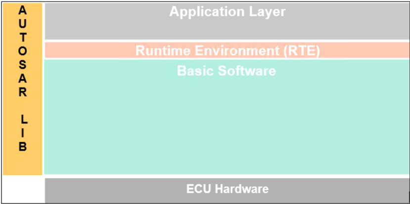
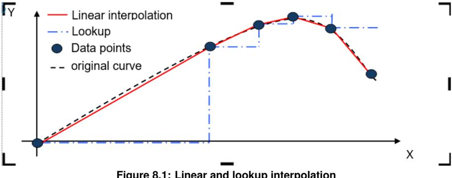

## 1. 简介和功能概述

**AUTOSAR** 库例程是 **AUTOSAR** 架构中系统服务的一部分，下图展示了 **AUTOSAR** 库在分层架构中的位置。



Ifx 例程规范规定了专用于定点值插值例程的 **AUTOSAR** 库的功能、**API** 和配置。

插值库包含以下例程：

- 分布式数据点搜索与插值（**Distributed data point search and interpolation**）
- 集成式数据点搜索与插值（**Integrated data point search and interpolation**）

所有例程都是可重入的，可以同时被多个应用程序使用。

## 2. 缩略语

下面的术语表包含了与 **IFX** 库模块相关、但未包含在 [\[1, AUTOSAR 术语表\]](#ref-1) 中的缩略语和缩写。

**Cur**
> 用于插值的曲线（**Curve for Interpolation**）。

**DET**
> 默认错误跟踪器（**Default Error Tracer**）。

**DPSearch**
> 数据点搜索（**Data point search**）。

**DPResult**
> 数据点结果（**Data point result**）。

**Ifx**
> 定点插值（**Interpolation Fixed point**）。

**IpoCur**
> 用于分布式搜索和插值的曲线插值（**Interpolation of curve used for distributed search and interpolation**）。

**LkUpCur**
> 用于分布式搜索和插值的曲线查找（**Curve look-up used for distributed search and interpolation**）。

**IpoMap**
> 用于分布式搜索和插值的映射插值（**Interpolation of map used for distributed search and interpolation**）。

**LkUpMap**
> 用于分布式搜索和插值的映射查找（**Map look-up used for distributed search and interpolation**）。

**IntIpoCur**
> 集成式曲线插值（**Integrated interpolation of curve**）。

**IntLkUpCur**
> 集成式曲线查找（**Integrated curve look-up**）。

**IntIpoFixCur**
> 集成式固定曲线插值（**Integrated interpolation of fixed curve**）。

**IntLkUpFixCur**
> 集成式固定曲线查找（**Integrated fixed curve look-up**）。

**IntIpoFixICur**
> 集成式固定区间曲线插值（**Integrated interpolation of fixed interval curve**）。

**IntLkUpFixICur**
> 集成式固定区间曲线查找（**Integrated fixed interval curve look-up**）。

**IntIpoMap**
> 集成式映射插值（**Integrated interpolation of map**）。

**IntLkUpMap**
> 集成式映射查找（**Integrated map look-up**）。

**IntIpoFixMap**
> 集成式固定映射插值（**Integrated interpolation of fixed map**）。

**IntLkUpFixMap**
> 集成式固定映射查找（**Integrated fixed map look-up**）。

**IntIpoFixIMap**
> 集成式固定区间映射插值（**Integrated interpolation of fixed interval map**）。

**IntLkUpFixIMap**
> 集成式固定区间映射查找（**Integrated fixed interval map look-up**）。

**Lib**
> 库（**Library**）。

**Map**
> 用于插值的映射（**Map for Interpolation**）。

**s8**
> **sint8** 的助记符，规定于 AUTOSAR_SWS_PlatformTypes。

**s16**
> **sint16** 的助记符，规定于 AUTOSAR_SWS_PlatformTypes。

**s32**
> **sint32** 的助记符，规定于 AUTOSAR_SWS_PlatformTypes。

**u8**
> **uint8** 的助记符，规定于 AUTOSAR_SWS_PlatformTypes。

**u16**
> **uint16** 的助记符，规定于 AUTOSAR_SWS_PlatformTypes。

**u32**
> **uint32** 的助记符，规定于 AUTOSAR_SWS_PlatformTypes。

## 3. 相关文档

### 3.1. 输入文件和相关标准与规范

<a id="ref-1"></a>[1] Glossary
> AUTOSAR_FO_TR_Glossary

<a id="ref-2"></a>[2] IFX_RecordLayout_Blueprint
> AUTOSAR_MOD_IFX_RecordLayout_Blueprint.arxml

<a id="ref-3"></a>[3] ISO/IEC 9899:1990 Programming Language - C
> https://www.iso.org

<a id="ref-4"></a>[4] ASAM MCD-2MC Version 1.6
> http://www.asam.net

<a id="ref-5"></a>[5] General Specification of Basic Software Modules
> AUTOSAR_CP_SWS_BSWGeneral

<a id="ref-6"></a>[6] Requirements on Libraries
> AUTOSAR_CP_SRS_Libraries

### 3.2. 相关规范

**AUTOSAR** 提供了基础软件模块通用规范 [\[5, SWS BSW General\]](#ref-5)，该规范同样适用于 **IFX** 库。

因此，**SWS BSW General** 规范应被视为 **IFX** 库的附加必需规范。

## 4. 约束和假设

### 4.1. 限制

无限制。

### 4.2. 汽车域的适用性

无限制。

## 5. 对其他模块的依赖

### 5.1. 文件结构

**Ifx** 模块应提供以下文件：

* **C** 文件，Ifx\_&lt;name&gt;.c，用于实现该库。所有 **C** 文件都应以「Ifx_」为前缀。

例程的实现与按 **C** 文件的分组建议按照下面描述的选项之一完成，且不强制遵循这些建议。

选项 1：&lt;Name&gt; 可以是函数名，即每个函数一个 **C** 文件，

例如：Ifx\_IntIpoMap\_u16u8\_u8.c 等。

选项 2：&lt;Name&gt; 可以是一组函数的通用名称：

* 2.1 按对象族分组：

例如：Ifx\_IpoMap.c、Ifx\_IpoCur.c、Ifx\_DPSearch.c

* 2.2 按例程族分组：

例如：Ifx\_IpoMap.c、Ifx\_IntIpoMap.c、Ifx\_IpoCur.c 等。

* 2.3 按方法族分组：

例如：Ifx\_Ipo.c、Ifx\_IntIpo.c、Ifx\_Lkup.c、Ifx\_IntLkup.c 等。

* 2.4 按体系结构分组：
* 2.5 按其他方法分组：（允许单独分组）

例如：Ifx\_IpoMap8.c、Ifx\_IpoMap16.c

选项 3：&lt;Name&gt; 可以去掉，使得单个 **C** 文件包含所有 **Ifx** 函数，例如：Ifx.c。

使用上述选项可以灵活地选择合适的粒度并减少 **C** 文件的数量。在某些选项下，按需链接也是可能的。

## 6. 功能规格

### 6.1. 错误分类（**Error Classification**）

《**General Specification of Basic Software Modules**》（基础软件模块通用规范）一文的第 7.1 节「**Error Handling**」（错误处理）详细描述了基础软件的错误处理。其中最重要的是，它构成了一个由 **BSW** 模块中可能发生的五种错误类型组成的分类方案。

在此基础上，下文按相应的小节规定了具体的错误。

#### 6.1.1. 开发错误

不存在开发错误。

#### 6.1.2. 运行时错误

不存在运行时错误。

#### 6.1.3. 瞬态故障

不存在瞬态故障。

#### 6.1.4. 生产错误

不存在生产错误。

#### 6.1.5. 扩展生产错误

不存在扩展生产错误。

### 6.2. 初始化和关闭（**Initialization and shutdown**）

**Ifx** 库不应需要初始化阶段。库函数可以在 **ECU** 初始化的第一步就被调用，例如甚至由 **OS** 或 **EcuM** 调用，因此该库应是就绪的。

**Ifx** 库不应需要关闭操作阶段。

### 6.3. 库 API 的使用（**Using Library API**）

**Ifx API** 可以从 **BSW** 模块或 **SWC** 直接调用。不需要端口定义。它是纯粹的函数调用。

语句「Ifx.h」应由开发者或应用代码生成器放置，而不是由 **RTE** 生成器放置。

库的使用应有文档记录。如果 **BSW** 模块或 **SWC** 使用了某个库，开发者应在 **BSW**/**SWC** 模板中添加一个 Implementation-DependencyOnArtifact。

minVersion 和 maxVersion 参数对应于供应商版本。对于 **AUTOSAR** 库，这些参数可以留空，因为 **SWC** 或 **BSW** 模块可能依赖于库的行为，而不是依赖于某个供应商的实现。然而，**SWC** 或 **BSW** 模块应与其所集成的 **AUTOSAR** 平台兼容。

### 6.4. 库的实现（**library implementation**）

**Ifx** 库的实现方式应使代码可以在不同内存分区中的调用者之间共享。

应避免使用宏。函数应声明为函数或内联函数。不应使用宏 #define。

库函数可以调用其他库函数，因为所有库函数都应是可重入的。库函数不得调用任何 **BSW** 模块函数，例如 **DET**。

用 **C** 编程语言编写的库应符合 **MISRA C** 标准。

更多详情请参见 SWS\_BSW\_00115。

每个 **AUTOSAR** 库模块实现 &lt;library&gt;*.c 和 &lt;library&gt;*.h 都应使用 **AUTOSAR** 内存映射机制将其代码映射到内存段。

每个 **AUTOSAR** 库模块实现 &lt;library&gt;*.c，凡使用了 **AUTOSAR** 整数数据类型和/或标准返回类型的，都应包含头文件 Std_Types.h。

所有 **AUTOSAR** 库模块都应使用 **AUTOSAR** 数据类型（整数、布尔）而不是原生 **C** 数据类型，除非该库被明确标识为仅与某个平台兼容。

所有 **AUTOSAR** 库模块都应避免直接使用编译器和平台特定的关键字，除非该库被明确标识为仅与某个平台兼容。例如 #pragma、typeof 等。

如果输入值小于第一个分布条目，则插值例程应返回或使用分布数组的第一个值。如果输入值大于最后一个分布条目，则插值例程应返回或使用分布数组的最后一个值。

传递给 Ifx 例程的轴分布应具有正常的单调序列。

插值计算中反缩放（**unscaling**）期间的中间结果应向零舍入。

## 7. API规范

### 7.1. 导入的类型

在本章中，列出了从以下模块包含的所有类型：

| 模块 | 头文件 | 导入类型 |
|---|---|---|
| Std | Std_Types.h | Std_VersionInfoType |

可以观察到，由于 **C** 语言提供的整数类型的大小是由实现定义的，因此每种整数类型可表示的值的范围在不同的实现之间会有所不同。

因此，为了提高软件的可移植性，这些类型定义在 Platform\_Types.h [AUTOSAR\_SWS\_PlatformTypes] 中。库例程名称中使用了以下助记符。

表8.1：基本类型的助记符（**Mnemonic for Base Types**）

| 大小 | 平台类型 | 助记符 | 取值范围 |
|---|---|---|---|
| 无符号 8 位 | boolean | NA | [ TRUE, FALSE ] |
| 有符号 8 位 | sint8 | s8 | [ -128, 127 ] |
| 有符号 16 位 | sint16 | s16 | [ -32768, 32767 ] |
| 有符号 32 位 | sint32 | s32 | [ -2147483648, 2147483647 ] |
| 无符号 8 位 | uint8 | u8 | [ 0, 255 ] |
| 无符号 16 位 | uint16 | u16 | [ 0, 65535 ] |
| 无符号 32 位 | uint32 | u32 | [ 0, 4294967295 ] |

作为文档其余部分的约定：

* 助记符将用于例程的名称中（&lt;InTypeMn1&gt; 表示输入的类型助记符）；
* 真实类型将用于例程原型的描述中（使用 &lt;InType&gt; 或 &lt;OutType&gt;）。

### 7.2. 类型定义

结构定义：

**Ifx_DPResultU16_Type**

结构类型（**Structure**），包含以下元素：

| 元素 | 类型 | 说明 |
|---|---|---|
| Index | uint16 | 数据点索引 |
| Ratio | uint16 | 数据点比率 |

描述：用于按索引和比率进行数据点搜索的结构。可通过 **Ifx.h** 获得。

比率（**Ratio**）的分辨率应为 2<sup>-16</sup>。

比率应向零舍入。

Ifx\_DPResultU16\_Type 结构不应由用户直接读取/写入/修改。只有 **Ifx** 例程才有权访问该结构。

### 7.3. 关于舍入的说明（**Comment about rounding**）

可应用两种舍入类型：

结果被「四舍五入」（**rounded off**），即：

- 0 &lt;= X &lt; 0.5 舍入为 0
- 0.5 &lt;= X &lt; 1 舍入为 1
- -0.5 &lt; X &lt;= 0 舍入为 0
- -1 &lt; X &lt;= -0.5 舍入为 -1

结果向零舍入：

- 0 &lt;= X &lt; 1 舍入为 0
- -1 &lt; X &lt;= 0 舍入为 0

### 7.4. 关于例程优化的说明（**Comment about routines optimization**）

#### 7.4.1. 目标优化（**Target optimization**）

本库中描述的例程可以实现为常规例程或内联函数。出于 **ROM** 优化的目的，建议将 **C** 例程实现为单独的源文件，以便按需链接。

例如，根据目标的不同，可以进行两种类型的优化：

- 某些例程可以由使用整数提升（**integer promotion**）的另一例程替换。
- 某些例程可以由限幅例程与具有不同签名的例程的组合替换。

#### 7.4.2. 例程数量的优化（**Optimization for routine numbers**）

通过交换「X」和「Y」数据类型，可以省略许多例程。使用这种方法，对于映射插值例程，可以减少例程的总数。例程数量的这种优化基于下面提到的规则进行。

- 规则 1：「X」和「Y」中较大的数据类型在前（16 位在 8 位之前）。
- 规则 2：无符号在有符号之前（u16 在 s16 之前）。
- 顺序：u32、s32、u16、s16、u8、s8。

在这种情况下，下面的例程可以被替换：

Ifx\_IntIpoMap\_s8u16\_u16

替换为

Ifx\_IntIpoMap\_u16s8\_u16

**注意：** 交换后的输入在内存中需要另一种映射值顺序，参见记录布局一节。

### 7.5. 插值例程定义（**Interpolation routines definitions**）

两个给定点之间的插值按下图所示计算。

其中：X 是输入值；

x0 = X 之前的数据点；

x1 = X 之后的数据点；

y0 = x0 处的值；

y1 = x1 处的值。

量化误差是设计使然，在实现中不应进行补偿。



有两种插值方法。

- 线性插值（**Linear interpolation**）
- 查找插值（**Lookup interpolation**）

上图区分了线性与查找集成方法。线性方法考虑两个数据点对结果进行插值，而查找插值返回条目数据点。

数据点数组可以按如下方式组合为所有元素共用的一个数组或一个结构：

一个数组包含所有元素：

```C
uint8 Curve_u8 []={5,0,10,26,36,64,1,12,17,11,6};
```

一个结构包含所有元素：

```C
struct
{
  sint16 N  = 5;
  uint8  X[] ={0,10,26,36,64};
  uint8  Y[] ={1,12,17,11,6};
} Curve_u8;
```

其中，采样数量 = 5；

X 轴分布 = 0 到 64；

Y 轴分布 = 1 到 6。

插值例程接受分开的参数以支持上述场景。下面分别给出数组和结构分组的例程调用示例。

例如：

```C
uint8 Ifx_IntIpoCur_u8_u8 (15, Curve_u8[0], &Curve_u8[1], &Curve_u8[6]);
uint8 Ifx_IntIpoCur_u8_u8 (15, Curve_u8.N, &Curve_u8.X, &Curve_u8.Y);
```

插值可以按如下两种方式计算：

1. 分布式数据点搜索与插值
2. 集成式数据点搜索与插值

#### 7.5.1. 分布式数据点搜索与插值（**Distributed data point search and interpolation**）

在这种插值方法中，数据点搜索（例如索引和比率）使用例程 Ifx\_DPSearch\_&lt;InTypeMn&gt; 计算，该例程返回结果结构 Ifx\_DPResultU16\_Type。它包含索引和比率信息。该结果可用于曲线插值、曲线查找插值、映射插值和映射查找插值。

##### 7.5.1.1. 数据点搜索（**Data Point Search**）

###### 7.5.1.1.1. Ifx_DPSearch_&lt;InTypeMn&gt;

**说明**: Ifx\_DPSearch\_&lt;InTypeMn&gt; 例程在给定的分布数组 X_array 中搜索输入 Xin 的位置，并返回插值所需的索引和比率。服务 ID 0x001 至 0x004。本服务为同步调用，可重入。参数 Xin（in）：输入值。参数 N（in）：采样数量。参数 X_array（in）：指向 X 轴分布数组的指针。参数（inout）：无。参数 dpResult（out）：指向结果结构的指针。返回值：无。可通过 **Ifx.h** 获得。

```C
void Ifx_DPSearch_<InTypeMn> ( Ifx_DPResultU16_Type* dpResult, <InType> Xin, <InType> N, const <InType>* X_array )
```

如果 (X_array[0] &lt;= Xin &lt;= X_array[N-1])，则返回的 Index 应为最小索引。

```C
dpResult->Index = index
dpResult->Ratio = (Xin - X_array[index]) / (X_array [index+1] - X_array [index])
```

如果输入值与分布数组中的某个值匹配，则返回相应的索引且比率为 0。如果 (Xin == X_array[index])，则 dpResult-&gt;Index = index，dpResult-&gt;Ratio = 0。

如果 (Xin &lt; X_array[0])，则返回数组的第一个索引且比率为 0：

```C
dpResult->Index = 0
dpResult->Ratio = 0
```

如果 (Xin &gt; X_array[N-1])，则返回数组的最后一个索引且比率为 0：

```C
dpResult->Index = N - 1
dpResult->Ratio = 0
```

N 的最小值应为 1。

本例程通过 Ifx\_DPResultU16\_Type 类型的结构返回索引和比率。

以下是已实现例程的列表：

| 服务 ID [hex] | 服务原型 |
|---|---|
| 0x001 | void Ifx_DPSearch_u8 (Ifx_DPResultU16_Type*, uint8, uint8, const uint8 *) |
| 0x002 | void Ifx_DPSearch_s8 (Ifx_DPResultU16_Type*, sint8, sint8, const sint8 *) |
| 0x003 | void Ifx_DPSearch_u16 (Ifx_DPResultU16_Type*, uint16, uint16, const uint16 * ) |
| 0x004 | void Ifx_DPSearch_s16 (Ifx_DPResultU16_Type*, sint16, sint16, const sint16 *) |
| 0x0C1 | void Ifx_DPSearch_u32 (Ifx_DPResultU16_Type* dpResult, uint32 Xin, uint32 N, const uint32 * X_array) |
| 0x0C2 | void Ifx_DPSearch_s32 (Ifx_DPResultU16_Type* dpResult, sint32 Xin, sint32 N, const sint32 * X_array) |

##### 7.5.1.2. 曲线插值（**Curve interpolation**）

###### 7.5.1.2.1. Ifx_IpoCur_&lt;OutTypeMn&gt;

**说明**: 基于搜索到的索引和比率信息，本例程计算并返回曲线的插值。服务 ID 0x005 至 0x008。本服务为同步调用，可重入。参数 dpResult（in）：数据点搜索结果。参数 Val_array（in）：指向结果轴分布数组的指针。参数（inout）：无。参数（out）：无。返回值：&lt;OutType&gt;，插值结果。可通过 **Ifx.h** 获得。

```C
<OutType> Ifx_IpoCur_<OutTypeMn> ( const Ifx_DPResultU16_Type* dpResult, const <InType>* Val_array )
```

```C
index = dpResult->Index
if dPResult->Ratio == 0
Result = Val_array[index]
else
Result = Val_array[index] + (Val_array[index+1] - Val_array[index]) * dpResult->Ratio
```

**注意：**

在缺少硬件支持的情况下，也可以使用下面提到的软件方案来避免 64 位算术运算。

```C
if (Val_array[index] <= Val_array[index+1]) then
Result = Val_array[index] + (Val_array[index+1] - Val_array[index]) * dpResult->Ratio
if (Val_array[index] > Val_array[index+1]) then
Result = Val_array[index] - (Val_array[index] - Val_array[index+1]) * dpResult->Ratio
```

在使用 Ifx_DPSearch 例程搜索轴之前，不得调用本例程。只有这样，才能确保搜索结果（Ifx\_DPResultU16\_Type）包含有效数据且不会被未初始化地使用。

以下是已实现例程的列表：

| 例程 ID [hex] | 例程原型 |
|---|---|
| 0x005 | sint8 Ifx_IpoCur_s8 (const Ifx_DPResultU16_Type*, const sint8 *) |
| 0x006 | sint16 Ifx_IpoCur_s16 (const Ifx_DPResultU16_Type*, const sint16 *) |
| 0x007 | uint16 Ifx_IpoCur_u16 (const Ifx_DPResultU16_Type*, const uint16 *) |
| 0x008 | uint8 Ifx_IpoCur_u8 (const Ifx_DPResultU16_Type*, const uint8 *) |
| 0x0C3 | uint32 Ifx_IpoCur_u32 (const Ifx_DPResultU16_Type* dpResult, const uint32* Val_array ) |
| 0x0C4 | sint32 Ifx_IpoCur_s32 (const Ifx_DPResultU16_Type* dpResult, const sint32* Val_array ) |

##### 7.5.1.3. 曲线查找（**Curve look-up**）

###### 7.5.1.3.1. Ifx_LkUpCur_&lt;OutTypeMn&gt;

**说明**: 基于搜索到的索引和比率信息，本例程计算并返回结果数组的条目点。服务 ID 0x00A 至 0x00D。本服务为同步调用，可重入。参数 dpResult（in）：数据点搜索结果。参数 Val_array（in）：指向结果轴分布数组的指针。参数（inout）：无。参数（out）：无。返回值：&lt;OutType&gt;，结果数组的条目点。可通过 **Ifx.h** 获得。

```C
<OutType> Ifx_LkUpCur_<OutTypeMn> ( const Ifx_DPResultU16_Type* dpResult, const <InType>* Val_array )
```

```C
Result = Val_array[dpResult->Index]
```

在使用 Ifx_DPSearch 例程搜索轴之前，不得调用本例程。只有这样，才能确保搜索结果（Ifx\_DPResultU16\_Type）包含有效数据且不会被未初始化地使用。

以下是已实现例程的列表：

| 例程 ID [hex] | 例程原型 |
|---|---|
| 0x00A | sint8 Ifx_LkUpCur_s8 (const Ifx_DPResultU16_Type*, const sint8 *) |
| 0x00B | sint16 Ifx_LkUpCur_s16 (const Ifx_DPResultU16_Type*, const sint16 *) |
| 0x00C | uint16 Ifx_LkUpCur_u16 (const Ifx_DPResultU16_Type*, const uint16 *) |
| 0x00D | uint8 Ifx_LkUpCur_u8 (const Ifx_DPResultU16_Type*, const uint8 *) |
| 0x0C5 | sint32 Ifx_LkUpCur_s32 (const Ifx_DPResultU16_Type* dpResult, const sint32 * Val_array) |
| 0x0C6 | uint32 Ifx_LkUpCur_u32 (const Ifx_DPResultU16_Type* dpResult, const uint32 * Val_array) |

##### 7.5.1.4. 映射插值（**Map interpolation**）

###### 7.5.1.4.1. Ifx_IpoMap_&lt;OutTypeMn&gt;

**说明**: 基于使用相关的 Ifx_DPSearch 例程搜索到的索引和比率信息，本例程计算并返回映射的插值结果。服务 ID 0x010 至 0x013。本服务为同步调用，可重入。参数 dpResultX（in）：x 轴的数据点搜索结果。参数 dpResultY（in）：y 轴的数据点搜索结果。参数 num_value（in）：y 轴点的数量。参数 Val_array（in）：指向结果轴分布数组的指针。参数（inout）：无。参数（out）：无。返回值：&lt;OutType&gt;，插值结果。可通过 **Ifx.h** 获得。

```C
<OutType> Ifx_IpoMap_<OutTypeMn> ( const Ifx_DPResultU16_Type* dpResultX, const Ifx_DPResultU16_Type* dpResultY, uint16 num_value, const <InType>* Val_array )
```

基于使用相关的 Ifx_DPSearch 例程搜索到的索引和比率信息，本例程计算并返回映射的插值结果。

```C
BaseIndex = dpResultX->Index * num_value + dpResultY->Index
if (dpResultX->Ratio == 0)
  if (dpResultY->Ratio == 0)
    Result = Val_array [BaseIndex]
  else
    LowerY = Val_array [BaseIndex]
    UpperY = Val_array [BaseIndex + 1]
    Result = LowerY + (UpperY - LowerY) * dpResultY->Ratio
else if (dpResultY->Ratio == 0)
  LowerX = Val_array[BaseIndex]
  UpperX = Val_array[BaseIndex + num_value]
  Result = LowerX + (UpperX - LowerX) * dpResultX->Ratio
else
  LowerY = Val_array [BaseIndex]
  UpperY = Val_array [BaseIndex + 1]
  LowerX = LowerY + (UpperY - LowerY) * dpResultY->Ratio
  LowerY = Val_array[BaseIndex + num_value]
  UpperY = Val_array[BaseIndex + num_value + 1]
  UpperX = LowerY + (UpperY - LowerY) * dpResultY->Ratio
  Result = LowerX + (UpperX - LowerX) * dpResultX->Ratio
```

在使用 Ifx_DPSearch 例程搜索轴之前，不得调用本例程。只有这样，才能确保搜索结果（Ifx\_DPResultU16\_Type）包含有效数据且不会被未初始化地使用。

以下是已实现例程的列表：

| 例程 ID [hex] | 例程原型 |
|---|---|
| 0x010 | uint8 Ifx_IpoMap_u8 ( const Ifx_DPResultU16_Type*, const Ifx_DPResultU16_Type*, uint16, const uint8 *) |
| 0x011 | uint16 Ifx_IpoMap_u16 ( const Ifx_DPResultU16_Type*, const Ifx_DPResultU16_Type*, uint16, const uint16 *) |
| 0x012 | sint8 Ifx_IpoMap_s8 ( const Ifx_DPResultU16_Type*, const Ifx_DPResultU16_Type*, uint16, const sint8 *) |
| 0x013 | sint16 Ifx_IpoMap_s16 ( const Ifx_DPResultU16_Type*, const Ifx_DPResultU16_Type*, uint16, const sint16 *) |
| 0x0C7 | sint32 Ifx_IpoMap_s32 ( const Ifx_DPResultU16_Type* dpResultX, const Ifx_DPResultU16_Type* dpResultY, uint16 num_value, const sint32 * Val_array) |
| 0x0C8 | uint32 Ifx_IpoMap_u32 ( const Ifx_DPResultU16_Type* dpResultX, const Ifx_DPResultU16_Type* dpResultY, uint16 num_value, const uint32 * Val_array) |

##### 7.5.1.5. 映射查找（**Map look-up**）

###### 7.5.1.5.1. Ifx_LkUpMap_&lt;OutTypeMn&gt;

**说明**: 基于搜索到的索引和比率信息，本例程计算并返回结果分布数组的条目值。服务 ID 0x015 至 0x018。本服务为同步调用，可重入。参数 dpResultX（in）：x 轴的数据点搜索结果。参数 dpResultY（in）：y 轴的数据点搜索结果。参数 num_value（in）：y 轴点的数量。参数 Val_array（in）：指向结果轴分布数组的指针。参数（inout）：无。参数（out）：无。返回值：&lt;OutType&gt;，结果数组的条目点。可通过 **Ifx.h** 获得。

```C
<OutType> Ifx_LkUpMap_<OutTypeMn> ( const Ifx_DPResultU16_Type* dpResultX, const Ifx_DPResultU16_Type* dpResultY, uint16 num_value, const <InType>* Val_array )
```

```C
BaseIndex = dpResultX->Index * num_value + dpResultY->Index
```

```C
if(dpResultX->Ratio < 0.5 && dpResultY->Ratio < 0.5) then
return Val_array [BaseIndex]
if(dpResultX->Ratio ≥ 0.5 && dpResultY->Ratio < 0.5) then
return Val_array [BaseIndex + num_value]
if(dpResultX->Ratio < 0.5 && dpResultY->Ratio ≥ 0.5) then
return Val_array [BaseIndex + 1]
if(dpResultX->Ratio ≥ 0.5 && dpResultY->Ratio ≥ 0.5) then
return Val_array [BaseIndex + num_value + 1]
```

在使用 Ifx_DPSearch 例程搜索轴之前，不得调用本例程，以确保搜索结果包含有效数据且不会被未初始化地使用。

以下是已实现例程的列表：

| 例程 ID [hex] | 例程原型 |
|---|---|
| 0x015 | uint8 Ifx_LkUpMap_u8 ( const Ifx_DPResultU16_Type*, const Ifx_DPResultU16_Type*, uint16, const uint8 *) |
| 0x016 | uint16 Ifx_LkUpMap_u16 ( const Ifx_DPResultU16_Type*, const Ifx_DPResultU16_Type*, uint16, const uint16 *) |
| 0x017 | sint8 Ifx_LkUpMap_s8 ( const Ifx_DPResultU16_Type*, const Ifx_DPResultU16_Type*, uint16, const sint8 *) |
| 0x018 | sint16 Ifx_LkUpMap_s16 ( const Ifx_DPResultU16_Type*, const Ifx_DPResultU16_Type*, uint16, const sint16 *) |
| 0x0C9 | sint32 Ifx_LkUpMap_s32 ( const Ifx_DPResultU16_Type* dpResultX, const Ifx_DPResultU16_Type* dpResultY, uint16 num_value, const sint32* Val_array) |
| 0x0CA | uint32 Ifx_LkUpMap_u32 ( const Ifx_DPResultU16_Type* dpResultX, const Ifx_DPResultU16_Type* dpResultY, uint16 num_value, const uint32* Val_array) |

##### 7.5.1.6. 不进行舍入的映射查找（**Map look-up without rounding**）

###### 7.5.1.6.1. Ifx_LkUpBaseMap_&lt;OutTypeMn&gt;

**说明**: 基于搜索到的索引和比率信息，本例程计算并返回结果分布数组的条目值。服务 ID 0x0A5 至 0x0A8。本服务为同步调用，可重入。参数 dpResultX（in）：x 轴的数据点搜索结果。参数 dpResultY（in）：y 轴的数据点搜索结果。参数 num_value（in）：y 轴点的数量。参数 Val_array（in）：指向结果轴分布数组的指针。参数（inout）：无。参数（out）：无。返回值：&lt;OutType&gt;，结果数组的条目点。可通过 **Ifx.h** 获得。

```C
<OutType> Ifx_LkUpBaseMap_<OutTypeMn> ( const Ifx_DPResultU16_Type* dpResultX, const Ifx_DPResultU16_Type* dpResultY, uint16 num_value, const <InType>* Val_array )
```

```C
BaseIndex = dpResultX->Index * num_value + dpResultY->Index
Return Value = Val_array [BaseIndex]
```

在使用 Ifx_DPSearch 例程搜索轴之前，不得调用本例程。只有这样，才能确保搜索结果（Ifx\_DPResultU16\_Type）包含有效数据且不会被未初始化地使用。

以下是已实现例程的列表：

| 例程 ID [hex] | 例程原型 |
|---|---|
| 0x0A5 | uint8 Ifx_LkUpBaseMap_u8 ( const Ifx_DPResultU16_Type*, const Ifx_DPResultU16_Type*, uint16, const uint8 *) |
| 0x0A6 | uint16 Ifx_LkUpBaseMap_u16 ( const Ifx_DPResultU16_Type*, const Ifx_DPResultU16_Type*, uint16, const uint16 *) |
| 0x0A7 | sint8 Ifx_LkUpBaseMap_s8 ( const Ifx_DPResultU16_Type*, const Ifx_DPResultU16_Type*, uint16, const sint8 *) |
| 0x0A8 | sint16 Ifx_LkUpBaseMap_s16 ( const Ifx_DPResultU16_Type*, const Ifx_DPResultU16_Type*, uint16, const sint16 *) |
| 0x0CB | sint32 Ifx_LkUpBaseMap_s32 ( const Ifx_DPResultU16_Type* dpResultX, const Ifx_DPResultU16_Type* dpResultY, uint16 num_value, const sint32* Val_array) |
| 0x0CC | uint32 Ifx_LkUpBaseMap_u32 ( const Ifx_DPResultU16_Type* dpResultX, const Ifx_DPResultU16_Type* dpResultY, uint16 num_Val, const uint32* Val_array) |

#### 7.5.2. 集成式数据点搜索与插值（**Integrated data point search and interpolation**）

在这种插值方法中，单个例程完成数据点搜索（例如索引和比率）以及曲线、映射或查找表的插值。

##### 7.5.2.1. 集成式曲线插值（**Integrated curve interpolation**）

###### 7.5.2.1.1. Ifx_IntIpoCur_&lt;InTypeMn&gt;_&lt;OutTypeMn&gt;

**说明**: 本例程使用以下等式计算曲线在位置 Xin 处的插值。服务 ID 0x01A 至 0x029。本服务为同步调用，可重入。参数 Xin（in）：输入值。参数 N（in）：采样数量。参数 X_array（in）：指向 X 轴分布数组的指针。参数 Val_array（in）：指向结果轴分布数组的指针。参数（inout）：无。参数（out）：无。返回值：&lt;OutType&gt;，插值结果。可通过 **Ifx.h** 获得。

```C
<OutType> Ifx_IntIpoCur_<InTypeMn>_<OutTypeMn> ( <InType> Xin, <InType> N, const <InType>* X_array, const <InType>* Val_array )
```

如果 (X_array[0] &lt; Xin &lt; X_array[N -1])，则

index = 满足 (Xin &lt; X_array[index + 1]) 的最小索引。

RatioX = (Xin - X_array[index]) / (X_array [index+1] - X_array [index])

```C
Result = Val_array[index] + (Val_array[index+1] - Val_array[index])*RatioX
```

如果输入值与分布数组中的某个值匹配，则结果应为该索引所指示的相应 Y 数组元素。

如果 (Xin == X_array[index])，则：

```C
Result = Val_array[index]
```

如果 (Xin &lt; X_array[0])，则：

```C
Result = Val_array[0]
```

如果 (Xin &gt; X_array[N-1])，则：

```C
Result = Val_array[N-1]
```

N 的最小值应为 1。

以下是已实现例程的列表：

| 例程 ID [hex] | 例程原型 |
|---|---|
| 0x01A | uint8 Ifx_IntIpoCur_u8_u8 ( uint8, uint8, const uint8 *, const uint8 *) |
| 0x01B | uint16 Ifx_IntIpoCur_u8_u16 ( uint8, uint8, const uint8 *, const uint16 *) |
| 0x01C | sint8 Ifx_IntIpoCur_u8_s8 ( uint8, uint8, const uint8 *, const sint8 *) |
| 0x01D | sint16 Ifx_IntIpoCur_u8_s16 ( uint8, uint8, const uint8 *, const sint16 *) |
| 0x01E | uint8 Ifx_IntIpoCur_u16_u8 ( uint16, uint16, const uint16 *, const uint8 *) |
| 0x01F | uint16 Ifx_IntIpoCur_u16_u16 ( uint16, uint16, const uint16 *, const uint16 *) |
| 0x020 | sint8 Ifx_IntIpoCur_u16_s8 ( uint16, uint16, const uint16 *, const sint8 *) |
| 0x021 | sint16 Ifx_IntIpoCur_u16_s16 ( uint16, uint16, const uint16 *, const sint16 *) |
| 0x022 | uint8 Ifx_IntIpoCur_s8_u8 ( sint8, sint8, const sint8 *, const uint8 *) |
| 0x023 | uint16 Ifx_IntIpoCur_s8_u16 ( sint8, sint8, const sint8 *, const uint16 *) |
| 0x024 | sint8 Ifx_IntIpoCur_s8_s8 ( sint8, sint8, const sint8 *, const sint8 *) |
| 0x025 | sint16 Ifx_IntIpoCur_s8_s16 ( sint8, sint8, const sint8 *, const sint16 *) |
| 0x026 | uint8 Ifx_IntIpoCur_s16_u8 ( sint16, sint16, const sint16 *, const uint8 *) |
| 0x027 | uint16 Ifx_IntIpoCur_s16_u16 ( sint16, sint16, const sint16 *, const uint16 *) |
| 0x028 | sint8 Ifx_IntIpoCur_s16_s8 ( sint16, sint16, const sint16 *, const sint8 *) |
| 0x029 | sint16 Ifx_IntIpoCur_s16_s16 ( sint16, sint16, const sint16 *, const sint16 *) |
| 0x0CD | sint32 Ifx_IntIpoCur_s32_s32 ( sint32 Xin, sint32 N, const sint32* X_array, const sint32* Val_array) |
| 0x0CE | uint32 Ifx_IntIpoCur_u32_u32 ( uint32 Xin, uint32 N, const uint32* X_array, const uint32* Val_array) |

##### 7.5.2.2. 集成式曲线查找（**Integrated curve look-up**）

###### 7.5.2.2.1. Ifx_IntLkUpCur_&lt;InTypeMn&gt;_&lt;OutTypeMn&gt;

**说明**: 本例程基于以下等式返回位置 Xin 处结果的相应条目值。服务 ID 0x030 至 0x03F。本服务为同步调用，可重入。参数 Xin（in）：输入值。参数 N（in）：采样数量。参数 X_array（in）：指向 X 轴分布数组的指针。参数 Val_array（in）：指向结果轴分布数组的指针。参数（inout）：无。参数（out）：无。返回值：&lt;OutType&gt;，结果数组的条目点。可通过 **Ifx.h** 获得。

```C
<OutType> Ifx_IntLkUpCur_<InTypeMn>_<OutTypeMn> ( <InType> Xin, <InType> N, const <InType>* X_array, const <InType>* Val_array )
```

如果 (X_array[0] &lt; Xin &lt; X_array[N -1])，则

index = 满足 (Xin &lt; X_array[index + 1]) 的最小索引。

```C
Result = Val_array[index]
```

如果输入值与分布数组中的某个值匹配，则结果应为该索引所指示的相应 Y 数组元素。

如果 (Xin == X_array[index])，则：

```C
Result = Val_array[index]
```

如果 (Xin &lt; X_array[0])，则：

```C
Result = Val_array[0]
```

如果 (Xin &gt; X_array[N-1])，则：

```C
Result = Val_array[N-1]
```

N 的最小值应为 1。

以下是已实现例程的列表：

| 例程 ID [hex] | 例程原型 |
|---|---|
| 0x030 | uint8 Ifx_IntLkUpCur_u8_u8 ( uint8 , uint8, const uint8 *, const uint8 * ) |
| 0x031 | uint16 Ifx_IntLkUpCur_u8_u16 ( uint8 , uint8, const uint8 *, const uint16 * ) |
| 0x032 | sint8 Ifx_IntLkUpCur_u8_s8 ( uint8 , uint8, const uint8 *, const sint8 * ) |
| 0x033 | sint16 Ifx_IntLkUpCur_u8_s16 ( uint8 , uint8, const uint8 *, const sint16 * ) |
| 0x034 | uint8 Ifx_IntLkUpCur_u16_u8 ( uint16 , uint16, const uint16 *, const uint8 * ) |
| 0x035 | uint16 Ifx_IntLkUpCur_u16_u16 ( uint16 , uint16, const uint16 *, const uint16 * ) |
| 0x036 | sint8 Ifx_IntLkUpCur_u16_s8 ( uint16 , uint16, const uint16 *, const sint8 * ) |
| 0x037 | sint16 Ifx_IntLkUpCur_u16_s16 ( uint16 , uint16, const uint16 *, const sint16 * ) |
| 0x038 | uint8 Ifx_IntLkUpCur_s8_u8 ( sint8 , sint8, const sint8 *, const uint8 * ) |
| 0x039 | uint16 Ifx_IntLkUpCur_s8_u16 ( sint8 , sint8, const sint8 *, const uint16 * ) |
| 0x03A | sint8 Ifx_IntLkUpCur_s8_s8 ( sint8, sint8, const sint8 *, const sint8 * ) |
| 0x03B | sint16 Ifx_IntLkUpCur_s8_s16 ( sint8, sint8, const sint8 *, const sint16 * ) |
| 0x03C | uint8 Ifx_IntLkUpCur_s16_u8 ( sint16, sint16, const sint16 *, const uint8 * ) |
| 0x03D | uint16 Ifx_IntLkUpCur_s16_u16 ( sint16, sint16, const sint16 *, const uint16 * ) |
| 0x03E | sint8 Ifx_IntLkUpCur_s16_s8 ( sint16, sint16, const sint16 *, const sint8 * ) |
| 0x03F | sint16 Ifx_IntLkUpCur_s16_s16 ( sint16, sint16, const sint16 *, const sint16 * ) |
| 0x0CF | sint32 Ifx_IntLkUpCur_s32_s32 ( sint32 Xin, sint32 N, const sint32* X_array, const sint32* Val_array ) |
| 0x0D0 | uint32 Ifx_IntLkUpCur_u32_u32 ( uint32 Xin, uint32 N, const uint32* X_array, const uint32* Val_array ) |

##### 7.5.2.3. 集成式固定曲线插值（**Integrated fix-curve interpolation**）

###### 7.5.2.3.1. Ifx_IntIpoFixCur_&lt;InTypeMn&gt;_&lt;OutTypeMn&gt;

**说明**: 本例程使用以下等式计算曲线在位置 Xin 处的插值。服务 ID 0x040 至 0x043。本服务为同步调用，可重入。参数 Xin（in）：输入值。参数 N（in）：采样数量。参数 Val_array（in）：指向结果轴分布数组的指针。参数 Offset（in）：X 轴第一个采样值的偏移。参数 Shift（in）：「Shift」是 2 的幂，(2<sup>Shift</sup>) 表示 X 轴分布点间隔。参数（inout）：无。参数（out）：无。返回值：&lt;OutType&gt;，插值结果。可通过 **Ifx.h** 获得。

```C
<OutType> Ifx_IntIpoFixCur_<InTypeMn>_<OutTypeMn> ( <InType> Xin, <InType> N, const <InType>* Val_array, <InType> Offset, <InType> Shift )
```

X 轴分布点应根据 Offset 和 Shift 值计算。

X\_array [index] = Offset + index * 2<sup>Shift</sup>

如果 Offset = 10、Shift = 2 且 N = 5，则：

X\_array[\[5\]](#ref-5) = {10, 14, 18, 22, 26}。

如果 (X_array[0] &lt; Xin &lt; X_array[N -1])，则

index = 满足 (Xin &lt; X_array[index + 1]) 的最小索引。

RatioX = (Xin - X_array[index]) / (X_array [index+1] - X_array [index])

```C
Result = Val_array[index] + (Val_array[index+1] - Val_array[index]) * RatioX
```

如果输入值与分布数组中的某个值匹配，则结果应为该索引所指示的相应 Y 数组元素。

如果 (Xin == X_array[index])：

```C
Result = Val_array[index]
```

如果 (Xin &lt; X_array[0])，则：

```C
Result = Val_array[0]
```

如果 (Xin &gt; X_array[N-1])，则：

```C
Result = Val_array[N-1]
```

N 的最小值应为 1。

以下是已实现例程的列表：

| 例程 ID [hex] | 例程原型 |
|---|---|
| 0x040 | uint8 Ifx_IntIpoFixCur_u8_u8 ( uint8, uint8, const uint8 *, uint8, uint8) |
| 0x041 | uint16 Ifx_IntIpoFixCur_u16_u16 (uint16, uint16, const uint16 *, uint16, uint16) |
| 0x042 | sint8 Ifx_IntIpoFixCur_s8_s8 ( sint8, sint8, const sint8 *, sint8, sint8) |
| 0x043 | sint16 Ifx_IntIpoFixCur_s16_s16 ( sint16, sint16, const sint16 *, sint16, sint16) |
| 0x0D1 | sint32 Ifx_IntIpoFixCur_s32_s32 ( sint32 Xin, sint32 N, const sint32* Val_array, sint32 offset, sint32 shift) |
| 0x0D2 | uint32 Ifx_IntIpoFixCur_u32_u32 ( uint32 Xin, uint32 N, const uint32* Val_array, uint32 offset, uint32 shift) |

##### 7.5.2.4. 集成式固定曲线查找（**Integrated fix-curve look up**）

###### 7.5.2.4.1. Ifx_IntLkUpFixCur_&lt;InTypeMn&gt;_&lt;OutTypeMn&gt;

**说明**: 本例程基于以下等式返回位置 Xin 处结果分布数组的相应条目值。服务 ID 0x045 至 0x048。本服务为同步调用，可重入。参数 Xin（in）：输入值。参数 N（in）：采样数量。参数 Val_array（in）：指向结果轴分布数组的指针。参数 Offset（in）：X 轴第一个采样值的偏移。参数 Shift（in）：「Shift」是 2 的幂，(2<sup>Shift</sup>) 表示 X 轴分布点间隔。参数（inout）：无。参数（out）：无。返回值：&lt;OutType&gt;，结果数组的条目点。可通过 **Ifx.h** 获得。

```C
<OutType> Ifx_IntLkUpFixCur_<InTypeMn>_<OutTypeMn> ( <InType> Xin, <InType> N, const <InType>* Val_array, <InType> Offset, <InType> Shift )
```

X 轴分布点应根据 Offset 和 Shift 值计算。

X\_array [index] = Offset + index * 2<sup>Shift</sup>

如果 Offset = 10、Shift = 2 且 N = 5，则：

X\_array[\[5\]](#ref-5) = {10, 14, 18, 22, 26}。

如果 (X_array[0] &lt; Xin &lt; X_array[N -1])，则

index = 满足 (Xin &lt; X_array[index + 1]) 的最小索引。

```C
Result = Val_array[index]
```

如果输入值与分布数组中的某个值匹配，则结果应为该索引所指示的相应 Y 数组元素。

如果 (Xin == X_array[index])，则：

```C
Result = Val_array[index]
```

如果 (Xin &lt; X_array[0])，则：

```C
Result = Val_array[0]
```

如果 (Xin &gt; X_array[N-1])，则：

```C
Result = Val_array[N-1]
```

N 的最小值应为 1。

以下是已实现例程的列表：

| 例程 ID [hex] | 例程原型 |
|---|---|
| 0x045 | uint8 Ifx_IntLkUpFixCur_u8_u8 (uint8, uint8, const uint8 *, uint8, uint8) |
| 0x046 | uint16 Ifx_IntLkUpFixCur_u16_u16 (uint16, uint16, const uint16 *, uint16, uint16) |
| 0x047 | sint8 Ifx_IntLkUpFixCur_s8_s8 (sint8, sint8, const sint8 *, sint8, sint8) |
| 0x048 | sint16 Ifx_IntLkUpFixCur_s16_s16 (sint16, sint16, const sint16 *, sint16, sint16) |
| 0x0D3 | sint32 Ifx_IntLkUpFixCur_s32_s32 (sint32 Xin, sint32 N, const sint32* Val_array, sint32 offset, sint32 shift) |
| 0x0D4 | uint32 Ifx_IntLkUpFixCur_u32_u32 (uint32 Xin, uint32 N, const uint32* Val_array, uint32 offset, uint32 shift) |

##### 7.5.2.5. 集成式固定区间曲线插值（**Integrated fix- I curve interpolation**）

###### 7.5.2.5.1. Ifx_IntIpoFixICur_&lt;InTypeMn&gt;_&lt;OutTypeMn&gt;

**说明**: 本例程使用以下等式计算曲线在位置 Xin 处的插值。服务 ID 0x04A 至 0x04D。本服务为同步调用，可重入。参数 Xin（in）：输入值。参数 N（in）：采样数量。参数 Val_array（in）：指向结果轴分布数组的指针。参数 Offset（in）：X 轴第一个采样值的偏移。参数 Interval（in）：表示 X 轴分布点的固定区间。参数（inout）：无。参数（out）：无。返回值：&lt;OutType&gt;，插值结果。可通过 **Ifx.h** 获得。

```C
<OutType> Ifx_IntIpoFixICur_<InTypeMn>_<OutTypeMn> ( <InType> Xin, <InType> N, const <InType>* Val_array, <InType> Offset, <InType> Interval )
```

X 轴分布点应根据 Offset 和 Interval 值计算。

X\_array [index] = offset + index * Interval

如果 Offset = 5、Interval = 12 且 N = 5，则：

X\_array[\[5\]](#ref-5) = {5, 17, 29, 41, 53}。

如果 (X_array[0] &lt; Xin &lt; X_array[N -1])，则

index = 满足 (Xin &lt; X_array[index + 1]) 的最小索引。

RatioX = (Xin - X_array[index]) / (X_array [index+1] - X_array [index])

```C
Result = Val_array[index] + (Val_array[index+1] - Val_array[index]) * RatioX
```

如果输入值与分布数组中的某个值匹配，则结果应为该索引所指示的相应 Y 数组元素。

如果 (Xin == X_array[index])：

```C
Result = Val_array[index]
```

如果 (Xin &lt; X_array[0])，则：

```C
Result = Val_array[0]
```

如果 (Xin &gt; X_array[N-1])，则：

```C
Result = Val_array[N-1]
```

N 的最小值应为 1。

以下是已实现例程的列表：

| 例程 ID [hex] | 例程原型 |
|---|---|
| 0x04A | uint8 Ifx_IntIpoFixICur_u8_u8 ( uint8, uint8, const uint8 *, uint8, uint8) |
| 0x04B | uint16 Ifx_IntIpoFixICur_u16_u16 (uint16, uint16, const uint16 *, uint16, uint16) |
| 0x04C | sint8 Ifx_IntIpoFixICur_s8_s8 ( sint8, sint8, const sint8 *, sint8, sint8) |
| 0x04D | sint16 Ifx_IntIpoFixICur_s16_s16 ( sint16, sint16, const sint16 *, sint16, sint16) |
| 0x0D5 | sint32 Ifx_IntIpoFixICur_s32_s32 ( sint32 Xin, sint32 N, const sint32 * Val_array, sint32 offset, sint32 Interval) |
| 0x0D6 | uint32 Ifx_IntIpoFixICur_u32_u32 ( uint32 Xin, uint32 N, const uint32 * Val_array, uint32 offset, uint32 Interval) |

##### 7.5.2.6. 集成式固定区间曲线查找（**Integrated fix- I curve look up**）

###### 7.5.2.6.1. Ifx_IntLkUpFixICur_&lt;InTypeMn&gt;_&lt;OutTypeMnt&gt;

**说明**: 本例程基于以下等式返回位置 Xin 处结果分布数组的相应条目值。服务 ID 0x050 至 0x053。本服务为同步调用，可重入。参数 Xin（in）：输入值。参数 N（in）：采样数量。参数 Val_array（in）：指向结果轴分布数组的指针。参数 Offset（in）：X 轴第一个采样值的偏移。参数 Interval（in）：表示 X 轴分布点的固定区间。参数（inout）：无。参数（out）：无。返回值：&lt;OutType&gt;，结果数组的条目点。可通过 **Ifx.h** 获得。

```C
<OutType> Ifx_IntLkUpFixICur_<InTypeMn>_<OutTypeMnt> ( <InType> Xin, <InType> N, const <InType>* Val_array, <InType> Offset, <InType> Interval )
```

X 轴分布点应根据 Offset 和 Interval 值计算。

X\_array [index] = offset + index * Interval

如果 Offset = 5、Interval = 12 且 N = 5，则：

X\_array[\[5\]](#ref-5) = {5, 17, 29, 41, 53}。

如果 (X_array[0] &lt; Xin &lt; X_array[N -1])，则

index = 满足 (Xin &lt; X_array[index + 1]) 的最小索引。

```C
Result = Val_array[index]
```

如果输入值与分布数组中的某个值匹配，则结果应为该索引所指示的相应 Y 数组元素。

如果 (Xin == X_array[index])：

```C
Result = Val_array[index]
```

如果 (Xin &lt; X_array[0])，则：

```C
Result = Val_array[0]
```

如果 (Xin &gt; X_array[N-1])，则：

```C
Result = Val_array[N-1]
```

N 的最小值应为 1。

以下是已实现例程的列表：

| 例程 ID [hex] | 例程原型 |
|---|---|
| 0x050 | uint8 Ifx_IntLkUpFixICur_u8_u8 ( uint8, uint8, const uint8 *, uint8, uint8) |
| 0x051 | uint16 Ifx_IntLkUpFixICur_u16_u16 (uint16, uint16, const uint16 *, uint16, uint16) |
| 0x052 | sint8 Ifx_IntLkUpFixICur_s8_s8 ( sint8, sint8, const sint8 *, sint8, sint8) |
| 0x053 | sint16 Ifx_IntLkUpFixICur_s16_s16 ( sint16, sint16, const sint16 *, sint16, sint16) |
| 0x0D7 | sint32 Ifx_IntLkUpFixICur_s32_s32 ( sint32 Xin, sint32 N, const sint32 * Val_array, sint32 offset, sint32 Interval) |
| 0x0D8 | uint32 Ifx_IntLkUpFixICur_u32_u32 ( uint32 Xin, uint32 N, const uint32 * Val_array, uint32 offset, uint32 Interval) |

##### 7.5.2.7. 集成式映射插值（**Integrated map interpolation**）

###### 7.5.2.7.1. Ifx_IntIpoMap_&lt;InTypeMn&gt;&lt;InTypeMn&gt;_&lt;OutTypeMn&gt;

**说明**: 本例程使用以下等式计算映射在位置 X 和 Y 处的插值。服务 ID 0x060 至 0x087。本服务为同步调用，可重入。参数 Xin（in）：X 轴的输入值。参数 Yin（in）：Y 轴的输入值。参数 Nx（in）：X 轴采样数量。参数 Ny（in）：Y 轴采样数量。参数 X_array（in）：指向 X 轴分布数组的指针。参数 Y_array（in）：指向 Y 轴分布数组的指针。参数 Val_array（in）：指向结果轴分布数组的指针。参数（inout）：无。参数（out）：无。返回值：&lt;OutType&gt;，映射插值结果。可通过 **Ifx.h** 获得。

```C
<OutType> Ifx_IntIpoMap_<InTypeMn><InTypeMn>_<OutTypeMn> ( <InType> Xin, <InType> Yin, <InType> Nx, <InType> Ny, const <InType>* X_array, const <InType>* Y_array, const <InType>* Val_array )
```

索引计算：

```C
indexX = minimum value of index if (X_array[indexX] < Xin < X_array[indexX+1])
indexY = minimum value of index if (Y_array[indexY] < Yin < Y_array[indexY+1])
BaseIndex = IndexX * Ny + indexY
```

比率计算：

```C
RatioX = (Xin - X_array[indexX]) / (X_array [indexX+1] - X_array [indexX])
RatioY = (Yin - Y_array[indexY]) / (Y_array [indexY+1] - Y_array [indexY])
```

```C
LowerY = Val_array [BaseIndex]
UpperY = Val_array [BaseIndex + 1]
LowerX = LowerY + (UpperY - LowerY) * RatioY
LowerY = Val_array [BaseIndex + Ny]
UpperY = Val_array [BaseIndex + Ny + 1]
UpperX = LowerY + (UpperY - LowerY) * RatioY
Result = LowerX + (UpperX - LowerX) * RatioX
```

如果 (Xin == X_array[indexX]) 且 (Y_array[indexY] &lt; Yin &lt; Y_array[indexY+1])：

```C
Result = Val_array [BaseIndex] + (Val_array [BaseIndex+1] - Val_array[BaseIndex]) * RatioY
```

如果 (Yin == Y_array[indexY]) 且 (X_array[indexX] &lt; Xin &lt; X_array[indexX+1])：

```C
Result = Val_array [BaseIndex] + (Val_array [BaseIndex+Ny] - Val_array[BaseIndex]) * RatioX
```

如果 (Xin == X_array[indexX]) 且 (Yin == Y_array[indexY])：

```C
Result = Val_array [BaseIndex]
```

如果 Xin &lt; X_array[0]，则 indexX = 0，RatioX = 0。

如果 Xin &gt; X_array[Nx-1]，则 indexX = Nx - 1，RatioX = 0。

如果 Yin &lt; Y_array[0]，则 indexY = 0，RatioY = 0。

如果 Yin &gt; Y_array[Ny-1]，则 indexY = Ny - 1，RatioY = 0。

Nx 和 Ny 的最小值应为 1。

以下是已实现例程的列表：

| 例程 ID [hex] | 例程原型 |
|---|---|
| 0x060 | uint8 Ifx_IntIpoMap_u16u8_u8 (uint16, uint8, uint16, uint16, const uint16 *, const uint8 *, const uint8 * ) |
| 0x061 | uint16 Ifx_IntIpoMap_u16u8_u16 (uint16, uint8, uint16, uint16, const uint16 *, const uint8 *, const uint16 * ) |
| 0x062 | sint8 Ifx_IntIpoMap_u16u8_s8 (uint16, uint8, uint16, uint16, const uint16 *, const uint8 *, const sint8 * ) |
| 0x063 | sint16 Ifx_IntIpoMap_u16u8_s16 (uint16, uint8, uint16, uint16, const uint16 *, const uint8 *, const sint16 * ) |
| 0x064 | uint8 Ifx_IntIpoMap_u16u16_u8 (uint16, uint16, uint16, uint16, const uint16 *, const uint16 *, const uint8 * ) |
| 0x065 | uint16 Ifx_IntIpoMap_u16u16_u16 (uint16, uint16, uint16, uint16, const uint16 *, const uint16 *, const uint16 * ) |
| 0x066 | sint8 Ifx_IntIpoMap_u16u16_s8 (uint16, uint16, uint16, uint16, const uint16 *, const uint16 *, const sint8 * ) |
| 0x067 | sint16 Ifx_IntIpoMap_u16u16_s16 (uint16, uint16, uint16, uint16, const uint16 *, const uint16 *, const sint16 * ) |
| 0x068 | uint8 Ifx_IntIpoMap_u16s8_u8 (uint16, sint8, uint16, uint16, const uint16 *, const sint8 *, const uint8 * ) |
| 0x069 | uint16 Ifx_IntIpoMap_u16s8_u16 (uint16, sint8, uint16, uint16, const uint16 *, const sint8 *, const uint16 * ) |
| 0x06A | sint8 Ifx_IntIpoMap_u16s8_s8 (uint16, sint8, uint16, uint16, const uint16 *, const sint8 *, const sint8 * ) |
| 0x06B | sint16 Ifx_IntIpoMap_u16s8_s16 (uint16, sint8, uint16, uint16, const uint16 *, const sint8 *, const sint16 * ) |
| 0x06C | uint8 Ifx_IntIpoMap_u16s16_u8 (uint16, sint16, uint16, uint16, const uint16 *, const sint16 *, const uint8 * ) |
| 0x06D | uint16 Ifx_IntIpoMap_u16s16_u16 (uint16, sint16, uint16, uint16, const uint16 *, const sint16 *, const uint16 * ) |
| 0x06E | sint8 Ifx_IntIpoMap_u16s16_s8 (uint16, sint16, uint16, uint16, const uint16 *, const sint16 *, const sint8 * ) |
| 0x06F | sint16 Ifx_IntIpoMap_u16s16_s16 (uint16, sint16, uint16, uint16, const uint16 *, const sint16 *, const sint16 * ) |
| 0x070 | uint8 Ifx_IntIpoMap_s16u8_u8 (sint16, uint8, sint16, sint16, const sint16 *, const uint8 *, const uint8 * ) |
| 0x071 | uint16 Ifx_IntIpoMap_s16u8_u16 (sint16, uint8, sint16, sint16, const sint16 *, const uint8 *, const uint16 * ) |
| 0x072 | sint8 Ifx_IntIpoMap_s16u8_s8 (sint16, uint8, sint16, sint16, const sint16 *, const uint8 *, const sint8 * ) |
| 0x073 | sint16 Ifx_IntIpoMap_s16u8_s16 (sint16, uint8, sint16, sint16, const sint16 *, const uint8 *, const sint16 * ) |
| 0x074 | uint8 Ifx_IntIpoMap_s16s8_u8 (sint16, sint8, sint16, sint16, const sint16 *, const sint8 *, const uint8 * ) |
| 0x075 | uint16 Ifx_IntIpoMap_s16s8_u16 (sint16, sint8, sint16, sint16, const sint16 *, const sint8 *, const uint16 * ) |
| 0x076 | sint8 Ifx_IntIpoMap_s16s8_s8 (sint16, sint8, sint16, sint16, const sint16 *, const sint8 *, const sint8 * ) |
| 0x077 | sint16 Ifx_IntIpoMap_s16s8_s16 (sint16, sint8, sint16, sint16, const sint16 *, const sint8 *, const sint16 * ) |
| 0x078 | uint8 Ifx_IntIpoMap_s16s16_u8 (sint16, sint16, sint16, sint16, const sint16 *, const sint16 *, const uint8 * ) |
| 0x079 | uint16 Ifx_IntIpoMap_s16s16_u16 (sint16, sint16, sint16, sint16, const sint16 *, const sint16 *, const uint16 * ) |
| 0x07A | sint8 Ifx_IntIpoMap_s16s16_s8 (sint16, sint16, sint16, sint16, const sint16 *, const sint16 *, const sint8 * ) |
| 0x07B | sint16 Ifx_IntIpoMap_s16s16_s16 (sint16, sint16, sint16, sint16, const sint16 *, const sint16 *, const sint16 * ) |
| 0x07C | uint8 Ifx_IntIpoMap_u8u8_u8 (uint8, uint8, uint8, uint8, const uint8 *, const uint8 *, const uint8 * ) |
| 0x07D | uint16 Ifx_IntIpoMap_u8u8_u16 (uint8, uint8, uint8, uint8, const uint8 *, const uint8 *, const uint16 * ) |
| 0x07E | sint8 Ifx_IntIpoMap_u8u8_s8 (uint8, uint8, uint8, uint8, const uint8 *, const uint8 *, const sint8 * ) |
| 0x07F | sint16 Ifx_IntIpoMap_u8u8_s16 (uint8, uint8, uint8, uint8, const uint8 *, const uint8 *, const sint16 * ) |
| 0x080 | uint8 Ifx_IntIpoMap_u8s8_u8 (uint8, sint8, uint8, uint8, const uint8 *, const sint8 *, const uint8 * ) |
| 0x081 | uint16 Ifx_IntIpoMap_u8s8_u16 (uint8, sint8, uint8, uint8, const uint8 *, const sint8 *, const uint16 * ) |
| 0x082 | sint8 Ifx_IntIpoMap_u8s8_s8 (uint8, sint8, uint8, uint8, const uint8 *, const sint8 *, const sint8 * ) |
| 0x083 | sint16 Ifx_IntIpoMap_u8s8_s16 (uint8, sint8, uint8, uint8, const uint8 *, const sint8 *, const sint16 * ) |
| 0x084 | uint8 Ifx_IntIpoMap_s8s8_u8 (sint8, sint8, sint8, sint8, const sint8 *, const sint8 *, const uint8 * ) |
| 0x085 | uint16 Ifx_IntIpoMap_s8s8_u16 (sint8, sint8, sint8, sint8, const sint8 *, const sint8 *, const uint16 * ) |
| 0x086 | sint8 Ifx_IntIpoMap_s8s8_s8 (sint8, sint8, sint8, sint8, const sint8 *, const sint8 *, const sint8 * ) |
| 0x087 | sint16 Ifx_IntIpoMap_s8s8_s16 (sint8, sint8, sint8, sint8, const sint8 *, const sint8 *, const sint16 * ) |
| 0x0D9 | sint32 Ifx_IntIpoMap_s32s32_s32 (sint32 Xin, sint32 Yin, sint32 Nx, sint32 Ny, const sint32 * X_array, const sint32 * Y_array, const sint32 * Val_array) |
| 0x0DA | uint32 Ifx_IntIpoMap_u32u32_u32 (uint32 Xin, uint32 Yin, uint32 Nx, uint32 Ny, const uint32 * X_array, const uint32 * Y_array, const uint32 * Val_array) |

##### 7.5.2.8. 集成式映射查找（**Integrated map look-up**）

###### 7.5.2.8.1. Ifx_IntLkUpMap_&lt;InTypeMn&gt;&lt;InTypeMn&gt;_&lt;OutTypeMn&gt;

**说明**: 本例程基于以下等式返回位置 Xin 和 Yin 处结果分布数组的相应条目值。服务 ID 0x08A 至 0x08D。本服务为同步调用，可重入。参数 Xin（in）：X 轴的输入值。参数 Yin（in）：Y 轴的输入值。参数 Nx（in）：X 轴采样数量。参数 Ny（in）：Y 轴采样数量。参数 X_array（in）：指向 X 轴分布数组的指针。参数 Y_array（in）：指向 Y 轴分布数组的指针。参数 Val_array（in）：指向结果轴分布数组的指针。参数（inout）：无。参数（out）：无。返回值：&lt;OutType&gt;，结果数组的条目点。可通过 **Ifx.h** 获得。

```C
<OutType> Ifx_IntLkUpMap_<InTypeMn><InTypeMn>_<OutTypeMn> ( <InType> Xin, <InType> Yin, <InType> Nx, <InType> Ny, const <InType>* X_array, const <InType>* Y_array, const <InType>* Val_array )
```

索引计算：

```C
indexX = minimum value of index if (X_array[indexX] < Xin < X_array[indexX+1])
indexY = minimum value of index if (Y_array[indexY] < Yin < Y_array[indexY+1])
BaseIndex = IndexX * Ny + indexY
```

比率计算：

```C
if (indexX < (Nx - 1))
RatioX = (Xin - X_array[indexX]) / (X_array [indexX+1] - X_array [indexX])
else
RatioX = 0
if (indexY < (Ny - 1))
RatioY = (Yin - Y_array[indexY]) / (Y_array [indexY+1] - Y_array [indexY])
else
RatioY = 0
```

```C
if(RatioX < 0.5 && RatioY < 0.5) then Result = Val_array [BaseIndex]
if(RatioX ≥ 0.5 && RatioY < 0.5) then Result = Val_array [BaseIndex + Ny]
if(RatioX < 0.5 && RatioY ≥ 0.5) then Result = Val_array [BaseIndex + 1]
if(RatioX ≥ 0.5 && RatioY ≥ 0.5) then Result = Val_array [BaseIndex + Ny + 1]
```

如果 (Xin == X_array[indexX]) 且 (Yin == Y_array[indexY])：

```C
Result = Val_array [BaseIndex]
```

如果 Xin &lt; X_array[0]，则 indexX = 0。

如果 Xin &gt; X_array[Nx-1]，则 indexX = Nx - 1。

如果 Yin &lt; Y_array[0]，则 indexY = 0。

如果 Yin &gt; Y_array[Ny-1]，则 indexY = Ny - 1。

Nx 和 Ny 的最小值应为 1。

以下是已实现例程的列表：

| 例程 ID [hex] | 例程原型 |
|---|---|
| 0x08A | uint8 Ifx_IntLkUpMap_u8u8_u8(uint8, uint8, uint8, uint8, const uint8 *, const uint8 *, const uint8 *) |
| 0x08B | sint8 Ifx_IntLkUpMap_s8s8_s8 (sint8, sint8, sint8, sint8, const sint8 *, const sint8 *, const sint8 *) |
| 0x08C | uint16 Ifx_IntLkUpMap_u16u16_u16 (uint16, uint16, uint16, uint16, const uint16 *, const uint16 *, const uint16 *) |
| 0x08D | sint16 Ifx_IntLkUpMap_s16s16_s16 (sint16, sint16, sint16, sint16, const sint16 *, const sint16 *, const sint16 *) |
| 0x0DB | sint32 Ifx_IntLkUpMap_s32s32_s32 (sint32 Xin, sint32 Yin, sint32 Nx, sint32 Ny, const sint32 * X_array, const sint32 * Y_array, const sint32 * Val_array) |
| 0x0DC | uint32 Ifx_IntLkUpMap_u32u32_u32 (uint32 Xin, uint32 Yin, uint32 Nx, uint32 Ny, const uint32 * X_array, const uint32 * Y_array, const uint32 * Val_array) |

##### 7.5.2.9. 不进行舍入的集成式映射查找（**Integrated map look-up without rounding**）

###### 7.5.2.9.1. Ifx_IntLkUpBaseMap_&lt;InTypeMn&gt;&lt;InTypeMn&gt;_&lt;OutTypeMn&gt;

**说明**: 本例程基于以下等式返回位置 Xin 和 Yin 处结果分布数组的相应条目值。服务 ID 0x0AA 至 0x0AD。本服务为同步调用，可重入。参数 Xin（in）：X 轴的输入值。参数 Yin（in）：Y 轴的输入值。参数 Nx（in）：X 轴采样数量。参数 Ny（in）：Y 轴采样数量。参数 X_array（in）：指向 X 轴分布数组的指针。参数 Y_array（in）：指向 Y 轴分布数组的指针。参数 Val_array（in）：指向结果轴分布数组的指针。参数（inout）：无。参数（out）：无。返回值：&lt;OutType&gt;，结果数组的条目点。可通过 **Ifx.h** 获得。

```C
<OutType> Ifx_IntLkUpBaseMap_<InTypeMn><InTypeMn>_<OutTypeMn> ( <InType> Xin, <InType> Yin, <InType> Nx, <InType> Ny, const <InType>* X_array, const <InType>* Y_array, const <InType>* Val_array )
```

索引计算：

```C
indexX = minimum value of index if (X_array[indexX] < Xin < X_array[indexX+1])
indexY = minimum value of index if (Y_array[indexY] < Yin < Y_array[indexY+1])
BaseIndex = IndexX * Ny + indexY
```

```C
Return Value = Val_array [BaseIndex]
```

如果 (Xin == X_array[indexX]) 且 (Yin == Y_array[indexY])：

```C
Result = Val_array [BaseIndex]
```

如果 Xin &lt; X_array[0]，则 indexX = 0。

如果 Xin &gt; X_array[Nx-1]，则 indexX = Nx - 1。

如果 Yin &lt; Y_array[0]，则 indexY = 0。

如果 Yin &gt; Y_array[Ny-1]，则 indexY = Ny - 1。

Nx 和 Ny 的最小值应为 1。

以下是已实现例程的列表：

| 例程 ID [hex] | 例程原型 |
|---|---|
| 0x0AA | uint8 Ifx_IntLkUpBaseMap_u8u8_u8(uint8, uint8, uint8, uint8, const uint8 *, const uint8 *, const uint8 *) |
| 0x0AB | sint8 Ifx_IntLkUpBaseMap_s8s8_s8 (sint8, sint8, sint8, sint8, const sint8 *, const sint8 *, const sint8 *) |
| 0x0AC | uint16 Ifx_IntLkUpBaseMap_u16u16_u16 (uint16, uint16, uint16, uint16, const uint16 *, const uint16 *, const uint16 *) |
| 0x0AD | sint16 Ifx_IntLkUpBaseMap_s16s16_s16 (sint16, sint16, sint16, sint16, const sint16 *, const sint16 *, const sint16 *) |
| 0x0DD | sint32 Ifx_IntLkUpBaseMap_s32s32_s32 (sint32 Xin, sint32 Yin, sint32 Nx, sint32 Ny, const sint32 * X_array, const sint32 * Y_array, const sint32 * Val_array) |
| 0x0DE | uint32 Ifx_IntLkUpBaseMap_u32u32_u32 (uint32 Xin, uint32 Yin, uint32 Nx, uint32 Ny, const uint32 * X_array, const uint32 * Y_array, const uint32 * Val_array) |

##### 7.5.2.10. 集成式固定映射插值（**Integrated fix- map interpolation**）

###### 7.5.2.10.1. Ifx_IntIpoFixMap_&lt;InTypeMn&gt;&lt;InTypeMn&gt;_&lt;OutTypeMn&gt;

**说明**: 本例程使用以下等式计算映射在位置 X 和 Y 处的插值。服务 ID 0x090 至 0x093。本服务为同步调用，可重入。参数 Xin（in）：X 轴的输入值。参数 Yin（in）：Y 轴的输入值。参数 Nx（in）：X 轴采样数量。参数 Ny（in）：Y 轴采样数量。参数 Val_array（in）：指向结果轴分布数组的指针。参数 OffsetX（in）：X 轴第一个采样值的偏移。参数 ShiftX（in）：「Shift」是 2 的幂，(2<sup>ShiftX</sup>) 表示 X 轴分布点间隔。参数 OffsetY（in）：Y 轴第一个采样值的偏移。参数 ShiftY（in）：「Shift」是 2 的幂，(2<sup>ShiftY</sup>) 表示 Y 轴分布点间隔。参数（inout）：无。参数（out）：无。返回值：&lt;OutType&gt;，插值结果。可通过 **Ifx.h** 获得。

```C
<OutType> Ifx_IntIpoFixMap_<InTypeMn><InTypeMn>_<OutTypeMn> ( <InType> Xin, <InType> Yin, <InType> Nx, <InType> Ny, const <InType>* Val_array, <InType> OffsetX, <InType> ShiftX, <InType> OffsetY, <InType> ShiftY )
```

X 轴和 Y 轴分布点应根据 Offset 和 Shift 值计算。

```C
X_array[index] = OffsetX + index * 2^ShiftX
Y_array[index] = OffsetY + index * 2^ShiftY
```

如果 Offset = 10、Shift = 2 且 N = 5，则 axis = {10, 14, 18, 22, 26}（适用于 X 轴和 Y 轴）。

索引计算：

```C
indexX = minimum value of index if (X_array[indexX] < Xin < X_array[indexX+1])
indexY = minimum value of index if (Y_array[indexY] < Yin < Y_array[indexY+1])
BaseIndex = IndexX * Ny + indexY
```

比率计算：

```C
RatioX = (Xin - X_array[indexX]) / (X_array [indexX+1] - X_array [indexX])
RatioY = (Yin - Y_array[indexY]) / (Y_array [indexY+1] - Y_array [indexY])
```

```C
LowerY = Val_array [BaseIndex]
UpperY = Val_array [BaseIndex + 1]
LowerX = LowerY + (UpperY - LowerY) * RatioY
LowerY = Val_array [BaseIndex + Ny]
UpperY = Val_array [BaseIndex + Ny + 1]
UpperX = LowerY + (UpperY - LowerY) * RatioY
Result = LowerX + (UpperX - LowerX) * RatioX
```

如果 (Xin == X_array[indexX]) 且 (Y_array[indexY] &lt; Yin &lt; Y_array[indexY+1])：

```C
Result = Val_array [BaseIndex] + (Val_array [BaseIndex+1] - Val_array[BaseIndex]) * RatioY
```

如果 (Yin == Y_array[indexY]) 且 (X_array[indexX] &lt; Xin &lt; X_array[indexX+1])：

```C
Result = Val_array [BaseIndex] + (Val_array [BaseIndex+Ny] - Val_array[BaseIndex]) * RatioX
```

如果 (Xin == X_array[indexX]) 且 (Yin == Y_array[indexY])：

```C
Result = Val_array [BaseIndex]
```

如果 Xin &lt; X_array[0]，则 indexX = 0，RatioX = 0。

如果 Xin &gt; X_array[Nx-1]，则 indexX = Nx - 1，RatioX = 0。

如果 Yin &lt; Y_array[0]，则 indexY = 0，RatioY = 0。

如果 Yin &gt; Y_array[Ny-1]，则 indexY = Ny - 1，RatioY = 0。

Nx 和 Ny 的最小值应为 1。

以下是已实现例程的列表：

| 例程 ID [hex] | 例程原型 |
|---|---|
| 0x090 | uint8 Ifx_IntIpoFixMap_u8u8_u8 ( uint8, uint8, uint8, uint8, const uint8 *, uint8, uint8, uint8, uint8) |
| 0x091 | uint16 Ifx_IntIpoFixMap_u16u16_u16 ( uint16, uint16, uint16, uint16, const uint16 *, uint16, uint16, uint16, uint16) |
| 0x092 | sint8 Ifx_IntIpoFixMap_s8s8_s8 ( sint8, sint8, sint8, sint8, const sint8 *, sint8, sint8, sint8, sint8) |
| 0x093 | sint16 Ifx_IntIpoFixMap_s16s16_s16 ( sint16, sint16, sint16, sint16, const sint16 *, sint16, sint16, sint16, sint16) |
| 0x0DF | sint32 Ifx_IntIpoFixMap_s32s32_s32 (sint32 Xin, sint32 Yin, sint32 Nx, sint32 Ny, const sint32 * Val_array, sint32 offsetX, sint32 ShiftX, sint32 offsetY, sint32 shiftY) |
| 0x0E0 | uint32 Ifx_IntIpoFixMap_u32u32_u32 (uint32 Xin, uint32 Yin, uint32 Nx, uint32 Ny, const uint32 * Val_array, uint32 offsetX, uint32 ShiftX, uint32 offsetY, uint32 shiftY) |

##### 7.5.2.11. 集成式固定映射查找（**Integrated fix- map look up**）

###### 7.5.2.11.1. Ifx_IntLkUpFixMap_&lt;InTypeMn&gt;&lt;InTypeMn&gt;_&lt;OutTypeMn&gt;

**说明**: 本例程基于以下等式返回位置 Xin 和 Yin 处结果分布数组的相应条目值。服务 ID 0x095 至 0x098。本服务为同步调用，可重入。参数 Xin（in）：X 轴的输入值。参数 Yin（in）：Y 轴的输入值。参数 Nx（in）：X 轴采样数量。参数 Ny（in）：Y 轴采样数量。参数 Val_array（in）：指向结果轴分布数组的指针。参数 OffsetX（in）：X 轴第一个采样值的偏移。参数 ShiftX（in）：「Shift」是 2 的幂，(2<sup>ShiftX</sup>) 表示 X 轴分布点间隔。参数 OffsetY（in）：Y 轴第一个采样值的偏移。参数 ShiftY（in）：「Shift」是 2 的幂，(2<sup>ShiftY</sup>) 表示 Y 轴分布点间隔。参数（inout）：无。参数（out）：无。返回值：&lt;OutType&gt;，结果数组的条目点。可通过 **Ifx.h** 获得。

```C
<OutType> Ifx_IntLkUpFixMap_<InTypeMn><InTypeMn>_<OutTypeMn> ( <InType> Xin, <InType> Yin, <InType> Nx, <InType> Ny, const <InType>* Val_array, <InType> OffsetX, <InType> ShiftX, <InType> OffsetY, <InType> ShiftY )
```

X 轴和 Y 轴分布点应根据 Offset 和 Shift 值计算。

```C
X_array[index] = offsetX + index * 2^ShiftX
Y_array[index] = offsetY + index * 2^ShiftY
```

如果 Offset = 10、shift = 2 且 N = 5，则 axis = {10, 14, 18, 22, 26}（适用于 X 轴和 Y 轴）。

索引计算：

```C
indexX = minimum value of index if (X_array[indexX] < Xin < X_array[indexX+1])
indexY = minimum value of index if (Y_array[indexY] < Yin < Y_array[indexY+1])
BaseIndex = IndexX * Ny + indexY
```

比率计算：

```C
if (indexX < (Nx - 1))
RatioX = (Xin - X_array[indexX]) / (X_array [indexX+1] - X_array [indexX])
else RatioX = 0
if (indexY < (Ny - 1))
RatioY = (Yin - Y_array[indexY]) / (Y_array [indexY+1] - Y_array [indexY])
else RatioY = 0
```

```C
if(RatioX < 0.5 && RatioY < 0.5) then Result = Val_array [BaseIndex]
if(RatioX ≥ 0.5 && RatioY < 0.5) then Result = Val_array [BaseIndex + Ny]
if(RatioX < 0.5 && RatioY ≥ 0.5) then Result = Val_array [BaseIndex + 1]
if(RatioX ≥ 0.5 && RatioY ≥ 0.5) then Result = Val_array [BaseIndex + Ny + 1]
```

如果 (Xin == X_array[indexX]) 且 (Yin == Y_array[indexY])：

```C
Result = Val_array [BaseIndex]
```

如果 Xin &lt; X_array[0]，则 indexX = 0。

如果 Xin &gt; X_array[Nx-1]，则 indexX = Nx - 1。

如果 Yin &lt; Y_array[0]，则 indexY = 0。

如果 Yin &gt; Y_array[Ny-1]，则 indexY = Ny - 1。

Nx 和 Ny 的最小值应为 1。

以下是已实现例程的列表：

| 例程 ID [hex] | 例程原型 |
|---|---|
| 0x095 | uint8 Ifx_IntLkUpFixMap_u8u8_u8 ( uint8, uint8, uint8, uint8, const uint8 *, uint8, uint8, uint8, uint8) |
| 0x096 | uint16 Ifx_IntLkUpFixMap_u16u16_u16 ( uint16, uint16, uint16, uint16, const uint16 *, uint16, uint16, uint16, uint16) |
| 0x097 | sint8 Ifx_IntLkUpFixMap_s8s8_s8 ( sint8, sint8, sint8, sint8, const sint8 *, sint8, sint8, sint8, sint8) |
| 0x098 | sint16 Ifx_IntLkUpFixMap_s16s16_s16 ( sint16, sint16, sint16, sint16, const sint16 *, sint16, sint16, sint16, sint16) |
| 0x0E1 | sint32 Ifx_IntLkUpFixMap_s32s32_s32 (sint32 Xin, sint32 Yin, sint32 Nx, sint32 Ny, const sint32 * Val_array, sint32 offsetX, sint32 ShiftX, sint32 offsetY, sint32 shiftY) |
| 0x0E2 | uint32 Ifx_IntLkUpFixMap_u32u32_u32 (uint32 Xin, uint32 Yin, uint32 Nx, uint32 Ny, const uint32 * Val_array, uint32 offsetX, uint32 ShiftX, uint32 offsetY, uint32 shiftY) |

##### 7.5.2.12. 不进行舍入的集成式固定映射查找（**Integrated fix- map look up without rounding**）

###### 7.5.2.12.1. Ifx_IntLkUpFixBaseMap_&lt;InTypeMn&gt;&lt;InTypeMn&gt;_&lt;OutTypeMn&gt;

**说明**: 本例程基于以下等式返回位置 Xin 和 Yin 处结果分布数组的相应条目值。服务 ID 0x0B0 至 0x0B3。本服务为同步调用，可重入。参数 Xin（in）：X 轴的输入值。参数 Yin（in）：Y 轴的输入值。参数 Nx（in）：X 轴采样数量。参数 Ny（in）：Y 轴采样数量。参数 Val_array（in）：指向结果轴分布数组的指针。参数 OffsetX（in）：X 轴第一个采样值的偏移。参数 ShiftX（in）：「Shift」是 2 的幂，(2<sup>ShiftX</sup>) 表示 X 轴分布点间隔。参数 OffsetY（in）：Y 轴第一个采样值的偏移。参数 ShiftY（in）：「Shift」是 2 的幂，(2<sup>ShiftY</sup>) 表示 Y 轴分布点间隔。参数（inout）：无。参数（out）：无。返回值：&lt;OutType&gt;，结果数组的条目点。可通过 **Ifx.h** 获得。

```C
<OutType> Ifx_IntLkUpFixBaseMap_<InTypeMn><InTypeMn>_<OutTypeMn> ( <InType> Xin, <InType> Yin, <InType> Nx, <InType> Ny, const <InType>* Val_array, <InType> OffsetX, <InType> ShiftX, <InType> OffsetY, <InType> ShiftY )
```

X 轴和 Y 轴分布点应根据 Offset 和 Shift 值计算。

```C
X_array[index] = offsetX + index * 2^ShiftX
Y_array[index] = offsetY + index * 2^ShiftY
```

如果 Offset = 10、shift = 2 且 N = 5，则 axis = {10, 14, 18, 22, 26}（适用于 X 轴和 Y 轴）。

索引计算：

```C
indexX = minimum value of index if (X_array[indexX] < Xin < X_array[indexX+1])
indexY = minimum value of index if (Y_array[indexY] < Yin < Y_array[indexY+1])
BaseIndex = IndexX * Ny + indexY
```

```C
Return Value = Val_array [BaseIndex]
```

如果 (Xin == X_array[indexX]) 且 (Yin == Y_array[indexY])：

```C
Result = Val_array [BaseIndex]
```

如果 Xin &lt; X_array[0]，则 indexX = 0。

如果 Xin &gt; X_array[Nx-1]，则 indexX = Nx - 1。

如果 Yin &lt; Y_array[0]，则 indexY = 0。

如果 Yin &gt; Y_array[Ny-1]，则 indexY = Ny - 1。

Nx 和 Ny 的最小值应为 1。

以下是已实现例程的列表：

| 例程 ID [hex] | 例程原型 |
|---|---|
| 0x0B0 | uint8 Ifx_IntLkUpFixBaseMap_u8u8_u8 ( uint8, uint8, uint8, uint8, const uint8 *, uint8, uint8, uint8, uint8) |
| 0x0B1 | uint16 Ifx_IntLkUpFixBaseMap_u16u16_u16 ( uint16, uint16, uint16, uint16, const uint16 *, uint16, uint16, uint16, uint16) |
| 0x0B2 | sint8 Ifx_IntLkUpFixBaseMap_s8s8_s8 ( sint8, sint8, sint8, sint8, const sint8 *, sint8, sint8, sint8, sint8) |
| 0x0B3 | sint16 Ifx_IntLkUpFixBaseMap_s16s16_s16 ( sint16, sint16, sint16, sint16, const sint16 *, sint16, sint16, sint16, sint16) |
| 0x0E3 | sint32 Ifx_IntLkUpFixBaseMap_s32s32_s32 (sint32 Xin, sint32 Yin, sint32 Nx, sint32 Ny, const sint32 * Val_array, sint32 offsetX, sint32 ShiftX, sint32 offsetY, sint32 shiftY) |
| 0x0E4 | uint32 Ifx_IntLkUpFixBaseMap_u32u32_u32 (uint32 Xin, uint32 Yin, uint32 Nx, uint32 Ny, const uint32 * Val_array, uint32 offsetX, uint32 ShiftX, uint32 offsetY, uint32 shiftY) |

##### 7.5.2.13. 集成式固定区间映射插值（**Integrated fix- I map interpolation**）

###### 7.5.2.13.1. Ifx_IntIpoFixIMap_&lt;InTypeMn&gt;&lt;InTypeMn&gt;_&lt;OutTypeMn&gt;

**说明**: 本例程使用以下等式计算映射在位置 X 和 Y 处的插值。服务 ID 0x09A 至 0x09D。本服务为同步调用，可重入。参数 Xin（in）：X 轴的输入值。参数 Yin（in）：Y 轴的输入值。参数 Nx（in）：X 轴采样数量。参数 Ny（in）：Y 轴采样数量。参数 Val_array（in）：指向结果轴分布数组的指针。参数 OffsetX（in）：X 轴第一个采样值的偏移。参数 IntervalX（in）：表示 X 轴分布点区间。参数 OffsetY（in）：Y 轴第一个采样值的偏移。参数 IntervalY（in）：表示 Y 轴分布点区间。参数（inout）：无。参数（out）：无。返回值：&lt;OutType&gt;，插值结果。可通过 **Ifx.h** 获得。

```C
<OutType> Ifx_IntIpoFixIMap_<InTypeMn><InTypeMn>_<OutTypeMn> ( <InType> Xin, <InType> Yin, <InType> Nx, <InType> Ny, const <InType>* Val_array, <InType> OffsetX, <InType> IntervalX, <InType> OffsetY, <InType> IntervalY )
```

X 轴和 Y 轴分布点应根据 Offset 和 Interval 值计算。

```C
X_array[index] = offsetX + index * IntervalX
Y_array[index] = offsetY + index * IntervalY
```

如果 Offset = 10、Interval = 2 且 N = 5，则 axis = {10, 12, 14, 16, 18}（适用于 X 轴和 Y 轴）。

索引计算：

```C
indexX = minimum value of index if (X_array[indexX] < Xin < X_array[indexX+1])
indexY = minimum value of index if (Y_array[indexY] < Yin < Y_array[indexY+1])
BaseIndex = IndexX * Ny + indexY
```

比率计算：

```C
RatioX = (Xin - X_array[indexX]) / (X_array [indexX+1] - X_array [indexX])
RatioY = (Yin - Y_array[indexY]) / (Y_array [indexY+1] - Y_array [indexY])
```

```C
LowerY = Val_array [BaseIndex]
UpperY = Val_array [BaseIndex + 1]
LowerX = LowerY + (UpperY - LowerY) * RatioY
LowerY = Val_array [BaseIndex + Ny]
UpperY = Val_array [BaseIndex + Ny + 1]
UpperX = LowerY + (UpperY - LowerY) * RatioY
Result = LowerX + (UpperX - LowerX) * RatioX
```

如果 (Xin == X_array[indexX]) 且 (Y_array[indexY] &lt; Yin &lt; Y_array[indexY+1])：

```C
Result = Val_array [BaseIndex] + (Val_array [BaseIndex+1] - Val_array[BaseIndex]) * RatioY
```

如果 (Yin == Y_array[indexY]) 且 (X_array[indexX] &lt; Xin &lt; X_array[indexX+1])：

```C
Result = Val_array [BaseIndex] + (Val_array [BaseIndex+Ny] - Val_array[BaseIndex]) * RatioX
```

如果 (Xin == X_array[indexX]) 且 (Yin == Y_array[indexY])：

```C
Result = Val_array [BaseIndex]
```

如果 Xin &lt; X_array[0]，则 indexX = 0，RatioX = 0。

如果 Xin &gt; X_array[Nx-1]，则 indexX = Nx - 1，RatioX = 0。

如果 Yin &lt; Y_array[0]，则 indexY = 0，RatioY = 0。

如果 Yin &gt; Y_array[Ny-1]，则 indexY = Ny - 1，RatioY = 0。

Nx 和 Ny 的最小值应为 1。

以下是已实现例程的列表：

| 例程 ID [hex] | 例程原型 |
|---|---|
| 0x09A | uint8 Ifx_IntIpoFixIMap_u8u8_u8 ( uint8, uint8, uint8, uint8, const uint8 *, uint8, uint8, uint8, uint8) |
| 0x09B | uint16 Ifx_IntIpoFixIMap_u16u16_u16 ( uint16, uint16, uint16, uint16, const uint16 *, uint16, uint16, uint16, uint16) |
| 0x09C | sint8 Ifx_IntIpoFixIMap_s8s8_s8 ( sint8, sint8, sint8, sint8, const sint8 *, sint8, sint8, sint8, sint8) |
| 0x09D | sint16 Ifx_IntIpoFixIMap_s16s16_s16 ( sint16, sint16, sint16, sint16, const sint16 *, sint16, sint16, sint16, sint16) |
| 0x0E5 | sint32 Ifx_IntIpoFixIMap_s32s32_s32 (sint32 Xin, sint32 Yin, sint32 Nx, sint32 Ny, const sint32 * Val_array, sint32 offsetX, sint32 ShiftX, sint32 offsetY, sint32 shiftY) |
| 0x0E6 | uint32 Ifx_IntIpoFixIMap_u32u32_u32 (uint32 Xin, uint32 Yin, uint32 Nx, uint32 Ny, const uint32 * Val_array, uint32 offsetX, uint32 ShiftX, uint32 offsetY, uint32 shiftY) |

##### 7.5.2.14. 集成式固定区间映射查找（**Integrated fix- I map look up**）

###### 7.5.2.14.1. Ifx_IntLkUpFixIMap_&lt;InTypeMn&gt;&lt;InTypeMn&gt;_&lt;OutTypeMn&gt;

**说明**: 本例程基于以下等式返回位置 Xin 和 Yin 处结果分布数组的相应条目值。服务 ID 0x0A0 至 0x0A3。本服务为同步调用，可重入。参数 Xin（in）：X 轴的输入值。参数 Yin（in）：Y 轴的输入值。参数 Nx（in）：X 轴采样数量。参数 Ny（in）：Y 轴采样数量。参数 Val_array（in）：指向结果轴分布数组的指针。参数 OffsetX（in）：X 轴第一个采样值的偏移。参数 IntervalX（in）：表示 X 轴分布点区间。参数 OffsetY（in）：Y 轴第一个采样值的偏移。参数 IntervalY（in）：表示 Y 轴分布点区间。参数（inout）：无。参数（out）：无。返回值：&lt;OutType&gt;，结果数组的条目点。可通过 **Ifx.h** 获得。

```C
<OutType> Ifx_IntLkUpFixIMap_<InTypeMn><InTypeMn>_<OutTypeMn> ( <InType> Xin, <InType> Yin, <InType> Nx, <InType> Ny, const <InType>* Val_array, <InType> OffsetX, <InType> IntervalX, <InType> OffsetY, <InType> IntervalY )
```

X 轴和 Y 轴分布点应根据 Offset 和 Interval 值计算。

```C
X_array[index] = offsetX + index * IntervalX
Y_array[index] = offsetY + index * IntervalY
```

如果 Offset = 10、Interval = 2 且 N = 5，则 axis = {10, 12, 14, 16, 18}（适用于 X 轴和 Y 轴）。

索引计算：

```C
indexX = minimum value of index if (X_array[indexX] < Xin < X_array[indexX+1])
indexY = minimum value of index if (Y_array[indexY] < Yin < Y_array[indexY+1])
BaseIndex = IndexX * Ny + indexY
```

比率计算：

```C
if (indexX < (Nx - 1))
RatioX = (Xin - X_array[indexX]) / (X_array [indexX+1] - X_array [indexX])
else RatioX = 0
if (indexY < (Ny - 1))
RatioY = (Yin - Y_array[indexY]) / (Y_array [indexY+1] - Y_array [indexY])
else RatioY = 0
```

```C
if(RatioX < 0.5 && RatioY < 0.5) then Result = Val_array [BaseIndex]
if(RatioX ≥ 0.5 && RatioY < 0.5) then Result = Val_array [BaseIndex + Ny]
if(RatioX < 0.5 && RatioY ≥ 0.5) then Result = Val_array [BaseIndex + 1]
if(RatioX ≥ 0.5 && RatioY ≥ 0.5) then Result = Val_array [BaseIndex + Ny + 1]
```

如果 (Xin == X_array[indexX]) 且 (Yin == Y_array[indexY])：

```C
Result = Val_array [BaseIndex]
```

如果 Xin &lt; X_array[0]，则 indexX = 0。

如果 Xin &gt; X_array[Nx-1]，则 indexX = Nx - 1。

如果 Yin &lt; Y_array[0]，则 indexY = 0。

如果 Yin &gt; Y_array[Ny-1]，则 indexY = Ny - 1。

Nx 和 Ny 的最小值应为 1。

以下是已实现例程的列表：

| 例程 ID [hex] | 例程原型 |
|---|---|
| 0x0A0 | uint8 Ifx_IntLkUpFixIMap_u8u8_u8 ( uint8, uint8, uint8, uint8, const uint8 *, uint8, uint8, uint8, uint8) |
| 0x0A1 | uint16 Ifx_IntLkUpFixIMap_u16u16_u16 ( uint16, uint16, uint16, uint16, const uint16 *, uint16, uint16, uint16, uint16) |
| 0x0A2 | sint8 Ifx_IntLkUpFixIMap_s8s8_s8 ( sint8, sint8, sint8, sint8, const sint8 *, sint8, sint8, sint8, sint8) |
| 0x0A3 | sint16 Ifx_IntLkUpFixIMap_s16s16_s16 ( sint16, sint16, sint16, sint16, const sint16 *, sint16, sint16, sint16, sint16) |
| 0x0E7 | sint32 Ifx_IntLkUpFixIMap_s32s32_s32 (sint32 Xin, sint32 Yin, sint32 Nx, sint32 Ny, const sint32 * Val_array, sint32 offsetX, sint32 IntervalX, sint32 offsetY, sint32 IntervalY) |
| 0x0E8 | uint32 Ifx_IntLkUpFixIMap_u32u32_u32 (uint32 Xin, uint32 Yin, uint32 Nx, uint32 Ny, const uint32 * Val_array, uint32 offsetX, uint32 IntervalX, uint32 offsetY, uint32 IntervalY) |

##### 7.5.2.15. 不进行舍入的集成式固定区间映射查找（**Integrated fix- I map look up without rounding**）

###### 7.5.2.15.1. Ifx_IntLkUpFixIBaseMap_&lt;InTypeMn&gt;&lt;InTypeMn&gt;_&lt;OutTypeMn&gt;

**说明**: 本例程基于以下等式返回位置 Xin 和 Yin 处结果分布数组的相应条目值。服务 ID 0x0B4 至 0x0B7。本服务为同步调用，可重入。参数 Xin（in）：X 轴的输入值。参数 Yin（in）：Y 轴的输入值。参数 Nx（in）：X 轴采样数量。参数 Ny（in）：Y 轴采样数量。参数 Val_array（in）：指向结果轴分布数组的指针。参数 OffsetX（in）：X 轴第一个采样值的偏移。参数 IntervalX（in）：表示 X 轴分布点区间。参数 OffsetY（in）：Y 轴第一个采样值的偏移。参数 IntervalY（in）：表示 Y 轴分布点区间。参数（inout）：无。参数（out）：无。返回值：&lt;OutType&gt;，结果数组的条目点。可通过 **Ifx.h** 获得。

```C
<OutType> Ifx_IntLkUpFixIBaseMap_<InTypeMn><InTypeMn>_<OutTypeMn> ( <InType> Xin, <InType> Yin, <InType> Nx, <InType> Ny, const <InType>* Val_array, <InType> OffsetX, <InType> IntervalX, <InType> OffsetY, <InType> IntervalY )
```

X 轴和 Y 轴分布点应根据 Offset 和 Interval 值计算。

```C
X_array[index] = offsetX + index * IntervalX
Y_array[index] = offsetY + index * IntervalY
```

如果 Offset = 10、Interval = 2 且 N = 5，则 axis = {10, 12, 14, 16, 18}（适用于 X 轴和 Y 轴）。

索引计算：

```C
indexX = minimum value of index if (X_array[indexX] < Xin < X_array[indexX+1])
indexY = minimum value of index if (Y_array[indexY] < Yin < Y_array[indexY+1])
BaseIndex = IndexX * Ny + indexY
```

```C
Return Value = Val_array [BaseIndex]
```

如果 (Xin == X_array[indexX]) 且 (Yin == Y_array[indexY])：

```C
Result = Val_array [BaseIndex]
```

如果 Xin &lt; X_array[0]，则 indexX = 0。

如果 Xin &gt; X_array[Nx-1]，则 indexX = Nx - 1。

如果 Yin &lt; Y_array[0]，则 indexY = 0。

如果 Yin &gt; Y_array[Ny-1]，则 indexY = Ny - 1。

Nx 和 Ny 的最小值应为 1。

以下是已实现例程的列表：

| 例程 ID [hex] | 例程原型 |
|---|---|
| 0x0B4 | uint8 Ifx_IntLkUpFixIBaseMap_u8u8_u8 ( uint8, uint8, uint8, uint8, const uint8 *, uint8, uint8, uint8, uint8) |
| 0x0B5 | uint16 Ifx_IntLkUpFixIBaseMap_u16u16_u16 ( uint16, uint16, uint16, uint16, const uint16 *, uint16, uint16, uint16, uint16) |
| 0x0B6 | sint8 Ifx_IntLkUpFixIBaseMap_s8s8_s8 ( sint8, sint8, sint8, sint8, const sint8 *, sint8, sint8, sint8, sint8) |
| 0x0B7 | sint16 Ifx_IntLkUpFixIBaseMap_s16s16_s16 ( sint16, sint16, sint16, sint16, const sint16 *, sint16, sint16, sint16, sint16) |
| 0x0E9 | sint32 Ifx_IntLkUpFixIBaseMap_s32s32_s32 (sint32 Xin, sint32 Yin, sint32 Nx, sint32 Ny, const sint32 * Val_array, sint32 offsetX, sint32 IntervalX, sint32 offsetY, sint32 IntervalY) |
| 0x0EA | uint32 Ifx_IntLkUpFixIBaseMap_u32u32_u32 (uint32 Xin, uint32 Yin, uint32 Nx, uint32 Ny, const uint32 * Val_array, uint32 offsetX, uint32 IntervalX, uint32 offsetY, uint32 IntervalY) |

##### 7.5.2.16. 长方体 3D 插值（**Cuboid 3D interpolation**）

###### 7.5.2.16.1. Ifx_IpoCub_&lt;OutTypeMn&gt;

**说明**: 基于使用相关的 Ifx_DPSearch 例程搜索到的索引和比率信息，本例程计算并返回 3D 长方体的插值结果。服务 ID 0x100。本服务为同步调用，可重入。参数 dpResultX（in）：X 轴的数据点搜索结果。参数 dpResultY（in）：Y 轴的数据点搜索结果。参数 dpResultZ（in）：Z 轴的数据点搜索结果。参数 num_x（in）：X 轴点的数量。参数 num_y（in）：Y 轴点的数量。参数 Val_array（in）：指向结果轴分布数组的指针。参数（inout）：无。参数（out）：无。返回值：&lt;OutType&gt;，插值结果。可通过 **Ifx.h** 获得。

```C
<OutType> Ifx_IpoCub_<OutTypeMn> ( const Ifx_DPResultU16_Type* dpResultX, const Ifx_DPResultU16_Type* dpResultY, const Ifx_DPResultU16_Type* dpResultZ, uint16 num_x, uint16 num_y, const <InType>* Val_array )
```

基于使用相关的 Ifx_DPSearch 例程搜索到的索引和比率信息，本例程计算并返回 3D 长方体的插值结果。

轴序的内存表示为 [z][x][y]。这是 **ASAM** 标准中的列优先方向（**COLUMN_DIR**）。第一个轴 z 指定所选的切片。

实现：

沿 x 轴在相邻 X/Y 映射的两个 2D 插值结果之间进行线性插值。

```C
num_slice = num_x * num_y
if(dpResultZ->Ratio==0)
Result=Ifx_IpoMap_<OutTypeMn> (dpResultX, dpResultY, num_y, Val_array[num_slice * dpResultZ->Index])
else
LowerXY=Ifx_IpoMap_<OutTypeMn> (dpResultX, dpResultY, num_y, Val_array[num_slice * dpResultZ->Index])
UpperXY=Ifx_IpoMap_<OutTypeMn> (dpResultX, dpResultY, num_y, Val_array[num_slice * dpResultZ->Index + 1])
Result=LowerXY + dpResultZ->Ratio * (UpperXY - LowerXY)
```

在不使用 Ifx_DPSearch 例程的情况下，不得调用本例程。它确保搜索结果（Ifx\_DPResultU16\_Type）有效且已初始化。

以下是已实现例程的列表：

| 例程 ID [hex] | 例程原型 |
|---|---|
| 0x0F1 | sint8 Ifx_IpoCub_s8 ( const Ifx_DPResultU16_Type * dpResultX, const Ifx_DPResultU16_Type * dpResultY, const Ifx_DPResultU16_Type * dpResultZ, uint16 num_x, uint16 num_y, const sint8 * Val_array) |
| 0x0F2 | uint8 Ifx_IpoCub_u8 ( const Ifx_DPResultU16_Type * dpResultX, const Ifx_DPResultU16_Type * dpResultY, const Ifx_DPResultU16_Type * dpResultZ, uint16 num_x, uint16 num_y, const uint8 * Val_array) |
| 0x0F3 | sint16 Ifx_IpoCub_s16 ( const Ifx_DPResultU16_Type * dpResultX, const Ifx_DPResultU16_Type * dpResultY, const Ifx_DPResultU16_Type * dpResultZ, uint16 num_x, uint16 num_y, const sint16 * Val_array) |
| 0x0F4 | uint16 Ifx_IpoCub_u16 ( const Ifx_DPResultU16_Type * dpResult, const Ifx_DPResultU16_Type * dpResultY, const Ifx_DPResultU16_Type * dpResultZ, uint16 num_x, uint16_ num y, const uint16 * Val_array) |

#### 7.5.3. 插值例程的记录布局（**Record layouts for interpolation routines**）

记录布局（**Record layout**）规定了 **ECU** 内存中标定数据的序列化方式，它描述了特性曲线（**characteristics**）的形状。单个记录布局可以被多个插值 ParameterDataPrototype 实例引用。记录布局可以嵌套，特定的值引用对象的特定属性。利用记录布局的不同属性，可以指定复杂的对象。

##### 7.5.3.1. 映射值的记录布局（**Record layouts for map values**）

由于优化，映射值在内存中的方向因输入的使用方式而异。参见第 [7.4.2](#742-例程数量的优化optimization-for-routine-numbers) 节。

1. 如果「X」和「Y」输入未交换，则映射的值「Val」必须按 COLUMN_DIR 顺序排列。
2. 如果「X」和「Y」输入被交换，则映射的值「Val」必须按 ROW_DIR 顺序排列。

根据 **ASAM** 标准 [ASAM MCD-2MC Version 1.5.1 and 1.6]，COLUMN_DIR 和 ROW_DIR 是存储映射值（Val[]）的格式，更多信息可在 **ASAM** 标准中找到。

长方体的「Z」输入是第三个维度，用于选择 X / Y 或 Y / X 的 2D 映射切片。

长方体顺序示例：

根据 **ASAM** 标准，内存中的 2x2x2 长方体表示应为 COLUMN_DIR：[1 2 3 4 5 6 7 8]。

COLUMN_DIR 顺序 [z][x][y]：

切片 1：

```C
[1 2
 3 4]
```

切片 2：

```C
[5 6
 7 8]
```

##### 7.5.3.2. 记录布局定义（**Record layout definitions**）

下表规定了分布式插值例程支持的记录布局。

表8.2：分布式插值例程的记录布局（**Record layouts for distributed interpolation routines**）

| 记录布局名称 | 元素 1 | 元素 2 |
|---|---|---|
| Distr_s8 | sint8 N | sint8 X[] |
| Distr_u8 | uint8 N | uint8 X[] |
| Distr_s16 | sint16 N | sint16 X[] |
| Distr_u16 | uint16 N | uint16 X[] |
| Cur_u8 | uint8 Val[] |  |
| Cur_u16 | uint16 Val[] |  |
| Cur_s8 | sint8 Val[] |  |
| Cur_s16 | sint16 Val[] |  |
| Map_u8 | uint8 Val[] |  |
| Map_u16 | uint16 Val[] |  |
| Map_s8 | sint8 Val[] |  |
| Map_s16 | sint16 Val[] |  |
| Cur_u32 | uint32 Val[] |  |
| Cur_s32 | sint32 Val[] |  |
| Map_u32 | uint32 Val[] |  |
| Map_s32 | sint32 Val[] |  |
| Cub_s8 | sint8 Val[] |  |
| Cub_s16 | sint16 Val[] |  |
| Cub_u8 | uint8 Val[] |  |
| Cub_u16 | uint16 Val[] |  |

下表规定了集成式插值例程支持的记录布局。

对于 {s8, u8, s16, u16, s32, u32} 中的 IntTypeMn、OutTypeMn：

```C
IntCur_<nTypeMn>_<OutTypeMn>
FixIntCur_<InTypeMn>_<OutTypeMn>
IntMap_<InTypeMn><InTypeMn>_<OutTypeMn>
FixIntMap_<InTypeMn><InTypeMn>_<OutTypeMn>
```

对于 {s8, u8, s16, u16} 中的 InTypeMn、OutTypeMn：

```C
IntCub_<InTypeMn><InTypeMn><InTypeMn>_<OutTypeMn>
```

**注意：**

所有组合都必须在 IFX\_RecordLayout\_Blueprint（AUTOSAR\_MOD\_IFX\_RecordLayout\_Blueprint.arxml）中定义。

**注意：** 如第 [7.4](#74-关于例程优化的说明comment-about-routines-optimization) 章所述，插值例程的优化通过在函数调用时交换 X 轴和 Y 轴来实现，适用于下面提到的记录布局：从 Map\_u8u16\_u8（序号 61）到 Map\_s16u16\_s16（序号 84）。

### 7.6. 版本 API（**Version API**）

##### 7.6.1. Ifx_GetVersionInfo

**说明**: 返回本库的版本信息。服务 ID 0xff。本服务为同步调用，可重入。参数（in）：无。参数（inout）：无。参数 versioninfo（out）：指向存储本模块版本信息的位置，格式遵循 [BSW00321] 的规定。返回值：无。可通过 **Ifx.h** 获得。

```C
void Ifx_GetVersionInfo ( Std_VersionInfoType* versioninfo )
```

**BSW** 模块的版本信息通常包含：

- 模块 Id
- 供应商 Id
- 供应商特定的版本号。

如果 Ifx_GetVersionInfo 的调用方与被调用方的源代码均可用，**Ifx** 库应将 Ifx_GetVersionInfo 实现为在模块头文件中定义的宏。

### 7.7. 回调通知

**Ifx** 模块没有回调通知。

### 7.8. 调度函数

**Ifx** 库没有调度函数。

### 7.9. 期望接口

#### 7.9.1. 强制接口

无强制接口。

#### 7.9.2. 可选接口

无可选接口。

#### 7.9.3. 可配置接口

无可配置接口。

## 8. 配置规范

总体而言，本章定义配置参数及其到容器的聚类组织。为支持本规范，第 8.1 章描述基础知识，并规定了应用于参数规范的模板（表）。我们有意将第 8.1 章保留在规范中以保证可理解性。

第 8.2 章规定模块 **Ifx** 的结构（容器）和参数。

第 8.3 章规定模块 **Ifx** 的发布信息。

### 8.1. 如何阅读本章

详情请参阅 SWS\_BSWGeneral 中的第 10.1 章「Introduction to configuration specification」（配置规范简介）。

### 8.2. 容器与配置参数

**Ifx** 库不应具有任何可能影响例程功能行为的配置选项。即对于给定的一组输入参数，输出应始终相同。例如，发生错误时返回的值不应是可配置的。

然而，允许库供应商添加与库实现相关的特定配置选项，例如用于资源消耗优化。

### 8.3. 发布信息

详情请参阅 SWS\_BSWGeneral 中的第 10.3 章「Published Information」（发布信息）。

**Ifx** 模块应在头文件中发布基础软件模块通用要求 [REF] 中 SRS\_BSW\_00402 所要求的标准化公共发布参数，并需要在 **BSW** 模块描述中提供这些参数。相应的模块缩写可在基础软件模块列表 [REF] 中找到。

## B. AUTOSAR 可追溯项变更历史

请注意，本章中的列表还包含在后续版本中已从规范中删除的规范项。这些规范项在文档中不显示为超链接。

### B.1. 本文档与 AUTOSAR R22-11 相比的规范项变更历史

#### B.1.1. R23-11 中新增的规范项

无

#### B.1.2. R23-11 中变更的规范项

表B.1：R23-11 中变更的规范项（**Changed Specification Items in R23-11**）

| 编号 | 标题 |
|---|---|
| [SWS_Ifx_00002] | Definition of datatype Ifx_DPResultU16_Type |
| [SWS_Ifx_00014] |  |
| [SWS_Ifx_00017] |  |
| [SWS_Ifx_00022] |  |
| [SWS_Ifx_00027] |  |
| [SWS_Ifx_00032] |  |
| [SWS_Ifx_00041] |  |
| [SWS_Ifx_00051] |  |
| [SWS_Ifx_00062] |  |
| [SWS_Ifx_00077] |  |
| [SWS_Ifx_00087] |  |
| [SWS_Ifx_00097] |  |
| [SWS_Ifx_00110] |  |
| [SWS_Ifx_00122] |  |
| [SWS_Ifx_00136] |  |
| [SWS_Ifx_00151] |  |
| [SWS_Ifx_00166] |  |
| [SWS_Ifx_00181] |  |
| [SWS_Ifx_00209] |  |
| [SWS_Ifx_00222] |  |
| [SWS_Ifx_00236] |  |
| [SWS_Ifx_00247] |  |
| [SWS_Ifx_91001] | Definition of imported datatypes of module Ifx |

#### B.1.3. R23-11 中删除的规范项

无
