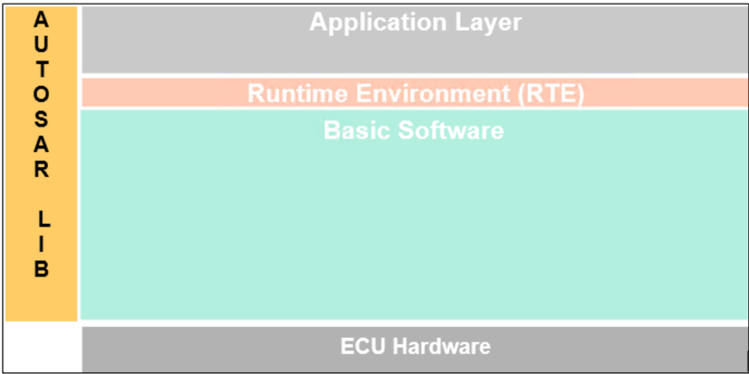

## 1. 简介和功能概述

**AUTOSAR** 库例程是 **AUTOSAR** 架构中系统服务的一部分，下图展示了 **AUTOSAR** 库在分层架构中的位置。



本规范规定了专用于浮点值算术例程的 **AUTOSAR** 库的功能、**API** 和配置。

浮点数学库包含针对以下主题的例程：

- 转换（**Conversion**）
- 舍入（**Rounding**）
- 数值与符号（**Magnitude and sign**）
- 限幅（**Limiting**）
- 对数与指数（**Logarithms and exponential**）
- 三角函数（**Trigonometric**）
- 控制器例程（**Controller routines**）
- 平均值（**Average**）
- 数组平均值（**Array Average**）
- 斜边（**Hypotenuse**）
- 斜坡例程（**Ramp routines**）
- 滞回函数（**Hysteresis function**）
- 死区时间（**Dead Time**）
- 去抖（**Debounce**）
- 升序排序例程（**Ascending Sort Routine**）
- 降序排序例程（**Descending Sort Routine**）

所有例程都是可重入的。它们可以同时被多个 runnable 使用。

## 2. 缩略语

缩略语和缩写具有局部作用域，因此未包含在 **AUTOSAR** 术语表中的，必须出现在局部术语表中。

**abs**
> 绝对值（**Absolute value**）。

**Lib**
> 库（**Library**）。

**DET**
> 默认错误跟踪器（**Default Error Tracer**）。

**f32**
> **float32** 的助记符，规定于 AUTOSAR_SWS_PlatformTypes。

**Limit**
> 限幅例程（**Limitation routine**）。

**max**
> 最大值（**Maximum**）。

**MFL**
> 浮点数学库（**Mathematical Floating point Library**）。

**min**
> 最小值（**Minimum**）。

**Mn**
> 助记符（**Mnemonic**）。

**s16**
> **sint16** 的助记符，规定于 AUTOSAR_SWS_PlatformTypes。

**s32**
> **sint32** 的助记符，规定于 AUTOSAR_SWS_PlatformTypes。

**s8**
> **sint8** 的助记符，规定于 AUTOSAR_SWS_PlatformTypes。

**u16**
> **uint16** 的助记符，规定于 AUTOSAR_SWS_PlatformTypes。

**u32**
> **uint32** 的助记符，规定于 AUTOSAR_SWS_PlatformTypes。

**u8**
> **uint8** 的助记符，规定于 AUTOSAR_SWS_PlatformTypes。

**boolean**
> 布尔数据类型，规定于 AUTOSAR_SWS_PlatformTypes。

## 3. 相关文档

### 3.1. 输入文件和相关标准与规范

<a id="ref-1"></a>[1] ISO/IEC 9899:1990 Programming Language - C
> https://www.iso.org

<a id="ref-2"></a>[2] General Specification of Basic Software Modules
> AUTOSAR_CP_SWS_BSWGeneral

### 3.2. 相关规范

**AUTOSAR** 提供了基础软件模块通用规范 [\[2, SWS BSW General\]](#ref-2)，该规范同样适用于 **MFLLibrary**。

因此，**SWS BSW General** 规范应被视为 **MFLLibrary** 的附加必需规范。

## 4. 约束和假设

### 4.1. 限制

无限制。

### 4.2. 汽车域的适用性

无限制。

## 5. 对其他模块的依赖

### 5.1. 文件结构

**Mfl** 模块应提供以下文件：

* **C** 文件，Mfl\_&lt;name&gt;.c，用于实现该库。所有 **C** 文件都应以「Mfl_」为前缀。

例程的实现与按 **C** 文件的分组建议按照下面描述的选项之一完成，且不强制遵循这些建议。

选项 1：&lt;Name&gt; 可以是函数名，即每个函数一个 **C** 文件，

例如：Mfl\_Pt1\_f32.c 等。

选项 2：&lt;Name&gt; 可以是一组函数的通用名称：

* 2.1 按对象族分组：

例如：Mfl\_Pt1.c、Mfl\_Dt1.c、Mfl\_Pid.c

* 2.2 按例程族分组：

例如：Mfl\_Conversion.c、Mfl\_Controller.c、Mfl\_Limit.c 等。

* 2.3 按方法族分组：

例如：Mfl\_Sin.c、Mfl\_Exp.c、Mfl\_Arcsin.c 等。

* 2.4 按其他方法分组：（允许单独分组）

选项 3：&lt;Name&gt; 可以去掉，使得单个 **C** 文件包含所有 **Mfl** 函数，例如：Mfl.c。

使用上述选项可以灵活地选择合适的粒度并减少 **C** 文件的数量。在某些选项下，按需链接也是可能的。

## 6. 功能规格

### 6.1. 错误分类

《**General Specification of Basic Software Modules**》（基础软件模块通用规范）一文的第 7.1 节「**Error Handling**」（错误处理）详细描述了基础软件的错误处理。其中最重要的是，它构成了一个由 **BSW** 模块中可能发生的五种错误类型组成的分类方案。

在此基础上，下文按相应的小节规定了具体的错误。

#### 6.1.1. 开发错误

不存在开发错误。

#### 6.1.2. 运行时错误

不存在运行时错误。

#### 6.1.3. 瞬态故障

不存在瞬态故障。

#### 6.1.4. 生产错误

不存在生产错误。

#### 6.1.5. 扩展生产错误

不存在扩展生产错误。

### 6.2. 错误检测（**Error detection**）

错误检测：传递给库函数的参数的有效性必须在应用层进行检查，库函数内部没有错误检测或报告。当使用无效参数调用库函数时，要求库函数返回一个预先定义但数学上无意义的值。注意，这种策略会产生不良后果，即在整个软件开发过程中掩盖错误。所有无效输入情况都应在 **SWS** 中列出，并规定一个不可配置的、预先定义的函数返回值。该值取决于函数和错误情况，因此需逐例确定。

如果传递给例程的值无效且超出函数规范，则不会检测到此类错误。

例如，如果传递的位位置值 &gt; 32，或者向例程传递了轴分布的负数采样数量。

### 6.3. 错误通知（**Error notification**）

函数不应调用 **DET** 进行错误通知。

### 6.4. 初始化和关闭（**Initialization and shutdown**）

**Mfl** 库不应需要初始化阶段。库函数可以在 **ECU** 初始化的第一步就被调用，例如甚至由 **OS** 或 **EcuM** 调用，因此该库应是就绪的。

**Mfl** 库不应需要关闭操作阶段。

### 6.5. 库 API 的使用（**Using Library API**）

**Mfl API** 可以从 **BSW** 模块或 **SWC** 直接调用。不需要端口定义。它是纯粹的函数调用。

语句「Mfl.h」应由开发者或应用代码生成器放置，而不是由 **RTE** 生成器放置。

库的使用应有文档记录。如果 **BSW** 模块或 **SWC** 使用了某个库，开发者应在 **BSW**/**SWC** 模板中添加一个 Implementation-DependencyOnArtifact。

minVersion 和 maxVersion 参数对应于供应商版本。对于 **AUTOSAR** 库，这些参数可以留空，因为 **SWC** 或 **BSW** 模块可能依赖于库的行为，而不是依赖于某个供应商的实现。然而，**SWC** 或 **BSW** 模块应与其所集成的 **AUTOSAR** 平台兼容。

### 6.6. 库的实现（**Library implementation**）

**Mfl** 库的实现方式应使代码可以在不同内存分区中的调用者之间共享。

应避免使用宏。函数应声明为函数或内联函数。不应使用宏 #define。

库函数不得调用任何 **BSW** 模块函数，例如 **DET**。库函数可以调用其他库函数。因为库函数应是可重入的，而其他 **BSW** 模块函数则不一定可重入。

用 **C** 编程语言编写的库应符合 **MISRA C** 标准。

更多详情请参见 SWS\_BSW\_00115。

每个 **AUTOSAR** 库模块实现 &lt;library&gt;*.c 和 &lt;library&gt;*.h 都应使用 **AUTOSAR** 内存映射机制将其代码映射到内存段。

每个 **AUTOSAR** 库模块实现 &lt;library&gt;*.c，凡使用了 **AUTOSAR** 整数数据类型和/或标准返回类型的，都应包含头文件 Std_Types.h。

所有 **AUTOSAR** 库模块都应使用 **AUTOSAR** 数据类型（整数、布尔）而不是原生 **C** 数据类型，除非该库被明确标识为仅与某个平台兼容。

所有 **AUTOSAR** 库模块都应避免直接使用编译器和平台特定的关键字，除非该库被明确标识为仅与某个平台兼容。例如 #pragma、typeof 等。

**注意：** 以下函数是 C99 标准库函数的精确等价物。详细描述参见：[10]（ISO/IEC 9899:1990 Programming Language - C）。

```C
Mfl_Sin_f32(float32)     <=> sinf(float)
Mfl_Cos_f32(float32)     <=> cosf(float)
Mfl_Tan_f32(float32)     <=> tanf(float)
Mfl_Exp_f32(float32)     <=> expf(float)
Mfl_Log_f32(float32)     <=> logf(float)
Mfl_ArcSin_f32(float32)  <=> asinf(float)
Mfl_ArcCos_f32(float32)  <=> acosf(float)
Mfl_ArcTan_f32(float32)  <=> atanf(float)
Mfl_ArcTan2_f32(float32) <=> atan2f(float)
Mfl_Hypot_f32f32_f32     <=> hypotf
```

## 7. API规范

### 7.1. 导入的类型

在本章中，列出了从以下模块包含的所有类型：

| 模块 | 导入类型 |
|---|---|
| Std_Types.h | boolean、sint8、uint8、sint16、uint16、sint32、uint32、float32 |

### 7.2. 类型定义

可以观察到，由于 **C** 语言提供的整数类型的大小是由实现定义的，因此每种整数类型可表示的值的范围在不同的实现之间会有所不同。

因此，为了提高软件的可移植性，这些类型定义在 Platform\_Types.h [AUTOSAR\_SWS\_PlatformTypes] 中。库例程名称中使用了以下助记符。

表8.1：基本类型的助记符（**Mnemonic for Base Types**）

| 大小 | 平台类型 | 助记符 | 取值范围 |
|---|---|---|---|
| 无符号 8 位 | boolean | u8 | [ TRUE, FALSE ] |
| 有符号 8 位 | sint8 | s8 | [ -128, 127 ] |
| 有符号 16 位 | sint16 | s16 | [ -32768, 32767 ] |
| 有符号 32 位 | sint32 | s32 | [ -2147483648, 2147483647 ] |
| 无符号 8 位 | uint8 | u8 | [ 0, 255 ] |
| 无符号 16 位 | uint16 | u16 | [ 0, 65535 ] |
| 无符号 32 位 | uint32 | u32 | [ 0, 4294967295 ] |
| 32 位 | float32 | f32 | [-3.4028235E38, 3.4028235E38] |

作为文档其余部分的约定：

* 助记符将用于例程的名称中（&lt;InTypeMn1&gt; 表示输入 1 的类型助记符）；
* 真实类型将用于例程原型的描述中（使用 &lt;InType1&gt; 或 &lt;OutType&gt;）。

**注意：**

返回类型/参数类型为布尔型的 **API** 的命名约定为 \_u8，应将其解释为 \_b（**Boolean**，布尔）。

如果返回类型/参数类型中没有布尔数据类型，则 \_u8 仅应解释为 \_u8。

**Mfl_Mod_St_Type**

枚举类型（**Enumeration**）。取值：**E_SUCCESS**：Mod 操作成功；**E_INVALID**：无效操作。规定 Mod 操作的状态。可通过 **Mfl.h** 获得。

**MfL_Div_st**

枚举类型（**Enumeration**）。取值：**E_SUCCESS**：除法成功；**E_DIVBYZERO**：除零；**E_INVALID**：无效操作。可通过 **Mfl_Types.h** 获得。

### 7.3. 关于舍入的说明（**Comment about rounding**）

可应用两种舍入类型：

结果被「四舍五入」（**rounded off**），即：

- 0 &lt;= X &lt; 0.5 舍入为 0
- 0.5 &lt;= X &lt; 1 舍入为 1
- -0.5 &lt; X &lt;= 0 舍入为 0
- -1 &lt; X &lt;= -0.5 舍入为 -1

结果向零舍入：

- 0 &lt;= X &lt; 1 舍入为 0
- -1 &lt; X &lt;= 0 舍入为 0

### 7.4. 关于针对目标优化的例程的说明（**Comment about routines optimized for target**）

本库中描述的例程可以实现为常规例程或内联函数。出于 **ROM** 优化的目的，建议将 **C** 例程实现为单独的源文件，以便按需链接。

例如，根据目标的不同，可以进行两种类型的优化：

- 某些例程可以由使用整数提升（**integer promotion**）的另一例程替换。
- 某些例程可以由限幅例程与具有不同签名的例程的组合替换。

### 7.5. 例程定义（**Routine definitions**）

#### 7.5.1. 浮点数到定点数的转换（**Floating point to Fixed-Point Conversion**）

##### 7.5.1.1. Mfl_Cvrt_f32_&lt;OutTypeMn&gt;

**说明**: 返回根据以下等式确定的、转换后定点数结果的整数值。服务 ID 0x01 至 0x04。本服务为同步调用，可重入。参数 ValFloat（in）：待转换的浮点数量。参数 ValFixedExponent（in）：转换后定点数结果的指数。参数（inout）：无。参数（out）：无。返回值：&lt;OutType&gt;，定点数结果的整数值。可通过 **Mfl.h** 获得。

```C
<OutType> Mfl_Cvrt_f32_<OutTypeMn> ( float32 ValFloat, sint16 ValFixedExponent )
```

Result = ValFloat * 2<sup>ValFixedExponent</sup>

发生上溢或下溢时，返回值应饱和到返回类型的边界值。

如果需要对该等式的结果进行舍入，则向零舍入。

函数 ID 和原型：

| 函数 ID [hex] | 函数原型 |
|---|---|
| 0x01 | uint16 Mfl_Cvrt_f32_u16(float32, sint16 ) |
| 0x02 | sint16 Mfl_Cvrt_f32_s16(float32, sint16 ) |
| 0x03 | uint32 Mfl_Cvrt_f32_u32(float32, sint16 ) |
| 0x04 | sint32 Mfl_Cvrt_f32_s32(float32, sint16 ) |

#### 7.5.2. 定点数到浮点数的转换（**Fixed-Point to Floating-Point Conversion**）

##### 7.5.2.1. Mfl_Cvrt_&lt;InTypeMn&gt;_f32

**说明**: 返回根据以下等式确定的、转换的浮点数结果。服务 ID 0x05 至 0x08。本服务为同步调用，可重入。参数 ValFixedInteger（in）：待转换定点数量的整数值。参数 ValFixedExponent（in）：待转换定点数量的指数。参数（inout）：无。参数（out）：无。返回值：float32，转换的浮点数结果。可通过 **Mfl.h** 获得。

```C
float32 Mfl_Cvrt_<InTypeMn>_f32 ( <InType> ValFixedInteger, sint16 ValFixedExponent )
```

Result = ValFixedInteger * 2<sup>−ValFixedExponent</sup>

函数 ID 和原型：

| 函数 ID [hex] | 函数原型 |
|---|---|
| 0x05 | float32 Mfl_Cvrt_u16_f32( uint16, sint16 ) |
| 0x06 | float32 Mfl_Cvrt_s16_f32( sint16, sint16 ) |
| 0x07 | float32 Mfl_Cvrt_u32_f32( uint32, sint16 ) |
| 0x08 | float32 Mfl_Cvrt_s32_f32( sint32, sint16 ) |

#### 7.5.3. 舍入（**Rounding**）

##### 7.5.3.1. Mfl_Trunc_f32

**说明**: 返回通过将参数向零舍入而确定的整数值。服务 ID 0x09。本服务为同步调用，可重入。参数 ValValue（in）：浮点操作数。参数（inout）：无。参数（out）：无。返回值：float32，截断后的值。可通过 **Mfl.h** 获得。

```C
float32 Mfl_Trunc_f32 ( float32 ValValue )
```

例如：

36.56 将被截断为 36.00。

##### 7.5.3.2. Mfl_Round_f32

**说明**: 返回通过将参数向最接近的整数舍入而确定的整数值。服务 ID 0x0A。本服务为同步调用，可重入。参数 ValValue（in）：浮点操作数。参数（inout）：无。参数（out）：无。返回值：float32，操作数舍入后的值。可通过 **Mfl.h** 获得。

```C
float32 Mfl_Round_f32 ( float32 ValValue )
```

例如：

36.56 将被舍入为 37.00。

如果参数位于两个整数的中间，则向远离零的方向舍入。

例如：

36.5 将被舍入为 37.00。

##### 7.5.3.3. Mfl_Ceil_f32

**说明**: 返回通过将参数向正无穷方向舍入而确定的整数值。服务 ID 0x0B。本服务为同步调用，可重入。参数 ValValue（in）：浮点操作数。参数（inout）：无。参数（out）：无。返回值：float32，ValValue 的向上取整值。可通过 **Mfl.h** 获得。

```C
float32 Mfl_Ceil_f32 ( float32 ValValue )
```

##### 7.5.3.4. Mfl_Floor_f32

**说明**: 返回通过将参数向负无穷方向舍入而确定的自然数值。服务 ID 0x0C。本服务为同步调用，可重入。参数 ValValue（in）：浮点操作数。参数（inout）：无。参数（out）：无。返回值：float32，操作数向下取整后的值。可通过 **Mfl.h** 获得。

```C
float32 Mfl_Floor_f32 ( float32 ValValue )
```

#### 7.5.4. 控制器例程（**Controller routines**）

控制器例程包括控制系统应用中使用的 P、PT1、DT1、PD、I、PI、PID 调节器。对于这些控制器，所需的参数通过拉普拉斯-Z 变换（**Laplace-Z transformation**）推导得出。计算新的控制器输出 yn 所需的参数可表示为以下等式。

Y<sub>n</sub> = a1 * Y<sub>n−1</sub> + b0 * X<sub>n</sub> + b1 * X<sub>n−1</sub> + b2 * X<sub>n−2</sub> + …… + b<sub>n−1</sub> * X<sub>1</sub> + b<sub>n</sub> * X<sub>0</sub>

在该等式中，使用了以下符号：

| 符号 | 说明 |
|---|---|
| Yn | 实际要计算的输出 |
| Yn-1 | 一个时间步之前的输出值 |
| Xn | 来自输入的实际输入 |
| Xn-1 | 一个时间步之前的输入 |
| Xn-2 | 两个时间步之前的输入 |
| X1 | n-1 个时间步之前的输入 |
| X0 | n 个时间步之前的输入 |
| a1, b0, b1, b2, bn-1, bn | 控制器相关的比例参数，用于描述各状态的权重 |

##### 7.5.4.1. 控制器例程的结构定义（**Structure definitions for controller routines**）

系统参数与时间或时间等效参数是分开的。系统参数被分组在控制器相关的结构 Mfl\_Param&lt;controller&gt;\_Type 中，而时间（等效）参数则直接赋值。系统状态被分组在结构 Mfl\_State&lt;controller&gt;\_Type 中，实际输入值 Xn 除外，它被直接赋值。

等式中使用的系统参数为：

K：放大系数（**Amplification factor**），其语义的描述见下文。

T1：衰减时间常数

Tv：导前时间

Tn：跟进时间

等式/实现中的时间及时间等效参数为：

dT：时间步 = 采样间隔

与上述缩写类似，实现中使用了以下缩写：

K\_&lt;size&gt;、K\_C：放大系数

T1rec\_&lt;size&gt;：延迟时间常数倒数 = 1/ T1

Tv\_&lt;size&gt;、Tv\_C：导前时间

Tnrec\_&lt;size&gt;、Tnrec\_C：跟进时间倒数 = 1/ Tn。

dT\_&lt;size&gt;：时间步 = 采样间隔

TeQ\_&lt;size&gt;：时间等效值 = exp (-dT/ T1)。

其中「&lt;size&gt;」表示变量的大小，例如 \_f32 表示 float32 位变量。

以下 **C** 结构是专为控制器例程特别定义的。

**Mfl_StatePT1_Type**

结构类型（**Structure**），包含以下元素：

| 元素 | 类型 | 说明 |
|---|---|---|
| X1 | float32 | 输入值，一个时间步之前 |
| Y1 | float32 | 输出值，一个时间步之前 |

描述：PT1 控制器例程的系统状态结构（**System State Structure**）。可通过 **Mfl.h** 获得。

**Mfl_StateDT1Typ1_Type**

结构类型（**Structure**），包含以下元素：

| 元素 | 类型 | 说明 |
|---|---|---|
| X1 | float32 | 输入值，一个时间步之前 |
| X2 | float32 | 输入值，两个时间步之前 |
| Y1 | float32 | 输出值，一个时间步之前 |

描述：DT1-Type1 控制器例程的系统状态结构。可通过 **Mfl.h** 获得。

**Mfl_StateDT1Typ2_Type**

结构类型（**Structure**），包含以下元素：

| 元素 | 类型 | 说明 |
|---|---|---|
| X1 | float32 | 输入值，一个时间步之前 |
| Y1 | float32 | 输出值，一个时间步之前 |

描述：DT1-Type2 控制器例程的系统状态结构。可通过 **Mfl.h** 获得。

**Mfl_StatePD_Type**

结构类型（**Structure**），包含以下元素：

| 元素 | 类型 | 说明 |
|---|---|---|
| X1 | float32 | 输入值，一个时间步之前 |
| Y1 | float32 | 输出值，一个时间步之前 |

描述：PD 控制器例程的系统状态结构。可通过 **Mfl.h** 获得。

**Mfl_ParamPD_Type**

结构类型（**Structure**），包含以下元素：

| 元素 | 类型 | 说明 |
|---|---|---|
| K_C | float32 | 放大系数 |
| Tv_C | float32 | 导前时间 |

描述：PD 控制器例程的系统与时间等效参数结构。可通过 **Mfl.h** 获得。

**Mfl_StateI_Type**

结构类型（**Structure**），包含以下元素：

| 元素 | 类型 | 说明 |
|---|---|---|
| X1 | float32 | 输入值，一个时间步之前 |
| Y1 | float32 | 输出值，一个时间步之前 |

描述：I 控制器例程的系统状态结构。可通过 **Mfl.h** 获得。

**Mfl_StatePI_Type**

结构类型（**Structure**），包含以下元素：

| 元素 | 类型 | 说明 |
|---|---|---|
| X1 | float32 | 输入值，一个时间步之前 |
| Y1 | float32 | 输出值，一个时间步之前 |

描述：PI 加法（Type1 和 Type2）控制器例程的系统状态结构。可通过 **Mfl.h** 获得。

**Mfl_ParamPI_Type**

结构类型（**Structure**），包含以下元素：

| 元素 | 类型 | 说明 |
|---|---|---|
| K_C | float32 | 放大系数 |
| Tnrec_C | float32 | 跟进时间倒数 (1/Tn) |

描述：PI 加法（Type1 和 Type2）控制器例程的系统与时间等效参数结构。可通过 **Mfl.h** 获得。

**Mfl_StatePID_Type**

结构类型（**Structure**），包含以下元素：

| 元素 | 类型 | 说明 |
|---|---|---|
| X1 | float32 | 输入值，一个时间步之前 |
| X2 | float32 | 输入值，两个时间步之前 |
| Y1 | float32 | 输出值，一个时间步之前 |

描述：PID 加法（Type1 和 Type2）控制器例程的系统状态结构。可通过 **Mfl.h** 获得。

**Mfl_ParamPID_Type**

结构类型（**Structure**），包含以下元素：

| 元素 | 类型 | 说明 |
|---|---|---|
| K_C | float32 | 放大系数 |
| Tv_C | float32 | 导前时间 |
| Tnrec_C | float32 | 跟进时间倒数 (1/Tn) |

描述：PID 加法（Type1 和 Type2）控制器例程的系统与时间等效参数结构。可通过 **Mfl.h** 获得。

**Mfl_Limits_Type**

结构类型（**Structure**），包含以下元素：

| 元素 | 类型 | 说明 |
|---|---|---|
| Min_C | float32 | 最小限值 |
| Max_C | float32 | 最大限值 |

描述：控制器限值结构。可通过 **Mfl.h** 获得。

##### 7.5.4.2. 比例控制器（**Proportional Controller**）

比例组件计算 Y(x) = Kp * X。

1. 「P」控制器

###### 7.5.4.2.1. Mfl_PCalc

**说明**: 微分方程：Y = K * X。服务 ID 0x10。本服务为同步调用，可重入。参数 X_f32（in）：输入值。参数 K_f32（in）：放大系数。参数 P_pf32（inout）：指向已计算状态的指针。参数（out）：无。返回值：无。可通过 **Mfl.h** 获得。

```C
void Mfl_PCalc ( float32 X_f32, float32* P_pf32, float32 K_f32 )
```

已实现的差分方程：

```C
*P_pf32 = K_f32 * X_f32
```

1. 获取「P」输出

该例程可以使用内联函数实现。

###### 7.5.4.2.2. Mfl_POut_f32

**说明**: 本例程返回受返回数据类型限制的「P」控制器输出值。服务 ID 0x12。本服务为同步调用，可重入。参数 P_pf32（in）：指向已计算状态的指针。参数（inout）：无。参数（out）：无。返回值：float32，返回「P」控制器输出值。可通过 **Mfl.h** 获得。

```C
float32 Mfl_POut_f32 ( const float32* P_pf32 )
```

```C
Output value = *P_pf32
```

##### 7.5.4.3. 具有一阶时间常数的比例控制器（**Proportional controller with first order time constant**）

本例程计算具有一阶时间常数的比例组件。

应使用例程 [Mfl_CalcTeQ_f32](#75433-mfl_calcteq_f32)（见相关章节）为 [Mfl_PT1Calc](#75431-mfl_pt1calc) 函数计算时间等效值 TeQ_f32。

1. 「PT1」控制器

###### 7.5.4.3.1. Mfl_PT1Calc

**说明**: 本例程使用以下差分方程计算 PT1 控制器输出值。服务 ID 0x1A。本服务为同步调用，可重入。参数 X_f32（in）：PT1 组件的输入值。参数 K_f32（in）：放大系数。参数 TeQ_f32（in）：时间等效值。参数 State_cpst（inout）：指向 PT1 状态结构的指针。参数（out）：无。返回值：无。可通过 **Mfl.h** 获得。

```C
void Mfl_PT1Calc ( float32 X_f32, Mfl_StatePT1_Type* State_cpst, float32 K_f32, float32 TeQ_f32 )
```

Y<sub>n</sub> = exp(-dT/T1) * Y<sub>n−1</sub> + K(1 - exp(-dT/T1)) * X<sub>n−1</sub>

这推导出实现：

```C
Output_value = (TeQ_f32 * State_cpst->Y1) + K_f32 * (1 - TeQ_f32) * State_cpst->X1
```

其中 TeQ_f32 = exp (-dT/T1)。

计算得到的 Output_value 和当前输入值应分别存储到 State\_cpst-&gt;Y1 和 State\_cpst-&gt;X1 中。

如果 TeQ_f32 = 0，则 PT1 控制器跟随输入值：State\_cpst-&gt;Y1 = K\_f32 * X\_f32。

```C
State_cpst->Y1 = Output_value
State_cpst->X1 = X_f32
```

1. 「PT1」状态值设置

该例程可以使用内联函数实现。

###### 7.5.4.3.2. Mfl_PT1SetState

**说明**: 该例程初始化 PT1 组件的内部状态变量。服务 ID 0x1B。本服务为同步调用，可重入。参数 X1_f32（in）：输入状态的初始值。参数 Y1_f32（in）：输出状态的初始值。参数（inout）：无。参数 State_cpst（out）：指向内部状态结构的指针。返回值：无。可通过 **Mfl.h** 获得。

```C
void Mfl_PT1SetState ( Mfl_StatePT1_Type* State_cpst, float32 X1_f32, float32 Y1_f32 )
```

输出状态变量 Y1 的初始化。

```C
State_cpst->Y1 = Y1_f32
```

输入状态变量 X1 的初始化。

```C
State_cpst->X1 = X1_f32
```

1. 计算时间等效值

该例程可以使用内联函数实现。

###### 7.5.4.3.3. Mfl_CalcTeQ_f32

**说明**: 本例程计算时间等效系数。服务 ID 0x1C。本服务为同步调用，可重入。参数 T1rec_f32（in）：延迟时间倒数。参数 dT_f32（in）：采样时间。参数（inout）：无。参数（out）：无。返回值：float32，时间等效值 TeQ_f32。可通过 **Mfl.h** 获得。

```C
float32 Mfl_CalcTeQ_f32 ( float32 T1rec_f32, float32 dT_f32 )
```

```C
TeQ_f32 = exp(-T1rec_f32 * dT_f32)
```

1. 计算近似时间等效值

本例程计算近似时间等效值，可以使用内联函数实现。

###### 7.5.4.3.4. Mfl_CalcTeQApp_f32

**说明**: 本例程计算时间等效系数。服务 ID 0x1E。本服务为同步调用，可重入。参数 T1rec_f32（in）：延迟时间倒数。参数 dT_f32（in）：采样时间。参数（inout）：无。参数（out）：无。返回值：float32，时间等效值。可通过 **Mfl.h** 获得。

```C
float32 Mfl_CalcTeQApp_f32 ( float32 T1rec_f32, float32 dT_f32 )
```

```C
TeQApp_f32 = 1 - (T1rec_f32 * dT_f32)
```

1. 获取「PT1」输出

该例程可以使用内联函数实现。

###### 7.5.4.3.5. Mfl_PT1Out_f32

**说明**: 本例程返回「PT1」控制器的输出值。服务 ID 0x1D。本服务为同步调用，可重入。参数 State_cpst（in）：指向状态结构的指针。参数（inout）：无。参数（out）：无。返回值：float32，返回「PT1」控制器输出值。可通过 **Mfl.h** 获得。

```C
float32 Mfl_PT1Out_f32 ( const Mfl_StatePT1_Type* State_cpst )
```

```C
Output value = State_cpst->Y1
```

##### 7.5.4.4. 具有时间延迟的微分组件：DT1（**Differential component with time delay : DT1**）

本例程计算具有一阶时间常数的微分组件。

应使用例程 [Mfl_CalcTeQ_f32](#75433-mfl_calcteq_f32)（见相关章节）为 [Mfl_DT1Typ1Calc](#75441-mfl_dt1typ1calc) 和 Mfl\_DT1Typ2Calc 函数计算时间等效值 TeQ_f32。

1. 「DT1」控制器 - Type1

###### 7.5.4.4.1. Mfl_DT1Typ1Calc

**说明**: 本例程使用微分方程计算 DT1 控制器输出值。服务 ID 0x20。本服务为同步调用，可重入。参数 X_f32（in）：DT1 控制器的输入值。参数 K_f32（in）：放大系数。参数 TeQ_f32（in）：时间等效值。参数 dT_f32（in）：采样时间。参数 State_cpst（inout）：指向状态结构的指针。参数（out）：无。返回值：无。可通过 **Mfl.h** 获得。

```C
void Mfl_DT1Typ1Calc ( float32 X_f32, Mfl_StateDT1Typ1_Type* State_cpst, float32 K_f32, float32 TeQ_f32, float32 dT_f32 )
```

Y<sub>n</sub> = exp(-dT/T1) * Y<sub>n−1</sub> + K * (1 - exp(-dT/T1)) * ((X<sub>n−1</sub> - X<sub>n−2</sub>) / dT)

这推导出实现：

```C
Output_value = (TeQ_f32 * State_cpst->Y1) + K_f32 * (1 - TeQ_f32) * ((State_cpst->X1 - State_cpst->X2) / dT_f32)
```

其中 TeQ_f32 = exp(-dT_f32/T1)。

如果 TeQ_f32 = 0，则 DT1 控制器跟随输入值：

```C
Output_value = K_f32 * (X_f32 - State_cpst->X1) / dT_f32
```

计算得到的 Output_value 应存储到 State\_cpst-&gt;Y1 中。

```C
State_cpst->Y1 = Output_value
```

旧的输入值 State\_cpst-&gt;X1 应存储到 State\_cpst-&gt;X2 中。

```C
State_cpst->X2 = State_cpst->X1
```

当前输入值 X_f32 应存储到 State\_cpst-&gt;X1 中。

```C
State_cpst->X1 = X_f32
```

1. 「DT1」控制器 - Type2

###### 7.5.4.4.2. Mfl_DT1Typ2Calc

**说明**: 本例程使用微分方程计算 DT1 控制器输出值。服务 ID 0xC0。本服务为同步调用，可重入。参数 X_f32（in）：DT1 控制器的输入值。参数 K_f32（in）：放大系数。参数 TeQ_f32（in）：时间等效值。参数 dT_f32（in）：采样时间。参数 State_cpst（inout）：指向状态结构的指针。参数（out）：无。返回值：无。可通过 **Mfl.h** 获得。

```C
void Mfl_DT1Typ2Calc ( float32 X_f32, Mfl_StateDT1Typ2_Type* State_cpst, float32 K_f32, float32 TeQ_f32, float32 dT_f32 )
```

Y<sub>n</sub> = exp(-dT/T1) * Y<sub>n−1</sub> + K * (1 - exp(-dT/T1)) * ((X<sub>n</sub> - X<sub>n−1</sub>) / dT)

这推导出实现：

```C
Output_value = (TeQ_f32 * State_cpst->Y1) + K_f32 * (1 - TeQ_f32) * ((X_f32 - State_cpst->X1) / dT_f32)
```

其中 TeQ_f32 = exp(-dT_f32/T1)。

如果 TeQ_f32 = 0，则 DT1 控制器跟随输入值：

```C
Output_value = K_f32 * (X_f32 - State_cpst->X1) / dT_f32
```

计算得到的 Output_value 应存储到 State\_cpst-&gt;Y1 中。

```C
State_cpst->Y1 = Output_value
```

当前输入值 X_f32 应存储到 State\_cpst-&gt;X1 中。

```C
State_cpst->X1 = X_f32
```

1. 「DT1」状态值设置 - Type1

该例程可以使用内联函数实现。

###### 7.5.4.4.3. Mfl_DT1Typ1SetState

**说明**: 该例程初始化 DT1 组件的内部状态变量。服务 ID 0x22。本服务为同步调用，可重入。参数 X1_f32（in）：输入状态 X1 的初始值。参数 X2_f32（in）：输入状态 X2 的初始值。参数 Y1_f32（in）：输出状态的初始值。参数（inout）：无。参数 State_cpst（out）：指向内部状态结构的指针。返回值：无。可通过 **Mfl.h** 获得。

```C
void Mfl_DT1Typ1SetState ( Mfl_StateDT1Typ1_Type* State_cpst, float32 X1_f32, float32 X2_f32, float32 Y1_f32 )
```

输出状态变量 Y1 的初始化。

```C
State_cpst->Y1 = Y1_f32
```

输入状态变量 X1 和 X2 的初始化。

```C
State_cpst->X1 = X1_f32
State_cpst->X2 = X2_f32
```

1. 「DT1」状态值设置 - Type2

该例程可以使用内联函数实现。

###### 7.5.4.4.4. Mfl_DT1Typ2SetState

**说明**: 该例程初始化 DT1 组件的内部状态变量。服务 ID 0xC1。本服务为同步调用，可重入。参数 X1_f32（in）：输入状态的初始值。参数 Y1_f32（in）：输出状态的初始值。参数（inout）：无。参数 State_cpst（out）：指向内部状态结构的指针。返回值：无。可通过 **Mfl.h** 获得。

```C
void Mfl_DT1Typ2SetState ( Mfl_StateDT1Typ2_Type* State_cpst, float32 X1_f32, float32 Y1_f32 )
```

输出状态变量 Y1 的初始化。

```C
State_cpst->Y1 = Y1_f32
```

输入状态变量 X1 的初始化。

```C
State_cpst->X1 = X1_f32
```

###### 7.5.4.4.5. Mfl_DT1Typ1Out_f32

**说明**: 本例程返回「DT1」控制器的输出值。服务 ID 0x23。本服务为同步调用，可重入。参数 State_cpst（in）：指向状态结构的指针。参数（inout）：无。参数（out）：无。返回值：float32，返回「DT1」控制器输出值。可通过 **Mfl.h** 获得。

```C
float32 Mfl_DT1Typ1Out_f32 ( const Mfl_StateDT1Typ1_Type* State_cpst )
```

```C
Output value = State_cpst->Y1
```

1. 获取「DT1」输出 - Type2

该例程可以使用内联函数实现。

###### 7.5.4.4.6. Mfl_DT1Typ2Out_f32

**说明**: 本例程返回「DT1」控制器的输出值。服务 ID 0xC2。本服务为同步调用，可重入。参数 State_cpst（in）：指向状态结构的指针。参数（inout）：无。参数（out）：无。返回值：float32，返回「DT1」控制器输出值。可通过 **Mfl.h** 获得。

```C
float32 Mfl_DT1Typ2Out_f32 ( const Mfl_StateDT1Typ2_Type* State_cpst )
```

```C
Output value = State_cpst->Y1
```

##### 7.5.4.5. 比例与微分控制器（**Proportional & Differential controller**）

本例程是比例与微分控制器的组合。

1. PD 控制器

###### 7.5.4.5.1. Mfl_PDCalc

**说明**: 本例程使用微分方程计算比例加微分控制器的输出值。服务 ID 0x2A。本服务为同步调用，可重入。参数 X_f32（in）：PD 控制器的输入值。参数 Param_cpst（in）：指向参数结构的指针。参数 dT_f32（in）：采样时间。参数 State_cpst（inout）：指向状态结构的指针。参数（out）：无。返回值：无。可通过 **Mfl.h** 获得。

```C
void Mfl_PDCalc ( float32 X_f32, Mfl_StatePD_Type* State_cpst, const Mfl_ParamPD_Type* Param_cpst, float32 dT_f32 )
```

Y<sub>n</sub> = K(1+Tv/dT) * X<sub>n</sub> - K(Tv/dT) * X<sub>n−1</sub>

这推导出实现：

```C
Output_value = (Param_cpst->K_C * (1+ Param_cpst->Tv_C/dT_f32) * X_f32) - (Param_cpst->K_C * (Param_cpst->Tv_C/dT_f32) * State_cpst->X1)
```

计算得到的 Output_value 应存储到 State\_cpst-&gt;Y1 中。

```C
State_cpst->Y1 = Output_value
```

当前输入值 X_f32 应存储到 State\_cpst-&gt;X1 中。

```C
State_cpst->X1 = X_f32
```

1. PD 状态值设置

该例程可以使用内联函数实现。

###### 7.5.4.5.2. Mfl_PDSetState

**说明**: 该例程初始化 PD 组件的内部状态变量。服务 ID 0x2B。本服务为同步调用，可重入。参数 X1_f32（in）：输入状态的初始值。参数 Y1_f32（in）：输出状态的初始值。参数（inout）：无。参数 State_cpst（out）：指向内部状态结构的指针。返回值：无。可通过 **Mfl.h** 获得。

```C
void Mfl_PDSetState ( Mfl_StatePD_Type* State_cpst, float32 X1_f32, float32 Y1_f32 )
```

输出状态变量 Y1 的初始化。

```C
State_cpst->Y1 = Y1_f32
```

输入状态变量 X1 的初始化。

```C
State_cpst->X1 = X1_f32
```

1. 「PD」参数设置

该例程可以使用内联函数实现。

###### 7.5.4.5.3. Mfl_PDSetParam

**说明**: 该例程设置 PD 组件的参数结构。服务 ID 0x2C。本服务为同步调用，可重入。参数 K_f32（in）：放大系数。参数 Tv_f32（in）：导前时间。参数（inout）：无。参数 Param_cpst（out）：指向内部参数结构的指针。返回值：无。可通过 **Mfl.h** 获得。

```C
void Mfl_PDSetParam ( Mfl_ParamPD_Type* Param_cpst, float32 K_f32, float32 Tv_f32 )
```

放大系数的初始化。

```C
Param_cpst->K_C = K_f32
```

导前时间状态变量的初始化。

```C
Param_cpst->Tv_C = Tv_f32
```

1. 获取「PD」输出

该例程可以使用内联函数实现。

###### 7.5.4.5.4. Mfl_PDOut_f32

**说明**: 本例程返回「PD」控制器的输出值。服务 ID 0x2D。本服务为同步调用，可重入。参数 State_cpst（in）：指向状态结构的指针。参数（inout）：无。参数（out）：无。返回值：float32，返回「PD」控制器输出值。可通过 **Mfl.h** 获得。

```C
float32 Mfl_PDOut_f32 ( const Mfl_StatePD_Type* State_cpst )
```

```C
Output value = State_cpst->Y1
```

##### 7.5.4.6. 积分组件（**Integral component**）

本例程计算积分组件。

1. 「I」控制器

###### 7.5.4.6.1. Mfl_ICalc

**说明**: 本例程使用微分方程计算 I 控制器输出值。服务 ID 0x30。本服务为同步调用，可重入。参数 X_f32（in）：「I」控制器的输入值。参数 K_f32（in）：放大系数。参数 dT_f32（in）：采样时间。参数（inout）：无。参数 State_cpst（out）：指向状态变量的指针。返回值：无。可通过 **Mfl.h** 获得。

```C
void Mfl_ICalc ( float32 X_f32, Mfl_StateI_Type* State_cpst, float32 K_f32, float32 dT_f32 )
```

计算得到的 Output_value 和当前输入值应分别存储到 State\_cpst-&gt;Y1 和 State\_cpst-&gt;X1 中。

Y<sub>n</sub> = Y<sub>n−1</sub> + K * dT * X<sub>n−1</sub>

这推导出实现：

```C
Output_value = State_cpst->Y1 + K_f32 * dT_f32 * State_cpst->X1
```

```C
State_cpst->Y1 = Output_value
State_cpst->X1 = X_f32
```

1. 带限幅的「I」控制器

###### 7.5.4.6.2. Mfl_ILimCalc

**说明**: 本例程使用微分方程计算 I 控制器输出值。服务 ID 0x32。本服务为同步调用，可重入。参数 X_f32（in）：「I」控制器的输入值。参数 K_f32（in）：放大系数。参数 Limit_cpst（in）：指向限幅结构的指针。参数 dT_f32（in）：采样时间。参数 State_cpst（inout）：指向状态变量的指针。参数（out）：无。返回值：无。可通过 **Mfl.h** 获得。

```C
void Mfl_ILimCalc ( float32 X_f32, Mfl_StateI_Type* State_cpst, float32 K_f32, const Mfl_Limits_Type* Limit_cpst, float32 dT_f32 )
```

计算得到的 Output_value 和当前输入值应分别存储到 State\_cpst-&gt;Y1 和 State\_cpst-&gt;X1 中。

Y<sub>n</sub> = Y<sub>n−1</sub> + K * dT * X<sub>n−1</sub>

这推导出实现：

```C
Output_value = State_cpst->Y1 + K_f32 * dT_f32 * State_cpst->X1
```

用控制器的最大和最小限幅值对输出值进行限幅。

```C
If (Output_value < Limit_cpst->Min_C) Then, Output_value = Limit_cpst->Min_C
If (Output_value > Limit_cpst->Max_C) Then, Output_value = Limit_cpst->Max_C
```

```C
State_cpst->Y1 = Output_value
State_cpst->X1 = X_f32
```

1. 为控制器设置限幅

###### 7.5.4.6.3. Mfl_CtrlSetLimit

**说明**: 更新限幅结构。服务 ID 0x34。本服务为同步调用，可重入。参数 Min_f32（in）：最小限幅。参数 Max_f32（in）：最大限幅。参数 Limit_cpst（inout）：指向限幅结构的指针。参数（out）：无。返回值：无。可通过 **Mfl.h** 获得。

```C
void Mfl_CtrlSetLimit ( float32 Min_f32, float32 Max_f32, Mfl_Limits_Type* Limit_cpst )
```

更新限幅结构。

```C
Limit_cpst->Min_C = Min_f32
Limit_cpst->Max_C = Max_f32
```

**注意：** 本例程（Mfl\_CtrlSetLimit）已弃用，未来发行版将不再支持它。

替代例程：Mfl\_CtrlSetLimits。

###### 7.5.4.6.4. Mfl_CtrlSetLimits

**说明**: 更新限幅结构。服务 ID 0xC9。本服务为同步调用，可重入。参数 Min_f32（in）：最小限幅。参数 Max_f32（in）：最大限幅。参数 Limit_cpst（inout）：指向限幅结构的指针。参数（out）：无。返回值：无。可通过 **Mfl.h** 获得。

```C
void Mfl_CtrlSetLimits ( Mfl_Limits_Type* Limit_cpst, float32 Min_f32, float32 Max_f32 )
```

更新限幅结构。

```C
Limit_cpst->Min_C = Min_f32
Limit_cpst->Max_C = Max_f32
```

1. 「I」状态值设置

该例程可以使用内联函数实现。

###### 7.5.4.6.5. Mfl_ISetState

**说明**: 该例程初始化 I 组件的内部状态变量。服务 ID 0x31。本服务为同步调用，可重入。参数 X1_f32（in）：输入状态的初始值。参数 Y1_f32（in）：输出状态的初始值。参数（inout）：无。参数 State_cpst（out）：指向内部状态结构的指针。返回值：无。可通过 **Mfl.h** 获得。

```C
void Mfl_ISetState ( Mfl_StateI_Type* State_cpst, float32 X1_f32, float32 Y1_f32 )
```

输出状态变量 Y1 的初始化。

```C
State_cpst->Y1 = Y1_f32
```

输入状态变量 X1 的初始化。

```C
State_cpst->X1 = X1_f32
```

1. 获取「I」输出

该例程可以使用内联函数实现。

###### 7.5.4.6.6. Mfl_IOut_f32

**说明**: 本例程返回「I」控制器的输出值。服务 ID 0x33。本服务为同步调用，可重入。参数 State_cpst（in）：指向状态结构的指针。参数（inout）：无。参数（out）：无。返回值：float32，返回「I」控制器输出值。可通过 **Mfl.h** 获得。

```C
float32 Mfl_IOut_f32 ( const Mfl_StateI_Type* State_cpst )
```

```C
Output value = State_cpst->Y1
```

##### 7.5.4.7. 比例与积分控制器（**Proportional & Integral controller**）

本例程是比例与积分控制器的组合。

###### 7.5.4.7.1. 「PI」控制器 - Type1（隐式类型）（**'PI' Controller - Type1 (Implicit type)**）

###### 7.5.4.7.1.1. Mfl_PITyp1Calc

**说明**: 本例程使用微分方程计算比例加积分控制器（隐式类型）的输出值。服务 ID 0x35。本服务为同步调用，可重入。参数 X_f32（in）：「PI」控制器的输入值。参数 Param_cpst（in）：指向参数结构的指针。参数 dT_f32（in）：采样时间。参数（inout）：无。参数 State_cpst（out）：指向内部状态结构的指针。返回值：无。可通过 **Mfl.h** 获得。

```C
void Mfl_PITyp1Calc ( float32 X_f32, Mfl_StatePI_Type* State_cpst, const Mfl_ParamPI_Type* Param_cpst, float32 dT_f32 )
```

Y<sub>n</sub> = Y<sub>n−1</sub> + K * X<sub>n</sub> - K * (1 - dT/Tn) * X<sub>n−1</sub>

这推导出实现：

```C
Output_value = State_cpst->Y1 + (Param_cpst->K_C * X_f32) - (Param_cpst->K_C * (1 - Param_cpst->Tnrec_C * dT_f32) * State_cpst->X1)
```

计算得到的 Output_value 应存储到 State\_cpst-&gt;Y1 中。

```C
State_cpst->Y1 = Output_value
```

当前输入值 X_f32 应存储到 State\_cpst-&gt;X1 中。

```C
State_cpst->X1 = X_f32
```

###### 7.5.4.7.2. 「PI」控制器 - 带限幅的 Type1（隐式类型）（**'PI' Controller - Type1 with limitation (Implicit type)**）

###### 7.5.4.7.2.1. Mfl_PITyp1LimCalc

**说明**: 本例程使用微分方程计算比例加积分控制器（隐式类型）的输出值。服务 ID 0xC3。本服务为同步调用，可重入。参数 X_f32（in）：「PI」控制器的输入值。参数 Param_cpst（in）：指向参数结构的指针。参数 Limit_cpst（in）：指向限幅结构的指针。参数 dT_f32（in）：采样时间。参数 State_cpst（inout）：指向内部状态结构的指针。参数（out）：无。返回值：无。可通过 **Mfl.h** 获得。

```C
void Mfl_PITyp1LimCalc ( float32 X_f32, Mfl_StatePI_Type* State_cpst, const Mfl_ParamPI_Type* Param_cpst, const Mfl_Limits_Type* Limit_cpst, float32 dT_f32 )
```

Y<sub>n</sub> = Y<sub>n−1</sub> + K * X<sub>n</sub> - K * (1 - dT/Tn) * X<sub>n−1</sub>

这推导出实现：

```C
Output_value = State_cpst->Y1 + (Param_cpst->K_C * X_f32) - (Param_cpst->K_C * (1 - Param_cpst->Tnrec_C * dT_f32) * State_cpst->X1)
```

用控制器的最大和最小限幅值对输出值进行限幅。

```C
If (Output_value < Limit_cpst->Min_C) Then, Output_value = Limit_cpst->Min_C
If (Output_value > Limit_cpst->Max_C) Then, Output_value = Limit_cpst->Max_C
```

计算得到的 Output_value 应存储到 State\_cpst-&gt;Y1 中。

```C
State_cpst->Y1 = Output_value
```

当前输入值 X_f32 应存储到 State\_cpst-&gt;X1 中。

```C
State_cpst->X1 = X_f32
```

###### 7.5.4.7.3. 「PI」控制器 - Type2（显式类型）（**'PI' Controller - Type2 (Explicit type)**）

###### 7.5.4.7.3.1. Mfl_PITyp2Calc

**说明**: 本例程使用微分方程计算比例加积分控制器（显式类型）的输出值。服务 ID 0x36。本服务为同步调用，可重入。参数 X_f32（in）：「PI」控制器的输入值。参数 Param_cpst（in）：指向参数结构的指针。参数 dT_f32（in）：采样时间。参数（inout）：无。参数 State_cpst（out）：指向内部状态结构的指针。返回值：无。可通过 **Mfl.h** 获得。

```C
void Mfl_PITyp2Calc ( float32 X_f32, Mfl_StatePI_Type* State_cpst, const Mfl_ParamPI_Type* Param_cpst, float32 dT_f32 )
```

Y<sub>n</sub> = Y<sub>n−1</sub> + K * (1 + dT/Tn) * X<sub>n</sub> - K * X<sub>n−1</sub>

这推导出实现：

```C
Output_value = State_cpst->Y1 + (Param_cpst->K_C * (1 + Param_cpst->Tnrec_C * dT_f32) * X_f32) - (Param_cpst->K_C * State_cpst->X1)
```

计算得到的 Output_value 应存储到 State\_cpst-&gt;Y1 中。

```C
State_cpst->Y1 = Output_value
```

当前输入值 X_f32 应存储到 State\_cpst-&gt;X1 中。

```C
State_cpst->X1 = X_f32
```

###### 7.5.4.7.4. 「PI」控制器 - 带限幅的 Type2（显式类型）（**'PI' Controller - Type2 with limitation (Explicit type)**）

###### 7.5.4.7.4.1. Mfl_PITyp2LimCalc

**说明**: 本例程使用微分方程计算比例加积分控制器（显式类型）的输出值。服务 ID 0xC4。本服务为同步调用，可重入。参数 X_f32（in）：「PI」控制器的输入值。参数 Param_cpst（in）：指向参数结构的指针。参数 Limit_cpst（in）：指向限幅结构的指针。参数 dT_f32（in）：采样时间。参数 State_cpst（inout）：指向内部状态结构的指针。参数（out）：无。返回值：无。可通过 **Mfl.h** 获得。

```C
void Mfl_PITyp2LimCalc ( float32 X_f32, Mfl_StatePI_Type* State_cpst, const Mfl_ParamPI_Type* Param_cpst, const Mfl_Limits_Type* Limit_cpst, float32 dT_f32 )
```

Y<sub>n</sub> = Y<sub>n−1</sub> + K * (1 + dT/Tn) * X<sub>n</sub> - K * X<sub>n−1</sub>

这推导出实现：

```C
Output_value = State_cpst->Y1 + (Param_cpst->K_C * (1 + Param_cpst->Tnrec_C * dT_f32) * X_f32) - (Param_cpst->K_C * State_cpst->X1)
```

用控制器的最大和最小限幅值对输出值进行限幅。

```C
If (Output_value < Limit_cpst->Min_C) Then, Output_value = Limit_cpst->Min_C
If (Output_value > Limit_cpst->Max_C) Then, Output_value = Limit_cpst->Max_C
```

计算得到的 Output_value 应存储到 State\_cpst-&gt;Y1 中。

```C
State_cpst->Y1 = Output_value
```

当前输入值 X_f32 应存储到 State\_cpst-&gt;X1 中。

```C
State_cpst->X1 = X_f32
```

1. 「PI」状态值设置

该例程可以使用内联函数实现。

###### 7.5.4.7.5. Mfl_PISetState

**说明**: 该例程初始化 PI 组件的内部状态变量。服务 ID 0x37。本服务为同步调用，可重入。参数 X1_f32（in）：输入状态的初始值。参数 Y1_f32（in）：输出状态的初始值。参数（inout）：无。参数 State_cpst（out）：指向内部状态结构的指针。返回值：无。可通过 **Mfl.h** 获得。

```C
void Mfl_PISetState ( Mfl_StatePI_Type* State_cpst, float32 X1_f32, float32 Y1_f32 )
```

输出状态变量 Y1 的初始化。

```C
State_cpst->Y1 = Y1_f32
```

输入状态变量 X1 的初始化。

```C
State_cpst->X1 = X1_f32
```

1. 「PI」参数设置

该例程可以使用内联函数实现。

###### 7.5.4.7.6. Mfl_PISetParam

**说明**: 该例程设置 PI 组件的参数结构。服务 ID 0x38。本服务为同步调用，可重入。参数 K_f32（in）：放大系数。参数 Tnrec_f32（in）：跟进时间倒数。参数（inout）：无。参数 Param_cpst（out）：指向内部参数结构的指针。返回值：无。可通过 **Mfl.h** 获得。

```C
void Mfl_PISetParam ( Mfl_ParamPI_Type* Param_cpst, float32 K_f32, float32 Tnrec_f32 )
```

放大系数的初始化。

```C
Param_cpst->K_C = K_f32
```

跟进时间倒数状态变量的初始化。

```C
Param_cpst->Tnrec_C = Tnrec_f32
```

1. 获取「PI」输出

该例程可以使用内联函数实现。

###### 7.5.4.7.7. Mfl_PIOut_f32

**说明**: 本例程返回「PI」控制器的输出值。服务 ID 0x39。本服务为同步调用，可重入。参数 State_cpst（in）：指向状态结构的指针。参数（inout）：无。参数（out）：无。返回值：float32，返回「PI」控制器输出值。可通过 **Mfl.h** 获得。

```C
float32 Mfl_PIOut_f32 ( const Mfl_StatePI_Type* State_cpst )
```

```C
Output value = State_cpst->Y1
```

##### 7.5.4.8. 比例、积分与微分控制器（**Proportional, Integral & Differential controller**）

本例程是比例、积分与微分控制器的组合。

1. 「PID」控制器 - Type1（隐式类型）

###### 7.5.4.8.1. Mfl_PIDTyp1Calc

**说明**: 本例程使用微分方程计算比例加积分加微分控制器（隐式类型）的输出值。服务 ID 0x3A。本服务为同步调用，可重入。参数 X_f32（in）：「PID」控制器的输入值。参数 Param_cpst（in）：指向参数结构的指针。参数 dT_f32（in）：采样时间。参数（inout）：无。参数 State_cpst（out）：指向内部状态结构的指针。返回值：无。可通过 **Mfl.h** 获得。

```C
void Mfl_PIDTyp1Calc ( float32 X_f32, Mfl_StatePID_Type* State_cpst, const Mfl_ParamPID_Type* Param_cpst, float32 dT_f32 )
```

Y<sub>n</sub> = Y<sub>n−1</sub> + K * (1 + Tv/dT) * X<sub>n</sub> - K * (1 - dT/Tn + 2Tv/dT) * X<sub>n−1</sub> + K * (Tv/dT) * X<sub>n−2</sub>

这推导出实现：

```C
calc1 = Param_cpst->K_C * (1 + t_val) * X_f32
calc2 = Param_cpst->K_C * (1 - dT_f32 * Param_cpst->Tnrec_C + 2 * t_val) * State_cpst->X1
calc3 = Param_cpst->K_C * t_val * State_cpst->X2
Output_value = State_cpst->Y1 + calc1 - calc2 + calc3
Where t_val = Param_cpst->Tv_C / dT_f32
```

计算得到的 Output_value 应存储到 State\_cpst-&gt;Y1 中。

```C
State_cpst->Y1 = Output_value
```

旧的输入值 State\_cpst-&gt;X1 应存储到 State\_cpst-&gt;X2 中。

```C
State_cpst->X2 = State_cpst->X1
```

当前输入值 X_f32 应存储到 State\_cpst-&gt;X1 中。

```C
State_cpst->X1 = X_f32
```

1. 「PID」控制器 - 带限幅的 Type1（隐式类型）

###### 7.5.4.8.2. Mfl_PIDTyp1LimCalc

**说明**: 本例程使用微分方程计算比例加积分加微分控制器（隐式类型）的输出值。服务 ID 0xC5。本服务为同步调用，可重入。参数 X_f32（in）：「PID」控制器的输入值。参数 Param_cpst（in）：指向参数结构的指针。参数 Limit_cpst（in）：指向限幅结构的指针。参数 dT_f32（in）：采样时间。参数 State_cpst（inout）：指向内部状态结构的指针。参数（out）：无。返回值：无。可通过 **Mfl.h** 获得。

```C
void Mfl_PIDTyp1LimCalc ( float32 X_f32, Mfl_StatePID_Type* State_cpst, const Mfl_ParamPID_Type* Param_cpst, const Mfl_Limits_Type* Limit_cpst, float32 dT_f32 )
```

Y<sub>n</sub> = Y<sub>n−1</sub> + K * (1 + Tv/dT) * X<sub>n</sub> - K * (1 - dT/Tn + 2Tv/dT) * X<sub>n−1</sub> + K * (Tv/dT) * X<sub>n−2</sub>

这推导出实现：

```C
calc1 = Param_cpst->K_C * (1 + t_val) * X_f32
calc2 = Param_cpst->K_C * (1 - dT_f32 * Param_cpst->Tnrec_C + 2 * t_val) * State_cpst->X1
calc3 = Param_cpst->K_C * t_val * State_cpst->X2
Output_value = State_cpst->Y1 + calc1 - calc2 + calc3
Where t_val = Param_cpst->Tv_C / dT_f32
```

用控制器的最大和最小限幅值对输出值进行限幅。

```C
If (Output_value < Limit_cpst->Min_C) Then, Output_value = Limit_cpst->Min_C
If (Output_value > Limit_cpst->Max_C) Then, Output_value = Limit_cpst->Max_C
```

计算得到的 Output_value 应存储到 State\_cpst-&gt;Y1 中。

```C
State_cpst->Y1 = Output_value
```

旧的输入值 State\_cpst-&gt;X1 应存储到 State\_cpst-&gt;X2 中。

```C
State_cpst->X2 = State_cpst->X1
```

当前输入值 X_f32 应存储到 State\_cpst-&gt;X1 中。

```C
State_cpst->X1 = X_f32
```

1. 「PID」控制器 - Type2（显式类型）

###### 7.5.4.8.3. Mfl_PIDTyp2Calc

**说明**: 本例程使用微分方程计算比例加积分加微分控制器（显式类型）的输出值。服务 ID 0x3B。本服务为同步调用，可重入。参数 X_f32（in）：「PID」控制器的输入值。参数 Param_cpst（in）：指向参数结构的指针。参数 dT_f32（in）：采样时间。参数（inout）：无。参数 State_cpst（out）：指向内部状态结构的指针。返回值：无。可通过 **Mfl.h** 获得。

```C
void Mfl_PIDTyp2Calc ( float32 X_f32, Mfl_StatePID_Type* State_cpst, const Mfl_ParamPID_Type* Param_cpst, float32 dT_f32 )
```

Y<sub>n</sub> = Y<sub>n−1</sub> + K * (1 + dT/Tn + Tv/dT) * X<sub>n</sub> - K * (1 + 2Tv/dT) * X<sub>n−1</sub> + K * (Tv/dT) * X<sub>n−2</sub>

这推导出实现：

```C
calc1 = Param_cpst->K_C * (1 + dT_f32 * Param_cpst->Tnrec_C + t_val) * X_f32
calc2 = Param_cpst->K_C * (1 + 2 * t_val) * State_cpst->X1
calc3 = Param_cpst->K_C * t_val * State_cpst->X2
Output_value = State_cpst->Y1 + calc1 - calc2 + calc3
Where t_val = Param_cpst->Tv_C / dT_f32
```

计算得到的 Output_value 应存储到 State\_cpst-&gt;Y1 中。

```C
State_cpst->Y1 = Output_value
```

旧的输入值 State\_cpst-&gt;X1 应存储到 State\_cpst-&gt;X2 中。

```C
State_cpst->X2 = State_cpst->X1
```

当前输入值 X_f32 应存储到 State\_cpst-&gt;X1 中。

```C
State_cpst->X1 = X_f32
```

1. 「PID」控制器 - 带限幅的 Type2（显式类型）

###### 7.5.4.8.4. Mfl_PIDTyp2LimCalc

**说明**: 本例程使用微分方程计算比例加积分加微分控制器（显式类型）的输出值。服务 ID 0xC6。本服务为同步调用，可重入。参数 X_f32（in）：「PID」控制器的输入值。参数 Param_cpst（in）：指向参数结构的指针。参数 Limit_cpst（in）：指向限幅结构的指针。参数 dT_f32（in）：采样时间。参数 State_cpst（inout）：指向内部状态结构的指针。参数（out）：无。返回值：无。可通过 **Mfl.h** 获得。

```C
void Mfl_PIDTyp2LimCalc ( float32 X_f32, Mfl_StatePID_Type* State_cpst, const Mfl_ParamPID_Type* Param_cpst, const Mfl_Limits_Type* Limit_cpst, float32 dT_f32 )
```

Y<sub>n</sub> = Y<sub>n−1</sub> + K * (1 + dT/Tn + Tv/dT) * X<sub>n</sub> - K * (1 + 2Tv/dT) * X<sub>n−1</sub> + K * (Tv/dT) * X<sub>n−2</sub>

这推导出实现：

```C
calc1 = Param_cpst->K_C * (1 + dT_f32 * Param_cpst->Tnrec_C + t_val) * X_f32
calc2 = Param_cpst->K_C * (1 + 2 * t_val) * State_cpst->X1
calc3 = Param_cpst->K_C * t_val * State_cpst->X2
Output_value = State_cpst->Y1 + calc1 - calc2 + calc3
Where t_val = Param_cpst->Tv_C / dT_f32
```

用控制器的最大和最小限幅值对输出值进行限幅。

```C
If (Output_value < Limit_cpst->Min_C) Then, Output_value = Limit_cpst->Min_C
If (Output_value > Limit_cpst->Max_C) Then, Output_value = Limit_cpst->Max_C
```

计算得到的 Output_value 应存储到 State\_cpst-&gt;Y1 中。

```C
State_cpst->Y1 = Output_value
```

旧的输入值 State\_cpst-&gt;X1 应存储到 State\_cpst-&gt;X2 中。

```C
State_cpst->X2 = State_cpst->X1
```

当前输入值 X_f32 应存储到 State\_cpst-&gt;X1 中。

```C
State_cpst->X1 = X_f32
```

1. 「PID」状态值设置

该例程可以使用内联函数实现。

###### 7.5.4.8.5. Mfl_PIDSetState

**说明**: 该例程初始化 PID 组件的内部状态变量。服务 ID 0x3C。本服务为同步调用，可重入。参数 X1_f32（in）：输入状态的初始值。参数 X2_f32（in）：输入状态的初始值。参数 Y1_f32（in）：输出状态的初始值。参数（inout）：无。参数 State_cpst（out）：指向内部状态结构的指针。返回值：无。可通过 **Mfl.h** 获得。

```C
void Mfl_PIDSetState ( Mfl_StatePID_Type* State_cpst, float32 X1_f32, float32 X2_f32, float32 Y1_f32 )
```

输出状态变量 Y1 的初始化。

```C
State_cpst->Y1 = Y1_f32
```

输入状态变量 X1 的初始化。

```C
State_cpst->X1 = X1_f32
```

输入状态变量 X2 的初始化。

```C
State_cpst->X2 = X2_f32
```

1. 「PID」参数设置

该例程可以使用内联函数实现。

###### 7.5.4.8.6. Mfl_PIDSetParam

**说明**: 该例程设置 PID 组件的参数结构。服务 ID 0x3D。本服务为同步调用，可重入。参数 K_f32（in）：放大系数。参数 Tv_f32（in）：导前时间。参数 Tnrec_f32（in）：跟进时间倒数。参数（inout）：无。参数 Param_cpst（out）：指向内部参数结构的指针。返回值：无。可通过 **Mfl.h** 获得。

```C
void Mfl_PIDSetParam ( Mfl_ParamPID_Type* Param_cpst, float32 K_f32, float32 Tv_f32, float32 Tnrec_f32 )
```

放大系数的初始化。

```C
Param_cpst->K_C = K_f32
```

导前时间状态变量的初始化。

```C
Param_cpst->Tv_C = Tv_f32
```

跟进时间倒数状态变量的初始化。

```C
Param_cpst->Tnrec_C = Tnrec_f32
```

1. 获取「PID」输出

该例程可以使用内联函数实现。

###### 7.5.4.8.7. Mfl_PIDOut_f32

**说明**: 本例程返回「PID」控制器的输出值。服务 ID 0x3E。本服务为同步调用，可重入。参数 State_cpst（in）：指向状态结构的指针。参数（inout）：无。参数（out）：无。返回值：float32，返回「PID」控制器输出值。可通过 **Mfl.h** 获得。

```C
float32 Mfl_PIDOut_f32 ( const Mfl_StatePID_Type* State_cpst )
```

```C
Output value = State_cpst->Y1
```

#### 7.5.5. 数值与符号（**Magnitude and Sign**）

##### 7.5.5.1. Mfl_Abs_f32

**说明**: 返回根据以下等式确定的参数的绝对值（ValAbs）。服务 ID 0x40。本服务为同步调用，可重入。参数 ValValue（in）：浮点操作数。参数（inout）：无。参数（out）：无。返回值：float32，操作数的绝对值。可通过 **Mfl.h** 获得。

```C
float32 Mfl_Abs_f32 ( float32 ValValue )
```

```C
ValAbs = | ValValue |
```

##### 7.5.5.2. Mfl_Sign_f32

**说明**: 返回根据以下等式确定的参数的符号（ValSign）。服务 ID 0x41。本服务为同步调用，可重入。参数 ValValue（in）：浮点操作数。参数（inout）：无。参数（out）：无。返回值：sint8，表示操作数符号的整数。可通过 **Mfl.h** 获得。

```C
sint8 Mfl_Sign_f32 ( float32 ValValue )
```

```C
ValSign = 1,  ValValue > 0.0
ValSign = 0,  ValValue == 0.0
ValSign = -1, ValValue < 0.0
```

#### 7.5.6. 限幅（**Limiting**）

##### 7.5.6.1. Mfl_Max_f32

**说明**: 返回根据以下等式确定的两个参数中较大者的值（ValMax）。服务 ID 0x45。本服务为同步调用，可重入。参数 ValValue1（in）：浮点操作数。参数 ValValue2（in）：浮点操作数。参数（inout）：无。参数（out）：无。返回值：float32，两个参数的最大值。可通过 **Mfl.h** 获得。

```C
float32 Mfl_Max_f32 ( float32 ValValue1, float32 ValValue2 )
```

```C
ValMax = ValValue1, ValValue1 ≥ ValValue2
ValMax = ValValue2, ValValue1 < ValValue2
```

##### 7.5.6.2. Mfl_Min_f32

**说明**: 返回根据以下等式确定的两个参数中较小者的值（Min）。服务 ID 0x46。本服务为同步调用，可重入。参数 Value1（in）：浮点操作数。参数 Value2（in）：浮点操作数。参数（inout）：无。参数（out）：无。返回值：float32，两个参数的最小值。可通过 **Mfl.h** 获得。

```C
float32 Mfl_Min_f32 ( float32 Value1, float32 Value2 )
```

```C
Min = Value1, Value1 ≤ Value2
Min = Value2, Value1 > Value2
```

##### 7.5.6.3. Mfl_RateLimiter_f32

**说明**: 增加的值和减小的值受 maxdif 速率限制。服务 ID 0x47。本服务为同步调用，可重入。参数 newval（in）：待限幅的变量。参数 oldval（in）：newval 的先前值。参数 maxdif（in）：先前值（oldval）与当前值（newval）之间允许的最大绝对差值。参数（inout）：无。参数（out）：无。返回值：float32，限幅后的值。可通过 **Mfl.h** 获得。

```C
float32 Mfl_RateLimiter_f32 ( float32 newval, float32 oldval, float32 maxdif )
```

```C
if ( newval > oldval ) and (( newval - oldval ) > maxdif )
Result = oldval + maxdif
else if ( newval < oldval ) and (( oldval - newval ) > maxdif )
Result = oldval - maxdif
else Result = newval
```

##### 7.5.6.4. Mfl_Limit_f32

**说明**: 返回根据以下等式确定的有界值（newVal）。服务 ID 0x48。本服务为同步调用，可重入。参数 val（in）：要界定边界的量。参数 lowLim（in）：下边界。lowLim 不得严格大于 upLim。参数 upLim（in）：上边界。upLim 不得严格小于 lowLim。参数（inout）：无。参数（out）：无。返回值：float32，限幅后的值。可通过 **Mfl.h** 获得。

```C
float32 Mfl_Limit_f32 ( float32 val, float32 lowLim, float32 upLim )
```

```C
newVal = lowLim, val ≤ lowLim
newVal = upLim,  val ≥ upLim
newVal = val,    lowLim < val < upLim
```

#### 7.5.7. 对数与指数（**Logarithms and Exponentials**）

##### 7.5.7.1. Mfl_Pow_f32

**说明**: 返回根据以下等式确定的 ValBase 的 ValExp 次幂。服务 ID 0x50。本服务为同步调用，可重入。参数 ValBase（in）：进行指数运算的底数。有效范围：ValBase &gt; 0.0。参数 ValExp（in）：底数的指数。参数（inout）：无。参数（out）：无。返回值：float32，ValBase 的 ValExp 次幂。可通过 **Mfl.h** 获得。

```C
float32 Mfl_Pow_f32 ( float32 ValBase, float32 ValExp )
```

```C
ValResult = ValBase^ValExp
```

如果 ValExp = 0 且 ValBase = 0，则 ValResult = 1（0<sup>0</sup> = 1）；如果 ValBase = 0 且 ValExp ≠ 0，则 ValResult = 0（0<sup>ValExp</sup> = 0）。

如果 ValBase 和 ValExp 均为 float32 类型的最大值，则返回值将趋向正无穷。

##### 7.5.7.2. Mfl_Sqrt_f32

**说明**: 返回根据以下等式确定的操作数的平方根（ValSqrt）。服务 ID 0x51。本服务为同步调用，可重入。参数 ValValue（in）：浮点操作数。参数（inout）：无。参数（out）：无。返回值：float32，ValValue 的平方根。可通过 **Mfl.h** 获得。

```C
float32 Mfl_Sqrt_f32 ( float32 ValValue )
```

```C
ValSqrt = ValValue^(1/2)
```

ValValue 应以正值传入（ValValue ≥ 0）。

##### 7.5.7.3. Mfl_Exp_f32

**说明**: 返回根据以下等式确定的操作数的指数（ValExp）。服务 ID 0x53。本服务为同步调用，可重入。参数 ValValue（in）：浮点操作数。参数（inout）：无。参数（out）：无。返回值：float32，e 的 ValValue 次幂。可通过 **Mfl.h** 获得。

```C
float32 Mfl_Exp_f32 ( float32 ValValue )
```

```C
ValExp = e^ValValue
```

应以 [-24PI, +24PI] 范围内的输入值调用该函数。

##### 7.5.7.4. Mfl_Log_f32

**说明**: 返回根据以下等式确定的操作数的自然（以 e 为底）对数（ValLog）。服务 ID 0x54。本服务为同步调用，可重入。参数 ValValue（in）：浮点操作数。有效范围：ValValue &gt; 0.0。参数（inout）：无。参数（out）：无。返回值：float32，ValValue 的自然对数。可通过 **Mfl.h** 获得。

```C
float32 Mfl_Log_f32 ( float32 ValValue )
```

```C
ValLog = loge(ValValue)
```

ValValue 应以 &gt; 0 的值传入。

#### 7.5.8. 三角函数（**Trigonometry**）

##### 7.5.8.1. Mfl_Sin_f32

**说明**: 计算参数的正弦。服务 ID 0x55。本服务为同步调用，可重入。参数 value（in）：以弧度表示的角度。参数（inout）：无。参数（out）：无。返回值：float32，result = sine ( value )。可通过 **Mfl.h** 获得。

```C
float32 Mfl_Sin_f32 ( float32 value )
```

结果：result = sine ( value )。

应以 [-24PI, +24PI] 范围内的输入值调用该函数。

##### 7.5.8.2. Mfl_Cos_f32

**说明**: 计算参数的余弦。服务 ID 0x56。本服务为同步调用，可重入。参数 value（in）：以弧度表示的角度。参数（inout）：无。参数（out）：无。返回值：float32，result = cosine ( value )。可通过 **Mfl.h** 获得。

```C
float32 Mfl_Cos_f32 ( float32 value )
```

结果：result = cosine ( value )。

应以 [-24PI, +24PI] 范围内的输入值调用该函数。

##### 7.5.8.3. Mfl_Tan_f32

**说明**: 计算参数的正切。服务 ID 0x57。本服务为同步调用，可重入。参数 value（in）：以弧度表示的角度。参数（inout）：无。参数（out）：无。返回值：float32，result = tangent( value )。可通过 **Mfl.h** 获得。

```C
float32 Mfl_Tan_f32 ( float32 value )
```

结果：result = tangent( value )。

应以 [-24PI, +24PI] 范围内的输入值调用该函数。

##### 7.5.8.4. Mfl_arcSin_f32

**说明**: 返回角度的反正弦，范围为 -pi/2 到 pi/2。服务 ID 0x58。本服务为同步调用，可重入。参数 value（in）：要返回其反正弦的值。参数（inout）：无。参数（out）：无。返回值：float32，参数的反正弦，以弧度为单位。可通过 **Mfl.h** 获得。

```C
float32 Mfl_arcSin_f32 ( float32 value )
```

如果参数为零，则结果为零。

取值范围应为 [-1, +1]。

**注意：** 本例程（Mfl\_arcSin\_f32）已弃用，未来发行版将不再支持它。

替代例程：Mfl\_ArcSin\_f32。

##### 7.5.8.5. Mfl_ArcSin_f32

**说明**: 返回角度的反正弦，范围为 -pi/2 到 pi/2。服务 ID 0xBC。本服务为同步调用，可重入。参数 value（in）：要返回其反正弦的值。参数（inout）：无。参数（out）：无。返回值：float32，参数的反正弦，以弧度为单位。可通过 **Mfl.h** 获得。

```C
float32 Mfl_ArcSin_f32 ( float32 value )
```

如果参数为零，则结果为零。

取值范围应为 [-1, +1]。

##### 7.5.8.6. Mfl_arcCos_f32

**说明**: 返回角度的反余弦，范围为 0.0 到 pi。服务 ID 0x59。本服务为同步调用，可重入。参数 value（in）：要返回其反余弦的值。参数（inout）：无。参数（out）：无。返回值：float32，参数的反余弦，以弧度为单位。可通过 **Mfl.h** 获得。

```C
float32 Mfl_arcCos_f32 ( float32 value )
```

取值范围应为 [-1, +1]。

**注意：** 本例程（Mfl\_arcCos\_f32）已弃用，未来发行版将不再支持它。

替代例程：Mfl\_ArcCos\_f32。

##### 7.5.8.7. Mfl_ArcCos_f32

**说明**: 返回角度的反余弦，范围为 0.0 到 pi。服务 ID 0xBD。本服务为同步调用，可重入。参数 value（in）：要返回其反余弦的值。参数（inout）：无。参数（out）：无。返回值：float32，参数的反余弦，以弧度为单位。可通过 **Mfl.h** 获得。

```C
float32 Mfl_ArcCos_f32 ( float32 value )
```

取值范围应为 [-1, +1]。

##### 7.5.8.8. Mfl_arcTan_f32

**说明**: 返回角度的反正切，范围为 -pi/2 到 pi/2。服务 ID 0x5A。本服务为同步调用，可重入。参数 value（in）：要返回其反正切的值。参数（inout）：无。参数（out）：无。返回值：float32，参数的反正切，以弧度为单位。可通过 **Mfl.h** 获得。

```C
float32 Mfl_arcTan_f32 ( float32 value )
```

如果参数为零，则结果为与参数符号相同的零。

**注意：** 本例程（Mfl\_arcTan\_f32）已弃用，未来发行版将不再支持它。

替代例程：Mfl\_ArcTan\_f32。

##### 7.5.8.9. Mfl_ArcTan_f32

**说明**: 返回角度的反正切，范围为 -pi/2 到 pi/2。服务 ID 0xBE。本服务为同步调用，可重入。参数 value（in）：要返回其反正切的值。参数（inout）：无。参数（out）：无。返回值：float32，参数的反正切，以弧度为单位。可通过 **Mfl.h** 获得。

```C
float32 Mfl_ArcTan_f32 ( float32 value )
```

如果参数为零，则结果为与参数符号相同的零。

##### 7.5.8.10. Mfl_arcTan2_f32

**说明**: 返回角度的反正切，范围为 [-pi 到 pi]。服务 ID 0x5B。本服务为同步调用，可重入。参数 X1_f32（in）：输入值 1。参数 X2_f32（in）：输入值 2。参数（inout）：无。参数（out）：无。返回值：float32，返回输入 X1_f32 和 X2_f32 的反正切。可通过 **Mfl.h** 获得。

```C
float32 Mfl_arcTan2_f32 ( float32 X1_f32, float32 X2_f32 )
```

如果参数为零，则结果为与参数符号相同的零。

```C
Z = X2_f32 / X1_f32
if (Z > 1) Then
Result = Z / (1.0 + (0.28 * Zˆ2))
if (Z < 1) Then
Result = (pi / 2) - (Z / (Zˆ2 + 0.28))
```

**注意：** 本例程（Mfl\_arcTan2\_f32）已弃用，未来发行版将不再支持它。

替代例程：Mfl\_ArcTan2\_f32。

##### 7.5.8.11. Mfl_ArcTan2_f32

**说明**: 返回角度的反正切，范围为 [-pi 到 pi]。服务 ID 0xBF。本服务为同步调用，可重入。参数 y（in）：y 坐标。参数 x（in）：x 坐标。参数（inout）：无。参数（out）：无。返回值：float32，返回输入 y 和 x 的反正切。可通过 **Mfl.h** 获得。

```C
float32 Mfl_ArcTan2_f32 ( float32 y, float32 x )
```

如果 x 坐标为零，则检查：

```C
if(y > 0.0) then
Return PI/2
if(y = 0.0) then
Return Zero
if(y < 0.0) then
Return -PI/2
```

```C
Z = y / x
if (|Z| < 1) Then
Result = Z / (1.0 + (0.28 * Zˆ2))
if (x < 0.0f) Then
Result = (y < 0.0f) ? Result - PI : Result + PI
Else
Result = (pi / 2) - (Z / (Zˆ2 + 0.28))
if ( y < 0.0f ) Result = Result - PI;
```

#### 7.5.9. 平均值（**Average**）

##### 7.5.9.1. Mfl_Average_f32_f32

**说明**: 该例程返回平均值。服务 ID 0x61。本服务为同步调用，可重入。参数 value1（in）：输入值 1。参数 value2（in）：输入值 2。参数（inout）：无。参数（out）：无。返回值：float32，函数的返回值。可通过 **Mfl.h** 获得。

```C
float32 Mfl_Average_f32_f32 ( float32 value1, float32 value2 )
```

```C
Output = (Value1 + Value2 ) / 2
```

#### 7.5.10. 数组平均值（**Array Average**）

##### 7.5.10.1. Mfl_ArrayAverage_f32_f32

**说明**: 该例程返回数组的平均值。服务 ID 0x65。本服务为同步调用，可重入。参数 Array（in）：指向数组的指针。参数 Count（in）：数组元素的数量。参数（inout）：无。参数（out）：无。返回值：float32，函数的返回值。可通过 **Mfl.h** 获得。

```C
float32 Mfl_ArrayAverage_f32_f32 ( const float32* Array, uint32 Count )
```

```C
Output = (Array[0] + Array[1] + ... Array[N-1] ) / N
```

#### 7.5.11. 斜边（**Hypotenuse**）

##### 7.5.11.1. Mfl_Hypot_f32f32_f32

**说明**: 本服务计算向量的长度。服务 ID 0x70。本服务为同步调用，可重入。参数 x_value（in）：第一个参数。建议输入范围：[-24PI, +24PI]。参数 y_value（in）：第二个参数。建议输入范围：[-24PI, +24PI]。参数（inout）：无。参数（out）：无。返回值：float32，函数的返回值。可通过 **Mfl.h** 获得。

```C
float32 Mfl_Hypot_f32f32_f32 ( float32 x_value, float32 y_value )
```

本服务计算向量的长度：

```C
Result = square_root ( x_value * x_value + y_value * y_value)
```

#### 7.5.12. 斜坡例程（**Ramp routines**）

在输入值发生变化时，斜坡输出值以规定的受限斜率跟随输入值。

Mfl\_ParamRamp\_Type 和 Mfl\_StateRamp\_Type 是用于存储斜坡参数的数据类型。根据功能需求，Switch 例程和 Jump 例程的使用是可选的。Switch 例程、Jump 例程、Calc 例程和 Out 方法的使用有以下关于调用顺序的前提条件：

- Mfl\_RampCalcSwitch
- Mfl\_RampCalcJump
- Mfl\_RampCalc
- Mfl\_RampOut\_f32

函数参数的结构定义：

**Mfl_ParamRamp_Type**

结构类型（**Structure**），包含以下元素：

| 元素 | 类型 | 说明 |
|---|---|---|
| SlopePos_f32 | float32 | 绝对值的斜坡正斜率 |
| SlopeNeg_f32 | float32 | 绝对值的斜坡负斜率 |

描述：斜坡例程的结构定义。可通过 **Mfl.h** 获得。

**Mfl_StateRamp_Type**

结构类型（**Structure**），包含以下元素：

| 元素 | 类型 | 说明 |
|---|---|---|
| State_f32 | float32 | 斜坡的状态 |
| Dir_s8 | sint8 | 斜坡方向 |
| Switch_s8 | sint8 | 开关位置 |

描述：斜坡例程的结构定义。可通过 **Mfl.h** 获得。

##### 7.5.12.1. 斜坡例程（**Ramp routine**）

###### 7.5.12.1.1. Mfl_RampCalc

**说明**: 斜坡输出值根据 (State\_cpst-&gt;State\_f32 &gt; X\_f32) 还是 (State\_cpst-&gt;State\_f32 &lt; X\_f32)，以斜率 * dT_f32 增加或减小一个值。服务 ID 0x90。本服务为同步调用，可重入。参数 X_f32（in）：斜坡要到达的目标值。参数 Param_cpcst（in）：指向参数结构的指针。参数 dT_f32（in）：采样时间。参数 State_cpst（inout）：指向状态结构的指针。参数（out）：无。返回值：无。可通过 **Mfl.h** 获得。

```C
void Mfl_RampCalc ( float32 X_f32, Mfl_StateRamp_Type* State_cpst, const Mfl_ParamRamp_Type* Param_cpcst, float32 dT_f32 )
```

如果在斜坡方向为 RISING/FALLING 期间，斜坡状态 State\_cpst-&gt;State\_f32 已到达或越过目标值 X\_f32，则设置 State\_cpst-&gt;State\_f32 = X\_f32。

如果斜坡方向为上升，则斜坡以斜率 * dT_f32 增加一个值：

```C
if (State_cpst->Dir_s8 == RISING) State_cpst->State_f32 = State_cpst->State_f32 + (Param_cpcst->SlopePos_f32 * dT_f32)
```

如果斜坡方向为下降，则斜坡以斜率 * dT_f32 减小一个值：

```C
if (State_cpst->Dir_s8 == FALLING) State_cpst->State_f32 = State_cpst->State_f32 - (Param_cpcst->SlopeNeg_f32 * dT_f32)
```

斜坡的方向会被存储，以便能够识别目标的变化，并且输出将立即跟随新的目标值。

State\_cpst-&gt;Dir\_s8 的状态为：RISING、FALLING、END。

状态与目标的比较决定斜坡方向。

```C
If(State_cpst->State_f32 > X_f32) then State_cpst->Dir_s8 = FALLING
If(State_cpst->State_f32 < X_f32) then State_cpst->Dir_s8 = RISING
If(State_cpst->State_f32 == X_f32) then State_cpst->Dir_s8 = END
```

##### 7.5.12.2. 斜坡初始化（**Ramp Initialisation**）

###### 7.5.12.2.1. Mfl_RampInitState

**说明**: 初始化斜坡的状态、方向和开关参数。服务 ID 0x91。本服务为同步调用，可重入。参数 Val_f32（in）：状态变量的初始值。参数 State_cpst（inout）：指向状态结构的指针。参数（out）：无。返回值：无。可通过 **Mfl.h** 获得。

```C
void Mfl_RampInitState ( Mfl_StateRamp_Type* State_cpst, float32 Val_f32 )
```

斜坡方向以 END 值初始化。用户无法更改或修改斜坡方向。

```C
State_cpst->Dir_s8 = END
```

例如：

斜坡方向状态：RISING = 1，FALLING = -1，END = 0。

状态变量的初始化。

```C
State_cpst->State_f32 = Val_f32
```

开关变量的初始化。用户无法更改或修改开关初始化值。

```C
State_cpst->Switch_s8 = OFF
```

例如：

开关状态：TARGET_A = 1，TARGET_B = -1，OFF = 0。

##### 7.5.12.3. 斜坡设置斜率（**Ramp Set Slope**）

###### 7.5.12.3.1. Mfl_RampSetParam

**说明**: 为结构 Mfl\_ParamRamp\_Type 所提供的斜坡设置斜率参数。服务 ID 0x92。本服务为同步调用，可重入。参数 SlopePosVal_f32（in）：正斜率值。参数 SlopeNegVal_f32（in）：负斜率值。参数（inout）：无。参数 Param_cpst（out）：指向参数结构的指针。返回值：无。可通过 **Mfl.h** 获得。

```C
void Mfl_RampSetParam ( Mfl_ParamRamp_Type* Param_cpst, float32 SlopePosVal_f32, float32 SlopeNegVal_f32 )
```

设置正、负斜坡斜率。

```C
Param_cpst->SlopePos_f32 = SlopePosVal_f32
Param_cpst->SlopeNeg_f32 = SlopeNegVal_f32
```

##### 7.5.12.4. 斜坡输出例程（**Ramp Out routine**）

###### 7.5.12.4.1. Mfl_RampOut_f32

**说明**: 返回斜坡组件的内部状态。服务 ID 0x93。本服务为同步调用，可重入。参数 State_cpcst（in）：指向状态值的指针。参数（inout）：无。参数（out）：无。返回值：float32，斜坡组件的内部状态。可通过 **Mfl.h** 获得。

```C
float32 Mfl_RampOut_f32 ( const Mfl_StateRamp_Type* State_cpcst )
```

```C
Return Value = State_cpcst->State_f32
```

##### 7.5.12.5. 斜坡跳变例程（**Ramp Jump routine**）

###### 7.5.12.5.1. Mfl_RampCalcJump

**说明**: 本例程在主斜坡函数 [Mfl_RampCalc](#751211-mfl_rampcalc) 的基础上工作，以提供对目标值的更快适配。如果斜坡仍在上升（或下降）且尚未到达目标值，则当斜坡的输入值跳变到当前斜坡状态的较低（或较高）值时，斜坡将立即跳变到该值。如果斜坡的输入目标值经常且显著地改变方向，并且斜坡应比没有该功能时更快地到达目标值，则该功能很有用。如果已到达目标或目标不改变方向，则斜坡功能的标准行为不受影响。一般而言，如果目标发生变化，该例程决定是否必须进行跳变。调用此函数后，应调用 [Mfl_RampCalc](#751211-mfl_rampcalc) 函数以执行标准的斜坡行为。服务 ID 0x94。本服务为同步调用，可重入。参数 X_f32（in）：斜坡要跳变到的目标值。参数 State_cpst（inout）：指向状态值的指针。参数（out）：无。返回值：无。可通过 **Mfl.h** 获得。

```C
void Mfl_RampCalcJump ( float32 X_f32, Mfl_StateRamp_Type* State_cpst )
```

如果目标值变为与当前斜坡方向相反的值，且斜坡尚未到达其旧目标值，则斜坡状态立即跳变到新的目标值。

```C
State_cpst->State_f32 = X_f32
State_cpst->Dir_s8 = END
```

否则应保留 State\_cpst-&gt;Dir\_s8 和 State\_cpst-&gt;State\_f32 的先前值。

##### 7.5.12.6. 斜坡开关例程（**Ramp switch routine**）

###### 7.5.12.6.1. Mfl_RampCalcSwitch_f32

**说明**: 本例程基于 Switch 值在两个目标值之间切换斜坡。服务 ID 0x95。本服务为同步调用，可重入。参数 Xa_f32（in）：开关处于位置「A」时斜坡要到达的目标值。参数 Xb_f32（in）：开关处于位置「B」时斜坡要到达的目标值。参数 Param_cpcst（in）：指向包含斜坡正、负斜率的参数结构的指针。参数 dT_f32（in）：采样时间。参数 State_cpst（inout）：指向斜坡实际值的指针。参数（out）：无。返回值：float32，返回斜坡的实际状态。可通过 **Mfl.h** 获得。

```C
float32 Mfl_RampCalcSwitch_f32 ( float32 Xa_f32, float32 Xb_f32, Mfl_StateRamp_Type* State_cpst, const Mfl_ParamRamp_Type* Param_cpcst, float32 dT_f32 )
```

Switch 决定要选择的目标。

```C
If (State_cpst->Switch_s8 == TARGET_A), target = Xa_f32
If (State_cpst->Switch_s8 == TARGET_B), target = Xb_f32
```

State\_cpst-&gt;Dir\_s8 保存方向信息。斜坡方向状态：RISING、FALLING、END。

如果斜坡处于活动状态，则斜坡将以定义的斜率变化以到达所选目标。

```C
if (State_cpst->Dir_s8 == RISING)
then State_cpst->State_f32 = State_cpst->State_f32 + (Param_cpcst->SlopePos_f32 * dT_f32)
else if (State_cpst->Dir_s8 == FALLING)
then State_cpst->State_f32 = State_cpst->State_f32 - (Param_cpcst->SlopeNeg_f32 * dT_f32)
else if (State_cpst->Dir_s8 == END)
State_cpst->State_f32 = target value which is decided by State_cpst->Switch_s8.
```

一旦斜坡值到达所选目标值，斜坡方向状态即切换为 END。

```C
State_cpst->Dir_s8 == END
```

如果斜坡已到达其目的地且开关未发生变化，则输出值跟随实际目标值。

```C
If(State_cpst->State_f32 == target value)
Return_value = Xa_f32 (if State_cpst->Switch_s8 is TARGET_A)
Return_value = Xb_f32 (if State_cpst->Switch_s8 is TARGET_B)
```

计算得到的斜坡值应存储到 State\_cpst-&gt;State\_f32 变量中。

**注意：** 本例程（Mfl\_RampCalcSwitch\_f32）已弃用，未来发行版将不再支持它。

替代例程：Mfl\_RampCalcSwitch。

###### 7.5.12.6.2. Mfl_RampCalcSwitch

**说明**: 本例程基于 Switch 参数在斜坡服务的两个目标值之间切换。服务 ID 0xCA。本服务为同步调用，可重入。参数 Xa_f32（in）：开关处于位置「A」时斜坡要到达的目标值。参数 Xb_f32（in）：开关处于位置「B」时斜坡要到达的目标值。参数 Switch（in）：决定目标值的开关。参数 State_cpst（inout）：指向 StateRamp 结构的指针。参数（out）：无。返回值：float32，返回所选的目标值。可通过 **Mfl.h** 获得。

```C
float32 Mfl_RampCalcSwitch ( float32 Xa_f32, float32 Xb_f32, boolean Switch, Mfl_StateRamp_Type* State_cpst )
```

参数 Switch 决定选择哪个目标值。如果 Switch = TRUE，则选择 Xa_f32，State\_cpst-&gt;Switch\_s8 被设置为 TARGET_A，返回值 = Xa_f32。如果 Switch = FALSE，则选择 Xb_f32，State\_cpst-&gt;Switch\_s8 被设置为 TARGET_B，返回值 = Xb_f32。在目标切换的情况下，应将 State\_cpst-&gt;Dir\_s8 设置为 END 以重置方向信息。

State\_cpst-&gt;Dir\_s8 保存方向信息。

必须在 [Mfl_RampCalc](#751211-mfl_rampcalc) 例程之前调用 Mfl_RampCalcSwitch。

##### 7.5.12.7. 获取斜坡开关位置（**Get Ramp Switch position**）

###### 7.5.12.7.1. Mfl_RampGetSwitchPos

**说明**: 获取斜坡开关函数的当前开关位置。服务 ID 0x96。本服务为同步调用，可重入。参数 State_cpst（in）：指向状态结构的指针。参数（inout）：无。参数（out）：无。返回值：boolean，返回值 TRUE 或 FALSE。可通过 **Mfl.h** 获得。

```C
boolean Mfl_RampGetSwitchPos ( const Mfl_StateRamp_Type* State_cpst )
```

```C
Return value = TRUE if Switch position State_cpst->Switch_s8 = TARGET_A
Return value = FALSE if Switch position State_cpst->Switch_s8 = TARGET_B
```

**注意：** 函数「Mfl\_RampGetSwitchPos」应仅在调用函数「Mfl\_RampCalcSwitch」或「Mfl\_RampCalc」之后调用。

##### 7.5.12.8. 检查斜坡活动状态（**Check Ramp Activity**）

###### 7.5.12.8.1. Mfl_RampCheckActivity

**说明**: 本例程检查斜坡的状态，如果斜坡处于活动状态则返回 TRUE，否则返回 FALSE。服务 ID 0x97。本服务为同步调用，可重入。参数 State_cpst（in）：指向状态结构的指针。参数（inout）：无。参数（out）：无。返回值：boolean，返回值 TRUE 或 FALSE。可通过 **Mfl.h** 获得。

```C
boolean Mfl_RampCheckActivity ( const Mfl_StateRamp_Type* State_cpst )
```

```C
return value = TRUE,  if Ramp is active   (State_cpst->Dir_s8 != END)
return value = FALSE, if Ramp is inactive (State_cpst->Dir_s8 == END)
```

#### 7.5.13. 滞回例程（**Hysteresis routines**）

##### 7.5.13.1. 中心半增量滞回（**Hysteresis center half delta**）

###### 7.5.13.1.1. Mfl_HystCenterHalfDelta_f32_u8

**说明**: 具有中心及左右两侧 halfDelta 切换点的滞回。服务 ID 0xA0。本服务为同步调用，可重入。参数 X（in）：输入值。参数 center（in）：滞回范围的中心。参数 halfDelta（in）：滞回范围的半宽。参数 State（inout）：指向状态值的指针。参数（out）：无。返回值：boolean，根据输入值和状态值返回 TRUE 或 FALSE。可通过 **Mfl.h** 获得。

```C
boolean Mfl_HystCenterHalfDelta_f32_u8 ( float32 X, float32 center, float32 halfDelta, uint8* State )
```

如果输入大于中心加 halfDelta 切换点，则返回值为 TRUE。

如果输入小于中心减 halfDelta 切换点，则返回值为 FALSE。

如果输入位于中心切换点周围的 halfDelta 范围内，则返回值为先前的状态值。

##### 7.5.13.2. 左右滞回（**Hysteresis left right**）

###### 7.5.13.2.1. Mfl_HystLeftRight_f32_u8

**说明**: 具有左、右切换点的滞回。服务 ID 0xA3。本服务为同步调用，可重入。参数 X（in）：输入值。参数 Lsp（in）：左切换点。参数 Rsp（in）：右切换点。参数 State（inout）：指向状态值的指针。参数（out）：无。返回值：boolean，根据输入值和状态值返回 TRUE 或 FALSE。可通过 **Mfl.h** 获得。

```C
boolean Mfl_HystLeftRight_f32_u8 ( float32 X, float32 Lsp, float32 Rsp, uint8* State )
```

如果输入大于右切换点，则返回值为 TRUE。

如果输入小于左切换点，则返回值为 FALSE。

如果输入介于左、右切换点之间，则返回值为先前的状态值。

##### 7.5.13.3. 右增量滞回（**Hysteresis delta right**）

###### 7.5.13.3.1. Mfl_HystDeltaRight_f32_u8

**说明**: 具有右切换点和到左切换点增量的滞回。服务 ID 0xA5。本服务为同步调用，可重入。参数 X（in）：输入值。参数 Delta（in）：左切换点 = rsp - delta。参数 Rsp（in）：右切换点。参数 State（inout）：指向状态值的指针。参数（out）：无。返回值：boolean，根据输入值和状态值返回 TRUE 或 FALSE。可通过 **Mfl.h** 获得。

```C
boolean Mfl_HystDeltaRight_f32_u8 ( float32 X, float32 Delta, float32 Rsp, uint8* State )
```

如果输入大于右切换点，则返回值为 TRUE。

如果输入小于右切换点减增量，则返回值为 FALSE。

如果输入介于右切换点与右减增量之间，则返回值为先前的状态值。

##### 7.5.13.4. 左增量滞回（**Hysteresis left delta**）

###### 7.5.13.4.1. Mfl_HystLeftDelta_f32_u8

**说明**: 具有左切换点和到右切换点增量的滞回。服务 ID 0xA7。本服务为同步调用，可重入。参数 X（in）：输入值。参数 Lsp（in）：左切换点。参数 Delta（in）：右切换点 = lsp + delta。参数 State（inout）：指向状态值的指针。参数（out）：无。返回值：boolean，根据输入值和状态值返回 TRUE 或 FALSE。可通过 **Mfl.h** 获得。

```C
boolean Mfl_HystLeftDelta_f32_u8 ( float32 X, float32 Lsp, float32 Delta, uint8* State )
```

如果输入大于左切换点加增量，则返回值为 TRUE。

如果输入小于左切换点，则返回值为 FALSE。

如果输入介于左切换点与左加增量之间，则返回值为先前的状态值。

#### 7.5.14. Mfl_DeadTime

##### 7.5.14.1. Mfl_DeadTime_f32_f32

**说明**: 本例程返回具有指定延迟时间的输入值。服务 ID 0xAA。本服务为同步调用，可重入。参数 X（in）：输入值。参数 DelayTime（in）：要延迟的时间。参数 StepTime（in）：采样时间。参数 Param（inout）：指向 Mfl\_DeadTimeParam\_Type 类型参数结构的指针。参数（out）：无。返回值：float32，以 sint16 值的形式返回死区时间组件的实际状态。可通过 **Mfl.h** 获得。

```C
float32 Mfl_DeadTime_f32_f32 ( float32 X, float32 DelayTime, float32 StepTime, Mfl_DeadTimeParam_Type* Param )
```

缓冲区数据存储输入采样，因此在延迟时间较长时，重现的输出信号会减少采样。

缓冲区大小应根据延迟时间范围的要求进行配置。

函数参数的结构定义：

**Mfl_DeadTimeParam_Type**

结构类型（**Structure**），包含以下元素：

| 元素 | 类型 | 说明 |
|---|---|---|
| dsintStatic | float32 | 自上次写入数据包以来的时间 |
| *lszStatic | float32 | 指向实际缓冲区位置的指针 |
| *dtbufBegStatic | float32 | 指向缓冲区开始的指针 |
| *dtbufEndStatic | float32 | 指向缓冲区结束的指针 |

描述：死区时间例程的结构定义。可通过 **Mfl.h** 获得。

**注意：** 本例程（Mfl\_DeadTime\_f32\_f32）已弃用，未来发行版将不再支持它。

#### 7.5.15. 去抖例程（**Debounce routines**）

##### 7.5.15.1. Mfl_Debounce

###### 7.5.15.1.1. Mfl_Debounce_u8_u8

**说明**: 本例程对数字输入信号进行去抖，并以布尔值返回信号的状态。服务 ID 0xB0。本服务为同步调用，可重入。参数 X（in）：输入值。参数 Param（in）：指向 Mfl\_DebounceState\_Type 类型状态结构的指针。参数 dT（in）：采样时间。参数 State（inout）：指向去抖状态变量结构的指针。参数（out）：无。返回值：boolean，返回去抖后的输入值。可通过 **Mfl.h** 获得。

```C
boolean Mfl_Debounce_u8_u8 ( boolean X, Mfl_DebounceState_Type* State, const Mfl_DebounceParam_Type* Param, float32 dT )
```

如果 X != State-&gt;XOld，则检查开始去抖。

如果转换是从低到高，则使用 Param-&gt;TimeLowHigh 作为去抖时间，否则使用 Param-&gt;TimeHighLow。

State-&gt;Timer 以采样时间递增以对输入信号进行去抖。一旦达到设定的周期，旧状态将更新为 X。

```C
State->Timer += dT;
If(State->Timer ≥ TimePeriod) State->XOld = X, and stop the timer, State->Timer = 0
where TimePeriod = Param->TimeLowHigh or Param->TimeHighLow
```

应返回旧值作为输出值。当前输入被存储到旧状态中。

```C
Return value = State->XOld
State->XOld = X
```

函数参数的结构定义：

**Mfl_DebounceParam_Type**

结构类型（**Structure**），包含以下元素：

| 元素 | 类型 | 说明 |
|---|---|---|
| TimeHighLow | float32 | 高到低转换的时间，以 10ms 为步长给出 |
| TimeLowHigh | float32 | 低到高转换的时间，以 10ms 为步长给出 |

描述：去抖参数的结构定义。可通过 **Mfl.h** 获得。

**Mfl_DebounceState_Type**

结构类型（**Structure**），包含以下元素：

| 元素 | 类型 | 说明 |
|---|---|---|
| XOld | boolean | 上次调用的旧输入值 |
| Timer | float32 | 内部状态的定时器 |

描述：去抖状态变量的结构定义。可通过 **Mfl.h** 获得。

##### 7.5.15.2. Mfl_DebounceInit

###### 7.5.15.2.1. Mfl_DebounceInit

**说明**: 该例程调用应停止去抖定时器。服务 ID 0xB1。本服务为同步调用，可重入。参数 X（in）：输入状态的初始值。参数（inout）：无。参数 State（out）：指向去抖状态变量结构的指针。返回值：无。可通过 **Mfl.h** 获得。

```C
void Mfl_DebounceInit ( Mfl_DebounceState_Type* State, boolean X )
```

```C
State->Timer = 0
```

将输入状态设置为给定的初始值。

```C
State->XOld = X
```

##### 7.5.15.3. Mfl_DebounceSetParam

###### 7.5.15.3.1. Mfl_DebounceSetparam

**说明**: 本例程设置去抖的定时参数，即高到低转换的时间和低到高转换的时间。服务 ID 0xB2。本服务为同步调用，可重入。参数 THighLow（in）：Mfl\_DebounceParam\_Type 的 TimeHighLow 的值。参数 TLowHigh（in）：Mfl\_DebounceParam\_Type 的 TimeLowHigh 的值。参数（inout）：无。参数 Param（out）：指向 Mfl\_DebounceParam\_Type 类型状态结构的指针。返回值：无。可通过 **Mfl.h** 获得。

```C
void Mfl_DebounceSetparam ( Mfl_DebounceParam_Type* Param, float32 THighLow, float32 TLowHigh )
```

```C
Param->TimeHighLow = THighLow
Param->TimeLowHigh = TLowHigh
```

**注意：** 本例程（Mfl\_DebounceSetparam）已弃用，未来发行版将不再支持它。

替代例程：Mfl\_DebounceSetParam。

###### 7.5.15.3.2. Mfl_DebounceSetParam

**说明**: 本例程设置去抖的定时参数，即高到低转换的时间和低到高转换的时间。服务 ID 0xC8。本服务为同步调用，可重入。参数 THighLow（in）：Mfl\_DebounceParam\_Type 的 TimeHighLow 的值。参数 TLowHigh（in）：Mfl\_DebounceParam\_Type 的 TimeLowHigh 的值。参数（inout）：无。参数 Param（out）：指向 Mfl\_DebounceParam\_Type 类型状态结构的指针。返回值：无。可通过 **Mfl.h** 获得。

```C
void Mfl_DebounceSetParam ( Mfl_DebounceParam_Type* Param, float32 THighLow, float32 TLowHigh )
```

```C
Param->TimeHighLow = THighLow
Param->TimeLowHigh = TLowHigh
```

#### 7.5.16. 升序排序例程（**Ascending Sort Routine**）

##### 7.5.16.1. Mfl_SortAscend_f32

**说明**: 排序算法将给定的输入数组按升序修改，并通过指针返回排序后的数组结果。服务 ID 0xB5。本服务为同步调用，可重入。参数 Num（in）：数据数组的大小。参数 Array（inout）：指向数据数组的指针。参数（out）：无。返回值：无。可通过 **Mfl.h** 获得。

```C
void Mfl_SortAscend_f32 ( float32* Array, uint16 Num )
```

例如（有符号数组）：

```C
Input array : float32 Array [5] = {-42.0, -10.0, 88.0, 8.0, 15.0};
Result : Array will be sorted to [-42.0, -10.0, 8.0, 15.0, 88.0]
```

#### 7.5.17. 降序排序例程（**Descending Sort Routine**）

##### 7.5.17.1. Mfl_SortDescend_f32

**说明**: 排序算法将给定的输入数组按降序修改，并通过指针返回排序后的数组结果。服务 ID 0xBA。本服务为同步调用，可重入。参数 Num（in）：数据数组的大小。参数 Array（inout）：指向数据数组的指针。参数（out）：无。返回值：无。可通过 **Mfl.h** 获得。

```C
void Mfl_SortDescend_f32 ( float32* Array, uint16 Num )
```

例如（有符号数组）：

```C
Input array : float32 Array [5] = {-42.0, -10.0, 88.0, 8.0, 15.0};
Result : Array will be sorted to [88.0, 15.0, 8.0, -10.0, -42.0]
```

#### 7.5.18. 中值排序例程（**Median sort routine**）

##### 7.5.18.1. Mfl_MedianSort_f32_f32

**说明**: 本例程按升序对数组的值进行排序。通过指针传入的输入数组在此例程调用后应具有排序后的值。如果 N 设置不正确，则存在缓冲区溢出的安全风险。如果参数 N 大于数组大小，则可能发生内存损坏。因此建议将 N 设为常量，而不是变量。服务 ID 0xBB。本服务为同步调用，可重入。参数 N（in）：数组的大小。参数 Array（inout）：指向数组的指针。参数（out）：无。返回值：float32，函数的返回值。可通过 **Mfl.h** 获得。

```C
float32 Mfl_MedianSort_f32_f32 ( float32* Array, uint8 N )
```

例如：

输入数组 [5] = [42.0, 10.0, 88.0, 8.0, 15.0]

排序后的数组 [5] = [8.0, 10.0, 15.0, 42.0, 88.0]

当 N 为偶数时，返回排序后数组的中值。

```C
Result = (Sorted_array[N/2] + Sorted_array[(N/2) - 1] ) / 2
```

例如：

Sorted\_array[4] = [8.0, 10.0, 15.0, 42.0]

Result = (15.0 + 10.0) / 2.0 = 12.5

当 N 为奇数时，返回排序后数组的中值。

```C
Return_Value = Sorted_array [N/2]
```

例如：

Sorted\_array[5] = [8.0, 10.0, 15.0, 42.0, 88.0]

Result = 15.0

在上述计算中，N/2 应向 0 舍入。

如果 N 设置不正确，则存在缓冲区溢出的安全风险。如果参数 N 大于数组大小，则可能发生内存损坏。因此建议将 N 设为常量，而不是变量。

##### 7.5.18.2. Mfl_IntToFloatCvrt_&lt;InTypeMn&gt;_f32

**说明**: 返回相应整数输入的浮点值。服务 ID 0xD1 至 0xD6、0xD9 至 0xDA。本服务为同步调用，可重入。参数 ValInteger（in）：待转换的整数值。参数（inout）：无。参数（out）：无。返回值：float32，返回浮点值。可通过 **Mfl.h** 获得。

```C
float32 Mfl_IntToFloatCvrt_<InTypeMn>_f32 ( <InType> ValInteger )
```

结果应按「舍入到偶数」（**round ties to even**）方式舍入。

函数 ID 和原型：

| 函数 ID [hex] | 函数原型 |
|---|---|
| 0xD1 | float32 Mfl_IntToFloatCvrt_u8_f32(uint8) |
| 0xD2 | float32 Mfl_IntToFloatCvrt_s8_f32(sint8) |
| 0xD3 | float32 Mfl_IntToFloatCvrt_u16_f32(uint16) |
| 0xD4 | float32 Mfl_IntToFloatCvrt_s16_f32(sint16) |
| 0xD5 | float32 Mfl_IntToFloatCvrt_u32_f32(uint32) |
| 0xD6 | float32 Mfl_IntToFloatCvrt_s32_f32(sint32) |
| 0xD9 | float32 Mfl_IntToFloatCvrt_u64_f32(uint64) |
| 0xDA | float32 Mfl_IntToFloatCvrt_s64_f32(sint64) |

##### 7.5.18.3. Mfl

**说明**: 返回相应浮点输入的整数值。服务 ID 0xCB 至 0xD0、0xD7 至 0xD8。本服务为同步调用，可重入。参数 ValFloat（in）：待转换的浮点值。参数（inout）：无。参数（out）：无。返回值：&lt;OutType&gt;，返回整数值。可通过 **Mfl.h** 获得。

```C
<OutType> Mfl ( float32 ValFloat )
```

发生上溢或下溢时，返回值应饱和到返回类型的边界值。

结果应向零舍入。

如果输入为 +/-Infinity，则转换后输出应被限制到目标类型的边界（max/min）。

如果输入为 NaN，则转换的输出应为零。

函数 ID 和原型：

| 函数 ID [hex] | 函数原型 |
|---|---|
| 0xCB | uint8 Mfl_FloatToIntCvrt_f32_u8(float32) |
| 0xCC | sint8 Mfl_FloatToIntCvrt_f32_s8(float32) |
| 0xCD | uint16 Mfl_FloatToIntCvrt_f32_u16(float32) |
| 0xCE | sint16 Mfl_FloatToIntCvrt_f32_s16(float32) |
| 0xCF | uint32 Mfl_FloatToIntCvrt_f32_u32(float32) |
| 0xD0 | sint32 Mfl_FloatToIntCvrt_f32_s32(float32) |
| 0xD7 | uint64 Mfl_FloatToIntCvrt_f32_u64(float32) |
| 0xD8 | sint64 Mfl_FloatToIntCvrt_f32_s64(float32) |

##### 7.5.18.4. Mfl_Mod_f32

**说明**: 本例程返回值 x_f32 - (n*y_f32)，其中 n 为某一整数，使得当 y_f32 非零时，结果与 x_f32 同号且幅值小于 y_f32 的幅值。服务 ID 0x100。本服务为同步调用，可重入。参数 x_f32（in）：被除数。参数 y_f32（in）：除数。参数（inout）：无。参数 Result（out）：指向结果的指针。返回值：Mfl\_Mod\_St\_Type，返回模运算的状态 E_SUCCESS：除法成功；E_DIVBYZERO：除零；E_INVALID：无效操作。

```C
Mfl_Mod_St_Type Mfl_Mod_f32 ( float32 x_f32, float32 y_f32, float32* Result )
```

在以下情况下返回 E_SUCCESS：

- 如果被除数和除数均为有限值，则 *Result = x\_f32 % y\_f32，且结果的符号应与被除数的符号相同。
- 如果被除数为 +/-0 且除数为有限数，则结果应为 +/-0。
- 如果被除数为有限数且除数为 +/-Infinity，则被除数应作为结果返回，且结果的符号与被除数的符号相同。

如果存在无效操作，则返回 E_INVALID，且操作结果应为 NaN（非数字，**not a number**）。

以下场景中的操作被视为无效：

- 如果除数为零
- 如果被除数为 +/- infinity
- 如果被除数或除数为 NaN
- mod(0, 0) 或 mod(+/∞, +/∞)

##### 7.5.18.5. Mfl_DivLim_f32

**说明**: 将 X_f32 除以 Y_f32，并将结果限制在 min_f32 和 max_f32 值之内。服务 ID 0xDC。本服务为同步调用，可重入。参数 X_f32（in）：X_f32 被除数。参数 Y_f32（in）：Y_f32 除数。参数 min_f32（in）：min_f32 最小限值，min_f32 不得严格大于 max_f32。参数 max_f32（in）：max_f32 最大限值，max_f32 不得严格小于 min_f32。参数（inout）：无。参数 Result（out）：Result 指向结果的指针。返回值：MfL\_Div\_st，返回除法的状态 E_SUCCESS：除法成功；E_DIVBYZERO：除零；E_INVALID：无效操作。可通过 **Mfl.h** 获得。

```C
MfL_Div_st Mfl_DivLim_f32 ( float32 X_f32, float32 Y_f32, float32 min_f32, float32 max_f32, float32* Result )
```

在以下情况下返回 E_SUCCESS：如果被除数和除数均为有限值，则 Result = X\_f32 / Y\_f32，且结果的符号为操作数符号的异或。

```C
IF(*Result > max_f32)
*Result = max_f32
ELSE IF(*Result < min_f32)
*Result = min_f32
```

如果被除数为 +/-Infinity 且除数为有限数，则结果应根据结果的符号（操作数符号的异或）饱和到 max/min。

如果除数为 Infinity 且被除数为有限数，则结果应为零，且结果的符号为操作数符号的异或。

如果存在无效操作且 IEEE754 除法操作的结果为 NaN（非数字，**not a number**），则返回 E_INVALID。

根据 IEEE 754，0/0 和 (+/-∞)/(+/-∞) 的结果是无效的。在这些情况下，函数结果应保持其初始值。

如果除数为零且被除数为有限的非零数，则返回 E_DIVBYZERO，结果应根据结果的符号（操作数符号的异或）为 max/min。

#### 7.5.19. 位模式（**Bit pattern**）

##### 7.5.19.1. Mfl_Bitpat_f32_u32

**说明**: 返回单精度浮点值的位表示。服务 ID 0x101。本服务为同步调用，可重入。参数 Value（in）：要表示的浮点值。参数（inout）：无。参数（out）：无。返回值：uint32，单精度浮点值的位表示。可通过 **Mfl.h** 获得。

```C
uint32 Mfl_Bitpat_f32_u32 ( float32 Value )
```

#### 7.5.20. 快速平方根倒数（**Fast inverse square root**）

##### 7.5.20.1. Mfl_RSqrt_f32

**说明**: 操作数的快速平方根倒数（ValSqrt）。服务 ID 0x104。本服务为同步调用，可重入。参数 ValValue（in）：浮点操作数。参数（inout）：无。参数（out）：无。返回值：float32，ValValue 的平方根倒数。可通过 **Mfl.h** 获得。

```C
float32 Mfl_RSqrt_f32 ( float32 ValValue )
```

计算 ValValue 的平方根倒数（1/sqrt(ValValue)）的近似值。结果的精度不低于 6.75 位，因此始终在精确结果的 +/- 1% 以内。

该指令可用于使用牛顿-拉夫森（**Newton-Raphson**）迭代法在软件中实现浮点平方根函数。

#### 7.5.21. 三角例程（**Trigonometric routines**）

##### 7.5.21.1. Mfl_Cos_s32_f32

**说明**: 快速余弦计算。服务 ID 0x102。本服务为同步调用，可重入。参数 x_value（in）：物理范围：[-PI, PI[，分辨率：2*PI/(2<sup>32</sup>)。参数（inout）：无。参数（out）：无。返回值：float32，result = cosine ( x_value )，范围：[-1.0 ... 1.0]。可通过 **Mfl.h** 获得。

```C
float32 Mfl_Cos_s32_f32 ( sint32 x_value )
```

算法提示（非需求），适用于 x_value [-PI/2...PI/2]：

```C
Mfl_Cos_s32_f32 ( x_value ) = c1 + c2 * x_valueˆ2 + c3 * x_valueˆ4
```

即：

```C
Mfl_Cos_s32_f32 ( x_value ) = c1 + x_valueˆ2 * ( c2 + c3 * x_valueˆ2 )
```

##### 7.5.21.2. Mfl_Sin_s32_f32

**说明**: 快速正弦计算。服务 ID 0x103。本服务为同步调用，可重入。参数 x_value（in）：物理范围：[-PI, PI[，分辨率：2*PI/(2<sup>32</sup>)。参数（inout）：无。参数（out）：无。返回值：float32，result = sine ( x_value )，范围：[-1.0 ... 1.0]。可通过 **Mfl.h** 获得。

```C
float32 Mfl_Sin_s32_f32 ( sint32 x_value )
```

算法提示（非需求）：

```C
Mfl_Sin_s32_f32(x_value) = Mfl_Cos_s32_f32(1073741824 (physical: pi/2) - x_value)
```

### 7.6. 版本 API（**Version API**）

##### 7.6.1. Mfl_GetVersionInfo

**说明**: 返回本库的版本信息。服务 ID 0xff。本服务为同步调用，可重入。参数（in）：无。参数（inout）：无。参数 versioninfo（out）：指向存储本模块版本信息的位置，格式遵循 [BSW00321] 的规定。返回值：无。可通过 **Mfl.h** 获得。

```C
void Mfl_GetVersionInfo ( Std_VersionInfoType* versioninfo )
```

**BSW** 模块的版本信息通常包含：

- 模块 Id
- 供应商 Id
- 供应商特定的版本号。

如果 Mfl_GetVersionInfo 的调用方与被调用方的源代码均可用，**Mfl** 库应将 Mfl_GetVersionInfo 实现为在模块头文件中定义的宏。

### 7.7. 回调通知

**Mfl** 模块没有回调通知。

### 7.8. 调度函数

**Mfl** 库没有调度函数。

### 7.9. 期望接口

#### 7.9.1. 强制接口

无强制接口。

#### 7.9.2. 可选接口

无可选接口。

#### 7.9.3. 可配置接口

无可配置接口。

## 8. 配置规范

### 8.1. 发布信息（**Published Information**）

**Mfl** 模块应在头文件中发布基础软件模块通用要求中所要求的标准化公共发布参数，并需要在 **BSW** 模块描述中提供这些参数。相应的模块缩写可在基础软件模块列表中找到。

如适用，下面列出了其他模块特有的发布参数。

### 8.2. 配置选项（**Configuration option**）

**Mfl** 库不应具有任何可能影响例程功能行为的配置选项。即对于给定的一组输入参数，输出应始终相同。例如，发生错误时返回的值不应是可配置的。

然而，允许库供应商添加与库实现相关的特定配置选项，例如用于资源消耗优化。

## B. AUTOSAR 可追溯项变更历史

请注意，本章中的列表还包含在后续版本中已从规范中删除的规范项。这些规范项在文档中不显示为超链接。

### B.1. 本文档与 AUTOSAR R22-11 相比的规范项变更历史

#### B.1.1. R23-11 中新增的规范项

表B.1：R23-11 中新增的规范项（**Added Specification Items in R23-11**）

| 编号 | 标题 |
|---|---|
| [SWS_Mfl_00850] | Definition of API function Mfl_Mod_f32 |
| [SWS_Mfl_91002] | Definition of datatype Mfl_Mod_St_Type |
| [SWS_Mfl_91005] | Definition of datatype MfL_Div_st |

#### B.1.2. R23-11 中变更的规范项

表B.2：R23-11 中变更的规范项（**Changed Specification Items in R23-11**）

| 编号 | 标题 |
|---|---|
| [SWS_Mfl_00010] | Definition of API function Mfl_Cvrt_&lt;InTypeMn&gt;_f32 |
| [SWS_Mfl_00013] | Definition of API function Mfl_Trunc_f32 |
| [SWS_Mfl_00015] | Definition of API function Mfl_Round_f32 |
| [SWS_Mfl_00018] | Definition of API function Mfl_Ceil_f32 |
| [SWS_Mfl_00020] | Definition of API function Mfl_Floor_f32 |
| [SWS_Mfl_00025] | Definition of datatype Mfl_StatePT1_Type |
| [SWS_Mfl_00030] | Definition of API function Mfl_POut_f32 |
| [SWS_Mfl_00040] | Definition of API function Mfl_CalcTeQ_f32 |
| [SWS_Mfl_00042] | Definition of API function Mfl_PT1Out_f32 |
| [SWS_Mfl_00045] |  |
| [SWS_Mfl_00053] | Definition of API function Mfl_DT1Typ1Out_f32 |
| [SWS_Mfl_00066] | Definition of API function Mfl_PDOut_f32 |
| [SWS_Mfl_00074] | Definition of API function Mfl_IOut_f32 |
| [SWS_Mfl_00090] | Definition of API function Mfl_PIOut_f32 |
| [SWS_Mfl_00107] | Definition of API function Mfl_PIDOut_f32 |
| [SWS_Mfl_00110] | Definition of API function Mfl_Abs_f32 |
| [SWS_Mfl_00112] | Definition of API function Mfl_Sign_f32 |
| [SWS_Mfl_00116] | Definition of API function Mfl_Max_f32 |
| [SWS_Mfl_00118] | Definition of API function Mfl_Min_f32 |
| [SWS_Mfl_00120] | Definition of API function Mfl_RateLimiter_f32 |
| [SWS_Mfl_00122] | Definition of API function Mfl_Limit_f32 |
| [SWS_Mfl_00130] | Definition of API function Mfl_Pow_f32 |
| [SWS_Mfl_00135] | Definition of API function Mfl_Sqrt_f32 |
| [SWS_Mfl_00140] | Definition of API function Mfl_Exp_f32 |
| [SWS_Mfl_00145] | Definition of API function Mfl_Log_f32 |
| [SWS_Mfl_00150] | Definition of API function Mfl_Sin_f32 |
| [SWS_Mfl_00155] | Definition of API function Mfl_Cos_f32 |
| [SWS_Mfl_00160] | Definition of API function Mfl_Tan_f32 |
| [SWS_Mfl_00165] | Definition of API function Mfl_arcSin_f32 |
| [SWS_Mfl_00170] | Definition of API function Mfl_arcCos_f32 |
| [SWS_Mfl_00175] | Definition of API function Mfl_arcTan_f32 |
| [SWS_Mfl_00180] | Definition of API function Mfl_arcTan2_f32 |
| [SWS_Mfl_00190] | Definition of API function Mfl_Average_f32_f32 |
| [SWS_Mfl_00192] | Definition of API function Mfl_ArrayAverage_f32_f32 |
| [SWS_Mfl_00195] | Definition of API function Mfl_Hypot_f32f32_f32 |
| [SWS_Mfl_00200] | Definition of datatype Mfl_ParamRamp_Type |
| [SWS_Mfl_00212] | Definition of API function Mfl_RampOut_f32 |
| [SWS_Mfl_00216] | Definition of API function Mfl_RampCalcSwitch_f32 |
| [SWS_Mfl_00223] | Definition of API function Mfl_RampGetSwitchPos |
| [SWS_Mfl_00225] | Definition of API function Mfl_RampCheckActivity |
| [SWS_Mfl_00236] | Definition of API function Mfl_HystCenterHalfDelta_f32_u8 |
| [SWS_Mfl_00241] | Definition of API function Mfl_HystLeftRight_f32_u8 |
| [SWS_Mfl_00246] | Definition of API function Mfl_HystDeltaRight_f32_u8 |
| [SWS_Mfl_00251] | Definition of API function Mfl_HystLeftDelta_f32_u8 |
| [SWS_Mfl_00256] | Definition of API function Mfl_DeadTime_f32_f32 |
| [SWS_Mfl_00259] | Definition of datatype Mfl_DeadTimeParam_Type |
| [SWS_Mfl_00260] | Definition of API function Mfl_Debounce_u8_u8 |
| [SWS_Mfl_00265] | Definition of datatype Mfl_DebounceParam_Type |
| [SWS_Mfl_00285] | Definition of API function Mfl_MedianSort_f32_f32 |
| [SWS_Mfl_00305] |  |
| [SWS_Mfl_00310] | Definition of API function Mfl_DT1Typ2Out_f32 |
| [SWS_Mfl_00315] | Definition of API function Mfl_CalcTeQApp_f32 |
| [SWS_Mfl_00350] | Definition of API function Mfl_ArcSin_f32 |
| [SWS_Mfl_00354] | Definition of API function Mfl_ArcCos_f32 |
| [SWS_Mfl_00357] | Definition of API function Mfl_ArcTan_f32 |
| [SWS_Mfl_00360] | Definition of API function Mfl_ArcTan2_f32 |
| [SWS_Mfl_00369] | Definition of API function Mfl_RampCalcSwitch |
| [SWS_Mfl_00823] | Definition of datatype Mfl_StateDT1Typ1_Type |
| [SWS_Mfl_00824] | Definition of datatype Mfl_StateDT1Typ2_Type |
| [SWS_Mfl_00825] | Definition of datatype Mfl_StatePD_Type |
| [SWS_Mfl_00826] | Definition of datatype Mfl_ParamPD_Type |
| [SWS_Mfl_00827] | Definition of datatype Mfl_StateI_Type |
| [SWS_Mfl_00828] | Definition of datatype Mfl_StatePI_Type |
| [SWS_Mfl_00829] | Definition of datatype Mfl_ParamPI_Type |
| [SWS_Mfl_00830] | Definition of datatype Mfl_StatePID_Type |
| [SWS_Mfl_00831] | Definition of datatype Mfl_ParamPID_Type |
| [SWS_Mfl_00832] | Definition of datatype Mfl_Limits_Type |
| [SWS_Mfl_00833] | Definition of datatype Mfl_StateRamp_Type |
| [SWS_Mfl_00834] | Definition of datatype Mfl_DebounceState_Type |
| [SWS_Mfl_00836] | Definition of API function Mfl_IntToFloatCvrt_&lt;InTypeMn&gt;_f32 |
| [SWS_Mfl_00844] | Definition of API function Mfl_DivLim_f32 |
| [SWS_Mfl_91000] | Definition of API function Mfl_Bitpat_f32_u32 |
| [SWS_Mfl_91001] | Definition of API function Mfl_RSqrt_f32 |
| [SWS_Mfl_91003] | Definition of API function Mfl_Cos_s32_f32 |
| [SWS_Mfl_91004] | Definition of API function Mfl_Sin_s32_f32 |

#### B.1.3. R23-11 中删除的规范项

表B.3：R23-11 中删除的规范项（**Deleted Specification Items in R23-11**）

| 编号 | 标题 |
|---|---|
| [SWS_Mfl_00849] |  |
