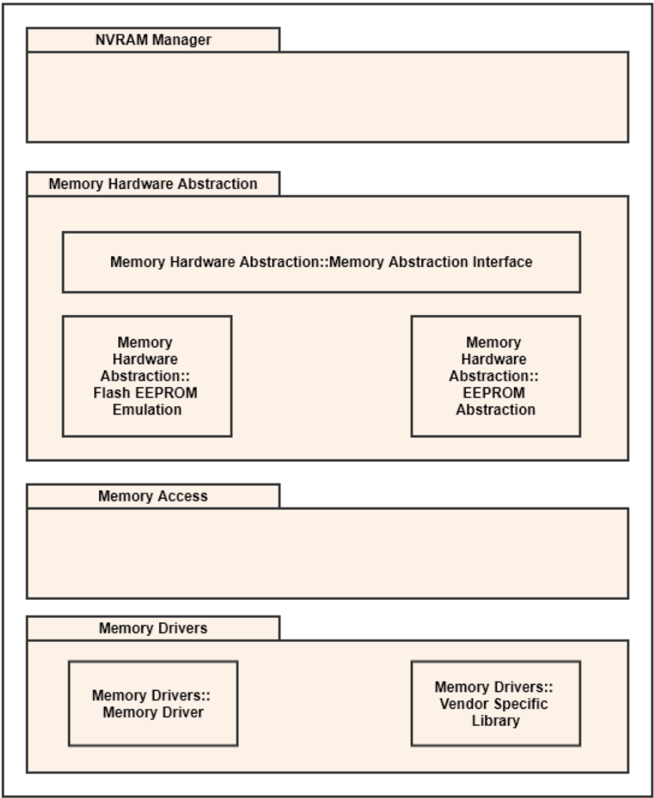
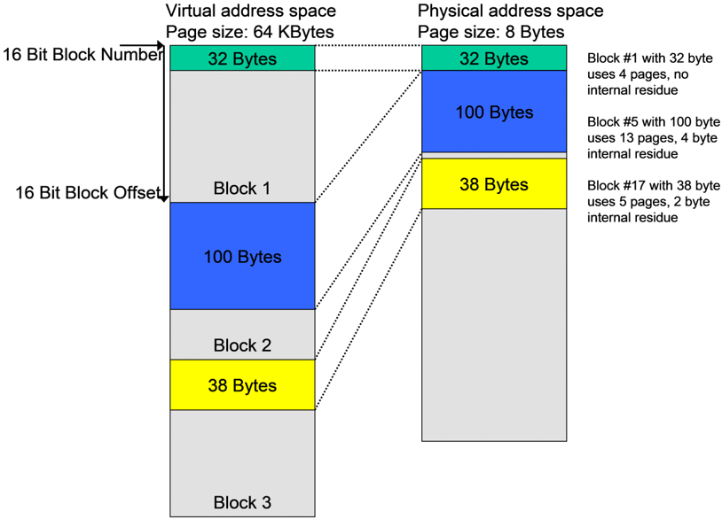
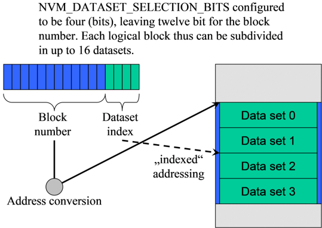
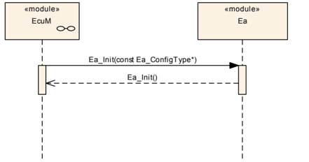
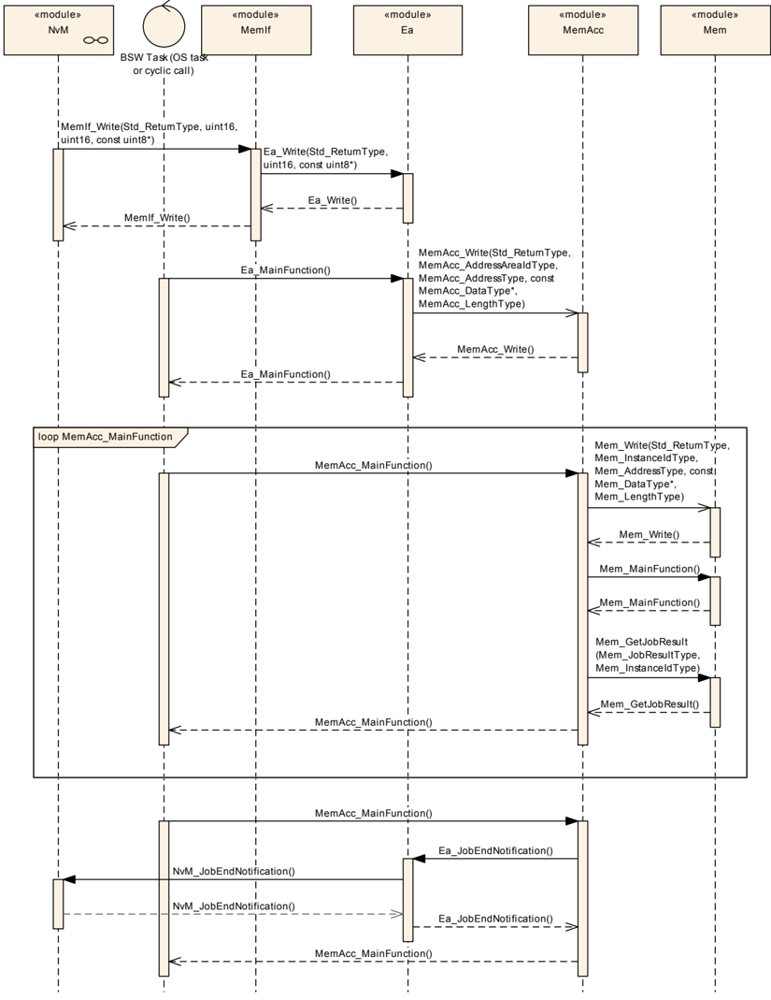
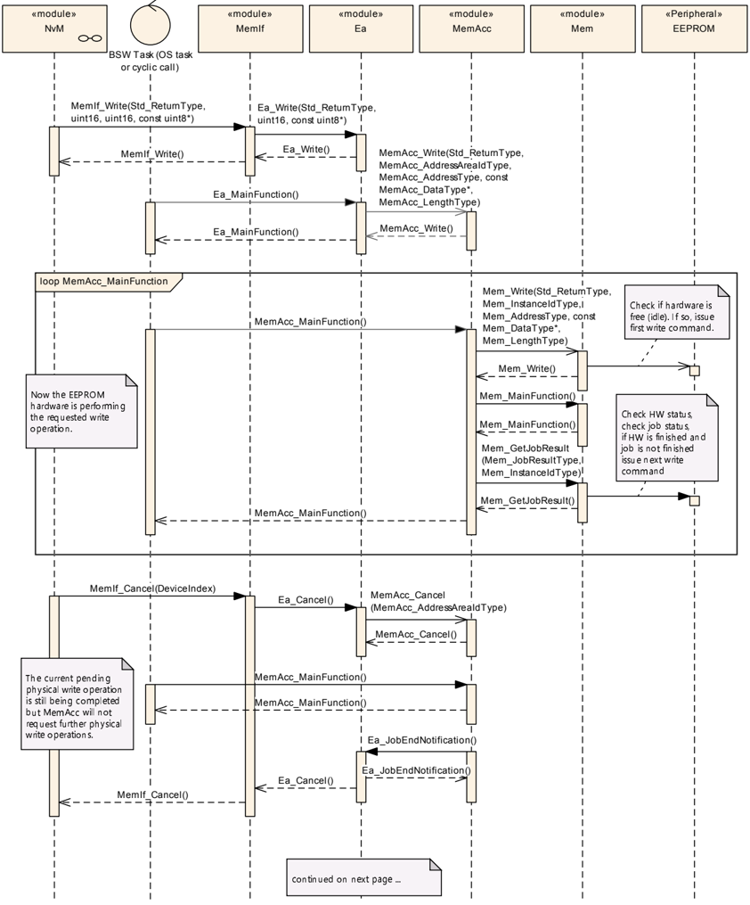
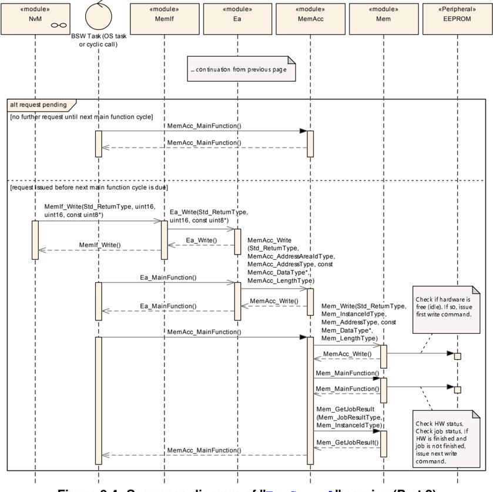
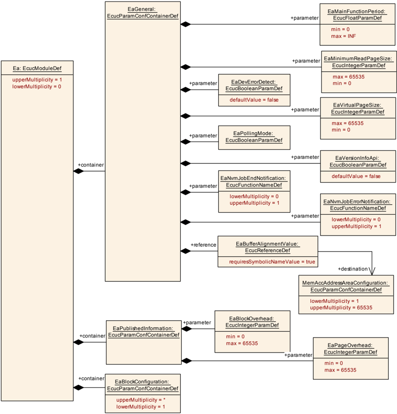
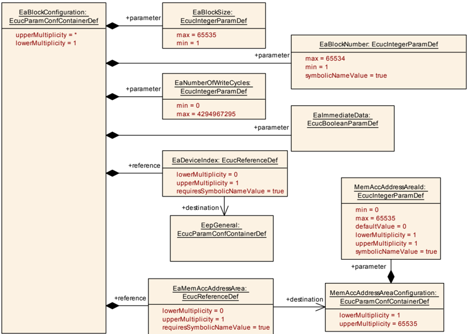

## 1. 简介和功能概述

本文档描述了EEPROM抽象层（**EEPROM Abstraction Layer**）的功能、**API**和配置（参见图1.1）。



EEPROM抽象（**EA**）从设备特定的寻址方案和分段中抽象出来，并为上层提供虚拟寻址方案和分段以及"虚拟"的无限数量的擦除周期。

## 2. 缩略语

具有局部作用域、因此未包含在**AUTOSAR**术语表中的缩略语和缩写必须出现在局部术语表中。

**Address Area**
> 逻辑地址空间中的连续内存区域，通常将多个物理存储器扇区组合成一个逻辑地址区域。

**EA**
> EEPROM抽象（**EEPROM Abstraction**）

**EEPROM**
> 电可擦除可编程ROM（**Electrically Erasable and Programmable ROM**，只读存储器（**Read Only Memory**））

**FEE**
> 闪存EEPROM仿真（**Flash EEPROM Emulation**）

**LSB**
> 最低有效位/字节（**Least significant bit / byte**，取决于上下文；此处指"位"）。

**Mem**
> 内存驱动程序（**Memory Driver**）

**MemAcc**
> 内存访问（**Memory Access**）

**MemIf**
> 内存抽象接口（**Memory Abstraction Interface**）

**MSB**
> 最高有效位/字节（**Most significant bit / byte**，取决于上下文；此处指"位"）。

**NvM**
> NVRAM管理器（**NVRAM Manager**）

**NVRAM**
> 非易失性RAM（**Non-volatile RAM**，随机存取存储器（**Random Access Memory**））

**NVRAM block**
> NVRAM管理器所见的管理单元

**(Logical) block**
> 模块用户看到的最小可写/可擦除单元。由一个或多个虚拟页面（**Virtual page**）组成。

**Virtual page**
> 虚拟页面可能由一个或多个物理页面组成，以便于处理逻辑块和地址计算。

**Internal residue**
> 如果配置的块大小不是虚拟页面大小的整数倍，则最后一个虚拟页面末尾的未使用空间（参见图7.1）。

**Virtual address**
> 由16位块序号和逻辑块内的16位偏移量组成的地址。

**Physical address**
> 用于访问逻辑块的、设备特定格式（取决于底层EEPROM驱动程序和设备）的地址信息。

**Dataset**
> NVRAM管理器的一个概念：用户可寻址的相同大小的块数组。例如，可用于为具有其他方面完全相同的应用软件（例如车门模块）的**ECU**提供**CAN**驱动程序的不同配置设置（**CAN** ID、滤波器设置等）。

**Redundant copy**
> NVRAM管理器的一个概念：将相同的信息存储两次以提高数据存储的可靠性。

## 3. 相关文档

### 3.1. 输入文件和相关标准与规范

<a id="ref-1"></a>[1] General Specification of Basic Software Modules
> AUTOSAR_CP_SWS_BSWGeneral

<a id="ref-2"></a>[2] Requirements on Memory Hardware Abstraction Layer
> AUTOSAR_CP_SRS_MemoryHWAbstractionLayer

### 3.2. 相关规范

**AUTOSAR**提供了基础软件模块的通用规范[1](#ref-1)，它也适用于EEPROM抽象。

因此，规范SWS BSW General需被视为EEPROM抽象的附加和必需规范。

## 4. 约束和假设

### 4.1. 限制

无限制。

### 4.2. 汽车域的适用性

无限制。

## 5. 对其他模块的依赖

本模块依赖于底层EEPROM驱动程序的能力以及NVRAM管理器的配置。

## 6. 功能规格

### 6.1. 一般行为

EEPROM抽象（**EA**）一次只应接受一个作业，即该模块不应为挂起的作业提供队列（这是NVRAM管理器的职责）。

**注意：**

由于**NvM**是本模块的唯一调用者，并且为了使本模块保持合理的小巧，模块的函数不应检查模块当前是否繁忙。挂起作业的串行化以及在上一作业完成或取消之后才启动新作业，是**NvM**的职责。

#### 6.1.1. 寻址方案和分段

EEPROM抽象（**EA**）为上层提供**32**位虚拟线性地址空间和统一的分段方案。该虚拟**32**位地址包括：

* **16**位块序号（**block number**）——理论上允许**65536**个逻辑块
* **16**位块偏移（**block offset**）——理论上每块为**64K**字节

**16**位块序号代表一种可配置的（虚拟）分页（**paging**）机制。该地址对齐的值可以从底层EEPROM驱动程序和设备的值导出。该虚拟分页通过参数**EA_VIRTUAL_PAGE_SIZE**进行配置。

**Ea**模块的配置应使虚拟页面大小（在**EA_VIRTUAL_PAGE_SIZE**中定义）为物理页面大小的整数倍，即不允许配置比实际物理页面大小更小的虚拟页面。

**示例：**

虚拟页面的大小配置为**8**个字节，因此地址对齐为**8**个字节。块序号为**1**的逻辑块放置在物理地址**x**处。那么块序号为**2**的逻辑块将放置在**x+8**处，块序号**3**将放置在**x+16**处。

**注意：**

本规范需求允许计算逻辑块的物理起始地址，而不必借助查找表（**lookup table**）进行地址映射。

每个已配置的逻辑块应占用所配置虚拟页面大小**EaVirtualPageSize**的整数倍。

示例：如果虚拟页面大小配置为**8**个字节，则逻辑块的大小可以是**8**、**16**、**24**、**32**……字节，但不能是例如**10**、**20**、**50**……字节。



逻辑块不得相互重叠，也不得包含在彼此之内。

示例：通过相应地设置参数**EA_VIRTUAL_PAGE_SIZE**，地址对齐/虚拟分页被配置为**8**个字节。逻辑块序号**1**配置为大小**32**个字节（参见图7.1）。该逻辑块将恰好使用**4**个虚拟页面。因此下一个逻辑块将获得块序号**5**，因为块序号**2**、**3**和**4**被第一个逻辑块"阻塞"。第二个块配置为大小**100**个字节，占用**13**个虚拟页面，最后一个页面的**4**个字节未使用。因此下一个可用的逻辑块序号将为**17**。

块序号**0x0000**和**0xFFFF**不得配置为逻辑块**EaBlockNumber**。

#### 6.1.2. 地址计算

依赖于**EA**模块的实现和所使用的确切地址格式，**EA**模块的函数应将**16**位块序号和**16**位块偏移量组合起来，以推导出底层EEPROM驱动程序所需的物理EEPROM地址。

**注意：**

底层EEPROM驱动程序所需的确切地址格式，以及如何从给定的**16**位块序号和**16**位块偏移量导出物理EEPROM地址的机制，取决于EEPROM设备和EEPROM设备驱动程序的实现，因此无法在本文件中规定。

只有**16**位块序号中那些不表示特定数据集（**dataset**）或冗余副本（**redundant copy**）的位才应用于地址计算。

**注意：**

由于**NVRAM**管理器需要此类信息，因此可使用参数**NVM_DATASET_SELECTION_BITS**为**NVRAM**管理器配置用于编码的位数。

示例：数据集信息配置为在**16**位块序号的四个**LSB**中进行编码（每个**NVRAM**块最多允许**16**个数据集，总共**4094**个**NVRAM**块）。实现者决定将逻辑块的所有数据集直接相邻存储，并使用块的长度和指针来访问每个数据集。为了计算块的起始地址（第一个数据集的地址），她/他只使用**12**个**MSB**；为了访问特定的数据集，她/他在该起始地址上加上块大小乘以数据集索引（四个**LSB**）的乘积（图7.2）。



#### 6.1.3. 擦除/写入周期的限制

**Ea**模块的配置应在配置参数**EaNumberOfWriteCycles**中为每个逻辑块定义预期的擦除/写入周期数。

如果底层EEPROM设备或设备驱动程序不能提供至少所配置的每个物理存储单元的擦除/写入周期数（由参数**EepAllowedWriteCycles**给出），则**EA**模块应提供分散擦除/写入访问的机制，使物理设备不会承受过大压力。这也适用于**EA**模块内部使用的所有管理数据。

示例：逻辑块序号**1**配置为预期的**500,000**个写入周期，而底层EEPROM设备和设备驱动程序仅规定**100,000**个擦除周期。在这种情况下，**EA**模块必须提供（至少）五个独立的内存区域，并在内部交替访问这些区域，使每个物理内存位置的擦除次数不超过规定的**100,000**个周期。

#### 6.1.4. 处理"即时"数据

包含即时数据（**immediate data**）的块必须立即写入，即此类块应可写而无需先擦除相应的内存区域（例如通过使用预擦除内存）。在写入即时数据之前，**NVRAM**管理器应取消正在进行的较低优先级读取/擦除/写入或比较作业。

**注意：**

硬件上正在运行的操作（例如写入一个页面或擦除一个扇区）一旦启动通常无法中止。因此，即使对于即时数据，也必须接受最长硬件操作的最大时间作为延迟。

示例：三个各**10**字节的块已配置为即时数据。**EA**模块/配置工具保留这**30**个字节（如需要，加上每个块/页面的实现特定开销）仅供该即时数据使用。也就是说，该内存区域不得用于存储其他数据块。

现在，**NVRAM**管理器已请求**EA**模块写入一个**100**字节的数据块。在该块写入期间，出现了一个（或多个）即时数据块需要写入的情况。因此**NVRAM**管理器取消正在进行的写请求，随后发出针对（第一个）包含即时数据的块的写请求。正在进行的写请求的取消由**EA**模块同步执行，底层EEPROM驱动程序（即针对即时数据的写请求）可以立即启动，无需任何进一步延迟。然而，在即时数据的首个字节可以被写入之前，**EA**模块或底层EEPROM驱动程序必须等待来自前一个写请求的正在进行的硬件访问结束（例如写入页面、擦除扇区、通过**SPI**传输等）。

#### 6.1.5. 管理块一致性信息

**Ea**模块应为每个块管理该块从**EA**模块的角度来看是否"正确"的信息。该一致性信息应仅涉及块的内部处理，而不涉及块的内容。

当块写入操作开始时，**EA**模块应将相应的块标记为不一致（**inconsistent**）<sup>1</sup>。在块写入操作成功结束后，**EA**模块应（再次）将该块标记为一致（**consistent**）。

**注意：**

此内部管理信息不应与块的有效性信息相混淆，后者可通过使用[**Ea_InvalidateBlock**](#737-ea_invalidateblock)服务来操作，即**EA**模块应能够区分不一致的块和被上层故意标识为无效的块。

> 1 这不一定意味着对物理设备进行写操作。如果有其他手段可以检测逻辑块的一致性，则应避免更改随块存储的管理信息。

#### 6.1.6. 缓冲区对齐

**Ea**应将内部缓冲区对齐到**EaBufferAlignmentValue** Ref的值。

**Ea**应将读取请求对齐到**EaMinimumReadPageSize**的值。

### 6.2. 错误分类

#### 6.2.1. 开发错误

**Ea**模块中开发错误的定义：

| 错误类型 | 相关错误代码 | 错误值 |
|---|---|---|
| 模块尚未（或还未）初始化时调用了**API**服务 | EA_E_UNINIT | 0x01 |
| 调用**API**服务时给定的块序号无效 | EA_E_INVALID_BLOCK_NO | 0x02 |
| 调用**API**服务时给定的块偏移无效 | EA_E_INVALID_BLOCK_OFS | 0x03 |
| 调用**API**服务时给定的指针参数无效 | EA_E_PARAM_POINTER | 0x04 |
| 调用**API**服务时给定的块长度信息无效 | EA_E_INVALID_BLOCK_LEN | 0x05 |

#### 6.2.2. 运行时错误

**Ea**模块中运行时错误的定义：

| 错误类型 | 相关错误代码 | 错误值 |
|---|---|---|
| 模块繁忙时调用了**API**服务 | EA_E_BUSY | 0x06 |
| 在没有挂起作业时调用了[**Ea_Cancel**](#734-ea_cancel) | EA_E_INVALID_CANCEL | 0x08 |

#### 6.2.3. 瞬态故障

没有瞬态故障。

#### 6.2.4. 生产错误

没有生产错误。

#### 6.2.5. 扩展生产错误

没有扩展生产错误。

## 7. API规范

### 7.1. 导入的类型

**Ea**模块导入的数据类型的定义：

| 模块 | 头文件 | 导入的类型 |
|---|---|---|
| MemAcc | MemAcc_GeneralTypes.h | MemAcc_AddressAreaIdType |
| MemAcc | MemAcc_GeneralTypes.h | MemAcc_AddressType |
| MemAcc | MemAcc_GeneralTypes.h | MemAcc_DataType |
| MemAcc | MemAcc_GeneralTypes.h | MemAcc_JobResultType |
| MemAcc | MemAcc_GeneralTypes.h | MemAcc_LengthType |
| MemIf | MemIf.h | MemIf_JobResultType |
| MemIf | MemIf.h | MemIf_StatusType |
| Std | Std_Types.h | Std_ReturnType |
| Std | Std_Types.h | Std_VersionInfoType |

前表所列的类型不得针对特定的**EA**模块或硬件平台进行更改或扩展。

### 7.2. 类型定义

#### 7.2.1. Ea_ConfigType

结构类型。元素为实现特定。**Ea**模块的配置数据结构。可通过**Ea.h**获得。

### 7.3. 函数定义

#### 7.3.1. Ea_Init

**说明**: 服务 ID 0x00。初始化EEPROM抽象模块。可通过**Ea.h**获得。本服务为同步调用，不可重入。参数 ConfigPtr（in）：指向所选配置集的指针。参数（inout）：无。参数（out）：无。返回值：无。

```C
void Ea_Init ( const Ea_ConfigType* ConfigPtr )
```

配置指针**ConfigPtr**应始终为**NULL_PTR**值。

**注意：**

配置指针**ConfigPtr**当前未被使用，因此应设置为**NULL_PTR**值。

函数**Ea_Init**在启动模块的初始化时，应将模块状态从MEMIF_UNINIT设置为MEMIF_BUSY_INTERNAL。

如果初始化在**Ea_Init**内完成，则一旦初始化成功完成，函数**Ea_Init**应将模块状态从MEMIF_BUSY_INTERNAL设置为MEMIF_IDLE。

**注意：**

**Ea**模块的环境不得在**EA**模块正在运行操作期间调用函数**Ea_Init**。

#### 7.3.2. Ea_Read

**说明**: 服务 ID 0x02。从块BlockNumber的BlockOffset偏移处读取Length个字节到缓冲区DataBufferPtr中。可通过**Ea.h**获得。本服务为异步调用，不可重入。参数 BlockNumber（in）：逻辑块的序号，也表示该块在EEPROM中的起始地址。参数 BlockOffset（in）：块内的读取地址偏移。参数 Length（in）：要读取的字节数。参数（inout）：无。参数（out）DataBufferPtr：指向数据缓冲区的指针。返回值：**Std_ReturnType**，**E_OK**：请求的作业已被模块接受；**E_NOT_OK**：请求的作业未被**EA**模块接受。

```C
Std_ReturnType Ea_Read (
    uint16 BlockNumber,
    uint16 BlockOffset,
    uint8* DataBufferPtr,
    uint16 Length )
```

函数**Ea_Read**应取块序号和偏移量，并计算出相应的内存读取地址。

**注意：**

地址偏移量和长度参数可以取给定类型范围内的任何值，这允许从逻辑块内的任意地址读取任意数量的字节。

**EA**模块应在**EA**模块的主函数中异步执行读取操作。

如果当前模块状态为MEMIF_IDLE或当前模块状态为MEMIF_BUSY_INTERNAL，则函数**Ea_Read**应接受读取请求，将给定/计算出的参数复制到模块内部变量中，启动读取作业，将**EA**模块状态设置为MEMIF_BUSY，将作业结果设置为MEMIF_JOB_PENDING，并以**E_OK**返回。

如果当前模块状态为MEMIF_UNINIT或MEMIF_BUSY，则函数**Ea_Read**应拒绝该作业请求并以**E_NOT_OK**返回。

如果**EA**模块的开发错误检测已启用：函数**Ea_Read**应检查模块状态是否为MEMIF_UNINIT。如果是这种情况，函数**Ea_Read**应拒绝读取请求，引发开发错误[EA_E_UNINIT](#621-开发错误)并以**E_NOT_OK**返回。

函数**Ea_Read**应检查模块状态是否为MEMIF_BUSY。如果是这种情况，函数**Ea_Read**应拒绝读取请求，引发运行时错误[EA_E_BUSY](#622-运行时错误)并以**E_NOT_OK**返回。

如果**Ea**模块的开发错误检测已启用：函数**Ea_Read**应检查给定的块序号是否有效（即在所配置的范围内）。如果不是这种情况，函数**Ea_Read**应拒绝读取请求，引发开发错误[EA_E_INVALID_BLOCK_NO](#621-开发错误)并返回**E_NOT_OK**。

如果**Ea**模块的开发错误检测已启用：函数**Ea_Read**应检查给定的块偏移量是否有效（即小于为该块配置的块长度）。如果不是这种情况，函数**Ea_Read**应拒绝读取请求，引发开发错误[EA_E_INVALID_BLOCK_OFS](#621-开发错误)并以**E_NOT_OK**返回。

如果**Ea**模块的开发错误检测已启用：函数**Ea_Read**应检查给定的长度信息是否有效，即请求的长度信息加上块偏移量不超过块的结束地址（块起始地址加上所配置的块长度）。如果不是这种情况，函数**Ea_Read**应拒绝读取请求，引发开发错误[EA_E_INVALID_BLOCK_LEN](#621-开发错误)并以**E_NOT_OK**返回。

如果**Ea**模块的开发错误检测已启用：函数**Ea_Read**应检查给定的数据指针是否有效（即不为**NULL**）。如果不是这种情况，函数**Ea_Read**应拒绝读取请求，引发开发错误[EA_E_PARAM_POINTER](#621-开发错误)并以**E_NOT_OK**返回。

如果读取请求被函数**Ea_Read**拒绝，即[EA_E_UNINIT](#621-开发错误)、[EA_E_INVALID_BLOCK_NO](#621-开发错误)、[EA_E_BUSY](#622-运行时错误)、[EA_E_INVALID_BLOCK_OFS](#621-开发错误)、[EA_E_INVALID_BLOCK_LEN](#621-开发错误)、[EA_E_PARAM_POINTER](#621-开发错误)所定义的错误适用的情况，函数**Ea_Read**不得改变当前的模块状态或作业结果。

#### 7.3.3. Ea_Write

**说明**: 服务 ID 0x03。将DataBufferPtr的内容写入块BlockNumber。可通过**Ea.h**获得。本服务为异步调用，不可重入。参数 BlockNumber（in）：逻辑块的序号，也表示该块在EEPROM中的起始地址。参数 DataBufferPtr（in）：指向数据缓冲区的指针。参数（inout）：无。参数（out）：无。返回值：**Std_ReturnType**，**E_OK**：请求的作业已被模块接受；**E_NOT_OK**：请求的作业未被**EA**模块接受。

```C
Std_ReturnType Ea_Write (
    uint16 BlockNumber,
    const uint8* DataBufferPtr )
```

函数**Ea_Write**应取块序号并计算出相应的内存写入地址。在该地址计算中，块偏移量应固定为零。

函数**Ea_Write**应将该写作业的长度参数设置为为此逻辑块配置的长度。

如果当前模块状态为MEMIF_IDLE或当前模块状态为MEMIF_BUSY_INTERNAL，则函数**Ea_Write**应接受写入请求，将给定/计算出的参数复制到模块内部变量中，启动写入作业，将**EA**模块状态设置为MEMIF_BUSY，将作业结果设置为MEMIF_JOB_PENDING，并以**E_OK**返回。

如果当前模块状态为MEMIF_UNINIT或MEMIF_BUSY，则函数**Ea_Write**应拒绝该作业请求并以**E_NOT_OK**返回。

**EA**模块应在**EA**模块的主函数中异步执行函数**Ea_Write**的写作业。

如果**EA**模块的开发错误检测已启用：函数**Ea_Write**应检查模块状态是否为MEMIF_UNINIT。如果是这种情况，函数**Ea_Write**应拒绝写入请求，引发开发错误[EA_E_UNINIT](#621-开发错误)并以**E_NOT_OK**返回。

函数**Ea_Write**应检查模块状态是否为MEMIF_BUSY。如果是这种情况，函数**Ea_Write**应拒绝写入请求，引发运行时错误[EA_E_BUSY](#622-运行时错误)并以**E_NOT_OK**返回。

如果**EA**模块的开发错误检测已启用：函数**Ea_Write**应检查给定的块序号是否有效（即在所配置的范围内）。如果不是这种情况，函数**Ea_Write**应拒绝写入请求，引发开发错误[EA_E_INVALID_BLOCK_NO](#621-开发错误)并以**E_NOT_OK**返回。

如果**Ea**模块的开发错误检测已启用：函数**Ea_Write**应检查给定的数据指针是否有效（即不为**NULL**）。如果不是这种情况，函数**Ea_Write**应拒绝写入请求，引发开发错误[EA_E_PARAM_POINTER](#621-开发错误)并以**E_NOT_OK**返回。

如果写入请求被函数**Ea_Write**拒绝，即[EA_E_UNINIT](#621-开发错误)、[EA_E_BUSY](#622-运行时错误)、[EA_E_INVALID_BLOCK_NO](#621-开发错误)、[EA_E_PARAM_POINTER](#621-开发错误)所定义的错误适用的情况，函数**Ea_Write**不得改变当前的模块状态或作业结果。

#### 7.3.4. Ea_Cancel

**说明**: 服务 ID 0x04。取消正在进行的异步操作。可通过**Ea.h**获得。本服务为异步调用，不可重入。参数（in）：无。参数（inout）：无。参数（out）：无。返回值：无。

```C
void Ea_Cancel ( void )
```

如果**EA**模块的开发错误检测已启用：函数**Ea_Cancel**应检查模块状态是否为MEMIF_UNINIT。如果是这种情况，函数**Ea_Cancel**应引发开发错误[EA_E_UNINIT](#621-开发错误)，并在不更改任何内部变量的情况下返回调用者。

如果当前模块状态为MEMIF_BUSY（即取消挂起作业的请求被函数**Ea_Cancel**接受），则函数**Ea_Cancel**应调用底层EEPROM驱动程序的取消函数。

如果当前模块状态为MEMIF_BUSY（即取消挂起作业的请求被函数**Ea_Cancel**接受），则函数**Ea_Cancel**应重置**EA**模块的内部变量，使模块准备好接受新的作业请求。即函数**Ea_Cancel**应将作业结果设置为MEMIF_JOB_CANCELED，并将模块状态设置为MEMIF_IDLE。

如果当前模块状态不是MEMIF_BUSY（即取消挂起作业的请求被函数**Ea_Cancel**拒绝），则函数**Ea_Cancel**不得改变当前的模块状态或作业结果。

如果当前模块状态不是MEMIF_BUSY（即没有要取消的作业，因此取消挂起作业的请求被函数**Ea_Cancel**拒绝），则函数**Ea_Cancel**应引发运行时错误[EA_E_INVALID_CANCEL](#622-运行时错误)。

#### 7.3.5. Ea_GetStatus

**说明**: 服务 ID 0x05。返回状态的服务。可通过**Ea.h**获得。本服务为同步调用，不可重入。参数（in）：无。参数（inout）：无。参数（out）：无。返回值：**MemIf_StatusType**，**MEMIF_UNINIT**：**EA**模块尚未初始化；**MEMIF_IDLE**：**EA**模块当前空闲；**MEMIF_BUSY**：**EA**模块当前繁忙；**MEMIF_BUSY_INTERNAL**：**EA**模块当前正忙于内部管理操作。

```C
MemIf_StatusType Ea_GetStatus ( void )
```

如果模块尚未（或还未）初始化，函数**Ea_GetStatus**应返回MEMIF_UNINIT。

如果模块既未在处理来自上层的请求，也未在执行内部管理操作，函数**Ea_GetStatus**应返回MEMIF_IDLE。

如果模块当前正在处理来自上层的请求，函数**Ea_GetStatus**应返回MEMIF_BUSY。

如果当前正在执行内部管理操作，函数**Ea_GetStatus**应返回MEMIF_BUSY_INTERNAL。

**注意：**

内部管理操作例如可以是对所用EEPROM存储器的重组（垃圾回收）。这可能意味着底层设备驱动程序（至少暂时）繁忙。

#### 7.3.6. Ea_GetJobResult

**说明**: 服务 ID 0x06。返回作业结果的服务。可通过**Ea.h**获得。本服务为同步调用，不可重入。参数（in）：无。参数（inout）：无。参数（out）：无。返回值：**MemIf_JobResultType**，**MEMIF_JOB_OK**：最后一个作业已成功完成；**MEMIF_JOB_PENDING**：最后一个作业正在等待执行或正在执行中；**MEMIF_JOB_CANCELED**：最后一个作业已被取消（这意味着它已失败）；**MEMIF_JOB_FAILED**：最后一个作业未成功完成（它已失败）；**MEMIF_BLOCK_INCONSISTENT**：所请求的块不一致，它可能包含已损坏的数据；**MEMIF_BLOCK_INVALID**：所请求的块已被标识为无效，无法执行所请求的操作。

```C
MemIf_JobResultType Ea_GetJobResult ( void )
```

如果**EA**模块的开发错误检测已启用：函数**Ea_GetJobResult**应检查模块状态是否为MEMIF_UNINIT。如果是这种情况，函数**Ea_GetJobResult**应引发开发错误[EA_E_UNINIT](#621-开发错误)并返回MEMIF_JOB_FAILED。

函数**Ea_GetJobResult**应返回**NVRAM**管理器所请求的最后一个作业的状态。

只有那些由上层直接请求的作业才应对函数**Ea_GetJobResult**返回的作业结果产生影响。即**EA**模块自身在内部管理操作过程中发出的作业不应改变该作业结果。

**注意：**

为便于实现这一点，**EA**模块可能必须实现第二组局部变量来存储内部作业的数据。

**注意：**

内部管理操作（例如"垃圾回收"）只会在**NvM**请求的作业的上下文中被调用。它们是在所请求的作业之前还是之后执行，由模块的实现者决定，本规范不再详述。

#### 7.3.7. Ea_InvalidateBlock

**说明**: 服务 ID 0x07。使块BlockNumber无效。可通过**Ea.h**获得。本服务为异步调用，不可重入。参数 BlockNumber（in）：逻辑块的序号，也表示该块在EEPROM中的起始地址。参数（inout）：无。参数（out）：无。返回值：**Std_ReturnType**，**E_OK**：请求的作业已被模块接受；**E_NOT_OK**（仅当**DET**启用时）：请求的作业未被**EA**模块接受。

```C
Std_ReturnType Ea_InvalidateBlock ( uint16 BlockNumber )
```

函数**Ea_InvalidateBlock**应取块序号并计算出相应的内存块地址。

取决于实现，函数**Ea_InvalidateBlock**应通过调用底层设备驱动程序的擦除函数或相应地更改某些模块内部管理信息，来使块&lt;BlockNumber&gt;无效。

**注意：**

所请求的块被无效化的确切方式取决于模块的实现，本规范不再进一步详述。内部管理信息必须存储在NV存储器中，因为它必须能抗复位。该信息是什么以及如何存储，本规范不再进一步详述。

如果**Ea**模块的开发错误检测已启用：函数**Ea_InvalidateBlock**应检查模块状态是否为MEMIF_UNINIT。如果是这种情况，函数**Ea_InvalidateBlock**应拒绝无效化请求，引发开发错误[EA_E_UNINIT](#621-开发错误)并以**E_NOT_OK**返回。

函数**Ea_InvalidateBlock**应检查模块状态是否为MEMIF_BUSY。如果是这种情况，函数**Ea_InvalidateBlock**应拒绝无效化请求，引发运行时错误[EA_E_BUSY](#622-运行时错误)并以**E_NOT_OK**返回。

函数**Ea_InvalidateBlock**应检查模块状态是否为MEMIF_IDLE或MEMIF_BUSY_INTERNAL。如果是这种情况，模块应接受无效化请求，将**Ea**模块状态设置为MEMIF_BUSY，将作业结果设置为MEMIF_JOB_PENDING，并向调用者返回**E_OK**。

**Ea**模块应在**Ea**模块的主函数中异步执行块无效化请求。

如果**EA**模块的开发错误检测已启用：函数**Ea_InvalidateBlock**应检查给定的块序号是否有效（即该块已被配置）。如果不是这种情况，函数**Ea_InvalidateBlock**应拒绝该请求，引发开发错误[EA_E_INVALID_BLOCK_NO](#621-开发错误)并以**E_NOT_OK**返回。

如果无效化请求被函数**Ea_InvalidateBlock**拒绝，即[EA_E_UNINIT](#621-开发错误)、[EA_E_INVALID_BLOCK_NO](#621-开发错误)或[EA_E_BUSY](#622-运行时错误)所定义的错误适用的情况，函数**Ea_InvalidateBlock**不得改变当前的模块状态或作业结果。

#### 7.3.8. Ea_GetVersionInfo

**说明**: 服务 ID 0x08。获取本模块版本信息的服务。可通过**Ea.h**获得。本服务为同步调用，可重入。参数（in）：无。参数（inout）：无。参数（out）VersionInfoPtr：指向标准版本信息结构的指针。返回值：无。

```C
void Ea_GetVersionInfo ( Std_VersionInfoType* VersionInfoPtr )
```

如果**EA**模块的开发错误检测已启用：函数**EA_GetVersionInfo**应检查给定的数据指针是否有效（即不为**NULL**）。如果不是这种情况，函数**Ea_GetVersionInfo**应引发开发错误[EA_E_PARAM_POINTER](#621-开发错误)。

#### 7.3.9. Ea_EraseImmediateBlock

**说明**: 服务 ID 0x09。擦除块BlockNumber。可通过**Ea.h**获得。本服务为异步调用，不可重入。参数 BlockNumber（in）：逻辑块的序号，也表示该块在EEPROM中的起始地址。参数（inout）：无。参数（out）：无。返回值：**Std_ReturnType**，**E_OK**：请求的作业已被模块接受；**E_NOT_OK**（仅当**DET**启用时）：请求的作业未被**EA**模块接受。

```C
Std_ReturnType Ea_EraseImmediateBlock ( uint16 BlockNumber )
```

**注意：**

例如，诊断或类似的系统服务应在必要时调用函数**Ea_EraseImmediateBlock**，为即时数据预擦除相应的区域。

函数**Ea_EraseImmediateBlock**应取块序号并计算出相应的内存块地址。在该地址计算中，块偏移量应固定为零。

函数**Ea_EraseImmediateBlock**应确保**EA**模块可以写入即时数据。这是否涉及物理擦除内存区域并因此调用底层驱动程序的擦除函数，取决于模块的实现。

如果**EA**模块的开发错误检测已启用：函数**Ea_EraseImmediateBlock**应检查模块状态是否为MEMIF_UNINIT。如果是这种情况，函数**Ea_EraseImmediateBlock**应拒绝擦除请求，引发开发错误[EA_E_UNINIT](#621-开发错误)并以**E_NOT_OK**返回。

函数**Ea_EraseImmediateBlock**应检查模块状态是否为MEMIF_BUSY。如果是这种情况，函数应拒绝擦除请求，引发运行时错误[EA_E_BUSY](#622-运行时错误)并以**E_NOT_OK**返回。

如果**EA**模块的开发错误检测已启用：函数**Ea_EraseImmediateBlock**应检查给定的块序号是否有效（即该块已被配置）。如果不是这种情况，函数**Ea_EraseImmediateBlock**应拒绝擦除请求，引发开发错误[EA_E_INVALID_BLOCK_NO](#621-开发错误)并以**E_NOT_OK**返回。

如果**EA**模块的开发错误检测已启用，函数**Ea_EraseImmediateBlock**应检查所寻址的逻辑块是否被配置为包含即时数据（配置参数**EaImmediateData** == TRUE）。如果不是，函数**Ea_EraseImmediateBlock**应拒绝擦除请求，引发开发错误[EA_E_INVALID_BLOCK_NO](#621-开发错误)并以**E_NOT_OK**返回。

如果即时块的擦除请求被函数**Ea_EraseImmediateBlock**拒绝，即[EA_E_UNINIT](#621-开发错误)、[EA_E_BUSY](#622-运行时错误)、[EA_E_INVALID_BLOCK_NO](#621-开发错误)所定义的错误适用的情况，函数**Ea_EraseImmediateBlock**不得改变当前的模块状态或作业结果。

### 7.4. 回调通知

本章列出了**Ea**模块提供给下层模块的所有函数。

**注意：**

根据组成NV存储器栈的各模块的实现，**EA**模块提供的回调例程可能会在中断级被调用。因此**EA**模块的实现必须确保这些例程的运行时间足够短，即回调可能会向上传播穿过多个软件层。回调例程是否可在中断级允许/可行取决于项目特定的需求（反应时间）和限制（中断上下文中的运行时间）。因此，系统设计必须确保所涉及模块的配置满足这些要求。

#### 7.4.1. Ea_JobEndNotification

**说明**: 服务 ID 0x10。向本模块报告异步操作成功结束的服务。可通过**Ea.h**获得。本服务为同步调用，不可重入。参数（in）：无。参数（inout）：无。参数（out）：无。返回值：无。

```C
void Ea_JobEndNotification ( void )
```

底层EEPROM驱动程序应调用函数**Ea_JobEndNotification**以报告异步操作的成功结束。

如果作业结果当前为MEMIF_JOB_PENDING，则函数**Ea_JobEndNotification**应将作业结果设置为MEMIF_JOB_OK，否则应保持作业结果不变。

函数**Ea_JobEndNotification**应执行任何必要的块管理操作，并应调用上层模块相应的回调例程（**Ea_NvMJobEndNotification**）。

函数**Ea_JobEndNotification**应执行任何必要的块管理和错误处理操作，并应调用上层模块相应的回调例程（**Ea_NvMJobErrorNotification**）。

**注意：**

函数**Ea_JobEndNotification**应可在中断级被调用。

### 7.5. 调度函数

这些函数由基础软件调度程序（**Basic Software Scheduler**）直接调用。以下函数应没有返回值且没有参数。所有函数均不可重入。

#### 7.5.1. Ea_MainFunction

**说明**: 服务 ID 0x12。处理所请求的作业和内部管理操作的服务。可通过**SchM_Ea.h**获得。

```C
void Ea_MainFunction ( void )
```

**注意：**

函数**Ea_MainFunction**的周期时间应与为底层EEPROM驱动程序配置的周期时间相同。

如果模块初始化（在函数[**Ea_Init**](#731-ea_init)中启动）在模块的主函数中完成，则一旦模块初始化成功完成，函数**Ea_MainFunction**应将模块状态从MEMIF_BUSY_INTERNAL设置为MEMIF_IDLE。

函数**Ea_MainFunction**应异步处理上层请求的读取/写入/擦除/无效化作业和内部管理操作。

函数**Ea_MainFunction**应检查所请求读取的块是否已被上层模块标识为无效。如果是，函数**Ea_MainFunction**应将作业结果设置为MEMIF_BLOCK_INVALID，并调用作业错误通知函数（如果已配置）。

函数**Ea_MainFunction**应在通知调用者之前检查正在被读取的逻辑块的一致性。如果检测到块的不一致性（参见[第6.1.5章](#615-管理块一致性信息)），或者找不到所请求的块，函数**Ea_MainFunction**应将作业结果设置为MEMIF_BLOCK_INCONSISTENT，并调用上层模块的错误通知例程（如果已配置）。

**注意：**

在这种情况下，上层不得使用数据缓冲区的内容。

如果某个内部管理操作因来自上层的作业请求而被挂起，则在上层所请求的作业完成后，函数**Ea_MainFunction**应恢复该内部管理操作。

如果某个内部管理操作因来自上层的作业请求而被中止，则在上层所请求的作业完成后，函数**Ea_MainFunction**应重新启动该内部管理操作。

### 7.6. 期望接口

本章列出了需要从其他模块获得的所有接口。

#### 7.6.1. 强制接口

本章定义了实现模块核心功能所需的所有接口。

| API函数 | 头文件 | 描述 |
|---|---|---|
| Det_ReportRuntimeError | Det.h | 用于报告运行时错误的服务。如果已配置callout，则应调用该callout。 |
| Eep_GetStatus | Eep.h | 返回EEPROM状态。 |
| MemAcc_Cancel | MemAcc.h | 触发对addressAreaId所引用的地址区域的挂起作业的取消操作。取消仅影响处于挂起状态的作业。对于任何其他状态，该请求将被忽略。 |
| MemAcc_Erase | MemAcc.h | 触发对给定区域的擦除作业。触发对由targetAddress和length定义的给定区域的擦除作业。此服务的结果可通过Mem_GetJobResult **API**获取。如果擦除操作成功，则作业结果为MEM_JOB_OK。如果擦除操作失败（例如由于硬件问题），则作业结果为MEM_JOB_FAILED。 |
| MemAcc_GetJobResult | MemAcc.h | 返回addressAreaId所引用的地址区域的合并作业结果。 |
| MemAcc_Read | MemAcc.h | 触发读取作业，将数据从源地址复制到所引用的目标数据缓冲区中。此服务的结果可通过MemAcc_GetJobResult **API**获取。如果读取操作成功，则作业结果为MEMACC_OK。如果读取操作失败，则作业结果为一般错误时的MEMACC_FAILED，或可纠正/不可纠正**ECC**错误时的MEMACC_ECC_CORRECTED/MEMACC_ECC_UNCORRECTED。 |
| MemAcc_Write | MemAcc.h | 触发写入作业，将传入的数据以给定的地址和长度存储到所提供的地址区域。此服务的结果可通过MemAcc_GetJobResult **API**获取。如果写入操作成功，则作业结果为MEMACC_OK。如果写入数据时出现问题，则结果为MEMACC_FAILED。 |

#### 7.6.2. 可选接口

本章定义了实现模块可选功能所需的所有接口。

| API函数 | 头文件 | 描述 |
|---|---|---|
| Det_ReportError | Det.h | 用于报告开发错误的服务。 |

#### 7.6.3. 可配置接口

本章列出了目标函数可被配置的所有接口。目标函数通常是回调函数。此类接口的名称不是固定的，因为它们是可配置的。

**注意：**

根据组成NV存储器栈的各模块的实现，**EA**模块调用的回调例程可能会在中断级被调用。因此，提供这些例程的模块的实现者必须确保它们的运行时间足够短，即回调可能会向上传播穿过多个软件层。回调例程是否可在中断级允许/可行取决于项目特定的需求（反应时间）和限制（中断上下文中的运行时间）。因此，系统设计必须确保所涉及模块的配置满足这些要求。

可配置接口**NvM_JobEndNotification**的定义：

| 服务名称 | NvM_JobEndNotification |
|---|---|
| 语法 | void NvM_JobEndNotification ( void ) |
| 同步/异步 | 同步 |
| 可重入性 | 不可重入 |
| 参数（in） | 无 |
| 参数（inout） | 无 |
| 参数（out） | 无 |
| 返回值 | 无 |
| 描述 | 供底层内存抽象用于报告作业无错误结束的函数。 |
| 可通过 | NvM_MemIf.h |

**Ea**模块应在异步读取操作成功结束并执行所有必要的内部管理操作后，调用配置参数**EaNvMJobEndNotification**中定义的函数。异步读取操作的成功结束意味着读取作业已完成且结果为**OK**。

**Ea**模块应在异步写入操作成功结束并执行所有必要的内部管理操作后，调用配置参数**EaNvMJobEndNotification**中定义的函数。异步写入操作的成功结束意味着写入作业已完成、结果为**OK**且块已被标记为有效。

**Ea**模块应在异步擦除操作成功结束并执行所有必要的内部管理操作后，调用配置参数**EaNvMJobEndNotification**中定义的函数。异步擦除操作的成功结束意味着针对即时数据的擦除作业已完成且结果为**OK**（参见[第6.1.3章](#613-擦除写入周期的限制)）。

**Ea**模块应在异步块无效化操作成功结束并执行所有必要的内部管理操作后，调用配置参数**EaNvMJobEndNotification**中定义的函数。异步块无效化操作的成功结束意味着块无效化作业已完成且结果为**OK**（即块已被标记为无效）。

可配置接口**NvM_JobErrorNotification**的定义：

| 服务名称 | NvM_JobErrorNotification |
|---|---|
| 语法 | void NvM_JobErrorNotification ( void ) |
| 同步/异步 | 同步 |
| 可重入性 | 不可重入 |
| 参数（in） | 无 |
| 参数（inout） | 无 |
| 参数（out） | 无 |
| 返回值 | 无 |
| 描述 | 供底层内存抽象用于报告作业错误结束的函数。 |
| 可通过 | NvM_MemIf.h |

**Ea**模块应在异步读取操作失败并执行所有必要的内部管理和错误处理操作后，调用配置参数**EaNvMJobErrorNotification**中定义的函数。异步读取操作的失败意味着读取作业已完成且已失败（即块无效或不一致）。

**Ea**模块应在异步写入操作失败并执行所有必要的内部管理和错误处理操作后，调用配置参数**EaNvMJobErrorNotification**中定义的函数。异步写入操作的失败意味着写入作业已完成且已失败，且块已被标记为不一致。

**Ea**模块应在异步擦除操作失败并执行所有必要的内部管理和错误处理操作后，调用配置参数**EaNvMJobErrorNotification**中定义的函数。异步擦除操作的失败意味着针对即时数据的擦除作业已完成且已失败（参见[第6.1.3章](#613-擦除写入周期的限制)）。

**Ea**模块应在异步块无效化操作失败并执行所有必要的内部管理和错误处理操作后，调用配置参数**EaNvMJobErrorNotification**中定义的函数。异步块无效化操作的失败意味着块无效化作业已完成且已失败。

## 8. 时序图

**注意：**

对于供应商特定的库，以下时序图仅在显示与调用模块（**Ecu_State Manager**或内存抽象接口）的关系方面有效。从内存抽象模块到底层驱动程序的调用关系对于供应商特定的库不相关/不具约束力。

### 8.1. Ea_Init

下图显示了[**Ea_Init**](#731-ea_init)例程的调用顺序。它不同于本模块所有其他服务的调用顺序，因为它不是由**NVRAM**管理器调用的，也不是通过内存抽象接口调用的。



### 8.2. Ea_Write

下图显示了[**Ea_Write**](#733-ea_write)服务的调用顺序示例。该时序图也适用于本模块的其他异步服务。



### 8.3. Ea_Cancel

下图显示了已取消的[**Ea_Write**](#733-ea_write)服务的调用顺序示例。该时序图表明，[**Ea_Cancel**](#734-ea_cancel)相对于底层硬件是异步的，而其本身是同步的。





## 9. 配置规范

### 9.1. 容器与配置参数

以下各节汇总了所有配置参数。

#### 9.1.1. Ea

| SWS 条目 | [ECUC_Ea_00133] |
|---|---|
| 模块名称 | Ea |
| 描述 | **Ea**（EEPROM抽象）模块的配置。该模块应从设备特定的寻址方案和分段中抽象出来，并为上层提供虚拟寻址方案和分段以及"虚拟"的无限数量的擦除周期。 |
| Post-Build 变体支持 | false |
| 支持的配置变体 | VARIANT-PRE-COMPILE |

| 容器名称 | 多重性 | 作用域/依赖 |
|---|---|---|
| EaBlockConfiguration | 1..* | EEPROM抽象模块的块特定参数的配置。 |
| EaGeneral | 1 | EEPROM抽象模块的通用配置。该容器列出了与块无关的配置参数。 |
| EaPublishedInformation | 1 | 公共发布信息（**Common PublishedInformation**）容器未涵盖的其他发布参数。注意：这些参数没有任何配置类设置，因为它们是发布信息。 |



#### 9.1.2. EaGeneral

| SWS 条目 | [ECUC_Ea_00039] |
|---|---|
| 容器名称 | EaGeneral |
| 父容器 | Ea |
| 描述 | EEPROM抽象模块的通用配置。该容器列出了与块无关的配置参数。 |
| 配置参数 | 见下方参数表 |

| SWS 条目 | [ECUC_Ea_00120] |
|---|---|
| 参数名称 | EaDevErrorDetect |
| 父容器 | EaGeneral |
| 描述 | 打开或关闭开发错误检测和通知。true：启用检测和通知。false：禁用检测和通知。 |
| 多重性 | 1 |
| 类型 | EcucBooleanParamDef |
| 默认值 | false |
| Post-Build 变体值 | false |
| 值配置类 | Pre-compile time：x（All Variants）；Link time：-；Post-build time：- |
| 作用域/依赖 | scope: local |

| SWS 条目 | [ECUC_Ea_00132] |
|---|---|
| 参数名称 | EaMainFunctionPeriod |
| 父容器 | EaGeneral |
| 描述 | 相邻两次主函数调用之间的周期，单位为秒。 |
| 多重性 | 1 |
| 类型 | EcucFloatParamDef |
| 范围 | ]0 .. INF[ |
| 默认值 | - |
| Post-Build 变体值 | false |
| 值配置类 | Pre-compile time：x（All Variants）；Link time：-；Post-build time：- |
| 作用域/依赖 | scope: ECU |

| SWS 条目 | [ECUC_Ea_00135] |
|---|---|
| 参数名称 | EaMinimumReadPageSize |
| 父容器 | EaGeneral |
| 描述 | 最小页面大小。最小页面大小将是该最小页面大小的倍数。**Ea**应将读取请求对齐到该大小。标签：atp.Status=draft |
| 多重性 | 1 |
| 类型 | EcucIntegerParamDef |
| 范围 | 0 .. 65535 |
| 默认值 | - |
| Post-Build 变体值 | false |
| 值配置类 | Pre-compile time：x（All Variants）；Link time：-；Post-build time：- |
| 作用域/依赖 | scope: local |

| SWS 条目 | [ECUC_Ea_00121] |
|---|---|
| 参数名称 | EaNvmJobEndNotification |
| 父容器 | EaGeneral |
| 描述 | 映射到上层模块（**NvM_JobEndNotification**）提供的作业结束通知例程。 |
| 多重性 | 0..1 |
| 类型 | EcucFunctionNameDef |
| 默认值 | - |
| 正则表达式 | - |
| Post-Build 变体多重性 | false |
| Post-Build 变体值 | false |
| 多重性配置类 | Pre-compile time：x；Link time：-；Post-build time：- |
| 值配置类 | Pre-compile time：x；Link time：-；Post-build time：- |
| 作用域/依赖 | scope: local |

| SWS 条目 | [ECUC_Ea_00122] |
|---|---|
| 参数名称 | EaNvmJobErrorNotification |
| 父容器 | EaGeneral |
| 描述 | 映射到上层模块（**NvM_JobErrorNotification**）提供的作业错误通知例程。 |
| 多重性 | 0..1 |
| 类型 | EcucFunctionNameDef |
| 默认值 | - |
| 正则表达式 | - |
| Post-Build 变体多重性 | false |
| Post-Build 变体值 | false |
| 多重性配置类 | Pre-compile time：x；Link time：-；Post-build time：- |
| 值配置类 | Pre-compile time：x；Link time：-；Post-build time：- |
| 作用域/依赖 | scope: local |

| SWS 条目 | [ECUC_Ea_00123] |
|---|---|
| 参数名称 | EaPollingMode |
| 父容器 | EaGeneral |
| 描述 | 为本模块启用和禁用轮询模式的预处理器开关。true：启用轮询模式，禁用（提供给**EEP**模块的）回调函数。false：禁用轮询模式，启用（提供给**EEP**模块的）回调函数。 |
| 多重性 | 1 |
| 类型 | EcucBooleanParamDef |
| 默认值 | - |
| Post-Build 变体值 | false |
| 值配置类 | Pre-compile time：x（All Variants）；Link time：-；Post-build time：- |
| 作用域/依赖 | scope: local |

| SWS 条目 | [ECUC_Ea_00124] |
|---|---|
| 参数名称 | EaVersionInfoApi |
| 父容器 | EaGeneral |
| 描述 | 启用/禁用读取模块版本信息的**API**的预处理器开关。true：版本信息**API**已启用。false：版本信息**API**已禁用。 |
| 多重性 | 1 |
| 类型 | EcucBooleanParamDef |
| 默认值 | false |
| Post-Build 变体值 | false |
| 值配置类 | Pre-compile time：x（All Variants）；Link time：-；Post-build time：- |
| 作用域/依赖 | scope: local |

| SWS 条目 | [ECUC_Ea_00125] |
|---|---|
| 参数名称 | EaVirtualPageSize |
| 父容器 | EaGeneral |
| 描述 | 逻辑块应对齐到的字节大小。 |
| 多重性 | 1 |
| 类型 | EcucIntegerParamDef |
| 范围 | 0 .. 65535 |
| 默认值 | - |
| Post-Build 变体值 | false |
| 值配置类 | Pre-compile time：x（All Variants）；Link time：-；Post-build time：- |
| 作用域/依赖 | scope: local |

| SWS 条目 | [ECUC_Ea_00136] |
|---|---|
| 参数名称 | EaBufferAlignmentValue |
| 父容器 | EaGeneral |
| 描述 | 该参数决定**Ea**缓冲区的起始地址所需的对齐方式。该值应继承自**MemAccBufferAlignmentValue**。 |
| 多重性 | 1 |
| 类型 | 对MemAccAddressAreaConfiguration的符号名引用 |
| Post-Build 变体值 | false |
| 值配置类 | Pre-compile time：x（All Variants）；Link time：-；Post-build time：- |
| 作用域/依赖 | scope: local |

无包含容器。

#### 9.1.3. EaBlockConfiguration

| SWS 条目 | [ECUC_Ea_00040] |
|---|---|
| 容器名称 | EaBlockConfiguration |
| 父容器 | Ea |
| 描述 | EEPROM抽象模块的块特定参数的配置。 |
| 配置参数 | 见下方参数表 |

| SWS 条目 | [ECUC_Ea_00130] |
|---|---|
| 参数名称 | EaBlockNumber |
| 父容器 | EaBlockConfiguration |
| 描述 | 块标识符（句柄）。块序号不得使用**0x0000**和**0xFFFF**（参见[第6.1.1章](#611-寻址方案和分段)）。范围：min = 2^NVM_DATASET_SELECTION_BITS，max = 0xFFFF - 2^NVM_DATASET_SELECTION_BITS。注意：根据为数据集选择预留的位数，还应省略其他几个块序号以便于实现。 |
| 多重性 | 1 |
| 类型 | EcucIntegerParamDef（为该参数生成符号名） |
| 范围 | 1 .. 65534 |
| 默认值 | - |
| Post-Build 变体值 | false |
| 值配置类 | Pre-compile time：x（All Variants）；Link time：-；Post-build time：- |
| 作用域/依赖 | scope: ECU |

| SWS 条目 | [ECUC_Ea_00128] |
|---|---|
| 参数名称 | EaBlockSize |
| 父容器 | EaBlockConfiguration |
| 描述 | 逻辑块的大小，单位为字节。 |
| 多重性 | 1 |
| 类型 | EcucIntegerParamDef |
| 范围 | 1 .. 65535 |
| 默认值 | - |
| Post-Build 变体值 | false |
| 值配置类 | Pre-compile time：x（All Variants）；Link time：-；Post-build time：- |
| 作用域/依赖 | scope: ECU |

| SWS 条目 | [ECUC_Ea_00131] |
|---|---|
| 参数名称 | EaImmediateData |
| 父容器 | EaBlockConfiguration |
| 描述 | 高优先级数据的标记。true：块包含即时数据。false：块不包含即时数据。 |
| 多重性 | 1 |
| 类型 | EcucBooleanParamDef |
| 默认值 | - |
| Post-Build 变体值 | false |
| 值配置类 | Pre-compile time：x（All Variants）；Link time：-；Post-build time：- |
| 作用域/依赖 | scope: ECU |

| SWS 条目 | [ECUC_Ea_00119] |
|---|---|
| 参数名称 | EaNumberOfWriteCycles |
| 父容器 | EaBlockConfiguration |
| 描述 | 该块所需的写入周期数。 |
| 多重性 | 1 |
| 类型 | EcucIntegerParamDef |
| 范围 | 0 .. 4294967295 |
| 默认值 | - |
| Post-Build 变体值 | false |
| 值配置类 | Pre-compile time：x（All Variants）；Link time：-；Post-build time：- |
| 作用域/依赖 | scope: local |

| SWS 条目 | [ECUC_Ea_00129] |
|---|---|
| 参数名称 | EaDeviceIndex |
| 父容器 | EaBlockConfiguration |
| 描述 | 对该块所存储设备的引用。该引用与**EaMemAccAddressArea**互斥。 |
| 多重性 | 0..1 |
| 类型 | 对EepGeneral的符号名引用 |
| Post-Build 变体多重性 | false |
| Post-Build 变体值 | false |
| 多重性配置类 | Pre-compile time：x；Link time：-；Post-build time：- |
| 值配置类 | Pre-compile time：x；Link time：-；Post-build time：- |
| 作用域/依赖 | scope: local；依赖：**NVRAM**管理器或内存抽象接口需要该信息来寻址某个特定的逻辑块。它列于本规范中是为了完整展示所有与块相关的配置参数。该引用与**EaMemAccAddressArea**互斥。 |

| SWS 条目 | [ECUC_Ea_00134] |
|---|---|
| 参数名称 | EaMemAccAddressArea |
| 父容器 | EaBlockConfiguration |
| 描述 | 对**MemAccAddressAreaConfiguration**的引用。该引用与**EaDeviceIndex**互斥。标签：atp.Status=draft |
| 多重性 | 0..1 |
| 类型 | 对MemAccAddressAreaConfiguration的符号名引用 |
| Post-Build 变体多重性 | false |
| Post-Build 变体值 | false |
| 多重性配置类 | Pre-compile time：x；Link time：-；Post-build time：- |
| 值配置类 | Pre-compile time：x；Link time：-；Post-build time：- |
| 作用域/依赖 | scope: local；依赖：该引用与**EaDeviceIndex**互斥。 |

无包含容器。



### 9.2. 发布信息

#### 9.2.1. EaPublishedInformation

| SWS 条目 | [ECUC_Ea_00043] |
|---|---|
| 容器名称 | EaPublishedInformation |
| 父容器 | Ea |
| 描述 | 公共发布信息（**CommonPublishedInformation**）容器未涵盖的其他发布参数。注意：这些参数没有任何配置类设置，因为它们是发布信息。 |
| 配置参数 | 见下方参数表 |

| SWS 条目 | [ECUC_Ea_00126] |
|---|---|
| 参数名称 | EaBlockOverhead |
| 父容器 | EaPublishedInformation |
| 描述 | 每个逻辑块的管理开销，单位为字节。注意：如果管理开销取决于块大小或块位置，则必须提供公式，使配置工具能够正确计算管理开销。 |
| 多重性 | 1 |
| 类型 | EcucIntegerParamDef |
| 范围 | 0 .. 65535 |
| 默认值 | - |
| Post-Build 变体值 | false |
| 值配置类 | Published Information：x（All Variants） |
| 作用域/依赖 | scope: local |

| SWS 条目 | [ECUC_Ea_00127] |
|---|---|
| 参数名称 | EaPageOverhead |
| 父容器 | EaPublishedInformation |
| 描述 | 每个页面的管理开销，单位为字节。注意：如果管理开销取决于块大小或块位置，则必须提供公式，使配置工具能够正确计算管理开销。 |
| 多重性 | 1 |
| 类型 | EcucIntegerParamDef |
| 范围 | 0 .. 65535 |
| 默认值 | - |
| Post-Build 变体值 | false |
| 值配置类 | Published Information：x（All Variants） |
| 作用域/依赖 | scope: local |

无包含容器。
