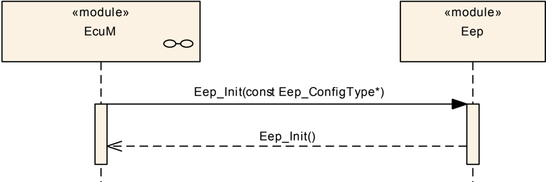
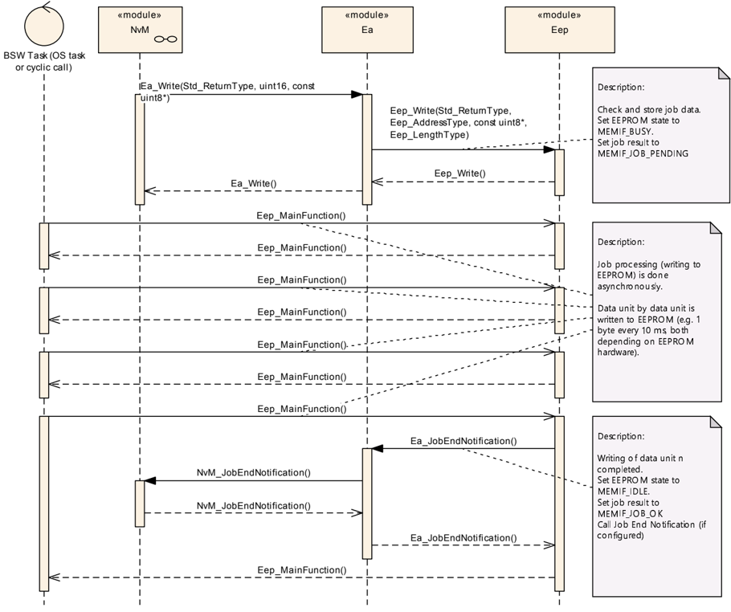
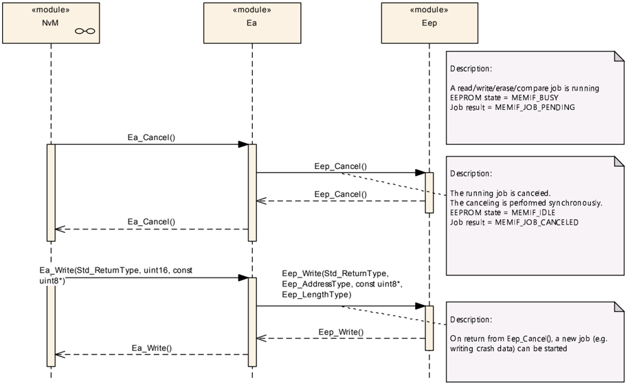

## 1. 简介和功能概述

本文档描述了EEPROM驱动程序的功能和**API**。本规范适用于内部和外部EEPROM的驱动程序。

EEPROM驱动程序提供对EEPROM进行读取、写入、擦除的服务。它还提供将EEPROM中的数据块与内存（例如**RAM**）中的数据块进行比较的服务。

这些服务的行为是异步的。

内部EEPROM的驱动程序直接访问微控制器硬件，位于微控制器抽象层（**Microcontroller Abstraction Layer**）中。外部EEPROM的驱动程序使用处理程序（**handler**，多数情况下为**SPI**）或驱动程序来访问外部EEPROM设备，位于**ECU**抽象层（**ECU Abstraction Layer**）中。

两类驱动程序的功能需求和功能范围相同。因此其**API**在语义上是相同的。

## 2. 缩略语

具有局部作用域、因此未包含在**AUTOSAR**术语表[1](#ref-1)中的缩略语和缩写必须出现在局部术语表中。

**Data block**
> 数据块可包含1..n个字节，并在EEPROM驱动程序的**API**中使用。数据块以下列形式传递给EEPROM驱动程序： • EEPROM中的地址偏移 • 指向内存位置的指针 • 长度

**Data unit**
> EEPROM中最小的数据实体。读/写/擦除操作的数据实体可能不同。示例1：Motorola STAR12 读取：1字节 写入：2字节 擦除：4字节 示例2：外部**SPI** EEPROM设备 读/写/擦除：1字节

**Normal mode / Burst mode**
> 某些外部**SPI** EEPROM设备提供不同访问模式的可能性： • 普通模式（**Normal mode**）：通过**SPI**与EEPROM设备的数据交换按字节执行。这允许与其他**SPI**设备（如**I/O ASIC**、外部看门狗等）协同使用**SPI**。 • 成组模式（**Burst mode**）：通过**SPI**与EEPROM设备的数据交换按块执行。块大小取决于EEPROM的特性，例如64字节。由于传输的是大块数据，在成组模式下**SPI**会被EEPROM访问阻塞。该模式用于需要快速读取/写入数据的**ECU**启动和关闭阶段。

**EEPROM cell**
> EEPROM设备中保存数据的最小物理单元。通常为1字节。

**EEPROM**
> 电可擦除可编程只读存储器（**Electrically Erasable and Programmable Read Only Memory**）

**NVRAM**
> 非易失性随机存取存储器（**Non Volatile Random Access Memory**）

**NvM**
> NVRAM管理器的模块名称[2](#ref-2)

**EcuM**
> ECU状态管理器的模块名称[3](#ref-3)

**DEM**
> 诊断事件管理器的模块名称[4](#ref-4)

**DET**
> 默认错误跟踪器的模块名称[5](#ref-5)

## 3. 相关文档

### 3.1. 输入文件

<a id="ref-1"></a>[1] Glossary（术语表）
> AUTOSAR_FO_TR_Glossary

<a id="ref-2"></a>[2] Specification of NVRAM Manager
> AUTOSAR_CP_SWS_NVRAMManager

<a id="ref-3"></a>[3] Specification of ECU State Manager
> AUTOSAR_CP_SWS_ECUStateManager

<a id="ref-4"></a>[4] Specification of Diagnostic Event Manager
> AUTOSAR_CP_SWS_DiagnosticEventManager

<a id="ref-5"></a>[5] Specification of Default Error Tracer
> AUTOSAR_CP_SWS_DefaultErrorTracer

<a id="ref-6"></a>[6] General Specification of Basic Software Modules
> AUTOSAR_CP_SWS_BSWGeneral

<a id="ref-7"></a>[7] Layered Software Architecture
> AUTOSAR_CP_EXP_LayeredSoftwareArchitecture

<a id="ref-8"></a>[8] Specification of MCU Driver
> AUTOSAR_CP_SWS_MCUDriver

<a id="ref-9"></a>[9] Specification of SPI Handler/Driver
> AUTOSAR_CP_SWS_SPIHandlerDriver

<a id="ref-10"></a>[10] Specification of Memory Abstraction Interface
> AUTOSAR_CP_SWS_MemoryAbstractionInterface

<a id="ref-11"></a>[11] Requirements on EEPROM Driver
> AUTOSAR_CP_SRS_EEPROMDriver

<a id="ref-12"></a>[12] General Requirements on Basic Software Modules
> AUTOSAR_CP_SRS_BSWGeneral

<a id="ref-13"></a>[13] General Requirements on SPAL
> AUTOSAR_CP_SRS_SPALGeneral

### 3.2. 相关规范

**AUTOSAR**提供了基础软件模块的通用规范[\[6, SWS BSW General\]](#ref-6)，它也适用于EEPROM驱动程序。

因此，规范SWS BSW General需被视为EEPROM驱动程序的附加和必需规范。

## 4. 约束和假设

### 4.1. 限制

EEPROM驱动程序不提供保证数据完整性的机制（例如校验和、冗余存储等）。

EEPROM写保护的设置未提供。

### 4.2. 汽车域的适用性

无限制。

### 4.3. 安全相关环境的适用性

如果上层软件为安全相关数据提供以下机制，则本模块可用于安全相关系统中：

* 校验和保护
* 使用数据前检查完整性
* 冗余存储
* 数据写入EEPROM后进行验证。为此可以使用EEPROM驱动程序的比较功能。

## 5. 对其他模块的依赖

EEPROM驱动程序有两类：

1. 片上EEPROM的EEPROM驱动程序。

这些驱动程序是微控制器抽象层的一部分（参见[7](#ref-7)）。

2. 外部EEPROM设备的EEPROM驱动程序。

这些驱动程序是**ECU**抽象层的一部分（参见[7](#ref-7)）。

外部EEPROM驱动程序的源代码应独立于微控制器平台。

内部EEPROM可能依赖于系统时钟、预分频器和**PLL**。因此，系统时钟的变化（例如**PLL**开启 - **PLL**关闭）也可能影响EEPROM硬件的时钟设置。模块EEPROM驱动程序不在其初始化函数中负责设置配置时钟、预分频器和**PLL**的寄存器。这必须由**MCU**模块[8](#ref-8)完成。

外部EEPROM的驱动程序依赖于所使用的片上通信处理程序（例如**SPI**处理程序/驱动程序[9](#ref-9)）的**API**和能力。

EEPROM驱动程序是内存抽象体系结构的一部分，因此某些类型依赖于内存接口（**MemIf**）模块[10](#ref-10)。

### 5.1. 文件结构

如果模块实现使用自定义的中断处理，中断服务例程应放置在**Eep_Irq.c**中。

## 6. 功能规格

### 6.1. 一般行为

**Eep** SWS应对内部和外部EEPROM均有效。

**Eep** SWS为EEPROM操作（读取/写入/擦除/比较）定义异步服务。

**Eep**模块不应缓冲作业。**Eep**模块一次应只接受一个作业。在作业处理期间，**Eep**模块不得接受其他任何作业。

**注意：** 在生产模式下运行时，假定**Eep**用户绝不会并发地发出作业；因此本需求的错误处理仅限于开发阶段，参见[第6.3.2章](#632-eeprom状态检查)。

**Eep**模块不应缓冲要读取或写入的数据。**Eep**模块应使用通过**API**传递的指针所引用的应用程序数据缓冲区。

**Eep**驱动程序应在内部处理数据缓冲区对齐。它不对**RAM**缓冲区的对齐施加任何要求（因为它们是uint8\*），而应将传入的指针视为仅按字节对齐。

### 6.2. 错误分类

本节描述**Eep**模块在该基础软件的生命周期中如何管理可能发生的几个错误类别。

**AUTOSAR**的通用需求文档[12](#ref-12)规定，所有基础软件模块必须（按照产品生命周期）区分3种错误类型：

* 开发错误（**Development errors**）：这些错误应在开发阶段被检测和修复。多数情况下，这些错误是软件错误。
* 运行时错误（**Runtime errors**）：这些错误是可能在生产（即系列）代码中出现的软件异常，由软件实时性导致。
* 生产错误（**Production errors**）：这些错误是硬件错误和无法避免的软件异常，预期会出现在生产（即系列）代码中。

#### 6.2.1. 开发错误

**Eep**模块中开发错误的定义：

| 错误类型 | 相关错误代码 | 错误值 |
|---|---|---|
| 无效的配置集选择 | EEP_E_INIT_FAILED | 0x10 |
| 无效的配置集选择 | EEP_E_PARAM_ADDRESS | 0x11 |
| 无效的配置集选择 | EEP_E_PARAM_DATA | 0x12 |
| 无效的配置集选择 | EEP_E_PARAM_LENGTH | 0x13 |
| 未初始化模块时调用了**API**服务 | EEP_E_UNINIT | 0x20 |
| 调用**API**服务时传入了**NULL**指针 | EEP_E_PARAM_POINTER | 0x23 |

#### 6.2.2. 运行时错误

**Eep**模块中运行时错误的定义：

| 错误类型 | 相关错误代码 | 错误值 |
|---|---|---|
| 驱动程序仍然繁忙时调用了**API**服务 | EEP_E_BUSY | 0x21 |
| 超时 | EEP_E_TIMEOUT | 0x22 |

#### 6.2.3. 瞬态故障

没有瞬态故障。

#### 6.2.4. 生产错误

没有生产错误。

#### 6.2.5. 扩展生产错误

##### 6.2.5.1. EEP_E_ERASE_FAILED

| 错误名称 | [EEP_E_ERASE_FAILED](#625-扩展生产错误) |
|---|---|
| 简要描述 | EEPROM擦除失败（**HW**） |
| 详细描述 | 当EEPROM擦除作业因硬件错误而失败时，**Eeprom**模块报告此错误。 |
| 检测条件 | Fail：EEPROM擦除作业失败（参见[第6.2.5.1章](#6251-eep_e_erase_failed)）。 |
| 检测条件 | Pass：EEPROM擦除作业成功完成（参见[第6.2.5.1章](#6251-eep_e_erase_failed)）。 |
| 次要参数 | 不适用 |
| 所需时间 | 不适用 |
| 监视频率 | 实现特定 |

当**Eeprom**擦除函数失败时，生产错误代码[**EEP_E_ERASE_FAILED**](#625-扩展生产错误)应以FAILED上报。

当**Eeprom**擦除函数成功执行时，生产错误代码[**EEP_E_ERASE_FAILED**](#625-扩展生产错误)应以PASSED上报。

##### 6.2.5.2. EEP_E_WRITE_FAILED

| 错误名称 | [EEP_E_WRITE_FAILED](#625-扩展生产错误) |
|---|---|
| 简要描述 | EEPROM写入失败（**HW**） |
| 详细描述 | 当EEPROM写入作业因硬件错误而失败时，**Eeprom**模块报告此错误。 |
| 检测条件 | Fail：EEPROM写入作业失败（参见[第6.2.5.2章](#6252-eep_e_write_failed)）。 |
| 检测条件 | Pass：EEPROM写入作业成功完成（参见[第6.2.5.2章](#6252-eep_e_write_failed)）。 |
| 次要参数 | 不适用 |
| 所需时间 | 不适用 |
| 监视频率 | 实现特定 |

当**Eeprom**写入函数失败时，生产错误代码[**EEP_E_WRITE_FAILED**](#625-扩展生产错误)应以FAILED上报。

当**Eeprom**写入函数成功执行时，生产错误代码[**EEP_E_WRITE_FAILED**](#625-扩展生产错误)应以PASSED上报。

##### 6.2.5.3. EEP_E_READ_FAILED

| 错误名称 | [EEP_E_READ_FAILED](#625-扩展生产错误) |
|---|---|
| 简要描述 | EEPROM读取失败（**HW**） |
| 详细描述 | 当EEPROM读取作业因硬件错误而失败时，**Eeprom**模块报告此错误。 |
| 检测条件 | Fail：EEPROM读取作业失败（参见[第6.2.5.3章](#6253-eep_e_read_failed)）。 |
| 检测条件 | Pass：EEPROM读取作业成功完成（参见[第6.2.5.3章](#6253-eep_e_read_failed)）。 |
| 次要参数 | 不适用 |
| 所需时间 | 不适用 |
| 监视频率 | 实现特定 |

当**Eeprom**读取函数失败时，生产错误代码[**EEP_E_READ_FAILED**](#625-扩展生产错误)应以FAILED上报。

当**Eeprom**读取函数成功执行时，生产错误代码[**EEP_E_READ_FAILED**](#625-扩展生产错误)应以PASSED上报。

##### 6.2.5.4. EEP_E_COMPARE_FAILED

| 错误名称 | [EEP_E_COMPARE_FAILED](#625-扩展生产错误) |
|---|---|
| 简要描述 | EEPROM比较失败（**HW**） |
| 详细描述 | 当EEPROM比较作业因硬件错误而失败时，**Eeprom**模块报告此错误。 |
| 检测条件 | Fail：EEPROM比较作业失败（参见[第6.2.5.4章](#6254-eep_e_compare_failed)）。 |
| 检测条件 | Pass：EEPROM比较作业成功完成（参见[第6.2.5.4章](#6254-eep_e_compare_failed)）。 |
| 次要参数 | 不适用 |
| 所需时间 | 不适用 |
| 监视频率 | 实现特定 |

当**Eeprom**比较函数失败时，生产错误代码[**EEP_E_COMPARE_FAILED**](#625-扩展生产错误)应以FAILED上报。

当**Eeprom**比较函数成功执行时，生产错误代码[**EEP_E_COMPARE_FAILED**](#625-扩展生产错误)应以PASSED上报。

### 6.3. 错误检测

详情请参阅[6](#ref-6)中的第7.3章"错误检测"（**Error Detection**）。

#### 6.3.1. API参数检查

如果**Eep**模块的开发错误检测已启用：函数**[Eep_Read](#733-eep_read)()**、**[Eep_Write](#734-eep_write)()**、**[Eep_Compare](#736-eep_compare)()**和**[Eep_Erase](#735-eep_erase)()**应检查**DataBufferPtr**不为**NULL**。如果**DataBufferPtr**为**NULL**，它们应引发开发错误[EEP_E_PARAM_DATA](#621-开发错误)，否则（如果未启用开发错误检测）应以**E_NOT_OK**返回。

如果**Eep**模块的开发错误检测已启用：函数**[Eep_Read](#733-eep_read)()**、**[Eep_Write](#734-eep_write)()**、**[Eep_Compare](#736-eep_compare)()**和**[Eep_Erase](#735-eep_erase)()**应检查**EepromAddress**是否有效。如果**EepromAddress**不在有效的EEPROM地址范围内，它们应引发开发错误[EEP_E_PARAM_ADDRESS](#621-开发错误)，否则（如果未启用开发错误检测）应以**E_NOT_OK**返回。

如果**Eep**模块的开发错误检测已启用：函数**[Eep_Read](#733-eep_read)()**、**[Eep_Write](#734-eep_write)()**、**[Eep_Compare](#736-eep_compare)()**和**[Eep_Erase](#735-eep_erase)()**应检查参数**Length**是否在规定的最小值和最大值之间：

* 最小值：1
* 最大值：EepSize - EepromAddress

如果参数**Length**不在规定的最小值和最大值之间，它们应引发开发错误[EEP_E_PARAM_LENGTH](#621-开发错误)，否则（如果未启用开发错误检测）应以**E_NOT_OK**返回。

#### 6.3.2. EEPROM状态检查

函数**[Eep_SetMode](#732-eep_setmode)()**、**[Eep_Read](#733-eep_read)()**、**[Eep_Write](#734-eep_write)()**、**[Eep_Compare](#736-eep_compare)()**和**[Eep_Erase](#735-eep_erase)()**应检查EEPROM状态是否为MEMIF_IDLE。如果EEPROM状态不是MEMIF_IDLE，被调用的函数应：

* 在模块尚未初始化且**Eep**模块的开发错误检测已启用时，引发开发错误[EEP_E_UNINIT](#621-开发错误)
* 根据EEPROM状态引发运行时错误[EEP_E_BUSY](#622-运行时错误)
* 以**E_NOT_OK**拒绝该服务（**[Eep_SetMode](#732-eep_setmode)()**除外，因为该服务没有返回值）。

#### 6.3.3. EEPROM作业遇到硬件故障

当EEPROM擦除函数失败时，应上报生产错误代码[**EEP_E_ERASE_FAILED**](#625-扩展生产错误)。

当EEPROM写入函数失败时，应上报生产错误代码[**EEP_E_WRITE_FAILED**](#625-扩展生产错误)。

当EEPROM读取函数失败时，应上报生产错误代码[**EEP_E_READ_FAILED**](#625-扩展生产错误)。

当EEPROM比较函数失败时，应上报生产错误代码[**EEP_E_COMPARE_FAILED**](#625-扩展生产错误)。

#### 6.3.4. 超时监督

当读取、写入、擦除或比较作业的超时监督失败时，应上报运行时错误代码[EEP_E_TIMEOUT](#622-运行时错误)。

### 6.4. 错误通知

详情请参阅[6](#ref-6)中的第7.2章"错误分类"（**Error classification**）。

### 6.5. 作业处理——通用需求

**Eep**模块应可通过配置参数**EepUseInterrupts**（参见[第9.2.2章](#922-eepgeneral)）配置为中断控制或轮询控制的作业处理（如果EEPROM硬件支持）。

如果支持并启用了中断控制的作业处理，位于**Eep_Irq.c**中的外部中断服务例程应调用一个额外的作业处理函数。

**提示：**

函数[**Eep_MainFunction**](#751-eep_mainfunction)仍然是必需的，用于在没有硬件中断支持的情况下处理作业（例如读取和比较作业）以及用于超时监督。

如果底层EEPROM技术要求读取地址或长度信息具有一定的对齐方式，而读取或比较作业的地址和/或长度参数未正确对齐，则函数[**Eep_MainFunction**](#751-eep_mainfunction)应在内部补偿这种缺失的对齐，即函数[**Eep_MainFunction**](#751-eep_mainfunction)应提供对闪存存储器的按字节读取访问，而不受硬件施加的任何对齐限制。

仅适用于**SPI** EEPROM驱动程序的其他通用需求：

对于通过**SPI**驱动外部EEPROM的**Eep**模块：如果**SPI**访问失败，**Eep**模块的行为应符合[第6.6章](#66-读取作业的处理)的规定。

对于通过**SPI**驱动外部EEPROM的**Eep**模块：在普通EEPROM模式下，**Eep**模块应使用配置为普通访问**SPI** EEPROM的**SPI**通道来访问外部EEPROM。

对于通过**SPI**驱动外部EEPROM的**Eep**模块：**Eep**的配置应使配置参数**EepNormalReadBlockSize**的值适合在普通**SPI**模式下可读取的字节数。

对于通过**SPI**驱动外部EEPROM的**Eep**模块：在快速EEPROM模式下，**Eep**模块应使用配置为成组访问**SPI** EEPROM的**SPI**通道来访问外部EEPROM。

对于通过**SPI**驱动外部EEPROM的**Eep**模块：**Eep**的配置应使配置参数**EepFastReadBlockSize**的值适合在成组**SPI**模式下可读取的字节数。

### 6.6. 读取作业的处理

**Eep**模块应提供两种不同的读取模式：

* 普通模式（**normal mode**）
* 快速模式（**fast mode**）

对于驱动外部EEPROM的**Eep**模块：如果外部EEPROM不支持成组模式，**Eep**模块应接受快速读取模式的选择，但其行为应与普通模式相同（不关心模式参数）。

在普通EEPROM模式下，**Eep**模块应在一个作业处理周期内读取由参数**EepNormalReadBlockSize**指定的字节数。

**示例：**

* EepNormalReadBlockSize = 4
* 要读取的字节数：21
* 所需的作业处理周期数：6
* 产生的读取模式：4-4-4-4-4-1

在快速EEPROM模式下，**Eep**模块应在一个作业处理周期内读取由参数**EepFastReadBlockSize**指定的字节数。

**示例：**

* EepFastReadBlockSize = 32
* 要读取的字节数：110
* 所需的作业处理周期数：4
* 产生的读取模式：32-32-32-14

当读取作业成功完成时，**Eep**模块应将EEPROM状态设置为MEMIF_IDLE，并将作业结果设置为MEMIF_JOB_OK。如果已配置，**Eep**模块应调用配置参数**EepJobEndNotification**中定义的通知。

在读取作业处理期间检测到错误时，**Eep**模块应中止作业，将EEPROM状态设置为MEMIF_IDLE，并将作业结果设置为MEMIF_JOB_FAILED。如果已配置，**Eep**模块应调用配置参数**EepJobErrorNotification**中定义的通知。

### 6.7. 写入作业的处理

**Eep**模块在一个作业处理周期内写入（和擦除）到EEPROM的字节数不应超过EEPROM硬件所支持的数量。

对于内部EEPROM，通常每次只能写入1个数据字。某些外部EEPROM提供**RAM**缓冲区（例如页缓冲区），允许一步写入多个字节。

**Eep**模块应提供两种不同的写入模式：

* 普通模式（**normal mode**）
* 快速模式（**fast mode**）

对于驱动外部EEPROM的**Eep**模块：如果外部EEPROM不提供成组模式，**Eep**模块应接受快速模式的选择，但其行为应与普通模式相同（不关心模式参数）。

在普通EEPROM模式下，**Eep**模块应在一个作业处理周期内写入（和擦除）由参数**EepNormalWriteBlockSize**指定的字节数。

**示例：**

* EepNormalWriteBlockSize = 1
* 要写入的字节数：4
* 所需的作业处理周期数：4
* 产生的写入模式：1-1-1-1

在快速EEPROM模式下，**Eep**模块应在一个作业处理周期内写入（和擦除）由参数**EepFastWriteBlockSize**指定的字节数。

**示例：**

* EepFastWriteBlockSize = 16
* 要写入的字节数：55
* 所需的作业处理周期数：4
* 产生的写入模式：16-16-16-7

如果要写入EEPROM单元的值已经存在于该EEPROM单元中，且**Eep**模块通过配置参数**EepWriteCycleReduction**被配置为这样做，则**Eep**模块应跳过该单元的编程<sup>1</sup>。

如果EEPROM硬件未自动完成擦除，**Eep**模块应在写入EEPROM单元之前对其进行擦除。

如果要写入的字节数小于可擦除和/或可写数据单元的大小，**Eep**模块应通过执行读取-修改-写入（**read - modify - write**）操作来保留受影响EEPROM单元的数据。

如果给定的参数（**EepromAddress**和**Length**）与可擦除/可写数据单元不对齐，**Eep**模块应通过执行读取-修改-写入操作来保留受影响EEPROM单元的数据。

**Eep**模块在写入数据块期间应使读取-修改-写入操作的次数尽可能少。

当写入作业成功完成时，**Eep**模块应将EEPROM状态设置为MEMIF_IDLE，并将作业结果设置为MEMIF_JOB_OK。如果已配置，**Eep**模块应调用配置参数**EepJobEndNotification**中定义的通知。

在写入作业处理期间检测到错误时，**Eep**模块应中止作业，将EEPROM状态设置为MEMIF_IDLE，并将作业结果设置为MEMIF_JOB_FAILED。如果已配置，**Eep**模块应调用配置参数**EepJobErrorNotification**中定义的通知。

**注意：** 对写入EEPROM的数据的验证不在写入作业处理函数中进行。如果某个数据块需要验证，则应在写入作业完成后调用比较功能。这可以优化写入速度，因为数据验证（写入后回读并比较数据）只在需要的地方进行。

> 1 该特性不是强制的，它取决于EEPROM硬件制造商的规范。

### 6.8. 擦除作业的处理

**Eep**模块在一个作业处理周期内擦除EEPROM的字节数不应超过EEPROM硬件所支持的数量。

如果EEPROM硬件支持块擦除命令，且给定的参数（**EepromAddress**和**Length**）与可擦除块对齐，**Eep**模块应使用块擦除命令。

如果给定的擦除参数（**EepromAddress**和**Length**）与可擦除数据单元不对齐，**Eep**模块应通过使用读取-修改-写入操作来保留受影响EEPROM单元的内容。

当擦除作业成功完成时，**Eep**模块应将EEPROM状态设置为MEMIF_IDLE，并将作业结果设置为MEMIF_JOB_OK。如果已配置，**Eep**模块应调用配置参数**EepJobEndNotification**中定义的通知。

在擦除作业处理期间检测到错误时，**Eep**模块应中止作业，将EEPROM状态设置为MEMIF_IDLE，并将作业结果设置为MEMIF_JOB_FAILED。如果已配置，**Eep**模块应调用配置参数**EepJobErrorNotification**中定义的通知。

### 6.9. 比较作业的处理

对于比较作业的处理，以下与EEPROM模式相关的需求适用：[第6.6章](#66-读取作业的处理)（两种读取模式、成组模式回退、普通/快速读取块大小）。

当比较作业成功完成时，**Eep**模块应将EEPROM状态设置为MEMIF_IDLE，并将作业结果设置为MEMIF_JOB_OK。如果已配置，**Eep**模块应调用配置参数**EepJobEndNotification**中定义的通知。

在比较作业处理期间检测到错误时，**Eep**模块应中止作业，将EEPROM状态设置为MEMIF_IDLE，并将作业结果设置为MEMIF_JOB_FAILED。如果已配置，**Eep**模块应调用配置参数**EepJobErrorNotification**中定义的通知。

当在比较作业处理期间检测到被比较的数据区域不相等时，EEPROM驱动程序应中止作业，将EEPROM状态设置为MEMIF_IDLE，将作业结果设置为MEMIF_BLOCK_INCONSISTENT。如果已配置，应调用回调函数**Eep_JobErrorNotification**。

仅适用于**SPI** EEPROM驱动程序的需求：

对于比较作业的处理，以下读取作业需求适用：普通**SPI**通道访问、**EepNormalReadBlockSize**配置、成组**SPI**通道访问、**EepFastReadBlockSize**配置（参见[第6.5章](#65-作业处理通用需求)）。

### 6.10. 版本检查

详情请参阅[6](#ref-6)中的第5.1.8章"版本检查"（**Version Check**）。

## 7. API规范

### 7.1. 导入的类型

本章列出了从以下模块中包含的所有类型：

**Eep**模块导入的数据类型的定义：

| 模块 | 头文件 | 导入的类型 |
|---|---|---|
| Dem | Rte_Dem_Type.h | Dem_EventIdType |
| Dem | Rte_Dem_Type.h | Dem_EventStatusType |
| MemIf | MemIf.h | MemIf_JobResultType |
| MemIf | MemIf.h | MemIf_StatusType |
| Std | Std_Types.h | Std_ReturnType |
| Std | Std_Types.h | Std_VersionInfoType |

### 7.2. 类型定义

#### 7.2.1. Eep_ConfigType

结构类型。元素为实现特定，初始化数据结构的内容是EEPROM特定的。该类型是包含EEPROM驱动程序初始化数据的外部数据结构的类型。可通过**Eep.h**获得。

#### 7.2.2. Eep_AddressType

类型，派生自uint，范围8/16/32位，大小取决于目标平台和EEPROM设备。用作从所配置的EEPROM基地址出发、访问某个特定EEPROM存储区域的地址偏移。可通过**Eep.h**获得。

类型**Eep_AddressType**对于每个EEPROM设备而言，其下限应为0。

如有必要，EEPROM模块应将设备特定的基地址加到地址类型**Eep_AddressType**上。

#### 7.2.3. Eep_LengthType

类型，派生自uint，范围与[**Eep_AddressType**](#722-eep_addresstype)相同——由于算术运算的需要，它应与[**Eep_AddressType**](#722-eep_addresstype)是相同的类型，大小取决于目标平台和EEPROM设备。指定要读取/写入/擦除/比较的字节数。可通过**Eep.h**获得。

### 7.3. 函数定义

#### 7.3.1. Eep_Init

**说明**: 服务 ID 0x00。EEPROM初始化服务。可通过**Eep.h**获得。本服务为同步调用，不可重入。参数 ConfigPtr（in）：指向配置集的指针。参数（inout）：无。参数（out）：无。返回值：无。

```C
void Eep_Init ( const Eep_ConfigType* ConfigPtr )
```

函数**Eep_Init**应使用参数**ConfigPtr**所引用结构中的值初始化所有与EEPROM相关的寄存器。

在完成模块初始化之后，函数**Eep_Init**应将EEPROM状态设置为MEMIF_IDLE，并将作业结果设置为MEMIF_JOB_OK。

函数**Eep_Init**应将EEPROM模式设置为所配置的默认模式。

**Eep**的用户不得在正在运行的操作期间调用函数**Eep_Init**。

#### 7.3.2. Eep_SetMode

**说明**: 服务 ID 0x01。设置模式。可通过**Eep.h**获得。本服务为同步调用，不可重入。参数 Mode（in）：**MEMIF_MODE_SLOW**：慢速读取访问/普通**SPI**访问。**MEMIF_MODE_FAST**：快速读取访问/**SPI**成组访问。参数（inout）：无。参数（out）：无。返回值：无。

```C
void Eep_SetMode ( MemIf_ModeType Mode )
```

函数**Eep_SetMode**应将EEPROM操作模式设置为给定的**Mode**参数。

函数**Eep_SetMode**按照[第6.3.2章](#632-eeprom状态检查)的需求检查EEPROM状态。

**Eep**的用户不得在正在运行的操作期间调用函数**Eep_SetMode**。

#### 7.3.3. Eep_Read

**说明**: 服务 ID 0x02。从EEPROM读取。可通过**Eep.h**获得。本服务为异步调用，不可重入。参数 EepromAddress（in）：EEPROM中的地址偏移（将被加到EEPROM基地址上）。最小值：0，最大值：EEP_SIZE - 1。参数 Length（in）：要读取的字节数。最小值：1，最大值：EEP_SIZE - EepromAddress。参数（inout）：无。参数（out）DataBufferPtr：指向**RAM**中目标数据缓冲区的指针。返回值：**Std_ReturnType**，**E_OK**：读取命令已被接受；**E_NOT_OK**：读取命令未被接受。

```C
Std_ReturnType Eep_Read (
    Eep_AddressType EepromAddress,
    uint8* DataBufferPtr,
    Eep_LengthType Length )
```

函数**Eep_Read**应复制给定的参数，启动读取作业，将EEPROM状态设置为MEMIF_BUSY，将作业结果设置为MEMIF_JOB_PENDING，然后返回。

**Eep**模块应在**Eep**模块的作业处理函数中异步执行读取作业。在作业处理期间，**Eep**模块应将从EepromAddress + EEPROM基地址开始、大小为**Length**的数据块读取到\*DataBufferPtr中。

函数**Eep_Read**按照[第6.3.1章](#631-api参数检查)的需求检查**API**参数。

函数**Eep_Read**按照[第6.3.2章](#632-eeprom状态检查)的需求检查EEPROM状态。

**Eep**的用户只能在**Eep**模块已被初始化之后调用**Eep_Read**。

**Eep**的用户不得在**Eep**模块作业（读取/写入/擦除/比较）正在运行期间调用函数**Eep_Read**。

#### 7.3.4. Eep_Write

**说明**: 服务 ID 0x03。写入EEPROM。可通过**Eep.h**获得。本服务为异步调用，不可重入。参数 EepromAddress（in）：EEPROM中的地址偏移（将被加到EEPROM基地址上）。最小值：0，最大值：EEP_SIZE - 1。该目标地址将被加到EEPROM基地址上。参数 DataBufferPtr（in）：指向源数据的指针。参数 Length（in）：要写入的字节数。最小值：1，最大值：EEP_SIZE - EepromAddress。参数（inout）：无。参数（out）：无。返回值：**Std_ReturnType**，**E_OK**：写入命令已被接受；**E_NOT_OK**：写入命令未被接受。

```C
Std_ReturnType Eep_Write (
    Eep_AddressType EepromAddress,
    const uint8* DataBufferPtr,
    Eep_LengthType Length )
```

函数**Eep_Write**应复制给定的参数，启动写入作业，将EEPROM状态设置为MEMIF_BUSY，将作业结果设置为MEMIF_JOB_PENDING，然后返回。

**Eep**模块应在**Eep**模块的作业处理函数中异步执行写入作业。在作业处理期间，**Eep**模块应将大小为**Length**的数据块从\*DataBufferPtr写入到EepromAddress + EEPROM基地址。

函数**Eep_Write**按照[第6.3.1章](#631-api参数检查)的需求检查**API**参数。

函数**Eep_Write**按照[第6.3.2章](#632-eeprom状态检查)的需求检查EEPROM状态。

**Eep**模块的用户只能在**Eep**模块已被初始化之后调用函数**Eep_Write**。

**Eep**模块的用户不得在**Eep**模块作业（读取/写入/擦除/比较）正在运行期间调用函数**Eep_Write**。

#### 7.3.5. Eep_Erase

**说明**: 服务 ID 0x04。擦除EEPROM区域的服务。可通过**Eep.h**获得。本服务为异步调用，不可重入。参数 EepromAddress（in）：EEPROM中的起始地址。最小值：0，最大值：EEP_SIZE - 1。该地址将被加到EEPROM基地址上。参数 Length（in）：要擦除的字节数。最小值：1，最大值：EEP_SIZE - EepromAddress。参数（inout）：无。参数（out）：无。返回值：**Std_ReturnType**，**E_OK**：擦除命令已被接受；**E_NOT_OK**：擦除命令未被接受。

```C
Std_ReturnType Eep_Erase (
    Eep_AddressType EepromAddress,
    Eep_LengthType Length )
```

函数**Eep_Erase**应复制给定的参数，启动擦除作业，将EEPROM状态设置为MEMIF_BUSY，将作业结果设置为MEMIF_JOB_PENDING，然后返回。

**Eep**模块应在**Eep**模块的作业处理函数中异步执行擦除作业。**Eep**模块应擦除从EepromAddress + EEPROM基地址开始、大小为**Length**的EEPROM块。

函数**Eep_Erase**按照[第6.3.1章](#631-api参数检查)的需求检查**API**参数。

函数**Eep_Erase**按照[第6.3.2章](#632-eeprom状态检查)的需求检查EEPROM状态。

**Eep**模块的用户只能在**Eep**模块已被初始化之后调用函数**Eep_Erase**。

**Eep**模块的用户不得在**Eep**作业（读取/写入/擦除/比较）正在运行期间调用函数**Eep_Erase**。

#### 7.3.6. Eep_Compare

**说明**: 服务 ID 0x05。将EEPROM中的数据块与内存中的EEPROM块进行比较。可通过**Eep.h**获得。本服务为异步调用，不可重入。参数 EepromAddress（in）：EEPROM中的地址偏移（将被加到EEPROM基地址上）。最小值：0，最大值：EEP_SIZE - 1。该目标地址将被加到EEPROM基地址上。参数 DataBufferPtr（in）：指向数据缓冲区（比较数据）的指针。参数 Length（in）：要比较的字节数。最小值：1，最大值：EEP_SIZE - EepromAddress。参数（inout）：无。参数（out）：无。返回值：**Std_ReturnType**，**E_OK**：比较命令已被接受；**E_NOT_OK**：比较命令未被接受。

```C
Std_ReturnType Eep_Compare (
    Eep_AddressType EepromAddress,
    const uint8* DataBufferPtr,
    Eep_LengthType Length )
```

函数**Eep_Compare**应复制给定的参数，启动比较作业，将EEPROM状态设置为MEMIF_BUSY，将作业结果设置为MEMIF_JOB_PENDING，然后返回。

**Eep**模块应在**Eep**模块的作业处理函数中异步执行比较作业。在作业处理期间，**Eep**模块应将从EepromAddress + EEPROM基地址开始、大小为**Length**的EEPROM数据块与\*DataBufferPtr处相同长度的数据块进行比较。

服务**Eep_Compare**按照[第6.3.1章](#631-api参数检查)的需求检查**API**参数。

服务**Eep_Compare**按照[第6.3.2章](#632-eeprom状态检查)的需求检查EEPROM状态。

**Eep**模块的用户只能在**Eep**模块已被初始化之后调用函数**Eep_Compare**。

**Eep**模块的用户不得在**Eep**作业（读取/写入/擦除/比较）正在运行期间调用函数**Eep_Compare**。

#### 7.3.7. Eep_Cancel

**说明**: 服务 ID 0x06。取消正在运行的作业。可通过**Eep.h**获得。本服务为同步调用，不可重入。参数（in）：无。参数（inout）：无。参数（out）：无。返回值：无。

```C
void Eep_Cancel ( void )
```

函数**Eep_Cancel**应取消正在进行的EEPROM读取、写入、擦除或比较作业。

函数**Eep_Cancel**应同步地中止正在运行的作业，使得在该函数返回之后上层可以立即请求新的作业。

**注意：** 函数**Eep_Cancel**的行为是同步的，但相对底层硬件而言是异步的。**Eep_Cancel**函数的任务（即使模块准备好接受新的作业请求）在其返回调用者时即已完成（因此是同步的）；但另一方面，例如擦除作业可能仍在硬件设备中进行（因此相对硬件是异步的）。

函数**Eep_Cancel**应将**EEP**模块状态设置为MEMIF_IDLE。

如果已配置，**Eep_Cancel**应调用**EepJobErrorNotification**中定义的错误通知函数，以告知调用者作业已被取消。

如果作业结果当前为MEMIF_JOB_PENDING，函数**Eep_Cancel**应将作业结果设置为MEMIF_JOB_CANCELED。否则它应保持作业结果不变。

**Eep**模块的用户不得在**[Eep_MainFunction](#751-eep_mainfunction)()**函数运行期间调用**Eep_Cancel()**函数。

可以通过以下调度配置之一来实现上述要求：

* 可能性1：**NVRAM**管理器和EEPROM驱动程序的作业函数被同步（例如在一个任务内按顺序调用）
* 可能性2：调用[**Eep_MainFunction**](#751-eep_mainfunction)函数的任务不能被其他任务抢占。

**注意：** 使用**Eep_Cancel**函数取消正在进行的写入或擦除作业时，受影响EEPROM单元的状态和数据将是不确定的。

只有**NVRAM**管理器被授权使用**Eep_Cancel**函数。

在外部EEPROM设备上使用服务**Eep_Cancel**取消任何正在进行的作业可能使该设备进入阻塞状态。

#### 7.3.8. Eep_GetStatus

**说明**: 服务 ID 0x07。返回EEPROM状态。可通过**Eep.h**获得。本服务为同步调用，可重入。参数（in）：无。参数（inout）：无。参数（out）：无。返回值：**MemIf_StatusType**，参见文档[3](#ref-3)。

```C
MemIf_StatusType Eep_GetStatus ( void )
```

函数**Eep_GetStatus**应同步地返回EEPROM状态。

#### 7.3.9. Eep_GetJobResult

**说明**: 服务 ID 0x08。本服务返回最后一个作业的结果。可通过**Eep.h**获得。本服务为同步调用，可重入。参数（in）：无。参数（inout）：无。参数（out）：无。返回值：**MemIf_JobResultType**，参见文档[3](#ref-3)。

```C
MemIf_JobResultType Eep_GetJobResult ( void )
```

函数**Eep_GetJobResult**应同步地返回**Eep**模块所接受的最后一个作业的结果。

读取/写入/比较/擦除服务共享相同的作业状态。只能查询最后一个被接受的作业的结果。EEPROM驱动程序所接受的每个新作业都会将作业结果覆盖为MEMIF_JOB_PENDING。

#### 7.3.10. Eep_GetVersionInfo

**说明**: 服务 ID 0x0a。获取本模块版本信息的服务。可通过**Eep.h**获得。本服务为同步调用，可重入。参数（in）：无。参数（inout）：无。参数（out）versioninfo：指向存储本模块版本信息的位置的指针。返回值：无。

```C
void Eep_GetVersionInfo ( Std_VersionInfoType* versioninfo )
```

如果**Eep**模块的开发错误检测已启用，且函数**Eep_GetVersionInfo**被以**NULL**指针调用，则函数**Eep_GetVersionInfo**应引发开发错误[EEP_E_PARAM_POINTER](#621-开发错误)；否则（如果未启用开发错误检测）它应不做任何动作直接返回。

### 7.4. 回调通知

本章列出了**Eep**模块提供给下层模块的所有函数。

EEPROM驱动程序被规定用于内部微控制器外设或**SPI**外部设备。在前一种情况下，该模块属于**AUTOSAR**软件架构的最底层，因此本模块规范未标识任何回调函数。在后一种情况下，该模块属于**AUTOSAR**软件架构的**ECU**抽象层，因此本模块应根据**SPI**处理程序/驱动程序规范的需求提供回调通知，但这些回调无法在此规定，因为它们取决于模块的详细设计。也就是说，它们取决于将要使用的**SPI**作业和**SPI**序列的数量。

如果**Eep**模块支持**SPI**外部设备，**Eep**模块应根据**SPI**处理程序/驱动程序规范的需求提供额外的回调通知。

### 7.5. 调度函数

本章列出了**Eep**模块提供的、由基础软件模块调度程序直接调用的所有函数。

#### 7.5.1. Eep_MainFunction

**说明**: 服务 ID 0x09。执行EEPROM作业（读取/写入/擦除/比较）处理的服务。可通过**SchM_Eep.h**获得。

```C
void Eep_MainFunction ( void )
```

函数**Eep_MainFunction**应执行EEPROM读取、写入、擦除和比较作业的处理。

当作业已被启动后，**Eep**的用户应循环调用函数**Eep_MainFunction**，直到该作业完成。

**注意：** 即使当前没有挂起的作业，函数**Eep_MainFunction**也可以被循环调用。

配置参数**EepMainFunctionPeriod**（参见[第9.2.2章](#922-eepgeneral)）应用于EEPROM驱动程序的内部时序（截止期限监控、写入和擦除时序等），前提是实现和/或底层硬件需要。

如果没有挂起的作业，函数**Eep_MainFunction**应不做任何动作直接返回。

如果EEPROM擦除作业因硬件错误而失败，函数**Eep_MainFunction**应将作业结果设置为MEMIF_JOB_FAILED，并向**DEM**上报错误代码[**EEP_E_ERASE_FAILED**](#625-扩展生产错误)。

如果EEPROM写入作业因硬件错误而失败，函数**Eep_MainFunction**应将作业结果设置为MEMIF_JOB_FAILED，并向**DEM**上报错误代码[**EEP_E_WRITE_FAILED**](#625-扩展生产错误)。

如果EEPROM读取作业因硬件错误而失败，函数**Eep_MainFunction**应将作业结果设置为MEMIF_JOB_FAILED，并向**DEM**上报错误代码[**EEP_E_READ_FAILED**](#625-扩展生产错误)。

如果EEPROM比较作业因硬件错误而失败，函数**Eep_MainFunction**应将作业结果设置为MEMIF_JOB_FAILED，并向**DEM**上报错误代码[**EEP_E_COMPARE_FAILED**](#625-扩展生产错误)。

函数**Eep_MainFunction**应为当前正在运行的作业提供超时监控。即它应监督读取/比较/擦除或写入作业的截止期限。

函数**Eep_MainFunction**应检查所配置的最大擦除时间（参见[第9.3.3章](#933-eeppublishedinformation)**EepEraseTime**）是否已被超过。如果是这种情况，函数**Eep_MainFunction**应引发运行时错误[EEP_E_TIMEOUT](#622-运行时错误)。

函数**Eep_MainFunction**应检查预期的最大写入时间（参见下面的注意）是否已被超过。如果是这种情况，函数**Eep_MainFunction**应引发运行时错误[EEP_E_TIMEOUT](#622-运行时错误)。

**注意：** 预期的最大写入时间取决于**Eep**模块的当前模式（参见[第7.3.2章](#732-eep_setmode)）、在该模式下所配置的写入字节数（分别参见[第9.2.3章](#923-eepinitconfiguration)的**EepFastWriteBlockSize**和**EepNormalWriteBlockSize**）、EEPROM写入数据单元的大小（参见[第9.3.3章](#933-eeppublishedinformation)）以及最后一个数据单元的最大写入时间（参见[第9.3.3章](#933-eeppublishedinformation)）。要写入的字节数除以一个EEPROM数据单元的大小，得到一个周期内要写入的数据单元数。该数乘以一个EEPROM数据单元的最大写入时间，即为预期的最大写入时间。

函数**Eep_MainFunction**应检查预期的最大读取/比较时间（参见下面的注意）是否已被超过。如果是这种情况，函数**Eep_MainFunction**应引发运行时错误[EEP_E_TIMEOUT](#622-运行时错误)。

**注意：** 目前没有针对读取/比较时序的标准化发布参数；这些参数难以标准化，因为它们主要取决于EEPROM设备是内部的还是外部的（例如通过**SPI**连接）。取决于所使用的确切配置，实现可以使用类似于上述写入作业的供应商特定参数。所配置的读取（和比较）字节数与**Eep_MainFunction**应监督的预期读取/比较时间相耦合。

### 7.6. 期望接口

本章列出了**Eep**模块需要从其他模块获得的所有函数。

#### 7.6.1. 强制接口

本章定义了实现模块核心功能所需的所有接口。

| API函数 | 头文件 | 描述 |
|---|---|---|
| Dem_SetEventStatus | Dem.h | 由**SW-C**或**BSW**模块调用，以向**Dem**上报监控状态信息。调用Dem_SetEventStatus的**BSW**模块可以安全地忽略返回值。仅当（{Dem/DemConfigSet/DemEventParameter/DemEventReportingType} == STANDARD_REPORTING）时此**API**才可用。 |
| Det_ReportRuntimeError | Det.h | 用于报告运行时错误的服务。如果已配置callout，则应调用该callout。 |

#### 7.6.2. 可选接口

本章定义了实现EEPROM驱动程序模块可选功能所需的所有接口。

| API函数 | 头文件 | 描述 |
|---|---|---|
| Det_ReportError | Det.h | 用于报告开发错误的服务。 |

#### 7.6.3. 可配置接口

本章列出了目标函数可被配置的所有接口。目标函数通常是回调函数。此类接口的名称不是固定的，因为它们是可配置的。

通知回调函数通过其对应的配置参数进行配置。如果未配置回调函数，则不应有异步通知。

**注意：** **EEP**实现需要能够应对后构建配置未指定回调的用例（在不需要通知的情况下）。这可以在内部通过将初始化数据结构中的回调函数指针设置为null来实现。

##### 7.6.3.1. 作业结束通知

当作业以肯定结果完成时，**Eep**模块应调用配置参数**EepJobEndNotification**中定义的回调函数：

* 读取完成且成功
* 写入完成且成功
* 擦除完成且成功
* 比较完成且数据块相等

| 服务名称 | Eep_JobEndNotification |
|---|---|
| 语法 | void Eep_JobEndNotification ( void ) |
| 同步/异步 | 同步 |
| 可重入性 | 无关（**Don't care**） |
| 参数（in） | 无 |
| 参数（inout） | 无 |
| 参数（out） | 无 |
| 返回值 | 无 |
| 描述 | 当作业以肯定结果完成时，调用由模块用户提供的此回调函数。 |
| 可通过 | Eep.h |

配置参数**EepJobEndNotification**中定义的回调函数应可在中断级被调用。

##### 7.6.3.2. 作业错误通知

当作业被取消或以否定结果中止时，**Eep**模块应调用配置参数**EepJobErrorNotification**中定义的回调函数：

* 读取被中止
* 写入被中止或失败
* 擦除被中止或失败
* 比较被中止或数据块不相等

| 服务名称 | Eep_JobErrorNotification |
|---|---|
| 语法 | void Eep_JobErrorNotification ( void ) |
| 同步/异步 | 同步 |
| 可重入性 | 无关（**Don't care**） |
| 参数（in） | 无 |
| 参数（inout） | 无 |
| 参数（out） | 无 |
| 返回值 | 无 |
| 描述 | 当作业被取消或以否定结果完成时，调用由模块用户提供的此回调函数。 |
| 可通过 | Eep.h |

配置参数**EepJobErrorNotification**中定义的回调函数应可在中断级被调用。

## 8. 时序图

### 8.1. 初始化



### 8.2. 读取/写入/擦除/比较

以下时序图以写入函数为例。读取、比较和擦除的时序相同，只是所处理的块大小可能不同。



### 8.3. 正在运行作业的取消



## 9. 配置规范

### 9.1. 如何阅读本章

详情请参阅[6](#ref-6)中的第10.1章"配置规范简介"（**Introduction to configuration specification**）。

### 9.2. 容器与配置参数

以下各节汇总了所有配置参数。各参数的详细含义在第6章和第7章中描述。如有必要，可以添加其他硬件/实现特定的参数。

#### 9.2.1. Eep

| SWS 条目 | [ECUC_Eep_00205] |
|---|---|
| 模块名称 | Eep |
| 描述 | **Eep**（内部或外部EEPROM驱动程序）模块的配置。其多重性描述了存在的EEPROM驱动程序的数量，因此在**ECUC**模板中每个EEPROM驱动程序会有一个容器。当不存在EEPROM驱动程序时，多重性为0。 |
| Post-Build 变体支持 | true |
| 支持的配置变体 | VARIANT-POST-BUILD、VARIANT-PRE-COMPILE |

| 容器名称 | 多重性 | 作用域/依赖 |
|---|---|---|
| EepGeneral | 1 | EEPROM驱动程序通用配置参数的容器。这些参数始终是预编译的。 |
| EepInitConfiguration | 1 | EEPROM驱动程序运行时配置参数的容器。实现类型：Eep_ConfigType。 |
| EepPublishedInformation | 1 | 公共发布信息（**Common PublishedInformation**）容器未涵盖的其他发布参数。注意：这些参数没有任何配置类设置，因为它们是发布信息。 |

#### 9.2.2. EepGeneral

| SWS 条目 | [ECUC_Eep_00085] |
|---|---|
| 容器名称 | EepGeneral |
| 父容器 | Eep |
| 描述 | EEPROM驱动程序通用配置参数的容器。这些参数始终是预编译的。 |
| 配置参数 | 见下方参数表 |

| SWS 条目 | [ECUC_Eep_00188] |
|---|---|
| 参数名称 | EepDevErrorDetect |
| 父容器 | EepGeneral |
| 描述 | 打开或关闭开发错误检测和通知。true：启用检测和通知。false：禁用检测和通知。 |
| 多重性 | 1 |
| 类型 | EcucBooleanParamDef |
| 默认值 | false |
| Post-Build 变体值 | false |
| 值配置类 | Pre-compile time：x（All Variants）；Link time：-；Post-build time：- |
| 作用域/依赖 | scope: local |

| SWS 条目 | [ECUC_Eep_00189] |
|---|---|
| 参数名称 | EepDriverIndex |
| 父容器 | EepGeneral |
| 描述 | 指定本模块实例的InstanceId。如果只存在一个实例，其Id应为0。 |
| 多重性 | 1 |
| 类型 | EcucIntegerParamDef（为该参数生成符号名） |
| 范围 | 0 .. 254 |
| 默认值 | - |
| Post-Build 变体值 | false |
| 值配置类 | Pre-compile time：x（All Variants）；Link time：-；Post-build time：- |
| 作用域/依赖 | scope: ECU |

| SWS 条目 | [ECUC_Eep_00170] |
|---|---|
| 参数名称 | EepMainFunctionPeriod |
| 父容器 | EepGeneral |
| 描述 | EEPROM驱动程序主函数的调用周期时间。单位：[s]。 |
| 多重性 | 0..1 |
| 类型 | EcucFloatParamDef |
| 范围 | ]0 .. INF[ |
| 默认值 | - |
| Post-Build 变体多重性 | false |
| Post-Build 变体值 | false |
| 多重性配置类 | Pre-compile time：x（All Variants）；Link time：-；Post-build time：- |
| 值配置类 | Pre-compile time：x（All Variants）；Link time：-；Post-build time：- |
| 作用域/依赖 | scope: local |

| SWS 条目 | [ECUC_Eep_00163] |
|---|---|
| 参数名称 | EepUseInterrupts |
| 父容器 | EepGeneral |
| 描述 | 启用或禁用中断控制作业处理的开关。true：中断控制作业处理已启用。false：中断控制作业处理已禁用。 |
| 多重性 | 1 |
| 类型 | EcucBooleanParamDef |
| 默认值 | false |
| Post-Build 变体值 | false |
| 值配置类 | Pre-compile time：x（All Variants）；Link time：-；Post-build time：- |
| 作用域/依赖 | scope: local；依赖：通常仅某些内部EEPROM外设支持此功能。 |

| SWS 条目 | [ECUC_Eep_00164] |
|---|---|
| 参数名称 | EepVersionInfoApi |
| 父容器 | EepGeneral |
| 描述 | 启用/禁用读取模块版本信息的**API**的预处理器开关。true：版本信息**API**已启用。false：版本信息**API**已禁用。 |
| 多重性 | 1 |
| 类型 | EcucBooleanParamDef |
| 默认值 | false |
| Post-Build 变体值 | false |
| 值配置类 | Pre-compile time：x（All Variants）；Link time：-；Post-build time：- |
| 作用域/依赖 | scope: local |

| SWS 条目 | [ECUC_Eep_00165] |
|---|---|
| 参数名称 | EepWriteCycleReduction |
| 父容器 | EepGeneral |
| 描述 | 启用或禁用写入周期缩减的开关（在覆盖之前读取并比较EEPROM值）。true：写入周期缩减已启用。false：写入周期缩减已禁用。 |
| 多重性 | 1 |
| 类型 | EcucBooleanParamDef |
| 默认值 | false |
| Post-Build 变体值 | false |
| 值配置类 | Pre-compile time：x（All Variants）；Link time：-；Post-build time：- |
| 作用域/依赖 | scope: local |

| SWS 条目 | [ECUC_Eep_00206] |
|---|---|
| 参数名称 | EepEcucPartitionRef |
| 父容器 | EepGeneral |
| 描述 | 将**EEP**驱动程序映射到零个或一个**ECUC**分区，以使驱动程序**API**在该分区中可用。 |
| 多重性 | 0..1 |
| 类型 | 对EcucPartition的引用 |
| Post-Build 变体多重性 | true |
| Post-Build 变体值 | true |
| 多重性配置类 | Pre-compile time：x（All Variants）；Link time：-；Post-build time：- |
| 值配置类 | Pre-compile time：x（All Variants）；Link time：-；Post-build time：- |
| 作用域/依赖 | scope: ECU |

无包含容器。

#### 9.2.3. EepInitConfiguration

| SWS 条目 | [ECUC_Eep_00039] |
|---|---|
| 容器名称 | EepInitConfiguration |
| 父容器 | Eep |
| 描述 | EEPROM驱动程序运行时配置参数的容器。实现类型：Eep_ConfigType。 |
| 配置参数 | 见下方参数表 |

| SWS 条目 | [ECUC_Eep_00166] |
|---|---|
| 参数名称 | EepBaseAddress |
| 父容器 | EepInitConfiguration |
| 描述 | 该参数是EEPROM设备的基地址。实现类型：Eep_AddressType。 |
| 多重性 | 1 |
| 类型 | EcucIntegerParamDef |
| 范围 | 0 .. 4294967295 |
| 默认值 | - |
| Post-Build 变体值 | true |
| 值配置类 | Pre-compile time：x（VARIANT-PRE-COMPILE）；Link time：-；Post-build time：x（VARIANT-POST-BUILD） |
| 作用域/依赖 | scope: local |

| SWS 条目 | [ECUC_Eep_00167] |
|---|---|
| 参数名称 | EepDefaultMode |
| 父容器 | EepInitConfiguration |
| 描述 | 该参数是初始化之后的默认EEPROM设备模式。实现类型：MemIf_ModeType。 |
| 多重性 | 1 |
| 类型 | EcucEnumerationParamDef |
| 范围 | **MEMIF_MODE_FAST**：驱动程序工作在快速模式（快速读取访问/**SPI**成组访问）；**MEMIF_MODE_SLOW**：驱动程序工作在慢速模式。 |
| 默认值 | MEMIF_MODE_SLOW |
| Post-Build 变体值 | true |
| 值配置类 | Pre-compile time：x（VARIANT-PRE-COMPILE）；Link time：-；Post-build time：x（VARIANT-POST-BUILD） |
| 作用域/依赖 | scope: local |

| SWS 条目 | [ECUC_Eep_00168] |
|---|---|
| 参数名称 | EepFastReadBlockSize |
| 父容器 | EepInitConfiguration |
| 描述 | 快速模式下在一个作业处理周期内读取的字节数。如果硬件不支持成组模式，该参数应设置为与**EepNormalReadBlockSize**相同的值。实现类型：Eep_LengthType。 |
| 多重性 | 1 |
| 类型 | EcucIntegerParamDef |
| 范围 | 0 .. 4294967295 |
| 默认值 | - |
| Post-Build 变体值 | true |
| 值配置类 | Pre-compile time：x（VARIANT-PRE-COMPILE）；Link time：-；Post-build time：x（VARIANT-POST-BUILD） |
| 作用域/依赖 | scope: local |

| SWS 条目 | [ECUC_Eep_00169] |
|---|---|
| 参数名称 | EepFastWriteBlockSize |
| 父容器 | EepInitConfiguration |
| 描述 | 快速模式下在一个作业处理周期内写入的字节数。如果硬件不支持成组模式，该参数应设置为与**EepNormalWriteBlockSize**相同的值。实现类型：Eep_LengthType。 |
| 多重性 | 1 |
| 类型 | EcucIntegerParamDef |
| 范围 | 0 .. 4294967295 |
| 默认值 | - |
| Post-Build 变体值 | true |
| 值配置类 | Pre-compile time：x（VARIANT-PRE-COMPILE）；Link time：-；Post-build time：x（VARIANT-POST-BUILD） |
| 作用域/依赖 | scope: local；依赖：该参数是可选的，仅当硬件允许一步写入多个字节（例如具有成组模式能力的外部EEPROM）时可用。 |

| SWS 条目 | [ECUC_Eep_00171] |
|---|---|
| 参数名称 | EepJobEndNotification |
| 父容器 | EepInitConfiguration |
| 描述 | 该参数是对肯定作业结果的回调函数的引用（参见EEP045）。 |
| 多重性 | 0..1 |
| 类型 | EcucFunctionNameDef |
| 默认值 | - |
| 正则表达式 | - |
| Post-Build 变体多重性 | true |
| Post-Build 变体值 | true |
| 多重性配置类 | Pre-compile time：x（VARIANT-PRE-COMPILE）；Link time：-；Post-build time：x（VARIANT-POST-BUILD） |
| 值配置类 | Pre-compile time：x（VARIANT-PRE-COMPILE）；Link time：-；Post-build time：x（VARIANT-POST-BUILD） |
| 作用域/依赖 | scope: local |

| SWS 条目 | [ECUC_Eep_00172] |
|---|---|
| 参数名称 | EepJobErrorNotification |
| 父容器 | EepInitConfiguration |
| 描述 | 该参数是对否定作业结果的回调函数的引用（参见EEP046）。 |
| 多重性 | 0..1 |
| 类型 | EcucFunctionNameDef |
| 默认值 | - |
| 正则表达式 | - |
| Post-Build 变体多重性 | true |
| Post-Build 变体值 | true |
| 多重性配置类 | Pre-compile time：x（VARIANT-PRE-COMPILE）；Link time：-；Post-build time：x（VARIANT-POST-BUILD） |
| 值配置类 | Pre-compile time：x（VARIANT-PRE-COMPILE）；Link time：-；Post-build time：x（VARIANT-POST-BUILD） |
| 作用域/依赖 | scope: local |

| SWS 条目 | [ECUC_Eep_00173] |
|---|---|
| 参数名称 | EepNormalReadBlockSize |
| 父容器 | EepInitConfiguration |
| 描述 | 普通模式下在一个作业处理周期内读取的字节数。实现类型：Eep_LengthType。 |
| 多重性 | 1 |
| 类型 | EcucIntegerParamDef |
| 范围 | 0 .. 4294967295 |
| 默认值 | - |
| Post-Build 变体值 | true |
| 值配置类 | Pre-compile time：x（VARIANT-PRE-COMPILE）；Link time：-；Post-build time：x（VARIANT-POST-BUILD） |
| 作用域/依赖 | scope: local |

| SWS 条目 | [ECUC_Eep_00174] |
|---|---|
| 参数名称 | EepNormalWriteBlockSize |
| 父容器 | EepInitConfiguration |
| 描述 | 普通模式下在一个作业处理周期内写入的字节数。实现类型：Eep_LengthType。 |
| 多重性 | 1 |
| 类型 | EcucIntegerParamDef |
| 范围 | 0 .. 4294967295 |
| 默认值 | - |
| Post-Build 变体值 | true |
| 值配置类 | Pre-compile time：x（VARIANT-PRE-COMPILE）；Link time：-；Post-build time：x（VARIANT-POST-BUILD） |
| 作用域/依赖 | scope: local；依赖：该参数是可选的，仅当硬件允许配置时可用。 |

| SWS 条目 | [ECUC_Eep_00175] |
|---|---|
| 参数名称 | EepSize |
| 父容器 | EepInitConfiguration |
| 描述 | 该参数是EEPROM设备的使用大小，单位为字节。实现类型：Eep_LengthType。 |
| 多重性 | 1 |
| 类型 | EcucIntegerParamDef |
| 范围 | 0 .. 4294967295 |
| 默认值 | - |
| Post-Build 变体值 | true |
| 值配置类 | Pre-compile time：x（VARIANT-PRE-COMPILE）；Link time：-；Post-build time：x（VARIANT-POST-BUILD） |
| 作用域/依赖 | scope: local |

| 容器名称 | 多重性 | 作用域/依赖 |
|---|---|---|
| EepDemEventParameterRefs | 0..1 | 用于引用DemEventParameter元素的容器，当相应错误发生时应通过**API** Dem_SetEventStatus调用这些元素。EventId取自所引用DemEventParameter的DemEventId符号值。标准化错误在该容器中提供，并可通过供应商特定的错误引用进行扩展。 |
| EepExternalDriver | 0..1 | 该容器仅适用于外部EEPROM驱动程序。内部EEPROM驱动程序不使用该容器中列出的参数，因此其多重性对内部驱动程序为0。 |

#### 9.2.4. EepDemEventParameterRefs

| SWS 条目 | [ECUC_Eep_00200] |
|---|---|
| 容器名称 | EepDemEventParameterRefs |
| 父容器 | EepInitConfiguration |
| 描述 | 用于引用DemEventParameter元素的容器，当相应错误发生时应通过**API** Dem_SetEventStatus调用这些元素。EventId取自所引用DemEventParameter的DemEventId符号值。标准化错误在该容器中提供，并可通过供应商特定的错误引用进行扩展。 |
| 配置参数 | 见下方参数表 |

| SWS 条目 | [ECUC_Eep_00204] |
|---|---|
| 参数名称 | EEP_E_COMPARE_FAILED |
| 父容器 | EepDemEventParameterRefs |
| 描述 | 对发生错误"EEPROM比较失败（**HW**）"时应发出的DemEventParameter的引用。 |
| 多重性 | 0..1 |
| 类型 | 对DemEventParameter的符号名引用 |
| Post-Build 变体多重性 | true |
| Post-Build 变体值 | true |
| 多重性配置类 | Pre-compile time：x（VARIANT-PRE-COMPILE）；Link time：-；Post-build time：x（VARIANT-POST-BUILD） |
| 值配置类 | Pre-compile time：x（VARIANT-PRE-COMPILE）；Link time：-；Post-build time：x（VARIANT-POST-BUILD） |
| 作用域/依赖 | scope: local |

| SWS 条目 | [ECUC_Eep_00201] |
|---|---|
| 参数名称 | EEP_E_ERASE_FAILED |
| 父容器 | EepDemEventParameterRefs |
| 描述 | 对发生错误"EEPROM擦除失败（**HW**）"时应发出的DemEventParameter的引用。 |
| 多重性 | 0..1 |
| 类型 | 对DemEventParameter的符号名引用 |
| Post-Build 变体多重性 | true |
| Post-Build 变体值 | true |
| 多重性配置类 | Pre-compile time：x（VARIANT-PRE-COMPILE）；Link time：-；Post-build time：x（VARIANT-POST-BUILD） |
| 值配置类 | Pre-compile time：x（VARIANT-PRE-COMPILE）；Link time：-；Post-build time：x（VARIANT-POST-BUILD） |
| 作用域/依赖 | scope: local |

| SWS 条目 | [ECUC_Eep_00203] |
|---|---|
| 参数名称 | EEP_E_READ_FAILED |
| 父容器 | EepDemEventParameterRefs |
| 描述 | 对发生错误"EEPROM读取失败（**HW**）"时应发出的DemEventParameter的引用。 |
| 多重性 | 0..1 |
| 类型 | 对DemEventParameter的符号名引用 |
| Post-Build 变体多重性 | true |
| Post-Build 变体值 | true |
| 多重性配置类 | Pre-compile time：x（VARIANT-PRE-COMPILE）；Link time：-；Post-build time：x（VARIANT-POST-BUILD） |
| 值配置类 | Pre-compile time：x（VARIANT-PRE-COMPILE）；Link time：-；Post-build time：x（VARIANT-POST-BUILD） |
| 作用域/依赖 | scope: local |

| SWS 条目 | [ECUC_Eep_00202] |
|---|---|
| 参数名称 | EEP_E_WRITE_FAILED |
| 父容器 | EepDemEventParameterRefs |
| 描述 | 对发生错误"EEPROM写入失败（**HW**）"时应发出的DemEventParameter的引用。 |
| 多重性 | 0..1 |
| 类型 | 对DemEventParameter的符号名引用 |
| Post-Build 变体多重性 | true |
| Post-Build 变体值 | true |
| 多重性配置类 | Pre-compile time：x（VARIANT-PRE-COMPILE）；Link time：-；Post-build time：x（VARIANT-POST-BUILD） |
| 值配置类 | Pre-compile time：x（VARIANT-PRE-COMPILE）；Link time：-；Post-build time：x（VARIANT-POST-BUILD） |
| 作用域/依赖 | scope: local |

无包含容器。

#### 9.2.5. EepExternalDriver

| SWS 条目 | [ECUC_Eep_00190] |
|---|---|
| 容器名称 | EepExternalDriver |
| 父容器 | EepInitConfiguration |
| 描述 | 该容器仅适用于外部EEPROM驱动程序。内部EEPROM驱动程序不使用该容器中列出的参数，因此其多重性对内部驱动程序为0。 |
| 配置参数 | 见下方参数表 |

| SWS 条目 | [ECUC_Eep_00176] |
|---|---|
| 参数名称 | EepSpiReference |
| 父容器 | EepExternalDriver |
| 描述 | 对**SPI**序列的引用（外部EEPROM驱动程序所需）。 |
| 多重性 | 1..* |
| 类型 | 对SpiSequence的符号名引用 |
| Post-Build 变体多重性 | true |
| Post-Build 变体值 | true |
| 多重性配置类 | Pre-compile time：x（VARIANT-PRE-COMPILE）；Link time：-；Post-build time：x（VARIANT-POST-BUILD） |
| 值配置类 | Pre-compile time：x（VARIANT-PRE-COMPILE）；Link time：-；Post-build time：x（VARIANT-POST-BUILD） |
| 作用域/依赖 | scope: local |

无包含容器。

#### 9.2.6. SPI特定扩展

如果使用外部**SPI** EEPROM设备，以下参数还应（根据配置方法学）位于**Eep_ConfigType**类型的外部数据结构中或被其引用（参见[第9.2.3章](#923-eepinitconfiguration)）。它们应用作访问**SPI**处理程序/驱动程序**API**服务的**API**参数。这些参数的符号名发布在模块的描述文件中（参见[第9.3.2章](#932-spi特定扩展)）：

* 所需的所有**SPI**通道
* 所需的所有**SPI**序列
* 所需的所有**SPI**作业

### 9.3. 发布参数

#### 9.3.1. 基本子集

详情请参阅[6](#ref-6)中的第10.3章"发布信息"（**Published Information**）。

#### 9.3.2. SPI特定扩展

如果使用外部**SPI** EEPROM设备，以下参数应额外发布在模块的描述文件中（参见EEP038）：

* EEPROM访问（读取、写入、擦除）所需的所有**SPI**通道。
* 这些通道应被链接以构造与芯片选择处理相链接的**SPI**作业。这取决于具体的EEPROM设备。
* 这些作业应被分配给**SPI**序列，以便被调度进行**SPI**传输。

所需参数的完整列表在**SPI**处理程序/驱动程序软件规范中规定。

#### 9.3.3. EepPublishedInformation

| SWS 条目 | [ECUC_Eep_00111] |
|---|---|
| 容器名称 | EepPublishedInformation |
| 父容器 | Eep |
| 描述 | 公共发布信息（**CommonPublishedInformation**）容器未涵盖的其他发布参数。注意：这些参数没有任何配置类设置，因为它们是发布信息。 |
| 配置参数 | 见下方参数表 |

| SWS 条目 | [ECUC_Eep_00177] |
|---|---|
| 参数名称 | EepAllowedWriteCycles |
| 父容器 | EepPublishedInformation |
| 描述 | 特定EEPROM硬件在最坏情况条件下（例如 +90°C）规定的最大写入周期数。 |
| 多重性 | 1 |
| 类型 | EcucIntegerParamDef |
| 范围 | 0 .. 4294967295 |
| 默认值 | - |
| Post-Build 变体值 | false |
| 值配置类 | Published Information：x（All Variants） |
| 作用域/依赖 | scope: local |

| SWS 条目 | [ECUC_Eep_00178] |
|---|---|
| 参数名称 | EepEraseTime |
| 父容器 | EepPublishedInformation |
| 描述 | 擦除一个EEPROM数据单元的最大时间。 |
| 多重性 | 1 |
| 类型 | EcucFloatParamDef |
| 范围 | [0 .. INF] |
| 默认值 | - |
| Post-Build 变体值 | false |
| 值配置类 | Published Information：x（All Variants） |
| 作用域/依赖 | scope: local |

| SWS 条目 | [ECUC_Eep_00179] |
|---|---|
| 参数名称 | EepEraseUnitSize |
| 父容器 | EepPublishedInformation |
| 描述 | 最小可擦除EEPROM数据单元的大小，单位为字节。 |
| 多重性 | 1 |
| 类型 | EcucIntegerParamDef |
| 范围 | 0 .. 4294967295 |
| 默认值 | - |
| Post-Build 变体值 | false |
| 值配置类 | Published Information：x（All Variants） |
| 作用域/依赖 | scope: local |

| SWS 条目 | [ECUC_Eep_00180] |
|---|---|
| 参数名称 | EepEraseValue |
| 父容器 | EepPublishedInformation |
| 描述 | 被擦除的EEPROM单元的值。 |
| 多重性 | 1 |
| 类型 | EcucIntegerParamDef |
| 范围 | 0 .. 255 |
| 默认值 | - |
| Post-Build 变体值 | false |
| 值配置类 | Published Information：x（All Variants） |
| 作用域/依赖 | scope: local |

| SWS 条目 | [ECUC_Eep_00181] |
|---|---|
| 参数名称 | EepMinimumAddressType |
| 父容器 | EepPublishedInformation |
| 描述 | Eep_AddressType的最小预期大小。 |
| 多重性 | 1 |
| 类型 | EcucIntegerParamDef |
| 范围 | 0 .. 4294967295 |
| 默认值 | - |
| Post-Build 变体值 | false |
| 值配置类 | Published Information：x（All Variants） |
| 作用域/依赖 | scope: local |

| SWS 条目 | [ECUC_Eep_00182] |
|---|---|
| 参数名称 | EepMinimumLengthType |
| 父容器 | EepPublishedInformation |
| 描述 | Eep_LengthType的最小预期大小。 |
| 多重性 | 1 |
| 类型 | EcucIntegerParamDef |
| 范围 | 0 .. 4294967295 |
| 默认值 | - |
| Post-Build 变体值 | false |
| 值配置类 | Published Information：x（All Variants） |
| 作用域/依赖 | scope: local |

| SWS 条目 | [ECUC_Eep_00183] |
|---|---|
| 参数名称 | EepReadUnitSize |
| 父容器 | EepPublishedInformation |
| 描述 | 最小可读取EEPROM数据单元的大小，单位为字节。 |
| 多重性 | 1 |
| 类型 | EcucIntegerParamDef |
| 范围 | 0 .. 4294967295 |
| 默认值 | - |
| Post-Build 变体值 | false |
| 值配置类 | Published Information：x（All Variants） |
| 作用域/依赖 | scope: local |

| SWS 条目 | [ECUC_Eep_00187] |
|---|---|
| 参数名称 | EepSpecifiedEraseCycles |
| 父容器 | EepPublishedInformation |
| 描述 | 为**EEP**设备规定的擦除周期数（通常在设备数据手册中给出）。 |
| 多重性 | 1 |
| 类型 | EcucIntegerParamDef |
| 范围 | 0 .. 4294967295 |
| 默认值 | - |
| Post-Build 变体值 | false |
| 值配置类 | Published Information：x（All Variants） |
| 作用域/依赖 | scope: local |

| SWS 条目 | [ECUC_Eep_00184] |
|---|---|
| 参数名称 | EepTotalSize |
| 父容器 | EepPublishedInformation |
| 描述 | EEPROM的总大小。 |
| 多重性 | 1 |
| 类型 | EcucIntegerParamDef |
| 范围 | 0 .. 4294967295 |
| 默认值 | - |
| Post-Build 变体值 | false |
| 值配置类 | Published Information：x（All Variants） |
| 作用域/依赖 | scope: local |

| SWS 条目 | [ECUC_Eep_00185] |
|---|---|
| 参数名称 | EepWriteTime |
| 父容器 | EepPublishedInformation |
| 描述 | 写入一个EEPROM数据单元的最大时间。 |
| 多重性 | 1 |
| 类型 | EcucFloatParamDef |
| 范围 | [0 .. INF] |
| 默认值 | - |
| Post-Build 变体值 | false |
| 值配置类 | Published Information：x（All Variants） |
| 作用域/依赖 | scope: local |

| SWS 条目 | [ECUC_Eep_00186] |
|---|---|
| 参数名称 | EepWriteUnitSize |
| 父容器 | EepPublishedInformation |
| 描述 | 最小可写入EEPROM数据单元的大小，单位为字节。 |
| 多重性 | 1 |
| 类型 | EcucIntegerParamDef |
| 范围 | 0 .. 4294967295 |
| 默认值 | - |
| Post-Build 变体值 | false |
| 值配置类 | Published Information：x（All Variants） |
| 作用域/依赖 | scope: local |

无包含容器。

## 10. 配置示例——外部SPI EEPROM设备

以下章节旨在帮助理解配置参数如何以及在何处定义和使用。针对以下用例，给出了详细的实现和配置示例：

**用例：**

* 实现并配置一个通过**SPI**访问外部EEPROM设备的驱动程序。
* 使用**AUTOSAR SPI**处理程序/驱动程序，将内部缓冲区（**IB**）用于命令通信，将外部缓冲区（**EB**）用于数据。
* 配置并执行一次**SPI**读取命令。

该示例假定对用于从外部EEPROM设备读取的**SPI**命令采用某种固定的格式和顺序。之所以选择这些**SPI API**函数来操作该示例性设备，是为了演示**SPI**总线交互的基本原理。在为实际设备实现驱动程序时，操作顺序很可能会有所不同。需要使用和配置的**SPI API**函数和参数的详细选择，必须通过研究设备的数据手册并结合**SPI**处理程序/驱动程序规范[9](#ref-9)来推导。

请注意，**SPI API**函数的使用仅是示例性的；它们的确切签名和配置可能会发生变化。有效的参考始终是当前的**SPI** SWS。

### 10.1. 外部SPI EEPROM设备使用场景

本示例中假定以下场景：

外部EEPROM设备是一个**SPI**从设备，要实现的EEPROM驱动程序使用**SPI**处理程序/驱动程序模块作为**SPI**主设备。外部设备通过专用的芯片选择（**Chip Select**）线寻址，每当执行操作该设备的作业时，**SPI**主设备都会置位该线。

外部EEPROM使用串行操作码（**op-code**）处理：在通过其芯片选择线变低选中设备之后，第一个字节将通过设备的**SI**线传输。该字节包含8位读取操作操作码（0x03），紧接着是一个8位地址字节。完成后，**SI**线上的任何数据都会被忽略。指定地址处的数据（D7-D0）随后被移出到**SO**线上。如果只读取一个字节，则应在数据输出后将**CS**线驱动为高电平；否则读取序列将继续，地址自动递增，数据在连续的数据上移出。

每当EEPROM驱动程序的用户想要读取数据时，EEPROM驱动程序都会通过若干选定的**SPI API**调用将读取请求转发给**SPI**处理程序/驱动程序。为了遵循上述请求/响应行为，**SPI**必须被精确配置以匹配预期的通信协议。因此，一项重要的开发任务是正确配置**SPI**驱动程序以与外部EEPROM设备通信。基于此配置，EEPROM驱动程序的实际实现将**SPI API**函数与所配置的句柄**ID**结合使用，以将作业分配给**SPI**处理程序/驱动程序：

EEPROM驱动程序的实现可以使用外部和内部**SPI**缓冲区的组合来实现与**SPI**处理程序的通信：

在接收到**Eep_Read()**请求后，EEPROM驱动程序使用**Spi_WriteIB()**将EEPROM源地址写入一个**SPI**通道内部缓冲区。接着，它使用**Spi_SetupEB()**设置一个**SPI**外部缓冲区，指定要读取的请求字节数。然后，它调用**Spi_AsyncTransmit()**以启动一个**SPI**序列**EepReadSequence**，该序列被配置为与上述硬件访问协议完全匹配。

一旦**SPI**读取序列完成，**SPI**处理程序/驱动程序通过调用**Spi_SeqEndNotification**通知EEPROM驱动程序。此时驱动程序可以安全地通过所分配的外部缓冲区访问EEPROM数据，并进而完成EEPROM读取作业。

### 10.2. SPI参数的配置

为了使用**SPI**处理程序/驱动程序，EEPROM驱动程序实现者需要创建一个**SPI**配置，其中包含一组完整的**SPI**配置容器，使得所需的功能得到配置。

按照自上而下的视角，一个**SpiSequence**类型的**EepReadSequence**配置容器处理一次完整的读取序列。**EepReadSequence**继而使用一个**SpiJob**类型的**EepReadJob**来处理读取作业的细节。这包括对一个**SpiExternalDevice**的引用，该引用表示具有其指定芯片选择线以及逻辑电平特性（例如波特率（**Baud Rate**）、极性（**Polarity**）或**DataShiftEdge**）的EEPROM设备。

**EepReadJob**进一步分解为一个有序的**SpiChannel**列表，按顺序执行时它们将与外部设备执行所需的**SPI**总线通信：

1. **EepChCommand**用于发送ReadCommand字节，使用读取操作码的默认数据常量。
2. **EepChAddress**利用内部缓冲区发送设备读取地址。
3. **EepChReadData**用于将请求的EEPROM数据读取到外部（对**SPI**而言）提供的缓冲区中。

大致而言，为EEPROM读取命令配置**SPI**模块的工作流程包含以下步骤：

1. 在**Spi**的**EcuConfiguration**中，创建一个**SpiDriver**类型的容器**EepDriver**来表示外部EEPROM驱动程序。它将保存在以下步骤中创建的**SpiExternalDevice**、**SpiChannel**、**SpiJob**和**SpiSequence**类型的子容器。
2. 在设备数据手册中查找外部设备的**SPI**特性，并相应地建立一个**SpiExternalDevice**类型的容器**EepDevice**。在**EepDevice**中指定要使用的芯片选择线。
3. 在设备数据手册中查找**SPI**读取命令序列的细节。
4. 在**EepDriver**中，为传输读取命令操作码、EEPROM源地址以及接收设备响应请求而传输的数据分别定义一个**SpiChannel**，例如：
   * EepChCommand
   * EepChAddress
   * EepChReadData
5. 基于设备数据手册中描述的通信序列，为每个通道定义**SPI**通道属性。特别地，配置缓冲区，即**EepChAddress**使用内部缓冲区，**EepChReadData**使用外部缓冲区。对于固定的读取命令操作码，可以使用**SpiDefaultData**。
6. 定义**SpiJob**类型的**EepReadJob**并将其设置为在**EepDevice**上工作。指定为执行读取作业而要执行的**SpiJob**的有序列表。在本示例中，该作业由通道列表**EepChCommand**、**EepChAddress**、**EepChReadData**组成。
7. 定义**SpiSequence**类型的**EepReadSequence**，其中包含执行所需功能所需的**SpiJob**列表。在本示例中，**EepReadSequence**只包含一个作业**EepReadJob**。填入要由EEPROM驱动程序提供的回调函数符号，例如**Eep_ReadSequenceEndNotification**。
8. 根据**SPI** SWS，将所有为EEPROM驱动程序中的**SPI**使用而定义的属性发布为**XML**描述文件。

### 10.3. SPI配置数据的生成

作为上述**SPI**配置的一部分，每个**SpiSequence**、**SpiJob**和**SpiChannel**都被分配了一个句柄**ID**。基于该**XML**文件，将生成一个**SPI**包含文件，用于发布该信息。

```C
#define Spi_EepReadSequence 10
#define Spi_EepReadJob 20
#define Spi_EepChCommand 31
#define Spi_EepChAddress 32
#define Spi_EepChReadData 33
```

### 10.4. SPI API的使用

在接收到**Eep_Read()**请求后，EEPROM驱动程序首先需要将执行读取命令所需的信息传输给**SPI**处理程序/驱动程序。它使用**Spi_WriteIB()**函数将设备读取地址设置到分配给**EepChAddress**通道的内部缓冲区中：

```C
Spi_WriteIB(Spi_EepChAddress, &EepromAddress);
```

接着，为读取EEPROM设备数据设置外部缓冲区：

```C
Spi_SetupEB(Spi_EepChReadData, NULL, buf_data, length);
```

最后，通过调用**Spi_AsyncTransmit**启动读取序列：

```C
Spi_AsyncTransmit(Spi_EepReadSequence);
```

在启动传输之后，**Eep_Read()**返回。

传输的其余部分由**SPI**处理程序/驱动程序自主处理。一旦**SPI**序列完成，**SPI**处理程序将使用回调**Spi_SeqEndNotification**通知EEPROM驱动程序。EEPROM驱动程序主函数应确保序列已成功完成，并进而通过发出**EepJobEndNotification**相应地完成**Eep_Read()**请求；或者在接收到错误时触发**EepJobErrorNotification**并向**DEM**上报**EEP_E_READ_FAILED**生产错误。

## B. AUTOSAR 可追溯项变更历史

### B.1. 根据 AUTOSAR 发布版本 R23-11 的本数字化文档可追溯项历史

#### B.1.1. R23-11 中新增的规范项

表B.1：R23-11 中新增的规范项（**Added Specification Items in R23-11**）

| 编号 | 标题 |
|---|---|
| [SWS_Eep_00247] |  |

#### B.1.2. R23-11 中变更的规范项

表B.2：R23-11 中变更的规范项（**Changed Specification Items in R23-11**）

| 编号 | 标题 |
|---|---|
| [SWS_Eep_00138] | Definition of imported datatypes of module Eep |
| [SWS_Eep_00145] | Definition of API function Eep_Read |
| [SWS_Eep_00146] | Definition of API function Eep_Write |
| [SWS_Eep_00147] | Definition of API function Eep_Erase |
| [SWS_Eep_00148] | Definition of API function Eep_Compare |
| [SWS_Eep_00150] | Definition of API function Eep_GetStatus |
| [SWS_Eep_00151] | Definition of API function Eep_GetJobResult |
| [SWS_Eep_00154] | Definition of mandatory interfaces in module Eep |
| [SWS_Eep_00155] | Definition of optional interfaces in module Eep |
| [SWS_Eep_00225] | Definition of datatype Eep_ConfigType |
| [SWS_Eep_00226] | Definition of datatype Eep_AddressType |
| [SWS_Eep_00227] | Definition of datatype Eep_LengthType |
| [SWS_Eep_00242] |  |
| [SWS_Eep_00244] |  |

#### B.1.3. R23-11 中删除的规范项

无。
