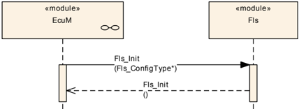
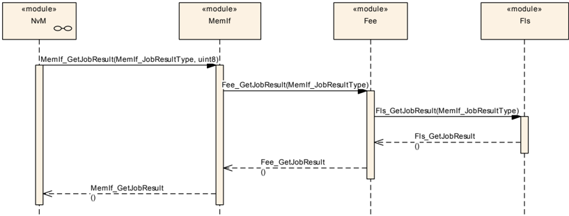
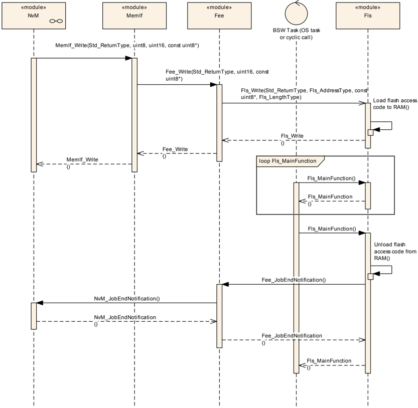
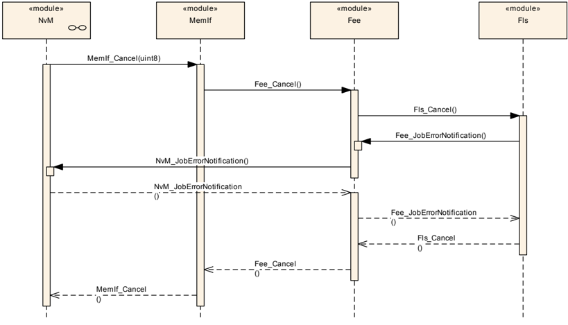
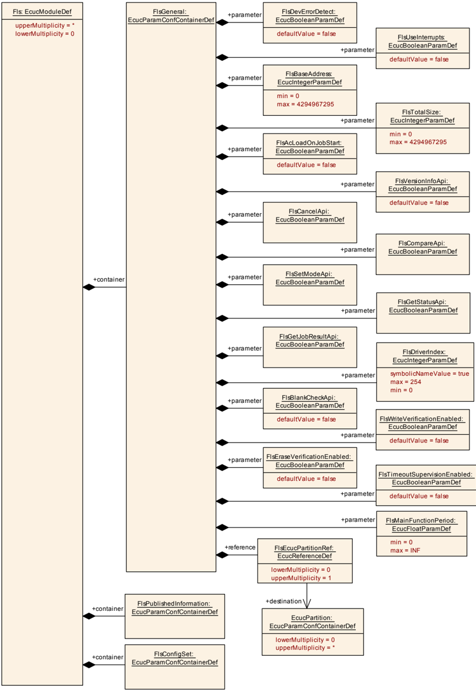
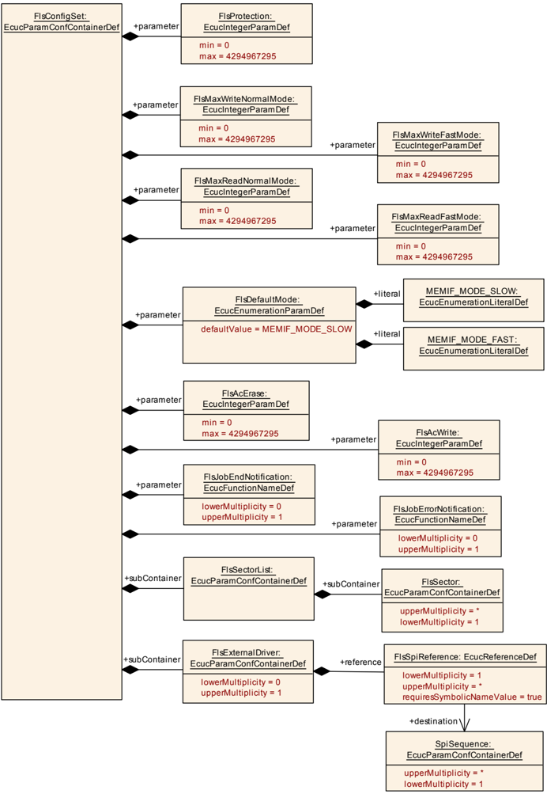
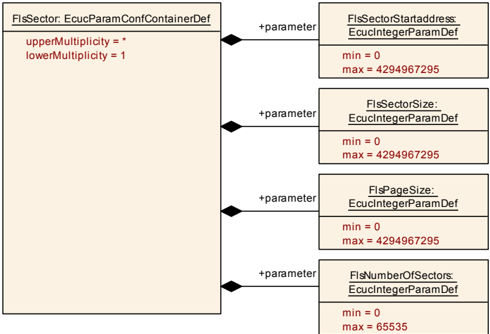
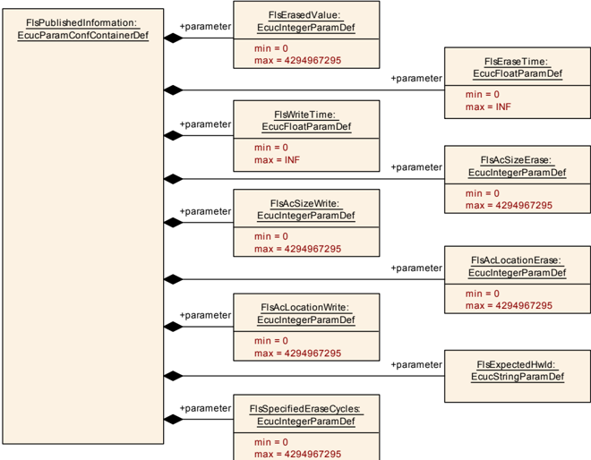

## 1. 简介和功能概述

本文介绍了**AUTOSAR**基础软件模块[\[1\]](#ref-1)闪存驱动程序（**Flash Driver**）的功能、**API**和配置，AUTOSAR的闪存驱动程序同时适用于内部和外部闪存设备。

通过底层硬件支持，闪存驱动程序提供了读取、写入和擦除闪存的服务，以及用于设置或者重置关于写入及擦除保护的配置接口。

在**ECU**的应用程序模式下，**Flash**驱动程序仅供**Flash EEPROM emulation**模块用于写入数据使用。**Flash**驱动程序并未打算提供在应用程序模式下把程序代码写入闪存的服务，此部分应在**AUTOSAR**范围之外的引导模式下完成，如**Flash Bootloader**中实现。

内部闪存驱动程序可以直接访问微控制器（**microcontroller**）硬件，它位于**MCAL**微控制器抽象层（**Microcontroller Abstraction Layer**）。然而外部闪存通常连接到微控制器的数据/地址总线，通过内存映射访问，通常闪存驱动程序使用这些总线的处理程序/驱动程序来访问外部闪存设备，所以外部闪存设备的驱动程序位于ECU抽象层（**ECU Abstraction Layer**）。

对于内部和外部驱动程序的功能要求[\[2\]](#ref-2)和功能范围是相同的，所以在语义上API的定义应该也是相同的。

## 2. 缩略语

下面的词汇表包括与闪存驱动程序模块相关的、未包含在 **AUTOSAR** 词汇表[\[3\]](#ref-3)中的首字母缩写词和缩写词。

**DET**
> 默认错误跟踪器（**Default Error Tracer**），向其报告开发错误的模块。

**DEM**
> 诊断事件管理器（**Diagnostic Event Manager**），向其报告与生产相关的错误的模块。

**Fls, FLS**
> 模块闪存驱动程序（**flash driver**）的官方 **AUTOSAR** 缩写（依上下文写法不同，含义相同）。

**AC**
> （闪存）访问代码（**(Flash) access code**）——为使配置参数的名称足够简短而引入的缩写。

### 本文通篇所用术语的进一步定义

**Flash sector**
> 闪存扇区（**Flash sector**）是一次可以擦除的最小闪存量。闪存扇区的大小取决于闪存技术，因此取决于硬件。

**Flash page**
> 闪存页（**Flash page**）是一次可以编程的最小闪存量。闪存页的大小取决于闪存技术，因此取决于硬件。

**Flash access code**
> 由主函数（作业处理函数）调用的内部闪存驱动程序例程，用于擦除或写入闪存硬件。

## 3. 相关文档

### 3.1. 输入文件和相关标准与规范

<a id="ref-1"></a>[1] List of Basic Software Modules
> AUTOSAR_CP_TR_BSWModuleList

<a id="ref-2"></a>[2] Requirements on Flash Driver
> AUTOSAR_CP_SRS_FlashDriver

<a id="ref-3"></a>[3] Glossary
> AUTOSAR_FO_TR_Glossary

<a id="ref-4"></a>[4] General Specification of Basic Software Modules
> AUTOSAR_CP_SWS_BSWGeneral

<a id="ref-5"></a>[5] Requirements on Memory Hardware Abstraction Layer
> AUTOSAR_CP_SRS_MemoryHWAbstractionLayer

<a id="ref-6"></a>[6] Specification of SPI Handler/Driver
> AUTOSAR_CP_SWS_SPIHandlerDriver

<a id="ref-7"></a>[7] Layered Software Architecture
> AUTOSAR_CP_EXP_LayeredSoftwareArchitecture

<a id="ref-8"></a>[8] Specification of ECU Configuration
> AUTOSAR_CP_TPS_ECUConfiguration

### 3.2. 相关规范

**AUTOSAR** 提供了基础软件模块的通用规范 [\[4\]](#ref-4)（**SWS BSW General**），它同样也适用于闪存驱动程序（**Flash Driver**）。

因此，规范 **SWS BSW General** 应被视为闪存驱动程序（**Flash Driver**）的附加且必需的规范。

## 4. 约束和假设

### 4.1. 限制

* 闪存驱动程序仅擦除或编程（**programm**）完整的闪存扇区和闪存页面。也就是说因为闪存驱动程序不使用任何内部缓冲区，所以它也不提供任何类型的重写策略。
* 闪存驱动程序不提供确保数据完整性的机制。例如：校验和（**checksums**）、冗余存储（**redundant storage**）等。

### 4.2. 汽车域的适用性

无限制。

## 5. 对其他模块的依赖

### 5.1. 系统时钟（System clock）

如果内部闪存的硬件依赖于系统时钟，系统时钟的改变（例如：**PLL On**切换到**PLL Off**）也可能影响到闪存硬件的时钟设置[\[5\]](#ref-5)。

### 5.2. 通信或I/O驱动程序

如果闪存位于外部设备，则需要通过相应的通信或I/O驱动程序实现对该设备的访问。

## 6. 功能规格

### 6.1. 一般设计规则

**FLS** 模块应提供对闪存进行操作的异步服务（读取/擦除/写入）。

**FLS** 模块不应缓冲数据。**FLS** 模块应使用通过 **API** 传递的指针所引用的应用程序数据缓冲区。

**FLS** 模块不应确保给定应用程序缓冲区的数据一致性。

在闪存读取或写入操作期间，确保闪存数据的一致性是 **FLS** 模块的环境的责任。

**FLS** 模块应静态地（最迟在编译时）检查静态配置参数的正确性。

**FLS** 模块应验证 **FLS** 模块头文件和源文件中的版本信息的一致性（例如：通过将模块头文件和源文件中的版本信息与预处理器宏进行比较）。

**FLS** 模块应将所有可用的闪存区域组合成一个线性地址空间（由参数 FlsBaseAddress 和 FlsTotalSize 表示）。

**FLS** 模块应按照闪存区域的物理结构，把用于读取、写入、擦除和比较函数的地址和长度参数作为"虚拟"地址映射到物理地址。

只要满足关于这些地址对齐的限制，就允许读取、写入或擦除作业跨越物理闪存区域的边界。

**FLS** 模块应在内部处理数据缓冲区对齐。它不应强加任何关于 **RAM** 缓冲区对齐的要求（因为它们是 uint8\*），而应将传递的指针仅按字节对齐的方式处理。

如果在一个 **ECU** 中使用了闪存驱动程序的多个实例，则必须为各个实例赋予唯一的实例 **ID**。此实例 **ID** 应配置为参数 FlsDriverIndex。如果在一个 **ECU** 中仅使用闪存驱动程序的一个实例，则该实例的参数 FlsDriverIndex 应配置为 0。

### 6.2. 外部闪存驱动程序

在外部闪存驱动程序的初始化期间，**FLS** 模块应将外部闪存设备的硬件 **ID** 与相应的已发布参数进行比对检查。如果发生硬件 **ID** 不匹配，**FLS** 模块应向默认错误跟踪器（**DET**）上报错误代码 FLS_E_UNEXPECTED_FLASH_ID，将 **FLS** 模块状态设置为 [FLS_E_UNINIT](#641-开发错误)，并且不得初始化自身。

所需参数的完整列表在 **SPI** Handler/Driver 软件规范 [\[6\]](#ref-6)（"配置规范"（**Configuration Specification**）章，标记为 "SPI User"）中规定。

### 6.3. 闪存访问代码的加载、执行和移除

技术背景信息：闪存技术或闪存存储器分段可能要求访问闪存硬件的例程（内部擦除和写入例程）从 **RAM** 中执行，因为在编程闪存期间不允许读取闪存（代码执行所需的指令取指）。

**FLS** 模块的实现者应将闪存访问例程的代码放置在一个单独的 C 模块 Fls_ac.c 中。

仅在必要时（即：必须确保期间没有其他代码被执行时），**FLS** 模块的闪存访问例程才应禁用中断并等待擦除/写入命令的完成。

**FLS** 模块的实现者应使闪存访问代码的执行时间尽可能短。

如果 **FLS** 模块被配置为在作业启动时将闪存访问代码加载到 **RAM** 中，则 **FLS** 模块的擦除例程应将用于擦除闪存的闪存访问代码加载到闪存驱动程序配置集中擦除函数指针所指向的 **RAM** 位置。

如果 **FLS** 模块被配置为在作业启动时将闪存访问代码加载到 **RAM** 中，则 **FLS** 模块的写入例程应将用于写入闪存的闪存访问代码加载到闪存驱动程序配置集中写入函数指针所指向的 **RAM** 位置。

**FLS** 模块的主处理例程应执行闪存访问代码例程。

无论闪存访问代码例程是否已被加载到 **RAM**，还是可以直接从（闪存）**ROM** 中执行，**FLS** 模块的主处理例程都应通过 **FLS** 模块配置集（编译后参数）中相应的函数指针来访问闪存访问代码例程。

在擦除或写入作业已经完成或被取消之后，如果闪存访问代码（内部擦除/写入例程）已由闪存驱动程序加载到 **RAM** 中，则 **FLS** 模块的主处理例程应将其从 **RAM** 中卸载（即：覆盖）。

仅当访问代码无法从闪存 **ROM** 中执行时，**FLS** 模块才应将访问代码加载到 **RAM** 中。

### 6.4. 错误分类

文档 [\[4\]](#ref-4)《基础软件模块通用规范》（**General Specification of Basic Software Modules**）的"错误处理"（**Error Handling**）章详细描述了基础软件的错误处理。首先，它构成了一个由 **BSW** 模块中可能发生的五种错误类型组成的分类方案。

在此基础上，以下各节规定了布置在相应子节中的特定错误。

#### 6.4.1. 开发错误

**Fls** 模块的开发错误定义：

| 错误类型 | 相关错误代码 | 错误值 |
|---|---|---|
| API 服务调用时传入了错误的参数 | FLS_E_PARAM_CONFIG | 0x01 |
| API 服务调用时传入了错误的参数 | FLS_E_PARAM_ADDRESS | 0x02 |
| API 服务调用时传入了错误的参数 | FLS_E_PARAM_LENGTH | 0x03 |
| API 服务调用时传入了错误的参数 | FLS_E_PARAM_DATA | 0x04 |
| 未初始化模块的情况下调用 API 服务 | FLS_E_UNINIT | 0x05 |
| API 服务调用时传入了 NULL 指针 | FLS_E_PARAM_POINTER | 0x0a |
| - | FLS_E_ALREADY_INITIALIZED | 0x0b |

当 API 服务调用时传入了错误的参数，应上报以下开发错误代码：FLS_E_PARAM_CONFIG、FLS_E_PARAM_ADDRESS、FLS_E_PARAM_LENGTH、FLS_E_PARAM_DATA。

#### 6.4.2. 运行时错误

**Fls** 模块的运行时错误定义：

| 错误类型 | 相关错误代码 | 错误值 |
|---|---|---|
| 驱动程序仍处于忙状态时调用 API 服务 | FLS_E_BUSY | 0x06 |
| 擦除验证（空白检查）失败 | FLS_E_VERIFY_ERASE_FAILED | 0x07 |
| 写入验证（比较）失败 | FLS_E_VERIFY_WRITE_FAILED | 0x08 |
| 超过超时时间 | FLS_E_TIMEOUT | 0x09 |

当模块仍处于忙状态时调用 API 服务，应上报运行时错误代码 FLS_E_BUSY。

当擦除验证功能被启用（通过编译开关 FlsEraseVerificationEnabled）且擦除验证功能（空白检查）失败时，应上报运行时错误代码 FLS_E_VERIFY_ERASE_FAILED。

当写入验证功能被启用（通过编译开关 FlsWriteVerificationEnabled）且写入验证功能（比较）失败时，应上报运行时错误代码 FLS_E_VERIFY_WRITE_FAILED。

当超时监督功能被启用（通过编译开关 FlsTimeoutSupervisionEnabled）且读取、写入、擦除或比较作业（在硬件中）的超时监督失败时，应上报运行时错误代码 FLS_E_TIMEOUT。

#### 6.4.3. 瞬态故障

**Fls** 模块的瞬态故障定义：

| 错误类型 | 相关错误代码 | 错误值 |
|---|---|---|
| 闪存擦除失败（硬件） | FLS_E_ERASE_FAILED | 0x01 |
| 闪存写入失败（硬件） | FLS_E_WRITE_FAILED | 0x02 |
| 闪存读取失败（硬件） | FLS_E_READ_FAILED | 0x03 |
| 闪存比较失败（硬件） | FLS_E_COMPARE_FAILED | 0x04 |
| 预期的硬件 ID 不匹配（见 [6.2](#62-外部闪存驱动程序) 节） | FLS_E_UNEXPECTED_FLASH_ID | 0x05 |

当闪存擦除功能失败（在硬件中）时，应上报瞬态故障代码 FLS_E_ERASE_FAILED。

当闪存写入功能失败（在硬件中）时，应上报瞬态故障代码 FLS_E_WRITE_FAILED。

当闪存读取功能失败（在硬件中）时，应上报瞬态故障代码 FLS_E_READ_FAILED。

当闪存比较功能失败（在硬件中）时，应上报瞬态故障代码 FLS_E_COMPARE_FAILED。

当预期的闪存 ID 不匹配时（见 [6.2](#62-外部闪存驱动程序) 节），应上报瞬态故障代码 FLS_E_UNEXPECTED_FLASH_ID。

#### 6.4.4. 生产错误

没有生产错误。

#### 6.4.5. 扩展生产错误

没有扩展生产错误。

## 7. API规范

### 7.1. 导入的类型

本章列出了从以下文件中包含的所有类型。

| 模块 | 头文件 | 导入的类型 |
|---|---|---|
| MemIf | MemIf.h | MemIf_JobResultType |
| MemIf | MemIf.h | MemIf_StatusType |
| Std | Std_Types.h | Std_ReturnType |
| Std | Std_Types.h | Std_VersionInfoType |

### 7.2. 类型定义

#### 7.2.1. Fls_ConfigType

结构类型。元素为硬件相关的（**hardware dependend**）结构，该结构用于保存闪存驱动程序的配置集，初始化数据结构的内容特定于闪存硬件。指向此类结构的指针会被提供给闪存驱动程序初始化例程，用于配置驱动程序和闪存硬件。可通过**Fls.h**获得。

#### 7.2.2. Fls_AddressType

类型，派生自 uint，范围 8/16/32 位，大小取决于目标平台和闪存设备。用作从所配置的闪存基地址出发、访问某个特定闪存区域的地址偏移。可通过**Fls.h**获得。

类型 Fls_AddressType 对于每个闪存设备而言，其下限应为 0。

如有必要，**FLS** 模块应将设备特定的基地址加到地址类型 Fls_AddressType 上。

#### 7.2.3. Fls_LengthType

类型，派生自 uint，范围与 [Fls_AddressType](#722-fls_addresstype) 相同——由于算术运算的需要，它应与 [Fls_AddressType](#722-fls_addresstype) 是相同的类型，大小取决于目标平台和闪存设备。指定要读取/写入/擦除/比较的字节数。可通过**Fls.h**获得。

### 7.3. 函数定义

#### 7.3.1. Fls_Init

**说明**: 服务 ID 0x00。初始化闪存驱动程序。可通过**Fls.h**获得。本服务为同步调用，不可重入。参数 ConfigPtr（in）：指向闪存驱动程序配置集的指针。参数（inout）：无。参数（out）：无。返回值：无。

```C
void Fls_Init (
    const Fls_ConfigType* ConfigPtr
)
```

函数 Fls_Init 应使用给定配置集中提供的参数来初始化 **FLS** 模块（软件）和所有与闪存存储器相关的寄存器（硬件）。

函数 Fls_Init 应将指向给定配置集的指针存储在一个变量中，以便 **FLS** 模块在运行期间能够访问配置集的内容。

函数 Fls_Init 应初始化所有 **FLS** 模块全局变量，以及控制闪存设备所需的、且不影响或不依赖于其他（硬件）模块的那些控制器寄存器。可能影响或依赖于其他模块的寄存器应由一个公共的系统模块来初始化。

如果 **Fls** 模块的开发错误检测已启用：函数 Fls_Init 应检查给定配置集的（硬件特定的）内容是否处于允许的范围内。如果不是这种情况，它应引发开发错误 [FLS_E_PARAM_CONFIG](#641-开发错误)。

在完成 **FLS** 模块初始化之后，函数 Fls_Init 应将 **FLS** 模块状态设置为 MEMIF_IDLE。

在完成 **FLS** 模块初始化之后，函数 Fls_Init 应将闪存作业结果设置为 MEMIF_JOB_OK。

如果 **Fls** 模块的运行时错误检测已启用：函数 Fls_Init 应检查模块的初始化状态。如果模块已经被初始化，函数 Fls_Init 应引发开发错误 [FLS_E_ALREADY_INITIALIZED](#641-开发错误)。

如果硬件支持，函数 Fls_Init 应按照配置集中所提供的内容设置闪存擦除/写入保护。

#### 7.3.2. Fls_Erase

**说明**: 服务 ID 0x01。擦除闪存扇区。可通过**Fls.h**获得。本服务为异步调用，不可重入。参数 TargetAddress（in）：闪存中的目标地址，该地址偏移将被加到闪存基地址上。最小值：0，最大值：FLS_SIZE - 1。参数 Length（in）：要擦除的字节数。最小值：1，最大值：FLS_SIZE - TargetAddress。参数（inout）：无。参数（out）：无。返回值：**Std_ReturnType**，**E_OK**：擦除命令已被接受；**E_NOT_OK**：擦除命令未被接受。

```C
Std_ReturnType Fls_Erase (
    Fls_AddressType TargetAddress,
    Fls_LengthType Length
)
```

函数 Fls_Erase 的作业应擦除一个或多个完整的闪存扇区。

函数 Fls_Erase 应将给定的参数复制到 **FLS** 模块内部变量中，并启动一个擦除作业。

在启动擦除作业之后，函数 Fls_Erase 应将 **FLS** 模块状态设置为 MEMIF_BUSY。

在启动擦除作业之后，函数 Fls_Erase 应将作业结果设置为 MEMIF_JOB_PENDING。

在启动擦除作业之后，函数 Fls_Erase 应以 **E_OK** 返回。

**FLS** 模块应在 **FLS** 模块的主函数中异步执行函数 Fls_Erase 的作业。

函数 Fls_Erase 的作业应擦除从闪存基地址 + TargetAddress 开始、大小为 Length 的闪存块。

**注意：** 由于只能擦除完整的闪存扇区，因此 Length 将被向上取整到下一个完整的扇区边界。

如果 **Fls** 模块的开发错误检测已启用：函数 Fls_Erase 应检查擦除起始地址（闪存基地址 + TargetAddress）是否对齐到闪存扇区边界，并且位于指定的闪存地址上下边界之内。如果此检查失败，函数 Fls_Erase 应拒绝擦除请求，引发开发错误 [FLS_E_PARAM_ADDRESS](#641-开发错误) 并以 **E_NOT_OK** 返回。

如果 **Fls** 模块的开发错误检测已启用：函数 Fls_Erase 应检查擦除长度是否大于 0，擦除结束地址（擦除起始地址 + 长度）是否对齐到闪存扇区边界，并且位于指定的闪存地址上边界之内。如果此检查失败，函数 Fls_Erase 应拒绝擦除请求，引发开发错误 [FLS_E_PARAM_LENGTH](#641-开发错误) 并以 **E_NOT_OK** 返回。

如果 **Fls** 模块的开发错误检测已启用：函数 Fls_Erase 应检查 **FLS** 模块是否已被初始化。如果此检查失败，函数 Fls_Erase 应拒绝擦除请求，引发开发错误 [FLS_E_UNINIT](#641-开发错误) 并以 **E_NOT_OK** 返回。

如果 **Fls** 模块的运行时错误检测已启用：函数 Fls_Erase 应检查 **FLS** 模块当前是否不忙。如果此检查失败，函数 Fls_Erase 应拒绝擦除请求，引发开发错误 [FLS_E_BUSY](#642-运行时错误) 并以 **E_NOT_OK** 返回。

如果可能（例如：在中断控制的实现中），**FLS** 模块应在函数 Fls_Erase 内直接启动擦除作业的第一轮，以减少总体运行时间。

#### 7.3.3. Fls_Write

**说明**: 服务 ID 0x02。写入一个或多个完整的闪存页。可通过**Fls.h**获得。本服务为异步调用，不可重入。参数 TargetAddress（in）：闪存中的目标地址，该地址偏移将被加到闪存基地址上。最小值：0，最大值：FLS_SIZE - 1。参数 SourceAddressPtr（in）：指向源数据缓冲区的指针。参数 Length（in）：要写入的字节数。最小值：1，最大值：FLS_SIZE - TargetAddress。参数（inout）：无。参数（out）：无。返回值：**Std_ReturnType**，**E_OK**：写入命令已被接受；**E_NOT_OK**：写入命令未被接受。

```C
Std_ReturnType Fls_Write (
    Fls_AddressType TargetAddress,
    const uint8* SourceAddressPtr,
    Fls_LengthType Length
)
```

函数 Fls_Write 的作业应向闪存设备写入一个或多个完整的闪存页。

函数 Fls_Write 应将给定的参数复制到 Fls 模块内部变量中，并启动一个写入作业。

在启动写入作业之后，函数 Fls_Write 应将 **FLS** 模块状态设置为 MEMIF_BUSY。

在启动写入作业之后，函数 Fls_Write 应将作业结果设置为 MEMIF_JOB_PENDING。

在启动写入作业之后，函数 Fls_Write 应以 **E_OK** 返回。

**FLS** 模块应在 **FLS** 模块的主函数中异步执行函数 Fls_Write 的写入作业。

函数 Fls_Write 的作业应从闪存基地址 + TargetAddress 开始，把通过 SourceAddressPtr 提供的数据编程（**program**）到大小为 Length 的闪存块中。

如果 **Fls** 模块的开发错误检测已启用：函数 Fls_Write 应检查写入起始地址（闪存基地址 + TargetAddress）是否对齐到闪存页边界，并且位于指定的闪存地址上下边界之内。如果此检查失败，函数 Fls_Write 应拒绝写入请求，引发开发错误 [FLS_E_PARAM_ADDRESS](#641-开发错误) 并以 **E_NOT_OK** 返回。

如果 **Fls** 模块的开发错误检测已启用：函数 Fls_Write 应检查写入长度是否大于 0，写入结束地址（写入起始地址 + 长度）是否对齐到闪存页边界，并且位于指定的闪存地址上边界之内。如果此检查失败，函数 Fls_Write 应拒绝写入请求，引发开发错误 [FLS_E_PARAM_LENGTH](#641-开发错误) 并以 **E_NOT_OK** 返回。

如果 **Fls** 模块的开发错误检测已启用：函数 Fls_Write 应检查 **FLS** 模块是否已被初始化。如果此检查失败，函数 Fls_Write 应拒绝写入请求，引发开发错误 [FLS_E_UNINIT](#641-开发错误) 并以 **E_NOT_OK** 返回。

如果 **Fls** 模块的运行时错误检测已启用：函数 Fls_Write 应检查 **FLS** 模块当前是否不忙。如果此检查失败，函数 Fls_Write 应拒绝写入请求，引发开发错误 [FLS_E_BUSY](#642-运行时错误) 并以 **E_NOT_OK** 返回。

如果 **Fls** 模块的开发错误检测已启用：函数 Fls_Write 应检查给定的数据缓冲区指针不是空指针。如果数据缓冲区指针是空指针，函数 Fls_Write 应拒绝写入请求，引发开发错误 [FLS_E_PARAM_DATA](#641-开发错误) 并以 **E_NOT_OK** 返回。

如果可能（例如：在中断控制的实现中），**FLS** 模块应在函数 Fls_Write 内直接启动写入作业的第一轮，以减少总体运行时间。

#### 7.3.4. Fls_Cancel

**说明**: 服务 ID 0x03。取消正在进行的作业。可通过**Fls.h**获得。本服务为同步调用，不可重入。参数（in）：无。参数（inout）：无。参数（out）：无。返回值：无。

```C
void Fls_Cancel (
    void
)
```

函数 Fls_Cancel 应取消正在进行的闪存读取、写入、擦除或比较作业。

函数 Fls_Cancel 应同步地中止正在运行的作业，使得在从此函数返回之后可以直接启动新的作业。

**注意：** 函数 Fls_Cancel 在其行为上是同步的，但相对于底层硬件而言是异步的：函数 Fls_Cancel 的作业（即：使模块准备好接受新的作业请求）在它返回给调用者时即告完成（因此它是同步的），但另一方面，例如擦除作业可能仍在硬件设备中进行（因此相对于硬件而言它是异步的）。

函数 Fls_Cancel 应重置 **FLS** 模块的内部作业处理变量（如地址、长度和数据指针）。

函数 Fls_Cancel 应将 **FLS** 模块状态设置为 MEMIF_IDLE。

如果作业结果当前的值为 MEMIF_JOB_PENDING，函数 Fls_Cancel 应将作业结果设置为 MEMIF_JOB_CANCELED。否则，函数 Fls_Cancel 应保持作业结果不变。

如果已配置，函数 Fls_Cancel 应调用错误通知函数，以将作业被取消的情况告知调用者。

**注意：** 当使用函数 Fls_Cancel 取消正在进行的作业时，受影响的闪存存储单元的内容将是未定义的。

函数 Fls_Cancel 应通过配置参数 FlsCancelApi 实现编译期（**pre-compile time**）的 On/Off 配置。

如果 **Fls** 模块的开发错误检测已启用：函数 Fls_Cancel 应检查 **FLS** 模块是否已被初始化。如果此检查失败，函数 Fls_Cancel 应引发开发错误 [FLS_E_UNINIT](#641-开发错误) 并返回。

#### 7.3.5. Fls_GetStatus

**说明**: 服务 ID 0x04。返回驱动程序状态。可通过**Fls.h**获得。本服务为同步调用，可重入。参数（in）：无。参数（inout）：无。参数（out）：无。返回值：**MemIf_StatusType**。

```C
MemIf_StatusType Fls_GetStatus (
    void
)
```

函数 Fls_GetStatus 应同步地返回 **FLS** 模块状态。

函数 Fls_GetStatus 应通过配置参数 FlsGetStatusApi 实现编译期（**pre-compile time**）的 On/Off 配置。

**注意：** 在模块已被初始化之前也可以调用函数 Fls_GetStatus，在这种情况下它应返回 MEMIF_UNINIT。

#### 7.3.6. Fls_GetJobResult

**说明**: 服务 ID 0x05。返回最后一个作业的结果。可通过**Fls.h**获得。本服务为同步调用，可重入。参数（in）：无。参数（inout）：无。参数（out）：无。返回值：**MemIf_JobResultType**。

```C
MemIf_JobResultType Fls_GetJobResult (
    void
)
```

函数 Fls_GetJobResult 应同步地返回最后一个作业的结果。

擦除、写入、读取和比较函数应共享同一个作业结果，即：只能查询最后一个作业的结果。如果 **FLS** 模块已接受一个新的作业，**FLS** 模块应用 MEMIF_JOB_PENDING 覆盖该作业结果。

函数 Fls_GetJobResult 应通过配置参数 FlsGetJobResultApi 实现编译期（**pre-compile time**）的 On/Off 配置。

如果 **Fls** 模块的开发错误检测已启用：函数 Fls_GetJobResult 应检查 **FLS** 模块是否已被初始化。如果此检查失败，函数 Fls_GetJobResult 应引发开发错误 [FLS_E_UNINIT](#641-开发错误) 并以 MEMIF_JOB_FAILED 返回。

#### 7.3.7. Fls_Read

**说明**: 服务 ID 0x07。从闪存中读取。可通过**Fls.h**获得。本服务为异步调用，不可重入。参数 SourceAddress（in）：闪存中的源地址，该地址偏移将被加到闪存基地址上。最小值：0，最大值：FLS_SIZE - 1。参数 Length（in）：要读取的字节数。最小值：1，最大值：FLS_SIZE - SourceAddress。参数（inout）：无。参数 TargetAddressPtr（out）：指向目标数据缓冲区的指针。返回值：**Std_ReturnType**，**E_OK**：读取命令已被接受；**E_NOT_OK**：读取命令未被接受。

```C
Std_ReturnType Fls_Read (
    Fls_AddressType SourceAddress,
    uint8* TargetAddressPtr,
    Fls_LengthType Length
)
```

函数 Fls_Read 应从闪存中读取。

函数 Fls_Read 应将给定的参数复制到 **FLS** 模块内部变量中，并启动一个读取作业。

在启动读取作业之后，函数 Fls_Read 应将 **FLS** 模块状态设置为 MEMIF_BUSY。

在启动读取作业之后，函数 Fls_Read 应将 **FLS** 模块作业结果设置为 MEMIF_JOB_PENDING。

在启动读取作业之后，函数 Fls_Read 应以 **E_OK** 返回。

**FLS** 模块应在 **FLS** 模块的主函数中异步执行函数 Fls_Read 的读取作业。

函数 Fls_Read 的读取作业应把从闪存基地址 + SourceAddress 开始、大小为 Length 的连续闪存块复制到 TargetAddressPtr 所指向的缓冲区中。

如果 **Fls** 模块的开发错误检测已启用：函数 Fls_Read 应检查读取起始地址（闪存基地址 + SourceAddress）是否位于指定的闪存地址上下边界之内。如果此检查失败，函数 Fls_Read 应拒绝读取作业，引发开发错误 [FLS_E_PARAM_ADDRESS](#641-开发错误) 并以 **E_NOT_OK** 返回。

如果 **Fls** 模块的开发错误检测已启用：函数 Fls_Read 应检查读取长度是否大于 0，且读取结束地址（读取起始地址 + 长度）是否位于指定的闪存地址上边界之内。如果此检查失败，函数 Fls_Read 应拒绝读取作业，引发开发错误 [FLS_E_PARAM_LENGTH](#641-开发错误) 并以 **E_NOT_OK** 返回。

如果 **Fls** 模块的开发错误检测已启用：函数 Fls_Read 应检查驱动程序是否已被初始化。如果此检查失败，函数 Fls_Read 应拒绝读取请求，引发开发错误 [FLS_E_UNINIT](#641-开发错误) 并以 **E_NOT_OK** 返回。

如果 **Fls** 模块的运行时错误检测已启用：函数 Fls_Read 应检查驱动程序当前是否不忙。如果此检查失败，函数 Fls_Read 应拒绝读取请求，引发开发错误 [FLS_E_BUSY](#642-运行时错误) 并以 **E_NOT_OK** 返回。

如果 **Fls** 模块的开发错误检测已启用：函数 Fls_Read 应检查给定的数据缓冲区指针不是空指针。如果数据缓冲区指针是空指针，函数 Fls_Read 应拒绝读取请求，引发开发错误 [FLS_E_PARAM_DATA](#641-开发错误) 并以 **E_NOT_OK** 返回。

**FLS** 模块的环境只应在 **FLS** 模块已被初始化之后才调用函数 Fls_Read。

#### 7.3.8. Fls_Compare

**说明**: 服务 ID 0x08。将闪存某个区域的内容与应用程序数据缓冲区的内容进行比较。可通过**Fls_Com.h**获得。本服务为异步调用，不可重入。参数 SourceAddress（in）：闪存中的源地址，该地址偏移将被加到闪存基地址上。最小值：0，最大值：FLS_SIZE - 1。参数 TargetAddressPtr（in）：指向目标数据缓冲区的指针。参数 Length（in）：要比较的字节数。最小值：1，最大值：FLS_SIZE - SourceAddress。参数（inout）：无。参数（out）：无。返回值：**Std_ReturnType**，**E_OK**：比较命令已被接受；**E_NOT_OK**：比较命令未被接受。

```C
Std_ReturnType Fls_Compare (
    Fls_AddressType SourceAddress,
    const uint8* TargetAddressPtr,
    Fls_LengthType Length
)
```

函数 Fls_Compare 应将闪存某个区域的内容与应用程序数据缓冲区的内容进行比较。

函数 Fls_Compare 应将给定的参数复制到 Fls 模块内部变量中，并启动一个比较作业。

在启动比较作业之后，函数 Fls_Compare 应将状态设置为 MEMIF_BUSY。

在启动比较作业之后，函数 Fls_Compare 应将作业结果设置为 MEMIF_JOB_PENDING。

在启动比较作业之后，函数 Fls_Compare 应以 **E_OK** 返回。

**FLS** 模块应在 **FLS** 模块的主函数中异步执行函数 Fls_Compare 的作业。

函数 Fls_Compare 的作业应将从闪存基地址 + SourceAddress 开始、大小为 Length 的连续闪存块与 TargetAddressPtr 所指向的缓冲区进行比较。

如果 **Fls** 模块的开发错误检测已启用：函数 Fls_Compare 应检查比较起始地址（闪存基地址 + SourceAddress）是否位于指定的闪存地址上下边界之内。如果此检查失败，函数 Fls_Compare 应拒绝比较作业，引发开发错误 [FLS_E_PARAM_ADDRESS](#641-开发错误) 并以 **E_NOT_OK** 返回。

如果 **Fls** 模块的开发错误检测已启用：函数 Fls_Compare 应检查给定的长度是否大于 0，且比较结束地址（比较起始地址 + 长度）是否位于指定的闪存地址上边界之内。如果此检查失败，函数 Fls_Compare 应拒绝比较作业，引发开发错误 [FLS_E_PARAM_LENGTH](#641-开发错误) 并以 **E_NOT_OK** 返回。

如果 **Fls** 模块的开发错误检测已启用：函数 Fls_Compare 应检查驱动程序是否已被初始化。如果此检查失败，函数 Fls_Compare 应拒绝比较作业，引发开发错误 [FLS_E_UNINIT](#641-开发错误) 并以 **E_NOT_OK** 返回。

如果 **Fls** 模块的运行时错误检测已启用：函数 Fls_Compare 应检查驱动程序当前是否不忙。如果此检查失败，函数 Fls_Compare 应拒绝比较作业，引发开发错误 [FLS_E_BUSY](#642-运行时错误) 并以 **E_NOT_OK** 返回。

如果 **Fls** 模块的开发错误检测已启用：函数 Fls_Compare 应检查给定的数据缓冲区指针不是空指针。如果数据缓冲区指针是空指针，函数 Fls_Compare 应拒绝该请求，引发开发错误 [FLS_E_PARAM_DATA](#641-开发错误) 并以 **E_NOT_OK** 返回。

函数 Fls_Compare 应通过配置参数 FlsCompareApi 实现编译期（**pre-compile time**）的 On/Off 配置。

#### 7.3.9. Fls_SetMode

**说明**: 服务 ID 0x09。设置闪存驱动程序的操作模式。可通过**Fls.h**获得。本服务为同步调用，不可重入。参数 Mode（in）：MEMIF_MODE_SLOW：慢速读取访问/普通 **SPI** 访问。MEMIF_MODE_FAST：快速读取访问/**SPI** 突发（**burst**）访问。参数（inout）：无。参数（out）：无。返回值：无。

```C
void Fls_SetMode (
    MemIf_ModeType Mode
)
```

函数 Fls_SetMode 应将 **FLS** 模块的操作模式设置为给定的 "Mode" 参数。

如果 **Fls** 模块的运行时错误检测已启用：函数 Fls_SetMode 应检查 **FLS** 模块当前是否不忙。如果此检查失败，函数 Fls_SetMode 应拒绝设置模式请求并引发开发错误代码 [FLS_E_BUSY](#642-运行时错误)。

函数 Fls_SetMode 应通过配置参数 FlsSetModeApi 实现编译期（**pre-compile time**）的 On/Off 配置。

#### 7.3.10. Fls_GetVersionInfo

**说明**: 服务 ID 0x10。返回此模块的版本信息。可通过**Fls.h**获得。本服务为同步调用，可重入。参数（in）：无。参数（inout）：无。参数 VersioninfoPtr（out）：指向存储本模块版本信息位置的指针。返回值：无。

```C
void Fls_GetVersionInfo (
    Std_VersionInfoType* VersioninfoPtr
)
```

如果 **Fls** 模块的开发错误检测已启用：如果参数（**argument**）是空指针，函数 Fls_GetVersionInfo 应引发开发错误 [FLS_E_PARAM_POINTER](#641-开发错误) 并不做任何动作直接返回。

#### 7.3.11. Fls_BlankCheck

**说明**: 服务 ID 0x0a。函数 Fls_BlankCheck 应验证给定的存储区域是否已被擦除但尚未（被）编程。该函数应将每个主函数循环中检查的闪存单元的最大数量分别限制为所配置的 FlsMaxReadNormalMode 或 FlsMaxReadFastMode 的值。可通过**Fls.h**获得。本服务为异步调用，不可重入。参数 TargetAddress（in）：闪存中应开始空白检查的地址。最小值：0，最大值：FLS_SIZE - 1。参数 Length（in）：要检查擦除图案（**erase pattern**）的字节数。最小值：1，最大值：FLS_SIZE - TargetAddress。参数（inout）：无。参数（out）：无。返回值：**Std_ReturnType**，**E_OK**：空白检查请求已被模块接受；**E_NOT_OK**：空白检查请求未被模块接受。

```C
Std_ReturnType Fls_BlankCheck (
    Fls_AddressType TargetAddress,
    Fls_LengthType Length
)
```

函数 Fls_BlankCheck 应验证给定的存储区域是否已被擦除但尚未（被）重新编程。

函数 Fls_BlankCheck 应将给定的参数复制到 **FLS** 模块内部变量中，并启动该验证作业。

在启动验证作业之后，函数 Fls_BlankCheck 应将 **FLS** 模块状态设置为 MEMIF_BUSY。

在启动验证作业之后，函数 Fls_BlankCheck 应将 **FLS** 模块作业结果设置为 MEMIF_JOB_PENDING。

在启动验证作业之后，函数 Fls_BlankCheck 应以 **E_OK** 返回。

**FLS** 模块应在 **FLS** 模块的主函数中异步执行函数 Fls_BlankCheck 的验证作业。

函数 Fls_BlankCheck 的验证作业应检查从闪存基地址 + TargetAddress 开始、大小为 Length 的连续闪存区域是否已被擦除。

如果 **FLS** 模块的开发错误检测已启用：函数 Fls_BlankCheck 应检查验证起始地址（闪存基地址 + TargetAddress）是否位于指定的闪存地址上下边界之内。如果此检查失败，函数 Fls_BlankCheck 应拒绝验证作业，引发开发错误 [FLS_E_PARAM_ADDRESS](#641-开发错误) 并以 **E_NOT_OK** 返回。

如果 **FLS** 模块的开发错误检测已启用：函数 Fls_BlankCheck 应检查给定的长度是否大于 0，且验证结束地址（验证起始地址 + 长度）是否位于指定的闪存地址上边界之内。如果此检查失败，函数 Fls_BlankCheck 应拒绝验证作业，引发开发错误 [FLS_E_PARAM_LENGTH](#641-开发错误) 并以 **E_NOT_OK** 返回。

如果 **FLS** 模块的开发错误检测已启用：函数 Fls_BlankCheck 应检查驱动程序是否已被初始化。如果此检查失败，函数 Fls_BlankCheck 应拒绝验证请求，引发开发错误 [FLS_E_UNINIT](#641-开发错误) 并以 **E_NOT_OK** 返回。

如果 **FLS** 模块的运行时错误检测已启用：函数 Fls_BlankCheck 应检查驱动程序当前是否不忙。如果此检查失败，函数 Fls_BlankCheck 应拒绝验证请求，引发开发错误 [FLS_E_BUSY](#642-运行时错误) 并以 **E_NOT_OK** 返回。

### 7.4. 回调通知

这是为其他模块提供的函数列表。

**注意：** 由于闪存驱动程序处于最低（软件）层 [\[7\]](#ref-7)，因此它不提供供下层模块调用的回调函数。

依实现而定，由 **FLS** 模块提供和/或调用的回调例程可能在中断级别被调用。因此，提供这些例程的模块必须确保它们的运行时间相当短，即：回调可能会向上传播穿过多个软件层。

### 7.5. 调度函数

本章列出 **Fls** 模块提供的、由基础软件模块调度程序（**Basic Software Module Scheduler**）直接调用的所有函数。以下函数应没有返回值和参数。所有函数均不可重入。

**Fls** 模块应只提供一个调度函数。通常无法同时进行闪存的读取/写入，而同步两个调度函数的开销将超过其带来的好处。

#### 7.5.1. Fls_MainFunction

**说明**: 服务 ID 0x06。执行作业的处理。可通过 **SchM_Fls.h** 获得。

```C
void Fls_MainFunction (
    void
)
```

函数 Fls_MainFunction 应执行闪存读取、写入、擦除和比较作业的处理。

当一个作业已被启动后，**FLS** 模块的环境应周期性地调用函数 Fls_MainFunction，直到该作业完成。

**注意：** 即使当前没有挂起的作业，也可以周期性地调用函数 Fls_MainFunction。

如果没有挂起的作业，函数 Fls_MainFunction 应不做任何动作直接返回。

函数 Fls_MainFunction 在一个调用周期内应只处理针对当前作业类型（读取、写入或比较）和当前 **FLS** 模块操作模式（普通、快速）静态配置的数据量。

如果闪存擦除作业由于硬件错误而失败，函数 Fls_MainFunction 应将作业结果设置为 MEMIF_JOB_FAILED，并向 **DET** 报告错误代码 FLS_E_ERASE_FAILED。

如果闪存写入作业由于硬件错误而失败，函数 Fls_MainFunction 应将作业结果设置为 MEMIF_JOB_FAILED，并向 **DET** 报告错误代码 FLS_E_WRITE_FAILED。

如果闪存读取作业由于硬件错误而失败，函数 Fls_MainFunction 应将作业结果设置为 MEMIF_JOB_FAILED，并向 **DET** 报告错误代码 FLS_E_READ_FAILED。

如果闪存比较作业由于硬件错误而失败，函数 Fls_MainFunction 应将作业结果设置为 MEMIF_JOB_FAILED，并向 **DET** 报告错误代码 FLS_E_COMPARE_FAILED。

如果底层的闪存技术要求读取地址或长度信息满足某种对齐，而读取或比较作业的地址和/或长度参数未正确对齐，则函数 Fls_MainFunction 应在内部补偿这种缺失的对齐，即：无论硬件施加任何对齐限制，函数 Fls_MainFunction 都应提供对闪存存储器的按字节读取访问。

如果闪存比较作业比较的数据不相等，函数 Fls_MainFunction 应将作业结果设置为 MEMIF_BLOCK_INCONSISTENT。

如果擦除验证已启用（编译开关 FlsEraseVerificationEnabled 设置为 TRUE）：在闪存块被擦除之后，函数 Fls_MainFunction 应将所寻址存储区域的内容与已擦除闪存单元的值进行比较，以检查该块是否已被完全擦除。如果此检查失败，函数 Fls_MainFunction 应将 **FLS** 模块的作业结果设置为 MEMIF_JOB_FAILED，并引发运行时错误 [FLS_E_VERIFY_ERASE_FAILED](#642-运行时错误)。

如果擦除验证已启用（编译开关 FlsEraseVerificationEnabled 设置为 TRUE）：在写入闪存块之前，函数 Fls_MainFunction 应将所寻址存储区域的内容与已擦除闪存单元的值进行比较，以检查该块是否已被完全擦除。如果此检查失败，函数 Fls_MainFunction 应将 **FLS** 模块的作业结果设置为 MEMIF_JOB_FAILED，并引发运行时错误 [FLS_E_VERIFY_ERASE_FAILED](#642-运行时错误)。

如果写入验证已启用（编译开关 FlsWriteVerificationEnabled 设置为 TRUE）：在写入闪存块之后，函数 Fls_MainFunction 应将重新编程后的存储区域内容与所提供应用程序缓冲区的内容进行比较，以检查该块是否已被完全重新编程。如果此检查失败，函数 Fls_MainFunction 应将 **FLS** 模块的作业结果设置为 MEMIF_JOB_FAILED，并引发运行时错误 [FLS_E_VERIFY_WRITE_FAILED](#642-运行时错误)。

在读取、擦除、写入或比较作业完成之后，如果 **FLS** 模块的作业结果当前处于 MEMIF_JOB_PENDING 状态，函数 Fls_MainFunction 应将其设置为 MEMIF_JOB_OK。否则，函数应保持该结果不变。

在读取、擦除、写入或比较作业完成之后，函数 Fls_MainFunction 应将 **FLS** 模块的状态设置为 MEMIF_IDLE，并（在已配置的情况下）调用作业结束通知函数（见 [ECUC_Fls_00307]）。

如果闪存硬件支持，配置参数 FlsUseInterrupts 应在中断控制和轮询控制的作业处理之间进行切换。

**FLS** 模块的实现者应将中断服务例程放置在 Fls_Irq.c 中。

如果中断控制的作业处理受支持且已通过配置参数 FlsUseInterrupts 启用，则中断服务例程应重置中断标志，检查底层硬件报告的错误，为挂起作业的下一轮重新加载硬件有限状态机，或者在作业已完成或中止时调用相应的通知例程。

函数 Fls_MainFunction 应在没有硬件中断支持的情况下处理作业（例如：读取作业）。

如果超时监督已启用（编译开关 FlsTimeoutSupervisionEnabled 设置为 TRUE）：函数 Fls_MainFunction 应为当前正在运行的作业提供超时监控，即：它应监督读取/比较/擦除或写入作业的最后期限。

如果超时监督已启用（编译开关 FlsTimeoutSupervisionEnabled 设置为 TRUE）：函数 Fls_MainFunction 应检查是否已超过所配置的最大擦除时间（见 [ECUC_Fls_00298] FlsEraseTime）。如果是这种情况，函数 Fls_MainFunction 应引发运行时错误 [FLS_E_TIMEOUT](#642-运行时错误)。

如果超时监督已启用（编译开关 FlsTimeoutSupervisionEnabled 设置为 TRUE）：函数 Fls_MainFunction 应检查是否已超过预期的最大写入时间（见下方注意）。如果是这种情况，函数 Fls_MainFunction 应引发运行时错误 [FLS_E_TIMEOUT](#642-运行时错误)。

**注意：** 预期的最大写入时间取决于 **Fls** 模块的当前模式（见 [7.3.9](#739-fls_setmode) 节）、该模式下所配置的写入字节数（分别见 [ECUC_Fls_00278] 和 [ECUC_Fls_00277]）、单个闪存页的大小（见 [ECUC_Fls_00281]），以及最后一个参数——写入一个闪存页的最大时间（见 [ECUC_Fls_00301]）。要写入的字节数除以一个闪存页的大小，即得到一个周期内要写入的页数。再乘以写入一个闪存页的最大时间，就得到预期的最大写入时间。

如果超时监督已启用（编译开关 FlsTimeoutSupervisionEnabled 设置为 TRUE）：函数 Fls_MainFunction 应检查是否已超过预期的最大读取/比较时间（见下方注意）。如果是这种情况，函数 Fls_MainFunction 应引发运行时错误 [FLS_E_TIMEOUT](#642-运行时错误)。

**注意：** 没有已发布的读取/比较时序（这些时序主要取决于闪存设备是内部的还是外部的，例如：通过 **SPI** 连接）。解决方案与上面写入作业的类似：所配置的读取（和比较）字节数与应由 Fls_MainFunction 监督的预期读取/比较时间相耦合。如果这不够详细，则有两种可能性：

* 指定预期的读取/比较时间（由于上述依赖关系，这很困难）
* 将读取/比较作业排除在超时监督之外（即更改上文的超时监控要求）

函数 Fls_MainFunction 在每个周期内最多应向硬件发出一条扇区擦除命令。

**注意：** 上述要求应确保在驱动程序主函数的一个周期内最多顺序擦除一个扇区。如果硬件能够并行擦除多个扇区，则本规范不应限制这一点。

### 7.6. 期望接口

本章列出了从其他模块所需的所有接口。

#### 7.6.1. 强制接口

**注意：** 本节定义实现该模块核心功能所需的所有接口。

| API 函数 | 头文件 | 描述 |
|---|---|---|
| Det_ReportRuntimeError | Det.h | 上报运行时错误的服务。如果已配置调出（**callout**），则应调用该调出。 |

**注意：** 如果闪存设备通过 **SPI** 连接，则还需要 **SPI** 接口 [\[6\]](#ref-6) 才能实现该模块的核心功能。具体需要哪些接口，本规范不作进一步详述。

#### 7.6.2. 可选接口

本节定义实现该模块可选功能所需的所有接口。

| API 函数 | 头文件 | 描述 |
|---|---|---|
| Det_ReportError | Det.h | 上报开发错误的服务。 |

#### 7.6.3. 可配置接口

本节列出了目标函数可被配置的所有接口。目标函数通常是回调函数。这类接口的名称不固定，因为它们是可配置的。

回调通知应没有参数且没有返回值。

##### 7.6.3.1. Fee_JobEndNotification

**说明**: 当作业已以肯定结果完成时调用此回调函数。可通过 **Fee.h** 获得。本服务为同步调用，重入性无关紧要（**Don't care**）。参数（in）：无。参数（inout）：无。参数（out）：无。返回值：无。

```C
void Fee_JobEndNotification (
    void
)
```

当模块以肯定结果完成一个作业时，**FLS** 模块应调用回调函数 Fee_JobEndNotification：

* 读取作业完成且正常（**OK**）
* 写入作业完成且正常
* 擦除作业完成且正常
* 比较作业完成且存储块相同

##### 7.6.3.2. Fee_JobErrorNotification

**说明**: 当作业已被取消或以否定结果完成时调用此回调函数。可通过 **Fee.h** 获得。本服务为同步调用，重入性无关紧要（**Don't care**）。参数（in）：无。参数（inout）：无。参数（out）：无。返回值：无。

```C
void Fee_JobErrorNotification (
    void
)
```

当模块以否定结果完成一个作业时，**FLS** 模块应调用回调函数 Fee_JobErrorNotification：

* 读取作业失败
* 写入作业失败
* 擦除作业失败
* 比较作业失败

当模块取消一个正在进行的作业时，**FLS** 模块应调用回调函数 Fee_JobErrorNotification：

* 读取作业中止
* 写入作业中止
* 擦除作业中止
* 比较作业中止

当模块完成一个比较作业且存储块不同时，**FLS** 模块应调用回调函数 Fee_JobErrorNotification：

* 比较作业完成且存储块不同

## 8. 时序图

### 8.1. 初始化



### 8.2. 同步函数

下面的时序图以函数 [Fls_GetJobResult](#736-fls_getjobresult) 为例展示了本模块同步函数的时序。同样的时序也适用于函数 [Fls_GetStatus](#735-fls_getstatus) 和 [Fls_SetMode](#739-fls_setmode)。



### 8.3. 异步函数

下面的时序图以闪存写入函数（设置了配置选项 FlsAcLoadOnJobStart 的情况）为例展示了本模块异步函数的时序。同样的时序也适用于擦除、读取和比较作业，唯一的区别是：对于读取和比较作业，不需要将闪存访问代码加载到 **RAM** 或从 **RAM** 中卸载。



### 8.4. 取消正在运行的作业



**注意：** **FLS** 模块的环境不应在 [Fls_MainFunction](#751-fls_mainfunction) 的一次正在运行的调用期间调用函数 [Fls_Cancel](#734-fls_cancel)。

这可以通过以下调度配置之一来实现：

* 可能性 1：**NVRAM** 管理器和闪存驱动程序的作业函数是同步的（例如：在一个任务中被顺序调用）
* 可能性 2：调用函数 [Fls_MainFunction](#751-fls_mainfunction) 的任务不能被其他任务抢占。

## 9. 配置规范

一般来说，本章定义配置参数及其到容器（**container**）中的聚类。为了支持本规范，第 9.1 节描述了基础知识。它还规定了应用于参数规范的模板（表）。我们打算将第 9.1 节保留在规范中，以保证可理解性。

第 9.2 节规定了模块 **Fls** 的结构（容器）和参数。

第 9.3 节规定了模块 **Fls** 的发布信息（**published information**）。

### 9.1. 如何阅读本章

有关详细信息，请参阅 **SWS_BSWGeneral** [\[4\]](#ref-4) 中的第 10.1 章"配置规范简介"（**Introduction to configuration specification**）。

### 9.2. 容器与配置参数

以下各节汇总所有配置参数 [\[8\]](#ref-8)。各参数的详细含义在第 6 章和第 7 章中描述。

#### 9.2.1. Fls

| SWS 条目 | [ECUC_Fls_00001] |
|---|---|
| 模块名称 | Fls |
| 描述 | Fls（内部或外部闪存驱动程序）模块的配置。其多重性描述了存在的闪存驱动程序的数量，因此在 ECUC 模板中每个闪存驱动程序会有一个容器。当不存在闪存驱动程序时，多重性为 0。 |
| Post-Build 变体支持 | true |
| 支持的配置变体 | VARIANT-POST-BUILD、VARIANT-PRE-COMPILE |

| 容器名称 | 多重性 | 作用域/依赖 |
|---|---|---|
| FlsConfigSet | 1 | 闪存驱动程序运行时配置参数的容器。实现类型：Fls_ConfigType。 |
| FlsGeneral | 1 | 闪存驱动程序通用参数的容器。这些参数始终是预编译的。 |
| FlsPublishedInformation | 1 | 公共发布信息（**Common PublishedInformation**）容器未涵盖的其他发布参数。注意：这些参数没有任何配置类设置，因为它们是发布信息。 |



#### 9.2.2. FlsGeneral

| SWS 条目 | [ECUC_Fls_00172] |
|---|---|
| 容器名称 | FlsGeneral |
| 父容器 | Fls |
| 描述 | 闪存驱动程序通用参数的容器。这些参数始终是预编译的。 |
| 配置参数 | 见下方参数表 |

| SWS 条目 | [ECUC_Fls_00284] |
|---|---|
| 参数名称 | FlsAcLoadOnJobStart |
| 父容器 | FlsGeneral |
| 描述 | 闪存驱动程序应在每当启动擦除或写入作业时，将闪存访问代码加载到 **RAM** 中，并在该作业已完成或被取消之后将其卸载（覆盖）。true：闪存访问代码在作业启动时加载/在作业结束或出错时卸载。false：闪存访问代码完全不加载到 **RAM** 中/完全不从 **RAM** 中卸载。 |
| 多重性 | 1 |
| 类型 | EcucBooleanParamDef |
| 默认值 | false |
| Post-Build 变体值 | false |
| 值配置类 | Pre-compile time：x（All Variants）；Link time：-；Post-build time：- |

| SWS 条目 | [ECUC_Fls_00169] |
|---|---|
| 参数名称 | FlsBaseAddress |
| 父容器 | FlsGeneral |
| 描述 | 闪存存储器的起始地址（另见 SWS_Fls_00208 和 SWS_Fls_00209）。该参数定义了读取/写入/擦除和比较作业的下边界。 |
| 多重性 | 1 |
| 类型 | EcucIntegerParamDef |
| 范围 | 0 .. 4294967295 |
| 默认值 | - |
| Post-Build 变体值 | false |
| 值配置类 | Pre-compile time：x（All Variants）；Link time：-；Post-build time：- |
| 作用域/依赖 | scope: local |

| SWS 条目 | [ECUC_Fls_00319] |
|---|---|
| 参数名称 | FlsBlankCheckApi |
| 父容器 | FlsGeneral |
| 描述 | 用于启用/禁用 Fls_BlankCheck 函数的编译开关。true：支持 **API**/提供函数。false：不支持 **API**/不提供函数。 |
| 多重性 | 1 |
| 类型 | EcucBooleanParamDef |
| 默认值 | false |
| Post-Build 变体值 | false |
| 值配置类 | Pre-compile time：x（All Variants）；Link time：-；Post-build time：- |
| 作用域/依赖 | scope: local |

| SWS 条目 | [ECUC_Fls_00285] |
|---|---|
| 参数名称 | FlsCancelApi |
| 父容器 | FlsGeneral |
| 描述 | 用于启用和禁用 Fls_Cancel 函数的编译开关。true：支持 **API**/提供函数。false：不支持 **API**/不提供函数。 |
| 多重性 | 1 |
| 类型 | EcucBooleanParamDef |
| 默认值 | - |
| Post-Build 变体值 | false |
| 值配置类 | Pre-compile time：x（All Variants）；Link time：-；Post-build time：- |
| 作用域/依赖 | scope: local |

| SWS 条目 | [ECUC_Fls_00286] |
|---|---|
| 参数名称 | FlsCompareApi |
| 父容器 | FlsGeneral |
| 描述 | 用于启用和禁用 Fls_Compare 函数的编译开关。true：支持 **API**/提供函数。false：不支持 **API**/不提供函数。 |
| 多重性 | 1 |
| 类型 | EcucBooleanParamDef |
| 默认值 | - |
| Post-Build 变体值 | false |
| 值配置类 | Pre-compile time：x（All Variants）；Link time：-；Post-build time：- |
| 作用域/依赖 | scope: local |

| SWS 条目 | [ECUC_Fls_00287] |
|---|---|
| 参数名称 | FlsDevErrorDetect |
| 父容器 | FlsGeneral |
| 描述 | 打开或关闭开发错误检测和通知。true：启用检测和通知。false：禁用检测和通知。 |
| 多重性 | 1 |
| 类型 | EcucBooleanParamDef |
| 默认值 | false |
| Post-Build 变体值 | false |
| 值配置类 | Pre-compile time：x（All Variants）；Link time：-；Post-build time：- |
| 作用域/依赖 | scope: local |

| SWS 条目 | [ECUC_Fls_00288] |
|---|---|
| 参数名称 | FlsDriverIndex |
| 父容器 | FlsGeneral |
| 描述 | 驱动程序的索引，由 **FEE** 使用。 |
| 多重性 | 1 |
| 类型 | EcucIntegerParamDef（为该参数生成符号名称） |
| 范围 | 0 .. 254 |
| 默认值 | - |
| Post-Build 变体值 | false |
| 值配置类 | Pre-compile time：x（All Variants）；Link time：-；Post-build time：- |
| 作用域/依赖 | scope: ECU |

| SWS 条目 | [ECUC_Fls_00321] |
|---|---|
| 参数名称 | FlsEraseVerificationEnabled |
| 父容器 | FlsGeneral |
| 描述 | 用于启用擦除验证的编译开关。true：检查存储区域是否已被擦除。false：不检查存储区域是否已被擦除。 |
| 多重性 | 1 |
| 类型 | EcucBooleanParamDef |
| 默认值 | false |
| Post-Build 变体值 | false |
| 值配置类 | Pre-compile time：x（All Variants）；Link time：-；Post-build time：- |
| 作用域/依赖 | scope: local |

| SWS 条目 | [ECUC_Fls_00289] |
|---|---|
| 参数名称 | FlsGetJobResultApi |
| 父容器 | FlsGeneral |
| 描述 | 用于启用和禁用 Fls_GetJobResult 函数的编译开关。true：支持 **API**/提供函数。false：不支持 **API**/不提供函数。 |
| 多重性 | 1 |
| 类型 | EcucBooleanParamDef |
| 默认值 | - |
| Post-Build 变体值 | false |
| 值配置类 | Pre-compile time：x（All Variants）；Link time：-；Post-build time：- |
| 作用域/依赖 | scope: local |

| SWS 条目 | [ECUC_Fls_00290] |
|---|---|
| 参数名称 | FlsGetStatusApi |
| 父容器 | FlsGeneral |
| 描述 | 用于启用和禁用 Fls_GetStatus 函数的编译开关。true：支持 **API**/提供函数。false：不支持 **API**/不提供函数。 |
| 多重性 | 1 |
| 类型 | EcucBooleanParamDef |
| 默认值 | - |
| Post-Build 变体值 | false |
| 值配置类 | Pre-compile time：x（All Variants）；Link time：-；Post-build time：- |
| 作用域/依赖 | scope: local |

| SWS 条目 | [ECUC_Fls_00306] |
|---|---|
| 参数名称 | FlsMainFunctionPeriod |
| 父容器 | FlsGeneral |
| 描述 | 闪存驱动程序主函数的调用周期（以秒为单位）。 |
| 多重性 | 1 |
| 类型 | EcucFloatParamDef |
| 范围 | ]0 .. INF[ |
| 默认值 | - |
| Post-Build 变体值 | false |
| 值配置类 | Pre-compile time：x（All Variants）；Link time：-；Post-build time：- |
| 作用域/依赖 | scope: local dependency: 仅当内部功能的最后期限监控必须在软件中完成时才相关（例如：擦除/写入时序） |

| SWS 条目 | [ECUC_Fls_00291] |
|---|---|
| 参数名称 | FlsSetModeApi |
| 父容器 | FlsGeneral |
| 描述 | 用于启用和禁用 Fls_SetMode 函数的编译开关。true：支持 **API**/提供函数。false：不支持 **API**/不提供函数。 |
| 多重性 | 1 |
| 类型 | EcucBooleanParamDef |
| 默认值 | - |
| Post-Build 变体值 | false |
| 值配置类 | Pre-compile time：x（All Variants）；Link time：-；Post-build time：- |
| 作用域/依赖 | scope: local |

| SWS 条目 | [ECUC_Fls_00322] |
|---|---|
| 参数名称 | FlsTimeoutSupervisionEnabled |
| 父容器 | FlsGeneral |
| 描述 | 用于启用超时监督的编译开关。true：读取/擦除/写入/比较作业的超时监督已启用。false：读取/擦除/写入/比较作业的超时监督已禁用。 |
| 多重性 | 1 |
| 类型 | EcucBooleanParamDef |
| 默认值 | false |
| Post-Build 变体值 | false |
| 值配置类 | Pre-compile time：x（All Variants）；Link time：-；Post-build time：- |
| 作用域/依赖 | scope: local |

| SWS 条目 | [ECUC_Fls_00170] |
|---|---|
| 参数名称 | FlsTotalSize |
| 父容器 | FlsGeneral |
| 描述 | 闪存存储器的总量（以字节为单位）（另见 SWS_Fls_00208 和 SWS_Fls_00209）。该参数与 FLS_BASE_ADDRESS 一起定义了读取/写入/擦除和比较作业的上边界。 |
| 多重性 | 1 |
| 类型 | EcucIntegerParamDef |
| 范围 | 0 .. 4294967295 |
| 默认值 | - |
| Post-Build 变体值 | false |
| 值配置类 | Pre-compile time：x（All Variants）；Link time：-；Post-build time：- |
| 作用域/依赖 | scope: local |

| SWS 条目 | [ECUC_Fls_00292] |
|---|---|
| 参数名称 | FlsUseInterrupts |
| 父容器 | FlsGeneral |
| 描述 | 由硬件中断触发的作业处理。true：作业处理由中断触发（硬件控制）。false：作业处理不由中断触发（软件控制），或者底层硬件不支持闪存操作的中断模式。 |
| 多重性 | 1 |
| 类型 | EcucBooleanParamDef |
| 默认值 | false |
| Post-Build 变体值 | false |
| 值配置类 | Pre-compile time：x（All Variants）；Link time：-；Post-build time：- |
| 作用域/依赖 | scope: local dependency: 仅当底层闪存硬件支持时才可用 |

| SWS 条目 | [ECUC_Fls_00293] |
|---|---|
| 参数名称 | FlsVersionInfoApi |
| 父容器 | FlsGeneral |
| 描述 | 启用/禁用用于读取模块版本信息的 **API** 的预处理器开关。true：版本信息 **API** 已启用。false：版本信息 **API** 已禁用。 |
| 多重性 | 1 |
| 类型 | EcucBooleanParamDef |
| 默认值 | false |
| Post-Build 变体值 | false |
| 值配置类 | Pre-compile time：x（All Variants）；Link time：-；Post-build time：- |
| 作用域/依赖 | scope: local |

| SWS 条目 | [ECUC_Fls_00320] |
|---|---|
| 参数名称 | FlsWriteVerificationEnabled |
| 父容器 | FlsGeneral |
| 描述 | 用于启用写入验证的编译开关。true：写入后立即比较已写入的数据。false：写入后不立即比较已写入的数据。 |
| 多重性 | 1 |
| 类型 | EcucBooleanParamDef |
| 默认值 | false |
| Post-Build 变体值 | false |
| 值配置类 | Pre-compile time：x（All Variants）；Link time：-；Post-build time：- |
| 作用域/依赖 | scope: local |

| SWS 条目 | [ECUC_Fls_00323] |
|---|---|
| 参数名称 | FlsEcucPartitionRef |
| 父容器 | FlsGeneral |
| 描述 | 将闪存驱动程序映射到零个或一个 ECUC 分区（**ECUC partition**），以使该驱动程序的 **API** 在此分区中可用。 |
| 多重性 | 0..1 |
| 类型 | 对 EcucPartition 的引用 |
| Post-Build 变体多重性 | true |
| Post-Build 变体值 | true |
| 多重性配置类 | Pre-compile time：All Variants；Link time：-；Post-build time：- |
| 值配置类 | Pre-compile time：All Variants；Link time：-；Post-build time：- |
| 作用域/依赖 | scope: ECU |

无包含容器。

#### 9.2.3. FlsConfigSet

| SWS 条目 | [ECUC_Fls_00174] |
|---|---|
| 容器名称 | FlsConfigSet |
| 父容器 | Fls |
| 描述 | 闪存驱动程序运行时配置参数的容器。实现类型：Fls_ConfigType。 |
| 配置参数 | 见下方参数表 |

| SWS 条目 | [ECUC_Fls_00270] |
|---|---|
| 参数名称 | FlsAcErase |
| 父容器 | FlsConfigSet |
| 描述 | 应将擦除闪存访问代码加载到的 **RAM** 中的地址偏移。用作访问擦除闪存访问代码的函数指针。 |
| 多重性 | 1 |
| 类型 | EcucIntegerParamDef |
| 范围 | 0 .. 4294967295 |
| 默认值 | - |
| Post-Build 变体值 | true |
| 值配置类 | Pre-compile time：x（VARIANT-PRE-COMPILE）；Link time：-；Post-build time：x（VARIANT-POST-BUILD） |
| 作用域/依赖 | scope: local |

| SWS 条目 | [ECUC_Fls_00305] |
|---|---|
| 参数名称 | FlsAcWrite |
| 父容器 | FlsConfigSet |
| 描述 | 应将写入闪存访问代码加载到的 **RAM** 中的地址偏移。用作访问写入闪存访问代码的函数指针。 |
| 多重性 | 1 |
| 类型 | EcucIntegerParamDef |
| 范围 | 0 .. 4294967295 |
| 默认值 | - |
| Post-Build 变体值 | true |
| 值配置类 | Pre-compile time：x（VARIANT-PRE-COMPILE）；Link time：-；Post-build time：x（VARIANT-POST-BUILD） |
| 作用域/依赖 | scope: local |

| SWS 条目 | [ECUC_Fls_00318] |
|---|---|
| 参数名称 | FlsDefaultMode |
| 父容器 | FlsConfigSet |
| 描述 | 该参数是初始化之后的默认 FLS 设备模式。实现类型：MemIf_ModeType。 |
| 多重性 | 1 |
| 类型 | EcucEnumerationParamDef |
| 范围 | MEMIF_MODE_FAST：驱动程序工作在快速模式（快速读取访问/**SPI** 突发访问）。MEMIF_MODE_SLOW：驱动程序工作在慢速模式。 |
| 默认值 | MEMIF_MODE_SLOW |
| Post-Build 变体值 | true |
| 值配置类 | Pre-compile time：x（VARIANT-PRE-COMPILE）；Link time：-；Post-build time：x（VARIANT-POST-BUILD） |
| 作用域/依赖 | scope: local |

| SWS 条目 | [ECUC_Fls_00307] |
|---|---|
| 参数名称 | FlsJobEndNotification |
| 父容器 | FlsConfigSet |
| 描述 | 映射到由某个上层模块（通常是 **Fee** 模块）提供的作业结束通知例程。 |
| 多重性 | 0..1 |
| 类型 | EcucFunctionNameDef |
| 默认值 | - |
| 正则表达式 | - |
| Post-Build 变体多重性 | true |
| Post-Build 变体值 | true |
| 多重性配置类 | Pre-compile time：x（VARIANT-PRE-COMPILE）；Link time：-；Post-build time：x（VARIANT-POST-BUILD） |
| 值配置类 | Pre-compile time：x（VARIANT-PRE-COMPILE）；Link time：-；Post-build time：x（VARIANT-POST-BUILD） |
| 作用域/依赖 | scope: local |

| SWS 条目 | [ECUC_Fls_00274] |
|---|---|
| 参数名称 | FlsJobErrorNotification |
| 父容器 | FlsConfigSet |
| 描述 | 映射到由某个上层模块（通常是 **Fee** 模块）提供的作业错误通知例程。 |
| 多重性 | 0..1 |
| 类型 | EcucFunctionNameDef |
| 默认值 | - |
| 正则表达式 | - |
| Post-Build 变体多重性 | true |
| Post-Build 变体值 | true |
| 多重性配置类 | Pre-compile time：x（VARIANT-PRE-COMPILE）；Link time：-；Post-build time：x（VARIANT-POST-BUILD） |
| 值配置类 | Pre-compile time：x（VARIANT-PRE-COMPILE）；Link time：-；Post-build time：x（VARIANT-POST-BUILD） |
| 作用域/依赖 | scope: local |

| SWS 条目 | [ECUC_Fls_00275] |
|---|---|
| 参数名称 | FlsMaxReadFastMode |
| 父容器 | FlsConfigSet |
| 描述 | 在快速模式下，闪存驱动程序的作业处理函数在一个周期内读取或比较的最大字节数。 |
| 多重性 | 1 |
| 类型 | EcucIntegerParamDef |
| 范围 | 0 .. 4294967295 |
| 默认值 | - |
| Post-Build 变体值 | true |
| 值配置类 | Pre-compile time：x（VARIANT-PRE-COMPILE）；Link time：-；Post-build time：x（VARIANT-POST-BUILD） |
| 作用域/依赖 | scope: local dependency: 最小数量可能取决于底层闪存设备或通信驱动程序，例如：当通过 **SPI** 访问外部闪存设备且 **SPI** 上的最小传输大小为四个字节时 |

| SWS 条目 | [ECUC_Fls_00276] |
|---|---|
| 参数名称 | FlsMaxReadNormalMode |
| 父容器 | FlsConfigSet |
| 描述 | 在普通模式下，闪存驱动程序的作业处理函数在一个周期内读取或比较的最大字节数。 |
| 多重性 | 1 |
| 类型 | EcucIntegerParamDef |
| 范围 | 0 .. 4294967295 |
| 默认值 | - |
| Post-Build 变体值 | true |
| 值配置类 | Pre-compile time：x（VARIANT-PRE-COMPILE）；Link time：-；Post-build time：x（VARIANT-POST-BUILD） |
| 作用域/依赖 | scope: local dependency: 最小数量可能取决于底层闪存设备或通信驱动程序，例如：当通过 **SPI** 访问外部闪存设备且 **SPI** 上的最小传输大小为四个字节时 |

| SWS 条目 | [ECUC_Fls_00277] |
|---|---|
| 参数名称 | FlsMaxWriteFastMode |
| 父容器 | FlsConfigSet |
| 描述 | 在快速模式下，闪存驱动程序的作业处理函数在一个周期内写入的最大字节数。 |
| 多重性 | 1 |
| 类型 | EcucIntegerParamDef |
| 范围 | 0 .. 4294967295 |
| 默认值 | - |
| Post-Build 变体值 | true |
| 值配置类 | Pre-compile time：x（VARIANT-PRE-COMPILE）；Link time：-；Post-build time：x（VARIANT-POST-BUILD） |
| 作用域/依赖 | scope: local dependency: 该值必须与 FLS_PAGE_LIST 中的设置相对应。最小数量由一个闪存页的大小定义，因此取决于底层闪存设备 |

| SWS 条目 | [ECUC_Fls_00278] |
|---|---|
| 参数名称 | FlsMaxWriteNormalMode |
| 父容器 | FlsConfigSet |
| 描述 | 在普通模式下，闪存驱动程序的作业处理函数在一个周期内写入的最大字节数。 |
| 多重性 | 1 |
| 类型 | EcucIntegerParamDef |
| 范围 | 0 .. 4294967295 |
| 默认值 | - |
| Post-Build 变体值 | true |
| 值配置类 | Pre-compile time：x（VARIANT-PRE-COMPILE）；Link time：-；Post-build time：x（VARIANT-POST-BUILD） |
| 作用域/依赖 | scope: local dependency: 该值必须与 FLS_PAGE_LIST 中的设置相对应。最小数量由一个闪存页的大小定义，因此取决于底层闪存设备 |

| SWS 条目 | [ECUC_Fls_00279] |
|---|---|
| 参数名称 | FlsProtection |
| 父容器 | FlsConfigSet |
| 描述 | 擦除/写入保护设置。仅在硬件支持时才相关。 |
| 多重性 | 1 |
| 类型 | EcucIntegerParamDef |
| 范围 | 0 .. 4294967295 |
| 默认值 | - |
| Post-Build 变体值 | true |
| 值配置类 | Pre-compile time：x（VARIANT-PRE-COMPILE）；Link time：-；Post-build time：x（VARIANT-POST-BUILD） |
| 作用域/依赖 | scope: local |

| 容器名称 | 多重性 | 作用域/依赖 |
|---|---|---|
| FlsExternalDriver | 0..1 | 此容器仅存在于外部闪存驱动程序。内部闪存驱动程序不使用此容器中列出的参数，因此对于内部驱动程序而言，其多重性为 0。 |
| FlsSectorList | 1 | 可闪写的扇区和页的列表。 |

上表规定的参数应位于 Fls_ConfigType 类型的外部数据结构中。

数据结构 Fls_ConfigType 的组织和位置由实现者决定。

如有必要，可以向 Fls_ConfigType 中添加硬件特定或实现特定的参数。



#### 9.2.4. FlsExternalDriver

| SWS 条目 | [ECUC_Fls_00316] |
|---|---|
| 容器名称 | FlsExternalDriver |
| 父容器 | FlsConfigSet |
| 描述 | 此容器仅存在于外部闪存驱动程序。内部闪存驱动程序不使用此容器中列出的参数，因此对于内部驱动程序而言，其多重性为 0。 |
| 配置参数 | 见下方参数表 |

| SWS 条目 | [ECUC_Fls_00317] |
|---|---|
| 参数名称 | FlsSpiReference |
| 父容器 | FlsExternalDriver |
| 描述 | 对 **SPI** 序列的引用（外部闪存驱动程序所需）。 |
| 多重性 | 1..* |
| 类型 | 对 SpiSequence 的符号名称引用 |
| Post-Build 变体多重性 | false |
| Post-Build 变体值 | false |
| 多重性配置类 | Pre-compile time：All Variants；Link time：-；Post-build time：- |
| 值配置类 | Pre-compile time：All Variants；Link time：-；Post-build time：- |
| 作用域/依赖 | scope: local |

无包含容器。

#### 9.2.5. FlsSectorList

| SWS 条目 | [ECUC_Fls_00201] |
|---|---|
| 容器名称 | FlsSectorList |
| 父容器 | FlsConfigSet |
| 描述 | 可闪写的扇区和页的列表。 |
| 配置参数 | 见下方参数表 |

| 容器名称 | 多重性 | 作用域/依赖 |
|---|---|---|
| FlsSector | 1..* | 可闪写扇区的配置描述 |

#### 9.2.6. FlsSector

| SWS 条目 | [ECUC_Fls_00202] |
|---|---|
| 容器名称 | FlsSector |
| 父容器 | FlsSectorList |
| 描述 | 可闪写扇区的配置描述 |
| 配置参数 | 见下方参数表 |

| SWS 条目 | [ECUC_Fls_00280] |
|---|---|
| 参数名称 | FlsNumberOfSectors |
| 父容器 | FlsSector |
| 描述 | FlsSectorSize 和 FlsPageSize 取相同值的连续扇区的数量。参数 FlsSectorStartAddress 表示第一个扇区的起始地址。 |
| 多重性 | 1 |
| 类型 | EcucIntegerParamDef |
| 范围 | 0 .. 65535 |
| 默认值 | - |
| Post-Build 变体值 | false |
| 值配置类 | Pre-compile time：x（All Variants）；Link time：-；Post-build time：- |
| 作用域/依赖 | scope: local |

| SWS 条目 | [ECUC_Fls_00281] |
|---|---|
| 参数名称 | FlsPageSize |
| 父容器 | FlsSector |
| 描述 | 该扇区一页的大小。实现类型：Fls_LengthType。 |
| 多重性 | 1 |
| 类型 | EcucIntegerParamDef |
| 范围 | 0 .. 4294967295 |
| 默认值 | - |
| Post-Build 变体值 | false |
| 值配置类 | Pre-compile time：x（All Variants）；Link time：-；Post-build time：- |
| 作用域/依赖 | scope: local |

| SWS 条目 | [ECUC_Fls_00282] |
|---|---|
| 参数名称 | FlsSectorSize |
| 父容器 | FlsSector |
| 描述 | 该扇区的大小。 |
| 多重性 | 1 |
| 类型 | EcucIntegerParamDef |
| 范围 | 0 .. 4294967295 |
| 默认值 | - |
| Post-Build 变体值 | false |
| 值配置类 | Pre-compile time：x（All Variants）；Link time：-；Post-build time：- |
| 作用域/依赖 | scope: local dependency: 扇区大小必须是页大小的整数倍 |

| SWS 条目 | [ECUC_Fls_00283] |
|---|---|
| 参数名称 | FlsSectorStartaddress |
| 父容器 | FlsSector |
| 描述 | 该扇区的起始地址。实现类型：Fls_AddressType。 |
| 多重性 | 1 |
| 类型 | EcucIntegerParamDef |
| 范围 | 0 .. 4294967295 |
| 默认值 | - |
| Post-Build 变体值 | false |
| 值配置类 | Pre-compile time：x（All Variants）；Link time：-；Post-build time：- |
| 作用域/依赖 | scope: local |

无包含容器。



### 9.3. 发布信息

有关详细信息，请参阅 **SWS_BSWGeneral** [\[4\]](#ref-4) 中的第 10.3 章"发布信息"（**Published Information**）。

#### 9.3.1. FlsPublishedInformation

| SWS 条目 | [ECUC_Fls_00178] |
|---|---|
| 容器名称 | FlsPublishedInformation |
| 父容器 | Fls |
| 描述 | 公共发布信息（**CommonPublishedInformation**）容器未涵盖的其他发布参数。注意：这些参数没有任何配置类设置，因为它们是发布信息。 |
| 配置参数 | 见下方参数表 |

| SWS 条目 | [ECUC_Fls_00294] |
|---|---|
| 参数名称 | FlsAcLocationErase |
| 父容器 | FlsPublishedInformation |
| 描述 | 应将擦除闪存访问代码加载到的 **RAM** 中的位置。仅当擦除闪存访问代码不是位置无关的时才相关。如果未提供该信息，则假定擦除闪存访问代码是位置无关的，因此 **RAM** 位置可以自由配置。 |
| 多重性 | 1 |
| 类型 | EcucIntegerParamDef |
| 范围 | 0 .. 4294967295 |
| 默认值 | - |
| Post-Build 变体值 | false |
| 值配置类 | Published Information：x（All Variants） |
| 作用域/依赖 | scope: local |

| SWS 条目 | [ECUC_Fls_00295] |
|---|---|
| 参数名称 | FlsAcLocationWrite |
| 父容器 | FlsPublishedInformation |
| 描述 | 应将写入闪存访问代码加载到的 **RAM** 中的位置。仅当写入闪存访问代码不是位置无关的时才相关。如果未提供该信息，则假定写入闪存访问代码是位置无关的，因此 **RAM** 位置可以自由配置。 |
| 多重性 | 1 |
| 类型 | EcucIntegerParamDef |
| 范围 | 0 .. 4294967295 |
| 默认值 | - |
| Post-Build 变体值 | false |
| 值配置类 | Published Information：x（All Variants） |
| 作用域/依赖 | scope: local |

| SWS 条目 | [ECUC_Fls_00296] |
|---|---|
| 参数名称 | FlsAcSizeErase |
| 父容器 | FlsPublishedInformation |
| 描述 | 擦除闪存访问代码所需的 **RAM** 中的字节数。 |
| 多重性 | 1 |
| 类型 | EcucIntegerParamDef |
| 范围 | 0 .. 4294967295 |
| 默认值 | - |
| Post-Build 变体值 | false |
| 值配置类 | Published Information：x（All Variants） |
| 作用域/依赖 | scope: local |

| SWS 条目 | [ECUC_Fls_00297] |
|---|---|
| 参数名称 | FlsAcSizeWrite |
| 父容器 | FlsPublishedInformation |
| 描述 | 写入闪存访问代码所需的 **RAM** 中的字节数。 |
| 多重性 | 1 |
| 类型 | EcucIntegerParamDef |
| 范围 | 0 .. 4294967295 |
| 默认值 | - |
| Post-Build 变体值 | false |
| 值配置类 | Published Information：x（All Variants） |
| 作用域/依赖 | scope: local |

| SWS 条目 | [ECUC_Fls_00299] |
|---|---|
| 参数名称 | FlsErasedValue |
| 父容器 | FlsPublishedInformation |
| 描述 | 已擦除的闪存存储单元的内容。 |
| 多重性 | 1 |
| 类型 | EcucIntegerParamDef |
| 范围 | 0 .. 4294967295 |
| 默认值 | - |
| Post-Build 变体值 | false |
| 值配置类 | Published Information：x（All Variants） |
| 作用域/依赖 | scope: local |

| SWS 条目 | [ECUC_Fls_00298] |
|---|---|
| 参数名称 | FlsEraseTime |
| 父容器 | FlsPublishedInformation |
| 描述 | 擦除一个完整闪存扇区的最大时间。 |
| 多重性 | 1 |
| 类型 | EcucFloatParamDef |
| 范围 | [0 .. INF] |
| 默认值 | - |
| Post-Build 变体值 | false |
| 值配置类 | Published Information：x（All Variants） |
| 作用域/依赖 | scope: local |

| SWS 条目 | [ECUC_Fls_00300] |
|---|---|
| 参数名称 | FlsExpectedHwId |
| 父容器 | FlsPublishedInformation |
| 描述 | 该驱动程序所预期的硬件设备的唯一标识符（即：该驱动程序为其实现的设备）。仅对于外部闪存驱动程序才相关。 |
| 多重性 | 1 |
| 类型 | EcucStringParamDef |
| 默认值 | - |
| 正则表达式 | - |
| Post-Build 变体值 | false |
| 值配置类 | Published Information：x（All Variants） |
| 作用域/依赖 | scope: local |

| SWS 条目 | [ECUC_Fls_00198] |
|---|---|
| 参数名称 | FlsSpecifiedEraseCycles |
| 父容器 | FlsPublishedInformation |
| 描述 | 为闪存设备规定的擦除周期数（通常在设备数据手册中给出）。如果规定的擦除周期数取决于闪存设备重新编程期间的运行环境（温度、电压等），则应给出在从 -40°C .. +125°C 的温度范围内可以保证至少 15 年数据保持率的最小数量。注意：如果设备的不同闪存扇区具有不同的规定擦除周期数，则该参数必须扩展为参数列表（类似于上方的扇区列表）。 |
| 多重性 | 1 |
| 类型 | EcucIntegerParamDef |
| 范围 | 0 .. 4294967295 |
| 默认值 | - |
| Post-Build 变体值 | false |
| 值配置类 | Published Information：x（All Variants） |
| 作用域/依赖 | scope: local |

| SWS 条目 | [ECUC_Fls_00301] |
|---|---|
| 参数名称 | FlsWriteTime |
| 父容器 | FlsPublishedInformation |
| 描述 | 编程一个完整闪存页的最大时间。 |
| 多重性 | 1 |
| 类型 | EcucFloatParamDef |
| 范围 | [0 .. INF] |
| 默认值 | - |
| Post-Build 变体值 | false |
| 值配置类 | Published Information：x（All Variants） |
| 作用域/依赖 | scope: local |

无包含容器。



## B. AUTOSAR 可追溯项变更历史

### B.1. 根据 AUTOSAR 发布版本 R23-11 的本数字化文档可追溯项历史

#### B.1.1. R23-11 中新增的规范项

无

#### B.1.2. R23-11 中变更的规范项

表B.1：R23-11 中变更的规范项（**Changed Specification Items in R23-11**）

| 编号 | 标题 |
|---|---|
| [SWS_Fls_00248] | Definition of imported datatypes of module Fls |
| [SWS_Fls_00250] | Definition of API function Fls_Erase |
| [SWS_Fls_00251] | Definition of API function Fls_Write |
| [SWS_Fls_00253] | Definition of API function Fls_GetStatus |
| [SWS_Fls_00254] | Definition of API function Fls_GetJobResult |
| [SWS_Fls_00256] | Definition of API function Fls_Read |
| [SWS_Fls_00257] | Definition of API function Fls_Compare |
| [SWS_Fls_00260] | Definition of mandatory interfaces in module Fls |
| [SWS_Fls_00261] | Definition of optional interfaces in module Fls |
| [SWS_Fls_00368] | Definition of datatype Fls_ConfigType |
| [SWS_Fls_00369] | Definition of datatype Fls_AddressType |
| [SWS_Fls_00370] | Definition of datatype Fls_LengthType |
| [SWS_Fls_00371] | Definition of API function Fls_BlankCheck |
| [SWS_Fls_NA_- 00366] |  |

#### B.1.3. R23-11 中删除的规范项

无

<section id="wechat">

<h4>微信扫一扫，获取更多及时资讯</h4>


</section>
