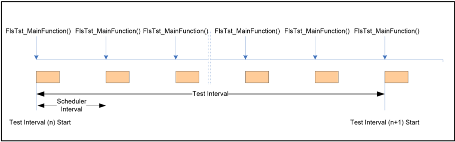
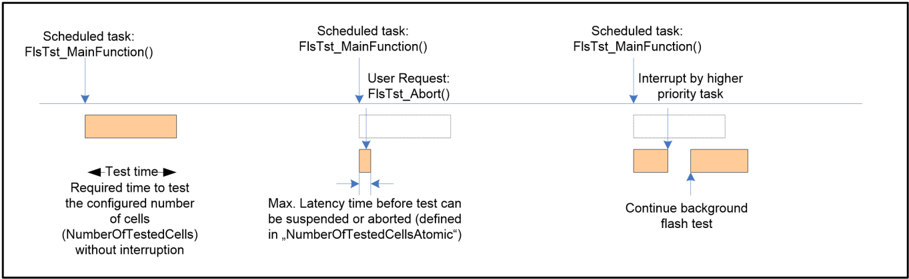
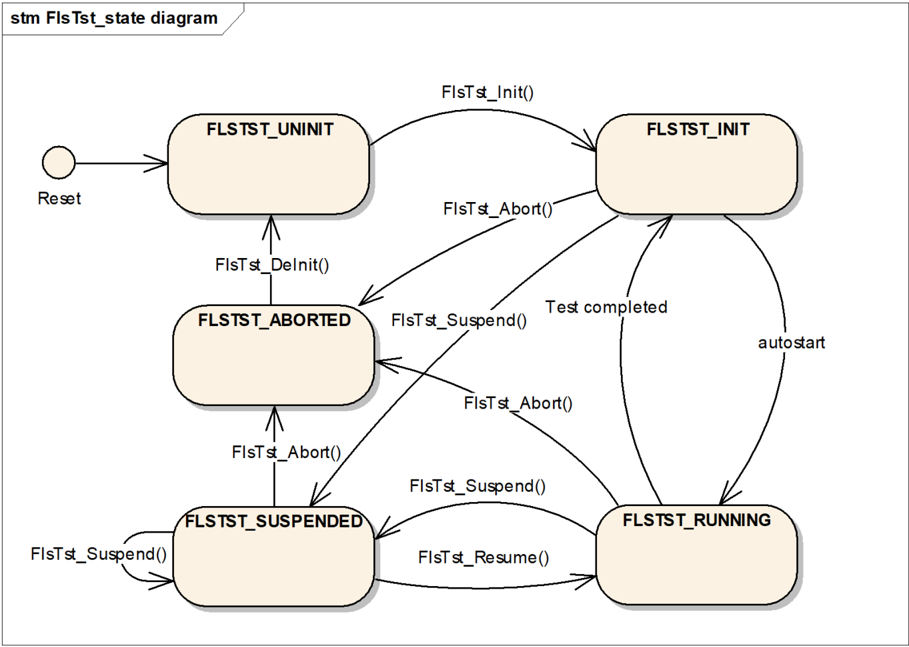
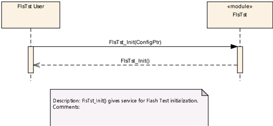
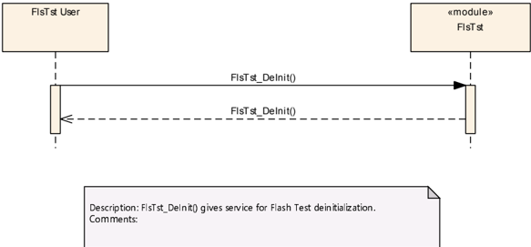
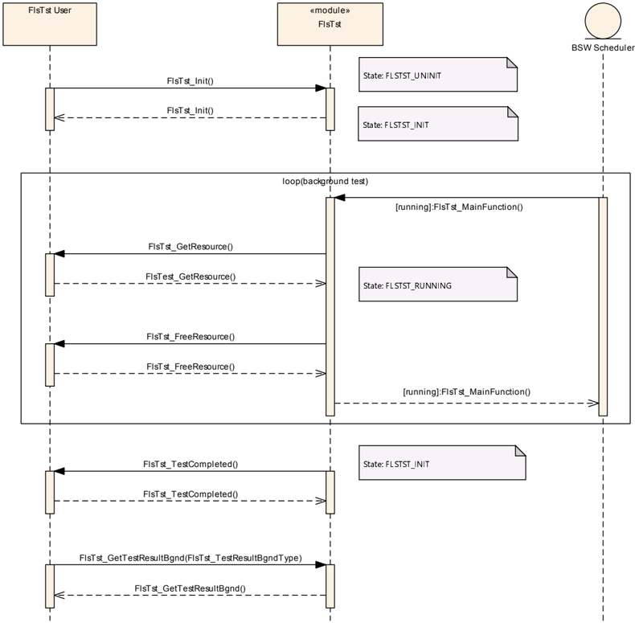
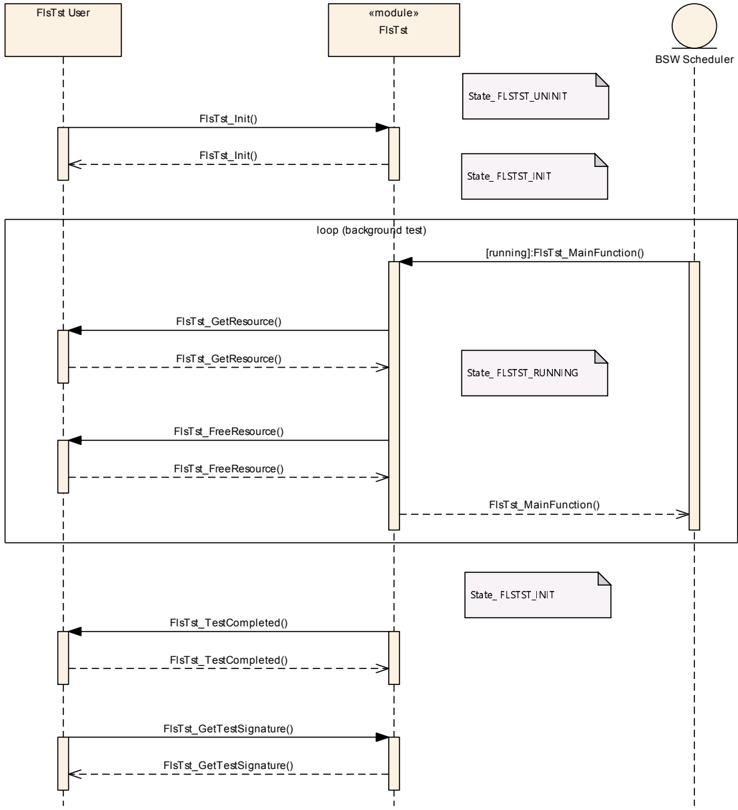
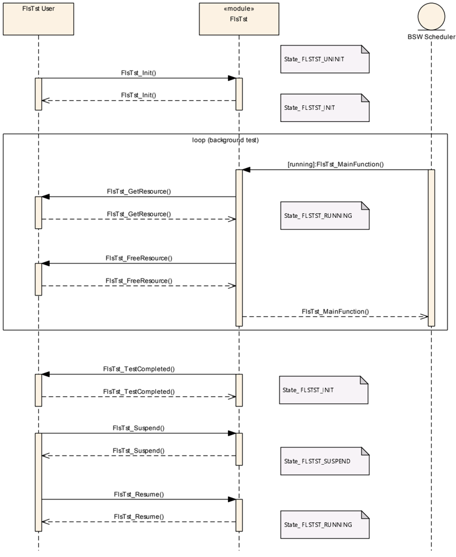
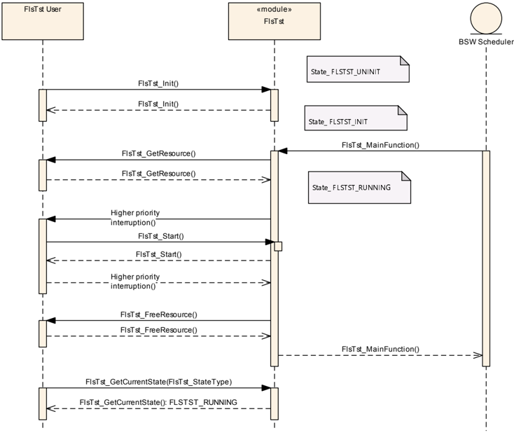

## 1. 简介和功能概述

本规范规定了**AUTOSAR**基础软件模块闪存测试驱动程序（**Flash Test driver**）的功能、**API**和配置。

该闪存测试模块提供测试不变存储器（**invariable memory**）的算法。不变存储器可以是数据/程序闪存、程序**SRAM**、锁定的**cache**，它或者嵌入在微控制器中，或者通过内存映射方式连接到微控制器。为简化起见，该软件模块被称为闪存测试驱动程序。

测试服务可以在**MCU**初始化之后的任何时间执行，由闪存测试驱动程序的用户来选择合适的测试算法和正确的执行位置，以满足系统的安全需求。测试服务本身依赖于系统的存储概念。因此，不同测试算法的可用性是可配置的。

闪存测试驱动程序旨在集成到整体安全概念中，它本身不会提供所需的诊断覆盖率。

## 2. 缩略语

具有局部作用域的缩略语和缩写未包含在**AUTOSAR**术语表中。它们出现在下面的局部术语表中。

**BSW**
> 基础软件（**BasicSoftWare**）

**PC**
> 预编译（**PreCompile**）

**PB**
> 后构建（**PostBuild**）

**DEM**
> 诊断事件管理器（**Diagnostic Event Manager**）。

**DET**
> 默认错误跟踪器（**Default Error Tracer**）。

**MCU**
> 微控制器单元（**Micro Controller Unit**）。

**PLL**
> 锁相环（**Phase Locked Loop**）。

**ISR**
> 中断服务例程（**Interrupt Service Routine**）。

下表列出了本文档中使用的重要术语和定义。

**Background test**
> 后台测试由调度程序周期性地调用，并且是可中断的。测试被拆分到多个调度的任务中。

**Foreground test**
> 前台测试通过用户调用触发。

**Flash cell**
> 最小的可寻址实体，此处使用字节。

**Invariable memory**
> 不变存储器可以是程序闪存、程序**SRAM**、锁定的**cache**和**ROM**。

**Test block**
> 在前台和后台模式下要被测试的已定义存储区域。

**Test interval**
> 后台模式下一次完整闪存测试的间隔。

**Test time**
> 在一个调度的任务内定义的部分测试的时间。

**Signature**
> 特定存储块内容的唯一计算结果。

**Memory block**
> 已定义的存储区域。

**Partial test**
> 要在一个调度程序间隔内执行的测试。

**Test Interval Id**
> 测试间隔的标识符，每次新的测试间隔开始时它应递增。

## 3. 相关文档

### 3.1. 输入文件和相关标准与规范

<a id="ref-1"></a>[1] General Specification of Basic Software Modules
> AUTOSAR_CP_SWS_BSWGeneral

<a id="ref-2"></a>[2] General Requirements on Basic Software Modules
> AUTOSAR_CP_SRS_BSWGeneral

<a id="ref-3"></a>[3] General Requirements on SPAL
> AUTOSAR_CP_SRS_SPALGeneral

<a id="ref-4"></a>[4] Requirements on Flash Test
> AUTOSAR_CP_SRS_FlashTest

### 3.2. 相关规范

**AUTOSAR**提供了基础软件模块的通用规范[\[1, SWS BSW General\]](#ref-1)，它也适用于闪存测试。

因此，规范SWS BSW General需被视为闪存测试的附加和必需规范。

## 4. 约束和假设

### 4.1. 限制

在闪存测试操作期间，被测试的闪存区域不得被修改。

### 4.2. 汽车域的适用性

无限制。

## 5. 对其他模块的依赖

闪存测试模块依赖于以下模块：

* 需要**BSW**调度程序在后台模式下触发主函数。

### 5.1. 文件结构

#### 5.1.1. 代码文件结构

**注意：** 请参阅**SWS_BSWGeneral**文档[1](#ref-1)。

## 6. 功能规格

### 6.1. 一般行为

闪存测试模块提供后台模式和前台模式的测试执行服务。

要被测试的存储块应可针对后台模式和前台模式分别进行配置。

在后台模式下，测试块应按照它们在配置结构中被配置的顺序进行测试。当所有块都被测试后，一个测试间隔即告完成。在后台测试中，部分测试应通过[**FlsTst_MainFunction**](#751-flstst_mainfunction)触发（参见[第7.5.1章](#751-flstst_mainfunction)）。



部分测试的长度由被测试单元的数量定义，这些单元应在一个调度的任务中被测试（参见[第9.2.4章](#924-flststgeneral)）。一次无中断的部分测试所需的时间被定义为"测试时间"（**Test time**）。

**注意：** 部分测试可以在任何时间被更高优先级的任务中断，因为闪存测试不要求原子序列。用户有责任确保可中断的部分测试在调度程序间隔开始之前完成（参见图7.2）。

后台测试应通过**API**服务**[FlsTst_Abort](#734-flstst_abort)()**或**FlsTst_Suspended()**中止或挂起。直到**API**调用请求被处理之前的最大延迟时间应是可配置的（参见[第9.2.4章](#924-flststgeneral)）。

每个闪存测试间隔应有一个标识符，在后台模式下每次新的测试间隔开始时该标识符应递增。



#### 6.1.1. 状态图

图7.3描述了后台模式下的闪存测试驱动程序状态。所描述的状态是后台操作模式下的驱动程序状态。



前台测试被定义为不应被中断的同步测试。前台测试的执行是可配置的（参见[第9.2.5章](#925-flststconfigurationofoptapiservices)），并且可以在模块初始化之后的任何时间被调用。

### 6.2. 错误分类

文档[1](#ref-1)"基础软件模块通用规范"的"错误处理"（**Error Handling**）章节详细描述了基础软件的错误处理。其中，它构成了一个由五种错误类型组成的分类方案，这些错误类型可能发生在**BSW**模块中。

在此基础上，以下各小节按相应的类别规定了特定的错误。

#### 6.2.1. 开发错误

**FlsTst**模块中开发错误的定义：

| 错误类型 | 相关错误代码 | 错误值 |
|---|---|---|
| 闪存测试执行状态内发生故障 | FLSTST_E_STATE_FAILURE | 0x01 |
| **API**参数超出规定范围 | FLSTST_E_PARAM_INVALID | 0x02 |
| 未初始化模块就使用了**API**服务 | FLSTST_E_UNINIT | 0x03 |
| 闪存测试模块已被初始化 | FLSTST_E_ALREADY_INITIALIZED | 0x04 |
| 对于**Variant PB**：配置指针是**NULL**指针。对于**Variant PC**：配置指针不是**NULL**指针。 | FLSTST_E_INIT_FAILED | 0x05 |
| 指针是**NULL**指针 | FLSTST_E_PARAM_POINTER | 0x06 |

#### 6.2.2. 运行时错误

没有运行时错误。

#### 6.2.3. 瞬态故障

没有瞬态故障。

#### 6.2.4. 生产错误

没有生产错误。

#### 6.2.5. 扩展生产错误

| 错误名称 | FLSTST_E_FLSTST_FAILURE |
|---|---|
| 简要描述 | 后台模式下的故障检测 |
| 详细描述 | 当在后台模式下的一个测试间隔内检测到故障时，应发出该扩展生产错误。 |
| 检测条件 | Fail：后台模式下一个测试间隔内至少有一个块为NOT OK（参见[第7.5.1章](#751-flstst_mainfunction)）。 |
| 检测条件 | Pass：后台模式下一个测试间隔内的所有块均以OK结果被测试（参见[第7.5.1章](#751-flstst_mainfunction)）。 |
| 次要参数 | 不适用 |
| 所需时间 | 不适用 |
| 监视频率 | 连续 |

### 6.3. 初始化序列

函数[**FlsTst_Init**](#731-flstst_init)应最先被调用，然后才能调用任何其他闪存测试函数（函数[**FlsTst_GetCurrentState**](#737-flstst_getcurrentstate)除外）。如果不遵守该顺序，应向默认错误跟踪器报告错误代码[**FLSTST_E_UNINIT**](#621-开发错误)（如果开发错误检测已启用）。

### 6.4. 版本检查

**注意：** 请参阅**SWS_BSWGeneral**文档[1](#ref-1)。

### 6.5. 调试支持

未定义任何需求。

## 7. API规范

### 7.1. 导入的类型

本章列出了所包含的变量和常量的数据类型定义。

**FlsTst**模块导入的数据类型的定义：

| 模块 | 头文件 | 导入的类型 |
|---|---|---|
| Dem | Rte_Dem_Type.h | Dem_EventIdType |
| Dem | Rte_Dem_Type.h | Dem_EventStatusType |
| Std | Std_Types.h | Std_ReturnType |
| Std | Std_Types.h | Std_VersionInfoType |

### 7.2. 类型定义

#### 7.2.1. FlsTst_ConfigType

结构类型。元素为实现特定。该外部数据结构类型应包含闪存测试的初始化数据。可通过**FlsTst.h**获得。

#### 7.2.2. FlsTst_StateType

枚举类型，取值：

* **FLSTST_UNINIT**（0x00）：闪存测试未初始化或不可用。
* **FLSTST_INIT**（0x01）：闪存测试已初始化并可以启动。
* **FLSTST_RUNNING**（0x02）：闪存测试当前正在运行。
* **FLSTST_ABORTED**（0x03）：闪存测试已中止。
* **FLSTST_SUSPENDED**（0x04）：闪存测试正在等待被恢复，或正在等待启动前台模式测试。

这是**API**服务**[FlsTst_GetCurrentState](#737-flstst_getcurrentstate)()**返回的状态值。可通过**FlsTst.h**获得。

对于类型**FlsTst_StateType**，枚举值**FLSTST_UNINIT**应为复位之后的默认值。

#### 7.2.3. FlsTst_TestResultFgndType

枚举类型，取值：

* **FLSTST_NOT_TESTED**（0x00）：没有可用的结果。
* **FLSTST_OK**（0x01）：上一次闪存测试的结果为OK。
* **FLSTST_NOT_OK**（0x02）：上一次闪存测试的结果为NOT_OK。

**API**服务**FlsTst_GetResultFgnd()**的返回类型。可通过**FlsTst.h**获得。

对于类型**FlsTst_TestResultFgndType**，枚举值**FLSTST_NOT_TESTED**应为复位之后的默认值。

#### 7.2.4. FlsTst_TestResultBgndType

结构类型。元素为：

* 0..&lt;FlsTstTestIntervalIdEndValue&gt;（uint8、uint16、uint32）：FlsTstTestIntervalId的当前值，每次新的测试间隔开始时递增。
* result（[FlsTst_TestResultType](#729-flstst_testresulttype)）：-

**API**服务**[FlsTst_GetTestResultBgnd](#738-flstst_gettestresultbgnd)()**的返回类型。可通过**FlsTst.h**获得。

对于类型**FlsTst_TestResultBgndType**，枚举值**FLSTST_RESULT_NOT_TESTED**应为复位之后的默认值。

#### 7.2.5. FlsTst_BlockIdFgndType

类型，派生自uint16/uint32/uint8（取决于变体）。范围0..&lt;FlsTstBlockNumberFgnd&gt; - 1——该范围取决于配置结构中定义的前台闪存块的数量。应根据**MCU**平台选择该类型以获得最佳性能。该类型规定了在前台模式下要被测试的闪存块的标识（**ID**），该块在配置结构中被配置。可通过**FlsTst.h**获得。

#### 7.2.6. FlsTst_ErrorDetailsType

结构类型。元素为实现特定。该类型应规定在闪存测试模块中监视到的实现特定的错误信息。可通过**FlsTst.h**获得。

#### 7.2.7. FlsTst_TestSignatureFgndType

结构类型。元素为实现特定（实现特定的类型）。前台模式下测试签名的类型。可通过**FlsTst.h**获得。

#### 7.2.8. FlsTst_TestSignatureBgndType

结构类型。元素为：

* 0..&lt;FlsTstTestIntervalIdEndValue&gt;（uint8、uint16、uint32）：FlsTstTestIntervalId的当前值，每次新的测试间隔开始时递增。
* Implementation specific（uint8、uint16、uint32）：它表示最后一个完成的测试间隔的签名值。该值可能由多个块签名生成。

后台模式下测试签名的类型。可通过**FlsTst.h**获得。

#### 7.2.9. FlsTst_TestResultType

枚举类型，取值：

* **FLSTST_RESULT_NOT_TESTED**（0x00）：没有可用的测试结果。
* **FLSTST_RESULT_OK**（0x01）：上一次闪存测试间隔的测试结果为OK。
* **FLSTST_RESULT_NOT_OK**（0x02）：上一次闪存测试间隔的测试结果为NOT-OK。

可通过**FlsTst.h**获得。

### 7.3. 函数定义

这是提供给上层模块的函数的列表。

#### 7.3.1. FlsTst_Init

**说明**: 服务 ID 0x00。闪存测试初始化服务。可通过**FlsTst.h**获得。本服务为同步调用，不可重入。参数 ConfigPtr（in）：指向配置集的指针。参数（inout）：无。参数（out）：无。返回值：无。

```C
void FlsTst_Init ( const FlsTst_ConfigType* ConfigPtr )
```

函数**FlsTst_Init**应初始化所有与闪存测试相关的寄存器和全局变量，并将执行状态更改为FLSTST_INIT。

函数**FlsTst_Init**应只初始化已配置的资源，不得触碰配置文件中未配置的资源。

如果开发错误检测已启用，在闪存测试驱动程序已被初始化的情况下调用例程**FlsTst_Init**应导致开发错误[FLSTST_E_ALREADY_INITIALIZED](#621-开发错误)。该函数应不做任何动作直接退出。

**注意：** 函数**FlsTst_Init**在复位之后应只被调用一次，除非在再次调用**FlsTst_Init**之前先调用了[**FlsTst_DeInit**](#732-flstst_deinit)。

#### 7.3.2. FlsTst_DeInit

**说明**: 服务 ID 0x01。闪存测试反初始化服务。可通过**FlsTst.h**获得。本服务为同步调用，不可重入。参数（in）：无。参数（inout）：无。参数（out）：无。返回值：无。

```C
void FlsTst_DeInit ( void )
```

函数**FlsTst_DeInit**应反初始化所有由[**FlsTst_Init**](#731-flstst_init)初始化的、与闪存测试相关的寄存器和全局变量。

函数**FlsTst_DeInit**应将闪存测试模块状态设置为FLSTST_UNINIT。

#### 7.3.3. FlsTst_StartFgnd

**说明**: 服务 ID 0x02。执行前台闪存测试的服务。可通过**FlsTst.h**获得。本服务为同步调用，不可重入。参数 FgndBlockId（in）：要执行的前台测试的编号。这取决于配置。参数（inout）：无。参数（out）：无。返回值：**Std_ReturnType**，**E_OK**：前台测试已处理；**E_NOT_OK**：前台测试未被接受。

```C
Std_ReturnType FlsTst_StartFgnd ( FlsTst_BlockIdFgndType FgndBlockId )
```

函数**FlsTst_StartFgnd**仅适用于前台模式的闪存测试操作。

函数**FlsTst_StartFgnd**应可通过配置参数**FlsTst_StartFgndApi**在预编译阶段配置开/关。

如果开发错误检测已启用且参数**FgndBlockId**超出范围，应引发**DET**错误值[FLSTST_E_PARAM_INVALID](#621-开发错误)，并且函数应不做任何动作、以返回值**E_NOT_OK**退出。

#### 7.3.4. FlsTst_Abort

**说明**: 服务 ID 0x03。中止闪存测试的服务。可通过**FlsTst.h**获得。本服务为同步调用，不可重入。参数（in）：无。参数（inout）：无。参数（out）：无。返回值：无。

```C
void FlsTst_Abort ( void )
```

该函数应中止闪存测试后台操作并将状态设置为FLSTST_ABORTED。当函数**FlsTst_Abort**被调用时，[**FlsTst_MainFunction**](#751-flstst_mainfunction)应完成其正在运行的当前原子序列。

在**FlsTst_Abort**调用之后，在闪存测试模块被完全重新初始化之前，调度程序调用[**FlsTst_MainFunction**](#751-flstst_mainfunction)时它不得再次开始测试。

#### 7.3.5. FlsTst_Suspend

**说明**: 服务 ID 0x04。挂起闪存测试当前操作的服务，直到[**FlsTst_Resume**](#736-flstst_resume)被调用。可通过**FlsTst.h**获得。本服务为同步调用，不可重入。参数（in）：无。参数（inout）：无。参数（out）：无。返回值：无。

```C
void FlsTst_Suspend ( void )
```

函数**FlsTst_Suspend**仅适用于后台模式的闪存测试操作。

如果执行状态为FLSTST_RUNNING或FLSTST_INIT，函数**FlsTst_Suspend**应将闪存测试执行状态设置为FLSTST_SUSPENDED。

函数**FlsTst_Suspend**应可通过配置参数**FlsTst_SuspendResumeApi**在预编译阶段配置开/关。

#### 7.3.6. FlsTst_Resume

**说明**: 服务 ID 0x05。在被挂起的位置继续闪存测试的服务。可通过**FlsTst.h**获得。本服务为同步调用，不可重入。参数（in）：无。参数（inout）：无。参数（out）：无。返回值：无。

```C
void FlsTst_Resume ( void )
```

当被命令继续且当前执行状态为FLSTST_SUSPENDED时，函数**FlsTst_Resume**应将执行状态更改为FLSTST_RUNNING。

如果开发错误检测已启用且闪存测试模块的执行状态不是FLSTST_SUSPENDED，闪存测试模块应向**DET**报告错误值[FLSTST_E_STATE_FAILURE](#621-开发错误)，然后立即从该函数返回。

函数**FlsTst_Resume**仅适用于后台模式的闪存测试操作。

函数**FlsTst_Resume**应可通过配置参数**FlsTst_SuspendResumeApi**在预编译阶段配置开/关。

#### 7.3.7. FlsTst_GetCurrentState

**说明**: 服务 ID 0x06。返回当前闪存测试执行状态的服务。可通过**FlsTst.h**获得。本服务为同步调用，不可重入。参数（in）：无。参数（inout）：无。参数（out）：无。返回值：[**FlsTst_StateType**](#722-flstst_statetype)，**FLSTST_UNINIT**：闪存测试未初始化或不可用；**FLSTST_INIT**：闪存测试已初始化并可以启动；**FLSTST_RUNNING**：闪存测试当前正在运行；**FLSTST_ABORTED**：闪存测试已中止；**FLSTST_SUSPENDED**：闪存测试正在等待被恢复，或正在等待启动前台模式测试。

```C
FlsTst_StateType FlsTst_GetCurrentState ( void )
```

函数**FlsTst_GetCurrentState**应返回当前的闪存测试执行状态。

函数**FlsTst_GetCurrentState**应可通过配置参数**FlsTst_GetCurrentStateApi**在预编译阶段配置开/关。

#### 7.3.8. FlsTst_GetTestResultBgnd

**说明**: 服务 ID 0x07。返回后台闪存测试结果的服务。可通过**FlsTst.h**获得。本服务为同步调用，可重入。参数（in）：无。参数（inout）：无。参数（out）：无。返回值：[**FlsTst_TestResultBgndType**](#724-flstst_testresultbgndtype)，参见类型定义。

```C
FlsTst_TestResultBgndType FlsTst_GetTestResultBgnd ( void )
```

函数**FlsTst_GetTestResultBgnd**应返回最后一次后台测试的闪存测试结果和测试间隔 Id。

函数**FlsTst_GetTestResultBgnd**应可通过配置参数**FlsTst_GetTestResultBgndApi**在预编译阶段配置开/关。

#### 7.3.9. FlsTst_GetTestResultFgnd

**说明**: 服务 ID 0x0f。返回前台闪存测试结果的服务。可通过**FlsTst.h**获得。本服务为同步调用，可重入。参数（in）：无。参数（inout）：无。参数（out）：无。返回值：[**FlsTst_TestResultFgndType**](#723-flstst_testresultfgndtype)，参见类型定义。

```C
FlsTst_TestResultFgndType FlsTst_GetTestResultFgnd ( void )
```

函数**FlsTst_GetTestResultFgnd**应返回最后一次前台测试的闪存测试结果。

函数**FlsTst_GetTestResultFgnd**应可通过配置参数**FlsTst_GetTestResultFgndApi**在预编译阶段配置开/关。

#### 7.3.10. FlsTst_GetVersionInfo

**说明**: 服务 ID 0x08。返回本模块版本信息的服务。可通过**FlsTst.h**获得。本服务为同步调用，可重入。参数（in）：无。参数（inout）：无。参数（out）versioninfo：指向存储本模块版本信息的位置的指针。返回值：无。

```C
void FlsTst_GetVersionInfo ( Std_VersionInfoType* versioninfo )
```

#### 7.3.11. FlsTst_GetTestSignatureBgnd

**说明**: 服务 ID 0x09。返回后台模式下闪存测试结果的服务。可通过**FlsTst.h**获得。本服务为同步调用，可重入。参数（in）：无。参数（inout）：无。参数（out）：无。返回值：[**FlsTst_TestSignatureBgndType**](#728-flstst_testsignaturebgndtype)，参见类型定义。

```C
FlsTst_TestSignatureBgndType FlsTst_GetTestSignatureBgnd ( void )
```

函数**FlsTst_GetTestSignatureBgnd**应返回最后一次后台测试的签名和测试间隔 Id。

函数**FlsTst_GetTestSignatureBgnd**应可通过配置参数**FlsTst_GetTestSignatureBgndApi**在预编译阶段配置开/关。

如果没有可用的签名，函数**FlsTst_GetTestSignatureBgnd**应返回默认签名值"0x0"。

#### 7.3.12. FlsTst_GetTestSignatureFgnd

**说明**: 服务 ID 0x0a。返回前台模式下闪存测试结果的服务。可通过**FlsTst.h**获得。本服务为同步调用，可重入。参数（in）：无。参数（inout）：无。参数（out）：无。返回值：[**FlsTst_TestSignatureFgndType**](#727-flstst_testsignaturefgndtype)，参见类型定义。

```C
FlsTst_TestSignatureFgndType FlsTst_GetTestSignatureFgnd ( void )
```

函数**FlsTst_GetTestSignatureFgnd**应返回最后一次前台测试的签名。

函数**FlsTst_GetTestSignatureFgnd**应可通过配置参数**FlsTst_GetTestSignatureFgndApi**在预编译阶段配置开/关。

如果没有可用的签名，函数**FlsTst_GetTestSignatureFgnd**应返回默认签名值"0x0"。

#### 7.3.13. FlsTst_GetErrorDetails

**说明**: 服务 ID 0x0b。返回从闪存模块监视到的错误详情的服务。可通过**FlsTst.h**获得。本服务为同步调用，可重入。参数（in）：无。参数（inout）：无。参数（out）：无。返回值：[**FlsTst_ErrorDetailsType**](#726-flstst_errordetailstype)，参见类型定义。

```C
FlsTst_ErrorDetailsType FlsTst_GetErrorDetails ( void )
```

函数**FlsTst_GetErrorDetails**应返回从闪存测试驱动程序监视到的错误详情。

函数**FlsTst_GetErrorDetails**应可通过配置参数**FlsTst_GetErrorDetailsApi**在预编译阶段配置开/关。

#### 7.3.14. FlsTst_TestEcc

**说明**: 服务 ID 0x0c。执行**ECC**硬件测试的服务。仅当硬件提供此类功能时才适用。可通过**FlsTst.h**获得。本服务为同步调用，不可重入。参数（in）：无。参数（inout）：无。参数（out）：无。返回值：**Std_ReturnType**，参见类型定义。

```C
Std_ReturnType FlsTst_TestEcc ( void )
```

函数**FlsTst_TestEcc**应执行**ECC**电路的测试。

函数**FlsTst_TestEcc**应可通过配置参数**FlsTst_TestEccApi**在预编译阶段配置开/关。

### 7.4. 回调通知

由于闪存测试是一个驱动程序模块，它不为下层模块提供任何回调函数。

### 7.5. 调度函数

#### 7.5.1. FlsTst_MainFunction

**说明**: 服务 ID 0x0d。在后台模式下执行闪存测试的服务。可通过**SchM_FlsTst.h**获得。

```C
void FlsTst_MainFunction ( void )
```

函数**FlsTst_MainFunction**应在后台模式下测试定义的闪存块，从**FlsTstConfigParams**中的第一个闪存块开始。

在初始化之后或一个完整的测试间隔之后第一次调用该函数时，函数**FlsTst_MainFunction**应将闪存测试执行状态从FLSTST_INIT设置为FLSTST_RUNNING。

当**FlsTstTestResultSignature**为true时，函数**FlsTst_MainFunction**应提供一个测试间隔内所有块的测试签名。

当**FlsTstTestResultSignature**被禁用时，如果所有块都以OK结果状态被测试，函数**FlsTst_MainFunction**应将一个测试间隔的总体结果状态设置为FLSTST_RESULT_OK。此外，应以检测条件"Pass"触发**DEM**错误[**FLSTST_E_FLSTST_FAILURE**](#625-扩展生产错误)。

当**FlsTstTestResultSignature**被禁用时，如果至少有一个块的测试结果不为ok（无论所有块是否都已被测试），函数**FlsTst_MainFunction**应将一个测试间隔的总体结果状态设置为FLSTST_RESULT_NOT_OK。此外，应以检测条件"Fail"触发**DEM**错误[**FLSTST_E_FLSTST_FAILURE**](#625-扩展生产错误)。

在函数**FlsTst_MainFunction**完成了所有闪存块的测试之后，下一次调用函数**FlsTst_MainFunction**应从头开始重新测试。

函数**FlsTst_MainFunction**应在一次调用中测试定义数量的闪存单元。定义的数量由配置规定（参见[第9.2.4章](#924-flststgeneral)）。

函数**FlsTst_MainFunction**应在测试定义数量的闪存单元期间不检查用户的中止或挂起请求。定义的数量由配置规定（参见[第9.2.4章](#924-flststgeneral)）。

函数**FlsTst_MainFunction**应在新的测试间隔开始之前将测试间隔 Id 递增1。第一个测试间隔的测试间隔 Id 应为"0"。如果达到结束值 FlsTstIntervalIdEndValue，测试间隔 Id 应再次从值"0"开始。该值应作为[**FlsTst_GetTestResultBgnd**](#738-flstst_gettestresultbgnd)和[**FlsTst_GetTestSignatureBgnd**](#7311-flstst_gettestsignaturebgnd)返回值的一部分提供。

### 7.6. 期望接口

本章列出了需要从其他模块获得的所有接口。

#### 7.6.1. 强制接口

本章定义了实现模块核心功能所需的所有接口。

| API函数 | 头文件 | 描述 |
|---|---|---|
| Dem_SetEventStatus | Dem.h | 由**SW-C**或**BSW**模块调用，以向**Dem**上报监控状态信息。调用Dem_SetEventStatus的**BSW**模块可以安全地忽略返回值。仅当（{Dem/DemConfigSet/DemEventParameter/DemEventReportingType} == STANDARD_REPORTING）时此**API**才可用。 |

#### 7.6.2. 可选接口

本章定义了实现模块可选功能所需的所有接口。

| API函数 | 头文件 | 描述 |
|---|---|---|
| Det_ReportError | Det.h | 用于报告开发错误的服务。 |

#### 7.6.3. 可配置接口

本章列出了目标函数可被配置的所有接口。目标函数通常是回调函数。此类接口的名称不是固定的，因为它们是可配置的。

回调通知应可配置为初始化数据结构（[**FlsTst_ConfigType**](#721-flstst_configtype)）中的函数指针。

回调通知应没有参数且没有返回值。

如果回调通知被配置为null指针，闪存测试模块不得执行该回调。

##### 7.6.3.1. FlsTst_TestCompleted通知

| 服务名称 | FlsTst_TestCompletedNotification |
|---|---|
| 语法 | void FlsTst_TestCompletedNotification ( void ) |
| 服务 ID [hex] | 0x0e |
| 同步/异步 | 同步 |
| 可重入性 | 无关（**Don't care**） |
| 参数（in） | 无 |
| 参数（inout） | 无 |
| 参数（out） | 无 |
| 返回值 | 无 |
| 描述 | 每当完成一次完整的测试循环时，都应调用函数FlsTst_TestCompleted。 |
| 可通过 | FlsTst.h |

每当在后台模式下完成一个闪存测试的完整测试循环时，闪存测试模块都应调用回调通知**FlsTst_TestCompleted**。

函数**FlsTst_TestCompleted**的调用应可通过配置参数**FlsTstTestCompletedNotificationSupported**在预编译阶段配置开/关。

## 8. 时序图

### 8.1. 初始化



### 8.2. 反初始化



### 8.3. 后台测试

#### 8.3.1. 闪存测试驱动程序内的测试结果计算



#### 8.3.2. 提供给调用者的测试签名



### 8.4. 后台测试的挂起和恢复



### 8.5. 前台任务中断后台任务



## 9. 配置规范

### 9.1. 配置参数的规范模板

Pre-compile time —— 规定配置参数是否属于预编译配置类：

| 标签 | 描述 |
|---|---|
| x | 该配置参数应为预编译（**Pre-compile time**）配置类。 |
| - | 该配置参数绝不应为预编译配置类。 |

Link time —— 规定配置参数是否属于链接（**Link time**）配置类：

| 标签 | 描述 |
|---|---|
| x | 该配置参数应为链接配置类。 |
| - | 该配置参数绝不应为链接配置类。 |

Post Build —— 规定配置参数是否属于后构建（**Post Build**）配置类：

| 标签 | 描述 |
|---|---|
| x | 该配置参数应为后构建配置类，且不需要特定的实现。 |
| L | 可加载（**Loadable**）——该配置参数应为后构建配置类，且**ECU**中只存在一个配置参数集。 |
| M | 多重（**Multiple**）——该配置参数应为后构建配置类，并通过向模块的初始化函数传递专用指针从多个参数集中选出一个。 |
| - | 该配置参数绝不应为后构建配置类。 |

### 9.2. 容器与配置参数

以下各节汇总了所有配置参数。各参数的详细含义在第6章和第7章中描述。

#### 9.2.1. 变体

变体的定义请参见[1](#ref-1)。

#### 9.2.2. FlsTst

| SWS 条目 | [ECUC_FlsTst_00135] |
|---|---|
| 模块名称 | FlsTst |
| 描述 | **FlsTst**模块的配置。 |
| Post-Build 变体支持 | true |
| 支持的配置变体 | VARIANT-POST-BUILD、VARIANT-PRE-COMPILE |

| 容器名称 | 多重性 | 作用域/依赖 |
|---|---|---|
| FlsTstConfigSet | 1 | 该容器包含**AUTOSAR FlsTst**模块的配置参数和子容器。 |
| FlsTstConfigurationOfOptApiServices | 1 | - |
| FlsTstDemEventParameterRefs | 0..1 | 用于引用DemEventParameter元素的容器，当相应错误发生时应通过**API** Dem_SetEventStatus调用这些元素。EventId取自所引用DemEventParameter的DemEventId符号值。标准化错误在该容器中提供，并可通过供应商特定的错误引用进行扩展。 |
| FlsTstGeneral | 1 | - |

#### 9.2.3. FlsTstConfigSet

| SWS 条目 | [ECUC_FlsTst_00152] |
|---|---|
| 容器名称 | FlsTstConfigSet |
| 父容器 | FlsTst |
| 描述 | 该容器包含**AUTOSAR FlsTst**模块的配置参数和子容器。 |
| 配置参数 | 见下方参数表 |

| SWS 条目 | [ECUC_FlsTst_00122] |
|---|---|
| 参数名称 | FlsTstBlockNumberBgnd |
| 父容器 | FlsTstConfigSet |
| 描述 | 该参数应表示可用于后台测试的测试块的数量。计算公式 = **FlsTstBlockBgndConfigSet**中已配置的**FlsTstBlock**的数量（如果未配置任何**FlsTstBlock**则为0）。 |
| 多重性 | 1 |
| 类型 | EcucIntegerParamDef |
| 范围 | 0 .. 4294967295 |
| 默认值 | - |
| Post-Build 变体值 | true |
| 值配置类 | Pre-compile time：x（VARIANT-PRE-COMPILE）；Link time：-；Post-build time：x（VARIANT-POST-BUILD） |
| 作用域/依赖 | scope: local |

| SWS 条目 | [ECUC_FlsTst_00124] |
|---|---|
| 参数名称 | FlsTstBlockNumberFgnd |
| 父容器 | FlsTstConfigSet |
| 描述 | 该参数应表示可用于前台测试的测试块的数量。计算公式 = **FlsTstBlockFgndConfigSet**中已配置的**FlsTstBlock**的数量（如果未配置任何**FlsTstBlock**则为0）。 |
| 多重性 | 1 |
| 类型 | EcucIntegerParamDef |
| 范围 | 0 .. 4294967295 |
| 默认值 | - |
| Post-Build 变体值 | true |
| 值配置类 | Pre-compile time：x（VARIANT-PRE-COMPILE）；Link time：-；Post-build time：x（VARIANT-POST-BUILD） |
| 作用域/依赖 | scope: local |

| SWS 条目 | [ECUC_FlsTst_00102] |
|---|---|
| 参数名称 | FlsTstTestCompletedNotification |
| 父容器 | FlsTstConfigSet |
| 描述 | 函数指针，在完成后台闪存测试间隔之后应调用它。 |
| 多重性 | 1 |
| 类型 | EcucFunctionNameDef |
| 默认值 | - |
| 正则表达式 | - |
| Post-Build 变体值 | true |
| 值配置类 | Pre-compile time：x（VARIANT-PRE-COMPILE）；Link time：-；Post-build time：x（VARIANT-POST-BUILD） |
| 作用域/依赖 | scope: local |

| 容器名称 | 多重性 | 作用域/依赖 |
|---|---|---|
| FlsTstBlockBgnd | 0..* | 该容器规定单个后台测试块的配置参数。 |
| FlsTstBlockFgnd | 0..* | 该容器规定单个前台测试块的配置参数。 |

#### 9.2.4. FlsTstGeneral

| SWS 条目 | [ECUC_FlsTst_00082] |
|---|---|
| 容器名称 | FlsTstGeneral |
| 父容器 | FlsTst |
| 描述 | - |
| 配置参数 | 见下方参数表 |

| SWS 条目 | [ECUC_FlsTst_00083] |
|---|---|
| 参数名称 | FlsTstDevErrorDetect |
| 父容器 | FlsTstGeneral |
| 描述 | 打开或关闭开发错误检测和通知。true：启用检测和通知。false：禁用检测和通知。 |
| 多重性 | 1 |
| 类型 | EcucBooleanParamDef |
| 默认值 | false |
| Post-Build 变体值 | false |
| 值配置类 | Pre-compile time：x（All Variants）；Link time：-；Post-build time：- |
| 作用域/依赖 | scope: local |

| SWS 条目 | [ECUC_FlsTst_00172] |
|---|---|
| 参数名称 | FlsTstMainFunctionPeriod |
| 父容器 | FlsTstGeneral |
| 描述 | 决定调用**FlsTstMainFunction**的频率，单位为[s]。 |
| 多重性 | 1 |
| 类型 | EcucFloatParamDef |
| 范围 | ]0 .. INF[ |
| 默认值 | - |
| Post-Build 变体值 | false |
| 值配置类 | Pre-compile time：x（All Variants）；Link time：-；Post-build time：- |
| 作用域/依赖 | scope: ECU |

| SWS 条目 | [ECUC_FlsTst_00161] |
|---|---|
| 参数名称 | FlsTstNumberOfTestedCells |
| 父容器 | FlsTstGeneral |
| 描述 | 配置在后台模式下一次调度任务（**FlsTst_MainFunction()**调用）期间要被测试的单元数量。 |
| 多重性 | 0..1 |
| 类型 | EcucIntegerParamDef |
| 范围 | 0 .. 4294967295 |
| 默认值 | - |
| Post-Build 变体值 | false |
| 值配置类 | Pre-compile time：x（All Variants）；Link time：-；Post-build time：- |
| 作用域/依赖 | scope: local |

| SWS 条目 | [ECUC_FlsTst_00120] |
|---|---|
| 参数名称 | FlsTstNumberOfTestedCellsAtomic |
| 父容器 | FlsTstGeneral |
| 描述 | 配置在后台模式下不检查用户请求（中止、挂起）而要被测试的单元数量。 |
| 多重性 | 1 |
| 类型 | EcucIntegerParamDef |
| 范围 | 0 .. 4294967295 |
| 默认值 | - |
| Post-Build 变体值 | false |
| 值配置类 | Pre-compile time：x（All Variants）；Link time：-；Post-build time：- |
| 作用域/依赖 | scope: local |

| SWS 条目 | [ECUC_FlsTst_00084] |
|---|---|
| 参数名称 | FlsTstTestCompletedNotificationSupported |
| 父容器 | FlsTstGeneral |
| 描述 | 指示支持该通知的开关。 |
| 多重性 | 1 |
| 类型 | EcucBooleanParamDef |
| 默认值 | true |
| Post-Build 变体值 | false |
| 值配置类 | Pre-compile time：x（All Variants）；Link time：-；Post-build time：- |
| 作用域/依赖 | scope: local |

| SWS 条目 | [ECUC_FlsTst_00158] |
|---|---|
| 参数名称 | FlsTstTestIntervalIdEndValue |
| 父容器 | FlsTstGeneral |
| 描述 | 定义测试间隔 Id 的结束值。 |
| 多重性 | 1 |
| 类型 | EcucIntegerParamDef |
| 范围 | 0 .. 4294967295 |
| 默认值 | - |
| Post-Build 变体值 | false |
| 值配置类 | Pre-compile time：x（All Variants）；Link time：-；Post-build time：- |
| 作用域/依赖 | scope: local |

| SWS 条目 | [ECUC_FlsTst_00160] |
|---|---|
| 参数名称 | FlsTstTestResultSignature |
| 父容器 | FlsTstGeneral |
| 描述 | 配置后台模式下的测试结果：true：测试结果是一个签名（参见SWS_FlsTst_00155、SWS_FlsTst_00054）false：测试结果为ok/not ok（参见SWS_FlsTst_00153、SWS_FlsTst_00042） |
| 多重性 | 1 |
| 类型 | EcucBooleanParamDef |
| 默认值 | false |
| Post-Build 变体值 | false |
| 值配置类 | Pre-compile time：x（All Variants）；Link time：-；Post-build time：- |
| 作用域/依赖 | scope: local |

| SWS 条目 | [ECUC_FlsTst_00175] |
|---|---|
| 参数名称 | FlsTstEcucPartitionRef |
| 父容器 | FlsTstGeneral |
| 描述 | 将闪存测试驱动程序映射到零个或一个**ECUC**分区，以使驱动程序**API**在该分区中可用。 |
| 多重性 | 0..1 |
| 类型 | 对EcucPartition的引用 |
| Post-Build 变体多重性 | true |
| Post-Build 变体值 | true |
| 多重性配置类 | Pre-compile time：x；Link time：-；Post-build time：- |
| 值配置类 | Pre-compile time：x；Link time：-；Post-build time：- |
| 作用域/依赖 | scope: ECU |

无包含容器。

#### 9.2.5. FlsTstConfigurationOfOptApiServices

| SWS 条目 | [ECUC_FlsTst_00085] |
|---|---|
| 容器名称 | FlsTstConfigurationOfOptApiServices |
| 父容器 | FlsTst |
| 描述 | - |
| 配置参数 | 见下方参数表 |

| SWS 条目 | [ECUC_FlsTst_00092] |
|---|---|
| 参数名称 | FlsTstGetCurrentStateApi |
| 父容器 | FlsTstConfigurationOfOptApiServices |
| 描述 | 从代码中添加/移除服务**FlsTst_GetCurrentState()**。 |
| 多重性 | 1 |
| 类型 | EcucBooleanParamDef |
| 默认值 | false |
| Post-Build 变体值 | false |
| 值配置类 | Pre-compile time：x（All Variants）；Link time：-；Post-build time：- |
| 作用域/依赖 | scope: local |

| SWS 条目 | [ECUC_FlsTst_00098] |
|---|---|
| 参数名称 | FlsTstGetErrorDetailsApi |
| 父容器 | FlsTstConfigurationOfOptApiServices |
| 描述 | 从代码中添加/移除服务**FlsTst_GetErrorDetails()**。 |
| 多重性 | 1 |
| 类型 | EcucBooleanParamDef |
| 默认值 | false |
| Post-Build 变体值 | false |
| 值配置类 | Pre-compile time：x（All Variants）；Link time：-；Post-build time：- |
| 作用域/依赖 | scope: local |

| SWS 条目 | [ECUC_FlsTst_00094] |
|---|---|
| 参数名称 | FlsTstGetTestResultBgndApi |
| 父容器 | FlsTstConfigurationOfOptApiServices |
| 描述 | 从代码中添加/移除服务**FlsTst_GetTestResultBgnd()**。 |
| 多重性 | 1 |
| 类型 | EcucBooleanParamDef |
| 默认值 | false |
| Post-Build 变体值 | false |
| 值配置类 | Pre-compile time：x（All Variants）；Link time：-；Post-build time：- |
| 作用域/依赖 | scope: local |

| SWS 条目 | [ECUC_FlsTst_00150] |
|---|---|
| 参数名称 | FlsTstGetTestResultFgndApi |
| 父容器 | FlsTstConfigurationOfOptApiServices |
| 描述 | 从代码中添加/移除服务**FlsTst_GetTestResultFgnd()**。 |
| 多重性 | 1 |
| 类型 | EcucBooleanParamDef |
| 默认值 | false |
| Post-Build 变体值 | false |
| 值配置类 | Pre-compile time：x（All Variants）；Link time：-；Post-build time：- |
| 作用域/依赖 | scope: local |

| SWS 条目 | [ECUC_FlsTst_00096] |
|---|---|
| 参数名称 | FlsTstGetTestSignatureBgndApi |
| 父容器 | FlsTstConfigurationOfOptApiServices |
| 描述 | 从代码中添加/移除服务**FlsTst_GetTestSignatureBgnd()**。 |
| 多重性 | 1 |
| 类型 | EcucBooleanParamDef |
| 默认值 | false |
| Post-Build 变体值 | false |
| 值配置类 | Pre-compile time：x（All Variants）；Link time：-；Post-build time：- |
| 作用域/依赖 | scope: local |

| SWS 条目 | [ECUC_FlsTst_00097] |
|---|---|
| 参数名称 | FlsTstGetTestSignatureFgndApi |
| 父容器 | FlsTstConfigurationOfOptApiServices |
| 描述 | 从代码中添加/移除服务**FlsTst_GetTestSignatureFgnd()**。 |
| 多重性 | 1 |
| 类型 | EcucBooleanParamDef |
| 默认值 | false |
| Post-Build 变体值 | false |
| 值配置类 | Pre-compile time：x（All Variants）；Link time：-；Post-build time：- |
| 作用域/依赖 | scope: local |

| SWS 条目 | [ECUC_FlsTst_00086] |
|---|---|
| 参数名称 | FlsTstStartFgndApi |
| 父容器 | FlsTstConfigurationOfOptApiServices |
| 描述 | 从代码中添加/移除服务**FlsTst_StartFgnd()**。 |
| 多重性 | 1 |
| 类型 | EcucBooleanParamDef |
| 默认值 | false |
| Post-Build 变体值 | false |
| 值配置类 | Pre-compile time：x（All Variants）；Link time：-；Post-build time：- |
| 作用域/依赖 | scope: local |

| SWS 条目 | [ECUC_FlsTst_00087] |
|---|---|
| 参数名称 | FlsTstSuspendResumeApi |
| 父容器 | FlsTstConfigurationOfOptApiServices |
| 描述 | 从代码中添加/移除服务**FlsTst_Suspend()**和**FlsTst_Resume()**。 |
| 多重性 | 1 |
| 类型 | EcucBooleanParamDef |
| 默认值 | false |
| Post-Build 变体值 | false |
| 值配置类 | Pre-compile time：x（All Variants）；Link time：-；Post-build time：- |
| 作用域/依赖 | scope: local |

| SWS 条目 | [ECUC_FlsTst_00099] |
|---|---|
| 参数名称 | FlsTstTestEccApi |
| 父容器 | FlsTstConfigurationOfOptApiServices |
| 描述 | 从代码中添加/移除服务**FlsTst_TestEcc()**。 |
| 多重性 | 1 |
| 类型 | EcucBooleanParamDef |
| 默认值 | false |
| Post-Build 变体值 | false |
| 值配置类 | Pre-compile time：x（All Variants）；Link time：-；Post-build time：- |
| 作用域/依赖 | scope: local |

| SWS 条目 | [ECUC_FlsTst_00095] |
|---|---|
| 参数名称 | FlsTstVersionInfoApi |
| 父容器 | FlsTstConfigurationOfOptApiServices |
| 描述 | 从代码中添加/移除服务**FlsTst_GetVersionInfo()**。 |
| 多重性 | 1 |
| 类型 | EcucBooleanParamDef |
| 默认值 | false |
| Post-Build 变体值 | false |
| 值配置类 | Pre-compile time：x（All Variants）；Link time：-；Post-build time：- |
| 作用域/依赖 | scope: local |

无包含容器。

#### 9.2.6. FlsTstDemEventParameterRefs

| SWS 条目 | [ECUC_FlsTst_00170] |
|---|---|
| 容器名称 | FlsTstDemEventParameterRefs |
| 父容器 | FlsTst |
| 描述 | 用于引用DemEventParameter元素的容器，当相应错误发生时应通过**API** Dem_SetEventStatus调用这些元素。EventId取自所引用DemEventParameter的DemEventId符号值。标准化错误在该容器中提供，并可通过供应商特定的错误引用进行扩展。 |
| 配置参数 | 见下方参数表 |

| SWS 条目 | [ECUC_FlsTst_00171] |
|---|---|
| 参数名称 | FLSTST_E_FLSTST_FAILURE |
| 父容器 | FlsTstDemEventParameterRefs |
| 描述 | 对发生错误"闪存故障"时应发出的DemEventParameter的引用。 |
| 多重性 | 0..1 |
| 类型 | 对DemEventParameter的符号名引用 |
| Post-Build 变体多重性 | false |
| Post-Build 变体值 | false |
| 多重性配置类 | Pre-compile time：x（All Variants）；Link time：-；Post-build time：- |
| 值配置类 | Pre-compile time：x（All Variants）；Link time：-；Post-build time：- |
| 作用域/依赖 | scope: local |

无包含容器。

#### 9.2.7. FlsTstBlockBgnd

| SWS 条目 | [ECUC_FlsTst_00173] |
|---|---|
| 容器名称 | FlsTstBlockBgnd |
| 父容器 | FlsTstConfigSet |
| 描述 | 该容器规定单个后台测试块的配置参数。 |
| 配置参数 | 见下方参数表 |

| SWS 条目 | [ECUC_FlsTst_00174] |
|---|---|
| 参数名称 | FlsTstBgndBlockIndex |
| 父容器 | FlsTstBlockBgnd |
| 描述 | 后台测试的调度应遵循由该索引定义的顺序。"0"表示最高优先级。 |
| 多重性 | 1 |
| 类型 | EcucIntegerParamDef（为该参数生成符号名） |
| 范围 | 0 .. 4294967295 |
| 默认值 | - |
| Post-Build 变体值 | false |
| 值配置类 | Pre-compile time：x（All Variants）；Link time：-；Post-build time：- |
| 作用域/依赖 | scope: local |

| SWS 条目 | [ECUC_FlsTst_00106] |
|---|---|
| 参数名称 | FlsTstBlockBaseAddress |
| 父容器 | FlsTstBlockBgnd |
| 描述 | 闪存块的起始地址。 |
| 多重性 | 1 |
| 类型 | EcucIntegerParamDef |
| 范围 | 0 .. 18446744073709551615 |
| 默认值 | - |
| Post-Build 变体值 | true |
| 值配置类 | Pre-compile time：x（VARIANT-PRE-COMPILE）；Link time：-；Post-build time：x（VARIANT-POST-BUILD） |
| 作用域/依赖 | scope: local |

| SWS 条目 | [ECUC_FlsTst_00107] |
|---|---|
| 参数名称 | FlsTstBlockSize |
| 父容器 | FlsTstBlockBgnd |
| 描述 | 该参数应表示闪存测试块的大小。 |
| 多重性 | 1 |
| 类型 | EcucIntegerParamDef |
| 范围 | 0 .. 4294967295 |
| 默认值 | - |
| Post-Build 变体值 | true |
| 值配置类 | Pre-compile time：x（VARIANT-PRE-COMPILE）；Link time：-；Post-build time：x（VARIANT-POST-BUILD） |
| 作用域/依赖 | scope: local |

| SWS 条目 | [ECUC_FlsTst_00123] |
|---|---|
| 参数名称 | FlsTstSignatureAddress |
| 父容器 | FlsTstBlockBgnd |
| 描述 | 闪存测试块的签名参考值的地址。 |
| 多重性 | 1 |
| 类型 | EcucIntegerParamDef |
| 范围 | 0 .. 18446744073709551615 |
| 默认值 | - |
| Post-Build 变体值 | true |
| 值配置类 | Pre-compile time：x（VARIANT-PRE-COMPILE）；Link time：-；Post-build time：x（VARIANT-POST-BUILD） |
| 作用域/依赖 | scope: local |

| SWS 条目 | [ECUC_FlsTst_00101] |
|---|---|
| 参数名称 | FlsTstTestAlgorithm |
| 父容器 | FlsTstBlockBgnd |
| 描述 | 这是测试算法的配置。算法的可用性是实现特定的。 |
| 多重性 | 1 |
| 类型 | EcucEnumerationParamDef |
| 范围 | FLSTST_16BIT_CRC、FLSTST_32BIT_CRC、FLSTST_8BIT_CRC、FLSTST_CHECKSUM、FLSTST_DUPLICATED_MEMORY、FLSTST_ECC |
| Post-Build 变体值 | true |
| 值配置类 | Pre-compile time：x（VARIANT-PRE-COMPILE）；Link time：-；Post-build time：x（VARIANT-POST-BUILD） |
| 作用域/依赖 | scope: local |

无包含容器。

#### 9.2.8. FlsTstBlockFgnd

| SWS 条目 | [ECUC_FlsTst_00105] |
|---|---|
| 容器名称 | FlsTstBlockFgnd |
| 父容器 | FlsTstConfigSet |
| 描述 | 该容器规定单个前台测试块的配置参数。 |
| 配置参数 | 见下方参数表 |

| SWS 条目 | [ECUC_FlsTst_00106] |
|---|---|
| 参数名称 | FlsTstBlockBaseAddress |
| 父容器 | FlsTstBlockFgnd |
| 描述 | 闪存块的起始地址。 |
| 多重性 | 1 |
| 类型 | EcucIntegerParamDef |
| 范围 | 0 .. 18446744073709551615 |
| 默认值 | - |
| Post-Build 变体值 | true |
| 值配置类 | Pre-compile time：x（VARIANT-PRE-COMPILE）；Link time：-；Post-build time：x（VARIANT-POST-BUILD） |
| 作用域/依赖 | scope: local |

| SWS 条目 | [ECUC_FlsTst_00107] |
|---|---|
| 参数名称 | FlsTstBlockSize |
| 父容器 | FlsTstBlockFgnd |
| 描述 | 该参数应表示闪存测试块的大小。 |
| 多重性 | 1 |
| 类型 | EcucIntegerParamDef |
| 范围 | 0 .. 4294967295 |
| 默认值 | - |
| Post-Build 变体值 | true |
| 值配置类 | Pre-compile time：x（VARIANT-PRE-COMPILE）；Link time：-；Post-build time：x（VARIANT-POST-BUILD） |
| 作用域/依赖 | scope: local |

| SWS 条目 | [ECUC_FlsTst_00151] |
|---|---|
| 参数名称 | FlsTstFgndBlockIndex |
| 父容器 | FlsTstBlockFgnd |
| 描述 | 该索引标识要由**FlsTst_StartFgnd()**测试的块。 |
| 多重性 | 1 |
| 类型 | EcucIntegerParamDef（为该参数生成符号名） |
| 范围 | 0 .. 4294967295 |
| 默认值 | - |
| Post-Build 变体值 | false |
| 值配置类 | Pre-compile time：x（All Variants）；Link time：-；Post-build time：- |
| 作用域/依赖 | scope: local |

| SWS 条目 | [ECUC_FlsTst_00123] |
|---|---|
| 参数名称 | FlsTstSignatureAddress |
| 父容器 | FlsTstBlockFgnd |
| 描述 | 闪存测试块的签名参考值的地址。 |
| 多重性 | 1 |
| 类型 | EcucIntegerParamDef |
| 范围 | 0 .. 18446744073709551615 |
| 默认值 | - |
| Post-Build 变体值 | true |
| 值配置类 | Pre-compile time：x（VARIANT-PRE-COMPILE）；Link time：-；Post-build time：x（VARIANT-POST-BUILD） |
| 作用域/依赖 | scope: local |

| SWS 条目 | [ECUC_FlsTst_00101] |
|---|---|
| 参数名称 | FlsTstTestAlgorithm |
| 父容器 | FlsTstBlockFgnd |
| 描述 | 这是测试算法的配置。算法的可用性是实现特定的。 |
| 多重性 | 1 |
| 类型 | EcucEnumerationParamDef |
| 范围 | FLSTST_16BIT_CRC、FLSTST_32BIT_CRC、FLSTST_8BIT_CRC、FLSTST_CHECKSUM、FLSTST_DUPLICATED_MEMORY、FLSTST_ECC |
| Post-Build 变体值 | true |
| 值配置类 | Pre-compile time：x（VARIANT-PRE-COMPILE）；Link time：-；Post-build time：x（VARIANT-POST-BUILD） |
| 作用域/依赖 | scope: local |

无包含容器。

### 9.3. 发布信息

详情请参阅[1](#ref-1)中的第10.3章"发布信息"（**Published Information**）。
