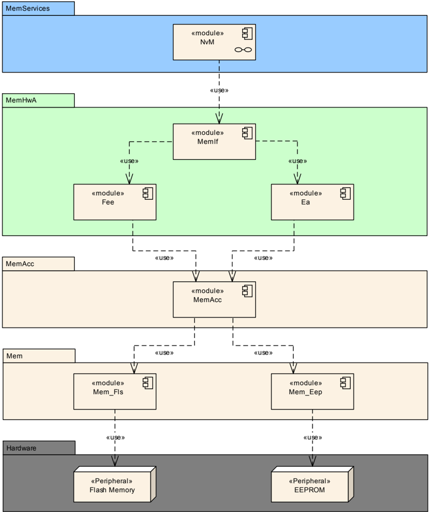
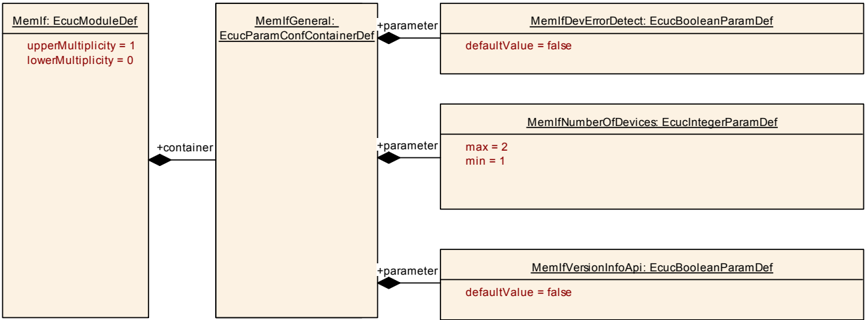

## 1. 简介和功能概述

本文档描述了**AUTOSAR**基础软件模块"内存抽象接口"（**Memory Abstraction Interface**，**MemIf**）的功能、**API**和配置。该模块允许[1](#ref-1) NVRAM管理器访问多个内存抽象模块（**FEE**或**EA**模块）（参见图1.1）。



内存抽象接口（**MemIf**）应从底层[2](#ref-2) FEE或[3](#ref-3) EA模块的数量中抽象出来，并为上层提供统一线性地址空间上的虚拟分段。

## 2. 缩略语

以下术语表包含了与**MemIf**模块相关的、未包含在[4, AUTOSAR术语表](#ref-4)中的缩略语和缩写。

**EA**
> EEPROM抽象（**EEPROM Abstraction**）

**EEPROM**
> 电可擦除可编程ROM（**Electrically Erasable and Programmable ROM**，只读存储器（**Read Only Memory**））

**FEE**
> 闪存EEPROM仿真（**Flash EEPROM Emulation**）

**LSB**
> 最低有效位/字节（**Least significant bit / byte**，取决于上下文；此处指"位"）。

**Mem**
> **AUTOSAR**基础软件模块内存驱动程序（**Memory Driver**）

**MemAcc**
> **AUTOSAR**基础软件模块内存访问（**Memory Access**）

**MemIf**
> 内存抽象接口（**Memory Abstraction Interface**）

**MSB**
> 最高有效位/字节（**Most significant bit / byte**，取决于上下文；此处指"位"）。

**NvM**
> NVRAM管理器（**NVRAM Manager**）

**NVRAM**
> 非易失性RAM（**Non-volatile RAM**，随机存取存储器（**Random Access Memory**））

**Address area**
> 逻辑地址空间中的连续内存区域。通常将多个物理存储器扇区组合成一个逻辑地址区域。

**Fast Mode**
> 例如在启动/关闭阶段，底层驱动程序可被切换到快速模式，以便在这些阶段实现快速读取/写入。注意：这是否可行取决于驱动程序的实现和底层设备的能力。是否这样做取决于NVRAM管理器的配置，进而取决于特定项目的需求。

**Slow Mode**
> 在正常运行期间，底层驱动程序可以慢速模式使用，以减少运行时间或底层设备/通信介质阻塞时间方面的资源占用。注意：这是否可行取决于驱动程序的实现和底层设备的能力。是否这样做取决于NVRAM管理器的配置，进而取决于特定项目的需求。

**Vendor specific library**
> 供应商特定库是**FEE/FLS**和**EA/EEP**模块的**ICC-2**实现。它提供与相应**ICC-3**实现相同的上层接口（**API**）和功能。

## 3. 相关文档

### 3.1. 输入文件和相关标准与规范

<a id="ref-1"></a>[1] Specification of NVRAM Manager
> AUTOSAR_CP_SWS_NVRAMManager

<a id="ref-2"></a>[2] Specification of Flash EEPROM Emulation
> AUTOSAR_CP_SWS_FlashEEPROMEmulation

<a id="ref-3"></a>[3] Specification of EEPROM Abstraction
> AUTOSAR_CP_SWS_EEPROMAbstraction

<a id="ref-4"></a>[4] Glossary（术语表）
> AUTOSAR_FO_TR_Glossary

<a id="ref-5"></a>[5] General Specification of Basic Software Modules
> AUTOSAR_CP_SWS_BSWGeneral

<a id="ref-6"></a>[6] General Requirements on SPAL
> AUTOSAR_CP_SRS_SPALGeneral

<a id="ref-7"></a>[7] General Requirements on Basic Software Modules
> AUTOSAR_CP_SRS_BSWGeneral

<a id="ref-8"></a>[8] Requirements on Memory Hardware Abstraction Layer
> AUTOSAR_CP_SRS_MemoryHWAbstractionLayer

### 3.2. 相关规范

**AUTOSAR**提供了基础软件模块的通用规范[\[5, SWS BSW General\]](#ref-5)，它也适用于内存抽象接口。

因此，规范SWS BSW General需被视为内存抽象接口的附加和必需规范。

## 4. 约束和假设

### 4.1. 限制

无限制。

### 4.2. 汽车域的适用性

无限制。

## 5. 对其他模块的依赖

## 6. 功能规格

### 6.1. 错误分类

文档[5](#ref-5)"基础软件模块通用规范"的"错误处理"（**Error Handling**）章节详细描述了基础软件的错误处理。其中，它构成了一个由五种错误类型组成的分类方案，这些错误类型可能发生在**BSW**模块中。

在此基础上，以下各小节按相应的类别规定了特定的错误。

#### 6.1.1. 开发错误

**MemIf**模块中开发错误的定义：

| 错误类型 | 相关错误代码 | 错误值 |
|---|---|---|
| 调用**API**服务时设备索引参数错误 | MEMIF_E_PARAM_DEVICE | 0x01 |
| 调用**API**服务时传入了**NULL**指针参数 | MEMIF_E_PARAM_POINTER | 0x02 |

#### 6.1.2. 运行时错误

没有运行时错误。

#### 6.1.3. 瞬态故障

没有瞬态故障。

#### 6.1.4. 生产错误

没有生产错误。

#### 6.1.5. 扩展生产错误

没有扩展生产错误。

## 7. API规范

### 7.1. 导入的类型

#### 7.1.1. 标准类型

本章列出了从以下模块中包含的所有类型：

**MemIf**模块导入的数据类型的定义：

| 模块 | 头文件 | 导入的类型 |
|---|---|---|
| Std | Std_Types.h | Std_ReturnType |
| Std | Std_Types.h | Std_VersionInfoType |

### 7.2. 类型定义

本章规定的类型不得针对特定的内存抽象模块或硬件平台进行更改或扩展。

内存设备索引的数据类型应为uint8。该设备索引可使用的最小值应为0。因此允许的索引范围为0..MEMIF_NUMBER_OF_DEVICES-1。

#### 7.2.1. MemIf_StatusType

枚举类型，取值：

* **MEMIF_UNINIT**：底层抽象模块或设备驱动程序尚未初始化。
* **MEMIF_IDLE**：底层抽象模块或设备驱动程序当前空闲。
* **MEMIF_BUSY**：底层抽象模块或设备驱动程序当前繁忙。
* **MEMIF_BUSY_INTERNAL**：底层抽象模块正忙于内部管理操作。底层设备驱动程序可繁忙也可空闲。

表示底层抽象模块和设备驱动的当前状态。可通过**MemIf.h**获得。

#### 7.2.2. MemIf_JobResultType

枚举类型，取值：

* **MEMIF_JOB_OK**：作业已成功完成。
* **MEMIF_JOB_FAILED**：作业未成功完成。
* **MEMIF_JOB_PENDING**：作业尚未完成。
* **MEMIF_JOB_CANCELED**：作业已被取消。
* **MEMIF_BLOCK_INCONSISTENT**：1. 所请求的块不一致，它可能包含已损坏的数据。2. 未找到块。
* **MEMIF_BLOCK_INVALID**：所请求的块已被标记为无效，无法执行所请求的操作。

表示最后一个作业的结果。可通过**MemIf.h**获得。

### 7.3. 函数定义

本章规定的**API**应映射到底层内存抽象模块的**API**。有关功能行为，请分别参阅这些模块的规范或底层内存驱动程序的规范。

参数**DeviceIndex**应用于选择内存抽象模块（进而是内存设备）。如果只配置了一个内存抽象模块，则应忽略参数**DeviceIndex**。

如果只配置了一个内存抽象模块，内存抽象接口应实现为一组宏，将内存抽象接口**API**映射到相应内存抽象模块的**API**。

**示例：**

```C
#define MemIf_Write(DeviceIndex, BlockNumber, DataPtr) \
    Fee_Write(BlockNumber, DataPtr)
```

如果配置了多个内存抽象模块，内存抽象接口应使用高效的机制将**API**调用映射到相应的内存抽象模块。

**注意：** 一种解决方案是使用函数指针表，其中参数**DeviceIndex**用作数组索引。

**示例：**

```C
#define MemIf_Write(DeviceIndex, BlockNumber, DataPtr) \
    MemIf_WriteFctPtr[DeviceIndex](BlockNumber, DataPtr)
```

**注意：** 本接口规范中给出的服务**ID**与底层内存抽象模块的服务**ID**相关。因此，它们可能不从0开始。

如果配置了多个内存抽象模块且本模块的开发错误检测已启用，则内存抽象接口**API**的函数应在模块的服务中检查参数**DeviceIndex**是否为已存在的设备或广播标识符。

内存抽象接口**API**的函数应向默认错误跟踪器（**DET**）报告检测到的、归因于非法参数**DeviceIndex**的错误，错误代码为[MEMIF_E_PARAM_DEVICE](#611-开发错误)，且被调用的服务不得执行。

如果内存抽象接口**API**的被调用函数检测到归因于非法参数**DeviceIndex**的错误且具有返回值，则该返回值应设置如下：

[**MemIf_GetStatus**](#734-memif_getstatus)：MEMIF_UNINIT

[**MemIf_GetJobResult**](#735-memif_getjobresult)：MEMIF_JOB_FAILED

所有其他函数：**E_NOT_OK**

#### 7.3.1. MemIf_Read

**说明**: 服务 ID 0x02。调用由参数**DeviceIndex**选择的底层内存抽象模块的"Read"函数。可通过**MemIf.h**获得。本服务为同步调用，不可重入。参数 DeviceIndex（in）：-。参数 BlockNumber（in）：-。参数 BlockOffset（in）：-。参数 Length（in）：-。参数（inout）：无。参数（out）DataBufferPtr：-。返回值：**Std_ReturnType**，如果内存抽象接口的开发错误检测已启用且按照[第7.3章](#73-函数定义)检测到开发错误，函数应返回**E_NOT_OK**，否则应返回所调用的底层模块函数的值。

```C
Std_ReturnType MemIf_Read (
    uint16 DeviceIndex,
    uint16 BlockNumber,
    uint16 BlockOffset,
    uint8* DataBufferPtr,
    uint16 Length )
```

#### 7.3.2. MemIf_Write

**说明**: 服务 ID 0x03。调用由参数**DeviceIndex**选择的底层内存抽象模块的"Write"函数。可通过**MemIf.h**获得。本服务为同步调用，不可重入。参数 DeviceIndex（in）：-。参数 BlockNumber（in）：-。参数 DataBufferPtr（in）：-。参数（inout）：无。参数（out）：无。返回值：**Std_ReturnType**，如果内存抽象接口的开发错误检测已启用且按照[第7.3章](#73-函数定义)检测到开发错误，函数应返回**E_NOT_OK**，否则应返回所调用的底层模块函数的值。

```C
Std_ReturnType MemIf_Write (
    uint16 DeviceIndex,
    uint16 BlockNumber,
    const uint8* DataBufferPtr )
```

#### 7.3.3. MemIf_Cancel

**说明**: 服务 ID 0x04。调用由参数**DeviceIndex**选择的底层内存抽象模块的"Cancel"函数。可通过**MemIf.h**获得。本服务为同步调用，不可重入。参数 DeviceIndex（in）：-。参数（inout）：无。参数（out）：无。返回值：无。

```C
void MemIf_Cancel ( uint16 DeviceIndex )
```

#### 7.3.4. MemIf_GetStatus

**说明**: 服务 ID 0x05。调用由参数**DeviceIndex**选择的底层内存抽象模块的"GetStatus"函数。可通过**MemIf.h**获得。本服务为同步调用，不可重入。参数 DeviceIndex（in）：-。参数（inout）：无。参数（out）：无。返回值：[**MemIf_StatusType**](#721-memif_statustype)，-。

```C
MemIf_StatusType MemIf_GetStatus ( uint16 DeviceIndex )
```

如果函数**MemIf_GetStatus**以表示向所有已配置设备广播的设备索引（**MEMIF_BROADCAST_ID**）被调用，则内存抽象接口模块应依次调用所有底层设备的"GetStatus"函数。它应返回以下值：

* **MEMIF_IDLE** —— 如果所有底层设备都返回该状态
* **MEMIF_UNINIT** —— 如果至少有一个设备返回该状态，所有其他返回的状态都应被忽略
* **MEMIF_BUSY** —— 如果至少有一个已配置设备返回该状态且没有其他设备返回MEMIF_UNINIT
* **MEMIF_BUSY_INTERNAL** —— 如果至少有一个已配置设备返回该状态且没有其他设备返回MEMIF_BUSY或MEMIF_UNINIT

**注意：** 在**MemIf_GetStatus**调用中使用的特殊"广播"设备**ID**用于查询所有设备是否空闲，以便关闭**ECU**。

#### 7.3.5. MemIf_GetJobResult

**说明**: 服务 ID 0x06。调用由参数**DeviceIndex**选择的底层内存抽象模块的"GetJobResult"函数。可通过**MemIf.h**获得。本服务为同步调用，不可重入。参数 DeviceIndex（in）：-。参数（inout）：无。参数（out）：无。返回值：[**MemIf_JobResultType**](#722-memif_jobresulttype)，如果内存抽象接口的开发错误检测已启用且按照[第7.3章](#73-函数定义)检测到开发错误，函数应返回MEMIF_JOB_FAILED，否则应返回所调用的底层模块函数的值。

```C
MemIf_JobResultType MemIf_GetJobResult ( uint16 DeviceIndex )
```

#### 7.3.6. MemIf_InvalidateBlock

**说明**: 服务 ID 0x07。调用由参数**DeviceIndex**选择的底层内存抽象模块的"InvalidateBlock"函数。可通过**MemIf.h**获得。本服务为同步调用，不可重入。参数 DeviceIndex（in）：-。参数 BlockNumber（in）：-。参数（inout）：无。参数（out）：无。返回值：**Std_ReturnType**，如果内存抽象接口的开发错误检测已启用且按照[第7.3章](#73-函数定义)检测到开发错误，函数应返回**E_NOT_OK**，否则应返回所调用的底层模块函数的值。

```C
Std_ReturnType MemIf_InvalidateBlock ( uint16 DeviceIndex, uint16 BlockNumber )
```

#### 7.3.7. MemIf_GetVersionInfo

**说明**: 服务 ID 0x08。返回版本信息。可通过**MemIf.h**获得。本服务为同步调用，可重入。参数（in）：无。参数（inout）：无。参数（out）VersionInfoPtr：指向标准版本信息结构的指针。返回值：无。

```C
void MemIf_GetVersionInfo ( Std_VersionInfoType* VersionInfoPtr )
```

#### 7.3.8. MemIf_EraseImmediateBlock

**说明**: 服务 ID 0x09。调用由参数**DeviceIndex**选择的底层内存抽象模块的"EraseImmediateBlock"函数。可通过**MemIf.h**获得。本服务为同步调用，不可重入。参数 DeviceIndex（in）：-。参数 BlockNumber（in）：-。参数（inout）：无。参数（out）：无。返回值：**Std_ReturnType**，如果内存抽象接口的开发错误检测已启用且按照[第7.3章](#73-函数定义)检测到开发错误，函数应返回**E_NOT_OK**，否则应返回所调用的底层模块函数的值。

```C
Std_ReturnType MemIf_EraseImmediateBlock ( uint16 DeviceIndex, uint16 BlockNumber )
```

### 7.4. 回调通知

无，**NVRAM**管理器应为底层内存抽象模块提供回调例程。

### 7.5. 调度函数

无，本模块中没有异步函数。

### 7.6. 期望接口

#### 7.6.1. 强制接口

本章定义了实现模块核心功能所需的所有接口。

| API函数 | 头文件 | 描述 |
|---|---|---|
| Ea_EraseImmediateBlock | Ea.h | 擦除块BlockNumber。 |
| Ea_GetStatus | Ea.h | 返回状态的服务。 |
| Ea_InvalidateBlock | Ea.h | 使块BlockNumber无效。 |
| Fee_EraseImmediateBlock | Fee.h | 擦除逻辑块的服务。 |
| Fee_GetStatus | Fee.h | 返回状态的服务。 |
| Fee_InvalidateBlock | Fee.h | 使逻辑块无效的服务。 |

#### 7.6.2. 可选接口

本章定义了实现模块可选功能所需的所有接口。

| API函数 | 头文件 | 描述 |
|---|---|---|
| Det_ReportError | Det.h | 用于报告开发错误的服务。 |

#### 7.6.3. 可配置接口

本章列出了目标函数可被配置的所有接口。目标函数通常是回调函数。此类接口的名称不是固定的，因为它们是可配置的。

本模块没有可配置接口。

## 8. 时序图

请参阅内存抽象模块的规范。

## 9. 配置规范

### 9.1. 容器与配置参数

以下各节汇总了所有配置参数。各参数的详细含义在第6章和第7章中描述。

#### 9.1.1. MemIf



| SWS 条目 | [ECUC_MemIf_00025] |
|---|---|
| 模块名称 | MemIf |
| 描述 | **MemIf**（内存抽象接口）模块的配置。 |
| Post-Build 变体支持 | false |
| 支持的配置变体 | VARIANT-PRE-COMPILE |

| 容器名称 | 多重性 | 作用域/依赖 |
|---|---|---|
| MemIfGeneral | 1 | 内存抽象接口（**MemIf**）模块的配置。 |

#### 9.1.2. MemIfGeneral

| SWS 条目 | [ECUC_MemIf_00034] |
|---|---|
| 容器名称 | MemIfGeneral |
| 父容器 | MemIf |
| 描述 | 内存抽象接口（**MemIf**）模块的配置。 |
| 配置参数 | 见下方参数表 |

| SWS 条目 | [ECUC_MemIf_00035] |
|---|---|
| 参数名称 | MemIfDevErrorDetect |
| 父容器 | MemIfGeneral |
| 描述 | 打开或关闭开发错误检测和通知。true：启用检测和通知。false：禁用检测和通知。 |
| 多重性 | 1 |
| 类型 | EcucBooleanParamDef |
| 默认值 | false |
| Post-Build 变体值 | false |
| 值配置类 | Pre-compile time：x（All Variants）；Link time：-；Post-build time：- |
| 作用域/依赖 | scope: local |

| SWS 条目 | [ECUC_MemIf_00033] |
|---|---|
| 参数名称 | MemIfNumberOfDevices |
| 父容器 | MemIfGeneral |
| 描述 | 底层内存抽象模块的具体数量。计算公式：统计已配置的**EA**和**FEE**模块的数量。 |
| 多重性 | 1 |
| 类型 | EcucIntegerParamDef |
| 范围 | 1 .. 2 |
| 默认值 | - |
| Post-Build 变体值 | false |
| 值配置类 | Pre-compile time：x（All Variants）；Link time：-；Post-build time：- |
| 作用域/依赖 | scope: local |

| SWS 条目 | [ECUC_MemIf_00032] |
|---|---|
| 参数名称 | MemIfVersionInfoApi |
| 父容器 | MemIfGeneral |
| 描述 | 启用/禁用读取模块版本信息的**API**的预处理器开关。true：版本信息**API**已启用。false：版本信息**API**已禁用。 |
| 多重性 | 1 |
| 类型 | EcucBooleanParamDef |
| 默认值 | false |
| Post-Build 变体值 | false |
| 值配置类 | Pre-compile time：x（All Variants）；Link time：-；Post-build time：- |
| 作用域/依赖 | scope: local |

无包含容器。
