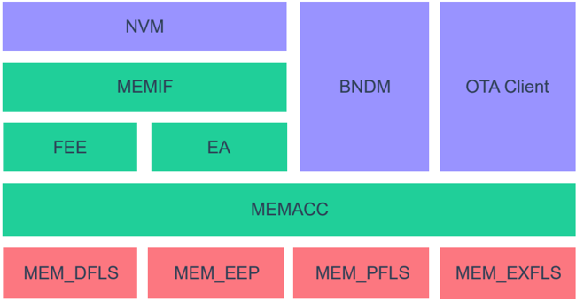
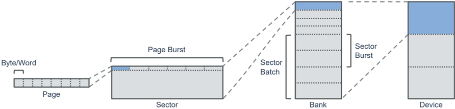
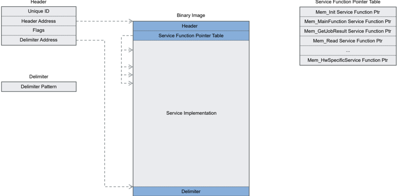
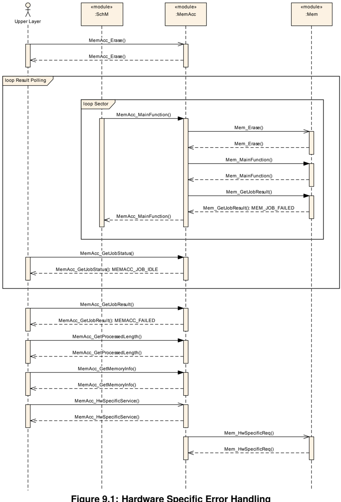
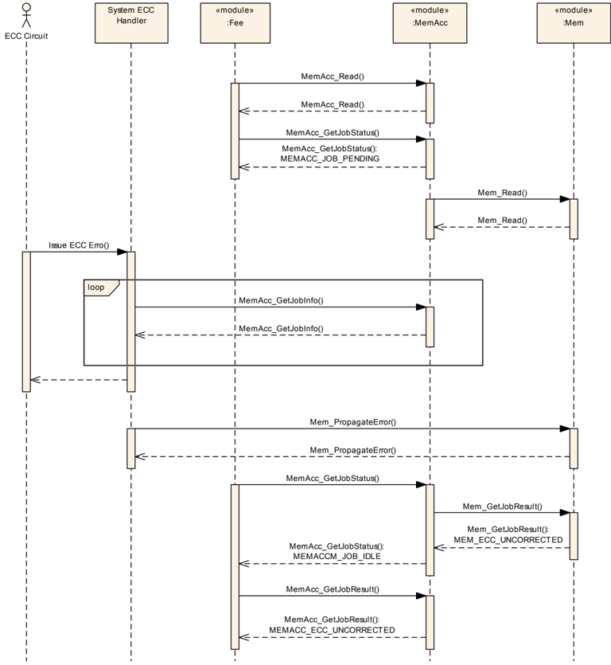
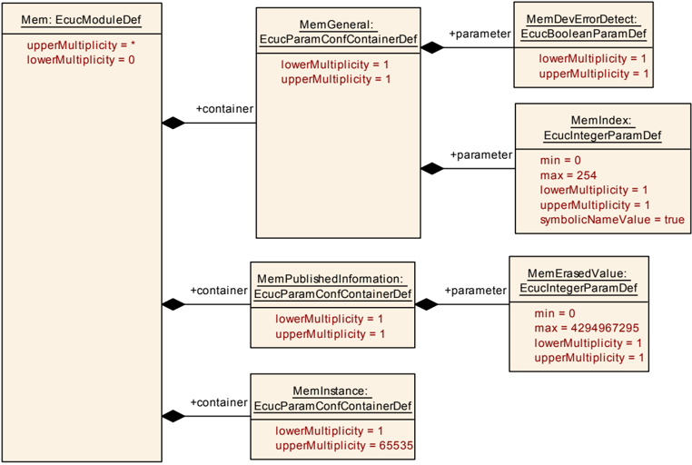
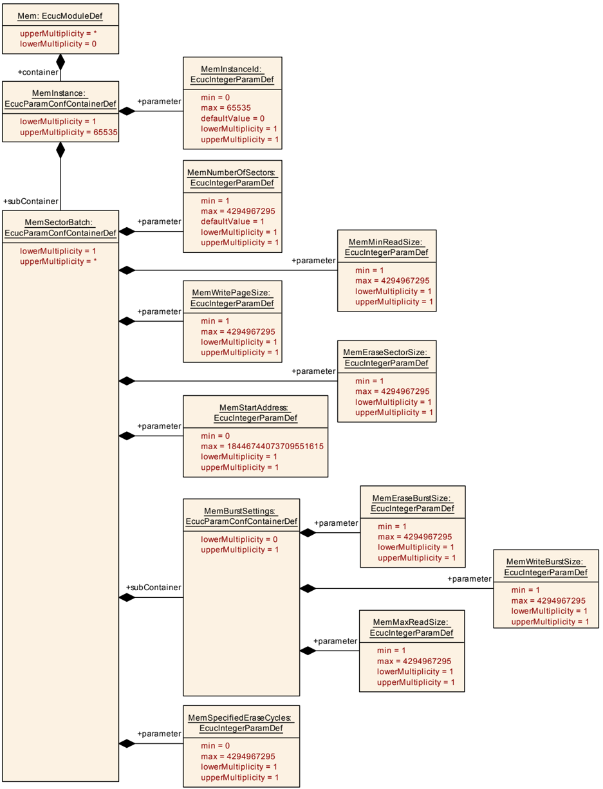

## 1. 简介和功能概述

本文档描述了**AUTOSAR**基础软件模块内存驱动程序（**Memory Driver**，**Mem**）的功能、**API**和配置。

内存驱动程序提供访问不同类型存储设备的基本服务，例如读取、写入、擦除和空白检查。

尽管闪存仍然是最常见的非易失性存储技术，但内存驱动程序规范考虑了所有相关的存储设备技术，例如**EEPROM**、相变存储器（**PCM**）和铁电**RAM**。

为了协调上层的存储访问，内存驱动程序规范还涵盖了对**RAM**的访问。除了微控制器内部存储设备之外，内存设备规范还可以应用于外部存储设备，例如通过串行外设接口连接的设备。

与闪存和**EEPROM**驱动程序规范相比，内存驱动程序规范还明确涵盖代码存储器访问，以支持诸如后台**OTA**软件更新等需要代码存储器访问的新用例。

图1.1给出了具有不同内存驱动程序和上层的示例架构概览：



## 2. 缩略语

以下术语表包含了与**Mem**驱动程序相关的、未包含在[1, AUTOSAR术语表](#ref-1)中的缩略语和缩写。

**ABI**
> 应用二进制接口（**Application Binary Interface**）

**BndM**
> 非易失性大容量数据管理器（**Bulk Non-Volatile Data Manager**）

**ECC**
> 纠错码（**Error Correction Code**）

**FOTA**
> 固件远程升级（**Firmware Over The Air**）——使用无线通信进行的远程固件更新

**HSM**
> 硬件安全模块（**Hardware Security Module**）——专用的安全**MCU**内核

**OTA**
> 空中下载（**Over The Air**）——**OEM**后端与车辆之间无线通信的通用术语

**RWW**
> 边读边写（**Read While Write**）——存储设备在一个存储体中执行读取操作的同时在另一个存储体中执行写入/擦除操作的能力

**SOTA**
> 软件远程升级（**Software Over The Air**）——使用无线通信进行的远程软件更新

**Address Area**
> 逻辑地址空间中的连续内存区域，通常将多个物理存储器扇区组合成一个逻辑地址区域。

**Bank**
> 扇区批次的分组。如果某种存储技术被分割为扇区，则存储体（**bank**）是一个扇区批次组的实例，其中不允许边读边写操作。对于闪存设备，这通常对应于一个独立的闪存控制器。

**Job Request**
> 上层模块针对某个地址区域发出的存储访问请求。

**Memory Device**
> 存储体的分组。

**Page Burst**
> 为提高性能而聚合的存储页面访问。如果某种存储设备技术具有物理分段，某些存储设备会提供一次读取或写入多个页面的优化访问方法。页面成组（**page burst**）表示用于访问优化的存储页面聚合。

**Sector**
> 最小的可擦除存储单元（以字节为单位）。某些存储设备技术要求在写入存储器之前执行显式的物理擦除操作。扇区定义了这种擦除单元的最小大小。取决于存储设备，扇区可以是等长的或变长的。

**Sector Batch**
> 具有等长大小的扇区的聚合。具有相同大小的连续扇区的逻辑聚合。

**Sector Burst**
> 为提高擦除性能而聚合的扇区。如果某种存储技术需要物理擦除操作，某些设备通过一步擦除扇区聚合来提供擦除性能优化。

**Sub Address Area**
> 逻辑地址空间中映射到一个存储设备的一个扇区批次的连续内存区域。

**Write Page**
> 存储设备的最小可写单元（以字节为单位）。某些存储设备技术必须在考虑物理分段的情况下访问。因此，并非所有存储设备技术都可以按字节访问。该术语定义了一次访问中需要写入的最小大小。

### 2.1. 物理分段

图2.1给出了物理分段和相应技术术语的概览：



## 3. 相关文档

### 3.1. 输入文件和相关标准与规范

<a id="ref-1"></a>[1] Glossary（术语表）
> AUTOSAR_FO_TR_Glossary

<a id="ref-2"></a>[2] General Specification of Basic Software Modules
> AUTOSAR_CP_SWS_BSWGeneral

<a id="ref-3"></a>[3] Requirements on Memory Hardware Abstraction Layer
> AUTOSAR_CP_SRS_MemoryHWAbstractionLayer

<a id="ref-4"></a>[4] Requirements on AUTOSAR Features
> AUTOSAR_CP_RS_Features

<a id="ref-5"></a>[5] General Requirements on Basic Software Modules
> AUTOSAR_CP_SRS_BSWGeneral

### 3.2. 相关规范

**AUTOSAR**提供了基础软件模块的通用规范[\[2, SWS BSW General\]](#ref-2)，它也适用于**Mem**驱动程序。

因此，规范SWS BSW General需被视为**Mem**驱动程序的附加和必需规范。

## 4. 约束和假设

**Mem**驱动程序适用以下约束：

* **Mem**驱动程序只在物理分段上工作，即对于闪存而言是页面/页面成组和扇区/扇区成组。
* **Mem**驱动程序要求任何请求都与物理分段对齐，即对于闪存而言是页面和扇区。

由于这些约束，**Mem**驱动程序只能与内存访问模块（**Memory Access Module**）组合使用。

### 4.1. 限制

#### 4.1.1. 一般限制

基于块的存储设备（例如**NAND**闪存设备）不在本规范的范围之内。

#### 4.1.2. 实现限制

**Mem**驱动程序适用以下实现限制：

* **Mem**驱动程序不提供针对小于物理分段（即对于闪存而言是页面和扇区）的写入访问的任何策略，因为它不使用任何内部缓冲区。
* **Mem**驱动程序不提供保证数据完整性的机制（例如校验和、冗余存储等）。
* 为了避免**32**位微控制器的资源开销，**Mem**驱动程序服务请求的大小被限制为**32**位。

#### 4.1.3. 存储器测试能力

**Mem**驱动程序不提供用于执行后台存储器测试的任何通用**API**，因为存储器测试能力非常依赖于硬件。要实现存储器测试，可以使用**Mem**驱动程序的硬件特定请求服务**API**。

### 4.2. 汽车域的适用性

**Mem**驱动程序可用于任何需要存储访问以存储数据或执行软件更新的域应用。

## 5. 对其他模块的依赖

### 5.1. SPI驱动程序

通常，外部存储设备通过串行总线（例如**SPI**，串行外设接口）连接。为了访问此类设备，需要微控制器中**SPI**外设的驱动程序来访问外部存储设备。取决于**Mem**驱动程序的实现，**SPI**驱动程序可能是**Mem**驱动程序的一部分，或者**Mem**驱动程序使用现有的**MCAL SPI**处理程序/驱动程序。

## 6. 功能规格

本章定义**Mem**驱动程序的行为。

本模块的**API**在第[7](#7-api规范)章中定义，而配置在第[9](#9-配置规范)章中定义。

### 6.1. 概述

**Mem**驱动程序的任务是基于底层存储设备技术的物理分段进行低级存储访问。

**Mem**驱动程序的**API**与存储设备技术无关，因此为上层内存访问模块提供了一个与存储设备无关的接口。

所有高级功能（例如跨段操作）都由内存访问模块处理，以使**Mem**驱动程序的复杂性和占用空间尽可能小。

#### 6.1.1. 关键方面

* 协调一致的、与存储设备无关的上层接口
* 支持代码存储器
* 多实例支持
* **Mem**驱动程序的动态激活
* **64**位设备支持
* 支持可选的存储服务
* 用于提供存储设备特定服务的通用接口

### 6.2. 功能要素

#### 6.2.1. 作业管理

一个**Mem**驱动程序实例一次应只允许一个作业请求。

**注意：** 由于上层作业管理由**MemAcc**模块负责，因此**Mem**驱动程序中无需实现作业队列。

如果**Mem**驱动程序无法处理某个作业请求（例如由于存在挂起的请求或参数无效），该作业请求应通过**E_NOT_OK**返回码被拒绝。

由异步**Mem**驱动程序服务触发的所有作业请求都应在[**Mem_MainFunction**](#751-mem_mainfunction)内执行。

如果存储硬件提供**ECC**信息，**Mem**驱动程序应检查不可纠正的**ECC**错误，将作业结果代码设置为MEM_ECC_UNCORRECTED并中止当前的作业处理。

##### 6.2.1.1. 作业状态/作业结果

**Mem**驱动程序提供[**Mem_GetJobResult**](#7314-mem_getjobresult)服务以获取当前的作业处理状态以及最后一个已处理作业的结果。一旦处理了新作业，最后一个已处理作业的结果将被当前状态/结果覆盖。

**Mem**驱动程序应跟踪作业处理情况和最后一个已处理作业的结果。

一旦接受了作业请求，作业处理状态应设置为MEM_JOB_PENDING。

作业成功处理之后，作业处理状态应设置为MEM_JOB_OK。

如果挂起的作业无法完成，作业处理状态应设置为MEM_JOB_FAILED。

如果作业处理已完成，但最后一个**Mem**作业的结果不符合预期结果（例如对非空白存储区域执行了空白检查操作），作业结果应设置为MEM_INCONSISTENT。

如果存储硬件提供**ECC**信息，**Mem**驱动程序应检查可纠正的**ECC**错误，并且在出现可纠正**ECC**错误的情况下继续作业处理。作业完成之后，作业结果应设置为MEM_ECC_CORRECTED。

如果上一次存储操作因不可纠正的**ECC**错误而未完成，作业结果应设置为MEM_ECC_UNCORRECTED。

##### 6.2.1.2. 作业挂起/恢复

为了减少存储访问优先级排序造成的延迟，**Mem**驱动程序提供用于挂起/恢复存储操作的服务。

如果存储设备提供基于硬件的挂起/恢复机制，**Mem**驱动程序应利用硬件能力来实现[**Mem_Suspend**](#7315-mem_suspend)和[**Mem_Resume**](#7316-mem_resume)服务。如果没有可用的硬件挂起/恢复支持，[**Mem_Suspend**](#7315-mem_suspend)和[**Mem_Resume**](#7316-mem_resume)服务应返回**E_MEM_SERVICE_NOT_AVAIL**。

**注意：** 对于基于硬件的挂起/恢复操作，预期挂起/恢复操作完全由存储硬件处理（软件中无需持久化任何状态信息等），并且对于设备处于挂起状态期间发出的中间操作没有任何限制。如果硬件不提供此类特性，则只能基于物理存储分段进行优先级排序。

#### 6.2.2. 硬件特定服务

为了支持存储设备特定的服务，**Mem**驱动程序实现可以提供硬件特定服务。

图9.1展示了使用硬件特定服务实现硬件特定错误处理的典型用例。

所有硬件特定例程都应通过**[Mem_HwSpecificService](#7325-mem_hwspecificservice)()**服务访问。

#### 6.2.3. 多内存设备实例支持

**Mem**驱动程序的实现应支持同一存储设备的多个实例。

**注意：** 对于**OTA**软件更新用例，使用多个相同类型的存储设备来扩展存储资源。

#### 6.2.4. 动态驱动程序激活

为了支持**Mem**驱动程序不应永久可用的用例（即防止存储区域被意外覆盖），**Mem**驱动程序应提供允许动态激活或下载**Mem**驱动程序的措施。

支持该用例有两种选择：

* 将**Mem**驱动程序二进制映像下载到**RAM**中
* 将**Mem**驱动程序**ROM**二进制映像复制/解密到**RAM**中

两种选择都要求**Mem**驱动程序被编译为独立的二进制文件。如果**Mem**驱动程序二进制文件是应用程序映像的一部分，则**Mem**驱动程序二进制映像应被加密（例如通过异或操作），并且仅在要激活**Mem**驱动程序时才在**RAM**中解密。**Mem**驱动程序的下载或解密操作必须实现为**CDD**，本规范不涵盖该内容。

为了提供不同**Mem**驱动程序实现之间的互操作性，**Mem**驱动程序需要按照标准化的二进制映像格式构建。**Mem**驱动程序二进制映像格式在[第6.2.6章](#626-二进制映像格式)中定义。

如果构建为独立的映像，**Mem**驱动程序应是完全自包含的，即它不得调用任何库或任何其他外部函数。

**注意：** 由于**Mem**驱动程序运行在与其构建时不同的上下文中，它不得依赖任何外部函数或库。因此，如果**Mem**驱动程序被构建为独立的二进制文件，则开发错误检测机制不可用。

#### 6.2.5. 服务调用

**Mem**驱动程序应提供两种服务函数调用方式：

* 直接服务调用
* 通过函数指针表的间接服务调用

**注意：** 某些用例（例如**OTA**后台软件更新）可能需要使用间接服务调用来动态激活**Mem**驱动程序，而简单的用例（例如**NVM**数据存储）则希望使用直接服务调用。

##### 6.2.5.1. 直接调用

在直接调用**Mem**驱动程序服务函数的情况下，**Mem**驱动程序与应用软件链接，并且**Mem**驱动程序服务函数由**MemAcc**模块直接调用。

##### 6.2.5.2. 间接调用

[第6.2.4章](#624-动态驱动程序激活)中描述的动态驱动程序激活特性需要间接服务调用。

#### 6.2.6. 二进制映像格式

本章规定**Mem**驱动程序的二进制映像格式。该二进制映像格式分为四个部分：

* 头部（**Header**），包含管理信息
* 服务函数指针表
* 服务函数实现
* 分隔符（**Delimiter**）

图7.1给出了**Mem**驱动程序二进制映像的概览：



由于**Mem**驱动程序始终是硬件/**CPU**特定的，**Mem**驱动程序二进制文件中数据字段和地址信息的字节顺序应遵循标准的**CPU**字节顺序。

**注意：** 避免不必要的地址/数据格式转换。

##### 6.2.6.1. 头部

**Mem**驱动程序二进制文件的头部部分应遵循[第6.2.6.1章](#6261-头部)定义的结构。地址信息的大小取决于所配置的**MemAcc_AddressType**（**4**或**8**字节）。

头部二进制格式：

| 偏移 [字节] | 大小 [字节] | 名称 | 描述 |
|---|---|---|---|
| 0 | 8 | Unique ID | **Mem**驱动程序唯一标识符——用于校验**Mem**驱动程序版本信息等。 |
| 8 | 8 | Flags | 用于额外开发错误检测的标志。 |
| 16 | 4/8 | Header address | **Mem**驱动程序映像头部的起始地址——用于校验**Mem**驱动程序**RAM**缓冲区/**ROM**映像位置的一致性。 |
| 20/24 | 4/8 | Delimiter address | **Mem**驱动程序二进制映像分隔符模式的地址——用于校验二进制文件是否完整。 |

###### 6.2.6.1.1. 唯一 ID

唯一标识符用于**Mem**驱动程序的唯一标识。唯一标识符的格式应遵循下表定义的结构。

唯一 ID 格式：

| 偏移 [字节] | 大小 [字节] | 名称 | 描述 |
|---|---|---|---|
| 0 | 2 | ABI version | **BCD**编码的**Mem**驱动程序二进制接口版本。接口版本的任何变更还需要更新**MemAcc**模块。 |
| 2 | 2 | Vendor ID | 标准的**AUTOSAR**供应商标识。 |
| 4 | 4 | Driver ID | 供应商特定的驱动程序标识。 |

遵循本规范的**Mem**驱动程序的**ABI**版本应为0001。

###### 6.2.6.1.2. 头部地址

头部地址用于开发错误检查，以校验链接的**Mem**驱动程序二进制映像与用于执行**Mem**驱动程序的**RAM**缓冲区位置的一致性。

如果**Mem**驱动程序二进制文件是可重定位/位置无关的，头部地址应设置为零；否则，头部地址应保存**Mem**驱动程序二进制文件的物理起始地址。

###### 6.2.6.1.3. 标志

**Mem**驱动程序头部的标志部分是一个位域，它保存用于开发错误检查的附加信息。

标志位域的格式应遵循下表定义的结构。

标志格式：

| 偏移 [位] | 大小 [位] | 名称 | 描述 |
|---|---|---|---|
| 0 | 1 | Relocatable binary | 如果置位该位，则**Mem**驱动程序二进制文件是可重定位的，无法进行地址一致性检查。 |
| 1 | 31 | Reserved | 由本规范保留——应为0。 |
| 32 | 32 | Vendor specific | 供应商特定的标志。 |

###### 6.2.6.1.4. 分隔符地址

**Mem**驱动程序头部的分隔符地址部分用于开发错误检查，通过检查链接到**Mem**驱动程序二进制文件末尾的分隔符模式来校验**Mem**驱动程序二进制文件是否完整。

如果**Mem**驱动程序二进制文件是可重定位/位置无关的，分隔符地址应设置为零；否则，分隔符地址应保存分隔符模式的物理地址。

##### 6.2.6.2. 服务函数指针表

函数指针表是一个标准化的结构，用于引用**Mem**驱动程序的服务函数。

函数指针表的格式应遵循下表定义的结构。

函数指针表：

| 条目 | 名称 | 描述 |
|---|---|---|
| 1 | Init service pointer | 指向**Mem**驱动程序Init服务的函数指针。 |
| 2 | DeInit service pointer | 指向**Mem**驱动程序DeInit服务的函数指针。 |
| 3 | MainFunction service pointer | 指向**Mem**驱动程序MainFunction服务的函数指针。 |
| 4 | GetJobResult service pointer | 指向**Mem**驱动程序GetJobResult服务的函数指针。 |
| 5 | Read service pointer | 指向**Mem**驱动程序Read服务的函数指针。 |
| 6 | Write service pointer | 指向**Mem**驱动程序Write服务的函数指针。 |
| 7 | Erase service pointer | 指向**Mem**驱动程序Erase服务的函数指针。 |
| 8 | PropagateError service pointer | 指向**Mem**驱动程序PropagateError服务的函数指针。 |
| 9 | BlankCheck service pointer | 指向**Mem**驱动程序BlankCheck服务的函数指针。 |
| 10 | Suspend service pointer | 指向**Mem**驱动程序Suspend服务的函数指针。 |
| 11 | Resume service pointer | 指向**Mem**驱动程序Resume服务的函数指针。 |
| 12 | HwSpecificService service pointer | 指向**Mem**驱动程序HwSpecificService服务的函数指针。 |

**Mem**驱动程序函数指针的大小应是机器/**CPU**特定的。

**注意：** 系统集成商必须确保对**Mem**驱动程序和**MemAcc**模块使用相同的内存模型。

##### 6.2.6.3. 分隔符

分隔符字段标记**Mem**驱动程序二进制映像的结束。分隔符字段的格式应遵循[第6.2.6.1.1章](#62611-唯一-id)定义的唯一标识符。

分隔符字段的值应为唯一标识符值的按位取反。

#### 6.2.7. 可选服务

由于并非所有**Mem**驱动程序服务都与所有存储设备技术相关，**Mem**驱动程序提供向**MemAcc**模块指示哪些服务可用的机制。

无论某个服务是否相关，**Mem**驱动程序都应提供第[7.3](#73-函数定义)章中定义的所有标准服务。

如果某个服务与特定的存储设备技术无关，该服务应始终返回**E_MEM_SERVICE_NOT_AVAIL**。

### 6.3. 模块处理

#### 6.3.1. 初始化

**Mem**驱动程序通过[**Mem_Init**](#7311-mem_init)进行初始化。除[**Mem_GetVersionInfo**](#7313-mem_getversioninfo)、[**Mem_MainFunction**](#751-mem_mainfunction)和[**Mem_Init**](#7311-mem_init)之外，**Mem**驱动程序的**API**函数只能在模块被正确初始化之后调用。

#### 6.3.2. 调度

由于大多数**Mem**驱动程序服务是异步服务，[**Mem_MainFunction**](#751-mem_mainfunction)需要被周期性地触发。由于**Mem**驱动程序不需要测量时间或进行任何时序监督，因此无需以固定周期调用[**Mem_MainFunction**](#751-mem_mainfunction)。

#### 6.3.3. ECC处理

处理**ECC**错误非常依赖于硬件，但通常**ECC**电路会触发一个不可屏蔽中断。**ECC**错误的处理必须在系统层面完成，因为错误反应也需要在系统层面处理。

为了将存储器**ECC**错误传播到上层，**Mem**驱动程序提供**[Mem_PropagateError](#7317-mem_propagateerror) API**，系统**ECC**错误处理程序可以调用它来转发**ECC**错误。

图9.2展示了一个示例**ECC**处理序列，以说明**[Mem_PropagateError](#7317-mem_propagateerror) API**的使用。

### 6.4. 一般设计规则

**Mem**驱动程序应（最迟在编译时）静态地检查静态配置参数的正确性。

**Mem**驱动程序不应校验写入或擦除操作的结果。

**注意：** 一致性检查应由上层实现，例如通过回读数据或执行显式的空白检查。

#### 6.4.1. 地址对齐

如果需要考虑物理分段（例如对于闪存），**Mem**驱动程序不应执行任何形式的地址或长度对齐。

**注意：** **MemAcc**模块负责根据所配置的物理分段对齐/拆分**Mem**服务请求。

#### 6.4.2. 64位支持

**Mem**驱动程序应继承**MemAcc_AddressType**的大小，以支持大于**4G**字节的存储器。

**注意：** 该需求适用于所有**Mem**驱动程序，与物理存储器大小是否小于**4G**字节无关。

如果设备的最大物理存储器大小不超过**4G**字节，**Mem**驱动程序应执行显式的类型转换，并在内部使用**32**位地址类型。

**注意：** 避免**32**位微控制器上的资源开销。

### 6.5. 错误分类

#### 6.5.1. 开发错误

**Mem**模块中开发错误的定义：

| 错误类型 | 相关错误代码 | 错误值 |
|---|---|---|
| 未初始化模块时调用了**API**服务 | MEM_E_UNINIT | 0x01 |
| 调用**API**服务时传入了**NULL**指针 | MEM_E_PARAM_POINTER | 0x02 |
| 调用**API**服务时给定的地址无效 | MEM_E_PARAM_ADDRESS | 0x03 |
| 调用**API**服务时给定的长度无效 | MEM_E_PARAM_LENGTH | 0x04 |
| 调用**API**服务时给定的驱动程序实例 ID 无效 | MEM_E_PARAM_INSTANCE_ID | 0x05 |
| 作业请求仍在处理中时调用了**API**服务 | MEM_E_JOB_PENDING | 0x06 |

#### 6.5.2. 运行时错误

没有运行时错误。

#### 6.5.3. 瞬态故障

**Mem**驱动程序不使用瞬态故障。如果存储设备支持扩展的错误检查，**Mem**驱动程序应使用常规故障处理机制将其指示给上层。

**注意：** 通过只使用一种故障处理机制来简化系统设计。

#### 6.5.4. 生产错误

没有生产错误。

#### 6.5.5. 扩展生产错误

没有扩展生产错误。

## 7. API规范

**Mem**驱动程序的**API**名称、类型定义和文件命名方案应遵循标准的**AUTOSAR BSW**模块实现前缀（**vendorId**和**vendorApiInfix**）。

### 7.1. 导入的类型

本章列出了从以下文件中包含的所有类型。

**Mem**模块导入的数据类型的定义：

| 模块 | 头文件 | 导入的类型 |
|---|---|---|
| MemAcc | MemAcc_GeneralTypes.h | MemAcc_AddressType |
| MemAcc | MemAcc_GeneralTypes.h | MemAcc_MemJobResultType |
| Std | Std_Types.h | Std_ReturnType |
| Std | Std_Types.h | Std_VersionInfoType |

### 7.2. 类型定义

#### 7.2.1. Mem_AddressType

类型，派生自MemAcc_AddressType。物理存储设备地址类型。可通过**Mem.h**获得。

#### 7.2.2. Mem_ConfigType

结构类型。后构建（**postbuild**）配置结构体类型。可通过**Mem.h**获得。

#### 7.2.3. Mem_DataType

类型，派生自uint8。读取数据用户缓冲区类型。可通过**Mem.h**获得。

#### 7.2.4. Mem_InstanceIdType

类型，派生自uint32。内存驱动程序实例 ID 类型。可通过**Mem.h**获得。

#### 7.2.5. Mem_LengthType

类型，派生自uint32。物理存储设备长度类型。可通过**Mem.h**获得。

#### 7.2.6. Mem_HwServiceIdType

类型，派生自uint32。硬件特定服务请求标识符类型。可通过**Mem.h**获得。

### 7.3. 函数定义

#### 7.3.1. 同步函数

##### 7.3.1.1. Mem_Init

**说明**: 服务 ID 0x01。初始化函数——初始化所有变量并将模块状态设置为已初始化。可通过**Mem.h**获得。本服务为同步调用，不可重入。参数 configPtr（in）：指向配置数据结构的指针——由于**Mem**驱动程序是预编译模块，该参数通常不被使用。参数（inout）：无。参数（out）：无。返回值：无。

```C
void Mem_Init ( const Mem_ConfigType* configPtr )
```

服务**Mem_Init**应初始化**Mem**驱动程序的内部状态，并将**Mem**驱动程序的作业处理状态设置为MEM_JOB_OK。

如果通过**MemDevErrorDetect**启用了开发错误检测，且**configPtr**参数不是**NULL**指针，则服务**Mem_Init**应引发开发错误[MEM_E_PARAM_POINTER](#651-开发错误)。

**注意：** 配置指针**configPtr**当前未被使用，因此应设置为**NULL**指针值。

##### 7.3.1.2. Mem_DeInit

**说明**: 服务 ID 0x0b。反初始化模块。如果仍有访问作业挂起，则立即终止它（使用硬件取消操作），并将**Mem**驱动程序模块状态设置为未初始化。因此，在处理本服务之后，**Mem**必须被重新初始化，然后才会接受任何新的作业请求。可通过**Mem.h**获得。本服务为同步调用，不可重入。参数（in）：无。参数（inout）：无。参数（out）：无。返回值：无。

```C
void Mem_DeInit ( void )
```

服务**Mem_DeInit**应取消硬件中任何正在进行的闪存操作，并反初始化**Mem**驱动程序的内部状态。

##### 7.3.1.3. Mem_GetVersionInfo

**说明**: 服务 ID 0x02。返回**Mem**模块版本信息的服务。可通过**Mem.h**获得。本服务为同步调用，可重入。参数（in）：无。参数（inout）：无。参数（out）versionInfoPtr：指向标准版本信息结构的指针。返回值：无。

```C
void Mem_GetVersionInfo ( Std_VersionInfoType* versionInfoPtr )
```

如果通过**MemDevErrorDetect**启用了开发错误检测，且**versionInfoPtr**参数为**NULL**指针，则服务**Mem_GetVersionInfo**应引发开发错误[MEM_E_PARAM_POINTER](#651-开发错误)。

##### 7.3.1.4. Mem_GetJobResult

**说明**: 服务 ID 0x04。返回最近一次作业结果的服务。可通过**Mem.h**获得。本服务为同步调用，不可重入。参数 instanceId（in）：相关内存驱动程序实例的 ID。参数（inout）：无。参数（out）：无。返回值：**MemAcc_MemJobResultType**，最近的作业结果。

```C
MemAcc_MemJobResultType Mem_GetJobResult ( Mem_InstanceIdType instanceId )
```

如果通过**MemDevErrorDetect**启用了开发错误检测，则服务**Mem_GetJobResult**应检查所提供的**instanceId**是否与配置一致。如果该检查失败，**Mem_GetJobResult**应引发开发错误[MEM_E_PARAM_INSTANCE_ID](#651-开发错误)。

##### 7.3.1.5. Mem_Suspend

**说明**: 服务 ID 0x0c。使用硬件机制挂起活动的存储操作。标签：atp.Status=draft。可通过**Mem.h**获得。本服务为同步调用，不可重入。参数 instanceId（in）：相关内存驱动程序实例的 ID。参数（inout）：无。参数（out）：无。返回值：无。

```C
void Mem_Suspend ( Mem_InstanceIdType instanceId )
```

服务**Mem_Suspend**应使用相应的硬件机制挂起任何正在进行的闪存操作。

如果挂起操作已经处于挂起状态，**Mem_Suspend**应以返回**E_NOT_OK**拒绝该请求，而不执行进一步操作。

如果通过**MemDevErrorDetect**启用了开发错误检测，则服务**Mem_Suspend**应检查所提供的**instanceId**是否与配置一致。如果该检查失败，**Mem_Suspend**应引发开发错误[MEM_E_PARAM_INSTANCE_ID](#651-开发错误)。

##### 7.3.1.6. Mem_Resume

**说明**: 服务 ID 0x0d。使用硬件机制恢复被挂起的存储操作。标签：atp.Status=draft。可通过**Mem.h**获得。本服务为同步调用，不可重入。参数 instanceId（in）：相关内存驱动程序实例的 ID。参数（inout）：无。参数（out）：无。返回值：无。

```C
void Mem_Resume ( Mem_InstanceIdType instanceId )
```

服务**Mem_Resume**应恢复被服务[**Mem_Suspend**](#7315-mem_suspend)挂起的闪存操作。

如果没有挂起操作处于挂起状态，**Mem_Resume**应以返回**E_NOT_OK**拒绝该请求，而不执行进一步操作。

如果通过**MemDevErrorDetect**启用了开发错误检测，则服务**Mem_Resume**应检查所提供的**instanceId**是否与配置一致。如果该检查失败，**Mem_Resume**应引发开发错误[MEM_E_PARAM_INSTANCE_ID](#651-开发错误)。

##### 7.3.1.7. Mem_PropagateError

**说明**: 服务 ID 0x08。本服务可用于在**Mem**驱动程序无法提供访问错误信息的情况下（通常针对**ECC**故障）报告访问错误。它由系统**ECC**处理程序调用，以将**ECC**错误传播到内存上层。可通过**Mem.h**获得。本服务为同步调用，不可重入。参数 instanceId（in）：相关内存驱动程序实例的 ID。参数（inout）：无。参数（out）：无。返回值：无。

```C
void Mem_PropagateError ( Mem_InstanceIdType instanceId )
```

如果通过**MemDevErrorDetect**启用了开发错误检测，则服务**Mem_PropagateError**应检查所提供的**instanceId**是否与配置一致。如果该检查失败，**Mem_PropagateError**应引发开发错误[MEM_E_PARAM_INSTANCE_ID](#651-开发错误)。

如果**Mem_PropagateError**服务被调用，**Mem**驱动程序应将作业结果代码设置为MEM_ECC_UNCORRECTED，并取消当前的作业处理。

#### 7.3.2. 异步函数

##### 7.3.2.1. Mem_Read

**说明**: 服务 ID 0x05。触发读取作业，将数据从源地址复制到所引用的目标数据缓冲区中。此服务的结果可通过**[Mem_GetJobResult](#7314-mem_getjobresult) API**获取。如果读取操作成功，则作业结果为MEM_JOB_OK。如果读取操作失败，则作业结果为一般错误时的MEM_JOB_FAILED，或可纠正/不可纠正**ECC**错误时的MEM_ECC_CORRECTED/MEM_ECC_UNCORRECTED。可通过**Mem.h**获得。本服务为异步调用，不可重入。参数 instanceId（in）：相关内存驱动程序实例的 ID。参数 sourceAddress（in）：要读取数据的物理地址。参数 length（in）：读取长度，单位为字节。参数（inout）：无。参数（out）destinationDataPtr：用于存储所读取数据的目标内存指针。返回值：**Std_ReturnType**，**E_OK**：请求的作业已被模块接受；**E_NOT_OK**：请求的作业未被模块接受；**E_MEM_SERVICE_NOT_AVAIL**：服务函数未实现。

```C
Std_ReturnType Mem_Read (
    Mem_InstanceIdType instanceId,
    Mem_AddressType sourceAddress,
    Mem_DataType* destinationDataPtr,
    Mem_LengthType length )
```

如果通过**MemDevErrorDetect**启用了开发错误检测，则服务**Mem_Read**应检查所提供的**instanceId**是否与配置一致。如果该检查失败，**Mem_Read**应引发开发错误[MEM_E_PARAM_INSTANCE_ID](#651-开发错误)。

如果通过**MemDevErrorDetect**启用了开发错误检测，且**destinationDataPtr**参数为**NULL**指针，则服务**Mem_Read**应引发开发错误[MEM_E_PARAM_POINTER](#651-开发错误)。

如果通过**MemDevErrorDetect**启用了开发错误检测，且**sourceAddress**定义的地址无效，则服务**Mem_Read**应引发开发错误[MEM_E_PARAM_ADDRESS](#651-开发错误)。

如果通过**MemDevErrorDetect**启用了开发错误检测，且**length**定义的读取长度无效，则服务**Mem_Read**应引发开发错误[MEM_E_PARAM_LENGTH](#651-开发错误)。

如果通过**MemDevErrorDetect**启用了开发错误检测，且前一个**Mem**作业仍在处理中，则服务**Mem_Read**应引发开发错误[MEM_E_JOB_PENDING](#651-开发错误)。

##### 7.3.2.2. Mem_Write

**说明**: 服务 ID 0x06。触发写入作业，将传入的数据以给定的地址和长度存储到所提供的地址区域。此服务的结果可通过**[Mem_GetJobResult](#7314-mem_getjobresult) API**获取。如果写入操作成功，则作业结果为MEM_JOB_OK。如果写入数据时出现问题，则结果为MEM_FAILED。可通过**Mem.h**获得。本服务为异步调用，不可重入。参数 instanceId（in）：相关内存驱动程序实例的 ID。参数 targetAddress（in）：物理写入地址（对齐到页面大小）。参数 sourceDataPtr（in）：源数据指针（对齐到页面大小）。参数 length（in）：写入长度，单位为字节（对齐到页面大小）。参数（inout）：无。参数（out）：无。返回值：**Std_ReturnType**，**E_OK**：请求的作业已被模块接受；**E_NOT_OK**：请求的作业未被模块接受；**E_MEM_SERVICE_NOT_AVAIL**：服务函数未实现。

```C
Std_ReturnType Mem_Write (
    Mem_InstanceIdType instanceId,
    Mem_AddressType targetAddress,
    const Mem_DataType* sourceDataPtr,
    Mem_LengthType length )
```

如果通过**MemDevErrorDetect**启用了开发错误检测，则服务**Mem_Write**应检查所提供的**instanceId**是否与配置一致。如果该检查失败，**Mem_Write**应引发开发错误[MEM_E_PARAM_INSTANCE_ID](#651-开发错误)。

如果通过**MemDevErrorDetect**启用了开发错误检测，且**sourceDataPtr**参数为**NULL**指针，则服务**Mem_Write**应引发开发错误[MEM_E_PARAM_POINTER](#651-开发错误)。

如果通过**MemDevErrorDetect**启用了开发错误检测，且**targetAddress**定义的地址无效，则服务**Mem_Write**应引发开发错误[MEM_E_PARAM_ADDRESS](#651-开发错误)。

如果通过**MemDevErrorDetect**启用了开发错误检测，且**length**定义的写入长度无效，则服务**Mem_Write**应引发开发错误[MEM_E_PARAM_LENGTH](#651-开发错误)。

如果通过**MemDevErrorDetect**启用了开发错误检测，且前一个**Mem**作业仍在处理中，则服务**Mem_Write**应引发开发错误[MEM_E_JOB_PENDING](#651-开发错误)。

##### 7.3.2.3. Mem_Erase

**说明**: 服务 ID 0x07。触发对由**targetAddress**和**length**定义的给定扇区/扇区批次的擦除作业。此服务的结果可通过**[Mem_GetJobResult](#7314-mem_getjobresult) API**获取。如果擦除操作成功，则作业结果为MEM_JOB_OK。如果擦除操作失败（例如由于硬件问题），则作业结果为MEM_JOB_FAILED。可通过**Mem.h**获得。本服务为异步调用，不可重入。参数 instanceId（in）：相关内存驱动程序实例的 ID。参数 targetAddress（in）：物理擦除地址（对齐到扇区大小）。参数 length（in）：擦除长度，单位为字节（对齐到扇区大小）。参数（inout）：无。参数（out）：无。返回值：**Std_ReturnType**，**E_OK**：请求的作业已被模块接受；**E_NOT_OK**：请求的作业未被模块接受；**E_MEM_SERVICE_NOT_AVAIL**：服务函数未实现。

```C
Std_ReturnType Mem_Erase (
    Mem_InstanceIdType instanceId,
    Mem_AddressType targetAddress,
    Mem_LengthType length )
```

如果通过**MemDevErrorDetect**启用了开发错误检测，则服务**Mem_Erase**应检查所提供的**instanceId**是否与配置一致。如果该检查失败，**Mem_Erase**应引发开发错误[MEM_E_PARAM_INSTANCE_ID](#651-开发错误)。

如果通过**MemDevErrorDetect**启用了开发错误检测，且**targetAddress**定义的地址无效，则服务**Mem_Erase**应引发开发错误[MEM_E_PARAM_ADDRESS](#651-开发错误)。

如果通过**MemDevErrorDetect**启用了开发错误检测，且**length**定义的读取长度无效，则服务**Mem_Erase**应引发开发错误[MEM_E_PARAM_LENGTH](#651-开发错误)。

如果通过**MemDevErrorDetect**启用了开发错误检测，且前一个**Mem**作业仍在处理中，则服务**Mem_Erase**应引发开发错误[MEM_E_JOB_PENDING](#651-开发错误)。

##### 7.3.2.4. Mem_BlankCheck

**说明**: 服务 ID 0x9。触发一个作业，检查由**targetAddress**引用的页面的已擦除状态。此服务的结果可通过**[Mem_GetJobResult](#7314-mem_getjobresult) API**获取。如果被检查的页面是空白的，则作业结果为MEM_JOB_OK。否则，如果页面不是空白的，则结果为MEM_INCONSISTENT。可通过**Mem.h**获得。本服务为异步调用，不可重入。参数 instanceId（in）：相关内存驱动程序实例的 ID。参数 targetAddress（in）：物理空白检查地址。参数 length（in）：空白检查长度。参数（inout）：无。参数（out）：无。返回值：**Std_ReturnType**，**E_OK**：请求的作业已被模块接受；**E_NOT_OK**：请求的作业未被模块接受；**E_MEM_SERVICE_NOT_AVAIL**：服务函数未实现。

```C
Std_ReturnType Mem_BlankCheck (
    Mem_InstanceIdType instanceId,
    Mem_AddressType targetAddress,
    Mem_LengthType length )
```

如果通过**MemDevErrorDetect**启用了开发错误检测，则服务**Mem_BlankCheck**应检查所提供的**instanceId**是否与配置一致。如果该检查失败，**Mem_BlankCheck**应引发开发错误[MEM_E_PARAM_INSTANCE_ID](#651-开发错误)。

如果通过**MemDevErrorDetect**启用了开发错误检测，且**targetAddress**定义的地址无效，则服务**Mem_BlankCheck**应引发开发错误[MEM_E_PARAM_ADDRESS](#651-开发错误)。

如果通过**MemDevErrorDetect**启用了开发错误检测，且**length**定义的读取长度无效，则服务**Mem_BlankCheck**应引发开发错误[MEM_E_PARAM_LENGTH](#651-开发错误)。

如果通过**MemDevErrorDetect**启用了开发错误检测，且前一个**Mem**作业仍在处理中，则服务**Mem_BlankCheck**应引发开发错误[MEM_E_JOB_PENDING](#651-开发错误)。

##### 7.3.2.5. Mem_HwSpecificService

**说明**: 服务 ID 0x0a。触发一个硬件特定的内存驱动程序作业。**dataPtr**可用于向该服务传入和从该服务返回数据。该服务只是一个分发器，分发到由**hwServiceId**引用的硬件特定服务实现。此服务的结果可通过**[Mem_GetJobResult](#7314-mem_getjobresult) API**获取。如果硬件特定操作成功，则作业结果为MEM_JOB_OK。如果硬件特定操作失败，则作业结果为MEM_JOB_FAILED。标签：atp.Status=draft。可通过**Mem.h**获得。本服务为异步调用，不可重入。参数 instanceId（in）：相关内存驱动程序实例的 ID。参数 hwServiceId（in）：用于分发请求的硬件特定服务请求标识符。参数 dataPtr（in）：请求特定的数据指针。参数 lengthPtr（in）：**dataPtr**所传数据的大小指针。参数（inout）：无。参数（out）：无。返回值：**Std_ReturnType**，**E_OK**：请求的作业已被模块接受；**E_NOT_OK**：请求的作业未被模块接受；**E_MEM_SERVICE_NOT_AVAIL**：服务函数未实现。

```C
Std_ReturnType Mem_HwSpecificService (
    Mem_InstanceIdType instanceId,
    Mem_HwServiceIdType hwServiceId,
    Mem_DataType* dataPtr,
    Mem_LengthType* lengthPtr )
```

如果通过**MemDevErrorDetect**启用了开发错误检测，则服务**Mem_HwSpecificService**应检查所提供的**instanceId**是否与配置一致。如果该检查失败，**Mem_HwSpecificService**应引发开发错误[MEM_E_PARAM_INSTANCE_ID](#651-开发错误)。

如果通过**MemDevErrorDetect**启用了开发错误检测，且**dataPtr**或**lengthPtr**参数为**NULL**指针，则服务**Mem_HwSpecificService**应引发开发错误[MEM_E_PARAM_POINTER](#651-开发错误)。

### 7.4. 回调通知

**Mem**驱动程序不向下层模块提供任何回调函数，因为本模块处于最低（软件）层。

### 7.5. 调度函数

#### 7.5.1. Mem_MainFunction

**说明**: 服务 ID 0x03。处理所请求的作业和内部管理操作的服务。可通过**Mem.h**获得。本服务为同步调用，不可重入。参数（in）：无。参数（inout）：无。参数（out）：无。返回值：无。

```C
void Mem_MainFunction ( void )
```

### 7.6. 期望接口

本章列出了需要从其他模块获得的所有接口。

#### 7.6.1. 强制接口

本节定义了实现模块核心功能所需的所有接口。

**Mem**模块中没有强制接口。

#### 7.6.2. 可选接口

本节定义了实现模块可选功能所需的所有接口。

| API函数 | 头文件 | 描述 |
|---|---|---|
| Det_ReportError | Det.h | 用于报告开发错误的服务。 |

#### 7.6.3. 可配置接口

**Mem**驱动程序没有任何可配置接口。

## 8. 时序图

### 8.1. 硬件特定错误处理



### 8.2. ECC处理示例序列



## 9. 配置规范

一般来说，本章定义配置参数及其到容器（**container**）中的聚类。为了支持本规范，第9.1节描述了基础知识。它还规定了应用于参数规范的模板（表）。我们打算将第9.1节保留在规范中，以保证可理解性。

第9.2节规定了模块**Mem**的结构（容器）和参数。

第9.3节规定了模块**Mem**的发布信息（**published information**）。

### 9.1. 如何阅读本章

详情请参阅**SWS_BSWGeneral**中的第10.1章"配置规范简介"（**Introduction to configuration specification**）。

### 9.2. 容器与配置参数

以下各节汇总了所有配置参数。各参数的详细含义在第6章和第7章中描述。

#### 9.2.1. Mem



| SWS 条目 | [ECUC_Mem_00001] |
|---|---|
| 模块名称 | Mem |
| 描述 | **Mem**驱动程序（内部或外部内存驱动程序）模块的配置。其多重性描述了**Mem**驱动程序的实际数量。每个**Mem**驱动程序会有一个容器。 |
| Post-Build 变体支持 | false |
| 支持的配置变体 | VARIANT-PRE-COMPILE |

| 容器名称 | 多重性 | 作用域/依赖 |
|---|---|---|
| MemGeneral | 1 | **Mem**驱动程序通用配置参数的容器。这些参数始终是预编译的。 |
| MemInstance | 1..65535 | 该容器包含**Mem**驱动程序实例特定的配置参数。其多重性描述了本**Mem**驱动程序的**Mem**驱动程序实例的数量。每个**Mem**驱动程序实例会有一个容器。 |
| MemPublishedInformation | 1 | 公共发布信息（**Common PublishedInformation**）容器未涵盖的其他发布参数。注意：这些参数没有任何配置类设置，因为它们是发布信息。 |

#### 9.2.2. MemGeneral

| SWS 条目 | [ECUC_Mem_00002] |
|---|---|
| 容器名称 | MemGeneral |
| 父容器 | Mem |
| 描述 | **Mem**驱动程序通用配置参数的容器。这些参数始终是预编译的。 |
| 配置参数 | 见下方参数表 |

| SWS 条目 | [ECUC_Mem_00004] |
|---|---|
| 参数名称 | MemDevErrorDetect |
| 父容器 | MemGeneral |
| 描述 | 打开或关闭开发错误检测和通知。 |
| 多重性 | 1 |
| 类型 | EcucBooleanParamDef |
| 默认值 | - |
| Post-Build 变体值 | false |
| 值配置类 | Pre-compile time：x（All Variants）；Link time：-；Post-build time：- |
| 作用域/依赖 | scope: local |

| SWS 条目 | [ECUC_Mem_00023] |
|---|---|
| 参数名称 | MemIndex |
| 父容器 | MemGeneral |
| 描述 | 指定本模块实例的InstanceId。如果只存在一个实例，其Id应为0。 |
| 多重性 | 1 |
| 类型 | EcucIntegerParamDef（为该参数生成符号名） |
| 范围 | 0 .. 254 |
| 默认值 | - |
| Post-Build 变体值 | false |
| 值配置类 | Pre-compile time：x（All Variants）；Link time：-；Post-build time：- |
| 作用域/依赖 | scope: local |

无包含容器。

#### 9.2.3. MemInstance



| SWS 条目 | [ECUC_Mem_00003] |
|---|---|
| 容器名称 | MemInstance |
| 父容器 | Mem |
| 描述 | 该容器包含**Mem**驱动程序实例特定的配置参数。其多重性描述了本**Mem**驱动程序的**Mem**驱动程序实例的数量。每个**Mem**驱动程序实例会有一个容器。 |
| Post-Build 变体多重性 | false |
| 多重性配置类 | Pre-compile time：x（All Variants）；Link time：-；Post-build time：- |
| 配置参数 | 见下方参数表 |

| SWS 条目 | [ECUC_Mem_00007] |
|---|---|
| 参数名称 | MemInstanceId |
| 父容器 | MemInstance |
| 描述 | 该值指定唯一的数字标识符，在一个**Mem**驱动程序应寻址多个同类型设备的情况下，用于引用一个**Mem**驱动程序实例。该值将被赋给从**Mem Instance**容器短名称派生的符号名。 |
| 多重性 | 1 |
| 类型 | EcucIntegerParamDef |
| 范围 | 0 .. 65535 |
| 默认值 | 0 |
| Post-Build 变体值 | false |
| 值配置类 | Pre-compile time：x（All Variants）；Link time：-；Post-build time：- |
| 作用域/依赖 | scope: local |

| 容器名称 | 多重性 | 作用域/依赖 |
|---|---|---|
| MemSectorBatch | 1..* | 可编程扇区或扇区批次的配置描述。扇区批次意味着同类的连续扇区可以被配置为一个**MemSector**元素。建议将尽可能多的相同扇区组合在一起。 |

#### 9.2.4. MemSectorBatch

| SWS 条目 | [ECUC_Mem_00009] |
|---|---|
| 容器名称 | MemSectorBatch |
| 父容器 | MemInstance |
| 描述 | 可编程扇区或扇区批次的配置描述。扇区批次意味着同类的连续扇区可以被配置为一个**MemSector**元素。建议将尽可能多的相同扇区组合在一起。 |
| Post-Build 变体多重性 | false |
| 多重性配置类 | Pre-compile time：x（All Variants）；Link time：-；Post-build time：- |
| 配置参数 | 见下方参数表 |

| SWS 条目 | [ECUC_Mem_00013] |
|---|---|
| 参数名称 | MemEraseSectorSize |
| 父容器 | MemSectorBatch |
| 描述 | 该扇区的大小，单位为字节。扇区是最小的可擦除单元。 |
| 多重性 | 1 |
| 类型 | EcucIntegerParamDef |
| 范围 | 1 .. 4294967295 |
| 默认值 | - |
| Post-Build 变体值 | false |
| 值配置类 | Pre-compile time：x（All Variants）；Link time：-；Post-build time：- |
| 作用域/依赖 | scope: local |

| SWS 条目 | [ECUC_Mem_00011] |
|---|---|
| 参数名称 | MemMinReadSize |
| 父容器 | MemSectorBatch |
| 描述 | 最小的可读取单元，单位为字节。 |
| 多重性 | 1 |
| 类型 | EcucIntegerParamDef |
| 范围 | 1 .. 4294967295 |
| 默认值 | - |
| Post-Build 变体值 | false |
| 值配置类 | Pre-compile time：x（All Variants）；Link time：-；Post-build time：- |
| 作用域/依赖 | scope: local |

| SWS 条目 | [ECUC_Mem_00010] |
|---|---|
| 参数名称 | MemNumberOfSectors |
| 父容器 | MemSectorBatch |
| 描述 | 具有相同**MemSectorSize**和**MemPageSize**值的连续扇区的数量。如果该参数被配置为大于1，则这些扇区被组合成一个扇区批次。 |
| 多重性 | 1 |
| 类型 | EcucIntegerParamDef |
| 范围 | 1 .. 4294967295 |
| 默认值 | 1 |
| Post-Build 变体值 | false |
| 值配置类 | Pre-compile time：x（All Variants）；Link time：-；Post-build time：- |
| 作用域/依赖 | scope: local |

| SWS 条目 | [ECUC_Mem_00022] |
|---|---|
| 参数名称 | MemSpecifiedEraseCycles |
| 父容器 | MemSectorBatch |
| 描述 | 为存储设备规定的擦除周期数（通常在设备数据手册中给出）。 |
| 多重性 | 1 |
| 类型 | EcucIntegerParamDef |
| 范围 | 0 .. 4294967295 |
| 默认值 | - |
| Post-Build 变体值 | false |
| 值配置类 | Pre-compile time：x（All Variants）；Link time：-；Post-build time：- |
| 作用域/依赖 | scope: local |

| SWS 条目 | [ECUC_Mem_00014] |
|---|---|
| 参数名称 | MemStartAddress |
| 父容器 | MemSectorBatch |
| 描述 | 扇区（批次）的物理起始地址。对于扇区批次，物理起始地址是第一个扇区的地址。其他扇区的物理起始地址可以通过**MemSectorSize**参数计算得出。 |
| 多重性 | 1 |
| 类型 | EcucIntegerParamDef |
| 范围 | 0 .. 18446744073709551615 |
| 默认值 | - |
| Post-Build 变体值 | false |
| 值配置类 | Pre-compile time：x（All Variants）；Link time：-；Post-build time：- |
| 作用域/依赖 | scope: local |

| SWS 条目 | [ECUC_Mem_00012] |
|---|---|
| 参数名称 | MemWritePageSize |
| 父容器 | MemSectorBatch |
| 描述 | 该扇区的写入页面大小，单位为字节。写入页面是最小的可写单元。 |
| 多重性 | 1 |
| 类型 | EcucIntegerParamDef |
| 范围 | 1 .. 4294967295 |
| 默认值 | - |
| Post-Build 变体值 | false |
| 值配置类 | Pre-compile time：x（All Variants）；Link time：-；Post-build time：- |
| 作用域/依赖 | scope: local |

| 容器名称 | 多重性 | 作用域/依赖 |
|---|---|---|
| MemBurstSettings | 0..1 | **Mem**驱动程序成组设置配置参数的容器。扇区成组可用于提高性能。 |

#### 9.2.5. MemBurstSettings

| SWS 条目 | [ECUC_Mem_00015] |
|---|---|
| 容器名称 | MemBurstSettings |
| 父容器 | MemSectorBatch |
| 描述 | **Mem**驱动程序成组设置配置参数的容器。扇区成组可用于提高性能。 |
| Post-Build 变体多重性 | false |
| 多重性配置类 | Pre-compile time：x（All Variants）；Link time：-；Post-build time：- |
| 配置参数 | 见下方参数表 |

| SWS 条目 | [ECUC_Mem_00016] |
|---|---|
| 参数名称 | MemEraseBurstSize |
| 父容器 | MemBurstSettings |
| 描述 | 扇区擦除成组的大小，单位为字节。扇区成组可用于提高性能，通常（是）一个扇区批次（的子集）。要利用扇区擦除成组特性，扇区批次的物理起始地址必须与扇区擦除成组大小对齐。 |
| 多重性 | 1 |
| 类型 | EcucIntegerParamDef |
| 范围 | 1 .. 4294967295 |
| 默认值 | - |
| Post-Build 变体值 | false |
| 值配置类 | Pre-compile time：x（All Variants）；Link time：-；Post-build time：- |
| 作用域/依赖 | scope: local |

| SWS 条目 | [ECUC_Mem_00018] |
|---|---|
| 参数名称 | MemMaxReadSize |
| 父容器 | MemBurstSettings |
| 描述 | 该值指定**MemAcc**模块在一个**Mem**读取请求内请求的最大字节数。 |
| 多重性 | 1 |
| 类型 | EcucIntegerParamDef |
| 范围 | 1 .. 4294967295 |
| 默认值 | - |
| Post-Build 变体值 | false |
| 值配置类 | Pre-compile time：x（All Variants）；Link time：-；Post-build time：- |
| 作用域/依赖 | scope: local |

| SWS 条目 | [ECUC_Mem_00017] |
|---|---|
| 参数名称 | MemWriteBurstSize |
| 父容器 | MemBurstSettings |
| 描述 | 页面写入/编程成组的大小，单位为字节。扇区成组可用于提高性能，通常（是）一个扇区批次（的子集）。要利用写入成组特性，物理起始地址必须与写入成组大小对齐。 |
| 多重性 | 1 |
| 类型 | EcucIntegerParamDef |
| 范围 | 1 .. 4294967295 |
| 默认值 | - |
| Post-Build 变体值 | false |
| 值配置类 | Pre-compile time：x（All Variants）；Link time：-；Post-build time：- |
| 作用域/依赖 | scope: local |

无包含容器。

### 9.3. 发布信息

#### 9.3.1. MemPublishedInformation

| SWS 条目 | [ECUC_Mem_00020] |
|---|---|
| 容器名称 | MemPublishedInformation |
| 父容器 | Mem |
| 描述 | 公共发布信息（**CommonPublishedInformation**）容器未涵盖的其他发布参数。注意：这些参数没有任何配置类设置，因为它们是发布信息。 |
| 配置参数 | 见下方参数表 |

| SWS 条目 | [ECUC_Mem_00021] |
|---|---|
| 参数名称 | MemErasedValue |
| 父容器 | MemPublishedInformation |
| 描述 | 被擦除的存储单元的内容。 |
| 多重性 | 1 |
| 类型 | EcucIntegerParamDef |
| 范围 | 0 .. 4294967295 |
| 默认值 | - |
| Post-Build 变体值 | false |
| 值配置类 | Pre-compile time：x（All Variants）；Link time：-；Post-build time：- |
| 作用域/依赖 | scope: local |

无包含容器。

## B. AUTOSAR 可追溯项变更历史

### B.1. 根据 AUTOSAR 发布版本 R23-11 的本数字化文档可追溯项历史

#### B.1.1. R23-11 中新增的规范项

表B.1：R23-11 中新增的规范项（**Added Specification Items in R23-11**）

| 编号 | 标题 |
|---|---|
| [SWS_Mem_00093] |  |
| [SWS_Mem_00094] |  |
| [SWS_Mem_00095] |  |
| [SWS_Mem_00096] |  |

#### B.1.2. R23-11 中变更的规范项

表B.2：R23-11 中变更的规范项（**Changed Specification Items in R23-11**）

| 编号 | 标题 |
|---|---|
| [SWS_Mem_10004] | Definition of datatype Mem_InstanceIdType |
| [SWS_Mem_10011] | Definition of API function Mem_GetJobResult |
| [SWS_Mem_10020] | Definition of imported datatypes of module Mem |

#### B.1.3. R23-11 中删除的规范项

表B.3：R23-11 中删除的规范项（**Deleted Specification Items in R23-11**）

| 编号 | 标题 |
|---|---|
| [SWS_Mem_00003] |  |
| [SWS_Mem_00008] |  |
| [SWS_Mem_00014] |  |
| [SWS_Mem_00019] |  |
| [SWS_Mem_00021] |  |
| [SWS_Mem_00068] |  |
| [SWS_Mem_00085] |  |
| [SWS_Mem_00086] |  |
| [SWS_Mem_10019] |  |

### B.2. 根据 AUTOSAR 发布版本 R22-11 的本数字化文档可追溯项历史

#### B.2.1. R22-11 中新增的规范项

```
SWS_Mem_00090, SWS_Mem_00091, SWS_Mem_00092
```

#### B.2.2. R22-11 中变更的规范项

```
SWS_Mem_00007, SWS_Mem_00013, SWS_Mem_00018, SWS_Mem_00025,
SWS_Mem_00077, SWS_Mem_00082, SWS_Mem_10020
```

#### B.2.3. R22-11 中删除的规范项

```
SWS_Mem_00062
```
