## 1. 简介和功能概述

本文档介绍了 **AUTOSAR** 基础软件模块 **NVRAM Manager** (**NvM**) 的功能、API以及配置。

**NvM** 模块需根据汽车环境中的个性化需求，提供确保 **NV** (**non volatile**) 即非易失性数据进行数据存储和维护的服务。**NvM** 模块应能够管理 **EEPROM** 和 **FLASH EEPROM** 仿真设备的 **NV** 数据。

**NvM** 模块需为NV数据的管理和维护，包括：初始化、读、写、控制，提供所需的同步或者异步服务。

不同块之间的关系可以如下图所示：

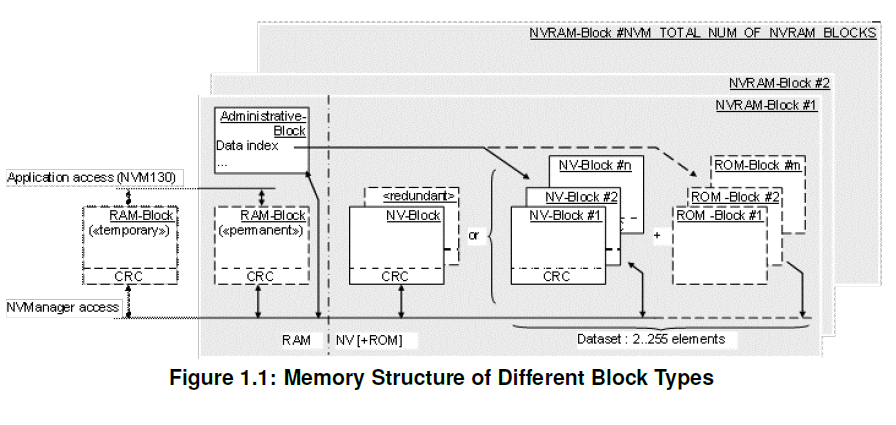

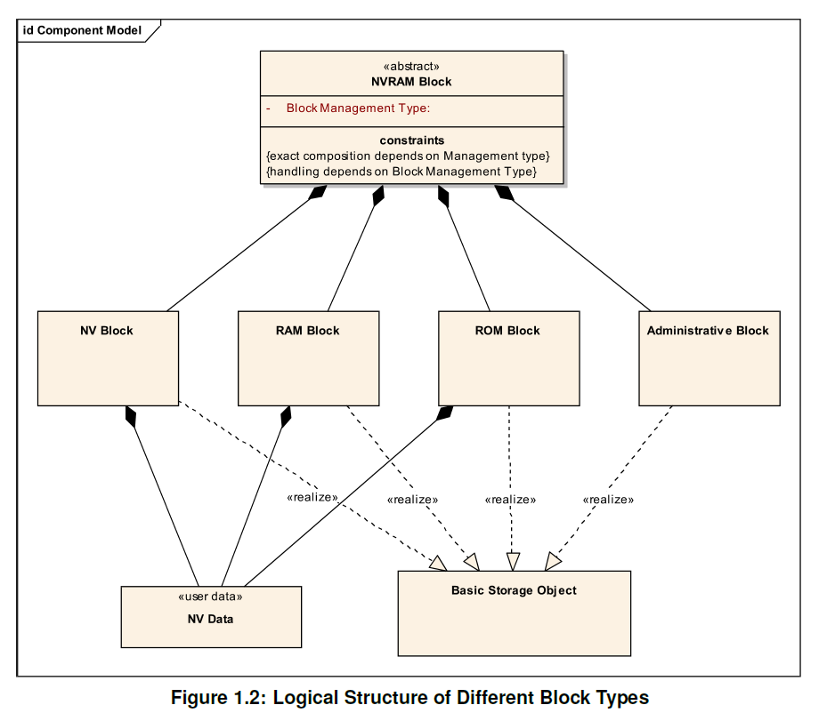

## 2. 缩略语

以下术语表包含与 **NvM** 模块相关但未包含在 [1，**AUTOSAR** 词汇表] 中的缩略语和缩写。

**基本存储对象（Basic Storage Object）**
> “基本存储对象” 是 **NVRAM** 块的最小实体。多个基本存储对象可用于构建 **NVRAM** 块。“基本存储对象”可以驻留在不同的内存位置，包括：**RAM**、**ROM**、NV内存（**NV memory**）中。

**NVRAM块（NVRAM Block）**
> “NVRAM块” 是管理和存储 NV 数据块所需的整个结构。

**NV数据（NV data）**
> “NV数据” 是指要存储在非易失性存储器中的数据。

**块管理类型（Block Management Type）**
> NVRAM块的类型。它取决于 NVRAM 块在不同强制/可选基本存储对象块中的（可配置）单独组合以及此 NVRAM 块的后续处理。

**RAM块（RAM Block）**
> “RAM块” 是 “基本存储对象”。它代表驻留在 **RAM** 中的 “NVRAM块” 的一部分。

**ROM块（ROM Block）** 
> “ROM块”是“基本存储对象”。它代表驻留在 **ROM** 中的 “NVRAM块” 的一部分。“**ROM块**”是“**NVRAM块**”的可选部分。

**NV块（NV Block）**
> “NV块”是“基本存储对象”。它代表驻留在 **NV内存** 中的 “NVRAM块” 的一部分。“**NV块**”是“**NVRAM块**”的强制性部分。

**NV块标头（NV Block Header）**
> 如果启用 “**静态块ID**” 机制，则**NV块**中包含的附加信息。

**管理块（Administrative Block）** 
> “管理块”是“基本存储对象”。它驻留在 **RAM** 中。“**管理块**”是“**NVRAM块**”的强制部分。

**默认错误跟踪器（DET）** 
> 默认错误跟踪器（**Default Error Tracer**）报告开发错误的模块。

**诊断事件管理器（DEM）** 
> 诊断事件管理器（**Diagnostic Event Manager**） 接受报告的相关错误的模块 

**非易失性（NV）** 
> 非易失性（**Non volatile**）

**FEE** 
> 闪存 EEPROM 仿真（Flash EEPROM Emulation）

**EA** 
> EEPROM 抽象（EEPROM Abstraction）

**FCFS** 
> 先到先服务（First come first served）

## 3. 相关文档

### 3.1. 输入文件和相关标准与规范

<a id="ref-1"></a>[1] 词汇表 Glossary
> AUTOSAR_FO_TR_Glossary

<a id="ref-2"></a>[2] 基础软件模块通用规范 (General Specification of Basic Software Modules)
> AUTOSAR_SWS_BSWGeneral

<a id="ref-3"></a>[3] 分层软件架构（Layered Software Architecture）
> AUTOSAR_EXP_LayeredSoftwareArchitecture

<a id="ref-4"></a>[4] EEPROM 抽象规范（Specification of EEPROM Abstraction）
> AUTOSAR_SWS_EEPROMAbstraction

<a id="ref-5"></a>[5] Flash EEPROM 仿真规范（Specification of Flash EEPROM Emulation）
> AUTOSAR_SWS_FlashEEPROMEmulation

<a id="ref-6"></a>[6] 内存抽象接口规范（Specification of Memory Abstraction Interface）
> AUTOSAR_SWS_MemoryAbstractionInterface

<a id="ref-7"></a>[7] CRC 例程规范（Specification of CRC Routines）
> AUTOSAR_SWS_CRCLibrary

<a id="ref-8"></a>[8] EEPROM驱动程序规格（Specification of EEPROM Driver）
> AUTOSAR_SWS_EEPROMDriver

<a id="ref-9"></a>[9] Flash驱动程序规格（Specification of Flash Driver）
> AUTOSAR_SWS_FlashDriver

<a id="ref-10"></a>[10] I/O 硬件抽象需求（Requirements on I/O Hardware Abstraction）
> AUTOSAR_SRS_IOHWAbstraction

<a id="ref-11"></a>[11] 内存服务需求（Requirements on Memory Services）
> AUTOSAR_SRS_MemoryServices

<a id="ref-12"></a>[12] 基本软件模块的一般需求（General Requirements on Basic Software Modules）
> AUTOSAR_SRS_BSWGeneral

<a id="ref-13"></a>[13] 软件组件模板需求（Requirements on Software Component Template）
> AUTOSAR_RS_SoftwareComponentTemplate

<a id="ref-14"></a>[14] RTE软件规格（Specification of RTE Software）
> AUTOSAR_SWS_RTE

### 3.2. 相关规范

**AUTOSAR** 提供了基本软件模块的通用规范 [2，SWS BSW General]，该规范对于 NvM 模块也适用。所以基本软件模块的通用规范应被视为 NvM 的附加且必需的规范。

## 4. 约束和假设

### 4.1. 限制

限制主要在于块管理类型（**Block Management Types**）的有限数量及其对**NV数据**的单独处理。这些限制可以通过增强的用户自定义管理信息（**user defined management information**）来降低，用户自定义管理信息信息可以作为存储真实**NV数据**的结构化部分。在这种情况下，用户定义的管理信息至少必须由应用程序解释和处理。

### 4.2. 汽车域的适用性

无限制。

### 4.3. 冲突

NvM 可配置为，使用其他软件模块或者集成代码的功能。如：使用 **Csm** 模块进行块数据的加解密。以及块数据的压缩。集成工程师有责任确保：

* NvM 在使用此功能时，所需的功能可用。例如：被调用的 Csm 已经初始化 [或尚未取消初始化]；被调用模块中所需的主函数被执行；等等。
* NvM 在使用此功能时，所需的时间可用。例如：加密算法可能需要一些时间，因此对于需要加密/解密的块，NvM的读/写功能可能需要更长的时间。

## 5. 对其他模块的依赖

本节描述与NvM模块和基础软件中其他模块的关系。

### 5.1. 文件结构

#### 5.1.1. 头文件结构

包含文件结构需符合如下要求：

* **NvM**模块应包括**NvM.h**、**Dem.h**、**MemIf.h**。
* **NvM**模块的**上层模块**（**upper layer**）需仅包含 **NvM.h**。

### 5.2. 内存抽象模块

内存抽象模块（**memory abstraction modules**）从依赖于硬件的从属驱动程序中抽象出 **NvM** 模块 （参见：参考文档[\[3\]](#ref-3)）。内存抽象模块提供由 **NvM** 模块发起的每个块访问的运行时转换，以选择对于所有配置的 **EEPROM** 或闪存存储设备来说唯一的相应驱动程序功能。内存抽象模块是通过为每个 **NVRAM块** 配置的 **NVRAM块** 设备ID 来选择的。NvM通过内存抽象接口模块**Mem If**访问内存抽象模块。（参见：参考文档[\[4\]](#ref-4)、[\[5\]](#ref-5)、[\[6\]](#ref-6)）

### 5.3. CRC 模块

**NvM** 模块使用 **CRC** 生成例程（8/16/32 位）来检查并生成 **NVRAM** 块的 CRC，作为可配置选项。**CRC** 例程必须由外部提供。（参见：参考文档 [\[7\]](#ref-7)）

### 5.4. 底层驱动的能力

必须为每个配置的 **NVRAM** 设备，例如：内部或者外部EEPROM、闪存设备，提供一组底层驱动程序功能。每组驱动程序函数内的唯一驱动程序函数在运行时通过内存硬件抽象模块进行选择（参见：第[5.2](#52-内存抽象模块) 章）。一组驱动程序功能必须包括写入、读取或维护（例如：擦除）配置的 NVRAM 设备所需的所有功能。 （参见：参考文档[\[8\]](#ref-8)、[\[9\]](#ref-9)）

## 6. 功能规格

### 6.1. 基本架构指南

#### 6.1.1. 分层软件架构

下图展示了NvM模块的通信交互。

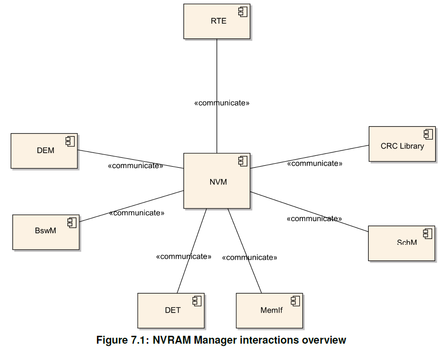

#### 6.1.2. 内存硬件抽象的寻址方案

内存抽象接口（**MemIf**）、底层闪存 EEPROM 仿真（**FEE**）和 EEPROM 抽象层（**EA**）为 **NvM** 模块提供虚拟线性 **32** 位地址空间，该空间由 **16** 位块号和 **16** 位块地址偏移组成。

提示：**NvM** 模块理论上允许最大 **65536** 个逻辑块，每个逻辑块的最大大小为 **64** KB。

同时**NvM** 模块需将 **16bit** Fee/Ea 区块号进一步细分为以下部分：

* 位宽为（**16 - NVM_DATASET_SELECTION_BITS**）的 NV块基数（**NV block base number**）（**NVM_NV_BLOCK_BASE_NUMBER**）
* 位宽为（**NVM_DATASET_SELECTION_BITS**）的数据索引（**Data index**）

冗余NVRAM块（**Redundant NVRAM blocks**）对内存硬件抽象进行的处理和寻址，需以和数据集NVRAM块（**Dataset NVRAM blocks**）采用相同的方式。即：冗余NV块需通过使用配置参数 **NvMDatasetSelectionBits** 进行管理。

NV块基数（**NVM_NV_BLOCK_BASE_NUMBER**）需位于Fee/Ea块号的最高有效位中。

配置工具需能进行块标识符（**block identifiers**）配置，**NvM**模块不应修改配置的块标识符。

##### 6.1.2.1. 示例

为了阐明前面描述的用于 NvM <-> 内存硬件抽象交互的寻址方案，以下示例将有助于理解：**NvM** 端的配置参数 **NvMNvBlockBase Number**、**NvMDatasetSelectionBits** 和 内存硬件抽象上的 **EA_BLOCK_NUMBER** / **FEE_BLOCK_NUMBER** 之间的相关性。

对于给定的示例A和B，使用了一个简单的公式：

FEE/EA_BLOCK_NUMBER = (NvMNvBlockBaseNumber << NvMDatasetSelectionBits) + DataIndex。

**示例 A:**

当把 **NvMDatasetSelectionBits** 配置参数配置为**2**。

* **14Bit位** 可用作配置参数 **NvMNvBlockBaseNumber** 的范围，即**NvMNvBlockBaseNumber** 范围：**0x1** .. **0x3FFE**
* 数据索引（**DataIndex**）范围：**0x0** .. **0x3**，其中 2ˆNvMDatasetSelectionBits - 1 = 3。
* FEE_BLOCK_NUMBER / EA_BLOCK_NUMBER 的范围：**0x4** .. **0xFFFB**

通过此配置，使用前面提到的公式计算的 FEE/EA_BLOCK_NUMBER 应如下例所示：

对于 **NvMNvBlockBaseNumber = 2** 的原生NVRAM块（**Native NVRAM block**），

* NV块通过 FEE/EA_BLOCK_NUMBER = 8 ( 2 * 2 ˆ NvMDatasetSelectionBits + 0) 进行访问。
 
对于 **NvMNvBlockBaseNumber = 3** 的冗余NVRAM块（**Redundant NVRAM block**）：

* 数据索引（**DataIndex**）为 0 的第一个 NV 块通过 FEE/EA_BLOCK_NUMBER = 12 （3 * 2 ˆ NvMDatasetSelectionBits + 0）进行访问。
* 数据索引（**DataIndex**）为 1 的第二个 NV 块通过 FEE/EA_BLOCK_NUMBER = 13 （3 * 2 ˆ NvMDatasetSelectionBits + 1）进行访问。
  
对于 **NvMNvBlockBaseNumber = 4**，且 **NvMNvBlockNum = 3** 的数据集NVRAM块（**Dataset NVRAM block**）：

* 具有数据索引 0 的 NV 块 #0 通过 FEE/EA_BLOCK_NUMBER = 16 进行访问
* 具有数据索引 1 的 NV 块 #1 通过 FEE/EA_BLOCK_NUMBER = 17 进行访问
* 具有数据索引 2 的 NV 块 #2 通过 FEE/EA_BLOCK_NUMBER = 18 进行访问
  
**示例 B:**

当把 **NvMDatasetSelectionBits** 配置参数配置为**4**。

* **12Bit位** 可用作配置参数 **NvMNvBlockBaseNumber** 的范围。
* **NvMNvBlockBaseNumber** 范围：0x1 .. 0xFFE
* 数据索引（**DataIndex**）范围：0x0 .. 0xF，其中 2ˆNvMDatasetSelectionBits-1 = 15。
* FEE_BLOCK_NUMBER / EA_BLOCK_NUMBER 的范围：0x10 .. 0xFFEF

#### 6.1.3. 基本存储对象（Basic storage objects）

##### 6.1.3.1. NV块（NV block）

NV块是基本存储对象，表现为 NV用户数据、可选的CRC值、可选NV块标头组成的存储区域。

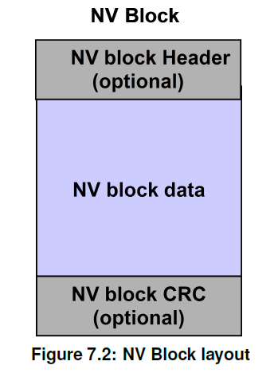

注意：上图并未显示**NV块**的物理内存布局。仅显示逻辑结构。

##### 6.1.3.2. RAM块（RAM block）

RAM块是基本存储对象，表现为一块RAM区域， 其中包含了：用户数据、可选CRC值、可选NV块标头。

RAM块上CRC使用的限制。仅当相应的NV块也具有CRC时，CRC才可用。CRC的类型必须与相应NV块的类型相同。

注意：有关 CRC 配置的更多信息，请参阅第 [9.2.3](#923-nvmblockdescriptor) 章。

RAM块的用户数据区域可以分配到与RAM块状态不同的RAM地址位置（全局数据部分）。

RAM块的数据区域需可被NvM和应用程序访问。数据可以和相应的NV块间进行数据交换。

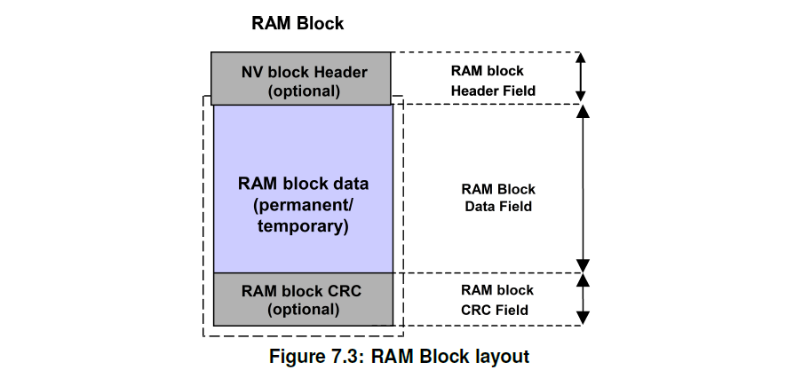

注意：该图未显示**RAM块**的物理内存布局。 仅显示逻辑结构。

由于**NvM**模块不支持对齐，但是它可以通过配置来管理实现，即可以通过添加填充来扩大块长度以满足对齐要求。

**RAM块**数据需包含永久或临时分配的用户数据。对于永久分配的用户数据，**RAM块**数据的地址在配置期间是已知的；对于临时分配的用户数据，**RAM块**数据的地址在配置期间未知，并将在运行时传递到 **NvM** 模块。

因此可以在全局 RAM 区域中（**Global RAM area**）分配每个 **RAM块**，而不受地址的限制。 配置的**RAM块**的总数并不需要位于连续的地址空间中。

##### 6.1.3.3. ROM块（ROM block）

**ROM块**是基本存储对象，驻留在ROM中，用于在**NV块**为空或损坏的情况下提供默认数据。


##### 6.1.3.4. 管理块（Administrative block）

管理块应位于 **RAM** 中，并应包含与**数据集NV块**关联使用的块索引。此外，还应包含相应 **NVRAM** 块的属性、错误、状态信息。

在显式同步（无效/有效）的情况下，**NvM** 模块需使用**永久RAM块**或 **NvM** 模块中**RAM镜像**的状态信息来确定**永久RAM块**用户数据的有效性。

RAM块状态的“**无效**”表示相应**RAM块**的数据区域是无效的。RAM块状态的“**有效**”表示相应RAM块的数据区域是有效的。“无效”的值应当由除“有效”之外的所有其他值来表示。

管理块对于应用程序来说是不可见的，并且由 **NvM** 模块专门用于 **RAM块** 和 **NVRAM块** 本身的安全和管理目的。

**NvM** 模块需使用属性字段来管理 **NV块**的写保护，以便保护/取消保护**NV块数据字段**。

**NvM** 模块需使用错误、状态字段来管理上次请求的错误以及状态值。

##### 6.1.3.5. NV块标头（**NV Block Header**）

如果启用了静态块ID（**Static Block ID**）机制，则 NV块标头需包含在NV块的首部。

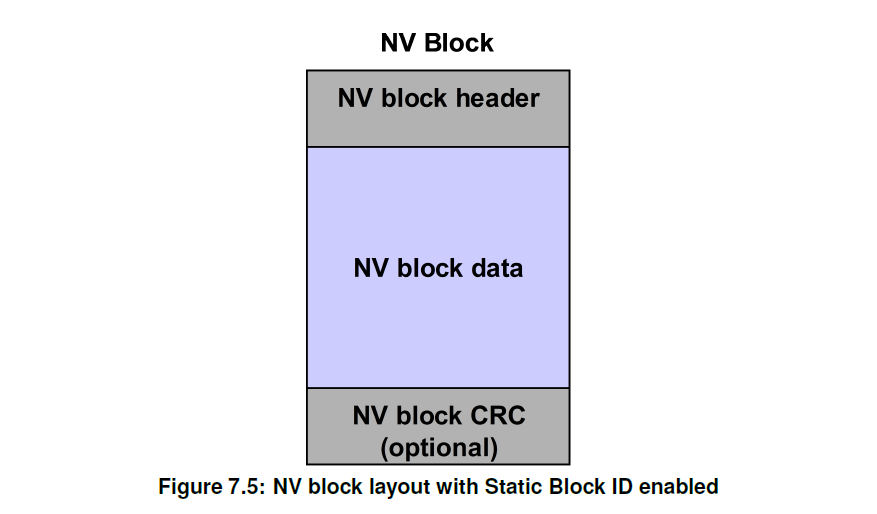

#### 6.1.4. 块管理类型

##### 6.1.4.1. 块管理类型概述

**NvM** 模块实现需支持以下类型的 **NVRAM** 存储：

* NVM_BLOCK_NATIVE
* NVM_BLOCK_REDUNDANT
* NVM_BLOCK_DATASET

**NVM_BLOCK_NATIVE** 原生类型的**NVRAM**存储需由以下基本存储对象组成：

* 1 个 NV块（**NV Block**）
* 1 个 RAM块（**RAM Block**）
* 0 到 1 个 ROM块（**ROM Block**）
* 1 个 管理块（**Administrative Block**）

**NVM_BLOCK_REDUNDANT** 冗余类型的**NVRAM**存储需由以下基本存储对象组成：

* 2 个 NV块（**NV Block**）
* 1 个 RAM块（**RAM Block**）
* 0 到 1 个 ROM块（**ROM Block**）
* 1 个 管理块（**Administrative Block**）

**NVM_BLOCK_DATASET** 数据集类型的**NVRAM**存储需由以下基本存储对象组成：

* 1 到 m 个 NV块（**NV Block**）
* 1 个 RAM块（**RAM Block**）
* 0 到 n 个 ROM块（**ROM Block**）
* 1 个 管理块（**Administrative Block**） NV 块

注意：m和n的最大值为**255**，同时m和n定义的数据集数量也取决于**NvMDatasetSelectionBits**配置参数。

##### 6.1.4.2. NVRAM块结构

**NVRAM块**组成包括了强制的基本存储对象：NV块、RAM块和管理块。但基本存储对象ROM块是可选的。

任何**NVRAM块**的组成在配置期间，通过相应的**NVRAM块描述符**（**NVRAM block descriptor**）固化了。

所有地址偏移量都是相对于NVRAM块描述符中 **RAM** 或 **ROM**的起始地址给出的。假设起始地址为零。

提示：如果需要，相应的设备驱动程序将添加设备特定的基地址或偏移量。有关**NVRAM块描述符**的详细信息，请参阅第 [6.1.4.3](#6143-nvram块描述符表nvram-block-descriptor-table) 章节。

##### 6.1.4.3. NVRAM块描述符表（NVRAM block descriptor table）

要处理的每个**NVRAM块**，可由随后分配的**Block ID**，通过 **NvM** 模块 **API** 进行选择。

所有与**NVRAM块描述符表**及其在 ROM（闪存）中的地址相关的结构信息，都必须在 **NvM** 模块配置期间生成。

##### 6.1.4.4. 原生NVRAM块（Native NVRAM block）

**原生NVRAM块**是最简单的块管理类型。它允许以最小的开销存储到**NV内存**中，或者从**NV内存**检索并获取。

**原生NVRAM块**由单个的**NV块**、**RAM块**和**管理块**组成。

##### 6.1.4.5. 冗余NVRAM块（Redundant NVRAM block）

除了**原生NVRAM块**提供的功能之外，**冗余NVRAM块**还提供增强的容错性、可靠性和可用性。它增强了对数据损坏的抵抗力。

**冗余NVRAM块**由两个**NV块**、一个**RAM块**和一个**管理块**组成。

下图反映了**冗余NV块**的内部结构：

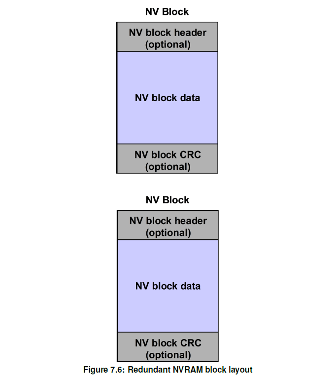

注意：该图未显示**冗余NVRAM块**的物理NV内存布局。仅显示逻辑结构。

如果与**冗余NVRAM块**关联的一个NV块被视为无效，例如：在读取期间。则应尝试使用来自未损坏**NV块**的数据来恢复此**NV块**。如果恢复失败，则需使用代码 [**NVM_E_LOSS_OF_REDUNDANCY**](#635-扩展生产错误) 向 **DEM**模块报告此情况。

注意：恢复表示冗余的重新建立。这通常意味着将恢复的数据写回**NV块**。

##### 6.1.4.6. 数据集NVRAM块（Dataset NVRAM block）

**数据集NVRAM块**是大小相等的数据块 (NV/ROM) 的阵列数组（**array**）。应用程序可以在任意时刻访问其中的某个元素。

**数据集NVRAM块**由多个**NV用户数据**、可选的**CRC区域**、可选的**NV块标头**、**RAM块**和**管理块**组成。

**数据集NVRAM块**的索引位置（**index position**）是通过相应的管理块中的单独字段来标识的。

**NvM** 模块应能够读取所有被分配的**NV块**。当且仅当写保护被禁用时，**NVM** 模块才能够写入所有被分配的**NV块**。

如果选择基本存储对象ROM块作为可选部分，则通常选择数据集的索引范围被扩展到ROM，使得可以选择ROM块而不是NV块。该索引涵盖了可以构建**数据集NVRAM块**的所有 **NV/ROM** 块。

**NvM** 模块应只能读取可选**ROM块**，即：默认数据集。NvM 模块需将写入**ROM块**的操作视为写入受保护的**NV块**。

配置数据集（NV+ROM 块）的总数应在 **1..255** 范围内。对于可选**ROM块**，索引从**0**到**NvMNvBlockNum - 1**的数据区域，表示了**NV块**以及在**NV存储器**中的**CRC**。索引从 **NvMNvBlockNum** 到 **NvMNvBlockNum + NvMRomBlockNum - 1** 的数据区域表示**ROM块**。

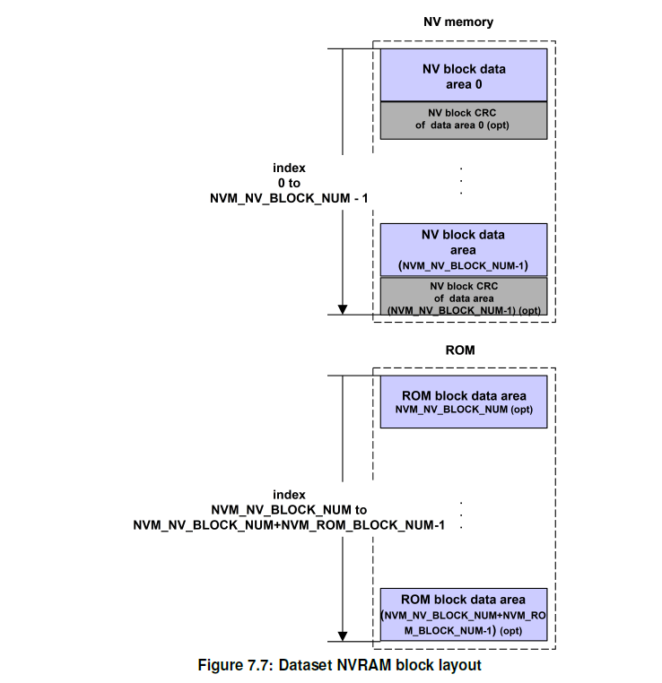

注意：该图未显示**数据集NVRAM块**的物理NV内存布局。 仅显示逻辑结构。

##### 6.1.4.7. **NvM**模块 API 配置类

为了能够使 **NvM** 模块适应有限的硬件资源，**NvM** 模块能支持三个不同的 **API** 配置类：

* API配置类3：所有指定的 API 调用都可用。支持最多的功能。
* API配置类2：一组中间的 API 调用可用。
* API配置类1：特别是对于硬件资源非常有限的匹配系统设计，此 **API** 配置类仅提供在任何情况下都需要的最少 **API** 调用集。

**API配置类3**需包含以下**API**：

* Type 1:
  * [NvM_SetDataIndex](#7312-nvm_setdataindex)(...)
  * [NvM_GetDataIndex](#7313-nvm_getdataindex)(...)
  * [NvM_SetBlockProtection](#7314-nvm_setblockprotection)(...)
  * [NvM_GetErrorStatus](#7315-nvm_geterrorstatus)(...)
  * [NvM_SetRamBlockStatus](#7317-nvm_setramblockstatus)(...)
* Type 2:
  * [NvM_ReadBlock](#7321-nvm_readblock)(...)
  * [NvM_WriteBlock](#7322-nvm_writeblock)(...)
  * [NvM_RestoreBlockDefaults](#7323-nvm_restoreblockdefaults)(...)
  * [NvM_EraseNvBlock](#7324-nvm_erasenvblock)(...)
  * [NvM_InvalidateNvBlock](#7325-nvm_invalidatenvblock)(...)
  * [NvM_CancelJobs](#7318-nvm_canceljobs)(...)
  * [NvM_ReadPRAMBlock](#7326-nvm_readpramblock)(...)
  * [NvM_WritePRAMBlock](#7327-nvm_writepramblock)(...)
  * [NvM_RestorePRAMBlockDefaults](#7328-nvm_restorepramblockdefaults)(...)
* Type 3:
  * [NvM_ReadAll](#7331-nvm_readall)(...)
  * [NvM_WriteAll](#7332-nvm_writeall)(...)
  * [NvM_CancelWriteAll](#7333-nvm_cancelwriteall)(...)
  * [NvM_ValidateAll](#7334-nvm_validateall)(...)
  * [NvM_FirstInitAll](#7335-nvm_firstinitall)(...)
* Type 4:
  * [NvM_Init](#7311-nvm_init)(...)

**API配置类2**需包含以下**API**：
* Type 1:
  * [NvM_SetDataIndex](#7312-nvm_setdataindex)(...)
  * [NvM_GetDataIndex](#7313-nvm_getdataindex)(...)
  * [NvM_GetErrorStatus](#7315-nvm_geterrorstatus)(...)
  * [NvM_SetRamBlockStatus](#7317-nvm_setramblockstatus)(...)
* Type 2:
  * [NvM_ReadBlock](#7321-nvm_readblock)(...)
  * [NvM_WriteBlock](#7322-nvm_writeblock)(...)
  * [NvM_RestoreBlockDefaults](#7323-nvm_restoreblockdefaults)(...)
  * [NvM_CancelJobs](#7318-nvm_canceljobs)(...)
  * [NvM_ReadPRAMBlock](#7326-nvm_readpramblock)(...)
  * [NvM_WritePRAMBlock](#7327-nvm_writepramblock)(...)
  * [NvM_RestorePRAMBlockDefaults](#7328-nvm_restorepramblockdefaults)(...)
* Type 3:
  * [NvM_ReadAll](#7331-nvm_readall)(...)
  * [NvM_WriteAll](#7332-nvm_writeall)(...)
  * [NvM_CancelWriteAll](#7333-nvm_cancelwriteall)(...)
  * NvM_ValidatedAll(...)
* Type 4:
  * [NvM_Init](#7311-nvm_init)(...)

**API配置类1**应包含以下**API**：
* Type 1:
  * [NvM_GetErrorStatus](#7315-nvm_geterrorstatus)(...)
  * [NvM_SetRamBlockStatus](#7317-nvm_setramblockstatus)(...)
* Type 2:
  * –
* Type 3:
  * [NvM_ReadAll](#7331-nvm_readall)(...)
  * [NvM_WriteAll](#7332-nvm_writeall)(...)
  * [NvM_CancelWriteAll](#7333-nvm_cancelwriteall)(...)
* Type 4:
  * [NvM_Init](#7311-nvm_init)(...)

**注意：**

对于**API配置类1**，无需队列支持，同时无法写入即时数据。此外，API调用[**NvM_SetRamBlockStatus**](#7317-nvm_setramblockstatus)仅在由**NvMSetRamBlockStatusApi**配置时才可用。

在**API配置类1**中，不支持块管理类型**NVM_BLOCK_DATASET**。有关类型1..4定义的信息可参阅第[7.6](#76-api概述)章节。

**NvM** 模块应仅包含处理配置的块类型所需的代码。

#### 6.1.5. 扫描顺序/优先方案

**NvM** 模块应支持基于优先级的作业处理。通过配置参数 **NvMJobPrioritization**，可启用/禁用基于优先级的作业处理。

**注意：**

有关参数 **NvMJobPrioritization** 的更多信息，请参阅第 [9.2.2](#922-nvmcommon) 章节。

在基于优先级的作业处理顺序的情况下，**NvM** 模块需使用两个队列：

* 用于立即写入（**Immediate Write**）作业。如：碰撞数据（**Crash data**）
* 另一个用于所有其他作业，包括：立即读取/擦除作业等。

如果通过配置禁用基于优先级的作业处理，则 **NvM** 模块不需支持立即写入作业。在这种情况下，**NvM**模块按 **FCFS** 顺序处理所有作业。

对于任何 [**NvM_ReadAll**](#7331-nvm_readall)、[**NvM_ValidateAll**](#7334-nvm_validateall)、[**NvM_FirstInitAll**](#7335-nvm_firstinitall) 和 [**NvM_WriteAll**](#7332-nvm_writeall) API 的多块请求（**multi block requests**）的作业队列长度都为 1，即仅排队一个多块作业。

**NvM** 模块不得通过其他请求中断源于 [**NvM_ReadAll**](#7331-nvm_readall) 请求的作业。

**注意：**

该规则的唯一例外是具有立即优先级的写入作业，它将抢占正在运行的读/写作业。抢占的作业随后需由 **NvM** 模块恢复或者重启。

**NvM** 模块不得通过其他请求中断源于 [**NvM_WriteAll**](#7332-nvm_writeall) 请求的作业。

**NvM** 模块需对以下的请求进行排队，以便随后执行它们：

* NvM 模块应该对正在进行的 [**NvM_ReadAll**](#7331-nvm_readall) 请求期间请求的读取作业进行排队，并随后执行它们。
* NvM 模块应该对正在进行的 [**NvM_WriteAll**](#7332-nvm_writeall) 请求期间请求的写入作业进行排队，并随后执行它们。
* NvM 模块应该对正在进行的 [**NvM_ReadAll**](#7331-nvm_readall) 请求期间请求的写入作业进行排队，并随后执行它们。
* NvM 模块应该对正在进行的 [**NvM_WriteAll**](#7332-nvm_writeall) 请求期间请求的读取作业进行排队，并随后执行它们。

**注意：**

可以通过调用 [**NvM_CancelWriteAll**](#7333-nvm_cancelwriteall) 来中止 [**NvM_WriteAll**](#7332-nvm_writeall) 请求。在这种情况下，当前块需被完全处理完成，接着不再有其他块被写入。

**提示：**

如果请求因相关 **NVRAM** 块的完成而变得过时，则应允许将请求出列。

抢占的作业随后应由 **NvM** 模块恢复或者重启，此行为适用于单块请求以及多块请求。

### 6.2. 一般的行为

#### 6.2.1. 功能需求

对于每次异步请求，作业完成后调用方的通知是一个可配置的选项。**NvM** 模块应提供一个回调接口（**callback interface**）。

**提示：**

**NvM** 模块的环境需仅通过 **NvM** 模块来访问非易失性存储器（**non-volatile memory**）。除了**NvM**模块外，其他任何模块不允许直接访问非易失性存储器。

**NvM** 模块仅提供访问 **NVRAM** 和共享内存（**Shared memory**）**RAM** 中的块的隐式方式。这也就意味着 **NvM** 模块将一个或多个块从 **NVRAM** 复制到 **RAM**，反之亦然。应用程序根据给定的限制来直接访问 **RAM** 数据，例如：同步的方式来访问。

如果具有特定 ID 的块尚未排队或当前正在进行中（多任务的限制），**NvM** 模块需将所有异步单块（**single block**）读、写、控制的请求排入队列。

只要不发生队列溢出，**NvM** 模块就可以接受多个异步单块（**single block**）请求。**NvM** 模块应从队列中获取最高优先级请求并按序列化顺序进行处理。

**NvM** 模块需实现隐式机制（**implicit mechanisms**），对 **NV内存**中保存的数据进行一致性/完整性检查。

根据存储软件栈的实现，由**NvM**模块提供的和被调用的回调例程（**callback routines**），可以在中断上下文中调用。

**提示：**

因此 **NvM** 模块中，提供在中断上下文中被调用的例程（**routines**），必须确保其运行时间足够短。

如果在配置时没有可用的默认 **ROM** 数据，或者 [**NvMInitBlockCallback**](#924-nvminitblockcallback) 没有定义回调函数，则应用程序应负责提供默认初始化数据。

**注意：**

在这种情况下，应用程序必须使用 **[NvM_GetErrorStatus](#7315-nvm_geterrorstatus)()** 才能区分首次初始化（**first initialization**）和损坏的数据（**corrupted data**）。具体请参阅 [9.2.3](#923-nvmblockdescriptor) 章节。

在处理 [**NvM_ReadAll**](#7331-nvm_readall) 期间，**NvM** 模块应能够通过执行校验计算（**a checksum calculation**）来检测损坏的 **RAM数据**。

在处理 [**NvM_ReadAll**](#7331-nvm_readall) 期间，**NvM** 模块应能够通过测试管理块（**administrative block**）内数据的有效性（**the validity of a data**）来检测无效 **RAM数据**。

在 [**NvM_ReadAll**](#7331-nvm_readall) 的启动阶段（**startup phase**）和正常操作（**normal operation**）期间，如果 **NvM** 模块在 **NV块** 内检测到不可恢复的错误，则 **NvM** 模块应将默认数据（如果已配置）复制到相应的 **RAM块**。

为了使用 **OS服务**（**OS services**），**NvM** 模块需仅使用**BSW调度器**（**BSW scheduler**），而不是直接使用 **OS对象** 和相关 **OS服务**。

**NvM** 模块需为配置有**永久RAM**（**permanent RAM**）或通过API参数传递的RAM的**NVRAM块**的 **RAM块**的所有读取和写入的操作，使用内部镜像作缓冲区。其中RAM的起始地址未与 **NvMBufferAlignmentValue** 对齐。

#### 6.2.2. 设计说明

##### 6.2.2.1. NvM 启动

[**NvM_Init**](#7311-nvm_init) 需由 **BSW模式管理器**（**BSW Mode Manager**）负责调用。

由于 **ECU** 启动时间的严格限制，[**NvM_Init**](#7311-nvm_init) 请求无需包含已配置的 **NVRAM块** 的初始化。

[**NvM_Init**](#7311-nvm_init) 请求不负责触发底层驱动程序和内存硬件抽象层的初始化。这些初始化也需由 **BSW模式管理器** 处理。

**RAM数据块** 的初始化需由另一个 **NvM** 的请求完成，即 [**NvM_ReadAll**](#7331-nvm_readall)。[**NvM_ReadAll**](#7331-nvm_readall) 也需由 **BSW模式管理器** 负责调用。

使用 **NvM** 模块的软件模块需负责检查 **NvM模块** 启动时产生的全局错误和状态信息下（**global error/status information**）。**BSW模式管理器** 可使用轮询方式 [**NvM_GetErrorStatus**](#7315-nvm_geterrorstatus)（保留块 ID 0），或者通过可配置选项 NvM_MultiBlockCallback 回调函数通知，来获取启动时产生的全局错误和状态信息。如果使用轮询，则需通过全局错误和状态 **NVM_REQ_OK** 或 **NVM_REQ_NOT_OK**（启动期间：**NVM_REQ_PENDING**）检测 **NVRAM** 启动过程的结束。如果选择回调函数进行通知，已分配的 **NVRAM块**处理，则应自动通知软件组件。


**注意 1：**

如果为 [**NvM_ReadAll**](#7331-nvm_readall) 中处理的每个 **NVRAM块** 都配置了回调函数，则这些回调函数可以被**RTE**启动。例如：**SW-C** 在较早的时间点处理。

**注意 2：**

为了确保 **DEM** 在早期完全运行，即：能将其 **NV数据** 能迅速地恢复到 **RAM**中，需将 **DEM** 相关的 **NVRAM块** 配置为低ID（**low ID**），以便于在 [**NvM_ReadAll**](#7331-nvm_readall) 中首先进行处理。

**注意 3：**

有关 **NvM_MultiBlockCallback** 的更多信息，请参阅第 [9.2.2](#922-nvmcommon) 章节。

**NvM** 模块不需要以持久的方式（**in a persistent way**）自动存储当前使用的数据集（**Dataset**）的索引。

软件模块负责的它所负责的所有块的特定错误/状态的检查，可以使用 [**NvM_GetErrorStatus**](#7315-nvm_geterrorstatus) 和特定的 **Block ID** 来进行检查，并确定相应 **RAM块** 的有效性。

对于块管理类型为**NVRAM数据集**的所有块，软件模块需负责通过 [**NvM_SetDataIndex**](#7312-nvm_setdataindex) 来设置正确的索引位置。例如：当前索引位置可以由软件模块存储/维护在唯一的 **NVRAM块** 中。 软件模块可使用 [**NvM_GetDataIndex**](#7313-nvm_getdataindex) 调用，来获取**数据集块**的当前索引位置。

##### 6.2.2.2. NvM 关机

基础的关机流程需通过请求 [**NvM_WriteAll**](#7332-nvm_writeall) 来完成。

**提示：**

[**NvM_WriteAll**](#7332-nvm_writeall) 需由 **BSW模式管理器**（**BSW Mode Manager**）调用。

##### 6.2.2.3. 对 NvM 模块的类并行写访问（**Quasi parallel write access**）

**NvM** 模块应使用排队机制（**queuing mechanism**）通过异步接口接收请求。**NvM** 模块应根据请求的优先级串行处理所有请求。

##### 6.2.2.4. NVRAM块一致性检查

**NvM** 模块需提供隐式技术（**implicit techniques**）来检查 **NVRAM块** 的数据一致性。

**NVRAM块**的数据一致性检查需通过其相应 **NV块**的CRC数值重新计算来实现。

数据一致性检查的隐式方式应由内部函数的可配置选项提供。隐式一致性检查应可针对每个**NVRAM块**进行配置，并取决于可配置参数 **NvMBlockUseCrc** 和 **NvMCalcRamBlockCrc**。

**注意：**

有关 **NvMBlockUseCrc** 和 **NvMCalcRamBlockCrc** 的更多信息，请参阅第 [9.2.3](#923-nvmblockdescriptor) 章节。

对于 **NvMWriteBlockOnce = TRUE** 的 **NVRAM块**，需启用 **NvMBlockUseCrc**。 对于 **NvMWriteBlockOnce = TRUE** 的 **NVRAM块**，需禁用 **NvMBlockWriteProt**，以便用户能够在 **CRC** 检查失败的情况下将数据写入 **NVRAM块**。

根据可配置参数 **NvMBlockUseCrc** 和 **NvMCalcRamBlockCrc**，**NvM** 模块需为使用的最大的 **CRC** 分配足够的内存。

**提示：**

**NVM** 用户不应该也不需要了解 **RAM块**中数据的CRC内存信息。例如：大小、位置等。

##### 6.2.2.5. 错误恢复

**NvM** 模块需提供错误恢复机制。错误恢复取决于 **NVRAM块管理类型**（**NVRAM block management type**）。

**NvM** 模块需通过加载默认值的方式，为每类 **NVRAM块管理类型**的读取操作提供错误恢复。

**NvM** 模块需通过为 **RAM块** 加载默认值的方式，来为块管理类型 **NVM_BLOCK_REDUNDANT** 的 **NVRAM块** 读取操作提供错误恢复。

无论是何种 **NVRAM块管理类型** ，**NvM** 模块都需通过执行写入重试，来为写入操作提供错误恢复。

在 **RAM块** 的重新验证失败的情况下，**NvM** 模块需在启动时为具有配置的了 **RAM块** CRC 的所有 **NVRAM块** 读取操作提供错误恢复。

##### 6.2.2.6. 使用ROM数据恢复RAM块

**NvM** 模块应提供隐式和显式恢复技术，以便于在 **NV块** 出现不可恢复的数据不一致的情况下, 将 **ROM数据** 恢复到其相应的 **RAM块**。

##### 6.2.2.7. 使用ROM默认数据隐式恢复RAM块

相应NV块的数据内容在隐式恢复期间需保持不变。

当未配置默认数据（即：通过参数 **NvMRomBlockDataAddress** 或 [**NvMInitBlockCallback**](#924-nvminitblockcallback)）时，启动期间（[**NvM_ReadAll**](#7331-nvm_readall) 的一部分）**NvM**模块不应通过 [**NvM_ReadBlock**](#7321-nvm_readblock) 或 [**NvM_ReadPRAMBlock**](#7326-nvm_readpramblock) ，为每个 **NVRAM块** 提供隐式恢复。

在以下情况下，在启动期间（[**NvM_ReadAll**](#7331-nvm_readall) 的一部分），[**NvM_ReadBlock**](#7321-nvm_readblock) 和 [**NvM_ReadPRAMBlock**](#7326-nvm_readpramblock) 均不需为每个 **NVRAM块** 提供隐式恢复（**implicit recovery**）：

* 配置默认数据，即：通过配置参数 **NvMRomBlockDataAddress** 或 [**NvMInitBlockCallback**](#924-nvminitblockcallback)。
* **NvM** 模块中的 **永久RAM块**（**Permanent RAM block**）或 **RAM镜像**（**RAM mirror**）的内容（显式同步的情况下）状态有效，且CRC（数据）一致。

在以下情况下，在启动期间（[**NvM_ReadAll**](#7331-nvm_readall) 的一部分），[**NvM_ReadBlock**](#7321-nvm_readblock) 和 [**NvM_ReadPRAMBlock**](#7326-nvm_readpramblock) 均不需为每个 **NVRAM块** 提供隐式恢复（**implicit recovery**）：

* 配置默认数据，即：通过配置参数 **NvMRomBlockDataAddress** 或 [**NvMInitBlockCallback**](#924-nvminitblockcallback)。
* **NvM** 模块中的 **永久RAM块**（**Permanent RAM block**）或 **RAM镜像**（**RAM mirror**）的内容（显式同步的情况下）状态无效，且CRC（数据）不一致。
* 但从NV中读取尝试成功。

对于以下条件，在启动期间（[**NvM_ReadAll**](#7331-nvm_readall) 的一部分），[**NvM_ReadBlock**](#7321-nvm_readblock) 或 [**NvM_ReadPRAMBlock**](#7326-nvm_readpramblock) 需为每个 **NVRAM块** 提供隐式恢复：

* 配置默认数据，即：通过配置参数 **NvMRomBlockDataAddress** 或 [**NvMInitBlockCallback**](#924-nvminitblockcallback)。
* **NvM** 模块中的 **永久RAM块**（**Permanent RAM block**）或 **RAM镜像**（**RAM mirror**）的内容（显式同步的情况下）状态无效，且CRC（数据）不一致。
* 从NV中读取尝试依然失败。

在 [**NvM_ReadBlock**](#7321-nvm_readblock) 或 [**NvM_ReadPRAMBlock**](#7326-nvm_readpramblock) 请求 **NVM_BLOCK_NATIVE** 和 **NVM_BLOCK_REDUNDANT** 类型的 **NVRAM块** 期间，需提供隐式恢复。

##### 6.2.2.8. 使用ROM默认数据显式恢复RAM块

对于使用 **ROM块** 数据进行显式恢复，**NvM** 模块需提供函数 [**NvM_RestoreBlockDefaults**](#7323-nvm_restoreblockdefaults) 和 [**NvM_RestorePRAMBlockDefaults**](#7328-nvm_restorepramblockdefaults) 以便将 **ROM数据** 恢复到其相应的 **RAM 块**。

函数 [**NvM_RestoreBlockDefaults**](#7323-nvm_restoreblockdefaults) 和 [**NvM_RestorePRAMBlockDefaults**](#7328-nvm_restorepramblockdefaults) 应保持相应 **NV块** 的数据内容不变。

**提示：**

应用程序应在每次需要时使用 [**NvM_RestoreBlockDefaults**](#7323-nvm_restoreblockdefaults) 或 [**NvM_RestorePRAMBlockDefaults**](#7328-nvm_restorepramblockdefaults) 函数，将 **ROM数据** 恢复到相应的 **RAM块**。

##### 6.2.2.9. 检测到NV块的不完整写入操作

对**NV块**的不完整写入操作的检测，超出了 **NvM** 模块的范围。这部分错误通过内存硬件抽象模块（**memory hardware abstraction**）来处理和检测的。如果引用的 **NV块** 无效或不一致，并且在请求时无法读取，**NvM** 模块期望从内存硬件抽象模块获取信息。**SW-C** 可以使用 [**NvM_InvalidateNvBlock**](#7325-nvm_invalidatenvblock) 防止低层模块来传递旧数据。

##### 6.2.2.10. 单个块请求的终止（Termination of a single block request）

NvM 模块提供的所有除了[**NvM_CancelWriteAll**](#7333-nvm_cancelwriteall)外的异步请求，需在相应 **管理块** 中指定的错误/状态字段（**designated error/status field**）中，指示其结果。

可选的配置参数 [**NvMSingleBlockCallback**](#925-nvmsingleblockcallback) 可通过配置回调函数（**callback**）来通知一个异步单块请求（包括：[**NvM_ReadAll**](#7331-nvm_readall)）的终止（**the termination of an asynchronous block request**）。

**注意：**

在与应用程序 **SW-C** 通信时，ECUC 配置参数 [**NvMSingleBlockCallback**](#925-nvmsingleblockcallback) 需配置为相应的 **Rte_call_&lt;p&gt;_&lt;o&gt;** API。有关 [**NvMSingleBlockCallback**](#925-nvmsingleblockcallback) 的更多信息，请参阅第 [9.2.3](#923-nvmblockdescriptor) 章节。

**译者注：** 章节号按原文翻译；源文档此处的引用编号已陈旧，[**NvMSingleBlockCallback**](#925-nvmsingleblockcallback) 容器实际位于本文第 [9.2.5](#925-nvmsingleblockcallback) 章（源 10.2.5），而第 [9.2.3](#923-nvmblockdescriptor) 章为 [**NvMBlockDescriptor**](#923-nvmblockdescriptor)。

##### 6.2.2.11. 多个块请求的终止（Termination of a multi block request）

**NvM** 模块需使用单独的变量来存储异步多块请求的结果，如：[**NvM_ReadAll**](#7331-nvm_readall)、[**NvM_WriteAll**](#7332-nvm_writeall)，包括 [**NvM_CancelWriteAll**](#7333-nvm_cancelwriteall)、[**NvM_ValidateAll**](#7334-nvm_validateall)。

函数 [**NvM_GetErrorStatus**](#7315-nvm_geterrorstatus) 可通过ID值为0保留块（**a reserved block ID value of 0**），返回异步多块请求（包括：[**NvM_CancelWriteAll**](#7333-nvm_cancelwriteall)）的最新的错误或者状态信息。

多块请求的结果需仅表示公共的错误或者状态信息。

**NvM** 模块提供的多块请求需在每个受影响**管理块**的指定错误或者状态字段中，指示其详细错误或者状态信息。

可选的配置参数 **NvMMultiBlockCallback** 可通过配置回调函数（**callback**）来通知一个异步多块请求的终止。

**注意：**

有关 **NvMMultiBlockCallback** 的更多信息，请参阅第 [9.2.2](#922-nvmcommon) 章节。

##### 6.2.2.12. 异步请求和作业处理的一般处理机制

在每次异步请求中，进行 **CRC** 计算时，如果引用的 **NVRAM块** 长度超过参数 **NvMCrcNumOfBytes** 配置的字节数，**NvM** 模块将分多个步骤来计算 **CRC**。

对于 **CRC** 计算，**NvM** 模块需使用 **CRC** 模块发布的初始值。

多个并发的单块请求需进行排队。

**NvM** 模块需中断异步请求/作业处理，以支持具有立即写优先级（**immediate priority**）的作业（如：碰撞数据）。

如果 **NvM** 模块接受的异步函数调用导致作业队列溢出，则该函数应返回 **E_NOT_OK**。

成功将请求排队后，**NvM** 模块需将相应 **NVRAM块** 的请求结果设置为 **NVM_REQ_PENDING**。

如果 **NvM** 模块已成功处理作业，则应返回 **NVM_REQ_OK** 作为请求结果。

##### 6.2.2.13. NVRAM 块写保护

**NvM** 模块需提供不同类型的可配置写保护。每种写保护只与**NVRAM块**的**NV部分**相关，即：**RAM块**数据可以修改但不能写入NV存储器。

当 **NvMWriteBlockOnce** 为 **FALSE** 时，无论 **NvMBlockWriteProt** 配置的值为 **True** 或者 **False**，都可以使用 [**NvM_SetBlockProtection**](#7314-nvm_setblockprotection) 函数来启用或者禁用写保护。

当 **NvMWriteBlockOnce** 为 **TRUE** 时，无论 **NvMBlockWriteProt** 配置的值为 **True** 或者 **False**，都不允许使用 [**NvM_SetBlockProtection**](#7314-nvm_setblockprotection) 函数启用/禁用写保护。

对于配置为 **NvMBlockWriteProt = TRUE** 的所有 **NVRAM块**，**NvM** 模块需启用默认写保护。

**NvM** 模块的环境可以使用 [**NvM_SetBlockProtection**](#7314-nvm_setblockprotection) 函数来显式的禁用写保护。

对于配置为 **NvMWriteBlockOnce == TRUE** 的 **NVRAM块**，**NvM** 模块只能向关联的 **NV内存** 写入一次，即：在空白的NV设备的情况下。

对于配置为 **NvMWriteBlockOnce == TRUE** 的 **NVRAM块**，**NvM** 模块不允许使用 [**NvM_SetBlockProtection**](#7314-nvm_setblockprotection) 函数显式的禁用写保护。

对于配置了 **NvMWriteBlockOnce == TRUE** 的 **NVRAM块**，**NvM** 模块需拒绝在第一个读取请求之前，发出任何写入、擦除、数据无效的请求。

**注意：**

如果发生复位，则来自 **NvM管理块**的配置有 **NvMWriteBlockOnce == TRUE** 的块的写保护标志将被清除。为了重新激活保护，必须在处理第一个写入、擦除、数据无效请求之前读取该块，以便仅针对有效且一致的块进行设置写保护。第一个读取请求可以作为单个块请求，或者作为 [**NvM_ReadAll**](#7331-nvm_readall) 的一部分来完成。

##### 6.2.2.14. RAM块数据的验证和修改

本节介绍有关**NvM** 模块的状态位（**status bits**）的内部处理机制的信息。根据不同的 **API** 调用，描述了对**RAM块**状态的影响。下图描述了**RAM块**的状态转换。

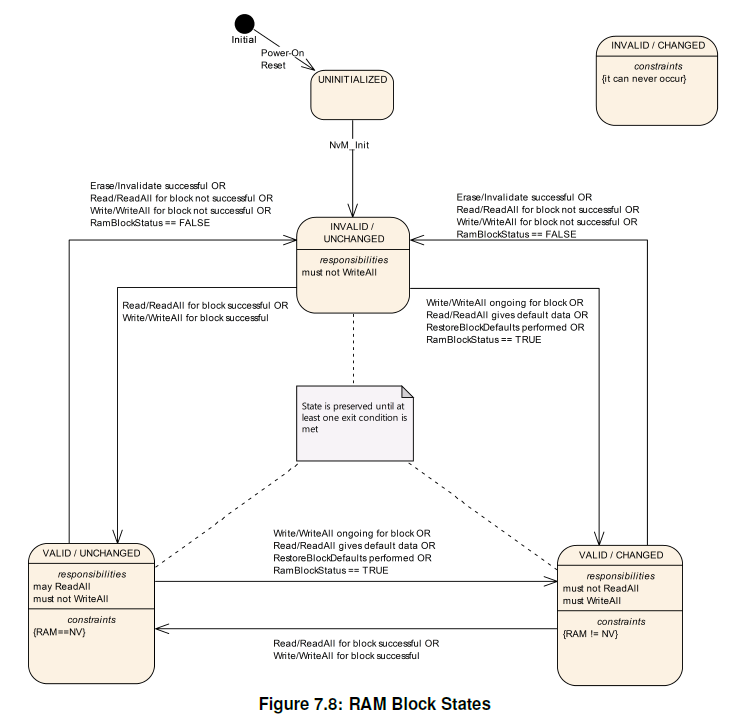

由于进入和保存状态可以根据多种条件来完成，将它们全部放在上图中会很难理解，所以在下面的子章节中会提供了更详细的解释。因为如上图所示，**INVALID/CHANGED**状态是永远无法进入，所以此状态没有进行任何说明。

初始化后，**RAM块**处于**INVALID/UNCHANGED**状态，直到通过 [**NvM_ReadAll**](#7331-nvm_readall) 进行了更新后。更新后状态会转换到**VALID/UNCHANGED**。在这种状态下，**WriteAll**的操作是不被允许的。如果调用 [**NvM_SetRamBlockStatus**](#7317-nvm_setramblockstatus)，则会离开此状态。如果发生**CRC错误**，**RAM块**会被再次更改为**INVALID**状态，然后可以通过隐式或显式错误恢复机制离开此状态。错误恢复后，由于**RAM块**的内容与**NVRAM块**的内容已经不同，此时**RAM块**处于**VALID/CHANGED**状态。

如果在配置中，用于修改**RAM块**状态的 API（如：**NvMSetRamBlockStatusApi** 或 **NvMBlockUseSetRamBlockStatus**）被禁用：

1. 当在把数据写入到相应**NV块**中时，**NvM** 模块需将 **NvM** 模块中的**RAM块**或**RAM镜像**（在显式同步的情况下）视为有效并更改（**VALID/CHANGED**），并。即在 [**NvM_WriteAll**](#7332-nvm_writeall) 期间，**NvM** 模块需将每个永久 **RAM块**写入到**NVRAM块**。
2. 当从**NV块**读取数据时，**NvM** 模块需将**RAM块**视为无效（**INVALID**）。即在 [**NvM_ReadAll**](#7331-nvm_readall) 期间，**NvM** 模块需将每个进行了相应配置的 **NVRAM块** 加载到 **RAM块**。

如果块读取尝试不成功，应用程序有责任在下一次写入尝试之前提供有效数据。

如果 **RAM块** 成功复制到NV存储器，则**RAM块**状态随后需被设置为**VALID/UNCHANGED**。

###### 6.2.2.14.1. 有效/未变更 VALID/UNCHANGED 状态

在以下情况下，**RAM块**处于**VALID/UNCHANGED**状态：

1. **RAM块** 的内容与相应 **NVRAM块** 的内容相同。
2. 虽然应用程序已经访问了**RAM块**，但并未指示 **RAM块** 可能发生变化。
3. 对于 **数据集NVRAM块**，这些条件适用于上次被处理的实例的 RAM内容。此外，最后一个块操作成功，并且该块没有因请求而失效。

要进入 **VALID/UNCHANGED** 的状态，至少必须发生以下其中一种情况：

1. [**NvM_ReadAll**](#7331-nvm_readall) 成功读取块。
2. [**NvM_ReadBlock**](#7321-nvm_readblock) 已成功完成该块。
3. [**NvM_WriteBlock**](#7322-nvm_writeblock) 已成功完成该块。
4. [**NvM_WriteAll**](#7332-nvm_writeall) 成功写入块。

在满足以下情况时，**VALID/UNCHANGED** 状态会被继续保留：

1. BlockID的最后一次读取或写入成功（没有错误并且没有检索默认数据）。
2. 自上次读取或写入以来，应用程序并未指示 **RAM块** 可能发生变化。

###### 6.2.2.14.2. 有效/已变更 VALID/CHANGED 状态

在以下情况下，**RAM块**处于**VALID/CHANGED**状态：

1. **RAM块** 的内容可能与相应  **NVRAM块** 的内容不同。 
2. 对于 **数据集NVRAM块**，这些条件适用于上次处理的实例的 RAM 内容。 此外，该块的最后一个操作是成功的，并且该块没有根据请求而失效。 
3. 块所有者（**Block owner**）可以发出信号通知该块的潜在 RAM 内容已更改，从而导致块状态变为 **VALID/CHANGED**。

要进入 **VALID/CHANGED** 状态，至少必须发生以下的某一种情况：

1. 使用 **TRUE** 为参数，调用了 [**NvM_SetRamBlockStatus**](#7317-nvm_setramblockstatus)。
2. 调用了 [**NvM_WriteBlock**](#7322-nvm_writeblock)。
3. 调用了 [**NvM_WriteAll**](#7332-nvm_writeall) 并会处理了此**RAM块**。
4. 调用了 [**NvM_ReadBlock**](#7321-nvm_readblock) 给出默认数据。
5. 调用了 [**NvM_RestoreBlockDefaults**](#7323-nvm_restoreblockdefaults) 成功完成，
6. 调用了 [**NvM_ReadAll**](#7331-nvm_readall) 在处理块时，给出默认数据。
7. 调用了 [**NvM_ValidateAll**](#7334-nvm_validateall) 成功处理了此**RAM块**

在满足以下情况时，**VALID/CHANGED** 状态会被继续保留：

* **RAM块** 所有者已表明 **RAM块** 可能发生变化。
* 上次 **RAM块** 数据读取时，无理是采用隐式或者显式（**implicitly or explicitly**），块数据已经恢复为默认值。

###### 6.2.2.14.3. 无效/未更改 INVALID/UNCHANGED 状态

对于一般的 **NV块** 来说，此状态代表当前数据无效。对于 **DATASET块** 来说，此状态代表着 **NV块** 中最后处理的实例数据无效。

要进入 **INVALID/UNCHANGED** 状态，至少必须发生以下的某一种情况：

1. 使用 **FALSE** 为参数，调用 [**NvM_SetRamBlockStatus**](#7317-nvm_setramblockstatus)。
2. 调用了[**NvM_ReadBlock**](#7321-nvm_readblock)后，返回用户请求的数据已失效。
3. 调用了[**NvM_ReadBlock**](#7321-nvm_readblock)后，由于**CRC**数据校验失败，提示块数据已损坏。
4. 调用了[**NvM_ReadBlock**](#7321-nvm_readblock)后，指示块的**StaticID**错误（如果已配置）。
5. 调用了[**NvM_WriteBlock**](#7322-nvm_writeblock), 未能执行成功。
6. 调用了[**NvM_WriteAll**](#7332-nvm_writeall)，块写入不成功。
7. 调用了[**NvM_InvalidateNvBlock**](#7325-nvm_invalidatenvblock)，并执行成功。
8. 调用了[**NvM_EraseNvBlock**](#7324-nvm_erasenvblock)，并执行成功。

在满足以下情况时，**INVALID/UNCHANGED** 状态会被继续保留：

* 当时块状态未知（早期初始化，直到 ReadAll 或对给定块请求的第一个操作）。
* 该块被检测为损坏或具有错误的**StaticID**。
* 对该块的最后一次成功操作是失效。
* 当前读取失败且无默认数据。
* 对块的最后一次成功操作是擦除。

##### 6.2.2.15. 应用程序和NvM模块之间的通信和隐式同步（implicit synchronization）

为了最大限度地减少锁定/解锁开销或者使用其他同步方法，应用程序和**NvM**模块之间的通信必须遵循本章节所描述的严格的步骤顺序。这样可以确保了应用程序和**NvM**模块之间的可靠通信，避免**RAM块**中的数据损坏，并保证正确的同步。

此访问模型假设**RAM块**的通信涉及两方：应用程序和**NvM**模块。

如果多个应用程序使用相同的**RAM块**，则**RAM块**的数据完整性并不属于**NvM**模块的工作范畴。在这种情况下，应用程序必须同步其对**RAM块**的访问，并且必须保证在NVRAM操作期间不会发生对**RAM块**的不适当的访问（详细信息见下文）。特别是如果多个应用程序通过使用（不同的）临时**RAM块**共享**NVRAM块**，则应用程序之间的同步会变得更加复杂，并且**NvM**模块也不会处理此问题。如果使用回调作为通知方法，可能会发生以下情况： 尽管该应用程序尚未发起请求，但该应用程序会收到通知。

所有应用程序都必须遵守以下规则。

###### 6.2.2.15.1. 写入请求（NvM_WriteBlock 或 NvM_WritePRAMBlock）

应用程序在写入请求期间必须遵守以下规则，以实现应用程序和**NVRAM**管理器之间的隐式同步：

1. 应用程序需由**NvM**模块负责数据填充到**RAM块**的写入。
2. 应用程序需发出[**NvM_WriteBlock**](#7322-nvm_writeblock)或[**NvM_WritePRAMBlock**](#7327-nvm_writepramblock)请求后，并将控制权转移到**NvM**模块。
3. 从这时刻开始，应用程序不应修改**RAM块**，直到收到回调函数的通知或通过轮询得出请求的成功或失败为止。但同时可以读取**RAM块**的内容。
4. 应用程序可以使用轮询来获取请求的状态，也可以通过异步回调函数获取通知。
5. **NvM**模块操作完成后，**RAM块**可被再次使用以进行数据的修改。

###### 6.2.2.15.2. 读取请求（NvM_ReadBlock 或 NvM_ReadPRAMBlock）

应用程序在读取请求期间必须遵守以下规则，以实现应用程序和**NVRAM**管理器之间的隐式同步：

1. 应用程序需提供一个**RAM块**，并由**NvM**模块负责**NVRAM数据**填充此**RAM块**中。
2. 应用程序发出[**NvM_ReadBlock**](#7321-nvm_readblock)请求后，并将控制权转移到**NvM**模块。
3. 从这时刻开始，应用程序不应读取或写入**RAM块**，直到收到回调函数的通知或通过轮询得出请求的成功或失败为止。
4. 应用程序可以使用轮询来获取请求的状态，也可以通过回调函数获取通知。
5. **NvM**模块操作完成后，**RAM块**中包含有新数据可供应用程序使用。

###### 6.2.2.15.3. 恢复默认请求（NvM_RestoreBlockDefaults 和 NvM_RestorePRAMBlockDefaults）

应用程序在恢复默认请求期间必须遵守以下规则，以实现应用程序和**NVRAM**管理器之间的隐式同步：

1. 应用程序需提供一个**RAM块**，并由**NvM**模块负责把**ROM数据**填充此**RAM块**中。
2. 应用程序发出[**NvM_RestoreBlockDefaults**](#7323-nvm_restoreblockdefaults)或[**NvM_RestorePRAMBlockDefaults**](#7328-nvm_restorepramblockdefaults)请求后，并将控制权转移到**NvM**模块。
3. 从这时刻开始，应用程序不应读取或写入**RAM**块，直到收到回调函数的通知或通过轮询得出请求的成功或失败为止。
4. 应用程序可以使用轮询来获取请求的状态，也可以通过回调函数获取通知。
5. **NvM**模块操作完成后，**RAM块**会被恢复为**ROM数据**，并可供应用程序使用。

###### 6.2.2.15.4. 多块读取请求（NvM_ReadAll）

此请求只能在系统启动时，由**BSW模式管理器**（**BswM**）模块触发。该请求将使用启动所需的数据填充所有已配置的**永久RAM块**。

如果请求失败或请求仅部分成功处理，**NvM**会向**DEM**发送此情况信号，并向**BSW模式管理器**返回错误。**DEM**和**BSW模式管理器**必须决定必须采取的进一步措施。这些步骤超出了**NvM**模块的范畴，会在**DEM**和**BSW模式管理器**的规范中定义。

应用程序在多块读取请求期间必须遵守以下规则，以实现应用程序和**NVRAM**管理器之间的隐式同步：

1. 由**BSW模式管理器**发出[**NvM_ReadAll**](#7331-nvm_readall)请求后，并将控制权转移到**NvM**模块。
2. **BSW模式管理器**可以使用轮询来获取请求的状态，也可以通过回调函数获取通知。
3. 在[**NvM_ReadAll**](#7331-nvm_readall)期间，已配置的单块通知回调函数（**single block callback**）将会在**NVRAM块**被完全处理后被调用。这些回调函数使**RTE**能够单独启动每个**SW-C**。

###### 6.2.2.15.5. 多块写入请求（NvM_WriteAll）

此请求只能在系统关闭时，由**BSW模式管理器**触发。此请求会将所有已修改的**永久RAM块**的内容写入到**NV存储器**。通过仅在**ECU**关闭期间调用此请求，**BSW模式管理器**可以确保在操作结束之前没有任何软件模块能够修改**RAM块**中的数据。这些措施超出了**NvM**模块的范畴，会在**BSW模式管理器**的规范中定义。

应用程序在多块写入请求期间必须遵守以下规则，以实现应用程序和**NVRAM**管理器之间的隐式同步：

1. 由**BSW模式管理器**发出[**NvM_WriteAll**](#7332-nvm_writeall)请求，并将控制权转移到**NvM**模块。
2. **BSW模式管理器**可以使用轮询来获取请求的状态，或者可以通过回调函数获取通知。

###### 6.2.2.15.6. 取消操作 (NvM_CancelWriteAll)

此请求取消待处理的[**NvM_WriteAll**](#7332-nvm_writeall)请求。此请求是一个异步请求，可以调用它来终止一个挂起（**pending**）的[**NvM_WriteAll**](#7332-nvm_writeall)请求。

[**NvM_CancelWriteAll**](#7333-nvm_cancelwriteall) 请求只能由**BSW模式管理器**使用。

###### 6.2.2.15.7. 管理块的修改

出于管理目的，管理块是属于每个配置的**NVRAM块**的一部分（参见第 [6.1.3.4](#6134-管理块administrative-block) 节）。

如果**NVRAM块**有挂起（**pending**）的单块操作，则应用程序不允许调用任何修改管理块的操作，例如：[**NvM_SetDataIndex**](#7312-nvm_setdataindex)、[**NvM_SetBlockProtection**](#7314-nvm_setblockprotection)、[**NvM_SetRamBlockStatus**](#7317-nvm_setramblockstatus)，直到挂起的作业完成。

##### 6.2.2.16. NVRAM 块的正常和扩展运行时准备

本子章节提供了一份简短摘要说明**NVRAM块**的正常和扩展运行时的准备。有关启动期间，**NVRAM块**处理的详细行为在第[7.3.3.1](#7331-nvm_readall)章节中指定。

根据两个配置参数**NvMDynamicConfiguration** 和**NvMResistantToChangedSw**，NVRAM管理器在启动期间（即处理请求 [NvM_ReadAll](#7331-nvm_readall)() 时）应以不同的方式运行。

如果**NvMDynamicConfiguration**设置为**FALSE**，则**NVRAM**管理器需忽略存储的**配置ID**，并继续**NVRAM块**的正常运行时准备。在这种情况下，需检查**RAM块**的有效性（**validity**）。如果检测到**RAM块**的内容无效（**invalid**），则应检查**NV块**的有效性（**validity**）。检测到有效的**NV块**需被复制到其指定的**RAM块**。如果检测到无效的**NV块**，则需加载默认数据。

如果**NvMDynamicConfiguration**设置为**TRUE**，并且检测到**配置ID**不匹配时，则需对使用**NvMResistantToChangedSw**配置为**FALSE**的那些**NVRAM**块执行扩展运行时的准备。即：在这种情况下，默认数据的加载需与分配的**RAM块**或**NV块**的有效性无关。

##### 6.2.2.17. 应用程序和NvM模块之间的通信和显式同步（explicit synchronization）

与应用程序和 NvM 模块之间的隐式同步[参见第6.2.2.15节](#62215-应用程序和nvm模块之间的通信和隐式同步implicit-synchronization)相反，可以使用一种可选的（即：可配置的）显式同步机制（**explicit synchronization mechanism**）。它是通过NvM模块中的**RAM镜像**（**RAM mirror**）来实现的。应用程序通过**NvM**模块调用的回调例程双向传输数据。

下面简单分析一下这个机制：

主要优点就是应用程序可以更好地控制其数据。因为应用程序负责将一致的数据复制到**NvM**模块的**RAM镜像**中，或者从**NvM**模块的**RAM镜像**读回，所以应用程序知道这时间点。**RAM块**永远不会因为并发访问，而处于不一致状态。

缺点是需要与使用此机制的最大**NVRAM块**具有相同的大小的额外的**RAM**，并且每次操作都需要在两个RAM空间之间进行额外的复制。

如果有一个软件模块可以同步这些应用程序，并且从**NvM**模块的角度来看，它是此**NVRAM块**的所有者，则该机制尤其可以实现不同应用程序之间共享**NVRAM块**。

对于每个**NVRAM块**，都可以通过参数**NvMBlockUseSyncMechanism**配置显式同步机制（**explicit synchronization mechanism**）的使用。

如果没有块配置为使用显式同步机制，**NvM**模块无需分配**RAM镜像**。

如果至少一个块配置为使用显式同步机制，则**NvM**模块需仅分配一个**RAM镜像**。此**RAM镜像**不应超过配置为使用显式同步机制的最长**NVRAM块**的大小。

**NvM**模块需使用内部镜像作为所有读取和写入**NvMBlockUseSyncMechanism == TRUE**的**NVRAM块**的**RAM块**的操作的缓冲区。该缓冲区不应用于其他**NVRAM块**。

**NvM**模块需调用例程**NvMWriteRamBlockToNvCallback**，以便将数据从**RAM块**复制到**NvMBlockUseSyncMechanism == TRUE**的所有**NVRAM块**的镜像。该例程不得用于其他**NVRAM块**。

**NvM**模块需调用例程**NvMReadRamBlockFromNvCallback**，以便将数据从镜像复制到 **NvMBlockUseSyncMechanism == TRUE** 的所有**NVRAM块**的**RAM块**。该例程不得用于其他**NVRAM块**。

在单个块请求期间，如果例程**NvMReadRamBlockFromNvCallback**返回**E_NOT_OK**，则**NvM**模块需重试例程调用**NvMRepeatMirrorOperations**次。此后，单块读取作业应将块特定请求结果设置为**NVM_REQ_NOT_OK**，并向**DEM**报告[**NVM_E_REQ_FAILED**](#635-扩展生产错误)。

如果**NvMReadRamBlockFromNvCallback**例程返回**E_NOT_OK**，**NvM**模块需在[**NvM_MainFunction**](#741-nvm_mainfunction)的下一次调用中重试例程调用。

在单个块请求期间，如果例程**NvMWriteRamBlockToNvCallback**返回**E_NOT_OK**，则**NvM**模块需重试例程调用**NvMRepeatMirrorOperations**次。 此后，单块写入作业应将块特定请求结果设置为**NVM_REQ_NOT_OK**，并向**DEM**报告[**NVM_E_REQ_FAILED**](#635-扩展生产错误)。

如果**NvMWriteRamBlockToNvCallback**例程返回**E_NOT_OK**，**NvM**模块应在[**NvM_MainFunction**](#741-nvm_mainfunction)的下一次调用中重试例程调用。

在多块请求 ([**NvM_WriteAll**](#7332-nvm_writeall)) 期间，如果例程**NvMWriteRamBlockToNvCallback**返回**E_NOT_OK**，则**NvM**模块需重试例程调用**NvMRepeatMirrorOperations**次。 此后，函数[**NvM_WriteAll**](#7332-nvm_writeall)的作业需将块特定请求结果设置为**NVM_REQ_NOT_OK**，并向**DEM**报告[**NVM_E_REQ_FAILED**](#635-扩展生产错误)。

在多块请求 ([**NvM_ReadAll**](#7331-nvm_readall)) 期间，如果例程**NvMReadRamBlockFromNvCallback**返回**E_NOT_OK**，则**NvM**模块需重试例程调用**NvMRepeatMirrorOperations**次。 此后，函数 [**NvM_ReadAll**](#7331-nvm_readall)的作业应将块特定请求结果设置为**NVM_REQ_NOT_OK**，并向**DEM**报告[**NVM_E_REQ_FAILED**](#635-扩展生产错误)。

如果块配置了显式同步，则它不应配置**永久RAM映像**（**Permanent RAM image**）。

以下两节阐明了使用显式同步机制时的差异。

###### 6.2.2.17.1. 写入请求（NvM_WriteBlock 或 NvM_WritePRAMBlock）

应用程序在写入请求期间必须遵守以下规则，以实现应用程序和**NVRAM**管理器之间的显式同步：

1. 应用程序需由**NvM**模块负责数据填充到**RAM块**的写入。
2. 应用程序发出[**NvM_WriteBlock**](#7322-nvm_writeblock)或[**NvM_WritePRAMBlock**](#7327-nvm_writepramblock)请求。
3. 应用程序可以也可能会修改**RAM块**内容，直到**NvM**模块调用例程**NvMWriteRamBlockToNvCallback**。
4. 如果**NvM**模块调用例程**NvMWriteRamBlockToNvCallback**，则应用程序必须提供**RAM**块的一致的数据副本，并复制到**NvM**模块请求的目的地址。应用程序可以使用返回值**E_NOT_OK**，来表明数据的不一致。**NvM**模块需接受此错误值，并重试**NvMRepeatMirrorOperations**次。如果依然失败，需推迟此请求，并在下一次请求中继续。
5. 仅当数据被复制到**NvM**模块时才继续：
6. 从这个时刻开始，应用程序可以再次读写**RAM块**。
7. 应用程序可以使用轮询来获取请求的状态，也可以通过异步回调例程获取通知。
   
**注意：**

如果请求了[**NvM_WriteBlock**](#7322-nvm_writeblock)或[**NvM_WritePRAMBlock**](#7327-nvm_writepramblock)，但尚未由**NvM**模块处理，则应用程序可以将多个写入请求合并到一个**RAM块**中的不同位置。如果回调例程 **NvMWriteRamBlockToNvCallback**未被调用，则请求还未被处理。

###### 6.2.2.17.2. 读取请求（NvM_ReadBlock 或 NvM_ReadPRAMBlock）

应用程序在读取请求期间必须遵守以下规则，以实现应用程序和**NVRAM**管理器之间的显式同步：

1. 应用程序需提供一个**RAM块**，并由**NvM**模块负责**NVRAM数据**填充此**RAM块**中。
2. 应用程序发出[**NvM_ReadBlock**](#7321-nvm_readblock)或[**NvM_ReadPRAMBlock**](#7326-nvm_readpramblock)请求。
3. 应用程序可以也可能会修改**RAM块**内容，直到**NvM**模块调用例程**NvMReadRamBlockFromNvCallback**。
4. 如果**NvM**模块调用例程**NvMReadRamBlockFromNvCallback**，则应用程序需将数据从**NvM**模块指定的目标地址复制到**RAM块**中。应用程序可以使用返回值**E_NOT_OK**来指示数据未被复制，则**NvM**模块将接受此状况，并重试**NvMRepeatMirrorOperations**次。如果情况依然如此，则可推迟此请求，并在下一次请求继续。
5. 仅当数据已经从**NvM**模块被复制后才继续：
6. 从这个时刻开始，应用程序可在**RAM块**中查找**NV块**的值。
7. 应用程序可以使用轮询来获取请求的状态，也可以通过回调例程获取通知。

**注意：**

如果请求了[**NvM_ReadBlock**](#7321-nvm_readblock)或[**NvM_ReadPRAMBlock**](#7326-nvm_readpramblock)，但尚未由**NvM**模块处理，则应用程序可以将多个读取请求组合到一个**NV块**中的不同位置。如果回调例程 **NvMReadRamBlockFromNvCallback**未被调用，则请求不会被处理。

**注意：**

[**NvM_RestoreBlockDefaults**](#7323-nvm_restoreblockdefaults)和 [**NvM_RestorePRAMBlockDefaults**](#7328-nvm_restorepramblockdefaults)的工作方式与[**NvM_ReadBlock**](#7321-nvm_readblock)类似。

###### 6.2.2.17.3. 多块读取请求（NvM_ReadAll）

此请求只能在系统启动时，由**BSW模式管理器**触发。此请求将使用启动所需的数据填充所有已配置的**永久RAM块**。如果请求失败或请求仅部分成功处理，**NvM**会向**DEM**发送此情况信号，并向**BSW模式管理器**返回错误。**DEM**和**BSW模式管理器**必须决定必须采取的进一步措施。这些步骤超出了**NvM**模块的范畴，会在**DEM**和**BSW模式管理器**的规范中定义。

**正常操作：**

1. **BSW模式管理器**发出[**NvM_ReadAll**](#7331-nvm_readall)。
2. **BSW模式管理器**可以使用轮询来获取请求的状态，或者可以通过回调函数获取通知。
3. 在[**NvM_ReadAll**](#7331-nvm_readall)作业期间，如果**Nv块**配置了同步回调**NvM_ReadRamBlockFromNvm**，则**NvM**模块将会调用此回调函数。在此回调函数中，应用程序需将数据从**NvM**模块指定的目标复制到**RAM块**。应用程序可以使用返回值**E_NOT_OK**来表示数据未复制。**NvM**模块将接受此状况，并重试**NvMRepeatMirrorOperations**次，如果情况依然如此，报告读取操作失败。
4. 从这个时刻开始，如果读取操作成功，应用程序可以在**RAM块**中查找**NV块**值。
5. 在[**NvM_ReadAll**](#7331-nvm_readall)期间，已配置的单块通知回调函数（**single block callback**）将会在**NVRAM块**被完全处理后被调用。这些回调函数使**RTE**能够单独启动每个**SW-C**。
6. 处理完最后一个块并调用其已配置的单块通知回调函数后，配置的多块通知回调函数（**multi block callback**）将会被调用。

###### 6.2.2.17.4. 多块写入请求（NvM_WriteAll）

此请求只能在系统关闭时，由**BSW模式管理器**触发。此请求会将所有已修改的**永久RAM块**的内容写入到**NV存储器**。通过仅在**ECU**关闭期间调用此请求，**BSW模式管理器**可以确保在操作结束之前没有任何软件模块能够修改**RAM块**中的数据。这些措施超出了**NvM**模块的范畴，会在**BSW模式管理器**的规范中定义。

**正常操作：**

1. **BSW模式管理器**发出[**NvM_WriteAll**](#7332-nvm_writeall)请求，将控制权转移到**NvM**模块。
2. 在[**NvM_WriteAll**](#7332-nvm_writeall)作业期间，如果**Nv块**配置了同步回调**NvM_WriteRamBlockToNvM**，则**NvM**模块将调用此回调函数。在此回调函数中，应用程序需提供**RAM**块的一致的数据副本，并复制到**NvM**模块请求的目的地址。应用程序可以使用返回值**E_NOT_OK**来表明数据不一致。**NvM**模块将此状况，并重试**NvMRepeatMirrorOperations**次。如果情况依然如此，则报告写入操作失败。
3. 从这个时刻开始，应用程序可以再次读写**RAM块**。
4. **BSW模式管理器**可以使用轮询来获取请求的状态，或者可以通过回调函数获取通知。

##### 6.2.2.18. 静态块ID检查

**注意：**

每次将块写入**NV**内存时，**NvM**模块都会存储**NV块**的标头，包括**NV块**中的**静态块ID**（**Static Block ID**）。读取块时，会将其静态块ID与请求的**Block ID**进行比较。这允许检测导致读取错误块的硬件故障。

每次将块写入**NV**内存时，**NvM**模块需存储**块标头**的**静态块ID**字段。

每次从**NV**存储器读取块时，**NvM**模块需检查块标头。

如果**静态块ID**检查失败，则向**DEM**报告故障[**NVM_E_WRONG_BLOCK_ID**](#635-扩展生产错误)。

如果**静态块ID** 检查失败，则启动读取错误恢复。

**提示：**

配置期间应进行检查，以确保所有**静态块ID**都是唯一的。

##### 6.2.2.19. 读取重试

如果**NvM**模块在从**NV**内存读取操作期间，检测到**CRC错误**，则应根据**NVM_MAX_NUM_OF_READ_RETRIES**配置，进行一次或多次额外的读取尝试，然后再继续读取**冗余NV块**。

如果**NvM**模块在从**NV**内存读取操作期间，检测到**CRC错误**，则应根据**NVM_MAX_NUM_OF_READ_RETRIES**配置，进行一次或多次额外的读取尝试，然后再继续读取**ROM块**。

如果**NvM**模块在从**NV**内存读取操作期间，检测到**静态块ID**故障，然后按照**NVM_MAX_NUM_OF_READ_RETRIES**配置，进行一次或多次额外的读取尝试，然后再继续读取**冗余NV块**。

如果**NvM**模块在从**NV**内存读取操作期间，检测到**静态块ID**故障，然后根据**NVM_MAX_NUM_OF_READ_RETRIES**配置，进行一次或多次额外的读取尝试，然后再继续读取**ROM块**。

##### 6.2.2.20. 写入验证

当**RAM块**写入**NV**内存时，如果配置了**NVM_WRITE_VERIFICATION**行为，则需立即回读**NV**块并与**RAM块**中的原始内容进行比较。

**RAM块**中的原始内容与回读的块之间的比较需分步进行，以便读取和比较的字节数不大于配置参数**NVM_WRITE_VERIFICATION_DATA_SIZE**指定的值。

如果**RAM块**中的原始内容与回读的内容不同，则需向**DEM**报告生产代码错误[**NVM_E_VERIFY_FAILED**](#635-扩展生产错误)。

如果**RAM块**中的原始内容与回读的内容不同，则需按照文档中的规定执行写入重试。

如果回读操作失败，则不应执行读重试。

如果**RAM块**中的原始内容与回读的内容不同，则对于初始写入尝试以及所有配置的重试后依然失败，**NvM**需设置为请求结果**NVM_REQ_NOT_OK**。

##### 6.2.2.21. 比较 NvM 中的 NV 数据

为了避免**NV**存储器中不必要的写入操作，如果特定**RAM块**的**NV**数据在运行时未更新，**NvM**模块提供基于**CRC**的比较机制，可在处理写入作业时应用此机制。

**NvM**模块需提供一个选项，通过实现基于**CRC**的比较机制来跳过未更改数据的写入。

**注意：**

一般来说，存在以下风险：**RAM块**的某些更改内容会导致与初始内容相同的**CRC**，所以如果使用此选项，更新可能会丢失。此选项应仅用于可以容忍此风险的区块。

对于每个**NVRAM块**，如果参数**NvMBlockUseCrc**设置为**true**，则可以通过参数**NvMBlockUseCRCCompMechanism**配置基于**CRC**的比较机制的使用。

##### 6.2.2.22. NvM和BswM交互

当**NvM**需要通知**BswM**有关多块请求状态更改时，需使用 **BswM**的接口函数**BswM_NvM_CurrentJobMode**。

如果**NvMBswMMultiBlockJobStatusInformation**为**true**，则**NvM**无需调用所配置的多块通知回调函数（**multi block callback**）。

当**NvM**需要通知**BswM**有关单个块请求接受（如：待处理）和结果时，需使用**BswM**的接口函数**BswM_NvM_CurrentBlockMode**。

如果**NvMBswMMultiBlockJobStatusInformation**为**true**，则当**NvM**接受了多块操作时，**NvM**需通过使用相关的**多块请求类型**和**NVM_REQ_PENDING模式**为参数，调用 **BswM_NvM_CurrentJobMode**，来通知**BswM**已接受了多块操作，并当前处于待处理状态。

如果**NvMBswMMultiBlockJobStatusInformation**为**true**，则当多块操作完成或取消时，**NvM**需通过使用相关的**多块请求类型**和**多块操作结果**为参数，调用**BswM_NvM_CurrentJobMode**，来通知**BswM**最终的多块操作的执行结果。

如果**NvMBswMBlockStatusInformation**为**true**，则当**NvM**接受单块操作时，**NvM**需通过使用相关的**Block ID**和**NVM_REQ_PENDING模式**为参数，调用 **BswM_NvM_CurrentBlockMode**，来通知**BswM**已接受了单块操作，并当前处于待处理状态。

如果**NvMBswMBlockStatusInformation**为**true**，则当单块操作完成或取消时，**NvM**需通过使用相关**Block ID**和**单块操作结果**为参数，调用**BswM_NvM_CurrentBlockMode**，来通知**BswM**有关单块操作的执行结果。

如果**NvMBswMBlockStatusInformation**为**true**，并且**NvM**正在进行多块操作，则对于由于多块操作而被处理的每个单块，**NvM**需通过使用相关**Block ID**和**NVM_REQ_PENDING模式**为参数，调用 **BswM_NvM_CurrentBlockMode**，来通知**BswM**已开始处理该单块时，并且当前单该块处于挂起状态。

如果**NvMBswMBlockStatusInformation**为**true**，并且**NvM**正在进行多块操作，则对于由于多块操作而被处理的每个单块，**NvM**需在单块完成处理时，通过使用相关**Block ID**和**单块操作结果**为参数，调用**BswM_NvM_CurrentBlockMode**, 来通知**BswM**有关单块操作的执行结果。

##### 6.2.2.23. 块压缩

块数据在写入**NV存储器**之前会被压缩。压缩类型特定于供应商的，包括：块分割、压缩、增量。

该使用用例特别适用于仅更改较小内容的较大的数据块，例如：驾驶周期日志记录。 目标：是不需要将整个块写入 **NV内存**，以减少总体写入周期。

块分割会将块划分为多个子块，并且仅写入更改的子块。或者只写入已改变的增量数据。无论采用哪种方式，可以使用任意的数据压缩算法进行压缩。

缺点主要为写入或读取数据的运行时间会较长。

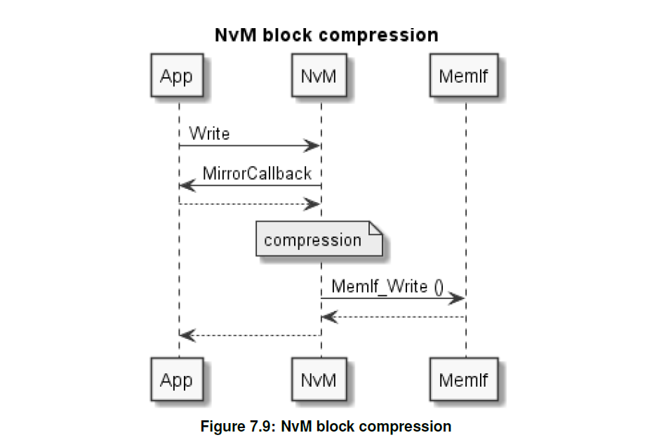

如果**NvMBlockUseCompression**设置为**true**，**NvM**需压缩**NV内存**中存储的数据。

##### 6.2.2.24. 块加密

出于安全目的，**NvM**支持使用16字节对齐对称算法，通过**CSM**模块进行同步的数据加密和解密。算法如：**AES128**。

用户始终使用纯数据，**NVRAM**中存储加密数据：

* 写入数据：NvM加密明文用户数据，然后将加密数据存储到设备。
* 读取数据：NvM从设备读取加密数据，解密数据，最后将明文数据提供给用户。

为了检查加密数据的完整性，可以像平时一样配置**CRC**。然后，**NvM**将计算加密数据的**CRC**，并在解密之前重新计算和检查**CRC**，**CRC**需始终与加密数据相匹配。

如果给出了 NvMBlockCipheringRef，NvM 应在将写入请求转发到 MemIf 之前，使用 Csm_Encrypt() 和 NvMCsmEncryptionJobReference 中给出的 CSM 作业对纯数据进行加密。

CRC的计算（如果配置）需在加密数据上完成。

###### 6.2.2.24.1. 块加密

如果**Csm_Encrypt**返回**CRYPTO_E_BUSY**，**NvM**需重试加解密作业。在**NvMCsmRetryCounter**次重试失败后，**NvM**需中止写入作业，并将**NvM**结果设置为**NVM_REQ_NOT_OK**，并通过[**NvM_JobErrorNotification**](#73362-nvm_joberrornotification)发出错误信号。

如果**Csm_Encrypt**返回除了**CRYPTO_E_BUSY**或者**CRYPTO_E_OK**之外的任何其他错误，**NvM**需立即中止写入作业，并将**NvM**结果设置为**NVM_REQ_NOT_OK**，并通过[**NvM_JobErrorNotification**](#73362-nvm_joberrornotification)发出错误信号。

如果**Csm_Encrypt**成功操作，并返回**CRYPTO_E_OK** ，**NvM**需使用**NvMNvBlockNVRAMDataLength**中给定的新长度继续写入作业。例如：进行**CRC**计算。

如果**resultLengthPtr**中返回的长度与**NvMNvBlockNVRAMDataLength**不同，则应触发开发错误[**NVM_E_BLOCK_CHIPHER_LENGTH_MISSMATCH**](#631-开发错误)。

###### 6.2.2.24.2. 块解密

如果给出了**NvMBlockCipheringRef**，**NvM**需在将读取请求转发给应用程序之前，通过**NvMCsmDecryptionJobReference**中给出的**CSM**作业，使用**Csm_Decrypt**来解密存储的数据。**CRC**检查（如果配置）需针对加密数据进行。如果**CRC**不匹配，**NvM**将不会解密数据，而是以**NVM_REQ_INTEGRITY_FAILED**中止作业。

如果**Csm_Decrypt**返回**CRYPTO_E_BUSY**，**NvM**需重试解密作业。在**NvMCsmRetryCounter**次重试失败后，**NvM**需中止读取作业，并将**NvM**结果设置为**NVM_REQ_NOT_OK**，并通过 [**NvM_JobErrorNotification**](#73362-nvm_joberrornotification)发出错误信号。

如果**Csm_Decrypt**返回除了**CRYPTO_E_BUSY**或者**CRYPTO_E_OK**之外的任何其他错误，**NvM**需立即中止读取作业，并将**NvM**结果设置为**NVM_REQ_NOT_OK**，并通过[**NvM_JobErrorNotification**](#73362-nvm_joberrornotification)发出错误信号。

如果**Csm_Decrypt**成功操作，并返回**CRYPTO_E_OK** ，**NvM**需使用**NvMNvBlockLength**中给定的新长度继续读取作业。

如果**resultLengthPtr**中返回的长度与**NvMNvBlockLength**不同，则应触发开发错误[**NVM_E_BLOCK_CHIPHER_LENGTH_MISSMATCH**](#631-开发错误)。

### 6.3. 错误分类

#### 6.3.1. 开发错误

NvM 模块的开发错误定义：

| 错误类型 | 相关错误代码 | 错误值 |
|---|---|---|
| 使用错误的块 ID 参数调用 API | NVM_E_PARAM_BLOCK_ID | 0x0A |
| 使用错误的块数据参数调用 API | NVM_E_PARAM_BLOCK_DATA_IDX | 0x0C |
| 使用错误的地址参数调用 API | NVM_E_PARAM_ADDRESS | 0x0D |
| 使用错误的数据参数调用 API | NVM_E_PARAM_DATA | 0x0E |
| 使用错误的指针参数调用 API | NVM_E_PARAM_POINTER | 0x0F |
| 当对没有默认数据且未配置 [NvMInitBlockCallback](#924-nvminitblockcallback) 的有效块 ID 调用 NvM_RestoreBlockDeafults 或 [NvM_RestorePRAMBlockDefaults](#7328-nvm_restorepramblockdefaults) 时，对无默认数据的块调用了 API | NVM_E_BLOCK_WITHOUT_DEFAULTS | 0x11 |
| 在 NVRAM 管理器尚未初始化时调用 API | NVM_E_UNINIT | 0x14 |
| 对已列入队列或正在处理中的块调用读/写/控制 API | NVM_E_BLOCK_PENDING | 0x15 |
| 服务对于此块配置不可行 | NVM_E_BLOCK_CONFIG | 0x18 |
| 对于配置了 MVM_WRITE_BLOCK_ONCE (TRUE) 的块，在该块的第一个读取请求之前调用了写/擦除/无效 API | NVM_E_WRITE_ONCE_STATUS_UNKNOWN | 0x1A |
| 加密或解密得到的长度与配置中给定的长度不匹配 | NVM_E_BLOCK_CHIPHER_LENGTH_MISSMATCH | 0x1B |

当对具有写保护（写保护可以是配置的，也可以是通过显式请求设置的）的 **NVRAM** 块进行写尝试时，**NvM** 模块应能检测到开发错误 **NVM_E_WRITE_PROTECTED** (0x1B)。

如果为 **NvM** 模块启用了开发错误检测，当 **NVM** 尚未初始化时，函数 [**NvM_SetDataIndex**](#7312-nvm_setdataindex) 需报告 **DET** 错误 **NVM_E_UNINIT**。

如果为 **NvM** 模块启用了开发错误检测，当 **NVRAM** 块标识符已列入队列或正在处理中时，函数 [**NvM_SetDataIndex**](#7312-nvm_setdataindex) 需报告 **DET** 错误 **NVM_E_BLOCK_PENDING**。

如果为 **NvM** 模块启用了开发错误检测，当 **DataIndex** 参数超过已配置数据集的总数时，函数 [**NvM_SetDataIndex**](#7312-nvm_setdataindex) 需报告 **DET** 错误 **NVM_E_PARAM_BLOCK_DATA_IDX**。

如果为 **NvM** 模块启用了开发错误检测，当传入的 **BlockID** 超出范围时，函数 [**NvM_SetDataIndex**](#7312-nvm_setdataindex) 需报告 **DET** 错误 **NVM_E_PARAM_BLOCK_ID**。

如果为 **NvM** 模块启用了开发错误检测，当 **NVM** 尚未初始化时，函数 [**NvM_GetDataIndex**](#7313-nvm_getdataindex) 需报告 **DET** 错误 **NVM_E_UNINIT**。

如果为 **NvM** 模块启用了开发错误检测，当传入的 **BlockID** 超出范围时，函数 [**NvM_GetDataIndex**](#7313-nvm_getdataindex) 需报告 **DET** 错误 **NVM_E_PARAM_BLOCK_ID**。

如果为 **NvM** 模块启用了开发错误检测，当通过参数 **DataIndexPtr** 传入 **NULL** 指针时，函数 [**NvM_GetDataIndex**](#7313-nvm_getdataindex) 需报告 **DET** 错误 **NVM_E_PARAM_DATA**。

如果为 **NvM** 模块启用了开发错误检测，当 **NVM** 尚未初始化时，函数 [**NvM_SetBlockProtection**](#7314-nvm_setblockprotection) 需报告 **DET** 错误 **NVM_E_UNINIT**。

如果为 **NvM** 模块启用了开发错误检测，当 **NVRAM** 块标识符已列入队列或正在处理中时，函数 [**NvM_SetBlockProtection**](#7314-nvm_setblockprotection) 需报告 **DET** 错误 **NVM_E_BLOCK_PENDING**。

如果为 **NvM** 模块启用了开发错误检测，当 **NVRAM** 块配置为 **NvMWriteBlockOnce = TRUE** 时，函数 [**NvM_SetBlockProtection**](#7314-nvm_setblockprotection) 需报告 **DET** 错误 **NVM_E_BLOCK_CONFIG**。

如果为 **NvM** 模块启用了开发错误检测，当传入的 **BlockID** 超出范围时，函数 [**NvM_SetBlockProtection**](#7314-nvm_setblockprotection) 需报告 **DET** 错误 **NVM_E_PARAM_BLOCK_ID**。

如果为 **NvM** 模块启用了开发错误检测，当 **NVM** 尚未初始化时，函数 [**NvM_GetErrorStatus**](#7315-nvm_geterrorstatus) 需报告 **DET** 错误 **NVM_E_UNINIT**。

如果为 **NvM** 模块启用了开发错误检测，当传入的 **BlockID** 超出范围时，函数 [**NvM_GetErrorStatus**](#7315-nvm_geterrorstatus) 需报告 **DET** 错误 **NVM_E_PARAM_BLOCK_ID**。

如果为 **NvM** 模块启用了开发错误检测，当通过参数 **RequestResultPtr** 传入 **NULL** 指针时，函数 [**NvM_GetErrorStatus**](#7315-nvm_geterrorstatus) 需报告 **DET** 错误 **NVM_E_PARAM_DATA**。

如果为 **NvM** 模块启用了开发错误检测，当通过参数 **versioninfo** 传入 **NULL** 指针时，函数 [**NvM_GetVersionInfo**](#7316-nvm_getversioninfo) 需报告 **DET** 错误 **NVM_E_PARAM_POINTER**。

如果为 **NvM** 模块启用了开发错误检测，当 **NVM** 尚未初始化时，函数 [**NvM_ReadBlock**](#7321-nvm_readblock) 需报告 **DET** 错误 **NVM_E_UNINIT**。

如果为 **NvM** 模块启用了开发错误检测，当 **NVRAM** 块标识符已列入队列或正在处理中时，函数 [**NvM_ReadBlock**](#7321-nvm_readblock) 需报告 **DET** 错误 **NVM_E_BLOCK_PENDING**。

如果为 **NvM** 模块启用了开发错误检测，当未配置永久 **RAM** 块且未配置显式同步，并且通过参数 **NvM_DstPtr** 传入 **NULL** 指针时，函数 [**NvM_ReadBlock**](#7321-nvm_readblock) 需报告 **DET** 错误 **NVM_E_PARAM_ADDRESS**。

如果为 **NvM** 模块启用了开发错误检测，当传入的 **BlockID** 超出范围时，函数 [**NvM_ReadBlock**](#7321-nvm_readblock) 需报告 **DET** 错误 **NVM_E_PARAM_BLOCK_ID**。

如果为 **NvM** 模块启用了开发错误检测，当 **NVM** 尚未初始化时，函数 [**NvM_ReadPRAMBlock**](#7326-nvm_readpramblock) 需报告 **DET** 错误 **NVM_E_UNINIT**。

如果为 **NvM** 模块启用了开发错误检测，当 **NVRAM** 块标识符已列入队列或正在处理中时，函数 [**NvM_ReadPRAMBlock**](#7326-nvm_readpramblock) 需报告 **DET** 错误 **NVM_E_BLOCK_PENDING**。

如果为 **NvM** 模块启用了开发错误检测，当针对接收到的块 ID 既未配置永久 **RAM** 块也未配置显式同步时，函数 [**NvM_ReadPRAMBlock**](#7326-nvm_readpramblock) 需报告 **DET** 错误 **NVM_E_PARAM_ADDRESS**。

如果为 **NvM** 模块启用了开发错误检测，当传入的 **BlockID** 超出范围时，函数 [**NvM_ReadPRAMBlock**](#7326-nvm_readpramblock) 需报告 **DET** 错误 **NVM_E_PARAM_BLOCK_ID**。

如果为 **NvM** 模块启用了开发错误检测，当 **NVM** 尚未初始化时，函数 [**NvM_WriteBlock**](#7322-nvm_writeblock) 需报告 **DET** 错误 **NVM_E_UNINIT**。

如果为 **NvM** 模块启用了开发错误检测，当 **NVRAM** 块标识符已列入队列或正在处理中时，函数 [**NvM_WriteBlock**](#7322-nvm_writeblock) 需报告 **DET** 错误 **NVM_E_BLOCK_PENDING**。

如果为 **NvM** 模块启用了开发错误检测，当未配置永久 **RAM** 块且未配置显式同步，并且通过参数 **NvM_SrcPtr** 传入 **NULL** 指针时，函数 [**NvM_WriteBlock**](#7322-nvm_writeblock) 需报告 **DET** 错误 **NVM_E_PARAM_ADDRESS**。

如果为 **NvM** 模块启用了开发错误检测，当传入的 **BlockID** 超出范围时，函数 [**NvM_WriteBlock**](#7322-nvm_writeblock) 需报告 **DET** 错误 **NVM_E_PARAM_BLOCK_ID**。

如果为 **NvM** 模块启用了开发错误检测，当 **NVM** 尚未初始化时，函数 [**NvM_WritePRAMBlock**](#7327-nvm_writepramblock) 需报告 **DET** 错误 **NVM_E_UNINIT**。

如果为 **NvM** 模块启用了开发错误检测，当 **NVRAM** 块标识符已列入队列或正在处理中时，函数 [**NvM_WritePRAMBlock**](#7327-nvm_writepramblock) 需报告 **DET** 错误 **NVM_E_BLOCK_PENDING**。

如果为 **NvM** 模块启用了开发错误检测，当未配置永久 **RAM** 块且未配置显式同步时，函数 [**NvM_WritePRAMBlock**](#7327-nvm_writepramblock) 需报告 **DET** 错误 **NVM_E_PARAM_ADDRESS**。

如果为 **NvM** 模块启用了开发错误检测，当传入的 **BlockID** 超出范围时，函数 [**NvM_WritePRAMBlock**](#7327-nvm_writepramblock) 需报告 **DET** 错误 **NVM_E_PARAM_BLOCK_ID**。

如果为 **NvM** 模块启用了开发错误检测，当 **NVM** 尚未初始化时，函数 [**NvM_RestoreBlockDefaults**](#7323-nvm_restoreblockdefaults) 需报告 **DET** 错误 **NVM_E_UNINIT**。

如果为 **NvM** 模块启用了开发错误检测，当 **NVRAM** 块标识符已列入队列或正在处理中时，函数 [**NvM_RestoreBlockDefaults**](#7323-nvm_restoreblockdefaults) 需报告 **DET** 错误 **NVM_E_BLOCK_PENDING**。

如果为 **NvM** 模块启用了开发错误检测，当未配置永久 **RAM** 块且未配置显式同步时，函数 [**NvM_RestorePRAMBlockDefaults**](#7328-nvm_restorepramblockdefaults) 需报告 **DET** 错误 **NVM_E_PARAM_ADDRESS**。

如果为 **NvM** 模块启用了开发错误检测，当未配置永久 **RAM** 块且未配置显式同步，并且通过参数 **NvM_DstPtr** 传入 **NULL** 指针时，函数 [**NvM_RestoreBlockDefaults**](#7323-nvm_restoreblockdefaults) 需报告 **DET** 错误 **NVM_E_PARAM_ADDRESS**。

如果为 **NvM** 模块启用了开发错误检测，当传入的 **BlockID** 超出范围时，函数 [**NvM_RestoreBlockDefaults**](#7323-nvm_restoreblockdefaults) 需报告 **DET** 错误 **NVM_E_PARAM_BLOCK_ID**。

如果为 **NvM** 模块启用了开发错误检测，当 **NVM** 尚未初始化时，函数 [**NvM_RestorePRAMBlockDefaults**](#7328-nvm_restorepramblockdefaults) 需报告 **DET** 错误 **NVM_E_UNINIT**。

如果为 **NvM** 模块启用了开发错误检测，当 **NVRAM** 块标识符已列入队列或正在处理中时，函数 [**NvM_RestorePRAMBlockDefaults**](#7328-nvm_restorepramblockdefaults) 需报告 **DET** 错误 **NVM_E_BLOCK_PENDING**。

如果为 **NvM** 模块启用了开发错误检测，当传入的 **BlockID** 超出范围时，函数 [**NvM_RestorePRAMBlockDefaults**](#7328-nvm_restorepramblockdefaults) 需报告 **DET** 错误 **NVM_E_PARAM_BLOCK_ID**。

如果为 **NvM** 模块启用了开发错误检测，当 **NVM** 尚未初始化时，函数 [**NvM_EraseNvBlock**](#7324-nvm_erasenvblock) 需报告 **DET** 错误 **NVM_E_UNINIT**。

如果为 **NvM** 模块启用了开发错误检测，当 **NVRAM** 块标识符已列入队列或正在处理中时，函数 [**NvM_EraseNvBlock**](#7324-nvm_erasenvblock) 需报告 **DET** 错误 **NVM_E_BLOCK_PENDING**。

如果为 **NvM** 模块启用了开发错误检测，当传入的 **BlockID** 超出范围时，函数 [**NvM_EraseNvBlock**](#7324-nvm_erasenvblock) 需报告 **DET** 错误 **NVM_E_PARAM_BLOCK_ID**。

如果为 **NvM** 模块启用了开发错误检测，当 **NVRAM** 块不具有立即优先级时，函数 [**NvM_EraseNvBlock**](#7324-nvm_erasenvblock) 需报告 **DET** 错误 **NVM_E_BLOCK_CONFIG**。

如果为 **NvM** 模块启用了开发错误检测，当 **NVM** 尚未初始化时，函数 [**NvM_CancelWriteAll**](#7333-nvm_cancelwriteall) 需报告 **DET** 错误 **NVM_E_UNINIT**。

如果为 **NvM** 模块启用了开发错误检测，当 **NVM** 尚未初始化时，函数 [**NvM_InvalidateNvBlock**](#7325-nvm_invalidatenvblock) 需报告 **DET** 错误 **NVM_E_UNINIT**。

如果为 **NvM** 模块启用了开发错误检测，当 **NVRAM** 块标识符已列入队列或正在处理中时，函数 [**NvM_InvalidateNvBlock**](#7325-nvm_invalidatenvblock) 需报告 **DET** 错误 **NVM_E_BLOCK_PENDING**。

如果为 **NvM** 模块启用了开发错误检测，当传入的 **BlockID** 超出范围时，函数 [**NvM_InvalidateNvBlock**](#7325-nvm_invalidatenvblock) 需报告 **DET** 错误 **NVM_E_PARAM_BLOCK_ID**。

如果为 **NvM** 模块启用了开发错误检测，当 **NVM** 尚未初始化时，函数 [**NvM_SetRamBlockStatus**](#7317-nvm_setramblockstatus) 需报告 **DET** 错误 **NVM_E_UNINIT**。

如果为 **NvM** 模块启用了开发错误检测，当 **NVRAM** 块标识符已列入队列或正在处理中时，函数 [**NvM_SetRamBlockStatus**](#7317-nvm_setramblockstatus) 需报告 **DET** 错误 **NVM_E_BLOCK_PENDING**。

如果为 **NvM** 模块启用了开发错误检测，当传入的 **BlockID** 超出范围时，函数 [**NvM_SetRamBlockStatus**](#7317-nvm_setramblockstatus) 需报告 **DET** 错误 **NVM_E_PARAM_BLOCK_ID**。

如果为 **NvM** 模块启用了开发错误检测，当 **NVM** 尚未初始化时，函数 [**NvM_ReadAll**](#7331-nvm_readall) 需报告 **DET** 错误 **NVM_E_UNINIT**。

如果为 **NvM** 模块启用了开发错误检测，当 **NVM** 尚未初始化时，函数 [**NvM_WriteAll**](#7332-nvm_writeall) 需报告 **DET** 错误 **NVM_E_UNINIT**。

如果为 **NvM** 模块启用了开发错误检测，当 **NVM** 尚未初始化时，函数 [**NvM_CancelJobs**](#7318-nvm_canceljobs) 需报告 **DET** 错误 **NVM_E_UNINIT**。

如果为 **NvM** 模块启用了开发错误检测，当传入的 **BlockID** 超出范围时，函数 [**NvM_CancelJobs**](#7318-nvm_canceljobs) 需报告 **DET** 错误 **NVM_E_PARAM_BLOCK_ID**。

如果为 **NvM** 模块启用了开发错误检测，当 **NVM** 尚未初始化时，函数 [**NvM_ValidateAll**](#7334-nvm_validateall) 需报告 **DET** 错误 **NVM_E_UNINIT**。

如果为 **NvM** 模块启用了开发错误检测，当对配置为 **NVM_WRITE_BLOCK_ONCE** (TRUE) 的块发出写请求，且在此之前未对该块发出过读取请求时，函数 [**NvM_WriteBlock**](#7322-nvm_writeblock) 需报告 **DET** 错误 **NVM_E_WRITE_ONCE_STATUS_UNKNOWN**。

如果为 **NvM** 模块启用了开发错误检测，当对配置为 **NVM_WRITE_BLOCK_ONCE** (TRUE) 的块发出写请求，且在此之前未对该块发出过读取请求时，函数 [**NvM_WritePRAMBlock**](#7327-nvm_writepramblock) 需报告 **DET** 错误 **NVM_E_WRITE_ONCE_STATUS_UNKNOWN**。

如果为 **NvM** 模块启用了开发错误检测，当处理配置为 **NVM_WRITE_BLOCK_ONCE** (TRUE) 的块，且在此之前未对该块发出过读取请求时，函数 [**NvM_WriteAll**](#7332-nvm_writeall) 的作业需报告 **DET** 错误 **NVM_E_WRITE_ONCE_STATUS_UNKNOWN**。

如果为 **NvM** 模块启用了开发错误检测，当对配置为 **NVM_WRITE_BLOCK_ONCE** (TRUE) 的块发出写请求，且在此之前未对该块发出过读取请求时，函数 [**NvM_EraseNvBlock**](#7324-nvm_erasenvblock) 的作业需报告 **DET** 错误 **NVM_E_WRITE_ONCE_STATUS_UNKNOWN**。

如果为 **NvM** 模块启用了开发错误检测，当对配置为 **NVM_WRITE_BLOCK_ONCE** (TRUE) 的块发出写请求，且在此之前未对该块发出过读取请求时，函数 [**NvM_InvalidateNvBlock**](#7325-nvm_invalidatenvblock) 的作业需报告 **DET** 错误 **NVM_E_WRITE_ONCE_STATUS_UNKNOWN**。

如果为 **NvM** 模块启用了开发错误检测，当块处于写保护状态时，函数 [**NvM_WriteBlock**](#7322-nvm_writeblock) 需报告 **DET** 错误 **NVM_E_WRITE_PROTECTED**。

如果为 **NvM** 模块启用了开发错误检测，当块处于写保护状态时，函数 [**NvM_WritePRAMBlock**](#7327-nvm_writepramblock) 需报告 **DET** 错误 **NVM_E_WRITE_PROTECTED**。

如果为 **NvM** 模块启用了开发错误检测，当块处于写保护状态时，函数 [**NvM_EraseNvBlock**](#7324-nvm_erasenvblock) 需报告 **DET** 错误 **NVM_E_WRITE_PROTECTED**。

如果为 **NvM** 模块启用了开发错误检测，当块处于写保护状态时，函数 [**NvM_InvalidateNvBlock**](#7325-nvm_invalidatenvblock) 需报告 **DET** 错误 **NVM_E_WRITE_PROTECTED**。

#### 6.3.2. 运行时错误

NvM 模块的运行时错误定义：

| 错误类型 | 相关错误代码 | 错误值 |
|---|---|---|
| NvM 队列已满，无法将请求加入队列，无论该请求是标准请求还是立即请求 | NVM_E_QUEUE_FULL | 0xA0 |

每当因相关队列已满而无法将请求加入队列时，**NvM** 模块需向 **Det** 报告运行时错误 **NVM_E_QUEUE_FULL**。

#### 6.3.3. 瞬时故障

没有瞬时故障。

#### 6.3.4. 生产错误

##### 6.3.4.1. NVM_E_HARDWARE

| 属性 | 描述 |
|---|---|
| 错误名称 | [NVM_E_HARDWARE](#634-生产错误) |
| 简要描述 | 读取或写入非易失性存储器失败 |
| 详细描述 | 如果读取作业（多作业或单作业读取）失败，原因是 **MemIf** 报告 **MEMIF_JOB_FAILED**、**MEMIF_BLOCK_INCONSISTENT** 或发生 **CRC** 不匹配；或者写/无效/擦除作业失败，原因是 **MemIf** 报告 **MEMIF_JOB_FAILED**，则 **NvM** 需向 **DEM** 报告 [**NVM_E_HARDWARE**](#634-生产错误)。 |
| 检测条件：失败 | **MemIf** 在读/写/无效/擦除操作期间报告 **MEMIF_JOB_FAILED**、**MEMIF_BLOCK_INCONSISTENT** 或发生 **CRC** 不匹配。 |
| 检测条件：通过 | 读/写/无效/擦除成功。（**MemIf** 未报告 **MEMIF_JOB_FAILED**、**MEMIF_BLOCK_INCONSISTENT**，且未发生 **CRC** 不匹配） |
| 辅助参数 | 检测失败和/或通过的条件处于活动状态的条件：每当为该块请求读/写/无效/擦除时，**NvM** 应报告该块的状态是否发生变化。 |
| 所需时间 | 不适用。（**NvM** 中没有超时监控） |
| 监控频率 | 连续 |

#### 6.3.5. 扩展生产错误

| 错误类型 | 相关错误代码 | 值 [hex] |
|---|---|---|
| 读服务的处理检测到不一致 | NVM_E_INTEGRITY_FAILED | 由 DEM 分配 |
| 服务的处理失败 | NVM_E_REQ_FAILED | 由 DEM 分配 |
| 读取期间的静态块 ID 检查失败 | NVM_E_WRONG_BLOCK_ID | 由 DEM 分配 |
| 写入验证失败 | NVM_E_VERIFY_FAILED | 由 DEM 分配 |
| 冗余类型的块发生冗余丢失 | NVM_E_LOSS_OF_REDUNDANCY | 由 DEM 分配 |

扩展生产错误 **NVM_E_INTEGRITY_FAILED**（值由 **DEM** 分配，参见容器 [**NvmDemEventParameterRefs**](#929-nvmdemeventparameterrefs)）应当可被 **NvM** 模块检测到：当 **API** 请求完整性失败时，具体取决于构建版本模式是否处于生产模式。

扩展生产错误 **NVM_E_REQ_FAILED**（值由 **DEM** 分配，参见容器 [**NvmDemEventParameterRefs**](#929-nvmdemeventparameterrefs)）应当可被 **NvM** 模块检测到：当 **API** 请求失败时，具体取决于构建版本模式是否处于生产模式。

扩展生产错误 **NVM_E_WRONG_BLOCK_ID**（值由 **DEM** 分配，参见容器 [**NvmDemEventParameterRefs**](#929-nvmdemeventparameterrefs)）应当可被 **NvM** 模块检测到：当静态块 ID 检查失败时，具体取决于构建版本模式是否处于生产模式。

扩展生产错误 **NVM_E_VERIFY_FAILED**（值由 **DEM** 分配，参见容器 [**NvmDemEventParameterRefs**](#929-nvmdemeventparameterrefs)）应当可被 **NvM** 模块检测到：当写入验证失败时，具体取决于构建版本模式是否处于生产模式。

扩展生产错误 **NVM_E_LOSS_OF_REDUNDANCY**（值由 **DEM** 分配，参见容器 [**NvmDemEventParameterRefs**](#929-nvmdemeventparameterrefs)）应当可被 **NvM** 模块检测到：当发生冗余丢失时，具体取决于构建版本模式是否处于生产模式。

每次向 **NvM** 发出请求时，该请求的作业如遇错误情况，需报告相应的生产错误。

##### 6.3.5.1. NVM_E_INTEGRITY_FAILED

| 属性 | 描述 |
|---|---|
| 错误名称 | [NVM_E_INTEGRITY_FAILED](#635-扩展生产错误) |
| 简要描述 | 读服务的处理检测到不一致。 |
| 详细描述 | 如果对某个块的读取在读取成功完成（来自底层存储模块的作业结束通知）后执行的 **CRC** 检查中检测到数据和/或 **CRC** 已损坏，则表明不一致。这仅适用于配置了 **CRC** 的块。 |
| 检测条件：失败 | 见下文的失败条件。 |
| 检测条件：通过 | 见下文的通过条件。 |
| 辅助参数 | 检测失败或通过的条件处于活动状态的条件：每次底层存储模块成功读取配置了 **CRC** 的块时都会执行 **CRC** 检查，并指示失败或通过。 |
| 所需时间 | 不适用。**NvM** 没有超时监控或约束。 |
| 监控频率 | 连续 |

失败条件：如果 **NvM** 模块在处理读取请求时，通过 **CRC** 检查检测到被读取操作的块的数据和/或 **CRC** 已损坏，则 **NvM** 模块需报告 [**NVM_E_INTEGRITY_FAILED**](#635-扩展生产错误)。

通过条件：当上述失败条件不适用时，即按照 **CRC** 检查，块的数据未损坏。

##### 6.3.5.2. NVM_E_REQ_FAILED

| 属性 | 描述 |
|---|---|
| 错误名称 | [NVM_E_REQ_FAILED](#635-扩展生产错误) |
| 简要描述 | 读服务的处理在 **MemStack** 架构的较低层失败，包括所有重试。 |
| 详细描述 | 如果底层报告 **JobErrorNotification**，表明请求失败——无论是在底层存储模块接受请求之后处理失败，还是因为模块拒绝了请求。这是在所有重试也失败之后进行的。 |
| 检测条件：失败 | 见下文的失败条件。 |
| 检测条件：通过 | 见下文的通过条件。 |
| 辅助参数 | 检测失败或通过的条件处于活动状态的条件：检查作业是否被接受，如果被接受，则检查其处理是否成功。 |
| 所需时间 | 不适用。**NvM** 没有超时监控或约束。 |
| 监控频率 | 连续 |

失败条件：如果用户请求被拒绝且配置的重试次数已用尽，或者用户请求被接受后在底层存储栈模块处理期间失败，则 **NvM** 模块需报告 [**NVM_E_REQ_FAILED**](#635-扩展生产错误)。

通过条件：当上述失败条件不适用时，即用户请求从第一次尝试或某次重试中被底层接受，并且从底层的角度来看成功完成（请求结果为 **MEMIF_JOB_OK**）。

##### 6.3.5.3. NVM_E_WRONG_BLOCK_ID

| 属性 | 描述 |
|---|---|
| 错误名称 | [NVM_E_WRONG_BLOCK_ID](#635-扩展生产错误) |
| 简要描述 | 读取期间的静态块 ID 检查指示失败。 |
| 详细描述 | 如果底层存储模块成功完成了读取，但静态 ID 检查失败（即读取到的块 ID 与请求读取的块 ID 不同）。 |
| 检测条件：失败 | 见下文的失败条件。 |
| 检测条件：通过 | 见下文的通过条件。 |
| 辅助参数 | 检测失败或通过的条件处于活动状态的条件：如果块配置为具有静态 ID，则每次底层存储模块成功完成块的读取时都会执行检查。 |
| 所需时间 | 不适用。**NvM** 没有超时监控或约束。 |
| 监控频率 | 连续 |

失败条件：如果在从非易失性存储器成功读取块数据之后，检索到的静态 ID 与请求读取的块的当前静态 ID 不同，则 **NvM** 模块需报告 [**NVM_E_WRONG_BLOCK_ID**](#635-扩展生产错误)。

通过条件：当上述失败条件不适用时，即从非易失性存储器读取的块 ID 与请求读取的块 ID 相同。

##### 6.3.5.4. NVM_E_VERIFY_FAILED

| 属性 | 描述 |
|---|---|
| 错误名称 | [NVM_E_VERIFY_FAILED](#635-扩展生产错误) |
| 简要描述 | 写入验证失败。 |
| 详细描述 | 如果在成功完成写入之后，对写入数据的验证失败。 |
| 检测条件：失败 | 见下文的失败条件。 |
| 检测条件：通过 | 见下文的通过条件。 |
| 辅助参数 | 检测失败或通过的条件处于活动状态的条件：每次配置了写入验证的块成功完成写操作时，都会执行检查。 |
| 所需时间 | 不适用。**NvM** 没有超时监控或约束。 |
| 监控频率 | 连续 |

失败条件：如果在成功写入之后，写入验证指示失败且配置的重试次数已用尽，则 **NvM** 模块需报告 [**NVM_E_VERIFY_FAILED**](#635-扩展生产错误)。

通过条件：当上述失败条件不适用时，即写入验证指示成功，最迟在最后一次重试尝试时。

##### 6.3.5.5. NVM_E_LOSS_OF_REDUNDANCY

| 属性 | 描述 |
|---|---|
| 错误名称 | [NVM_E_LOSS_OF_REDUNDANCY](#635-扩展生产错误) |
| 简要描述 | 冗余块丢失了冗余。 |
| 详细描述 | 冗余块在两个不同的块实例中写入了相同的内容——因此具有冗余。如果内容不同，或者第一个实例损坏，或者无法读取第一个实例，则 **NvM** 将报告此故障。 |
| 检测条件：失败 | 见下文的失败条件。 |
| 检测条件：通过 | 见下文的通过条件。 |
| 辅助参数 | 检测失败或通过的条件处于活动状态的条件：每当请求读取冗余块时都会执行检查。 |
| 所需时间 | 不适用。**NvM** 没有超时监控或约束。 |
| 监控频率 | 连续 |

失败条件：如果对 **REDUNDANT** 块执行的读取表明该块已丢失冗余，则 **NvM** 模块需报告 [**NVM_E_LOSS_OF_REDUNDANCY**](#635-扩展生产错误)。

注意：当块的第一个实例的读取失败且块的第二个实例的读取成功完成时，检测到冗余丢失。

通过条件：当上述失败条件不适用时，即 **NvM** 未检测到 **REDUNDANT** 块的冗余丢失。

## 7. API规范

### 7.1. 导入的类型

本章列出了从以下模块中包含的所有类型：

| 模块 | 头文件 | 导入的类型 |
|------|--------|------------|
| Dem | Rte_Dem_Type.h | Dem_EventIdType |
|  | Rte_Dem_Type.h | Dem_EventStatusType |
| MemIf | MemIf.h | MemIf_JobResultType |
|  | MemIf.h | MemIf_StatusType |
| Std | Std_Types.h | Std_ReturnType |
|  | Std_Types.h | Std_VersionInfoType |

### 7.2. 类型定义

#### 7.2.1. NvM_ConfigType

结构类型，元素为实现特定（**implementation specific**）。**NvM** 模块的配置数据结构。可通过**NvM.h**获得。

由于该类型仅用于合规性目的（也就是说，[**NvM_Init**](#7311-nvm_init) 现在会拥有一个指向该类型的指针作为参数），因此该类型的具体实现方式由开发者自行决定，因为它对 **NvM** 模块没有任何用处。

#### 7.2.2. NvM_MultiBlockRequestType

枚举类型，取值范围：

* **NVM_READ_ALL**（0x00）：[**NvM_ReadAll**](#7331-nvm_readall) 已执行。
* **NVM_WRITE_ALL**（0x01）：[**NvM_WriteAll**](#7332-nvm_writeall) 已执行。
* **NVM_VALIDATE_ALL**（0x02）：[**NvM_ValidateAll**](#7334-nvm_validateall) 已执行。
* **NVM_FIRST_INIT_ALL**（0x03）：[**NvM_FirstInitAll**](#7335-nvm_firstinitall) 已执行。
* **NVM_CANCEL_WRITE_ALL**（0x04）：[**NvM_CancelWriteAll**](#7333-nvm_cancelwriteall) 已执行。

标识通过回调函数发出信号或向 **BswM** 报告时对多块执行的请求类型。可通过**NvM.h**获得。

### 7.3. 函数定义

#### 7.3.1. 同步请求

##### 7.3.1.1. NvM_Init

**说明**: 重置所有内部变量的服务。可通过**NvM.h**获得。本服务为同步调用，不可重入。参数 ConfigPtr（in）：指向所选配置集的指针。返回值：无。

```C
void NvM_Init ( const NvM_ConfigType* ConfigPtr )
```

配置指针 **ConfigPtr** 应始终为 **NULL_PTR** 值。

配置指针 **ConfigPtr** 目前未被使用，因此在调用 [**NvM_Init**](#7311-nvm_init) API 时应将其设置为 **NULL_PTR** 值。

函数 [**NvM_Init**](#7311-nvm_init) 应将所有内部变量（例如：队列、请求标志、状态机）重置为其初始值。它应在内部发出“初始化完成”（**INIT DONE**）信号，例如：以启用作业处理和队列管理。

函数 [**NvM_Init**](#7311-nvm_init) 不应修改永久 **RAM** 块的内容，也不应调用显式同步回调，因为这应在 [**NvM_ReadAll**](#7331-nvm_readall) 中完成。

函数 [**NvM_Init**](#7311-nvm_init) 应将所有 **NVM_BLOCK_DATASET** 类型 **NVRAM** 块的数据集索引设置为零。

函数 [**NvM_Init**](#7311-nvm_init) 不应初始化其他模块（假定底层模块已经初始化）。

函数 [**NvM_Init**](#7311-nvm_init) 受通用的已发布配置参数的影响（参见第 [9.2.2](#922-nvmcommon) 章）。

提示：根据块描述符进行的耗时的 **NVRAM** 块初始化和设置应由 [**NvM_ReadAll**](#7331-nvm_readall) 请求来完成。

##### 7.3.1.2. NvM_SetDataIndex

**说明**: 设置数据集 **NVRAM** 块（**Dataset NVRAM block**）的 **DataIndex** 的服务。可通过**NvM.h**获得。本服务为同步调用，可重入。参数 BlockId（in）：块标识符，唯一地标识一个 **NVRAM** 块描述符。**NVRAM** 块描述符包含单个 **NVRAM** 块所需的全部信息。参数 DataIndex（in）：**NV**/**ROM** 块的索引位置（关联）。返回值：**Std_ReturnType**，**E_OK** 表示索引位置设置成功；**E_NOT_OK** 表示发生错误。

```C
Std_ReturnType NvM_SetDataIndex ( NvM_BlockIdType BlockId, uint8 DataIndex )
```

函数 [**NvM_SetDataIndex**](#7312-nvm_setdataindex) 应设置用于访问某个 **NVRAM** 块（含或不含 **ROM** 块）特定数据集的索引。

函数 [**NvM_SetDataIndex**](#7312-nvm_setdataindex) 应保持相应 **RAM** 块的内容不变。

对于块管理类型不是 **NVM_BLOCK_DATASET** 的块，在生产模式下 [**NvM_SetDataIndex**](#7312-nvm_setdataindex) 应无任何效果地返回。此外，应返回 **E_NOT_OK**。

**NvM** 模块的环境在调用函数 [**NvM_SetDataIndex**](#7312-nvm_setdataindex) 之前应已初始化 **NvM** 模块。

##### 7.3.1.3. NvM_GetDataIndex

**说明**: 获取数据集 **NVRAM** 块当前设置的 **DataIndex** 的服务。可通过**NvM.h**获得。本服务为同步调用，可重入。参数 BlockId（in）：块标识符，唯一地标识一个 **NVRAM** 块描述符。**NVRAM** 块描述符包含单个 **NVRAM** 块所需的全部信息。参数 DataIndexPtr（out）：用于存储当前数据集索引（0..255）的指针。返回值：**Std_ReturnType**，**E_OK** 表示成功获取索引位置；**E_NOT_OK** 表示发生错误。

```C
Std_ReturnType NvM_GetDataIndex ( NvM_BlockIdType BlockId, uint8* DataIndexPtr )
```

函数 [**NvM_GetDataIndex**](#7313-nvm_getdataindex) 应获取数据集 **NVRAM** 块（含或不含 **ROM** 块）当前的索引（关联）。

对于块管理类型不是 **NVM_BLOCK_DATASET** 的块，[**NvM_GetDataIndex**](#7313-nvm_getdataindex) 应将 **DataIndexPtr** 所指向的索引设置为零。此外，应返回 **E_NOT_OK**。

**NvM** 模块的环境在调用函数 [**NvM_GetDataIndex**](#7313-nvm_getdataindex) 之前应已初始化 **NvM** 模块。

##### 7.3.1.4. NvM_SetBlockProtection

**说明**: 设置或重置 **NV** 块写保护的服务。可通过**NvM.h**获得。本服务为同步调用，可重入。参数 BlockId（in）：块标识符，唯一地标识一个 **NVRAM** 块描述符。**NVRAM** 块描述符包含单个 **NVRAM** 块所需的全部信息。参数 ProtectionEnabled（in）：**TRUE**：应启用写保护；**FALSE**：应禁用写保护。返回值：**Std_ReturnType**，**E_OK** 表示块已按要求启用/禁用写保护；**E_NOT_OK** 表示发生错误。

```C
Std_ReturnType NvM_SetBlockProtection ( NvM_BlockIdType BlockId, boolean ProtectionEnabled )
```

函数 [**NvM_SetBlockProtection**](#7314-nvm_setblockprotection) 应通过设置相应 **NVRAM** 块管理部分中的写保护属性，来设置/重置相应 **NV** 块的写保护。

**NvM** 模块的环境在调用函数 [**NvM_SetBlockProtection**](#7314-nvm_setblockprotection) 之前应已初始化 **NvM** 模块。

##### 7.3.1.5. NvM_GetErrorStatus

**说明**: 读取块相关的错误/状态信息的服务。可通过**NvM.h**获得。本服务为同步调用，可重入。参数 BlockId（in）：块标识符，唯一地标识一个 **NVRAM** 块描述符。**NVRAM** 块描述符包含单个 **NVRAM** 块所需的全部信息。参数 RequestResultPtr（out）：用于存储请求结果的指针。参见 [**NvM_RequestResultType**](#7721-nvm_requestresulttype)。返回值：**Std_ReturnType**，**E_OK** 表示成功读取块相关的错误/状态信息；**E_NOT_OK** 表示发生错误。

```C
Std_ReturnType NvM_GetErrorStatus ( NvM_BlockIdType BlockId, NvM_RequestResultType* RequestResultPtr )
```

函数 [**NvM_GetErrorStatus**](#7315-nvm_geterrorstatus) 应读取 **NVRAM** 块管理部分中块相关的错误/状态信息。**NVRAM** 块的状态/错误信息应由先前的或当前的异步请求来设置。

**NvM** 模块的环境在调用函数 [**NvM_GetErrorStatus**](#7315-nvm_geterrorstatus) 之前应已初始化 **NvM** 模块。

##### 7.3.1.6. NvM_GetVersionInfo

**说明**: 获取 **NvM** 模块版本信息的服务。可通过**NvM.h**获得。本服务为同步调用，可重入。参数 versioninfo（out）：用于存储本模块版本信息的指针。返回值：无。

```C
void NvM_GetVersionInfo ( Std_VersionInfoType* versioninfo )
```

##### 7.3.1.7. NvM_SetRamBlockStatus

**说明**: 设置永久 **RAM** 块的 **RAM** 块状态或 **NVRAM** 块显式同步状态的服务。可通过**NvM.h**获得。本服务为同步调用，可重入。参数 BlockId（in）：块标识符，唯一地标识一个 **NVRAM** 块描述符。**NVRAM** 块描述符包含单个 **NVRAM** 块所需的全部信息。参数 BlockChanged（in）：**TRUE**：验证永久 **RAM** 块或显式同步，并将块标记为已更改；**FALSE**：使永久 **RAM** 块或显式同步无效，并将块标记为未更改。返回值：**Std_ReturnType**，**E_OK** 表示永久 **RAM** 块或显式同步的状态已按要求更改；**E_NOT_OK** 表示发生错误。

```C
Std_ReturnType NvM_SetRamBlockStatus ( NvM_BlockIdType BlockId, boolean BlockChanged )
```

函数 **NvM_SetRamBlockStatus** 应仅对配置了永久 **RAM** 块的 **NVRAM** 块、或配置为支持显式同步且启用了 **NvMBlockUseSetRamBlockStatus** 的 **NVRAM** 块起作用，对其他 **NVRAM** 块不应有任何效果。

函数 **NvM_SetRamBlockStatus** 应假定已更改的永久 **RAM** 块或 **NvM** 模块中 **RAM** 镜像的内容（在显式同步的情况下）是有效的（基本假设）。

当传递给函数 **NvM_SetRamBlockStatus** 的 **BlockChanged** 参数为 **FALSE** 时，相应的 **RAM** 块要么无效、要么未更改（或两者兼有）。

当传递给函数 **NvM_SetRamBlockStatus** 的 **BlockChanged** 参数为 **TRUE** 时，相应的永久 **RAM** 块或 **NvM** 模块中 **RAM** 镜像的内容（在显式同步的情况下）有效且已更改。

对于配置了永久 **RAM** 的块，如果给定的 **BlockChanged** 参数为 **TRUE** 且配置了 **RAM** 中的 **CRC** 计算（即 **NvMCalcRamBlockCrc == TRUE**），则函数 **NvM_SetRamBlockStatus** 应请求在后台重新计算 **CRC**，即：**CRC** 重算应由 [**NvM_MainFunction**](#741-nvm_mainfunction) 处理。

注意：如果由函数 **NvM_SetRamBlockStatus** 的作业处理的块配置了显式同步，则块所有者应提供用于比较的相关 **RAM** 数据。**NvM** 对显式同步“写”回调的调用应成功。

提示：在某些情况下，永久 **RAM** 块既不能通过重新加载其 **NV** 数据来验证，也不能在执行 [**NvM_ReadAll**](#7331-nvm_readall) 命令（启动）期间通过加载其 **ROM** 数据来验证。应用程序负责向 **RAM** 块填入正确的数据，并在该 **RAM** 块能够被 [**NvM_WriteAll**](#7332-nvm_writeall) 写入其相应的 **NV** 块之前，通过函数 **NvM_SetRamBlockStatus** 验证该块。

对于配置了通过 **CRC** 进行 **RAM** 保护的 **NVRAM** 块，预计会频繁调用函数 **NvM_SetRamBlockStatus**。否则，该函数只需调用一次，将块标记为“已更改”并在 [**NvM_WriteAll**](#7332-nvm_writeall) 期间进行处理。

如果为没有永久 **RAM** 但配置了显式同步的块调用函数 **NvM_SetRamBlockStatus**，且 **BlockChanged** 参数为 **TRUE**，则函数 **NvM_SetRamBlockStatus** 的作业应使用用于数据存储（写）的显式同步回调来获取数据，以便计算该块的 **CRC**。

如果由函数 **NvM_SetRamBlockStatus** 的作业调用的显式同步回调返回 **E_NOT_OK**，则 **NvM** 应重试调用该回调，重试次数为为显式同步配置的次数。

如果由函数 **NvM_SetRamBlockStatus** 的作业调用的显式同步回调在首次调用及所有重试尝试中均返回 **E_NOT_OK**，则 **NvM** 将认为该作业已完成，保持该块标记为 **BlockChanged**，并如同成功完成一样继续处理。

函数 **NvM_SetRamBlockStatus** 不应更改作为参数接收的块 **ID** 的请求结果。

由函数 **NvM_SetRamBlockStatus** 执行的排队后台 **CRC** 计算不应更改所接收块 **ID** 的请求结果。

**NvM** 模块的环境在调用函数 **NvM_SetRamBlockStatus** 之前应已初始化 **NvM** 模块。

仅当通过 **NvMSetRamBlockStatusApi** 进行配置时，**NvM** 模块才应提供函数 **NvM_SetRamBlockStatus**。

注意：有关 **NvMSetRamBlockStatusApi** 的更多信息，参见第 [9.2.2](#922-nvmcommon) 章。

##### 7.3.1.8. NvM_CancelJobs

**说明**: 取消一个 **NV** 块的所有挂起作业的服务。可通过**NvM.h**获得。本服务为同步调用，可重入。参数 BlockId（in）：块标识符，唯一地标识一个 **NVRAM** 块描述符。**NVRAM** 块描述符包含单个 **NVRAM** 块所需的全部信息。返回值：**Std_ReturnType**，**E_OK** 表示作业已成功从队列中移除；**E_NOT_OK** 表示在队列中找不到该作业。

```C
Std_ReturnType NvM_CancelJobs ( NvM_BlockIdType BlockId )
```

函数 **NvM_CancelJobs** 应取消队列中指定 **NV** 块的所有挂起作业。如果请求，被取消块的请求结果类型为 **NVM_REQ_CANCELED**。

当前正在处理的作业不会被取消，即使在调用 **NvM_CancelJobs** 之后它也应继续处理。

如果请求被接受，函数 **NvM_CancelJobs** 应将指定 **NVRAM** 块的块特定请求结果设置为 **NVM_REQ_CANCELED**。

提示：其目的只是在于分区终止或重启时的清理阶段清空队列，以避免后续的作业结束通知。

函数 **NvM_CancelJobs** 应将被取消块的 **RAM** 块状态设置为 **INVALID/UNCHANGED**。

#### 7.3.2. 异步单块请求

##### 7.3.2.1. NvM_ReadBlock

**说明**: 将 **NV** 块的数据复制到其相应 **RAM** 块的服务。可通过**NvM.h**获得。本服务为异步调用，可重入。参数 BlockId（in）：块标识符，唯一地标识一个 **NVRAM** 块描述符。**NVRAM** 块描述符包含单个 **NVRAM** 块所需的全部信息。参数 NvM_DstPtr（out）：指向 **RAM** 数据块的指针。返回值：**Std_ReturnType**，**E_OK** 表示请求已被接受；**E_NOT_OK** 表示请求未被接受。

```C
Std_ReturnType NvM_ReadBlock ( NvM_BlockIdType BlockId, void* NvM_DstPtr )
```

函数 **NvM_ReadBlock** 的作业应将 **NV** 块的数据复制到相应的 **RAM** 块。

注意：如果作业成功，将设置错误/状态 **NVM_REQ_OK**。

函数 **NvM_ReadBlock** 应接收给定的参数，将读请求排入作业队列并返回。

如果为函数 **NvM_ReadBlock** 提供了有效的 **RAM** 块地址，则使用该地址。

如果为函数 **NvM_ReadBlock** 提供 **NULL_PTR** 作为 **RAM** 块地址且该块配置了永久 **RAM** 块，则使用永久 **RAM** 块。

如果为函数 **NvM_ReadBlock** 提供 **NULL_PTR** 作为 **RAM** 块地址且该块配置了显式同步，则使用显式同步。

函数 **NvM_ReadBlock** 的作业应提供将 **NV** 数据复制到临时 **RAM** 块的可能，即使该 **NVRAM** 块配置了永久 **RAM** 块或显式同步回调。在这种情况下，参数 **NvM_DstPtr** 必须不等于 **NULL** 指针。否则应发出 **DET** 参数错误（参见第 [6.3](#63-错误分类) 章）。

当块成功入队时，函数 **NvM_ReadBlock** 应立即将 **RAM** 块状态设置为 **INVALID/UNCHANGED**。

如果传递的 BlockId 引用 **NVM_BLOCK_REDUNDANT** 类型的 **NVRAM** 块，且对第一个 **NV** 块的读取尝试失败，则函数 **NvM_ReadBlock** 的作业应发起对第二个 **NV** 块的读取尝试。

在 **NVRAM** 块管理类型为 **NVM_BLOCK_DATASET** 的情况下，函数 **NvM_ReadBlock** 的作业应仅将管理块中通过数据索引所选的 **NV** 块复制到相应的 **RAM** 块。

如果 **NVRAM** 块管理类型为 **NVM_BLOCK_DATASET** 且数据集索引所选的 **NV** 块已无效，则函数 **NvM_ReadBlock** 的作业不应将 **NV** 块复制到相应的 **RAM** 块。

如果 **NVRAM** 块管理类型为 **NVM_BLOCK_DATASET** 且数据集索引所选的 **NV** 块不一致，则函数 **NvM_ReadBlock** 的作业不应将 **NV** 块复制到相应的 **RAM** 块。

如果 **NVRAM** 块管理类型为 **NVM_BLOCK_DATASET** 且数据集索引指向一个 **ROM** 块，函数 **NvM_ReadBlock** 的作业应将 **ROM** 块复制到 **RAM** 并将请求结果设置为 **NVM_REQ_OK**。

在将 **NV** 块成功复制到 **RAM** 之后，函数 **NvM_ReadBlock** 的作业应将 **RAM** 块设置为有效并假定其未更改。

如果默认值成功复制到 **RAM**，函数 **NvM_ReadBlock** 的作业应将 **RAM** 块设置为有效并假定其已更改。

如果 **NV** 块成功地从 **NV** 内存复制到 **RAM**，函数 **NvM_ReadBlock** 的作业应将请求结果设置为 **NVM_REQ_OK**。

如果 MemIf 报告 **MEMIF_BLOCK_INVALID**，函数 **NvM_ReadBlock** 的作业应将请求结果设置为 **NVM_REQ_NV_INVALIDATED**。

如果 MemIf 报告 **MEMIF_BLOCK_INVALID**，函数 **NvM_ReadBlock** 的作业不应向 **DEM** 报告错误。

函数 **NvM_ReadBlock** 的作业应在以下情况下将请求结果设置为 **NVM_REQ_INTEGRITY_FAILED**：

* MemIf 报告 **MEMIF_BLOCK_INCONSISTENT**，并且
* 未为该块配置 **NvMRomBlockDataAddress**（不存在包含默认数据的 **ROM** 块），并且
* 未为该块配置 [**NvMInitBlockCallback**](#924-nvminitblockcallback)（没有初始化回调）。

如果 MemIf 报告 **MEMIF_BLOCK_INCONSISTENT**，函数 **NvM_ReadBlock** 的作业应向 **DEM** 报告 [**NVM_E_INTEGRITY_FAILED**](#635-扩展生产错误)。

注意：在 ECU/整车生产之后，生产线上所有块都应已写入有效数据（可以是默认数据），并且所有诊断事件（错误）都应已被删除。如果生产流程不允许在生产期间写入所有 **NV** 块，那么 **NvM** 将因从未写入过、且被 MemIf 报告为 **MEMIF_BLOCK_INCONSISTENT** 的块而报告诊断事件（错误）。

函数 **NvM_ReadBlock** 的作业应在以下情况下将请求结果设置为 **NVM_REQ_NOT_OK**：

* MemIf 报告 **MEMIF_JOB_FAILED**，并且
* 未为该块配置 **NvMRomBlockDataAddress**（不存在包含默认数据的 **ROM** 块），并且
* 未为该块配置 [**NvMInitBlockCallback**](#924-nvminitblockcallback)（没有初始化回调）。

如果 MemIf 报告 **MEMIF_JOB_FAILED**，函数 **NvM_ReadBlock** 的作业应向 **DEM** 报告 [**NVM_E_REQ_FAILED**](#635-扩展生产错误)。

如果给定 **NVRAM** 块的块管理类型为 **NVM_BLOCK_REDUNDANT**，且其中一个 **NV** 块成功地从 **NV** 内存复制到 **RAM**，函数 **NvM_ReadBlock** 的作业应将请求结果设置为 **NVM_REQ_OK**。

如果给定 **NVRAM** 块的块管理类型为 **NVM_BLOCK_REDUNDANT**，且其中一个 **NV** 块成功地从 **NV** 内存复制到 **RAM**，函数 **NvM_ReadBlock** 的作业不应向 **DEM** 报告错误。

函数 **NvM_ReadBlock** 的作业应将每个配置了 **NVM_WRITE_BLOCK_ONCE**（**TRUE**）的 **NVRAM** 块标记为写保护（如果该块有效且数据一致）。该写保护不能通过 [**NvM_SetBlockProtection**](#7314-nvm_setblockprotection) 清除。

如果冗余管理类型的 **NVRAM** 块的两个 **NV** 块都已被无效，函数 **NvM_ReadBlock** 的作业应使该 **NVRAM** 块无效。

如果该 **NV** 块配置了 **CRC**（即：该 **NV** 块的 **NvMCalcRamBlockCrc == TRUE**），函数 **NvM_ReadBlock** 的作业应在复制过程之后请求对 **RAM** 块数据进行 **CRC** 重算。

函数 **NvM_ReadBlock** 的作业应在重算的 **CRC** 与存储在 **NV** 内存中的 **CRC** 不相等时，按照 [**NvM_RestoreBlockDefaults**](#7323-nvm_restoreblockdefaults) 的处理方式加载默认值（同时将请求结果设置为 **NVM_REQ_RESTORED_DEFAULTS**）。

**NvM_ReadBlock**：如果没有可用的默认值，**RAM** 块应保持无效。

函数 **NvM_ReadBlock** 的作业应在传递给底层的读请求失败（MemIf 报告 **MEMIF_JOB_FAILED** 或 **MEMIF_BLOCK_INCONSISTENT**）且存在可用默认值时，按照 [**NvM_RestoreBlockDefaults**](#7323-nvm_restoreblockdefaults) 的处理方式加载默认值（同时将请求结果设置为 **NVM_REQ_RESTORED_DEFAULTS**）。

函数 **NvM_ReadBlock** 的作业应在发生 **CRC** 不匹配时向 **DEM** 报告 [**NVM_E_INTEGRITY_FAILED**](#635-扩展生产错误)。

函数 **NvM_ReadBlock** 的作业应在以下情况下将请求结果设置为 **NVM_REQ_INTEGRITY_FAILED**：

* 发生 **CRC** 不匹配，并且
* 未为该块配置 **NvMRomBlockDataAddress**（不存在包含默认数据的 **ROM** 块），并且
* 未为该块配置 [**NvMInitBlockCallback**](#924-nvminitblockcallback)（没有初始化回调）。

**NvM** 模块的环境在调用函数 **NvM_ReadBlock** 之前应已初始化 **NvM** 模块。

##### 7.3.2.2. NvM_WriteBlock

**说明**: 将 **RAM** 块的数据复制到其相应 **NV** 块的服务。可通过**NvM.h**获得。本服务为异步调用，可重入。参数 BlockId（in）：块标识符，唯一地标识一个 **NVRAM** 块描述符。**NVRAM** 块描述符包含单个 **NVRAM** 块所需的全部信息。参数 NvM_SrcPtr（in）：指向 **RAM** 数据块的指针。返回值：**Std_ReturnType**，**E_OK** 表示请求已被接受；**E_NOT_OK** 表示请求未被接受。

```C
Std_ReturnType NvM_WriteBlock ( NvM_BlockIdType BlockId, const void* NvM_SrcPtr )
```

函数 **NvM_WriteBlock** 的作业应将 **RAM** 块的数据复制到其相应的 **NV** 块。

注意：如果作业成功，将设置错误/状态 **NVM_REQ_OK**。

函数 **NvM_WriteBlock** 应接收给定的参数，将写请求排入作业队列并返回。

函数 **NvM_WriteBlock** 应在请求入队时检查 **NVRAM** 块保护，但在请求执行之前不再检查。

如果传递的 BlockId 引用配置为立即优先级（**immediate priority**）的 **NVRAM** 块，函数 **NvM_WriteBlock** 应以破坏性的方式立即取消一个挂起的作业。该立即作业应是下一个被处理的活动作业。

如果为函数 **NvM_WriteBlock** 提供了有效的 **RAM** 块地址，则使用该地址。

如果为函数 **NvM_WriteBlock** 提供 **NULL_PTR** 作为 **RAM** 块地址且该块配置了永久 **RAM** 块，则使用永久 **RAM** 块。

如果为函数 **NvM_WriteBlock** 提供 **NULL_PTR** 作为 **RAM** 块地址且该块配置了显式同步，则使用显式同步。

函数 **NvM_WriteBlock** 的作业应提供将临时 **RAM** 块复制到 **NV** 块的可能，即使该 **NVRAM** 块配置了永久 **RAM** 块或显式同步回调。在这种情况下，参数 **NvM_SrcPtr** 必须不等于 **NULL** 指针。否则应发出 **DET** 参数错误（参见第 [6.3](#63-错误分类) 章）。

如果该 **NV** 块配置了 **CRC**，函数 **NvM_WriteBlock** 的作业应在 **RAM** 块被复制到 **NV** 内存之前请求进行 **CRC** 重算。

如果 **NVRAM** 块的 **NvMBlockUseCRCCompMechanism** 属性设置为 true，且写作业计算出的 **RAM** 块 **CRC** 等于上次成功的读作业或写作业期间计算出的 **CRC**，则函数 **NvM_WriteBlock** 的作业应跳过写入并将该作业视为成功完成。该机制不应应用于已检测到冗余丢失的块。

如果给定 **NVRAM** 块的 **NVRAM** 块管理类型为 **NVM_BLOCK_DATASET**，函数 **NvM_WriteBlock** 的作业应将 **RAM** 块复制到管理块中通过数据索引所选的相应 **NV** 块。

如果块成功入队，且 **RAM** 块状态为 **VALID/UNCHANGED** 或 **INVALID/UNCHANGED**，函数 **NvM_WriteBlock** 应将 **RAM** 块状态设置为 **VALID/CHANGED**。

注意：如果该块配置了显式同步回调（**NvM_WriteRamBlockToNvm**），则将在 **NvM_WriteRamBlockToNvm** 成功处理之后立即进行验证。

注意/提示：当请求传递给 **NvM** 模块时，函数 **NvM_WriteBlock** 的作业应假定所引用的永久 **RAM** 块或 **NvM** 模块中的 **RAM** 镜像（在显式同步的情况下）是有效的。

函数 **NvM_WriteBlock** 的作业应使用写重试计数器检查写重试次数，以避免无限循环。内存接口报告的每个否定结果都应使重试计数器递增。在重试计数器溢出的情况下，函数 **NvM_WriteBlock** 的作业应将请求结果设置为 **NVM_REQ_NOT_OK**。

函数 **NvM_WriteBlock** 的作业应使用写重试计数器检查写重试次数，以避免无限循环。内存接口报告的每个否定结果都应使重试计数器递增。在重试计数器溢出的情况下，函数 **NvM_WriteBlock** 的作业应向 **DEM** 报告 [**NVM_E_REQ_FAILED**](#635-扩展生产错误)。

当 **RAM** 块数据无法成功写入相应的 **NV** 块时，配置参数 **NVM_MAX_NUM_OF_WRITE_RETRIES** 应规定函数 **NvM_WriteBlock** 作业的最大写重试次数。

注意：有关 **NvMMaxNumOfWriteRetries** 的更多信息，参见第 [9.2.2](#922-nvmcommon) 章。

如果所处理的 **NVRAM** 块的 **NVRAM** 块管理类型为 **NVM_BLOCK_REDUNDANT**，函数 **NvM_WriteBlock** 的作业应将 **RAM** 块的数据内容复制到两个相应的 **NV** 块。

如果所处理的 **NVRAM** 块为 **NVM_BLOCK_REDUNDANT** 类型，函数 **NvM_WriteBlock** 的作业应先开始将 **RAM** 块的数据复制到在 [**NvM_ReadBlock**](#7321-nvm_readblock)、[**NvM_ReadPRAMBlock**](#7326-nvm_readpramblock) 或 [**NvM_ReadAll**](#7331-nvm_readall) 启动的作业期间未被读取的 **NV** 块，然后继续复制另一个 **NV** 块。

如果传递的 BlockId 引用 **NVM_BLOCK_REDUNDANT** 类型的 **NVRAM** 块，且至少一个 **NV** 块已成功写入，函数 **NvM_WriteBlock** 的作业应将 **NVM_REQ_OK** 设置为请求结果。

如果 **NVRAM** 块配置为 **NvMWriteBlockOnce == TRUE** 且数据已成功写入 **NV** 块，函数 **NvM_WriteBlock** 的作业应立即在管理块中设置写保护标志。

**NvM** 模块的环境在调用函数 **NvM_WriteBlock** 之前应已初始化 **NvM** 模块。

提示：为了避免冗余 **NVRAM** 块的两个不同 **NV** 块同时包含不同但有效的数据的情况，函数 **NvM_WriteBlock** 的每个调用者可以提前调用 [**NvM_InvalidateNvBlock**](#7325-nvm_invalidatenvblock)。

Block ID 为 1 的 **NvM_WriteBlock** 作业应将编译的 **NVRAM** 配置 ID 写入已存储的 **NVRAM** 配置 ID（块 1）。

提示：如果一个全新的（**pristine**）ECU 第一次被刷写，这样一次调用将确保在掉电而没有正常关机的情况下，下次启动时一切如预期。否则，新的配置 ID 将不会存储在 **NV RAM** 中，并且将使用所有 **ROM** 默认值。可以使用宏来指示这种用法。

##### 7.3.2.3. NvM_RestoreBlockDefaults

**说明**: 将默认数据恢复到其相应 **RAM** 块的服务。可通过**NvM.h**获得。本服务为异步调用，不可重入。参数 BlockId（in）：块标识符，唯一地标识一个 **NVRAM** 块描述符。**NVRAM** 块描述符包含单个 **NVRAM** 块所需的全部信息。参数 NvM_DestPtr（out）：指向 **RAM** 数据块的指针。返回值：**Std_ReturnType**，**E_OK** 表示请求已被接受；**E_NOT_OK** 表示请求未被接受。

```C
Std_ReturnType NvM_RestoreBlockDefaults ( NvM_BlockIdType BlockId, void* NvM_DestPtr )
```

函数 **NvM_RestoreBlockDefaults** 的作业应将默认数据恢复到其相应的 **RAM** 块。

注意：如果作业成功，将设置错误/状态 **NVM_REQ_OK**。

函数 **NvM_RestoreBlockDefaults** 应接收给定的参数，将请求排入作业队列并返回。

如果配置了 **ROM** 块，函数 **NvM_RestoreBlockDefaults** 的作业应从 **ROM** 块加载默认数据。

如果 **NVRAM** 块未配置 **ROM** 块、且通过参数 [**NvMInitBlockCallback**](#924-nvminitblockcallback) 配置了应用程序回调例程，**NvM** 模块的环境应调用函数 **NvM_RestoreBlockDefaults** 来获取默认数据。

如果给定 **NVRAM** 块的块管理类型为 **NVM_BLOCK_DATASET**、至少配置了一个 **ROM** 块且数据索引指向一个 **NV** 块，函数 **NvM_RestoreBlockDefaults** 应返回 **E_NOT_OK**。

如果为函数 **NvM_RestoreBlockDefaults** 提供了有效的 **RAM** 块地址，则使用该地址。

如果为函数 **NvM_RestoreBlockDefaults** 提供 **NULL_PTR** 作为 **RAM** 块地址且该块配置了永久 **RAM** 块，则使用永久 **RAM** 块。

如果为函数 **NvM_RestoreBlockDefaults** 提供 **NULL_PTR** 作为 **RAM** 块地址且该块配置了显式同步，则使用显式同步。

尽管该 **NVRAM** 块配置了永久 **RAM** 块或显式同步回调，为了将 **ROM** 数据复制到临时 **RAM** 块，**NvM** 模块的环境应通过参数 **NvM_DstPtr** 向函数 **NvM_RestoreBlockDefaults** 传递一个不等于 **NULL** 的指针。否则应发出 **DET** 参数错误（参见第 [6.3](#63-错误分类) 章）。

当块成功入队时，函数 **NvM_RestoreBlockDefaults** 应立即将 **RAM** 块状态设置为 **INVALID/UNCHANGED**。

如果所请求的 **RAM** 块是永久的、或所调用的显式同步回调（**NvMReadRamBlockFromNvCallback**）返回 **E_OK** 且默认数据到 **RAM** 的复制过程成功，函数 **NvM_RestoreBlockDefaults** 的作业应验证 **RAM** 块并假定其已更改。

如果为该 **RAM** 块配置了 **CRC**，函数 **NvM_RestoreBlockDefaults** 的作业应在复制过程/验证之后请求对该 **RAM** 块进行 **CRC** 重算。

**NvM** 模块的环境在调用函数 **NvM_RestoreBlockDefaults** 之前应已初始化 **NvM** 模块。

提示：对于块管理类型 **NVM_BLOCK_DATASET**，应用程序必须确保选择了有效的数据集索引（指向 **ROM** 数据）。

如果该块既没有 **ROM** 默认数据也没有配置 [**NvMInitBlockCallback**](#924-nvminitblockcallback)，函数 **NvM_RestoreBlockDefaults** 应保持块状态不变并返回 **E_NOT_OK** 作为结果。

如果该块没有默认数据、未配置 **InitBlockCallbackFunction** 且启用了开发错误检测，**NvM_RestoreBlockDefaults** API 应向 Det 模块报告错误 [**NVM_E_BLOCK_WITHOUT_DEFAULTS**](#631-开发错误)。

##### 7.3.2.4. NvM_EraseNvBlock

**说明**: 擦除一个 **NV** 块的服务。可通过**NvM.h**获得。本服务为异步调用，可重入。参数 BlockId（in）：块标识符，唯一地标识一个 **NVRAM** 块描述符。**NVRAM** 块描述符包含单个 **NVRAM** 块所需的全部信息。返回值：**Std_ReturnType**，**E_OK** 表示请求已被接受；**E_NOT_OK** 表示请求未被接受。

```C
Std_ReturnType NvM_EraseNvBlock ( NvM_BlockIdType BlockId )
```

函数 **NvM_EraseNvBlock** 的作业应擦除一个 **NV** 块。

注意：如果作业成功，将设置错误/状态 **NVM_REQ_OK**。

函数 **NvM_EraseNvBlock** 应接收给定的参数，将请求排队并返回。

在写保护被禁用的情况下，函数 **NvM_EraseNvBlock** 应将擦除请求排队。

函数 **NvM_EraseNvBlock** 的作业应保持 **RAM** 块的内容不变。

对于配置了 **NVM_WRITE_BLOCK_ONCE**（**TRUE**）的块，函数 **NvM_EraseNvBlock** 的作业应保持写保护不变。

如果引用了数据集 **NVRAM** 块的 **ROM** 块，函数 **NvM_EraseNvBlock** 应返回 **E_NOT_OK**。

**NvM_EraseNvBlock**：**NvM** 模块在从作业队列中取出作业之前，不应重新检查写保护。

如果所引用的 **NVRAM** 块为 **NVM_BLOCK_REDUNDANT** 类型，只有当两个 **NV** 块都已被擦除时，函数 **NvM_EraseNvBlock** 才能成功。

如果服务的处理失败，函数 **NvM_EraseNvBlock** 的作业应将请求结果设置为 **NVM_REQ_NOT_OK**。

如果服务的处理失败，函数 **NvM_EraseNvBlock** 的作业应向 **DEM** 报告 [**NVM_E_REQ_FAILED**](#635-扩展生产错误)。

当启用了开发错误检测且所引用的 **NVRAM** 块配置为标准优先级时，函数 **NvM_EraseNvBlock** 应返回 **E_NOT_OK**。

**NvM** 模块的环境在调用函数 **NvM_EraseNvBlock** 之前应已初始化 **NvM** 模块。

##### 7.3.2.5. NvM_InvalidateNvBlock

**说明**: 使一个 **NV** 块无效的服务。可通过**NvM.h**获得。本服务为异步调用，可重入。参数 BlockId（in）：块标识符，唯一地标识一个 **NVRAM** 块描述符。**NVRAM** 块描述符包含单个 **NVRAM** 块所需的全部信息。返回值：**Std_ReturnType**，**E_OK** 表示请求已被接受；**E_NOT_OK** 表示请求未被接受。

```C
Std_ReturnType NvM_InvalidateNvBlock ( NvM_BlockIdType BlockId )
```

函数 **NvM_InvalidateNvBlock** 的作业应使一个 **NV** 块无效。

注意：如果作业成功，将设置错误/状态 **NVM_REQ_OK**。

函数 **NvM_InvalidateNvBlock** 的作业应保持 **RAM** 块不变。

对于配置了 **NVM_WRITE_BLOCK_ONCE**（**TRUE**）的块，函数 **NvM_InvalidateNvBlock** 的作业应保持写保护不变。

如果相应 **NV** 块的写保护被禁用，函数 **NvM_InvalidateNvBlock** 应将该请求排队。

函数 **NvM_InvalidateNvBlock** 应接收给定的参数，将请求排队并返回。

如果 BlockId 参数引用了数据集 **NVRAM** 块的 **ROM** 块，函数 **NvM_InvalidateNvBlock** 应返回 **E_NOT_OK**。

**NvM** 模块在从作业队列中取出作业之前，不应重新检查写保护。

如果所引用的 **NVRAM** 块为 **NVM_BLOCK_REDUNDANT** 类型，只有当两个 **NV** 块都已被无效时，函数 **NvM_InvalidateNvBlock** 才应将请求结果 [**NvM_RequestResultType**](#7721-nvm_requestresulttype) 设置为 **NVM_REQ_OK**。

如果本服务的处理失败，函数 **NvM_InvalidateNvBlock** 应将请求结果设置为 **NVM_REQ_NOT_OK**。

如果本服务的处理失败，函数 **NvM_InvalidateNvBlock** 应向 **DEM** 报告 [**NVM_E_REQ_FAILED**](#635-扩展生产错误)。

**NvM** 模块的环境在调用函数 **NvM_InvalidateNvBlock** 之前应已初始化 **NvM** 模块。

##### 7.3.2.6. NvM_ReadPRAMBlock

**说明**: 将 **NV** 块的数据复制到其相应永久 **RAM** 块的服务。可通过**NvM.h**获得。本服务为异步调用，可重入。参数 BlockId（in）：块标识符，唯一地标识一个 **NVRAM** 块描述符。**NVRAM** 块描述符包含单个 **NVRAM** 块所需的全部信息。返回值：**Std_ReturnType**，**E_OK** 表示请求已被接受；**E_NOT_OK** 表示请求未被接受。

```C
Std_ReturnType NvM_ReadPRAMBlock ( NvM_BlockIdType BlockId )
```

函数 **NvM_ReadPRAMBlock** 的作业应将 **NV** 块的数据复制到永久 **RAM** 块。

注意：如果作业成功，将设置错误/状态 **NVM_REQ_OK**。

函数 **NvM_ReadPRAMBlock** 应接收给定的参数，将读请求排入作业队列并返回。

如果块成功入队，函数 **NvM_ReadPRAMBlock** 应将 **RAM** 块状态设置为 **INVALID/UNCHANGED**。

如果传递的 BlockId 引用 **NVM_BLOCK_REDUNDANT** 类型的 **NVRAM** 块，且对第一个 **NV** 块的读取尝试失败，则函数 **NvM_ReadPRAMBlock** 的作业应发起对第二个 **NV** 块的读取尝试。

在 **NVRAM** 块管理类型为 **NVM_BLOCK_DATASET** 的情况下，函数 **NvM_ReadPRAMBlock** 的作业应仅将管理块中通过数据索引所选的 **NV** 块复制到相应的 **RAM** 块。

如果 **NVRAM** 块管理类型为 **NVM_BLOCK_DATASET** 且数据集索引所选的 **NV** 块已无效，则函数 **NvM_ReadPRAMBlock** 的作业不应将 **NV** 块复制到相应的 **RAM** 块。

如果 **NVRAM** 块管理类型为 **NVM_BLOCK_DATASET** 且数据集索引所选的 **NV** 块不一致，则函数 **NvM_ReadPRAMBlock** 的作业不应将 **NV** 块复制到相应的 **RAM** 块。

如果 **NVRAM** 块管理类型为 **NVM_BLOCK_DATASET** 且数据集索引指向一个 **ROM** 块，函数 **NvM_ReadPRAMBlock** 的作业应将 **ROM** 块复制到 **RAM** 并将请求结果设置为 **NVM_REQ_OK**。

在将 **NV** 块成功复制到 **RAM** 之后，函数 **NvM_ReadPRAMBlock** 的作业应将 **RAM** 块设置为有效并假定其未更改。

如果默认值成功复制到 **RAM**，函数 **NvM_ReadPRAMBlock** 的作业应将 **RAM** 块设置为有效并假定其已更改。

如果 **NV** 块成功地从 **NV** 内存复制到 **RAM**，函数 **NvM_ReadPRAMBlock** 的作业应将请求结果设置为 **NVM_REQ_OK**。

如果 MemIf 报告 **MEMIF_BLOCK_INVALID**，函数 **NvM_ReadPRAMBlock** 的作业应将请求结果设置为 **NVM_REQ_NV_INVALIDATED**。

如果 MemIf 报告 **MEMIF_BLOCK_INVALID**，函数 **NvM_ReadPRAMBlock** 的作业不应向 **DEM** 报告错误。

如果 MemIf 报告 **MEMIF_BLOCK_INCONSISTENT**，函数 **NvM_ReadPRAMBlock** 的作业应将请求结果设置为 **NVM_REQ_INTEGRITY_FAILED**。

如果 MemIf 报告 **MEMIF_BLOCK_INCONSISTENT**，函数 **NvM_ReadPRAMBlock** 的作业应向 **DEM** 报告 [**NVM_E_INTEGRITY_FAILED**](#635-扩展生产错误)。

如果 MemIf 报告 **MEMIF_JOB_FAILED**，函数 **NvM_ReadPRAMBlock** 的作业应将请求结果设置为 **NVM_REQ_NOT_OK**。

如果 MemIf 报告 **MEMIF_JOB_FAILED**，函数 **NvM_ReadPRAMBlock** 的作业应向 **DEM** 报告 [**NVM_E_REQ_FAILED**](#635-扩展生产错误)。

如果给定 **NVRAM** 块的块管理类型为 **NVM_BLOCK_REDUNDANT**，且其中一个 **NV** 块成功地从 **NV** 内存复制到 **RAM**，函数 **NvM_ReadPRAMBlock** 的作业应将请求结果设置为 **NVM_REQ_OK**。

如果给定 **NVRAM** 块的块管理类型为 **NVM_BLOCK_REDUNDANT**，且其中一个 **NV** 块成功地从 **NV** 内存复制到 **RAM**，函数 **NvM_ReadPRAMBlock** 的作业不应向 **DEM** 报告错误。

函数 **NvM_ReadPRAMBlock** 的作业应将每个配置了 **NVM_WRITE_BLOCK_ONCE**（**TRUE**）的 **NVRAM** 块标记为写保护（如果该块有效且数据一致）。该写保护不能通过 [**NvM_SetBlockProtection**](#7314-nvm_setblockprotection) 清除。

如果冗余管理类型的 **NVRAM** 块的两个 **NV** 块都已被无效，函数 **NvM_ReadPRAMBlock** 的作业应使该 **NVRAM** 块无效。

如果该 **NV** 块配置了 **CRC**（即：该 **NV** 块的 **NvMCalcRamBlockCrc == TRUE**），函数 **NvM_ReadPRAMBlock** 的作业应在复制过程之后请求对 **RAM** 块数据进行 **CRC** 重算。

函数 **NvM_ReadPRAMBlock** 的作业应在重算的 **CRC** 与存储在 **NV** 内存中的 **CRC** 不相等时，按照 [**NvM_RestorePRAMBlockDefaults**](#7328-nvm_restorepramblockdefaults) 的处理方式加载默认值。

**NvM_ReadPRAMBlock**：如果没有可用的默认值，**RAM** 块应保持无效。

如果传递给底层的读请求失败，函数 **NvM_ReadPRAMBlock** 的作业应按照 [**NvM_RestorePRAMBlockDefaults**](#7328-nvm_restorepramblockdefaults) 的处理方式加载默认值。

如果发生 **CRC** 不匹配，函数 **NvM_ReadPRAMBlock** 的作业应向 **DEM** 报告 [**NVM_E_INTEGRITY_FAILED**](#635-扩展生产错误)。

如果发生 **CRC** 不匹配，函数 **NvM_ReadPRAMBlock** 的作业应将请求结果设置为 **NVM_REQ_INTEGRITY_FAILED**。

**NvM** 模块的环境在调用函数 **NvM_ReadPRAMBlock** 之前应已初始化 **NvM** 模块。

如果传递给底层的读请求失败（MemIf 报告 **MEMIF_JOB_FAILED** 或 **MEMIF_BLOCK_INCONSISTENT**）且存在可用默认值，函数 **NvM_ReadPRAMBlock** 的作业应按照 [**NvM_RestorePRAMBlockDefaults**](#7328-nvm_restorepramblockdefaults) 的处理方式加载默认值（同时将请求结果设置为 **NVM_REQ_RESTORED_DEFAULTS**）。

##### 7.3.2.7. NvM_WritePRAMBlock

**说明**: 将永久 **RAM** 块的数据复制到其相应 **NV** 块的服务。可通过**NvM.h**获得。本服务为异步调用，可重入。参数 BlockId（in）：块标识符，唯一地标识一个 **NVRAM** 块描述符。**NVRAM** 块描述符包含单个 **NVRAM** 块所需的全部信息。返回值：**Std_ReturnType**，**E_OK** 表示请求已被接受；**E_NOT_OK** 表示请求未被接受。

```C
Std_ReturnType NvM_WritePRAMBlock ( NvM_BlockIdType BlockId )
```

函数 **NvM_WritePRAMBlock** 的作业应将永久 **RAM** 块的数据复制到其相应的 **NV** 块。

注意：如果作业成功，将设置错误/状态 **NVM_REQ_OK**。

函数 **NvM_WritePRAMBlock** 应接收给定的参数，将写请求排入作业队列并返回。

函数 **NvM_WritePRAMBlock** 应在请求入队时检查 **NVRAM** 块保护，但在请求执行之前不再检查。

如果传递的 BlockId 引用配置为立即优先级的 **NVRAM** 块，函数 **NvM_WritePRAMBlock** 应以破坏性的方式立即取消一个挂起的作业。该立即作业应是下一个被处理的活动作业。

如果该 **NV** 块配置了 **CRC**，函数 **NvM_WritePRAMBlock** 的作业应在 **RAM** 块被复制到 **NV** 内存之前请求进行 **CRC** 重算。

如果 **NVRAM** 块的 **NvMBlockUseCRCCompMechanism** 属性设置为 true，且写作业计算出的 **RAM** 块 **CRC** 等于上次成功的读作业或写作业期间计算出的 **CRC**，则函数 **NvM_WritePRAMBlock** 的作业应跳过写入并将该作业视为成功完成。该机制不应应用于已检测到冗余丢失的块。

如果给定 **NVRAM** 块的 **NVRAM** 块管理类型为 **NVM_BLOCK_DATASET**，函数 **NvM_WritePRAMBlock** 的作业应将 **RAM** 块复制到管理块中通过数据索引所选的相应 **NV** 块。

如果块成功入队，且 **RAM** 块状态为 **VALID/UNCHANGED** 或 **INVALID/UNCHANGED**，函数 **NvM_WritePRAMBlock** 应将 **RAM** 块状态设置为 **VALID/CHANGED**。

注意：如果该块配置了显式同步回调（**NvM_WriteRamBlockToNvm**），则将在 **NvM_WriteRamBlockToNvm** 成功处理之后立即进行验证。

注意/提示：当请求传递给 **NvM** 模块时，函数 **NvM_WritePRAMBlock** 的作业应假定所引用的永久 **RAM** 块或 **NvM** 模块中的 **RAM** 镜像（在显式同步的情况下）是有效的。

函数 **NvM_WritePRAMBlock** 的作业应使用写重试计数器检查写重试次数，以避免无限循环。内存接口报告的每个否定结果都应使重试计数器递增。在重试计数器溢出的情况下，函数 **NvM_WritePRAMBlock** 的作业应将请求结果设置为 **NVM_REQ_NOT_OK**。

函数 **NvM_WritePRAMBlock** 的作业应使用写重试计数器检查写重试次数，以避免无限循环。内存接口报告的每个否定结果都应使重试计数器递增。在重试计数器溢出的情况下，函数 **NvM_WritePRAMBlock** 的作业应向 **DEM** 报告 [**NVM_E_REQ_FAILED**](#635-扩展生产错误)。

当 **RAM** 块数据无法成功写入相应的 **NV** 块时，配置参数 **NVM_MAX_NUM_OF_WRITE_RETRIES** 应规定函数 **NvM_WritePRAMBlock** 作业的最大写重试次数。

注意：有关 **NvMMaxNumOfWriteRetries** 的更多信息，参见第 [9.2.2](#922-nvmcommon) 章。

如果所处理的 **NVRAM** 块的 **NVRAM** 块管理类型为 **NVM_BLOCK_REDUNDANT**，函数 **NvM_WritePRAMBlock** 的作业应将 **RAM** 块的数据内容复制到两个相应的 **NV** 块。

如果所处理的 **NVRAM** 块为 **NVM_BLOCK_REDUNDANT** 类型，函数 **NvM_WritePRAMBlock** 的作业应先开始将 **RAM** 块的数据复制到在 [**NvM_ReadBlock**](#7321-nvm_readblock)、[**NvM_ReadPRAMBlock**](#7326-nvm_readpramblock) 或 [**NvM_ReadAll**](#7331-nvm_readall) 启动的作业期间未被读取的 **NV** 块，然后继续复制另一个 **NV** 块。

如果传递的 BlockId 引用 **NVM_BLOCK_REDUNDANT** 类型的 **NVRAM** 块，且至少一个 **NV** 块已成功写入，函数 **NvM_WritePRAMBlock** 的作业应将 **NVM_REQ_OK** 设置为请求结果。

如果 **NVRAM** 块配置为 **NvMWriteBlockOnce == TRUE** 且数据已成功写入 **NV** 块，函数 **NvM_WritePRAMBlock** 的作业应立即在管理块中设置写保护标志。

**NvM** 模块的环境在调用函数 **NvM_WritePRAMBlock** 之前应已初始化 **NvM** 模块。

提示：为了避免冗余 **NVRAM** 块的两个不同 **NV** 块同时包含不同但有效的数据的情况，函数 **NvM_WritePRAMBlock** 的每个调用者可以提前调用 [**NvM_InvalidateNvBlock**](#7325-nvm_invalidatenvblock)。

Block ID 为 1 的 **NvM_WritePRAMBlock** 作业应将编译的 **NVRAM** 配置 ID 写入已存储的 **NVRAM** 配置 ID（块 1）。

提示：如果一个全新的 ECU 第一次被刷写，这样一次调用将确保在掉电而没有正常关机的情况下，下次启动时一切如预期。否则，新的配置 ID 将不会存储在 **NV RAM** 中，并且将使用所有 **ROM** 默认值。可以使用宏来指示这种用法。

##### 7.3.2.8. NvM_RestorePRAMBlockDefaults

**说明**: 将默认数据恢复到其相应永久 **RAM** 块的服务。可通过**NvM.h**获得。本服务为异步调用，不可重入。参数 BlockId（in）：块标识符，唯一地标识一个 **NVRAM** 块描述符。**NVRAM** 块描述符包含单个 **NVRAM** 块所需的全部信息。返回值：**Std_ReturnType**，**E_OK** 表示请求已被接受；**E_NOT_OK** 表示请求未被接受。

```C
Std_ReturnType NvM_RestorePRAMBlockDefaults ( NvM_BlockIdType BlockId )
```

函数 **NvM_RestorePRAMBlockDefaults** 的作业应将默认数据恢复到其相应的永久 **RAM** 块。

注意：如果作业成功，将设置错误/状态 **NVM_REQ_OK**。

函数 **NvM_RestorePRAMBlockDefaults** 应接收给定的参数，将请求排入作业队列并返回。

如果配置了 **ROM** 块，函数 **NvM_RestorePRAMBlockDefaults** 的作业应从 **ROM** 块加载默认数据。

如果 **NVRAM** 块未配置 **ROM** 块、且通过参数 [**NvMInitBlockCallback**](#924-nvminitblockcallback) 配置了应用程序回调例程，**NvM** 模块的环境应调用函数 **NvM_RestorePRAMBlockDefaults** 来获取默认数据。

如果给定 **NVRAM** 块的块管理类型为 **NVM_BLOCK_DATASET**、至少配置了一个 **ROM** 块且数据索引指向一个 **NV** 块，函数 **NvM_RestorePRAMBlockDefaults** 应返回 **E_NOT_OK**。

当块成功入队时，函数 **NvM_RestorePRAMBlockDefaults** 应立即将 **RAM** 块状态设置为 **INVALID/UNCHANGED**。

如果所请求的 **RAM** 块是永久的、或所调用的显式同步回调（**NvMReadRamBlockFromNvCallback**）返回 **E_OK** 且默认数据到 **RAM** 的复制过程成功，函数 **NvM_RestorePRAMBlockDefaults** 的作业应验证 **RAM** 块并假定其已更改。

如果为该 **RAM** 块配置了 **CRC**，函数 **NvM_RestorePRAMBlockDefaults** 的作业应在复制过程/验证之后请求对该 **RAM** 块进行 **CRC** 重算。

**NvM** 模块的环境在调用函数 **NvM_RestorePRAMBlockDefaults** 之前应已初始化 **NvM** 模块。

提示：对于块管理类型 **NVM_BLOCK_DATASET**，应用程序必须确保选择了有效的数据集索引（指向 **ROM** 数据）。

如果该块既没有 **ROM** 默认数据也没有配置 [**NvMInitBlockCallback**](#924-nvminitblockcallback)，函数 **NvM_RestorePRAMBlockDefaults** 应保持块状态不变并返回 **E_NOT_OK** 作为结果。

如果该块没有默认数据、未配置 **InitBlockCallbackFunction** 且启用了开发错误检测，**NvM_RestorePRAMBlockDefaults** API 应向 Det 模块报告错误 [**NVM_E_BLOCK_WITHOUT_DEFAULTS**](#631-开发错误)。

#### 7.3.3. 异步多块请求

##### 7.3.3.1. NvM_ReadAll

**说明**: 发起多块读请求的服务。可通过**NvM.h**获得。本服务为异步调用，不可重入。无参数。返回值：无。

```C
void NvM_ReadAll ( void )
```

多块服务 **NvM_ReadAll** 应提供两项不同的功能：

* 初始化所有 **NVRAM** 块的管理数据；
* 对于相应配置的 **NVRAM** 块，将数据复制到永久 **RAM** 块，或调用显式同步回调（**NvM_ReadRamBlockFromNvm**）。

注意：这两项功能可以在一个循环中实现。

函数 **NvM_ReadAll** 应将请求发送给 **NvM** 模块后立即返回。**NVRAM** 管理器应推迟对所请求 ReadAll 的处理，直至所有单块作业队列为空。

函数 **NvM_ReadAll** 的作业应预先设置各待处理 **NVRAM** 块的块特定请求结果。

函数 **NvM_ReadAll** 的作业应预先将多块请求结果设置为 **NVM_REQ_PENDING**。

如果没有 **NVRAM** 块处理失败，函数 **NvM_ReadAll** 的作业应将多块请求结果设置为 **NVM_REQ_OK**。

注意：在多块作业的上下文中，当单个块处理的结果不是 **NVM_REQ_OK** 时，该单个块处理即被视为失败。

函数 **NvM_ReadAll** 的作业应从最小的块 ID 开始，遍历除保留块 ID 0（多块请求结果）和 1（**NV** 配置 ID）之外的所有用户 **NVRAM** 块。

块管理类型为 **NVM_BLOCK_DATASET** 的块不应在启动时自动加载。因此，**NvM_ReadAll** 服务不应能够选择属于块管理类型 **NVM_BLOCK_DATASET** 的块。

在 **NvM_ReadAll** 的处理过程中，**NvM** 模块应对每个配置了有效永久 **RAM** 块或显式同步回调、且 **NvMCalcRamBlockCrc == TRUE** 的 **NVRAM** 块，发起 **RAM** **CRC** 的重算。

注意：如果函数 **NvM_ReadAll** 的作业所处理的块配置了显式同步，则块所有者应提供相关的 **RAM** 数据以进行比较。**NvM** 对显式同步“写”回调的调用应成功。

对于每次重算的 **RAM** **CRC** 与所存储 **RAM** **CRC** 匹配的数据，函数 **NvM_ReadAll** 的作业应将其视为有效，并将块特定请求结果设置为 **NVM_REQ_OK**。

注意：该机制使 **NVRAM** 管理器能够避免用过时的 **NV** 数据覆盖可能仍然有效的 **RAM** 数据。

函数 **NvM_ReadAll** 的作业应通过比较所存储的 **NVRAM** 配置 ID 与编译的 **NVRAM** 配置 ID 来验证配置 ID。

NvM_ReadAll：块 ID 为 1 的 **NVRAM** 块（带 **CRC** 的冗余类型）应被保留用于存储所保存的 **NVRAM** 配置 ID。

在配置 ID 匹配的情况下，函数 **NvM_ReadAll** 的作业应对所有已配置的 **NVRAM** 块执行正常的运行时准备。

在配置 ID 匹配的情况下，函数 **NvM_ReadAll** 的作业应将相应 **NVRAM** 块管理块的错误/状态信息字段设置为 **NVM_REQ_OK**。

如果由于后续某一软件层检测到错误而无法读取配置 ID，函数 **NvM_ReadAll** 的作业应向 **DEM** 报告扩展的生产错误 [**NVM_E_REQ_FAILED**](#635-扩展生产错误)。

如果由于后续某一软件层检测到错误而无法读取配置 ID，函数 **NvM_ReadAll** 的作业应将保留 **NVRAM** 块的错误状态字段设置为 **NVM_REQ_INTEGRITY_FAILED**。**NvM** 模块的行为应与检测到配置 ID 不匹配时完全相同。

在配置 ID 不匹配的情况下，函数 **NvM_ReadAll** 的作业应将 ID 为 1 的保留 **NVRAM** 块的错误/状态信息字段设置为 **NVM_REQ_NOT_OK**。

如果 **NvM** 模块由于相应 **NV** 块为空或已失效而无法读取配置 ID，函数 **NvM_ReadAll** 的作业不应向 **DEM** 报告扩展的生产错误或生产错误。

如果 **NvM** 模块由于相应 **NV** 块为空或已失效而无法读取配置 ID，函数 **NvM_ReadAll** 的作业应将该 **NVRAM** 块管理块中的错误/状态信息字段设置为 **NVM_REQ_NV_INVALIDATED**。

NvM_ReadAll：如果 **NvM** 模块由于相应 **NV** 块为空或已失效而无法读取配置 ID，**NvM** 模块应从分配给 ID 为 1 的保留 **NVRAM** 块的 **RAM** 块中，按照新的（编译的）配置 ID 更新配置 ID。**NvM** 模块的行为应与配置 ID 匹配时完全相同。

如果 **NvMDynamicConfiguration == FALSE**，函数 **NvM_ReadAll** 的作业应忽略配置 ID 不匹配的情况并正常运行。

注意：有关 **NvMDynamicConfiguration** 的更多信息，参见第 [9.2.2](#922-nvmcommon) 章。

对于所有配置为 **NvMResistantToChangedSw == FALSE** 且 **NvMDynamicConfiguration == TRUE** 的块，在发生配置 ID 不匹配时，函数 **NvM_ReadAll** 的作业应对其执行扩展的运行时准备。

当 **NVRAM** 块配置为 **NvMResistantToChangedSw == TRUE** 且 **NvMDynamicConfiguration == TRUE** 时，在发生配置 ID 不匹配的情况下，函数 **NvM_ReadAll** 的作业应对所有 **NVRAM** 块执行正常的运行时准备。

对于每个配置了 **NVM_WRITE_BLOCK_ONCE**（**TRUE**）的 **NVRAM** 块，如果该块有效且数据一致，函数 **NvM_ReadAll** 的作业应将其标记为写保护。该写保护无法通过 [**NvM_SetBlockProtection**](#7314-nvm_setblockprotection) 清除。

只有当两个 **NV** 块都已失效时，函数 **NvM_ReadAll** 的作业才应使块管理类型为 **NVM_BLOCK_REDUNDANT** 的 **NVRAM** 块失效。

**NvM** 模块的环境应在启动期间使用多块请求 **NvM_ReadAll** 来加载并验证已配置永久 **RAM** 的内容，或对已配置的块执行显式同步。

对于配置为 **NvMSelectBlockForReadAll == TRUE** 的块，函数 **NvM_ReadAll** 的作业应仅处理其永久 **RAM** 块，或为其调用显式同步回调（**NvM_ReadRamBlockFromNvm**）。

对于每个配置为由函数 **NvM_ReadAll** 的作业处理（已勾选 **NvMSelectBlockForReadAll**）但在 **NvM_ReadAll** 作业处理期间未被读取的 **NVRAM** 块，函数 **NvM_ReadAll** 的作业应将其请求结果设置为 **NVM_REQ_BLOCK_SKIPPED**。

在处理扩展运行时准备时，函数 **NvM_ReadAll** 的作业应将默认数据恢复到相应 **RAM** 块（通过参数 **NvMRomBlockDataAddress** 或参数 [**NvMInitBlockCallback**](#924-nvminitblockcallback) 配置），并将管理块中的错误/状态字段设置为 **NVM_REQ_RESTORED_DEFAULTS**。

在执行扩展运行时准备时，函数 **NvM_ReadAll** 的作业应将受影响的 **NVRAM** 块视为无效或空白，以允许重写配置为 **NVM_BLOCK_WRITE_ONCE == TRUE** 的块。

如果发生配置 ID 不匹配且该 **NVRAM** 块配置为 **NvMDynamicConfiguration == TRUE**，函数 **NvM_ReadAll** 的作业应从分配给 ID 为 1 的保留 **NVRAM** 块的 **RAM** 块中，按照新的（编译的）配置 ID 更新配置 ID，将该 **NVRAM** 块标记为在 [**NvM_WriteAll**](#7332-nvm_writeall) 期间写入，并请求 **CRC** 重算。

**NvM** 模块应允许应用程序对保留 **NVRAM** 块 ID 1 发送任何请求（当且仅当 **NvMDynamicConfiguration** 设置为 **TRUE** 时），包括 [**NvM_WriteBlock**](#7322-nvm_writeblock) 和 [**NvM_WritePRAMBlock**](#7327-nvm_writepramblock)。

除非应用程序提出请求，**NvM** 模块不应向底层发送使保留的配置 ID **NVRAM** 块失效的请求。这应确保 **NvM** 模块的环境可以信赖：该块仅在 **ECU** 首次启动时或在应用程序需要时才会失效。

在配置 ID 匹配的情况下，函数 **NvM_ReadAll** 的作业不应自动写入存储在保留 **NVRAM** 块 1 中的配置 ID 块。

对于读取第一个 **NV** 块失败的每个 **NVM_BLOCK_REDUNDANT** 类型 **NVRAM** 块，函数 **NvM_ReadAll** 的作业应发起对第二个 **NV** 块的读取尝试。

如果作业已成功将相应 **NV** 块从 **NV** 存储器复制到 **RAM**，函数 **NvM_ReadAll** 的作业应将块特定请求结果设置为 **NVM_REQ_OK**。

如果 **MemIf** 报告 **MEMIF_BLOCK_INVALID**，函数 **NvM_ReadAll** 的作业应将块特定请求结果设置为 **NVM_REQ_NV_INVALIDATED**。

如果 **MemIf** 报告 **MEMIF_BLOCK_INVALID**，函数 **NvM_ReadAll** 的作业不应向 **DEM** 报告错误。

如果满足以下条件，函数 **NvM_ReadAll** 的作业应将块特定请求结果设置为 **NVM_REQ_INTEGRITY_FAILED**：

* **MemIf** 报告 **MEMIF_BLOCK_INCONSISTENT**；且
* 该块未配置 **NvMRomBlockDataAddress**（没有包含默认数据的 **ROM** 块可用）；且
* 该块未配置 [**NvMInitBlockCallback**](#924-nvminitblockcallback)（没有初始化回调）。

如果 **MemIf** 报告 **MEMIF_BLOCK_INCONSISTENT**，函数 **NvM_ReadAll** 的作业应向 **DEM** 报告 [**NVM_E_INTEGRITY_FAILED**](#635-扩展生产错误)。

注意：在 **ECU**/整车生产之后，生产线上所有块都应已写入有效数据（可以是默认数据），并且所有诊断事件（错误）都应已被删除。如果生产流程不允许在生产期间写入所有 **NV** 块，**NvM** 将会报告诊断事件（错误），因为存在从未被写入、且被 **MemIf** 报告为 **MEMIF_BLOCK_INCONSISTENT** 的块。

如果满足以下条件，函数 **NvM_ReadAll** 的作业应将块特定请求结果设置为 **NVM_REQ_NOT_OK**：

* **MemIf** 报告 **MEMIF_JOB_FAILED**；且
* 该块未配置 **NvMRomBlockDataAddress**（没有包含默认数据的 **ROM** 块可用）；且
* 该块未配置 [**NvMInitBlockCallback**](#924-nvminitblockcallback)（没有初始化回调）。

如果 **MemIf** 报告 **MEMIF_JOB_FAILED**，函数 **NvM_ReadAll** 的作业应向 **DEM** 报告 [**NVM_E_REQ_FAILED**](#635-扩展生产错误)。

如果相应块的块管理类型为 **NVM_BLOCK_REDUNDANT** 且函数已成功将其中一个 **NV** 块从 **NV** 存储器复制到 **RAM**，函数 **NvM_ReadAll** 的作业应将块特定请求结果设置为 **NVM_REQ_OK**。

如果该 **NV** 块配置了 **CRC**，即该 **NV** 块的 **NvMCalcRamBlockCrc == TRUE**，函数 **NvM_ReadAll** 的作业应在复制过程之后请求对 **RAM** 块数据进行 **CRC** 重算。

在以下情况下，函数 **NvM_ReadAll** 的作业应按照 [**NvM_RestoreBlockDefaults**](#7323-nvm_restoreblockdefaults) 的处理方式将默认值加载到 **RAM** 块中（同时将相应请求结果设置为 **NVM_REQ_RESTORED_DEFAULTS**）：

* 重算的 **CRC** 与存储在 **NV** 存储器中的 **CRC** 不相等，且默认值可用；或
* 块被标记为无效（**MemIf** 报告 **MEMIF_BLOCK_INVALID**），且默认值可用。

如果传递给底层的读取请求失败（**MemIf** 报告 **MEMIF_JOB_FAILED** 或 **MEMIF_BLOCK_INCONSISTENT**）且默认值可用，函数 **NvM_ReadAll** 的作业应按照 [**NvM_RestoreBlockDefaults**](#7323-nvm_restoreblockdefaults) 的处理方式将默认值加载到 **RAM** 块中（同时将请求结果设置为 **NVM_REQ_RESTORED_DEFAULTS**）。

NvM_ReadAll：如果传递给底层的读取请求失败且没有可用的默认值，作业应使 **RAM** 块保持无效。

如果发生 **CRC** 不匹配，函数 **NvM_ReadAll** 的作业应向 **DEM** 报告 [**NVM_E_INTEGRITY_FAILED**](#635-扩展生产错误)。

如果满足以下条件，函数 **NvM_ReadAll** 的作业应将块特定请求结果设置为 **NVM_REQ_INTEGRITY_FAILED**：

* 发生 **CRC** 不匹配；且
* 该块未配置 **NvMRomBlockDataAddress**（没有包含默认数据的 **ROM** 块可用）；且
* 该块未配置 [**NvMInitBlockCallback**](#924-nvminitblockcallback)（没有初始化回调）。

如果所引用的 **NVRAM** 块未配置 **CRC** 且相应作业处理已失败，函数 **NvM_ReadAll** 的作业应向 **DEM** 报告 [**NVM_E_REQ_FAILED**](#635-扩展生产错误)。

如果至少一个 **NVRAM** 块的处理失败，函数 **NvM_ReadAll** 的作业应将多块请求结果设置为 **NVM_REQ_NOT_OK**。

注意：在多块作业的上下文中，当单个块处理的结果不是 **NVM_REQ_OK** 时，该单个块处理（或单个作业）即被视为失败。

如果通过 [**NvMSingleBlockCallback**](#925-nvmsingleblockcallback) 进行了配置，函数 **NvM_ReadAll** 的作业应在完整处理完一个 **NVRAM** 块之后调用单块回调。对于最后一个块，[**NvMSingleBlockCallback**](#925-nvmsingleblockcallback)（如果已配置）会在多块回调（**MultiBlockCallback**）之前被调用。

注意：在 **NvM_ReadAll** 中也使用单块回调的初衷是加快软件初始化过程：

由 **NvM_ReadAll** 触发的单块回调会产生一个 **RTE** 事件。

如果 **RTE** 在异步 **NvM_ReadAll** 之后或期间初始化，所有或部分这些 **RTE** 事件将丢失，因为它们会在 **RTE** 初始化期间被覆盖。

**RTE** 初始化完成后，可以使用“幸存”的 **RTE** 事件来启动软件组件，甚至在完整的 **NvM_ReadAll** 结束之前就已启动。

对于那些在初始化期间丢失的 **RTE** 事件：**RTE** 仍会启动这些软件组件，而软件组件要么查询其想要访问的 **NV** 块的状态，要么请求读取该 **NV** 块。这与在 **NvM_ReadAll** 中不使用单块回调时的行为完全相同。

如果 **NV** 数据已成功加载到 **RAM** 块，函数 **NvM_ReadAll** 的作业应将该 **NVRAM** 块标记为“有效/未修改”。

如果作业已成功将默认值复制到相应 **RAM**，函数 **NvM_ReadAll** 的作业应将该 **RAM** 块设置为有效，并假定其已更改。

**NvM** 模块的环境在调用函数 **NvM_ReadAll** 之前应已初始化 **NvM** 模块。

**DEM** 应已能够接受错误通知。

如果满足以下条件，函数 **NvM_ReadAll** 的作业应将块特定请求结果设置为 **NVM_REQ_INTEGRITY_FAILED**：

* 对该块执行了扩展运行时准备；
* 该块未配置 **NvMRomBlockDataAddress**（没有包含默认数据的 **ROM** 块可用）；且
* 该块未配置 [**NvMInitBlockCallback**](#924-nvminitblockcallback)（没有初始化回调）。

多块服务 **NvM_ReadAll** 应仅由 **NvM** 主节点（**NvM master**）提供。

##### 7.3.3.2. NvM_WriteAll

**说明**: 发起多块写请求的服务。可通过**NvM.h**获得。本服务为异步调用，不可重入。无参数。返回值：无。

```C
void NvM_WriteAll ( void )
```

函数 **NvM_WriteAll** 的作业应在关机时将永久 **RAM** 块的内容同步到其相应的 **NV** 块，或调用显式同步回调（**NvM_WriteRamBlockToNvm**）。

如果 **NVRAM** 块 ID 1（保存内存布局的配置 ID）被标记为“在 **NvM_WriteAll** 期间写入”，函数 **NvM_WriteAll** 的作业应在最后一步（最后一次写操作）写入该块，以防止在写操作期间掉电故障导致的内存布局不匹配。

函数 **NvM_WriteAll** 应将请求发送给 **NvM** 模块后立即返回。**NVRAM** 管理器应推迟对所请求 WriteAll 的处理，直至所有单块作业队列为空。

函数 **NvM_WriteAll** 的作业应预先将各待处理 **NVRAM** 块的块特定请求结果和多块请求结果设置为 **NVM_REQ_PENDING**。

如果没有 **NVRAM** 块处理失败，函数 **NvM_WriteAll** 的作业应将多块请求结果设置为 **NVM_REQ_OK**。

注意：在多块作业的上下文中，当单个块处理的结果不是 **NVM_REQ_OK** 时，该单个块处理即被视为失败。

对于相应 **NVRAM** 块参数 **NvMSelectBlockForWriteAll** 配置为 **true** 的所有块，函数 **NvM_WriteAll** 的作业应仅处理其永久 **RAM** 块，或调用显式同步回调（**NvM_WriteRamBlockToNvm**）。

函数 **NvM_WriteAll** 的作业应预先检查每个 **RAM** 块的写保护。

函数 **NvM_WriteAll** 的作业应预先检查每个 **RAM** 块的“有效/已修改”状态。

函数 **NvM_WriteAll** 的作业应仅对非写保护的 **NVRAM** 块，将 **RAM** 块的内容写入其相应的 **NV** 块。

如果冗余已丢失，函数 **NvM_WriteAll** 的作业应修正冗余数据（如果已配置）。在这种情况下，函数 **NvM_WriteAll** 的作业应忽略该块的写保护，以便能够对其进行修复。

注意：如果 **NvM** 实现在读操作期间检测到冗余丢失，用户（应用程序）应确保读取该冗余块（例如：在 [**NvM_ReadAll**](#7331-nvm_readall) 期间，通过将块配置为在 [**NvM_ReadAll**](#7331-nvm_readall) 期间读取）。如果未读取该块，**NvM** 将无法修正冗余块的数据。

函数 **NvM_WriteAll** 的作业应跳过每个写保护的 **NVRAM** 块，且不发出错误通知。

如果 **NvMBlockUseCRCCompMechanism** 属性设置为 **true**，且写作业计算的 **RAM** 块 **CRC** 与上次成功的读或写作业期间计算的 **CRC** 相等，函数 **NvM_WriteAll** 的作业应跳过该 **NVRAM** 块。该机制不应用于已检测到冗余丢失的块。

对于每个配置为由函数 **NvM_WriteAll** 的作业处理（已勾选 **NvMSelectBlockForWriteAll**）但在 **NvM_WriteAll** 作业处理期间未被写入的 **NVRAM** 块，函数 **NvM_WriteAll** 的作业应将其请求结果设置为 **NVM_REQ_BLOCK_SKIPPED**。

对于块管理类型为 **NVM_BLOCK_DATASET** 的 **NVRAM** 块，函数 **NvM_WriteAll** 的作业应仅将 **RAM** 块复制到通过管理块中的数据索引所选择的相应 **NV** 块。

如果为该 **NVRAM** 块配置了 **CRC**，函数 **NvM_WriteAll** 的作业应在写入数据之前请求 **CRC** 重算并更新该 **NVRAM** 块的 **CRC**。

函数 **NvM_WriteAll** 的作业应通过写重试计数器检查写重试的次数，以避免无限循环。**MemIf** 模块每报告一次不成功的结果，重试计数器都应随之递增。

如果写重试计数器变得大于配置的 **NVM_MAX_NUM_OF_WRITE_RETRIES**，函数 **NvM_WriteAll** 的作业应将块特定请求结果设置为 **NVM_REQ_NOT_OK**。

如果写重试计数器变得大于配置的 **NVM_MAX_NUM_OF_WRITE_RETRIES**，函数 **NvM_WriteAll** 的作业应向 **DEM** 报告 [**NVM_E_REQ_FAILED**](#635-扩展生产错误)。

如果所处理 **NVRAM** 块的块管理类型为 **NVM_BLOCK_REDUNDANT**，函数 **NvM_WriteAll** 的作业应将 **RAM** 块的数据内容复制到两个相应的 **NV** 块。

如果所处理的 **NVRAM** 块为 **NVM_BLOCK_REDUNDANT** 类型，函数 **NvM_WriteAll** 的作业应先将 **RAM** 块的数据复制到在 [**NvM_ReadBlock**](#7321-nvm_readblock)、[**NvM_ReadPRAMBlock**](#7326-nvm_readpramblock) 或 [**NvM_ReadAll**](#7331-nvm_readall) 启动的作业期间*未被*读取的 **NV** 块，然后继续复制另一个 **NV** 块。

如果所处理的 **NVRAM** 块为 **NVM_BLOCK_REDUNDANT** 类型且至少一个 **NV** 块已成功写入，函数 **NvM_WriteAll** 的作业应将单块请求结果设置为 **NVM_REQ_OK**。

如果通过调用 [**NvM_CancelWriteAll**](#7333-nvm_cancelwriteall) 发出取消 **NvM_WriteAll** 的信号，函数 **NvM_WriteAll** 的作业应以非破坏性的方式完成当前正在处理的 **NVRAM** 块的作业。

在 **NvM_WriteAll** 被取消的情况下，**NvM** 模块应将多块请求结果设置为 **NVM_REQ_CANCELED**。

NvM_WriteAll：**NvM** 模块无论如何都应向 **DEM** 报告由 **NVRAM** 块写入失败导致的错误码状况。

如果至少一个 **NVRAM** 块的处理失败，函数 **NvM_WriteAll** 的作业应将多块请求结果设置为 **NVM_REQ_NOT_OK**。

注意：在多块作业的上下文中，当单个块处理的结果不是 **NVM_REQ_OK** 时，该单个块处理即被视为失败。

对于配置为 **NvMWriteBlockOnce == TRUE** 的 **NVRAM** 块，如果函数 **NvM_WriteAll** 的作业已成功将数据写入 **NV** 存储器，该作业应立即在管理块中设置相应的写保护标志。

**NvM** 模块的环境在调用函数 **NvM_WriteAll** 之前应已初始化 **NvM** 模块。

当 **NvM** 模块的环境调用函数 **NvM_WriteAll** 时，不应有其他多块请求处于挂起状态。

注意：为避免冗余 **NVRAM** 块的两个不同 **NV** 块同时包含不同但均有效的数据的情况，**NvM_WriteAll** 服务的每个客户端可预先调用 [**NvM_InvalidateNvBlock**](#7325-nvm_invalidatenvblock)。

多块服务 **NvM_WriteAll** 应仅由 **NvM** 主节点（**NvM master**）提供。

##### 7.3.3.3. NvM_CancelWriteAll

**说明**: 取消正在运行的 [**NvM_WriteAll**](#7332-nvm_writeall) 请求的服务。可通过**NvM.h**获得。本服务为异步调用，不可重入。无参数。返回值：无。

```C
void NvM_CancelWriteAll ( void )
```

函数 **NvM_CancelWriteAll** 应取消正在运行的 [**NvM_WriteAll**](#7332-nvm_writeall) 请求。它应以不损害单个 **NVRAM** 块处理期间数据一致性的方式终止 [**NvM_WriteAll**](#7332-nvm_writeall) 请求。

函数 **NvM_CancelWriteAll** 应将请求发送给 **NvM** 模块后立即返回。

如果没有 [**NvM_WriteAll**](#7332-nvm_writeall) 请求处于挂起状态，函数 **NvM_CancelWriteAll** 应不产生任何效果。

函数 **NvM_CancelWriteAll** 应将对取消正在运行的 [**NvM_WriteAll**](#7332-nvm_writeall) 请求的多个请求视为一个请求，即后续请求将被忽略。

函数 **NvM_CancelWriteAll** 的请求结果应由被取消的 [**NvM_WriteAll**](#7332-nvm_writeall) 请求的结果隐式给出。

函数 **NvM_CancelWriteAll** 应仅将挂起块的错误/状态属性字段修改为 **NVM_REQ_CANCELED**；而对于当前正在写入的块，则应在单个 **NVRAM** 块的处理完成之后，根据写操作的成功与否将其修改为 **NVM_REQ_OK** 或 **NVM_REQ_NOT_OK**。

**NvM** 模块的环境在调用函数 **NvM_CancelWriteAll** 之前应已初始化 **NvM** 模块。

函数 **NvM_CancelWriteAll** 应向 **NvM** 模块发出信号且不应被排队，即该类型的挂起请求只能有一个。

##### 7.3.3.4. NvM_ValidateAll

**说明**: 发起多块验证请求的服务。可通过**NvM.h**获得。本服务为异步调用，不可重入。无参数。返回值：无。

```C
void NvM_ValidateAll ( void )
```

如果为 **NVRAM** 块配置了自动验证（**NvMBlockUseAutoValidation == TRUE**），函数 **NvM_ValidateAll** 应将 **RAM** 块状态设置为“有效/已更改”。

对于满足上述条件、且另外配置了 **RAM** 中 **CRC** 计算的块，函数 **NvM_ValidateAll** 应请求在后台重算 **CRC**，即 **CRC** 重算应由 [**NvM_MainFunction**](#741-nvm_mainfunction) 处理。

函数 **NvM_ValidateAll** 应将请求发送给 **NvM** 模块后立即返回。**NVRAM** 管理器应推迟对所请求 **NvM_ValidateAll** 函数的处理，直至所有单块作业队列为空。

**NvM** 模块的环境在调用函数 **NvM_ValidateAll** 之前应已初始化 **NvM** 模块。

对于相应 **NVRAM** 块参数 **NvMBlockUseAutoValidation** 配置为 **true** 的所有块，函数 **NvM_ValidateAll** 的作业应仅处理其永久 **RAM** 块，或调用显式同步回调（**NvM_WriteRamBlockToNvm**）。

函数 **NvM_ValidateAll** 的作业应预先将各待处理 **NVRAM** 块的块特定请求结果和多块请求结果设置为 **NVM_REQ_PENDING**。

如果 **RAM** 块已成功验证，函数 **NvM_ValidateAll** 的作业应将块特定请求结果设置为 **NVM_REQ_OK**。

##### 7.3.3.5. NvM_FirstInitAll

**说明**: 发起多块优先初始化请求的服务。该函数的作业在处理块时，并不关心该块是否存在于非易失性存储器中，也不关心它是否有效（即未损坏）。可通过**NvM.h**获得。本服务为异步调用，不可重入。无参数。返回值：无。

```C
void NvM_FirstInitAll ( void )
```

对于每个被处理的块，该函数的作业要么使用默认数据写入该块（如果它不是 **DATASET** 类型且具有默认数据），要么使该块失效（如果它是 **DATASET** 类型或没有默认数据）。

术语“默认数据”指来自 **ROM** 块的数据（如果存在），或由相关块所有者在 **InitBlockCallback**（如果存在）中提供的数据。

如果在 [**NvM_ReadAll**](#7331-nvm_readall) 之后调用 **NvM_FirstInitAll**，则 **NvM** 用户对 **RAM** 块内容的预期与实际 **RAM** 块内容之间可能出现不一致。更糟糕的是，**NvM** 用户侧与 **NvM_FirstInitAll** 还可能对 **RAM** 块内容并发写入。因此，通常应避免在 [**NvM_ReadAll**](#7331-nvm_readall) 之后调用 **NvM_FirstInitAll**。

鉴于上述情况，适用以下需求：

如果 ID 为 1 的块（保存 **NvM** 模块配置 ID 的块）已被配置为由其处理、且动态配置已启用，函数 **NvM_FirstInitAll** 的作业也应处理该块。

如果由 **NvM_FirstInitAll** 处理的 **NATIVE** 类型块具有默认数据，则该 **NV** 块应使用其默认数据写入。

如果由 **NvM_FirstInitAll** 处理的 **NATIVE** 块既没有永久 **RAM** 也没有显式同步，则该块应使用 **NvM** 内部缓冲区作为其 **RAM** 来处理，并且在处理时其 **RAM** 块状态应保持不变。

如果具有永久 **RAM** 或显式同步的 **NATIVE** 块由 **NvM_FirstInitAll** 处理，且该块具有默认数据（**ROM** 或初始化回调），则该块的 **RAM** 将使用默认数据更新，就像处理 [**NvM_RestoreBlockDefaults**](#7323-nvm_restoreblockdefaults) 请求一样。

如果由 **NvM_FirstInitAll** 处理的 **REDUNDANT** 类型块具有默认数据，则该块的两个块实例都应使用该默认数据写入。

如果由 **NvM_FirstInitAll** 处理的 **REDUNDANT** 块既没有永久 **RAM** 也没有显式同步，则该块应使用 **NvM** 内部缓冲区作为其 **RAM** 来处理，并且在处理时其 **RAM** 块状态应保持不变。

如果具有永久 **RAM** 或显式同步的 **REDUNDANT** 块由 **NvM_FirstInitAll** 处理，且该块具有默认数据（**ROM** 或初始化回调），则该块的 **RAM** 将使用默认数据更新，就像处理 [**NvM_RestoreBlockDefaults**](#7323-nvm_restoreblockdefaults) 请求一样。

如果由 **NvM_FirstInitAll** 处理的 **NATIVE** 类型块没有默认数据，则应使用与 [**NvM_InvalidateNvBlock**](#7325-nvm_invalidatenvblock) 相同的机制使该块失效。

如果由 **NvM_FirstInitAll** 处理的 **REDUNDANT** 类型块没有默认数据，则应使用与 [**NvM_InvalidateNvBlock**](#7325-nvm_invalidatenvblock) 相同的机制使该块的两个块实例都失效。

如果由 **NvM_FirstInitAll** 处理的 **NATIVE** 块仅配置了初始化回调，且回调的返回值不是 **E_OK**，则函数 **NvM_FirstInitAll** 的作业应使该块失效。

如果由 **NvM_FirstInitAll** 处理的 **REDUNDANT** 块仅配置了初始化回调，且回调的返回值不是 **E_OK**，则函数 **NvM_FirstInitAll** 的作业应使该块的两个实例都失效。

注意：初始化回调返回 **E_OK** 以外的值，被解释为块所有者在运行时决定不通过该回调提供默认数据。在这种情况下，为使块的状态不保持不明确，应使其失效。

函数 **NvM_FirstInitAll** 的作业应使所有 **DATASET** 类型、且已被配置为由其处理的块失效。

如果 **DATASET** 类型块已被配置为由其处理，函数 **NvM_FirstInitAll** 的作业应使该块的所有 **NV** 块实例失效。

如果 **NATIVE** 类型块使用其默认数据的写入失败，函数 **NvM_FirstInitAll** 的作业应将请求结果设置为 **NVM_REQ_NOT_OK**。

如果 **REDUNDANT** 类型块使用其默认数据的写入对两个实例都失败，函数 **NvM_FirstInitAll** 的作业应将请求结果设置为 **NVM_REQ_NOT_OK**。

如果 **NATIVE** 类型块的失效操作失败，函数 **NvM_FirstInitAll** 的作业应将请求结果设置为 **NVM_REQ_NOT_OK**。

如果 **REDUNDANT** 类型块的失效操作对两个块实例中的至少一个失败，函数 **NvM_FirstInitAll** 的作业应将请求结果设置为 **NVM_REQ_NOT_OK**。

注意：由于 FirstInitAll 的目的是使所有被选中的 **NvM** 块处于明确定义的状态（要么使用默认数据成功写入，要么失效），因此如果 **REDUNDANT** 块的两个副本中有一个未成功失效，这一点必须被知晓。这与“写入”的情况不同。

如果 **DATASET** 类型块的失效操作对其至少一个 **NV** 块实例失败，则函数 **NvM_FirstInitAll** 的作业应将请求结果设置为 **NVM_REQ_NOT_OK**。

注意：由于 FirstInitAll 的目的是使所有被选中的 **NvM** 块处于明确定义的状态，因此如果 **DATASET** 块的至少一个 **NV** 块实例未成功失效，这一点必须被知晓。**NvM_FirstInitAll** 对 **DATASET** 类型块的处理意味着使所有被处理的 **DATASET** 类型块的所有 **NV** 块实例失效。

没有永久 **RAM** 块且没有显式同步的块可以被配置为由 **NvM_FirstInitAll** 处理。

**NvM_FirstInitAll** 功能应完全忽略块的写保护状态。

注意：块写保护需要由 **NvM_FirstInitAll** 的调用者或块所有者（应知晓 **NvM_FirstInitAll** 函数及相关作业的执行）来处理。这是因为，在 **NvM_FirstInitAll** 的作业成功完成后，所有被选中的块都应处于众所周知且明确定义的状态。

“一次写入”（**write block once**）功能不应由 **NvM_FirstInitAll** 触发。

注意：这样做的原因是，允许“仅一次写入”的块在由函数 **NvM_FirstInitAll** 的作业初始化之后，能够通过 [**NvM_WriteBlock**](#7322-nvm_writeblock) API 使用有效值进行写入。

如果具有永久 **RAM** 或显式同步的块已被函数 **NvM_FirstInitAll** 的作业成功写入非易失性存储器，则其 **RAM** 块状态应设置为“有效/未修改”（**VALID / UNCHANGED**）。

如果具有永久 **RAM** 或显式同步的块已被函数 **NvM_FirstInitAll** 的作业成功失效，则其 **RAM** 块状态应保持不变。

当还有需要由 **NvM** 模块处理的单块请求时，不应启动函数 **NvM_FirstInitAll** 的作业。

函数 **NvM_FirstInitAll** 的作业一旦启动，不应被任何单块请求中断，立即块（**immediate block**）的写请求除外。

如果 **NvM** 模块未初始化而调用了函数 **NvM_FirstInitAll**，该函数应报告 **Det** 错误 [**NVM_E_UNINIT**](#631-开发错误) 并返回，而不执行任何其他活动。

如果存在处于 **PENDING** 状态的多块操作而调用了函数 **NvM_FirstInitAll**，该函数应报告 **Det** 错误 [**NVM_E_BLOCK_PENDING**](#631-开发错误) 并返回，而不执行任何其他活动。

注意：错误 [**NVM_E_BLOCK_PENDING**](#631-开发错误) 用于指示另一个多块操作已被 **NvM** 接受但尚未完成。这是因为 **NvM** 模块一次只能接受并处理一个多块操作。

如果至少一个 **NVRAM** 块的处理失败，函数 **NvM_FirstInitAll** 的作业应将多块请求结果设置为 **NVM_REQ_NOT_OK**。

注意：在多块作业的上下文中，当单个块处理的结果不是 **NVM_REQ_OK** 时，该单个块处理即被视为失败。

##### 7.3.3.6. 回调通知

**NvM** 模块应提供回调函数，供底层内存抽象（**EEPROM** 抽象 / **FLASH EEPROM** 仿真）用于报告带有错误或不带错误的作业结束状态。

###### 7.3.3.6.1. NvM_JobEndNotification

**说明**: 供底层内存抽象用于报告作业无错误结束的函数。可通过**NvM_MemIf.h**获得。本函数为同步调用，不可重入。无参数。返回值：无。

```C
void NvM_JobEndNotification ( void )
```

回调函数 **NvM_JobEndNotification** 供底层内存抽象用于报告作业无错误结束。

注意：内存抽象的作业成功结束通知：

* 读取完成且成功（**Read finished & OK**）
* 写入完成且成功（**Write finished & OK**）
* 擦除完成且成功（**Erase finished & OK**）

该例程可能取决于调用函数而在中断上下文中被调用。所有内存抽象模块都应配置为使用相同的模式（回调/轮询）。

仅当通过 **NvMPollingMode** 禁用轮询模式时，**NvM** 模块才应提供回调函数 **NvM_JobEndNotification**。

注意：函数 **NvM_JobEndNotification** 受通用配置参数的影响（参见第 [9.2.2](#922-nvmcommon) 章）。

###### 7.3.3.6.2. NvM_JobErrorNotification

**说明**: 供底层内存抽象用于报告作业带错误结束的函数。可通过**NvM_MemIf.h**获得。本函数为同步调用，不可重入。无参数。返回值：无。

```C
void NvM_JobErrorNotification ( void )
```

回调函数 **NvM_JobErrorNotification** 供底层内存抽象用于报告作业带错误结束。

注意：内存抽象的作业不成功结束通知：

* 读取中止或失败（**Read aborted or failed**）
* 写入中止或失败（**Write aborted or failed**）
* 擦除中止或失败（**Erase aborted or failed**）

该例程可能取决于调用函数而在中断上下文中被调用。所有内存抽象模块都应配置为使用相同的模式（回调/轮询）。

仅当通过 **NvMPollingMode** 禁用轮询模式时，**NvM** 模块才应提供回调函数 **NvM_JobErrorNotification**。

注意：函数 **NvM_JobErrorNotification** 受通用配置参数的影响（参见第 [9.2.2](#922-nvmcommon) 章）。

### 7.4. 调度函数

这些函数由基础软件调度器（**Basic Software Scheduler**）直接调用。下列函数应无返回值且无参数。所有函数均应不可重入。

#### 7.4.1. NvM_MainFunction

**说明**: 用于执行 **NvM** 作业处理的服务。可通过**SchM_NvM.h**获得。本服务不可重入。无参数。返回值：无。

```C
void NvM_MainFunction ( void )
```

函数 **NvM_MainFunction** 应执行 **NvM** 模块作业的处理。

除上述处理外，如果为某个 **NVRAM** 块请求了 **CRC** 重算，函数 **NvM_MainFunction** 应执行该 **CRC** 重算。

**NvM** 模块应仅在完成该块的 **CRC** 计算之后，才开始写入该块（即将作业交给下层）。

仅当 [**NvM_Init**](#7311-nvm_init) 函数已在内部置起“初始化完成”（**INIT DONE**）信号时，**NvM** 模块才应执行/启动作业处理、队列管理和 **CRC** 重算。

在 **NvM** 模块处理完立即优先级请求之后，函数 **NvM_MainFunction** 应重启由该立即优先级请求导致的、被破坏性取消的请求。

函数 **NvM_MainFunction** 应监督立即优先级队列（如果已配置）中是否存在立即优先级请求。

如果启用了轮询模式，函数 **NvM_MainFunction** 应检查发送至下层的所请求作业的状态。

如果配置了回调例程，函数 **NvM_MainFunction** 应在异步服务完成后调用向上层的回调例程。

在处理 [**NvM_WriteAll**](#7332-nvm_writeall) 多块请求期间，只要 **MemIf_GetStatus** 服务对保留设备 ID **MEMIF_BROADCAST_ID** [\[6\]](#ref-6) 返回 **MEMIF_BUSY_INTERNAL**，函数 **NvM_MainFunction** 就不应调用向上层的回调例程。为此（状态为 **MEMIF_BUSY_INTERNAL** 时），无论配置为轮询模式还是回调模式，函数 **NvM_MainFunction** 都应周期性地轮询内存硬件抽象的状态。

如果无法进行进一步的作业处理，函数 **NvM_MainFunction** 应立即返回。

### 7.5. 期望接口

本章列出了从其他模块所需的所有接口。

**NvM** 应在其功能所映射到的同一分区上下文中调用期望接口：

* 对于与单个 **NV** 块没有直接关系的所有通用功能，使用主分区（**master partition**）；
* 对于与单个 **NV** 块直接相关的所有功能，使用相应的卫星分区（**satellite partition**）。

#### 7.5.1. 强制接口

下表定义了实现本模块核心功能所需的所有接口。

**NvM** 模块中强制接口的定义：

| API 函数 | 头文件 | 描述 |
|---|---|---|
| MemIf_Cancel | MemIf.h | 调用由参数 DeviceIndex 所选择的底层内存抽象模块的“Cancel”函数。 |
| MemIf_EraseImmediateBlock | MemIf.h | 调用由参数 DeviceIndex 所选择的底层内存抽象模块的“EraseImmediateBlock”函数。 |
| MemIf_GetJobResult | MemIf.h | 调用由参数 DeviceIndex 所选择的底层内存抽象模块的“GetJobResult”函数。 |
| MemIf_GetStatus | MemIf.h | 调用由参数 DeviceIndex 所选择的底层内存抽象模块的“GetStatus”函数。 |
| MemIf_InvalidateBlock | MemIf.h | 调用由参数 DeviceIndex 所选择的底层内存抽象模块的“InvalidateBlock”函数。 |
| MemIf_Read | MemIf.h | 调用由参数 DeviceIndex 所选择的底层内存抽象模块的“Read”函数。 |
| MemIf_Write | MemIf.h | 调用由参数 DeviceIndex 所选择的底层内存抽象模块的“Write”函数。 |

#### 7.5.2. 可选接口

下表定义了实现本模块可选功能所需的所有接口。

**NvM** 模块中可选接口的定义：

| API 函数 | 头文件 | 描述 |
|---|---|---|
| Crc_CalculateCRC16 | Crc.h | 本服务对 Crc_Length 个数据字节执行 **CRC16** 计算。 |
| Crc_CalculateCRC32 | Crc.h | 本服务对 Crc_Length 个数据字节执行 **CRC32** 计算。 |
| Crc_CalculateCRC8 | Crc.h | 本服务使用 **SAE J1850** 参数对 Crc_Length 个数据字节执行 **CRC8** 计算。 |
| Dem_SetEventStatus | Dem.h | 由 **SW-C** 或 **BSW** 模块调用，以向 **Dem** 报告监控状态信息。调用 **Dem_SetEventStatus** 的 **BSW** 模块可以安全地忽略返回值。仅当 {Dem/DemConfigSet/DemEventParameter/DemEventReportingType} == STANDARD_REPORTING 时，此 **API** 才可用。 |
| Det_ReportError | Det.h | 报告开发错误的服务。 |

#### 7.5.3. 可配置接口

本章列出了目标函数可进行配置的所有接口。目标函数通常是一个回调函数。这些接口的名称并不固定，因为它们是可配置的。

对于所有 **NV** 块，通过异步回调例程（[**NvMSingleBlockCallback**](#925-nvmsingleblockcallback)）对调用者进行的通知应是可选配置的。

注意：有关 [**NvMSingleBlockCallback**](#925-nvmsingleblockcallback) 的更多信息，参见第 [9.2.3](#923-nvmblockdescriptor) 章。

**译者注：** 章节号按原文翻译（源引用编号陈旧）；[**NvMSingleBlockCallback**](#925-nvmsingleblockcallback) 容器实际位于第 [9.2.5](#925-nvmsingleblockcallback) 章。

如果为 **NVRAM** 块配置了回调，则对该块本身的每个异步块请求都应以一次回调例程的调用而结束。

如果未为 **NVRAM** 块配置回调，则在异步块请求的情况下，不应有对调用者的异步通知。

对于所有异步多块请求（包括 [**NvM_CancelWriteAll**](#7333-nvm_cancelwriteall)），应可配置一个不绑定到任何 **NVRAM** 块的公共回调入口（**NvMMultiBlockCallback**）。

##### 7.5.3.1. 单块作业结束通知

**说明**: 每块回调例程，用于通知上层异步单块请求已结束。可通过**NvM_Externals.h**获得（如果配置了 **NvMBlockHeaderInclude**，**NvM** 将包含该头文件以获取原型，否则 **NvM** 提供 NvM_Externals.h）。本函数为同步调用，不可重入。参数 BlockRequest（in）：先前处理的块作业的请求类型（读、写等）。参数 JobResult（in）：先前处理的块作业的请求结果。返回值：**Std_ReturnType**，**E_OK** 表示回调函数已成功处理；其他值表示回调函数处理不成功。

```C
Std_ReturnType NvM_SingleBlockCallbackFunction ( NvM_BlockRequestType BlockRequest, NvM_RequestResultType JobResult )
```

注意：有关 [**NvMSingleBlockCallback**](#925-nvmsingleblockcallback) 的信息，参见第 [9](#9-配置规范) 章。只有在 **NvM** 中没有配置属于 **SW-C** 的回调时，单块作业结束通知才可能在中断上下文中被调用。

##### 7.5.3.2. 多块作业结束通知

**说明**: 公共回调例程，用于通知上层异步多块请求已结束。可通过**NvM_Externals.h**获得。本函数为同步调用，不可重入。参数 MultiBlockRequest（in）：先前处理的多块作业的请求类型（读、写等）。参数 JobResult（in）：先前处理的多块作业的请求结果。返回值：**Std_ReturnType**，**E_OK** 表示回调函数已成功处理；其他值表示回调函数处理不成功。

```C
Std_ReturnType NvM_MultiBlockCallbackFunction ( NvM_MultiBlockRequestType MultiBlockRequest, NvM_RequestResultType JobResult )
```

注意：有关 **NvMMultiBlockCallback** 的信息，参见第 [9](#9-配置规范) 章。多块作业结束通知可能取决于调用函数而在中断上下文中被调用。

##### 7.5.3.3. 用于块初始化的回调函数

**说明**: 每块回调例程，当需要在 **RAM** 中恢复默认数据且未配置 **ROM** 块时，由 **NvM** 模块调用。可通过**NvM_Externals.h**获得（如果配置了 **NvMBlockHeaderInclude**，**NvM** 将包含该头文件以获取原型，否则 **NvM** 提供 NvM_Externals.h）。本函数为同步调用，不可重入。参数 InitBlockRequest（in）：当前处理的块的请求类型（读、恢复等）。返回值：**Std_ReturnType**，**E_OK** 表示回调函数已成功处理；其他值表示回调函数处理不成功。

```C
Std_ReturnType NvM_InitBlockCallbackFunction ( NvM_InitBlockRequestType InitBlockRequest )
```

如果初始化块回调返回的值不是 **E_OK**，则请求结果应设置为 **NVM_REQ_NOT_OK**。

注意：初始化块回调被调用的情形是：某个块的读取请求未能从非易失性存储器中获取数据，或者显式请求了默认数据恢复。无论哪种情况，如果初始化块回调未指示 **E_OK**，则读取/恢复默认值操作已完全失败，请求结果需要反映这一点。

注意：有关 [**NvMInitBlockCallback**](#924-nvminitblockcallback) 的信息，参见第 [9](#9-配置规范) 章。只有在 **NvM** 中没有配置属于 **SW-C** 的回调时，初始化块回调函数才可能在中断上下文中被调用。

如果该块配置了 **CalcRamBlockCrc** 且 [**NvMInitBlockCallback**](#924-nvminitblockcallback) 的返回值为 **E_OK**，则 **NvM** 应先将数据与 **NvM** 镜像同步，然后再对其计算 **CRC**。

##### 7.5.3.4. 用于 RAM 到 NvM 复制的回调函数

**说明**: 块特定回调例程，调用它以让应用程序将数据从 **RAM** 块复制到 **NvM** 模块的镜像。可通过**NvM_Externals.h**获得（如果配置了 **NvMBlockHeaderInclude**，**NvM** 将包含该头文件以获取原型，否则 **NvM** 提供 NvM_Externals.h）。本函数为同步调用，不可重入。参数 NvMBuffer（out）：数据应写入到的缓冲区的地址。返回值：**Std_ReturnType**，**E_OK** 表示回调函数已成功处理；其他值表示回调函数处理不成功。

```C
Std_ReturnType NvM_WriteRamBlockToNvm ( void* NvMBuffer )
```

**RAM** 到 **NvM** 的复制回调应为函数指针。

注意：有关 **NvMWriteRamBlockToNvCallback** 的信息，参见第 [9](#9-配置规范) 章。

##### 7.5.3.5. 用于 NvM 到 RAM 复制的回调函数

**说明**: 块特定回调例程，调用它以让应用程序将数据从 **NvM** 模块的镜像复制到 **RAM** 块。可通过**NvM_Externals.h**获得（如果配置了 **NvMBlockHeaderInclude**，**NvM** 将包含该头文件以获取原型，否则 **NvM** 提供 NvM_Externals.h）。本函数为同步调用，不可重入。参数 NvMBuffer（in）：可从中读取数据的缓冲区的地址。返回值：**Std_ReturnType**，**E_OK** 表示回调函数已成功处理；其他值表示回调函数处理不成功。

```C
Std_ReturnType NvM_ReadRamBlockFromNvm ( const void* NvMBuffer )
```

**NvM** 到 **RAM** 的复制回调应为函数指针。

注意：有关 **NvMReadRamBlockFromNvCallback** 的信息，参见第 [9](#9-配置规范) 章。

### 7.6. API概述

| 请求类型 | 请求类型的特征 |
|---|---|
| 类型 1：[**NvM_SetDataIndex**](#7312-nvm_setdataindex)（...）、[**NvM_GetDataIndex**](#7313-nvm_getdataindex)（...）、[**NvM_SetBlockProtection**](#7314-nvm_setblockprotection)（...）、[**NvM_GetErrorStatus**](#7315-nvm_geterrorstatus)（...）、[**NvM_SetRamBlockStatus**](#7317-nvm_setramblockstatus)（...） | 同步请求；影响一个 **RAM** 块；对所有 **SW-C** 可用 |
| 类型 2：[**NvM_ReadBlock**](#7321-nvm_readblock)（...）、[**NvM_WriteBlock**](#7322-nvm_writeblock)（...）、[**NvM_RestoreBlockDefaults**](#7323-nvm_restoreblockdefaults)（...）、[**NvM_EraseNvBlock**](#7324-nvm_erasenvblock)（...）、[**NvM_InvalidateNvBlock**](#7325-nvm_invalidatenvblock)（...）、[**NvM_CancelJobs**](#7318-nvm_canceljobs)（...）、[**NvM_ReadPRAMBlock**](#7326-nvm_readpramblock)（...）、[**NvM_WritePRAMBlock**](#7327-nvm_writepramblock)（...）、[**NvM_RestorePRAMBlockDefaults**](#7328-nvm_restorepramblockdefaults)（...） | 异步请求（通过回调或轮询获得结果）；影响一个 **NVRAM** 块；由 **NVRAM** 管理器任务通过请求列表处理；对所有 **SW-C** 可用 |
| 类型 3：[**NvM_ReadAll**](#7331-nvm_readall)（...）、[**NvM_WriteAll**](#7332-nvm_writeall)（...）、[**NvM_CancelWriteAll**](#7333-nvm_cancelwriteall)（...）、[**NvM_ValidateAll**](#7334-nvm_validateall)（...） | 异步请求（通过回调或轮询获得结果）；影响所有具有永久 **RAM** 数据的 **NVRAM** 块 |
| 类型 4：[**NvM_Init**](#7311-nvm_init)（...） | 同步请求；基本初始化；成功与否通过函数内部的命令接口发送给任务 |

### 7.7. 服务接口

本章是对 **NvM** 模块规范的补充。规范的其余部分定义了相应基础软件模块的行为和 C 接口，而本章则以 **SWC** 模板的形式正式规定相应的 **AUTOSAR** 服务。此处描述的接口将在 **VFB** 上可见，并用于在应用软件与 **NvM** 模块之间生成 **RTE**（参见参考文档 [\[13\]](#ref-13)、[\[14\]](#ref-14)）。

#### 7.7.1. 客户端-服务器接口

##### 7.7.1.1. NvM_Admin

**NvMAdmin**（客户端/服务器接口）：

| 名称 | NvMAdmin |
|---|---|
| 注释 | - |
| 是否为服务 | true |
| 变体 | - |
| 可能错误 0 | **E_OK**：操作成功 |
| 可能错误 1 | **E_NOT_OK**：操作失败 |

操作 **SetBlockProtection**：为 **NV** 块设置/取消写保护的服务。映射到 **API** [**NvM_SetBlockProtection**](#7314-nvm_setblockprotection)。变体：仅当 **NvMApiConfigClass** 为 **NVM_API_CONFIG_CLASS_3** 时存在。参数 ProtectionEnabled（类型 boolean，方向 IN，注释：-，变体：-）。可能错误：**E_OK** **E_NOT_OK**。

##### 7.7.1.2. NvM_Mirror

**NvMMirror**（客户端/服务器接口）：

| 名称 | NvMMirror |
|---|---|
| 注释 | - |
| 是否为服务 | true |
| 变体 | - |
| 可能错误 0 | **E_OK**：操作成功 |
| 可能错误 1 | **E_NOT_OK**：操作失败 |

操作 **ReadRamBlockFromNvM**：块特定回调例程，调用它以让应用程序将数据从 **NvM** 模块的镜像复制到 **RAM** 块。映射到 **API** **NvM_ReadRamBlockFromNvm**。变体：-。参数 SrcPtr（类型 ConstVoidPtr，方向 IN，注释：参数 "SrcPtr" 应由类别为 DATA_REFERENCE、指针目标为 void 的 **ImplementationDataType** 定义类型，以传递指向 **RAM** 块的地址（指针），变体：-）。可能错误：**E_OK** **E_NOT_OK**。

操作 **WriteRamBlockToNvM**：块特定回调例程，调用它以让应用程序将数据从 **RAM** 块复制到 **NvM** 模块的镜像。映射到 **API** **NvM_WriteRamBlockToNvm**。变体：-。参数 DstPtr（类型 VoidPtr，方向 IN，注释：参数 "DstPtr" 应由类别为 DATA_REFERENCE、指针目标为 void 的 **ImplementationDataType** 定义类型，以传递指向 **RAM** 块的地址（指针），变体：-）。可能错误：**E_OK** **E_NOT_OK**。

##### 7.7.1.3. NvM_NotifyInitBlock

**NvMNotifyInitBlock**（客户端/服务器接口）：

| 名称 | NvMNotifyInitBlock |
|---|---|
| 注释 | 当需要向 **RAM** 镜像恢复默认数据时，由 **NvM** 模块调用的回调 |
| 是否为服务 | true |
| 变体 | - |
| 可能错误 0 | **E_OK**：**RAM** 块内容已更新 |
| 可能错误 1 | **RTE_E_RAM_UNCHANGED**：**RAM** 块内容未更改 |

操作 **InitBlock**：在块的初始化完成时调用此回调。映射到 **API**：-。变体：-。参数 InitBlockRequest（类型 [NvM_InitBlockRequestType](#7723-nvm_initblockrequesttype)，方向 IN，注释：-，变体：-）。可能错误：-。

##### 7.7.1.4. NvM_NotifyJobFinished

**NvMNotifyJobFinished**（客户端/服务器接口）：

| 名称 | NvMNotifyJobFinished |
|---|---|
| 注释 | 在作业完成时调用的回调 |
| 是否为服务 | true |
| 变体 | - |
| 可能错误 0 | **E_OK**：操作成功 |

操作 **JobFinished**：在作业完成时调用的回调。映射到 **API**：-。变体：-。参数 BlockRequest（类型 [NvM_BlockRequestType](#7724-nvm_blockrequesttype)，方向 IN，注释：-，变体：-）；参数 JobResult（类型 [NvM_RequestResultType](#7721-nvm_requestresulttype)，方向 IN，注释：-，变体：-）。可能错误：**E_OK**。

##### 7.7.1.5. NvM_Service

**NvMService**（客户端/服务器接口）：

| 名称 | NvMService |
|---|---|
| 注释 | - |
| 是否为服务 | true |
| 变体 | - |
| 可能错误 0 | **E_OK**：操作成功 |
| 可能错误 1 | **E_NOT_OK**：操作失败 |

操作 **EraseBlock**：擦除 **NV** 块的服务。映射到 **API** [**NvM_EraseNvBlock**](#7324-nvm_erasenvblock)。变体：仅当 **NvMApiConfigClass** 为 **NVM_API_CONFIG_CLASS_3** 时存在。可能错误：**E_OK** **E_NOT_OK**。

操作 **GetDataIndex**：获取数据集 **NVRAM** 块当前设置的 DataIndex 的服务。映射到 **API** [**NvM_GetDataIndex**](#7313-nvm_getdataindex)。变体：仅当 **NvMApiConfigClass** 为 **NVM_API_CONFIG_CLASS_2** 时存在。参数 DataIndex（类型 uint8，方向 OUT，注释：-，变体：-）。可能错误：**E_OK** **E_NOT_OK**。

操作 **GetErrorStatus**：读取块相关的错误/状态信息的服务。映射到 **API** [**NvM_GetErrorStatus**](#7315-nvm_geterrorstatus)。变体：-。参数 RequestResult（类型 [NvM_RequestResultType](#7721-nvm_requestresulttype)，方向 OUT，注释：-，变体：-）。可能错误：**E_OK** **E_NOT_OK**。

操作 **InvalidateNvBlock**：使 **NV** 块无效的服务。映射到 **API** [**NvM_InvalidateNvBlock**](#7325-nvm_invalidatenvblock)。变体：仅当 **NvMApiConfigClass** 为 **NVM_API_CONFIG_CLASS_3** 时存在。可能错误：**E_OK** **E_NOT_OK**。

操作 **ReadBlock**：将 **NV** 块的数据复制到其对应 **RAM** 块的服务。映射到 **API** [**NvM_ReadBlock**](#7321-nvm_readblock)。变体：仅当 **NvMApiConfigClass** 为 **NVM_API_CONFIG_CLASS_2** 或 **NVM_API_CONFIG_CLASS_3** 时存在。参数 DstPtr（类型 VoidPtr，方向 IN，注释：参数 "DstPtr" 应由类别为 DATA_REFERENCE、指针目标为 void 的 **ImplementationDataType** 定义类型，以传递指向 **RAM** 块的地址（指针），变体：-）。可能错误：**E_OK** **E_NOT_OK**。

操作 **ReadPRAMBlock**：注释：-。映射到 **API**：-。变体：仅当 **NvMApiConfigClass** 为 **NVM_API_CONFIG_CLASS_2** 或 **NVM_API_CONFIG_CLASS_3** 时存在。可能错误：**E_OK** **E_NOT_OK**。

操作 **RestoreBlockDefaults**：将默认数据恢复到其对应 **RAM** 块的服务。映射到 **API** [**NvM_RestoreBlockDefaults**](#7323-nvm_restoreblockdefaults)。变体：仅当 **NvMApiConfigClass** 为 **NVM_API_CONFIG_CLASS_2** 或 **NVM_API_CONFIG_CLASS_3** 时存在。参数 DstPtr（类型 VoidPtr，方向 IN，注释：参数 "DstPtr" 应由类别为 DATA_REFERENCE、指针目标为 void 的 **ImplementationDataType** 定义类型，以传递指向 **RAM** 块的地址（指针），变体：-）。可能错误：**E_OK** **E_NOT_OK**。

操作 **RestorePRAMBlockDefaults**：注释：-。映射到 **API**：-。变体：仅当 **NvMApiConfigClass** 为 **NVM_API_CONFIG_CLASS_2** 或 **NVM_API_CONFIG_CLASS_3** 时存在。可能错误：**E_OK** **E_NOT_OK**。

操作 **SetDataIndex**：设置数据集 **NVRAM** 块的 DataIndex 的服务。映射到 **API** [**NvM_SetDataIndex**](#7312-nvm_setdataindex)。变体：仅当 **NvMApiConfigClass** 为 **NVM_API_CONFIG_CLASS_2** 或 **NVM_API_CONFIG_CLASS_3** 且至少存在一个块管理类型为 **NVM_BLOCK_DATASET** 的块时存在。参数 DataIndex（类型 uint8，方向 IN，注释：-，变体：-）。可能错误：**E_OK** **E_NOT_OK**。

操作 **SetRamBlockStatus**：设置 **NVRAM** 块的 **RAM** 块状态的服务。映射到 **API** [**NvM_SetRamBlockStatus**](#7317-nvm_setramblockstatus)。变体：仅当至少存在一个 **NvMBlockUseSetRamBlockStatus** 配置为 true 的块时存在。参数 BlockChanged（类型 boolean，方向 IN，注释：-，变体：-）。可能错误：**E_OK** **E_NOT_OK**。

操作 **WriteBlock**：将 **RAM** 块的数据复制到其对应 **NV** 块的服务。映射到 **API** [**NvM_WriteBlock**](#7322-nvm_writeblock)。变体：仅当 **NvMApiConfigClass** 为 **NVM_API_CONFIG_CLASS_2** 或 **NVM_API_CONFIG_CLASS_3** 时存在。参数 SrcPtr（类型 ConstVoidPtr，方向 IN，注释：参数 "SrcPtr" 应由类别为 DATA_REFERENCE、指针目标为 void 的 **ImplementationDataType** 定义类型，以传递指向 **RAM** 块的地址（指针），变体：-）。可能错误：**E_OK** **E_NOT_OK**。

操作 **WritePRAMBlock**：注释：-。映射到 **API**：-。变体：仅当 **NvMApiConfigClass** 为 **NVM_API_CONFIG_CLASS_2** 或 **NVM_API_CONFIG_CLASS_3** 时存在。可能错误：**E_OK** **E_NOT_OK**。

#### 7.7.2. 实现数据类型

注意：仅当存在 ShortName 或组件类型符号为 'NvM' 的 **SwComponentType** 时，头文件 **Rte_NvM_Type.h** 才可用。该 **SwComponentType** 必须使用所需的类型。这意味着特别是在仅存在 **NvBlockSwComponent** 的系统中，需要一个额外的、最小化的、名为 NvM 的 **SwComponentType**，通过 **IncludedDataTypeSet** 引用所需的数据类型。

##### 7.7.2.1. NvM_RequestResultType

| 名称 | NvM_RequestResultType |
|---|---|
| 种类 | 类型 |
| 派生自 | uint8 |
| 描述 | 这是由 **API** 服务 [**NvM_GetErrorStatus**](#7315-nvm_geterrorstatus) 返回的异步请求结果。异步请求结果的可用性还可以通过回调函数来通知。 |
| 变体 | - |
| 可通过 | Rte_NvM_Type.h |

取值范围：

* **NVM_REQ_OK**（0x00）：上一次异步请求已成功完成。该状态应为复位后的默认值。该状态的值应为 0。
* **NVM_REQ_NOT_OK**（0x01）：上一次异步读/写/控制请求未成功完成。
* **NVM_REQ_PENDING**（0x02）：异步读/写/控制请求当前处于挂起状态。
* **NVM_REQ_INTEGRITY_FAILED**（0x03）：上一次异步请求 [**NvM_ReadBlock**](#7321-nvm_readblock) 或 [**NvM_ReadAll**](#7331-nvm_readall) 的结果为数据完整性失败。注意：对于 [**NvM_ReadBlock**](#7321-nvm_readblock)，**RAM** 块的内容已更改但已变为无效。应用程序负责更新并验证 **RAM** 块的内容。
* **NVM_REQ_BLOCK_SKIPPED**（0x04）：所引用的块在 [**NvM_ReadAll**](#7331-nvm_readall) 或 [**NvM_WriteAll**](#7332-nvm_writeall) 执行期间被跳过，例如：数据集 **NVRAM** 块（[**NvM_ReadAll**](#7331-nvm_readall)）或没有永久配置 **RAM** 块的 **NVRAM** 块。
* **NVM_REQ_NV_INVALIDATED**（0x05）：所引用的 **NV** 块已失效。
* **NVM_REQ_CANCELED**（0x06）：通过调用 [**NvM_CancelWriteAll**](#7333-nvm_cancelwriteall) 取消了多块请求 [**NvM_WriteAll**](#7332-nvm_writeall)；或者通过调用 [**NvM_CancelJobs**](#7318-nvm_canceljobs) 取消了任何单块作业请求（[**NvM_ReadBlock**](#7321-nvm_readblock)、[**NvM_WriteBlock**](#7322-nvm_writeblock)、[**NvM_EraseNvBlock**](#7324-nvm_erasenvblock)、[**NvM_InvalidateNvBlock**](#7325-nvm_invalidatenvblock) 和 [**NvM_RestoreBlockDefaults**](#7323-nvm_restoreblockdefaults)）。
* **NVM_REQ_RESTORED_DEFAULTS**（0x08）：所引用 **NV** 块的默认值已复制到 **RAM** 镜像。

##### 7.7.2.2. NvM_BlockIdType

| 名称 | NvM_BlockIdType |
|---|---|
| 种类 | 类型 |
| 派生自 | uint16 |
| 取值范围 | 0..2ˆ(16-**NvMDatasetSelectionBits**)-1 |
| 描述 | 通过唯一的块标识符标识 **NVRAM** 块。保留的 **NVRAM** 块 ID：0 -> 用于通过 [**NvM_GetErrorStatus**](#7315-nvm_geterrorstatus) 获取多块请求结果；1 -> 保存配置 ID 的冗余 **NVRAM** 块。 |
| 变体 | - |
| 可通过 | Rte_NvM_Type.h |

##### 7.7.2.3. NvM_InitBlockRequestType

| 名称 | NvM_InitBlockRequestType |
|---|---|
| 种类 | 类型 |
| 派生自 | uint8 |
| 描述 | 标识通过回调函数发出信号时对块执行的请求类型。 |
| 变体 | - |
| 可通过 | Rte_NvM_Type.h |

取值范围：

* **NVM_INIT_READ_BLOCK**（0x00）：在该块上请求了 [**NvM_ReadBlock**](#7321-nvm_readblock)/[**NvM_ReadPRAMBlock**](#7326-nvm_readpramblock)。
* **NVM_INIT_RESTORE_BLOCK_DEFAULTS**（0x01）：在该块上请求了 [**NvM_RestoreBlockDefaults**](#7323-nvm_restoreblockdefaults)/[**NvM_RestorePRAMBlockDefaults**](#7328-nvm_restorepramblockdefaults)。
* **NVM_INIT_READ_ALL_BLOCK**（0x02）：[**NvM_ReadAll**](#7331-nvm_readall) 正在处理该块。
* **NVM_INIT_FIRST_INIT_ALL**（0x03）：[**NvM_FirstInitAll**](#7335-nvm_firstinitall) 正在处理该块。

##### 7.7.2.4. NvM_BlockRequestType

| 名称 | NvM_BlockRequestType |
|---|---|
| 种类 | 类型 |
| 派生自 | uint8 |
| 描述 | 标识通过回调函数发出信号时对块执行的请求类型。 |
| 变体 | - |
| 可通过 | Rte_NvM_Type.h |

取值范围：

* **NVM_READ_BLOCK**（0x00）：在该块上已执行 [**NvM_ReadBlock**](#7321-nvm_readblock)/[**NvM_ReadPRAMBlock**](#7326-nvm_readpramblock)。
* **NVM_WRITE_BLOCK**（0x01）：在该块上已执行 [**NvM_WriteBlock**](#7322-nvm_writeblock)/[**NvM_WritePRAMBlock**](#7327-nvm_writepramblock)。
* **NVM_RESTORE_BLOCK_DEFAULTS**（0x02）：在该块上已执行 [**NvM_RestoreBlockDefaults**](#7323-nvm_restoreblockdefaults)/[**NvM_RestorePRAMBlockDefaults**](#7328-nvm_restorepramblockdefaults)。
* **NVM_ERASE_NV_BLOCK**（0x03）：在该块上已执行 [**NvM_EraseNvBlock**](#7324-nvm_erasenvblock)。
* **NVM_INVALIDATE_NV_BLOCK**（0x04）：在该块上已执行 [**NvM_InvalidateNvBlock**](#7325-nvm_invalidatenvblock)。
* **NVM_READ_ALL_BLOCK**（0x05）：[**NvM_ReadAll**](#7331-nvm_readall) 已完成对该块的处理。

注意：使用 **NVM_READ_ALL_BLOCK** 调用单块回调可用于触发初始化 **SW-C** 的 **RTE** 事件，而使用 **NVM_READ_BLOCK** 调用单块回调则用于向已初始化的 **SW-C** 通知挂起的读块作业的结果，因此规定了单独的文字/值。

#### 7.7.3. 端口

##### 7.7.3.1. NvM_PAdmin_{Block}

**PAdmin_{Block}**（由 **NvM** 模块提供的端口）：

| 名称 | PAdmin_{Block} |
|---|---|
| 种类 | ProvidedPort |
| 接口 | NvMAdmin |
| 描述 | - |
| 端口定义参数值 | 类型：[NvM_BlockIdType](#7722-nvm_blockidtype)；值：对于每个 [**NvMBlockDescriptor**](#923-nvmblockdescriptor) 容器，取该容器的 **NvMNvramBlockIdentifier** 配置值 |
| 变体 | 为每个 **NvMBlockUsePort** 配置为 true 的 [**NvMBlockDescriptor**](#923-nvmblockdescriptor) 容器提供该端口 |

##### 7.7.3.2. NvM_PM_{Block}

**PM_{Block}**（由 **NvM** 模块要求的端口）：

| 名称 | PM_{Block} |
|---|---|
| 种类 | RequiredPort |
| 接口 | NvMMirror |
| 描述 | - |
| 变体 | 为每个 **NvMBlockUsePort** 与 **NvMBlockUseSyncMechanism** 均配置为 true 的 [**NvMBlockDescriptor**](#923-nvmblockdescriptor) 容器要求该端口 |

##### 7.7.3.3. NvM_PNIB_{Block}

**PNIB_{Block}**（由 **NvM** 模块要求的端口）：

| 名称 | PNIB_{Block} |
|---|---|
| 种类 | RequiredPort |
| 接口 | NvMNotifyInitBlock |
| 描述 | - |
| 变体 | 为每个 **NvMBlockUsePort** 配置为 true、定义了 [**NvMInitBlockCallback**](#924-nvminitblockcallback) 容器但未定义 **[NvMInitBlockCallback](#924-nvminitblockcallback)/NvMInitBlockCallbackFnc** 的 [**NvMBlockDescriptor**](#923-nvmblockdescriptor) 容器要求该端口 |

##### 7.7.3.4. NvM_PNJF_{Block}

**PNJF_{Block}**（由 **NvM** 模块要求的端口）：

| 名称 | PNJF_{Block} |
|---|---|
| 种类 | RequiredPort |
| 接口 | NvMNotifyJobFinished |
| 描述 | - |
| 变体 | 为每个 **NvMBlockUsePort** 配置为 true、定义了 [**NvMSingleBlockCallback**](#925-nvmsingleblockcallback) 容器但未定义 **[NvMSingleBlockCallback](#925-nvmsingleblockcallback)/NvMSingleBlockCallbackFnc** 的 [**NvMBlockDescriptor**](#923-nvmblockdescriptor) 容器要求该端口 |

##### 7.7.3.5. NvM_PS_{Block}

**PS_{Block}**（由 **NvM** 模块提供的端口）：

| 名称 | PS_{Block} |
|---|---|
| 种类 | ProvidedPort |
| 接口 | NvMService |
| 描述 | - |
| 端口定义参数值 | 类型：[NvM_BlockIdType](#7722-nvm_blockidtype)；值：对于每个 [**NvMBlockDescriptor**](#923-nvmblockdescriptor) 容器，取该容器的 **NvMNvramBlockIdentifier** 配置值 |
| 变体 | 为每个 **NvMBlockUsePort** 配置为 true 的 [**NvMBlockDescriptor**](#923-nvmblockdescriptor) 容器提供该端口 |

## 8. 时序图

### 8.1. 同步调用

#### 8.1.1. NvM_Init

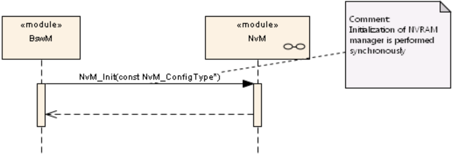

#### 8.1.2. NvM_SetDataIndex

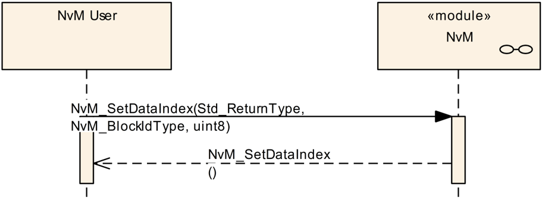

#### 8.1.3. NvM_GetDataIndex

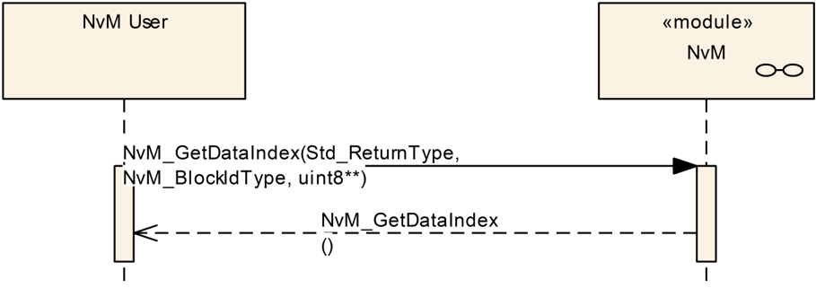

#### 8.1.4. NvM_SetBlockProtection

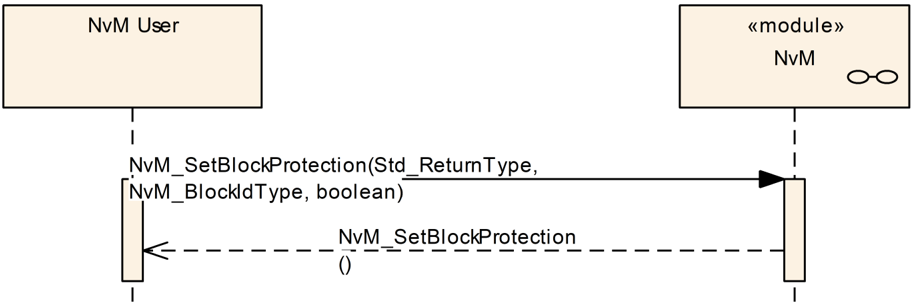

#### 8.1.5. NvM_GetErrorStatus

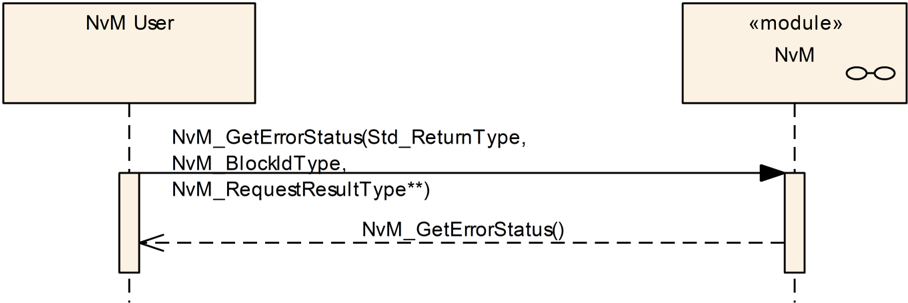

#### 8.1.6. NvM_GetVersionInfo

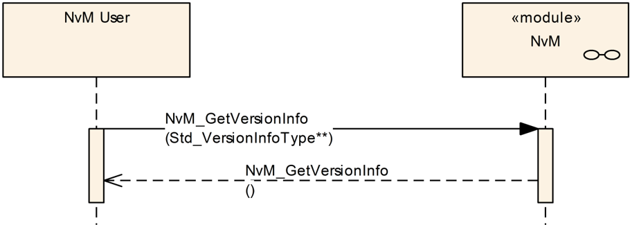

### 8.2. 异步调用

以下时序图着重描述 **NvM** 模块与 **SW-C** 或 **BswM** 之间的交互。有关内存接口的交互，请参见参考文档 [\[4\]](#ref-4) 或 [\[5\]](#ref-5)。

#### 8.2.1. 通过轮询的异步调用

下图以 [**NvM_WriteBlock**](#7322-nvm_writeblock) 为例展示异步执行的请求。所有其他异步函数的时序相同，只是处理的块数量和块类型可能不同。异步函数的结果通过轮询错误/状态信息获得。

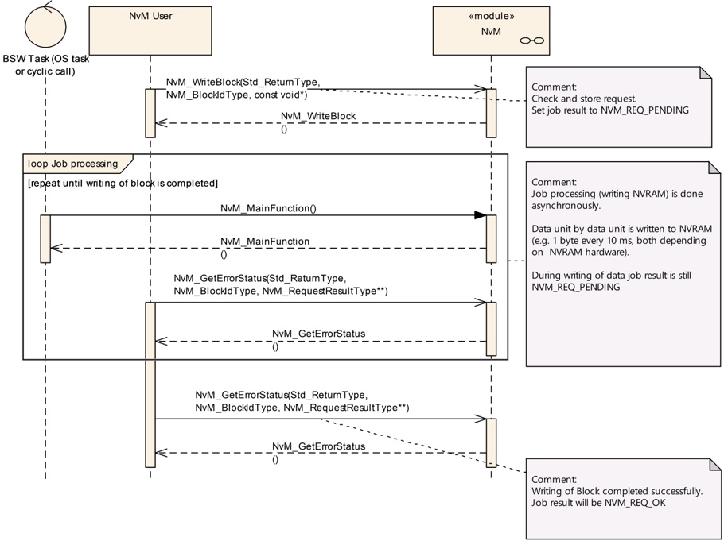

#### 8.2.2. 通过回调的异步调用

下图以 [**NvM_WriteBlock**](#7322-nvm_writeblock) 为例展示异步执行的请求。所有其他异步函数的时序相同，只是处理的块数量和块类型可能不同。异步函数的结果在异步通知（回调）之后通过请求错误/状态信息获得。

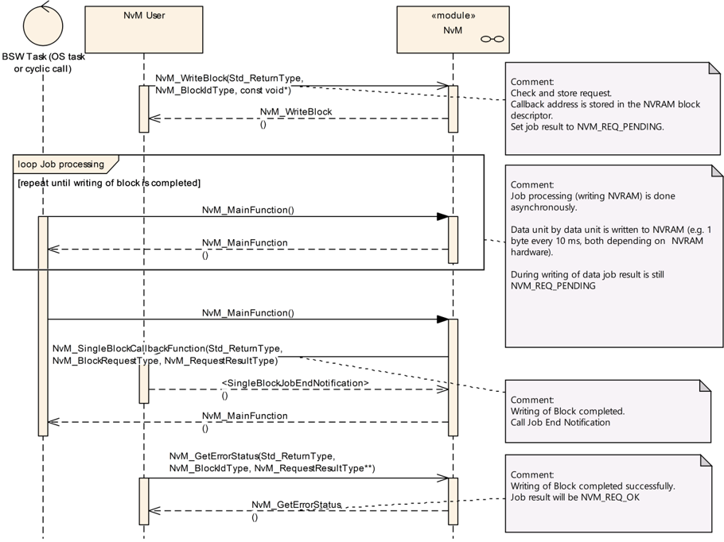

#### 8.2.3. 多块请求的取消

下图展示对正在运行的 [**NvM_WriteAll**](#7332-nvm_writeall) 多块请求执行取消操作的效果。正在运行的 [**NvM_WriteAll**](#7332-nvm_writeall) 函数会完成当前的 **NVRAM** 块并停止后续写入。

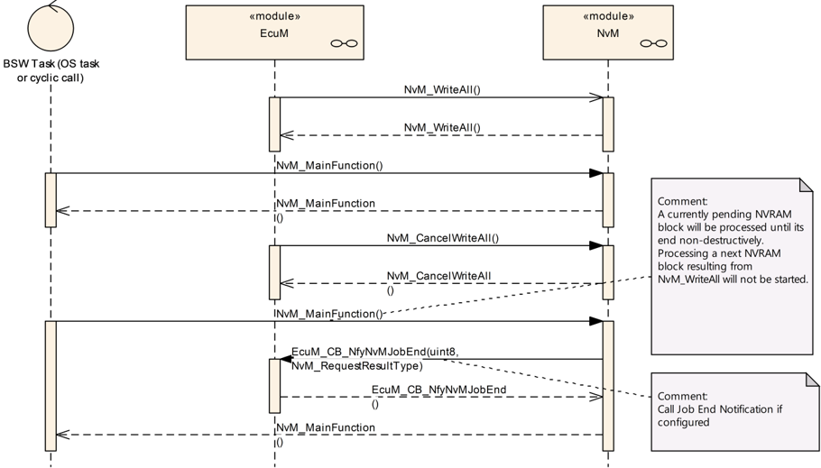

#### 8.2.4. 与 BswM 的交互

下图分别从单块操作和多块操作两个方面展示 **NvM** 与 **BswM** 之间的交互。

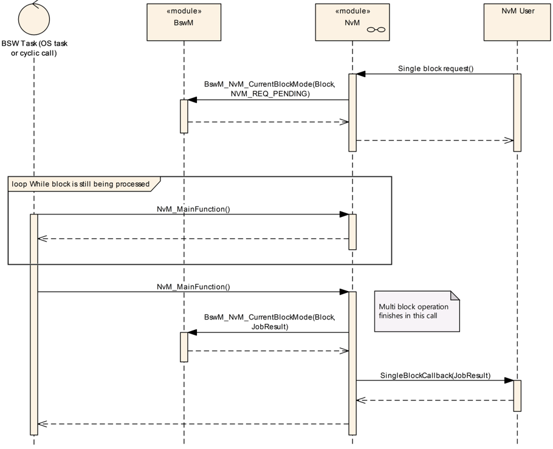

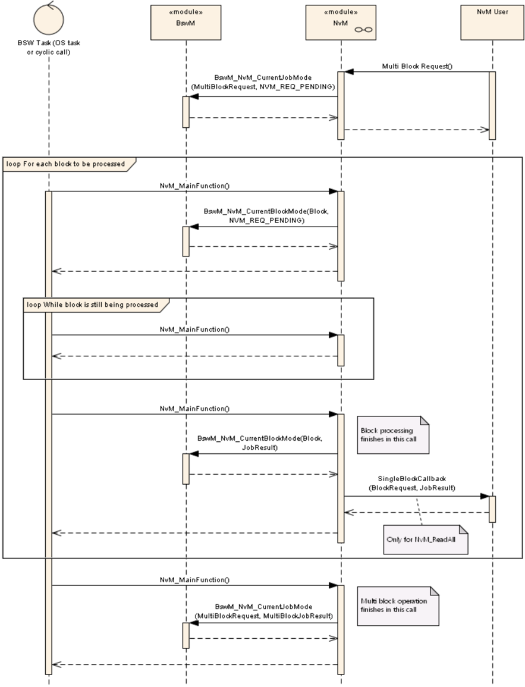

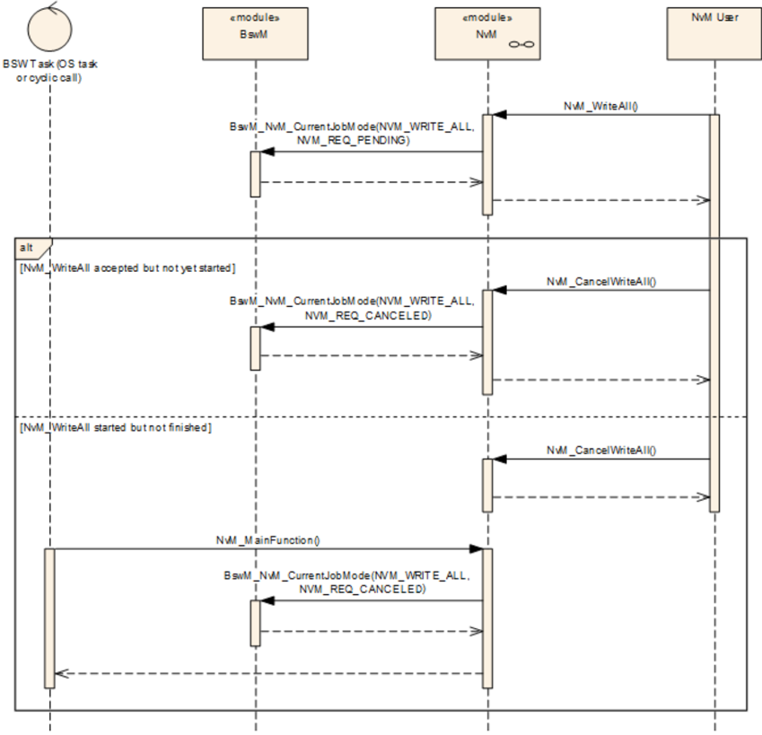

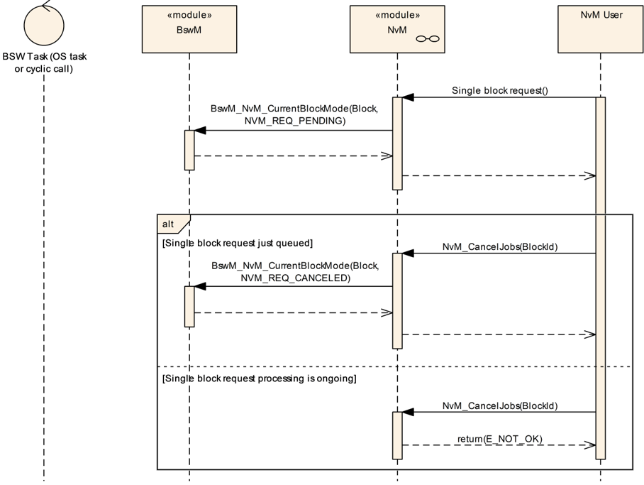

## 9. 配置规范

总体而言，本章定义配置参数及其到**容器**（**container**）的聚类组织。为支持这些规范条款，第 9.1 章描述其基本原理。它还规定用于参数规范的模板（表）。

第 9.2 章规定 **NvM** 模块的结构（容器）与参数。

第 9.3 章规定 **NvM** 模块的发布信息。

### 9.1. 如何阅读本章

详细内容请参阅 **SWS_BSWGeneral** 第 10.1 章「配置规范介绍」（**Introduction to configuration specification**）。

### 9.2. 容器与配置参数

以下各节汇总所有配置参数。各参数的详细含义见第 6 章和第 7 章。

图 10.1 展示了容器与配置参数：

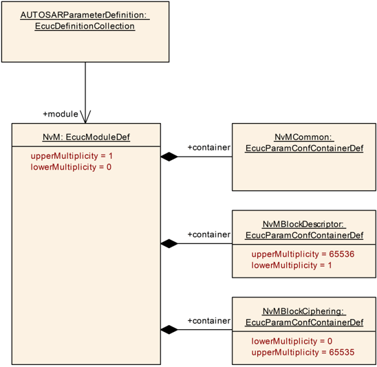

#### 9.2.1. NvM

| SWS 条目 | [ECUC_NvM_00539] |
|---|---|
| 模块名称 | NvM |
| 描述 | **NvM**（**NvRam Manager**）模块的配置。 |
| Post-Build 变体支持 | false |
| 支持的配置变体 | VARIANT-LINK-TIME, VARIANT-PRE-COMPILE |

**NvM** 容器包含以下包含的容器：

| 容器名称 | 多重性 | 作用域/依赖 |
|---|---|---|
| NvMBlockCiphering | 0..65535 | 用于块的加密（**ciphering**）的容器。该参数目前为草案（**draft**）状态。 |
| NvMBlockDescriptor | 1..65536 | 用于配置给定 NVRAM 块管理类型组成的管理结构的容器。其多重性描述了已配置的 NVRAM 块的数量，需要配置一个块。NVRAM 块描述符被浓缩在 NVRAM 块描述符表中。 |
| NvMCommon | 1 | 通用配置选项的容器。 |
| NvmDemEventParameterRefs | 0..1 | 对 **DemEventParameter** 元素的引用的容器，当发生相应错误时，应使用 API **Dem_SetEventStatus** 调用这些元素。**EventId** 取自所引用 **DemEventParameter** 的 **DemEventId** 符号值。标准化错误在此容器中提供，并可通过供应商特定的错误引用进行扩展。 |

#### 9.2.2. NvMCommon

| SWS 条目 | [ECUC_NvM_00028] |
|---|---|
| 容器名称 | NvMCommon |
| 父容器 | NvM |
| 描述 | 通用配置选项的容器。 |
| 配置参数 | 见下方参数表 |

| SWS 条目 | [ECUC_NvM_00491] |
|---|---|
| 参数名称 | NvMApiConfigClass |
| 父容器 | NvMCommon |
| 描述 | 启用与 NVM API 配置类相关的一些 API 调用的预处理器开关。 |
| 多重性 | 1 |
| 类型 | EcucEnumerationParamDef |
| 范围 | NVM_API_CONFIG_CLASS_1：属于配置类 1 的所有 API 调用均可用；NVM_API_CONFIG_CLASS_2：属于配置类 2 的所有 API 调用均可用；NVM_API_CONFIG_CLASS_3：属于配置类 3 的所有 API 调用均可用 |
| Post-Build 变体值 | false |
| 值配置类 | Pre-compile time：x（All Variants）；Link time：-；Post-build time：- |
| 作用域/依赖 | scope: local |

| SWS 条目 | [ECUC_NvM_00550] |
|---|---|
| 参数名称 | NvMBswMMultiBlockJobStatusInformation |
| 父容器 | NvMCommon |
| 描述 | 该参数规定是否将多块作业的当前状态通知 **BswM**。true：在 **ReadAll** 和 **WriteAll** 启动、完成或取消时调用 **BswM_NvM_CurrentJobMode**；false：完全不通知 **BswM**。 |
| 多重性 | 1 |
| 类型 | EcucBooleanParamDef |
| 默认值 | true |
| Post-Build 变体值 | false |
| 值配置类 | Pre-compile time：x（VARIANT-PRE-COMPILE）；Link time：x（VARIANT-LINK-TIME）；Post-build time：- |
| 作用域/依赖 | scope: local |

| SWS 条目 | [ECUC_NvM_00492] |
|---|---|
| 参数名称 | NvMCompiledConfigId |
| 父容器 | NvMCommon |
| 描述 | 关于 NV 内存布局的配置 ID。此配置 ID 应被发布，例如：软件组件（**SW-C**）应能够将其写入 NV 内存。 |
| 多重性 | 1 |
| 类型 | EcucIntegerParamDef |
| 范围 | 0 .. 65535 |
| 默认值 | - |
| Post-Build 变体值 | false |
| 值配置类 | Pre-compile time：x（All Variants）；Link time：-；Post-build time：- |
| 作用域/依赖 | scope: local |

| SWS 条目 | [ECUC_NvM_00493] |
|---|---|
| 参数名称 | NvMCrcNumOfBytes |
| 父容器 | NvMCommon |
| 描述 | 如果至少为一个 NVRAM 块配置了 CRC，则该参数定义在一次作业处理周期内应处理的最大字节数。 |
| 多重性 | 1 |
| 类型 | EcucIntegerParamDef |
| 范围 | 1 .. 65535 |
| 默认值 | - |
| Post-Build 变体值 | false |
| 值配置类 | Pre-compile time：x（VARIANT-PRE-COMPILE）；Link time：x（VARIANT-LINK-TIME）；Post-build time：- |
| 作用域/依赖 | scope: local |

| SWS 条目 | [ECUC_NvM_00572] |
|---|---|
| 参数名称 | NvMCsmRetryCounter |
| 父容器 | NvMCommon |
| 描述 | 该值规定 CSM 加密/解密作业的重试次数。用于块读取和写入的 CSM 作业可能失败（例如：模块忙、队列满等）。为避免直接以错误状态中止读/写，**NvM** 将按配置的 NvMCsmRetryCounter 次数重试该 CSM 作业。配置为 0 表示：无重试行为，作业将直接中止。该参数目前为草案（**draft**）状态。 |
| 多重性 | 0..1 |
| 类型 | EcucIntegerParamDef |
| 范围 | 0 .. 255 |
| 默认值 | 0 |
| 值配置类 | Pre-compile time：x（All Variants）；Link time：-；Post-build time：- |
| 作用域/依赖 | scope: local |

| SWS 条目 | [ECUC_NvM_00494] |
|---|---|
| 参数名称 | NvMDatasetSelectionBits |
| 父容器 | NvMCommon |
| 描述 | 定义在与内存硬件抽象的接口中，用于寻址 NVRAM 块的某个数据集的最低有效位数。0..8：用于数据集或冗余块寻址的位数。0：完全未配置数据集或冗余 NVRAM 块，无需选择位。1：配置了冗余 NVRAM 块但未配置数据集 NVRAM 块的情况。 |
| 多重性 | 1 |
| 类型 | EcucIntegerParamDef |
| 范围 | 0 .. 8 |
| 默认值 | - |
| Post-Build 变体值 | false |
| 值配置类 | Pre-compile time：x（VARIANT-PRE-COMPILE）；Link time：x（VARIANT-LINK-TIME）；Post-build time：- |
| 作用域/依赖 | scope: local 依赖：MemHwA、NVM_NVRAM_BLOCK_IDENTIFIER、NVM_BLOCK_MANAGEMENT_TYPE |

| SWS 条目 | [ECUC_NvM_00495] |
|---|---|
| 参数名称 | NvMDevErrorDetect |
| 父容器 | NvMCommon |
| 描述 | 开启或关闭开发错误检测与通知。true：启用检测与通知；false：禁用检测与通知。 |
| 多重性 | 1 |
| 类型 | EcucBooleanParamDef |
| 默认值 | false |
| Post-Build 变体值 | false |
| 值配置类 | Pre-compile time：x（All Variants）；Link time：-；Post-build time：- |
| 作用域/依赖 | scope: local |

| SWS 条目 | [ECUC_NvM_00497] |
|---|---|
| 参数名称 | NvMDynamicConfiguration |
| 父容器 | NvMCommon |
| 描述 | 通过 **NvM_ReadAll** 请求启用动态配置管理处理的预处理器开关。true：启用动态配置管理处理；false：禁用动态配置管理处理。该参数影响与 ID 为 1 的块相关的所有 **NvM** 处理以及与「抗软件变更（**Resistant to Changed Software**）」相关的所有处理。如果禁用动态配置，则块 1 无法被 **NvM** 使用。 |
| 多重性 | 1 |
| 类型 | EcucBooleanParamDef |
| 默认值 | - |
| Post-Build 变体值 | false |
| 值配置类 | Pre-compile time：x（VARIANT-PRE-COMPILE）；Link time：x（VARIANT-LINK-TIME）；Post-build time：- |
| 作用域/依赖 | scope: local |

| SWS 条目 | [ECUC_NvM_00498] |
|---|---|
| 参数名称 | NvMJobPrioritization |
| 父容器 | NvMCommon |
| 描述 | 启用作业优先级处理的预处理器开关。true：启用作业优先级处理；false：禁用作业优先级处理。 |
| 多重性 | 1 |
| 类型 | EcucBooleanParamDef |
| 默认值 | - |
| Post-Build 变体值 | false |
| 值配置类 | Pre-compile time：x（VARIANT-PRE-COMPILE）；Link time：x（VARIANT-LINK-TIME）；Post-build time：- |
| 作用域/依赖 | scope: local |

| SWS 条目 | [ECUC_NvM_00555] |
|---|---|
| 参数名称 | NvMMainFunctionPeriod |
| 父容器 | NvMCommon |
| 描述 | 以秒为单位的两次连续主函数调用之间的周期。 |
| 多重性 | 1 |
| 类型 | EcucFloatParamDef |
| 范围 | ]0 .. INF[ |
| 默认值 | - |
| Post-Build 变体值 | false |
| 值配置类 | Pre-compile time：x（All Variants）；Link time：-；Post-build time：- |
| 作用域/依赖 | scope: ECU |

| SWS 条目 | [ECUC_NvM_00500] |
|---|---|
| 参数名称 | NvMMultiBlockCallback |
| 父容器 | NvMCommon |
| 描述 | 公共回调例程的入口地址，应在每个异步多块请求结束时调用。 |
| 多重性 | 0..1 |
| 类型 | EcucFunctionNameDef |
| 默认值 | - |
| 正则表达式 | - |
| Post-Build 变体多重性 | false |
| Post-Build 变体值 | false |
| 多重性配置类 | Pre-compile time：x（VARIANT-PRE-COMPILE）；Link time：x（VARIANT-LINK-TIME）；Post-build time：- |
| 值配置类 | Pre-compile time：x（VARIANT-PRE-COMPILE）；Link time：x（VARIANT-LINK-TIME）；Post-build time：- |
| 作用域/依赖 | scope: local |

| SWS 条目 | [ECUC_NvM_00501] |
|---|---|
| 参数名称 | NvMPollingMode |
| 父容器 | NvMCommon |
| 描述 | 在 NVRAM 管理器中启用/禁用轮询模式，同时禁用/启用底层可用的回调函数的预处理器开关。true：启用轮询模式，禁用回调函数使用；false：禁用轮询模式，启用回调函数使用。 |
| 多重性 | 1 |
| 类型 | EcucBooleanParamDef |
| 默认值 | - |
| Post-Build 变体值 | false |
| 值配置类 | Pre-compile time：x（VARIANT-PRE-COMPILE）；Link time：x（VARIANT-LINK-TIME）；Post-build time：- |
| 作用域/依赖 | scope: local |

| SWS 条目 | [ECUC_NvM_00518] |
|---|---|
| 参数名称 | NvMRepeatMirrorOperations |
| 父容器 | NvMCommon |
| 描述 | 定义在推迟当前作业之前，允许应用程序向 **NvM** 模块的镜像复制数据或从中复制数据的重试次数。 |
| 多重性 | 1 |
| 类型 | EcucIntegerParamDef |
| 范围 | 0 .. 7 |
| 默认值 | 0 |
| Post-Build 变体值 | false |
| 值配置类 | Pre-compile time：x（VARIANT-PRE-COMPILE）；Link time：x（VARIANT-LINK-TIME）；Post-build time：- |
| 作用域/依赖 | scope: local |

| SWS 条目 | [ECUC_NvM_00502] |
|---|---|
| 参数名称 | NvMSetRamBlockStatusApi |
| 父容器 | NvMCommon |
| 描述 | 启用 API **NvM_SetRamBlockStatus** 的预处理器开关。true：启用 API **NvM_SetRamBlockStatus**；false：禁用 API **NvM_SetRamBlockStatus**。 |
| 多重性 | 1 |
| 类型 | EcucBooleanParamDef |
| 默认值 | - |
| Post-Build 变体值 | false |
| 值配置类 | Pre-compile time：x（All Variants）；Link time：-；Post-build time：- |
| 作用域/依赖 | scope: local |

| SWS 条目 | [ECUC_NvM_00503] |
|---|---|
| 参数名称 | NvMSizeImmediateJobQueue |
| 父容器 | NvMCommon |
| 描述 | 定义立即优先级作业队列的队列条目数。如果 NVM_JOB_PRIORITIZATION 处于关闭状态，则该参数不在作用域内。 |
| 多重性 | 0..1 |
| 类型 | EcucIntegerParamDef |
| 范围 | 1 .. 65535 |
| 默认值 | - |
| Post-Build 变体多重性 | false |
| Post-Build 变体值 | false |
| 多重性配置类 | Pre-compile time：x（VARIANT-PRE-COMPILE）；Link time：x（VARIANT-LINK-TIME）；Post-build time：- |
| 值配置类 | Pre-compile time：x（VARIANT-PRE-COMPILE）；Link time：x（VARIANT-LINK-TIME）；Post-build time：- |
| 作用域/依赖 | scope: local 依赖：NVM_JOB_PRIORITIZATION |

| SWS 条目 | [ECUC_NvM_00504] |
|---|---|
| 参数名称 | NvMSizeStandardJobQueue |
| 父容器 | NvMCommon |
| 描述 | 定义标准作业队列的队列条目数。 |
| 多重性 | 1 |
| 类型 | EcucIntegerParamDef |
| 范围 | 1 .. 65535 |
| 默认值 | - |
| Post-Build 变体值 | false |
| 值配置类 | Pre-compile time：x（VARIANT-PRE-COMPILE）；Link time：x（VARIANT-LINK-TIME）；Post-build time：- |
| 作用域/依赖 | scope: local |

| SWS 条目 | [ECUC_NvM_00505] |
|---|---|
| 参数名称 | NvMVersionInfoApi |
| 父容器 | NvMCommon |
| 描述 | 启用/禁用读取模块版本信息的 API 的预处理器开关。true：启用版本信息 API；false：禁用版本信息 API。 |
| 多重性 | 1 |
| 类型 | EcucBooleanParamDef |
| 默认值 | false |
| Post-Build 变体值 | false |
| 值配置类 | Pre-compile time：x（All Variants）；Link time：-；Post-build time：- |
| 作用域/依赖 | scope: local |

| SWS 条目 | [ECUC_NvM_00573] |
|---|---|
| 参数名称 | NvMBufferAlignmentValue |
| 父容器 | NvMCommon |
| 描述 | 该参数确定 **NvM** 缓冲区起始地址所需的对齐方式。该值应继承自 EaBufferAlignmentValue 或 FeeBufferAlignmentValue。该参数目前为草案（**draft**）状态。 |
| 多重性 | 1 |
| 类型 | 对 [EaGeneral、FeeGeneral] 的选择引用 |
| 值配置类 | Pre-compile time：x（All Variants）；Link time：-；Post-build time：- |
| 作用域/依赖 | scope: ECU |

| SWS 条目 | [ECUC_NvM_00565] |
|---|---|
| 参数名称 | NvMEcucPartitionRef |
| 父容器 | NvMCommon |
| 描述 | 将 **NvM** 映射到一个或多个 ECUC 分区，以使其 C API 在相应分区中可用。 |
| 多重性 | 1..* |
| 类型 | 对 EcucPartition 的引用 |
| 值配置类 | Pre-compile time：x（All Variants）；Link time：-；Post-build time：- |
| 作用域/依赖 | scope: ECU |

| SWS 条目 | [ECUC_NvM_00566] |
|---|---|
| 参数名称 | NvMMasterEcucPartitionRef |
| 父容器 | NvMCommon |
| 描述 | 将 **NvM** 主节点（**master**）映射到零个或一个 ECUC 分区，以将主节点功能分配给某个内核。所引用的 ECUC 分区是 **NvM** 所映射到的 ECUC 分区的子集。 |
| 多重性 | 0..1 |
| 类型 | 对 EcucPartition 的引用 |
| 值配置类 | Pre-compile time：x（All Variants）；Link time：-；Post-build time：- |
| 作用域/依赖 | scope: ECU |

NvMCommon 容器不包含任何包含的容器。

[SWS_NvM_CONSTR_00974] NvMMasterEcucPartitionRef 所引用的 ECUC 分区应位于 NvMEcucPartitionRef 所引用的 ECUC 分区的子集之内。

#### 9.2.3. NvMBlockDescriptor

| SWS 条目 | [ECUC_NvM_00061] |
|---|---|
| 容器名称 | NvMBlockDescriptor |
| 父容器 | NvM |
| 描述 | 用于配置给定 NVRAM 块管理类型组成的管理结构的容器。其多重性描述了已配置的 NVRAM 块的数量，需要配置一个块。NVRAM 块描述符被浓缩在 NVRAM 块描述符表中。 |
| 配置参数 | 见下方参数表 |

| SWS 条目 | [ECUC_NvM_00476] |
|---|---|
| 参数名称 | NvMBlockCrcType |
| 父容器 | NvMBlockDescriptor |
| 描述 | 定义 NVRAM 块的 CRC 数据宽度。默认：NVM_CRC16，即如果 NVM_BLOCK_USE_CRC==true 则将使用 CRC16。 |
| 多重性 | 0..1 |
| 类型 | EcucEnumerationParamDef |
| 范围 | NVM_CRC16：（默认）如果 NVM_BLOCK_USE_CRC==true 则将使用 CRC16；NVM_CRC32：如果 NVM_BLOCK_USE_CRC==true 则为该 NVRAM 块选择 CRC32；NVM_CRC8：如果 NVM_BLOCK_USE_CRC==true 则为该 NVRAM 块选择 CRC8 |
| Post-Build 变体多重性 | false |
| Post-Build 变体值 | false |
| 多重性配置类 | Pre-compile time：x（VARIANT-PRE-COMPILE）；Link time：x（VARIANT-LINK-TIME）；Post-build time：- |
| 值配置类 | Pre-compile time：x（VARIANT-PRE-COMPILE）；Link time：x（VARIANT-LINK-TIME）；Post-build time：- |
| 作用域/依赖 | scope: local 依赖：NVM_BLOCK_USE_CRC、NVM_CALC_RAM_BLOCK_CRC |

| SWS 条目 | [ECUC_NvM_00554] |
|---|---|
| 参数名称 | NvMBlockHeaderInclude |
| 父容器 | NvMBlockDescriptor |
| 描述 | 定义头文件，NVRAM 块的所有者在其中声明永久 RAM 数据块、ROM 数据块（如果已配置）以及每个已配置回调的回调函数原型。如果未配置永久 RAM 块、ROM 块或回调函数，则应忽略此配置参数。 |
| 多重性 | 0..1 |
| 类型 | EcucStringParamDef |
| 默认值 | - |
| 正则表达式 | - |
| Post-Build 变体多重性 | false |
| Post-Build 变体值 | false |
| 多重性配置类 | Pre-compile time：x（VARIANT-PRE-COMPILE）；Link time：x（VARIANT-LINK-TIME）；Post-build time：- |
| 值配置类 | Pre-compile time：x（VARIANT-PRE-COMPILE）；Link time：x（VARIANT-LINK-TIME）；Post-build time：- |
| 作用域/依赖 | scope: local |

| SWS 条目 | [ECUC_NvM_00477] |
|---|---|
| 参数名称 | NvMBlockJobPriority |
| 父容器 | NvMBlockDescriptor |
| 描述 | 定义 NVRAM 块的作业优先级（0 = 立即优先级）。 |
| 多重性 | 1 |
| 类型 | EcucIntegerParamDef |
| 范围 | 0 .. 255 |
| 默认值 | - |
| Post-Build 变体值 | false |
| 值配置类 | Pre-compile time：x（VARIANT-PRE-COMPILE）；Link time：x（VARIANT-LINK-TIME）；Post-build time：- |
| 作用域/依赖 | scope: local |

| SWS 条目 | [ECUC_NvM_00062] |
|---|---|
| 参数名称 | NvMBlockManagementType |
| 父容器 | NvMBlockDescriptor |
| 描述 | 定义 NVRAM 块的块管理类型。 |
| 多重性 | 1 |
| 类型 | EcucEnumerationParamDef |
| 范围 | NVM_BLOCK_DATASET：NVRAM 块被配置为数据集类型；NVM_BLOCK_NATIVE：NVRAM 块被配置为原生类型；NVM_BLOCK_REDUNDANT：NVRAM 块被配置为冗余类型 |
| Post-Build 变体值 | false |
| 值配置类 | Pre-compile time：x（VARIANT-PRE-COMPILE）；Link time：x（VARIANT-LINK-TIME）；Post-build time：- |
| 作用域/依赖 | scope: local |

| SWS 条目 | [ECUC_NvM_00557] |
|---|---|
| 参数名称 | NvMBlockUseAutoValidation |
| 父容器 | NvMBlockDescriptor |
| 描述 | 定义是否应在关机阶段自动验证 RAM 块。true：使用自动验证机制；false：不使用。 |
| 多重性 | 1 |
| 类型 | EcucBooleanParamDef |
| 默认值 | false |
| Post-Build 变体值 | false |
| 值配置类 | Pre-compile time：x（VARIANT-PRE-COMPILE）；Link time：x（VARIANT-LINK-TIME）；Post-build time：- |
| 作用域/依赖 | scope: local |

| SWS 条目 | [ECUC_NvM_00563] |
|---|---|
| 参数名称 | NvMBlockUseCompression |
| 父容器 | NvMBlockDescriptor |
| 描述 | 定义写入前是否对数据进行压缩。true：启用数据压缩（读取和写入需要更多时间）；false：不压缩。该参数目前为草案（**draft**）状态。 |
| 多重性 | 1 |
| 类型 | EcucBooleanParamDef |
| 默认值 | false |
| Post-Build 变体值 | false |
| 值配置类 | Pre-compile time：x（VARIANT-PRE-COMPILE）；Link time：x（VARIANT-LINK-TIME）；Post-build time：- |
| 作用域/依赖 | scope: local |

| SWS 条目 | [ECUC_NvM_00036] |
|---|---|
| 参数名称 | NvMBlockUseCrc |
| 父容器 | NvMBlockDescriptor |
| 描述 | 定义 NVRAM 块的 CRC 使用，即：在 RAM 和 NV 内存中为 CRC 预留内存空间。true：该 NVRAM 块将使用 CRC；false：该 NVRAM 块不使用 CRC。注意：不建议为具有立即优先级的块配置 CRC，因为 CRC 计算可能跨越多个 **NvM** 主函数，这会显著增加写入立即数据的时间，从而违背立即优先级的目的。 |
| 多重性 | 1 |
| 类型 | EcucBooleanParamDef |
| 默认值 | - |
| Post-Build 变体值 | false |
| 值配置类 | Pre-compile time：x（VARIANT-PRE-COMPILE）；Link time：x（VARIANT-LINK-TIME）；Post-build time：- |
| 作用域/依赖 | scope: local |

| SWS 条目 | [ECUC_NvM_00556] |
|---|---|
| 参数名称 | NvMBlockUseCRCCompMechanism |
| 父容器 | NvMBlockDescriptor |
| 描述 | 定义在写作业期间是否应将 RAM 块的 CRC 与上次成功的读或写作业期间计算的 CRC 进行比较。true：使用比较机制；false：不使用。 |
| 多重性 | 1 |
| 类型 | EcucBooleanParamDef |
| 默认值 | false |
| Post-Build 变体值 | false |
| 值配置类 | Pre-compile time：x（VARIANT-PRE-COMPILE）；Link time：x（VARIANT-LINK-TIME）；Post-build time：- |
| 作用域/依赖 | scope: local |

| SWS 条目 | [ECUC_NvM_00559] |
|---|---|
| 参数名称 | NvMBlockUsePort |
| 父容器 | NvMBlockDescriptor |
| 描述 | 如果此参数为 true，则它定义是否：• 如果参数 NvMBlockUseSyncMechanism 配置为 TRUE，则生成带有用于同步机制回调的 **NvMMirror** 接口的端口；• 如果配置了 NvMInitBlockCallback 参数（与内容无关），则生成带有用于初始化块回调的 **NvMNotifyInitBlock** 接口的端口；• 如果配置了 NvMSingleBlockCallback 参数（与内容无关），则生成带有用于单块回调的 **NvMNotifyJobFinished** 接口的端口；• 生成带有用于 **SetBlockProtection** 操作的 **NvMAdmin** 接口的端口。 |
| 多重性 | 1 |
| 类型 | EcucBooleanParamDef |
| 默认值 | - |
| 多重性配置类 | Pre-compile time：x（VARIANT-PRE-COMPILE）；Link time：x（VARIANT-LINK-TIME）；Post-build time：- |
| 值配置类 | Pre-compile time：x（VARIANT-PRE-COMPILE）；Link time：x（VARIANT-LINK-TIME）；Post-build time：- |
| 作用域/依赖 | scope: local |

| SWS 条目 | [ECUC_NvM_00552] |
|---|---|
| 参数名称 | NvMBlockUseSetRamBlockStatus |
| 父容器 | NvMBlockDescriptor |
| 描述 | 定义是否为该块使用 NvMSetRamBlockStatusApi。注意：如果禁用 NvMSetRamBlockStatusApi，则应忽略此配置参数。true：对此 RAM 块调用 NvMSetRamBlockStatus 应设置该 RAM 块的状态；false：对此 RAM 块调用 NvMSetRamBlockStatus 将被忽略。 |
| 多重性 | 1 |
| 类型 | EcucBooleanParamDef |
| 默认值 | - |
| Post-Build 变体值 | false |
| 值配置类 | Pre-compile time：x（VARIANT-PRE-COMPILE）；Link time：x（VARIANT-LINK-TIME）；Post-build time：- |
| 作用域/依赖 | scope: local |

| SWS 条目 | [ECUC_NvM_00519] |
|---|---|
| 参数名称 | NvMBlockUseSyncMechanism |
| 父容器 | NvMBlockDescriptor |
| 描述 | 定义 NV 块是否使用带 RAM 镜像和回调例程的显式同步机制，用于在 **NvM** 模块的 RAM 镜像与 NV 块之间传输数据。true：使用同步机制；false：不使用。 |
| 多重性 | 1 |
| 类型 | EcucBooleanParamDef |
| 默认值 | false |
| Post-Build 变体值 | false |
| 值配置类 | Pre-compile time：x（VARIANT-PRE-COMPILE）；Link time：x（VARIANT-LINK-TIME）；Post-build time：- |
| 作用域/依赖 | scope: local |

| SWS 条目 | [ECUC_NvM_00033] |
|---|---|
| 参数名称 | NvMBlockWriteProt |
| 父容器 | NvMBlockDescriptor |
| 描述 | 定义 NV 块的初始写保护。true：启用初始块写保护；false：禁用初始块写保护。 |
| 多重性 | 1 |
| 类型 | EcucBooleanParamDef |
| 默认值 | - |
| Post-Build 变体值 | false |
| 值配置类 | Pre-compile time：x（VARIANT-PRE-COMPILE）；Link time：x（VARIANT-LINK-TIME）；Post-build time：- |
| 作用域/依赖 | scope: local |

| SWS 条目 | [ECUC_NvM_00551] |
|---|---|
| 参数名称 | NvMBswMBlockStatusInformation |
| 父容器 | NvMBlockDescriptor |
| 描述 | 该参数规定是否将指定块的当前状态通知 **BswM**。true：在变化时调用 **BswM_NvM_CurrentBlockMode**；false：完全不通知 **BswM**。 |
| 多重性 | 1 |
| 类型 | EcucBooleanParamDef |
| 默认值 | false |
| Post-Build 变体值 | false |
| 值配置类 | Pre-compile time：x（VARIANT-PRE-COMPILE）；Link time：x（VARIANT-LINK-TIME）；Post-build time：- |
| 作用域/依赖 | scope: local |

| SWS 条目 | [ECUC_NvM_00119] |
|---|---|
| 参数名称 | NvMCalcRamBlockCrc |
| 父容器 | NvMBlockDescriptor |
| 描述 | 定义永久 RAM 块或配置为使用显式同步机制的 NVRAM 块的 CRC（重新）计算。true：将为此永久 RAM 块（重新）计算 CRC；false：不为此永久 RAM 块（重新）计算 CRC。 |
| 多重性 | 0..1 |
| 类型 | EcucBooleanParamDef |
| 默认值 | - |
| Post-Build 变体多重性 | false |
| Post-Build 变体值 | false |
| 多重性配置类 | Pre-compile time：x（VARIANT-PRE-COMPILE）；Link time：x（VARIANT-LINK-TIME）；Post-build time：- |
| 值配置类 | Pre-compile time：x（VARIANT-PRE-COMPILE）；Link time：x（VARIANT-LINK-TIME）；Post-build time：- |
| 作用域/依赖 | scope: local 依赖：NVM_BLOCK_USE_CRC |

| SWS 条目 | [ECUC_NvM_00533] |
|---|---|
| 参数名称 | NvMMaxNumOfReadRetries |
| 父容器 | NvMBlockDescriptor |
| 描述 | 定义最大读重试次数。 |
| 多重性 | 1 |
| 类型 | EcucIntegerParamDef |
| 范围 | 0 .. 7 |
| 默认值 | 0 |
| Post-Build 变体值 | false |
| 值配置类 | Pre-compile time：x（VARIANT-PRE-COMPILE）；Link time：x（VARIANT-LINK-TIME）；Post-build time：- |
| 作用域/依赖 | scope: local |

| SWS 条目 | [ECUC_NvM_00499] |
|---|---|
| 参数名称 | NvMMaxNumOfWriteRetries |
| 父容器 | NvMBlockDescriptor |
| 描述 | 定义某个 NVRAM 块的最大写重试次数。无论配置如何，对于由 **NvM_WriteAll** 和 **NvM_WriteBlock** 请求处理的每个块，始终强制执行一致性检查（并可能进行写重试）。 |
| 多重性 | 1 |
| 类型 | EcucIntegerParamDef |
| 范围 | 0 .. 7 |
| 默认值 | - |
| Post-Build 变体值 | false |
| 值配置类 | Pre-compile time：x（VARIANT-PRE-COMPILE）；Link time：x（VARIANT-LINK-TIME）；Post-build time：- |
| 作用域/依赖 | scope: local |

| SWS 条目 | [ECUC_NvM_00478] |
|---|---|
| 参数名称 | NvMNvBlockBaseNumber |
| 父容器 | NvMBlockDescriptor |
| 描述 | 用于执行 SW-C 使用的 NVM_NVRAM_BLOCK_IDENTIFIER 与内存抽象模块期望的 FEE_BLOCK_NUMBER 之间链接的配置参数。参数值等于 FEE_BLOCK_NUMBER 或 EA_BLOCK_NUMBER 右移 NvMDatasetSelectionBits 位（参见第 6.1.2.1 章）。计算公式：value = TargetBlockReference.[Ea/Fee]BlockConfiguration.[Ea/Fee]BlockNumber >> NvMDatasetSelectionBits |
| 多重性 | 1 |
| 类型 | EcucIntegerParamDef |
| 范围 | 1 .. 65534 |
| 默认值 | - |
| Post-Build 变体值 | false |
| 值配置类 | Pre-compile time：x（VARIANT-PRE-COMPILE）；Link time：x（VARIANT-LINK-TIME）；Post-build time：- |
| 作用域/依赖 | scope: local 依赖：FEE_BLOCK_NUMBER、EA_BLOCK_NUMBER |

| SWS 条目 | [ECUC_NvM_00479] |
|---|---|
| 参数名称 | NvMNvBlockLength |
| 父容器 | NvMBlockDescriptor |
| 描述 | 以字节为单位定义 NV 块数据长度。注意：实现者可以为参数定义添加 'withAuto' 属性，该属性表明长度可由生成器自动计算（例如：通过使用解析器搜索并分析对应于该块的数据结构）。当此参数定义的 'withAuto' 设置为 'true' 时，'isAutoValue' 可以设置为 'true'。如果 'isAutoValue' 设置为 'true'，则实际值在 ECU 配置期间不会被考虑，而是由代码生成器（重新）计算并随后存储在 value 属性中。 |
| 多重性 | 1 |
| 类型 | EcucIntegerParamDef |
| 范围 | 1 .. 65535 |
| 默认值 | - |
| Post-Build 变体值 | false |
| 值配置类 | Pre-compile time：x（VARIANT-PRE-COMPILE）；Link time：x（VARIANT-LINK-TIME）；Post-build time：- |
| 作用域/依赖 | scope: local |

| SWS 条目 | [ECUC_NvM_00480] |
|---|---|
| 参数名称 | NvMNvBlockNum |
| 父容器 | NvMBlockDescriptor |
| 描述 | 根据给定的块管理类型，定义连续区域中多个 NV 块的数量。1-255：对于配置为块管理类型 NVM_BLOCK_DATASET 的 NVRAM 块，实际范围受 SWS_NvM_00444 的限制。1：对于配置为块管理类型 NVM_BLOCK_NATIVE 的 NVRAM 块。2：对于配置为块管理类型 NVM_BLOCK_REDUNDANT 的 NVRAM 块。 |
| 多重性 | 1 |
| 类型 | EcucIntegerParamDef |
| 范围 | 1 .. 255 |
| 默认值 | - |
| Post-Build 变体值 | false |
| 值配置类 | Pre-compile time：x（VARIANT-PRE-COMPILE）；Link time：x（VARIANT-LINK-TIME）；Post-build time：- |
| 作用域/依赖 | scope: local 依赖：NVM_BLOCK_MANAGEMENT_TYPE |

| SWS 条目 | [ECUC_NvM_00481] |
|---|---|
| 参数名称 | NvMNvramBlockIdentifier |
| 父容器 | NvMBlockDescriptor |
| 描述 | 通过唯一的块标识符标识 NVRAM 块。实现类型：**NvM_BlockIdType**。min = 2，max = 2^(16-NVM_DATASET_SELECTION_BITS)-1。保留的 NVRAM 块 ID：0 -> 用于通过 **NvM_GetErrorStatus** 获取多块请求结果；1 -> 保存配置 ID 的冗余 NVRAM 块（生成工具应检查该块在类型、CRC 和大小方面配置是否正确）。 |
| 多重性 | 1 |
| 类型 | EcucIntegerParamDef（为该参数生成符号名） |
| 范围 | 2 .. 65535 |
| 默认值 | - |
| Post-Build 变体值 | false |
| 值配置类 | Pre-compile time：x（All Variants）；Link time：-；Post-build time：- |
| 作用域/依赖 | scope: local 依赖：NVM_DATASET_SELECTION_BITS |

| SWS 条目 | [ECUC_NvM_00035] |
|---|---|
| 参数名称 | NvMNvramDeviceId |
| 父容器 | NvMBlockDescriptor |
| 描述 | 定义 NVRAM 块所在的 NVRAM 设备 ID。计算公式：value = TargetBlockReference.[Ea/Fee]DeviceIndex |
| 多重性 | 1 |
| 类型 | EcucIntegerParamDef |
| 范围 | 0 .. 1 |
| 默认值 | - |
| Post-Build 变体值 | false |
| 值配置类 | Pre-compile time：x（VARIANT-PRE-COMPILE）；Link time：x（VARIANT-LINK-TIME）；Post-build time：- |
| 作用域/依赖 | scope: local |

| SWS 条目 | [ECUC_NvM_00482] |
|---|---|
| 参数名称 | NvMRamBlockDataAddress |
| 父容器 | NvMBlockDescriptor |
| 描述 | 定义 RAM 块数据的起始地址。如果未配置，则所选块管理类型没有永久 RAM 数据块可用。 |
| 多重性 | 0..1 |
| 类型 | EcucStringParamDef |
| 默认值 | - |
| 正则表达式 | - |
| Post-Build 变体多重性 | false |
| Post-Build 变体值 | false |
| 多重性配置类 | Pre-compile time：x（VARIANT-PRE-COMPILE）；Link time：x（VARIANT-LINK-TIME）；Post-build time：- |
| 值配置类 | Pre-compile time：x（VARIANT-PRE-COMPILE）；Link time：x（VARIANT-LINK-TIME）；Post-build time：- |
| 作用域/依赖 | scope: local |

| SWS 条目 | [ECUC_NvM_00521] |
|---|---|
| 参数名称 | NvMReadRamBlockFromNvCallback |
| 父容器 | NvMBlockDescriptor |
| 描述 | 块特定回调例程的入口地址，应调用该例程以让应用程序将数据从 **NvM** 模块的镜像复制到 RAM 块。实现类型：**Std_ReturnType**。E_OK：复制成功；E_NOT_OK：复制不成功，应再次调用该回调例程。 |
| 多重性 | 0..1 |
| 类型 | EcucFunctionNameDef |
| 默认值 | - |
| 正则表达式 | - |
| Post-Build 变体多重性 | false |
| Post-Build 变体值 | false |
| 多重性配置类 | Pre-compile time：x（VARIANT-PRE-COMPILE）；Link time：x（VARIANT-LINK-TIME）；Post-build time：- |
| 值配置类 | Pre-compile time：x（VARIANT-PRE-COMPILE）；Link time：x（VARIANT-LINK-TIME）；Post-build time：- |
| 作用域/依赖 | scope: local |

| SWS 条目 | [ECUC_NvM_00483] |
|---|---|
| 参数名称 | NvMResistantToChangedSw |
| 父容器 | NvMBlockDescriptor |
| 描述 | 定义 NVRAM 块是否应被视为抗配置变更。如果在配置时没有可用的默认数据，则应用程序应负责提供默认初始化数据。在这种情况下，应用程序必须使用 **NvM_GetErrorStatus()** 才能区分首次初始化和数据损坏。true：NVRAM 块抗软件变更；false：NVRAM 块不抗软件变更。 |
| 多重性 | 1 |
| 类型 | EcucBooleanParamDef |
| 默认值 | - |
| Post-Build 变体值 | false |
| 值配置类 | Pre-compile time：x（VARIANT-PRE-COMPILE）；Link time：x（VARIANT-LINK-TIME）；Post-build time：- |
| 作用域/依赖 | scope: local |

| SWS 条目 | [ECUC_NvM_00484] |
|---|---|
| 参数名称 | NvMRomBlockDataAddress |
| 父容器 | NvMBlockDescriptor |
| 描述 | 定义 ROM 块数据的起始地址。如果未配置，则所选块管理类型没有 ROM 块可用。 |
| 多重性 | 0..1 |
| 类型 | EcucStringParamDef |
| 默认值 | - |
| 正则表达式 | - |
| Post-Build 变体多重性 | false |
| Post-Build 变体值 | false |
| 多重性配置类 | Pre-compile time：x（VARIANT-PRE-COMPILE）；Link time：x（VARIANT-LINK-TIME）；Post-build time：- |
| 值配置类 | Pre-compile time：x（VARIANT-PRE-COMPILE）；Link time：x（VARIANT-LINK-TIME）；Post-build time：- |
| 作用域/依赖 | scope: local |

| SWS 条目 | [ECUC_NvM_00485] |
|---|---|
| 参数名称 | NvMRomBlockNum |
| 父容器 | NvMBlockDescriptor |
| 描述 | 根据给定的块管理类型，定义连续区域中多个 ROM 块的数量。0-254：对于配置为块管理类型 NVM_BLOCK_DATASET 的 NVRAM 块，实际范围受 SWS_NvM_00444 的限制。0-1：对于配置为块管理类型 NVM_BLOCK_NATIVE 的 NVRAM 块。0-1：对于配置为块管理类型 NVM_BLOCK_REDUNDANT 的 NVRAM 块。 |
| 多重性 | 1 |
| 类型 | EcucIntegerParamDef |
| 范围 | 0 .. 254 |
| 默认值 | - |
| Post-Build 变体值 | false |
| 值配置类 | Pre-compile time：x（VARIANT-PRE-COMPILE）；Link time：x（VARIANT-LINK-TIME）；Post-build time：- |
| 作用域/依赖 | scope: local 依赖：NVM_BLOCK_MANAGEMENT_TYPE、NVM_NV_BLOCK_NUM |

| SWS 条目 | [ECUC_NvM_00558] |
|---|---|
| 参数名称 | NvMSelectBlockForFirstInitAll |
| 父容器 | NvMBlockDescriptor |
| 描述 | 定义 **NvM_FirstInitAll** 是否处理某个块。即使块没有永久 RAM 和/或显式同步，也可以将其配置为被处理。true：块将由 **NvM_FirstInitAll** 处理；false：块将不由 **NvM_FirstInitAll** 处理。 |
| 多重性 | 0..1 |
| 类型 | EcucBooleanParamDef |
| 默认值 | false |
| Post-Build 变体多重性 | false |
| Post-Build 变体值 | false |
| 多重性配置类 | Pre-compile time：x（VARIANT-PRE-COMPILE）；Link time：x（VARIANT-LINK-TIME）；Post-build time：- |
| 值配置类 | Pre-compile time：x（VARIANT-PRE-COMPILE）；Link time：x（VARIANT-LINK-TIME）；Post-build time：- |
| 作用域/依赖 | scope: local |

| SWS 条目 | [ECUC_NvM_00117] |
|---|---|
| 参数名称 | NvMSelectBlockForReadAll |
| 父容器 | NvMBlockDescriptor |
| 描述 | 定义 NVRAM 块在 **NvM_ReadAll** 期间是否应被处理。此配置参数仅对配置为具有永久 RAM 块或配置为使用显式同步机制的 NVRAM 块有影响。true：NVRAM 块应由 **NvM_ReadAll** 处理；false：NVRAM 块不应由 **NvM_ReadAll** 处理。 |
| 多重性 | 0..1 |
| 类型 | EcucBooleanParamDef |
| 默认值 | - |
| Post-Build 变体多重性 | false |
| Post-Build 变体值 | false |
| 多重性配置类 | Pre-compile time：x（VARIANT-PRE-COMPILE）；Link time：x（VARIANT-LINK-TIME）；Post-build time：- |
| 值配置类 | Pre-compile time：x（VARIANT-PRE-COMPILE）；Link time：x（VARIANT-LINK-TIME）；Post-build time：- |
| 作用域/依赖 | scope: local 依赖：NVM_RAM_BLOCK_DATA_ADDRESS |

| SWS 条目 | [ECUC_NvM_00549] |
|---|---|
| 参数名称 | NvMSelectBlockForWriteAll |
| 父容器 | NvMBlockDescriptor |
| 描述 | 定义 NVRAM 块在 **NvM_WriteAll** 期间是否应被处理。此配置参数仅对配置为具有永久 RAM 块或配置为使用显式同步机制的 NVRAM 块有影响。true：NVRAM 块应由 **NvM_WriteAll** 处理；false：NVRAM 块不应由 **NvM_WriteAll** 处理。 |
| 多重性 | 0..1 |
| 类型 | EcucBooleanParamDef |
| 默认值 | - |
| Post-Build 变体多重性 | false |
| Post-Build 变体值 | false |
| 多重性配置类 | Pre-compile time：x（VARIANT-PRE-COMPILE）；Link time：x（VARIANT-LINK-TIME）；Post-build time：- |
| 值配置类 | Pre-compile time：x（VARIANT-PRE-COMPILE）；Link time：x（VARIANT-LINK-TIME）；Post-build time：- |
| 作用域/依赖 | scope: local 依赖：NVM_RAM_BLOCK_DATA_ADDRESS |

| SWS 条目 | [ECUC_NvM_00532] |
|---|---|
| 参数名称 | NvMStaticBlockIDCheck |
| 父容器 | NvMBlockDescriptor |
| 描述 | 定义是否启用静态块 ID 检查。false：禁用静态块 ID 检查；true：启用静态块 ID 检查。 |
| 多重性 | 1 |
| 类型 | EcucBooleanParamDef |
| 默认值 | false |
| Post-Build 变体值 | false |
| 值配置类 | Pre-compile time：x（VARIANT-PRE-COMPILE）；Link time：x（VARIANT-LINK-TIME）；Post-build time：- |
| 作用域/依赖 | scope: local |

| SWS 条目 | [ECUC_NvM_00072] |
|---|---|
| 参数名称 | NvMWriteBlockOnce |
| 父容器 | NvMBlockDescriptor |
| 描述 | 定义首次写入后的写保护。NVRAM 管理器在以下情况下设置写保护位：NV 块首次被写入之后；或者该块已被写入且在读取期间被检测为有效且一致。true：启用首次写入后的写保护；false：禁用首次写入后的写保护。 |
| 多重性 | 1 |
| 类型 | EcucBooleanParamDef |
| 默认值 | - |
| Post-Build 变体值 | false |
| 值配置类 | Pre-compile time：x（VARIANT-PRE-COMPILE）；Link time：x（VARIANT-LINK-TIME）；Post-build time：- |
| 作用域/依赖 | scope: local |

| SWS 条目 | [ECUC_NvM_00520] |
|---|---|
| 参数名称 | NvMWriteRamBlockToNvCallback |
| 父容器 | NvMBlockDescriptor |
| 描述 | 块特定回调例程的入口地址，应调用该例程以让应用程序将数据从 RAM 块复制到 **NvM** 模块的镜像。实现类型：**Std_ReturnType**。E_OK：复制成功；E_NOT_OK：复制不成功，应再次调用该回调例程。 |
| 多重性 | 0..1 |
| 类型 | EcucFunctionNameDef |
| 默认值 | - |
| 正则表达式 | - |
| Post-Build 变体多重性 | false |
| Post-Build 变体值 | false |
| 多重性配置类 | Pre-compile time：x（VARIANT-PRE-COMPILE）；Link time：x（VARIANT-LINK-TIME）；Post-build time：- |
| 值配置类 | Pre-compile time：x（VARIANT-PRE-COMPILE）；Link time：x（VARIANT-LINK-TIME）；Post-build time：- |
| 作用域/依赖 | scope: local |

| SWS 条目 | [ECUC_NvM_00534] |
|---|---|
| 参数名称 | NvMWriteVerification |
| 父容器 | NvMBlockDescriptor |
| 描述 | 定义是否启用写验证。false：禁用写验证；true：启用写验证。 |
| 多重性 | 1 |
| 类型 | EcucBooleanParamDef |
| 默认值 | false |
| Post-Build 变体值 | false |
| 值配置类 | Pre-compile time：x（VARIANT-PRE-COMPILE）；Link time：x（VARIANT-LINK-TIME）；Post-build time：- |
| 作用域/依赖 | scope: local |

| SWS 条目 | [ECUC_NvM_00538] |
|---|---|
| 参数名称 | NvMWriteVerificationDataSize |
| 父容器 | NvMBlockDescriptor |
| 描述 | 定义在比较 RAM 块内容与读回块内容的每一步中要比较的字节数。 |
| 多重性 | 1 |
| 类型 | EcucIntegerParamDef |
| 范围 | 1 .. 65535 |
| 默认值 | - |
| Post-Build 变体值 | false |
| 值配置类 | Pre-compile time：x（VARIANT-PRE-COMPILE）；Link time：x（VARIANT-LINK-TIME）；Post-build time：- |
| 作用域/依赖 | scope: local |

| SWS 条目 | [ECUC_NvM_00567] |
|---|---|
| 参数名称 | NvMBlockCipheringRef |
| 父容器 | NvMBlockDescriptor |
| 描述 | 对加密容器的引用。如果已配置，**NvM** 在存储之前加密数据，并在恢复之后解密数据。如果为空，**NvM** 存储和恢复原始用户数据。该参数目前为草案（**draft**）状态。 |
| 多重性 | 0..1 |
| 类型 | 对 NvMBlockCiphering 的引用 |
| Post-Build 变体多重性 | false |
| Post-Build 变体值 | false |
| 多重性配置类 | Pre-compile time：x（All Variants）；Link time：-；Post-build time：- |
| 值配置类 | Pre-compile time：x（All Variants）；Link time：-；Post-build time：- |
| 作用域/依赖 | scope: local 依赖：如果不存在此配置项，密钥将位于 RAM 中。 |

| SWS 条目 | [ECUC_NvM_00564] |
|---|---|
| 参数名称 | NvMBlockEcucPartitionRef |
| 父容器 | NvMBlockDescriptor |
| 描述 | 将 NV 块映射到零个或一个 ECUC 分区，以限制对该 NV 块的访问。所引用的 ECUC 分区位于 **NvM** 所映射到的 ECUC 分区的子集内。 |
| 多重性 | 0..1 |
| 类型 | 对 EcucPartition 的引用 |
| 值配置类 | Pre-compile time：x（All Variants）；Link time：-；Post-build time：- |
| 作用域/依赖 | scope: ECU |

NvMBlockDescriptor 容器包含以下包含的容器：

| 容器名称 | 多重性 | 作用域/依赖 |
|---|---|---|
| NvMInitBlockCallback | 0..1 | 此容器的存在表明：如果没有可用于 NVRAM 块初始化的 ROM 数据，则会调用块特定的回调例程。如果该容器不存在，则不会调用任何回调例程来用默认数据初始化 NVRAM 块。如果该容器具有 NvMInitBlockCallbackFnc，**NvM** 将调用此函数。如果没有 NvMInitBlockCallbackFnc，**NvM** 将拥有端口 PNIB_{Block}。 |
| NvMSingleBlockCallback | 0..1 | 此容器的存在表明：应在每个异步单块请求结束时调用的块特定回调例程。如果该容器不存在，则不调用任何回调例程。如果该容器具有 NvMSingleBlockCallbackFnc，**NvM** 将调用此函数。如果没有 NvMSingleBlockCallbackFnc，**NvM** 将拥有端口 PNJF_{Block}。 |
| NvMTargetBlockReference | 1 | 该参数只是 EA 和 FEE 参数的容器。 |

[SWS_NvM_CONSTR_00972] NvMBlockEcucPartitionRef 所引用的 ECUC 分区应位于 NvMEcucPartitionRef 所引用的 ECUC 分区的子集之内。

[SWS_NvM_CONSTR_00973] 如果 NvMEcucPartitionRef 引用两个或更多 ECUC 分区，则 NvMBlockEcucPartitionRef 的多重性应为 1，并且也应引用这些 ECUC 分区之一。

#### 9.2.4. NvMInitBlockCallback

| SWS 条目 | [ECUC_NvM_00561] |
|---|---|
| 容器名称 | NvMInitBlockCallback |
| 父容器 | NvMBlockDescriptor |
| 描述 | 此容器的存在表明：如果没有可用于 NVRAM 块初始化的 ROM 数据，则会调用块特定的回调例程。如果该容器不存在，则不会调用任何回调例程来用默认数据初始化 NVRAM 块。如果该容器具有 NvMInitBlockCallbackFnc，**NvM** 将调用此函数。如果没有 NvMInitBlockCallbackFnc，**NvM** 将拥有端口 PNIB_{Block}。 |
| 配置参数 | 见下方参数表 |

| SWS 条目 | [ECUC_NvM_00116] |
|---|---|
| 参数名称 | NvMInitBlockCallbackFnc |
| 父容器 | NvMInitBlockCallback |
| 描述 | 如果没有可用于 NVRAM 块初始化的 ROM 数据，则应调用的块特定回调例程的入口地址。如果未配置，则不会调用任何特定回调例程来用默认数据初始化 NVRAM 块。 |
| 多重性 | 0..1 |
| 类型 | EcucFunctionNameDef |
| 默认值 | - |
| 正则表达式 | - |
| Post-Build 变体多重性 | false |
| Post-Build 变体值 | false |
| 多重性配置类 | Pre-compile time：x（VARIANT-PRE-COMPILE）；Link time：x（VARIANT-LINK-TIME）；Post-build time：- |
| 值配置类 | Pre-compile time：x（VARIANT-PRE-COMPILE）；Link time：x（VARIANT-LINK-TIME）；Post-build time：- |
| 作用域/依赖 | scope: local |

NvMInitBlockCallback 容器不包含任何包含的容器。

#### 9.2.5. NvMSingleBlockCallback

| SWS 条目 | [ECUC_NvM_00562] |
|---|---|
| 容器名称 | NvMSingleBlockCallback |
| 父容器 | NvMBlockDescriptor |
| 描述 | 此容器的存在表明：应在每个异步单块请求结束时调用的块特定回调例程（[SWS_NvM_00113]）。如果该容器不存在，则不调用任何回调例程。如果该容器具有 NvMSingleBlockCallbackFnc，**NvM** 将调用此函数。如果没有 NvMSingleBlockCallbackFnc，**NvM** 将拥有端口 PNJF_{Block}。 |
| 配置参数 | 见下方参数表 |

| SWS 条目 | [ECUC_NvM_00506] |
|---|---|
| 参数名称 | NvMSingleBlockCallbackFnc |
| 父容器 | NvMSingleBlockCallback |
| 描述 | 应在每个异步单块请求结束时调用的块特定回调例程的入口地址（[SWS_NvM_00113]）。 |
| 多重性 | 0..1 |
| 类型 | EcucFunctionNameDef |
| 默认值 | - |
| 正则表达式 | - |
| Post-Build 变体多重性 | false |
| Post-Build 变体值 | false |
| 多重性配置类 | Pre-compile time：x（VARIANT-PRE-COMPILE）；Link time：x（VARIANT-LINK-TIME）；Post-build time：- |
| 值配置类 | Pre-compile time：x（VARIANT-PRE-COMPILE）；Link time：x（VARIANT-LINK-TIME）；Post-build time：- |
| 作用域/依赖 | scope: local |

NvMSingleBlockCallback 容器不包含任何包含的容器。

#### 9.2.6. NvMTargetBlockReference

| SWS 条目 | [ECUC_NvM_00486] |
|---|---|
| 选择容器名称 | NvMTargetBlockReference |
| 父容器 | NvMBlockDescriptor |
| 描述 | 该参数只是 EA 和 FEE 参数的容器。 |

| 容器名称 | 多重性 | 作用域/依赖 |
|---|---|---|
| NvMEaRef | 0..1 | EEPROM 抽象（**EEPROM Abstraction**） |
| NvMFeeRef | 0..1 | 闪存 EEPROM 仿真（**Flash EEPROM Emulation**） |

#### 9.2.7. NvMEaRef

| SWS 条目 | [ECUC_NvM_00487] |
|---|---|
| 容器名称 | NvMEaRef |
| 父容器 | NvMTargetBlockReference |
| 描述 | EEPROM 抽象（**EEPROM Abstraction**）。 |
| 配置参数 | 见下方参数表 |

| SWS 条目 | [ECUC_NvM_00488] |
|---|---|
| 参数名称 | NvMNameOfEaBlock |
| 父容器 | NvMEaRef |
| 描述 | 对 EaBlock 的引用。 |
| 多重性 | 1 |
| 类型 | 对 EaBlockConfiguration 的符号名引用 |
| Post-Build 变体值 | false |
| 值配置类 | Pre-compile time：x（VARIANT-PRE-COMPILE）；Link time：x（VARIANT-LINK-TIME）；Post-build time：- |
| 作用域/依赖 | scope: local |

NvMEaRef 容器不包含任何包含的容器。

#### 9.2.8. NvMFeeRef

| SWS 条目 | [ECUC_NvM_00489] |
|---|---|
| 容器名称 | NvMFeeRef |
| 父容器 | NvMTargetBlockReference |
| 描述 | 闪存 EEPROM 仿真（**Flash EEPROM Emulation**）。 |
| 配置参数 | 见下方参数表 |

| SWS 条目 | [ECUC_NvM_00490] |
|---|---|
| 参数名称 | NvMNameOfFeeBlock |
| 父容器 | NvMFeeRef |
| 描述 | 对 FeeBlock 的引用。 |
| 多重性 | 1 |
| 类型 | 对 FeeBlockConfiguration 的符号名引用 |
| Post-Build 变体值 | false |
| 值配置类 | Pre-compile time：x（VARIANT-PRE-COMPILE）；Link time：x（VARIANT-LINK-TIME）；Post-build time：- |
| 作用域/依赖 | scope: local |

NvMFeeRef 容器不包含任何包含的容器。

#### 9.2.9. NvmDemEventParameterRefs

| SWS 条目 | [ECUC_NvM_00541] |
|---|---|
| 容器名称 | NvmDemEventParameterRefs |
| 父容器 | NvM |
| 描述 | 对 **DemEventParameter** 元素的引用的容器，当发生相应错误时，应使用 API **Dem_SetEventStatus** 调用这些元素。**EventId** 取自所引用 **DemEventParameter** 的 **DemEventId** 符号值。标准化错误在此容器中提供，并可通过供应商特定的错误引用进行扩展。 |
| 配置参数 | 见下方参数表 |

| SWS 条目 | [ECUC_NvM_00553] |
|---|---|
| 参数名称 | NVM_E_HARDWARE |
| 父容器 | NvmDemEventParameterRefs |
| 描述 | 当发生硬件错误（**hardware error**）时应上报的 **DemEventParameter** 的引用。 |
| 多重性 | 0..1 |
| 类型 | 对 DemEventParameter 的符号名引用 |
| Post-Build 变体多重性 | false |
| Post-Build 变体值 | false |
| 多重性配置类 | Pre-compile time：x（All Variants）；Link time：-；Post-build time：- |
| 值配置类 | Pre-compile time：x（All Variants）；Link time：-；Post-build time：- |
| 作用域/依赖 | scope: ECU |

| SWS 条目 | [ECUC_NvM_00542] |
|---|---|
| 参数名称 | NVM_E_INTEGRITY_FAILED |
| 父容器 | NvmDemEventParameterRefs |
| 描述 | 当发生「API 请求完整性失败」（**API request integrity failed**）错误时应上报的 **DemEventParameter** 的引用。 |
| 多重性 | 0..1 |
| 类型 | 对 DemEventParameter 的符号名引用 |
| Post-Build 变体多重性 | false |
| Post-Build 变体值 | false |
| 多重性配置类 | Pre-compile time：x（All Variants）；Link time：-；Post-build time：- |
| 值配置类 | Pre-compile time：x（All Variants）；Link time：-；Post-build time：- |
| 作用域/依赖 | scope: ECU |

| SWS 条目 | [ECUC_NvM_00546] |
|---|---|
| 参数名称 | NVM_E_LOSS_OF_REDUNDANCY |
| 父容器 | NvmDemEventParameterRefs |
| 描述 | 当发生「冗余丢失」（**loss of redundancy**）错误时应上报的 **DemEventParameter** 的引用。 |
| 多重性 | 0..1 |
| 类型 | 对 DemEventParameter 的符号名引用 |
| Post-Build 变体多重性 | false |
| Post-Build 变体值 | false |
| 多重性配置类 | Pre-compile time：x（All Variants）；Link time：-；Post-build time：- |
| 值配置类 | Pre-compile time：x（All Variants）；Link time：-；Post-build time：- |
| 作用域/依赖 | scope: ECU |

| SWS 条目 | [ECUC_NvM_00543] |
|---|---|
| 参数名称 | NVM_E_REQ_FAILED |
| 父容器 | NvmDemEventParameterRefs |
| 描述 | 当发生「API 请求失败」（**API request failed**）错误时应上报的 **DemEventParameter** 的引用。 |
| 多重性 | 0..1 |
| 类型 | 对 DemEventParameter 的符号名引用 |
| Post-Build 变体多重性 | false |
| Post-Build 变体值 | false |
| 多重性配置类 | Pre-compile time：x（All Variants）；Link time：-；Post-build time：- |
| 值配置类 | Pre-compile time：x（All Variants）；Link time：-；Post-build time：- |
| 作用域/依赖 | scope: ECU |

| SWS 条目 | [ECUC_NvM_00545] |
|---|---|
| 参数名称 | NVM_E_VERIFY_FAILED |
| 父容器 | NvmDemEventParameterRefs |
| 描述 | 当发生「写验证失败」（**Write Verification failed**）错误时应上报的 **DemEventParameter** 的引用。 |
| 多重性 | 0..1 |
| 类型 | 对 DemEventParameter 的符号名引用 |
| Post-Build 变体多重性 | false |
| Post-Build 变体值 | false |
| 多重性配置类 | Pre-compile time：x（All Variants）；Link time：-；Post-build time：- |
| 值配置类 | Pre-compile time：x（All Variants）；Link time：-；Post-build time：- |
| 作用域/依赖 | scope: ECU |

| SWS 条目 | [ECUC_NvM_00548] |
|---|---|
| 参数名称 | NVM_E_WRITE_PROTECTED |
| 父容器 | NvmDemEventParameterRefs |
| 描述 | 当发生「对具有写保护的 NVRAM 块的写入尝试」（**write attempt to NVRAM block with write protection**）错误时应上报的 **DemEventParameter** 的引用。 |
| 多重性 | 0..1 |
| 类型 | 对 DemEventParameter 的符号名引用 |
| Post-Build 变体多重性 | false |
| Post-Build 变体值 | false |
| 多重性配置类 | Pre-compile time：x（All Variants）；Link time：-；Post-build time：- |
| 值配置类 | Pre-compile time：x（All Variants）；Link time：-；Post-build time：- |
| 作用域/依赖 | scope: ECU |

| SWS 条目 | [ECUC_NvM_00544] |
|---|---|
| 参数名称 | NVM_E_WRONG_BLOCK_ID |
| 父容器 | NvmDemEventParameterRefs |
| 描述 | 当发生「静态块 ID 检查失败」（**Static Block ID check failed**）错误时应上报的 **DemEventParameter** 的引用。 |
| 多重性 | 0..1 |
| 类型 | 对 DemEventParameter 的符号名引用 |
| Post-Build 变体多重性 | false |
| Post-Build 变体值 | false |
| 多重性配置类 | Pre-compile time：x（All Variants）；Link time：-；Post-build time：- |
| 值配置类 | Pre-compile time：x（All Variants）；Link time：-；Post-build time：- |
| 作用域/依赖 | scope: ECU |

NvmDemEventParameterRefs 容器不包含任何包含的容器。

#### 9.2.10. NvMBlockCiphering

| SWS 条目 | [ECUC_NvM_00568] |
|---|---|
| 容器名称 | NvMBlockCiphering |
| 父容器 | NvM |
| 描述 | 用于块的加密（**ciphering**）的容器。该参数目前为草案（**draft**）状态。 |
| 配置参数 | 见下方参数表 |

| SWS 条目 | [ECUC_NvM_00569] |
|---|---|
| 参数名称 | NvMNvBlockNVRAMDataLength |
| 父容器 | NvMBlockCiphering |
| 描述 | 当加密后的数据存储在 NV RAM 中时，该值规定块长度——在这种情况下，明文数据长度可能与加密后的数据长度不匹配。如果为该块启用了数据的加密（**ciphering**）、**encryption** 与 **decryption**，则需要填写该值。它将代替 NvMNvBlockLength 用于访问 NV RAM。提示：该值可以等于或大于「NvMNvBlockLength」，具体取决于「NvMNameOfEncryptionJob」中所引用 **CSM** 作业的特性（例如：**CSM** 作业会添加填充（**padding**）信息）。该参数目前为草案（**draft**）状态。 |
| 多重性 | 1 |
| 类型 | EcucIntegerParamDef |
| 范围 | 1 .. 65535 |
| 默认值 | 16 |
| Post-Build 变体值 | false |
| 值配置类 | Pre-compile time：x（All Variants）；Link time：-；Post-build time：- |
| 作用域/依赖 | scope: local |

| SWS 条目 | [ECUC_NvM_00571] |
|---|---|
| 参数名称 | NvMCsmDecryptionJobReference |
| 父容器 | NvMBlockCiphering |
| 描述 | 该参数引用一个 **CSM** 解密作业（**decrypt job**），用于在从 NV RAM 读取加密后的数据之后对其进行解密。该参数目前为草案（**draft**）状态。 |
| 多重性 | 1 |
| 类型 | 对 CsmJob 的符号名引用 |
| Post-Build 变体多重性 | false |
| Post-Build 变体值 | false |
| 多重性配置类 | Pre-compile time：x（All Variants）；Link time：-；Post-build time：- |
| 值配置类 | Pre-compile time：x（All Variants）；Link time：-；Post-build time：- |
| 作用域/依赖 | scope: ECU |

| SWS 条目 | [ECUC_NvM_00570] |
|---|---|
| 参数名称 | NvMCsmEncryptionJobReference |
| 父容器 | NvMBlockCiphering |
| 描述 | 该参数引用一个 **CSM** 加密作业（**encrypt job**），用于在将明文数据写入 NV RAM 之前对其进行加密。该参数目前为草案（**draft**）状态。 |
| 多重性 | 1 |
| 类型 | 对 CsmJob 的符号名引用 |
| Post-Build 变体多重性 | false |
| Post-Build 变体值 | false |
| 多重性配置类 | Pre-compile time：x（All Variants）；Link time：-；Post-build time：- |
| 值配置类 | Pre-compile time：x（All Variants）；Link time：-；Post-build time：- |
| 作用域/依赖 | scope: ECU |

NvMBlockCiphering 容器不包含任何包含的容器。

[SWS_NvM_00030] 应通过配置技术使每个应用能够在配置时声明其内存需求。该信息应可用于分配内存区域并生成相应的接口。错误的内存分配以及需求中的冲突（可用内存不足）应在配置时被检测出来。

[SWS_NvM_00034] NVRAM 内存布局配置应具有唯一的 ID。**NvM** 模块应具有一个配置标识符，该标识符是内存布局配置的唯一属性。该 ID 既可以静态地分配给配置，也可以根据配置属性计算得出。这应由配置工具提供支持。如果块配置发生变化（即：添加或删除了某个块，或者块的大小或类型发生变化），则应更改该 ID。该 ID 应与数据一起存储，并且除数据校验和之外，还应使用它来确定 NVRAM 内容的一致性。（SRS_Mem_00135）

[SWS_NvM_00073] 在启动期间，所存储的配置 ID 与编译后的配置 ID 之间的比较应作为 **NvM_ReadAll** 函数内的第一步执行。

[SWS_NvM_00688] 在检测到配置 ID 不匹配的情况下，**NvM** 模块的行为应由一个可配置的选项定义。

[SWS_NvM_00052] 提供有关已使用内存资源的信息。**NvM** 模块配置应提供有关使用了多少 RAM、ROM 和 NVRAM 资源的信息。配置工具应负责提供有关所有已保留资源的详细信息。该信息的格式应为常用格式（例如：MAP 文件格式）。

### 9.3. 发布信息

详细内容请参阅 **SWS_BSWGeneral** 第 10.3 章「发布信息」（**Published Information**）。

## B. AUTOSAR 可追溯项变更历史

请注意，本章中的列表还包括在后续版本中已从规范中移除的可追溯项。这些项在文档中不以超链接的形式出现。

### B.1. 根据 AUTOSAR 发布版本 R23-11 的本数字化文档可追溯项历史

#### B.1.1. R23-11 中新增的规范项

无

#### B.1.2. R23-11 中变更的规范项

表B.1：R23-11 中变更的规范项（**Changed Specification Items in R23-11**）

| 编号 | 标题 |
|---|---|
| [SWS_NvM_00467] | Definition of configurable interface NvM_SingleBlockCallbackFunction |
| [SWS_NvM_00469] | Definition of configurable interface NvM_InitBlockCallbackFunction |
| [SWS_NvM_00539] | Definition of configurable interface NvM_WriteRamBlockToNvm |
| [SWS_NvM_00540] | Definition of configurable interface NvM_ReadRamBlockFromNvm |
| [SWS_NvM_00560] |  |
| [SWS_NvM_00561] |  |
| [SWS_NvM_00562] |  |
| [SWS_NvM_91004] | Definiton of development errors in module NvM |

#### B.1.3. R23-11 中删除的规范项

表B.2：R23-11 中删除的规范项（**Deleted Specification Items in R23-11**）

| 编号 | 标题 |
|---|---|
| [SWS_NvM_00548] |  |
| [SWS_NvM_00728] |  |
| [SWS_NvM_00729] |  |
| [SWS_NvM_00730] |  |
| [SWS_NvM_00731] |  |
| [SWS_NvM_00732] |  |
| [SWS_NvM_00748] |  |
| [SWS_NvM_00749] |  |
| [SWS_NvM_00750] |  |
| [SWS_NvM_00751] |  |
| [SWS_NvM_00752] |  |
| [SWS_NvM_00753] |  |
| [SWS_NvM_00754] |  |
| [SWS_NvM_00756] |  |
| [SWS_NvM_00757] |  |
| [SWS_NvM_00758] |  |
| [SWS_NvM_00759] |  |
| [SWS_NvM_00797] |  |
| [SWS_NvM_00830] |  |
| [SWS_NvM_00933] |  |

#### B.1.4. R23-11 中新增的约束

无

#### B.1.5. R23-11 中变更的约束

无

#### B.1.6. R23-11 中删除的约束

无

<section id="wechat">

<h4>微信扫一扫，获取更多及时资讯</h4>


</section>
