## 1. 简介和功能概述

本文档规定了**AUTOSAR**基础软件模块"RAM测试"（**RAM Test**）的功能、**API**和配置。

RAM测试是对**RAM**单元物理健康状态的测试。它并非用于测试**RAM**的内容。用于寄存器的**RAM**也会被测试。

在本文档中，**RAM**单元被理解为可由处理器单独寻址的内存单元。因此，对于一个**16**位处理器，单元大小（以位计）例如为**16**。

存在多种测试**RAM**的算法。它们针对不同的故障模型集合，达到不同的覆盖率，产生不同的运行时间，并且或者是破坏性的或者是非破坏性的。覆盖率还取决于底层的物理**RAM**架构。**ISO 26262**只规定了三种基本覆盖率等级的区分：低（**Low**，60%）、中（**Medium**，90%）和高（**High**，99%）[11]。**AUTOSAR**规范也使用了这一基本区分。

必须执行**ECU**安全分析以确定需要哪种**RAM**测试诊断覆盖率（低、中或高）。然后在编译时选择合适的**RAM**测试算法和进一步的配置参数。在运行时，应用软件可以在已编译的算法（以及更多参数）之间进行选择。

**RAM**测试可以由测试环境同步调用（下文称为"前台测试"（**foreground test**）），也可以由**OS**任务或其他周期性调用方式以循环方式调用（下文称为"后台测试"（**background test**））。测试环境可以选择测试参数、启动和停止测试，并获取状态报告。开发错误上报给默认错误跟踪器（**DET**），生产错误上报给诊断事件管理器（**DEM**）。

**RamTst**模块由一个用于后台测试的**[RamTst_MainFunction](#751-ramtst_mainfunction)()**、用于前台测试的**API**、若干配置和状态**API**（应用编程接口）以及若干配置容器组成。

| 测试功能 API | 定义 |
|---|---|
| [RamTst_Init](#731-ramtst_init) | 按需准备测试所需的资源。按需初始化测试执行状态。初始化完成后进入"测试已停止"状态。 |
| [RamTst_DeInit](#732-ramtst_deinit) | 将所有已使用的寄存器复位为复位值，并释放所有已使用的资源。 |
| [RamTst_Allow](#734-ramtst_allow) | 允许**[RamTst_MainFunction](#751-ramtst_mainfunction)()**在其下一次被调度调用时执行测试。 |
| [RamTst_Stop](#733-ramtst_stop) | 禁止**[RamTst_MainFunction](#751-ramtst_mainfunction)()**在其下一次被调度调用时执行测试。当调用[**RamTst_Stop**](#733-ramtst_stop)时，测试在当前原子序列之后停止。测试状态被保留，但测试参数（块编号、循环次数等）被丢弃。 |
| [RamTst_Suspend](#735-ramtst_suspend) | 临时禁止**[RamTst_MainFunction](#751-ramtst_mainfunction)()**在其下一次被调度调用时执行测试。当调用[**RamTst_Suspend**](#735-ramtst_suspend)时，测试在当前原子序列之后停止。测试状态和测试参数都被保留。 |
| [RamTst_Resume](#736-ramtst_resume) | 允许**[RamTst_MainFunction](#751-ramtst_mainfunction)()**在其下一次被调度调用时从被挂起的位置继续测试。测试根据保存的测试参数继续。 |
| [RamTst_RunFullTest](#7316-ramtst_runfulltest) | 无中断地测试整个**RAM**空间。在调用此**API**之前必须先调用[**RamTst_Stop**](#733-ramtst_stop)。 |
| [RamTst_RunPartialTest](#7317-ramtst_runpartialtest) | 测试由该**API**定义的**RAM**部分。在调用此**API**之前必须先调用[**RamTst_Stop**](#733-ramtst_stop)或[**RamTst_Suspend**](#735-ramtst_suspend)。 |

| 测试参数和反馈 API |
|---|
| [RamTst_GetVersionInfo](#7310-ramtst_getversioninfo) |
| [RamTst_GetExecutionStatus](#737-ramtst_getexecutionstatus) |
| [RamTst_GetTestResult](#738-ramtst_gettestresult) |
| [RamTst_GetTestResultPerBlock](#739-ramtst_gettestresultperblock) |
| [RamTst_GetAlgParams](#7311-ramtst_getalgparams) |
| [RamTst_GetTestAlgorithm](#7312-ramtst_gettestalgorithm) |
| [RamTst_GetNumberOfTestedCells](#7313-ramtst_getnumberoftestedcells) |
| [RamTst_SelectAlgParams](#7314-ramtst_selectalgparams) |
| [RamTst_ChangeNumberOfTestedCells](#7315-ramtst_changenumberoftestedcells) |

**[RamTst_MainFunction](#751-ramtst_mainfunction)()**是用于后台测试的调度函数。

* 对于后台测试，**[RamTst_MainFunction](#751-ramtst_mainfunction)()**由调度程序周期性地调用，并且是可中断的。一次完整的测试包括使用一种算法对当前所选配置定义的存储空间进行测试。该完整测试被拆分到多次调度调用中。
* 对于前台测试，**[RamTst_RunFullTest](#7316-ramtst_runfulltest)()**或**[RamTst_RunPartialTest](#7317-ramtst_runpartialtest)()**被调用一次，并且不会被访问被测存储区的例程中断（这必须由测试环境控制）。它使用一种算法对所选配置定义的存储空间（部分测试时为其子集）进行测试。

下图展示了测试执行的各种状态。

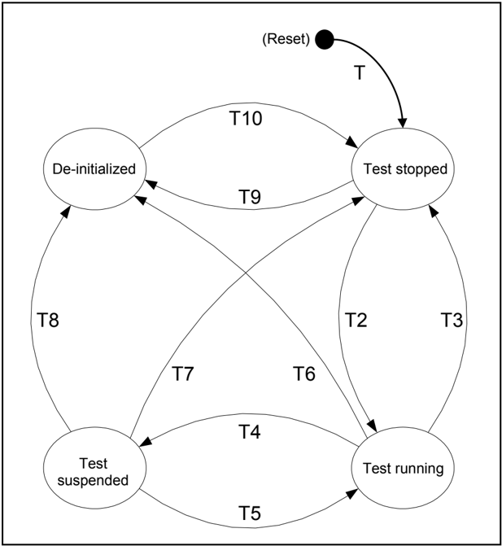

| 事件 | 事件触发 |
|---|---|
| T1 | **API**：[RamTst_Init](#731-ramtst_init) |
| T2 | **API**：[RamTst_RunFullTest](#7316-ramtst_runfulltest)；**API**：[RamTst_RunPartialTest](#7317-ramtst_runpartialtest)；**API**：[RamTst_Allow](#734-ramtst_allow) |
| T3 | **API**：[RamTst_Stop](#733-ramtst_stop)（或 [RamTst_RunFullTest](#7316-ramtst_runfulltest) 结束）（或 [RamTst_RunPartialTest](#7317-ramtst_runpartialtest) 结束） |
| T4 | **API**：[RamTst_Suspend](#735-ramtst_suspend)（或 [RamTst_RunPartialTest](#7317-ramtst_runpartialtest) 结束） |
| T5 | **API**：[RamTst_Resume](#736-ramtst_resume)；**API**：[RamTst_RunPartialTest](#7317-ramtst_runpartialtest) |
| T6 | **API**：[RamTst_DeInit](#732-ramtst_deinit) |
| T7 | **API**：[RamTst_Stop](#733-ramtst_stop) |
| T8 | **API**：[RamTst_DeInit](#732-ramtst_deinit) |
| T9 | **API**：[RamTst_DeInit](#732-ramtst_deinit) |
| T10 | **API**：[RamTst_Init](#731-ramtst_init) |

**注意：** 状态"测试运行中"并不一定意味着测试在连续执行。对于前台测试，它意味着测试由**API**调用直接执行，且**[RamTst_MainFunction](#751-ramtst_mainfunction)()**未被调度。对于后台测试，它仅意味着当**[RamTst_MainFunction](#751-ramtst_mainfunction)()**被调度程序周期性调用时，允许它测试**RAM**的一小部分。

在实际规范中，该状态被进一步划分为"测试允许"（**test allowed**）和"测试运行中"（**test running**）。状态"测试允许"只在后台测试的初始阶段使用；在本概述给出的大图中忽略了这一差别。

所有**API**和配置变量都在本文档的其他位置完整定义。

下表显示了在每个状态下允许调用哪些**API**。对于表中为"N"的单元格，应有一个对应的**DET**错误。

**API**：应用编程接口（**Application Programming Interface**）

| 引起状态图中状态变化的 API | 测试已停止 | 测试运行中（或允许） | 测试已挂起 | 测试已反初始化 |
|---|---|---|---|---|
| [RamTst_Init](#731-ramtst_init) | N | N | N | Y |
| [RamTst_RunFullTest](#7316-ramtst_runfulltest) | Y | N | N | N |
| [RamTst_RunPartialTest](#7317-ramtst_runpartialtest) | Y | N | Y | N |
| [RamTst_Suspend](#735-ramtst_suspend)<sup>1</sup> | N | Y | N | N |
| [RamTst_Resume](#736-ramtst_resume) | N | N | Y | N |
| [RamTst_Stop](#733-ramtst_stop) | N | Y | Y | N |
| [RamTst_Allow](#734-ramtst_allow)<sup>2</sup> | Y | N | N | N |
| [RamTst_DeInit](#732-ramtst_deinit) | Y | Y | Y | N |

| 不引起状态变化的 API | 测试已停止 | 测试运行中（或允许） | 测试已挂起 | 测试已反初始化 |
|---|---|---|---|---|
| [RamTst_GetVersionInfo](#7310-ramtst_getversioninfo) | Y | Y | Y | Y |
| [RamTst_GetExecutionStatus](#737-ramtst_getexecutionstatus) | Y | Y | Y | N |
| [RamTst_GetTestResult](#738-ramtst_gettestresult) | Y | Y | Y | N |
| [RamTst_GetTestResultPerBlock](#739-ramtst_gettestresultperblock) | Y | Y | Y | N |
| [RamTst_GetAlgParams](#7311-ramtst_getalgparams) | Y | Y | Y | N |
| [RamTst_GetTestAlgorithm](#7312-ramtst_gettestalgorithm) | Y | Y | Y | N |
| [RamTst_GetNumberOfTestedCells](#7313-ramtst_getnumberoftestedcells) | Y | Y | Y | N |
| [RamTst_SelectAlgParams](#7314-ramtst_selectalgparams)<sup>3</sup> | Y | N | N | N |
| [RamTst_ChangeNumberOfTestedCells](#7315-ramtst_changenumberoftestedcells)<sup>4</sup> | Y | N | N | N |

**注意：**

> 1 如果**[RamTst_MainFunction](#751-ramtst_mainfunction)()**正在主动测试，[**RamTst_Suspend**](#735-ramtst_suspend)会在当前**[RamTst_MainFunction](#751-ramtst_mainfunction)()**原子序列的末尾引起到"测试已挂起"的状态变化。
> 2 调用[**RamTst_Allow**](#734-ramtst_allow)是为了允许[**RamTst_MainFunction**](#751-ramtst_mainfunction)在被调用时进行测试，它本身不启动任何测试。
> 3 在通过[**RamTst_SelectAlgParams**](#7314-ramtst_selectalgparams)选择另一个配置参数集之前，必须先调用[**RamTst_Stop**](#733-ramtst_stop)。
> 4 如果**[RamTst_MainFunction](#751-ramtst_mainfunction)()**正在主动测试，[**RamTst_ChangeNumberOfTestedCells**](#7315-ramtst_changenumberoftestedcells)会在当前**[RamTst_MainFunction](#751-ramtst_mainfunction)()**原子序列的末尾生效。对于前台测试，[**RamTst_ChangeNumberOfTestedCells**](#7315-ramtst_changenumberoftestedcells)不相关。

下图展示了如何为一种算法配置块，以及**[RamTst_MainFunction](#751-ramtst_mainfunction)()**随后如何在后台测试中测试每个块的存储单元。

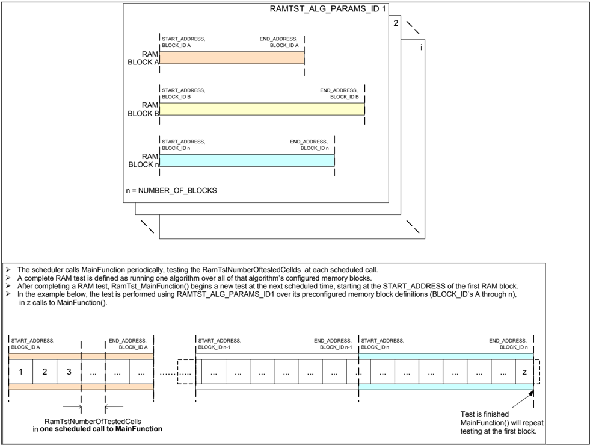

下图展示了调度程序如何调用**[RamTst_MainFunction](#751-ramtst_mainfunction)()**，以及它如何在原子片段之间被更高优先级的任务中断。

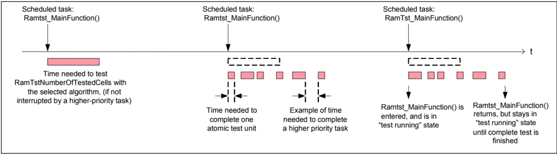

**RamTstNumberOfTestedCells**

**RamTstNumberOfTestedCells**的默认值由配置（预编译或链接）在[**RamTstAlgParams**](#927-ramtstalgparams)容器中设置，并适用于一个算法内定义的每个块，但对于每个[**RamTstAlgParams**](#927-ramtstalgparams)可以不同，因此对于不同算法或同一算法的不同参数集可以不同。**RamTstNumberOfTestedCells**可以在运行时使用**API [RamTst_ChangeNumberOfTestedCells](#7315-ramtst_changenumberoftestedcells)**进行更改。例如，该能力可用于在运行其他某些高带宽任务之前缩短**RAM**测试任务的持续时间，以防止任务超时。当车辆中的异常情况使通常休眠的特殊算法变为活动时，可能出现这种情况。

**RamTstNumberOfTestedCells**仅适用于后台测试。

**RamTstNumberOfTestedCells**不得超过**RamTstMaxNumberOfTestedCells**。

给定[**RamTstAlgParams**](#927-ramtstalgparams)容器的**RamTstNumberOfTestedCells**的绝对最大大小由实现者定义和记录。该最大值应等于块描述所定义的块大小之和。集成器将**RamTstExtNumberOfTestedCells**设置为该绝对最大值（预编译或链接），配置在[**RamTstAlgParams**](#927-ramtstalgparams)容器中。**RamTstExtNumberOfTestedCells**在运行时不可更改。

集成器还为每个[**RamTstAlgParams**](#927-ramtstalgparams)容器配置（预编译或链接）**RamTstMaxNumberOfTestedCells**。集成器必须谨慎选择**RamTstMaxNumberOfTestedCells**，使其根据系统对吞吐量的需求为后台任务中**[RamTst_MainFunction](#751-ramtst_mainfunction)()**的运行时间设置上限。在任何情况下，**RamTstMaxNumberOfTestedCells**都不应设置为大于**RamTstExtNumberOfTestedCells**的值。**RamTstMaxNumberOfTestedCells**在运行时不可更改。

**RamTstNumberOfTestedCells**的最小值由实现者定义和记录。除非由于某些物理原因需要更大的最小值，否则该最小值应定义为一个单元。集成器将**RamTstMinNumberOfTestedCells**配置为大于或等于实现者定义的最小值（预编译或链接）。**RamTstMinNumberOfTestedCells**适用于整个**RAM**测试模块，而不适用于单个算法或参数集。它配置在[**RamTstConfigParams**](#926-ramtstconfigparams)容器中。**RamTstMinNumberOfTestedCells**在运行时不可更改。

单元大小（以位计）也由实现者定义，并且在集成时不可更改，因为对于给定的处理器它应当是一个固定值。因此，相应的参数被规定为发布参数（参见[第9.3章](#93-发布参数)）。

无论在一次**[RamTst_MainFunction](#751-ramtst_mainfunction)()**调度调用中测试了多少个块或部分块，都必须为每个块单独维护测试状态信息。

**[RamTst_MainFunction](#751-ramtst_mainfunction)()**

后台测试的执行方式是：调度程序周期性地调用**[RamTst_MainFunction](#751-ramtst_mainfunction)()**，使用所选算法测试**RamTstNumberOfTestedCells**个存储单元，直到整个定义的**RAM**区域被测试完毕。该**[RamTst_MainFunction](#751-ramtst_mainfunction)()**在调度调用期间的每个原子序列结束时都可以被中断。

**[RamTst_MainFunction](#751-ramtst_mainfunction)()**：

* 由一个或多个原子（即不可中断的）代码片段组成。一个原子序列中可测试的单元数量被视为实现特定的，因此它不由任何（标准化的）配置参数决定。但是，预期在一次原子序列期间至少完整测试**RamTstMinNumberOfTestedCells**个单元。应当注意，一般而言，单元间耦合故障的检测仅限于在同一原子序列中一起被测试的单元。
* 在每个原子片段的末尾，检查内部标志以了解**OS**任务是否更改了状态图的任何参数，并响应询问型**API**。
* 固有地知道：
  * 它正在使用哪种算法；
  * 对于该算法必须测试哪些存储块；
  * 每个块的起始和结束地址；
  * 每次调用要测试的单元数量；
  * 测试的更多参数（参见[第6.3章](#63-一般测试行为)）。
* 记住：
  * 它当前位于哪个块中；
  * 下一次调用应从哪个地址开始；
  * 测试的状态；
  * 总体测试结果；
  * 每个块的测试结果。
* 当达到**RamTstNumberOfTestedCells**时，**[RamTst_MainFunction](#751-ramtst_mainfunction)()**结束该调度调用的测试，并在下一次调度调用中从下一个（保存的）地址开始测试。
* 当在调度调用期间到达某个块的末尾时，**[RamTst_MainFunction](#751-ramtst_mainfunction)()**从下一个块的开头继续测试，并持续到达到**RamTstNumberOfTestedCells**为止。（注意：原子测试序列应谨慎处理跨入下一个块的任何问题。）
* 当所有块都被完整测试后，**[RamTst_MainFunction](#751-ramtst_mainfunction)()**发出一个通知，并从第一个块开始重复测试。
* 如果测试期间发生错误，**[RamTst_MainFunction](#751-ramtst_mainfunction)()**发出一个通知（如果已配置）并继续测试。

**[RamTst_RunFullTest](#7316-ramtst_runfulltest)、[RamTst_RunPartialTest](#7317-ramtst_runpartialtest)**

"完整"和"部分"指的是完整或部分的存储器，而不是存储空间上算法的完整或部分集合。测试仅使用一种算法在指定的存储区域上执行。所需的参数集（包括算法）通过在调用前台测试**API**之前调用**API [RamTst_SelectAlgParams](#7314-ramtst_selectalgparams)**来选择。

注意，由于可以无中断地测试更大的存储区域，对于同一算法，前台测试的故障覆盖通常优于后台测试。

**[RamTst_RunFullTest](#7316-ramtst_runfulltest) API：**

用户不带参数调用[**RamTst_RunFullTest**](#7316-ramtst_runfulltest)（测试参数集已在之前选择）。该测试通常用于系统启动或关闭时的完整**RAM**检查。

序列：

[RamTst_Stop](#733-ramtst_stop)

[RamTst_SelectAlgParams](#7314-ramtst_selectalgparams) 以选择所需的参数集

[RamTst_RunFullTest](#7316-ramtst_runfulltest)

**[RamTst_RunPartialTest](#7317-ramtst_runpartialtest) API：**

用户带一个指定要测试块的参数调用[**RamTst_RunPartialTest**](#7317-ramtst_runpartialtest)。该测试例如用于在立即使用某个指定的存储区之前对其进行检查。该能力用于支撑系统安全概念。

序列：

[RamTst_Stop](#733-ramtst_stop)

[RamTst_SelectAlgParams](#7314-ramtst_selectalgparams) 以选择所需的参数集

[RamTst_RunPartialTest](#7317-ramtst_runpartialtest) (ChosenBlock)

或者，如果之后应继续后台测试：

[RamTst_Suspend](#735-ramtst_suspend)

[RamTst_RunPartialTest](#7317-ramtst_runpartialtest) (ChosenBlock)

## 2. 缩略语

**API**
> 应用编程接口（**Application Programming Interface**）

**CRC**
> 循环冗余校验（**Cyclic Redundancy Check**）

**DEM**
> 诊断事件管理器（**Diagnostic Event Manager**）

**DET**
> 默认错误跟踪器（**Default Error Tracer**）

**DMA**
> 直接内存访问（**Direct Memory Access**）

**ECC**
> 纠错码（**Error Correction Code**）

**NMI**
> 不可屏蔽中断（**Non Maskable Interrupt**）

**RAM**
> 随机存取存储器（**Random Access Memory**）

### 定义

**注意：** 这些定义复制自**AUTOSAR_FO_TR_Glossary.pdf**。

**Synchronous**（同步）：当调用软件实体被阻塞直到被调用的操作被求值时，通信是同步的。调用软件实体通过获得结果来继续其操作。分布式功能单元之间的同步通信必须实现为远程过程调用。

**Asynchronous**（异步）：异步通信不阻塞发送方软件实体。发送方软件实体在不获得通信伙伴响应的情况下继续其操作。通信系统可以就信息的发送给出确认。稍后的响应可以到达发送方软件实体。

## 3. 相关文档

### 3.1. 输入文件

<a id="ref-1"></a>[1] List of Basic Software Modules
> AUTOSAR_CP_TR_BSWModuleList

<a id="ref-2"></a>[2] Layered Software Architecture
> AUTOSAR_CP_EXP_LayeredSoftwareArchitecture

<a id="ref-3"></a>[3] General Requirements on Basic Software Modules
> AUTOSAR_CP_SRS_BSWGeneral

<a id="ref-4"></a>[4] General Requirements on SPAL
> AUTOSAR_CP_SRS_SPALGeneral

<a id="ref-5"></a>[5] Requirements on RAM Test
> AUTOSAR_CP_SRS_RAMTest

<a id="ref-6"></a>[6] Basic Software Module Description Template
> AUTOSAR_CP_TPS_BSWModuleDescriptionTemplate

<a id="ref-7"></a>[7] General Specification of Basic Software Modules
> AUTOSAR_CP_SWS_BSWGeneral

### 3.2. 相关标准和规范

* [8] D1.5-General Architecture；ITEA/EAST-EEA，版本1.0；第3章，第72页及后续。
* [9] D2.1-Embedded Basic Software Structure Requirements；ITEA/EAST-EEA，版本1.0或更高。
* [10] D2.2-Description of existing solutions；ITEA/EAST-EEA，版本1.0或更高。
* [11] ISO 26262-5:2018 - Road vehicles - Functional Safety, Part 5: Product development at the hardware level http://www.iso.org

### 3.3. 相关规范

**AUTOSAR**提供了基础软件模块的通用规范[7](#ref-7)（**AUTOSAR CP SWS BSW General**），它也适用于**RAM**测试。

因此，规范**AUTOSAR CP SWS BSW General**需被视为**RAM**测试的附加和必需规范。

## 4. 约束和假设

**注意：** 为了达到**ISO 26262**合规性，软件实现必须按照**ISO 26262**对系统安全目标所需安全完整性等级（**ASIL** A、**ASIL** B、**ASIL** C 或 **ASIL** D）的要求进行。

### 4.1. 限制

在执行**RAM**测试算法期间，不得允许任何其他软件修改被测试的**RAM**区域。

对于后台测试，为实现这一点，测试代码应以小的原子片段实现。

对于前台测试，假定测试环境提供对被测**RAM**区域的独占访问条件。

该需求背后的理由是**RAM**测试模块无力确保数据一致性（例如在**NMI**期间或在**DMA**传输期间）。

实现者应为每种算法提供集成提示，例如"不要与**DMA**并行使用"。

在多核系统中测试共享内存时，可能无法通过中断锁定获得对多个内存单元的独占访问。在这种情况下，用于共享内存块的测试配置的使用必须限于前台测试和特定的**ECU**状态，更多信息参见第[3](#3-相关文档)章相关文档和[第6.3章](#63-一般测试行为)。

在多核系统中，禁用中断不能保证多于一次内存访问的原子性。由于一次**RAM**测试操作由多于一次的内存访问组成，因此需要更复杂的机制来实现原子性。为此，共享**RAM**和非共享**RAM**需要不同的解决方案。

### 4.2. 完整RAM测试

只有单个内核运行时才应执行完整测试。在主从系统中，这可以在只有主内核活动的初始启动阶段进行。此外，完整测试可以在**ECU**睡眠模式期间执行。这允许**EcuM**延迟其中一个内核的睡眠状态，以在该内核上执行**RAM**测试。

只要能保证跨内核的原子性，就应允许完整的**RAM**测试，已知的时刻有：

1. 在主内核激活任何其他内核之前。
2. 当除一个内核之外的所有内核都已进入睡眠模式时。

### 4.3. 部分RAM测试

在正常运行期间，内存被划分为非共享部分和共享部分。集成器必须为每个**ALGORITHM_ID**指定该算法所作用的内存区域。非共享区域由特定内核拥有，可以像单核情况那样由运行在该内核上的代码进行测试。**MC**中原子性的缺失给共享内存带来了问题。

### 4.4. 汽车域的适用性

无限制。

## 5. 对其他模块的依赖

**RAM**测试的一个实际所选参数集基本上由一组**RAM**块和一个测试算法组成。

**RAM**块和测试算法的可用参数集必须在预编译时配置。负责监控**RAM**健康状态的软件然后必须根据**ECU**安全分析的结果选择一个合适的参数集（它也可以在运行时在几个参数集之间切换）。

在每个参数集内，要测试块的详细定义（例如其起始/结束地址）必须在预编译或链接时配置。控制测试细节的更多参数在文档后面解释（参见[第6.3章](#63-一般测试行为)）。

如果测试环境调用**RAM**测试**API**以立即（在前台）测试全部或部分**RAM**，则测试环境负责根据需要屏蔽中断，或在被测块不被其他模块访问的特定情况下调用测试。

对于后台测试，**ECU**状态管理器或**BSW**调度程序必须调度**RAM**测试主函数。一个周期内测试的单元数量在预编译或链接时根据调度程序的需求设置为默认值。该大小可以在运行时更改以适应调度的变化。此外，用于后台测试的参数集可以在运行时切换，例如使某些关键块在某些**ECU**状态下以比其他**ECU**状态更高的覆盖率被测试，或者在特定**ECU**状态下的测试中排除非关键块。

在开发模式下，将调用模块**DET**的错误钩子函数。

## 6. 功能规格

### 6.1. 需求

**RAM**测试模块应将后台**RAM**测试提供为异步服务。

**RAM**测试模块应将前台**RAM**测试提供为同步服务。

**RAM**测试模块的配置过程应允许在预编译阶段选择不同**RAM**测试算法的一个子集。

该子集将从**RAM**测试算法中选择，如低覆盖率算法、中覆盖率算法、高覆盖率算法以及附加算法的相关规定所述。

如果选择了非破坏性**RAM**测试，**RAM**测试模块应在模块修改要测试的**RAM**区域之前保存该区域。**RAM**测试模块应无中断地执行完整的过程（保存、更改、恢复）。

**注意：** "保存"和"恢复"不一定意味着显式的复制动作。如果测试算法是"透明的"（**transparent**），它在测试之后恢复被测单元的原始内容而无需用于保存的额外内存。

对于破坏性和非破坏性两种选项，**RAM**测试模块应确保测试算法不会覆写**RAM**测试的内部变量。

在写入一个单元之后、读回之前，**RAM**测试模块应提供注入指令的可能性，强制控制器清除其**CPU**内部**cache**。

除非被某种硬件机制覆盖，否则**RAM**测试模块应提供如[11]表D.1所述的低覆盖率测试算法。

除非被某种硬件机制覆盖，否则**RAM**测试模块应提供如[11]表D.1所述的中覆盖率测试算法。

除非被某种硬件机制覆盖，否则**RAM**测试模块应提供如[11]表D.1所述的高覆盖率测试算法。

除非被某种硬件机制覆盖，否则**RAM**测试模块应提供一种测试算法；**RAM**测试模块可以提供附加的供应商或硬件特定的测试算法，或上述算法的不同变体。这些算法必须由实现者清楚地记录，尤其是它们的故障覆盖率（供应商特定的配置参数参见[第9.4章](#94-实现特定的信息和参数)）。

允许处理器特定的测试算法在适当时使用硬件宏和/或支持数据丢失检测（如**CRC**、**ECC**）的中断。实现者必须在基础软件模块描述中描述任何中断例程，并且实现必须遵循中断处理的一般需求。

### 6.2. 错误分类

#### 6.2.1. 开发错误

**RamTst**模块中开发错误的定义：

| 错误类型 | 相关错误代码 | 错误值 |
|---|---|---|
| 在意外的状态下调用了某个**API** | RAMTST_E_STATUS_FAILURE | 0x01 |
| **API**参数超出规定范围 | RAMTST_E_OUT_OF_RANGE | 0x02 |
| 未初始化模块就使用了**API**服务 | RAMTST_E_UNINIT | 0x03 |
| 调用**API**服务时传入了**NULL**指针 | RAMTST_E_PARAM_POINTER | 0x04 |

应最先调用函数[**RamTst_Init**](#731-ramtst_init)，然后才能调用任何其他**RAM**测试函数。如果不遵守该顺序，应向默认错误跟踪器报告错误代码**RAMTST_E_UNINIT**（如果开发错误检测已启用）。

由于特定实现和/或特定硬件属性而检测到的附加错误，应在**RAM**测试设备特定的实现规范中添加。其分类和枚举应与上表所列错误兼容。

#### 6.2.2. 运行时错误

没有运行时错误。

#### 6.2.3. 瞬态故障

没有瞬态故障。

#### 6.2.4. 生产错误

没有生产错误。

#### 6.2.5. 扩展生产错误

生产错误应通过**Dem_SetEventStatus API**上报给诊断事件管理器（**DEM**）。

**RAM**测试应按如下所述检测[**RamTst_MainFunction**](#751-ramtst_mainfunction)函数的扩展生产错误：

| 错误名称 | RAMTST_MAIN_RAM_FAILURE |
|---|---|
| 简要描述 | 测试期间的**RAM**故障。 |
| 详细描述 | 函数[**RamTst_MainFunction**](#751-ramtst_mainfunction)应更新总体测试结果状态，且错误基于[**RamTstAlgParams**](#927-ramtstalgparams)的当前状态进行更新。 |
| 检测条件 | Fail：如果至少有一个块的测试结果为RAMTST_RESULT_NOT_OK。 |
| 检测条件 | Pass：如果所有块的测试结果均为RAMTST_RESULT_OK。 |
| 次要参数 | **[RamTst_MainFunction](#751-ramtst_mainfunction)()**在其下一次被调度调用时测试存储块。测试结果成功时上报Pass。发生错误时始终上报Fail。 |
| 所需时间 | 如果任何块的测试结果为RAMTST_RESULT_NOT_OK，应立即作为错误上报。 |
| 监视频率 | 连续 |

对于[**RamTst_MainFunction**](#751-ramtst_mainfunction)函数，如果至少有一个块的测试结果为RAMTST_RESULT_NOT_OK，则**RAM**测试应判定为Fail。

对于[**RamTst_MainFunction**](#751-ramtst_mainfunction)函数，如果所有块的测试结果均为RAMTST_RESULT_OK，则**RAM**测试应判定为Pass。

**RAM**测试应按如下所述检测[**RamTst_RunFullTest**](#7316-ramtst_runfulltest)函数的扩展生产错误：

| 错误名称 | RAMTST_RUNFL_RAM_FAILURE |
|---|---|
| 简要描述 | 测试期间的**RAM**故障。 |
| 详细描述 | 函数[**RamTst_RunFullTest**](#7316-ramtst_runfulltest)应更新总体测试结果状态，且错误基于[**RamTstAlgParams**](#927-ramtstalgparams)的当前状态进行更新。 |
| 检测条件 | Fail：如果至少有一个块的测试结果为RAMTST_RESULT_NOT_OK。 |
| 检测条件 | Pass：如果所有块的测试结果均为RAMTST_RESULT_OK。 |
| 次要参数 | **[RamTst_RunFullTest](#7316-ramtst_runfulltest)()**无任何中断地测试整个**RAM**空间。测试结果成功时上报Pass。发生错误时始终上报Fail。 |
| 所需时间 | 如果任何块的测试结果为RAMTST_RESULT_NOT_OK，应立即作为错误上报。 |
| 监视频率 | once-per-trip |

对于[**RamTst_RunFullTest**](#7316-ramtst_runfulltest)函数，如果至少有一个块的测试结果为RAMTST_RESULT_NOT_OK，则**RAM**测试应判定为Fail。

对于[**RamTst_RunFullTest**](#7316-ramtst_runfulltest)函数，如果所有块的测试结果均为RAMTST_RESULT_OK，则**RAM**测试应判定为Pass。

**RAM**测试应按如下所述检测[**RamTst_RunPartialTest**](#7317-ramtst_runpartialtest)函数的扩展生产错误：

| 错误名称 | RAMTST_PART_RAM_FAILURE |
|---|---|
| 简要描述 | 测试期间的**RAM**故障。 |
| 详细描述 | 函数[**RamTst_RunPartialTest**](#7317-ramtst_runpartialtest)应更新被测块的测试结果状态，且错误基于[**RamTstAlgParams**](#927-ramtstalgparams)的当前状态进行更新。 |
| 检测条件 | Fail：如果至少有一个块的测试结果为RAMTST_RESULT_NOT_OK。 |
| 检测条件 | Pass：如果所有块的测试结果均为RAMTST_RESULT_OK。 |
| 次要参数 | **[RamTst_RunPartialTest](#7317-ramtst_runpartialtest)()**测试**RAM**的一部分。测试结果成功时上报Pass。发生错误时始终上报Fail。 |
| 所需时间 | 如果任何块的测试结果为RAMTST_RESULT_NOT_OK，应立即作为错误上报。 |
| 监视频率 | once-per-trip |

对于[**RamTst_RunPartialTest**](#7317-ramtst_runpartialtest)函数，如果至少有一个块的测试结果为RAMTST_RESULT_NOT_OK，则**RAM**测试应判定为Fail。

对于[**RamTst_RunPartialTest**](#7317-ramtst_runpartialtest)函数，如果所有块的测试结果均为RAMTST_RESULT_OK，则**RAM**测试应判定为Pass。

### 6.3. 一般测试行为

本节包含同时适用于前台测试和后台测试的详细规范条目。

前台测试和后台测试都由当前所选的参数集[**RamTstAlgParams**](#927-ramtstalgparams)控制，该参数集定义了测试算法、要测试的存储块集合以及控制测试行为的若干属性。

注意，同一测试算法可以用作多个不同[**RamTstAlgParams**](#927-ramtstalgparams)的一部分；没有任何一个[**RamTstAlgParams**](#927-ramtstalgparams)必须包含全部存储块；并且（一般而言）前台测试和后台测试可以选择不同的[**RamTstAlgParams**](#927-ramtstalgparams)。这允许在特定**ECU**模式或不同存储类型中以不同方式灵活使用这些测试。

如果某个块的配置参数**RamTstTestPolicy**被设置为RAMTEST_NON_DESTRUCTIVE，测试算法应在测试之后恢复该块被测单元的原始内存内容（假定未检测到错误）。

**提示：** 对于透明的测试算法，自动满足该行为而无需额外开销。对于非透明的测试算法，该选项意味着保存和恢复内容的运行时/内存开销。

如果某个块的配置参数**RamTstTestPolicy**被设置为RAMTEST_DESTRUCTIVE，测试算法应在测试之后用参数**RamTst_FillPattern**为该块定义的位模式填充被测单元（假定未检测到错误）。

该需求应确保可重现的行为。

**提示：** 对于透明的测试算法，指定该选项意味着运行时开销。对于非透明的算法，如果填充模式对应于算法无论如何都会留下的常量值，则运行时开销可以被最小化。

总体测试结果——对于当前[**RamTstAlgParams**](#927-ramtstalgparams)中的块集合——应为：

* RAMTST_RESULT_NOT_TESTED —— 如果尚未开始任何测试（复位或反初始化之后）。
* RAMTST_RESULT_UNDEFINED —— 如果已开始测试、尚未测试所有块且没有任何块结果为RAMTST_RESULT_NOT_OK。
* RAMTST_RESULT_OK —— 如果所有块都已以结果状态RAMTST_RESULT_OK被测试。
* RAMTST_RESULT_NOT_OK —— 如果至少有一个块的测试结果为RAMTST_RESULT_NOT_OK（无论所有块是否都已被测试）。

特定块（在给定的[**RamTstAlgParams**](#927-ramtstalgparams)中标识）的测试结果应为：

* RAMTST_RESULT_NOT_TESTED —— 如果该块被视为尚未测试。
* RAMTST_RESULT_UNDEFINED —— 如果该块上的测试正在运行。
* RAMTST_RESULT_OK —— 如果该块中的所有内存单元都已被成功测试。
* RAMTST_RESULT_NOT_OK —— 如果该块中至少有一个内存单元检测到故障。

对于给定的处理器类型、内存布局和故障模型，并非测试算法、块配置及其属性的所有可能组合都有意义。例如：

* 实现者可能希望排除某种测试算法和**RamTstTestPolicy**的组合。
* 由于性能原因，某种测试算法可能必须被排除在后台测试之外。
* 由于性能原因或由于在正常运行下无法保证独占访问（例如对于共享内存），某些存储块可能必须被排除在后台测试之外。

由此得出以下需求：

实现者应记录配置参数组合的可能限制以及它们在后台/前台测试中的使用。在适用的情况下，他应通过在基础软件模块描述中附加预定义或推荐的配置参数值的定义来支持这一点。

## 7. API规范

### 7.1. 导入的类型

本章列出了所包含的变量和常量的数据类型定义。

| 模块 | 头文件 | 导入的类型 |
|---|---|---|
| Dem | Rte_Dem_Type.h | Dem_EventIdType |
| Dem | Rte_Dem_Type.h | Dem_EventStatusType |
| Std | Std_Types.h | Std_ReturnType |
| Std | Std_Types.h | Std_VersionInfoType |

### 7.2. 类型定义

#### 7.2.1. RamTst_ConfigType

结构类型。元素为实现特定。**RamTst**模块的配置数据结构。可通过**RamTst.h**获得。

#### 7.2.2. RamTst_ExecutionStatusType

枚举类型，取值：

* **RAMTST_EXECUTION_UNINIT**（0x00）：**RAM**测试未初始化或不可用。
* **RAMTST_EXECUTION_STOPPED**（0x01）：**RAM**测试已停止，可以在前台启动或在后台被允许。
* **RAMTST_EXECUTION_RUNNING**（0x02）：**RAM**测试当前正在运行。
* **RAMTST_EXECUTION_SUSPENDED**（0x03）：后台**RAM**测试正在等待被恢复。

这是**API**服务**[RamTst_GetExecutionStatus](#737-ramtst_getexecutionstatus)()**返回的状态值。可通过**RamTst.h**获得。

对于类型**RamTst_ExecutionStatusType**，枚举值**RAMTST_EXECUTION_UNINIT**应为复位之后的默认值。

#### 7.2.3. RamTst_TestResultType

枚举类型，取值：

* **RAMTST_RESULT_NOT_TESTED**（0x00）：**RAM**测试未执行。
* **RAMTST_RESULT_OK**（0x01）：**RAM**测试的测试结果为OK。
* **RAMTST_RESULT_NOT_OK**（0x02）：**RAM**测试的测试结果为NOT-OK。
* **RAMTST_RESULT_UNDEFINED**（0x03）：**RAM**测试当前正在运行。

这是**API**服务**[RamTst_GetTestResult](#738-ramtst_gettestresult)()**返回的状态值。可通过**RamTst.h**获得。

对于类型**RamTst_TestResultType**（总体测试结果），枚举值**RAMTST_RESULT_NOT_TESTED**应为复位之后的默认值。

有关该状态用法的更多细节，请参见[第6.3章](#63-一般测试行为)。

#### 7.2.4. RamTst_AlgParamsIdType

类型，派生自uint8，范围0...255。用于标识测试算法的一组配置参数的数据类型。可通过**RamTst.h**获得。

对于类型**RamTst_AlgParamsIdType**，值0应表示未选择任何测试参数（进而是任何测试算法）。它应是相应变量复位之后的默认值。

#### 7.2.5. RamTst_AlgorithmType

枚举类型，取值：

* **RAMTST_ALGORITHM_UNDEFINED**（0x00）：未定义的算法（未初始化的值）。
* **RAMTST_CHECKERBOARD_TEST**（0x01）：Checkerboard测试算法。
* **RAMTST_MARCH_TEST**（0x02）：March测试算法。
* **RAMTST_WALK_PATH_TEST**（0x03）：Walk path测试算法。
* **RAMTST_GALPAT_TEST**（0x04）：Galpat测试算法。
* **RAMTST_TRANSP_GALPAT_TEST**（0x05）：透明Galpat测试算法。
* **RAMTST_ABRAHAM_TEST**（0x06）：Abraham测试算法。

这是**API**服务**[RamTst_GetTestAlgorithm](#7312-ramtst_gettestalgorithm)()**返回的值。可通过**RamTst.h**获得。

对于类型**RamTst_AlgorithmType**，枚举值**RAMTST_ALGORITHM_UNDEFINED**应为复位之后的默认值。

类型**RamTst_AlgorithmType**应只包含在预编译阶段被选择可用的算法的枚举。

注意，如果定义了供应商特定的算法（参见[第9.4章](#94-实现特定的信息和参数)），实现者（或代码生成器）应相应地扩展**RamTst_AlgorithmType**的枚举字段。

#### 7.2.6. RamTst_NumberOfTestedCellsType

类型，派生自uint32，范围1...(2^32-1)。被测试**RAM**单元数量的数据类型。可通过**RamTst.h**获得。

#### 7.2.7. RamTst_NumberOfBlocksType

类型，派生自uint16，范围1...65535。用于标识或统计测试配置参数中给定的**RAM**块的数据类型。可通过**RamTst.h**获得。

### 7.3. 函数定义

这是提供给上层模块的函数的列表。

#### 7.3.1. RamTst_Init

**说明**: 服务 ID 0x00。**RAM**测试初始化服务。可通过**RamTst.h**获得。本服务为同步调用，不可重入。参数 ConfigPtr（in）：指向所选配置集的指针。参数（inout）：无。参数（out）：无。返回值：无。

```C
void RamTst_Init ( const RamTst_ConfigType* ConfigPtr )
```

配置指针**ConfigPtr**应始终为**NULL_PTR**值。配置指针**ConfigPtr**当前未被使用，因此应设置为**NULL_PTR**值。

**注意：** 另请参见[第9.2.1章](#921-变体)中的变体。

函数**RamTst_Init**应初始化所有与**RAM**测试相关的寄存器和全局变量，并将执行状态更改为RAMTST_EXECUTION_STOPPED。测试被初始化为使用默认测试参数集（**RamTstDefaultAlgParamsId**），即由其[**RamTstAlgParams**](#927-ramtstalgparams)容器所配置的参数集。

如果**DET**已启用且**RAM**测试的执行状态不是RAMTST_EXECUTION_UNINIT，函数**RamTst_Init**应向**DET**报告错误值[RAMTST_E_STATUS_FAILURE](#621-开发错误)，然后立即返回。

#### 7.3.2. RamTst_DeInit

**说明**: 服务 ID 0x0c。**RAM**测试反初始化服务。可通过**RamTst.h**获得。本服务为同步调用，不可重入。参数（in）：无。参数（inout）：无。参数（out）：无。返回值：无。

```C
void RamTst_DeInit ( void )
```

函数**RamTst_DeInit**应反初始化所有由[**RamTst_Init**](#731-ramtst_init)初始化的、与**RAM**测试相关的寄存器和全局变量，并将执行状态更改为RAMTST_EXECUTION_UNINIT。

如果在**RamTst_DeInit**调用之后**RAM**测试处于RAMTST_EXECUTION_UNINIT状态，此时调用任何**RamTst**模块函数（[**RamTst_Init**](#731-ramtst_init)除外）可能导致未知的软件行为。

#### 7.3.3. RamTst_Stop

**说明**: 服务 ID 0x02。停止**RAM**测试的服务。可通过**RamTst.h**获得。本服务为异步调用，不可重入。参数（in）：无。参数（inout）：无。参数（out）：无。返回值：无。

```C
void RamTst_Stop ( void )
```

当**RamTst_Stop**函数被调用时，[**RamTst_MainFunction**](#751-ramtst_mainfunction)仍应完成当前的原子序列（如果它正在执行），之后状态应设置为RAMTST_EXECUTION_STOPPED。测试结果被保留，但测试参数和循环数据不保留。

在**RamTst_Stop**调用之后，在调用[**RamTst_Allow**](#734-ramtst_allow)之前，调度程序调用[**RamTst_MainFunction**](#751-ramtst_mainfunction)时它不得再次开始测试。

如果**DET**已启用且**RAM**测试的执行状态不是RAMTST_EXECUTION_RUNNING或RAMTST_EXECUTION_SUSPENDED，函数**RamTst_Stop**应向**DET**报告错误值[RAMTST_E_STATUS_FAILURE](#621-开发错误)，然后立即返回。

**RamTst_Stop API**可以通过容器[**RamTstCommon**](#924-ramtstcommon)内的配置参数**RamTstStopApi**启用或禁用。

#### 7.3.4. RamTst_Allow

**说明**: 服务 ID 0x03。在调用"[RamTst_Stop](#733-ramtst_stop)"之后继续**RAM**测试的服务。可通过**RamTst.h**获得。本服务为异步调用，不可重入。参数（in）：无。参数（inout）：无。参数（out）：无。返回值：无。

```C
void RamTst_Allow ( void )
```

如果[**RamTst_MainFunction**](#751-ramtst_mainfunction)已被停止，函数**RamTst_Allow**应允许[**RamTst_MainFunction**](#751-ramtst_mainfunction)在其下一次被调度调用时执行测试。为此，如果执行状态为RAMTST_EXECUTION_STOPPED，它应将执行状态更改为RAMTST_EXECUTION_RUNNING。测试应使用默认测试参数集（**RamTstDefaultAlgParamsId**）继续，即由其[**RamTstAlgParams**](#927-ramtstalgparams)容器所配置的参数集。

如果**DET**已启用且执行状态不是RAMTST_EXECUTION_STOPPED，函数**RamTst_Allow**应向**DET**报告错误值[RAMTST_E_STATUS_FAILURE](#621-开发错误)，然后立即返回。

**RamTst_Allow API**可以通过容器[**RamTstCommon**](#924-ramtstcommon)内的配置参数**RamTstAllowApi**启用或禁用。

#### 7.3.5. RamTst_Suspend

**说明**: 服务 ID 0x0d。挂起后台**RAM**测试当前操作的服务，直到调用**Resume**。可通过**RamTst.h**获得。本服务为异步调用，不可重入。参数（in）：无。参数（inout）：无。参数（out）：无。返回值：无。

```C
void RamTst_Suspend ( void )
```

函数**RamTst_Suspend**应临时禁止[**RamTst_MainFunction**](#751-ramtst_mainfunction)在其下一次被调度调用时执行测试。当调用**RamTst_Suspend**且执行状态为RAMTST_EXECUTION_RUNNING时，测试在当前原子序列之后停止，测试结果和当前测试状态被保留，且执行状态被更改为RAMTST_EXECUTION_SUSPENDED。

如果**DET**已启用且执行状态不是RAMTST_EXECUTION_RUNNING，函数**RamTst_Suspend**应向**DET**报告错误值[RAMTST_E_STATUS_FAILURE](#621-开发错误)，然后立即返回。

**RamTst_Suspend API**可以通过容器[**RamTstCommon**](#924-ramtstcommon)内的配置参数**RamTstSuspendApi**启用或禁用。

#### 7.3.6. RamTst_Resume

**说明**: 服务 ID 0x0e。允许后台**RAM**测试从被挂起位置继续的服务。可通过**RamTst.h**获得。本服务为异步调用，不可重入。参数（in）：无。参数（inout）：无。参数（out）：无。返回值：无。

```C
void RamTst_Resume ( void )
```

函数**RamTst_Resume**应允许[**RamTst_MainFunction**](#751-ramtst_mainfunction)在其下一次被调度调用时从被挂起的位置继续测试。测试根据保存的测试状态继续。如果执行状态为RAMTST_EXECUTION_SUSPENDED，函数**RamTst_Resume**应将其更改为RAMTST_EXECUTION_RUNNING。

如果**DET**已启用且**RAM**测试模块的执行状态不是RAMTST_EXECUTION_SUSPENDED，函数**RamTst_Resume**应向**DET**报告错误值[RAMTST_E_STATUS_FAILURE](#621-开发错误)，然后立即返回。

**RamTst_Resume API**可以通过容器[**RamTstCommon**](#924-ramtstcommon)内的配置参数**RamTstResumeApi**启用或禁用。

#### 7.3.7. RamTst_GetExecutionStatus

**说明**: 服务 ID 0x04。返回当前**RAM**测试状态的服务。可通过**RamTst.h**获得。本服务为同步调用，可重入。参数（in）：无。参数（inout）：无。参数（out）：无。返回值：[**RamTst_ExecutionStatusType**](#722-ramtst_executionstatustype)，参见类型定义。

```C
RamTst_ExecutionStatusType RamTst_GetExecutionStatus ( void )
```

函数**RamTst_GetExecutionStatus**应返回当前的**RAM**测试执行状态。

**RamTst_GetExecutionStatus API**可以通过容器[**RamTstCommon**](#924-ramtstcommon)内的配置参数**RamTstGetExecutionStatusApi**启用或禁用。

#### 7.3.8. RamTst_GetTestResult

**说明**: 服务 ID 0x05。返回当前**RAM**测试结果的服务。可通过**RamTst.h**获得。本服务为同步调用，可重入。参数（in）：无。参数（inout）：无。参数（out）：无。返回值：[**RamTst_TestResultType**](#723-ramtst_testresulttype)，参见类型定义。

```C
RamTst_TestResultType RamTst_GetTestResult ( void )
```

函数**RamTst_GetTestResult**应返回当前的**RAM**测试结果。

测试结果按照[第6.3章](#63-一般测试行为)确定。

**RamTst_GetTestResult API**可以通过容器[**RamTstCommon**](#924-ramtstcommon)内的配置参数**RamTstGetTestResultApi**启用或禁用。

#### 7.3.9. RamTst_GetTestResultPerBlock

**说明**: 服务 ID 0x06。返回指定块当前**RAM**测试结果的服务。可通过**RamTst.h**获得。本服务为同步调用，可重入。参数 BlockID（in）：标识该块。参数（inout）：无。参数（out）：无。返回值：[**RamTst_TestResultType**](#723-ramtst_testresulttype)，参见类型定义。

```C
RamTst_TestResultType RamTst_GetTestResultPerBlock ( RamTst_NumberOfBlocksType BlockID )
```

函数**RamTst_GetTestResultPerBlock**应返回指定块当前的**RAM**测试结果。

每块的测试结果按照[第6.3章](#63-一般测试行为)确定。

如果**DET**已启用且**BlockID**超出范围，函数**RamTst_GetTestResultPerBlock**应向**DET**报告错误值[RAMTST_E_OUT_OF_RANGE](#621-开发错误)并返回测试结果值RAMTST_RESULT_UNDEFINED。

**提示：** 这里的"超出范围"是指**BlockID**与当前所选[**RamTstAlgParams**](#927-ramtstalgparams)/[RamTstBlockParams](#928-ramtstblockparams)/**RamTstBlockId**所配置的值之一不匹配，参见ECUC_RamTst_00143。

**RamTst_GetTestResultPerBlock API**可以通过容器[**RamTstCommon**](#924-ramtstcommon)内的配置参数**RamTstGetTestResultPerBlockApi**启用或禁用。

#### 7.3.10. RamTst_GetVersionInfo

**说明**: 服务 ID 0x0a。返回本模块版本信息的服务。可通过**RamTst.h**获得。本服务为同步调用，可重入。参数（in）：无。参数（inout）：无。参数（out）versioninfo：指向存储本模块版本信息的位置/地址的指针。返回值：无。

```C
void RamTst_GetVersionInfo ( Std_VersionInfoType* versioninfo )
```

如果函数**RamTst_GetVersionInfo**以**NULL**指针作为参数被调用，它应立即返回而不做任何进一步的动作；如果**DET**已启用，该函数应向**DET**模块报告错误值[RAMTST_E_PARAM_POINTER](#621-开发错误)。

**RamTst_GetVersionInfo API**可以通过容器[**RamTstCommon**](#924-ramtstcommon)内的配置参数**RamTstVersionInfoApi**启用或禁用。

#### 7.3.11. RamTst_GetAlgParams

**说明**: 服务 ID 0x12。返回当前**RAM**测试算法参数集 ID 的服务。可通过**RamTst.h**获得。本服务为同步调用，不可重入。参数（in）：无。参数（inout）：无。参数（out）：无。返回值：[**RamTst_AlgParamsIdType**](#724-ramtst_algparamsidtype)，参见类型定义。

```C
RamTst_AlgParamsIdType RamTst_GetAlgParams ( void )
```

函数**RamTst_GetAlgParams**应返回当前所选测试算法参数集的 ID（即容器[**RamTstConfigParams**](#926-ramtstconfigparams)中当前所选[**RamTstAlgParams**](#927-ramtstalgparams)的 ID）。

**RamTst_GetAlgParams API**可以通过容器[**RamTstCommon**](#924-ramtstcommon)内的配置参数**RamTstGetAlgParamsApi**启用或禁用。

#### 7.3.12. RamTst_GetTestAlgorithm

**说明**: 服务 ID 0x07。返回当前**RAM**测试算法的服务。可通过**RamTst.h**获得。本服务为同步调用，不可重入。参数（in）：无。参数（inout）：无。参数（out）：无。返回值：[**RamTst_AlgorithmType**](#725-ramtst_algorithmtype)，参见类型定义。

```C
RamTst_AlgorithmType RamTst_GetTestAlgorithm ( void )
```

函数**RamTst_GetTestAlgorithm**应返回当前的**RAM**测试算法。

**RamTst_GetTestAlgorithm API**可以通过容器[**RamTstCommon**](#924-ramtstcommon)内的配置参数**RamTstGetTestAlgorithmApi**启用或禁用。

#### 7.3.13. RamTst_GetNumberOfTestedCells

**说明**: 服务 ID 0x09。返回每个主函数周期当前被测试单元数量的服务。可通过**RamTst.h**获得。本服务为同步调用，不可重入。参数（in）：无。参数（inout）：无。参数（out）：无。返回值：[**RamTst_NumberOfTestedCellsType**](#726-ramtst_numberoftestedcellstype)，每个周期当前被测试的单元数量。

```C
RamTst_NumberOfTestedCellsType RamTst_GetNumberOfTestedCells ( void )
```

函数**RamTst_GetNumberofTestedCells**应读取每个周期当前被测试的单元数量。

**RamTst_GetNumberOfTestedCells API**可以通过容器[**RamTstCommon**](#924-ramtstcommon)内的配置参数**RamTstGetNumberOfTestedCellsApi**启用或禁用。

#### 7.3.14. RamTst_SelectAlgParams

**说明**: 服务 ID 0x0b。用于设置测试算法及其参数集的服务。可通过**RamTst.h**获得。本服务为同步调用，不可重入。参数 NewAlgParamsId（in）：标识要使用的参数集。参数（inout）：无。参数（out）：无。返回值：无。

```C
void RamTst_SelectAlgParams ( RamTst_AlgParamsIdType NewAlgParamsId )
```

函数**RamTst_SelectAlgParams**应选择**RAM**测试模块要使用的测试参数集（即容器[**RamTstConfigParams**](#926-ramtstconfigparams)中的[**RamTstAlgParams**](#927-ramtstalgparams)之一）。

**注意：** 取决于[**RamTstAlgParams**](#927-ramtstalgparams)的配置内容，该函数可用于选择不同的测试算法。但该函数也可用于为同一测试算法选择不同的块集合（例如用于前台测试）。

函数**RamTst_SelectAlgParams**应使用'NewAlgParamsId'的值重新初始化所有与**RAM**测试相关的寄存器和全局变量。

如果**DET**已启用且参数'NewAlgParamsId'超出范围，函数**RamTst_SelectAlgParams**应向**DET**报告错误值[RAMTST_E_OUT_OF_RANGE](#621-开发错误)，并保持当前[**RamTstAlgParams**](#927-ramtstalgparams)不变。

**提示：** "超出范围"是指'NewAlgParamsId'与[**RamTstAlgParams**](#927-ramtstalgparams)/RamTstAlgParamsId 所配置的值之一不匹配，参见ECUC_RamTst_00179。

如果**DET**已启用且**RAM**测试模块的执行状态不是RAMTST_EXECUTION_STOPPED，函数**RamTst_SelectAlgParams**应向**DET**报告错误值[RAMTST_E_STATUS_FAILURE](#621-开发错误)，然后立即从函数返回。

函数**RamTst_SelectAlgParams**应初始化测试结果状态（按照[第6.3章](#63-一般测试行为)）。

**提示：** 在这一点上保留之前的测试结果是没有意义的（如本文档早期版本所规定的那样），因为块结构可能因所选参数集而改变，之前的结果可能无法再被解释。如果测试环境想保存之前的结果，它可以在调用**RamTst_SelectAlgParams**之前通过[**RamTst_GetTestResult**](#738-ramtst_gettestresult)或[**RamTst_GetTestResultPerBlock**](#739-ramtst_gettestresultperblock)轻松获取它们。

**RamTst_SelectAlgParams API**可以通过容器[**RamTstCommon**](#924-ramtstcommon)内的配置参数**RamTstSelectAlgParamsApi**启用或禁用。

#### 7.3.15. RamTst_ChangeNumberOfTestedCells

**说明**: 服务 ID 0x08。更改当前被测试单元数量的服务。可通过**RamTst.h**获得。本服务为同步调用，不可重入。参数 NewNumberOfTestedCells（in）：参见类型定义。参数（inout）：无。参数（out）：无。返回值：无。

```C
void RamTst_ChangeNumberOfTestedCells ( RamTst_NumberOfTestedCellsType NewNumberOfTestedCells )
```

函数**RamTst_ChangeNumberOfTestedCells**应更改当前被测试单元的数量（对于后台测试）。

如果**DET**已启用且参数**NewNumberOfTestedCells**超出范围（最小值 = MinNumberOfTestedCells / 最大值 = MaxNumberOfTestedCells），函数**RamTst_ChangeNumberOfTestedCells**应向**DET**报告错误值[RAMTST_E_OUT_OF_RANGE](#621-开发错误)。该函数应保持被测试单元的数量不变。

如果**RAM**测试模块的执行状态不是RAMTST_EXECUTION_STOPPED，函数**RamTst_ChangeNumberOfTestedCells**不得更改当前被测试单元的数量，并且（如果**DET**已启用）应向**DET**报告错误值[RAMTST_E_STATUS_FAILURE](#621-开发错误)。

**RamTst_ChangeNumberOfTestedCells API**可以通过容器[**RamTstCommon**](#924-ramtstcommon)内的配置参数**RamTstChangeNumOfTestedCellsApi**启用或禁用。

#### 7.3.16. RamTst_RunFullTest

**说明**: 服务 ID 0x10。在前台执行完整**RAM**测试的服务。可通过**RamTst.h**获得。本服务为同步调用，不可重入。参数（in）：无。参数（inout）：无。参数（out）：无。返回值：无。

```C
void RamTst_RunFullTest ( void )
```

如果**RAM**测试执行状态为RAMTST_EXECUTION_STOPPED，函数**RamTst_RunFullTest**应测试所选[**RamTstAlgParams**](#927-ramtstalgparams)中定义的所有**RAM**块。

如果**DET**已启用且**RAM**测试模块的执行状态不是RAMTST_EXECUTION_STOPPED，函数**RamTst_RunFullTest**应向**DET**报告错误值[RAMTST_E_STATUS_FAILURE](#621-开发错误)，然后立即返回。

如果**RAM**测试执行状态为RAMTST_EXECUTION_STOPPED，函数**RamTst_RunFullTest**应在测试期间将执行状态设置为RAMTST_EXECUTION_RUNNING，并在返回之前将其恢复为RAMTST_EXECUTION_STOPPED。

函数**RamTst_RunFullTest**应按照[第6.3章](#63-一般测试行为)更新单个块的测试结果状态。

函数**RamTst_RunFullTest**应按照[第6.3章](#63-一般测试行为)更新总体测试结果状态。如果至少有一个块的测试结果为RAMTST_RESULT_NOT_OK，则该函数应向**DEM**上报生产错误**RAMTST_RUNFL_RAM_FAILURE**。

**RamTst_RunFullTest API**可以通过容器[**RamTstCommon**](#924-ramtstcommon)内的配置参数**RamTstRunFullTestApi**启用或禁用。

内存内容的破坏或恢复按照[第6.3章](#63-一般测试行为)的规定处理。

函数**RamTst_RunFullTest**的前置条件参见[第4.1章](#41-限制)。

**实现提示：**

出于效率和最佳故障覆盖的考虑，**RamTst_RunFullTest**的实现应假定在调用期间它对[**RamTstAlgParams**](#927-ramtstalgparams)中包含的所有内存块拥有独占访问权。这使得测试算法可以应用于比后台测试更宽的存储范围，从而提高故障覆盖，尤其是耦合故障的覆盖。

因此，测试环境有责任提供适当的资源锁定，或在所选[**RamTstAlgParams**](#927-ramtstalgparams)的内存块未被使用的**ECU**模式下调用该函数。测试环境还必须确保在前台测试期间不调度[**RamTst_MainFunction**](#751-ramtst_mainfunction)。

测试算法通常需要在给定存储范围上进行多次写入和读取循环。有些算法还需要多次遍历该范围。被测试的范围是对应于一个块（这意味着完整测试被拆分为多个范围），还是甚至包含多个或所有块，取决于实现。这取决于性能问题和假定的故障模型。在任何情况下，都必须清楚地记录测试行为。

#### 7.3.17. RamTst_RunPartialTest

**说明**: 服务 ID 0x11。在前台测试一个**RAM**块的服务。可通过**RamTst.h**获得。本服务为同步调用，不可重入。参数 BlockId（in）：标识所选[**RamTstAlgParams**](#927-ramtstalgparams)集合中要被测试的单个**RAM**块。参数（inout）：无。参数（out）：无。返回值：无。

```C
void RamTst_RunPartialTest ( RamTst_NumberOfBlocksType BlockId )
```

如果**RAM**测试执行状态为RAMTST_EXECUTION_STOPPED或RAMTST_EXECUTION_SUSPENDED，函数**RamTst_RunPartialTest**应测试指定的**RAM**块。

如果**DET**已启用且**RAM**测试执行状态既不是RAMTST_EXECUTION_STOPPED也不是RAMTST_EXECUTION_SUSPENDED，函数**RamTst_RunPartialTest**应向**DET**报告错误值[RAMTST_E_STATUS_FAILURE](#621-开发错误)，然后立即返回。

如果**RAM**测试执行状态为RAMTST_EXECUTION_STOPPED或RAMTST_EXECUTION_SUSPENDED，函数**RamTst_RunPartialTest**应在测试期间将执行状态设置为RAMTST_EXECUTION_RUNNING，并在测试之后将其恢复为之前的状态（即调用该函数时的状态）。

函数**RamTst_RunPartialTest**应按照[第6.3章](#63-一般测试行为)更新被测块的测试结果状态。如果该块的测试结果为RAMTST_RESULT_NOT_OK，则该函数应向**DEM**上报生产错误**RAMTST_PART_RAM_FAILURE**。

一次成功的前台部分测试应将块特定的结果设置为RAMTST_RESULT_OK。它不得修改总体测试结果。一次失败的前台部分测试应将块特定的结果和总体测试结果都设置为RAMTST_RESULT_NOT_OK。

如果**DET**已启用且**BlockId**超出范围，函数**RamTst_RunPartialTest**应向**DET**报告错误值[RAMTST_E_OUT_OF_RANGE](#621-开发错误)，然后立即返回。

**注意：**

上文中的"超出范围"是指**BlockId**与当前所选块标识符（[RamTstAlgParams](#927-ramtstalgparams)/[RamTstBlockParams](#928-ramtstblockparams)/RamTstBlockId）所配置的值之一不匹配。

更新测试结果将覆写之前对该块的测试结果以及失败情况下的总体测试结果，包括来自被挂起后台测试的结果。

**RamTst_RunPartialTest API**可以通过容器[**RamTstCommon**](#924-ramtstcommon)内的配置参数**RamTstRunPartialTestApi**启用或禁用。

内存内容的破坏或恢复按照[第6.3章](#63-一般测试行为)的规定处理。

函数**RamTst_RunPartialTest**的前置条件参见[第4.1章](#41-限制)。

**实现提示：**

为[**RamTst_RunFullTest**](#7316-ramtst_runfulltest)给出的实现提示在适用于单个块的范围内同样适用。

### 7.4. 回调通知

由于**RAM**测试是一个驱动程序模块，它不实现来自下层模块的任何回调函数。

### 7.5. 调度函数

详情请参阅**SWS_BSWGeneral**中的第8.5章"调度函数"（**Scheduled functions**）。

#### 7.5.1. RamTst_MainFunction

**说明**: 服务 ID 0x01。在后台执行**RAM**测试的调度函数。可通过**SchM_RamTst.h**获得。

```C
void RamTst_MainFunction ( void )
```

如果**RAM**测试执行状态为RAMTST_EXECUTION_RUNNING，函数**RamTst_MainFunction**应继续测试所选[**RamTstAlgParams**](#927-ramtstalgparams)中定义的**RAM**块。

如果**RAM**测试执行状态为RAMTST_EXECUTION_RUNNING且尚未测试任何块（该函数的第一次调用），则函数**RamTst_MainFunction**应从所选[**RamTstAlgParams**](#927-ramtstalgparams)中第一个已配置的**RAM**块开始测试。

如果调用该**API**时**RAM**测试执行状态不是RAMTST_EXECUTION_RUNNING，函数**RamTst_MainFunction**应立即返回而不做任何动作。

函数**RamTst_MainFunction**应按照[第6.3章](#63-一般测试行为)更新单个块的测试结果状态。

函数**RamTst_MainFunction**应按照[第6.3章](#63-一般测试行为)更新总体测试结果状态。如果至少有一个块的测试结果为RAMTST_RESULT_NOT_OK，则该函数应向**DEM**上报生产错误**RAMTST_MAIN_RAM_FAILURE**。

在函数**RamTst_MainFunction**完成了所选[**RamTstAlgParams**](#927-ramtstalgparams)中配置的所有**RAM**块的测试之后，下一次调用函数**RamTst_MainFunction**应从头开始重新测试。

函数**RamTst_MainFunction**应在一次调用中测试定义数量的**RAM**单元。定义的数量由函数[**RamTst_ChangeNumberOfTestedCells**](#7315-ramtst_changenumberoftestedcells)或初始化指定。

**注意：**

更新测试结果将覆写当前块之前的测试结果以及总体测试结果，包括当前块的前台部分测试之后后台测试被恢复的情况。

内存内容的破坏或恢复按照[第6.3章](#63-一般测试行为)的规定处理。

函数**RamTst_MainFunction**的前置条件参见[第4.1章](#41-限制)。

**实现提示：**

一般而言，一次**RamTst_MainFunction**调用中的实际测试算法必须在一个或多个原子序列内执行。只有在一个原子序列内，算法写入的内存才允许在测试期间被破坏。这意味着算法只能应用于在一个原子序列内被访问的那些单元，因此（后台测试）对单元间耦合故障的检测仅限于包含在一个原子序列内的那些单元。

原子序列可以通过**BSW**模块描述声明为独占区域（参见[3](#ref-3)），将实际的锁定方法留给**BSW**调度程序；或者通过中断锁定直接实现（参见[3](#ref-3)）。后者是被允许的，因为**RAM**测试模块属于**MCAL**层。

### 7.6. 期望接口

本章列出了需要从其他模块获得的所有接口。

#### 7.6.1. 强制接口

本章定义了实现模块核心功能所需的所有接口。

| API函数 | 头文件 | 描述 |
|---|---|---|
| Dem_SetEventStatus | Dem.h | 由**SW-C**或**BSW**模块调用，以向**Dem**上报监控状态信息。调用Dem_SetEventStatus的**BSW**模块可以安全地忽略返回值。仅当（{Dem/DemConfigSet/DemEventParameter/DemEventReportingType} == STANDARD_REPORTING）时此**API**才可用。 |

#### 7.6.2. 可选接口

本章定义了实现模块可选功能所需的所有接口。

| API函数 | 头文件 | 描述 |
|---|---|---|
| Det_ReportError | Det.h | 用于报告开发错误的服务。 |

#### 7.6.3. 可配置接口

本章列出了目标函数可被配置的所有接口。目标函数通常是回调函数。

**术语和定义：**

可重入（**Reentrant**）：接口应是可重入的。

无关（**Don't care**）：接口的可重入性与本模块无关（一般而言，此时它不可重入）。

回调通知应没有参数且没有返回值。

如果回调通知被配置为null指针，**RAM**测试模块不得执行该回调。

##### 7.6.3.1. RamTst_TestCompletedNotification

| 服务名称 | RamTst_TestCompletedNotification |
|---|---|
| 语法 | void RamTst_TestCompletedNotification ( void ) |
| 同步/异步 | 同步 |
| 可重入性 | 无关（**Don't care**） |
| 参数（in） | 无 |
| 参数（inout） | 无 |
| 参数（out） | 无 |
| 返回值 | 无 |
| 描述 | 每当当前测试配置的所有**RAM**块都在后台被测试完毕时，都应调用函数RamTst_TestCompleted。 |
| 可通过 | RamTst.h |

每当在后台测试中测试完所选参数集的所有**RAM**块时，**RAM**测试模块都应调用回调**RamTst_TestCompletedNotification**。

回调通知**RamTst_TestCompleted**需要在容器[**RamTstConfigParams**](#926-ramtstconfigparams)中配置参数**RamTstTestCompletedNotification**。

##### 7.6.3.2. RamTst_ErrorNotification

| 服务名称 | RamTst_ErrorNotification |
|---|---|
| 语法 | void RamTst_ErrorNotification ( void ) |
| 同步/异步 | 同步 |
| 可重入性 | 无关（**Don't care**） |
| 参数（in） | 无 |
| 参数（inout） | 无 |
| 参数（out） | 无 |
| 返回值 | 无 |
| 描述 | 每当所选测试算法在后台检测到**RAM**故障时，都应调用函数RamTst_Error。 |
| 可通过 | RamTst.h |

每当所选参数集的测试算法在后台测试中检测到**RAM**故障时，**RAM**测试模块都应调用回调**RamTst_ErrorNotification**。

回调通知**RamTst_Error_Notification**需要在容器[**RamTstConfigParams**](#926-ramtstconfigparams)中配置参数**RamTstTestErrorNotification**。

## 8. 时序图

### 8.1. RamTst_MainFunction（示例）

第一个示例序列展示了**RAM**测试模块的初始化、前台完整测试请求、错误通知以及周期调用后台测试。

由调度程序调用的周期性后台任务由连续的多个小原子序列组成。在每个原子序列的末尾，检查命令变量以了解是否收到了任何命令，并采取相应的动作。

停止请求在主例程当前正在运行的原子序列之后被处理，如果主例程当前未运行，则在主例程的下一次周期调用时处理。允许请求在主例程的下一次周期调用时被处理。

第二个示例展示了挂起和恢复命令、前台部分测试请求、测试完成通知以及反初始化命令。

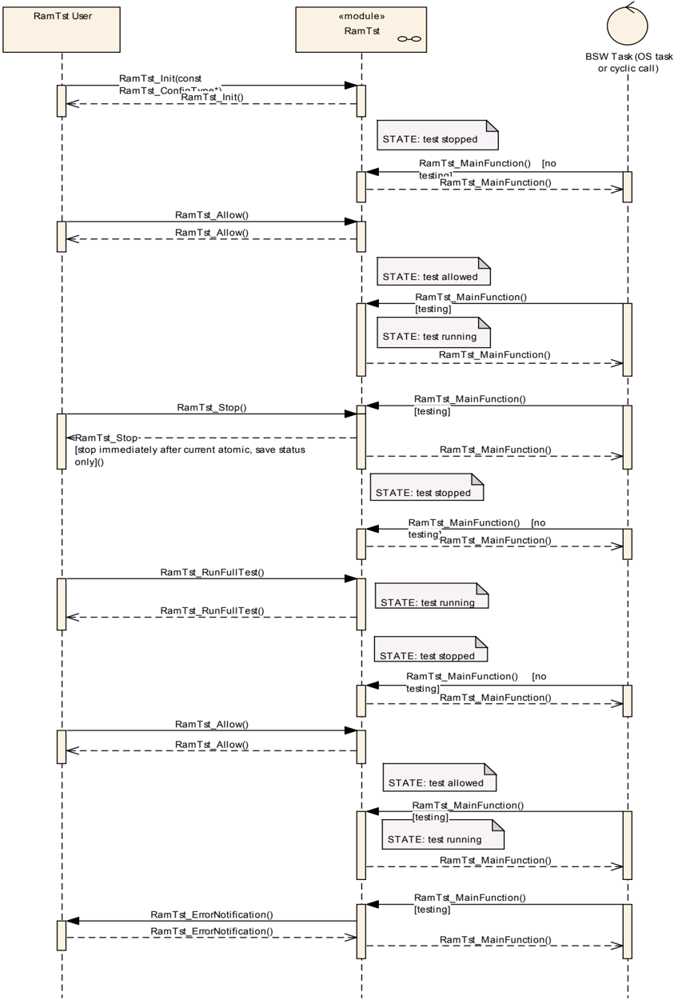

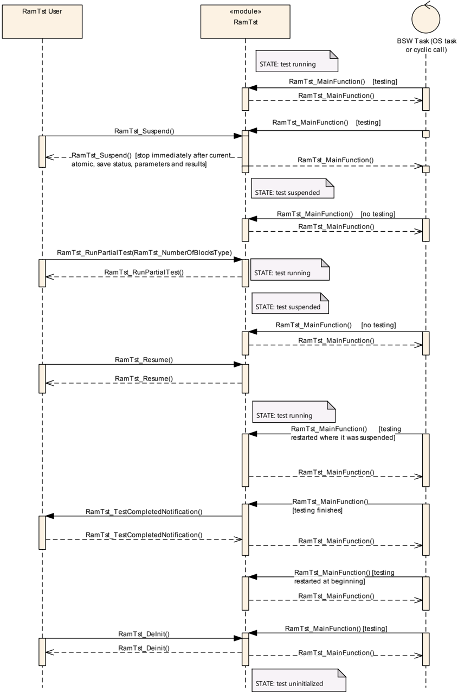

### 8.2. RamTst_ChangeNumberOfTestedCells

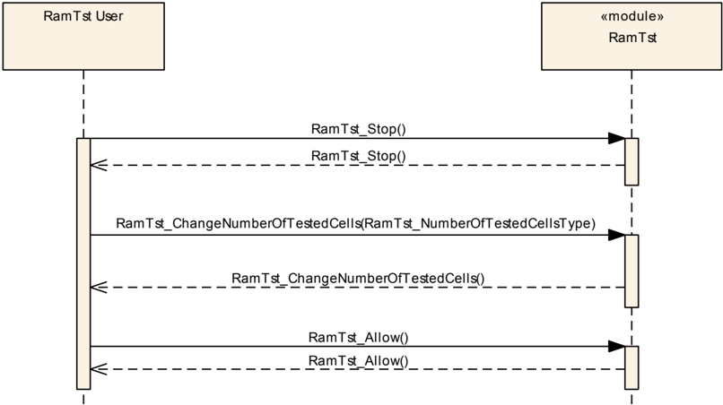

### 8.3. RamTst_SelectAlgParams

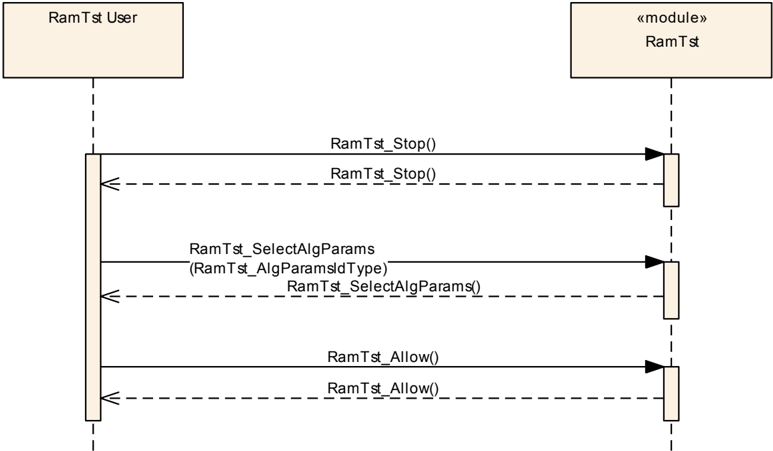

### 8.4. RamTst_GetAlgParams

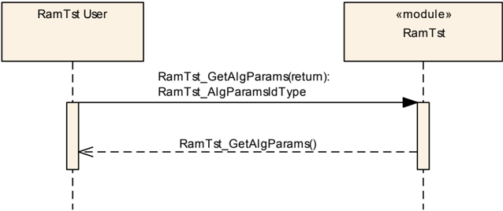

### 8.5. RamTst_GetExecutionStatus

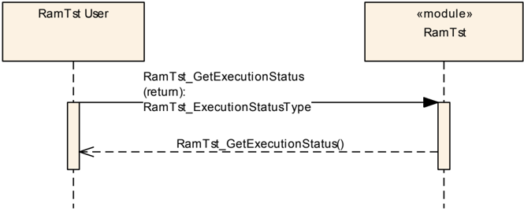

### 8.6. RamTst_GetTestResult

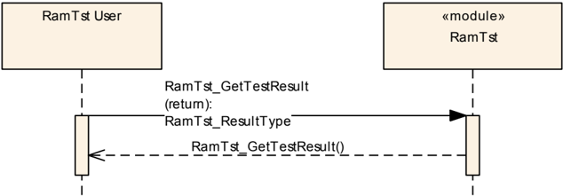

### 8.7. RamTst_GetTestResultPerBlock

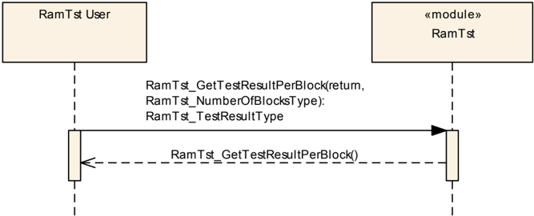

### 8.8. RamTst_GetTestAlgorithm

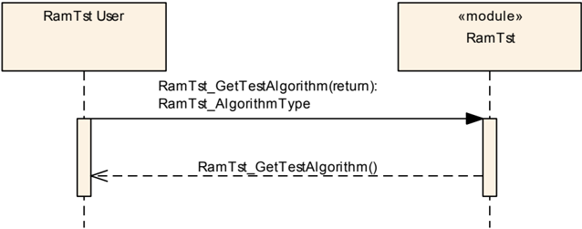

### 8.9. RamTst_GetNumberOfTestedCells

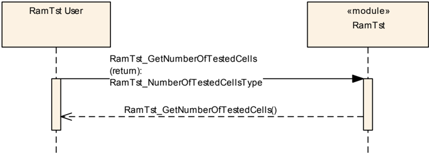

## 9. 配置规范

一般来说，本章定义配置参数及其到容器（**container**）中的聚类。为了支持本规范，第9.1节描述了基础知识。它还规定了应用于参数规范的模板（表）。我们打算将第9.1节保留在规范中，以保证可理解性。

第9.2节规定了模块**RAM**测试的结构（容器）和参数。

第9.3节规定了模块**RAM**测试的发布信息（**published information**）。

第9.4节包含模块**RAM**测试的附加信息。

### 9.1. 如何阅读本章

详情请参阅**SWS_BSWGeneral**中的第10.1章"配置规范简介"（**Introduction to configuration specification**）。

**RAM**测试模块应拒绝包含实现所不支持的分区映射的配置。

### 9.2. 容器与配置参数

以下各节汇总**RAM**测试配置参数的容器。各配置参数的详细描述在第7章**API**规范中描述。

在**RAM**测试模块的配置数据中，应有一组名为**RamTstAlgParams**的配置容器。每一个都定义了一个可在运行时选择的、包含一种算法的测试参数集。**RamTstAlgParams**中包含的算法仅限于通过容器**RamTstAlgorithms**在预编译阶段被选择为对用户可用的那些算法。

在**RAM**测试模块的配置数据中，每个**RamTstAlgParams**类型的参数集（如上条所要求）还应具有存储块配置容器。存储块配置容器定义在**RamTstBlockParams**中。存储块配置容器的数量由集成器根据**RAM**测试策略确定。

#### 9.2.1. 变体

初始化函数应以指向配置结构的指针作为单一参数。这意味着，按照SRS_BSW_00414，只应实现一个用于初始化的接口，并且调用方软件模块应使用哪个接口不应取决于模块的配置。

#### 9.2.2. RamTst

| SWS 条目 | [ECUC_RamTst_00150] |
|---|---|
| 模块名称 | RamTst |
| 描述 | **RamTst**模块的配置。 |
| Post-Build 变体支持 | false |
| 支持的配置变体 | VARIANT-LINK-TIME、VARIANT-PRE-COMPILE |

| 容器名称 | 多重性 | 作用域/依赖 |
|---|---|---|
| RamTstCommon | 1 | 该容器保存**RamTst**模块中所有可用函数的列表。每个函数在编译之前被打开或关闭，使得只有所需的函数和测试算法存在于编译后的代码中。 |
| RamTstDemEventParameterRefs | 0..1 | 用于引用DemEventParameter元素的容器，当相应错误发生时应通过**API** Dem_SetEventStatus调用这些元素。EventId取自所引用DemEventParameter的DemEventId符号值。标准化错误在该容器中提供，并可通过供应商特定的错误引用进行扩展。 |
| RamTstPublishedInformation | 1 | 保存所有**RamTst**特定发布信息参数的容器。 |

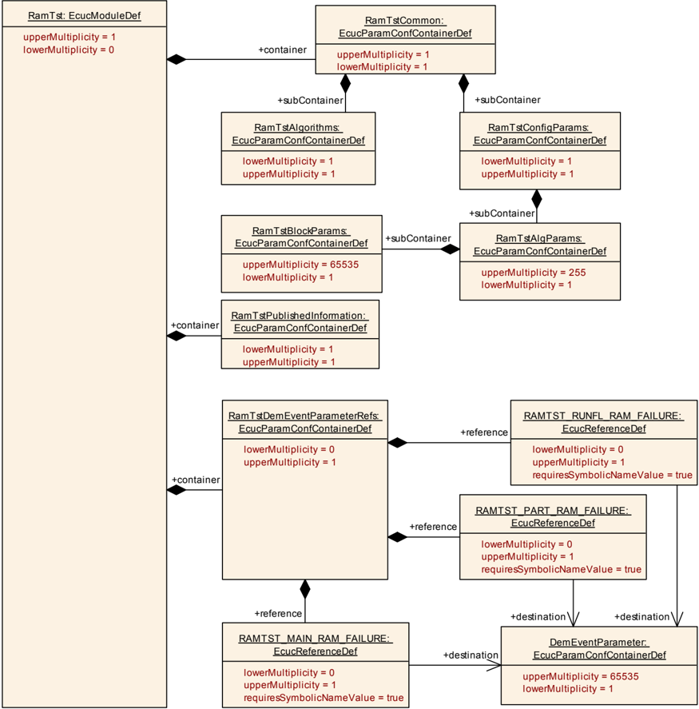

#### 9.2.3. RamTstDemEventParameterRefs

| SWS 条目 | [ECUC_RamTst_00188] |
|---|---|
| 容器名称 | RamTstDemEventParameterRefs |
| 父容器 | RamTst |
| 描述 | 用于引用DemEventParameter元素的容器，当相应错误发生时应通过**API** Dem_SetEventStatus调用这些元素。EventId取自所引用DemEventParameter的DemEventId符号值。标准化错误在该容器中提供，并可通过供应商特定的错误引用进行扩展。 |
| 配置参数 | 见下方参数表 |

| SWS 条目 | [ECUC_RamTst_00194] |
|---|---|
| 参数名称 | RAMTST_MAIN_RAM_FAILURE |
| 父容器 | RamTstDemEventParameterRefs |
| 描述 | 对发生错误"RAM 主测试故障"时应发出的DemEventParameter的引用。 |
| 多重性 | 0..1 |
| 类型 | 对DemEventParameter的符号名引用 |
| Post-Build 变体多重性 | false |
| Post-Build 变体值 | false |
| 多重性配置类 | Pre-compile time：x；Link time：-；Post-build time：- |
| 值配置类 | Pre-compile time：x；Link time：-；Post-build time：- |
| 作用域/依赖 | scope: local |

| SWS 条目 | [ECUC_RamTst_00193] |
|---|---|
| 参数名称 | RAMTST_PART_RAM_FAILURE |
| 父容器 | RamTstDemEventParameterRefs |
| 描述 | 对发生错误"RAM 部分测试故障"时应发出的DemEventParameter的引用。 |
| 多重性 | 0..1 |
| 类型 | 对DemEventParameter的符号名引用 |
| Post-Build 变体多重性 | false |
| Post-Build 变体值 | false |
| 多重性配置类 | Pre-compile time：x（All Variants）；Link time：-；Post-build time：- |
| 值配置类 | Pre-compile time：x（All Variants）；Link time：-；Post-build time：- |
| 作用域/依赖 | scope: local |

| SWS 条目 | [ECUC_RamTst_00192] |
|---|---|
| 参数名称 | RAMTST_RUNFL_RAM_FAILURE |
| 父容器 | RamTstDemEventParameterRefs |
| 描述 | 对发生错误"RAM 完整测试故障"时应发出的DemEventParameter的引用。 |
| 多重性 | 0..1 |
| 类型 | 对DemEventParameter的符号名引用 |
| Post-Build 变体多重性 | false |
| Post-Build 变体值 | false |
| 多重性配置类 | Pre-compile time：x；Link time：-；Post-build time：- |
| 值配置类 | Pre-compile time：x；Link time：-；Post-build time：- |
| 作用域/依赖 | scope: local |

无包含容器。

#### 9.2.4. RamTstCommon

| SWS 条目 | [ECUC_RamTst_00070] |
|---|---|
| 容器名称 | RamTstCommon |
| 父容器 | RamTst |
| 描述 | 该容器保存**RamTst**模块中所有可用函数的列表。每个函数在编译之前被打开或关闭，使得只有所需的函数和测试算法存在于编译后的代码中。 |
| 配置参数 | 见下方参数表 |

| SWS 条目 | [ECUC_RamTst_00120] |
|---|---|
| 参数名称 | RamTstAllowApi |
| 父容器 | RamTstCommon |
| 描述 | 禁用/启用函数"RamTst_Allow"的预处理器开关。 |
| 多重性 | 1 |
| 类型 | EcucBooleanParamDef |
| 默认值 | - |
| Post-Build 变体值 | false |
| 值配置类 | Pre-compile time：x（All Variants）；Link time：-；Post-build time：- |
| 作用域/依赖 | scope: local |

| SWS 条目 | [ECUC_RamTst_00118] |
|---|---|
| 参数名称 | RamTstChangeNumOfTestedCellsApi |
| 父容器 | RamTstCommon |
| 描述 | 禁用/启用函数"RamTst_ChangeNumberOfTestedCells"的预处理器开关。 |
| 多重性 | 1 |
| 类型 | EcucBooleanParamDef |
| 默认值 | - |
| Post-Build 变体值 | false |
| 值配置类 | Pre-compile time：x（All Variants）；Link time：-；Post-build time：- |
| 作用域/依赖 | scope: local |

| SWS 条目 | [ECUC_RamTst_00121] |
|---|---|
| 参数名称 | RamTstDevErrorDetect |
| 父容器 | RamTstCommon |
| 描述 | 打开或关闭开发错误检测和通知。true：启用检测和通知。false：禁用检测和通知。 |
| 多重性 | 1 |
| 类型 | EcucBooleanParamDef |
| 默认值 | false |
| Post-Build 变体值 | false |
| 值配置类 | Pre-compile time：x（All Variants）；Link time：-；Post-build time：- |
| 作用域/依赖 | scope: local |

| SWS 条目 | [ECUC_RamTst_00183] |
|---|---|
| 参数名称 | RamTstGetAlgParamsApi |
| 父容器 | RamTstCommon |
| 描述 | 禁用/启用函数"RamTst_GetAlgParams"的预处理器开关。 |
| 多重性 | 1 |
| 类型 | EcucBooleanParamDef |
| 默认值 | - |
| Post-Build 变体值 | false |
| 值配置类 | Pre-compile time：x（All Variants）；Link time：-；Post-build time：- |
| 作用域/依赖 | scope: local |

| SWS 条目 | [ECUC_RamTst_00122] |
|---|---|
| 参数名称 | RamTstGetExecutionStatusApi |
| 父容器 | RamTstCommon |
| 描述 | 禁用/启用函数"RamTst_GetExecutionStatus"的预处理器开关。 |
| 多重性 | 1 |
| 类型 | EcucBooleanParamDef |
| 默认值 | - |
| Post-Build 变体值 | false |
| 值配置类 | Pre-compile time：x（All Variants）；Link time：-；Post-build time：- |
| 作用域/依赖 | scope: local |

| SWS 条目 | [ECUC_RamTst_00123] |
|---|---|
| 参数名称 | RamTstGetNumberOfTestedCellsApi |
| 父容器 | RamTstCommon |
| 描述 | 禁用/启用函数"RamTst_GetNumberOfTestedCells"的预处理器开关。 |
| 多重性 | 1 |
| 类型 | EcucBooleanParamDef |
| 默认值 | - |
| Post-Build 变体值 | false |
| 值配置类 | Pre-compile time：x（All Variants）；Link time：-；Post-build time：- |
| 作用域/依赖 | scope: local |

| SWS 条目 | [ECUC_RamTst_00124] |
|---|---|
| 参数名称 | RamTstGetTestAlgorithmApi |
| 父容器 | RamTstCommon |
| 描述 | 禁用/启用函数"RamTst_GetTestAlgorithm"的预处理器开关。 |
| 多重性 | 1 |
| 类型 | EcucBooleanParamDef |
| 默认值 | - |
| Post-Build 变体值 | false |
| 值配置类 | Pre-compile time：x（All Variants）；Link time：-；Post-build time：- |
| 作用域/依赖 | scope: local |

| SWS 条目 | [ECUC_RamTst_00125] |
|---|---|
| 参数名称 | RamTstGetTestResultApi |
| 父容器 | RamTstCommon |
| 描述 | 禁用/启用函数"RamTst_GetTestResult"的预处理器开关。 |
| 多重性 | 1 |
| 类型 | EcucBooleanParamDef |
| 默认值 | - |
| Post-Build 变体值 | false |
| 值配置类 | Pre-compile time：x（All Variants）；Link time：-；Post-build time：- |
| 作用域/依赖 | scope: local |

| SWS 条目 | [ECUC_RamTst_00126] |
|---|---|
| 参数名称 | RamTstGetTestResultPerBlockApi |
| 父容器 | RamTstCommon |
| 描述 | 禁用/启用函数"RamTst_GetTestResultPerBlock"的预处理器开关。 |
| 多重性 | 1 |
| 类型 | EcucBooleanParamDef |
| 默认值 | - |
| Post-Build 变体值 | false |
| 值配置类 | Pre-compile time：x（All Variants）；Link time：-；Post-build time：- |
| 作用域/依赖 | scope: local |

| SWS 条目 | [ECUC_RamTst_00155] |
|---|---|
| 参数名称 | RamTstResumeApi |
| 父容器 | RamTstCommon |
| 描述 | 禁用/启用函数"RamTst_Resume"的预处理器开关。 |
| 多重性 | 1 |
| 类型 | EcucBooleanParamDef |
| 默认值 | - |
| Post-Build 变体值 | false |
| 值配置类 | Pre-compile time：x（All Variants）；Link time：-；Post-build time：- |
| 作用域/依赖 | scope: local |

| SWS 条目 | [ECUC_RamTst_00184] |
|---|---|
| 参数名称 | RamTstRunFullTestApi |
| 父容器 | RamTstCommon |
| 描述 | 禁用/启用函数"RamTst_RunFullTest"的预处理器开关。 |
| 多重性 | 1 |
| 类型 | EcucBooleanParamDef |
| 默认值 | - |
| Post-Build 变体值 | false |
| 值配置类 | Pre-compile time：x（All Variants）；Link time：-；Post-build time：- |
| 作用域/依赖 | scope: local |

| SWS 条目 | [ECUC_RamTst_00185] |
|---|---|
| 参数名称 | RamTstRunPartialTestApi |
| 父容器 | RamTstCommon |
| 描述 | 禁用/启用函数"RamTst_RunPartialTest"的预处理器开关。 |
| 多重性 | 1 |
| 类型 | EcucBooleanParamDef |
| 默认值 | - |
| Post-Build 变体值 | false |
| 值配置类 | Pre-compile time：x（All Variants）；Link time：-；Post-build time：- |
| 作用域/依赖 | scope: local |

| SWS 条目 | [ECUC_RamTst_00182] |
|---|---|
| 参数名称 | RamTstSelectAlgParamsApi |
| 父容器 | RamTstCommon |
| 描述 | 禁用/启用函数"RamTst_SelectAlgParams"的预处理器开关。 |
| 多重性 | 1 |
| 类型 | EcucBooleanParamDef |
| 默认值 | - |
| Post-Build 变体值 | false |
| 值配置类 | Pre-compile time：x（All Variants）；Link time：-；Post-build time：- |
| 作用域/依赖 | scope: local |

| SWS 条目 | [ECUC_RamTst_00127] |
|---|---|
| 参数名称 | RamTstStopApi |
| 父容器 | RamTstCommon |
| 描述 | 禁用/启用函数"RamTst_Stop"的预处理器开关。 |
| 多重性 | 1 |
| 类型 | EcucBooleanParamDef |
| 默认值 | - |
| Post-Build 变体值 | false |
| 值配置类 | Pre-compile time：x（All Variants）；Link time：-；Post-build time：- |
| 作用域/依赖 | scope: local |

| SWS 条目 | [ECUC_RamTst_00156] |
|---|---|
| 参数名称 | RamTstSuspendApi |
| 父容器 | RamTstCommon |
| 描述 | 禁用/启用函数"RamTst_Suspend"的预处理器开关。 |
| 多重性 | 1 |
| 类型 | EcucBooleanParamDef |
| 默认值 | - |
| Post-Build 变体值 | false |
| 值配置类 | Pre-compile time：x（All Variants）；Link time：-；Post-build time：- |
| 作用域/依赖 | scope: local |

| SWS 条目 | [ECUC_RamTst_00128] |
|---|---|
| 参数名称 | RamTstVersionInfoApi |
| 父容器 | RamTstCommon |
| 描述 | 禁用/启用函数"RamTst_GetVersionInfo"的预处理器开关。 |
| 多重性 | 1 |
| 类型 | EcucBooleanParamDef |
| 默认值 | false |
| Post-Build 变体值 | false |
| 值配置类 | Pre-compile time：x（All Variants）；Link time：-；Post-build time：- |
| 作用域/依赖 | scope: local |

| SWS 条目 | [ECUC_RamTst_00190] |
|---|---|
| 参数名称 | RamTstEcucPartitionRef |
| 父容器 | RamTstCommon |
| 描述 | 将**RAM**测试映射到零个或多个**ECUC**分区，以使模块的**API**在该分区中可用。**RAM**测试将在每个分区中作为一个独立的实例运行。 |
| 多重性 | 0..* |
| 类型 | 对EcucPartition的引用 |
| Post-Build 变体多重性 | false |
| Post-Build 变体值 | false |
| 多重性配置类 | Pre-compile time：x；Link time：-；Post-build time：- |
| 值配置类 | Pre-compile time：x；Link time：-；Post-build time：- |
| 作用域/依赖 | scope: ECU |

| 容器名称 | 多重性 | 作用域/依赖 |
|---|---|---|
| RamTstAlgorithms | 1 | 该容器保存特定微控制器所有可用的测试算法。每个测试算法在编译之前被选择打开或关闭，使得只有所需的测试算法存在于编译后的代码中。 |
| RamTstConfigParams | 1 | 该容器规定在预编译或链接时设置的配置参数。 |

该模块将在每个分区中作为一个独立的实例运行，即被调用的**API**只作用于它被调用的分区。

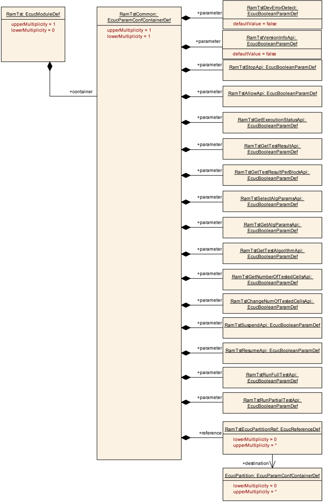

#### 9.2.5. RamTstAlgorithms

| SWS 条目 | [ECUC_RamTst_00065] |
|---|---|
| 容器名称 | RamTstAlgorithms |
| 父容器 | RamTstCommon |
| 描述 | 该容器保存特定微控制器所有可用的测试算法。每个测试算法在编译之前被选择打开或关闭，使得只有所需的测试算法存在于编译后的代码中。 |
| 配置参数 | 见下方参数表 |

| SWS 条目 | [ECUC_RamTst_00129] |
|---|---|
| 参数名称 | RamTstAbrahamTestSelected |
| 父容器 | RamTstAlgorithms |
| 描述 | 选择 Abraham Test 开或关的预处理器开关。 |
| 多重性 | 1 |
| 类型 | EcucBooleanParamDef |
| 默认值 | - |
| Post-Build 变体值 | false |
| 值配置类 | Pre-compile time：x（All Variants）；Link time：-；Post-build time：- |
| 作用域/依赖 | scope: local |

| SWS 条目 | [ECUC_RamTst_00130] |
|---|---|
| 参数名称 | RamTstCheckerboardTestSelected |
| 父容器 | RamTstAlgorithms |
| 描述 | 选择 Checkerboard Test 开或关的预处理器开关。 |
| 多重性 | 1 |
| 类型 | EcucBooleanParamDef |
| 默认值 | - |
| Post-Build 变体值 | false |
| 值配置类 | Pre-compile time：x（All Variants）；Link time：-；Post-build time：- |
| 作用域/依赖 | scope: local |

| SWS 条目 | [ECUC_RamTst_00132] |
|---|---|
| 参数名称 | RamTstGalpatTestSelected |
| 父容器 | RamTstAlgorithms |
| 描述 | 选择 Galpat Test 开或关的预处理器开关。 |
| 多重性 | 1 |
| 类型 | EcucBooleanParamDef |
| 默认值 | - |
| Post-Build 变体值 | false |
| 值配置类 | Pre-compile time：x（All Variants）；Link time：-；Post-build time：- |
| 作用域/依赖 | scope: local |

| SWS 条目 | [ECUC_RamTst_00133] |
|---|---|
| 参数名称 | RamTstMarchTestSelected |
| 父容器 | RamTstAlgorithms |
| 描述 | 选择 March Test 开或关的预处理器开关。 |
| 多重性 | 1 |
| 类型 | EcucBooleanParamDef |
| 默认值 | - |
| Post-Build 变体值 | false |
| 值配置类 | Pre-compile time：x（All Variants）；Link time：-；Post-build time：- |
| 作用域/依赖 | scope: local |

| SWS 条目 | [ECUC_RamTst_00134] |
|---|---|
| 参数名称 | RamTstTranspGalpatTestSelected |
| 父容器 | RamTstAlgorithms |
| 描述 | 选择 Transparent Galpat Test 开或关的预处理器开关。 |
| 多重性 | 1 |
| 类型 | EcucBooleanParamDef |
| 默认值 | - |
| Post-Build 变体值 | false |
| 值配置类 | Pre-compile time：x（All Variants）；Link time：-；Post-build time：- |
| 作用域/依赖 | scope: local |

| SWS 条目 | [ECUC_RamTst_00135] |
|---|---|
| 参数名称 | RamTstWalkPathTestSelected |
| 父容器 | RamTstAlgorithms |
| 描述 | 选择 Walking Path Test 开或关的预处理器开关。 |
| 多重性 | 1 |
| 类型 | EcucBooleanParamDef |
| 默认值 | - |
| Post-Build 变体值 | false |
| 值配置类 | Pre-compile time：x（All Variants）；Link time：-；Post-build time：- |
| 作用域/依赖 | scope: local |

无包含容器。

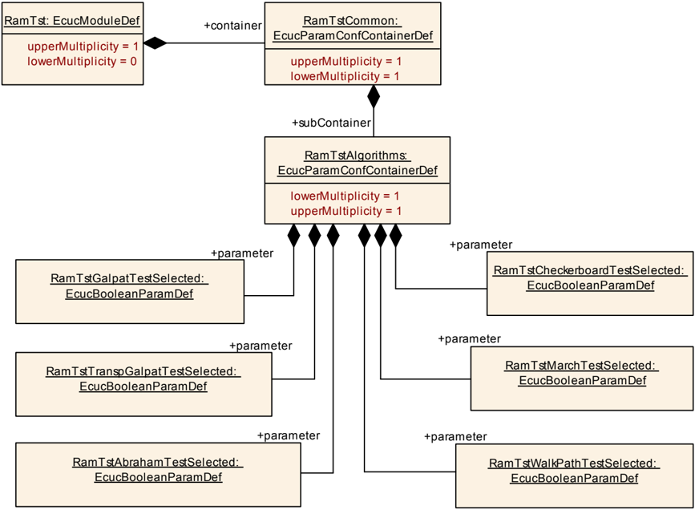

#### 9.2.6. RamTstConfigParams

| SWS 条目 | [ECUC_RamTst_00066] |
|---|---|
| 容器名称 | RamTstConfigParams |
| 父容器 | RamTstCommon |
| 描述 | 该容器规定在预编译或链接时设置的配置参数。 |
| 配置参数 | 见下方参数表 |

| SWS 条目 | [ECUC_RamTst_00181] |
|---|---|
| 参数名称 | RamTstDefaultAlgParamsId |
| 父容器 | RamTstConfigParams |
| 描述 | 这是"RamTst_Init(..)"函数执行之后有效的默认"RamTstAlgParams"的标识符。它是一个**RAM**变量的初始值，可通过函数"RamTst_SelectAlgParams"更改。 |
| 多重性 | 1 |
| 类型 | EcucIntegerParamDef |
| 范围 | 1 .. 255 |
| 默认值 | - |
| Post-Build 变体值 | false |
| 值配置类 | Pre-compile time：x（VARIANT-PRE-COMPILE）；Link time：x（VARIANT-LINK-TIME）；Post-build time：- |
| 作用域/依赖 | scope: local |

| SWS 条目 | [ECUC_RamTst_00154] |
|---|---|
| 参数名称 | RamTstMinNumberOfTestedCells |
| 父容器 | RamTstConfigParams |
| 描述 | 由实现者定义的后台测试一个周期的最小被测试单元数量。 |
| 多重性 | 1 |
| 类型 | EcucIntegerParamDef |
| 范围 | 1 .. 4294967295 |
| 默认值 | - |
| Post-Build 变体值 | false |
| 值配置类 | Pre-compile time：x（VARIANT-PRE-COMPILE）；Link time：x（VARIANT-LINK-TIME）；Post-build time：- |
| 作用域/依赖 | scope: local |

| SWS 条目 | [ECUC_RamTst_00180] |
|---|---|
| 参数名称 | RamTstNumberOfAlgParamSets |
| 父容器 | RamTstConfigParams |
| 描述 | 可用测试算法的已配置参数集数量。计算公式 = 容器 RamTst_AlgParams 的计数。 |
| 多重性 | 1 |
| 类型 | EcucIntegerParamDef |
| 范围 | 1 .. 255 |
| 默认值 | - |
| Post-Build 变体值 | false |
| 值配置类 | Pre-compile time：x（VARIANT-PRE-COMPILE）；Link time：x（VARIANT-LINK-TIME）；Post-build time：- |
| 作用域/依赖 | scope: local；依赖："RamTstNumberOfAlgParamSets"由"RamTstAlgParams"的计数派生，后者属于同一子容器且多重性为 1 到 255。 |

| SWS 条目 | [ECUC_RamTst_00138] |
|---|---|
| 参数名称 | RamTstTestCompletedNotification |
| 父容器 | RamTstConfigParams |
| 描述 | 该函数将在后台测试无错误地完成**RAM**测试之后被调用。 |
| 多重性 | 1 |
| 类型 | EcucFunctionNameDef |
| 默认值 | - |
| 正则表达式 | - |
| Post-Build 变体值 | false |
| 值配置类 | Pre-compile time：x（VARIANT-PRE-COMPILE）；Link time：x（VARIANT-LINK-TIME）；Post-build time：- |
| 作用域/依赖 | scope: local |

| SWS 条目 | [ECUC_RamTst_00139] |
|---|---|
| 参数名称 | RamTstTestErrorNotification |
| 父容器 | RamTstConfigParams |
| 描述 | 该函数将在后台**RAM**测试期间被调用。 |
| 多重性 | 1 |
| 类型 | EcucFunctionNameDef |
| 默认值 | - |
| 正则表达式 | - |
| Post-Build 变体值 | false |
| 值配置类 | Pre-compile time：x（VARIANT-PRE-COMPILE）；Link time：x（VARIANT-LINK-TIME）；Post-build time：- |
| 作用域/依赖 | scope: local |

| 容器名称 | 多重性 | 作用域/依赖 |
|---|---|---|
| RamTstAlgParams | 1..255 | 该容器保存配置一种算法的参数。对于在**RamTst_Algorithms**容器中选择的每种算法，可以有一个或多个**RamTstAlgParams**容器。所包含容器**RamTstBlockParams**的多重性取决于特定测试配置所定义的独立**RAM**块的数量。 |

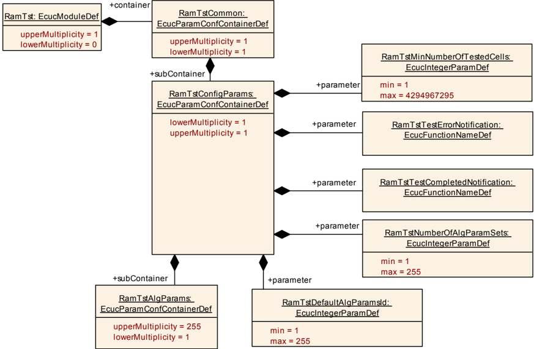

#### 9.2.7. RamTstAlgParams

| SWS 条目 | [ECUC_RamTst_00090] |
|---|---|
| 容器名称 | RamTstAlgParams |
| 父容器 | RamTstConfigParams |
| 描述 | 该容器保存配置一种算法的参数。对于在**RamTst_Algorithms**容器中选择的每种算法，可以有一个或多个**RamTstAlgParams**容器。所包含容器**RamTstBlockParams**的多重性取决于特定测试配置所定义的独立**RAM**块的数量。 |
| 配置参数 | 见下方参数表 |

| SWS 条目 | [ECUC_RamTst_00178] |
|---|---|
| 参数名称 | RamTstAlgorithm |
| 父容器 | RamTstAlgParams |
| 描述 | 这是定义本**RamTstAlgParams**集合所针对的算法。注意，同一算法可以用在多个**RamTstAlgParams**中。约束：只能使用**RamTstCommon/RamTstAlgorithms**所选的算法。 |
| 多重性 | 1 |
| 类型 | EcucEnumerationParamDef |
| 范围 | RAMTST_ABRAHAM_TEST、RAMTST_CHECKERBOARD_TEST、RAMTST_GALPAT_TEST、RAMTST_MARCH_TEST、RAMTST_TRANSP_GALPAT_TEST、RAMTST_WALK_PATH_TEST |
| Post-Build 变体值 | false |
| 值配置类 | Pre-compile time：x（VARIANT-PRE-COMPILE）；Link time：x（VARIANT-LINK-TIME）；Post-build time：- |
| 作用域/依赖 | scope: local |

| SWS 条目 | [ECUC_RamTst_00179] |
|---|---|
| 参数名称 | RamTstAlgParamsId |
| 父容器 | RamTstAlgParams |
| 描述 | 这是选择本**RamTstAlgParams**集合所用的标识符。 |
| 多重性 | 1 |
| 类型 | EcucIntegerParamDef |
| 范围 | 1 .. 255 |
| 默认值 | - |
| Post-Build 变体值 | false |
| 值配置类 | Pre-compile time：x（VARIANT-PRE-COMPILE）；Link time：x（VARIANT-LINK-TIME）；Post-build time：- |
| 作用域/依赖 | scope: local |

| SWS 条目 | [ECUC_RamTst_00152] |
|---|---|
| 参数名称 | RamTstExtNumberOfTestedCells |
| 父容器 | RamTstAlgParams |
| 描述 | 这是 NUMBER_OF_TESTED_CELLS 和 MAX_NUMBER_OF_TESTED_CELLS 可取的绝对最大值。 |
| 多重性 | 1 |
| 类型 | EcucIntegerParamDef |
| 范围 | 1 .. 4294967295 |
| 默认值 | - |
| Post-Build 变体值 | false |
| 值配置类 | Pre-compile time：x（VARIANT-PRE-COMPILE）；Link time：x（VARIANT-LINK-TIME）；Post-build time：- |
| 作用域/依赖 | scope: local |

| SWS 条目 | [ECUC_RamTst_00153] |
|---|---|
| 参数名称 | RamTstMaxNumberOfTestedCells |
| 父容器 | RamTstAlgParams |
| 描述 | 这是后台测试一个周期内可测试单元数量的最大值。 |
| 多重性 | 1 |
| 类型 | EcucIntegerParamDef |
| 范围 | 1 .. 4294967295 |
| 默认值 | - |
| Post-Build 变体值 | false |
| 值配置类 | Pre-compile time：x（VARIANT-PRE-COMPILE）；Link time：x（VARIANT-LINK-TIME）；Post-build time：- |
| 作用域/依赖 | scope: local |

| SWS 条目 | [ECUC_RamTst_00141] |
|---|---|
| 参数名称 | RamTstNumberOfBlocks |
| 父容器 | RamTstAlgParams |
| 描述 | 使用容器"RamTst_BlockParams"配置的**RAM**块的数量。计算公式 = 本 RamTstAlgParams 中所包含的 RamTstBlockParams 的数量。 |
| 多重性 | 1 |
| 类型 | EcucIntegerParamDef |
| 范围 | 1 .. 65535 |
| 默认值 | - |
| Post-Build 变体值 | false |
| 值配置类 | Pre-compile time：x（VARIANT-PRE-COMPILE）；Link time：x（VARIANT-LINK-TIME）；Post-build time：- |
| 作用域/依赖 | scope: local；依赖："RamTstNumberOfBlocks"由同一子容器中多重性为 0..65535 的"RamTstBlockParams"容器的数量派生。 |

| SWS 条目 | [ECUC_RamTst_00142] |
|---|---|
| 参数名称 | RamTstNumberOfTestedCells |
| 父容器 | RamTstAlgParams |
| 描述 | 这是一个**RAM**变量的初始值，可通过函数"RamTst_ChangeNumberOfTestedCells"更改。 |
| 多重性 | 1 |
| 类型 | EcucIntegerParamDef |
| 范围 | 1 .. 4294967295 |
| 默认值 | - |
| Post-Build 变体值 | false |
| 值配置类 | Pre-compile time：x（VARIANT-PRE-COMPILE）；Link time：x（VARIANT-LINK-TIME）；Post-build time：- |
| 作用域/依赖 | scope: local |

| SWS 条目 | [ECUC_RamTst_00191] |
|---|---|
| 参数名称 | RamTstBlockParamsEcucPartitionRef |
| 父容器 | RamTstAlgParams |
| 描述 | 将单个**RAM**块的**RAM**测试块参数配置映射到零个或一个**ECUC**分区。所引用的**ECUC**分区是**RamTst**驱动程序所映射到的**ECUC**分区的子集。相应的测试应在所引用的**ECUC**分区中运行。 |
| 多重性 | 0..1 |
| 类型 | 对EcucPartition的引用 |
| Post-Build 变体多重性 | false |
| Post-Build 变体值 | false |
| 多重性配置类 | Pre-compile time：x；Link time：-；Post-build time：- |
| 值配置类 | Pre-compile time：x；Link time：-；Post-build time：- |
| 作用域/依赖 | scope: ECU |

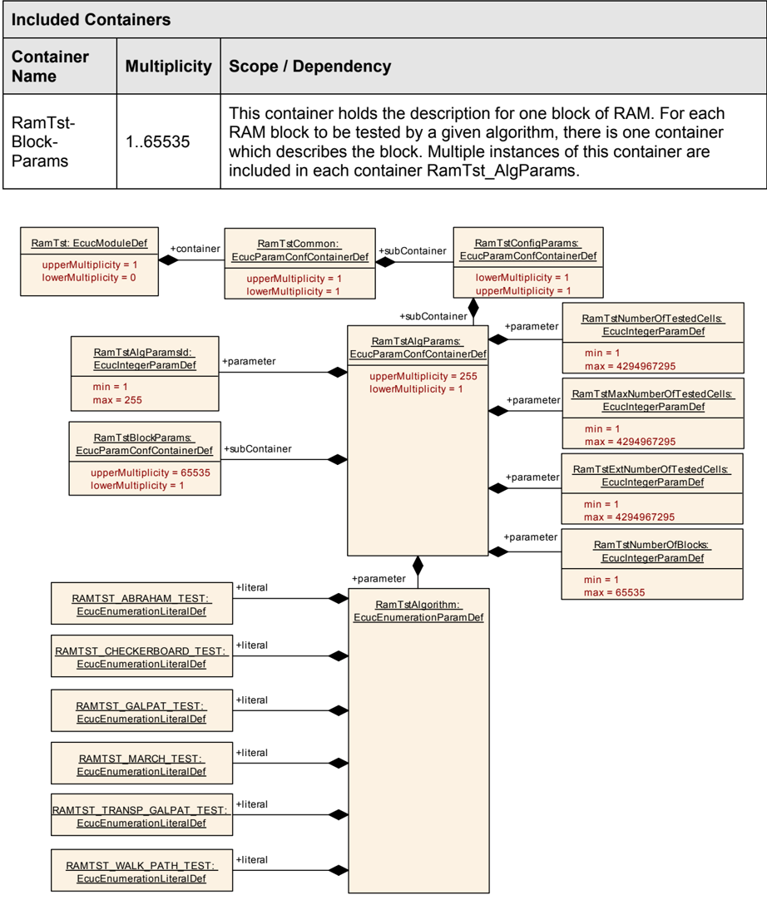

| 容器名称 | 多重性 | 作用域/依赖 |
|---|---|---|
| RamTstBlockParams | 1..65535 | 该容器保存一个**RAM**块的描述。对于给定算法要测试的每个**RAM**块，都有一个描述该块的容器。每个容器**RamTst_AlgParams**中包含该容器的多个实例。 |

**RamTstBlockParamsEcucPartitionRef**所引用的**ECUC**分区应是**RamTstEcucPartitionRef**所引用**ECUC**分区的子集。

#### 9.2.8. RamTstBlockParams

| SWS 条目 | [ECUC_RamTst_00091] |
|---|---|
| 容器名称 | RamTstBlockParams |
| 父容器 | RamTstAlgParams |
| 描述 | 该容器保存一个**RAM**块的描述。对于给定算法要测试的每个**RAM**块，都有一个描述该块的容器。每个容器**RamTst_AlgParams**中包含该容器的多个实例。 |
| 配置参数 | 见下方参数表 |

| SWS 条目 | [ECUC_RamTst_00143] |
|---|---|
| 参数名称 | RamTstBlockId |
| 父容器 | RamTstBlockParams |
| 描述 | **RAM**块的 ID。 |
| 多重性 | 1 |
| 类型 | EcucIntegerParamDef |
| 范围 | 1 .. 65535 |
| 默认值 | - |
| Post-Build 变体值 | false |
| 值配置类 | Pre-compile time：x（VARIANT-PRE-COMPILE）；Link time：x（VARIANT-LINK-TIME）；Post-build time：- |
| 作用域/依赖 | scope: local |

| SWS 条目 | [ECUC_RamTst_00144] |
|---|---|
| 参数名称 | RamTstEndAddress |
| 父容器 | RamTstBlockParams |
| 描述 | **RAM**块的结束地址。约束：它必须大于 RamTstStartAddress。 |
| 多重性 | 1 |
| 类型 | EcucIntegerParamDef |
| 范围 | 1 .. 4294967295 |
| 默认值 | - |
| Post-Build 变体值 | false |
| 值配置类 | Pre-compile time：x（VARIANT-PRE-COMPILE）；Link time：x（VARIANT-LINK-TIME）；Post-build time：- |
| 作用域/依赖 | scope: local |

| SWS 条目 | [ECUC_RamTst_00176] |
|---|---|
| 参数名称 | RamTstFillPattern |
| 父容器 | RamTstBlockParams |
| 描述 | 在该块的破坏性测试之后要填充到每个存储单元的模式。 |
| 多重性 | 1 |
| 类型 | EcucIntegerParamDef |
| 范围 | 0 .. 4294967295 |
| 默认值 | - |
| Post-Build 变体值 | false |
| 值配置类 | Pre-compile time：x（VARIANT-PRE-COMPILE）；Link time：x（VARIANT-LINK-TIME）；Post-build time：- |
| 作用域/依赖 | scope: local |

| SWS 条目 | [ECUC_RamTst_00145] |
|---|---|
| 参数名称 | RamTstStartAddress |
| 父容器 | RamTstBlockParams |
| 描述 | **RAM**块的起始地址。约束：它必须小于 RamTstEndAddress。 |
| 多重性 | 1 |
| 类型 | EcucIntegerParamDef |
| 范围 | 0 .. 4294967295 |
| 默认值 | - |
| Post-Build 变体值 | false |
| 值配置类 | Pre-compile time：x（VARIANT-PRE-COMPILE）；Link time：x（VARIANT-LINK-TIME）；Post-build time：- |
| 作用域/依赖 | scope: local |

| SWS 条目 | [ECUC_RamTst_00177] |
|---|---|
| 参数名称 | RamTstTestPolicy |
| 父容器 | RamTstBlockParams |
| 描述 | 关于破坏或不破坏内存内容的策略。 |
| 多重性 | 1 |
| 类型 | EcucEnumerationParamDef |
| 范围 | **RAMTEST_DESTRUCTIVE**：**RAM**测试不恢复内存内容；**RAMTEST_NON_DESTRUCTIVE**：**RAM**测试恢复内存内容。 |
| Post-Build 变体值 | false |
| 值配置类 | Pre-compile time：x（VARIANT-PRE-COMPILE）；Link time：x（VARIANT-LINK-TIME）；Post-build time：- |
| 作用域/依赖 | scope: local |

无包含容器。

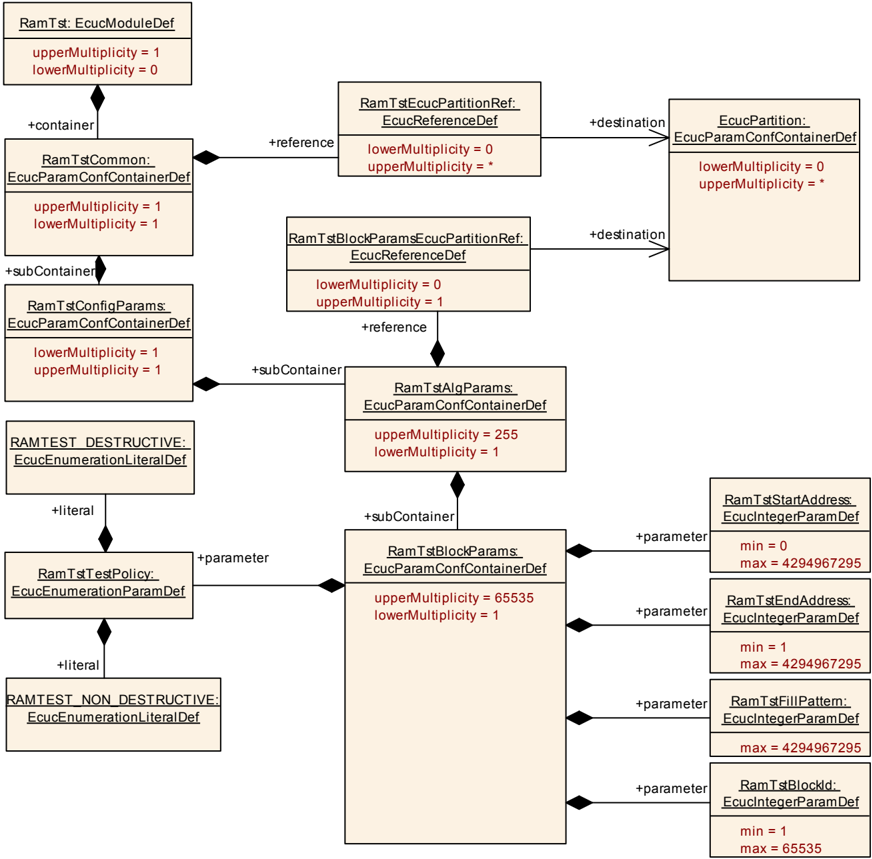

如果**RamTstEcucPartitionRef**引用了一个或多个**ECUC**分区，**RamTstBlockParamsEcucPartitionRef**的多重性应为一，并且也应引用这些**ECUC**分区之一。

### 9.3. 发布参数

详情请参阅**SWS_BSWGeneral**中的第10.3章"发布信息"（**Published Information**）。

#### 9.3.1. RamTstPublishedInformation

| SWS 条目 | [ECUC_RamTst_00186] |
|---|---|
| 容器名称 | RamTstPublishedInformation |
| 父容器 | RamTst |
| 描述 | 保存所有**RamTst**特定发布信息参数的容器。 |
| 配置参数 | 见下方参数表 |

| SWS 条目 | [ECUC_RamTst_00187] |
|---|---|
| 参数名称 | RamTstCellSize |
| 父容器 | RamTstPublishedInformation |
| 描述 | 给定实现可单独测试的**RAM**单元的大小（以位计）。 |
| 多重性 | 1 |
| 类型 | EcucIntegerParamDef |
| 范围 | 1 .. 64 |
| 默认值 | - |
| Post-Build 变体值 | false |
| 值配置类 | Published Information：x（All Variants） |
| 作用域/依赖 | scope: local |

无包含容器。

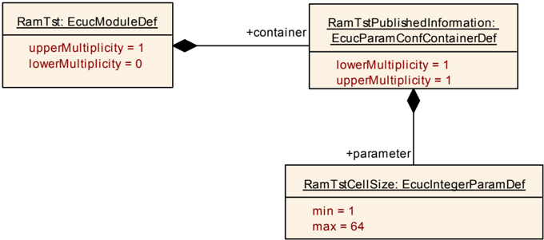

### 9.4. 实现特定的信息和参数

实现者应在模块的文档中为其每个算法实现提供测量或计算的运行时信息。该信息应按下表所示的方式呈现，并说明各参数是测量的还是计算的。

| 微控制器 | 频率 | RamCellSize [位] | 每周期单元数 | 平均运行时间 | 中断锁定时间 | 内部使用的 RAM |
|---|---|---|---|---|---|---|
| -- | -- | -- | -- | -- | -- | -- |

如果**RAM**测试模块的实现支持供应商特定的测试算法或其他附加配置参数，实现者应提供这些参数的正式供应商特定定义，包括其文档（作为**BSW**模块描述的一部分）。
