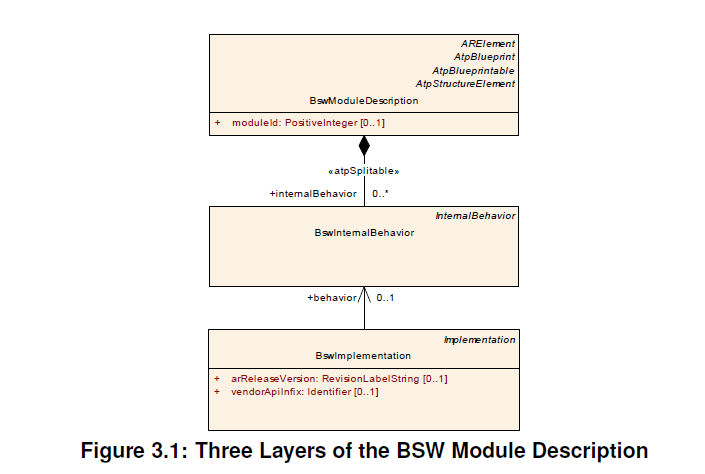

## 1. 一般信息

### 1.1. 文档范围

本文介绍了基本软件模块描述模板 BSWMDT (**the template for the Basic Software Module Description**) 。

**BSWMD** 是属于某个 BSW 工件，如：BSW模块（**BSW module**） 或 BSW集群（**BSW cluster**），以及该工件的实现的所有信息的正式符号。这种描述有几种可能的用例，详情请参见 3.1。

**BSWMDT** 是用于 **BSWMD** 的模板，它是 **AUTOSAR** 中必须用于此部分描述的标准化格式。该模板在 **UML** 中表示为整个 **AUTOSAR** 元模型的一部分，并且是从该元模型生成的 **XML** 模式的一部分。本文档描述了属于该模板的所有元素。

这些元素在 **AUTOSAR** 元模型的两个不同包中维护：

* **BswModuleTemplate** 包中包含了 **BSWMDT** 专用的所有元素。
* **BSWMDT** 的一些元素，例如：用于描述实现方面和资源消耗的元素，也在软件组件模板 (**SWCT**) 中使用。这些元素属于元模型的 **CommonStructure** 包，也在本文中进行了描述。

为了清楚起见，请注意元模型的 **GenericStructure** 包中包含了一些基本的基础设施的元类和文档[1]中描述的通用模式。这些元素也在 **BswModuleTemplate** 中使用，但有关详细信息，请参阅[1]。

通用结构（**Generic Structure**）提供有关的详细信息：

* AUTOSAR顶层结构
* 常用的元类和原语
* 变体处理
* 文档

本文档适用于需要更深入了解元模型的 **BSWMDT** 部分的人员，例如：工具开发人员和维护元模型的人员。它不打算作为必须提供实际 **BSWMD** 的 **BSW** 开发人员的指南，即：必须填写（fill out）模板的人员。有关本文档总体目标的更多信息，请参阅相关要求文档，参见[2]。

由于元模型的复杂性，本文档中某些类图中的文本太小，无法在正常尺寸的打印纸上阅读。如果需要，建议使用电子文档并在计算机屏幕上放大这些图表。

### 1.2. 输入文件

以下输入文档已用于开发 BSWMDT：

* Generic Structure Template [1]
* Requirements on BSW Module Description Template [2]
* General Requirements on Basic Software Modules [3]
* AUTOSAR Methodology [4]
* AUTOSAR Glossary [5]
* Software Component Template [6]
* System Template [7]
* XML Schema Production Rules [8]

### 1.3. 约束的施加时间

在本文档的上下文中，只有一个强制时间适用：“在 **BSW** 模块配置完成时”。

### 1.4. 缩略语（Abbreviations）

The following table contains a list of abbreviations used in the scope of this document along with the spelled-out meaning of each of the abbreviations.

**BSW** 
> Basic Software

**BSWMD** 
> Basic Software Module Description

**BSWMDT** 
> Basic Software Module Description Template

**DEM** 
> Diagnostic Event Manager

**ECU** 
> Electronic Control Unit

**ECUC** 
> ECU Configuration

**ICC1, ICC2, ICC3** 
> AUTOSAR Implementation Conformance Class 1...3

**ISR** 
> Interrupt Service Routine

**ICS** 
> Implementation Conformance Statement

**IOC** 
> Inter OS-Application Communication

**MC** 
> Measurement and Calibration

**MSR** 
> Manufacturer Supplier Relationship

**NvM** 
> Non Volatile Memory

**NVRAM** 
> Non Volatile RAM

**OS** 
> Operating System

**RAM** 
> Random Access Memory

**ROM** 
> Read-only Memory

**SWC** 
> Software Component

**SWS** 
> Software Specification

**SWCT** 
> Software Component Template

**UML** 
> Unified Modeling Language

**ARXML** 
> AUTOSAR XML

**XML** 
> Extensible Markup Language

## 2. 用例和建模方法

### 2.1. 用例

**BSWMDT** 有几种可能的用例。以下用例可应用于 **BSW** 模块（ICC3 一致性等级）或 **BSW** 集群（ICC2 一致性等级）和库。为了方便起见，我们经常在本文档中使用模块（**module**）一词作为所有三种工件的同义词。

库（**Library**）可以看作是一种特殊的模块，它提供在基础或应用软件中使用的服务，并通过直接函数调用访问，所以以下用例也可以应用于库。库和普通的 BSW 模块之间的主要区别在于，库服务可以直接从应用程序 **SWC** 调用，而无需通过 **RTE**。所以可用于库的模型元素将受到某些限制，例如：库不应该有预定的（scheduled）功能。 但是，这些限制目前尚未正式确定。

* **BSWMDT** 可用于在实际实现之前根据接口和依赖项，指定 **BSW** 模块或集群（即：一组**BSW** 模块）。在此用例中，内部行为和实现的详细信息未被填写。由于 **BSWMDT** 包含变体点（**variation points**），BSW 模块或集群的多个变体可以由单个规范描述）。根据方法论[4]，作为设计基础软件（**Design Basic Software**）活动的结果，此级别的工件作为 **BSW** 设计包（**BSW Design Bundle**）交付。
* **BSWMDT** 可用作一致性测试的输入，测试产品（模块、集群或库）与 **AUTOSAR** 标准的一致性。换句话说，这意味着对于一致性测试，**BSWMD** 应可用作 ICS（实施一致性声明）。根据方法论，此级别的工件作为 **BSW** 模块 **ICS** 捆绑包交付。请注意，此交付必须与以下交付（BSW 模块交付捆绑包）区分开来，因为一致性测试需要完全配置的软件。
* **BSWMDT** 可用于描述交付给 **AUTOSAR ECU** 集成商的实际实现的 **BSW** 模块或集群。它将包含内部行为、实现和约束 w.r.t. 的详细信息。规范，特别是，可能有不止一种实现（例如针对不同的处理器）具有相同的规范。根据方法论，此级别的工件是 **BSW** 模块交付包（**BSW Module Delivered Bundle**）的一部分，作为开发 BSW 模块（**Develop BSW Module**）活动的结果（相同的交付也包含代码，因为它不是在集成期间生成的）。
* **BSWMDT** 不仅用作上游（**upstream**）模板（如：作为在 ECU 配置时间之前提供的信息的格式），而且集成商可以使用 **BSWMD** 的某些部分来添加更多信息或调整当模块的交付时间时不可用的信息。在方法论中，此级别的工件是 BSW 模块集成包（**BSW Module Integration Bundle**）的一部分，它们是在 ECU 集成软件（**Integrate Software for ECU**）活动期间创建或完善的。此用例包括：例如添加有关实际资源消耗的文档，以及添加信息以响应集成在 ECU 上的软件组件和其他 BSW 模块的需求。
* 与最后一种情况类似，**BSWMDT** 允许添加从上游描述生成的数据，以支持测量和校准工具。
* 实现 **RTE** 和 **BSW** 调度程序（**BSW Scheduler**）的源代码，通常在 **ECU** 集成期间完全生成。因此记录此代码实现的 **BSWMD** 部分（例如：版本信息、内存部分、用于校准支持的数据结构）应由 **RTE** 生成器（**RTE generator**）生成或更新。

不同用例的工作流程细节不在本文档的范围内，但在这些不同步骤中提供的信息会影响 **BSWMDT** 的元模型。

**BSWMDT** 根据 **ICC1** 一致性等级描述软件的用途有限。因为在这种情况下，**ECU** 上的完整 **BSW**（包括 RTE）由一个单独的集群组成，所以 **BSW** 内的接口或依赖项无法通过这个模板来被描述，这也意味着模板的相关部分将是空的。然而即使在这种情况下，**BSWMDT** 也可用于记录实现方面（例如：所需的编译器、资源消耗或供应商特定配置参数）。

### 2.2. 三层方法

BSWMDT 的元模型由三个类似于 SWCT 的抽象层组成。这种方法允许能够更好地重用更抽象部分的描述。概览如下图 3.1 所示。

上层 **BswModuleDescription** 包含了所有提供和需要的接口（**provided and required interfaces**）的规范，包括对其他模块的依赖性。

中间层 **BswInternalBehavior** 包含模块内部一些基本活动的模型。该模型定义了模块对操作系统（**OS**）和 BSW 调度程序（**BSW Scheduler**）配置的要求。可能有多个基于相同的 **BswModuleDescription** 的不同的 **BswInternalBehavior** 实例，甚至在相同的 **CPU** 上。例如：多个驱动程序遵循相同的 **BswModuleDescription**。 术语行为（**behavior**）的选择类似于 **SWCT** 中的类似术语。注意这里只限于调度行为，不描述模块或集群的算法行为。

底层 **BswImplementation** 包含有关各个代码的信息。同样，同一个 **BswInternalBehavior** 可能有多个 **BswImplementation** 实例。

### 2.3. 可拆分聚合的使用（The usage of splitable aggregations）

这些层之间的引用不是普通聚合，允许 **XML** 工件中的更多灵活性。例如：如果 **BswInternalBehavior** 将聚合 **BswImplementation**，则必须为 **BswImplementation** 的每个实例复制 **BswInternalBehavior** 的具体 **XML** 工件。通过使用可拆分的聚合和引用，层可以保存在单独的文件中，并且可以在以后的项目阶段修改较低的层。这类似于在 C 源文件中包含头文件：多个实现文件可以共享同一个头文件，该头文件通常将更抽象的东西声明为函数原型等。从 **BswModuleDescription** 到 **BswInternalBehavior** 的关系是一个可拆分的聚合，而不是 **SWCT** 出于语义原因和类比的引用。

### 2.4. 同一个 BSW模块或 BSW 集群的几种实现

根据三层方法，元类 **BswModuleDescription** 和聚合的 **BswInternalBehavior** 描述了一种 **BSW** 模块或集群，可能存在不同的实现，由不同的 **BswImplementations** 表示。请注意元类 **BswModuleDescription** 的名称在这里具有误导性，因为此元类不包含模块或集群的完整描述。

如果 **BSW** 模块或集群的不同实现是为不同的 **CPU** 编译的，则相应的 **BSWMD** 可以被视为单独的工件，它们可以共享 **BswModuleDescription** 和 **BswInternalBehavior**。

如果实现是为同一个 **CPU** 编译的，即集成在同一个 **ECU** 并且在同一个地址空间上。例如：多个 **CAN** 通道的 **CAN** 驱动程序。它们的 **BSWMD** 仍然应该共享 **BswModuleDescription** 和 相等的 **BswInternalBehavior** ，但必须有一种机制来确保从 **BswModuleDescription** 和 **BswInternalBehavior** 派生的全局可见的 C 符号是唯一的。这是通过 **BSWMDT** 的实现部分中定义的中缀（**infixes**）来处理的。

### 2.5. 与 SwComponentType 的关系

一些 **BSW** 模块或集群，不仅具有与其他 **BSW** 模块或集群的接口，而且还具有通过 **RTE** 从应用程序 **SW-C** 访问的更多抽象接口。这些 **BSW** 模块或集群可以是 **AUTOSAR** 服务（**AUTOSAR Services**）、**ECU** 抽象（**ECU Abstraction**）的一部分，或者是复杂驱动程序（Complex Drivers）。

这里需要的更抽象的接口称为 **AUTOSAR** 接口（参见 [6] 和 [5]）。

这些 **AUTOSAR** 接口通过软件组件模板 (**SWCT**) 进行描述，它们由端口（**ports**）、端口接口（**port interfaces**）及其进一步详细信息组成。用于为 **BSW** 模块描述这些元素的 **SWCT** 的根类是 **ServiceSwComponentType**、**EcuAbstractionSwComponentType** 和 **ComplexDeviceDriverSwComponentType**（参见 [6]），它们都派生自 **AtomicSwComponentType**。

此外，从 **RTE** 到这些 **BSW** 模块的函数调用，需建模为同样包含在 **SWCT** 中的 **RunnableEntity-s**。 用于描述 **RunnableEntity-s**（以及其他一些东西）的 **SWCT** 的根类称为 **SwcInternalBehavior**。

### 2.6. 具有 AUTOSAR 接口的 BSW 模块

对于可以通过 **AUTOSAR** 接口访问的 **BSW** 模块或集群，除了 **BSWMD** 之外，还应该有一个定义 **AtomicSwComponentType** 和 **SwcInternalBehavior** 的 XML 工件。

生成 **RTE** 需要这些额外的描述。请注意，在 **AUTOSAR** 服务的情况下，这些附加描述的内容在不同的 **ECU** 之间可能会有所不同。例如：由于 **RTE** 必须为 **AUTOSAR** 服务创建的端口数量，所以必须为每个 **ECU** 创建。参加 [6] 中描述了创建这些工件的详细步骤。

为了跟踪这些额外的 **SWCT** 描述和关联的 **BSWMD** 之间的依赖关系，在 **SwcInternalBehavior** 类和 **BswInternalBehavior** 类之间存在映射，详情请参阅第 6.11 章。

由于使用了两种不同的模板来描述上述模块，即：那些具有用于连接到应用软件的端口的模板，所以如何描述调度（**scheduling**）存在一定的歧义：

1. 使用在 **BSWMDT** 中定义的事件模型 （请参阅本文档的BSW Beahvior）。
2. 使用在 **SWCT** 的 **SwcInternalBehavior** 中定义的事件模型。

两种不同的事件模型导致针对 **RTE** 的不同接口。BSW 调度程序（**BSW-Scheduler**）风格的 C 接口和 SWC 风格的 C 接口都在 RTE 合同阶段（**RTE contract phase**）生成。 对于到目前为止定义的标准化 **AUTOSAR** 服务，SWC 样式的接口仅用于与通过端口进行通信直接相关的函数调用。而例如BSW 调度程序（**BSW-Scheduler**）的接口需使用周期的事件。 请注意，对于未标准化的 **BSW** 部件，如：ECU 抽象和复杂驱动程序，则没有这样的规则。

另一种特殊情况，当 BSW 调度程序（**BSW Scheduler**）或中断例程（**interrupt routine**）触发周期函数时，接着必须通过调用 **RTE** 才能访问 **SWC**。为了使用当前 **SWCT** 的方式生成 **RTE API**，在这种情况下需要指定一个 **RunnableEntity**，即使它不是由RTE事件触发的。

## 3. BSW 模块描述概述

图 3.1 及下面的类表展示了 **BSWMDT** 顶层 **BswModuleDescription** 的所有关系。

对于符合 **ICC3** 一致性等级的标准化模块，**BswModuleDescription.shortName** 应选择与 [11] 中定义的模块缩写（ resp. 库缩写）相同。

此外，**BswModuleDescription** 包含一个属性 **moduleId**：

**BSW 模块标识符**：如果适用，**BswModuleDescription.moduleId** 应指向 [11] 中定义的标准化 **AUTOSAR** 模块的标识符。否则（例如对于 **ICC2** 集群），该标识符应为空，或选择不同于 [11] 中给出的标识符。

> 1 注意，在 ECU 软件中可能存在多个具有相同标识符的模块，例如根据标准，复杂驱动程序（**Complex Drivers**）全部具有相同的标识符。

**模块标识符与 category 的使用**：无论如何，BSWMD 中的该标识符用于记录某个工件与标准的关系，因此对于一致性测试是有用的信息。除此之外，通用 **category** 属性（继承自 **Identifiable**）应用于对 **BswModuleDescription** 进行一般分类，如下表所示。这样可以检查约束。

**BswModuleDescription 允许的 category**：

表 3.1：BswModuleDescription 允许的 category（**Allowed categories of BswModuleDescription**）

| category | 说明 |
| --- | --- |
| BSW_MODULE | 指定单个 BSW 模块（ICC3 粒度）。 |
| BSW_CLUSTER | 指定 BSW 模块集群（ICC2 粒度）。 |
| LIBRARY | 指定库（不限于在 BSW 内使用）。 |

请注意，**BswModuleDescription** 不允许其他值或空值。

**将 SwComponentDocumentation 附加到 BSWMD**：可以通过元类 **SwComponentDocumentation** 向 **BswModuleDescription** 附加文档。这使用与软件组件文档相同的概念，并在 [6] 中详细描述。

元类 **BswModuleEntry** 描述单个 C 函数原型（见第 [4.1](#41-bsw-模块入口) 章），在此使用如下：

**提供 BswModuleEntry**：由 **BswModuleDescription** 导出的接口是提供给其他模块使用的 **implementedEntry** 集合（包括由 **BSW Scheduler** 调用的 "main" 函数）。

**使用 BswModuleEntry**：由 **BswModuleDescription** 所需的接口是由其他模块实现的 **expectedEntry** 集合。

**BswModuleEntry 的链接**：由一个 **BswModuleDescription** 作为 **implementedEntry** 引用的 **BswModuleEntry**，与另一个 **BswModuleDescription** 作为 **expectedEntry** 引用的 **BswModuleEntry**，在符合下列条件之一时是匹配的：

* 引用了同一个 **BswModuleEntry**；
* 两个 **BswModuleEntry.shortName** 相同。

**链接到 BswModuleEntry 的条目应具有兼容的签名**：按照上述匹配规则匹配的 **BswModuleEntry**，在下列条件满足时是兼容的：

* 二者都定义或都不定义 **returnType**；
* 当定义了 **returnType** 时，扮演 **returnType** 角色的 **SwServiceArg** 必须兼容；
* 二者定义相同数量的兼容参数，且顺序相同。

**returnType 角色中 SwServiceArg 的兼容性**：扮演 **returnType** 角色的 **SwServiceArg** 在类型完全相同时是兼容的。

**参数角色中 SwServiceArg 的兼容性**：扮演参数角色的 **SwServiceArg** 在下列条件满足时是兼容的：

* 它们类型完全相同；
* 并且两者具有相同的 **shortName**。

**匹配的 BswModuleEntry 应具有兼容的属性**：按照上述匹配规则匹配的 **BswModuleEntry** 应使用下列属性的相同值定义：

* **callType**
* **executionContext**
* **isReentrant**
* **isSynchronous**
* **serviceId**
* **swServiceImplPolicy**
* **bswEntryKind**

**BswModuleDescription.providedModeGroup**：通过可选属性 **providedModeGroup**，BSW 模块可以提供一组模式（模式组），以控制其他 BSW 模块，而后者又必须声明相应的 **requiredModeGroup**。

**BswModuleDescription.releasedTrigger**：通过可选属性 **releasedTrigger**，BSW 模块可以声明它释放的一个触发器。**trigger** 用于在其它 BSW 模块中引发事件，而后者又必须声明相应的 **requiredTrigger**。

**BswModuleDescription.internalBehavior**：通过在 **BswModuleDescription** 中聚合 **BswInternalBehavior** 类，可以在描述中加入调度方面的内容。

函数声明、依赖、触发器和模式构成了模块或集群的接口，用于同一存储器和处理器核上的模块间通信。详情见第 [4](#4-bsw-接口) 章。

对于分区和/或核边界之间的通信，需要额外的声明，见第 [4.6](#46-bsw-分区间接口) 章。

关于 **BswInternalBehavior**，见第 [5](#5-bsw-行为) 章。

表 3.2：BswModuleDescription（**BswModuleDescription**）

| 属性 | 类型 | 多重性 | 种类 | 说明 |
| --- | --- | --- | --- | --- |
| Package | — | — | — | M2::AUTOSARTemplates::BswModuleTemplate::BswOverview |
| Note | — | — | — | 用于描述单个 BSW 模块或 BSW 集群的根元素。若描述的是 BSW 模块，则该元素的短名称等于 BSW 模块的名称。标签：atp.recommendedPackage=BswModuleDescriptions |
| Base | — | — | — | ARElement, ARObject, AtpBlueprint, AtpBlueprintable, AtpClassifier, AtpFeature, AtpStructureElement, CollectableElement, Identifiable, MultilanguageReferrable, PackageableElement, Referrable |
| Aggregated by | — | — | — | ARPackage.element, AtpClassifier.atpFeature |
| bswModuleDependency | BswModuleDependency | * | aggr | 描述对另一个 BSW 模块的依赖。构造型：atpSplitable; atpVariation 标签：atp.Splitkey=bswModuleDependency.shortName, bswModuleDependency.variationPoint.shortLabel vh.latestBindingTime=preCompileTime xml.sequenceOffset=20 |
| bswModuleDocumentation | SwComponentDocumentation | 0..1 | aggr | 为 BSW 模块添加文档。构造型：atpSplitable; atpVariation 标签：atp.Splitkey=bswModuleDocumentation, bswModuleDocumentation.variationPoint.shortLabel vh.latestBindingTime=preCompileTime xml.sequenceOffset=6 |
| expectedEntry | BswModuleEntry | * | ref | 指示本模块所需的 entry。替代 outgoingCallback / requiredEntry。构造型：atpSplitable; atpVariation 标签：atp.Splitkey=expectedEntry.bswModuleEntry, expectedEntry.variationPoint.shortLabel vh.latestBindingTime=preCompileTime |
| implementedEntry | BswModuleEntry | * | ref | 指定本模块提供、可被其他模块调用的 entry。这包括 "main" 函数、中断例程和回调。替代 providedEntry / expectedCallback。构造型：atpSplitable; atpVariation 标签：atp.Splitkey=implementedEntry.bswModuleEntry, implementedEntry.variationPoint.shortLabel vh.latestBindingTime=preCompileTime |
| internalBehavior | BswInternalBehavior | * | aggr | 与一个 BswModuleDescription 关联的各个 BswInternalBehavior 可以分布在多个物理文件中，因此该聚合为 <<atpSplitable>>。构造型：atpSplitable 标签：atp.Splitkey=internalBehavior.shortName |
| moduleId | PositiveInteger | 0..1 | attr | 指向 AUTOSAR 标准定义的 BSW 模块标识符。对于非标准化模块，可以选择专有标识符。 |
| providedClientServerEntry | BswModuleClientServerEntry | * | aggr | 指定本模块提供一个可从另一个分区或核调用的 client-server entry。该 entry 在本地上下文中声明，并通过 BSW Scheduler 的配置连接到其他模块或同一模块的 requiredClientServerEntry。构造型：atpSplitable; atpVariation 标签：atp.Splitkey=providedClientServerEntry.shortName, providedClientServerEntry.variationPoint.shortLabel vh.latestBindingTime=preCompileTime |
| providedData | VariableDataPrototype | * | aggr | 指定本模块提供的一个数据原型，以供另一个分区或核读取。providedData 在本地上下文中声明，并通过 BSW Scheduler 的配置连接到其他模块或同一模块的 requiredData。构造型：atpSplitable; atpVariation 标签：atp.Splitkey=providedData.shortName, providedData.variationPoint.shortLabel vh.latestBindingTime=preCompileTime xml.sequenceOffset=55 |
| providedModeGroup | ModeDeclarationGroupPrototype | * | aggr | 一组由本模块或集群拥有并提供的模式。它可以通过 BswScheduler 的配置连接到其他模块或集群的 requiredModeGroups。它也可以与关联的 ServiceSwComponentType、EcuAbstractionSwComponentType 或 ComplexDeviceDriverSwComponentType 通过端口提供的模式同步。构造型：atpSplitable; atpVariation 标签：atp.Splitkey=providedModeGroup.shortName, providedModeGroup.variationPoint.shortLabel vh.latestBindingTime=preCompileTime xml.sequenceOffset=25 |
| releasedTrigger | Trigger | * | aggr | 由本模块或集群释放的一个 Trigger。它可以通过 BswScheduler 的配置连接到其他模块或集群的 requiredTriggers。它也可以与关联的 ServiceSwComponentType、EcuAbstractionSwComponentType 或 ComplexDeviceDriverSwComponentType 通过端口提供的 Trigger 同步。构造型：atpSplitable; atpVariation 标签：atp.Splitkey=releasedTrigger.shortName, releasedTrigger.variationPoint.shortLabel vh.latestBindingTime=preCompileTime |
| requiredClientServerEntry | BswModuleClientServerEntry | * | aggr | 指定本模块需要一个可在另一个分区或核上实现的 client-server entry。该 entry 在本地上下文中声明，并通过 BSW Scheduler 的配置连接到其他模块或同一模块的 providedClientServerEntry。构造型：atpSplitable; atpVariation 标签：atp.Splitkey=requiredClientServerEntry.shortName, requiredClientServerEntry.variationPoint.shortLabel vh.latestBindingTime=preCompileTime xml.sequenceOffset=50 |
| requiredData | VariableDataPrototype | * | aggr | 指定本模块所需的一个数据原型，以由另一个分区或核提供。requiredData 在本地上下文中声明，并通过 BswScheduler 的配置连接到其他模块或同一模块的 providedData。构造型：atpSplitable; atpVariation 标签：atp.Splitkey=requiredData.shortName, requiredData.variationPoint.shortLabel vh.latestBindingTime=preCompileTime xml.sequenceOffset=60 |
| requiredModeGroup | ModeDeclarationGroupPrototype | * | aggr | 指定本模块或集群依赖于某个模式组。requiredModeGroup 是本地于本上下文的，并将通过 BswScheduler 的配置连接到另一个模块或集群的 providedModeGroup。构造型：atpSplitable; atpVariation 标签：atp.Splitkey=requiredModeGroup.shortName, requiredModeGroup.variationPoint.shortLabel vh.latestBindingTime=preCompileTime xml.sequenceOffset=30 |
| requiredTrigger | Trigger | * | aggr | 指定本模块或集群对外部触发器作出反应。该 requiredTrigger 在本地上下文中声明，并将通过 BswScheduler 的配置连接到另一个模块或集群的 providedTrigger。构造型：atpSplitable; atpVariation 标签：atp.Splitkey=requiredTrigger.shortName, requiredTrigger.variationPoint.shortLabel vh.latestBindingTime=preCompileTime xml.sequenceOffset=40 |

## 4. BSW 接口

本章描述用于定义 BSW 模块接口层的元模型元素：对 **implementedEntry**、**expectedEntry** 的描述，模式组的声明，触发器的声明，来自其他模块的依赖，以及用于分区间通信的接口。

### 4.1. BSW 模块入口

元类 **BswModuleEntry** 用于建模 C 函数调用的签名，见图 4.1。

**BswModuleEntry** 元类的属性如下表所示。属性 **serviceId** 用于标识 C 函数，因此是 **AUTOSAR** 一致性测试的重要信息。

**BSW 服务标识符**：对于标准化接口，该标识符在模块的 **AUTOSAR 软件规范（SWS）** 中定义。如果 entry 所表示的 C 函数原型不是标准化的，它仍然可以可选地使用，但其值应与标准化的值不同。

**functionPrototypeEmitter 的使用**：如果属性 **functionPrototypeEmitter** 设置为 "RTE"，则 **RTE** 应在模块互连头文件（**Module Interlink Header File**）中生成函数原型。如果该属性设置为其他任何值或不存在，则 BSW 模块应在其头文件中生成并提供该原型。

表 4.1：BswModuleEntry（**BswModuleEntry**）

| 属性 | 类型 | 多重性 | 种类 | 说明 |
| --- | --- | --- | --- | --- |
| Package | — | — | — | M2::AUTOSARTemplates::BswModuleTemplate::BswInterfaces |
| Note | — | — | — | 本类表示进入 BSW 模块或集群的单个 API 入口（C 函数原型）。C 函数的名称等于本元素的短名称，但有一个例外：在同一 CPU 上存在多个模块实例的情况下，适用关于 "infixes" 的特殊规则，见 **BswImplementation** 类的描述。标签：atp.recommendedPackage=BswModuleEntrys |
| Aggregated by | — | — | — | ARPackage.element |
| argument (ordered) | SwServiceArg | * | aggr | 属于本 BswModuleEntry 的一个参数。构造型：atpSplitable; atpVariation 标签：atp.Splitkey=argument.shortName, argument.variationPoint.shortLabel vh.latestBindingTime=blueprintDerivationTime xml.sequenceOffset=45 |
| bswEntryKind | BswEntryKindEnum | 0..1 | attr | 描述该 entry 是具体的还是抽象的。如果缺少该属性，则该 entry 被视为具体的。标签：xml.sequenceOffset=40 |
| callType | BswCallType | 0..1 | attr | 与该服务关联的调用类型。标签：xml.sequenceOffset=25 |
| executionContext | BswExecutionContext | 0..1 | attr | 指定该服务所需（对于进入本模块的 entry）或保证（对于从本模块调用的 entry）的执行上下文。标签：xml.sequenceOffset=30 |
| functionPrototypeEmitter | NameToken | 0..1 | attr | 该属性用于控制函数原型的生成。如果设置为 "RTE"，则 **RTE** 在模块互连头文件中生成函数原型。 |
| isReentrant | Boolean | 0..1 | attr | 从函数调用者角度的重入性：• **true**：允许在服务完成之前再次调用该服务。• **false**：禁止在服务完成之前再次调用该服务。标签：xml.sequenceOffset=15 |
| isSynchronous | Boolean | 0..1 | attr | 从函数调用者角度的同步性：• **true**：调用同步服务，即调用返回时该服务已完成。• **false**：调用返回时该服务（在语义层面）可能尚未完成。标签：xml.sequenceOffset=20 |
| returnType | SwServiceArg | 0..1 | attr | 属于本 bswModuleEntry 的返回类型。标签：xml.sequenceOffset=40 |
| role | Identifier | 0..1 | attr | 指定该 entry 在给定上下文中的角色。它应等于服务调用的标准化名称，特别是在未指定 **ServiceIdentifier** 的情况下（例如对于回调）。请注意 **ShortName** 并不总是足够，因为它可能是特定于供应商的（例如可以有多个实例的回调）。标签：xml.sequenceOffset=10 |
| serviceId | PositiveInteger | 0..1 | attr | 指向 **AUTOSAR** 基本软件标准化接口的服务标识符。对于非标准化接口，可以可选地用于专有标识。标签：xml.sequenceOffset=5 |
| swServiceImplPolicy | SwServiceImplPolicyEnum | 0..1 | attr | 表示实现策略为标准函数调用、内联函数或宏。这必须在接口层指定，因为它决定了调用的签名。标签：xml.sequenceOffset=35 |

**BswModuleEntry.callType 属性的存在性**：对于每个 **BswModuleEntry**，在 BSW 模块配置完成时属性 **callType** 必须存在。

**BswModuleEntry.executionContext 属性的存在性**：对于每个 **BswModuleEntry**，在 BSW 模块配置完成时属性 **executionContext** 必须存在。

**BswModuleEntry.isReentrant 属性的存在性**：对于每个 **BswModuleEntry**，在 BSW 模块配置完成时属性 **isReentrant** 必须存在。

**BswModuleEntry.isSynchronous 属性的存在性**：对于每个 **BswModuleEntry**，在 BSW 模块配置完成时属性 **isSynchronous** 必须存在。

**BswModuleEntry.swServiceImplPolicy 属性的存在性**：对于每个 **BswModuleEntry**，在 BSW 模块配置完成时属性 **swServiceImplPolicy** 必须存在。

表 4.2：BswEntryKindEnum（**BswEntryKindEnum**）

| 枚举 | BswEntryKindEnum |
| --- | --- |
| Package | M2::AUTOSARTemplates::BswModuleTemplate::BswInterfaces |
| Note | 表示调用进入 Bsw 模块的机制。 |
| Aggregated by | BswModuleEntry.bswEntryKind |
| 字面值 | 说明 |
| abstract | 本 **BswModuleEntry** 指定 C 函数的抽象签名。该签名需要由具体的 **BswModuleEntry** 实现。标签：atp.EnumerationLiteralIndex=0 |
| concrete | 本 **BswModuleEntry** 指定带有签名的具体 C 函数。标签：atp.EnumerationLiteralIndex=1 |

表 4.3：BswExecutionContext（**BswExecutionContext**）

| 枚举 | BswExecutionContext |
| --- | --- |
| Package | M2::AUTOSARTemplates::BswModuleTemplate::BswInterfaces |
| Note | 指定与该服务关联的调用所需或保证的执行上下文。 |
| Aggregated by | BswModuleEntry.executionContext |
| 字面值 | 说明 |
| hook | 始终是 OS "hook" 例程的上下文。标签：atp.EnumerationLiteralIndex=0 |
| interruptCat1 | 始终是 CAT1 中断上下文。标签：atp.EnumerationLiteralIndex=1 |
| interruptCat2 | 始终是 CAT2 中断上下文。标签：atp.EnumerationLiteralIndex=2 |
| task | 始终是任务上下文。标签：atp.EnumerationLiteralIndex=3 |
| unspecified | API 未指定执行上下文。标签：atp.EnumerationLiteralIndex=4 |

**RTE** 和基本软件调度器（**Basic Software Scheduler**）在某些特殊情况下确实支持通过直接函数调用来调用被触发的 **ExecutableEntity**。尽管如此，必须防止来自特定执行上下文的 **ExecutableEntity** 调用需要更多权限执行上下文的被触发 **ExecutableEntity**。下表列出了支持的组合。

表 4.4：根据 **BswExecutionContext** 通过直接函数调用调用 **ExecutableEntity** 的可能组合

| 调用方的 BswExecutionContext | task | interruptCat2 | interruptCat1 | hook | unspecified |
| --- | --- | --- | --- | --- | --- |
| task | 支持 | 支持 | 支持 | — | 支持 |
| interruptCat2 | — | 支持 | 支持 | — | 支持 |
| interruptCat1 | — | — | 支持 | — | 支持 |
| hook | — | — | — | — | — |
| unspecified | 支持 | — | — | — | 支持 |

**RunnableEntity** 的执行上下文被视为 **task**。

**根据 BswExecutionContext 通过直接函数调用调用 ExecutableEntity**：如果调用方 **BswModuleEntry** 的 **BswExecutionContext** 设置为 **task**、**interruptCat2** 或 **interruptCat1**，则对具有 **interruptCat1** 的 **ExecutableEntity** 的调用可以通过直接函数调用实现。

这适用于通过 **SchM_Trigger**、**SchM_ActMain** 或 **Rte_Trigger** API 调用被触发的 **ExecutableEntity**，或通过 **SchM_Switch** 或 **Rte_Switch** API 调用 **OnEntry ExecutableEntity**、**OnTransition ExecutableEntity**、**OnExit ExecutableEntity** 或模式切换确认 **ExecutableEntity**。有关技术术语的更多信息，请参见 [10]。

表 4.5：BswCallType（**BswCallType**）

| 枚举 | BswCallType |
| --- | --- |
| Package | M2::AUTOSARTemplates::BswModuleTemplate::BswInterfaces |
| Note | 表示调用进入 Bsw 模块的机制。 |
| Aggregated by | BswModuleEntry.callType |
| 字面值 | 说明 |
| callback | 回调（即调用方指定签名）。标签：atp.EnumerationLiteralIndex=0 |
| callout | Callout——提供扩展现有模块功能的已定义手段。此时调用方指定签名。标签：atp.EnumerationLiteralIndex=4 |
| interrupt | 中断例程。标签：atp.EnumerationLiteralIndex=1 |
| regular | 常规 API 调用。标签：atp.EnumerationLiteralIndex=2 |
| scheduled | 由调度器调用。标签：atp.EnumerationLiteralIndex=3 |

表 4.6：SwServiceImplPolicyEnum（**SwServiceImplPolicyEnum**）

| 枚举 | SwServiceImplPolicyEnum |
| --- | --- |
| Package | M2::MSR::DataDictionary::ServiceProcessTask |
| Note | 本表规定服务实现策略的合法值（在 AUTOSAR 中即 BswModuleEntry）。 |
| Aggregated by | BswModuleEntry.swServiceImplPolicy |
| 字面值 | 说明 |
| inline | 内联服务定义。标签：atp.EnumerationLiteralIndex=0 |
| inlineConditional | 该服务（在 AUTOSAR 中即 BswModuleEntry）的实现方式使其根据稍后设定的条件解析为内联函数或标准函数。以下两个值是标准化的（仅用于代码段且彼此互斥）：• **INLINE** —— 代码段用关键字 "inline" 声明。• **LOCAL_INLINE** —— 代码段用关键字 "static inline" 声明。在两种情况下（**INLINE** 和 **LOCAL_INLINE**），内联展开取决于编译器。据此，代码段要么对应内存中的实际段，要么被放入调用方的段中。标签：atp.EnumerationLiteralIndex=1 |
| macro | 宏服务定义。标签：atp.EnumerationLiteralIndex=2 |
| standard | 标准服务，未定义任何内容时的默认值。标签：atp.EnumerationLiteralIndex=3 |

**调用类型与执行上下文**：在给定的 **BswModuleEntry** 内，其属性适用以下约束：

* **callType == 'interrupt'** 不允许与 **executionContext == 'task'** 或 **'hook'** 同时使用；
* **callType == 'scheduled'** 不允许与 **executionContext == 'interruptCat1'** 或 **'interruptCat2'** 同时使用；
* 这两个枚举的其他组合是允许的。

**BswModuleEntry 的 C 符号**：**BswModuleEntry** 的 **shortName** 应等于实现它的 C 函数的名称，但有一个例外：当单个 CPU 上存在同一模块的多个实例（例如多个 CAN 驱动程序）时，必须通过插入称为 "infixes" 的额外字符使 C 函数名称唯一。由于每个 BSW 模块实例由一段独立的代码实现，infixes 被定义为提供模块各自 **BswImplementation** 的一部分。详情见第 [6](#6-bsw-实现) 章。

因此，要求带有 infixes 的 **BswModuleEntry** 的模块代码也需要一些调整，但这种调整只能在集成时进行。目前 **AUTOSAR** 中没有针对此任务的标准化机制，但可以通过（要求模块的）特定于供应商的配置参数来解决，其值在集成时根据实际提供模块的 infixes 设定。

**SwServiceArg 的使用**：类 **SwServiceArg** 用于声明函数参数以及返回类型的属性。

**SwServiceArg.swImplPolicy 值的限制**：属性 **SwServiceArg.swImplPolicy** 只能具有以下值之一：

* **SwImplPolicyEnum.const**
* **SwImplPolicyEnum.standard**

**SwServiceArg 的 swImplPolicy**：**SwServiceArg** 的属性 **swImplPolicy** 的覆盖值应为 **standard** 或 **const**。该规则应在 BSW 模块配置完成时施加。

**关于 SwServiceArg.category 值的限制**：属性 **SwServiceArg.category** 只能具有以下值：

* **VALUE**
* **DATA_REFERENCE**

> 1 **SwServiceArg** 及其属性属于从 MSR-SW 重构的元模型部分。**MSR-SW** 的这个子集由 **AUTOSAR** 元模型和作为 AUTOSAR 发布版一部分发布的 XML schema 定义。相关类在类图中以绿色显示。更多说明见 [6] 和 [12]。

> 2 此选项的有效用例非常少，例如以原生 C 表示法定义函数指针，例如：`int (*SwCluC_BManif_VoidFncPtrType)(void);`

请注意，在 TPS 软件组件模板 [6] 的上下文中，对 **SwServiceArg** 的使用存在一些规定。

表 4.7：SwServiceArg（**SwServiceArg**）

| 属性 | 类型 | 多重性 | 种类 | 说明 |
| --- | --- | --- | --- | --- |
| Package | — | — | — | M2::MSR::DataDictionary::ServiceProcessTask |
| Note | — | — | — | 指定在 SwService 调用期间交换的数据对象的属性，例如参数或返回值。**SwServiceArg** 也可用于 C 宏的参数列表。为此，category 应设置为 "MACRO"。如果实际参数具有 implementationDataType，则可以可选地添加对它的引用。 |
| Base | — | — | — | ARObject, Identifiable, MultilanguageReferrable, Referrable |
| Aggregated by | — | — | — | BswModuleEntry.argument, BswModuleEntry.returnType |
| direction | ArgumentDirectionEnum | 0..1 | attr | 指定数据传输的方向。该方向应指示调用方和/或被调方所消耗的实际信息的方向，而不是 C 中形式参数的方向。出于向后兼容的原因，该属性是可选的。例如，如果使用指针传递预期结果的内存地址，则方向应为 "out"。如果使用指针传递内容供被调方读取的内存地址，则其方向应为 "in"。标签：xml.sequenceOffset=10 |
| swArraysize | ValueList | 0..1 | aggr | 这将服务的参数变为数组。标签：xml.sequenceOffset=20 |
| swDataDefProps | SwDataDefProps | 0..1 | aggr | 本 **SwServiceArg** 的数据属性。构造型：atpSplitable 标签：atp.Splitkey=swDataDefProps xml.sequenceOffset=30 |

**SwServiceArg.swDataDefProps.implementationDataType**：应用于将数据定义与可重用的类型定义（对应于 C typedef）关联起来。因为 **ImplementationDataType** 是一个 **ARElement** 且自身包含 **SwDataDefProps**，所以可以将所需的数据属性声明为 **ImplementationDataType** 的一部分，并通过引用它作为数据类型来重用它。

**ImplementationDataType** 中的 **ImplementationDataTypeElement** 允许声明复合类型（对应于 C 结构体或数组）。

**SwServiceArg.swDataDefProps.swPointerTargetProps**：连同其 category（见 [6]）一起，用于将一个参数或返回类型声明为指向另一个数据对象或函数的指针。

表 4.8：SwPointerTargetProps（**SwPointerTargetProps**）

| 属性 | 类型 | 多重性 | 种类 | 说明 |
| --- | --- | --- | --- | --- |
| Package | — | — | — | M2::MSR::DataDictionary::DataDefProperties |
| Note | — | — | — | 本元素定义：由聚合元素指定的数据对象在 CPU 代码中包含对另一个数据对象或函数的引用。这对应于 C 语言中的指针。本元素的属性描述目标的 category 和详细属性，目标要么是数据描述，要么是函数签名。 |
| Base | — | — | — | ARObject |
| Aggregated by | — | — | — | SwDataDefProps.swPointerTargetProps |
| functionPointerSignature | BswModuleEntry | 0..1 | ref | 被引用的 **BswModuleEntry** 用作函数指针定义的签名。主要用例：作为实参传递给其他函数的函数指针。标签：xml.sequenceOffset=40 |
| swDataDefProps | SwDataDefProps | 0..1 | aggr | 目标数据类型的属性。构造型：atpSplitable 标签：atp.Splitkey=swDataDefProps xml.sequenceOffset=30 |
| targetCategory | Identifier | 0..1 | attr | 指定目标的 category：• 对于数据指针，应指定被引用数据的 category。• 对于函数指针，可用于表示被引用 **BswModuleEntry** 的 category。标签：xml.sequenceOffset=5 |

**函数指针目标的实现策略**：只有当 **BswModuleEntry** 的 **swServiceImplPolicy** 为 'standard' 时，它才能用作函数指针的目标（**SwPointerTargetProps.functionPointerSignature**）。

有关 **ImplementationDataType**、**SwBaseType** 以及 **SwServiceArg.category** 与 **SwDataDefProps** 相关使用的更多信息，见 [6]。这包括使用 **SwServiceArg.category** 的 **VALUE** 来支持用 C-build-in 数据类型建模 C 签名，或使用指向 C 签名（使用 C-build-in 数据类型）的函数指针。例如：`int (*SwCluC_BManif_VoidFncPtrType)(void);`。

请注意，对于 **AUTOSAR** 基本软件，这被视为一种例外情况，因为通常此类类型通过平台类型（**Platform Types**）抽象。

包含 C 关键字 **void** 的函数签名需要特别注意：

**无 returnType 的 BswModuleEntry**：在返回类型为空（C 中为 'void'）的情况下，不应设置引用 **BswModuleEntry.Type**。

**无 argument 的 BswModuleEntry**：在参数列表为空（C 中为 'void'）的情况下，不应设置任何引用 **BswModuleEntry.argument**。

请注意，尽管如此，仍然存在一个表示 void 类型作为指针目标的 **SwBaseType**。

**category "MACRO" 的使用**：只有当拥有该 **SwServiceArg** 的 **BswModuleEntry** 的 **swServiceImplPolicy** 属性设置为 **macro** 时，才允许对该 **SwServiceArg** 使用 category "MACRO"。

此外，[6] 中 "Data Categories" 一章定义的 category "MACRO" 的使用仅限于如上所述的 **SwServiceArg**。仍然支持作为宏的 **BswModuleEntry** 用 [6] 中表 5.7 定义的其他 category 描述其 **SwServiceArg**，以表达假定的返回值类型和宏参数类型。

**SwServiceArg.direction**：允许声明数据流的方向（该属性在 R4.0.3 中引入，出于向后兼容原因可选）：

表 4.9：ArgumentDirectionEnum（**ArgumentDirectionEnum**）

| 枚举 | ArgumentDirectionEnum |
| --- | --- |
| Package | M2::AUTOSARTemplates::GenericStructure::GeneralTemplateClasses::PrimitiveTypes |
| Note | 用例：• **ClientServerOperation** 中的参数可以有不同的方向，需要正式指出，因为它们会影响最终函数签名的形式。• **BswModuleEntry** 中的参数已经确定了函数签名，但方向用于指定语义，尤其是指针参数的语义。 |
| Aggregated by | ArgumentDataPrototype.direction, SwServiceArg.direction |
| 字面值 | 说明 |
| in | 参数值传递给被调方。标签：atp.EnumerationLiteralIndex=0 |
| inout | 参数值传递给被调方，同时也从被调方传回调用方。标签：atp.EnumerationLiteralIndex=1 |
| out | 参数值从被调方传递给调用方。标签：atp.EnumerationLiteralIndex=2 |

该值的选择应与 **SwServiceArg** 实例的角色和形式签名兼容：

**BswModuleEntry returnType 的方向**：**BswModuleEntry.returnType.direction** 不得取值 **in** 或 **inout**。

**BswModuleEntry argument 的方向**：如果 **BswModuleEntry.argument.direction** 取值 **out** 或 **inout**，则相应的 **BswModuleEntry.argument.swDataDefProps** 加上最终被引用的 **ImplementationDataType** 应使得它们产生一个指针声明。

也可以指定在 C 中包含关键字 **enum** 的函数签名：

**C 中包含关键字 enum 的函数签名**：相应的 **ImplementationDataType** 或 **ImplementationDataTypeElement** 必须在关联的 **SwDataDefProps.additionalNativeTypeQualifier** 中包含字符串 'enum'，并使用关联的 **CompuMethod**，其 category 为 **TEXTTABLE**。

提示：代码生成器可以使用此信息生成正确的签名。如果应用此方法生成 C 风格枚举，应避免使用相同的 **CompuMethod** 作为生成器（例如 **RTE** 生成器）的输入，因为后者会改为生成预处理器字面量。否则，枚举字面量和预处理器字面量可能发生冲突。

### 4.2. BSW 模式声明

**BswModuleDescription.providedModeGroup 的使用**：通过可选属性 **providedModeGroup**，BSW 模块可以声明一个或多个 **ModeDeclarationGroupPrototype**，每个定义一组模式（模式组），用于控制其他 BSW 模块的活动。那些需要被该模式组控制的模块，必须声明一个兼容的 **ModeDeclarationGroupPrototype** 作为 **requiredModeGroup** 属性。更多信息见图 4.2。

关于 **ModeDeclarationGroupPrototype** 的兼容性，见 [6] [constr_1074]。这些声明允许 **BSW Scheduler** 适当地生成 API 并协调模式切换。请注意，**BSW Scheduler** 的配置实际上决定了哪个提供的模式组连接到哪个要求的模式组。这使得单个模块的规范独立于整个 BSW 设置。

**ModeDeclarationGroupPrototype** 基于元类 **ModeDeclarationGroup** 的类型定义。由于可以在基本软件中和 **RTE** 之上的软件组件中使用相同的 **ModeDeclarationGroup**，因此 **ModeDeclarationGroupPrototype** 和 **ModeDeclarationGroup** 都是元模型 **CommonStructure** 包的一部分。有关模式语义的更多信息，见 [6]。

通过聚合 **ModeErrorBehavior**，**ModeDeclarationGroup** 可以定义模式管理器和/或模式用户在出错时的行为。这在 [6] 的 "Mode Error Behavior" 一章中进一步说明。

表 4.10：ModeDeclarationGroupPrototype（**ModeDeclarationGroupPrototype**）

| 属性 | 类型 | 多重性 | 种类 | 说明 |
| --- | --- | --- | --- | --- |
| Package | — | — | — | M2::AUTOSARTemplates::CommonStructure::ModeDeclaration |
| Note | — | — | — | **ModeDeclarationGroupPrototype** 指定在给定上下文中提供或要求的一组模式（**ModeDeclarationGroup**）。 |
| Base | — | — | — | ARObject, AtpFeature, AtpPrototype, Identifiable, MultilanguageReferrable, Referrable |
| Aggregated by | — | — | — | AtpClassifier.atpFeature, BswModuleDescription.providedModeGroup, BswModuleDescription.requiredModeGroup, FirewallStateSwitchInterface.firewallStateMachine, FunctionGroupSet.functionGroup, ModeSwitchInterface.modeGroup, Process.processStateMachine, StateManagementStateNotification.stateMachine |
| swCalibrationAccess | SwCalibrationAccessEnum | 0..1 | attr | 这允许指定封闭的 **ModeDeclarationGroupPrototype** 是否可以在运行时被测量。 |
| type | ModeDeclarationGroup | 0..1 | tref | 组件支持的 "ModeDeclarations 的集合"（即 **ModeDeclarationGroup**）。构造型：isOfType |

请注意，通过在角色 **swCalibrationAccess** 中聚合 **SwCalibrationAccessEnum**，**ModeDeclarationGroupPrototype** 获得了可测量的能力。关于 **swCalibrationAccess** 可能值的约束，请参见 [6]。

表 4.11：ModeDeclarationGroup（**ModeDeclarationGroup**）

| 属性 | 类型 | 多重性 | 种类 | 说明 |
| --- | --- | --- | --- | --- |
| Package | — | — | — | M2::AUTOSARTemplates::CommonStructure::ModeDeclaration |
| Note | — | — | — | 模式声明的集合。同时显式标识初始模式。标签：atp.recommendedPackage=ModeDeclarationGroups |
| Base | — | — | — | ARElement, ARObject, AtpBlueprint, AtpBlueprintable, AtpClassifier, AtpType, CollectableElement, Identifiable, MultilanguageReferrable, PackageableElement, Referrable, UploadableDesignElement, UploadablePackageElement |
| Aggregated by | — | — | — | ARPackage.element |
| initialMode | ModeDeclaration | 0..1 | ref | **ModeDeclarationGroup** 的初始模式。该模式在任何模式切换发生之前处于活动状态。 |
| modeDeclaration | ModeDeclaration | * | aggr | 收集在本 **ModeDeclarationGroup** 中的 **ModeDeclaration**。构造型：atpSplitable; atpVariation 标签：atp.Splitkey=modeDeclaration.shortName, modeDeclaration.variationPoint.shortLabel vh.latestBindingTime=blueprintDerivationTime |
| modeManagerErrorBehavior | ModeErrorBehavior | 0..1 | aggr | 表示定义模式管理器在模式用户侧出错（例如模式用户终止）时期望的错误行为的能力。 |
| modeTransition | ModeTransition | * | aggr | 表示 **ModeDeclarationGroup** 可用的 **ModeTransition**。 |
| modeUserErrorBehavior | ModeErrorBehavior | 0..1 | aggr | 表示定义模式用户在模式管理器侧出错（例如模式管理器终止）时期望的错误行为的能力。 |
| onTransitionValue | PositiveInteger | 0..1 | attr | **RTE** 生成器应考虑本属性的值，以编程方式表示用于两个状态之间转换的值。 |

表 4.12：ModeDeclaration（**ModeDeclaration**）

| 属性 | 类型 | 多重性 | 种类 | 说明 |
| --- | --- | --- | --- | --- |
| Package | — | — | — | M2::AUTOSARTemplates::CommonStructure::ModeDeclaration |
| Note | — | — | — | 声明一个模式。特定模式的名称和语义不在元模型中定义。 |
| Base | — | — | — | ARObject, AtpClassifier, AtpFeature, AtpStructureElement, Identifiable, MultilanguageReferrable, Referrable |
| Aggregated by | — | — | — | AtpClassifier.atpFeature, ModeDeclarationGroup.modeDeclaration |
| value | PositiveInteger | 0..1 | attr | **RTE** 应取本属性的值来生成本 **ModeDeclaration** 的源代码表示。 |

表 4.13：ModeTransition（**ModeTransition**）

| 属性 | 类型 | 多重性 | 种类 | 说明 |
| --- | --- | --- | --- | --- |
| Package | — | — | — | M2::AUTOSARTemplates::CommonStructure::ModeDeclaration |
| Note | — | — | — | 本元类表示在 **ModeDeclarationGroup** 上下文中描述可能的 **ModeTransition** 的能力。 |
| Base | — | — | — | ARObject, AtpClassifier, AtpFeature, AtpStructureElement, Identifiable, MultilanguageReferrable, Referrable |
| Aggregated by | — | — | — | AtpClassifier.atpFeature, ModeDeclarationGroup.modeTransition |
| enteredMode | ModeDeclaration | 0..1 | ref | 表示 **ModeTransition** 进入的模式。 |
| exitedMode | ModeDeclaration | 0..1 | ref | 表示 **ModeTransition** 退出的模式。 |

表 4.14：ModeErrorBehavior（**ModeErrorBehavior**）

| 属性 | 类型 | 多重性 | 种类 | 说明 |
| --- | --- | --- | --- | --- |
| Package | — | — | — | M2::AUTOSARTemplates::CommonStructure::ModeDeclaration |
| Note | — | — | — | 表示在模式处理上下文中定义错误行为的能力。 |
| Base | — | — | — | ARObject |
| Aggregated by | — | — | — | ModeDeclarationGroup.modeManagerErrorBehavior, ModeDeclarationGroup.modeUserErrorBehavior |
| defaultMode | ModeDeclaration | 0..1 | ref | 表示在封闭的 **ModeDeclarationGroup** 上下文中被视为错误模式的 **ModeDeclaration**。 |
| errorReactionPolicy | ModeErrorReactionPolicyEnum | 0..1 | attr | 表示以何种策略定义在发生错误时应应用哪个默认模式的能力。 |

表 4.15：ModeErrorReactionPolicyEnum（**ModeErrorReactionPolicyEnum**）

| 枚举 | ModeErrorReactionPolicyEnum |
| --- | --- |
| Package | M2::AUTOSARTemplates::CommonStructure::ModeDeclaration |
| Note | 表示指定对模式错误作出反应的能力。 |
| Aggregated by | ModeErrorBehavior.errorReactionPolicy |
| 字面值 | 说明 |
| defaultMode | 表示在模式错误时切换到 **defaultMode** 的能力。标签：atp.EnumerationLiteralIndex=0 |
| lastMode | 表示在模式错误时保持上一个模式的能力。标签：atp.EnumerationLiteralIndex=1 |

为了避免可能包含在同一 C 文件中的生成头文件中的冲突，适用以下约束：

**BSWM 引用的不同模式组应具有不同的名称**：一个 **BswModuleDescription** 不得引用具有相同 **shortName** 但元素不同的不同 **ModeDeclarationGroup**（通过 **requiredModeGroup** 和/或 **providedModeGroup**）。

属性 **ModeDeclaration.value**、**ModeDeclarationGroup.onTransitionValue** 以及 **ModeDeclarationGroup** 的 category 允许从形式定义确定源代码的生成。关于这些属性的约束，请参见 [6]。

**BSW 中的 ModeRequestTypeMap**：此外，需要定义一个 **ModeRequestTypeMap**，以显式指定 **ModeDeclarationGroup** 由哪种数据类型实现：

表 4.16：ModeRequestTypeMap（**ModeRequestTypeMap**）

| 属性 | 类型 | 多重性 | 种类 | 说明 |
| --- | --- | --- | --- | --- |
| Package | — | — | — | M2::AUTOSARTemplates::CommonStructure::ModeDeclaration |
| Note | — | — | — | 指定 **ModeDeclarationGroup** 与 **ImplementationDataType** 之间的映射。该 **ImplementationDataType** 应用于实现 **ModeDeclarationGroup**。 |
| Base | — | — | — | ARObject |
| Aggregated by | — | — | — | DataTypeMappingSet.modeRequestTypeMap |
| implementationDataType | AbstractImplementationDataType | 0..1 | ref | 这是相应的 **AbstractImplementationDataType**。它应按照 "类似无符号整数" 数据类型的思想建模。 |
| modeGroup | ModeDeclarationGroup | 0..1 | ref | 这是相应的 **ModeDeclarationGroup**。 |

**BSW 中 ModeRequestTypeMap 的限制**：对于 **BswModuleDescription** 中使用的 **ModeDeclarationGroupPrototype** 所引用的每个 **ModeDeclarationGroup**，必须存在一个 **ModeRequestTypeMap**，它既指向该 **ModeDeclarationGroup**，也指向一个合适的 **ImplementationDataType**。

该 **ModeRequestTypeMap** 应由一个 **DataTypeMappingSet** 聚合，而该 **DataTypeMappingSet** 由 **BswModuleDescription** 聚合的 **BswInternalBehavior** 引用。

关于可用于此类映射的 **ImplementationDataType** 的限制，请参见 [6]。由于提供和要求模式是通过 ECU 配置连接的，因此无法仅在 BSWMD 层面检查这些 **ImplementationDataType** 的约束。

### 4.3. BSW 触发器声明

**BSW 中 Trigger 的使用**：通过可选属性 **releasedTrigger**，BSW 模块可以声明它释放一个或多个 **Trigger**，这些 **Trigger** 用于跨 BSW 模块触发事件。希望对此类触发器作出反应的其他模块，必须声明一个兼容的 **Trigger** 作为 **requiredTrigger** 属性（关于 **Trigger** 的兼容性，见 [6] [constr_1038]）。这些声明连同关联的事件模型允许 **BSW Scheduler** 适当地生成 API 并进行协调。详情见第 [5.7](#57-bsw-事件) 章。

请注意，**BSW Scheduler** 的配置实际上决定了哪个释放的触发器连接到哪个要求的触发器。这使得单个模块的规范独立于整个 BSW 设置。

表 4.17：Trigger（**Trigger**）

| 属性 | 类型 | 多重性 | 种类 | 说明 |
| --- | --- | --- | --- | --- |
| Package | — | — | — | M2::AUTOSARTemplates::CommonStructure::TriggerDeclaration |
| Note | — | — | — | 在给定上下文中提供（即释放）或要求（即用于激活某物）的触发器。 |
| Base | — | — | — | ARObject, AtpClassifier, AtpFeature, AtpStructureElement, Identifiable, MultilanguageReferrable, Referrable |
| Aggregated by | — | — | — | AtpClassifier.atpFeature, BswModuleDescription.releasedTrigger, BswModuleDescription.requiredTrigger, ServiceInterface.trigger, TriggerInterface.trigger |
| swImplPolicy | SwImplPolicyEnum | 0..1 | attr | 当本属性设置为 **queued** 时，允许对 **Trigger** 进行排队处理。 |
| triggerPeriod | MultidimensionalTime | 0..1 | aggr | 对于周期性（时间或角度）驱动的外部触发器，可选地定义周期。 |

**Trigger** 声明可以可选地设置一个属性来定义其排队行为。这在 [6] 中有更详细的说明。枚举类型 **SwImplPolicyEnum** 在 **Trigger.swImplPolicy** 中的使用受到如下限制：

**BSW 中 Trigger.swImplPolicy 的允许值**：属性 **Trigger.swImplPolicy** 唯一允许的值是 **STANDARD**（此时 **Trigger** 处理不使用队列）或 **QUEUED**（此时 **Trigger** 的处理肯定使用队列）。

### 4.4. BSW 模块依赖

#### 4.4.1. 概述

图 4.3 及下表展示了类 **BswModuleDependency** 的详情。该类表示一个 BSW 模块或集群对另一个 BSW 模块或集群的期望。

应当注意，为了定义依赖，并不需要拥有目标 **BswModuleDescription** 的完整模型。这允许分别维护每个 BSWMD。尽管如此，目标模块需要通过属性 **BswModuleDependency.targetModuleId** 和/或 «atpUriDef» 引用 **BswModuleDependency.targetModuleRef** 来标识。当然，如果同时使用这两个属性，它们的值应保持一致。

由于模块标识符并不总能足以标识目标模块（例如复杂驱动程序都具有相同的模块 ID），因此推荐使用 **targetModuleRef**。

一个模块不能声明对自身的依赖：

**bswModuleDependency 应指向不同的模块**：

* **BswModuleDescription.bswModuleDependency.targetModuleId**（如果给出）应不同于 **BswModuleDescription.moduleId**。当值为 254（用于 IO 硬件抽象模块）或 255（用于复杂驱动程序模块）时，此规则不适用。
* **BswModuleDependency.targetModuleRef**（如果给出）应不同于拥有该 **BswModuleDependency** 的 **BswModuleDescription** 的包位置。

**expectedEntry** 集合表示以函数调用形式从另一个模块导入的接口。

#### 4.4.2. 依赖与包

重要的是要注意，通过 **BswModuleDependency**，拥有依赖的模块描述引用了一些模型元素，这些元素也被它所依赖的模块的描述所引用。这对于 **BswModuleEntry** 的实例尤其如此，但也适用于其他 **ARElement**，例如从那里引用的数据类型。为了避免不一致，应将此类共同使用的 M1 元素放在 **ARPackage** 方面定义明确的位置。

标准化 M1 模型元素的包位置规则在 [1] 的 "Identifying M1 elements in packages" 一章中给出。因此我们可以表述为：

**标准化 BswModuleEntry 的位置**：为 AUTOSAR 模块 &lt;module&gt; 定义的标准化 **BswModuleEntry** 实例应位于包 AUTOSAR\_&lt;module&gt;/BswModuleEntrys/ 之下。

> 4 此处 &lt;module&gt; 是 API 所属的标准化 ICC3 模块的模块缩写。

例如：

AUTOSAR\_Can/BswModuleEntrys/Can\_SetControllerMode

**对标准化 BswModuleEntry 的引用**：如果 BSWMD 通过 **implementedEntry** 或 **expectedEntry** 引用标准化 **BswModuleEntry**，它还必须使用路径 AUTOSAR\_&lt;module&gt;/BswModuleEntrys/，从而表明它依赖于所引用 API 函数的符合 AUTOSAR 的实现。

强烈建议对非标准化 **ARElement** 的包名也遵循类似的模式（但不以 AUTOSAR 开头）。如果 BSWMD 在其依赖中引用如下路径：

&lt;vendor\_specific\_prefix&gt;\_&lt;module&gt;/BswModuleEntrys/

例如 VendorX\_Can/BswModuleEntrys/Can\_SpecialFunction，这将表明 BSWMD 依赖于所引用模块（例如 **Can**）的特定于供应商的函数或回调。

此外，**targetModuleRef** 的值应设置为：

VendorX\_Can/BswModuleDescriptions/Can

在本示例中，如果被引用模块是复杂驱动程序，我们将使用非标准化模块名代替 **Can**。在这种情况下，模块名将等于该复杂驱动程序的 BSWMD 的 **BswModuleDescription.shortName**。

#### 4.4.3. 依赖：示例与约束

请注意，**expectedEntry** 确实也包括中断上下文中的调用。示例如下：

假设我们要描述一个外部 EEPROM 驱动程序模块对（标准化的）AUTOSAR SPI 模块的回调依赖。假设 SPI 驱动程序提供一个总是在中断上下文中调用的传出回调 "EndJobNotification"。为了描述该依赖，我们需要创建一个 **BswModuleDescription.bswModuleDependency** 实例并进行如下赋值：

* **bswModuleDependency.targetModuleId** = SPI 驱动程序的模块标识符（或者，我们可以使用 **bswModuleDependency.targetModuleRef**）

图 4.4 展示了两个假设 BSW 模块之间依赖关系的 M1 模型的另一个示例。该依赖包括一个由下层模块 'Any' 实现的常规函数（可以代表 MCAL 模块）和两个由上层模块 'MyComplexDriver' 实现的回调。

> 5 作为给定元类（派生自 **ARElement**）实例的直接容器的包的推荐名称定义为 UML 标签，可在相应的类表中查看。

> 6 **AUTOSAR** BSW 架构区分 **callback** 和 **callout** 的语义：callback 向上层模块通知某件事，而 callout 用于向调用模块添加功能。在 BSWMD 中，这两种机制可以用相同的方式描述。

请注意，传出回调的模型通常只能在配置时完成，因为用作回调的 **BswModuleEntry** 的数量和名称在交付下层模块的 BSWMD 时可能是未知的。然而，在那个时候仍然可以通过使用预期 **BswModuleEntry** 的 **AtpBlueprint** 来描述回调函数的签名，并将该描述与下层模块的 BSWMD 一起交付。关于 blueprint 概念的更多细节，见 [9]。

除了直接函数调用之外，两个 BSW 模块还可以通过其接口中声明的触发器或模式连接。这不会显示为依赖，因为实际连接是由 **BSW Scheduler** 的配置创建的。

请注意，**BswModuleDependency** 也可以包含 **ServiceNeeds**。然而，这是一个已弃用的关系（仅允许用于向后兼容），因为 **ServiceNeeds** 的声明已移至内部行为层，见第 [12](#12-bsw-服务需求) 章。

### 4.5. BswModuleEntry 关系集

**BswEntryRelationshipSet** 描述 **BswEntryRelationship** 的集合。**BswEntryRelationship** 描述两个 **BswModuleEntry** 之间的关系以及关系类型。这通常用于表示具体的 **BswModuleEntry** 派生自抽象的 **BswModuleEntry**。在这种情况下，**bswEntryRelationshipType** 设置为 **drivedFrom**，**BswEntryRelationship.from** 引用抽象的 **BswModuleEntry**，**BswEntryRelationship.to** 引用具体的 **BswModuleEntry**。

表 4.25：BswEntryRelationshipSet（**BswEntryRelationshipSet**）

| 属性 | 类型 | 多重性 | 种类 | 说明 |
| --- | --- | --- | --- | --- |
| Package | — | — | — | M2::AUTOSARTemplates::BswModuleTemplate::BswInterfaces |
| Note | — | — | — | 描述两个 BswModuleEntry 之间的一组关系。标签：atp.recommendedPackage=BswEntryRelationshipSets |
| Base | — | — | — | ARElement, ARObject, AtpBlueprint, AtpBlueprintable, CollectableElement, Identifiable, MultilanguageReferrable, PackageableElement, Referrable |
| Aggregated by | — | — | — | ARPackage.element |
| bswEntryRelationship | BswEntryRelationship | * | aggr | 两个 BswModuleEntry 之间的关系。 |

**BswEntryRelationshipSet.bswEntryRelationship 属性的存在性**：对于每个 **BswEntryRelationshipSet**，在 BSW 模块配置完成时属性 **bswEntryRelationship** 必须至少存在一次。

表 4.26：BswEntryRelationship（**BswEntryRelationship**）

| 属性 | 类型 | 多重性 | 种类 | 说明 |
| --- | --- | --- | --- | --- |
| Package | — | — | — | M2::AUTOSARTemplates::BswModuleTemplate::BswInterfaces |
| Note | — | — | — | 描述两个 BswModuleEntry 之间的关系以及关系类型。 |
| Base | — | — | — | ARObject |
| Aggregated by | — | — | — | BswEntryRelationshipSet.bswEntryRelationship |
| bswEntryRelationshipType | BswEntryRelationshipEnum | 0..1 | attr | 表示关系的类型。标签：xml.sequenceOffset=5 |
| from | BswModuleEntry | 0..1 | ref | 引用抽象 **BswModuleEntry** 的关系类型。请注意，此时 **bswEntryRelationshipType** 应设置为 **drivedFrom**。 |
| to | BswModuleEntry | 0..1 | ref | 引用具体 **BswModuleEntry** 的关系类型。 |

**BswEntryRelationship.bswEntryRelationshipType 属性的存在性**：对于每个 **BswEntryRelationship**，在 BSW 模块配置完成时属性 **bswEntryRelationshipType** 必须存在。

**BswEntryRelationship.from 角色中引用的存在性**：对于每个 **BswEntryRelationship**，在 BSW 模块配置完成时角色 **from** 中的引用必须存在。

**BswEntryRelationship.to 角色中引用的存在性**：对于每个 **BswEntryRelationship**，在 BSW 模块配置完成时角色 **to** 中的引用必须存在。

表 4.27：BswEntryRelationshipEnum（**BswEntryRelationshipEnum**）

| 枚举 | BswEntryRelationshipEnum |
| --- | --- |
| Package | M2::AUTOSARTemplates::BswModuleTemplate::BswInterfaces |
| Note | 定义两个 BswModuleEntry 之间关系的类型。 |
| Aggregated by | BswEntryRelationship.bswEntryRelationshipType |
| 字面值 | 说明 |
| derivedFrom | 表示作为 "to" 引用的 **BswModuleEntry** 需要与作为 "from" 引用的 "抽象" **BswModuleEntry** 具有相同的签名。标签：atp.EnumerationLiteralIndex=0 |

### 4.6. BSW 分区间接口

#### 4.6.1. 概述

**AUTOSAR** BSW 具有跨分区边界通信的能力，包括跨处理器核边界的通信。

虽然这通常可以通过 **RTE** 使用端口和位于 BSW 模块之上的软件组件（例如复杂驱动程序）来实现，但借助作为 **RTE** 一部分的 **BSW Scheduler** 提供的 "胶水代码"，存在更高效的机制。详细指南见 [13]。

这些机制遵循 **VFB** 的 Client-Server 通信模式或 Sender-Receiver 通信模式——见 [14]——但不能用于 interECU 通信。

所需的元模型部分如图 4.6 所示。

#### 4.6.2. Client-Server

表 4.28：BswModuleClientServerEntry（**BswModuleClientServerEntry**）

| 属性 | 类型 | 多重性 | 种类 | 说明 |
| --- | --- | --- | --- | --- |
| Package | — | — | — | M2::AUTOSARTemplates::BswModuleTemplate::BswInterfaces |
| Note | — | — | — | 本元类表示进入 BSW 模块或集群的单个 API 入口，它能够通过 **BSW Scheduler** 以 client-server 方式调用。在这方面它比 **BswModuleEntry** 更特殊，可以看作是对它所引用的 **BswModuleEntry**（属性 **encapsulatedEntry**）的包装。标签：atp.recommendedPackage=BswModuleEntrys |
| Base | — | — | — | ARObject, Referrable |
| Aggregated by | — | — | — | BswModuleDescription.providedClientServerEntry, BswModuleDescription.requiredClientServerEntry |
| encapsulatedEntry | BswModuleEntry | 0..1 | ref | 底层的 **BswModuleEntry**。标签：xml.sequenceOffset=5 |
| isReentrant | Boolean | 0..1 | attr | 从通过 **BSW Scheduler** 调用服务的客户端角度的重入性：• **true**：允许在服务完成之前再次调用该服务。• **false**：禁止在服务完成之前再次调用该服务。标签：xml.sequenceOffset=10 |
| isSynchronous | Boolean | 0..1 | attr | 从通过 **BSW Scheduler** 调用服务的客户端角度的同步性：• **true**：调用同步服务，即调用返回时该服务已完成。• **false**：调用返回时该服务（在语义层面）可能尚未完成。标签：xml.sequenceOffset=15 |

请注意，**executionContext** 应始终遵循上述规则。

**BSW Scheduler** 的配置决定哪个 **providedClientServerEntry** 实际连接到哪个 **requiredClientServerEntry**。这使得单个模块的规范独立于整个 BSW 设置。

**BswModuleClientServerEntry 属性的语义**：可选属性 **BswModuleClientServerEntry.isReentrant** 和 **isSynchronous**……

> 7 这并不排除客户端和服务器在同一分区中执行 configurations。

**BswModuleClientServerEntry.encapsulatedEntry 角色中引用的存在性**：对于每个 **BswModuleClientServerEntry**，在 BSW 模块配置完成时角色 **encapsulatedEntry** 中的引用必须存在。

**BswModuleClientServerEntry 的声明**：通过可选属性 **providedClientServerEntry**，BSW 模块可以声明它提供一个 **BswModuleClientServerEntry**，可在服务器角色中用于跨分区边界的 client-server 通信。客户端模块（可以是不同的或相同的模块）必须声明一个兼容的 **BswModuleClientServerEntry** 作为属性 **requiredClientServerEntry**。这些声明连同关联的事件模型允许 **BSW Scheduler** 适当地生成 API 并进行协调。详情见第 [5.7](#57-bsw-事件) 章。

**BswModuleClientServerEntry 的兼容性**：两个 **BswModuleClientServerEntry** 兼容当且仅当下列所有条件成立：

* 它们的同步性值相同。这些值取自属性 **isSynchronous**，或者如果未定义，则取自 **encapsulatedEntry.isSynchronous**；
* 作为 **encapsulatedEntry** 引用的两个 **BswModuleEntry** 具有相同的 **SwServiceArg**、**returnType**、**serviceId** 和 **swServiceImplPolicy**。

**BswModuleClientServerEntry.isSynchronous** 可以具有与被引用的 **BswModuleClientServerEntry.encapsulatedEntry** 的对应属性不同的值，因为前者描述通过 **BSW Scheduler** 调用的客户端所看到的属性，而后者包含直接调用者所看到的属性。如果其中一个属性未定义，则其值被视为等于被引用的 **encapsulatedEntry** 的相应属性。

**引用 BswModuleEntry 的不同方式**：在给定 BSWMD 中，**BswModuleEntry**（即函数签名的声明）可以通过两种不同方式引用：

1. 作为 "直接" 模块接口的一部分，即作为 **implementedEntry** 或 **expectedEntry**；
2. 作为通过 **BswModuleClientServerEntry.encapsulatedEntry** 的 client-server "远程" 接口的一部分。

如果某个 **BswModuleEntry** 既被直接调用又通过 client-server 调用，则可以在同一 BSWMD 中对同一个 **BswModuleEntry** 组合使用这两种可能性。但是，如果 **BswModuleEntry** 仅以 client-server 方式使用，建议不要额外使用第一种方式。

特别地，在这种情况下不需要声明 **bswModuleDependency**，因为实际连接是在配置时完成的，两个模块环境不需要交换头文件。

通过 **BSW Scheduler** 的 Client-Server 通信对服务器侧函数调用的性质施加了一些约束：

**用于 Client-Server 的 BswModuleEntry 的约束**：在角色 **BswModuleClientServerEntry.encapsulatedEntry** 中使用的 **BswModuleEntry** 应具有如下属性值：

* **callType** 应为 **regular** 或 **callback**；
* **executionContext** 应为 **task**。

#### 4.6.3. Sender-Receiver

**providedData 与 requiredData 的声明**：通过可选属性 **providedData**，BSW 模块可以声明它提供一个 **VariableDataPrototype**，可在发送者角色中用于跨分区边界的 sender-receiver 通信。接收模块（可以是不同的或相同的模块）必须声明一个兼容的 **VariableDataPrototype** 作为属性 **requiredData**（关于 **VariableDataPrototype** 的兼容性，见 [6] [constr_1068]）。这些声明连同关联的事件模型和 ECU 配置允许 **BSW Scheduler** 适当地生成 API 并进行协调。详情见第 [5.7](#57-bsw-事件) 章。

> 8 这并不排除发送者和接收者在同一分区中执行 configurations。

**providedData 与 requiredData 的约束**：BSW 中的 SenderReceiver 通信仅限于所谓的显式通信模式（与 [6] 中为软件组件描述的相同），且具有排队行为。这导致对角色 **BswModuleDescription.providedData** 或 **BswModuleDescription.requiredData** 中引用的 **VariableDataPrototype** 的一些约束：

* 它不应具有 **initValue**；
* 其 **swDataDefProps.swImplPolicy** 应设置为 **queued**；
* 其 **swDataDefProps.swCalibrationAccess** 应设置为 **notAccessible**。

对于在这些角色中使用的 **VariableDataPrototype** 的属性或底层 **AutosarDataPrototype**，没有进一步的形式约束。

请注意，**BSW Scheduler** 的 ECU 配置决定哪个 **providedData** 实际连接到哪个 **requiredData**。这使得单个模块的规范独立于整个 BSW 设置。

### 4.7. 计数值集合

#### 4.7.1. 背景

当大量软件组件集成到 ECU 上时，**RTE** 通信缓冲区（例如用于隐式通信）的分配或特定函数的分配正在成为关键的性能因素。有了对 **RTE API** 调用频率以及由此对数据访问执行频率的了解，就可以优化实现。例如，将具有高访问频率的缓冲区放入低延迟的存储器中。

#### 4.7.2. AccessCountSets

元类 **AccessCountSet** 提供了一组计数值，表示一个实现针对特定 **ExecutableEntity** 的某个 **AbstractAccessPoint** 调用 **RTE** / **SchM** API 的频率。

表 4.29：AccessCountSet（**AccessCountSet**）

| 属性 | 类型 | 多重性 | 种类 | 说明 |
| --- | --- | --- | --- | --- |
| Package | — | — | — | M2::AUTOSARTemplates::SWComponentTemplate::SwcInternalBehavior::AccessCount |
| Note | — | — | — | 本元类提供一组根据特定 **countProfile** 的规则评估的计数值。 |
| Base | — | — | — | ARObject |
| Aggregated by | — | — | — | ResourceConsumption.accessCountSet |
| accessCount | AccessCount | * | aggr | 针对一个 **AbstractAccessPoint** 的计数值。构造型：atpSplitable; atpVariation 标签：atp.Splitkey=accessCount, accessCount.variationPoint.shortLabel vh.latestBindingTime=preCompileTime |
| countProfile | NameToken | 0..1 | attr | 本属性定义用于确定 **AccessCount.value** 数字的计数配置文件的名称。 |

**AccessCountSet.countProfile 属性的存在性**：对于每个 **AccessCountSet**，在 BSW 模块配置完成时属性 **countProfile** 必须存在。

表 4.30：AccessCount（**AccessCount**）

| 属性 | 类型 | 多重性 | 种类 | 说明 |
| --- | --- | --- | --- | --- |
| Package | — | — | — | M2::AUTOSARTemplates::SWComponentTemplate::SwcInternalBehavior::AccessCount |
| Note | — | — | — | 本元类为一个 **AbstractAccessPoint** 提供一个计数值。 |
| Base | — | — | — | ARObject |
| Aggregated by | — | — | — | AccessCountSet.accessCount |
| accessPoint | AbstractAccessPoint | 0..1 | ref | 计数值所适用的 **AbstractAccessPoint**。 |
| value | PositiveInteger | 0..1 | attr | 本属性表示确定的访问次数。构造型：atpVariation 标签：vh.latestBindingTime=preCompileTime |

**AccessCount.value 属性的存在性**：对于每个 **AccessCount**，在 BSW 模块配置完成时属性 **value** 必须存在。

表 4.31：AbstractAccessPoint（**AbstractAccessPoint**）

| 属性 | 类型 | 多重性 | 种类 | 说明 |
| --- | --- | --- | --- | --- |
| Package | — | — | — | M2::AUTOSARTemplates::SWComponentTemplate::SwcInternalBehavior::AccessCount |
| Note | — | — | — | 指示来自 **ExecutableEntity** 的访问点的抽象类。 |
| Base | — | — | — | ARObject, AtpClassifier, AtpFeature, AtpStructureElement, Identifiable, MultilanguageReferrable, Referrable |
| Subclasses | — | — | — | AsynchronousServerCallResultPoint, ExternalTriggeringPointIdent, InternalTriggeringPoint, ModeAccessPointIdent, ModeSwitchPoint, ParameterAccess, ServerCallPoint, VariableAccess |
| Aggregated by | — | — | — | AtpClassifier.atpFeature |
| returnValueProvision | RteApiReturnValueProvisionEnum | 0..1 | attr | 本属性控制为与封闭访问点对应的 **RTE API** 提供返回值的方式。 |

**AccessCount.value 描述固有属性**：**AccessCountSet** 中的 **AccessCount.value** 是关于单个 **ExecutableEntity** 在代码执行时关于 **RTE/SchM API** 使用的实现的陈述。这些值独立于特定 **ExecutableEntity** 的各个 **AbstractAccessPoint** 的后期集成。

这意味着这些数字是特定 **ExecutableEntity** 的单个 **AbstractAccessPoint** 的特征，并且根据产生的调用图，可能需要计算合并后的访问次数作为集成决策的基础。例如，如果某个服务器 runnable 在循环中被周期性调度的 runnable 通过直接函数调用调用 5 次，则服务器 runnable 中数据访问的固有计数值需要乘以 5，以获得每个时间段合并后的有效访问次数。

一般来说，计数值的提供者和计数值的使用者需要对如何确定这些值有共同的理解，以便在优化中适当地考虑它们。由于优化主题可能会进一步增强，**AccessCountSet** 通过属性 **countProfile** 提供有关计数策略的信息。

**属性 countProfile 表示计数规则**：属性 **countProfile** 表示用于确定 **AccessCount.value** 的适用计数规则的集合。

**属性 countProfile 的标准化值**：**AUTOSAR** 定义属性 **countProfile** 的以下标准化值：

* **DISTINGUISH\_SINGULAR\_ACCESSES**

请注意，将来可能会定义更多的计数配置文件。

#### 4.7.3. countProfile 的定义：DISTINGUISH_SINGULAR_ACCESSES

**countProfile** **DISTINGUISH\_SINGULAR\_ACCESSES** 的目的是一方面确定 **RTE API** 调用的典型频率，以支持内存分配的调整。另一方面，它应足够信息丰富，以提供关于通过隐式通信模式访问数据的最大次数的精确信息，该信息也可用于优化内存分配，甚至质疑缓冲区是否根本存在。**AccessCountSet** 提供一组计数值，表示一个实现针对特定 **ExecutableEntity** 的某个 **AbstractAccessPoint** 调用 **RTE** / **SchM** API 的频率。在隐式通信数据访问的情况下，**RTE API** 可以返回对内存中可访问数据位置的数据引用。对于那种 **AbstractAccessPoint**，仅统计 API 调用次数是不够的，而通过数据引用对复合数据元素实现的访问次数才是重要的。

**countProfile DISTINGUISH_SINGULAR_ACCESSES，显式通信，单次访问**：如果相应 **RunnableEntity** 的实现在任何条件下每次执行该 **RunnableEntity** 最多调用一次相应 **RTE API**，则应用于角色 **dataReceivePointByArgument**、**dataReceivePointByValue**、**dataSendPoint** 中的 **VariableAccess**，或应用于引用 **explicitInterRunnableVariable** 的角色 **writtenLocalVariable** / **readLocalVariable** 中的 **VariableAccess** 的 **AccessCount.value** 应给定为 **1**。

**countProfile DISTINGUISH_SINGULAR_ACCESSES，显式通信，多次访问**：如果相应 **RunnableEntity** 的实现每次执行该 **RunnableEntity** 可能多次调用相应 **RTE API**，则应用于角色 **dataReceivePointByArgument**、**dataReceivePointByValue**、**dataSendPoint** 中的 **VariableAccess**，或应用于引用 **explicitInterRunnableVariable** 的角色 **writtenLocalVariable** / **readLocalVariable** 中的 **VariableAccess** 的 **AccessCount.value** 应给定为大于 **1**。因此，**AccessCount.value** 应说明典型执行条件下的调用次数。

**countProfile DISTINGUISH_SINGULAR_ACCESSES，隐式通信和参数访问，单次访问**：如果相应 **ExecutableEntity** 的实现在任何条件下每次执行该 **RunnableEntity** 最多访问一次一个基本数据或最多一次一个基本复合数据元素，则应用于 **ParameterAccess** 或角色 **dataWriteAccess**、**dataReadAccess** 中的 **VariableAccess**，或应用于引用 **implicitInterRunnableVariable** 的角色 **writtenLocalVariable** 或 **readLocalVariable** 中的 **VariableAccess** 的 **AccessCount.value** 应给定为 **1**。

**countProfile DISTINGUISH_SINGULAR_ACCESSES，隐式通信和参数访问，多次访问**：如果相应 **RunnableEntity** 的实现每次执行该 **RunnableEntity** 可能多次访问基本数据或多个基本复合数据元素，则应用于 **ParameterAccess** 或角色 **dataWriteAccess**、**dataReadAccess** 中的 **VariableAccess**，或应用于引用 **implicitInterRunnableVariable** 的角色 **writtenLocalVariable** 或 **readLocalVariable** 中的 **VariableAccess** 的 **AccessCount.value** 应给定为大于 **1**。因此，**AccessCount.value** 应说明典型执行条件下对基本数据的访问次数或对基本复合数据元素的访问次数。

例如，在一个执行 5 次的循环中访问一个由 3 个类型为 **uint8**、**uint16** 和 **uint64** 的元素组成的结构体，计为 **15**。

例如，一个 **RunnableEntity** 以如下方式访问大小为 42 的数组：每次执行该 **RunnableEntity** 恰好通过隐式访问读取该数组的一个元素。这计为 **1**。

**countProfile DISTINGUISH_SINGULAR_ACCESSES，服务器调用、发出的触发器、模式切换通知，单次访问**：如果相应 **ExecutableEntity** 的实现在任何条件下每次执行该 **ExecutableEntity** 最多调用一次相应 **RTE API**，则应用于 **ServerCallPoint**、**AsynchronousServerCallResultPoint**、**InternalTriggeringPoint**、**ExternalTriggeringPoint**、**ModeSwitchPoint**、**ModeAccessPoint** 的 **AccessCount.value** 应给定为 **1**。

**countProfile DISTINGUISH_SINGULAR_ACCESSES，服务器调用、发出的触发器、模式切换通知，多次访问**：如果相应 **ExecutableEntity** 的实现每次执行该 **ExecutableEntity** 可能多次调用相应 **RTE API**，则应用于 **ServerCallPoint**、**AsynchronousServerCallResultPoint**、**InternalTriggeringPoint**、**ExternalTriggeringPoint**、**ModeSwitchPoint**、**ModeAccessPoint** 的 **AccessCount.value** 应给定为大于 **1**。因此，**AccessCount.value** 应说明典型执行条件下的调用次数。

例如，如果在一个循环中调用服务器，则 **AccessCount.value** 设置为典型的循环迭代次数。

#### 4.7.4. AccessCountSets 的结构

一般而言，**AccessCountSet** 如何用于构建 M1 模型的详细用法并未标准化。尽管如此，本节提供一些提示，说明如何将其应用于不同用例。无论 **AccessCountSet** 的详细子结构如何，有效的 AUTOSAR 模型对于特定 **AbstractAccessPoint** 根据特定 **countProfile** 最多只能提供一个值。否则计数值将是不明确的，因为对于一种访问会陈述多个值。

**AccessCount.value 需要明确**：**AUTOSAR** 模型对于每个 **countProfile** 针对特定 **AbstractAccessPoint** 最多应定义一个 **AccessCount.value**。

**根据 ExecutableEntity 结构化**：元类 **AccessCountSet** 应用于对某个特定 **ExecutableEntity** 的 **AccessCount.value** 进行分组。

**根据变体结构化**：元类 **AccessCountSet** 应用于对适用于软件的某个特定变体的 **AccessCount.value** 进行分组。如果 **AccessCount.value** 是通过代码解析评估的，则可以使用这种分组，因为解析可能针对 C 实现的特定变体进行。

**根据不同 countProfile 定义结构化**：元类 **AccessCountSet** 应用于对适用于某个特定 **countProfile** 值的 **AccessCount.value** 进行分组。

## 5. BSW 行为

### 5.1. BSW 行为概述

图 5.1 及下面的类表展示了类 **BswInternalBehavior** 的属性和描述。由于该层次的若干属性对于 BSW 模块和 SWC 是相同的，它们由抽象类 **InternalBehavior** 聚合，该类显示在同一图中以及单独的类表中。

以下各小节给出了各种属性的更详细解释。

表 5.1：InternalBehavior（**InternalBehavior**）

| 属性 | 类型 | 多重性 | 种类 | 说明 |
| --- | --- | --- | --- | --- |
| Package | — | — | — | M2::AUTOSARTemplates::CommonStructure::InternalBehavior |
| Note | — | — | — | 软件组件和基本软件模块/集群的内部行为的公共基类（抽象）。 |
| Base | — | — | — | ARObject, AtpClassifier, AtpFeature, AtpStructureElement, Identifiable, MultilanguageReferrable, Referrable |
| Subclasses | — | — | — | BswInternalBehavior, SwcInternalBehavior |
| Aggregated by | — | — | — | AtpClassifier.atpFeature |
| constantMemory | ParameterDataPrototype | * | aggr | 描述一个只读存储器对象，包含由本 **InternalBehavior** 实现的特征值。该对象的 **shortName** 必须等于所描述常量的 'C' 标识符。特征值可以在同一 **SwComponentType** 的 **SwComponentPrototype** 之间共享。**constantMemory** 的聚合受可变性约束，目的是支持软件组件或模块实现中的可变性。通常实现中的不同算法需要不同数量的存储器对象。构造型：atpSplitable; atpVariation 标签：atp.Splitkey=constantMemory.shortName, constantMemory.variationPoint.shortLabel vh.latestBindingTime=preCompileTime |
| constantValueMapping | ConstantSpecificationMappingSet | * | ref | 指向要应用于特定 **InternalBehavior** 的 **ConstantSpecificationMapping** 的引用。构造型：atpSplitable 标签：atp.Splitkey=constantValueMapping |
| dataTypeMapping | DataTypeMappingSet | * | ref | 指向要应用于特定 **InternalBehavior** 的 **DataTypeMapping** 的引用。构造型：atpSplitable 标签：atp.Splitkey=dataTypeMapping |
| exclusiveArea | ExclusiveArea | * | aggr | 为本 **InternalBehavior** 指定一个 **ExclusiveArea**。该 **exclusiveArea** 是组件或模块本地的。**ExclusiveArea** 的聚合受可变性约束。注意：**ExclusiveArea** 的数量可能因 **RunnableEntity** 或 **BswModuleEntity** 的条件存在而变化。构造型：atpSplitable; atpVariation 标签：atp.Splitkey=exclusiveArea.shortName, exclusiveArea.variationPoint.shortLabel |
| exclusiveAreaNestingOrder | ExclusiveAreaNestingOrder | * | aggr | 表示由 **InternalBehavior** 拥有的 **ExclusiveAreaNestingOrder** 集合。构造型：atpSplitable; atpVariation 标签：atp.Splitkey=exclusiveAreaNestingOrder.shortName, exclusiveAreaNestingOrder.variationPoint.shortLabel vh.latestBindingTime=preCompileTime |
| staticMemory | VariableDataPrototype | * | aggr | 描述一个可读写静态存储器对象，表示由本软件组件实现的测量变量。术语 "static" 用于表示 "非临时" 的含义，并不一定指定链接器封装。这种存储器仅在 **supportsMultipleInstantiation** 为 **FALSE** 时受支持。**VariableDataPrototype** 的 **shortName** 必须等于所描述变量的 'C' 标识符。**staticMemory** 的聚合受可变性约束，目的是支持软件组件实现中的可变性。构造型：atpSplitable; atpVariation 标签：atp.Splitkey=staticMemory.shortName, staticMemory.variationPoint.shortLabel vh.latestBindingTime=preCompileTime |

表 5.2：BswInternalBehavior（**BswInternalBehavior**）

| 属性 | 类型 | 多重性 | 种类 | 说明 |
| --- | --- | --- | --- | --- |
| Package | — | — | — | M2::AUTOSARTemplates::BswModuleTemplate::BswBehavior |
| Note | — | — | — | 指定 BSW 模块或 BSW 集群关于 **BSW Scheduler** 可见的代码实体的行为。可以有多个不同的 **BswInternalBehavior** 引用同一个 **BswModuleDescription**。 |
| Base | — | — | — | ARObject, AtpClassifier, AtpFeature, AtpStructureElement, Identifiable, InternalBehavior, MultilanguageReferrable, Referrable |
| Aggregated by | — | — | — | AtpClassifier.atpFeature, BswModuleDescription.internalBehavior |
| arTypedPerInstanceMemory | VariableDataPrototype | * | aggr | 定义一个 **AUTOSAR** 类型的存储块，需要为基本软件模块的每个实例提供。**arTypedPerInstanceMemory** 的聚合受可变性约束，目的是支持基本软件模块实现中的可变性。构造型：atpSplitable; atpVariation 标签：atp.Splitkey=arTypedPerInstanceMemory.shortName, arTypedPerInstanceMemory.variationPoint.shortLabel vh.latestBindingTime=preCompileTime |
| bswPerInstanceMemoryPolicy | BswPerInstanceMemoryPolicy | * | aggr | 针对 **arTypedPerInstanceMemory** 的策略。该策略选择 **Schedule Manager** API 生成的选项。构造型：atpSplitable; atpVariation 标签：atp.Splitkey=bswPerInstanceMemoryPolicy, bswPerInstanceMemoryPolicy.variationPoint.shortLabel vh.latestBindingTime=preCompileTime |
| clientPolicy | BswClientPolicy | * | aggr | 针对 **requiredClientServerEntry** 的策略。该策略选择 **Schedule Manager** API 生成的选项。构造型：atpSplitable; atpVariation 标签：atp.Splitkey=clientPolicy, clientPolicy.variationPoint.shortLabel vh.latestBindingTime=preCompileTime |
| distinguishedPartition | BswDistinguishedPartition | * | aggr | 指示一个抽象的分区上下文，封闭的 **BswModuleEntity** 可在其中执行。构造型：atpSplitable; atpVariation 标签：atp.Splitkey=distinguishedPartition.shortName, distinguishedPartition.variationPoint.shortLabel vh.latestBindingTime=preCompileTime xml.sequenceOffset=60 |
| entity | BswModuleEntity | * | aggr | 描述其行为的代码实体。构造型：atpSplitable; atpVariation 标签：atp.Splitkey=entity.shortName, entity.variationPoint.shortLabel vh.latestBindingTime=preCompileTime xml.sequenceOffset=5 |
| event | BswEvent | * | aggr | 本模块行为所需的事件。构造型：atpSplitable; atpVariation 标签：atp.Splitkey=event.shortName, event.variationPoint.shortLabel vh.latestBindingTime=preCompileTime xml.sequenceOffset=10 |
| exclusiveAreaPolicy | BswExclusiveAreaPolicy | * | aggr | 针对本 **BswInternalBehavior** 中某个 **ExclusiveArea** 的策略。该策略选择 **Schedule Manager** API 生成的选项。构造型：atpSplitable; atpVariation 标签：atp.Splitkey=exclusiveAreaPolicy, exclusiveAreaPolicy.variationPoint.shortLabel vh.latestBindingTime=preCompileTime |
| includedDataTypeSet | IncludedDataTypeSet | * | aggr | **includedDataTypeSet** 由基本软件模块用于其实现。构造型：atpSplitable 标签：atp.Splitkey=includedDataTypeSet |
| includedModeDeclarationGroupSet | IncludedModeDeclarationGroupSet | * | aggr | 本聚合表示所包含的 **ModeDeclarationGroup**。构造型：atpSplitable 标签：atp.Splitkey=includedModeDeclarationGroupSet |
| internalTriggeringPoint | BswInternalTriggeringPoint | * | aggr | 一个内部触发点。构造型：atpSplitable; atpVariation 标签：atp.Splitkey=internalTriggeringPoint.shortName, internalTriggeringPoint.variationPoint.shortLabel vh.latestBindingTime=preCompileTime xml.sequenceOffset=2 |
| internalTriggeringPointPolicy | BswInternalTriggeringPointPolicy | * | aggr | 针对本 **BswInternalBehavior** 中某个 **internalTriggeringPoint** 的策略。该策略选择 **Schedule Manager** API 生成的选项。构造型：atpSplitable; atpVariation 标签：atp.Splitkey=internalTriggeringPointPolicy, internalTriggeringPointPolicy.variationPoint.shortLabel vh.latestBindingTime=preCompileTime |
| modeReceiverPolicy | BswModeReceiverPolicy | * | aggr | 接收模式切换的实现策略。构造型：atpSplitable; atpVariation 标签：atp.Splitkey=modeReceiverPolicy, modeReceiverPolicy.variationPoint.shortLabel vh.latestBindingTime=preCompileTime xml.sequenceOffset=25 |
| modeSenderPolicy | BswModeSenderPolicy | * | aggr | 提供模式组的实现策略。构造型：atpSplitable; atpVariation 标签：atp.Splitkey=modeSenderPolicy, modeSenderPolicy.variationPoint.shortLabel vh.latestBindingTime=preCompileTime xml.sequenceOffset=20 |
| parameterPolicy | BswParameterPolicy | * | aggr | 针对本 **BswInternalBehavior** 中某个 **perInstanceParameter** 的策略。该策略选择 **Schedule Manager** API 生成的选项。构造型：atpSplitable; atpVariation 标签：atp.Splitkey=parameterPolicy, parameterPolicy.variationPoint.shortLabel vh.latestBindingTime=preCompileTime |
| perInstanceParameter | ParameterDataPrototype | * | aggr | 描述一个只读存储器对象，包含本 **BswInternalBehavior** 所需的特征值。角色名 **perInstanceParameter** 的选择类似于 **SwcInternalBehavior** 上下文中的类似角色。与 **constantMemory** 相比，该对象不是由模块代码本地分配的，而是由 **BSW Scheduler** 分配的，并且通过 **BSW Scheduler** API 从 BSW 模块访问。主要用例是支持校准数据的软件仿真。构造型：atpSplitable; atpVariation 标签：atp.Splitkey=perInstanceParameter.shortName, perInstanceParameter.variationPoint.shortLabel vh.latestBindingTime=preCompileTime |
| receptionPolicy | BswDataReceptionPolicy | * | aggr | 分区间和/或核间通信的数据接收策略。构造型：atpSplitable; atpVariation 标签：atp.Splitkey=receptionPolicy, receptionPolicy.variationPoint.shortLabel vh.latestBindingTime=preCompileTime xml.sequenceOffset=55 |
| releasedTriggerPolicy | BswReleasedTriggerPolicy | * | aggr | 针对 **releasedTrigger** 的策略。该策略选择 **Schedule Manager** API 生成的选项。构造型：atpSplitable; atpVariation 标签：atp.Splitkey=releasedTriggerPolicy, releasedTriggerPolicy.variationPoint.shortLabel vh.latestBindingTime=preCompileTime |
| schedulerNamePrefix | BswSchedulerNamePrefix | * | aggr | 可选定义一个或多个用于 **BswScheduler** 的前缀。构造型：atpSplitable; atpVariation 标签：atp.Splitkey=schedulerNamePrefix.shortName, schedulerNamePrefix.variationPoint.shortLabel vh.latestBindingTime=preCompileTime xml.sequenceOffset=50 |
| sendPolicy | BswDataSendPolicy | * | aggr | 针对 **providedData** 的策略。该策略选择 **Schedule Manager** API 生成的选项。构造型：atpSplitable; atpVariation 标签：atp.Splitkey=sendPolicy, sendPolicy.variationPoint.shortLabel vh.latestBindingTime=preCompileTime |
| serviceDependency | BswServiceDependency | * | aggr | 定义针对特定项目的 **AUTOSAR** 服务的需求。该聚合受可变性约束，目的是支持 **ServiceNeeds** 的条件存在。该聚合是可拆分的，以支持 **ServiceNeeds** 可能在后续开发步骤中提供。构造型：atpSplitable; atpVariation 标签：atp.Splitkey=serviceDependency.ident.shortName, serviceDependency.variationPoint.shortLabel vh.latestBindingTime=preCompileTime xml.sequenceOffset=40 |
| triggerDirectImplementation | BswTriggerDirectImplementation | * | aggr | 指定一个通过 **OS** 调用直接实现的触发器。构造型：atpSplitable; atpVariation 标签：atp.Splitkey=triggerDirectImplementation, triggerDirectImplementation.variationPoint.shortLabel vh.latestBindingTime=preCompileTime xml.sequenceOffset=15 |
| variationPointProxy | VariationPointProxy | * | aggr | C/C++ 实现中可变点的代理。构造型：atpSplitable 标签：atp.Splitkey=variationPointProxy.shortName |

### 5.2. BSW 模块实体

#### 5.2.1. 概述

图 5.2 及接下来的类表展示了 **BswModuleEntity**、其基类 **ExecutableEntity** 以及针对被调用、被调度和中断实体的特化的属性。这些属性主要是配置 **BSW Scheduler** 所需的。

理解 **BswModuleEntity** 与 **BswModuleEntry** 之间的区别很重要：前者描述代码片段的属性，而后者仅描述用于调用代码片段的接口（即签名）。

**BSW 中的可执行实体**：抽象元类 **ExecutableEntity** 并非基本软件特有，它是从元模型的 **CommonStructure** 包导入的，定义如下：

表 5.3：ExecutableEntity（**ExecutableEntity**）

| 属性 | 类型 | 多重性 | 种类 | 说明 |
| --- | --- | --- | --- | --- |
| Package | — | — | — | M2::AUTOSARTemplates::CommonStructure::InternalBehavior |
| Note | — | — | — | 可执行代码的抽象。 |
| Base | — | — | — | ARObject, Identifiable, MultilanguageReferrable, Referrable |
| Subclasses | — | — | — | BswModuleEntity, RunnableEntity |
| activationReason | ExecutableEntityActivationReason | * | aggr | 如果 **ExecutableEntity** 提供至少一个 **activationReason** 元素，则 **RTE** 或 **BSW Scheduler** 应提供读取该可执行实体执行的激活向量的手段。如果未提供 **activationReason** 元素，则对该 **ExecutableEntity** 禁用确定激活 **RTEEvent** 的功能。 |
| canEnter | ExclusiveArea | * | ref | 表示可执行实体可以通过显式 API 调用进入/离开所引用的排他区。构造型：atpSplitable; atpVariation 标签：atp.Splitkey=canEnter.exclusiveArea, canEnter.variationPoint.shortLabel vh.latestBindingTime=preCompileTime |
| exclusiveAreaNestingOrder | ExclusiveAreaNestingOrder | * | ref | 表示本 **ExecutableEntity** 识别的 **ExclusiveAreaNestingOrder** 集合。 |
| minimumStartInterval | TimeValue | 0..1 | attr | 以秒为单位指定两次连续启动 **ExecutableEntity** 之间保证间隔的时间。 |
| reentrancyLevel | ReentrancyLevelEnum | 0..1 | attr | 本 **ExecutableEntity** 的重入级别。详情见枚举类型 **ReentrancyLevelEnum** 的文档。请注意，非重入接口也可以有重入或多核重入实现，重入接口也可以有多核重入实现。 |
| runsInside | ExclusiveArea | * | ref | 可执行实体完全在所引用的排他区内运行。构造型：atpSplitable; atpVariation 标签：atp.Splitkey=runsInside.exclusiveArea, runsInside.variationPoint.shortLabel vh.latestBindingTime=preCompileTime |
| swAddrMethod | SwAddrMethod | 0..1 | ref | 与本代码实体相关的寻址方法。通过与同一 **SwAddrMethod** 的关联，可以指定多个代码实体（即使来自不同模块或组件）应位于同一存储器中，而无需指定存储器段本身。 |

表 5.4：BswModuleEntity（**BswModuleEntity**）

| 属性 | 类型 | 多重性 | 种类 | 说明 |
| --- | --- | --- | --- | --- |
| Package | — | — | — | M2::AUTOSARTemplates::BswModuleTemplate::BswBehavior |
| Note | — | — | — | 指定在 AUTOSAR 中可为 BSW 模块或集群描述的最小代码片段。 |
| Base | — | — | — | ARObject, ExecutableEntity, Identifiable, MultilanguageReferrable, Referrable |
| Subclasses | — | — | — | BswCalledEntity, BswInterruptEntity, BswSchedulableEntity |
| Aggregated by | — | — | — | BswInternalBehavior.entity |

表 5.5：BswModuleEntity 属性（续）

| 属性 | 类型 | 多重性 | 种类 | 说明 |
| --- | --- | --- | --- | --- |
| accessedModeGroup | ModeDeclarationGroupPrototype | * | ref | 本实体通过 API 调用访问的模式组。它应是本模块或集群要求的 **ModeDeclarationGroupPrototype**。构造型：atpSplitable; atpVariation 标签：atp.Splitkey=accessedModeGroup.modeDeclarationGroupPrototype, accessedModeGroup.variationPoint.shortLabel vh.latestBindingTime=preCompileTime |
| activationPoint | BswInternalTriggeringPoint | * | ref | 模块实体用于激活一个或多个内部触发器的激活点。构造型：atpSplitable; atpVariation 标签：atp.Splitkey=activationPoint.bswInternalTriggeringPoint, activationPoint.variationPoint.shortLabel vh.latestBindingTime=preCompileTime |
| callPoint | BswModuleCallPoint | * | aggr | 本实体代码中使用的调用点。该关联的可变性特别针对调试场景：可以有一个变体调用 **AUTOSAR** 调试模块，而另一个变体不调用。构造型：atpSplitable; atpVariation 标签：atp.Splitkey=callPoint.shortName, callPoint.variationPoint.shortLabel vh.latestBindingTime=preCompileTime |
| dataReceivePoint | BswVariableAccess | * | aggr | 数据通过 **BSW Scheduler** 接收。构造型：atpSplitable; atpVariation 标签：atp.Splitkey=dataReceivePoint.shortName, dataReceivePoint.variationPoint.shortLabel vh.latestBindingTime=preCompileTime |
| dataSendPoint | BswVariableAccess | * | aggr | 数据通过 **BSW Scheduler** 发送。构造型：atpSplitable; atpVariation 标签：atp.Splitkey=dataSendPoint.shortName, dataSendPoint.variationPoint.shortLabel vh.latestBindingTime=preCompileTime |
| implementedEntry | BswModuleEntry | 0..1 | ref | 由本模块实体实现的 entry。 |
| issuedTrigger | Trigger | * | ref | 本实体通过 **BSW Scheduler** API 调用发出的触发器。它应是由本模块或集群释放（即拥有）的 **BswTrigger**。构造型：atpSplitable; atpVariation 标签：atp.Splitkey=issuedTrigger.trigger, issuedTrigger.variationPoint.shortLabel vh.latestBindingTime=preCompileTime |
| managedModeGroup | ModeDeclarationGroupPrototype | * | ref | 由本实体管理的模式组。它应是本模块或集群提供的 **ModeDeclarationGroupPrototype**。构造型：atpSplitable; atpVariation 标签：atp.Splitkey=managedModeGroup.modeDeclarationGroupPrototype, managedModeGroup.variationPoint.shortLabel vh.latestBindingTime=preCompileTime |
| schedulerNamePrefix | BswSchedulerNamePrefix | 0..1 | ref | 在本 **BswModuleEntity** 上下文中用于 **BswModuleScheduler** 生成名称（例如入口点原型、处理排他区的宏、头文件名称）的前缀。细节在 SWS RTE 中定义。该前缀取代这些名称前缀的默认规则。 |

**BswModuleEntity.implementedEntry 角色中引用的存在性**：对于每个 **BswModuleEntity**，在 BSW 模块配置完成时角色 **implementedEntry** 中的引用必须存在。

#### 5.2.2. BSW 模块实体属性

**用于模式和触发器交换的 BswModuleEntity 属性**：属性 **BswModuleEntity.managedModeGroup**、**BswModuleEntity.accessedModeGroup** 和 **BswModuleEntity.issuedTrigger** 指定本 **BswModuleEntity** 通过使用 **BSW Scheduler** API 发起或接收其他模块的模式切换或激活触发器。这是配置 **BSW Scheduler** 的必备信息。

关于属性 **callPoint** 的说明见第 [5.3](#53-bsw-模块调用点) 章。

关于属性 **dataSendPoint** 和 **dataReceivePoint** 的说明见第 [5.4](#54-bsw-sender-receiver-数据访问) 章。

**BswModuleEntity 重入级别**：通过可选属性 **reentrancyLevel**，**BswModuleEntity** 可以在其接口给定的范围内（见约束）声明其实现的重入级别。该属性特别针对多核场景。

如果省略该属性，则假定重入按属性 **BswModuleEntity.implementedEntry.isReentrant** 的定义实现，此时 **true** 表示单核重入。

表 5.6：ReentrancyLevelEnum（**ReentrancyLevelEnum**）

| 枚举 | ReentrancyLevelEnum |
| --- | --- |
| Package | M2::AUTOSARTemplates::CommonStructure::InternalBehavior |
| Note | 指定实体是否以及在何种环境中是重入的。 |
| Aggregated by | ExecutableEntity.reentrancyLevel |
| 字面值 | 说明 |
| multicoreReentrant | 本实体可以无限制地并发执行，包括在多核系统上的抢占和并行执行。标签：atp.EnumerationLiteralIndex=0 |
| nonReentrant | 本实体不可能并发执行。标签：atp.EnumerationLiteralIndex=1 |
| singleCoreReentrant | 在单核系统上本实体可以伪并发执行（即抢占）。标签：atp.EnumerationLiteralIndex=2 |

#### 5.2.3. BswModuleEntity 约束

实际实现的重入级别只能比接口级别声明的 "更好"，如下约束所述：

**BswModuleEntity.reentrancyLevel 的约束**：

* 如果由 **BswModuleEntity** 在角色 **implementedEntry** 中引用的 **BswModuleEntry** 的属性 **isReentrant** 值为 **true**，则同一 **BswModuleEntity** 的属性 **reentrancyLevel**（如果存在）只能取值 **singleCoreReentrant** 或 **multicoreReentrant**。
* 如果由 **BswModuleEntity** 在角色 **implementedEntry** 中引用的 **BswModuleEntry** 的属性 **isReentrant** 值为 **false**，则同一 **BswModuleEntity** 的属性 **reentrancyLevel**（如果存在）的取值没有限制。

**BswModuleEntity 仅使用模块的接口**：一个 **BswModuleEntity** 只能实现/使用已在相应模块或集群接口层声明的元素，换言之：

* **BswModuleEntity.implementedEntry** 应引用一个声明为封闭 **BswModuleDescription** 的 **implementedEntry** 的元素；
* **BswModuleEntity.callPoint.calledEntry**（其中 **callPoint** 实例化自 **BswDirectCallPoint**）应引用一个声明为封闭 **BswModuleDescription** 的 **expectedEntry** 或 **implementedEntry** 的元素；
* **BswModuleEntity.callPoint.calledEntry**（其中 **callPoint** 实例化自 **BswSynchronousServerCallPoint** 或 **BswAsynchronousServerCallPoint**）应引用一个声明为封闭 **BswModuleDescription** 的 **requiredClientServerEntry** 的元素；
* **BswModuleEntity.callPoint**（其中 **callPoint** 实例化自 **BswAsynchronousServerCallResultPoint**）应引用一个同样声明为同一 **BswModuleEntity** 的 **callPoint** 的 **BswAsynchronousServerCallPoint**；
* **BswModuleEntity.issuedTrigger** 应引用一个声明为封闭 **BswModuleDescription** 的 **releasedTrigger** 的元素；
* **BswModuleEntity.managedModeGroup** 应引用一个声明为封闭 **BswModuleDescription** 的 **providedModeGroup** 的元素；
* **BswModuleEntity.accessedModeGroup** 应引用一个声明为封闭 **BswModuleDescription** 的 **requiredModeGroup** 的元素；
* **BswModuleEntity.dataSendPoint.accessedVariable** 应引用一个声明为封闭 **BswModuleDescription** 的 **providedData** 的元素；
* **BswModuleEntity.dataReceivePoint.accessedVariable** 应引用一个声明为封闭 **BswModuleDescription** 的 **requiredData** 的元素；
* 应允许 **accessedModeGroup** 引用一个声明为 **providedModeGroup** 的元素。

#### 5.2.4. BswCalledEntity

表 5.7：BswCalledEntity（**BswCalledEntity**）

| 属性 | 类型 | 多重性 | 种类 | 说明 |
| --- | --- | --- | --- | --- |
| Package | — | — | — | M2::AUTOSARTemplates::BswModuleTemplate::BswBehavior |
| Note | — | — | — | 设计为从另一个 BSW 模块或集群调用的 BSW 模块实体。 |
| Base | — | — | — | ARObject, BswModuleEntity, ExecutableEntity, Identifiable, MultilanguageReferrable, Referrable |
| Aggregated by | — | — | — | BswInternalBehavior.entity |

**BswCalledEntity** 表示一种 "普通" 函数调用，适用以下约束：

**BswCalledEntity 约束**：

* **BswCalledEntity.implementedEntry.callType** 应为 'regular' 或 'callback'；
* **BswCalledEntity.implementedEntry.executionContext** 一般不受限制，但关于 ClientServer 通信服务器侧的约束见其他规则；
* **BswInterruptEvent** 只应触发属性 **interruptCategory** 设置为 **BswInterruptCategory.cat2** 的 **BswInterruptEntity**。

#### 5.2.5. BswSchedulableEntity

表 5.8：BswSchedulableEntity（**BswSchedulableEntity**）

| 属性 | 类型 | 多重性 | 种类 | 说明 |
| --- | --- | --- | --- | --- |
| Package | — | — | — | M2::AUTOSARTemplates::BswModuleTemplate::BswBehavior |
| Note | — | — | — | 设计为由 **BSW Scheduler** 控制的 BSW 模块实体。例如，它可以实现所谓的 "main" 函数。 |
| Base | — | — | — | ARObject, BswModuleEntity, ExecutableEntity, Identifiable, MultilanguageReferrable, Referrable |
| Aggregated by | — | — | — | BswInternalBehavior.entity |

**BswSchedulableEntity** 表示一种被调度的函数调用，适用以下约束：

**BswSchedulableEntity 约束**：

* **BswModuleEntity.implementedEntry.callType** 应为 'scheduled'；
* **BswModuleEntity.implementedEntry.executionContext** 应为 'task'。

#### 5.2.6. BswInterruptEntity

表 5.9：BswInterruptEntity（**BswInterruptEntity**）

| 属性 | 类型 | 多重性 | 种类 | 说明 |
| --- | --- | --- | --- | --- |
| Package | — | — | — | M2::AUTOSARTemplates::BswModuleTemplate::BswBehavior |
| Note | — | — | — | 设计为由中断触发的 BSW 模块实体。 |
| Base | — | — | — | ARObject, BswModuleEntity, ExecutableEntity, Identifiable, MultilanguageReferrable, Referrable |
| Aggregated by | — | — | — | BswInternalBehavior.entity |
| interruptCategory | BswInterruptCategory | 0..1 | attr | 中断的类别。 |
| interruptSource | String | 0..1 | attr | 允许对预期中断源进行文本描述。 |

**BswInterruptEntity.interruptCategory 属性的存在性**：对于每个 **BswInterruptEntity**，在 BSW 模块配置完成时属性 **interruptCategory** 必须存在。

**BswInterruptEntity.interruptSource 属性的存在性**：对于每个 **BswInterruptEntity**，在 BSW 模块配置完成时属性 **interruptSource** 必须存在。

表 5.10：BswInterruptCategory（**BswInterruptCategory**）

| 枚举 | BswInterruptCategory |
| --- | --- |
| Package | M2::AUTOSARTemplates::BswModuleTemplate::BswBehavior |
| Note | 中断服务的类别。 |
| Aggregated by | BswInterruptEntity.interruptCategory |
| 字面值 | 说明 |
| cat1 | Cat1 中断例程不受 **OS** 控制，只允许进行非常有限的选择性 **OS** 调用以启用和禁用所有中断。**BswInterruptEntity** 由中断服务例程实现，该例程直接从中断向量调用（不经过 **OS**）。标签：atp.EnumerationLiteralIndex=0 |
| cat2 | Cat2 中断例程受 **OS** 控制，允许进行 **OS** 调用。**BswInterruptEntity** 由从 **OS** 调用的中断处理程序实现。标签：atp.EnumerationLiteralIndex=1 |

**BswInterruptEntity** 表示一种中断例程，适用以下约束：

**BswInterruptEntity 约束**：

* **BswInterruptEntity.implementedEntry.callType** 应为 'interrupt'；
* 当且仅当 **BswInterruptEntity.interruptCategory** 为 'Cat1' 时，**BswInterruptEntity.implementedEntry.executionContext** 应为 'interruptCat1'；
* 当且仅当 **BswInterruptEntity.interruptCategory** 为 'Cat2' 时，**BswInterruptEntity.implementedEntry.executionContext** 应为 'interruptCat2'。

### 5.3. BSW 模块调用点

#### 5.3.1. 概述

通过聚合 **BswModuleCallPoint**，**BswModuleEntity** 定义它如何使用 **BswModuleEntry** 来调用其他（或同一）BSW 模块。

表 5.11：BswModuleCallPoint（**BswModuleCallPoint**）

| 属性 | 类型 | 多重性 | 种类 | 说明 |
| --- | --- | --- | --- | --- |
| Package | — | — | — | M2::AUTOSARTemplates::BswModuleTemplate::BswBehavior |
| Note | — | — | — | 表示 **BswModuleEntity** 处理对 **BswModuleEntry** 的过程调用的点，可以直接调用，也可以通过 **BSW Scheduler** 调用。 |
| Base | — | — | — | ARObject, Referrable |
| Subclasses | — | — | — | BswAsynchronousServerCallPoint, BswAsynchronousServerCallResultPoint, BswDirectCallPoint, BswSynchronousServerCallPoint |
| Aggregated by | — | — | — | BswModuleEntity.callPoint |
| contextLimitation | BswDistinguishedPartition | * | ref | 该引用的存在表示调用点仅在所引用的 **BswDistinguishedPartition** 的上下文中使用。 |

#### 5.3.2. 直接调用点

**BswDirectCallPoint 的使用**：在 **BswModuleEntity** 中作为 **callPoint** 聚合的元类 **BswDirectCallPoint** 允许声明给定 **BswModuleEntity** 的代码中直接调用（即不通过 **BSW Scheduler**）其他模块（或同一模块）的哪个 entry。

表 5.12：BswDirectCallPoint（**BswDirectCallPoint**）

| 属性 | 类型 | 多重性 | 种类 | 说明 |
| --- | --- | --- | --- | --- |
| Package | — | — | — | M2::AUTOSARTemplates::BswModuleTemplate::BswBehavior |
| Note | — | — | — | 表示代码中直接（即不通过 **BSW Scheduler**）调用 **BswModuleEntry** 的具体点。该信息可用于分析调用树和资源锁定场景。配置 **BSW Scheduler** 不需要该信息。 |
| Base | — | — | — | ARObject, BswModuleCallPoint, Referrable |
| Aggregated by | — | — | — | BswModuleEntity.callPoint |
| calledEntry | BswModuleEntry | 0..1 | ref | 在此点调用的 **BswModuleEntry**。 |
| calledFromWithinExclusiveArea | ExclusiveAreaNestingOrder | 0..1 | ref | 表示调用点位于按给定顺序嵌套的一个或多个 **ExclusiveArea** 内最深的层次。 |

**BswDirectCallPoint.calledEntry 角色中引用的存在性**：对于每个 **BswDirectCallPoint**，在 BSW 模块配置完成时角色 **calledEntry** 中的引用必须存在。

请注意，这对于能够集成模块并不是强制信息，但如果集成者想要分析多个模块之间的调用链以设置适当的调度，则该信息非常重要。还需要注意的是，与 **BswModuleDescription.bswModuleDependency** 相比，该属性包含额外信息，因为后者仅表示模块接口之间的依赖关系，而 **calledEntry** 显示实际从哪个代码片段调用。

此外，**BswDirectCallPoint** 包含有关资源锁定的信息，见第 [5.5](#55-bsw-排他区) 节。

当然，在直接调用期间执行上下文（如 task、interrupt 等）会保留：

**直接调用的 calledEntry 约束**：如果 **callPoint** 作为 **BswDirectCallPoint** 的实例聚合，则适用以下规则：

* **BswModuleEntity.callPoint.calledEntry.executionContext** 应与 **BswModuleEntity.implementedEntry.executionContext** 相同；
* **BswModuleEntity.callPoint.calledEntry.callType** 应取值 'regular' 或 'callback'。

#### 5.3.3. Client-Server 调用点

**BswSynchronousServerCallPoint 的使用**：在 **BswModuleEntity** 中作为 **callPoint** 聚合的元类 **BswSynchronousServerCallPoint** 允许声明在客户端 **BswModuleEntity** 的代码中通过 **BSW Scheduler** 同步调用其他模块（或同一模块）的哪个 entry。

预期用例是分区间或核间通信。请注意，对于给定 **BswInternalBehavior**，有两个最终运行在不同分区和/或处理器核上的不同 **BswModuleEntity** 是有效用例。

表 5.13：BswSynchronousServerCallPoint（**BswSynchronousServerCallPoint**）

| 属性 | 类型 | 多重性 | 种类 | 说明 |
| --- | --- | --- | --- | --- |
| Package | — | — | — | M2::AUTOSARTemplates::BswModuleTemplate::BswBehavior |
| Note | — | — | — | 表示通过 **BSW Scheduler** 的同步过程调用点。 |
| Base | — | — | — | ARObject, BswModuleCallPoint, Referrable |
| Aggregated by | — | — | — | BswModuleEntity.callPoint |
| calledEntry | BswModuleClientServerEntry | 0..1 | ref | 要调用的 entry。 |
| calledFromWithinExclusiveArea | ExclusiveAreaNestingOrder | 0..1 | ref | 表示调用点位于按给定顺序嵌套的一个或多个 **ExclusiveArea** 内最深的层次。 |

**BswSynchronousServerCallPoint.calledEntry 角色中引用的存在性**：对于每个 **BswSynchronousServerCallPoint**，在 BSW 模块配置完成时角色 **calledEntry** 中的引用必须存在。

与 **BswDirectCallPoint** 一样，**BswSynchronousServerCallPoint** 也包含有关资源锁定的信息，见第 [5.5](#55-bsw-排他区) 节。

**BswAsynchronousServerCallPoint 的使用**：在 **BswModuleEntity** 中作为 **callPoint** 聚合的元类 **BswAsynchronousServerCallPoint** 允许声明在客户端 **BswModuleEntity** 的代码中通过 **BSW Scheduler** 异步调用其他模块（或同一模块）的哪个 entry。

预期用例是分区间或核间通信。请注意，对于给定 **BswInternalBehavior**，有两个最终运行在不同分区和/或处理器核上的不同 **BswModuleEntity** 是有效用例。

> 1 这并不排除在 **contextLimitation** 定义的范围内客户端和服务器在同一分区中执行的配置。

表 5.14：BswAsynchronousServerCallPoint（**BswAsynchronousServerCallPoint**）

| 属性 | 类型 | 多重性 | 种类 | 说明 |
| --- | --- | --- | --- | --- |
| Package | — | — | — | M2::AUTOSARTemplates::BswModuleTemplate::BswBehavior |
| Note | — | — | — | 表示通过 **BSW Scheduler** 的异步过程调用点。 |
| Base | — | — | — | ARObject, BswModuleCallPoint, Referrable |
| Aggregated by | — | — | — | BswModuleEntity.callPoint |
| calledEntry | BswModuleClientServerEntry | 0..1 | ref | 要调用的 entry。 |

**BswAsynchronousServerCallPoint.calledEntry 角色中引用的存在性**：对于每个 **BswAsynchronousServerCallPoint**，在 BSW 模块配置完成时角色 **calledEntry** 中的引用必须存在。

**BswAsynchronousServerCallResultPoint 的使用**：在 **BswModuleEntity** 中作为 **callPoint** 聚合的元类 **BswAsynchronousServerCallResultPoint** 表示客户端 **BswModuleEntity** 有可能检索通过关联的 **BswAsynchronousServerCallPoint** 先前完成的异步调用的结果（返回值和参数）。

表 5.15：BswAsynchronousServerCallResultPoint（**BswAsynchronousServerCallResultPoint**）

| 属性 | 类型 | 多重性 | 种类 | 说明 |
| --- | --- | --- | --- | --- |
| Package | — | — | — | M2::AUTOSARTemplates::BswModuleTemplate::BswBehavior |
| Note | — | — | — | **BswAsynchronousServerCallPoint** 的回调点，即可以从 **BSW Scheduler** 检索结果的点。 |
| Base | — | — | — | ARObject, BswModuleCallPoint, Referrable |
| Aggregated by | — | — | — | BswModuleEntity.callPoint |
| asynchronousServerCallPoint | BswAsynchronousServerCallPoint | 0..1 | ref | 调用该结果所属调用的调用点。 |

**BswAsynchronousServerCallResultPoint.asynchronousServerCallPoint 角色中引用的存在性**：对于每个 **BswAsynchronousServerCallResultPoint**，在 BSW 模块配置完成时角色 **asynchronousServerCallPoint** 中的引用必须存在。

请注意，检索此类结果的 **BswModuleEntity** 可以以不同方式调度：它可以通过 **BswAsynchronousServerCallReturnsEvent** 和/或其他类型的 **BswEvent** 启动。

**client-server 调用的 calledEntry 约束**：

* 在 **BswSynchronousServerCallPoint** 中作为 **calledEntry** 聚合的 **BswModuleClientServerEntry** 应具有属性 **isSynchronous = true**；
* 在 **BswAsynchronousServerCallPoint** 中作为 **calledEntry** 聚合的 **BswModuleClientServerEntry** 应具有属性 **isSynchronous = false**。

### 5.4. BSW Sender-Receiver 数据访问

通过聚合元类 **BswVariableAccess**，**BswModuleEntity** 定义它如何访问数据以与另一个（或同一）BSW 模块进行（潜在的）分区间通信。

表 5.16：BswVariableAccess（**BswVariableAccess**）

| 属性 | 类型 | 多重性 | 种类 | 说明 |
| --- | --- | --- | --- | --- |
| Package | — | — | — | M2::AUTOSARTemplates::BswModuleTemplate::BswBehavior |
| Note | — | — | — | **BswVariableAccess** 的存在意味着 **BswModuleEntity** 需要通过 **BSW Scheduler** 访问 **VariableDataPrototype**。访问的种类由使用该类的角色指定。 |
| Base | — | — | — | ARObject, Referrable |
| Aggregated by | — | — | — | BswModuleEntity.dataReceivePoint, BswModuleEntity.dataSendPoint |
| accessedVariable | VariableDataPrototype | 0..1 | ref | 通过 **BSW Scheduler** 访问的数据。 |
| contextLimitation | BswDistinguishedPartition | * | ref | 该引用的存在表示该变量仅在所引用的 **BswDistinguishedPartition** 的上下文中接收或发送。 |

**BswVariableAccess.accessedVariable 角色中引用的存在性**：对于每个 **BswVariableAccess**，在 BSW 模块配置完成时角色 **accessedVariable** 中的引用必须存在。

**用于 sender-receiver 数据交换的 BswModuleEntity 属性**：属性 **BswModuleEntity.dataSendPoint** 和 **BswModuleEntity.dataReceivePoint** 指定本 **BswModuleEntity** 可以访问 **BSW Scheduler** 以发送或接收所引用的 **VariableDataPrototype** 中声明的数据。这针对分区间和/或多核通信场景。

### 5.5. BSW 排他区

**BSW 中的排他区**：元类 **ExclusiveArea**（包括来自 **ExecutableEntity** 的关联）并非基本软件特有，它是从元模型的 **CommonStructure** 包导入的，定义如下：

表 5.17：ExclusiveArea（**ExclusiveArea**）

| 属性 | 类型 | 多重性 | 种类 | 说明 |
| --- | --- | --- | --- | --- |
| Package | — | — | — | M2::AUTOSARTemplates::CommonStructure::InternalBehavior |
| Note | — | — | — | 防止在该区域内运行的可执行实体被抢占。 |
| Base | — | — | — | ARObject, Identifiable, MultilanguageReferrable, Referrable |
| Aggregated by | — | — | — | InternalBehavior.exclusiveArea |

对于 **ExclusiveArea** 机制的某些实现，如果每个 **BswModuleEntity** 使用不同的进入和退出 API 集合是有利的。这组不同的 API 支持这样的 **ExclusiveArea** 实现：对于最高优先级的 **RunnableEntity** 省略锁。当最高优先级的 **BswModuleEntity** 在任何情况下都不会被以较低优先级调度的 **BswModuleEntity** 中断时，这是可能的。为了支持这种实现，软件组件描述必须声明它请求每个以 **canEnterExclusiveArea** 方式访问 **ExclusiveArea** 的 **BswModuleEntity** 单独的 API。

表 5.18：BswExclusiveAreaPolicy（**BswExclusiveAreaPolicy**）

| 属性 | 类型 | 多重性 | 种类 | 说明 |
| --- | --- | --- | --- | --- |
| Package | — | — | — | M2::AUTOSARTemplates::BswModuleTemplate::BswBehavior |
| Note | — | — | — | 使用本策略的 **BSW Scheduler** 所对应的 **ExclusiveArea**。 |
| Base | — | — | — | ARObject, BswApiOptions |
| Aggregated by | — | — | — | BswInternalBehavior.exclusiveAreaPolicy |
| apiPrinciple | ApiPrincipleEnum | 0..1 | attr | 为本 **ExclusiveArea** 指定：是向 **SchM** 请求整个 BSW 模块共用的单一进入和退出 API 集合，还是期望每个 **BswModuleEntity** 各有一套进入和退出 API。默认值为 "common"。 |
| exclusiveArea | ExclusiveArea | 0..1 | ref | 使用本策略的 **BSW Scheduler** 所对应的 **ExclusiveArea**。 |

**BswExclusiveAreaPolicy.exclusiveArea 角色中引用的存在性**：对于每个 **BswExclusiveAreaPolicy**，在 BSW 模块配置完成时角色 **exclusiveArea** 中的引用必须存在。

表 5.19：ApiPrincipleEnum（**ApiPrincipleEnum**）

| 枚举 | ApiPrincipleEnum |
| --- | --- |
| Package | M2::AUTOSARTemplates::CommonStructure::InternalBehavior |
| Note | 本枚举表示控制 API 生成粒度的能力。 |
| Aggregated by | BswExclusiveAreaPolicy.apiPrinciple, SwcExclusiveAreaPolicy.apiPrinciple |
| 字面值 | 说明 |
| common | **Rte** 或 **SchM** API 为整个软件组件/BSW 模块提供。标签：atp.EnumerationLiteralIndex=0 |
| perExecutable | **Rte** 或 **SchM** API 为软件组件/BSW 模块的特定 **ExecutableEntity** 提供。标签：atp.EnumerationLiteralIndex=1 |

**通过公共 API 集合进入和退出 ExclusiveArea**：如果 **BswExclusiveAreaPolicy.apiPrinciple** 设置为 "common"，则 **SchM** 为整个 BSW 模块提供一套进入和退出 API。

在这种情况下，所有受影响的 **BswModuleEntity** 执行相同的进入和退出代码，无法对在最高优先上下文中执行的 **BswModuleEntity** 进行特殊处理。

**通过单独 API 集合进入和退出 ExclusiveArea**：如果 **BswExclusiveAreaPolicy.apiPrinciple** 设置为 "perExecutable"，则 **SchM** 为每个受影响的 **BswModuleEntity** 提供单独的进入和退出 API 集合。

在这种情况下，在最高优先上下文中执行的 **BswModuleEntity** 的进入和退出代码可以留空。

为了避免对一个 **ExclusiveArea** 的 **BswExclusiveAreaPolicy** 设置相互矛盾，适用相关约束。

**BswExclusiveAreaPolicy 数量的限制**：一个 **ExclusiveArea** 最多只能被一个 **BswExclusiveAreaPolicy** 引用。

图 5.5 展示了 BSW 中排他区的详细元模型。

除了定义 **BswModuleEntity** 可以进入排他区或完全在排他区中运行之外，还可以定义排他区的可能嵌套顺序。此外，可以定义在嵌套顺序的哪个层次上从 **BswModuleEntity** 调用函数。嵌套顺序的信息可用于分析关于资源锁定场景的调用树。

表 5.20：ExclusiveAreaNestingOrder（**ExclusiveAreaNestingOrder**）

| 属性 | 类型 | 多重性 | 种类 | 说明 |
| --- | --- | --- | --- | --- |
| Package | — | — | — | M2::AUTOSARTemplates::CommonStructure::InternalBehavior |
| Note | — | — | — | 本元类表示定义 **ExclusiveArea** 嵌套顺序的能力。正式定义一种（可能出现在可执行代码中的）嵌套顺序，以便分析资源锁定行为。 |
| Base | — | — | — | ARObject, Referrable |
| Aggregated by | — | — | — | InternalBehavior.exclusiveAreaNestingOrder |
| exclusiveArea (ordered) | ExclusiveArea | * | ref | 表示在嵌套顺序方面如何使用排他区的具体场景。 |

**ExclusiveAreaNestingOrder**：可选的 **ExclusiveAreaNestingOrder**（如果使用）应描述 **BswModuleEntity** 中可能出现的嵌套顺序（包括单个 **ExclusiveArea**）。每种可能的锁定情况都需要自己的 **ExclusiveAreaNestingOrder**。

**指示 BswModuleEntity 的锁定行为已被完整描述**：在 **InternalBehavior** 中配置的所有 **ExclusiveArea** 都应被某个 **ExclusiveAreaNestingOrder** 引用，以指示相应 **BswModuleEntity** 的锁定行为已被完整描述。

**未描述 BswModuleEntity 的锁定行为**：如果 **ExclusiveArea** 未被任何 **ExclusiveAreaNestingOrder** 引用（这是默认情况），这意味着未描述相应 **BswModuleEntity** 的锁定行为，并且所提供的信息可能不完整，不能用于锁定行为的全局离线分析。

**BswModuleCallPoint 与 ExclusiveAreaNestingOrder 的关系**：如果从 **BswModuleEntity** 内部调用其他 **BswModuleEntity**，则 **ExclusiveAreaNestingOrder** 可以被一个或多个 **BswModuleCallPoint** 引用，以指定被调用函数关于 **ExclusiveArea** 的调用环境。

### 5.6. BSW Scheduler 名称前缀

**BswSchedulerNamePrefix 的使用**：基本软件调度器（**Basic Software Scheduler**）API 定义了若干生成的工件（宏代码和头文件名），其中包含所谓的模块前缀。默认情况下，该前缀从属性 **BswModuleDescription.shortName** 派生。

然而，为了允许对这些工件进行更细粒度的定义，可以在 **BswInternalBehavior** 中指定自己的前缀，并将其单独分配给每个 **BswSchedulableEntity**。这样的分配将取代由 **BswModuleDescription.shortName** 给出的前缀。如果所讨论的 BSWMD 表示多个其他模块的集群，这尤其有用。

请注意，此前缀不能用于修改模块接口中对其他模块可见的任何名称，即作为 **BswModuleEntry.shortName** 一部分的模块缩写不能被它取代。

图 5.6 及下面的类表展示了元类 **BswSchedulerNamePrefix** 如何放置在元模型中。关于 **RTE** 生成器如何使用此信息的细节，请参见 [10]。

表 5.21：BswSchedulerNamePrefix（**BswSchedulerNamePrefix**）

| 属性 | 类型 | 多重性 | 种类 | 说明 |
| --- | --- | --- | --- | --- |
| Package | — | — | — | M2::AUTOSARTemplates::BswModuleTemplate::BswBehavior |
| Note | — | — | — | 用于构成 BSW 模块对 **BswScheduler** 接口的生成代码工件名称的前缀。 |
| Base | — | — | — | ARObject, ImplementationProps, Referrable |
| Aggregated by | — | — | — | BswInternalBehavior.schedulerNamePrefix |

表 5.22：ImplementationProps（**ImplementationProps**）

| 属性 | 类型 | 多重性 | 种类 | 说明 |
| --- | --- | --- | --- | --- |
| Package | — | — | — | M2::AUTOSARTemplates::CommonStructure::Implementation |
| Note | — | — | — | 定义一个符号，根据具体情形，在生成代码工件时用作完整替代或前缀。 |
| Base | — | — | — | ARObject, Referrable |
| Subclasses | — | — | — | BswSchedulerNamePrefix, ExecutableEntityActivationReason, SectionNamePrefix, SymbolProps, SymbolicNameProps |
| symbol | CIdentifier | 0..1 | attr | 根据具体情形用作完整替代或前缀的符号。 |

### 5.7. BSW 事件

#### 5.7.1. 概述

**BswEvent 的使用**：抽象类 **BswEvent** 用作所有可以启动 **BswModuleEntity** 的事件种类的基类（这意味着它不包括对 **BSW Scheduler** 不可见的直接函数调用）。图 5.7 给出了这些事件及其与不同种类 **BswModuleEntity** 关联的概述。

表 5.23：BswEvent（**BswEvent**）

| 属性 | 类型 | 多重性 | 种类 | 说明 |
| --- | --- | --- | --- | --- |
| Package | — | — | — | M2::AUTOSARTemplates::BswModuleTemplate::BswBehavior |
| Note | — | — | — | 用于触发本 BSW 模块或集群的 **BswModuleEntity** 的各种事件的基类。该事件是 BSW 模块或集群本地的。元类实例的短名称旨在作为配置 **BSW Scheduler** 所需 API 的输入。 |
| Base | — | — | — | ARObject, AbstractEvent, Identifiable, MultilanguageReferrable, Referrable |
| Subclasses | — | — | — | BswInterruptEvent, BswOperationInvokedEvent, BswScheduleEvent |
| Aggregated by | — | — | — | BswInternalBehavior.event |
| contextLimitation | BswDistinguishedPartition | * | ref | 该引用的存在表示该事件的使用仅限于所引用的 **BswDistinguishedPartition** 的上下文。 |
| disabledInMode | ModeDeclaration | * | iref | 禁用该事件的模式。构造型：atpSplitable 标签：atp.Splitkey=disabledInMode.contextModeDeclarationGroup, disabledInMode.targetModeInstanceRef 实现者：ModeInBswModuleDescriptionInstanceRef |
| startsOnEvent | BswModuleEntity | 0..1 | ref | 由该事件启动的实体。 |

**BswEvent.startsOnEvent 角色中引用的存在性**：对于每个 **BswEvent**，在 BSW 模块配置完成时角色 **startsOnEvent** 中的引用必须存在。

表 5.24：BswScheduleEvent（**BswScheduleEvent**）

| 属性 | 类型 | 多重性 | 种类 | 说明 |
| --- | --- | --- | --- | --- |
| Package | — | — | — | M2::AUTOSARTemplates::BswModuleTemplate::BswBehavior |
| Note | — | — | — | 能够启动 **BswSchedulableEntity** 的 **BswEvent**。 |
| Base | — | — | — | ARObject, AbstractEvent, BswEvent, Identifiable, MultilanguageReferrable, Referrable |
| Subclasses | — | — | — | BswAsynchronousServerCallReturnsEvent, BswBackgroundEvent, BswDataReceivedEvent, BswExternalTriggerOccurredEvent, BswInternalTriggerOccurredEvent, BswModeManagerErrorEvent, BswModeSwitchEvent, BswModeSwitchedAckEvent, BswOsTaskExecutionEvent, BswTimingEvent |
| Aggregated by | — | — | — | BswInternalBehavior.event |

**startsOnEvent 引用对 BswScheduleEvent 的适用性**：引用 **BswScheduleEvent.startsOnEvent** 只能指向 **BswSchedulableEntity**。

**startsOnEvent 引用对 BswOperationInvokedEvent 的适用性**：引用 **BswOperationInvokedEvent.startsOnEvent** 只能指向 **BswCalledEntity**。

表 5.25：BswInterruptEvent（**BswInterruptEvent**）

| 属性 | 类型 | 多重性 | 种类 | 说明 |
| --- | --- | --- | --- | --- |
| Package | — | — | — | M2::AUTOSARTemplates::BswModuleTemplate::BswBehavior |
| Note | — | — | — | 本元类表示由中断触发的事件。 |
| Base | — | — | — | ARObject, AbstractEvent, BswEvent, Identifiable, MultilanguageReferrable, Referrable |
| Aggregated by | — | — | — | BswInternalBehavior.event |

#### 5.7.2. 定时与后台事件

**BSW 的定时与后台事件**：**BswTimingEvent** 和 **BswBackgroundEvent** 由调度器或 **OS** 直接驱动，无需外部源。

表 5.26：BswTimingEvent（**BswTimingEvent**）

| 属性 | 类型 | 多重性 | 种类 | 说明 |
| --- | --- | --- | --- | --- |
| Package | — | — | — | M2::AUTOSARTemplates::BswModuleTemplate::BswBehavior |
| Note | — | — | — | 由时间段驱动的周期性 **BswEvent**。 |
| Base | — | — | — | ARObject, AbstractEvent, BswEvent, BswScheduleEvent, Identifiable, MultilanguageReferrable, Referrable |
| Aggregated by | — | — | — | BswInternalBehavior.event |
| period | TimeValue | 0..1 | attr | 触发该事件的时间段（以秒为单位）的要求。 |

**BswTimingEvent.period 属性的存在性**：对于每个 **BswTimingEvent**，在 BSW 模块配置完成时属性 **period** 必须存在。

**BswTimingEvent 的周期**：**BswTimingEvent.period** 应大于 0。

表 5.27：BswBackgroundEvent（**BswBackgroundEvent**）

| 属性 | 类型 | 多重性 | 种类 | 说明 |
| --- | --- | --- | --- | --- |
| Package | — | — | — | M2::AUTOSARTemplates::BswModuleTemplate::BswBehavior |
| Note | — | — | — | 用于执行后台活动的周期性 **BswEvent**。它类似于 **BswTimingEvent**，但没有固定时间段，并且仅以低优先级激活。 |
| Base | — | — | — | ARObject, AbstractEvent, BswEvent, BswScheduleEvent, Identifiable, MultilanguageReferrable, Referrable |
| Aggregated by | — | — | — | BswInternalBehavior.event |

表 5.28：BswOsTaskExecutionEvent（**BswOsTaskExecutionEvent**）

| 属性 | 类型 | 多重性 | 种类 | 说明 |
| --- | --- | --- | --- | --- |
| Package | — | — | — | M2::AUTOSARTemplates::BswModuleTemplate::BswBehavior |
| Note | — | — | — | 本 **BswEvent** 用于执行必须对特定 **OsTask** 的执行作出反应的 **BswSchedulableEntity**。因此，只要映射到它的 **OsTask** 被执行，该事件就会无条件引发。该事件的主要用例是调度必须对任务执行作出反应的复杂驱动程序的 **Runnable**。标签：atp.Status=draft |
| Base | — | — | — | ARObject, AbstractEvent, BswEvent, BswScheduleEvent, Identifiable, MultilanguageReferrable, Referrable |
| Aggregated by | — | — | — | BswInternalBehavior.event |

#### 5.7.3. 触发器事件

图 5.8 及下面的表格给出了由内部或外部触发器驱动的事件的更详细图景。

注意内部触发事件与定时事件在激活方式上的区别：

**BSW 的内部触发器与定时事件**：**BswModuleEntity** 可以借助由 **BSW Scheduler** 生成的 API 触发（同一模块的）**BswInternalTriggerOccurredEvent**，而 **BswTimingEvent** 由 **BswScheduler** 通过 **OS** 定时器触发。更多信息见 [10]。

**BSW 的外部触发事件**：**BswExternalTriggerOccurredEvent** 指定该事件是为响应另一个 BSW 模块发出的触发器而引发的事实。例如，这可用于在 BSW 模块之间直接传递 ECU 外部事件，如唤醒事件或曲轴事件。

**外部触发器应属于接口**：**BswExternalTriggerOccurredEvent** 应引用一个通过同一模块的 **BswModuleDescription.requiredTrigger** 声明的 **Trigger**。

表 5.29：BswInternalTriggeringPoint（**BswInternalTriggeringPoint**）

| 属性 | 类型 | 多重性 | 种类 | 说明 |
| --- | --- | --- | --- | --- |
| Package | — | — | — | M2::AUTOSARTemplates::BswModuleTemplate::BswBehavior |
| Note | — | — | — | 表示一个或多个 **BswInternalTriggerOccurredEvent** 的激活点。 |
| Base | — | — | — | ARObject, Identifiable, MultilanguageReferrable, Referrable |
| Aggregated by | — | — | — | BswInternalBehavior.internalTriggeringPoint |
| swImplPolicy | SwImplPolicyEnum | 0..1 | attr | 当本属性设置为 **queued** 时，指定对内部触发事件的排队处理。 |

与外部触发器类似，**BswInternalTriggeringPoint** 可以设置一个属性来定义其排队行为：

**BswInternalTriggeringPoint.swImplPolicy 的允许值**：属性 **BswInternalTriggeringPoint.swImplPolicy** 唯一允许的值是 **STANDARD**（此时内部触发处理不使用队列）或 **QUEUED**（此时内部触发处理使用队列）。

表 5.30：BswInternalTriggerOccurredEvent（**BswInternalTriggerOccurredEvent**）

| 属性 | 类型 | 多重性 | 种类 | 说明 |
| --- | --- | --- | --- | --- |
| Package | — | — | — | M2::AUTOSARTemplates::BswModuleTemplate::BswBehavior |
| Note | — | — | — | 一种可能零星发生的 **BswEvent**。该事件由模块对 **BSW Scheduler** 的显式调用激活。此类事件的主要目的是引起上下文切换，例如从 ISR 上下文切换到任务上下文。激活和切换仅在同一模块或集群内处理。 |
| Base | — | — | — | ARObject, AbstractEvent, BswEvent, BswScheduleEvent, Identifiable, MultilanguageReferrable, Referrable |
| Aggregated by | — | — | — | BswInternalBehavior.event |
| eventSource | BswInternalTriggeringPoint | 0..1 | ref | 激活点是本事件的来源。 |

**BswInternalTriggerOccurredEvent.eventSource 角色中引用的存在性**：对于每个 **BswInternalTriggerOccurredEvent**，在 BSW 模块配置完成时角色 **eventSource** 中的引用必须存在。

表 5.31：BswExternalTriggerOccurredEvent（**BswExternalTriggerOccurredEvent**）

| 属性 | 类型 | 多重性 | 种类 | 说明 |
| --- | --- | --- | --- | --- |
| Package | — | — | — | M2::AUTOSARTemplates::BswModuleTemplate::BswBehavior |
| Note | — | — | — | 由另一个模块或集群释放的触发器所产生的 **BswEvent**。 |
| Base | — | — | — | ARObject, AbstractEvent, BswEvent, BswScheduleEvent, Identifiable, MultilanguageReferrable, Referrable |
| Aggregated by | — | — | — | BswInternalBehavior.event |
| trigger | Trigger | 0..1 | ref | 与本事件关联的触发器。该触发器对本模块是外部的。 |

**BswExternalTriggerOccurredEvent.trigger 角色中引用的存在性**：对于每个 **BswExternalTriggerOccurredEvent**，在 BSW 模块配置完成时角色 **trigger** 中的引用必须存在。

除了这些机制之外，外部事件还可以通过中断直接触发 **BswInterruptEntity**。这种情况不属于事件模型，因为它不通过 **BSW Scheduler** 处理，并且是 BSW 模块本地的。

#### 5.7.4. 模式事件

图 5.9 及下面的表格给出了与模式切换相关的事件和其他类的更详细图景。

模式切换可以通过不同机制影响 **BswEvent** 的激活：

**BSW 中的模式切换与事件**：

* 通过可选属性 **disabledInMode**，**BswEvent** 可以指定在某个特定模式下必须被抑制；
* 一种特殊的事件 **BswModeSwitchEvent** 可用于在特定模式的进入或退出时启动 **BswModuleEntity**；
* 在模式切换的发送侧（即管理模式组的模块中），**BswModeSwitchedAckEvent** 可用于在模式切换被 **BSW Scheduler** 确认后启动 **BswModuleEntity**；
* 在模式切换的发送侧（即管理模式组的模块中），**BswModeManagerErrorEvent** 可用于在宣布错误后启动 **BswModuleEntity**。该事件将在导致所涉及的某个分区终止的错误之后由 **BSW Scheduler** 抛出。这可能是管理模式切换的分区，也可能是使用它的分区。

所引用的 **ModeDeclaration** 和枚举 **ModeActivationKind** 都是从元模型的 **CommonStructure** 包导入的。

**BSW 模式切换事件的语义**：如果 **BswModeSwitchEvent.activation** 取值 **onTransition**，则 **BswModeSwitchEvent** 应引用属于同一 **ModeDeclarationGroup** 实例的两个不同模式，其顺序定义转换的方向。在所有其他情况下，**BswModeSwitchEvent** 应恰好引用一个模式。

**BswModeSwitchEvent 与 ModeTransition 的定义**：对于由 **BswModeSwitchEvent**（其属性 **activation** 设置为 **onTransition**）引用的每对 **ModeDeclaration**，应在相应方向上定义一个 **ModeTransition**（即从 **exitedMode** 到 **enteredMode**）。该约束仅当相应的 **ModeDeclarationGroup** 定义了至少一个 **modeTransition** 时才适用。

**BSW 模式切换事件使用的模式**：**BswModeSwitchEvent** 使用的 **ModeDeclaration** 应属于作为封闭 **BswInternalBehavior** 的 **BswInternalBehavior.entity.accessedModeGroup** 引用的 **ModeDeclarationGroupPrototype**。

**BSW 模式切换确认事件使用的模式组**：**BswModeSwitchedAckEvent** 使用的 **ModeDeclarationGroupPrototype** 应由同一模块引用为 **BswModuleDescription.providedModeGroup**。

**BSW 模式管理器错误事件使用的模式组**：**BswModeManagerErrorEvent** 使用的 **ModeDeclarationGroupPrototype** 应由同一模块引用为 **BswModuleDescription.providedModeGroup**。

表 5.32：BswModeSwitchEvent（**BswModeSwitchEvent**）

| 属性 | 类型 | 多重性 | 种类 | 说明 |
| --- | --- | --- | --- | --- |
| Package | — | — | — | M2::AUTOSARTemplates::BswModuleTemplate::BswBehavior |
| Note | — | — | — | 由模式切换产生的 **BswEvent**。 |
| Base | — | — | — | ARObject, AbstractEvent, BswEvent, BswScheduleEvent, Identifiable, MultilanguageReferrable, Referrable |
| Aggregated by | — | — | — | BswInternalBehavior.event |
| activation | ModeActivationKind | 0..1 | attr | 关于所引用模式的激活种类。 |
| mode (ordered) | ModeDeclaration | 0..2 | iref | 对引发模式切换事件的一个或两个模式的引用。InstanceRef 实现者：ModeInBswModuleDescriptionInstanceRef |

**BswModeSwitchEvent.activation 属性的存在性**：对于每个 **BswModeSwitchEvent**，在 BSW 模块配置完成时属性 **activation** 必须存在。

表 5.33：BswModeSwitchedAckEvent（**BswModeSwitchedAckEvent**）

| 属性 | 类型 | 多重性 | 种类 | 说明 |
| --- | --- | --- | --- | --- |
| Package | — | — | — | M2::AUTOSARTemplates::BswModuleTemplate::BswBehavior |
| Note | — | — | — | 在所引用模式组的切换被确认或发生错误后引发该事件。所引用的模式组应由本模块提供。 |
| Base | — | — | — | ARObject, AbstractEvent, BswEvent, BswScheduleEvent, Identifiable, MultilanguageReferrable, Referrable |
| Aggregated by | — | — | — | BswInternalBehavior.event |
| modeGroup | ModeDeclarationGroupPrototype | 0..1 | ref | 由本模块提供的模式组。该组切换的确认引发本事件。 |

**BswModeSwitchedAckEvent.modeGroup 角色中引用的存在性**：对于每个 **BswModeSwitchedAckEvent**，在 BSW 模块配置完成时角色 **modeGroup** 中的引用必须存在。

表 5.34：BswModeManagerErrorEvent（**BswModeManagerErrorEvent**）

| 属性 | 类型 | 多重性 | 种类 | 说明 |
| --- | --- | --- | --- | --- |
| Package | — | — | — | M2::AUTOSARTemplates::BswModuleTemplate::BswBehavior |
| Note | — | — | — | 表示对模式处理期间发生的错误作出反应的能力。 |
| Base | — | — | — | ARObject, AbstractEvent, BswEvent, BswScheduleEvent, Identifiable, MultilanguageReferrable, Referrable |
| Aggregated by | — | — | — | BswInternalBehavior.event |
| modeGroup | ModeDeclarationGroupPrototype | 0..1 | ref | 表示模式管理器的错误行为所适用的 **ModeDeclarationGroupPrototype**。 |

**BswModeManagerErrorEvent.modeGroup 角色中引用的存在性**：对于每个 **BswModeManagerErrorEvent**，在 BSW 模块配置完成时角色 **modeGroup** 中的引用必须存在。

表 5.35：ModeActivationKind（**ModeActivationKind**）

| 枚举 | ModeActivationKind |
| --- | --- |
| Package | M2::AUTOSARTemplates::CommonStructure::ModeDeclaration |
| Note | 用于事件激活的模式切换条件的种类，各枚举字段进一步说明。 |
| Aggregated by | BswModeSwitchEvent.activation, SwcModeSwitchEvent.activation |
| 字面值 | 说明 |
| onEntry | 进入所引用模式时。标签：atp.EnumerationLiteralIndex=0 |
| onExit | 退出所引用模式时。标签：atp.EnumerationLiteralIndex=1 |
| onTransition | 从第 1 个引用模式转换到第 2 个引用模式时。标签：atp.EnumerationLiteralIndex=2 |

#### 5.7.5. 用于 Client-Server 通信的 BSW 事件

图 5.10 及下面的表格给出了由 client-server 调用驱动的事件的更详细图景。预期用例是分区间和/或核间通信。

> 3 这并不排除客户端和服务器在同一分区中执行的配置。

表 5.36：BswOperationInvokedEvent（**BswOperationInvokedEvent**）

| 属性 | 类型 | 多重性 | 种类 | 说明 |
| --- | --- | --- | --- | --- |
| Package | — | — | — | M2::AUTOSARTemplates::BswModuleTemplate::BswBehavior |
| Note | — | — | — | 本事件在通过 **BSW Scheduler** 进行 Client-Server 通信时因操作调用而抛出。其 "entry" 引用提供随后被调用的 **BswClientServerEntry**。注意，在直接函数调用的情况下不需要该事件。 |
| Base | — | — | — | ARObject, AbstractEvent, BswEvent, Identifiable, MultilanguageReferrable, Referrable |
| Aggregated by | — | — | — | BswInternalBehavior.event |
| entry | BswModuleClientServerEntry | 0..1 | ref | 由本事件调用的 **providedClientServerEntry**。 |

**BswOperationInvokedEvent.entry 角色中引用的存在性**：对于每个 **BswOperationInvokedEvent**，在 BSW 模块配置完成时角色 **entry** 中的引用必须存在。

**BswOperationInvokedEvent 的一致使用**：由属性 **BswOperationInvokedEvent.startsOnEvent** 引用的 **BswCalledEntity** 应引用与 **BswOperationInvokedEvent**（通过其属性 **entry.encapsulatedEntry**）相同的 **BswModuleEntry**（通过其属性 **implementedEntry**）。

**BswOperationInvokedEvent 不使用模式禁用**：**BswOperationInvokedEvent** 不得在角色 **disabledInMode** 中具有对 **ModeDeclaration** 的引用。

表 5.37：BswAsynchronousServerCallReturnsEvent（**BswAsynchronousServerCallReturnsEvent**）

| 属性 | 类型 | 多重性 | 种类 | 说明 |
| --- | --- | --- | --- | --- |
| Package | — | — | — | M2::AUTOSARTemplates::BswModuleTemplate::BswBehavior |
| Note | — | — | — | 这是通过 **BSW Scheduler** 进行异步 Client-Server 通信的 "回调" 事件，在异步 Client-Server 调用完成后抛出。其 **eventSource** 指定用于检索结果的调用点。 |
| Base | — | — | — | ARObject, AbstractEvent, BswEvent, BswScheduleEvent, Identifiable, MultilanguageReferrable, Referrable |
| Aggregated by | — | — | — | BswInternalBehavior.event |
| eventSource | BswAsynchronousServerCallResultPoint | 0..1 | ref | 用于检索结果的调用点。 |

**BswAsynchronousServerCallReturnsEvent.eventSource 角色中引用的存在性**：对于每个 **BswAsynchronousServerCallReturnsEvent**，在 BSW 模块配置完成时角色 **eventSource** 中的引用必须存在。

#### 5.7.6. 用于 Sender-Receiver 通信的 BSW 事件

图 5.11 及下面的表格给出了由 sender-receiver 调用驱动的事件的更详细图景。预期用例是分区间和/或核间通信。

> 4 这并不排除发送者和接收者在同一分区中执行的配置。

表 5.38：BswDataReceivedEvent（**BswDataReceivedEvent**）

| 属性 | 类型 | 多重性 | 种类 | 说明 |
| --- | --- | --- | --- | --- |
| Package | — | — | — | M2::AUTOSARTemplates::BswModuleTemplate::BswBehavior |
| Note | — | — | — | 本事件在通过 **BSW Scheduler** 的 Sender-Receiver 通信接收到所引用数据时抛出。 |
| Base | — | — | — | ARObject, AbstractEvent, BswEvent, BswScheduleEvent, Identifiable, MultilanguageReferrable, Referrable |
| Aggregated by | — | — | — | BswInternalBehavior.event |
| data | VariableDataPrototype | 0..1 | ref | 接收到的数据。 |

**BswDataReceivedEvent.data 角色中引用的存在性**：对于每个 **BswDataReceivedEvent**，在 BSW 模块配置完成时角色 **data** 中的引用必须存在。

### 5.8. BSW 模块实体的激活原因

通过多个 **BswEvent** 激活给定的 **BswModuleEntity** 是可行的。因此在许多情况下，需要从 **BswModuleEntity** 的实现内部检索关于激活它的 **BswEvent** 的信息。

作为一个典型用例，考虑一个由 **BswTimingEvent** 周期性激活的 **BswSchedulableEntity**，此外它还必须零星执行，例如响应模式切换（**BswModeSwitchEvent**）。

通过使用图 5.12 所示的元模型摘录（在 [6] 中进一步说明），可以生成 **RTE**，使其向 **BswModuleEntity** 提供一个表示激活原因的位向量。

**访问激活原因**：相同的机制对应用软件和基本软件都可用，因此 [6] 中定义的相应规范项和约束也适用于 **BSWMDT**。

激活原因只能提供给那些可能被 **BswEvent** 触发并因此由 **RTE** 处理的 **BswModuleEntity**。作为进一步限制，当前的 **RTE** 规范 [10] 不支持为 **BswCalledEntity** 检索激活原因，即使它们是通过 **BSW Scheduler** 触发的。这导致以下约束：

**BswModuleEntity.activationReason 的适用性**：不得在以下情况下设置 **activationReason**：

* 对于 **BswInterruptEntity** 的实例；
* 对于 **BswCalledEntity** 的实例。

### 5.9. BSW 通信策略

触发器、模式切换和 sender-receiver 通信的实现可以遵循各种策略，**RTE** 或 **BSW Scheduler** 的生成者必须知道这些策略，以便生成正确的 "胶水" 代码。所需的属性如图 5.13 和图 5.14 所示，并在下面的类表中解释。

这类信息类似于 VFB 通信中所谓的 **ComSpecs** 所表示的内容，见 [6]。

表 5.39：BswTriggerDirectImplementation（**BswTriggerDirectImplementation**）

| 属性 | 类型 | 多重性 | 种类 | 说明 |
| --- | --- | --- | --- | --- |
| Package | — | — | — | M2::AUTOSARTemplates::BswModuleTemplate::BswBehavior |
| Note | — | — | — | 指定一个释放的触发器，通过 **OS** 调用直接实现，例如在复杂驱动程序模块中。 |
| Base | — | — | — | ARObject |
| Aggregated by | — | — | — | BswInternalBehavior.triggerDirectImplementation |
| cat2Isr | Identifier | 0..1 | attr | 由所引用触发器控制的 **OS** category 2 ISR 的名称。这意味着模块管理 category 2 ISR（例如根据硬件初始化和 ISR 启用）。该 ISR 不调用 **RTE** / **SchM** API 来在接收触发器的组件或模块中引发相应事件，而是直接调度被触发的 **ExecutableEntity**。集成者需要 ISR 名称来将 **BswEvent** 和 **RTEEvent** 映射到该 ISR。 |
| masteredTrigger | Trigger | 0..1 | ref | 由本模块直接掌控的触发器。可能有多个不同的 **BswTriggerDirectImplementation** 掌控同一个 **Trigger**。例如，这可能是由于存储器分区所必需的。 |
| task | Identifier | 0..1 | attr | 由所引用触发器控制的 **OS** 任务的名称。这意味着模块使用触发条件直接激活 **OS** 任务，而不是调用 **BswScheduler** 的 API。**RTE** 生成器或 **BswScheduler** 需要任务名称来在接收触发器的组件或模块中引发相应事件。 |

**BswTriggerDirectImplementation.masteredTrigger 角色中引用的存在性**：对于每个 **BswTriggerDirectImplementation**，在 BSW 模块配置完成时角色 **masteredTrigger** 中的引用必须存在。

**属性 task 或 cat2Isr 的使用**：只允许存在其中一个属性。应配置 **task** 或 **cat2Isr** 之一。

表 5.40：BswModeSenderPolicy（**BswModeSenderPolicy**）

| 属性 | 类型 | 多重性 | 种类 | 说明 |
| --- | --- | --- | --- | --- |
| Package | — | — | — | M2::AUTOSARTemplates::BswModuleTemplate::BswBehavior |
| Note | — | — | — | 指定针对所引用模式组发送模式切换的细节。 |
| Base | — | — | — | ARObject |
| Aggregated by | — | — | — | BswInternalBehavior.modeSenderPolicy |
| ackRequest | BswModeSwitchAckRequest | 0..1 | aggr | 确认请求。 |
| enhancedModeApi | Boolean | 0..1 | attr | 这控制创建返回关于上一个模式和下一个模式信息的增强模式 API。如果设置为 **TRUE**，则应生成增强模式 API。更多细节请参见 **SWS_RTE**。 |
| providedModeGroup | ModeDeclarationGroupPrototype | 0..1 | ref | 指定策略的所提供模式组。 |
| queueLength | PositiveInteger | 0..1 | attr | 发送侧调用队列的长度。队列由 **RTE** 或 **BswScheduler** 实现。该值应大于或等于 0。将 **queueLength** 设置为 0 意味着非排队通信。 |

**BswModeSenderPolicy.providedModeGroup 角色中引用的存在性**：对于每个 **BswModeSenderPolicy**，在 BSW 模块配置完成时角色 **providedModeGroup** 中的引用必须存在。

**BswModeSenderPolicy.queueLength 属性的存在性**：对于每个 **BswModeSenderPolicy**，在 BSW 模块配置完成时属性 **queueLength** 必须存在。

表 5.41：BswModeSwitchAckRequest（**BswModeSwitchAckRequest**）

| 属性 | 类型 | 多重性 | 种类 | 说明 |
| --- | --- | --- | --- | --- |
| Package | — | — | — | M2::AUTOSARTemplates::BswModuleTemplate::BswBehavior |
| Note | — | — | — | 请求确认模式切换已成功处理。 |
| Base | — | — | — | ARObject |
| Aggregated by | — | — | — | BswModeSenderPolicy.ackRequest |
| timeout | TimeValue | 0..1 | attr | 报告错误之前的秒数。 |

**BswModeSwitchAckRequest.timeout 属性的存在性**：对于每个 **BswModeSwitchAckRequest**，在 BSW 模块配置完成时属性 **timeout** 必须存在。

表 5.42：BswModeReceiverPolicy（**BswModeReceiverPolicy**）

| 属性 | 类型 | 多重性 | 种类 | 说明 |
| --- | --- | --- | --- | --- |
| Package | — | — | — | M2::AUTOSARTemplates::BswModuleTemplate::BswBehavior |
| Note | — | — | — | 指定针对所引用模式组接收模式切换的细节。 |
| Base | — | — | — | ARObject |
| Aggregated by | — | — | — | BswInternalBehavior.modeReceiverPolicy |
| enhancedModeApi | Boolean | 0..1 | attr | 这控制创建返回关于上一个模式和下一个模式信息的增强模式 API。如果设置为 **TRUE**，则应生成增强模式 API。更多细节请参见 **SWS_RTE**。 |
| requiredModeGroup | ModeDeclarationGroupPrototype | 0..1 | ref | 指定策略的所要求模式组。 |
| supportsAsynchronousModeSwitch | Boolean | 0..1 | attr | 指定模块是否能处理异步模式切换的接收（**true**）或不能（**false**）。 |

**BswModeReceiverPolicy.requiredModeGroup 角色中引用的存在性**：对于每个 **BswModeReceiverPolicy**，在 BSW 模块配置完成时角色 **requiredModeGroup** 中的引用必须存在。

**BswModeReceiverPolicy.supportsAsynchronousModeSwitch 属性的存在性**：对于每个 **BswModeReceiverPolicy**，在 BSW 模块配置完成时属性 **supportsAsynchronousModeSwitch** 必须存在。

**数据接收策略**：通过聚合 **BswDataReceptionPolicy**，**BswInternalBehavior** 指定所引用 **VariableDataPrototype** 的详细接收策略。注意，对于本模块中相应 **VariableDataPrototype** 的所有接收点（通过 **BswModuleEntity.dataReceivePoint** 定义），接收策略是相同的。

请注意，由于 BSW 中 sender-receiver 通信机制的限制（与 VFB 通信相比），只能指定排队接收。此外，发送侧没有通信属性。

表 5.43：BswDataReceptionPolicy（**BswDataReceptionPolicy**）

| 属性 | 类型 | 多重性 | 种类 | 说明 |
| --- | --- | --- | --- | --- |
| Package | — | — | — | M2::AUTOSARTemplates::BswModuleTemplate::BswBehavior |
| Note | — | — | — | 指定通过 **BSW Scheduler** 进行 sender-receiver 通信时所引用数据的接收策略。用于分区间和/或核间通信。 |
| Base | — | — | — | ARObject, BswApiOptions |
| Subclasses | — | — | — | BswQueuedDataReceptionPolicy |
| Aggregated by | — | — | — | BswInternalBehavior.receptionPolicy |
| receivedData | VariableDataPrototype | 0..1 | ref | 使用本策略通过 **BSW Scheduler** 接收的数据。 |

**BswDataReceptionPolicy.receivedData 角色中引用的存在性**：对于每个 **BswDataReceptionPolicy**，在 BSW 模块配置完成时角色 **receivedData** 中的引用必须存在。

表 5.44：BswQueuedDataReceptionPolicy（**BswQueuedDataReceptionPolicy**）

| 属性 | 类型 | 多重性 | 种类 | 说明 |
| --- | --- | --- | --- | --- |
| Package | — | — | — | M2::AUTOSARTemplates::BswModuleTemplate::BswBehavior |
| Note | — | — | — | 特定于排队接收的接收策略属性。 |
| Base | — | — | — | ARObject, BswApiOptions, BswDataReceptionPolicy |
| Aggregated by | — | — | — | BswInternalBehavior.receptionPolicy |
| queueLength | PositiveInteger | 0..1 | attr | 接收事件的队列长度。 |

**BswQueuedDataReceptionPolicy.queueLength 属性的存在性**：对于每个 **BswQueuedDataReceptionPolicy**，在 BSW 模块配置完成时属性 **queueLength** 必须存在。

**接收策略的存在**：如果某个 **VariableDataPrototype** 在给定 **BswInternalBehavior** 中从任何 **BswModuleEntity** 的 **dataReceivePoint** 被引用，则该 **BswInternalBehavior** 必须聚合恰好一个相应的 **BswDataReceptionPolicy**。

### 5.10. BSW 本地数据

BSW 模块（或集群）需要有能力在其 BSWMD 中声明数据，例如：

* 为了使这些数据可用于测量和校准工具（见第 [9](#9-测量和校准支持) 章）；
* 为了将这些数据与 **ServiceNeeds** 相关联地声明，例如作为 NvM 块（见第 [12](#12-bsw-服务需求) 章）。

**无 RTE 或 BSW Scheduler 支持的本地 BSW 数据**：在许多情况下，模块（或集群）上下文中的此类数据不需要 **RTE** 或 **BSW Scheduler** 的任何支持。它们只是由模块的代码分配，但仍然可以从模块外部访问以进行测量、校准或作为 NvM 镜像。这些数据由以下角色描述：

* **BswInternalBehavior.staticMemory** —— 用于变量数据；
* **BswInternalBehavior.constantMemory** —— 用于常量数据。

**通过 BSW Scheduler API 访问的本地 BSW 数据**：然而，也可以由 **BSW Scheduler** 分配本地数据。这在通过软件仿真进行校准的情况下尤其需要。这类数据通过以下方式声明：

* **BswInternalBehavior.perInstanceParameter**

出于与 **SWCT** 的兼容性原因，这些不同的数据在行为层使用抽象类 **InternalBehavior** 声明，如图 5.15 所示。**InternalBehavior** 的类表已在第 [5.1](#51-bsw-行为概述) 章列出。

**通过 BSW Scheduler API 访问的 BSW 测量数据**：也可以由 **BSW Scheduler** 分配本地数据。这类数据通过以下方式声明：

* **BswInternalBehavior.arTypedPerInstanceMemory**

这些数据使用 **AutosarDataPrototype** 的类型系统，在 [6] 中有更详细的解释：

表 5.45：ParameterDataPrototype（**ParameterDataPrototype**）

| 属性 | 类型 | 多重性 | 种类 | 说明 |
| --- | --- | --- | --- | --- |
| Package | — | — | — | M2::AUTOSARTemplates::SWComponentTemplate::Datatype::DataPrototypes |
| Note | — | — | — | **ParameterDataPrototype** 表示一种形式化的通用信息片段，通常对应用层软件不可变，但可被测量和校准工具更改。**ParameterDataPrototype** 用于各种上下文，特定上下文为原本通用的 **ParameterDataPrototype** 赋予专门的语义。 |
| Base | — | — | — | ARObject, AtpFeature, AtpPrototype, AutosarDataPrototype, DataPrototype, Identifiable, MultilanguageReferrable, Referrable |
| Aggregated by | — | — | — | AtpClassifier.atpFeature, BswInternalBehavior.perInstanceParameter, InternalBehavior.constantMemory, NvBlockDescriptor.romBlock, ParameterInterface.parameter, SwcInternalBehavior.perInstanceParameter, SwcInternalBehavior.sharedParameter |
| initValue | ValueSpecification | 0..1 | aggr | 指定 **ParameterDataPrototype** 的初始值。 |

表 5.46：VariableDataPrototype（**VariableDataPrototype**）

| 属性 | 类型 | 多重性 | 种类 | 说明 |
| --- | --- | --- | --- | --- |
| Package | — | — | — | M2::AUTOSARTemplates::SWComponentTemplate::Datatype::DataPrototypes |
| Note | — | — | — | **VariableDataPrototype** 表示一种形式化的通用信息片段，通常可由应用层软件更改。**VariableDataPrototype** 用于各种上下文，特定上下文为原本通用的 **VariableDataPrototype** 赋予专门的语义。 |
| Base | — | — | — | ARObject, AtpFeature, AtpPrototype, AutosarDataPrototype, DataPrototype, Identifiable, MultilanguageReferrable, Referrable |
| Aggregated by | — | — | — | ApplicationInterface.indication, AtpClassifier.atpFeature, BswInternalBehavior.arTypedPerInstanceMemory, BswModuleDescription.providedData, BswModuleDescription.requiredData, BulkNvDataDescriptor.bulkNvBlock, InternalBehavior.staticMemory, NvBlockDescriptor.ramBlock, NvDataInterface.nvData, SenderReceiverInterface.dataElement, ServiceInterface.event, SwcInternalBehavior.arTypedPerInstanceMemory, SwcInternalBehavior.explicitInterRunnableVariable, SwcInternalBehavior.implicitInterRunnableVariable |
| initValue | ValueSpecification | 0..1 | aggr | 指定 **VariableDataPrototype** 的初始值。 |

### 5.11. 与相应 SWC 的同步

实现 **ServiceSwComponentType**、**EcuAbstractionSwComponentType** 或 **ComplexDeviceDriverSwComponentType** 的 BSW 模块需要在其 SWC 描述和 BSWM 描述之间进行若干映射，以生成 **RTE** 或 **BSW Scheduler**。

一个用例如下：

**模式切换或触发器的同步**：通过 **RTE** 通信的 BSW 模块既能在基本软件内部也能向 **RTE** 之上的 SWC 提供触发器和模式切换（例如实现 **EcuAbstractionSwComponentType** 的 BSW 模块）。可能出现这样的情况：一个模块想要向 BSW 和 "RTE 之上" 的 SWC 都发出模式切换或触发器，即通过 **BSW Scheduler** API 的调用应产生与通过 **RTE** 端口 API 的调用相同的触发器或模式切换（细节在 [10] 中规定）。在这种情况下，BSW 中提供的 **Trigger** 或 **ModeDeclarationGroupPrototype** 应映射到端口接口提供的 **Trigger** 或 **ModeDeclarationGroupPrototype**。该信息是相应配置 **RTE** 的输入。

另一个用例是在 BSW 模块中指定 **RunnableEntity**，以允许通过端口调用 **RTE** 或从 **RTE** 调用：

**BSW 中用于 RTE 访问的 RunnableEntity**：在这种情况下，还应指定一个 **BswModuleEntity** 以允许 BSW 特定的描述，并且这两个元素必须关联。例如，当 **RTE** 需要确定某个 **RunnableEntity** 是否在中断上下文中运行时，这是必需的。

表 5.47：SwcBswMapping（**SwcBswMapping**）

| 属性 | 类型 | 多重性 | 种类 | 说明 |
| --- | --- | --- | --- | --- |
| Package | — | — | — | M2::AUTOSARTemplates::CommonStructure::SwcBswMapping |
| Note | — | — | — | 将 **SwcInternalBehavior** 映射到 **BswInternalBehavior**。这需要协调 **RTE** 和 BSW 调度机制对 AUTOSAR 服务组件、ECU 抽象组件和复杂驱动程序组件的 API 生成和调度。标签：atp.recommendedPackage=SwcBswMappings |
| Base | — | — | — | ARElement, ARObject, AtpClassifier, AtpFeature, AtpStructureElement, CollectableElement, Identifiable, MultilanguageReferrable, PackageableElement, Referrable |
| Aggregated by | — | — | — | ARPackage.element, AtpClassifier.atpFeature |
| bswBehavior | BswInternalBehavior | 0..1 | ref | 被映射的 **BswInternalBehavior**。 |
| runnableMapping | SwcBswRunnableMapping | * | aggr | 一对 SWC 和 BSW runnable 之间的映射。构造型：atpSplitable; atpVariation 标签：atp.Splitkey=runnableMapping, runnableMapping.variationPoint.shortLabel vh.latestBindingTime=preCompileTime |
| swcBehavior | SwcInternalBehavior | 0..1 | ref | 被映射的 **SwcInternalBehavior**。 |
| synchronizedModeGroup | SwcBswSynchronizedModeGroupPrototype | * | aggr | 一对要由调度器同步的 SWC 和 BSW 模式组原型。构造型：atpSplitable; atpVariation 标签：atp.Splitkey=synchronizedModeGroup, synchronizedModeGroup.variationPoint.shortLabel vh.latestBindingTime=preCompileTime |
| synchronizedTrigger | SwcBswSynchronizedTrigger | * | aggr | 一对要由调度器同步的 SWC 和 BSW **Trigger**。构造型：atpSplitable; atpVariation 标签：atp.Splitkey=synchronizedTrigger, synchronizedTrigger.variationPoint.shortLabel vh.latestBindingTime=preCompileTime |

表 5.48：SwcBswRunnableMapping（**SwcBswRunnableMapping**）

| 属性 | 类型 | 多重性 | 种类 | 说明 |
| --- | --- | --- | --- | --- |
| Package | — | — | — | M2::AUTOSARTemplates::CommonStructure::SwcBswMapping |
| Note | — | — | — | 如果某个 **BswModuleEntity** 作为 BSW 模块的一部分（在 AUTOSAR 服务、复杂驱动程序或 ECU 抽象的情况下）实现，则将其映射到 **RunnableEntity**。工具可以使用该映射查找有关行为的相关信息，例如 **bswEntity** 是否应在中断上下文中运行。 |
| Base | — | — | — | ARObject |
| Aggregated by | — | — | — | SwcBswMapping.runnableMapping |
| bswEntity | BswModuleEntity | 0..1 | ref | 被映射的 **BswModuleEntity**。 |
| swcRunnable | RunnableEntity | 0..1 | ref | 被映射的 SWC runnable。 |

**SwcBswRunnableMapping.bswEntity 角色中引用的存在性**：对于每个 **SwcBswRunnableMapping**，在 BSW 模块配置完成时角色 **bswEntity** 中的引用必须存在。

**SwcBswRunnableMapping.swcRunnable 角色中引用的存在性**：对于每个 **SwcBswRunnableMapping**，在 BSW 模块配置完成时角色 **swcRunnable** 中的引用必须存在。

表 5.49：SwcBswSynchronizedModeGroupPrototype（**SwcBswSynchronizedModeGroupPrototype**）

| 属性 | 类型 | 多重性 | 种类 | 说明 |
| --- | --- | --- | --- | --- |
| Package | — | — | — | M2::AUTOSARTemplates::CommonStructure::SwcBswMapping |
| Note | — | — | — | 将组件通过端口提供的模式组与 BSW 模块或集群提供的模式组同步。 |
| Base | — | — | — | ARObject |
| Aggregated by | — | — | — | SwcBswMapping.synchronizedModeGroup |
| bswModeGroup | ModeDeclarationGroupPrototype | 0..1 | ref | BSW 模式组原型。 |
| swcModeGroup | ModeDeclarationGroupPrototype | 0..1 | iref | 由特定端口提供的 SWC 模式组原型。InstanceRef 实现者：PModeGroupInAtomicSwcInstanceRef |

**SwcBswSynchronizedModeGroupPrototype.bswModeGroup 角色中引用的存在性**：对于每个 **SwcBswSynchronizedModeGroupPrototype**，在 BSW 模块配置完成时角色 **bswModeGroup** 中的引用必须存在。

**SwcBswSynchronizedModeGroupPrototype.swcModeGroup 角色中 instanceRef 的存在性**：对于每个 **SwcBswSynchronizedModeGroupPrototype**，在 BSW 模块配置完成时角色 **swcModeGroup** 中的 instanceRef 必须存在。

表 5.50：SwcBswSynchronizedTrigger（**SwcBswSynchronizedTrigger**）

| 属性 | 类型 | 多重性 | 种类 | 说明 |
| --- | --- | --- | --- | --- |
| Package | — | — | — | M2::AUTOSARTemplates::CommonStructure::SwcBswMapping |
| Note | — | — | — | 将组件通过端口提供的 **Trigger** 与 BSW 模块或集群提供的 **Trigger** 同步。 |
| Base | — | — | — | ARObject |
| Aggregated by | — | — | — | SwcBswMapping.synchronizedTrigger |
| bswTrigger | Trigger | 0..1 | ref | BSW **Trigger**。 |
| swcTrigger | Trigger | 0..1 | iref | 由特定端口提供的 SWC **Trigger**。InstanceRef 实现者：PTriggerInAtomicSwcTypeInstanceRef |

**SwcBswSynchronizedTrigger.bswTrigger 角色中引用的存在性**：对于每个 **SwcBswSynchronizedTrigger**，在 BSW 模块配置完成时角色 **bswTrigger** 中的引用必须存在。

**SwcBswSynchronizedTrigger.swcTrigger 角色中 instanceRef 的存在性**：对于每个 **SwcBswSynchronizedTrigger**，在 BSW 模块配置完成时角色 **swcTrigger** 中的 instanceRef 必须存在。

**通过端口调用的 BSW 函数的实参名称确定**：在通过 **RTE** 进行端口函数调用的情况下，**RTE API** 生成器应根据通过映射引用的 **BswModuleEntry** 的签名确定函数实参的名称（仅用于声明目的）。

规则如下：函数实参的名称应（按给定顺序）取自相关 **PortPrototype** 所类型化的 **ClientServerInterface** 所属的 **ClientServerOperation**（依次被 **OperationInvokedEvent** 引用、被 **RunnableEntity** 引用、在 **SwcBswRunnableMapping** 中映射的 **BswModuleEntity** 引用、被 **BswModuleEntry** 引用）中定义的 **SwServiceArg** 的 **shortName**（按给定顺序）。

该规则同样适用于 **PortDefinedArgumentValue** 和 "普通" 端口操作参数。

如果存在 **SwcBswRunnableMapping**，则上述规则取代由属性 **RunnableEntity.argument** 对任何实参标识符的定义。

一个组件/模块的所有映射都聚合在属于元模型 **CommonStructure** 的 **SwcBswMapping** 中。该映射被视为内部行为的附加物（因为它主要用于设置 **RTE**），但可以指定为模块 **Implementation** 可以引用的单独工件。因此 **SwcBswMapping** 派生自 **ARElement**。

**BswModuleEntry 符号的确定**：**BswModuleEntry** 的符号组成如下：&lt;bsnp&gt;[\_&lt;vi&gt;\_&lt;ai&gt;]\_&lt;name&gt;，其中：

* &lt;bsnp&gt;：如果没有定义 **BswSchedulerNamePrefix**，则为 **BswModuleDescription** 的 **shortName**；如果定义了 **BswSchedulerNamePrefix**，则为该 **BswModuleEntity** 的 **BswSchedulerNamePrefix** 的 **symbol** 属性的值；
* &lt;vi&gt;：BSW 模块的 **vendorId**；
* &lt;ai&gt;：BSW 模块的 **vendorApiInfix**；
* &lt;name&gt;：被引用为 **implementedEntry** 的 **BswModuleEntry shortName** 中 "&lt;bsnp&gt;\_" 之后的字符串。

但是，如果 &lt;bsnp&gt;\_ 不是相关 **BswModuleEntry shortName** 的前缀，则 &lt;name&gt; 与 **BswModuleEntry.shortName** 相同。

更多细节另请参见 **SWS_RTE**。

软件组件与 BSW 模块之间的这种同步机制仅限于基本软件的相关部分：

**SwcBswMapping 的语义**：只有当被引用的 **SwcInternalBehavior** 由 **ServiceSwComponentType**、**EcuAbstractionSwComponentType** 或 **ComplexDeviceDriverSwComponentType** 聚合时，**SwcBswMapping** 才有效。

**InternalBehavior 引用的一致性**：由 **SwcImplementation.swcBswMapping** 确定的 **SwcBswMapping** 中 **SwcBswMapping.swcBehavior** 引用的 **SwcInternalBehavior**，应与 **SwcImplementation.behavior** 引用的 **SwcInternalBehavior** 相同。

**InternalBehavior 引用的一致性**：由 **BswImplementation.swcBswMapping** 确定的 **SwcBswMapping** 中 **SwcBswMapping.bswBehavior** 引用的 **BswInternalBehavior**，应与 **BswImplementation.behavior** 引用的 **BswInternalBehavior** 相同。

更多约束如下：

**同步的 runnable 与可调度实体应一致**：在 **RunnableEntity** 映射到 **BswCalledEntity** 或 **BswSchedulableEntity** 的情况下，**RTE Generator** 仅为 **BswCalledEntity** 或 **BswSchedulableEntity** 发出入口点原型（取决于为 SWC 或 BSW 指定的事件）。控制这种情况的 **SwcBswRunnableMapping** 实例仅在所映射的 **RunnableEntity** 和 **BswSchedulableEntity** 的若干属性一致时才有效，特别是以下所有约束都适用于给定 **SwcBswRunnableMapping** 实例的属性：

* **swcRunnable.symbol** 应与 [上述规则] 定义的 **bswEntity** 符号相同；
* **swcRunnable.minimumStartInterval** 应与 **bswEntity.minimumStartInterval** 相同；
* **swcRunnable.canBeInvokedConcurrently** 应与 **bswEntity.implementedEntry.isReentrant** 相同；
* **swcRunnable.swAddrMethod** 应为空，或与通过 **bswEntity.swAddrMethod** 定义的 **SwAddrMethod** 具有相同属性。这是为确保底层代码实体的存储器段具有唯一配置所必需的；
* **swcRunnable.activationReason** 和 **bswEntity.activationReason** 如果定义相同的 **bitPosition**，应具有相同的 **shortName**；如果定义相同的 **shortName**，应具有相同的 **bitPosition**。

更多细节另请参见 **SWS_RTE**。

**同步模式组应具有相同类型**：**SwcBswSynchronizedModeGroupPrototype** 只能引用类型相同的 **ModeDeclarationGroupPrototype**，即具有相同的 **ModeDeclarationGroup**。

**同步模式组应具有相同上下文**：**SwcBswSynchronizedModeGroupPrototype** 定义的映射意味着提供一个模式组原型的组件也通过在 **SwcBswMapping** 中同步各自的行为而映射到提供另一个模式组原型的模块。

**同步触发器应具有相同上下文**：**SwcBswSynchronizedTrigger** 定义的映射意味着提供一个触发器的组件也通过在 **SwcBswMapping** 中同步各自的行为而映射到提供另一个触发器的模块。

**同步触发器应实现相同策略**：只有当属性 **SwcBswSynchronizedTrigger.swcTrigger.swImplPolicy** 与属性 **SwcBswSynchronizedTrigger.bswTrigger.swImplPolicy** 具有相同值时，**SwcBswSynchronizedTrigger** 定义的映射才有效。

下一个约束是为了避免生成的头文件中的冲突，原因与第 [4.2](#42-bsw-模式声明) 节中一个模块内的约束相同：

**映射的 BSWM 和 SWC 中不同模式组应具有不同名称**：如果 **SwcInternalBehavior** 映射到 **BswInternalBehavior**，则相应的 SWC 和 BSW 模块描述不得引用具有相同 **shortName** 但元素不同的不同 **ModeDeclarationGroup**。当这些模式组不同步而是独立使用时，尤其如此。

### 5.12. 分布在多个分区的 BSW 行为

存在一些有效用例，其中给定 BSW 模块的部分在一个 ECU 内与不同处理器核相关的不同分区上执行（见需求文档和 [13]）。这包括这样的情况：在给定 ECU 上，同一模块的不同服务运行在不同分区中，也包括在同一 ECU 上同一服务在不同分区中可用。

在 BSWMD 中，没有关于软件实体与分区或处理器核关联的严格信息。这些信息稍后在 ECU 配置阶段通过将 **BswEvent** 映射到 **OS** 任务（而后者又映射到分配给分区和/或处理器核的 **OsApplication**）来添加（见 [15]）。由这些 **BswEvent** 驱动的 **BswModuleEntity** 随后被间接映射到分区和核。

请注意，在某些情况下（例如无存储器保护、重入），可以使用未映射到任务但仍可从多个分区访问的 **BswModuleEntity** 和 **BswOperationInvokedEvent**（详情见 [13]）。

同样，服务是否可能跨分区边界被调用的信息，也是通过 **BSW Scheduler** 的 ECU 配置（在 BSW 通信的情况下）或通过在 ECU 配置时创建的端口连接器（在 AUTOSAR 服务的情况下）添加的。

尽管如此，**BswInternalBehavior** 必须为此类配置做好准备，因为模块代码中可能在不同分区中运行且必须显式映射到不同任务的部分必须由不同的 **BswEvent** 驱动。此外，区分每个分区的 **BswModuleEntity** 的通信行为是有用的，例如，当在一个处理器核上运行时发送数据而在另一个核上运行时接收数据。此类信息可能需要用于 **RTE** 和 **IOC** 的细粒度配置以及文档、时序和调用树分析。

特别地，可以陈述以下规则：

**包含在不同分区上执行的 BswModuleEntity 的 BswInternalBehavior**：如果一个模块被设计为让相同的代码实体（经过适当的 ECU 配置后）在不同分区中运行，则每个代码实体应仅由一个 **BswModuleEntity** 描述。换言之，对于给定代码，不应存在每个分区单独的 **BswModuleEntity**。

此外，如果需要区分每个分区的行为，则应在模块的 **BswInternalBehavior** 中提供以下元素：

* 每个可能运行某些所含 **BswModuleEntity** 的分区上下文都应通过元类 **BswDistinguishedPartition** 实例的聚合来建模。注意这是一种抽象表示法，具体分区应在流程后期作为 "虚拟" 模块 **EcuC** 配置的一部分来定义，见 [16]；
* 启动本 **BswInternalBehavior** 的 **BswModuleEntity** 的 **BswEvent** 应按可能分区分别设置，并且——在有限制的情况下——通过引用 **BswEvent.contextLimitation** 指示允许它们映射到哪个分区；
* 本 **BswInternalBehavior** 的 **BswModuleCallPoint** 应——在有限制的情况下——通过引用 **BswModuleCallPoint.contextLimitation** 指示它们在哪些分区中使用；
* 本 **BswInternalBehavior** 的 **BswVariableAccess** 元素应——在有限制的情况下——通过引用 **BswVariableAccess.contextLimitation** 指示它们在哪些分区中被访问。

> 5 代码有可能检索其运行在哪个处理器核上的信息——见 [13]——和/或它是由哪个事件启动的，见第 5.8 节。

请注意，对于仅提供给单个分区内调用者的函数，不需要 **BswOperationInvokedEvent** 和 **BswModuleClientServerEntry**。

此外，该规则不适用于应始终在调用者任务上下文中运行的 **BswCalledEntity**。

**在不同分区上提供的同一 AUTOSAR 服务的 BswInternalBehavior**：如果一个模块被设计为实现一项 AUTOSAR 服务——表示为一个特定的 **ServiceSwComponentType**——该服务应在（经过适当的 ECU 配置后）通过相同的代码在多个不同 BSW 分区的显式映射任务中运行，那么为每个 **RunnableEntity** 定义一个 **SwcBswRunnableMapping** 和一个映射的 **BswModuleEntity** 就足够了。但是，必要的 **RTEEvent** 对于每个可能的分区应不同。

该规则不适用于那些不应映射到任务的 **RTEEvent** 及其对应的 **RunnableEntity** 和 **BswModuleEntity**。

如果所涉及的 **BswModuleEntity** 的行为需要按分区区分，则额外适用上述规则。

表 5.51：BswDistinguishedPartition（**BswDistinguishedPartition**）

| 属性 | 类型 | 多重性 | 种类 | 说明 |
| --- | --- | --- | --- | --- |
| Package | — | — | — | M2::AUTOSARTemplates::BswModuleTemplate::BswBehavior |
| Note | — | — | — | 本元类的每个实例表示一个抽象分区，封闭的 **BswModuleBehavior** 的代码可在该分区的上下文中执行。预期用例是区分多个分区以实现每个分区不同的行为，例如在具有共享 BSW 代码的多核 ECU 中充当主节点或从节点。 |
| Base | — | — | — | ARObject, Referrable |
| Aggregated by | — | — | — | BswInternalBehavior.distinguishedPartition |

**BswDistinguishedPartition 只能在特定 BswInternalBehavior 的上下文中使用**：所有引用某个 **BswDistinguishedPartition** 的 **BswEvent**、**BswModuleCallPoint** 和 **BswVariableAccess** 实例，必须属于同样聚合了被引用 **BswDistinguishedPartition** 的同一 **BswInternalBehavior**。

## 6. BSW 实现

### 6.1. 概述

开发者用于记录 BSW 模块或集群实际实现的模板元素，与 SWC 情况下相同用途所需的元素非常相似。因此它基于元模型的 **CommonStructure** 部分。这也包括资源消耗的记录。用于记录实现和资源消耗的元模型通用类在本文第 [7](#7-实现) 章和第 [8](#8-资源消耗) 章中描述。

然而，描述 BSW 的实现有一些特殊之处。这正是元类 **BswImplementation** 的用途（见下面的类表）。

表 6.1：BswImplementation（**BswImplementation**）

| 属性 | 类型 | 多重性 | 种类 | 说明 |
| --- | --- | --- | --- | --- |
| Package | — | — | — | M2::AUTOSARTemplates::BswModuleTemplate::BswImplementation |
| Note | — | — | — | 在通用规范（BswModuleDescription 和 BswBehavior）之外包含实现特定的信息。可以有多个不同的 BswImplementation 引用同一个 BswBehavior。标签：atp.recommendedPackage=BswImplementations |
| Base | — | — | — | ARElement, ARObject, CollectableElement, Identifiable, Implementation, MultilanguageReferrable, PackageableElement, Referrable |
| Aggregated by | — | — | — | ARPackage.element |
| arReleaseVersion | RevisionLabelString | 0..1 | attr | 本实现所基于的 AUTOSAR 发布版的版本。版本号包含三个层级（major、minor、revision），由 AUTOSAR 定义。 |
| behavior | BswInternalBehavior | 0..1 | ref | 本实现的行为。该关系建模为关联，因为：• 它遵循 SWCT 的模式；• 由于 ARElement 不可拆分，而我们希望在以后提供实现，所以 BswImplementation 不聚合在 BswBehavior 中。 |
| preconfiguredConfiguration | EcucModuleConfigurationValues | * | ref | 对本 BswImplementation 的一组预配置（即固定）配置值的引用。如果 BswImplementation 表示多个模块的集群，可以引用多个 EcucModuleConfigurationValues 元素（每个模块最多一个），否则最多引用一个这样的元素。 |
| recommendedConfiguration | EcucModuleConfigurationValues | * | ref | 对本模块或模块集群的一组或多组推荐配置值的引用。 |
| vendorApiInfix | Identifier | 0..1 | attr | 在单个 ECU 上可多次实例化的驱动模块中，SRS_BSW_00347 要求文件、API、已发布参数和内存分配关键字的名称由 vendorId 和一个供应商特定名称扩展。此参数用于指定该供应商特定名称。总的来看，实现特定的 API 名称按如下方式生成：&lt;Module Name&gt;_&lt;vendorId&gt;_&lt;vendorApiInfix&gt;_&lt;API name from SWS&gt;。例如：假设实现者的 vendorId 为 123，实现者选择的 vendorApiInfix 为 "v11r456"，则 SWS 中定义的 API 名称 Can_Write 将转换为 Can_123_v11r456_Write。对于上多重性 > 1 的所有模块，此属性是强制性的。对于上多重性 = 1 的模块，不得使用此属性。另见 SWS_BSW_00102。 |
| vendorSpecificModuleDef | EcucModuleDef | * | ref | 引用：• 本 BswImplementation 表示单个模块时其所使用的供应商特定 EcucModuleDef；• 本 BswImplementation 表示模块集群时所使用的多个 EcucModuleDef；• 本 BswImplementation 表示库时所使用的一个或不使用 EcucModuleDef |

**BswImplementation.arReleaseVersion 属性的存在性**：对于每个 **BswImplementation**，在 BSW 模块配置完成时属性 **arReleaseVersion** 必须存在。

**BswImplementation.behavior 角色中引用的存在性**：对于每个 **BswImplementation**，在 BSW 模块配置完成时角色 **behavior** 中的引用必须存在。

**BswImplementation.arReleaseVersion**：AUTOSAR 版本信息 **arReleaseVersion** 的纳入是 AUTOSAR BSW 特有的，按每个 **BswImplementation** 实例规定。

**BswImplementation 的实例**：注意，如果一个 BSW 模块可能在同一 ECU 上用于多个实现（这意味着，除共享库外，代码必须存在多份），则每个模块实现必须有一个单独的 **BswImplementation** 实例。这允许通过属性 **vendorApiInfix** 定义全局符号所需的名称扩展。

**对多次实例化的支持**：如果 BSW 模块支持多次实例化，则属性 **vendorApiInfix** 是强制性的。

**注意：** 标准化 BSW 模块是否应支持多次实例化由 AUTOSAR 定义并在相应的 STMD 中描述。更多信息见 [16]。BSW 模块供应商有责任为其交付的模块应用唯一的 **vendorApiInfix** 值。

**模块实现前缀的唯一性**：在一个 ECU 内，BSW 模块的模块实现前缀（**Mip**）应是唯一的。

**注意：** Mip 的定义见 [SWS_BSW_00102]。

**vendorApiInfix** 机制可以看作是解决名称冲突的一种特殊方法。这个方面在 [4] [TR_METH_03010] 中进一步解释。

图 6.2 和图 6.3 中的记法 'Wayx' 表示可以使用不同的硬件机制（例如寄存器集合）来实现相同的功能（例如 PWM 输出的计算）。

**vendorApiInfix** 的用例是：微控制器片上设备和片外设备提供相同的功能，例如 CAN 驱动能力。此时抽象应通过 **vendorApiInfix** 完成。

**vendorApiInfix** 的非用例是：微控制器在片上为 PWM 的计算针对不同通道提供不同的机制。此时抽象应通过 PWM 所处理的通道号（**ChannelNumber**）来完成。

**Implementation.hwElement**：属性 **hwElement** 允许在通用属性 **Implementation.resourceConsumption**（另见第 [8](#8-资源消耗) 章）所能表达的内容之外，记录 BSW 模块或集群的特殊硬件依赖。该属性的预期用例是记录 BSW 模块或集群的硬件依赖，尤其是在 MCAL、ECU 抽象或复杂驱动程序层。

最后，可以在 BSW 实现的范围内指定供应商特定的配置参数定义以及预定义或推荐的配置参数值，并将其作为 BSWMD 的一部分交付。这将在下一章中进一步说明。

### 6.2. 作为 BSWMD 一部分的配置参数定义和值

**对供应商特定配置参数的引用**：供应商特定配置参数通过从 **BswImplementation** 到 **EcucModuleDef** 的关联来表达。

**对预定义或推荐配置值的引用**：预定义或推荐的配置参数值通过从 **BswImplementation** 到 **EcucModuleConfigurationValues** 的关联来表达。

元类 **EcucModuleDef** 和 **EcucModuleConfigurationValues** 在 ECU 配置规范文档 [16] 中规定。

请注意，同一 **BswModuleDescription** 的不同实现可以具有不同的预定义或推荐参数值以及不同的供应商特定配置参数集合。当然，同一模块的不同实现也可以引用相同的配置参数定义或相同的预定义或推荐配置参数值。

**BswImplementation** 既可以表示单个模块（或库）的实现，也可以表示模块集群的实现。因此，对于供应商特定配置参数和预配置值的多重性，适用以下约束：

**供应商特定配置参数的多重性**：如果底层 **BswModuleDescription** 的 category 为 **BSW_CLUSTER**，则关联 **BswImplementation.vendorSpecificModuleDef** 应实现为对一个或多个 **EcucModuleDef** 实例的引用。在所有其他情况下，它应恰好引用一个 **EcucModuleDef** 实例（即属于该模块的那个）。

**预配置值的多重性**：如果底层 **BswModuleDescription** 的 category 为 **BSW_CLUSTER**，则关联 **BswImplementation.preconfiguredConfiguration** 应实现为对零个或多个不同 **EcucModuleConfigurationValues** 实例的引用。在所有其他情况下，它应最多引用一个 **EcucModuleConfigurationValues** 实例（即属于该模块的那个）。

为了规定预定义或推荐参数值的角色，并将它们与最终在 ECU 配置中使用的参数值集合区分开，对枚举属性 **EcucModuleConfigurationValues.implementationConfigVariant** 适用以下约束（该属性在 ECU 配置中的定义和进一步用法见 [16]）：

**预配置的 implementationConfigVariant**：**implementationConfigVariant** 设置为值 **PreconfiguredConfiguration** 的 **EcucModuleConfigurationValues** 元素应只在角色 **preconfiguredConfiguration** 中被引用，且在该角色中不允许 **implementationConfigVariant** 取任何其他值。

**推荐配置的 implementationConfigVariant**：**implementationConfigVariant** 设置为值 **RecommendedConfiguration** 的 **EcucModuleConfigurationValues** 元素应只在角色 **recommendedConfiguration** 中被引用，且在该角色中不允许 **implementationConfigVariant** 取任何其他值。

**已发布参数值**：一些 AUTOSAR 模块定义了所谓的已发布参数（**published parameters**）。已发布参数的值不能由集成者设置，而必须被知晓。因此，已发布参数的存在总是要求其值必须作为 **preconfiguredConfiguration** 的一部分给出。

**从 EcucModuleConfigurationValues 的反向引用**：此外，来自 ECU 配置模板的 **EcucModuleConfigurationValues** 可以引用为其定义配置参数的 **BswImplementation**。该关系供集成者或测试者使用，以指示实际的 ECU 配置是为哪个 **BswImplementation** 建立的。

## 7. 实现

### 7.1. 简介

本章说明如何描述 AUTOSAR 软件组件和基础软件的实现细节。虽然 AUTOSAR 包含多种组件类型，但只有原子软件组件（**Atomic Software Component**）和 BSW 模块拥有实现（**Implementation**）。在元模型中，这意味着只能为 **AtomicSwComponentType** 或其派生类以及 **BswModuleDescription** 提供实现。

另一方面，组合（**composition**）只是以层次化的方式结构和封装其包含的组件，而不添加任何与实现相关的行为或功能。因此它们不能被直接实现。取而代之的是，此类组合树中按定义仍为原子的叶组件被实现。

### 7.2. 实现描述概述

**Implementation** 类用于以下主要目的：

* 提供关于资源消耗的信息（第 [8](#8-资源消耗) 章）
* 链接到代码（源代码、目标代码）（第 [7.5](#75-链接到代码) 节）
* 规定所需的和生成的工件（第 [7.6](#76-依赖) 节）
* 规定编译器（第 [7.7](#77-编译器) 节）
* 规定链接器（第 [7.8](#78-链接器) 节）
* 规定支持测量和校准工具的数据（第 [9](#9-测量和校准支持) 章）

如图所示，**Implementation** 派生自 **ARElement**，即它可以作为单独的工程工件交付，例如独立于接口、端口和组件类型的描述。

下表列出了 **Implementation** 的所有属性，从而解释了该类其余简单断言和需求的含义。

表 7.1：Implementation（**Implementation**）

| 属性 | 类型 | 多重性 | 种类 | 说明 |
| --- | --- | --- | --- | --- |
| Package | — | — | — | M2::AUTOSARTemplates::CommonStructure::Implementation |
| Note | — | — | — | 单个软件组件或模块的实现的描述。 |
| Base | — | — | — | ARElement, ARObject, CollectableElement, Identifiable, MultilanguageReferrable, PackageableElement, Referrable |
| Subclasses | — | — | — | BswImplementation, SwcImplementation |
| Aggregated by | — | — | — | ARPackage.element |
| buildActionManifest | BuildActionManifest | 0..1 | ref | 规定随本实现交付的软件的预期构建动作的清单。构造型：atpSplitable; atpVariation 标签：atp.Splitkey=buildActionManifest.buildActionManifest, buildActionManifest.variationPoint.shortLabel vh.latestBindingTime=codeGenerationTime |
| codeDescriptor | Code | * | aggr | 规定所提供的实现代码。 |
| compiler | Compiler | * | aggr | 规定本实现针对其发布的编译器。 |
| generatedArtifact | DependencyOnArtifact | * | aggr | 关联到一个将在本 Implementation 的集成过程中由关联的生成器工具生成的工件。注意这是可选信息，因为提供该信息并不总是单个模块或组件职责范围内的事。构造型：atpSplitable; atpVariation 标签：atp.Splitkey=generatedArtifact.shortName, generatedArtifact.variationPoint.shortLabel vh.latestBindingTime=preCompileTime |
| hwElement | HwElement | * | ref | 本实现所需的硬件元素（例如处理器）。 |
| linker | Linker | * | aggr | 规定本实现针对其发布的链接器。 |
| mcSupport | McSupportData | 0..1 | aggr | 属于本实现的测量和校准支持数据。该聚合为 <<atpSplitable>>，因为在已有 BSW Implementation 模型的情况下，该描述将在流程后期（即代码生成时）添加。构造型：atpSplitable 标签：atp.Splitkey=mcSupport |
| programmingLanguage | ProgramminglanguageEnum | 0..1 | attr | 创建实现所用的编程语言。 |
| requiredArtifact | DependencyOnArtifact | * | aggr | 规定本 Implementation 依赖另一个工件（例如库）的存在。DependencyOnArtifact 的该聚合受可变性支配，目的是支持实现中的可变性。实现中的不同算法可能导致不同的依赖，例如所使用库的数量。构造型：atpSplitable; atpVariation 标签：atp.Splitkey=requiredArtifact.shortName, requiredArtifact.variationPoint.shortLabel vh.latestBindingTime=preCompileTime |
| requiredGeneratorTool | DependencyOnArtifact | * | aggr | 将本 Implementation 关联到一个生成器工具，以便在集成过程中生成附加的工件。构造型：atpSplitable; atpVariation 标签：atp.Splitkey=requiredGeneratorTool.shortName, requiredGeneratorTool.variationPoint.shortLabel vh.latestBindingTime=preCompileTime |
| resourceConsumption | ResourceConsumption | 0..1 | aggr | 每个实现的所有静态和动态资源都在 ResourceConsumption 类中描述。构造型：atpSplitable 标签：atp.Splitkey=resourceConsumption.shortName |
| swcBswMapping | SwcBswMapping | 0..1 | ref | 这允许将 SWC 与 BSW 行为之间的映射附加到实现描述上（用于 AUTOSAR 服务、ECU 抽象和复杂驱动程序组件）。由方法论来定义该引用是为 SwcImplementation 还是 BswImplementation 设置，还是两者都设置。 |
| swVersion | RevisionLabelString | 0..1 | attr | 本实现的软件版本。版本号包含三个层级（如 major、minor、patch），其值由供应商特定。 |
| usedCodeGenerator | String | 0..1 | attr | 可选：所使用的代码生成器。 |
| vendorId | PositiveInteger | 0..1 | attr | 本 Implementation 按 AUTOSAR 供应商列表的供应商 ID。 |

### 7.3. 断言与需求

对于下文提到的某些属性，它们描述的是对目标环境的需求，还是由特定组件实现作出的断言，这一点是有歧义的。实现描述的 **compiler** 属性就是一个例子：它描述的是源代码必须用指定的编译器编译这一需求，还是只是记录创建目标文件的过程中使用了哪个编译器的信息？简单的回答是：如果可能，从上下文推导。否则该属性需要适当的文档。对于刚才提到的编译器示例，情况很直接：对于源代码，该属性描述一个需求；对于目标代码，它是记录的信息。同样的处理需要应用于本节中的所有属性。

### 7.4. 软件组件的实现

**Implementation 与组件或模块的关联**：**Implementation** 中最重要的信息可能是实际实现的是哪个原子软件组件或 BSW 模块。实现实际上是针对特定的组件行为给出的，通过类 **SwcInternalBehavior** 或 **BswInternalBehavior** 规定。此类行为的内容在此并不关心，但该行为反过来与单个 **AtomicSwComponentType** 或 **BswModuleDescription** 相关联。

### 7.5. 链接到代码

当组件发布时，描述会伴随实际的实现代码。这些代码可以以不同方式提供：C、C++ 或 Java 的源代码、目标代码，甚至可执行代码。

**Implementation.codeDescriptor**：对每种可用的组件代码形式使用一个 **Code** 元素。然后，对于每个 **codeDescriptor**，所有相关工件通过属性 **artifactDescriptor**（类 **AutosarEngineeringObject**）引用，而后者又通过一组属性引用到可用文件的目录，如下所示。例如，如果一个组件实现仅以源代码形式给出，则相应的 **Implementation** 将恰好包含一个 **codeDescriptor**，其 **artifactDescriptor.category** 属性将把这些文件标记为源文件。

> 1 AUTOSAR 目前不支持可执行代码的交付。

表 7.2：Code（**Code**）

| 属性 | 类型 | 多重性 | 种类 | 说明 |
| --- | --- | --- | --- | --- |
| Package | — | — | — | M2::AUTOSARTemplates::CommonStructure::Implementation |
| Note | — | — | — | 通用代码描述符。代码的类型（源代码或目标代码）通过关联的工程对象的 category 属性定义。 |
| Base | — | — | — | ARObject, Identifiable, MultilanguageReferrable, Referrable |
| Aggregated by | — | — | — | Implementation.codeDescriptor |
| artifactDescriptor | AutosarEngineeringObject | * | aggr | 引用属于本代码描述符的工件。 |
| callbackHeader | ServiceNeeds | * | ref | 关联 callbackHeader 描述回调函数的函数声明在哪些头文件中提供给服务模块。借助该信息，服务模块可以在其配置文件中包含适当的头文件。 |

### 7.6. 依赖

一个实现通常可以依赖其他工件，例如文件。此类文件例如可以是被需要的头文件、配置文件或库文件。

**DependencyOnArtifact**：这由类 **DependencyOnArtifact** 描述，它通过类 **AutosarEngineeringObject** 关联到元信息。

**DependencyOnArtifact 的使用**：类 **DependencyOnArtifact** 可以由 **Implementation** 以多个不同的角色聚合。由此，它还可以用于规定集成某个模块需要某个特定的生成器工具，和/或某个工件被生成。

对于库（例如 math.lib），可以通过属性 **revisionLabel** 规定期望的版本号，从而尽力确保兼容性。请注意，版本号和其他属性的规范是关于某些工件的元信息，这些元信息应引用具体的目录描述。该机制在 AUTOSAR 方法论中有更详细的描述，见 [4]。

表 7.3：DependencyOnArtifact（**DependencyOnArtifact**）

| 属性 | 类型 | 多重性 | 种类 | 说明 |
| --- | --- | --- | --- | --- |
| Package | — | — | — | M2::AUTOSARTemplates::CommonStructure::Implementation |
| Note | — | — | — | 对另一个工件（例如库）存在的依赖。 |
| Base | — | — | — | ARObject, Identifiable, MultilanguageReferrable, Referrable |
| Aggregated by | — | — | — | Implementation.generatedArtifact, Implementation.requiredArtifact, Implementation.requiredGeneratorTool |
| artifactDescriptor | AutosarEngineeringObject | 0..1 | aggr | 所规定的工件需要存在。 |
| usage | DependencyUsageEnum | * | attr | 规定此依赖在哪个（哪些）流程步骤中需要。 |

**DependencyOnArtifact.usage 属性的存在性**：对于每个 **DependencyOnArtifact**，在 BSW 模块配置完成时属性 **usage** 必须至少存在一次。

表 7.4：DependencyUsageEnum（**DependencyUsageEnum**）

| 枚举 | DependencyUsageEnum |
| --- | --- |
| Package | M2::AUTOSARTemplates::CommonStructure::Implementation |
| Note | 描述依赖在其间有效的流程步骤的枚举。 |
| Aggregated by | DependencyOnArtifact.usage |
| 字面值 | 说明 |
| build | 依赖所引用的对象在构建过程中需要。标签：atp.EnumerationLiteralIndex=0 |
| codegeneration | 依赖所引用的对象在代码生成过程中需要。标签：atp.EnumerationLiteralIndex=1 |
| compile | 依赖所引用的对象在编译过程中需要。标签：atp.EnumerationLiteralIndex=2 |
| execute | 依赖所引用的对象在执行时需要。标签：atp.EnumerationLiteralIndex=3 |
| link | 依赖所引用的对象在链接过程中需要。标签：atp.EnumerationLiteralIndex=4 |

表 7.5：AutosarEngineeringObject（**AutosarEngineeringObject**）

| 属性 | 类型 | 多重性 | 种类 | 说明 |
| --- | --- | --- | --- | --- |
| Package | — | — | — | M2::AUTOSARTemplates::GenericStructure::GeneralTemplateClasses::EngineeringObject |
| Note | — | — | — | 这表示作为流程一部分的工程对象。它是抽象类 EngineeringObject 的特化，用于 AUTOSAR 中。 |
| Base | — | — | — | ARObject, EngineeringObject |
| Aggregated by | — | — | — | AclObjectSet.engineeringObject, BuildActionEntity.deliveryArtifact, Code.artifactDescriptor, DependencyOnArtifact.artifactDescriptor |
| — | — | — | — | — |

表 7.6：EngineeringObject（**EngineeringObject**）

| 属性 | 类型 | 多重性 | 种类 | 说明 |
| --- | --- | --- | --- | --- |
| Package | — | — | — | M2::AUTOSARTemplates::GenericStructure::GeneralTemplateClasses::EngineeringObject |
| Note | — | — | — | 本类规定一个工程对象。此类对象通常由文件工件表示。工程对象的属性使得可以通过查询 ASAM 目录文件找到该工件。工程对象由 domain+category+shortLabel+revisionLabel 唯一标识。 |
| Base | — | — | — | ARObject |
| Subclasses | — | — | — | AutosarEngineeringObject, BuildEngineeringObject, Graphic |
| category | NameToken | 1 | attr | 这表示工程对象在开发周期中的角色。类别例如：• SWSRC 表示源代码 • SWOBJ 表示目标代码 • SWHDR 表示 C 头文件。进一步的角色需要通过方法论定义。标签：xml.sequenceOffset=20 |
| domain | NameToken | 0..1 | attr | 这表示存储工程对象的域。这允许指示保存工程对象的存储库中的各个段。域可以区分公司以及汽车域。细节需要由方法论定义。该属性是可选的，以支持默认域。标签：xml.sequenceOffset=40 |
| revisionLabel | RevisionLabelString | * | attr | 这是表示工程对象特定版本的修订标签。标签：xml.sequenceOffset=30 |
| shortLabel | NameToken | 1 | attr | 这是工程对象的短名称。注意它建模为 NameToken 而非 Identifier，因为在 ASAM-CC 中它也是 NameToken。标签：xml.sequenceOffset=10 |

### 7.7. 编译器

**Compiler**：对于所使用（或将使用）的编译器的规定，应使用 **Compiler** 元素：

表 7.7：Compiler（**Compiler**）

| 属性 | 类型 | 多重性 | 种类 | 说明 |
| --- | --- | --- | --- | --- |
| Package | — | — | — | M2::AUTOSARTemplates::CommonStructure::Implementation |
| Note | — | — | — | 规定编译器属性。对于源代码，这规定应如何调用编译器的需求。对于目标代码，这记录所使用的编译器设置。 |
| Base | — | — | — | ARObject, Identifiable, MultilanguageReferrable, Referrable |
| Aggregated by | — | — | — | Implementation.compiler |
| name | String | 0..1 | attr | 编译器名称（如 gcc）。 |
| options | String | 0..1 | attr | 规定编译器选项。 |
| vendor | String | 0..1 | attr | 编译器供应商。 |
| version | String | 0..1 | attr | 编译器可执行文件的精确版本。 |

### 7.8. 链接器

**Linker**：对于将使用的链接器的规定，应使用 **Linker** 元素：

表 7.8：Linker（**Linker**）

| 属性 | 类型 | 多重性 | 种类 | 说明 |
| --- | --- | --- | --- | --- |
| Package | — | — | — | M2::AUTOSARTemplates::CommonStructure::Implementation |
| Note | — | — | — | 规定用于描述应如何调用链接器的链接器属性。 |
| Base | — | — | — | ARObject, Identifiable, MultilanguageReferrable, Referrable |
| Aggregated by | — | — | — | Implementation.linker |
| name | String | 0..1 | attr | 链接器名称。 |
| options | String | 0..1 | attr | 规定链接器选项。 |
| vendor | String | 0..1 | attr | 链接器供应商。 |
| version | String | 0..1 | attr | 链接器可执行文件的精确版本。 |

### 7.9. 构建动作清单

**Implementation 引用 BuildActionManifest**：**Implementation** 可以可选地链接到 **BuildActionManifest**，以规定随本实现交付的软件的预期构建动作。

表 7.9：BuildActionManifest（**BuildActionManifest**）

| 属性 | 类型 | 多重性 | 种类 | 说明 |
| --- | --- | --- | --- | --- |
| Package | — | — | — | M2::AUTOSARTemplates::GenericStructure::BuildActionManifest |
| Note | — | — | — | 本元类表示规定用于处理工件的清单的能力。一个示例用例是 ECUC 参数值的处理。标签：atp.recommendedPackage=BuildActionManifests xml.globalElement=false |
| Base | — | — | — | ARElement, ARObject, AtpBlueprint, AtpBlueprintable, CollectableElement, Identifiable, MultilanguageReferrable, PackageableElement, Referrable |
| Aggregated by | — | — | — | ARPackage.element |
| buildAction | BuildAction | * | aggr | 这表示构建链中的一个特定动作。构造型：atpSplitable; atpVariation 标签：atp.Splitkey=buildAction.shortName, buildAction.variationPoint.shortLabel vh.latestBindingTime=blueprintDerivationTime |
| buildActionEnvironment | BuildActionEnvironment | * | aggr | 这表示一个构建动作环境。构造型：atpSplitable; atpVariation 标签：atp.Splitkey=buildActionEnvironment.shortName, buildActionEnvironment.variationPoint.shortLabel vh.latestBindingTime=blueprintDerivationTime |
| dynamicAction | BuildAction | * | ref | 这表示一个将作为动态动作集的一部分执行的动作。 |
| startAction | BuildAction | * | ref | 这规定要在流程开始时执行的动作列表。标签：xml.sequenceOffset=-90 |

## 8. 资源消耗

AUTOSAR 软件需要在开发过程中的某个时点映射到 ECU 上。应用软件组件基本上可以映射到车内任何可用的 ECU。映射自由度受系统约束 [7] 和每个 ECU 上可用资源的限制。BSW 模块存在于每个提供相应服务的 ECU 中。**ResourceConsumption** 元素提供关于每个 **SwcImplementation** 或 **BswImplementation** 在内存和执行时间方面所需资源的信息。

### 8.1. 静态和动态资源

资源可以分为静态资源和动态资源。

静态资源只能由一个实体分配，并始终归该实体所有。如果所需的资源量大于可用资源量，则映射在物理上不成立。ROM 是一种备用资源的例子，显然只能存储容量所允许的数据量。

动态资源是共享的，因此可以随时间动态分配给不同的控制线程。处理时间就是一个很好的例子，不同的任务会在一段时间内获得处理器。如果某个可运行实体使用的处理时间超过最初的计划，可能导致功能失效。此外，某些 RAM 区段也可以被视为动态资源（例如动态增长和收缩的栈、堆）。

### 8.2. 资源消耗概述

**ResourceConsumption** 描述的元模型如图 8.1 所示。

**Implementation.resourceConsumption**：**ResourceConsumption** 附加到一个 **Implementation**。每个 **Implementation** 有一个 **ResourceConsumption** 描述。

如图 8.1 所描绘，所有资源都在 **ResourceConsumption** 元类中描述。

**ExecutionTime**（第 [8.5](#85-执行时间) 章）和 **StackUsage**（第 [8.4.2](#842-栈) 章）用于提供在软件组件的 **InternalBehavior** 中定义的或 BSW 模块的 **BswInternalBehavior** 中定义的 **ExecutableEntity** 的实现特定资源使用信息。

**MemorySection**（第 [8.3.2](#832-内存段) 章）记录将包含实现的目标文件加载到 ECU 上所需的资源。

**HeapUsage**（第 [8.4.3](#843-堆) 章）描述软件的动态内存使用。

表 8.1：ResourceConsumption（**ResourceConsumption**）

| 属性 | 类型 | 多重性 | 种类 | 说明 |
| --- | --- | --- | --- | --- |
| Package | — | — | — | M2::AUTOSARTemplates::CommonStructure::ResourceConsumption |
| Note | — | — | — | 软件的一个实现所消耗资源的描述。 |
| Base | — | — | — | ARObject, Identifiable, MultilanguageReferrable, Referrable |
| Aggregated by | — | — | — | EcuResourceEstimation.bswResourceEstimation, EcuResourceEstimation.rteResourceEstimation, Implementation.resourceConsumption, StateDependentStartupConfig.resourceConsumption |
| accessCountSet | AccessCountSet | * | aggr | 访问计数值集合。构造型：atpSplitable; atpVariation 标签：atp.Splitkey=accessCountSet, accessCountSet.variationPoint.shortLabel vh.latestBindingTime=preCompileTime |
| executionTime | ExecutionTime | * | aggr | 本实现的执行时间描述的集合。executionTime 的聚合受可变性支配，目的是支持可运行实体的条件性存在。构造型：atpSplitable; atpVariation 标签：atp.Splitkey=executionTime.shortName, executionTime.variationPoint.shortLabel vh.latestBindingTime=preCompileTime |
| heapUsage | HeapUsage | * | aggr | 本实现分配的堆内存的集合。构造型：atpSplitable; atpVariation 标签：atp.Splitkey=heapUsage.shortName, heapUsage.variationPoint.shortLabel vh.latestBindingTime=preCompileTime |
| memorySection | MemorySection | * | aggr | 本 Implementation 所需的一个抽象内存段。构造型：atpSplitable; atpVariation 标签：atp.Splitkey=memorySection.shortName, memorySection.variationPoint.shortLabel vh.latestBindingTime=preCompileTime |
| sectionNamePrefix | SectionNamePrefix | * | aggr | 代码中内存段符号使用的前缀。构造型：atpSplitable; atpVariation 标签：atp.Splitkey=sectionNamePrefix.shortName, sectionNamePrefix.variationPoint.shortLabel vh.latestBindingTime=preCompileTime |
| stackUsage | StackUsage | * | aggr | 本实现的每个可运行实体的栈内存使用集合。StackUsage 的聚合受可变性支配，目的是支持可运行实体的条件性存在。构造型：atpSplitable; atpVariation 标签：atp.Splitkey=stackUsage.shortName, stackUsage.variationPoint.shortLabel vh.latestBindingTime=preCompileTime |

### 8.3. 静态内存需求

#### 8.3.1. 概述

本子章描述如何规定 **Implementation** 的静态内存需求。这包括软件在类和实例层级上对代码或数据的所有内存需求，除了：

* 激活实现的一个 **ExecutableEntity** 的任务中所需的栈空间（见第 [8.4.2](#842-栈) 章）
* 软件的动态堆行为（如果软件使用 malloc/free 从堆获取/释放缓冲区，见第 [8.4.3](#843-堆) 章）

> 1 这在嵌入式和实时系统中通常是有问题的：大多数软件只需要静态内存块和栈大小，而不需要动态内存分配。

#### 8.3.2. 内存段

将包含软件实现的目标文件加载到 ECU 上需要内存。软件的代码和数据必须分配到哪种内存中，必须按照 [17] 在软件源代码中以抽象（即平台和编译器无关）的方式定义。

为了支持软件组件或模块的集成和配置，所使用的（抽象的）内存段及其属性也必须通过图 8.2 中的 **MemorySection** 元素在 XML 中描述。

**内存段名称**：实际的段名由 **MemorySection.symbol** 给出，如果缺少该属性，则默认采用 **MemorySection.shortName**（这是出于向后兼容的原因）。每个 **MemorySection** 实例的段名应是实际代码中预处理语句所使用的所谓内存分配关键字的一部分。

例如，对于由宏 RTE_START_SEC_VAR_FAST_8 进入的内存段，**MemorySection.symbol** 应为 VAR_FAST_8。

预处理器宏还包含所谓的**前缀**，前缀建立了某种名称空间，默认等于外围 **BswModuleDescription** 或 **AtomicSwComponentType** 的 shortName（在上面的例子中，前缀为 RTE）。

**内存段前缀**：可以使用元类 **SectionNamePrefix** 用更细粒度的值取代这些前缀。

取代内存分配关键字的前缀基本上有两种用例：

* 一个基础软件模块描述为 ICC1 或 ICC2 集群提供描述，该集群在其内存分配的实现中仍有子粒度。
* 一个 BSW 模块或软件组件被拆分为可分配的内存部分。这些内存部分用于将属于某一功能的段（CODE、CONST、VAR）分配到一组物理控制器内存。例如，接口代码放入所有接口使用者都能较快访问的内存，而内部功能映射到访问所用硬件开销较小的内存。

**SectionNamePrefix.symbol 的命名约定**：如果 BSW 模块被拆分为可分配的内存部分，已有的（按照 [SWS_MemMap_00041]）**SectionNamePrefix.symbol** 应设置为 &lt;MIP&gt;_&lt;FEATURE&gt; 形式，其中：

* &lt;MIP&gt;：大写的模块实现前缀；
* &lt;FEATURE&gt;：BSW 模块中表示可分配内存部分的子功能的名称。

**MemorySection 对 SectionNamePrefix 的引用**：如果 BSW 模块或软件组件被拆分为可分配的内存部分，属于同一可分配内存部分的所有 **MemorySection** 应引用表示该可分配内存部分的同一 **SectionNamePrefix**。

分配关键字到编译器特定代码的映射通过头文件完成。可以从 ECU 配置描述生成这些头文件，而 ECU 配置描述又受模块和组件的 "上游" 描述中使用的 **MemorySection** 和 **SwAddrMethod** 的约束。

**提供内存映射头文件名**：作为默认规则，每个 BSW 模块或每个 SWC 有一个内存映射头文件，该文件的名称包含 **BswModuleDescription** 或 **AtomicSwComponentType** 的 shortName 作为前缀。

然而，对于 BSW 模块或集群，可以通过显式引用一个或多个具有特定名称和粒度的文件来取代默认规则。这通过定义一个或多个由 **BswImplementation** 在角色 **requiredArtifact** 中聚合、且 **DependencyOnArtifact.category** 设置为值 **MEMMAP** 的 **DependencyOnArtifact** 元素来规定。

关于这些头文件名如何派生的详细规则见 [17]：[SWS_MemMap_00028]、[SWS_MemMap_00029]、[SWS_MemMap_00032]、[SWS_MemMap_00035]。

> 2 注意，在任何情况下，AUTOSAR 内存映射头文件都被视为一个独立的虚拟 BSW 模块 MemMap 的实现，因此其他模块需要通过角色 **requiredArtifact** 引用这些头文件。相反，表示模块 MemMap 实现的 **BswImplementation** 会通过角色 **generatedArtifact** 引用这些文件。

**按段前缀分配不同的头文件**：如果一个 **BswImplementation** 按照 [TPS_BSWMDT_04092] 引用了不止一个内存映射头文件，则必须通过设置引用 **SectionNamePrefix.implementedIn** 将不同的头文件分配给各个内存段前缀。

**SectionNamePrefix.implementedIn 的约束**：

* 通过该链接连接的 **SectionNamePrefix** 和 **DependencyOnArtifact** 应属于同一 **BswImplementation**；
* 该链接所引用的 **DependencyOnArtifact** 应由 **BswImplementation** 在角色 **requiredArtifact** 中聚合；
* 该链接所引用的 **DependencyOnArtifact** 应将 category 值设置为 **MEMMAP**。

关于标准化分配关键字的列表、内存映射头文件及其配置参数的进一步说明，见 [17]。

**所声明内存段的作用范围**：还需要注意的是，BSW 模块或 SWC 应只声明那些实际上是其实现代码一部分的段。

这意味着，特别是如果一个 SWC 需要某些数据由 **RTE** 分配，例如共享的标定参数或通过端口通信的缓冲区，则这些数据的内存段必须通过一个由 **RTE** 生成并表示模块 RTE 实现的 **BswImplementation** 来声明。

多个不同的 **MemorySection** 实例（也可以跨模块或组件边界）可以引用同一个 **SwAddrMethod**，表示这些抽象段共享一种共同的处理方式，该方式进一步由 **SwAddrMethod.sectionType** 表征。

**SwAddrMethod** 的属性（即 **sectionType**、**memoryAllocationKeywordPolicy**、**option** 和 **sectionInitializationPolicy**）以及 **MemorySection.alignment** 对适当分配关键字的选择及其配置值施加约束。这在 [17] 中进一步说明。

请注意，**SwAddrMethod** 的 shortName 与分配关键字、从而与 **MemorySection** 定义的段名也有一定关系，这是一种有意的冗余。

属于这些段的数据或可执行实体的 "上游" 规范也引用 **SwAddrMethod**，以便在流程早期就能预定义段类型。

**MemorySection** 和 **SwAddrMethod** 的属性如下所示：

表 8.2：MemorySection（**MemorySection**）

| 属性 | 类型 | 多重性 | 种类 | 说明 |
| --- | --- | --- | --- | --- |
| Package | — | — | — | M2::AUTOSARTemplates::CommonStructure::ResourceConsumption::MemorySectionUsage |
| Note | — | — | — | 描述实现中用于代码或数据的抽象内存段。它应由实际在其代码中分配内存的模块或组件的实现描述声明。这意味着对于由 RTE 分配的数据原型，生成的 RTE 实现描述应包含相应的 MemorySection。属性 "symbol"（如果缺少 symbol 则为 "shortName"）定义代码中使用的模块或组件特定的段名。详情见《内存映射规范》文档。段名通常按照如下模式构建：&lt;SwAddrMethod shortName&gt;[_&lt;further specialization nominator&gt;][_&lt;alignment&gt;]，其中 • [&lt;SwAddrMethod shortName&gt;] 是被引用 SwAddrMethod 的 shortName • [_&lt;further specialization nominator&gt;] 是一个可选的中缀，用于在同一实现描述的多个用于不同目的的 MemorySection 引用相同或同名的 SwAddrMethod 时指示其特化 • [_&lt;alignment&gt;] 是对齐属性的值，仅在所引用 SwAddrMethod 的 memoryAllocationKeywordPolicy 值设置为 addrMethodShortNameAndAlignment 时适用 |
| Base | — | — | — | ARObject, Identifiable, MultilanguageReferrable, Referrable |
| Aggregated by | — | — | — | ResourceConsumption.memorySection |
| alignment | AlignmentType | 0..1 | attr | 该属性描述此内存段内对象的典型对齐。 |
| executableEntity | ExecutableEntity | * | ref | 对位于本段中的 ExecutableEntity 的引用。这使得即使关联的 SwAddrMethod 相同，也可以将不同的 ExecutableEntity 定位到不同的段中。仅适用于代码段。 |
| option | Identifier | * | attr | 该服务（在 AUTOSAR 中即 BswModuleEntry）的实现方式使其根据稍后设定的条件解析为内联函数或标准函数。以下两个值是标准化的（仅用于代码段且彼此互斥）：• INLINE —— 代码段用关键字 "inline" 声明。• LOCAL_INLINE —— 代码段用关键字 "static inline" 声明。在两种情况下（INLINE 和 LOCAL_INLINE），内联展开取决于编译器。据此，代码段要么对应内存中的实际段，要么被放入调用方的段中。 |
| prefix | SectionNamePrefix | 0..1 | ref | 用于在代码中设置内存段名称空间的前缀。prefix 元素的存在将取代默认前缀的规则（如 BswModuleDescription 的 shortName）。这允许用户在一个模块、集群或 SWC 的范围内为内存段定义多个名称空间。 |
| size | PositiveInteger | 0..1 | attr | 段的大小（字节）。 |
| swAddrMethod | SwAddrMethod | 0..1 | ref | 该关联表示本模块特定的（抽象）内存段是一个整体 SwAddrMethod 的一部分，该 SwAddrMethod 由共享相同寻址策略的上游声明（例如标定参数、数据元素原型、代码实体）引用。它可用于构建支持的 ECU 配置。该关联应始终由实际在其代码中分配内存的模块或组件的实现描述声明。这意味着对于由 RTE 分配的数据原型，软件组件只声明其数据原型到 SwAddrMethod 的分组，而生成的 RTE 实现描述实际建立该关联。 |
| symbol | Identifier | 0..1 | attr | 按主描述中的说明定义段名。通过使用该属性（而非 shortName）进行代码生成，可以定义多个同名（例如 symbol = CODE）但使用不同 sectionNamePrefix 的 MemorySection。 |

表 8.3：AlignmentType（**AlignmentType**）

| 原语 | AlignmentType |
| --- | --- |
| Package | M2::AUTOSARTemplates::GenericStructure::GeneralTemplateClasses::PrimitiveTypes |
| Note | 该原语表示对象在一个内存段内的对齐。值以位数表示，或为 UNKNOWN（已弃用）、8、16、32、64、UNSPECIFIED、BOOLEAN 或 PTR。数字的典型值为 8、16、32、64。标签：xml.xsd.customType=ALIGNMENT-TYPE xml.xsd.pattern=[1-9][0-9]*\|0[xX][0-9a-fA-F]*\|0[bB][0-1]+\|0[0-7]*\|UNSPECIFIED\|UNKNOWN\|BOOLEAN\|PTR xml.xsd.type=string |

表 8.4：SwAddrMethod（**SwAddrMethod**）

| 属性 | 类型 | 多重性 | 种类 | 说明 |
| --- | --- | --- | --- | --- |
| Package | — | — | — | M2::MSR::DataDictionary::AuxillaryObjects |
| Note | — | — | — | 用于为数据或代码对象分配共同的寻址方法，例如共同的内存段。这些对象实际上可以位于不同的模块或组件中。标签：atp.recommendedPackage=SwAddrMethods |
| Base | — | — | — | ARElement, ARObject, AtpBlueprint, AtpBlueprintable, CollectableElement, Identifiable, MultilanguageReferrable, PackageableElement, Referrable |
| Aggregated by | — | — | — | ARPackage.element |
| memoryAllocationKeywordPolicy | MemoryAllocationKeywordPolicyType | 0..1 | attr | 规定内存分配关键字名称模式的枚举。 |
| option | Identifier | * | attr | 该属性引入了规定相关对象应放置的 MemorySection 的进一步预期属性的能力。这些属性按待选择项处理。预期选项在列表中提及。在内存映射配置中，该选项列表用于确定合适的 MemMapAddressingModeSet。 |
| sectionInitializationPolicy | SectionInitializationPolicyType | 0..1 | attr | 规定变量的预期初始化（包括实现 VariableDataPrototype 的变量）。因此，这是 BSW 模块（尤其是 RTE）初始化代码以及启动代码的一个实现约束，启动代码将 AutosarDataPrototype 引用的 SwAddrMethod 初始化到之后映射的内存段。如果未定义该属性，其语义与属性值 "INIT" 相同。 |
| sectionType | MemorySectionType | 0..1 | attr | 定义可以与该寻址方法关联的内存段的类型。 |

表 8.5：MemoryAllocationKeywordPolicyType（**MemoryAllocationKeywordPolicyType**）

| 枚举 | MemoryAllocationKeywordPolicyType |
| --- | --- |
| Package | M2::MSR::DataDictionary::AuxillaryObjects |
| Note | 规定内存分配关键字名称模式的枚举。 |
| Aggregated by | SwAddrMethod.memoryAllocationKeywordPolicy |
| 字面值 | 说明 |
| addrMethodShortName | 所引用 MemorySection 的 MemorySection shortName、因此代码中所属的内存分配关键字，使用 SwAddrMethod 的 shortName 构建。这是属性不存在时的默认值。标签：atp.EnumerationLiteralIndex=0 |
| addrMethodShortNameAndAlignment | 所引用 MemorySection 的 MemorySection shortName、因此代码中所属的内存分配关键字，使用 SwAddrMethod 的 shortName 和一个可变的对齐后缀构建。对齐后缀必须与相关 MemorySection 的 alignment 属性一致。标签：atp.EnumerationLiteralIndex=1 |

表 8.6：SectionInitializationPolicyType（**SectionInitializationPolicyType**）

| 原语 | SectionInitializationPolicyType |
| --- | --- |
| Package | M2::AUTOSARTemplates::GenericStructure::GeneralTemplateClasses::PrimitiveTypes |
| Note | SectionInitializationPolicyType 描述 MemorySection 的预期初始化。以下值在 AUTOSAR 方法论中标准化：• INIT：用于（显式或非显式）初始化的变量。• CLEARED：用于非显式初始化的变量。• POWER-ON-CLEARED：用于在正常启动期间不显式初始化（清零）的变量。这些变量只在掉电复位后清零。请注意，这些值的定义类似于 XML 模式中枚举类型的表示，以确保向后兼容。标签：xml.xsd.customType=SECTION-INITIALIZATION-POLICY-TYPE xml.xsd.type=NMTOKEN |

表 8.7：MemorySectionType（**MemorySectionType**）

| 枚举 | MemorySectionType |
| --- | --- |
| Package | M2::MSR::DataDictionary::AuxillaryObjects |
| Note | 规定通过 AUTOSAR 内存映射分配到共同内存类中的数据的本质属性的枚举。 |
| Aggregated by | SwAddrMethod.sectionType |
| 字面值 | 说明 |
| calibrationVariables | 此内存段保留给 "虚拟变量"，它们在测量会话期间由 MCD 系统计算，但不存在于 ECU 内存中。标签：atp.EnumerationLiteralIndex=2 |
| calprm | 用于 ECU 功能的可标定常量。标签：atp.EnumerationLiteralIndex=3 |
| code | 用于将代码映射到应用块、引导块、外部 Flash 等。标签：atp.EnumerationLiteralIndex=4 |
| configData | 其属性表明它们驻留在模块配置的一个段中的常量。标签：atp.EnumerationLiteralIndex=5 |
| const | 用于全局或静态常量。标签：atp.EnumerationLiteralIndex=6 |
| excludeFromFlash | 此内存段保留给 "虚拟参数"，它们用于计算 MCD 系统的所谓依赖参数的值。不是 "虚拟参数" 的依赖参数分配在 ECU 内存中。虚拟参数则不分配在 ECU 内存中。虚拟参数存在于 ECU Hex 文件中，以便在离线标定会话期间被考虑（用于计算依赖参数的值）。标签：atp.EnumerationLiteralIndex=7 |
| var | 用于全局或静态变量。预期初始化由属性 sectionInitializationPolicy 规定。标签：atp.EnumerationLiteralIndex=9 |

表 8.8：SectionNamePrefix（**SectionNamePrefix**）

| 属性 | 类型 | 多重性 | 种类 | 说明 |
| --- | --- | --- | --- | --- |
| Package | — | — | — | M2::AUTOSARTemplates::CommonStructure::ResourceConsumption::MemorySectionUsage |
| Note | — | — | — | 用于生成的代码工件的前缀，在使用它的模块或 SWC 的源代码中定义内存段名称。 |
| Base | — | — | — | ARObject, ImplementationProps, Referrable |
| Aggregated by | — | — | — | ResourceConsumption.sectionNamePrefix |
| implementedIn | DependencyOnArtifact | 0..1 | ref | 可选引用，用于指示包含具有此前缀的内存段的预处理器实现的代码工件（头文件）。该链接的使用将取代使用默认名称（源自 BswModuleDescription 的 shortName）的内存映射头文件。 |

**内存段类型语义的约束**：**sectionType** 应与外围 **SwAddrMethod** 的用法语义兼容，这意味着特别是：如果 **SwAddrMethod** 与 **ExecutableEntity** 关联，则 **sectionType** 应可用作代码段；如果它与 **SwDataDefProps** 关联，则 **sectionType** 应可用作数据段。

如果 **sectionType** 取值 **userDefined**，则需要额外的文档来支持集成者从 ECU 中选择正确的内存段。

**注意：** 段类型 **userDefined** 已弃用。用户自定义的选择标准应改为通过属性 **SwAddrMethod.option** 给出。这允许在集成期间对内存段的选择提供更正式的支持（见 [17]）。

可以同时用于 **SwAddrMethod.option** 和 **MemorySection.option** 的若干值由 AUTOSAR 预定义，见 [6] 中的 [TPS_SWCT_01456]。除此之外，以下两个值被标准化：

**内联代码段的选项**：对于代码段，**MemorySection.option** 的以下两个值被标准化（彼此互斥使用）：

* **INLINE** —— 代码段用关键字 inline 声明。
* **LOCAL_INLINE** —— 代码段用关键字 static inline 声明。

在两种情况（**INLINE** 和 **LOCAL_INLINE**）下，内联展开取决于编译器。据此，代码段要么对应内存中的实际段，要么被放入调用方的段中。

**到寻址方法的无歧义链接**：如果 **MemorySection.swAddrMethod** 表示数据段，则不得定义 **MemorySection.executableEntity**。**MemorySection.executableEntity** 不得引用链接到与 **MemorySection.swAddrMethod** 不同的 **SwAddrMethod** 的 **ExecutableEntity**。

**MemorySection.executableEntity 的使用**：通常，对于代码段并不强制定义关系 **MemorySection.executableEntity**，因为该关系可以通过 **MemorySection** 和 **ExecutableEntity** 共同引用的 **SwAddrMethod** 充分确定。但是，如果使用 **MemorySection.prefix** 属性定义了显式名称空间，并且 **MemorySection.sectionType** 定义的是代码段，则必须通过 **MemorySection.executableEntity** 显式指派在该段中运行的所有 **ExecutableEntity**。请注意，这不是一个可以在 ARXML 层面检查的约束。

### 8.4. 动态内存需求

#### 8.4.1. 概述

动态内存主要分为两类：栈和堆。栈在嵌入式软件中几乎总是被使用，而堆由于其实现的复杂性和碎片化问题被尽可能地避免。软件的动态内存消耗与静态内存消耗的性质有很大不同。静态内存消耗的量可以从编译器获得，并且只取决于所使用的编译器和处理器以及实例的数量。

动态内存消耗在很大程度上依赖于实际执行的代码，而实际执行的代码又依赖于软件的状态和参数。引入递归概念后，不确定性更高。因此，动态内存消耗的处理方式与第 [8.5](#85-执行时间) 章介绍的执行时间的描述方法有更多共通之处。

#### 8.4.2. 栈

栈是内存中用于存储临时信息（如函数调用的参数和局部变量）的区域。因此，栈的使用高度依赖于调用层次结构和函数调用的嵌套层级。栈以 LIFO（后进先出）方式组织。每次调用函数时都会占用必要的栈内存。离开函数后，相关的内存区域也被再次释放，可用于下一次函数调用。对于互不中断的任务，碎片化对栈来说不是问题。从软件的角度来看，只有可用的栈内存量才是相关的。然而，在并发的任务环境中可能存在多个栈。请注意，定义栈的数量不在模块或组件的职责范围内，只能给出已使用的栈内存量。

可以使用不同的机制来描述软件的栈内存需求。所需的栈大小可以**计算**、**测量**或**估计**。

给定的栈内存消耗依赖于 ECU、软件上下文，或许还依赖于硬件配置。软件上下文和硬件配置描述了收集给定栈使用情况时软件和硬件的状态。因此，对于每个给定的栈内存消耗，都必须提供这些环境描述。

表 8.9：StackUsage（**StackUsage**）

| 属性 | 类型 | 多重性 | 种类 | 说明 |
| --- | --- | --- | --- | --- |
| Package | — | — | — | M2::AUTOSARTemplates::CommonStructure::ResourceConsumption::StackUsage |
| Note | — | — | — | 描述软件的栈内存使用。 |
| Base | — | — | — | ARObject, Identifiable, MultilanguageReferrable, Referrable |
| Subclasses | — | — | — | MeasuredStackUsage, RoughEstimateStackUsage, WorstCaseStackUsage |
| Aggregated by | — | — | — | ResourceConsumption.stackUsage |
| executableEntity | ExecutableEntity | 0..1 | ref | 所描述其栈使用的可执行实体。 |
| hardwareConfiguration | HardwareConfiguration | 0..1 | aggr | 包含关于此栈使用所描述的硬件上下文的信息。 |
| hwElement | HwElement | 0..1 | ref | 规定此栈使用针对的硬件元素（例如 ECU）。 |
| softwareContext | SoftwareContext | 0..1 | aggr | 包含关于提供此栈使用的软件上下文的详细信息。 |

表 8.10：WorstCaseStackUsage（**WorstCaseStackUsage**）

| 属性 | 类型 | 多重性 | 种类 | 说明 |
| --- | --- | --- | --- | --- |
| Package | — | — | — | M2::AUTOSARTemplates::CommonStructure::ResourceConsumption::StackUsage |
| Note | — | — | — | 提供形式化的最坏情况栈使用。 |
| Base | — | — | — | ARObject, Identifiable, MultilanguageReferrable, Referrable, StackUsage |
| Aggregated by | — | — | — | ResourceConsumption.stackUsage |
| memoryConsumption | PositiveInteger | 0..1 | attr | 最坏情况栈消耗。单位：字节。 |

**WorstCaseStackUsage.memoryConsumption 属性的存在性**：对于每个 **WorstCaseStackUsage**，在 BSW 模块配置完成时属性 **memoryConsumption** 必须存在。

表 8.11：MeasuredStackUsage（**MeasuredStackUsage**）

| 属性 | 类型 | 多重性 | 种类 | 说明 |
| --- | --- | --- | --- | --- |
| Package | — | — | — | M2::AUTOSARTemplates::CommonStructure::ResourceConsumption::StackUsage |
| Note | — | — | — | 栈使用已被测量。 |
| Base | — | — | — | ARObject, Identifiable, MultilanguageReferrable, Referrable, StackUsage |
| Aggregated by | — | — | — | ResourceConsumption.stackUsage |
| averageMemoryConsumption | PositiveInteger | 0..1 | attr | 测得的平均栈使用。单位：字节。 |
| maximumMemoryConsumption | PositiveInteger | 0..1 | attr | 测得的最大栈使用。单位：字节。 |
| minimumMemoryConsumption | PositiveInteger | 0..1 | attr | 测得的最小栈使用。单位：字节。 |
| testPattern | String | 0..1 | attr | 对用于获取测量值的测试模式的描述。 |

**MeasuredStackUsage.averageMemoryConsumption 属性的存在性**：对于每个 **MeasuredStackUsage**，在 BSW 模块配置完成时属性 **averageMemoryConsumption** 必须存在。

**MeasuredStackUsage.maximumMemoryConsumption 属性的存在性**：对于每个 **MeasuredStackUsage**，在 BSW 模块配置完成时属性 **maximumMemoryConsumption** 必须存在。

**测量的栈使用**：**MeasuredStackUsage** 的属性值应满足：minimumMemoryConsumption &lt;= averageMemoryConsumption &lt;= maximumMemoryConsumption。

表 8.12：RoughEstimateStackUsage（**RoughEstimateStackUsage**）

| 属性 | 类型 | 多重性 | 种类 | 说明 |
| --- | --- | --- | --- | --- |
| Package | — | — | — | M2::AUTOSARTemplates::CommonStructure::ResourceConsumption::StackUsage |
| Note | — | — | — | 栈使用的粗略估计。 |
| Base | — | — | — | ARObject, Identifiable, MultilanguageReferrable, Referrable, StackUsage |
| Aggregated by | — | — | — | ResourceConsumption.stackUsage |
| memoryConsumption | PositiveInteger | 0..1 | attr | 栈使用的粗略估计。单位：字节。 |

**RoughEstimateStackUsage.memoryConsumption 属性的存在性**：对于每个 **RoughEstimateStackUsage**，在 BSW 模块配置完成时属性 **memoryConsumption** 必须存在。

#### 8.4.3. 堆

堆是用于通过显式的内存分配和释放来满足动态内存需求的内存段。由于内存的分配由应用程序控制，它在调用上下文的改变——进入函数嵌套层级并再次离开——之后仍然存在。因此在子程序中分配的内存块可以在子程序返回后于调用例程中使用。此外，所分配的内存也可以在不同的上下文中再次释放。

由于堆消耗独立于进程和任务，描述中只提供整个软件组件或 BSW 模块的堆消耗。

堆内存消耗也依赖于 ECU、软件上下文和硬件配置。

由于堆内存的高度动态性，一个问题是可用内存区域的碎片化。因此在某些情况下，即使空闲堆内存的总量足够大，也可能无法分配足够的内存，因为可用的内存空间不连续。

表 8.13：HeapUsage（**HeapUsage**）

| 属性 | 类型 | 多重性 | 种类 | 说明 |
| --- | --- | --- | --- | --- |
| Package | — | — | — | M2::AUTOSARTemplates::CommonStructure::ResourceConsumption::HeapUsage |
| Note | — | — | — | 描述 SW 组件的堆内存使用。 |
| Base | — | — | — | ARObject, Identifiable, MultilanguageReferrable, Referrable |
| Subclasses | — | — | — | MeasuredHeapUsage, RoughEstimateHeapUsage, WorstCaseHeapUsage |
| Aggregated by | — | — | — | ResourceConsumption.heapUsage |
| hardwareConfiguration | HardwareConfiguration | 0..1 | aggr | 包含关于此堆使用所描述的硬件上下文的信息。 |
| hwElement | HwElement | 0..1 | ref | 规定此堆使用针对的硬件元素（例如 ECU）。 |
| softwareContext | SoftwareContext | 0..1 | aggr | 包含关于提供此堆使用的软件上下文的详细信息。 |

表 8.14：WorstCaseHeapUsage（**WorstCaseHeapUsage**）

| 属性 | 类型 | 多重性 | 种类 | 说明 |
| --- | --- | --- | --- | --- |
| Package | — | — | — | M2::AUTOSARTemplates::CommonStructure::ResourceConsumption::HeapUsage |
| Note | — | — | — | 提供形式化的最坏情况堆使用。 |
| Base | — | — | — | ARObject, HeapUsage, Identifiable, MultilanguageReferrable, Referrable |
| Aggregated by | — | — | — | ResourceConsumption.heapUsage |
| memoryConsumption | PositiveInteger | 0..1 | attr | 最坏情况堆消耗。单位：字节。 |

**WorstCaseHeapUsage.memoryConsumption 属性的存在性**：对于每个 **WorstCaseHeapUsage**，在 BSW 模块配置完成时属性 **memoryConsumption** 必须存在。

表 8.15：MeasuredHeapUsage（**MeasuredHeapUsage**）

| 属性 | 类型 | 多重性 | 种类 | 说明 |
| --- | --- | --- | --- | --- |
| Package | — | — | — | M2::AUTOSARTemplates::CommonStructure::ResourceConsumption::HeapUsage |
| Note | — | — | — | 堆使用已被测量。 |
| Base | — | — | — | ARObject, HeapUsage, Identifiable, MultilanguageReferrable, Referrable |
| Aggregated by | — | — | — | ResourceConsumption.heapUsage |
| averageMemoryConsumption | PositiveInteger | 0..1 | attr | 测得的平均堆使用。单位：字节。 |
| maximumMemoryConsumption | PositiveInteger | 0..1 | attr | 测得的最大堆使用。单位：字节。 |
| minimumMemoryConsumption | PositiveInteger | 0..1 | attr | 测得的最小堆使用。单位：字节。 |
| testPattern | String | 0..1 | attr | 对用于获取测量值的测试模式的描述。 |

**MeasuredHeapUsage.averageMemoryConsumption 属性的存在性**：对于每个 **MeasuredHeapUsage**，在 BSW 模块配置完成时属性 **averageMemoryConsumption** 必须存在。

**MeasuredHeapUsage.maximumMemoryConsumption 属性的存在性**：对于每个 **MeasuredHeapUsage**，在 BSW 模块配置完成时属性 **maximumMemoryConsumption** 必须存在。

**测量的堆使用**：**MeasuredHeapUsage** 的属性值应满足：minimumMemoryConsumption &lt;= averageMemoryConsumption &lt;= maximumMemoryConsumption。

表 8.16：RoughEstimateHeapUsage（**RoughEstimateHeapUsage**）

| 属性 | 类型 | 多重性 | 种类 | 说明 |
| --- | --- | --- | --- | --- |
| Package | — | — | — | M2::AUTOSARTemplates::CommonStructure::ResourceConsumption::HeapUsage |
| Note | — | — | — | 堆使用的粗略估计。 |
| Base | — | — | — | ARObject, HeapUsage, Identifiable, MultilanguageReferrable, Referrable |
| Aggregated by | — | — | — | ResourceConsumption.heapUsage |
| memoryConsumption | PositiveInteger | 0..1 | attr | 堆使用的粗略估计。单位：字节。 |

**RoughEstimateHeapUsage.memoryConsumption 属性的存在性**：对于每个 **RoughEstimateHeapUsage**，在 BSW 模块配置完成时属性 **memoryConsumption** 必须存在。

### 8.5. 执行时间

#### 8.5.1. 概述

本子节定义一个模型，用于描述特定 **Implementation** 的特定 **ExecutableEntity** 的执行时间（**ExecutionTime**）。

第 [8.5.3](#853-范围) 章描述所提出的执行时间描述的目标和范围。

第 [8.5.4](#854-背景) 章列出导致第 [8.5.5](#855-执行时间的描述模型) 章所述实际模型的所有思考和观察。

#### 8.5.2. 预备知识

本子节假定读者熟悉以下术语的定义（详见 AUTOSAR 术语表 [5]）：

* 任务（task）
* 线程（thread）
* 进程（process）
* 可执行实体（executable entity）
* （最坏情况）执行时间
* （最坏情况）响应时间

#### 8.5.3. 范围

##### 8.5.3.1. 断言与需求

**ExecutionTime** 是一个**断言**：关于一段代码在给定情况下执行时长的陈述。执行时间不是对软件、硬件或调度策略的**需求**。

##### 8.5.3.2. 范围内

本节提出对 **Implementation** 的一个 **ExecutableEntity** 的执行时间的描述。非常粗略地说，该描述包括：

* 标称执行时间（"0.000137 s"）或一个时间范围
* 对执行时间测量或分析所进行的整个上下文的描述
* 对该测量或估计质量的某种指示

目标是在灵活性和精度之间找到一个良好的折中。该描述必须足够灵活，以便能够描述从解析结果（"最坏情况执行时间"）到粗略估计的整个范围。该描述应足够精确，以便完全清楚所述执行时间的相关性或含义。这意味着需要提供大量的上下文信息。以下各节分析这个上下文是什么，并为该信息提供适当的结构。

##### 8.5.3.3. 范围外

然而，本节的范围不包括规定如何测量或分析可运行实体的执行时间。我们不讨论可以使用哪些工具或技术来找到一段软件的执行时间或最坏情况执行时间。

本节的范围也不包括定义在将各种软件集成到一个 ECU 上时如何使用执行时间信息。类似地，本节不处理系统对某些事件的响应时间。响应时间不仅取决于相关软件的执行时间，还取决于基础设施开销和所使用的调度策略。

本节的重点也是描述汇编指令（通常由编译后的 C 或 C++ 代码生成）的执行时间。例如 Java 字节码在虚拟机上的执行时间未被显式考虑。

#### 8.5.4. 背景

本节提供所提出解决方案的一些背景。想直接跳到结果的读者可以转到第 [8.5.5](#855-执行时间的描述模型) 章。可以针对特定的汇编指令序列描述执行时间。描述以源代码形式提供的可运行实体的执行时间没有意义，除非同时提供精确的编译器（和编译器选项），以便从源代码生成唯一的汇编指令集。此外，这样的汇编指令序列的执行时间取决于：

1. 硬件平台
2. 硬件状态
3. 逻辑（软件）上下文
4. 从软件调用的外部代码的执行时间

这些依赖关系将在以下各节中详细讨论。

##### 8.5.4.1. 执行时间对硬件的依赖

执行时间既取决于 CPU 硬件，也取决于外围硬件的某些部分：

* 执行时间取决于处理器的完整描述，包括：
  * 处理器种类（例如 "PPC603"）
  * 内部处理器频率（"100 MHz"）
  * 处理器缓存的数量
  * CPU 的配置（例如电源模式）
* 需要描述的外围方面包括：
  * 外部总线速度
  * MMU（内存管理单元）
  * MMU 的配置（数据缓存、代码缓存、写回……）
  * 外部缓存
  * 内存（RAM 的种类、RAM 速度）

此外，当其他设备（I/O）最终由 I/O 硬件抽象作为内存访问时，这些设备的速度可能对软件的执行时间有很大的影响。

除此之外，ECU 可能提供多种方式来存储需要执行的代码和数据。这也可能对执行时间有很大的影响。例如：

* 执行存储在 RAM 中的汇编指令与从 ROM 执行的执行时间可能非常不同
* 当存在缓存时，内存中所访问数据的相对物理位置也可能影响执行时间

##### 8.5.4.2. 对硬件状态的依赖

除了硬件的静态配置以及代码和数据在该硬件上的位置之外，硬件的动态变化状态可能对一段代码的执行时间有很大的影响。这种硬件状态的一些例子是：

* 代码的哪些部分在执行缓存中可用，哪些部分需要从外部 RAM 读取
* 数据的哪一部分存储在数据缓存中，哪一部分必须从 RAM 获取
* 可能还有处理器流水线的状态

尽管这种影响在简单或确定性的处理器（无缓存）上不相关，但缓存状态对现代处理器的影响可能是巨大的（相差一个数量级并非不可能）。尽管在存在缓存的情况下这一初始硬件状态具有潜在的重要性，但描述这种硬件状态几乎不可能且肯定不切实际。因此，明确而重要的一点是，我们不会为此目的提供显式属性。

##### 8.5.4.3. 对逻辑上下文的依赖

该逻辑上下文包括：

1. 调用可运行实体时所用的输入参数
2. 还有可运行实体所属组件的逻辑 "状态"（更精确地说：可运行实体使用的所有内存的内容）

虽然输入参数的描述相对容易规定，但描述软件所依赖的整个逻辑状态可能非常困难。

此外，在某些情况下，人们希望为非常特定的逻辑上下文提供特定（例如测量或仿真）的执行时间；而在其他情况下，人们希望描述所有有效逻辑上下文或逻辑上下文子集上的最坏情况执行时间。

##### 8.5.4.4. 对外部代码的依赖

当执行时间被描述的代码段调用（"跳转到"）外部库时，情况变得非常复杂。为了处理这个问题，我们可以采取以下方法之一：

1. 完全不支持这种情况：只有不依赖外部库的代码才能给出执行时间。
2. 支持对库的非常特定版本（同样在目标代码层面）的执行时间的描述。所用外部库的精确版本将与执行时间一起描述。此外，可运行实体和库在内存中的相对位置、相对于库的硬件状态（例如该代码是否在缓存中）以及库的逻辑状态可能有影响。
3. 从概念上讲，可能支持对软件的描述，该描述显式描述对库执行时间的依赖。该描述将包括：
   * (a) 软件自身提供的代码的执行时间
   * (b) 对进行了哪些外部库调用的规定（用什么参数、多久一次、以什么顺序……）

方案 3 被认为不现实且不切实际，因此不受支持。然而方案 2 很重要，因为许多软件可能依赖于非常简单但非常常见的外部库（例如在软件中提供浮点能力的数学库）。因此，方案 2 将在如下情况下受支持：外部库没有影响其执行时间的附加逻辑上下文。

#### 8.5.5. 执行时间的描述模型

##### 8.5.5.1. 执行时间描述的详细结构

图 8.5 展示了 **ExecutionTime** 如何成为 **Implementation** 整体描述的一部分，以及它如何与各种其他模型元素相关联。

**ExecutionTime**：对于（特定 **Implementation** 的）每个 **ExecutableEntity**，可以关联任意数量的 **ExecutionTime** 描述。由此，该执行时间描述也可以依赖于 **Implementation** 的代码或数据变体。

预期许多 **ExecutableEntity** 不会有关联的 **ExecutionTime** 描述。对于有 **ExecutionTime** 描述的 **ExecutableEntity**，软件实现者可以提供若干具有不同范围的此类描述：例如，对于 **Implementation** 可以运行并且测量或估计过时间的每个特定 ECU 各一个。此外，即使在给定的 ECU 上下文中，也可以规定几种不同类型的执行时间，如下所述。

如果一个 **ExecutableEntity** 被定义为完全在一个 **ExclusiveArea** 中运行，则相关的 **ExecutionTime** 可以被视为在 **RTE** 中配置数据一致性机制的一个约束。

如果一个 **ExecutableEntity** 被定义为可以进入一个 **ExclusiveArea**，则可以为每个区指定 **ExecutionTime**。所提供的时间是在调用进入 **ExclusiveArea** 之后、调用离开 **ExclusiveArea** 之前消耗的时间。

图 8.6 展示了 **ExecutionTime** 的各个子类。以下段落更详细地描述该模型的各个方面。类 **TimeValue** 的定义参见时序规范（[18]）。

下面以表格形式展示 **ExecutionTime** 的属性：

表 8.17：ExecutionTime（**ExecutionTime**）

| 属性 | 类型 | 多重性 | 种类 | 说明 |
| --- | --- | --- | --- | --- |
| Package | — | — | — | M2::AUTOSARTemplates::CommonStructure::ResourceConsumption::ExecutionTime |
| Note | — | — | — | 多种描述软件执行时间的方式的基类。所需的上下文信息通过该类提供。 |
| Base | — | — | — | ARObject, Identifiable, MultilanguageReferrable, Referrable |
| Subclasses | — | — | — | AnalyzedExecutionTime, MeasuredExecutionTime, RoughEstimateOfExecutionTime, SimulatedExecutionTime |
| Aggregated by | — | — | — | ResourceConsumption.executionTime |
| exclusiveArea | ExclusiveArea | 0..1 | ref | 对提供此执行时间所针对的 ExclusiveArea 的引用。 |
| executableEntity | ExecutableEntity | 0..1 | ref | 所描述其执行时间的可执行实体。 |
| hardwareConfiguration | HardwareConfiguration | 0..1 | aggr | 提供关于用于规定此 ExecutionTime 的 HardwareConfiguration 的信息。 |
| hwElement | HwElement | 0..1 | ref | 规定执行时间的硬件元素（例如 ECU 的类型）。 |
| includedLibrary | DependencyOnArtifact | * | ref | 如果规定此依赖，则库代码的执行时间包含在该可运行实体的执行时间数据中。 |
| memorySectionLocation | MemorySectionLocation | * | aggr | 提供关于 ExecutionTime 描述中涉及的 MemorySectionLocation 的信息。 |
| softwareContext | SoftwareContext | 0..1 | aggr | 提供关于用于提供 ExecutionTime 描述的详细 SoftwareContext 的信息。 |

**ExecutionTime.hardwareConfiguration 属性的存在性**：对于每个 **ExecutionTime**，在 BSW 模块配置完成时属性 **hardwareConfiguration** 必须存在。

**ExecutionTime.softwareContext 属性的存在性**：对于每个 **ExecutionTime**，在 BSW 模块配置完成时属性 **softwareContext** 必须存在。

##### 8.5.5.2. ExecutionTime 引用一个 "ECU"

**ExecutionTime 引用一个 ECU**：**ExecutionTime** 通过属性 **hwElement** 引用一个 ECU（ECU 概念由 ECU 资源模板 [19] 定义）。该引用唯一地描述提供 **ExecutionTime** 所针对的硬件。这包括：处理器的种类、MMU 的类型、缓存的类型、可用内存的类型等等。

##### 8.5.5.3. ExecutionTime 包含一个硬件配置

**ExecutionTime.hardwareConfiguration**：通过 **hwElement** 属性描述的 ECU 仍然可以在多种硬件模式下运行。例如，许多 ECU 可以在多种 "速度" 模式下运行（例如正常快速模式和低功耗慢速模式）。**HardwareConfiguration** 的目标就是描述这一点。属性 **processorSpeed** 和 **processorMode** 应描述 ECU 的特定模式。

由于可能依赖许多其他硬件配置设置（例如缓存策略、MMU 设置……），提供了一个通用属性 **additionalInformation**。由于信息的精确结构似乎非常依赖于具体情况，所有属性都是非结构化文本。

表 8.18：HardwareConfiguration（**HardwareConfiguration**）

| 属性 | 类型 | 多重性 | 种类 | 说明 |
| --- | --- | --- | --- | --- |
| Package | — | — | — | M2::AUTOSARTemplates::CommonStructure::ResourceConsumption |
| Note | — | — | — | 描述需要此资源消耗时硬件所处的模式。 |
| Base | — | — | — | ARObject |
| Aggregated by | — | — | — | ExecutionTime.hardwareConfiguration, HeapUsage.hardwareConfiguration, StackUsage.hardwareConfiguration |
| additionalInformation | String | 0..1 | attr | 规定关于硬件配置的附加信息。 |
| processorMode | String | 0..1 | attr | 规定处理器以何种模式运行。 |
| processorSpeed | String | 0..1 | attr | 规定处理器运行的速度。 |

**HardwareConfiguration.additionalInformation 属性的存在性**：对于每个 **HardwareConfiguration**，在 BSW 模块配置完成时属性 **additionalInformation** 必须存在。

**HardwareConfiguration.processorMode 属性的存在性**：对于每个 **HardwareConfiguration**，在 BSW 模块配置完成时属性 **processorMode** 必须存在。

**HardwareConfiguration.processorSpeed 属性的存在性**：对于每个 **HardwareConfiguration**，在 BSW 模块配置完成时属性 **processorSpeed** 必须存在。

##### 8.5.5.4. ExecutionTime 包含一个内存段位置

**ExecutionTime.memorySectionLocation**：对于 **Implementation** 的每个内存段，**ExecutionTime** 应规定该段位于 ECU 物理内存的何处。软件的内存段在 **Implementation** 的 **resourceConsumption** 中描述。硬件上可用的内存区域在 ECU 的描述中描述。**ExecutionTime** 包含内存段位置 **MemorySectionLocation** 的描述，这些描述将软件内存段链接到 ECU 上的硬件内存段。

表 8.19：MemorySectionLocation（**MemorySectionLocation**）

| 属性 | 类型 | 多重性 | 种类 | 说明 |
| --- | --- | --- | --- | --- |
| Package | — | — | — | M2::AUTOSARTemplates::CommonStructure::ResourceConsumption::ExecutionTime |
| Note | — | — | — | 规定 softwareMemorySection 位于哪个硬件 ProvidedMemorySegment 中。 |
| Base | — | — | — | ARObject |
| Aggregated by | — | — | — | ExecutionTime.memorySectionLocation |
| providedMemory | HwElement | 0..1 | ref | 对硬件 ProvidedMemorySegment 的引用。 |
| softwareMemorySection | MemorySection | 0..1 | ref | 对映射到某个硬件内存段上的 MemorySection 的引用。 |

**MemorySectionLocation.providedMemory 角色中引用的存在性**：对于每个 **MemorySectionLocation**，在 BSW 模块配置完成时角色 **providedMemory** 中的引用必须存在。

**MemorySectionLocation.softwareMemorySection 角色中引用的存在性**：对于每个 **MemorySectionLocation**，在 BSW 模块配置完成时角色 **softwareMemorySection** 中的引用必须存在。

##### 8.5.5.5. ExecutionTime 包含一个软件上下文

**ExecutionTime.softwareContext**：**SoftwareContext** 是给出 **ExecutionTime** 所针对的逻辑上下文。这包括两个方面：

1. 软件的输入参数的值
2. 可运行实体的逻辑所依赖的状态

在当前形式下，两个属性都是 String 类型，可以包含描述该状态的自由文本。

对于属性 **input**，将其细化为对参数值的更形式化描述可能是合适的。对于属性 **state**，很难超越非正式的文本字段，因为状态是组件的私有事务，而 AUTOSAR 目前没有显式的机制来描述该状态的值。

此外，可以为一个可运行实体提供多个执行时间，例如在输入参数取不同值的情况下。这是模板支持任意数量 **ExecutionTime** 的原因之一。

表 8.20：SoftwareContext（**SoftwareContext**）

| 属性 | 类型 | 多重性 | 种类 | 说明 |
| --- | --- | --- | --- | --- |
| Package | — | — | — | M2::AUTOSARTemplates::CommonStructure::ResourceConsumption |
| Note | — | — | — | 规定此资源消耗的软件上下文。 |
| Base | — | — | — | ARObject |
| Aggregated by | — | — | — | ExecutionTime.softwareContext, HeapUsage.softwareContext, StackUsage.softwareContext |
| input | String | 0..1 | attr | 规定用于提供 ExecutionTime 的输入向量。 |
| state | String | 0..1 | attr | 规定提供 ExecutionTime 时软件所处的状态。 |

**SoftwareContext.input 属性的存在性**：对于每个 **SoftwareContext**，在 BSW 模块配置完成时属性 **input** 必须存在。

**SoftwareContext.state 属性的存在性**：对于每个 **SoftwareContext**，在 BSW 模块配置完成时属性 **state** 必须存在。

##### 8.5.5.6. 对外部库的依赖

**ExecutionTime.includedLibrary**：**ExecutionTime** 的测量可能依赖于所使用的外部库（例如数学仿真库）的精确版本。该信息可以通过添加对 **DependencyOnArtifact** 类型对象的引用来纳入，该对象应由相应的 **Implementation** 聚合。

如果规定了这样的引用，则 **ExecutionTime** 包含该特定库版本的执行时间。

如果 **Implementation** 聚合了 **ExecutionTime** 未引用的 **DependencyOnArtifact** 类型的属性，则意味着库代码的执行时间**不**包含在 **ExecutableEntity** 的执行时间中。

##### 8.5.5.7. 执行时间的多种质量

###### 8.5.5.7.1. AnalyzedExecutionTime

**AnalyzedExecutionTime** 意味着使用了 "分析" 方法来找到有保证的边界。这些边界具有下限（最好情况）和上限（最坏情况）。

考虑到带缓存的处理器 ECU，可以计算执行时间，并且它依赖于缓存层级。必须填写一个 **bestCaseExecutionTime** 和一个 **bestCaseExecutionTime**。

表 8.21：AnalyzedExecutionTime（**AnalyzedExecutionTime**）

| 属性 | 类型 | 多重性 | 种类 | 说明 |
| --- | --- | --- | --- | --- |
| Package | — | — | — | M2::AUTOSARTemplates::CommonStructure::ResourceConsumption::ExecutionTime |
| Note | — | — | — | AnalyzedExecutionTime 提供一种用于规定最好和最坏情况执行时间的解析方法。 |
| Base | — | — | — | ARObject, ExecutionTime, Identifiable, MultilanguageReferrable, Referrable |
| Aggregated by | — | — | — | ResourceConsumption.executionTime |
| bestCaseExecutionTime | MultidimensionalTime | 0..1 | aggr | 最好情况执行时间（BCET）定义了相关可执行实体执行所需的最短时间。 |
| worstCaseExecutionTime | MultidimensionalTime | 0..1 | aggr | 最坏情况执行时间（WCET）定义了相关可执行实体执行所需的最长时间。 |

**AnalyzedExecutionTime.bestCaseExecutionTime 属性的存在性**：对于每个 **AnalyzedExecutionTime**，在 BSW 模块配置完成时属性 **bestCaseExecutionTime** 必须存在。

**AnalyzedExecutionTime.worstCaseExecutionTime 属性的存在性**：对于每个 **AnalyzedExecutionTime**，在 BSW 模块配置完成时属性 **worstCaseExecutionTime** 必须存在。

**分析的执行时间**：**AnalyzedExecutionTime** 的属性值应满足：bestCaseExecutionTime &lt;= bestCaseExecutionTime。

表 8.22：MultidimensionalTime（**MultidimensionalTime**）

| 属性 | 类型 | 多重性 | 种类 | 说明 |
| --- | --- | --- | --- | --- |
| Package | — | — | — | M2::AUTOSARTemplates::GenericStructure::GeneralTemplateClasses::MultidimensionalTime |
| Note | — | — | — | 规定基于 [20] 的时间值，见 [TPS_GST_00354]。 |
| Base | — | — | — | ARObject |
| Aggregated by | — | — | — | AgeConstraint.maximum, AgeConstraint.minimum, AnalyzedExecutionTime.bestCaseExecutionTime, AnalyzedExecutionTime.worstCaseExecutionTime, ArbitraryEventTriggering.maximumDistance, ArbitraryEventTriggering.minimumDistance, BurstPatternEventTriggering.minimumInterArrivalTime, BurstPatternEventTriggering.patternJitter, BurstPatternEventTriggering.patternLength, BurstPatternEventTriggering.patternPeriod, ConcretePatternEventTriggering.offset, ConcretePatternEventTriggering.patternJitter, ConcretePatternEventTriggering.patternLength, ConcretePatternEventTriggering.patternPeriod, ConfidenceInterval.lowerBound, ConfidenceInterval.upperBound, ExecutionTimeConstraint.maximum, ExecutionTimeConstraint.minimum, IoHwAbstractionServerAnnotation.age, LatencyTimingConstraint.maximum, LatencyTimingConstraint.minimum, LatencyTimingConstraint.nominal, MeasuredExecutionTime.maximumExecutionTime, MeasuredExecutionTime.minimumExecutionTime, MeasuredExecutionTime.nominalExecutionTime, OffsetTimingConstraint.maximum, OffsetTimingConstraint.minimum, PeriodicEventTriggering.jitter, PeriodicEventTriggering.minimumInterArrivalTime, PeriodicEventTriggering.period, ReceiverAnnotation.signalAge, RoughEstimateOfExecutionTime.estimatedExecutionTime, SimulatedExecutionTime.maximumExecutionTime, SimulatedExecutionTime.minimumExecutionTime, SimulatedExecutionTime.nominalExecutionTime, SporadicEventTriggering.jitter, SporadicEventTriggering.maximumInterArrivalTime, SporadicEventTriggering.minimumInterArrivalTime, SporadicEventTriggering.period, SwDataDefProps.swRefreshTiming, SynchronizationTimingConstraint.tolerance, TDLETZoneClock.accuracyExt, TDLETZoneClock.accuracyInt, TimingClockSyncAccuracy.accuracy, Trigger.triggerPeriod |
| cseCode | CseCodeType | 0..1 | attr | 通过 CSE 代码规定时间基准。 |
| cseCodeFactor | Integer | 0..1 | attr | 基于 specified CSE 代码的时间值的缩放因子。 |

**MultidimensionalTime.cseCode 属性的存在性**：对于每个 **MultidimensionalTime**，在 BSW 模块配置完成时属性 **cseCode** 必须存在。

**MultidimensionalTime.cseCodeFactor 属性的存在性**：对于每个 **MultidimensionalTime**，在 BSW 模块配置完成时属性 **cseCodeFactor** 必须存在。

###### 8.5.5.7.2. MeasuredExecutionTime

**MeasuredExecutionTime** 描述 **ExecutableEntity** 在 ECU 上的运行时间。

表 8.23：MeasuredExecutionTime（**MeasuredExecutionTime**）

| 属性 | 类型 | 多重性 | 种类 | 说明 |
| --- | --- | --- | --- | --- |
| Package | — | — | — | M2::AUTOSARTemplates::CommonStructure::ResourceConsumption::ExecutionTime |
| Note | — | — | — | 规定通过测量手段收集的 ExecutionTime。 |
| Base | — | — | — | ARObject, ExecutionTime, Identifiable, MultilanguageReferrable, Referrable |
| Aggregated by | — | — | — | ResourceConsumption.executionTime |
| maximumExecutionTime | MultidimensionalTime | 0..1 | aggr | 测得的最大执行时间。 |
| minimumExecutionTime | MultidimensionalTime | 0..1 | aggr | 测得的最小执行时间。 |
| nominalExecutionTime | MultidimensionalTime | 0..1 | aggr | 测得的标称执行时间。 |

**MeasuredExecutionTime.maximumExecutionTime 属性的存在性**：对于每个 **MeasuredExecutionTime**，在 BSW 模块配置完成时属性 **maximumExecutionTime** 必须存在。

**MeasuredExecutionTime.minimumExecutionTime 属性的存在性**：对于每个 **MeasuredExecutionTime**，在 BSW 模块配置完成时属性 **minimumExecutionTime** 必须存在。

**MeasuredExecutionTime.nominalExecutionTime 属性的存在性**：对于每个 **MeasuredExecutionTime**，在 BSW 模块配置完成时属性 **nominalExecutionTime** 必须存在。

**测量的执行时间**：**MeasuredExecutionTime** 的属性值应满足：minimumExecutionTime &lt;= nominalExecutionTime &lt;= maximumExecutionTime。

###### 8.5.5.7.3. SimulatedExecutionTime

**SimulatedExecutionTime** 描述来自仿真的时间信息。仿真可以基于：

* 特定硬件上的 **ExecutableEntity** 模型，通过时间加权来仿真处理器的时间行为
* 生成代码之前的 **ExecutableEntity** 模型

表 8.24：SimulatedExecutionTime（**SimulatedExecutionTime**）

| 属性 | 类型 | 多重性 | 种类 | 说明 |
| --- | --- | --- | --- | --- |
| Package | — | — | — | M2::AUTOSARTemplates::CommonStructure::ResourceConsumption::ExecutionTime |
| Note | — | — | — | 规定通过仿真手段收集的 ExecutionTime。 |
| Base | — | — | — | ARObject, ExecutionTime, Identifiable, MultilanguageReferrable, Referrable |
| Aggregated by | — | — | — | ResourceConsumption.executionTime |
| maximumExecutionTime | MultidimensionalTime | 0..1 | aggr | 仿真的最大执行时间。 |
| minimumExecutionTime | MultidimensionalTime | 0..1 | aggr | 仿真的最小执行时间。 |
| nominalExecutionTime | MultidimensionalTime | 0..1 | aggr | 仿真的标称执行时间。 |

**SimulatedExecutionTime.maximumExecutionTime 属性的存在性**：对于每个 **SimulatedExecutionTime**，在 BSW 模块配置完成时属性 **maximumExecutionTime** 必须存在。

**SimulatedExecutionTime.minimumExecutionTime 属性的存在性**：对于每个 **SimulatedExecutionTime**，在 BSW 模块配置完成时属性 **minimumExecutionTime** 必须存在。

**SimulatedExecutionTime.nominalExecutionTime 属性的存在性**：对于每个 **SimulatedExecutionTime**，在 BSW 模块配置完成时属性 **nominalExecutionTime** 必须存在。

**仿真的执行时间**：**SimulatedExecutionTime** 的属性值应满足：minimumExecutionTime &lt;= nominalExecutionTime &lt;= maximumExecutionTime。

###### 8.5.5.7.4. RoughEstimateOfExecutionTime

**RoughEstimateOfExecutionTime** 描述基于某种估计的时间信息。

表 8.25：RoughEstimateOfExecutionTime（**RoughEstimateOfExecutionTime**）

| 属性 | 类型 | 多重性 | 种类 | 说明 |
| --- | --- | --- | --- | --- |
| Package | — | — | — | M2::AUTOSARTemplates::CommonStructure::ResourceConsumption::ExecutionTime |
| Note | — | — | — | 提供对 ExecutionTime 的粗略估计的描述。 |
| Base | — | — | — | ARObject, ExecutionTime, Identifiable, MultilanguageReferrable, Referrable |
| Aggregated by | — | — | — | ResourceConsumption.executionTime |
| additionalInformation | String | 0..1 | attr | 提供对 ExecutionTime 粗略估计的描述。 |
| estimatedExecutionTime | MultidimensionalTime | 0..1 | aggr | 估计的执行时间。 |

**RoughEstimateOfExecutionTime.additionalInformation 属性的存在性**：对于每个 **RoughEstimateOfExecutionTime**，在 BSW 模块配置完成时属性 **additionalInformation** 必须存在。

**RoughEstimateOfExecutionTime.estimatedExecutionTime 属性的存在性**：对于每个 **RoughEstimateOfExecutionTime**，在 BSW 模块配置完成时属性 **estimatedExecutionTime** 必须存在。

## 9. 测量和校准支持

### 9.1. McSupportData 概述

AUTOSAR 允许在软件组件以及基础软件的描述中声明用于测量和标定的数据（MC 数据）。软件组件可以声明在本地处理的 MC 数据，也可以声明其位置和访问（在正常执行期间）由 **RTE** 实现的 MC 数据，例如端口中的数据元素、实例之间共享的数据或需要软件仿真支持的数据。BSW 模块通常只有本地数据，但为了软件仿真支持，它们也可以声明由 **RTE** 处理的标定数据（各种数据角色见第 [5.10](#510-bsw-本地数据) 章）。

对于测量和标定工具的最终配置，还需要另一种表示（所谓的 "A2L" 文件），它不属于 AUTOSAR（见 [20]）。

对于给定的 RTE 生成器和 ECU 配置，A2L 文件的数据描述部分原则上可以从所有相关组件和模块的 "上游" AUTOSAR 描述生成（加上来自链接器的附加地址信息）。然而，AUTOSAR 方法论决定不这样做，而是提供一个附加的中间 ARXML 工作产品，即所谓的 MC 支持数据（**MC Support Data**），它在 ECU 配置过程的后期生成，借助它（加上来自链接器的附加地址信息）可以生成最终的 A2L 文件。采用这种方法的原因是：

* 对于由 RTE 生成器编码的 MC 数据，实际的 C 符号——查找内存地址所必需的——取决于 RTE 实现，在 "上游" 描述中不可用。
* 由于 AUTOSAR 中的分布式开发，BSWM 和 SWC 描述中使用的数据名称不一定是唯一的。为了在 MC 系统中定义用于显示的唯一名称（也用于其他用例），提供了一个所谓的 ECU Flat Map（方法见 [4] [TR_METH_03008] 和 [TR_METH_02003]，元模型见 [7]）。这些名称应通过 MC 支持数据提供给 MC 工具。
* 数据属性的定义——即 **SwDataDefProps**——在可能在不同流程步骤中生成的多个工件中会被附加或重定义（详见 [6]）。在许多情况下，这最终必须由 RTE 生成器求值，因此方便的做法是让 RTE 生成器也将这些关于 **SwDataDefProps** 的最终决定放入生成的 MC 支持数据集合中。
* 必须提供所谓的标定方法（**calibration method**）的信息，该信息目前仅在 RTE 的 ECU 配置中可用。
* 通过使用专门的支持格式，外部工具对整个 AUTOSAR 元模型的依赖更小。
* 通过使用专门的支持格式，可以将提供给最终 A2L 生成操作者的信息限制为该步骤实际所需的内容。

还进一步决定，MC 支持格式（即其在元模型中的部分）复用元模型中已有的概念，如 category 和 **SwDataDefProps**，因为这些概念既接近 "上游" 描述，也接近 "A2L" 概念。

所得模型在图 9.1 中给出概览，该图也展示了它在 ECU 配置上下文中的位置。如图所示，MC 支持的根元素 **McSupportData** 以可拆分方式聚合在一个 **Implementation** 中。这意味着这样一个元素描述位于该实现中的所有数据的标定支持，该实现可以是 BSW 模块/集群/库，也可以是 SWC。可拆分构造型允许数据作为一个单独的工件、在与 **Implementation** 本身不同的时点定义。特别是，位于 RTE 中的所有标定数据的支持数据应作为 RTE 自己的 **BswImplementation** 的一部分生成。

除了对外部 MCD 工具的支持之外，RTE 生成器生成的 MC 支持数据还可以包含支持 ECU 内标定数据软件仿真所需的信息。这在第 [9.3](#93-标定数据软件仿真的支持) 章中更详细地说明。

此外，RTE 生成器或专有工具生成的 MC 支持数据可以包含支持快速原型所需的信息。这在第 [9.6](#96-用于快速原型的-mcsupportdata) 章中说明。

一般而言，应为模块或组件中所有具有测量或标定访问的数据生成 MC 支持数据。对于方法论，我们必须区分两种情况：

* MC 支持数据由 RTE 生成器为那些也由 RTE（或 BSW 调度器）分配的数据生成。对于 BSW 模块，这意味着这些数据需要声明为 **BswInternalBehavior.arTypedPerInstanceMemory**。如果标定数据需要仿真支持，这是强制性的——注意，对于基础软件中的测量数据，不存在需要 RTE 或 BSW 调度器分配 BSW 数据的用例。
* 如果数据由模块或组件自身分配，即对于 **InternalBehavior.staticMemory** 和 **InternalBehavior.constantMemory**，MC 支持数据由任何其他工具生成。

**McSupportData 的多重性**：因此，在一个 ECU 中，每个 **Implementation** 实例最多有一个（生成的）**McSupportData** 实例：

表 9.1：McSupportData（**McSupportData**）

| 属性 | 类型 | 多重性 | 种类 | 说明 |
| --- | --- | --- | --- | --- |
| Package | — | — | — | M2::AUTOSARTemplates::CommonStructure::MeasurementCalibrationSupport |
| Note | — | — | — | ECU 上与一个 Implementation 工件相关的所有测量和标定支持数据的根元素。与 RTE 实现相关的应有一个这样的元素（如果它拥有 MC 数据），而每个拥有私有 MC 数据的模块或组件则各有一个单独的元素。 |
| Base | — | — | — | ARObject |
| Aggregated by | — | — | — | Implementation.mcSupport |
| emulationSupport | McSwEmulationMethodSupport | * | aggr | 描述 RTE 使用的标定方法。该信息不是 A2L 生成所需的，而是在 ECU 中建立软件仿真所需的。构造型：atpSplitable; atpVariation 标签：atp.Splitkey=emulationSupport, emulationSupport.variationPoint.shortLabel vh.latestBindingTime=preCompileTime |
| mcParameterInstance | McDataInstance | * | aggr | 用于标定的数据实例。构造型：atpSplitable; atpVariation 标签：atp.Splitkey=mcParameterInstance.shortName, mcParameterInstance.variationPoint.shortLabel vh.latestBindingTime=postBuild |
| mcVariableInstance | McDataInstance | * | aggr | 用于测量的数据实例。构造型：atpSplitable; atpVariation 标签：atp.Splitkey=mcVariableInstance.shortName, mcVariableInstance.variationPoint.shortLabel vh.latestBindingTime=postBuild |
| measurableSystemConstantValues | SwSystemconstantValueSet | * | ref | 要传送给 MCD 系统的系统常量值集合，因为这些系统常量被规定为 "swCalibrationAccess" = readonly。 |
| rptSupportData | RptSupportData | 0..1 | aggr | 属于本实现的快速原型支持数据。该聚合为 <<atpSplitable>>，因为在已有 BSW Implementation 模型的情况下，该描述将在流程后期（即代码生成时）添加。构造型：atpSplitable 标签：atp.Splitkey=rptSupportData |

**自包含的 MC 支持工件**：重要的是要理解，**McSupportData** 元素的 M1 模型应是一个自包含的 XML 元素树，可以将其交给外部工具而无需所有 "上游" 描述。该规则无法用元模型表达，它是方法论的一部分。这意味着所有从 SWC 和 BSWM 描述中原样取用的 XML 元素（例如数据类型）仍然必须复制到一个自己的工件中。特别是，到轴定义的输入变量的链接应被修改为指向 **McSupportData** 内的相应元素。

该规则有几个例外：

* **到 FlatMap 的关联**：到 FlatMap 的关联应以指向实际 ECU Flat Map 的方式处理，以便为文档目的提供到数据实际来源的反向链接。
* **支持软件仿真**：为了支持标定数据的软件仿真，需要对内存中实际数据描述的一个特殊引用。但是，这与 A2L 生成无关。更多信息见第 [9.3](#93-标定数据软件仿真的支持) 章。
* **自包含的 MC 支持工件**：**McSupportData** 下的元素仍然可以包含编译期变体点。这些变体点需要与软件编译前选择的变体同步解析，以便生成的 A2L 内容与实际代码对应。因此，只要变体未解析，MC 支持工件中的变体点就会依赖于解析这些变体所需的系统常量。请参见图 9.1。
* **支持功能建模**：为了支持测量和标定数据的功能建模，需要（可选地）基于元类 **McFunction** 的附加工件作为 A2L 生成器的输入。更多信息见第 [9.4](#94-测量和标定功能建模的支持) 章。
* **支持快速原型**：为了支持特定的快速原型解决方案，需要引用相关软件组件通信行为的描述。更多信息见第 [9.6](#96-用于快速原型的-mcsupportdata) 章。

**McSupportData.measurableSystemConstantValues**：除了变量和参数之外，系统常量的名称和值也可能需要传送给 MCD 工具以供显示。这些通过角色 **McSupportData.measurableSystemConstantValues** 建模。请注意，系统常量的值也可能受编译期变体的支配（图中不可见）。

关于变体处理的详细信息见 [1]。

最终的 A2L 生成不是 AUTOSAR 的一部分，但为了获得完整的图景，应当提到：除了 MC 支持数据之外，还需要一些进一步的信息（另见 [4]）：

* 来自链接器的输出，用于查找实际的内存地址，因为 MC 支持数据只包含 C 符号。此外，在地址不是全局的情况下，应从链接器输出中找到实际的（物理）内存段。请注意，**MemorySection** 定义的抽象段不提供此信息。
* MC 系统作为 A2L 文件一部分所需的驱动程序特定访问信息（所谓的 IF-DATA 段）。它们以特殊的非 AUTOSAR 数据格式描述，应由驱动模块（例如 **XCP**）生成。
* 通过 AUTOSAR 元类 **AliasNameSet**（见 [7]），可以为 A2L 数据提供替代名称作为标识符，A2L 生成器可以用它来取代 MC 支持数据给出的名称。一个可能的用例是解决系统常量的名称冲突——当 **SwSystemconst** 名称要从不同的 **ARPackage** 复制到 A2L 文件时可能发生这种冲突（这种名称冲突无法由 FlatMap 解决）。
* A2L 文件的管理数据，不由 AUTOSAR 交付。
* 编码为 C 枚举（C-enum）的数据类型如何转换为 A2L，由 A2L 生成器（以及可能的特定项目配置）决定。

> 1 这由字符串 'enum' 作为 **McDataInstance.resultingProperties.additionalNativeTypeQualifier** 的一部分来指示。

表 9.2：AliasNameSet（**AliasNameSet**）

| 属性 | 类型 | 多重性 | 种类 | 说明 |
| --- | --- | --- | --- | --- |
| Package | — | — | — | M2::AUTOSARTemplates::CommonStructure::FlatMap |
| Note | — | — | — | 本元类表示一组 AliasName。AliasNameSet 例如可以作为 A2L 生成器的输入。标签：atp.recommendedPackage=AliasNameSets |
| Base | — | — | — | ARElement, ARObject, AtpBlueprint, AtpBlueprintable, CollectableElement, Identifiable, MultilanguageReferrable, PackageableElement, Referrable |
| Aggregated by | — | — | — | ARPackage.element |
| aliasName | AliasNameAssignment | * | aggr | AliasNameSet 中包含的 AliasName。构造型：atpSplitable; atpVariation 标签：atp.Splitkey=aliasName.shortLabel, aliasName.variationPoint.shortLabel vh.latestBindingTime=preCompileTime |

**AliasNameSet.aliasName 属性的存在性**：对于每个 **AliasNameSet**，在 BSW 模块配置完成时属性 **aliasName** 必须至少存在一次。

表 9.3：AliasNameAssignment（**AliasNameAssignment**）

| 属性 | 类型 | 多重性 | 种类 | 说明 |
| --- | --- | --- | --- | --- |
| Package | — | — | — | M2::AUTOSARTemplates::CommonStructure::FlatMap |
| Note | — | — | — | 本元类表示将替代名称关联到一个扁平表示或一个 Identifiable 的能力。该名称的使用在 AUTOSAR 之外定义。例如，该名称可由 MCD 工具使用，或作为 ECU 提取中组件实例的名称。注意 flatInstance 和 identifiable 互斥。 |
| Base | — | — | — | ARObject |
| Aggregated by | — | — | — | AliasNameSet.aliasName |
| flatInstance | FlatInstanceDescriptor | 0..1 | ref | 为一个扁平表示指派唯一名称。标签：xml.sequenceOffset=60 |
| identifiable | Identifiable | 0..1 | ref | 为一个 Identifiable 指派唯一名称。标签：xml.sequenceOffset=50 |
| label | MultilanguageLongName | 0..1 | aggr | 这表示一个 "Alias LongName"。标签：xml.sequenceOffset=20 |
| shortLabel | String | 0..1 | attr | 该属性表示替代名称。它建模为 string，因为替代名称在 AUTOSAR 之外使用，因此在 AUTOSAR 内不能应用命名约定。构造型：atpIdentityContributor 标签：xml.sequenceOffset=10 |

**AliasNameAssignment.shortLabel 属性的存在性**：对于每个 **AliasNameAssignment**，在 BSW 模块配置完成时属性 **shortLabel** 必须存在。

### 9.2. McSupportData 的属性

图 9.2 和下面的类表展示了为支持外部工具的测量和标定而附加到 **McSupportData** 的属性。

请注意，**McSupportData** 是标定元素（参数）和测量元素（变量）的列表，其中组件层级已被移除。列表的所有元素由元类 **McDataInstance** 描述。该元类允许定义数组和结构，但它不需要类型-原型-模式，因为它不是为了在 M1 上复用而设计的：

表 9.4：McDataInstance（**McDataInstance**）

| 属性 | 类型 | 多重性 | 种类 | 说明 |
| --- | --- | --- | --- | --- |
| Package | — | — | — | M2::AUTOSARTemplates::CommonStructure::MeasurementCalibrationSupport |
| Note | — | — | — | 描述一个数据实例的特定属性，以支持该数据实例的测量和/或标定。最重要的属性是：• 其 shortName 从 ECU Flat map 复制（如适用），将用作 MC 系统的标识符和显示。• category 尽可能从对应的数据类型（如已定义则为 ApplicationDataType，否则为 ImplementationDataType）复制。• symbol 是编程语言中使用的符号。最终生成工具将借助链接器生成的信息，用它来找出实际的内存地址。假定在 M1 模型中，该部分以及所有聚合和引用的元素（Flat Map 以及来自 ImplementationElementInParameterInstanceRef 和 McAccessDetails 的引用除外）完全从 "上游" 信息生成。这意味着，即使像 CompuMethod 这样的元素在这里仅通过引用使用，它也会被复制到保存给定 Implementation 的完整 McSupportData 的 M1 工件中。 |
| Base | — | — | — | ARObject, Identifiable, MultilanguageReferrable, Referrable |
| Aggregated by | — | — | — | McDataInstance.subElement, McSupportData.mcParameterInstance, McSupportData.mcVariableInstance |
| arraySize | PositiveInteger | 0..1 | attr | 该属性的存在使数据实例变成数据的数组。该属性以元素数量确定数组的大小。 |
| displayIdentifier | McdIdentifier | 0..1 | attr | 用于设置 ASAM ASAP2 DISPLAY_IDENTIFIER 属性的可选属性。 |
| flatMapEntry | FlatInstanceDescriptor | 0..1 | ref | 对 ECU Flat Map 中相应条目的引用。这允许回溯到生成的数据实例的原始规范。该链接主要由 RTE 生成器出于文档目的添加。该引用是可选的，因为：• McDataInstance 可能表示一个数组或结构，其中只有 subElement 对应 FlatMap 条目。• McDataInstance 可能表示用于快速原型访问的任务本地缓冲区，它不同于用于测量访问的 "主实例"。 |
| instanceInMemory | ImplementationElementInParameterInstanceRef | 0..1 | aggr | 对 RTE 生成器发布的标定数据结构描述中相应数据实例的引用。它用于支持 ECU 内的仿真方法，A2L 生成不需要它。 |
| mcDataAccessDetails | McDataAccessDetails | 0..1 | aggr | 引用关于 RTE 如何使用此数据实例的 "上游" 信息。用例：快速原型。 |
| mcDataAssignment | RoleBasedMcDataAssignment | * | aggr | McDataInstance 之间的指派。它支持指示实现 "RP global buffer"、"RP global measurement buffer"、"RP enabler flag" 的相关 McDataElement。 |
| resultingProperties | SwDataDefProps | 0..1 | aggr | 这些是由 RTE 生成器针对实际实现的数据实例所作决定产生的生成属性。此处只有测量和标定系统需要的属性是相关的。构造型：atpSplitable 标签：atp.Splitkey=resultingProperties |
| resultingRptSwPrototypingAccess | RptSwPrototypingAccess | 0..1 | aggr | 描述快速原型工具对数据和模式的已实现的可访问性。 |
| role | Identifier | 0..1 | attr | 用于提供关于此数据实例角色的附加信息的可选属性，例如在快速原型的上下文中。 |
| rptImplPolicy | RptImplPolicy | 0..1 | aggr | 描述为基于钩子（hook）的旁路（bypassing）在数据访问处实现的快速原型代码准备。 |
| subElement（有序） | McDataInstance | * | aggr | 该关系表示目标元素是源元素给出的 "结构体"（struct）的一部分。该信息将由最终生成器用来建立正确的寻址方案。构造型：atpSplitable; atpVariation 标签：atp.Splitkey=subElement.shortName, subElement.variationPoint.shortLabel vh.latestBindingTime=preCompileTime |
| symbol | SymbolString | 0..1 | attr | 该字符串用于在 MC 配置数据（例如 "A2L" 文件）的最终生成期间确定内存地址。它应是编程语言中该元素的名称，以便能够在链接器生成的信息中被识别。如果 McDataInstance 是编程语言中复合数据的一部分，则 symbol 字符串可以包含表示元素上下文的部分，除非该上下文由外围 McDataInstance 的 symbol 属性给出。这意味着特别是对于 C 语言，"." 字符应用作 "结构体" 变量名称与其元素名称之间的分隔符。在生成的 C 数据声明的情况下，symbol 可以不同于 shortName。它是一个可选属性，因为在该实例表示一个在链接器映射中没有名称的元素（例如单个数组元素）时可能缺失。构造型：atpSplitable 标签：atp.Splitkey=symbol |

**McDataInstance** 可以表示数组和/或结构的嵌套组合的根。这通过添加适当的 **subElement** 来建模。在这种情况下，属性 **McDataInstance.symbol** 应只为那些在链接器映射中实际可见的元素设置。对于此类组合的根元素应始终如此（否则其地址无法通过链接器映射指派）：

**McDataInstance 根的强制 symbol**：直接聚合在 **McSupportData** 中的 **McDataInstance** 应具有有效的 **McDataInstance.symbol**。

**McDataInstance.subElement 的粒度**：请注意，例如可以定义单个数组元素或结构元素为被测量或被标定（**FlatInstanceDescriptor** 中使用的引用机制能够陈述数组索引）。在这种情况下，需要定义一个表示全局可见的 C 数组或结构（并陈述其 symbol）的 **McDataInstance**，并为要测量的嵌套元素定义适当的 **subElement**，将这些元素链接到各个 **FlatInstanceDescriptor**。

**McDataInstance.resultingProperties**：该图还展示了可能通过其 **SwDataDefProps** 附加到 **McDataInstance** 的典型元素的元类。这些元素（及其未在此展示的进一步细化）以与 SWCT 中相同的方式使用（见 [6]），不过，如前所述，预期支持数据将包含在 SWC 和 BSWM 描述中找到的、以自包含方式相互引用的元素的副本。

**使用 McDataInstance.subElement 的层次结构**：**subElement** 的结构应遵循相应 **ApplicationDataType** 或 **ImplementationDataType** 的结构。**subElement** 的 **symbol** 属性的值应存在，且它应仅反映该 subElement 的符号（而不是反映从根元素开始的完整组合符号）。

**对 subElement 的数组元素使用索引**：必须为被 MCD 分开访问的数组元素创建 **McDataInstance**，并将它们作为 **subElement** 放置在表示整个数组的 **McDataInstance** 下。**subElement** 的 symbol 应包含 C 表示法的数组索引，例如 [4]。

### 9.3. 标定数据软件仿真的支持

RTE 生成器提供多种方法来分配标定数据，使其可以在在线标定过程中由 ECU 上的软件进行仿真，更详细的描述见 [10]。如果配置了这样的仿真，在线标定期间更改的标定数据由例如复杂驱动程序 "仿真"，但功能软件对这些数据的访问仍由 **RTE** 处理。为了生成或配置例如复杂驱动程序的仿真代码，RTE 生成器必须发布标定数据的数据结构以及与其 C 代码直接对应的支持元素的详细描述。该信息由 RTE 生成器作为其自己 BSWMD 的 **BswInternalBehavior** 的一部分创建，即通过定义前面所示的本地数据描述。

（注意：这些本地数据描述不应与从使用该数据的模块或组件的角度定义标定数据的输入混淆。后者例如在使用模块的 BSWMD 中以 **BswInternalBehavior.arTypedPerInstanceMemory** 给出，见图 5.15。）

RTE 生成的数据描述是一个基于 **ImplementationDataType** 的 **DataPrototype** 的 M1 模型，使用 "普通的" 元模型元素。但除此之外，RTE 生成器还必须提供关于它实际使用的所谓标定方法的信息，以及它与生成的数据结构的关系（详情见 [10]）。

这由元类 **McSwEmulationMethodSupport** 表达，为方便起见，它附加到 **McSupportData**，如图 9.3 和下面两个类表所示。

表 9.5：McSwEmulationMethodSupport（**McSwEmulationMethodSupport**）

| 属性 | 类型 | 多重性 | 种类 | 说明 |
| --- | --- | --- | --- | --- |
| Package | — | — | — | M2::AUTOSARTemplates::CommonStructure::MeasurementCalibrationSupport |
| Note | — | — | — | 这表示 RTE 用于处理标定数据的方法。它由 RTE 生成器发布，可用于例如在复杂驱动程序中生成相应的仿真方法。根据 category 属性给出的实际方法，并非所有属性总是需要的：• 双指针方法：只有 baseReference 是强制的 • 单指针方法：只有 referenceTable 是强制的 • initRam 方法：只有 elementGroup 是强制的。注意：对于单/双指针方法，组的位置通过引用表被隐式访问，其位置可以从相应指针的 M1 模型中的初始值找到。因此，在这些情况下不需要 elementGroup 的描述。同样，对于双指针方法，引用表描述可以通过 baseReference 下的 M1 模型访问。 |
| Base | — | — | — | ARObject |
| Aggregated by | — | — | — | McSupportData.emulationSupport |
| baseReference | VariableDataPrototype | 0..1 | ref | 在双指针方法的情况下引用基指针。 |
| category | Identifier | 0..1 | attr | 标识实际的方法。可能的名称应与 RTE 标定方法的 ECU 配置参数的符号对应，并且可以包括供应商特定的方法。标签：xml.sequenceOffset=-90 |
| elementGroup | McParameterElementGroup | * | aggr | 表示实际 RTE 代码中标定参数的分组。根据 category，可能需要该信息来建立仿真代码。 |
| referenceTable | VariableDataPrototype | 0..1 | ref | 在单指针方法的情况下引用指针表。 |
| shortLabel | Identifier | 0..1 | attr | 为该元素指派一个名称。标签：xml.sequenceOffset=-100 |

**McSwEmulationMethodSupport.category 属性的存在性**：对于每个 **McSwEmulationMethodSupport**，在 BSW 模块配置完成时属性 **category** 必须存在。

**McSwEmulationMethodSupport.shortLabel 属性的存在性**：对于每个 **McSwEmulationMethodSupport**，在 BSW 模块配置完成时属性 **shortLabel** 必须存在。

表 9.6：McParameterElementGroup（**McParameterElementGroup**）

| 属性 | 类型 | 多重性 | 种类 | 说明 |
| --- | --- | --- | --- | --- |
| Package | — | — | — | M2::AUTOSARTemplates::CommonStructure::MeasurementCalibrationSupport |
| Note | — | — | — | 表示由 RTE 作为一个数据结构处理的一组标定参数。 |
| Base | — | — | — | ARObject |
| Aggregated by | — | — | — | McSwEmulationMethodSupport.elementGroup |
| ramLocation | VariableDataPrototype | 0..1 | ref | 引用此参数组的 RAM 位置。用于 init-RAM 方法。 |
| romLocation | ParameterDataPrototype | 0..1 | ref | 引用此参数组的 ROM 位置。用于 init-RAM 方法。 |
| shortLabel | Identifier | 0..1 | attr | 为该元素指派一个名称。标签：xml.sequenceOffset=-100 |

**McParameterElementGroup.ramLocation 角色中引用的存在性**：对于每个 **McParameterElementGroup**，在 BSW 模块配置完成时角色 **ramLocation** 中的引用必须存在。

**McParameterElementGroup.romLocation 角色中引用的存在性**：对于每个 **McParameterElementGroup**，在 BSW 模块配置完成时角色 **romLocation** 中的引用必须存在。

**McParameterElementGroup.shortLabel 属性的存在性**：对于每个 **McParameterElementGroup**，在 BSW 模块配置完成时属性 **shortLabel** 必须存在。

**McSwEmulationMethodSupport.category**：**McSwEmulationMethodSupport.category** 的值可以对应 RTE 配置参数 RteCalibrationSupport 的枚举值（即 **DOUBLE_POINTERED**、**SINGLE_POINTERED** 或 **INITIALIZED_RAM**，见 [10]），或者可以选择不同的值以表示供应商特定的方法。

**McSwEmulationMethodSupport 的内容**：对 **McSwEmulationMethodSupport** 的属性适用以下约束：

* 如果 **category** 为 **DOUBLE_POINTERED**，则 **baseReference** 应存在；
* 如果 **category** 为 **SINGLE_POINTERED**，则 **referenceTable** 应存在；
* 如果 **category** 为 **INITIALIZED_RAM**，则一个或多个 **elementGroup** 应存在。

**仿真支持的上游引用**：为了完全支持软件仿真，我们还需要 "上游" 参数描述（由 ECU Flat Map 中的一个条目表示）与实际实现的代码元素之间的关系。所需的引用 **ImplementationElementInParameterInstanceRef** 附加到 **McDataInstance**。这主要是为了方便，因为 **McDataInstance** 是在同一步骤中生成的，并且已经引用了 Flat Map。元模型的这一部分假定 RTE 生成器使用 **ImplementationDataType** 来描述实现的数据结构，并且每个实现的参数元素都是一个组的成员，因此引用的目标是一个 **ImplementationDataTypeElement**。图 9.4 展示了 "上游" 参数描述与实际实现的代码元素之间的关系。

表 9.7：ImplementationElementInParameterInstanceRef（**ImplementationElementInParameterInstanceRef**）

| 属性 | 类型 | 多重性 | 种类 | 说明 |
| --- | --- | --- | --- | --- |
| Package | — | — | — | M2::AUTOSARTemplates::CommonStructure::MeasurementCalibrationSupport |
| Note | — | — | — | 描述在给定 ParameterDataPrototype 的上下文中对特定 ImplementationDataTypeElement 实例的引用。因此它引用软件数据结构的实现描述中的特定元素。用例：RTE 生成器使用 ParameterDataPrototype 的 "constantMemory" 角色，在其 BSW 模块描述中发布其生成的标定参数结构。每个 ParameterDataPrototype 描述一组单个标定参数。为了指向这些单个参数，需要此 "实例引用"。注意该类遵循 InstanceRef 的模式，但不是基于抽象类实现的，因为 ImplementationDataType 也不是，尤其是因为 ImplementationDataTypeElement 不是派生自 AtpPrototype。 |
| Base | — | — | — | ARObject |
| Aggregated by | — | — | — | McDataInstance.instanceInMemory |
| context | ParameterDataPrototype | 0..1 | ref | 被引用元素的上下文。标签：xml.sequenceOffset=20 |
| target | AbstractImplementationDataTypeElement | 0..1 | ref | 被引用的数据元素。标签：xml.sequenceOffset=30 |

**ImplementationElementInParameterInstanceRef.context 角色中引用的存在性**：对于每个 **ImplementationElementInParameterInstanceRef**，在 BSW 模块配置完成时角色 **context** 中的引用必须存在。

**ImplementationElementInParameterInstanceRef.target 角色中引用的存在性**：对于每个 **ImplementationElementInParameterInstanceRef**，在 BSW 模块配置完成时角色 **target** 中的引用必须存在。

**MC 仿真引用的目标和上下文**：在一个 **ImplementationElementInParameterInstanceRef** 内，**target** 应引用作为 **context** 引用的 **ParameterDataPrototype** 的一个子元素。

如果要测量或标定的元素是数组或结构的一部分，为所有涉及的子元素以一致且完整的方式定义引用以避免歧义是很重要的。由于 **ImplementationElementInParameterInstanceRef** 只允许定义一个上下文元素，我们需要以下约束：

**MC 仿真引用的完整性**：如果一个作为另一个 **McDataInstance** 的 **subElement** 角色的 **McDataInstance** 规定了 **instanceInMemory**，则包含它的 **McDataInstance** 也应规定一个 **instanceInMemory**。后者（即上层）**instanceInMemory** 的 **target** 应与前者（即下层）**instanceInMemory** 的 **context** 相同（包括数组索引，如已定义）。

没有该约束，将可能定义对嵌套数组/结构的内部元素的引用，而无法识别相应的全局 C 变量。

### 9.4. 测量和标定功能建模的支持

用于测量和标定数据的 "A2L" 描述格式允许将数据与所谓的函数（**function**）关联，以指导标定工程师处理大量此类数据（见 [20] 中关键字 FUNCTION 的描述）。

此类函数主要是逻辑构造，不必然与 AUTOSAR 意义上的模块或组件等软件对象匹配。然而，由于 AUTOSAR 测量和标定支持的目标是能够从 AUTOSAR XML 描述生成 A2L 描述，AUTOSAR 元模型也提供了以 A2L 意义定义此类函数的手段。

**McFunction 的语义**：元类 **McFunction** 与关联的 **McFunctionDataRefSet** 一起可用于将软件系统中的测量和/或标定数据以各种角色关联到一个逻辑函数。此外，它允许以层次结构组织此类函数。

请注意，**McFunction** 是一个 **ARElement**，因此它可用于定义独立的工件，严格来说这些工件不属于任何特定的 BSWMD。尽管如此，元模型的这一部分在本文件中描述，因为它属于测量和标定的整体支持。

表 9.8：McFunction（**McFunction**）

| 属性 | 类型 | 多重性 | 种类 | 说明 |
| --- | --- | --- | --- | --- |
| Package | — | — | — | M2::AUTOSARTemplates::CommonStructure::MeasurementCalibrationSupport |
| Note | — | — | — | 表示用作支持测量和标定的输入的功能元素。它用于 • 将标定参数指派给逻辑函数 • 将测量变量指派给逻辑函数 • 以层次结构组织函数。 |
| Base | — | — | — | ARElement, ARObject, CollectableElement, Identifiable, MultilanguageReferrable, Packageable |
| Aggregated by | — | — | — | ARPackage.element |
| defCalprmSet | McFunctionDataRefSet | 0..1 | aggr | 引用在该函数中定义的可调整数据（=标定参数）集合。构造型：atpSplitable 标签：atp.Splitkey=defCalprmSet xml.sequenceOffset=10 |
| inMeasurementSet | McFunctionDataRefSet | 0..1 | aggr | 引用该函数的可测量输入数据的集合。构造型：atpSplitable 标签：atp.Splitkey=inMeasurementSet xml.sequenceOffset=30 |
| locMeasurementSet | McFunctionDataRefSet | 0..1 | aggr | 引用该函数中可测量本地数据的集合。构造型：atpSplitable 标签：atp.Splitkey=locMeasurementSet xml.sequenceOffset=50 |
| outMeasurementSet | McFunctionDataRefSet | 0..1 | aggr | 引用来自该函数的可测量输出数据的集合。构造型：atpSplitable 标签：atp.Splitkey=outMeasurementSet |
| refCalprmSet | McFunctionDataRefSet | 0..1 | aggr | 引用该函数引用的可调整数据（=标定参数）集合。构造型：atpSplitable 标签：atp.Splitkey=refCalprmSet xml.sequenceOffset=20 |
| subFunction | McFunction | * | ref | 被视为外围函数一部分的子函数。构造型：atpSplitable 标签：atp.Splitkey=subFunction xml.sequenceOffset=70 |

表 9.9：McFunctionDataRefSet（**McFunctionDataRefSet**）

| 属性 | 类型 | 多重性 | 种类 | 说明 |
| --- | --- | --- | --- | --- |
| Package | — | — | — | M2::AUTOSARTemplates::CommonStructure::MeasurementCalibrationSupport::RptSupport |
| Note | — | — | — | 引用以特定角色指派给一个 McFunction 的数据集合。数据由以下给出：• 或者通过 FlatMap 中的条目；• 或者通过作为 MC 支持数据一部分的数据实例。这两种可能性在给定的 McFunctionDataRefSet 内是互斥的。使用哪一种取决于流程和工具环境。该集合受可变性支配，因为同一个功能模型可以与数据的各种表示一起使用。标签：vh.latestBindingTime=preCompileTime |
| Base | — | — | — | ARObject |
| Aggregated by | — | — | — | McFunction.defCalprmSet, McFunction.inMeasurementSet, McFunction.locMeasurementSet, McFunction.outMeasurementSet, McFunction.refCalprmSet |
| flatMapEntry | FlatInstanceDescriptor | * | ref | 引用集合中一个 FlatMap 的条目，例如标定参数或测量变量。注意：此 atpSplitable 属性因 atpVariation（PropertySetPattern）而没有 atp.Splitkey。构造型：atpSplitable 标签：xml.sequenceOffset=10 |
| mcDataInstance | McDataInstance | * | ref | 引用集合中 MC 支持数据内的一个数据实例，即标定参数或测量变量。注意：此 atpSplitable 属性因 atpVariation（PropertySetPattern）而没有 atp.Splitkey。构造型：atpSplitable 标签：xml.sequenceOffset=20 |

**McFunctionDataRefSet 的范围**：应注意，**McFunctionDataRefSet** 可以通过 **FlatInstanceDescriptor** 实例或 **McDataInstance** 引用数据：

* 第一种可能性，即通过 FlatMap 的关联，允许在实际的 McSupport 生成之前，在项目中相当早期地在 ECU 甚至系统层级定义 **McFunction**。
* 第二种可能性，即到 **McDataInstance** 的关联，允许以自包含的方式定义（或转换）**McFunction**，与 MC 支持数据一起用于 A2L 生成。

**McFunction 的使用**：由于 **McFunction** 的用例被认为相当项目特定，且如何生成 A2L 的规范不属于 AUTOSAR，本文档并未规定 **McFunction** 拥有的属性和关联的所有可能约束。特别是，如何从 AUTOSAR 软件组件或模块的 M1 模型派生 **McFunction** 实例并未标准化。

仍有一些约束被视为强制性的：

**McFunctionDataRefSet.flatMapEntry 的语义**：

* 在角色 **McFunction.defCalprmSet** 或 **McFunction.refCalprmSet** 中聚合的 **McFunctionDataRefSet** 应只引用满足以下条件的 **FlatInstanceDescriptor**：
  * 可以追溯到 ParameterDataPrototype；
  * 或可以追溯到 category 为 COM_AXIS、RES_AXIS、CURVE、MAP、CUBOID、CUBE_4、CUBE_5 或 VAL_BLK 的 VariableDataPrototype；
  * 且被声明为可标定访问，即其关联的 **SwDataDefProps.swCalibrationAccess** 设置为 readWrite 或 readOnly。
* 在角色 **McFunction.inMeasurementSet**、**McFunction.outMeasurementSet** 或 **McFunction.locMeasurementSet** 中聚合的 **McFunctionDataRefSet** 应只引用可追溯到 **VariableDataPrototype**、**ArgumentDataPrototype** 或 **ModeDeclarationGroupPrototype** 且被声明为可测量的 **FlatInstanceDescriptor**，即其关联的 **SwDataDefProps.swCalibrationAccess** 设置为 readOnly。

**McFunctionDataRefSet.mcDataInstance 的语义**：

* 在角色 **McFunction.defCalprmSet** 或 **McFunction.refCalprmSet** 中聚合的 **McFunctionDataRefSet** 应只引用被声明为可标定访问的 **McDataInstance**，即在角色 **McSupportData.mcParameterInstance** 或 **McSupportData.mcVariableInstance** 中聚合的、category 为 COM_AXIS、RES_AXIS、CURVE、MAP、CUBOID、CUBE_4、CUBE_5 或 VAL_BLK 的实例。
* 在角色 **McFunction.inMeasurementSet**、**McFunction.outMeasurementSet** 或 **McFunction.locMeasurementSet** 中聚合的 **McFunctionDataRefSet** 应只引用被声明为可测量的 **McDataInstance**，即在角色 **McSupportData.mcVariableInstance** 中聚合的实例。

请注意，category 为 COM_AXIS、RES_AXIS、CURVE、MAP、CUBOID、CUBE_4、CUBE_5 或 VAL_BLK 的 **VariableDataPrototype**——以及相应的 **McDataInstance**——描述的是所谓的自适应特性（**adaptive characteristics**）。它们在 ECU 运行期间可修改，因此被描述为 **VariableDataPrototype**，但在 A2L 的意义上是 CHARACTERISTIC。

元模型的较早版本不包含元类 **McFunction**，但已经可以通过属性 **SwDataDefProps.McFunction** 规定与数据对象关联的函数的名称。这有严重的局限：既不能定义函数的输入数据，也不能定义与某些数据关联的多个函数，也不能定义子函数。出于向后兼容的原因，该可能性仍然存在，但该属性已被标记为 **obsolete**。

### 9.5. 测量和标定结构化的支持

用于测量和标定数据的 "A2L" 描述格式允许将数据与所谓的组（**group**）关联，以支持涉及大量测量和标定数据的项目的结构化（见 [20] 中关键字 GROUP 的描述）。

此类组用于按照用户特定的标准来组织测量和标定数据以及函数，例如按照 C 文件归属的结构化，或描述标定工程师视角的标定组件。因此组主要是逻辑构造，不必然与 AUTOSAR 意义上的模块或组件等软件对象匹配。然而，由于 AUTOSAR 测量和标定支持的目标是能够从 AUTOSAR XML 描述生成 A2L 描述，AUTOSAR 元模型也提供了以 A2L 意义定义此类组的手段。

**McGroup 的语义**：元类 **McGroup** 与关联的 **McGroupDataRefSet** 一起可用于将软件系统中的测量和/或标定数据和/或函数以各种角色关联到一个逻辑结构。此外，它允许以层次结构组织此类组。

与 **McFunction** 类似，**McGroup** 是一个 **ARElement**，因此它可用于定义独立的工件，严格来说这些工件不属于任何特定的 BSWMD。尽管如此，元模型的这一部分在本文件中描述，因为它属于测量和标定的整体支持。

表 9.10：McGroup（**McGroup**）

| 属性 | 类型 | 多重性 | 种类 | 说明 |
| --- | --- | --- | --- | --- |
| Package | — | — | — | M2::AUTOSARTemplates::CommonStructure::McGroups |
| Note | — | — | — | 表示用作支持测量和标定的输入的组元素。它用于以层次方式（subGroups）提供标定参数、测量变量和函数的选择列表（组）。标签：atp.recommendedPackage=McFunctions |
| Base | — | — | — | ARElement, ARObject, CollectableElement, Identifiable, MultilanguageReferrable, PackageableElement, Referrable |
| Aggregated by | — | — | — | ARPackage.element |
| mcFunction | McFunction | * | ref | 被视为外围组一部分的 McFunction。构造型：atpSplitable 标签：atp.Splitkey=mcFunction xml.sequenceOffset=40 |
| refCalprmSet | McGroupDataRefSet | 0..1 | aggr | 引用该 McGroup 引用的可调整数据（=标定参数）集合。构造型：atpSplitable 标签：atp.Splitkey=refCalprmSet xml.sequenceOffset=20 |
| refMeasurementSet | McGroupDataRefSet | 0..1 | aggr | 引用属于该 McGroup 的可测量数据集合。构造型：atpSplitable 标签：atp.Splitkey=refMeasurementSet xml.sequenceOffset=30 |
| subGroup | McGroup | * | ref | 被视为外围组一部分的子组。构造型：atpSplitable 标签：atp.Splitkey=subGroup xml.sequenceOffset=10 |

表 9.11：McGroupDataRefSet（**McGroupDataRefSet**）

| 属性 | 类型 | 多重性 | 种类 | 说明 |
| --- | --- | --- | --- | --- |
| Package | — | — | — | M2::AUTOSARTemplates::CommonStructure::McGroups |
| Note | — | — | — | 引用以特定角色指派给一个 McGroup 的数据集合。数据由以下给出：• 或者通过 FlatMap 中的条目；• 或者通过作为 MC 支持数据一部分的数据实例。这两种可能性可以在给定的 McGroupDataRefSet 内混合使用。使用哪一种取决于流程和工具环境。该集合受可变性支配，因为同一个功能模型可以与数据的各种表示一起使用。标签：vh.latestBindingTime=preCompileTime |
| Base | — | — | — | ARObject |
| Aggregated by | — | — | — | McGroup.refCalprmSet, McGroup.refMeasurementSet |
| flatMapEntry | FlatInstanceDescriptor | * | ref | 引用集合中一个 FlatMap 的条目，例如标定参数或测量变量。注意：此 atpSplitable 属性因 atpVariation（PropertySetPattern）而没有 atp.Splitkey。构造型：atpSplitable 标签：xml.sequenceOffset=50 |
| mcDataInstance | McDataInstance | * | ref | 引用集合中 MC 支持数据内的一个数据实例，即标定参数或测量变量。注意：此 atpSplitable 属性因 atpVariation（PropertySetPattern）而没有 atp.Splitkey。构造型：atpSplitable 标签：xml.sequenceOffset=60 |

**McGroupDataRefSet 的范围**：**McGroupDataRefSet** 可以通过 **FlatInstanceDescriptor** 实例或 **McDataInstance** 引用数据：

* 第一种可能性，即通过 FlatMap 的关联，允许在实际的 McSupport 生成之前，在项目中相当早期地在 ECU 甚至系统层级定义 **McGroup**。
* 第二种可能性，即到 **McDataInstance** 的关联，允许以自包含的方式定义（或转换）**McGroup**，与 MC 支持数据一起用于 A2L 生成。

**McGroup 的使用**：由于 **McGroup** 的用例被认为相当项目特定，且如何生成 A2L 的规范不属于 AUTOSAR，本文档并未规定 **McGroup** 拥有的属性和关联的所有可能约束。特别是，如何从 AUTOSAR 软件组件或模块的 M1 模型派生 **McGroup** 实例并未标准化。

仍有一些约束被视为强制性的：

**McGroupDataRefSet.flatMapEntry 的语义**：

* 在角色 **McGroup.refCalprmSet** 或 **McGroup.refCalprmSet** 中聚合的 **McGroupDataRefSet** 应只引用满足以下条件的 **FlatInstanceDescriptor**：可以追溯到 **ParameterDataPrototype**，或可以追溯到 category 为 COM_AXIS、RES_AXIS、CURVE、MAP、CUBOID、CUBE_4、CUBE_5 或 VAL_BLK 的 **VariableDataPrototype**，且被声明为可标定访问，即其关联的 **SwDataDefProps.swCalibrationAccess** 设置为 readWrite 或 readOnly。
* 在角色 **McGroup.refMeasurementSet** 中聚合的 **McGroupDataRefSet** 应只引用可追溯到 **VariableDataPrototype**、**ArgumentDataPrototype** 或 **ModeDeclarationGroupPrototype** 且被声明为可测量的 **FlatInstanceDescriptor**，即其关联的 **SwDataDefProps.swCalibrationAccess** 设置为 readOnly。

**McGroupDataRefSet.mcDataInstance 的语义**：

* 在角色 **McGroup.refCalprmSet** 中聚合的 **McGroupDataRefSet** 应只引用被声明为可标定访问的 **McDataInstance**，即在角色 **McSupportData.mcParameterInstance** 或 **McSupportData.mcParameterInstance** 中聚合的、category 为 COM_AXIS、RES_AXIS、CURVE、MAP、CUBOID、CUBE_4、CUBE_5 或 VAL_BLK 的实例。
* 在角色 **McGroup.refMeasurementSet** 中聚合的 **McGroupDataRefSet** 应只引用被声明为可测量的 **McDataInstance**，即在角色 **McSupportData.mcVariableInstance** 中聚合的实例。

请注意，category 为 COM_AXIS、RES_AXIS、CURVE、MAP、CUBOID、CUBE_4、CUBE_5 或 VAL_BLK 的 **VariableDataPrototype**——以及相应的 **McDataInstance**——描述的是所谓的自适应特性。它们在 ECU 运行期间可修改，因此被描述为 **VariableDataPrototype**，但在 A2L 的意义上是 CHARACTERISTIC。

### 9.6. 用于快速原型的 McSupportData

AUTOSAR 元模型支持对包含应用软件组件快速原型场景的软件系统的描述。此类描述的高层部分借助元类 **RapidPrototypingScenario** 完成，文档见 [6]。

到目前为止，这种 "高层" 的快速原型描述不是 BSWMDT 的主题。然而，某些快速原型的特殊解决方案需要直接访问 RTE 内部数据缓冲区，这些缓冲区用于保存软件组件之间通信的数据：

* 快速原型实现（可以在外部 ECU 上运行，或作为复杂驱动程序在同一 ECU 上运行）可以直接访问 RTE 数据缓冲区，方式与 MCD 系统（例如通过 XCP 驱动程序）类似。
* 快速原型功能可以嵌入 RTE 本身。在这种情况下，需要外部数据访问来监视数据，以及在特定数据访问点为 RTE 切换 "原型" 和 "原始" 行为。

为了配置按照上述解决方案工作的快速原型系统，必须以与 MCD 访问类似的方式向外部工具提供关于 RTE 内部数据缓冲区的一些知识。因此，**McSupportData** 之下的元类也用于此目的。这些用例需要对这些元类进行若干扩展。

> 2 "直接" 意味着不通过 RTE API 或 RTE 钩子函数。

**McDataInstance 的快速原型细节**：特别是对于具有隐式通信的 **RunnableEntity** 的原型，通常需要访问多于一个 RTE 内部缓冲区，并且需要描述何种数据访问以及何种 RTE 事件与每个缓冲区关联。

该信息可以通过设置 **McDataInstance.mcDataAccessDetails** 中的引用来提供（例如生成）。这些引用的基点应是 ECU 提取（**ECU Extract**），**McSupportData** 所针对的 RTE 实现也属于该 ECU 提取（另见下面的约束）。

除此之外，属性 **McDataInstance.role** 可用于添加关于此数据实例特定角色的更多信息。注意该属性的内容并未标准化。

**McDataAccessDetails 应引用一个 ECU 提取**：在一个给定的 **McDataAccessDetails** 内，作为任何 **McDataAccessDetails.variableAccess** 的基点或任何 **McDataAccessDetails.rteEvent** 的基点引用的所有 **System** 实例应相同，且 category 为 **ECU_EXTRACT**。

表 9.12：McDataAccessDetails（**McDataAccessDetails**）

| 属性 | 类型 | 多重性 | 种类 | 说明 |
| --- | --- | --- | --- | --- |
| Package | — | — | — | M2::AUTOSARTemplates::CommonStructure::MeasurementCalibrationSupport |
| Note | — | — | — | 本元类允许将关于 RTE 使用数据缓冲区的详细信息附加到相应的 McDataInstance。用例：为快速原型直接内存访问 RTE 内部缓冲区。在隐式通信的情况下，需要在 RTE 事件和变量访问点的关系中标识各个任务本地缓冲区。注意 SwComponentPrototype、RunnableEntity 和 VariableDataPrototype 由被引用的 RTEEvent 和 VariableAccess 实例隐式给出。 |
| Base | — | — | — | ARObject |
| Aggregated by | — | — | — | McDataInstance.mcDataAccessDetails |
| rteEvent | RTEEvent | * | iref | 用于通过此缓冲区接收数据的 RTE 事件。InstanceRef 实现者：RteEventInEcuInstanceRef |
| variableAccess | VariableAccess | * | iref | 数据缓冲区为其使用的 VariableAccess。InstanceRef 实现者：VariableAccessInEcuInstanceRef |

**McDataAccessDetails.rteEvent 角色中实例引用的存在性**：对于每个 **McDataAccessDetails**，在 BSW 模块配置完成时角色 **rteEvent** 中的实例引用必须至少存在一次。

**McDataAccessDetails.variableAccess 角色中实例引用的存在性**：对于每个 **McDataAccessDetails**，在 BSW 模块配置完成时角色 **variableAccess** 中的实例引用必须至少存在一次。

**McDataInstance 之间的关系**：在快速原型嵌入 RTE 的情况下，需要多个彼此有关系的 **McDataInstance**。例如，可以有一个缓冲区保存 "原始" 数据，一个缓冲区保存来自原型实现的 "替换" 数据，以及一个保存 "开关"（在正常功能和替换功能之间切换）的数据实例。

元类 **RoleBasedMcDataAssignment** 提供了正式表达此类关联的 RTE 数据之间的关系并将其用作外部软件配置输入的可能性。请注意，此处的元模型相当通用，以允许项目特定的用例。因此，属性 **RoleBasedMcDataAssignment.role** 的值并未标准化，只有一个例外：

* 该属性的值 **mainInstance** 应用于表示与代表此数据缓冲区的主实例（即通常在 MCD 系统中显示的那个）的特定 **McDataInstance** 的关系。

**McSupportData 不同用例之间的拆分**：应注意，**McSupportData** 对 **McDataInstance** 的聚合是**可拆分的**。这允许将 MCD 用例和快速原型用例的数据描述保存在单独的工件中，并且也可以在不同的时点生成它们。

在快速原型嵌入 RTE 的情况下，需要不同种类的 **McDataInstance**。为了描述 **McDataInstance** 关联的内存种类，使用属性 **role**。为了描述不同种类的 **McDataInstance** 或其他元素之间的关系，使用 **RoleBasedMcDataAssignment.role** 属性。基本上，角色值可以按项目定义，但对于快速原型的用例，若干角色值及其相应语义是标准化的。

对于快速原型的用例，若干角色值及其相应语义被标准化，并在 [TPS_BSWMDT_04159] 中描述。

**RoleBasedMcDataAssignment.role 属性的标准化值**：

| 角色 | 说明 |
| --- | --- |
| RptGlobalMeasurementBuffer | 规定保存 ECU 软件所使用数据值的全局缓冲区，与 MCD 系统用于在替换为 RP 生成值之前访问该值以供后续测量之用的内存位置之间的关系。 |
| RptGlobalMeasurementBufferIn | 规定保存 ClientServerOperation 的 inout 实参的全局缓冲区（以及 ECU 软件使用的数据值），与 RP 工具或 MCD 系统用于访问原始 IN 值的内存位置之间的关系。 |
| RptGlobalMeasurementBufferOut | 规定保存 ClientServerOperation 的 inout 实参的全局缓冲区（以及 ECU 软件使用的数据值），与 RP 工具或 MCD 系统用于访问原始 OUT 值的内存位置之间的关系。 |
| RptGlobalBuffer | 规定保存由 RP 工具写入/读取的数据值的快速原型全局缓冲区，与 RTE 用于保存与其他软件组件实例通信所使用值的内存位置之间的关系。 |
| RptGlobalBufferIn | 规定保存 ClientServerOperation 的 inout 实参数据值的快速原型全局缓冲区（RP 工具在 IN 方向写入/读取），与 RTE 用于保存与其他软件组件实例通信所使用值的内存位置之间的关系。 |
| RptGlobalBufferOut | 规定保存 ClientServerOperation 的 inout 实参数据值的快速原型全局缓冲区（RP 工具在 OUT 方向写入/读取），与 RTE 用于保存与其他软件组件实例通信所使用值的内存位置之间的关系。 |
| RptRomEnablerFlag | 规定与在 ROM 中实现快速原型使能标志的内存位置的关系。用于在运行时启用/禁用旁路。 |
| RptRomEnablerFlagIn | 规定与在 ROM 中实现快速原型使能标志（用于 ClientServerOperation 的 inout 实参的 IN 方向）的内存位置的关系。用于在运行时启用/禁用旁路。 |
| RptRomEnablerFlagOut | 规定与在 ROM 中实现快速原型使能标志（用于 ClientServerOperation 的 inout 实参的 OUT 方向）的内存位置的关系。用于在运行时启用/禁用旁路。 |
| RptRamEnablerFlag | 规定与在 RAM 中实现快速原型使能标志的内存位置的关系。用于在运行时启用/禁用旁路。 |
| RptRamEnablerFlagIn | 规定与在 RAM 中实现快速原型使能标志（用于 ClientServerOperation 的 inout 实参的 IN 方向）的内存位置的关系。用于在运行时启用/禁用旁路。 |
| RptRamEnablerFlagOut | 规定与在 RAM 中实现快速原型使能标志（用于 ClientServerOperation 的 inout 实参的 OUT 方向）的内存位置的关系。用于在运行时启用/禁用旁路。 |
| RptRunnableDisablerFlag | 规定与实现控制 **ExecutableEntity** 执行的快速原型使能标志的内存位置的关系。 |
| RptStimEnabler | 规定与实现服务点激励使能标志的内存位置的关系。用于在运行时启用/禁用服务点的激励。 |
| ImplicitBuffer | 规定从描述隐式通信缓冲区的 **McDataInstance** 到描述全局缓冲区的 **McDataInstance** 的关系。 |

### 9.7. 快速原型支持数据

#### 9.7.1. 软件组件或基础软件模块的快速原型支持

元类 **RptSupportData** 提供了描述在软件组件或基础软件模块中实现的快速原型支持的基础设施。由此，快速原型可以本地实现在软件组件或基础软件模块中（针对软件实体自身），或者在 RTE 的情况下，根据 **RapidPrototypingScenario** 的要求为相应软件组件或基础软件模块的集成实现快速原型支持。

表 9.13：RptSupportData（**RptSupportData**）

| 属性 | 类型 | 多重性 | 种类 | 说明 |
| --- | --- | --- | --- | --- |
| Package | — | — | — | M2::AUTOSARTemplates::CommonStructure::MeasurementCalibrationSupport::RptSupport |
| Note | — | — | — | ECU 上与一个 Implementation 工件（尤其是 RTE）相关的快速原型支持数据的根元素。快速原型支持数据可以引用为 McSupportData 提供的元素。 |
| Base | — | — | — | ARObject |
| Aggregated by | — | — | — | McSupportData.rptSupportData |
| executionContext | RptExecutionContext | * | aggr | 定义 ExecutableEntity 执行的环境。 |
| rptComponent | RptComponent | * | aggr | 对实现了快速原型支持的组件的描述。构造型：atpSplitable; atpVariation 标签：atp.Splitkey=rptComponent.shortName, rptComponent.variationPoint.shortLabel vh.latestBindingTime=preCompileTime |
| rptServicePoint | RptServicePoint | * | aggr | 该聚合表示与外围 RptSupportData 关联的服务点的集合。构造型：atpSplitable; atpVariation 标签：atp.Splitkey=rptServicePoint.shortName, rptServicePoint.variationPoint.shortLabel vh.latestBindingTime=preCompileTime |

**RptSupportData.executionContext 属性的存在性**：对于每个 **RptSupportData**，在 BSW 模块配置完成时属性 **executionContext** 必须至少存在一次。

**RptSupportData.rptComponent 属性的存在性**：对于每个 **RptSupportData**，在 BSW 模块配置完成时属性 **rptComponent** 必须至少存在一次。

**RptSupportData.rptServicePoint 属性的存在性**：对于每个 **RptSupportData**，在 BSW 模块配置完成时属性 **rptServicePoint** 必须至少存在一次。

表 9.14：RptSwPrototypingAccess（**RptSwPrototypingAccess**）

| 属性 | 类型 | 多重性 | 种类 | 说明 |
| --- | --- | --- | --- | --- |
| Package | — | — | — | M2::AUTOSARTemplates::CommonStructure::MeasurementCalibrationSupport::RptSupport |
| Note | — | — | — | 描述快速原型工具对数据和模式的可访问性。 |
| Base | — | — | — | ARObject |
| Aggregated by | — | — | — | McDataInstance.resultingRptSwPrototypingAccess, RptContainer.rptSwPrototypingAccess |
| rptHookAccess | RptAccessEnum | 0..1 | attr | 相关数据元素可以使用 post-build 挂接工具修改。ENABLED 的 VariableDataPrototype 隐式为 READABLE/WRITABLE。 |
| rptReadAccess | RptAccessEnum | 0..1 | attr | 相关数据元素可以用作 RP 工具旁路功能的输入。如果未规定 rptImplPolicy，则 RTE 生成应确保至少创建合适的 MC 读取点。 |
| rptWriteAccess | RptAccessEnum | 0..1 | attr | 相关数据元素可以用作 RP 工具旁路功能的输出。数据元素应准备为 rptLevel2，且存在相关的写入服务点。 |

表 9.15：RptComponent（**RptComponent**）

| 属性 | 类型 | 多重性 | 种类 | 说明 |
| --- | --- | --- | --- | --- |
| Package | — | — | — | M2::AUTOSARTemplates::CommonStructure::MeasurementCalibrationSupport::RptSupport |
| Note | — | — | — | 对实现了快速原型支持的组件实例的描述。 |
| Base | — | — | — | ARObject, Identifiable, MultilanguageReferrable, Referrable |
| Aggregated by | — | — | — | RptSupportData.rptComponent |
| mcDataAssignment | RoleBasedMcDataAssignment | * | aggr | 对描述 "RP global buffer"、"RP global measurement buffer"、"RP enabler flag" 和 "RP runnable disabler flag" 的实现的相关 McDataElement 的引用。 |
| rpImplPolicy | RptImplPolicy | 0..1 | aggr | 描述在数据访问处实现的快速原型代码准备。 |
| rptExecutableEntity | RptExecutableEntity | * | aggr | 可以被旁路的 ExecutableEntity 实例。构造型：atpSplitable; atpVariation 标签：atp.Splitkey=rptExecutableEntity.shortName, rptExecutableEntity.variationPoint.shortLabel vh.latestBindingTime=preCompileTime |

**RptComponent.rptExecutableEntity 属性的存在性**：对于每个 **RptComponent**，在 BSW 模块配置完成时属性 **rptExecutableEntity** 必须至少存在一次。

**RptComponent 表示一个软件组件或基础软件模块**：**RptComponent** 描述一个实现了快速原型支持的软件组件或基础软件模块（例如 CDD）。

**RptExecutableEntity 表示一个具有快速原型支持的 ExecutableEntity**：**RptExecutableEntity** 描述一个为其实现了快速原型支持的 **ExecutableEntity**。

表 9.16：RptExecutableEntity（**RptExecutableEntity**）

| 属性 | 类型 | 多重性 | 种类 | 说明 |
| --- | --- | --- | --- | --- |
| Package | — | — | — | M2::AUTOSARTemplates::CommonStructure::MeasurementCalibrationSupport::RptSupport |
| Note | — | — | — | 这描述一个可以被旁路的 ExecutableEntity 实例。 |
| Base | — | — | — | ARObject, Identifiable, MultilanguageReferrable, Referrable |
| Aggregated by | — | — | — | RptComponent.rptExecutableEntity |
| rptExecutableEntityEvent | RptExecutableEntityEvent | * | aggr | 激活拥有它的 RptExecutableEntity 的 ExecutableEntity 事件实例。构造型：atpSplitable; atpVariation 标签：atp.Splitkey=rptExecutableEntityEvent.shortName, rptExecutableEntityEvent.variationPoint.shortLabel vh.latestBindingTime=preCompileTime |
| rptRead | RoleBasedMcDataAssignment | * | aggr | 对变量的读访问。构造型：atpSplitable; atpVariation 标签：atp.Splitkey=rptRead, rptRead.variationPoint.shortLabel vh.latestBindingTime=preCompileTime |
| rptWrite | RoleBasedMcDataAssignment | * | aggr | 对变量的写访问。构造型：atpSplitable; atpVariation 标签：atp.Splitkey=rptWrite, rptWrite.variationPoint.shortLabel vh.latestBindingTime=preCompileTime |
| symbol | CIdentifier | 0..1 | attr | 描述此 ExecutableEntity 入口的符号。 |

**RptExecutableEntity.rptExecutableEntityEvent 属性的存在性**：对于每个 **RptExecutableEntity**，在 BSW 模块配置完成时属性 **rptExecutableEntityEvent** 必须至少存在一次。

**RptExecutableEntity.symbol 属性的存在性**：对于每个 **RptExecutableEntity**，在 BSW 模块配置完成时属性 **symbol** 必须存在。

**RptExecutableEntityEvent 表示一个具有快速原型支持的 RTEEvent 或 BswEvent**：**RptExecutableEntityEvent** 描述一个为其实现了快速原型支持的 **RTEEvent** 或 **BswEvent** 实例。这通常意味着在调用实现该 **RTEEvent** 或 **BswEvent** 激活的 **ExecutableEntity** 之前和之后的服务函数调用。

表 9.17：RptExecutableEntityEvent（**RptExecutableEntityEvent**）

| 属性 | 类型 | 多重性 | 种类 | 说明 |
| --- | --- | --- | --- | --- |
| Package | — | — | — | M2::AUTOSARTemplates::CommonStructure::MeasurementCalibrationSupport::RptSupport |
| Note | — | — | — | 这描述一个可以被旁路的 ExecutableEntity 事件实例。 |
| Base | — | — | — | ARObject, Identifiable, MultilanguageReferrable, Referrable |
| Aggregated by | — | — | — | RptExecutableEntity.rptExecutableEntityEvent |
| executionContext | RptExecutionContext | * | ref | 这描述可执行实体的事件在何种上下文中执行。 |
| mcDataAssignment | RoleBasedMcDataAssignment | * | aggr | 对描述 "RP runnable disabler flag" 和 "stimulation enabler flag" 的实现的相关 McDataElement 的引用。RoleBasedMcDataAssignment.role 属性的可能角色为：• "RpRunnableDisablerFlag" |
| rptEventId | PositiveInteger | 0..1 | attr | 用于服务点调用的 RPT 事件 ID。 |
| rptExecutableEntityProperties | RptExecutableEntityProperties | 0..1 | aggr | 描述在 ExecutableEntity 调用处实现的快速原型代码准备。 |
| rptImplPolicy | RptImplPolicy | 0..1 | aggr | 描述用于基于服务的旁路的 RptExecutableEvent 的 RptImplPolicy。 |
| rptServicePointPost | RptServicePoint | * | ref | 这描述被旁路的 ExecutableEntity 的 RTEEvent/BswEvent 所适用的 Post Service Points。 |
| rptServicePointPre | RptServicePoint | * | ref | 这描述被旁路的 ExecutableEntity 的 RTEEvent/BswEvent 所适用的 Pre Service Points。 |

**RptExecutableEntityEvent.executionContext 角色中引用的存在性**：对于每个 **RptExecutableEntityEvent**，在 BSW 模块配置完成时角色 **executionContext** 中的引用必须至少存在一次。

**RptExecutableEntityEvent.rptEventId 属性的存在性**：对于每个 **RptExecutableEntityEvent**，在 BSW 模块配置完成时属性 **rptEventId** 必须存在。

**RptExecutableEntityEvent.rptExecutableEntityProperties 属性的存在性**：对于每个 **RptExecutableEntityEvent**，在 BSW 模块配置完成时属性 **rptExecutableEntityProperties** 必须存在。

**RptExecutableEntityEvent.rptServicePointPost 角色中引用的存在性**：对于每个 **RptExecutableEntityEvent**，在 BSW 模块配置完成时角色 **rptServicePointPost** 中的引用必须至少存在一次。

**RptExecutableEntityEvent.rptServicePointPre 角色中引用的存在性**：对于每个 **RptExecutableEntityEvent**，在 BSW 模块配置完成时角色 **rptServicePointPre** 中的引用必须至少存在一次。

表 9.18：RptImplPolicy（**RptImplPolicy**）

| 属性 | 类型 | 多重性 | 种类 | 说明 |
| --- | --- | --- | --- | --- |
| Package | — | — | — | M2::AUTOSARTemplates::SWComponentTemplate::RPTScenario |
| Note | — | — | — | 描述在数据访问处的快速原型代码准备。 |
| Base | — | — | — | ARObject |
| Aggregated by | — | — | — | McDataInstance.rptImplPolicy, RptComponent.rpImplPolicy, RptContainer.rptImplPolicy, RptExecutableEntityEvent.rptImplPolicy |
| rptEnablerImplType | RptEnablerImplTypeEnum | 0..1 | attr | 对于 Level 2 或 Level 3，该属性决定 RTE 如何实现附加的 "RP enabler" 标志。 |
| rptPreparationLevel | RptPreparationEnum | 0..1 | attr | 规定在生成的 RTE 实现内访问 VariableDataPrototype 的 RP 准备级别。 |

表 9.19：RptEnablerImplTypeEnum（**RptEnablerImplTypeEnum**）

| 枚举 | RptEnablerImplTypeEnum |
| --- | --- |
| Package | M2::AUTOSARTemplates::CommonStructure::MeasurementCalibrationSupport::RptSupport |
| Note | 描述代码中数据访问的使能标志的要求/实现用法。 |
| Aggregated by | RptImplPolicy.rptEnablerImplType, RptProfile.stimEnabler |
| 字面值 | 说明 |
| none | 未实现 "RP enabler"。标签：atp.EnumerationLiteralIndex=0 |
| rptEnablerRam | "RP enabler" 实现为 RAM 变量。标签：atp.EnumerationLiteralIndex=1 |
| rptEnablerRamAndRom | RTE 生成器同时实现 RAM 和 ROM 的 "RP enabler"。标签：atp.EnumerationLiteralIndex=3 |
| rptEnablerRom | "RP enabler" 实现为可标定的 ROM 变量。标签：atp.EnumerationLiteralIndex=2 |

表 9.20：RptPreparationEnum（**RptPreparationEnum**）

| 枚举 | RptPreparationEnum |
| --- | --- |
| Package | M2::AUTOSARTemplates::CommonStructure::MeasurementCalibrationSupport::RptSupport |
| Note | 决定在生成的 RTE 实现内访问 VariableDataPrototype 的 RP 准备级别。 |
| Aggregated by | RptImplPolicy.rptPreparationLevel |
| 字面值 | 说明 |
| none | 对 VariableDataPrototype 无 RP 准备。标签：atp.EnumerationLiteralIndex=0 |
| rptLevel1 | RTE 实现使用一个 "RP global buffer" 用于测量和 post-build 挂接目的。标签：atp.EnumerationLiteralIndex=1 |
| rptLevel2 | 与 rpLevel1 相同，但 RTE 实现还使用 "RP enabler flag" 以允许在运行时进行 RP 覆盖。标签：atp.EnumerationLiteralIndex=2 |
| rptLevel3 | 与 rpLevel2 相同，但 RTE 实现还使用 "RP global measurement buffer" 记录 ECU 生成的原始值（除 RP 值之外）。标签：atp.EnumerationLiteralIndex=3 |

表 9.21：RptExecutableEntityProperties（**RptExecutableEntityProperties**）

| 属性 | 类型 | 多重性 | 种类 | 说明 |
| --- | --- | --- | --- | --- |
| Package | — | — | — | M2::AUTOSARTemplates::SWComponentTemplate::RPTScenario |
| Note | — | — | — | 描述在 ExecutableEntity 调用处的快速原型代码准备。 |
| Base | — | — | — | ARObject |
| Aggregated by | — | — | — | RptContainer.rptExecutableEntityProperties, RptExecutableEntityEvent.rptExecutableEntityProperties |
| maxRptEventId | PositiveInteger | 0..1 | attr | 可用于 RTE 生成服务点的最高 RPT 事件 ID。如果应对软件组件的 ExecutableEntity 或特定 ExecutableEntity 应用专用的 ID 范围，则该属性是相关的。 |
| minRptEventId | PositiveInteger | 0..1 | attr | 可用于 RTE 生成服务点的最低 RPT 事件 ID。如果应对软件组件的 ExecutableEntity 或特定 ExecutableEntity 应用专用的 ID 范围，则该属性是相关的。 |
| rptExecutionControl | RptExecutionControlEnum | 0..1 | attr | 该属性规定可执行实体的快速原型控制。 |
| rptServicePoint | RptServicePointEnum | 0..1 | attr | 启用由 RTE 生成器生成服务点。 |

表 9.22：RptExecutionControlEnum（**RptExecutionControlEnum**）

| 枚举 | RptExecutionControlEnum |
| --- | --- |
| Package | M2::AUTOSARTemplates::CommonStructure::MeasurementCalibrationSupport::RptSupport |
| Note | 决定 ExecutableEntity 的快速原型准备。 |
| Aggregated by | RptExecutableEntityProperties.rptExecutionControl |
| 字面值 | 说明 |
| conditional | 只有在快速原型禁用标志未设置时才执行该 ExecutableEntity。标签：atp.EnumerationLiteralIndex=0 |
| none | 该 ExecutableEntity 在没有特定快速原型条件的情况下执行。标签：atp.EnumerationLiteralIndex=1 |

表 9.23：RptServicePointEnum（**RptServicePointEnum**）

| 枚举 | RptServicePointEnum |
| --- | --- |
| Package | M2::AUTOSARTemplates::SWComponentTemplate::RPTScenario |
| Note | 规定由于特定 RteEvent/BswEvent 激活而对 ExecutableEntity 的调用是否需要插入 Service Points。 |
| Aggregated by | RptExecutableEntityProperties.rptServicePoint |
| 字面值 | 说明 |
| enabled | 启用由 RTE 生成器生成服务点。标签：atp.EnumerationLiteralIndex=0 |
| none | 不请求任何 Service Points。标签：atp.EnumerationLiteralIndex=1 |

#### 9.7.2. 执行上下文的区分

**RptExecutionContext 表示一组 RptExecutableEntity 或 McDataInstance 的共同环境**：**RptExecutionContext** 表示一组 **RptExecutableEntity** 或 **McDataInstance** 的共同环境。该共同环境由相同的 OS 任务上下文和相同的隐式通信缓冲区集合限定。

表 9.24：RptExecutionContext（**RptExecutionContext**）

| 属性 | 类型 | 多重性 | 种类 | 说明 |
| --- | --- | --- | --- | --- |
| Package | — | — | — | M2::AUTOSARTemplates::CommonStructure::MeasurementCalibrationSupport::RptSupport |
| Note | — | — | — | 定义 ExecutableEntity 执行的环境，由 • OSTask • 通信缓冲区使用 限定。 |
| Base | — | — | — | ARObject, Identifiable, MultilanguageReferrable, Referrable |
| Aggregated by | — | — | — | RptSupportData.executionContext |
| — | — | — | — | — |

借助 **RptExecutionContext**，可以表示描述隐式通信缓冲区的 **McDataInstance** 的临时有效性。如果同一个隐式通信缓冲区在一个 **RunnableEntity** 序列期间被复用，这一点很重要。在这种情况下，描述隐式通信缓冲区的 **McDataInstance** 在不同时点保存不同全局缓冲区的值。例如，同一个 OS 任务可以被拆分为若干子序列，其中隐式通信缓冲区的使用在子序列之间变化。这就是隐式缓冲区的内容（先前由一个 RunnableEntity 使用）被写回全局缓冲区、然后由另一个全局缓冲区的值填充以供后继 RunnableEntity 使用的情况。请注意，**RptExecutionContext** 的有效性甚至可以（就执行时间而言）重叠，因为一个 OS 任务中用于子序列的隐式通信缓冲区集合在这样的时点不一定会全部改变。

**隐式通信缓冲区的描述**：描述隐式通信缓冲区的 **McDataInstance** 应通过一个 **RoleBasedMcDataAssignment** 引用描述全局缓冲区的 **McDataInstance**，其中 **role** 属性设置为 **ImplicitBuffer**。

表 9.25：RptAccessEnum（**RptAccessEnum**）

| 枚举 | RptAccessEnum |
| --- | --- |
| Package | M2::AUTOSARTemplates::CommonStructure::MeasurementCalibrationSupport::RptSupport |
| Note | 决定数据对象相对于快速原型的访问权限。 |
| Aggregated by | RptSwPrototypingAccess.rptHookAccess, RptSwPrototypingAccess.rptReadAccess, RptSwPrototypingAccess.rptWriteAccess |
| 字面值 | 说明 |
| enabled | 相关数据元素可由 RP 工具访问。标签：atp.EnumerationLiteralIndex=0 |
| none | 相关数据元素不可由 RP 工具访问。标签：atp.EnumerationLiteralIndex=1 |
| protected | 数据元素为 RP 工具所知，但其用于 RP 可能受限。用例：基于访问权限的限制。标签：atp.EnumerationLiteralIndex=2 |

表 9.26：RptServicePoint（**RptServicePoint**）

| 属性 | 类型 | 多重性 | 种类 | 说明 |
| --- | --- | --- | --- | --- |
| Package | — | — | — | M2::AUTOSARTemplates::CommonStructure::MeasurementCalibrationSupport::RptSupport |
| Note | — | — | — | 对为快速原型实现的服务点的描述。 |
| Base | — | — | — | ARObject, Identifiable, MultilanguageReferrable, Referrable |
| Aggregated by | — | — | — | RptSupportData.rptServicePoint |
| serviceId | PositiveInteger | 0..1 | attr | 表示该服务点的唯一 ID（范围：0 … 65535）。 |
| symbol | CIdentifier | 0..1 | attr | 实现该服务点的函数的完整符号。该符号用于 post-build 挂接目的。 |

**RptServicePoint.serviceId 属性的存在性**：对于每个 **RptServicePoint**，在 BSW 模块配置完成时属性 **serviceId** 必须存在。

**RptServicePoint.symbol 属性的存在性**：对于每个 **RptServicePoint**，在 BSW 模块配置完成时属性 **symbol** 必须存在。

以下示例说明了如何使用 **McDataInstance** 和带有 [TPS_BSWMDT_04159] 角色属性值的 **RoleBasedMcDataAssignment** 来描述内存中的不同位置及其关系和对快速原型工具的特定含义。

图 9.10 展示了为 **RunnableEntity** "Comp2_Run1" 创建的快速原型支持的描述，该实体原本对 **PRPortPrototype** "pA" 中的数据元素 "dA" 具有 dataReadAccess 和 dataWriteAccess。所请求的快速原型支持为 **rptLevel3**。为了将数据值通信到其他组件，RTE 实现了变量 "globalDataA" 并将其描述为 **McDataInstance**。通常这也是用于测量的正常缓冲区。该 **RunnableEntity** 由 **RptExecutableEntity** Comp2_Run1 描述，它在角色 rptRead 和 rptWrite 中引用 **McDataInstance** "globalDataA"，以记录原始 **RunnableEntity** 的 dataReadAccess 和 dataWriteAccess。

快速原型工具的访问由 RP 全局缓冲区 "Comp2_Bypass_pA_dA" 提供，它同样被描述为一个 **McDataInstance**，并通过 **RoleBasedMcDataAssignment.role** = RptGlobalBuffer 引用 **McDataInstance** "globalDataA"。

在此示例中，RTE 使用不同的隐式通信缓冲区，相应的缓冲区也由 **McDataInstance** "Rte_Buf_TaskA_DataA" 描述，并带有 **RoleBasedMcDataAssignment.role** = ImplicitBuffer，以指示该缓冲区与 RP 全局缓冲区的关系。对于 **rptLevel3** 支持，要求 RTE 提供一个附加的内存位置，以便可以访问由 **RunnableEntity** 生成的原始值。该 RP 全局测量缓冲区由 **McDataInstance** pA_dA_Original 描述，并通过 **RoleBasedMcDataAssignment.role** = RpGlobalMeasurementBuffer 链接到 RP 全局缓冲区。

图 9.11 展示了 **rptLevel3** 快速原型支持所需的相应使能标志。其中描述 RP 全局缓冲区的 **McDataInstance** 引用了（图中所示）使能标志实例。

## 10. BSW 变体处理

**BSWMDT** 包含变体点，允许用单个 XML 工件描述 BSW 模块或集群的一组变体（关于 AUTOSAR 中变体处理的一般信息见 [1]）。

变体点在模板的所有三个层级上都有提供。

### 10.1. BSW 接口变体点

**BSW 接口变体点**：**BswModuleDescription** 范围内 **latestBindingTime** = preCompileTime 的变体点，允许在一个 BSW 模块描述中声明可选的文档、通信接口、依赖、触发器和模式组的可变集合。此层级结构中进一步可在编译期绑定的变体点不被允许，以保持元模型和所得 M1 模型的可维护性。详情见图 10.1 和图 10.2。

例如，如果想规定一个模块的两个变体，将某个 C 函数实参分别处理为 16 位或 32 位类型，且这需要在编译期绑定，这可以通过对到 **BswModuleEntry** 的关联进行变体来实现，但不能只为单个实参声明一个带有两个编译期变体的 **BswModuleEntry**。

然而，在开发的较早阶段，可以将这种额外的可变性纳入 **BswModuleEntry** 的 **Blueprint** 中（见 [9]）。如果一个 BSWMD 用于表示 AUTOSAR 标准的 SWS，这一点尤其有用，因为接口在 **Blueprint** 层级上规定，即它们仍然包含可选的或替代的函数实参：

**BswModuleEntry 实参的变体点**：可以将 **BswModuleEntry.argument** 声明为变体点，但其绑定时间不得晚于 blueprintDerivationTime。见图 10.1。

一个用例是在设计时维护一个包含模块的可选或替代接口/依赖的规范。例如，如上所述，可以提供一个 BSWMD（作为 XML 工件），它描述标准化 AUTOSAR 模块的 C 接口的 AUTOSAR 标准，包括将可选部分规定为变体。这些变体将在实际针对此类规范实现的模块的 BSWMD 中被选择。

另一个用例是向集成者交付仍然包含一些变体点的 BSWMD，这意味着在这种情况下变体将由集成者选择。由于本节描述的大多数变体点影响可执行代码，该用例要求在集成时重新生成和/或重新编译代码的相关部分。由于这个原因，此处描述的大多数变体点的最晚可能绑定时间被设置为 preCompileTime。

第二个用例可能要求变体点的实际选择将约束模块的 ECU 配置参数值（例如，如果配置参数配置某个回调函数的存在/不存在，则这将通过取消选择属性 **expectedEntry** 或 **implementedEntry** 的变体来约束。这可以通过交付与 **BswModuleDescription** 引用/聚合的相应元素服从相同变体条件的预配置参数值集合来简单地实现。然而，更优雅的解决方案是从 M1 模型中随每个变体选择隐式定义的条件 "自动"（即通过其定义）派生相关参数定义（见 [1]）。

### 10.2. BSW 行为变体点

**BSW 行为变体点**：类似地，**BswInternalBehavior** 之下的变体点允许声明 **BswModuleEntity**、**BswEvent** 和其他元素聚合中的变体。

同样，**BswModuleEntity** 拥有的若干引用和聚合也是变体点。基类 **InternalBehavior** 中用于标定和测量的本地数据以及 **ExclusiveArea** 的聚合也存在变体点。关于变体点的更多细节见图 10.4 和图 10.3。

用例与上文（第 [10.1](#101-bsw-接口变体点) 章）描述的类似。出于相同的原因，这些变体点的最晚可能绑定时间定义为 preCompileTime。

### 10.3. BSW 实现变体点

**BSW 实现变体点**：基类 **Implementation** 及其聚合的元素中存在若干变体点。它们同样可用于 BSW 和 SWC 描述。它们都支持这样一种用例：模块或组件以源代码形式交付，从而产生多个实现变体。

此外，如果一个 **Implementation** 包含 **McSupportData**，这些也可以有变体点。

基类 **Implementation** 及其聚合元素中的变体点在第 [7](#7-实现) 章的相应图中可见。图 10.5 展示了 **BswImplementation** 之下唯一的变体点。

第 [9.1](#91-mcsupportdata-概述) 章对包含 **McSupportData** 的实现给出了说明。

到 **vendorSpecificModuleDef** 和 **preconfiguredConfiguration** 的关联不被视为变体点，因为它们对应于在模块交付时应该已固定的工件。同样，**recommendedConfiguration** 对应于交付时固定的一组工件。

## 11. 实现一致性声明

### 11.1. 背景

本章描述为了 AUTOSAR 一致性测试的目的，必须使用 **BSWMDT** 的哪些元素来规定 BSW 模块的交付。

本章假定的用例如下：

* 测试针对 ICC3 模块进行。
* 被测代码以完全配置的目标代码交付。注意这可能是多个文件，例如核心代码 + 单独编译的配置数据。
* 测试者没有办法更改配置。这意味着，如果 AUTOSAR 为若干不同的配置值集合规定了测试，则应交付相应的目标代码文件集合。
* 除目标代码之外，还交付头文件和 ARXML 描述，以满足声明一致性并建立测试所需。

特别是，BSWMD（以及附加的配置参数定义和配置值）应包含实现一致性声明（**Implementation Conformance Statement, ICS**）。ICS 的目的是声明模块覆盖相关 AUTOSAR 规范的程度。ICS 的总体定义另见 [5]。

构成实现一致性声明的 ARXML 模型元素应聚合在 category 为 **ICS** 的 **ARPackage** 下。不要求（但允许）该包之下的子包也具有 category **ICS**，但它们不得具有 category **BLUEPRINT**。包 category 的形式化约束见 [1]。

请注意，在当前的 AUTOSAR 发布版中，ICC3 模块的标准化规范元素（即 SWS 的内容）由 AUTOSAR 以 pdf 文档而非 ARXML 格式发布。因此，在给定的 BSWMD 与相应的 SWS 之间进行追溯的机制目前尚未标准化。

### 11.2. 接口层级

**接口层级上与 ICS 相关的元素**：在 BSWMDT 的接口层级上，以下元素与一致性测试相关：

* **BswModuleDescription.moduleId**

这标识 ICC3 模块及其规范。

* **BswModuleDescription.implementedEntry**、**BswModuleDescription.expectedEntry**

需要这些元素来描述被测代码中实际存在的标准化提供函数或传出回调的名称和签名（强制的和可选的）。供应商特定的函数/回调不应包括在内。

**注意：** 如果回调的名称是可配置的，则还应交付相应的配置值。

* **BswModuleDescription.bswModuleDependency.targetModuleId**

需要这些元素，只要它们描述对其他标准化 ICC3 模块的标准化元素的依赖（由 **targetModuleId** 标识）。

**注意：** 标准化函数上的一致性测试用例应当可以在不依赖任何非标准化函数/模块的情况下执行。因此，仅通过了解模块对其他标准化元素的依赖，就应当能够建立测试环境。

* **BswModuleEntry.shortName**、**BswModuleEntry** 的该元类的所有属性、**BswModuleEntry.argument.swDataDefProps**、**BswModuleEntry.returnType.swDataDefProps**

这里 **BswModuleEntry** 代表上面列出的函数声明所引用的函数签名的根元素——例如 **implementedEntry**。**SwDataDefProps** 之下聚合或引用元素的大部分对 ICS 不是必需的。只需要 **SwDataDefProps** 中那些唯一确定实参和 **returnType** 的 C 数据类型的部分。关于如何以此方式描述 C 数据类型的示例，请参见 [6] 的 "Implementation Data Type" 一章。

BSWMDT 接口层级上的其余元素与一致性测试无关。为完整起见在此列出：

* **BswModuleDescription.providedModeGroup**、**BswModuleDescription.requiredModeGroup**、**BswModuleDescription.releasedTrigger**、**BswModuleDescription.requiredTrigger**

这些元素用于支持将模式切换或触发委托给 BSW 调度器。这些机制目前未被任何标准化 ICC3 规范引用；它们主要针对复杂驱动程序或 IO 硬件抽象。因此，目前在 ICS 中不要求使用这些元素。

### 11.3. 内部行为层级

**内部行为层级上没有与 ICS 相关的元素**：在 BSWMDT 的内部行为层级上，没有与一致性测试相关的元素，如下面的概览所示：

* **BswInternalBehavior.entity**、**BswInternalBehavior.event**、**BswInternalBehavior.internalTriggeringPoint**、**BswInternalBehavior.triggerDirectImplementation**、**BswInternalBehavior.modeSenderPolicy**

这些元素的主要用例是为基础软件调度器（**RTE** 的一部分）的配置提供输入。此外，它们为时序或调用链分析提供信息。这些元素对 ICS 既不相关，对一致性测试也无其他需要，因为一致性测试不需要此信息来调用单个 C 函数。

* **BswInternalBehavior.constantMemory**、**BswInternalBehavior.staticMemory**

这些元素用于声明模块本地的数据，主要用例是测量和标定，以及设置 NVRAM 管理器配置所需的数据。一致性测试不需要声明它们。

* **BswInternalBehavior.serviceDependency**

该元素（及其聚合的进一步元素）用于声明对其他标准化服务模块（如 NVRAM 管理器或 DEM）配置的要求。它不被视为与一致性测试相关，因为一致性测试环境不必如此详细地仿真这些服务模块的行为，以至于需要响应 ServiceNeeds 进行配置（见第 [12](#12-bsw-服务需求) 章）。

### 11.4. 实现层级

**实现层级上与 ICS 相关的元素**：在 BSWMDT 的实现层级上，若干元素与一致性测试相关。虽然严格来说不是 ICS 的一部分，但出于管理原因和建立测试环境需要它们。BSWMDT 实现层级上的以下元素是相关的：

* **BswImplementation.programmingLanguage**、**BswImplementation.swVersion**、**BswImplementation.arReleaseVersion**、**BswImplementation.vendorId**、**BswImplementation.vendorApiInfix**、**BswImplementation.codeDescriptor**、**BswImplementation.compiler**、**BswImplementation.linker**

定义编程语言、版本信息、扩展 API 名称的标识符（在多次实例化的情况下）、附加到交付的代码文件、编译器和链接器设置。

* **BswImplementation.hwElement**

如果存在硬件依赖的形式化描述，则可以添加，特别是对于 MCAL 模块。然而，该信息的细节和数量并未标准化。

详情见第 [6](#6-bsw-实现) 章和第 [7](#7-实现) 章。

BSWMDT 实现层级上的其余元素与一致性测试无关。为完整起见在此列出：

* **BswImplementation.usedCodeGenerator**、**BswImplementation.requiredArtifact**、**BswImplementation.requiredGeneratorTool**、**BswImplementation.generatedArtifact**

由于只交付目标代码，不需要代码生成的信息。此外，就测试用例而言，除了对其他 ICC3 模块的依赖之外，不应存在对其他工件的依赖，而前者已经在接口层级通过 **bswModuleDependency** 定义。

* **BswImplementation.resourceConsumption**、**BswImplementation.mcSupport**

关于资源消耗、测量、标调和调试数据的信息与一致性测试无关。

* **BswImplementation.swcBswMapping**

这与测试 "裸" ICC3 模块的一致性无关。在 BSW 模块之上附加指定端口不会改变其代码。它们对生成 RTE 相关，而对建立测试环境不相关。

### 11.5. 配置和变体

**ICS 中的配置**：配置参数和配置值也构成 ICS 的一部分。它们应按如下方式附加到 BSWMD：

* **BswImplementation.vendorSpecificModuleDef**

出于两个原因需要它：

1. 应该可以在不了解非标准化供应商特定配置参数的情况下运行 ICC3 测试用例。然而，所支持的标准化参数定义的副本也是 **vendorSpecificModuleDef** 的一部分（一如既往），并且在此需要，因为 **preconfiguredConfiguration** 引用它们。
2. 从标准化参数 "派生" 的供应商特定参数定义必须包括在内以进行静态测试（即它们是否按照标准派生）。参数还应声明给定模块发布版所支持的取值范围——即使只有部分值实际被预配置和测试（见下文）。

但是，不要求包括全新的供应商特定参数定义（在标准化配置参数中没有 "来源"），因为在这种情况下没有可测试的一致性内容。

* **BswImplementation.preconfiguredConfiguration**

由于每个交付的实现都是完全配置的目标代码，对于每个这样的实现，应附加一套完整的预配置值（即上述 **vendorSpecificModuleDef** 中给出的所有参数的值）。当然，如果要测试多个配置集合，将有若干这样的 **preconfiguredConfiguration**（同样有若干 **BswImplementation** 和目标文件），但只有一个 **vendorSpecificModuleDef**（属于该模块发布版的那个）。

以下内容显然与一致性测试无关，因为测试者无法更改配置：

* **BswImplementation.recommendedConfiguration**

**ICS 中没有变体**：描述实际产品的 BSWMD 可以包含变体点。但由于一致性测试者获得的是完全配置的目标代码，这也意味着 BSWMD 的 ICS 版本应不含任何变体点，因为测试者没有办法解析变体。

如果要对该模块的若干变体进行一致性测试，则对于每个变体，应向测试者交付单独的 BSWMD 提取（代表 ICS）加上目标代码。

更多细节见第 [10](#10-bsw-变体处理) 章。

## 12. BSW 服务需求

### 12.1. 概述

所谓服务依赖（**Service Dependencies**）和服务需求（**Service Needs**）的机制被 RTE 之上的软件组件用来表达它们对 AUTOSAR 服务配置的需求。当必须针对 BSW 和 SWC 的需求按 ECU 配置一个 AUTOSAR 服务时，基础软件中也可以使用相同的机制，以获得统一的方法。

图 12.1 展示了可在 BSW 模块和 SWC 的行为层级上用来表达这些依赖的各种元类。

**BswServiceDependency 的使用**：存在一组 **BswServiceDependency**，表示模块或集群对 AUTOSAR 服务（如 NVRAM 管理器或看门狗管理器）配置的需求。这些需求不仅包括特定的 ServiceNeeds 属性，还可以选择性地包括到本地数据的引用（例如为 NVRAM 管理器声明 RAM 镜像或 ROM 默认数据）或到 **BswModuleEntry** 的引用（例如声明哪些预期回调属于特定的 NvM 块）。**BswServiceDependency** 的集合如图 12.2 所示。

进一步的说明可在下面的类表中找到。

**回调头文件声明**：当服务配置回调函数时，需要标识提供回调函数声明的头文件。引用 **callbackHeader** 描述实现该 **ServiceNeeds** 的 AUTOSAR 服务在哪些头文件中获得回调函数的函数声明。

**关联 callbackHeader 仅适用于 BSW 模块**：关联 **callbackHeader** 仅支持用于 **BswImplementation** 的 **codeDescriptor**，并且仅允许引用由 **BswServiceDependency** 拥有的 **ServiceNeeds**。

**callbackHeader 引用必须与行为引用一致**：引用 **callbackHeader** 仅允许引用拥有该 **codeDescriptor** 的 **BswImplementation** 的 **BswImplementation.behavior** 所引用的 **BswServiceDependency** 上下文中的 **ServiceNeeds**。

表 12.1：ServiceDependency（**ServiceDependency**）

| 属性 | 类型 | 多重性 | 种类 | 说明 |
| --- | --- | --- | --- | --- |
| Package | — | — | — | M2::AUTOSARTemplates::CommonStructure::ServiceNeeds |
| Note | — | — | — | 收集软件模块或组件对与特定条目（例如 NVRAM 块、诊断事件等）相关的 AUTOSAR 服务的所有依赖。它定义该条目的服务质量（Service Needs）以及（可选地）对附加元素的引用。工具需要此信息以生成相关的基础软件配置和 ServiceSwComponentType。 |
| Base | — | — | — | ARObject |
| Subclasses | — | — | — | BswServiceDependency, SwcServiceDependency |
| assignedDataType | RoleBasedDataTypeAssignment | 0..1 | aggr | 这是所指派数据类型在给定上下文中的角色。构造型：atpSplitable; atpVariation 标签：atp.Splitkey=assignedDataType, assignedDataType.variationPoint.shortLabel vh.latestBindingTime=preCompileTime |
| diagnosticRelevance | ServiceDiagnosticRelevanceEnum | 0..1 | attr | 如果该属性指示对诊断的相关性，则集成者可以更容易地识别诊断协议栈配置的候选者。示例：识别与 Dcm 相关的模式条件（例如应用与 BswM 之间的通信）。 |
| symbolicNameProps | SymbolicNameProps | 0..1 | aggr | 该属性可用于为符号名称值的创建做出贡献。 |

表 12.2：BswServiceDependency（**BswServiceDependency**）

| 属性 | 类型 | 多重性 | 种类 | 说明 |
| --- | --- | --- | --- | --- |
| Package | — | — | — | M2::AUTOSARTemplates::BswModuleTemplate::BswBehavior |
| Note | — | — | — | BswInternalBehavior 上下文中 ServiceDependency 的特化。它允许将为 BSW 模块或集群定义的 BswModuleEntry 和数据关联到给定的 ServiceNeeds 元素。 |
| Base | — | — | — | ARObject, ServiceDependency |
| Aggregated by | — | — | — | BswInternalBehavior.serviceDependency |
| assignedData | RoleBasedDataAssignment | * | aggr | 定义关联数据对象（由本模块或集群拥有）在 ServiceNeeds 元素上下文中的角色。构造型：atpSplitable; atpVariation 标签：atp.Splitkey=assignedData, assignedData.variationPoint.shortLabel vh.latestBindingTime=preCompileTime |
| assignedEntryRole | RoleBasedBswModuleEntryAssignment | * | aggr | 定义关联 BswModuleEntry 在 ServiceNeeds 元素上下文中的角色。构造型：atpSplitable; atpVariation 标签：atp.Splitkey=assignedEntryRole, assignedEntryRole.variationPoint.shortLabel vh.latestBindingTime=preCompileTime |
| ident | BswServiceDependencyIdent | 0..1 | aggr | 这增加了使 BswServiceDependency 可被引用的能力。构造型：atpIdentityContributor 标签：xml.sequenceOffset=-100 |
| serviceNeeds | ServiceNeeds | 0..1 | aggr | 关联的 ServiceNeeds。 |

**BswServiceDependency.serviceNeeds 属性的存在性**：对于每个 **BswServiceDependency**，在 BSW 模块配置完成时属性 **serviceNeeds** 必须存在。

表 12.3：RoleBasedBswModuleEntryAssignment（**RoleBasedBswModuleEntryAssignment**）

| 属性 | 类型 | 多重性 | 种类 | 说明 |
| --- | --- | --- | --- | --- |
| Package | — | — | — | M2::AUTOSARTemplates::BswModuleTemplate::BswBehavior |
| Note | — | — | — | 本类规定向特定 BswModuleEntry（通常是可配置回调）指派角色。借助该指派，回调的角色被映射到特定的 ServiceNeeds 元素，从而工具能够为实现 AUTOSAR 服务的模块创建适当的配置值。 |
| Base | — | — | — | ARObject |
| Aggregated by | — | — | — | BswServiceDependency.assignedEntryRole |
| assignedEntry | BswModuleEntry | 0..1 | ref | 被指派的 entry。它应是要求该 ServiceNeeds 的模块或集群的 implementedEntry 或 expectedEntry。 |
| role | Identifier | 0..1 | attr | 这是被指派 BswModuleEntry 在给定上下文中的角色。该属性是必需的（例如），因为不同种类的回调可能与同一 ServiceNeeds 关联（例如结束通知与错误通知）。该值应是相关 AUTOSAR 服务的软件规范中标准化的可配置函数调用（通常是回调）的角色名称。 |

**RoleBasedBswModuleEntryAssignment.assignedEntry 角色中引用的存在性**：对于每个 **RoleBasedBswModuleEntryAssignment**，在 BSW 模块配置完成时角色 **assignedEntry** 中的引用必须存在。

**RoleBasedBswModuleEntryAssignment.role 属性的存在性**：对于每个 **RoleBasedBswModuleEntryAssignment**，在 BSW 模块配置完成时属性 **role** 必须存在。

表 12.4：RoleBasedDataAssignment（**RoleBasedDataAssignment**）

| 属性 | 类型 | 多重性 | 种类 | 说明 |
| --- | --- | --- | --- | --- |
| Package | — | — | — | M2::AUTOSARTemplates::CommonStructure::ServiceNeeds |
| Note | — | — | — | 本类规定在以下情况中向特定数据对象指派角色：• 软件组件的 SwcInternalBehavior（或 BSW 模块或 BSW 集群的 BswInternalBehavior）中的数据对象，在 AUTOSAR 服务的上下文中；• 或一个 NvBlockDescriptor，用于梳理事件型写入策略到 PortPrototype 中数据元素的指派。借助该指派，数据的角色可以映射到特定 ServiceNeeds 或 NvBlockDescriptor 定义的上下文中使用的 DataPrototype，从而工具能够创建正确的访问或写入策略。 |
| Base | — | — | — | ARObject |
| Aggregated by | — | — | — | BswServiceDependency.assignedData, NvBlockDescriptor.writingStrategy, SwcServiceDependency.assignedData |
| role | Identifier | 0..1 | attr | 这是被指派数据在给定上下文中的角色。可能的值需要在 M1 层级规定。此外，TPS 软件组件模板在第 13 章 "Service Dependencies and Service Use Cases" 中为各种服务依赖和服务用例提供了适用角色的列表（例如，在需要永久 RAM 块的情况下为 ramBlock）。 |
| usedDataElement | AutosarVariableRef | 0..1 | aggr | 在此角色中使用的 VariableDataPrototype，例如：• 应属于同一 SwcInternalBehavior 或 BswInternalBehavior 的 NVRAM 块的永久 RAM 块。• 在角色 signalBasedDiagnostics 中，它必须引用 SenderReceiverInterface 或 NvDataInterface 中的 VariableDataPrototype。 |
| usedParameterElement | AutosarParameterRef | 0..1 | aggr | 在此角色中使用的 ParameterDataPrototype，例如：• NVRAM 块的 ROM 块。它应属于同一 SwcInternalBehavior 或 BswInternalBehavior。• 在角色 signalBasedDiagnostics 中，它必须引用 ParameterInterface 中的 ParameterDataPrototype。 |
| usedPim | PerInstanceMemory | 0..1 | ref | 在此角色中使用的（无类型的）PerInstanceMemory（例如作为 NVRAM 块的永久 RAM 块）。 |

表 12.5：RoleBasedDataTypeAssignment（**RoleBasedDataTypeAssignment**）

| 属性 | 类型 | 多重性 | 种类 | 说明 |
| --- | --- | --- | --- | --- |
| Package | — | — | — | M2::AUTOSARTemplates::SWComponentTemplate::SwcInternalBehavior::ServiceMapping |
| Note | — | — | — | 本类规定在 AUTOSAR 服务的上下文中，向软件组件（或模块或集群的 BswModuleBehavior）的特定数据类型指派角色。借助该指派，数据类型的角色可以映射到特定的 ServiceNeeds 元素，从而工具能够创建正确的访问。 |
| Base | — | — | — | ARObject |
| Aggregated by | — | — | — | ServiceDependency.assignedDataType |
| role | Identifier | 0..1 | attr | 这是关联数据类型在给定上下文中的角色。 |
| usedImplementationDataType | ImplementationDataType | 0..1 | ref | 这表示关联的 ImplementationDataType。 |

**RoleBasedDataTypeAssignment 在 BSW 中的临时 RAM 块类型**：本类规定在与 NvMReadRamBlockFromNvM 和 NvMWriteRamBlockToNvM 接口分别进行显式同步的情况下，临时 RAM 块及其所使用的内部数据结构的类型。该类型信息可用于计算 NvBlock 大小和最小 RAM 镜像大小。

* temporaryRamBlock [0..1]

**BSW 中的 RoleBasedDataAssignment**：当在 **BswServiceDependency** 的上下文中使用时，对 **RoleBasedDataAssignment** 描述的数据引用适用以下限制：

* 在 **RoleBasedDataAssignment.usedDataElement** 内，只适用引用 **AutosarVariableRef.localVariable**；
* 在 **RoleBasedDataAssignment.usedParameterElement** 内，只适用引用 **AutosarParameterRef.localParameter**；
* 不应设置引用 **RoleBasedDataAssignment.usedPim**。

表 12.6：ServiceNeeds（**ServiceNeeds**）

| 属性 | 类型 | 多重性 | 种类 | 说明 |
| --- | --- | --- | --- | --- |
| Package | — | — | — | M2::AUTOSARTemplates::CommonStructure::ServiceNeeds |
| Note | — | — | — | 这表达软件组件或基础软件模块对其将要连接的 AUTOSAR 服务配置的抽象需求。"抽象需求" 意味着该模型从底层基础软件的配置参数中抽象出来。 |
| Base | — | — | — | ARObject, Identifiable, MultilanguageReferrable, Referrable |
| Subclasses | — | — | — | BswMgrNeeds, ComMgrUserNeeds, CryptoKeyManagementNeeds, CryptoServiceJobNeeds, CryptoServiceNeeds, DiagnosticCapabilityElement, DltUserNeeds, DoIpServiceNeeds, EcuStateMgrUserNeeds, ErrorTracerNeeds, FunctionInhibitionAvailabilityNeeds, FunctionInhibitionNeeds, GlobalSupervisionNeeds, HardwareTestNeeds, IdsMgrCustomTimestampNeeds, IdsMgrNeeds, IndicatorStatusNeeds, J1939DcmDm19Support, J1939RmIncomingRequestServiceNeeds, J1939RmOutgoingRequestServiceNeeds, NvBlockNeeds, SecureOnBoardCommunicationNeeds, SupervisedEntityCheckpointNeeds, SupervisedEntityNeeds, SyncTimeBaseMgrUserNeeds, V2xDataManagerNeeds, V2xFacUserNeeds, V2xMUserNeeds, VendorSpecificServiceNeeds |
| Aggregated by | — | — | — | BswServiceDependency.serviceNeeds, SwcServiceDependency.serviceNeeds |
| — | — | — | — | — |

**设置 RoleBasedBswModuleEntryAssignment.role 的规则**：**RoleBasedBswModuleEntryAssignment.role** 的值不能任意设置，而应等于从标准化的 AUTOSAR BswModuleEntry 模型中取得的适用 **BswModuleEntry** 的 shortName（这意味着拥有该 **BswModuleEntry** 的 **ARPackage** 的 category 被设置为 BLUEPRINT，且最顶层 **ARPackage.shortName** 被设置为 AUTOSAR，另见 [21]）。

> 1 见 [TPS_STDT_00033]。

请注意，若干种类的数据指派被限制只能在 SWC 内使用，因为它们需要 RTE 支持：

### 12.2. 特定的服务需求

抽象元类 **ServiceNeeds** 及其更具体的子类在元模型的 **CommonStructure** 包中定义。该类层次结构在图 12.3、[12.4](#124-错误跟踪器需求) 和 [12.5](#125-硬件测试管理器) 中展示。

后续的表展示那些与基础软件相关的特化 **ServiceNeeds**。

请注意，用于诊断能力的若干详细元类（派生自 **DiagnosticCapabilityElement**）和用于基于 IP 的诊断（诊断 over IP，DoIP）的若干详细元类（派生自 **DoIpServiceNeeds**）未在此展示，因为它们主要与应用软件相关。其详细描述见 [6]。

请注意，**ServiceNeeds** 只描述抽象依赖的源数据。它如何实际追溯到配置参数，由依赖模块自身的配置参数规定。该机制的描述见 [16] 中 [TPS_ECUC_02047] 的 "Derived Parameter Definition" 主题。为获得完整的图景，应注意其他模板也可以定义依赖的源数据，例如 COM 协议栈的配置依赖通过 AUTOSAR 系统模板定义的信息。

AUTOSAR 为标准化配置参数定义的此类信息也称为 "上游映射（**Upstream Mapping**）"。与 BSWMDT 相关的上游映射列于本文附录 E。

如果一个 BSW 模块实现一个 AUTOSAR 服务，则其自身的部分 **ServiceNeeds** 可能反过来受集成在 ECU 上的 SWC 和 BSW 模块的 **ServiceNeeds** 影响。在这种情况下，该模块的 **ServiceNeeds** 应在初始 ECU 配置建立之前在 ECU 集成时进行调整。例如，诊断事件管理器的 **NvBlockNeeds** 将根据 ECU 上诊断事件的数量来确定，该数量由所有集成的 SWC 和 BSW 模块的 **DiagnosticEventNeeds** 给出。由于 AUTOSAR 服务的 XML 描述的一部分（即 SWC 部分）本来就在集成时生成，**ServiceNeeds** 的调整可以在同一步骤中完成。

表 12.7：NvBlockNeeds（**NvBlockNeeds**）

| 属性 | 类型 | 多重性 | 种类 | 说明 |
| --- | --- | --- | --- | --- |
| Package | — | — | — | M2::AUTOSARTemplates::CommonStructure::ServiceNeeds |
| Note | — | — | — | 规定对单个 NVRAM 块配置的抽象需求。 |
| Base | — | — | — | ARObject, Identifiable, MultilanguageReferrable, Referrable, ServiceNeeds |
| Aggregated by | — | — | — | BswServiceDependency.serviceNeeds, NvBlockDescriptor.nvBlockNeeds, SwcServiceDependency.serviceNeeds |
| calcRamBlockCrc | Boolean | 0..1 | attr | 定义是否需要为永久 RAM 块进行 CRC（重）计算。 |
| checkStaticBlockId | Boolean | 0..1 | attr | 定义是否应启用静态块 ID 检查。 |
| cyclicWritingPeriod | TimeValue | 0..1 | attr | 这表示为存储关联的 RAM 块而周期性写入 NvData 的周期。 |
| nDataSets | PositiveInteger | 0..1 | attr | NVRAM 管理器要为此块提供的数据集合数量。这是 ROM 块和 RAM 块的总数。 |
| nRomBlocks | PositiveInteger | 0..1 | attr | NVRAM 管理器要为此块提供的 ROM 块数量。请注意，这些多个 ROM 块在一个连续区域中给出。 |
| ramBlockStatusControl | RamBlockStatusControlEnum | 0..1 | attr | 该属性定义 RAM 块状态的管理如何被控制。 |
| readonly | Boolean | 0..1 | attr | **true**：此 NVRAM 块的数据在正常操作中被写保护（但保护可以被禁用）。**false**：无限制。 |
| reliability | NvBlockNeedsReliabilityEnum | 0..1 | attr | 针对非易失性介质上数据丢失的可靠性。 |
| resistantToChangedSw | Boolean | 0..1 | attr | 定义 NVRAM 块是否应被视为对配置变更具有抵抗力（**true**）或不是（**false**）。对于后一种情况下如何处理初始化的细节，请参见 NVRAM 规范。 |
| restoreAtStart | Boolean | 0..1 | attr | 定义关联的 RAM 块是否应在启动期间由基础软件隐式恢复。 |
| selectBlockForFirstInitAll | Boolean | 0..1 | attr | 如果该属性设置为 **true**，则 NvM 应在 NvM_FirstInitAll() 函数中处理此块。 |
| storeAtShutdown | Boolean | 0..1 | attr | 定义关联的 RAM 块是否应在关机期间由基础软件隐式存储。 |
| storeCyclic | Boolean | 0..1 | attr | 定义关联的 RAM 块是否应由基础软件周期性地隐式存储。 |
| storeEmergency | Boolean | 0..1 | attr | 定义在 ECU 故障（例如掉电）情况下关联的 RAM 块是否应由基础软件隐式存储。如果属性 **storeEmergency** 设置为 **true**，则关联的 RAM 块应配置为具有立即优先级。 |
| storeImmediate | Boolean | 0..1 | attr | 定义关联的 RAM 块是否应在相应 SW-C **RunnableEntity** 执行期间或之后由基础软件立即隐式存储。 |
| storeOnChange | Boolean | 0..1 | attr | 该属性定义在相应 SW-C **RunnableEntity** 执行期间或之后，如果写入的值与存储在关联 RAM 块中的值不同，是否应立即存储关联的 RAM 块。 |
| useAutoValidationAtShutDown | Boolean | 0..1 | attr | 如果设置为 **true**，则 RAM 块应在关机阶段自动验证。 |
| useCRCCompMechanism | Boolean | 0..1 | attr | 如果设置为 **true**，则在写作业期间应将 RAM 块的 CRC 与上次成功读或写作业期间计算的 CRC 进行比较，以跳过不必要的 NVRAM 写入。 |
| writeOnlyOnce | Boolean | 0..1 | attr | 定义首次写入后的写保护：**true**：在软件组件首次初始化后，防止该块被更改/擦除或被默认 ROM 数据替换。**false**：无此类限制。 |
| writeVerification | Boolean | 0..1 | attr | 定义是否应为此 NVRAM 块启用写入验证。 |
| writingFrequency | PositiveInteger | 0..1 | attr | 从应用的角度提供对此块的更新量。必须以 "每年写访问次数" 提供。 |
| writingPriority | NvBlockNeedsWritingPriorityEnum | 0..1 | attr | 在对其他块的写入请求并发的情况下，要求写入此块的优先级。 |

表 12.8：NvBlockNeedsReliabilityEnum（**NvBlockNeedsReliabilityEnum**）

| 枚举 | NvBlockNeedsReliabilityEnum |
| --- | --- |
| Package | M2::AUTOSARTemplates::CommonStructure::ServiceNeeds |
| Note | 针对非易失性介质上数据丢失的可靠性。这些要求只给出相对指示，例如对存储所需冗余程度的指示。但是，它们不规定可靠性实际通过何种手段（例如软件或硬件）实现。 |
| Aggregated by | NvBlockNeeds.reliability |
| 字面值 | 说明 |
| errorCorrection | 应纠正错误。标签：atp.EnumerationLiteralIndex=0 |
| errorDetection | 应检测错误。标签：atp.EnumerationLiteralIndex=1 |
| noProtection | 数据无需保护处理。标签：atp.EnumerationLiteralIndex=2 |

表 12.9：NvBlockNeedsWritingPriorityEnum（**NvBlockNeedsWritingPriorityEnum**）

| 枚举 | NvBlockNeedsWritingPriorityEnum |
| --- | --- |
| Package | M2::AUTOSARTemplates::CommonStructure::ServiceNeeds |
| Note | 规定在对其他块的写入请求并发的情况下写入此块的优先级。 |
| Aggregated by | NvBlockNeeds.writingPriority |
| 字面值 | 说明 |
| high | 写入优先级为高。标签：atp.EnumerationLiteralIndex=0 |
| low | 写入优先级为低。标签：atp.EnumerationLiteralIndex=1 |
| medium | 写入优先级为中。标签：atp.EnumerationLiteralIndex=2 |

表 12.10：RamBlockStatusControlEnum（**RamBlockStatusControlEnum**）

| 枚举 | RamBlockStatusControlEnum |
| --- | --- |
| Package | M2::AUTOSARTemplates::SWComponentTemplate::NvBlockComponent |
| Note | 该枚举类型定义如何控制 ramBlock 状态管理的选项。 |
| Aggregated by | NvBlockNeeds.ramBlockStatusControl |
| 字面值 | 说明 |
| api | ramBlock 状态通过服务接口使用 SetRamBlockStatus 操作进行控制。标签：atp.EnumerationLiteralIndex=0 |
| nvRamManager | ramBlock 状态由 NvRam 管理器独占地控制。标签：atp.EnumerationLiteralIndex=1 |

表 12.11：MaxCommModeEnum（**MaxCommModeEnum**）

| 枚举 | MaxCommModeEnum |
| --- | --- |
| Package | M2::AUTOSARTemplates::CommonStructure::ServiceNeeds |
| Note | 通信管理器服务的用户所需的最大总线通信模式。 |
| Aggregated by | ComMgrUserNeeds.maxCommMode |
| 字面值 | 说明 |
| full | 请求完全通信。标签：atp.EnumerationLiteralIndex=0 |
| none | 不请求通信。标签：atp.EnumerationLiteralIndex=1 |
| silent | 请求静默通信：只监听而不 "说话"。标签：atp.EnumerationLiteralIndex=2 |

表 12.12：SupervisedEntityNeeds（**SupervisedEntityNeeds**）

| 属性 | 类型 | 多重性 | 种类 | 说明 |
| --- | --- | --- | --- | --- |
| Package | — | — | — | M2::AUTOSARTemplates::CommonStructure::ServiceNeeds |
| Note | — | — | — | 规定对看门狗管理器针对一个特定被监督实体配置的抽象需求。 |
| Base | — | — | — | ARObject, Identifiable, MultilanguageReferrable, Referrable, ServiceNeeds |
| Aggregated by | — | — | — | BswServiceDependency.serviceNeeds, SwcServiceDependency.serviceNeeds |
| activateAtStart | Boolean | 0..1 | attr | **true/false**：被监督实体的监督激活状态应在启动时启用/禁用。 |
| checkpoints | SupervisedEntityCheckpointNeeds | * | ref | 该引用指示属于该被监督实体的检查点。构造型：atpSplitable; atpVariation 标签：atp.Splitkey=checkpoints.supervisedEntityCheckpointNeeds, checkpoints.variationPoint.shortLabel vh.latestBindingTime=preCompileTime |
| enableDeactivation | Boolean | 0..1 | attr | **true**：应允许软件组件停用此 SupervisedEntity 的监督。**false**：不应允许软件组件停用此 SupervisedEntity 的监督。 |
| expectedAliveCycle | TimeValue | 0..1 | attr | 此被监督实体的存活触发的预期循环时间（秒）。 |
| maxAliveCycle | TimeValue | 0..1 | attr | 此被监督实体的存活触发的最大循环时间（秒）。 |
| minAliveCycle | TimeValue | 0..1 | attr | 此被监督实体的存活触发的最小循环时间（秒）。 |
| toleratedFailedCycles | PositiveInteger | 0..1 | attr | 此 SupervisedEntity 的连续失败存活周期数，在被监督实体的监督状态设置为 WDGM_ALIVE_EXPIRED 之前应容忍的次数（更多细节见 SWS WdgM）。注意，对于 ECU 配置，该值必须相对于 WdgM 自身的循环时间重新计算。 |

表 12.13：ComMgrUserNeeds（**ComMgrUserNeeds**）

| 属性 | 类型 | 多重性 | 种类 | 说明 |
| --- | --- | --- | --- | --- |
| Package | — | — | — | M2::AUTOSARTemplates::CommonStructure::ServiceNeeds |
| Note | — | — | — | 规定对一个 "用户" 的通信管理器配置的抽象需求。 |
| Base | — | — | — | ARObject, Identifiable, MultilanguageReferrable, Referrable, ServiceNeeds |
| Aggregated by | — | — | — | BswServiceDependency.serviceNeeds, SwcServiceDependency.serviceNeeds |
| maxCommMode | MaxCommModeEnum | 0..1 | attr | 此 ComM 用户请求的最大通信模式。 |

表 12.14：EcuStateMgrUserNeeds（**EcuStateMgrUserNeeds**）

| 属性 | 类型 | 多重性 | 种类 | 说明 |
| --- | --- | --- | --- | --- |
| Package | — | — | — | M2::AUTOSARTemplates::CommonStructure::ServiceNeeds |
| Note | — | — | — | 规定对一个 "用户" 的 ECU 状态管理器配置的抽象需求。该类目前不包含任何属性。其名称可被视为从拥有该类的组件或模块的角度标识该用户的符号。 |
| Base | — | — | — | ARObject, Identifiable, MultilanguageReferrable, Referrable, ServiceNeeds |
| Aggregated by | — | — | — | BswServiceDependency.serviceNeeds, SwcServiceDependency.serviceNeeds |
| — | — | — | — | — |

表 12.15：CryptoServiceNeeds（**CryptoServiceNeeds**）

| 属性 | 类型 | 多重性 | 种类 | 说明 |
| --- | --- | --- | --- | --- |
| Package | — | — | — | M2::AUTOSARTemplates::CommonStructure::ServiceNeeds |
| Note | — | — | — | 规定对一个 ConfigID 的加密服务管理器配置的需求（见规范 AUTOSAR_SWS_CSM.doc）。此类的实例用于确定软件组件的哪些端口属于此 ConfigID。 |
| Base | — | — | — | ARObject, Identifiable, MultilanguageReferrable, Referrable, ServiceNeeds |
| Aggregated by | — | — | — | BswServiceDependency.serviceNeeds, SwcServiceDependency.serviceNeeds |
| algorithmFamily | String | 0..1 | attr | 该属性表示加密服务用例实现的加密算法家族（例如 AES）的描述。 |
| algorithmMode | String | 0..1 | attr | 该元类具有表示加密服务用例的能力。 |
| cryptoKeyDescription | String | 0..1 | attr | 该属性允许对适用的加密密钥进行口头描述。目标是向集成者传递关于如何处理相应服务用例的提示。 |
| maximumKeyLength | PositiveInteger | 0..1 | attr | 软件组件或模块在此配置中使用的加密密钥的最大长度。单位：位。 |

表 12.16：DltUserNeeds（**DltUserNeeds**）

| 属性 | 类型 | 多重性 | 种类 | 说明 |
| --- | --- | --- | --- | --- |
| Package | — | — | — | M2::AUTOSARTemplates::CommonStructure::ServiceNeeds |
| Note | — | — | — | 该元类规定对一个 SessionId 的诊断日志和跟踪模块配置的需求。该类目前不包含任何属性。此类的实例用于确定 AtomicSwComponentType 的哪些 PortPrototype 属于该 SessionId，以便对相同 SessionId 的请求和响应 PortPrototype 进行分组。实际的 SessionId 值存储在相应 PortPrototype 规范的 PortDefinedArgumentValue 中。 |
| Base | — | — | — | ARObject, Identifiable, MultilanguageReferrable, Referrable, ServiceNeeds |
| Aggregated by | — | — | — | BswServiceDependency.serviceNeeds, SwcServiceDependency.serviceNeeds |
| — | — | — | — | — |

表 12.17：SyncTimeBaseMgrUserNeeds（**SyncTimeBaseMgrUserNeeds**）

| 属性 | 类型 | 多重性 | 种类 | 说明 |
| --- | --- | --- | --- | --- |
| Package | — | — | — | M2::AUTOSARTemplates::CommonStructure::ServiceNeeds |
| Note | — | — | — | 规定对一个时间基准的同步时间基准管理器配置的需求。该类目前不包含任何属性。此类的实例用于确定软件组件的哪些端口属于该时间基准，以便对相同时间基准的请求和响应端口进行分组。实际的时间基准值存储在相应端口规范的 PortDefinedArgumentValue 中。 |
| Base | — | — | — | ARObject, Identifiable, MultilanguageReferrable, Referrable, ServiceNeeds |
| Aggregated by | — | — | — | BswServiceDependency.serviceNeeds, SwcServiceDependency.serviceNeeds |
| — | — | — | — | — |

表 12.18：DiagnosticCapabilityElement（**DiagnosticCapabilityElement**）

| 属性 | 类型 | 多重性 | 种类 | 说明 |
| --- | --- | --- | --- | --- |
| Package | — | — | — | M2::AUTOSARTemplates::CommonStructure::ServiceNeeds |
| Note | — | — | — | 本类标识提供关于诊断能力的通用信息的能力。 |
| Base | — | — | — | ARObject, Identifiable, MultilanguageReferrable, Referrable, ServiceNeeds |
| Subclasses | — | — | — | DiagnosticCommunicationManagerNeeds, DiagnosticComponentNeeds, DiagnosticControlNeeds, DiagnosticEnableConditionNeeds, DiagnosticEventInfoNeeds, DiagnosticEventManagerNeeds, DiagnosticEventNeeds, DiagnosticIoControlNeeds, DiagnosticOperationCycleNeeds, DiagnosticRequestFileTransferNeeds, DiagnosticRoutineNeeds, DiagnosticStorageConditionNeeds, DiagnosticUploadDownloadNeeds, DiagnosticValueNeeds, DiagnosticsCommunicationSecurityNeeds, DtcStatusChangeNotificationNeeds, ObdControlServiceNeeds, ObdInfoServiceNeeds, ObdMonitorServiceNeeds, ObdPidServiceNeeds, ObdRatioDenominatorNeeds, ObdRatioServiceNeeds, WarningIndicatorRequestedBitNeeds |
| Aggregated by | — | — | — | BswServiceDependency.serviceNeeds, SwcServiceDependency.serviceNeeds |
| audience | DiagnosticAudienceEnum | * | attr | 这规定诊断对象的目标受众。注意这不仅是为文档服务的，也用于后续受众特定的实现。 |
| diagRequirement | DiagRequirementIdString | 0..1 | attr | 这表示对象可以链接到的需求标识符。注意，随着 AUTOSAR 中通用追溯概念的实现，该属性可能变得过时。 |
| securityAccessLevel | PositiveInteger | 0..1 | attr | 该属性表示诊断对象触及的安全级别。级别越高，与安全的相关性越大。该级别应映射到 ECU 中的安全级别。 |

表 12.19：FunctionInhibitionNeeds（**FunctionInhibitionNeeds**）

| 属性 | 类型 | 多重性 | 种类 | 说明 |
| --- | --- | --- | --- | --- |
| Package | — | — | — | M2::AUTOSARTemplates::CommonStructure::ServiceNeeds |
| Note | — | — | — | 规定对一个功能标识符（FID）的功能禁用管理器配置的抽象需求。该类目前不包含任何属性。其名称可被视为从拥有该类的组件或模块的角度标识该 FID 的符号。 |
| Base | — | — | — | ARObject, Identifiable, MultilanguageReferrable, Referrable, ServiceNeeds |
| Aggregated by | — | — | — | BswServiceDependency.serviceNeeds, SwcServiceDependency.serviceNeeds |
| — | — | — | — | — |

表 12.20：DoIpServiceNeeds（**DoIpServiceNeeds**）

| 属性 | 类型 | 多重性 | 种类 | 说明 |
| --- | --- | --- | --- | --- |
| Package | — | — | — | M2::AUTOSARTemplates::CommonStructure::ServiceNeeds |
| Note | — | — | — | 这表示与 DoIP 相关的 ServiceNeeds 的抽象基类。 |
| Base | — | — | — | ARObject, Identifiable, MultilanguageReferrable, Referrable, ServiceNeeds |
| Subclasses | — | — | — | DoIpActivationLineNeeds, DoIpGidNeeds, DoIpGidSynchronizationNeeds, DoIpPowerModeStatusNeeds, DoIpRoutingActivationAuthenticationNeeds, DoIpRoutingActivationConfirmationNeeds, FurtherActionByteNeeds |
| Aggregated by | — | — | — | BswServiceDependency.serviceNeeds, SwcServiceDependency.serviceNeeds |
| — | — | — | — | — |

#### 12.2.1. NvM 服务依赖

本章描述在基础软件模块内使用派生自 **ServiceNeeds** 的特定元类的方法。元类 **NvBlockNeeds** 用于定义配置 NVRAM 管理器服务的要求。基础软件模块与 NVRAM 管理器服务交互有几种用例。每个用例在单独的子章中讨论。

##### 12.2.1.1. NvM 用例：永久 RAM 块

场景：基础软件模块使用一个带永久 RAM 块（**Permanent RAM Block**）的 NvBlock。

**NvM 用例的设置：永久 RAM 块**：

**ServiceNeeds 种类 NvBlockNeeds**：

**RoleBasedBswModuleEntryAssignment**：

对于 NvM 提供的每个被使用的 **BswModuleEntry**，有必要创建一个 **RoleBasedBswModuleEntryAssignment**，并将 **RoleBasedBswModuleEntryAssignment.role** 属性的值设置为所使用的标准化 **BswModuleEntry** 的名称。在此上下文中应（即下多重性 > 0）或可以（下多重性 = 0）使用以下 **BswModuleEntry**：

* NvM_ReadBlock [0..1]
* NvM_WriteBlock [0..1]
* NvM_RestoreBlockDefaults [0..1]
* NvM_EraseNvBlock [0..1]
* NvM_InvalidateNvBlock [0..1]
* NvM_ReadPRAMBlock [0..1]
* NvM_WritePRAMBlock [0..1]
* NvM_RestorePRAMBlockDefaults [0..1]
* NvM_SetDataIndex [0..1]
* NvM_GetDataIndex [0..1]
* NvM_SetBlockProtection [0..1]
* NvM_GetErrorStatus [0..1]
* NvM_SetRamBlockStatus [0..1]
* NvM_SetBlockLockStatus [0..1]
* NvM_CancelJobs [0..1]
* NvM_SingleBlockCallbackFunction [0..1]
* InitBlockCallbackFunction [0..1]

**RoleBasedDataAssignment**：

应创建在角色 **usedDataElement** 中引用 **VariableDataPrototype** 的 **RoleBasedDataAssignment**。**RoleBasedDataAssignment.role** 属性的值应设置为 **ramBlock**。

可选地，可以创建在角色 **usedParameterElement** 中引用 **ParameterDataPrototype** 的附加 **RoleBasedDataAssignment**。该 **ParameterDataPrototype** 的值随后作为该 **NvBlock** 的初始值或默认值。在这种情况下，**RoleBasedDataAssignment.role** 属性的值应设置为 **defaultValue**。

因此，适用以下角色：

* ramBlock [1]
* defaultValue [0..1]

**RoleBasedDataTypeAssignment**：

不适用。

更多信息请参见 [SWS_NvM_00734]、[SWS_NvM_00735]、[SWS_NvM_00736] 和 [SWS_NvM_00737]。

##### 12.2.1.2. NvM 用例：临时 RAM 块

场景：基础软件模块使用若干带临时 RAM 块（**Temporary RAM Block**）的 NV 块。

**NvM 用例的设置：临时 RAM 块**：

**ServiceNeeds 种类 NvBlockNeeds**。

**RoleBasedBswModuleEntryAssignment 有效角色**：

对于 NvM 提供的每个被使用的 **BswModuleEntry**，有必要创建一个 **RoleBasedBswModuleEntryAssignment**，并将 **RoleBasedBswModuleEntryAssignment.role** 属性的值设置为所使用的标准化 **BswModuleEntry** 的名称。在此上下文中应（即下多重性 > 0）或可以（下多重性 = 0）使用以下 **BswModuleEntry**：

* NvM_ReadBlock [0..1]
* NvM_WriteBlock [0..1]
* NvM_RestoreBlockDefaults [0..1]
* NvM_EraseNvBlock [0..1]
* NvM_InvalidateNvBlock [0..1]
* NvM_SetDataIndex [0..1]
* NvM_GetDataIndex [0..1]
* NvM_SetBlockProtection [0..1]
* NvM_GetErrorStatus [0..1]
* NvM_SetRamBlockStatus [0..1]
* NvM_SetBlockLockStatus [0..1]
* NvM_CancelJobs [0..1]
* NvM_SingleBlockCallbackFunction [0..1]
* InitBlockCallbackFunction [0..1]

**RoleBasedDataAssignment**：

可以创建在角色 **usedParameterElement** 中引用 **ParameterDataPrototype** 的 **RoleBasedDataAssignment**。该 **ParameterDataPrototype** 的值随后作为该 **NvBlock** 的初始值或默认值。在这种情况下，**RoleBasedDataAssignment.role** 属性的值应设置为 **defaultValue**。

因此，适用以下角色：

* defaultValue [0..1]

**RoleBasedDataTypeAssignment**：

这表示临时 RAM 块的类型。该类型信息可用于计算 NVRAM 块。[constr_4088] 适用。

* temporaryRamBlock [0..1]

**RoleBasedDataTypeAssignment.role 的存在 vs. RoleBasedDataAssignment.role**：只有当拥有它的 **BswServiceDependency** 中不存在 **role** 属性设置为值 **defaultValue** 的 **RoleBasedDataAssignment** 时，才允许使用 **role** 属性设置为值 **temporaryRamBlock** 的 **RoleBasedDataTypeAssignment**。

[constr_4088] 的依据是：**RoleBasedDataAssignment** 的存在已经为目的提供了足够的信息。**RoleBasedDataTypeAssignment** 的并行存在因此是完全冗余的，只会导致潜在的不一致。

##### 12.2.1.3. NvM 用例：带显式同步的 RAM 块

场景：基础软件模块使用若干 NV 块，其中 RAM 块通过使用镜像接口的显式同步进行同步。

**NvM 用例的设置：带显式同步的 RAM 块**：

**RoleBasedBswModuleEntryAssignment 有效角色**：

对于 NvM 提供的每个被使用的 **BswModuleEntry**，有必要创建一个 **RoleBasedBswModuleEntryAssignment**，并将 **RoleBasedBswModuleEntryAssignment.role** 属性的值设置为所使用的标准化 **BswModuleEntry** 的名称。在此上下文中应（即下多重性 > 0）或可以（下多重性 = 0）使用以下 **BswModuleEntry**：

* NvM_ReadBlock [0..1]
* NvM_WriteBlock [0..1]
* NvM_RestoreBlockDefaults [0..1]
* NvM_EraseNvBlock [0..1]
* NvM_InvalidateNvBlock [0..1]
* NvM_ReadPRAMBlock [0..1]
* NvM_WritePRAMBlock [0..1]
* NvM_RestorePRAMBlockDefaults [0..1]
* NvM_SetDataIndex [0..1]
* NvM_GetDataIndex [0..1]
* NvM_SetBlockProtection [0..1]
* NvM_GetErrorStatus [0..1]
* NvM_SetRamBlockStatus [0..1]
* NvM_SetBlockLockStatus [0..1]
* NvM_CancelJobs [0..1]
* NvM_SingleBlockCallbackFunction [0..1]
* InitBlockCallbackFunction [0..1]
* NvM_ReadRamBlockFromNvm [1]
* NvM_WriteRamBlockToNvm [1]

**RoleBasedDataAssignment**：

可以创建在角色 **usedParameterElement** 中引用 **ParameterDataPrototype** 的 **RoleBasedDataAssignment**。该 **ParameterDataPrototype** 的值随后作为该 **NvBlock** 的初始值或默认值。在这种情况下，**RoleBasedDataAssignment.role** 属性的值应设置为 **defaultValue**。

因此，适用以下角色：

* defaultValue [0..1]

**RoleBasedDataTypeAssignment**：

这表示与 NvMReadRamBlockFromNvM 和 NvMWriteRamBlockToNvM 接口同步的内部数据结构的类型。该类型信息可用于计算 NVRAM 块大小和最小 RAM 镜像大小。[constr_4088] 适用。

* temporaryRamBlock [0..1]

#### 12.2.2. 诊断服务依赖

本章描述在基础软件模块内使用派生自 **ServiceNeeds** 的特定诊断元类的方法。

##### 12.2.2.1. 功能禁用需求

元类 **FunctionInhibitionNeeds** 用于定义配置功能禁用管理器（**Function Inhibition Manager**）的要求。

一个 **BswInternalBehavior** 可以提供若干 **FunctionInhibitionNeeds** 元素，每个元素定义与一个功能禁用 ID 相关的要求（与 AUTOSAR 功能禁用管理器相关的术语见 [22]）。

###### 12.2.2.1.1. 功能禁用管理器服务用例：读取功能权限

**功能禁用管理器服务用例的设置：读取功能权限**：

场景：基础软件模块从 FiM 读取功能权限以启用或禁用一个功能。在这种情况下适用以下设置：

**ServiceNeeds 种类 FunctionInhibitionNeeds**。

**RoleBasedBswModuleEntryAssignment 有效角色**：

* FiM_GetFunctionPermission [1]

**RoleBasedDataAssignment**：

不适用。

**RoleBasedDataTypeAssignment**：

不适用。

###### 12.2.2.1.2. 功能禁用管理器服务用例：对被抑制或不可用的事件作出反应

**功能禁用管理器服务用例的设置：读取功能权限**：

场景：基础软件模块希望对被抑制或不可用的事件作出反应，并禁用一个 FID 的运行权限。在这种情况下适用以下设置：

**ServiceNeeds 种类 FunctionInhibitionAvailabilityNeeds**。

**RoleBasedBswModuleEntryAssignment 有效角色**：

* FiM_SetFunctionAvailable [1]

**RoleBasedDataAssignment**：

不适用。

**RoleBasedDataTypeAssignment**：

不适用。

**注意：** 对于变体编码的 ClientServerInterface，ControlFunctionAvailable 用于停用某个功能（例如将 FID 设置为不可用）。

更多信息请参见 [SWS_Fim_00106]。

##### 12.2.2.2. 诊断事件需求

元类 **DiagnosticEventNeeds** 用于定义配置诊断事件管理器服务的要求。

一个 **BswInternalBehavior** 可以提供若干 **DiagnosticEventNeeds** 元素，每个元素定义与一个诊断监视器相关的要求。（与 AUTOSAR 诊断事件管理器相关的术语见 [23]）。

###### 12.2.2.2.1. Dem 服务用例：诊断监视器，由 Dem 防抖

场景：基础软件模块实现一个诊断监视器。故障条件的防抖应由 Dem 配置和处理。在这种情况下适用以下设置：

**Dem 服务用例：基础软件模块实现一个诊断监视器**：

**ServiceNeeds 种类 DiagnosticEventNeeds**。

**RoleBasedBswModuleEntryAssignment 有效角色**：

* Dem_SetEventStatus [1]
* Dem_ResetEventDebounceStatus [0..1]
* Dem_GetEventStatus [0..1]
* Dem_GetEventFailed [0..1]
* Dem_GetEventTested [0..1]
* Dem_GetDTCOfEvent [0..1]
* Dem_SetEventDisabled [0..1]
* InitMonitorForEvent [0..1]
* DemTriggerOnEventStatus [0..1]
* DemClearEventAllowed [0..1]

**RoleBasedDataAssignment**：

不适用。

**RoleBasedDataTypeAssignment**：

不适用。

###### 12.2.2.2.2. Dem 服务用例：基础软件模块实现硬件关机

场景：当检测到硬件组件有缺陷时，Dem 应通知负责执行硬件关机的基础软件模块。

**Dem 服务用例：基础软件模块实现硬件关机**：

**ServiceNeeds 种类 DiagnosticComponentNeeds**。

**RoleBasedPortAssignment 有效角色**：

* DemTriggerOnComponentStatus [1]

**RoleBasedDataAssignment**：

不适用。

**RepresentedPortGroups**：

不适用。

###### 12.2.2.2.3. Dem 服务用例：基础软件模块检查事件是否被抑制

场景：基础软件模块需要检查事件的可用性，以决定该事件的上报是否被 Dem 清除。为此，基础软件模块向 Dem 暴露一个 **BswModuleEntry**。

**Dem 服务用例：基础软件模块检查事件是否被抑制**：

**ServiceNeeds 种类 DiagnosticEventInfoNeeds**。

**RoleBasedBswModuleEntryAssignment 有效角色**：

* Dem_GetEventAvailable [1]

**RoleBasedDataAssignment**：

不适用。

**RoleBasedDataTypeAssignment**：

不适用。

**RepresentedPortGroups**：

不适用。

##### 12.2.2.3. 诊断通信需求

元类 **DiagnosticValueNeeds** 用于定义配置诊断通信管理器服务以及诊断事件管理器服务的要求。Dcm 和 Dem 可以通过回调函数访问本地值。

类型为 **DiagnosticValueAccessEnum** 的属性 **DiagnosticValueNeeds.diagnosticValueAccess** 允许区分要读取诊断信息的当前值（readOnly）和另外归类为可配置的数据元素（readWrite）。

表 12.21：DiagnosticValueNeeds（**DiagnosticValueNeeds**）

| 属性 | 类型 | 多重性 | 种类 | 说明 |
| --- | --- | --- | --- | --- |
| Package | — | — | — | M2::AUTOSARTemplates::CommonStructure::ServiceNeeds |
| Note | — | — | — | 规定对诊断通信管理器（DCM）配置的与特定条目（例如 PID）无关的一般需求。主要用例是将与特定条目无关的服务端口映射到 DCM。在使用 sender-receiver 通信的值的情况下，相关值应通过角色 "signalBasedDiagnostics" 中的 assignedData 获取。在使用 client/server 通信的值的情况下，相关值应通过 assignedPort 引用的端口通信。此通信的细节（例如适当的命名约定）在相关的软件规范（SWS）中规定。 |
| Base | — | — | — | ARObject, DiagnosticCapabilityElement, Identifiable, MultilanguageReferrable, Referrable, ServiceNeeds |
| Aggregated by | — | — | — | BswServiceDependency.serviceNeeds, SwcServiceDependency.serviceNeeds |
| dataLength | PositiveInteger | 0..1 | attr | 仅当 DiagnosticValueNeeds 聚合在 BswModuleDependency 内时该属性才适用。该属性表示为此特定 PID 信号提供的数据长度（字节）。 |
| diagnosticValueAccess | DiagnosticValueAccessEnum | 0..1 | attr | 仅当 DiagnosticValueNeeds 聚合在 BswModuleDependency 内时该属性才适用。该属性控制数据是可以读写的，还是应以只读方式处理。 |
| fixedLength | Boolean | 0..1 | attr | 仅当 DiagnosticValueNeeds 聚合在 BswModuleDependency 内时该属性才适用。该属性控制数据的长度是否固定。 |
| processingStyle | DiagnosticProcessingStyleEnum | 0..1 | attr | 该属性控制交互是否要求软件组件对请求同步作出反应，或者它在后台处理请求，但 DCM 仍必须再次发起调用以最终获得请求的结果。 |

表 12.22：DiagnosticValueAccessEnum（**DiagnosticValueAccessEnum**）

| 枚举 | DiagnosticValueAccessEnum |
| --- | --- |
| Package | M2::AUTOSARTemplates::CommonStructure::ServiceNeeds |
| Note | 定义将由 Dem 或 Dcm 模块使用的已配置诊断当前值的访问。 |
| Aggregated by | DiagnosticValueNeeds.diagnosticValueAccess |
| 字面值 | 说明 |
| readOnly | 对数据元素的访问仅限于只读。这通常用于读出诊断信息（例如当前值）。标签：atp.EnumerationLiteralIndex=0 |
| readWrite | 诊断数据元素的值被归类为可配置的（可以读写）。标签：atp.EnumerationLiteralIndex=1 |
| writeOnly | 对数据元素的访问仅限于只写。这支持 Dcm 只向应用软件写入数据而不打算读回的用例。标签：atp.EnumerationLiteralIndex=2 |

表 12.23：DiagnosticProcessingStyleEnum（**DiagnosticProcessingStyleEnum**）

| 枚举 | DiagnosticProcessingStyleEnum |
| --- | --- |
| Package | M2::AUTOSARTemplates::CommonStructure::ServiceNeeds |
| Note | 该元类表示定义诊断请求处理方式的能力。 |
| Aggregated by | DiagnosticValueNeeds.processingStyle |
| 字面值 | 说明 |
| processingStyleAsynchronous | 软件组件在后台处理请求，但 DCM 仍必须再次发起调用以最终获得请求的结果。标签：atp.EnumerationLiteralIndex=0 |
| processingStyleAsynchronousWithError | 软件组件在后台处理请求，但 DCM 仍必须再次发起调用以最终获得请求的结果或处理错误代码。标签：atp.EnumerationLiteralIndex=1 |
| processingStyleSynchronous | 软件组件应对请求同步作出反应。标签：atp.EnumerationLiteralIndex=2 |

元类 **DiagnosticRoutineNeeds** 用于定义配置诊断通信管理器服务的要求。基础软件模块可以提供 **BswModuleEntry**（例如 'start'、'stop' 和 'RequestResults'）。这些 **BswModuleEntry** 对应一个例程标识符的诊断服务 RoutineControl。枚举参数 **DiagnosticRoutineTypeEnum** 用于定义诊断服务器或客户端负责停止例程。

表 12.24：DiagnosticRoutineNeeds（**DiagnosticRoutineNeeds**）

| 属性 | 类型 | 多重性 | 种类 | 说明 |
| --- | --- | --- | --- | --- |
| Package | — | — | — | M2::AUTOSARTemplates::CommonStructure::ServiceNeeds |
| Note | — | — | — | 规定对诊断通信管理器（Dcm）配置的与特定条目（例如 PID）无关的一般需求。主要用例是将与特定条目无关的服务端口映射到 Dcm。 |
| Base | — | — | — | ARObject, DiagnosticCapabilityElement, Identifiable, MultilanguageReferrable, Referrable, ServiceNeeds |
| Aggregated by | — | — | — | BswServiceDependency.serviceNeeds, SwcServiceDependency.serviceNeeds |
| diagRoutineType | DiagnosticRoutineTypeEnum | 0..1 | attr | 这表示被引用的服务器端口所实现的诊断例程的类型。 |

表 12.25：DiagnosticRoutineTypeEnum（**DiagnosticRoutineTypeEnum**）

| 枚举 | DiagnosticRoutineTypeEnum |
| --- | --- |
| Package | M2::AUTOSARTemplates::CommonStructure::ServiceNeeds |
| Note | 该枚举规定诊断例程的不同类型。 |
| Aggregated by | DiagnosticRoutineNeeds.diagRoutineType |
| 字面值 | 说明 |
| asynchronous | 这表示诊断例程运行期间诊断服务器不被阻塞。标签：atp.EnumerationLiteralIndex=0 |
| synchronous | 这表示诊断例程运行期间阻塞 ECU 中的诊断服务器。标签：atp.EnumerationLiteralIndex=1 |

元类 **DiagnosticIoControlNeeds** 用于定义配置诊断通信管理器服务的要求。

表 12.26：DiagnosticIoControlNeeds（**DiagnosticIoControlNeeds**）

| 属性 | 类型 | 多重性 | 种类 | 说明 |
| --- | --- | --- | --- | --- |
| Package | — | — | — | M2::AUTOSARTemplates::CommonStructure::ServiceNeeds |
| Note | — | — | — | 规定对诊断通信管理器（DCM）配置的与特定条目（例如 PID）无关的一般需求。主要用例是将与特定条目无关的服务端口映射到 Dcm。 |
| Base | — | — | — | ARObject, DiagnosticCapabilityElement, Identifiable, MultilanguageReferrable, Referrable, ServiceNeeds |
| Aggregated by | — | — | — | BswServiceDependency.serviceNeeds, SwcServiceDependency.serviceNeeds |
| currentValue | DiagnosticValueNeeds | 0..1 | ref | 对 DiagnosticValueNeeds 的引用，指示通过 signalBasedDiagnostics 对当前值的访问。 |
| freezeCurrentStateSupported | Boolean | 0..1 | attr | 该属性决定被引用的端口是否支持 I/O 值的临时冻结。如果外围的 DiagnosticIoControlNeeds 由 SwcServiceDependency 聚合，则不支持临时冻结，见 [constr_1364]。 |
| resetToDefaultSupported | Boolean | 0..1 | attr | 这表示服务接口中存在 ResetToDefault 操作的标志。 |
| shortTermAdjustmentSupported | Boolean | 0..1 | attr | 该属性决定被引用的端口是否支持将 I/O 值临时设置为诊断测试仪提供的特定值。如果外围的 DiagnosticIoControlNeeds 由 SwcServiceDependency 聚合，则不支持短期调整，见 [constr_1364]。 |

表 12.27：DiagnosticsCommunicationSecurityNeeds（**DiagnosticsCommunicationSecurityNeeds**）

| 属性 | 类型 | 多重性 | 种类 | 说明 |
| --- | --- | --- | --- | --- |
| Package | — | — | — | M2::AUTOSARTemplates::CommonStructure::ServiceNeeds |
| Note | — | — | — | 该元类表示软件组件通过诊断服务验证对安全级别访问的需求。 |
| Base | — | — | — | ARObject, DiagnosticCapabilityElement, Identifiable, MultilanguageReferrable, Referrable, ServiceNeeds |
| Aggregated by | — | — | — | BswServiceDependency.serviceNeeds, SwcServiceDependency.serviceNeeds |
| — | — | — | — | — |

表 12.28：DiagnosticCommunicationManagerNeeds（**DiagnosticCommunicationManagerNeeds**）

| 属性 | 类型 | 多重性 | 种类 | 说明 |
| --- | --- | --- | --- | --- |
| Package | — | — | — | M2::AUTOSARTemplates::CommonStructure::ServiceNeeds |
| Note | — | — | — | 规定对诊断通信管理器（Dcm）配置的与特定条目（例如 PID 或 DiagnosticRoutineNeeds）无关的一般需求。主要用例是将与特定条目无关的服务端口映射到 Dcm。 |
| Base | — | — | — | ARObject, DiagnosticCapabilityElement, Identifiable, MultilanguageReferrable, Referrable, ServiceNeeds |
| Aggregated by | — | — | — | BswServiceDependency.serviceNeeds, SwcServiceDependency.serviceNeeds |
| serviceRequestCallbackType | DiagnosticServiceRequestCallbackTypeEnum | 0..1 | attr | 这表示定义 PortInterface ServiceRequestNotification 的使用是否具有由主机厂或由供应商发起的特征的能力。 |

###### 12.2.2.3.1. Dcm 服务用例：通过 BswModuleEntry 读写当前值

场景：基础软件模块提供 **BswModuleEntry** 以通过诊断服务读取/写入当前值。

**基础软件模块提供 BswModuleEntry 以通过诊断服务读取/写入当前值**：

**ServiceNeeds 种类 DiagnosticValueNeeds**。

**RoleBasedBswModuleEntryAssignment 有效角色**：

* Xxx_ReadData [0..1]（在支持读取的情况下为 1）
* Xxx_WriteData [0..1]（在支持写入的情况下为 1）
* Xxx_ReadDataLength [0..1]（在长度可变的情况下为 1）
* Xxx_ConditionCheckRead [0..1]（在读条件由 BSW 模块提供的情况下为 1）

**RoleBasedDataAssignment**：

不适用。

**RoleBasedDataTypeAssignment**：

不适用。

###### 12.2.2.3.2. Dcm 服务用例：启动/停止或请求例程结果

场景：基础软件模块提供 **BswModuleEntry** 以通过诊断服务启动/停止或请求例程。

**基础软件模块提供 BswModuleEntry 以通过诊断服务启动/停止或请求例程**：

**ServiceNeeds 种类 DiagnosticRoutineNeeds**。

**RoleBasedBswModuleEntryAssignment 有效角色**：

* Xxx_Start [1]
* Xxx_Stop [0..1]
* Xxx_RequestResults [0..1]
* Xxx_StartConfirmation [0..1]
* Xxx_StopConfirmation [0..1]
* Xxx_RequestResultsConfirmation [0..1]

**RoleBasedDataAssignment**：

不适用。

**RoleBasedDataTypeAssignment**：

不适用。

###### 12.2.2.3.3. Dcm 服务用例：IO 控制

场景：基础软件模块提供 **BswModuleEntry** 以通过诊断服务调整 IO 信号。

**基础软件模块提供 BswModuleEntry 以通过诊断服务调整 IO 信号**：

**ServiceNeeds 种类 DiagnosticIoControlNeeds**。

**RoleBasedBswModuleEntryAssignment 有效角色**：

* Xxx_ReadData [1]
* Xxx_ReturnControlToECU [0..1]
* Xxx_ResetToDefault [0..1]
* Xxx_FreezeCurrentState [0..1]
* Xxx_ShortTermAdjustment [0..1]

**RoleBasedDataAssignment**：

不适用。

**RoleBasedDataTypeAssignment**：

不适用。

###### 12.2.2.3.4. Dcm 服务用例：访问协议、会话和安全信息

场景：基础软件模块提供 **BswModuleEntry** 以访问协议、会话和安全信息。

**基础软件模块提供 BswModuleEntry 以访问协议、会话和安全信息**：

**ServiceNeeds 种类 DiagnosticCommunicationManagerNeeds**。

**RoleBasedBswModuleEntryAssignment 有效角色**：

* Dcm_ResetToDefaultSession [0..1]
* Dcm_GetSecurityLevel [0..1]
* Dcm_GetSesCtrlTypel [0..1]
* Dcm_GetActiveProtocol [0..1]

**RoleBasedDataAssignment**：

不适用。

**RoleBasedDataTypeAssignment**：

不适用。

###### 12.2.2.3.5. Dcm 服务用例：安全级别访问的 Seed/Key 处理和可选的安全尝试计数器处理

场景：基础软件模块提供 **BswModuleEntry**，用于安全级别访问的 Seed 和 Key 处理以及可选的安全尝试计数器处理。

**基础软件模块提供 BswModuleEntry 用于安全级别访问的 Seed 和 Key 处理以及可选的安全尝试计数器处理**：

**ServiceNeeds 种类 DiagnosticsCommunicationSecurityNeeds**。

**RoleBasedBswModuleEntryAssignment 有效角色**：

* Xxx_CompareKey [1]
* Xxx_GetSeed [1]
* Xxx_GetSecurityAttemptCounter [0..1]
* Xxx_SetSecurityAttemptCounter [0..1]

**RoleBasedDataAssignment**：

不适用。

**RoleBasedDataTypeAssignment**：

不适用。

###### 12.2.2.3.6. Dcm 服务用例：数据的上传和下载

场景：基础软件模块实现接受上传数据和/或提供下载数据的能力。为此，基础软件模块提供一个连接到 Dcm 服务组件的 **BswModuleEntry**。

**基础软件模块实现接受上传数据和/或提供下载数据的能力。为此，基础软件模块提供一个连接到 Dcm 服务组件的 BswModuleEntry**：

**ServiceNeeds 种类 DiagnosticUploadDownloadNeeds**。

**RoleBasedBswModuleEntryAssignment 有效角色**：

* UploadDownloadServices [1]

**RoleBasedDataAssignment**：

不适用。

**RoleBasedDataTypeAssignment**：

不适用。

表 12.29：DiagnosticUploadDownloadNeeds（**DiagnosticUploadDownloadNeeds**）

| 属性 | 类型 | 多重性 | 种类 | 说明 |
| --- | --- | --- | --- | --- |
| Package | — | — | — | M2::AUTOSARTemplates::CommonStructure::ServiceNeeds |
| Note | — | — | — | 该元类表示规定通过诊断服务进行上传和下载的需求的能力。 |
| Base | — | — | — | ARObject, DiagnosticCapabilityElement, Identifiable, MultilanguageReferrable, Referrable, ServiceNeeds |
| Aggregated by | — | — | — | BswServiceDependency.serviceNeeds, SwcServiceDependency.serviceNeeds |
| — | — | — | — | — |

##### 12.2.2.4. OBD 服务需求

元类 **ObdPidServiceNeeds** 用于定义配置与特定 PID（参数标识符）相关的 OBD 服务的要求。

###### 12.2.2.4.1. OBD 服务用例：通过 OBD 服务读取值

场景：基础软件模块提供 **BswModuleEntry** 以通过 OBD 服务读取值。

**基础软件模块提供 BswModuleEntry 以通过 OBD 服务读取值**：

**ServiceNeeds 种类 ObdPidServiceNeeds**。

**RoleBasedBswModuleEntryAssignment 有效角色**：

* Xxx_ReadData [1]（在支持读取的情况下为 1）

**RoleBasedDataAssignment**：

不适用。

**RoleBasedDataTypeAssignment**：

不适用。

元类 **ObdInfoServiceNeeds** 用于定义配置与给定 InfoType（OBD 服务 09）相关的 OBD 服务的要求。

###### 12.2.2.4.2. OBD 服务用例：通过 OBD 服务读取车辆信息

场景：基础软件模块提供 **BswModuleEntry** 以通过 OBD 服务读取车辆信息。

**基础软件模块提供 BswModuleEntry 以通过 OBD 服务读取车辆信息**：

**ServiceNeeds 种类 ObdInfoServiceNeeds**。

**RoleBasedBswModuleEntryAssignment 有效角色**：

* Xxx_GetInfoTypeValueData [1]（在支持读取的情况下为 1）

**RoleBasedDataAssignment**：

不适用。

**RoleBasedDataTypeAssignment**：

不适用。

#### 12.2.3. 看门狗服务依赖

元类 **SupervisedEntityNeeds** 用于定义配置看门狗服务的要求。与 AUTOSAR 看门狗管理器相关的术语见 [24]。

#### 12.2.4. 看门狗服务用例：本地监督

与看门狗管理器的服务交互包括两个方面：

* 被监督实体（**supervised entity**）
* 检查点（**checkpoint**）

为这两个方面中的每一个都定义了一个单独的 ServiceNeeds。然而，拥有这些 ServiceNeeds 的 **BswServiceDependency** 在语义上是绑定的，不能彼此独立使用。

换句话说，两种 **BswServiceDependency** 的协同使用创建了更高层的语义。当然，为了表达这种更高层的语义，**BswServiceDependency** 之间必须存在一个引用。

然而，由于 **BswServiceDependency** 代表一个通用概念，实际的引用需要在 **ServiceNeeds** 的特定子类层级上实现，在本例中即 **SupervisedEntityNeeds** 和 **SupervisedEntityCheckpointNeeds**。

前者引用后者，以表达被监督实体与其检查点之间的关系。

表 12.30：SupervisedEntityCheckpointNeeds（**SupervisedEntityCheckpointNeeds**）

| 属性 | 类型 | 多重性 | 种类 | 说明 |
| --- | --- | --- | --- | --- |
| Package | — | — | — | M2::AUTOSARTemplates::CommonStructure::ServiceNeeds |
| Note | — | — | — | 规定对看门狗管理器配置的抽象需求，以支持一个被监督实体的检查点。 |
| Base | — | — | — | ARObject, Identifiable, MultilanguageReferrable, Referrable, ServiceNeeds |
| Aggregated by | — | — | — | BswServiceDependency.serviceNeeds, SwcServiceDependency.serviceNeeds |
| — | — | — | — | — |

**在基础软件模块中定义一个被监督实体**：

**ServiceNeeds 种类**：SupervisedEntityNeeds。

**RoleBasedBswModuleEntryAssignment 有效角色**：

* WdgM_GetLocalStatus [0..1]
* WdgM_LocalMode [0..1]

**RoleBasedDataAssignment**：

不适用。

**RoleBasedDataTypeAssignment**：

不适用。

更多信息请参见 [SWS_WdgM_00333] 和 [SWS_WdgM_00335]。

请注意，一个 **BswInternalBehavior** 可以提供若干 **SupervisedEntityNeeds** 元素，每个元素定义与一个被监督实体相关的要求。

**在基础软件模块中为一个被监督实体定义检查点**：

**ServiceNeeds 种类**：SupervisedEntityCheckpointNeeds。

**RoleBasedBswModuleEntryAssignment 有效角色**：

* WdgM_CheckpointReached [1]

**RoleBasedDataAssignment**：

不适用。

**RoleBasedDataTypeAssignment**：

不适用。

更多信息请参见 [SWS_WdgM_00333] 和 [SWS_WdgM_00335]。

请注意，一个 **BswInternalBehavior** 可以提供若干 **SupervisedEntityCheckpointNeeds** 元素，每个元素定义与一个 **SupervisedEntityNeeds** 的关系。

#### 12.2.5. 看门狗服务用例：控制全局监督或获取全局监督状态

场景：基础软件模块或者控制看门狗管理器的全局操作，或者获取当前操作状态的信息，需要至少以下用例之一：

* 设置看门狗管理器的当前模式
* 获取看门狗管理器的当前模式
* 获取看门狗管理器的全局监督状态
* 首先到达过期状态的被监督实体的标识符
* 指示看门狗管理器引发看门狗复位

例如，基础软件模块根据 ECU 的运行状态设置看门狗管理器的当前模式，或者轮询全局监督状态。

在这种情况下适用以下设置：

**为设置或获取全局监督状态的基础软件模块设置**：

**ServiceNeeds 种类**：GlobalSupervisionNeeds。

**RoleBasedPortAssignment 有效角色**：

* WdgM_GetFirstExpiredSEID [0..1]
* WdgM_GetGlobalStatus [0..1]
* WdgM_GetLocalStatus [0..1]
* WdgM_GetMode [0..1]
* WdgM_PerformReset [0..1]
* WdgM_SetMode [0..1]

**RoleBasedDataAssignment**：

不适用。

**RoleBasedDataTypeAssignment**：

不适用。

#### 12.2.6. ECU 状态管理器服务需求

元类 **EcuStateMgrUserNeeds** 用于定义配置 ECU 状态管理器服务的要求。AUTOSAR ECU 管理实际上有两种变体：灵活（flexible）和固定（fixed）。一个 **BswInternalBehavior** 可以提供若干 **EcuStateMgrUserNeeds** 元素，每个元素定义 EcuM 服务的一个 "用户" 的要求（与 AUTOSAR ECU 状态管理器相关的术语见 [25]）。

##### 12.2.6.1. EcuM Flex 用例：选择关机目标

场景：基础软件模块希望选择一个关机目标。这对应于固定 EcuM 的 "select shutdown target" 用例。

在这种情况下适用以下规则：

**基础软件模块希望选择关机目标（灵活变体）**：

**RoleBasedBswModuleEntryAssignment 有效角色**：

* EcuM_GetShutdownTarget [1]
* EcuM_SelectShutdownTarget [1]
* EcuM_GetLastShutdownTarget [1]
* EcuM_GetShutdownCause [1]
* EcuM_SelectShutdownCause [1]

**RoleBasedDataAssignment**：

不适用。

**RoleBasedDataTypeAssignment**：

不适用。

##### 12.2.6.2. EcuM Flex 用例：选择启动目标

场景：基础软件模块希望选择一个启动目标。

在这种情况下适用以下规则：

**基础软件模块希望选择启动目标（灵活变体）**：

**RoleBasedBswModuleEntryAssignment 有效角色**：

* EcuM_GetBootTarget [1]
* EcuM_SelectBootTarget [1]

**RoleBasedDataAssignment**：

不适用。

**RoleBasedDataTypeAssignment**：

不适用。

##### 12.2.6.3. EcuM Flex 用例：使用闹钟

场景：基础软件模块希望使用一个闹钟。

在这种情况下适用以下规则：

**基础软件模块希望使用闹钟（灵活变体）**：

**RoleBasedBswModuleEntryAssignment 有效角色**：

* EcuM_SetRelWakeupAlarm [1]
* EcuM_SetAbsWakeupAlarm [1]
* EcuM_AbortWakeupAlarm [1]
* EcuM_SetClock [1]

**RoleBasedDataAssignment**：

不适用。

**RoleBasedDataTypeAssignment**：

不适用。

### 12.3. 基础软件生产错误

元类 **DiagnosticEventNeeds** 用于在 BSWMD 中规定生产错误（**production errors**）。

表 12.31：DiagnosticEventNeeds（**DiagnosticEventNeeds**）

| 属性 | 类型 | 多重性 | 种类 | 说明 |
| --- | --- | --- | --- | --- |
| Package | — | — | — | M2::AUTOSARTemplates::CommonStructure::ServiceNeeds |
| Note | — | — | — | 规定对诊断事件管理器针对一个诊断事件配置的抽象需求。其 shortName 可被视为从拥有该元素的组件或模块的角度标识该诊断事件的符号。如果诊断事件规定一个生产错误，则 shortName 应为该生产错误的名称。 |
| Base | — | — | — | ARObject, DiagnosticCapabilityElement, Identifiable, MultilanguageReferrable, Referrable, ServiceNeeds |
| Aggregated by | — | — | — | BswServiceDependency.serviceNeeds, SwcServiceDependency.serviceNeeds |
| deferringFid | FunctionInhibitionNeeds | * | ref | 该引用包含到 FiM 中一个功能标识符的链接，监视器在交付结果之前使用该功能标识符。 |
| diagEventDebounceAlgorithm | DiagEventDebounceAlgorithm | 0..1 | aggr | 规定诊断事件管理器所应用的防抖算法的抽象需求。 |
| inhibitingFid | FunctionInhibitionNeeds | 0..1 | ref | 这表示用于禁止诊断监视器的主功能禁用标识符。该 FID 可以禁止对某个症状的监视或对检测到的故障的上报。 |
| inhibitingSecondaryFid | FunctionInhibitionNeeds | * | ref | 这表示用于禁止诊断监视器的次功能禁用标识符。任何一个 FID 禁用都会导致对某个症状的监视或对检测到的故障的上报被禁止。 |
| prestoredFreezeframeStoredInNvm | Boolean | 0..1 | attr | 如果事件使用预存储的冻结帧（使用服务接口 DiagnosticMonitor 的操作 PrestoreFreezeFrame 和 ClearPrestoredFreezeFrame），该属性指示事件是否要求数据存储在非易失性内存中。TRUE = Dem 应将预存储的数据存储在非易失性内存中；FALSE = 数据在关机时可能丢失（不存储在 Nvm 中）。 |
| usesMonitorData | Boolean | 0..1 | attr | 该属性定义是否应向事件的上报添加附加的监视器数据。 |

表 12.32：DiagEventDebounceAlgorithm（**DiagEventDebounceAlgorithm**）

| 属性 | 类型 | 多重性 | 种类 | 说明 |
| --- | --- | --- | --- | --- |
| Package | — | — | — | M2::AUTOSARTemplates::CommonStructure::ServiceNeeds |
| Note | — | — | — | 本类表示规定由特定监视器选择和/或要求的预防抖算法的能力。本类继承自 Identifiable，以便允许对预期的或已实现的防抖进行进一步的文档记录，并使用 category 来标识预期的/已实现的防抖。 |
| Base | — | — | — | ARObject, Identifiable, MultilanguageReferrable, Referrable |
| Subclasses | — | — | — | DiagEventDebounceCounterBased, DiagEventDebounceMonitorInternal, DiagEventDebounceTimeBased |
| Aggregated by | — | — | — | DiagnosticDebounceAlgorithmProps.debounceAlgorithm, DiagnosticEventNeeds.diagEventDebounceAlgorithm |
| — | — | — | — | — |

表 12.33：DiagEventDebounceCounterBased（**DiagEventDebounceCounterBased**）

| 属性 | 类型 | 多重性 | 种类 | 说明 |
| --- | --- | --- | --- | --- |
| Package | — | — | — | M2::AUTOSARTemplates::CommonStructure::ServiceNeeds |
| Note | — | — | — | 该元类表示指示 DEM 应为此诊断监视器使用基于计数器的防抖算法的能力。这与将 ECUC 选择容器 DemDebounceAlgorithmClass 设置为 DemDebounceCounterBased 相关。 |
| Base | — | — | — | ARObject, DiagEventDebounceAlgorithm, Identifiable, MultilanguageReferrable, Referrable |
| Aggregated by | — | — | — | DiagnosticDebounceAlgorithmProps.debounceAlgorithm, DiagnosticEventNeeds.diagEventDebounceAlgorithm |
| counterBasedFdcThresholdStorageValue | Integer | 0..1 | attr | 用于分配事件内存条目并捕获冻结帧的阈值。 |
| counterDecrementStepSize | Integer | 0..1 | attr | 该值应用于递减内部防抖计数器。构造型：atpVariation 标签：vh.latestBindingTime=preCompileTime |
| counterFailedThreshold | Integer | 0..1 | attr | 该值定义指示 "failed" 计数器状态的事件特定限制。构造型：atpVariation 标签：vh.latestBindingTime=preCompileTime |
| counterIncrementStepSize | Integer | 0..1 | attr | 该值应用于递增内部防抖计数器。构造型：atpVariation 标签：vh.latestBindingTime=preCompileTime |
| counterJumpDown | Boolean | 0..1 | attr | 该值激活或停用计数器跳降行为。构造型：atpVariation 标签：vh.latestBindingTime=preCompileTime |
| counterJumpDownValue | Integer | 0..1 | attr | 该值表示当计数方向从递增变为递减时内部防抖计数器的初始值。构造型：atpVariation 标签：vh.latestBindingTime=preCompileTime |
| counterJumpUp | Boolean | 0..1 | attr | 该值激活或停用计数器跳升行为。构造型：atpVariation 标签：vh.latestBindingTime=preCompileTime |
| counterJumpUpValue | Integer | 0..1 | attr | 该值表示当计数方向从递减变为递增时内部防抖计数器的初始值。构造型：atpVariation 标签：vh.latestBindingTime=preCompileTime |
| counterPassedThreshold | Integer | 0..1 | attr | 该值定义指示 "passed" 计数器状态的事件特定限制。构造型：atpVariation 标签：vh.latestBindingTime=preCompileTime |

表 12.34：DiagEventDebounceTimeBased（**DiagEventDebounceTimeBased**）

| 属性 | 类型 | 多重性 | 种类 | 说明 |
| --- | --- | --- | --- | --- |
| Package | — | — | — | M2::AUTOSARTemplates::CommonStructure::ServiceNeeds |
| Note | — | — | — | 该元类表示指示 Dem 应为此诊断监视器使用基于时间的预防抖算法的能力。这与将 EcuC 选择容器 DemDebounceAlgorithmClass 设置为 DemDebounceTimeBase 相关。 |
| Base | — | — | — | ARObject, DiagEventDebounceAlgorithm, Identifiable, MultilanguageReferrable, Referrable |
| Aggregated by | — | — | — | DiagnosticDebounceAlgorithmProps.debounceAlgorithm, DiagnosticEventNeeds.diagEventDebounceAlgorithm |
| timeBasedFdcThresholdStorageValue | TimeValue | 0..1 | attr | 用于分配事件内存条目并捕获冻结帧的阈值。构造型：atpVariation 标签：vh.latestBindingTime=preCompileTime |
| timeFailedThreshold | TimeValue | 0..1 | attr | 该值表示指示 "failed" 状态的事件特定延迟。构造型：atpVariation 标签：vh.latestBindingTime=preCompileTime |
| timePassedThreshold | TimeValue | 0..1 | attr | 该值表示指示 "passed" 状态的事件特定延迟。构造型：atpVariation 标签：vh.latestBindingTime=preCompileTime |

表 12.35：DiagEventDebounceMonitorInternal（**DiagEventDebounceMonitorInternal**）

| 属性 | 类型 | 多重性 | 种类 | 说明 |
| --- | --- | --- | --- | --- |
| Package | — | — | — | M2::AUTOSARTemplates::CommonStructure::ServiceNeeds |
| Note | — | — | — | 该元类表示指示此诊断监视器不使用 Dem 预防抖算法的能力。SWC 可以实现内部防抖算法并向 Dem/DM 报告合格的（已防抖的）结果。 |
| Base | — | — | — | ARObject, DiagEventDebounceAlgorithm, Identifiable, MultilanguageReferrable, Referrable |
| Aggregated by | — | — | — | DiagnosticDebounceAlgorithmProps.debounceAlgorithm, DiagnosticEventNeeds.diagEventDebounceAlgorithm |
| — | — | — | — | — |

**生产错误的声明**：如果一个 BSW 模块向模块 DEM（=诊断事件管理器，见 [23]）报告诊断事件，则其 **BswInternalBehavior** 应在角色 **serviceDependency** 中为每种诊断事件包含一个 **ServiceDependency** 元素。

该诊断事件进一步由元素 **ServiceDependency.serviceNeeds** 表征，它应是元类 **DiagnosticEventNeeds** 的实例。如果该诊断事件描述一个生产错误，则其 **DiagnosticEventNeeds.category** 属性应取以下值之一：

* **PRODUCTION_ERROR**，如果它表示一个生产错误；
* **EXTENDED_PRODUCTION_ERROR**，如果它表示一个扩展生产错误。

如果该生产错误是标准化的，则其 **DiagnosticEventNeeds.shortName** 应等于相应模块的 AUTOSAR SWS 中定义的错误符号。

关于生产错误上报的更多信息见 [26]。

生产错误和扩展生产错误通过 C 函数 Dem_SetEventStatus() 向 DEM 报告。该场景应按如下方式规定：

**BswServiceDependency 引用 Dem_SetEventStatus()**：应规定一个表示 C 函数 Dem_SetEventStatus() 签名的 **BswModuleEntry**。按照本文前面定义的规则 [TPS_BSWMDT_04008] 和 [TPS_BSWMDT_04016]，其 shortName 应取值 Dem_SetEventStatus，并且 XML 中的包位置应为：

AUTOSAR_Dem/BswModuleEntrys/

每个表示 BSWMD 中生产错误的 **BswServiceDependency** 都应通过一个聚合的 **assignedEntryRole** 引用该 **BswModuleEntry**，该 **assignedEntryRole** 的 **role** 属性设置为值 **ReportErrorStatus**。

请注意，为了对完整的图景建模，相关模块还应有一个 **BswModuleDescription.bswModuleDependency.expectedEntry** 引用

AUTOSAR_Dem/BswModuleEntrys/Dem_SetEventStatus，以及另外的 **BswModuleCallPoint** 表示对 Dem_SetEventStatus() 的调用。该附加信息对配置 DEM 不是强制的，但它可用于文档以及调用树或时序分析。

> 2 如果调用跨分区边界，则应以不同的方式建模，见第 [4.6.2](#462-client-server) 节。

如果诊断事件与一个由 DEM 调用并由相关模块实现的回调例程关联，这也应通过一个被引用为 **BswServiceDependency.assignedEntryRole** 的 **BswModuleEntry** 建模。这尤其适用于 [SWS_Dem_00256] 中规定的标准化回调 InitMonitorForEvent：

**BswServiceDependency 引用 InitMonitorForEvent**：如果一个模块实现回调 InitMonitorForEvent，则应定义一个 **BswModuleEntry**，其中

* shortName = [SWS_Dem_00256] 中定义的服务名称

表示该诊断事件的 **BswServiceDependency** 应通过其 **assignedEntry** 引用该 **BswModuleEntry**，并且其 **assignedEntryRole** 应取值 **InitMonitorForEvent**。

请注意，为了对这样一个回调的完整图景建模，相关模块还应有一个 **BswModuleDescription.bswModuleDependency.implementedEntry** 引用描述回调签名的 **BswModuleEntry**，以及一个表示回调实现的 **BswModuleEntity**。该附加信息对配置 DEM 不是强制的，但它可用于文档以及调用树或时序分析。

> 3 如果调用跨分区边界，则应以不同的方式建模，见第 [4.6.2](#462-client-server) 节。

### 12.4. 错误跟踪器需求

元类 **ErrorTracerNeeds** 用于定义配置默认错误跟踪器（**Default Error Tracer**）并实现相应的瞬态故障处理程序的要求。

**BswInternalBehavior 中 ErrorTracerNeeds 的数量**：一个 **BswInternalBehavior** 应最多提供一个 **ErrorTracerNeeds** 元素。

该 **ErrorTracerNeeds** 元素提供 BSW 模块中实现的所有 **tracedFailure** 的穷尽列表。每个 **tracedFailure** 关联到一个 ID。更多建议见《默认错误跟踪器规范》[27]。

表 12.36：ErrorTracerNeeds（**ErrorTracerNeeds**）

| 属性 | 类型 | 多重性 | 种类 | 说明 |
| --- | --- | --- | --- | --- |
| Package | — | — | — | M2::AUTOSARTemplates::CommonStructure::ServiceNeeds |
| Note | — | — | — | 规定向错误跟踪器报告故障的需求。 |
| Base | — | — | — | ARObject, Identifiable, MultilanguageReferrable, Referrable, ServiceNeeds |
| Aggregated by | — | — | — | BswServiceDependency.serviceNeeds, SwcServiceDependency.serviceNeeds |
| tracedFailure | TracedFailure | * | aggr | 被跟踪故障的列表。构造型：atpSplitable; atpVariation 标签：atp.Splitkey=tracedFailure.shortName, tracedFailure.variationPoint.shortLabel vh.latestBindingTime=preCompileTime |

表 12.37：TracedFailure（**TracedFailure**）

| 属性 | 类型 | 多重性 | 种类 | 说明 |
| --- | --- | --- | --- | --- |
| Package | — | — | — | M2::AUTOSARTemplates::CommonStructure::ServiceNeeds |
| Note | — | — | — | 规定向错误跟踪器报告特定故障的能力。短名称规定适用于默认错误跟踪器的字面量。 |
| Base | — | — | — | ARObject, Identifiable, MultilanguageReferrable, Referrable |
| Subclasses | — | — | — | DevelopmentError, RuntimeError, TransientFault |
| Aggregated by | — | — | — | ErrorTracerNeeds.tracedFailure |
| id | PositiveInteger | 0..1 | attr | 在报告 API 中用作错误或故障 ID 的检测到的故障的 ID。 |

表 12.38：DevelopmentError（**DevelopmentError**）

| 属性 | 类型 | 多重性 | 种类 | 说明 |
| --- | --- | --- | --- | --- |
| Package | — | — | — | M2::AUTOSARTemplates::CommonStructure::ServiceNeeds |
| Note | — | — | — | 所报告的故障被归类为开发错误。 |
| Base | — | — | — | ARObject, Identifiable, MultilanguageReferrable, Referrable, TracedFailure |
| Aggregated by | — | — | — | ErrorTracerNeeds.tracedFailure |
| — | — | — | — | — |

表 12.39：RuntimeError（**RuntimeError**）

| 属性 | 类型 | 多重性 | 种类 | 说明 |
| --- | --- | --- | --- | --- |
| Package | — | — | — | M2::AUTOSARTemplates::CommonStructure::ServiceNeeds |
| Note | — | — | — | 所报告的故障被归类为运行时错误。 |
| Base | — | — | — | ARObject, Identifiable, MultilanguageReferrable, Referrable, TracedFailure |
| Aggregated by | — | — | — | ErrorTracerNeeds.tracedFailure |
| — | — | — | — | — |

#### 12.4.1. 默认错误跟踪器服务用例：报告故障

**默认错误跟踪器服务用例的设置：报告故障**：场景：基础软件模块向默认错误跟踪器报告一个故障。在这种情况下适用以下设置：

**ServiceNeeds 种类 ErrorTracerNeeds**。

**RoleBasedBswModuleEntryAssignment 有效角色**：

* Det_ReportError [0..1]
* Det_ReportRuntimeError [0..1]
* Det_ReportTransientFault [0..1]

**RoleBasedDataAssignment**：

不适用。

**RoleBasedDataTypeAssignment**：

不适用。

### 12.5. 硬件测试管理器

该元类表示指示基础软件模块对硬件测试的结果感兴趣并将建立 **BswModuleEntry** 以查询硬件测试管理器 **HtssM** 的能力。

表 12.40：HardwareTestNeeds（**HardwareTestNeeds**）

| 属性 | 类型 | 多重性 | 种类 | 说明 |
| --- | --- | --- | --- | --- |
| Package | — | — | — | M2::AUTOSARTemplates::CommonStructure::ServiceNeeds |
| Note | — | — | — | 该元类表示指示软件组件对硬件测试的结果感兴趣并将建立 PortPrototype 以查询硬件测试管理器的能力。 |
| Base | — | — | — | ARObject, Identifiable, MultilanguageReferrable, Referrable, ServiceNeeds |
| Aggregated by | — | — | — | BswServiceDependency.serviceNeeds, SwcServiceDependency.serviceNeeds |
| — | — | — | — | — |

#### 12.5.1. HtssM 服务用例：查询硬件测试的结果

场景：基础软件模块提供 **BswModuleEntry** 以查询由 **HtssM** 进行的硬件测试的结果。

**HtssM 服务用例：查询硬件测试的结果**：

**ServiceNeeds 种类**：HardwareTestNeeds。

**RoleBasedBswModuleEntryAssignment 有效角色**：

* GetTestStatus [1]

**RoleBasedDataAssignment**：

不适用。

**RoleBasedDataTypeAssignment**：

不适用。

## A. 参考资料（**Reference Material**）

### A.1. 缩略语

以下给出本文档范围内使用的缩略语及其完整含义。

**BSW**
> Basic Software

**BSWMD**
> Basic Software Module Description

**BSWMDT**
> Basic Software Module Description Template

**DEM**
> Diagnostic Event Manager

**ECU**
> Electronic Control Unit

**ECUC**
> ECU Configuration

**ICC1, ICC2, ICC3**
> AUTOSAR Implementation Conformance Class 1...3

**ISR**
> Interrupt Service Routine

**ICS**
> Implementation Conformance Statement

**IOC**
> Inter OS-Application Communication

**MC**
> Measurement and Calibration

**MSR**
> Manufacturer Supplier Relationship

**NvM**
> Non Volatile Memory

**NVRAM**
> Non Volatile RAM

**OS**
> Operating System

**RAM**
> Random Access Memory

**ROM**
> Read-only Memory

**SWC**
> Software Component

**SWS**
> Software Specification

**SWCT**
> Software Component Template

**UML**
> Unified Modeling Language

**ARXML**
> AUTOSAR XML

**XML**
> Extensible Markup Language

## B. 术语表（**Glossary**）

**Artifact**
> 这是一个工作产品定义（**Work Product Definition**），为有形的工作产品类型提供描述和定义。工件可以由其他工件组成（[29]）。
>
> 在高层上，一个工件表示为单个概念性的文件。

**AUTOSAR Tool**
> 这是一个软件工具，支持方法论中定义为一个或多个 AUTOSAR 任务的任务。根据所支持的任务，AUTOSAR 工具可以用作创作工具、转换工具、处理工具或它们的组合（见单独的定义）。

**AUTOSAR Authoring Tool**
> 用于创建和修改 AUTOSAR XML 描述的 AUTOSAR 工具。示例：系统描述编辑器。

**AUTOSAR Converter Tool**
> 用于通过转换来自其他 AUTOSAR XML 文件的信息来创建 AUTOSAR XML 文件的 AUTOSAR 工具。示例：ECU Flattener。

**AUTOSAR Definition**
> 这是可以取值的参数的定义。可以说参数值是定义的实例。但在 AUTOSAR 的元模型层次结构中，定义本身也是元模型的实例，因此被视为一种描述。AUTOSAR 定义的示例有：**EcucParameterDef**、**PostBuildVariantCriterion**、**SwSystemconst**。

**AUTOSAR XML Description**
> 在 AUTOSAR 中，这意味着 "已填写的模板"。实际上，AUTOSAR XML 描述是一个 AUTOSAR 模型的 XML 表示。
>
> AUTOSAR XML 描述可以由多个文件组成。每个单独的文件表示一个 AUTOSAR 局部模型，并应能够针对 AUTOSAR XML 模式成功验证。

**AUTOSAR Meta-Model**
> 这是一个定义了描述 AUTOSAR 系统的语言的 UML 2.0 模型。AUTOSAR 元模型是 AUTOSAR 模板的 UML 表示。UML 2.0 类图用于描述属性及其相互关系。构造型、UML 标签和 OCL 表达式（对象约束语言）用于定义特定的语义和约束。

**AUTOSAR Meta-Model Tool**
> AUTOSAR 元模型工具是在 AUTOSAR 元模型上生成不同视图（类表、约束列表、图、XML 模式等）的工具。

**AUTOSAR Model**
> 这是 AUTOSAR 产品的一个表示。AUTOSAR 模型按照 AUTOSAR 方法论表示适合预期用途的方面。
>
> 严格来说，这是 AUTOSAR 元模型的一个实例。AUTOSAR 模型中包含的信息可以是任何可以按照 AUTOSAR 元模型表示的内容。

**AUTOSAR Partial Model**
> 在 AUTOSAR 中，模型可能的划分方式在元模型中通过 &lt;atpSplitable&gt; 标记。一个局部模型在 AUTOSAR XML 描述中由一个文件表示。局部模型不需要满足适用于 AUTOSAR 模型的所有语义约束。

**AUTOSAR Processor Tool**
> 用于通过处理来自 AUTOSAR XML 文件的信息来创建非 AUTOSAR 文件的 AUTOSAR 工具。示例：RTE 生成器。

**AUTOSAR Specification Element**
> AUTOSAR 规范元素是 AUTOSAR 规范的一部分的命名元素。示例：需求、约束、规范项、元模型中的类或属性、方法论、交付物、方法论活动、模型元素、BSW 模块等。

**AUTOSAR Template**
> 术语 "模板（**Template**）" 在 AUTOSAR 中用于描述不同种类描述的格式。术语模板源于这样的想法：AUTOSAR 定义了一种表格，应当填写该表格以描述一个模型。填写后的表格称为描述。
>
> 实际上，AUTOSAR 模板现在被定义为一个元模型。

**AUTOSAR Validation Tool**
> 一种专门的 AUTOSAR 工具，能够根据某个 profile 定义的规则检查 AUTOSAR 模型。

**AUTOSAR XML Schema**
> 这是一个定义交换 AUTOSAR 模型的语言的 W3C XML 模式。该模式派生自 AUTOSAR 元模型。AUTOSAR XML 模式定义了 AUTOSAR 数据交换格式。

**Blueprint**
> 这是一个模型，其他模型可以通过复制和细化从它派生。注意，与元模型和类型相反，这一过程不是实例化。

**Instance**
> 通常这是模型或类型的一个特定样本。

**Life Cycle**
> 生命周期是模型元素在其生存期间的开发/演化阶段进程。

**Meta-Model**
> 元模型定义了模型的构建块。从这个意义上说，元模型表示构建模型的语言。

**Meta-Data**
> 这包括关于数据的相关信息，包括关于作者、版本、访问权限、时间戳等的信息。

**Model**
> 模型是对现实的简化表示。模型表示适合预期目的的方面。

**Partial Model**
> 局部模型是模型的一个部分，意图持久化在一个特定的工件中。

**Pattern in GST**
> 这是通过应用模型变换来简化元模型定义的一种方法。该变换从一个带注解的模型创建一个增强的模型。

**Profile Authoring Support Data**
> 用于高效创作 profile 的数据。例如：可引用的约束、元类、元属性或其他可复用模型资产（blueprint）的列表。

**Profile Authoring Tool**
> 专注于为数据交换点创作 profile 的专门的 AUTOSAR 工具。它例如提供从零创建 profile、修改现有 profile 或组合现有 profile 的支持。

**Profile Compatibility Checker Tool**
> 专注于检查数据交换 profile 兼容性的专门的 AUTOSAR 工具。注意，该兼容性检查既包括工程师的手动兼容性检查，也包括使用更形式化算法的自动化辅助。

**Profile Consistency Checker Tool**
> 专注于检查 profile 一致性的专门的 AUTOSAR 工具。

**Property**
> 属性是对象的结构特征。例如，"连接器（connector）" 具有 "接收端口" 和 "发送端口" 属性。
>
> 属性通过 &lt;atpVariation&gt; 成为可变的。

**Prototype**
> 这是另一个类型的定义中某个类型角色的实现。换句话说，一个类型可以包含 **Prototype**，而这些 Prototype 又由 "类型" 定义类型。当该类型被实例化时，这些原型中的每一个都成为一个实例。

**Type**
> 类型提供可以出现在该类型各种角色中的特征。

**Value**
> 这是赋给 "定义" 的特定值。

**Variability**
> 系统的可变性是它描述一组变体的品质。这些变体由变体特定的属性设置和/或选择来表征。例如，这样的系统属性选择体现在连接的特定 "接收端口" 上。
>
> 这是通过 &lt;atpVariation&gt; 实现的。

**Variant**
> 系统变体是系统的一个具体实现，其所有属性都已分别被设置或选择。就绑定时间而言，软件系统不再有可变性。
>
> 这通过 **EvaluatedVariantSet** 实现。

**Variation Binding**
> 变体是变体绑定过程的结果，该过程通过为系统的所有属性指派特定的值/选择来解析系统的可变性。
>
> 这通过 **VariationPoint** 实现。

**Variation Binding Time**
> 变体绑定时间决定方法论中解析一组可变属性所给可变性的步骤。
>
> 这通过相关属性上的 vh.LatestBindingtime 实现。

**Variation Definition Time**
> 变体定义时间决定方法论中定义变体点的步骤。

**Variation Point**
> 变体点指示一个属性受变体支配。此外，它与一个条件和绑定时间相关联，条件和绑定时间定义选择/设置具体变体的系统上下文。
>
> 这通过 **VariationPoint** 实现。

## C. 约束和规范历史（**Constraint and Specification History**）

**注意：** 依照 TPS_APSD 附录先例，以下变更历史表仅保留标题列（Number 列按批项决策丢弃）。

### C.1. 本文档 R4.0.1 版本的约束历史

#### C.1.1. R4.0.1 中变更的约束

无

#### C.1.2. R4.0.1 中新增的约束

表C.1：R4.0.1 中新增的约束（**Added Constraints in R4.0.1**）

| 标题 |
| --- |
| BSW service identifier |
| Call type and execution context |
| calledEntry constraints |
| BswCalledEntity constraints |
| BswSchedulableEntity constraints |
| BswInterruptEntity constraints |
| BSW module identifier |
| Categories of BswModuleDescription |
| Implementation policy of function pointer target 1 |
| BswModuleEntry only uses the module's interface |
| External trigger shall belong to the interface |
| Semantics of BSW mode switch event |
| Modes used by BSW mode switch event |
| Mode group used by BSW mode switch acknowledge event |
| Semantics of memory section type |
| Measured stack usage |
| Measured heap usage |
| Analyzed execution time |
| Measured execution time |
| Simulated execution time |
| Target and context of MC emulation reference |
| Entries linked to BswModuleDescription |
| Entries linked to BswModuleDependency |
| bswModuleDependency shall refer to a different module |
| Semantics of SwcBswMapping |
| Synchronized mode groups shall have same type |
| Synchronized mode groups shall have same context |
| Synchronized triggers shall have same context |
| Period of BswTimingEvent |
| Content of McSwEmulationMethodSupport |
| implementationConfigVariant of preconfigured configuration |
| implementationConfigVariant of recommended configuration |

> 1 this constraint was by mistake named Bsw service identifier in R4.0.1 and R4.0.2

#### C.1.3. R4.0.1 中删除的约束

无

### C.2. 本文档 R4.0.2 版本的约束历史

#### C.2.1. R4.0.2 中变更的约束

无

#### C.2.2. R4.0.2 中新增的约束

表C.2：R4.0.2 中新增的约束（**Added Constraints in R4.0.2**）

| 标题 |
| --- |
| Multiplicity of vendor specific configuration parameters |
| Multiplicity of preconfigured values |

#### C.2.3. R4.0.2 中删除的约束

无

### C.3. 本文档 R4.0.3 版本的约束历史

#### C.3.1. R4.0.3 中变更的约束

无

#### C.3.2. R4.0.3 中新增的规范项

表C.3：R4.0.3 中新增的规范项（**Added Specification Items in R4.0.3**）

| 标题 |
| --- |
| BSW modules with AUTOSAR Interfaces |
| Attaching SwComponentDocumentation to a BSWMD |
| Usage of BswModuleEntry |
| BswModuleDependency |
| BswModuleDescription . providedModeGroup |
| BswModuleDescription . releasedTrigger |
| BswModuleDescription . internalBehavior |
| BswModuleEntry |
| C-symbol of BswModuleEntry |
| Usage of SwServiceArg |
| SwServiceArg . swDataDefProps . implementationDataType |
| SwServiceArg . swDataDefProps . swPointerTargetProps |
| SwServiceArg . direction |
| ModeRequestTypeMap in BSW |
| Usage of Trigger in BSW |
| Location of standardized BswModuleEntry s |
| Reference to standardized BswModuleEntry -s |
| BswDirectCallPoint . calledEntry |
| BswModuleEntity attributes |
| Usage of BswSchedulerNamePrefix |
| Usage of BswEvent |
| Timing and background events for BSW |
| Internal trigger and timing events for BSW |
| External trigger event for BSW |
| Mode switches and events in BSW |
| Local BSW data without RTE or BSW Scheduler support |
| Local BSW data accessed via BSW Scheduler API |
| Determination of argument names for BSW functions called via ports |
| Usage of BswServiceDependency |
| BswImplementation . arReleaseVersion |
| Instances of BswImplementation |
| Implementation . hwElement |
| Reference to vendor specific configuration parameters |
| Reference to predefined or recommended configuration values |
| Published parameter values |
| Back-reference from EcucModuleConfigurationValues |
| Association of an Implementation with a component or module |
| Implementation . codeDescriptor |
| DependencyOnArtifact |
| Usage of DependencyOnArtifact |
| Compiler |
| Linker |
| Implementation . resourceConsumption |
| Memory section name |
| Memory section prefix |
| Scope of declared memory sections |
| Usage of MemorySection . executableEntity |
| ExecutionTime |
| ExecutionTime references an ECU |
| ExecutionTime . hardwareConfiguration |
| ExecutionTime . memorySectionLocation |
| ExecutionTime . softwareContext |
| ExecutionTime . includedLibrary |
| Multiplicity of McSupportData Self-contained MC support artifact |
|  |
| McSupportData . measurableSystemConstantValues |
| Granularity of McDataInstance . subElement s |
| McSwEmulationMethodSupport . category |
| Upstream reference for emulation support |
| BSW Interface Variation Points |
| BSW Behavior Variation Points |
| BSW Implementation Variation Points |
| Relevant elements for ICS on Interface level |
| No relevant elements for ICS on Internal Behavior level |
| Relevant elements for ICS on Implementation level |
| Configuration in ICS |
| No variants in ICS |

#### C.3.3. R4.0.3 中新增的约束

表C.4：R4.0.3 中新增的约束（**Added Constraints in R4.0.3**）

| 标题 |
| --- |
| RoleBasedDataAssignment in BSW |
| BswModuleEntry returnType direction |
| BswModuleEntry argument direction |
| Unambiguous links to addressing method |
| BswModuleEntry with no returnType |
| BswModuleEntry with no argument |
| Different mode groups in mapped BSWM and SWC shall have different names |
| Different mode groups referred by a BSWM shall have different names |
| Allowed values of Trigger . swImplPolicy for BSW |
| Completeness of MC emulation reference |
| Mandatory symbol for McDataInstance root |
| Restrictions of ModeRequestTypeMap in BSW |
| Synchronized triggers shall implement same policy |
| Allowed values of BswInternalTriggeringPoint . swImplPolicy |

#### C.3.4. R4.0.3 中删除的约束

无

### C.4. 本文档 R4.1.1 版本的约束历史

#### C.4.1. R4.1.1 中变更的规范项

表C.5：R4.1.1 中变更的规范项（**Changed Specification Items in R4.1.1**）

| 标题 |
| --- |
| Usage of BswEvent |
| Mode switches and events in BSW |
| Self-contained MC support artifact |
| BSW Interface Variation Points |
| BSW Behavior Variation Points |

#### C.4.2. R4.1.1 中变更的约束

表C.6：R4.1.1 中变更的约束（**Changed Constraints in R4.1.1**）

| 标题 |
| --- |
| calledEntry constraints for direct calls |
| BswModuleEntry only uses the module's interface |

#### C.4.3. R4.1.1 中新增的规范项

表C.7：R4.1.1 中新增的规范项（**Added Specification Items in R4.1.1**）

| 标题 |
| --- |
| Usage of module identifier and category |
| Executable entity in BSW |
| Exclusive area in BSW |
| Synchronization of mode switches or triggers |
| RunnableEntity in BSW for RTE access |
| General meta-model methodology |
| ECUC features |
| Timing requirements and guarantees |
| Semantics of McFunction |
| Usage of module shortName |
| Options for inline code sections |
| ExclusiveAreaNestingOrder |
| Indicate that the locking behavior is fully described for BswModuleEn- tity |
| Locking behavior is not described for BswModuleEntity -s |
| Relation of BswModuleCallPoint to ExclusiveAreaNestin- gOrder |
| Implementation refers to a BuildActionManifest |
| Artifacts referred in Implementation and/or BuildActionMani- fest |
| Scope of McFunctionDataRefSet s |
| Usage of McFunction |
| Access to activation reason |
| Variation Points for BswModuleEntry arguments |
| Function signature containing the keyword enum in C |
| Provide memory mapping header file names |
| Memory classes for compiler abstraction |
| Details of McDataInstance for rapid prototyping |
| Relationships between McDataInstance s |
| Split between different use cases of McSupportData |
| Assigning different header files per section prefix |
| Declaration of BswModuleClientServerEntry |
| Semantics of BswModuleClientServerEntry attributes |
| Different ways of referring BswModuleEntry |
| Declaration of providedData and requiredData |
| Usage of BswSynchronousServerCallPoint |
| BswModuleEntity reentrancy level |
| Usage of BswAsynchronousServerCallPoint |
| Usage of BswAsynchronousServerCallResultPoint |
| BswModuleEntity attributes for sender-receiver data exchange |
| Data reception policy |
| BswInternalBehavior containing BswModuleEntity -s executed on different partitions |
| BswInternalBehavior for the same AUTOSAR Service provided on different partitions |
| Declaration of production errors |
| BswServiceDependency refers to Dem_SetEventStatus() |
| BswServiceDependency refers to InitMonitorForEvent |
| Rule for setting RoleBasedPortAssignment . role |
| Use the hierarchical structuring of McDataInstance . subElement s |
| Use of indexing for array element of subElement s |

#### C.4.4. R4.1.1 中新增的约束

表C.8：R4.1.1 中新增的约束（**Added Constraints in R4.1.1**）

| 标题 |
| --- |
| Applicability of reference startsOnEvent for BswScheduleEvent |
| Applicability of reference startsOnEvent for BswOperationInvokedEvent |
| BswModeSwitchEvent and the definition of ModeTransition |
| Exclusive usage of data references in McFunctionDataRefSet |
| Semantics of McFunctionDataRefSet . flatMapEntry |
| Semantics of McFunctionDataRefSet . mcDataInstance |
| Applicability of BswModuleEntity . activationReason |
| Synchronized runnables and schedulable entities shall be consistent |
| Constraints of SectionNamePrefix . implementedIn |
| McDataAccessDetails shall refer to one ECU Extract |
| Compatibility of BswModuleClientServerEntry -s |
| Constraints for providedData and requiredData |
| Constraints on BswModuleEntry used for Client-Server |
| Constraints for BswModuleEntity . reentrancyLevel |
| Consistent usage of BswOperationInvokedEvent |
| calledEntry constraints for client-server calls |
| Existence of reception policy |
| Mode group used by BSW mode manager error event |
| BswDistinguishedPartition shall be used only in the context of a particular BswInternalBehavior |
| Consistency of references of InternalBehavior |
| Consistency of references of InternalBehavior |

#### C.4.5. R4.1.1 中删除的规范项

无

#### C.4.6. R4.1.1 中删除的约束

无

### C.5. 本文档 R4.2.1 版本的约束历史

#### C.5.1. R4.2.1 中变更的约束

无

#### C.5.2. R4.2.1 中新增的约束

表C.9：R4.2.1 中新增的约束（**Added Constraints in R4.2.1**）

| 标题 |
| --- |
| invocation of ExecutableEntity s by direct function call dependent from BswExe- cutionContext |
| Usage of category "MACRO" |
| Existence of RoleBasedDataTypeAssignment . role vs. RoleBasedDataAs- signment . role |

#### C.5.3. R4.2.1 中删除的约束

无

#### C.5.4. R4.2.1 中变更的规范项

表C.10：R4.2.1 中变更的规范项（**Changed Specification Items in R4.2.1**）

| 标题 |
| --- |
| Rule for setting RoleBasedBswModuleEntryAssignment . role |

#### C.5.5. R4.2.1 中新增的规范项

表C.11：R4.2.1 中新增的规范项（**Added Specification Items in R4.2.1**）

| 标题 |
| --- |
| Setup for Nvm Use Case: Permanent RAM Block |
| Setup for Nvm Use Case: Temporary RAM Block |
| Setup for Nvm Use Case: RAM Block synchronised with explicit syn- chronisation |
| Setup for Function Inhibition Manager Service use Case: read function permission |
| Basic Software Module implements a Diagnostic Monitor |
| Basic Software Module offers BswModuleEntry s to read/write current value via diagnostic services |
| Basic Software Module offers BswModuleEntry s to start/stop or request routines via diagnostic services |
| Basic Software Module offers BswModuleEntry s BswMod- uleEntrys to adjust the IO signal via diagnostic services |
| Basic Software Module offers BswModuleEntry s to access protocol, session and security information |
| Basic Software Module offers BswModuleEntry s for the Seed adn Key handling for security level access |

#### C.5.6. R4.2.1 中删除的规范项

无

### C.6. 本文档 R4.2.2 版本的约束历史

#### C.6.1. 4.2.2 中新增的规范项

表C.12：4.2.2 中新增的规范项（**Added Specification Items in 4.2.2**）

| 标题 |
| --- |
| Heading |
| ECUC features |
| Timing requirements and guarantees |
| Setup for Nvm Use Case: Permanent RAM Block |
| Setup for Nvm Use Case: Temporary RAM Block |
| Setup for Nvm Use Case: RAM Block synchronised with explicit syn- chronization |
| General meta-model methodology |
| Callback header declarations |
| BSW measurement data accessed via BSW Scheduler API |

#### C.6.2. 4.2.2 中变更的规范项

表C.13：4.2.2 中变更的规范项（**Changed Specification Items in 4.2.2**）

| 标题 |
| --- |
| Heading |
| Local BSW data accessed via BSW Scheduler API |

#### C.6.3. 4.2.2 中删除的规范项

表C.14：4.2.2 中删除的规范项（**Deleted Specification Items in 4.2.2**）

| 标题 |
| --- |
| Heading |
| Setup for Nvm Use Case: Permanent RAM Block |
| Setup for Nvm Use Case: Temporary RAM Block |
| Setup for Nvm Use Case: RAM Block synchronised with explicit syn- chronization |
| General meta-model methodology |
| ECUC features |
| Timing requirements and guarantees |

#### C.6.4. 4.2.2 中新增的约束

表C.15：4.2.2 中新增的约束（**Added Constraints in 4.2.2**）

| 标题 |
| --- |
| Heading |
| Association callbackHeader is only applicable for BSW modules |
| The callbackHeader reference has to be consistent with behavior reference |

#### C.6.5. 4.2.2 中变更的约束

无

#### C.6.6. 4.2.2 中删除的约束

无

### C.7. 本文档 R4.3.0 版本的约束历史

#### C.7.1. 4.3.0 中新增的规范项

表C.16：4.3.0 中新增的规范项（**Added Specification Items in 4.3.0**）

| 标题 |
| --- |
| Heading |
| Definition a Supervised Entity in a Basic Software Module |
| Linkage of BswModuleEntry |
| Basic Software Module reads the current ECU mode (fixed vari- ant) |
| Basic Software Module shall keep the ECU alive (fixed variant) |
| Basic Software Module wants to select a shutdown target (fixed variant) |
| Basic Software Module wants to select a boot target (fixed vari- ant) |
| Basic Software Module wants to select a shutdown target (flexi- ble variant) |
| Basic Software Module wants to select a boot target (flexible vari- ant) |
| Basic Software Module wants to use an alarm clock (flexible vari- ant) |
| Determination of the BswModuleEntry symbol |
| Dem Use Case: Bsw Module implements a hardware shutdown |
| AccessCount . value describes an intrinsic property |
| The attribute countProfile denotes the counting rules |
| Standardized values of attribute countProfile |
| countProfile DISTINGUISH_SINGULAR_ACCESSES, Explicit Communication, single access |
| countProfile DISTINGUISH_SINGULAR_ACCESSES, Explicit Communication, multiple accesses |
| countProfile DISTINGUISH_SINGULAR_ACCESSES, Implicit Communication and parameter accesses, single access |
| countProfile DISTINGUISH_SINGULAR_ACCESSES, Implicit Communication and parameter accesses, multiple accesses |
| countProfile DISTINGUISH_SINGULAR_ACCESSES, Server calls, issued Triggers, Mode Switch Notifications, single access |
| countProfile DISTINGUISH_SINGULAR_ACCESSES, Server calls, issued Triggers, Mode Switch Notifications, multiple accesses |
| Structuring according ExecutableEntity s |
| Structuring according Variants |
| Structuring according different countProfile definitions |
| Setup for Default Error Tracer Service use Case: report failure: |
| Usage of BswModuleEntry |
| ExclusiveArea is entered and exit by common set of API |
| ExclusiveArea is entered and exit by individual set of API |
| Usage of functionPrototypeEmitter |
| Definition of Checkpoints for a Supervised Entity in a Basic Soft- ware Module |
| Setup for a Basic Software Module which sets or gets Global Su- pervision Status |
| Standardized values of attribute RoleBasedMcDataAssignment . role |
| RptComponent represents a software component or basic software module |
| RptExecutableEntity represents a ExecutableEntity with rapid prototyping support |
| RptExecutableEntityEvent represents a RTEEvent or Bsw- Event for with rapid prototyping support |
| RptExecutionContext represents a common environment for a set of RptExecutableEntity s or McDataInstance s |
| Description of implicit communication buffers |

#### C.7.2. 4.3.0 中变更的规范项

表C.17：4.3.0 中变更的规范项（**Changed Specification Items in 4.3.0**）

| 标题 |
| --- |
| Heading |
| Provision of BswModuleEntry |
| SwServiceArg . swDataDefProps . implementationDataType |
| SwServiceArg . swDataDefProps . swPointerTargetProps |
| Location of standardized BswModuleEntry -s |
| Reference to standardized BswModuleEntry -s |
| Mode switches and events in BSW |
| Local BSW data without RTE or BSW Scheduler support |
| Relevant elements for ICS on Interface level |
| Scope of McFunctionDataRefSet s |
| Different ways of referring BswModuleEntry |
| BswServiceDependency refers to Dem_SetEventStatus() |
| Basic Software Module implements a Diagnostic Monitor |
| Basic Software Module offers BswModuleEntry s to start/stop or request routines via diagnostic services |
| BSW measurement data accessed via BSW Scheduler API |

#### C.7.3. 4.3.0 中删除的规范项

表C.18：4.3.0 中删除的规范项（**Deleted Specification Items in 4.3.0**）

| 标题 |
| --- |
| Heading |
| BswModuleDependency |
| BswDebugInfo |
| Data types for debug data |

#### C.7.4. 4.3.0 中新增的约束

表C.19：4.3.0 中新增的约束（**Added Constraints in 4.3.0**）

| 标题 |
| --- |
| Heading |
| AccessCount . value needs to be unambiguous |
| Number of ErrorTracerNeeds in BswInternalBehavior |
| Entries linked to BswModuleEntry s shall have compatible signature |
| compatibility of SwServiceArg in role returnType |
| Compatibility of SwServiceArg in role argument |
| Matching BswModuleEntry s should have compatible attributes |
| Limitation on the number of BswExclusiveAreaPolicy s |

#### C.7.5. 4.3.0 中变更的约束

表C.20：4.3.0 中变更的约束（**Changed Constraints in 4.3.0**）

| 标题 |
| --- |
| Heading |
| calledEntry constraints for direct calls |
| Categories of BswModuleDescription |
| Implementation policy of function pointer target |
| BswModuleEntity only uses the module's interface |
| Synchronized runnables and schedulable entities must be consistent |
| Constraints for BswModuleEntity . reentrancyLevel |
| calledEntry constraints for client-server calls |
| invocation of ExecutableEntity s by direct function call dependent from BswEx- ecutionContext |

#### C.7.6. 4.3.0 中删除的约束

表C.21：4.3.0 中删除的约束（**Deleted Constraints in 4.3.0**）

| 标题 |
| --- |
| Heading |
| Entries linked to BswModuleDescription |
| Entries linked to BswModuleDependency |

### C.8. 本文档 R4.3.1 版本的约束历史

#### C.8.1. 4.3.1 中新增的规范项

表C.22：4.3.1 中新增的规范项（**Added Specification Items in 4.3.1**）

| 标题 |
| --- |
| Basic Software Module offers BswModuleEntry s to read value via OBD services |
| Basic Software Module offers BswModuleEntry s to read vehi- cle information via OBD services |
| Setup for Function Inhibition Manager Service use Case: read function permission |

#### C.8.2. 4.3.1 中变更的规范项

表C.23：4.3.1 中变更的规范项（**Changed Specification Items in 4.3.1**）

| 标题 |
| --- |
| Basic Software Module offers BswModuleEntry s for the Seed adn Key handling for security level access and the optional security attempt counter handling |

#### C.8.3. 4.3.1 中删除的规范项

无

#### C.8.4. 4.3.1 中新增的约束

表C.24：4.3.1 中新增的约束（**Added Constraints in 4.3.1**）

| 标题 |
| --- |
| No mode disabling for BswOperationInvokedEvent |

#### C.8.5. 4.3.1 中变更的约束

无

#### C.8.6. 4.3.1 中删除的约束

无

### C.9. 本文档 R4.4.0 版本的约束历史

#### C.9.1. 4.4.0 中新增的规范项

表C.25：4.4.0 中新增的规范项（**Added Specification Items in 4.4.0**）

| 标题 |
| --- |
| Semantics of McGroup |
| Scope of McGroupDataRefSet s |
| Usage of McGroup |
| HtssM Service Use Case: Query results of hardware tests |
| Basic Software Module implements the ability to accept data for upload and/or provide data for download. For this purpose the Basic Software Module provides a BswModuleEntry that connects to the Dcm service component. |

#### C.9.2. 4.4.0 中变更的规范项

表C.26：4.4.0 中变更的规范项（**Changed Specification Items in 4.4.0**）

| 标题 |
| --- |
| Implementation . hwElement |

#### C.9.3. 4.4.0 中删除的规范项

表C.27：4.4.0 中删除的规范项（**Deleted Specification Items in 4.4.0**）

| 标题 |
| --- |
| Basic Software Module reads the current ECU mode (fixed vari- ant) |
| Basic Software Module shall keep the ECU alive (fixed variant) |
| Basic Software Module wants to select a shutdown target (fixed variant) |
| Basic Software Module wants to select a boot target (fixed vari- ant) |

#### C.9.4. 4.4.0 中新增的约束

表C.28：4.4.0 中新增的约束（**Added Constraints in 4.4.0**）

| 标题 |
| --- |
| Support of multiple instantiation |
| Uniqueness of module implementation prefixes |
| Semantics of McGroupDataRefSet . flatMapEntry |
| Semantics of McGroupDataRefSet . mcDataInstance |
| Name convention for SectionNamePrefix |
| Referencing of MemorySection s to SectionNamePrefix |

#### C.9.5. 4.4.0 中变更的约束

表C.29：4.4.0 中变更的约束（**Changed Constraints in 4.4.0**）

| 标题 |
| --- |
| McFunctionDataRefSet . flatMapEntry 's semantic |
| McFunctionDataRefSet . mcDataInstance 's semantic |
| Synchronized runnables and schedulable entities must be consistent |

#### C.9.6. 4.4.0 中删除的约束

表C.30：4.4.0 中删除的约束（**Deleted Constraints in 4.4.0**）

| 标题 |
| --- |
| Exclusive usage of data references in McFunctionDataRefSet |

### C.10. 本文档 R19-11 版本的约束历史

#### C.10.1. 19-11 中新增的规范项

无

#### C.10.2. 19-11 中变更的规范项

表C.31：19-11 中变更的规范项（**Changed Specification Items in 19-11**）

| 标题 |
| --- |
| BSW modules with AUTOSAR Interfaces |
| Usage of BswModuleDescription . providedModeGroup |
| Usage of BswEvent |
| Self-contained MC support artifact |
| Synchronization of mode switches or triggers |
| Declaration of BswModuleClientServerEntry |
| Declaration of providedData and requiredData |
| BswInternalBehavior containing BswModuleEntity -s executed on different partitions |
| BswInternalBehavior for the same AUTOSAR Service provided on different partitions |
| Dem Service Use Case: Basic Software Module implements a Diagnostic Monitor |
| Dem Service Use Case: Basic Software Module implements a hardware shutdown |
| RptExecutionContext represents a common environment for a set of RptExecutableEntity s or McDataInstance s |
| Scope of McGroupDataRefSet s |

#### C.10.3. 19-11 中删除的规范项

无

#### C.10.4. 19-11 中新增的约束

表C.32：19-11 中新增的约束（**Added Constraints in 19-11**）

| 标题 |
| --- |
| Use of attribute task or cat2Isr |

#### C.10.5. 19-11 中变更的约束

表C.33：19-11 中变更的约束（**Changed Constraints in 19-11**）

| 标题 |
| --- |
| BSW service identifier |
| calledEntry constraints for direct calls |
| BswCalledEntity constraints |
| BswSchedulableEntity constraints |
| BswInterruptEntity constraints |
| BSW module identifier |
| BswModuleEntity only uses the module's interface |
| External trigger shall belong to the interface |
| Modes used by BSW mode switch event |
| Mode group used by BSW mode switch acknowledge event |
| Semantics of memory section type |
| Measured stack usage |
| Measured heap usage |
| Analyzed execution time |
| Measured execution time |
| Simulated execution time |
| Target and context of MC emulation reference |
| bswModuleDependency shall refer to a different module |
| Synchronized mode groups shall have same type |
| Synchronized mode groups shall have same context |
| Synchronized triggers shall have same context |
| Content of McSwEmulationMethodSupport |
| BswModuleEntry returnType direction |
| BswModuleEntry argument direction |
| Unambiguous links to addressing method |
| Different mode groups in mapped BSWM and SWC shall have different names |
| Different mode groups referred by a BSWM shall have different names |
| Completeness of MC emulation reference |
| Mandatory symbol for McDataInstance root |
| Synchronized triggers shall implement same policy |
| Synchronized runnables and schedulable entities shall be consistent |
| Constraints of SectionNamePrefix . implementedIn |
| McDataAccessDetails shall refer to one ECU Extract |
| Constraints on BswModuleEntry used for Client-Server |
| calledEntry constraints for client-server calls |
| Existence of reception policy |
| Mode group used by BSW mode manager error event |

#### C.10.6. 19-11 中删除的约束

无

### C.11. 本文档 R20-11 版本的约束历史

#### C.11.1. R20-11 中新增的规范项

表C.34：R20-11 中新增的规范项（**Added Specification Items in R20-11**）

| 标题 |
| --- |
| Dem Service Use Case: Basic Software Module checks whether an event is suppressed |
| Association to FlatMap |
| Support software emulation |
| Self-contained MC support artifact |
| Support of functional modeling |
| Support of rapid prototyping |

#### C.11.2. R20-11 中变更的规范项

表C.35：R20-11 中变更的规范项（**Changed Specification Items in R20-11**）

| 标题 |
| --- |
| Self-contained MC support artifact |

#### C.11.3. R20-11 中删除的规范项

无

#### C.11.4. R20-11 中新增的约束

无

#### C.11.5. R20-11 中变更的约束

表C.36：R20-11 中变更的约束（**Changed Constraints in R20-11**）

| 标题 |
| --- |
| Synchronized runnables and schedulable entities shall be consistent |

#### C.11.6. R20-11 中删除的约束

无

### C.12. 本文档 R21-11 版本的约束历史

#### C.12.1. R21-11 中新增的规范项

无

#### C.12.2. R21-11 中变更的规范项

表C.37：R21-11 中变更的规范项（**Changed Specification Items in R21-11**）

| 标题 |
| --- |
| Local BSW data accessed via BSW Scheduler API |
| Determination of argument names for BSW functions called via ports |
| Usage of MemorySection . executableEntity |
| Provide memory mapping header file names |
| BswModuleEntity reentrancy level |
| Declaration of production errors |
| BswServiceDependency refers to Dem_SetEventStatus() |
| BswServiceDependency refers to InitMonitorForEvent |
| BSW measurement data accessed via BSW Scheduler API |
| Dem Service Use Case: Basic Software Module checks whether an event is suppressed |

#### C.12.3. R21-11 中删除的规范项

表C.38：R21-11 中删除的规范项（**Deleted Specification Items in R21-11**）

| 标题 |
| --- |
| Memory classes for compiler abstraction |

#### C.12.4. R21-11 中新增的约束

无

#### C.12.5. R21-11 中变更的约束

表C.39：R21-11 中变更的约束（**Changed Constraints in R21-11**）

| 标题 |
| --- |
| Call type and execution context |
| calledEntry constraints for direct calls |
| BswModuleEntity only uses the module's interface |
| Semantics of memory section type |
| RoleBasedDataAssignment in BSW |
| Unambiguous links to addressing method |
| BswModeSwitchEvent and the definition of ModeTransition |
| McFunctionDataRefSet . flatMapEntry 's semantic |
| McDataAccessDetails shall refer to one ECU Extract |
| Compatibility of BswModuleClientServerEntry -s |
| Constraints for providedData and requiredData |
| Constraints on BswModuleEntry used for Client-Server |
| Constraints for BswModuleEntity . reentrancyLevel |
| Consistent usage of BswOperationInvokedEvent |
| calledEntry constraints for client-server calls |
| Consistency of references of InternalBehavior |
| invocation of ExecutableEntity s by direct function call dependent from BswExecutionContext |
| Semantics of McGroupDataRefSet . flatMapEntry |
| Use of attribute task or cat2Isr |

#### C.12.6. R21-11 中删除的约束

无

### C.13. 本文档 R22-11 版本的约束历史

#### C.13.1. R22-11 中新增的规范项

无

#### C.13.2. R22-11 中变更的规范项

无

#### C.13.3. R22-11 中删除的规范项

无

#### C.13.4. R22-11 中新增的约束

表C.40：R22-11 中新增的约束（**Added Constraints in R22-11**）

| 标题 |
| --- |
| Restriction for the value of SwServiceArg . swImplPolicy |
| swImplPolicy for SwServiceArg |
| Restriction regarding the value of SwServiceArg . category |
| Existence of attribute BswServiceDependency . serviceNeeds |
| Existence of the reference in the role RoleBasedBswModuleEntryAssignment . assignedEntry |
| Existence of attribute RoleBasedBswModuleEntryAssignment . role |
| Existence of attribute BswModuleEntry . callType |
| Existence of attribute BswModuleEntry . executionContext |
| Existence of attribute BswModuleEntry . isReentrant |
| Existence of attribute BswModuleEntry . isSynchronous |
| Existence of attribute BswModuleEntry . swServiceImplPolicy |
| Existence of attribute BswEntryRelationshipSet . bswEntryRelationship |
| Existence of attribute BswEntryRelationship . bswEntryRelationshipType |
| Existence of reference in the role BswEntryRelationship . from |
| Existence of reference in the role BswEntryRelationship . to |
| Existence of the reference in the role BswModuleClientServerEntry . encapsulatedEntry |
| Existence of attribute AccessCountSet . countProfile |
| Existence of attribute AccessCount . value |
| Existence of the reference in the role BswModuleEntity . implementedEntry |
| Existence of attribute BswInterruptEntity . interruptCategory |
| Existence of attribute BswInterruptEntity . interruptSource |
| Existence of the reference in the role BswDirectCallPoint . calledEntry |
| Existence of the reference in the role BswSynchronousServerCallPoint . calledEntry |
| Existence of the reference in the role BswAsynchronousServerCallPoint . calledEntry |
| Existence of the reference in the role BswAsynchronousServerCallResultPoint . asynchronousServerCallPoint |
| Existence of the reference in the role BswVariableAccess . accessedVariable |
| Existence of the reference in the role BswExclusiveAreaPolicy . exclusiveArea |
| Existence of attribute BswTimingEvent . period |
| Existence of the reference in the role BswInternalTriggerOccurredEvent . eventSource |
| Existence of the reference in the role BswExternalTriggerOccurredEvent . trigger |
| Existence of attribute BswModeSwitchEvent . activation |
| Existence of the reference in the role BswModeSwitchedAckEvent . modeGroup |
| Existence of the reference in the role BswModeManagerErrorEvent . modeGroup |
| Existence of the reference in the role BswOperationInvokedEvent . entry |
| Existence of the reference in the role BswAsynchronousServerCallReturnsEvent . eventSource |
| Existence of the reference in the role BswDataReceivedEvent . data |
| Existence of the reference in the role BswTriggerDirectImplementation . masteredTrigger |
| Existence of the reference in the role BswModeSenderPolicy . providedModeGroup |
| Existence of attribute BswModeSenderPolicy . queueLength |
| Existence of attribute BswModeSwitchAckRequest . timeout |
| Existence of the reference in the role BswModeReceiverPolicy . requiredModeGroup |
| Existence of attribute BswModeReceiverPolicy . supportsAsynchronousModeSwitch |
| Existence of reference in the role BswDataReceptionPolicy . receivedData |
| Existence of attribute BswQueuedDataReceptionPolicy . queueLength |
| Existence of the reference in the role SwcBswRunnableMapping . bswEntity |
| Existence of the reference in the role SwcBswRunnableMapping . swcRunnable |
| Existence of the reference in the role SwcBswSynchronizedTrigger . bswTrigger |
| Existence of the instanceRef in the role SwcBswSynchronizedTrigger . swcTrigger |
| Existence of attribute BswImplementation . arReleaseVersion |
| Existence of the reference in the role BswImplementation . behavior |
| Existence of attribute DependencyOnArtifact . usage |
| Existence of attribute WorstCaseStackUsage . memoryConsumption |
| Existence of attribute MeasuredStackUsage . averageMemoryConsumption |
| Existence of attribute MeasuredStackUsage . maximumMemoryConsumption |
| Existence of attribute RoughEstimateStackUsage . memoryConsumption |
| Existence of attribute WorstCaseHeapUsage . memoryConsumption |
| Existence of attribute MeasuredHeapUsage . averageMemoryConsumption |
| Existence of attribute MeasuredHeapUsage . maximumMemoryConsumption |
| Existence of attribute RoughEstimateHeapUsage . memoryConsumption |
| Existence of attribute ExecutionTime . hardwareConfiguration |
| Existence of attribute ExecutionTime . softwareContext |
| Existence of attribute HardwareConfiguration . additionalInformation |
| Existence of attribute HardwareConfiguration . processorMode |
| Existence of attribute HardwareConfiguration . processorSpeed |
| Existence of reference MemorySectionLocation . providedMemory |
| Existence of reference MemorySectionLocation . softwareMemorySection |
| Existence of attribute SoftwareContext . input |
| Existence of attribute SoftwareContext . state |
| Existence of attribute AnalyzedExecutionTime . bestCaseExecutionTime |
| Existence of attribute AnalyzedExecutionTime . worstCaseExecutionTime |
| Existence of attribute MeasuredExecutionTime . maximumExecutionTime |
| Existence of attribute MeasuredExecutionTime . minimumExecutionTime |
| Existence of attribute MeasuredExecutionTime . nominalExecutionTime |
| Existence of the reference in the role BswEvent . startsOnEvent |
| Existence of the instanceRef in the role McDataAccessDetails . variableAccess |
| Existence of attribute RptServicePoint . symbol |
| Existence of attribute SimulatedExecutionTime . maximumExecutionTime |
| Existence of attribute SimulatedExecutionTime . minimumExecutionTime |
| Existence of attribute SimulatedExecutionTime . nominalExecutionTime |
| Existence of attribute RoughEstimateOfExecutionTime . additionalInformation |
| Existence of attribute RoughEstimateOfExecutionTime . estimatedExecutionTime |
| Existence of the reference in the role SwcBswSynchronizedModeGroupPrototype . bswModeGroup |
| Existence of the instanceRef in the role SwcBswSynchronizedModeGroupPrototype . swcModeGroup |
| Existence of attribute MultidimensionalTime . cseCode |
| Existence of attribute MultidimensionalTime . cseCodeFactor |
| Existence of attribute McSwEmulationMethodSupport . category |
| Existence of attribute McSwEmulationMethodSupport . shortLabel |
| Existence of the reference in the role McParameterElementGroup . ramLocation |
| Existence of the reference in the role McParameterElementGroup . romLocation |
| Existence of attribute McParameterElementGroup . shortLabel |
| Existence of the reference in the role ImplementationElementInParameterInstanceRef . context |
| Existence of the reference in the role ImplementationElementInParameterInstanceRef . target |
| Existence of the instanceRef in the role McDataAccessDetails . rteEvent |
| Existence of attribute RptSupportData . executionContext |
| Existence of attribute RptSupportData . rptComponent |
| Existence of attribute RptSupportData . rptServicePoint |
| Existence of attribute RptComponent . rptExecutableEntity |
| Existence of attribute RptExecutableEntity . rptExecutableEntityEvent |
| Existence of attribute RptExecutableEntity . symbol |
| Existence of the reference in the role RptExecutableEntityEvent . executionContext |
| Existence of attribute RptExecutableEntityEvent . rptEventId |
| Existence of attribute RptExecutableEntityEvent . rptExecutableEntityProperties |
| Existence of the reference in the role RptExecutableEntityEvent . rptServicePointPost |
| Existence of the reference in the role RptExecutableEntityEvent . rptServicePointPre |
| Existence of attribute RptServicePoint . serviceId |
| Existence of attribute AliasNameSet . aliasName |
| Existence of attribute AliasNameAssignment . shortLabel |

#### C.13.5. R22-11 中变更的约束

表C.41：R22-11 中变更的约束（**Changed Constraints in R22-11**）

| 标题 |
| --- |
| Allowed categories of BswModuleDescription |
| McFunctionDataRefSet . flatMapEntry 's semantic |
| McFunctionDataRefSet . mcDataInstance 's semantic |
| Compatibility of BswModuleClientServerEntry -s |
| invocation of ExecutableEntity s by direct function call dependent from BswExecutionContext |
| Semantics of McGroupDataRefSet . flatMapEntry |
| Semantics of McGroupDataRefSet . mcDataInstance |
| Name convention for SectionNamePrefix . symbol |

#### C.13.6. R22-11 中删除的约束

无

### C.14. 本文档 R23-11 版本的约束历史

#### C.14.1. R23-11 中新增的规范项

表C.42：R23-11 中新增的规范项（**Added Specification Items in R23-11**）

| 标题 |
| --- |
| Possible invocation of ExecutableEntity s by direct function call dependent from BswExecutionContext |

#### C.14.2. R23-11 中变更的规范项

表C.43：R23-11 中变更的规范项（**Changed Specification Items in R23-11**）

| 标题 |
| --- |
| Standardized values of attribute RoleBasedMcDataAssignment . role |

#### C.14.3. R23-11 中删除的规范项

无

#### C.14.4. R23-11 中新增的约束

无

#### C.14.5. R23-11 中变更的约束

表C.44：R23-11 中变更的约束（**Changed Constraints in R23-11**）

| 标题 |
| --- |
| BswCalledEntity constraints |

#### C.14.6. R23-11 中删除的约束

无

## D. 本文档提及的类表（**Mentioned Class Tables**）

为完整起见，本章收录一组类表，表示本文档上下文中提及、但不直接属于描述特定元模型语义范围的元类。属性级备注（Note 列）保留英文原文（量大，待批量门评审决定是否全译）。

表D.1：ARElement（**ARElement**）

| 包 | M2::AUTOSARTemplates::GenericStructure::GeneralTemplateClasses::ARPackage |
| 说明 | 可以独立定义的元素，即不属于另一个元素的一部分（当然包除外）。 |
| 基类 | ARObject , CollectableElement , Identifiable , MultilanguageReferrable , PackageableElement , Referrable |
| 子类 | AclObjectSet, AclOperation, AclPermission, AclRole, AliasNameSet, ApplicabilityInfoSet, Application Partition, AutosarDataType , BaseType , BlueprintMappingSet, BswEntryRelationshipSet, BswModule Description, BswModuleEntry, BuildActionManifest, CalibrationParameterValueSet, ClientIdDefinitionSet, ClientServerInterfaceToBswModuleEntryBlueprintMapping, Collection, CompuMethod, Consistency NeedsBlueprintSet, ConstantSpecification, ConstantSpecificationMappingSet, CpSoftwareCluster, Cp SoftwareClusterBinaryManifestDescriptor, CpSoftwareClusterMappingSet, CpSoftwareClusterResource Pool, CryptoEllipticCurveProps, CryptoServiceCertificate, CryptoServiceKey, CryptoServicePrimitive, CryptoServiceQueue, CryptoSignatureScheme, DataConstr, DataExchangePoint, DataTransformation Set, DataTypeMappingSet, DdsCpConfig, DiagnosticCommonElement , DiagnosticConnection, DiagnosticContributionSet, DltContext, DltEcu, Documentation, E2EProfileCompatibilityProps, Ecuc DefinitionCollection, EcucDestinationUriDefSet, EcucModuleConfigurationValues, EcucModuleDef, Ecuc ValueCollection, EndToEndProtectionSet, EthIpProps, EthTcpIpIcmpProps, EthTcpIpProps, Evaluated VariantSet, FMFeature, FMFeatureMap, FMFeatureModel, FMFeatureSelectionSet, FirewallRule, Flat Map, GeneralPurposeConnection, HwCategory, HwElement, HwType, IEEE1722TpConnection , IPSec ConfigProps, IPv6ExtHeaderFilterSet, IdsCommonElement , IdsDesign, Implementation , ImpositionTime DefinitionGroup, InterpolationRoutineMappingSet, J1939ControllerApplication, KeywordSet, LifeCycle InfoSet, LifeCycleStateDefinitionGroup, LogAndTraceMessageCollectionSet, MacSecGlobalKayProps, MacSecParticipantSet, McFunction, McGroup, ModeDeclarationGroup, ModeDeclarationMappingSet, Os TaskProxy, PhysicalDimension, PhysicalDimensionMappingSet, PortInterface , PortInterfaceMappingSet, PortPrototypeBlueprint, PostBuildVariantCriterion, PostBuildVariantCriterionValueSet, PredefinedVariant, RapidPrototypingScenario, SdgDef, SignalServiceTranslationPropsSet, SomeipSdClientEventGroup TimingConfig, SomeipSdClientServiceInstanceConfig, SomeipSdServerEventGroupTimingConfig, SomeipSdServerServiceInstanceConfig, SwAddrMethod, SwAxisType, SwComponentMapping Constraints, SwComponentType , SwRecordLayout, SwSystemconst, SwSystemconstantValueSet, Swc BswMapping, System, SystemSignal, SystemSignalGroup, TDCpSoftwareClusterMappingSet, Tcp OptionFilterSet, TimingExtension , TlsConnectionGroup, TlvDataIdDefinitionSet, TransformationProps |
| 聚合于 | ARPackage.element |

表D.2：ARPackage（**ARPackage**）

| 包 | M2::AUTOSARTemplates::GenericStructure::GeneralTemplateClasses::ARPackage |
| 说明 | AUTOSAR 包，允许创建顶层包以组织所包含的 ARElement。ARPackage 是开放集合。这意味着在基于文件的描述系统中，可以使用多个文件部分地描述一个包的内容。这是 **MSR** 的 SW-SYSTEM 的扩展版本。 |
| 基类 | ARObject , AtpBlueprint , AtpBlueprintable , CollectableElement , Identifiable , MultilanguageReferrable Referrable |
| 聚合于 | ARPackage.arPackage, AUTOSAR.arPackage |

| 属性 | 类型 | 多重性 | 种类 | 备注 |
| --- | --- | --- | --- | --- |
| arPackage | ARPackage | * | aggr | This represents a sub package within an ARPackage, thus allowing for an unlimited package hierarchy. Stereotypes: atpSplitable; atpVariation Tags: atp.Splitkey=arPackage.shortName, arPackage.variation Point.shortLabel vh.latestBindingTime=blueprintDerivationTime xml.sequenceOffset=30 |
| element | PackageableElement | * | aggr | Elements that are part of this package Stereotypes: atpSplitable; atpVariation Tags: atp.Splitkey=element.shortName, element.variation Point.shortLabel vh.latestBindingTime=systemDesignTime xml.sequenceOffset=20 |
| referenceBase | ReferenceBase | * | aggr | This denotes the reference bases for the package. This is the basis for all relative references within the package. The base needs to be selected according to the base attribute within the references. Stereotypes: atpSplitable Tags: atp.Splitkey=referenceBase.shortLabel xml.sequenceOffset=10 |

表D.3：AUTOSAR（**AUTOSAR**）

| 包 | M2::AUTOSARTemplates::AutosarTopLevelStructure |
| 说明 | AUTOSAR 描述的根元素，也是相应 XML 文档中的根元素。标签：xml.globalElement=true |
| 基类 | ARObject |

| 属性 | 类型 | 多重性 | 种类 | 备注 |
| --- | --- | --- | --- | --- |
| adminData | AdminData | 0..1 | aggr | This represents the administrative data of an Autosar file. Stereotypes: atpSplitable Tags: atp.Splitkey=adminData xml.sequenceOffset=10 |
| arPackage | ARPackage | * | aggr | This is the top level package in an AUTOSAR model. Stereotypes: atpSplitable; atpVariation Tags: atp.Splitkey=arPackage.shortName, arPackage.variation Point.shortLabel vh.latestBindingTime=blueprintDerivationTime xml.sequenceOffset=30 |
| fileInfo Comment | FileInfoComment | 0..1 | aggr | This represents a possibility to provide a structured comment in an AUTOSAR file. Stereotypes: atpStructuredComment Tags: xml.roleElement=true xml.sequenceOffset=-10 xml.typeElement=false |
| introduction | DocumentationBlock | 0..1 | aggr | This represents an introduction on the Autosar file. It is intended for example to represent disclaimers and legal notes. Tags: xml.sequenceOffset=20 |

表D.4：AdditionalBindingTimeEnum（**AdditionalBindingTimeEnum**）

| 包 | M2::AUTOSARTemplates::GenericStructure::VariantHandling |
| 说明 | 该枚举规定适用于变体点的 vh.latestBindingTime 的附加绑定时间。 |

| 字面值 | 说明 |
| --- | --- |
| blueprintDerivation Time | The point in time when an object is created from a blueprint. Tags: atp.EnumerationLiteralIndex=0 |
| postBuild | After the executable has been built. Tags: atp.EnumerationLiteralIndex=1 |

表D.5：ApplicationDataType（**ApplicationDataType**）

| 包 | M2::AUTOSARTemplates::SWComponentTemplate::Datatype::Datatypes |
| 说明 | ApplicationDataType 从应用的角度定义数据类型。特别是，只要涉及“物理”概念就应使用它。ApplicationDataType 表示应用模型中所见的一组值，例如测量单位。它不考虑实现细节，如位大小、字节序等。应当能够仅通过使用 ApplicationDataType 对 VFB 系统的应用层方面进行建模。 |
| 基类 | ARElement , ARObject , AtpBlueprint , AtpBlueprintable , AtpClassifier , AtpType , AutosarDataType , CollectableElement , Identifiable , MultilanguageReferrable , PackageableElement , Referrable |
| 子类 | ApplicationCompositeDataType , ApplicationPrimitiveDataType |
| 聚合于 | ARPackage.element |

表D.6：ApplicationRuleBasedValueSpecification（**ApplicationRuleBasedValueSpecification**）

| 包 | M2::AUTOSARTemplates::CommonStructure::Constants |
| 说明 | 该元类表示由 ApplicationDataType（ApplicationArrayDataType 或同样归结为数组性质的复合 ApplicationPrimitiveDataType）定义类型的 DataPrototype 的基于规则的值。 |
| 基类 | ARObject , AbstractRuleBasedValueSpecification , CompositeRuleBasedValueArgument , Value Specification |
| 聚合于 | ApplicationAssocMapElementValueSpecification.key, ApplicationAssocMapElementValueSpecification. value, ArrayValueSpecification.element, CalibrationParameterValue.applInitValue, CalibrationParameter Value.implInitValue, CompositeRuleBasedValueSpecification.compoundPrimitiveArgument, Constant Specification.valueSpec, CryptoServiceKey.developmentValue, DiagnosticEnvDataCondition.compare Value, DiagnosticEnvDataElementCondition.compareValue, FieldSenderComSpec.initValue, ISignal.init Value, ISignal.timeoutSubstitutionValue, NonqueuedReceiverComSpec.initValue, NonqueuedReceiver ComSpec.timeoutSubstitutionValue, NonqueuedSenderComSpec.initValue, NvProvideComSpec.ram BlockInitValue, NvProvideComSpec.romBlockInitValue, NvRequireComSpec.initValue, ParameterData Prototype.initValue, ParameterProvideComSpec.initValue, ParameterRequireComSpec.initValue, PersistencyDataRequiredComSpec.initValue, PersistencyKeyValuePair.initValue, PortDefinedArgument Value.value, PortPrototypeBlueprintInitValue.value, RecordValueSpecification.field, SomeipEvent Deployment.eventReceptionDefaultValue, StateManagementCompareCondition .compareValue, SwData DefProps.invalidValue, VariableDataPrototype.initValue |

| 属性 | 类型 | 多重性 | 种类 | 备注 |
| --- | --- | --- | --- | --- |
| category | Identifier | 0..1 | attr | This represents the category of the RuleBasedValue Specification Tags: xml.sequenceOffset=-20 |
| swAxisCont (ordered) | RuleBasedAxisCont | * | aggr | This represents the axis values of a Compound Primitive Data Type (curve or map). The first swAxisCont describes the x-axis, the second sw AxisCont describes the y-axis, the third swAxisCont describes the z-axis. In addition to this, the axis can be denoted in swAxisIndex. |
| swValueCont | RuleBasedValueCont | 0..1 | aggr | This represents the values of an array or Compound Primitive Data Type. Stereotypes: atpSplitable Tags: atp.Splitkey=swValueCont |

表D.7：ArgumentDataPrototype（**ArgumentDataPrototype**）

| 包 | M2::AUTOSARTemplates::SWComponentTemplate::PortInterface |
| 说明 | 操作的一个实参，非常类似于数据元素，但它还携带方向信息，并由特定的 ClientServerOperation 拥有。 |
| 基类 | ARObject , AtpFeature , AtpPrototype , AutosarDataPrototype , DataPrototype , Identifiable , Multilanguage Referrable , Referrable |
| 聚合于 | AtpClassifier .atpFeature, ClientServerOperation.argument |

| 属性 | 类型 | 多重性 | 种类 | 备注 |
| --- | --- | --- | --- | --- |
| direction | ArgumentDirection Enum | 0..1 | attr | This attribute specifies the direction of the argument prototype. |
| serverArgument ImplPolicy | ServerArgumentImpl PolicyEnum | 0..1 | attr | This defines how the argument type of the servers RunnableEntity is implemented. If the attribute is not defined this has the same semantics as if the attribute is set to the value useArgumentType for primitive arguments and structures. |

表D.8：ArrayValueSpecification（**ArrayValueSpecification**）

| 包 | M2::AUTOSARTemplates::CommonStructure::Constants |
| 说明 | 规定一个数组的值。 |
| 基类 | ARObject , CompositeValueSpecification , ValueSpecification |
| 聚合于 | ApplicationAssocMapElementValueSpecification.key, ApplicationAssocMapElementValueSpecification. value, ArrayValueSpecification.element, CalibrationParameterValue.applInitValue, CalibrationParameter Value.implInitValue, CompositeRuleBasedValueSpecification.argument, ConstantSpecification.value Spec, CryptoServiceKey.developmentValue, DiagnosticEnvDataCondition.compareValue, DiagnosticEnv DataElementCondition.compareValue, FieldSenderComSpec.initValue, ISignal.initValue, ISignal.timeout SubstitutionValue, NonqueuedReceiverComSpec.initValue, NonqueuedReceiverComSpec.timeout SubstitutionValue, NonqueuedSenderComSpec.initValue, NvProvideComSpec.ramBlockInitValue, Nv ProvideComSpec.romBlockInitValue, NvRequireComSpec.initValue, ParameterDataPrototype.initValue, ParameterProvideComSpec.initValue, ParameterRequireComSpec.initValue, PersistencyDataRequired ComSpec.initValue, PersistencyKeyValuePair.initValue, PortDefinedArgumentValue.value, PortPrototype BlueprintInitValue.value, RecordValueSpecification.field, SomeipEventDeployment.eventReception DefaultValue, StateManagementCompareCondition .compareValue, SwDataDefProps.invalidValue, VariableDataPrototype.initValue |

| 属性 | 类型 | 多重性 | 种类 | 备注 |
| --- | --- | --- | --- | --- |
| element (ordered) | ValueSpecification | * | aggr | The value for a single array element. All Value Specifications aggregated by ArrayValueSpecification shall have the same structure. Stereotypes: atpSplitable; atpVariation Tags: atp.Splitkey=element, element.variationPoint.shortLabel vh.latestBindingTime=preCompileTime |
| intendedPartial Initialization Count | PositiveInteger | 0..1 | attr | This attribute shall only have a meaning for dynamic arrays and shall be taken as a sanity check: the number filled in the attribute shall be identical to the number of ArrayValueSpecification.element. If the attribute does not exist it means that no partial initialization is intended. |

表D.9：AsynchronousServerCallResultPoint（**AsynchronousServerCallResultPoint**）

| 包 | M2::AUTOSARTemplates::SWComponentTemplate::SwcInternalBehavior::ServerCall |
| 说明 | 如果 RunnableEntity 拥有一个 AsynchronousServerCallResultPoint，它有权获得被引用的 AsynchronousServerCallPoint 的结果。如果它与 AsynchronousServerCallReturnsEvent 关联，该 RTEEvent 通知所请求的 ClientServerOperation 的完成或超时。该事件的发生可以解除一个 WaitPoint 的阻塞，或者可以导致一个 RunnableEntity 的调用。 |
| 基类 | ARObject , AbstractAccessPoint , AtpClassifier , AtpFeature , AtpStructureElement , Identifiable , MultilanguageReferrable , Referrable |
| 聚合于 | AtpClassifier .atpFeature, RunnableEntity.asynchronousServerCallResultPoint |

| 属性 | 类型 | 多重性 | 种类 | 备注 |
| --- | --- | --- | --- | --- |
| asynchronous ServerCallPoint | AsynchronousServer CallPoint | 0..1 | ref | The referenced Asynchronous Server Call Point defines the asynchronous server call from which the results are returned. |

表D.10：AtomicSwComponentType（**AtomicSwComponentType**）

| 包 | M2::AUTOSARTemplates::SWComponentTemplate::Components |
| 说明 | 原子软件组件的“原子性”在于它不能被进一步分解并分布到多个 ECU 上。 |
| 基类 | ARElement , ARObject , AtpBlueprint , AtpBlueprintable , AtpClassifier , AtpType , CollectableElement , Identifiable , MultilanguageReferrable , PackageableElement , Referrable , SwComponentType |
| 子类 | ApplicationSwComponentType, ComplexDeviceDriverSwComponentType, EcuAbstractionSwComponent Type, NvBlockSwComponentType, SensorActuatorSwComponentType, ServiceProxySwComponent Type, ServiceSwComponentType |
| 聚合于 | ARPackage.element |

| 属性 | 类型 | 多重性 | 种类 | 备注 |
| --- | --- | --- | --- | --- |
| internalBehavior | SwcInternalBehavior | 0..1 | aggr | The SwcInternalBehaviors owned by an AtomicSw ComponentType can be located in a different physical file. Therefore the aggregation is <<atpSplitable>>. Stereotypes: atpSplitable; atpVariation Tags: atp.Splitkey=internalBehavior.shortName, internal Behavior.variationPoint.shortLabel vh.latestBindingTime=preCompileTime |
| symbolProps | SymbolProps | 0..1 | aggr | This represents the SymbolProps for the AtomicSw ComponentType. Stereotypes: atpSplitable Tags: atp.Splitkey=symbolProps.shortName |

表D.11：AtpBlueprint（**AtpBlueprint**）

| 包 | M2::AUTOSARTemplates::CommonStructure::StandardizationTemplate::AbstractBlueprintStructure |
| 说明 | 该元类表示充当 Blueprint 的能力。由于该类是抽象类，特定的 blueprint 元类继承自它。 |
| 基类 | ARObject , Identifiable , MultilanguageReferrable , Referrable |
| 子类 | ARPackage, AbstractImplementationDataType , AclObjectSet, AclOperation, AclPermission, AclRole, AliasNameSet, ApplicationDataType , BswEntryRelationshipSet, BswModuleDescription, BswModule Entry, BuildActionEntity , BuildActionEnvironment, BuildActionManifest, ClientServerInterfaceToBsw ModuleEntryBlueprintMapping, CompuMethod, ConsistencyNeeds, DataConstr, DataTypeMappingSet, EcucDefinitionCollection, EcucDestinationUriDefSet, EcucModuleDef, FlatMap, ImpositionTime, ImpositionTimeDefinitionGroup, KeywordSet, LifeCycleState, LifeCycleStateDefinitionGroup, Mode DeclarationGroup, PortInterface , PortInterfaceMapping , PortInterfaceMappingSet, PortPrototype Blueprint, SwAddrMethod, SwBaseType, SwComponentType , VfbTiming |

| 属性 | 类型 | 多重性 | 种类 | 备注 |
| --- | --- | --- | --- | --- |
| blueprintPolicy | BlueprintPolicy | * | aggr | This role indicates whether the blueprintable element will be modifiable or not modifiable. |

表D.12：AutosarDataPrototype（**AutosarDataPrototype**）

| 包 | M2::AUTOSARTemplates::SWComponentTemplate::Datatype::DataPrototypes |
| 说明 | AutosarDataType 的原型角色的基类。 |
| 基类 | ARObject , AtpFeature , AtpPrototype , DataPrototype , Identifiable , MultilanguageReferrable , Referrable |
| 子类 | ArgumentDataPrototype, ParameterDataPrototype, VariableDataPrototype |
| 聚合于 | AtpClassifier .atpFeature |

| 属性 | 类型 | 多重性 | 种类 | 备注 |
| --- | --- | --- | --- | --- |
| type | AutosarDataType | 0..1 | tref | This represents the corresponding data type. Stereotypes: isOfType |

表D.13：AutosarDataType（**AutosarDataType**）

| 包 | M2::AUTOSARTemplates::SWComponentTemplate::Datatype::Datatypes |
| 说明 | 用户为软件定义的 AUTOSAR 数据类型的抽象基类。 |
| 基类 | ARElement , ARObject , AtpClassifier , AtpType , CollectableElement , Identifiable , Multilanguage Referrable , PackageableElement , Referrable |
| 子类 | AbstractImplementationDataType , ApplicationDataType |
| 聚合于 | ARPackage.element |

| 属性 | 类型 | 多重性 | 种类 | 备注 |
| --- | --- | --- | --- | --- |
| swDataDef Props | SwDataDefProps | 0..1 | aggr | The properties of this AutosarDataType. Stereotypes: atpSplitable Tags: atp.Splitkey=swDataDefProps |

表D.14：AutosarParameterRef（**AutosarParameterRef**）

| 包 | M2::AUTOSARTemplates::SWComponentTemplate::SwcInternalBehavior::DataElements |
| 说明 | 本类表示对 AUTOSAR 中参数的引用，可以是以下用例之一：localParameter：• 作为整体使用的 localParameter（例如曲线的 sharedAxis）。autosarVariable：• 通过 PortPrototype 提供的、作为整体使用的参数（例如 parameterAccess）• 由 ApplicationDataType 定义的复合本地参数内部的元素（例如曲线的 sharedAxis）• 通过 Port 提供的、由 ApplicationDataType 定义的复合参数内部的元素（例如曲线的 sharedAxis）。autosarParameterInImplDatatype：• 由 ImplementationDataType 定义的复合本地参数内部的元素 • 通过 PortPrototype 提供的、由 ImplementationDataType 定义的复合参数内部的元素。 |
| 基类 | ARObject |
| 聚合于 | InstantiationDataDefProps.parameterInstance, ParameterAccess.accessedParameter, RoleBasedData Assignment.usedParameterElement, SwCalprmRefProxy.arParameter |

| 属性 | 类型 | 多重性 | 种类 | 备注 |
| --- | --- | --- | --- | --- |
| autosar Parameter | DataPrototype | 0..1 | iref | This instance reference is used if the calibration parameter is either imported via a port or is part of a composite data structure. InstanceRef implemented by: ParameterInAtomicSWC TypeInstanceRef |
| localParameter | DataPrototype | 0..1 | ref | In the majority of cases this reference goes to Parameter DataPrototypes rather than VariableDataPrototypes. Pointing the reference to a VariableDataPrototype is limited to special use cases, e.g. if the AutosarParameter Ref is used in the context of an SwAxisGrouped. This reference is used if the arParameter is local to the current component. Of course, it would technically also be feasible to use an InstanceRef for this case. However, the InstanceRef would not have a contextElement (because the current instance is the context). Hence, the local instance is a special case which may provide further optimization. Therefore an explicit reference is provided for this case. |

表D.15：AutosarVariableRef（**AutosarVariableRef**）

| 包 | M2::AUTOSARTemplates::SWComponentTemplate::SwcInternalBehavior::DataElements |
| 说明 | 本类表示对 AUTOSAR 中变量的引用，可以是以下用例之一：localVariable：• 作为整体使用的 localVariable（例如 InterRunnableVariable、曲线的 inputValue）。autosarVariable：• 通过 Port 提供的、作为整体使用的变量（例如 dataAccesspoints）• 由 ApplicationDataType 定义的复合本地变量内部的元素（例如曲线的 inputValue）• 通过 Port 提供的、由 ApplicationDataType 定义的复合变量内部的元素（例如曲线的 inputValue）。autosarVariableInImplDatatype：• 由 ImplementationDataType 定义的复合本地变量内部的元素（例如 nvramData mapping）• 通过 Port 提供的、由 ImplementationDataType 定义的复合变量内部的元素（例如曲线的 inputValue）。 |
| 基类 | ARObject |
| 聚合于 | InstantiationDataDefProps.variableInstance, NvBlockDataMapping.nvRamBlockElement, NvBlockData Mapping.readNvData, NvBlockDataMapping.writtenNvData, NvBlockDataMapping.writtenReadNvData, RoleBasedDataAssignment.usedDataElement, SwVariableRefProxy.autosarVariable, VariableAccess. accessedVariable |

| 属性 | 类型 | 多重性 | 种类 | 备注 |
| --- | --- | --- | --- | --- |
| autosarVariable | DataPrototype | 0..1 | iref | This references a variable which is provided by a port and/or which is part of a CompositeDataType. InstanceRef implemented by: VariableInAtomicSWC TypeInstanceRef |
| autosarVariable InImplDatatype | ArVariableIn ImplementationData InstanceRef | 0..1 | aggr | This is used if the target variable is inside of variableData Prototype typed by an ImplementationDataType. |
| localVariable | VariableDataPrototype | 0..1 | ref | This reference is used if the variable is local to the current component. It would also be possible to use the instance refence here. Such an instance ref would not have a contextElement, since the current instance is the context. But the local instance is a special case which may provide further optimization. Therefore an explicit reference is provided for this case. |

表D.16：BindingTimeEnum（**BindingTimeEnum**）

| 包 | M2::AUTOSARTemplates::GenericStructure::VariantHandling |
| 说明 | 该枚举规定适用于 pre-build 变体点的绑定时间。 |
| 聚合于 | AttributeValueVariationPoint .bindingTime, ConditionByFormula.bindingTime, FMFeature.maximum IntendedBindingTime, FMFeature.minimumIntendedBindingTime, FMFeatureSelection.maximum SelectedBindingTime, FMFeatureSelection.minimumSelectedBindingTime |

| 字面值 | 说明 |
| --- | --- |
| codeGeneration Time | • Coding by hand, based on requirements document. • Tool based code generation, e.g. from a model. • The model may contain variants. • Only code for the selected variant(s) is actually generated. Tags: atp.EnumerationLiteralIndex=0 |
| linkTime | Configure what is included in object code, and what is omitted Based on which variant(s) are selected E.g. for modules that are delivered as object code (as opposed to those that are delivered as source code) Tags: atp.EnumerationLiteralIndex=1 |
| preCompileTime | This is typically the C-Preprocessor. Exclude parts of the code from the compilation process, e.g., because they are not required for the selected variant, because they are incompatible with the selected variant, because they require resources that are not present in the selected variant. Object code is only generated for the selected variant(s). The code that is excluded at this stage code will not be available at later stages. Tags: atp.EnumerationLiteralIndex=2 |
| systemDesignTime | • Designing the VFB. • Software Component types (PortInterfaces). • SWC Prototypes and the Connections between SWCprototypes. • Designing the Topology • ECUs and interconnecting Networks • Designing the Communication Matrix and Data Mapping Tags: atp.EnumerationLiteralIndex=3 |

表D.17：ClientServerInterface（**ClientServerInterface**）

| 包 | M2::AUTOSARTemplates::SWComponentTemplate::PortInterface |
| 说明 | client/server 接口声明若干可由客户端在服务器上调用的操作。标签：atp.recommendedPackage=PortInterfaces |
| 基类 | ARElement , ARObject , AtpBlueprint , AtpBlueprintable , AtpClassifier , AtpType , CollectableElement , Identifiable , MultilanguageReferrable , PackageableElement , PortInterface , Referrable |
| 聚合于 | ARPackage.element |

| 属性 | 类型 | 多重性 | 种类 | 备注 |
| --- | --- | --- | --- | --- |
| operation | ClientServerOperation | * | aggr | ClientServerOperation(s) of this ClientServerInterface. Stereotypes: atpSplitable; atpVariation Tags: atp.Splitkey=operation.shortName, operation.variation Point.shortLabel vh.latestBindingTime=blueprintDerivationTime |
| possibleError | ApplicationError | * | aggr | Application errors that are defined as part of this interface. |

表D.18：ClientServerOperation（**ClientServerOperation**）

| 包 | M2::AUTOSARTemplates::SWComponentTemplate::PortInterface |
| 说明 | 在 client/server 接口范围内声明的一个操作。 |
| 基类 | ARObject , AtpClassifier , AtpFeature , AtpStructureElement , Identifiable , MultilanguageReferrable , Referrable |
| 聚合于 | ApplicationInterface.command, AtpClassifier .atpFeature, ClientServerInterface.operation, Diagnostic DataElementInterface.read, DiagnosticDataIdentifierInterface.read, DiagnosticDataIdentifierInterface. write, DiagnosticRoutineInterface.requestResult, DiagnosticRoutineInterface.start, DiagnosticRoutine Interface.stop, PhmRecoveryActionInterface.recovery, ServiceInterface.method |

| 属性 | 类型 | 多重性 | 种类 | 备注 |
| --- | --- | --- | --- | --- |
| argument (ordered) | ArgumentDataPrototype | * | aggr | An argument of this ClientServerOperation Stereotypes: atpSplitable; atpVariation Tags: atp.Splitkey=argument.shortName, argument.variation Point.shortLabel vh.latestBindingTime=blueprintDerivationTime |
| diagArgIntegrity | Boolean | 0..1 | attr | This attribute shall only be used in the implementation of diagnostic routines to support the case where input and output arguments are allocated in a shared buffer and might unintentionally overwrite input arguments by tentative write operations to output arguments. This situation can happen during sliced execution or while output parameters are arrays (call by reference). The value true means that the ClientServerOperation is aware of the usage of a shared buffer and takes precautions to avoid unintentional overwrite of input arguments. If the attribute does not exist or is set to false the Client ServerOperation does not have to consider the usage of a shared buffer. |
| possibleError | ApplicationError | * | ref | Possible errors that may by raised by the referring operation. |

表D.19：ComplexDeviceDriverSwComponentType（**ComplexDeviceDriverSwComponentType**）

| 包 | M2::AUTOSARTemplates::SWComponentTemplate::Components |
| 说明 | ComplexDeviceDriverSwComponentType 是一种特殊的 AtomicSwComponentType，它可以直接访问 ECU 上的硬件，因此链接到特定 ECU 或特定硬件。ComplexDeviceDriverSwComponentType 引入了从软件表示链接到 ECU 资源模板提供的硬件描述的可能性。标签：atp.recommendedPackage=SwComponentTypes |
| 基类 | ARElement , ARObject , AtomicSwComponentType , AtpBlueprint , AtpBlueprintable , AtpClassifier , Atp Type , CollectableElement , Identifiable , MultilanguageReferrable , PackageableElement , Referrable , Sw ComponentType |
| 聚合于 | ARPackage.element |

| 属性 | 类型 | 多重性 | 种类 | 备注 |
| --- | --- | --- | --- | --- |
| hardware Element | HwDescriptionEntity | * | ref | Reference from the ComplexDeviceDriverSwComponent Type to the description of the used HwElements. |

表D.20：CompuMethod（**CompuMethod**）

| 包 | M2::MSR::AsamHdo::ComputationMethod |
| 说明 | 该元类表示表达物理值与数学表示之间关系的能力。注意，这仍然与数据类型中的技术实现无关。它只规定内部值如何对应其物理对应物的公式。标签：atp.recommendedPackage=CompuMethods |
| 基类 | ARElement , ARObject , AtpBlueprint , AtpBlueprintable , CollectableElement , Identifiable , Multilanguage Referrable , PackageableElement , Referrable |
| 聚合于 | ARPackage.element |

| 属性 | 类型 | 多重性 | 种类 | 备注 |
| --- | --- | --- | --- | --- |
| compuInternal ToPhys | Compu | 0..1 | aggr | This specifies the computation from internal values to physical values. Stereotypes: atpSplitable Tags: atp.Splitkey=compuInternalToPhys xml.sequenceOffset=80 |
| compuPhysTo Internal | Compu | 0..1 | aggr | This represents the computation from physical values to the internal values. Stereotypes: atpSplitable Tags: atp.Splitkey=compuPhysToInternal xml.sequenceOffset=90 |
| displayFormat | DisplayFormatString | 0..1 | attr | This property specifies, how the physical value shall be displayed e.g. in documents or measurement and calibration tools. Tags: xml.sequenceOffset=20 |
| unit | Unit | 0..1 | ref | This is the physical unit of the Physical values for which the CompuMethod applies. Tags: xml.sequenceOffset=30 |

表D.21：ConstantSpecification（**ConstantSpecification**）

| 包 | M2::AUTOSARTemplates::CommonStructure::Constants |
| 说明 | 可以作为包的一部分的常量的规范，即它可以独立定义。标签：atp.recommendedPackage=ConstantSpecifications |
| 基类 | ARElement , ARObject , CollectableElement , Identifiable , MultilanguageReferrable , Packageable Element , Referrable |
| 聚合于 | ARPackage.element |

| 属性 | 类型 | 多重性 | 种类 | 备注 |
| --- | --- | --- | --- | --- |
| valueSpec | ValueSpecification | 0..1 | aggr | Specification of an expression leading to a value for this constant. Stereotypes: atpSplitable Tags: atp.Splitkey=valueSpec |

表D.22：DataPrototype（**DataPrototype**）

| 包 | M2::AUTOSARTemplates::SWComponentTemplate::Datatype::DataPrototypes |
| 说明 | 任何数据类型的原型角色的基类。 |
| 基类 | ARObject , AtpFeature , AtpPrototype , Identifiable , MultilanguageReferrable , Referrable |
| 子类 | ApplicationCompositeElementDataPrototype , AutosarDataPrototype |
| 聚合于 | AtpClassifier .atpFeature |

| 属性 | 类型 | 多重性 | 种类 | 备注 |
| --- | --- | --- | --- | --- |
| swDataDef Props | SwDataDefProps | 0..1 | aggr | This property allows to specify data definition properties which apply on data prototype level. Stereotypes: atpSplitable Tags: atp.Splitkey=swDataDefProps |

表D.23：DataTypeMappingSet（**DataTypeMappingSet**）

| 包 | M2::AUTOSARTemplates::SWComponentTemplate::Datatype::Datatypes |
| 说明 | 本类表示 ApplicationDataType 与 ImplementationDataType 之间的映射列表。此外，它可以包含 ImplementationDataType 与 ModeDeclarationGroup 之间的映射。标签：atp.recommendedPackage=DataTypeMappingSets |
| 基类 | ARElement , ARObject , AtpBlueprint , AtpBlueprintable , CollectableElement , Identifiable , Multilanguage Referrable , PackageableElement , Referrable |
| 聚合于 | ARPackage.element |

| 属性 | 类型 | 多重性 | 种类 | 备注 |
| --- | --- | --- | --- | --- |
| dataTypeMap | DataTypeMap | * | aggr | This is one particular association between an Application DataType and its AbstractImplementationDataType. |
| modeRequest TypeMap | ModeRequestTypeMap | * | aggr | This is one particular association between an Mode DeclarationGroup and its AbstractImplementationData Type. |

表D.24：Describable（**Describable**）

| 包 | M2::AUTOSARTemplates::GenericStructure::GeneralTemplateClasses::Identifiable |
| 说明 | 该元类表示为不可标识元素添加描述性文档的能力。 |
| 基类 | ARObject |
| 子类 | CyclicTiming, EventControlledTiming, HwElementConnector, HwPinConnector, HwPinGroupConnector, I PduTiming, Ipv4DhcpServerConfiguration, Ipv6DhcpServerConfiguration, PncMapping, Socket Connection, TransformationComSpecProps , TransformationDescription , TransformationISignalProps |

| 属性 | 类型 | 多重性 | 种类 | 备注 |
| --- | --- | --- | --- | --- |
| adminData | AdminData | 0..1 | aggr | This represents the administrative data for the describable object. Stereotypes: atpSplitable Tags: atp.Splitkey=adminData xml.sequenceOffset=-20 |
| category | CategoryString | 0..1 | attr | The category is a keyword that specializes the semantics of the Describable. It affects the expected existence of attributes and the applicability of constraints. Tags: xml.sequenceOffset=-50 |
| desc | MultiLanguageOverview Paragraph | 0..1 | aggr | This represents a general but brief (one paragraph) description what the object in question is about. It is only one paragraph! Desc is intended to be collected into overview tables. This property helps a human reader to identify the object in question. More elaborate documentation, (in particular how the object is built or used) should go to "introduction". Tags: xml.sequenceOffset=-60 |
| introduction | DocumentationBlock | 0..1 | aggr | This represents more information about how the object in question is built or is used. Therefore it is a DocumentationBlock. Tags: xml.sequenceOffset=-30 |

表D.25：DiagnosticComponentNeeds（**DiagnosticComponentNeeds**）

| 包 | M2::AUTOSARTemplates::CommonStructure::ServiceNeeds |
| 说明 | 该元类表示为组件事件的配置规定服务需求的能力。 |
| 基类 | ARObject , DiagnosticCapabilityElement , Identifiable , MultilanguageReferrable , Referrable , Service Needs |
| 聚合于 | BswServiceDependency.serviceNeeds, SwcServiceDependency.serviceNeeds |

表D.26：DiagnosticEventInfoNeeds（**DiagnosticEventInfoNeeds**）

| 包 | M2::AUTOSARTemplates::CommonStructure::ServiceNeeds |
| 说明 | 该元类表示希望获得关于特定 DTC 信息的软件组件的需求。 |
| 基类 | ARObject , DiagnosticCapabilityElement , Identifiable , MultilanguageReferrable , Referrable , Service Needs |
| 聚合于 | BswServiceDependency.serviceNeeds, SwcServiceDependency.serviceNeeds |

| 属性 | 类型 | 多重性 | 种类 | 备注 |
| --- | --- | --- | --- | --- |
| obdDtcNumber | PositiveInteger | 0..1 | attr | This represents a reasonable Diagnostic Trouble Code. This allows to predefine the Diagnostic Trouble Code, e.g. if the function developer has received a particular requirement from the OEM or from a standardization body. This attribute applies for the OBD diagnostics use case. |
| udsDtcNumber | PositiveInteger | 0..1 | attr | This represents a reasonable Diagnostic Trouble Code. This allows to predefine the Diagnostic Trouble Code, e.g. if the function developer has received a particular requirement from the OEM or from a standardization body. This attribute applies for the UDS diagnostics use case. |

表D.27：EcuAbstractionSwComponentType（**EcuAbstractionSwComponentType**）

| 包 | M2::AUTOSARTemplates::SWComponentTemplate::Components |
| 说明 | ECU 抽象是一种特殊的 AtomicSwComponentType，它位于想要访问 ECU 外设的软件组件与微控制器抽象之间。EcuAbstractionSwComponentType 引入了从软件表示链接到 ECU 资源模板提供的硬件描述的可能性。标签：atp.recommendedPackage=SwComponentTypes |
| 基类 | ARElement , ARObject , AtomicSwComponentType , AtpBlueprint , AtpBlueprintable , AtpClassifier , Atp Type , CollectableElement , Identifiable , MultilanguageReferrable , PackageableElement , Referrable , Sw ComponentType |
| 聚合于 | ARPackage.element |

| 属性 | 类型 | 多重性 | 种类 | 备注 |
| --- | --- | --- | --- | --- |
| hardware Element | HwDescriptionEntity | * | ref | Reference from the EcuAbstractionComponentType to the description of the used HwElements. |

表D.28：EcucModuleConfigurationValues（**EcucModuleConfigurationValues**）

| 包 | M2::AUTOSARTemplates::ECUCDescriptionTemplate |
| 说明 | 一个模块配置的头部。模块可以是 BSW 模块，也可以是 RTE 和 ECU 基础设施。作为 BSW 模块描述的一部分，EcucModuleConfigurationValues 元素有两种不同的角色：recommendedConfiguration 包含 BSW 模块供应商推荐的参数值。preconfiguredConfiguration 包含由实现固定且不能更改的那些参数的值。当创建基础 EcucModuleConfigurationValues（作为基础 ECU 配置的一部分）以用初始值填充参数时，会使用这两个 EcucModuleConfigurationValues。标签：atp.recommendedPackage=EcucModuleConfigurationValuess |
| 基类 | ARElement , ARObject , CollectableElement , Identifiable , MultilanguageReferrable , Packageable Element , Referrable |
| 聚合于 | ARPackage.element |

| 属性 | 类型 | 多重性 | 种类 | 备注 |
| --- | --- | --- | --- | --- |
| container | EcucContainerValue | * | aggr | Aggregates all containers that belong to this module configuration. atpVariation: [RS_ECUC_00078] Stereotypes: atpSplitable; atpVariation Tags: atp.Splitkey=container.shortName, container.variation Point.shortLabel vh.latestBindingTime=postBuild xml.sequenceOffset=10 |
| definition | EcucModuleDef | 0..1 | ref | Reference to the definition of this EcucModule ConfigurationValues element. Typically, this is a vendor specific module configuration. Tags: xml.sequenceOffset=-10 |
| ecucDefEdition | RevisionLabelString | 0..1 | attr | This is the version info of the ModuleDef ECUC Parameter definition to which this values conform to / are based on. For the Definition of ModuleDef ECUC Parameters the AdminData shall be used to express the semantic changes. The compatibility rules between the definition and value revision labels is up to the module's vendor. |
| implementation ConfigVariant | EcucConfiguration VariantEnum | 0..1 | attr | Specifies the kind of deliverable this EcucModule ConfigurationValues element provides. If this element is not used in a particular role (e.g. preconfigured Configuration or recommendedConfiguration) then the value shall be one of VariantPreCompile, VariantLink Time, VariantPostBuild. |
| module Description | BswImplementation | 0..1 | ref | Referencing the BSW module description, which this EcucModuleConfigurationValues element is configuring. This is optional because the EcucModuleConfiguration Values element is also used to configure the ECU infrastructure (memory map) or Application SW-Cs. However in case the EcucModuleConfigurationValues are used to configure the module, the reference is mandatory in order to fetch module specific "common" published information. |
| postBuildVariant Used | Boolean | 0..1 | attr | Indicates whether a module implementation has or plans to have (i.e., introduced at link or post-build time) new post-build variation points. TRUE means yes, FALSE means no. If the attribute is not defined, FALSE semantics shall be assumed. |

表D.29：EcucModuleDef（**EcucModuleDef**）

| 包 | M2::AUTOSARTemplates::ECUCParameterDefTemplate |
| 说明 | 用作软件模块配置定义的顶层元素，包括 BSW 和 RTE 以及 ECU 基础设施。标签：atp.recommendedPackage=EcucModuleDefs |
| 基类 | ARElement , ARObject , AtpBlueprint , AtpBlueprintable , AtpDefinition , CollectableElement DefinitionElement , Identifiable , MultilanguageReferrable , PackageableElement , |
| 聚合于 | ARPackage.element |

| 属性 | 类型 | 多重性 | 种类 | 备注 |
| --- | --- | --- | --- | --- |
| apiServicePrefix | CIdentifier | 0..1 | attr | For modules where several instances of the VSMD can be defined the apiServicePrefix defines the API namespace of the derived instances, e.g. Cdd, Xfrm (ComXf, SomeIpXf, E2EXf). |
| container | EcucContainerDef | * | aggr | Aggregates the top-level container definitions of this specific module definition. Stereotypes: atpSplitable Tags: atp.Splitkey=container.shortName xml.sequenceOffset=11 |
| postBuildVariant Support | Boolean | 0..1 | attr | Indicates if a module supports different post-build variants (previously known as post-build selectable configuration sets). TRUE means yes, FALSE means no. |
| refinedModule Def | EcucModuleDef | 0..1 | ref | Optional reference from the Vendor Specific Module Definition to the Standardized Module Definition it refines. In case this EcucModuleDef has the category STANDARDIZED_MODULE_DEFINITION this reference shall not be provided. In case this EcucModuleDef has the category VENDOR_SPECIFIC_MODULE_ DEFINITION this reference is mandatory. Stereotypes: atpUriDef |
| supported ConfigVariant | EcucConfiguration VariantEnum | * | attr | Specifies which ConfigurationVariants are supported by this software module. This attribute is optional if the Ecuc ModuleDef has the category STANDARDIZED_ MODULE_DEFINITION. If the category attribute of the EcucModuleDef is set to VENDOR_SPECIFIC_ MODULE_DEFINITION then this attribute is mandatory. |

表D.30：ExecutableEntityActivationReason（**ExecutableEntityActivationReason**）

| 包 | M2::AUTOSARTemplates::CommonStructure::InternalBehavior |
| 说明 | 该元类表示定义外围可执行实体激活原因的能力。 |
| 基类 | ARObject , ImplementationProps , Referrable |
| 聚合于 | ExecutableEntity .activationReason |

| 属性 | 类型 | 多重性 | 种类 | 备注 |
| --- | --- | --- | --- | --- |
| bitPosition | PositiveInteger | 0..1 | attr | This attribute allows for defining the position of the enclosing ExecutableEntityActivationReason in the activation vector. |

表D.31：ExternalTriggeringPoint（**ExternalTriggeringPoint**）

| 包 | M2::AUTOSARTemplates::SWComponentTemplate::SwcInternalBehavior::Trigger |
| 说明 | 如果 RunnableEntity 拥有一个 ExternalTriggeringPoint，它有权引发一个 ExternalTriggerOccurred 事件。 |
| 基类 | ARObject |
| 聚合于 | RunnableEntity.externalTriggeringPoint |

| 属性 | 类型 | 多重性 | 种类 | 备注 |
| --- | --- | --- | --- | --- |
| ident | ExternalTriggeringPoint Ident | 0..1 | aggr | The aggregation in the role ident provides the ability to make the ExternalTriggeringPoint identifiable. From the semantical point of view, the ExternalTriggering Point is considered a first-class Identifiable and therefore the aggregation in the role ident shall always exist (until it may be possible to let ModeAccessPoint directly inherit from Identifiable). Stereotypes: atpIdentityContributor Tags: xml.sequenceOffset=-100 |
| trigger | Trigger | 0..1 | iref | The trigger taken for the ExternalTriggeringPoint. Tags: xml.namePlural=TRIGGER-IREF xml.roleElement=false xml.roleWrapperElement=true xml.typeElement=true xml.typeWrapperElement=false InstanceRef implemented by: PTriggerInAtomicSwc TypeInstanceRef |

表D.32：FlatInstanceDescriptor（**FlatInstanceDescriptor**）

| 包 | M2::AUTOSARTemplates::CommonStructure::FlatMap |
| 说明 | 表示软件系统实例树中的一个节点（例如组件实例或数据元素）。该元素的目的是将此实例的各种嵌套表示映射到一个扁平表示，并为其指派一个唯一名称（shortName）。用例：• 规定 MCD 工具使用的可测量数据的唯一名称 • 规定 MCD 工具使用的标定数据的唯一名称 • 为系统描述的 ECU 提取中的组件原型实例规定唯一名称。注意，此外还可以通过 AliasNameAssignment 指派替代名称。 |
| 基类 | ARObject , Identifiable , MultilanguageReferrable , Referrable |
| 聚合于 | FlatMap.instance |

| 属性 | 类型 | 多重性 | 种类 | 备注 |
| --- | --- | --- | --- | --- |
| ecuExtract Reference | AtpFeature | 0..1 | iref | Refers to the instance in the ECU extract. This is valid only, if the FlatMap is used in the context of an ECU extract. The reference shall be such that it uniquely defines the object instance. For example, if a data prototype is declared as a role within an SwcInternalBehavior, it is not enough to state the SwcInternalBehavior as context and the aggregated data prototype as target. In addition, the reference shall also include the complete path identifying instance of the component prototype and the Atomic SoftwareComponentType, which is refered by the particular SwcInternalBehavior. Tags: xml.sequenceOffset=40 InstanceRef implemented by: AnyInstanceRef |
| role | Identifier | 0..1 | attr | The role denotes the particular role of the downstream memory location described by this FlatInstanceDescriptor. It applies to use case where one upstream object results in multiple downstream objects, e.g. ModeDeclaration GroupPrototypes which are measurable. In this case the RTE will provide locations for current mode, previous mode and next mode. |
| rtePluginProps | RtePluginProps | 0..1 | aggr | The properties of a communication graph with respect to the utilization of RTE Implementation Plug-in. Stereotypes: atpSplitable Tags: atp.Splitkey=rtePluginProps |
| swDataDef Props | SwDataDefProps | 0..1 | aggr | The properties of this FlatInstanceDescriptor. Stereotypes: atpSplitable Tags: atp.Splitkey=swDataDefProps |
| upstream Reference | AtpFeature | 0..1 | iref | Refers to the instance in the context of an "upstream" description, which could be: the SYSTEM_ DESCRIPTION, or SYSTEM_EXTRACT, or ECU_ SYSTEM_DESCRIPTION, or SW_CLUSTER_SYSTEM_ DESCRIPTION, or the basic software module description (in this case only the target reference of the AnyInstance Ref is needed), or (if a flat map is used in preliminary context) a description of an atomic component or composition. This reference is optional in case the flat map is used in ECU context. The reference shall be such that it uniquely defines the object instance in the given context. For example, if a data prototype is declared as a role within an SwcInternal Behavior, it is not enough to state the Swc Internal Behavior as context and the aggregated data prototype as target. In addition, the reference shall also include the complete path identifying the instance of the component prototype that contains the particular instance of Swc InternalBehavior. Tags: xml.sequenceOffset=20 InstanceRef implemented by: AnyInstanceRef |

表D.33：FlatMap（**FlatMap**）

| 包 | M2::AUTOSARTemplates::CommonStructure::FlatMap |
| 说明 | 包含对软件对象的扁平引用列表。该列表用于标识实例并解决名称冲突。其范围由使用它的 RootSwCompositionPrototype 给出，即它可以应用于系统、系统提取或 ECU 提取。FlatMap 的实例也可以在初步上下文中使用，例如在集成到系统之前的软件组件范围内。在这种情况下，它不被 RootSwCompositionPrototype 引用。标签：atp.recommendedPackage=FlatMaps |
| 基类 | ARElement , ARObject , AtpBlueprint , AtpBlueprintable , CollectableElement , Identifiable , Multilanguage Referrable , PackageableElement , Referrable |
| 聚合于 | ARPackage.element |

| 属性 | 类型 | 多重性 | 种类 | 备注 |
| --- | --- | --- | --- | --- |
| instance | FlatInstanceDescriptor | * | aggr | A descriptor instance aggregated in the flat map. The variation point accounts for the fact, that the system in scope can be subject to variability, and thus the existence of some instances is variable. The aggregation has been made splitable because the content might be contributed by different stakeholders at different times in the workflow. Plus, the overall size might be so big that eventually it becomes more manageable if it is distributed over several files. Stereotypes: atpSplitable; atpVariation Tags: atp.Splitkey=instance.shortName, instance.variation Point.shortLabel vh.latestBindingTime=postBuild |

表D.34：FunctionInhibitionAvailabilityNeeds（**FunctionInhibitionAvailabilityNeeds**）

| 包 | M2::AUTOSARTemplates::CommonStructure::ServiceNeeds |
| 说明 | 规定对功能禁用管理器配置的抽象需求，以提供一个功能标识符（FID）的控制功能。 |
| 基类 | ARObject , Identifiable , MultilanguageReferrable , Referrable , ServiceNeeds |
| 聚合于 | BswServiceDependency.serviceNeeds, SwcServiceDependency.serviceNeeds |

| 属性 | 类型 | 多重性 | 种类 | 备注 |
| --- | --- | --- | --- | --- |
| controlledFid | FunctionInhibitionNeeds | 0..1 | ref | This reference represents the controlled FID |

表D.35：GlobalSupervisionNeeds（**GlobalSupervisionNeeds**）

| 包 | M2::AUTOSARTemplates::CommonStructure::ServiceNeeds |
| 说明 | 规定对看门狗管理器配置的抽象需求，以获得对全局监督控制和状态接口的访问。 |
| 基类 | ARObject , Identifiable , MultilanguageReferrable , Referrable , ServiceNeeds |
| 聚合于 | BswServiceDependency.serviceNeeds, SwcServiceDependency.serviceNeeds |

表D.36：Identifiable（**Identifiable**）

| 包 | M2::AUTOSARTemplates::GenericStructure::GeneralTemplateClasses::Identifiable |
| 说明 | 此类的实例可以通过其标识符被引用（在名称空间边界内）。除此之外，Identifiable 是对 AUTOSAR 描述的整体结构有重大贡献的对象。特别地，Identifiable 可以包含 Identifiable。 |
| 基类 | ARObject , MultilanguageReferrable , Referrable |
| 子类 | ARPackage, AbstractDoIpLogicAddressProps , AbstractEvent , AbstractImplementationDataTypeElement , AbstractSecurityEventFilter , AbstractSecurityIdsmInstanceFilter , AbstractServiceInstance , AppOsTask ProxyToEcuTaskProxyMapping, ApplicationEndpoint, ApplicationError, ApplicationPartitionToEcuPartition Mapping, AppliedStandard, AsynchronousServerCallResultPoint, AtpBlueprint , AtpBlueprintable , Atp Classifier , AtpFeature , AutosarOperationArgumentInstance, AutosarVariableInstance, BinaryManifest AddressableObject , BinaryManifestItemDefinition, BinaryManifestResource , BinaryManifestResource Definition, BlockState, BswInternalTriggeringPoint, BswModuleDependency, BuildActionEntity , Build ActionEnvironment, CanTpAddress, CanTpChannel, CanTpNode, Chapter, ClassContentConditional, ClientIdDefinition, ClientServerOperation, Code, CollectableElement , ComManagementMapping, Comm ConnectorPort , CommunicationConnector , CommunicationController , Compiler, ConsistencyNeeds, ConsumedEventGroup, CouplingElementAbstractDetails , CouplingPort, CouplingPortAbstractShaper , CouplingPortStructuralElement , CpSoftwareClusterResource , CpSoftwareClusterResourceToApplication PartitionMapping, CpSoftwareClusterToApplicationPartitionMapping, CpSoftwareClusterToEcuInstance Mapping, CpSoftwareClusterToResourceMapping, CryptoServiceMapping , DataPrototypeGroup, Data Transformation, DdsCpDomain, DdsCpPartition, DdsCpQosProfile, DdsCpTopic, DependencyOnArtifact, DiagEventDebounceAlgorithm , DiagnosticAuthTransmitCertificateEvaluation, DiagnosticConnected Indicator, DiagnosticDataElement, DiagnosticDebounceAlgorithmProps, DiagnosticFunctionInhibit Source, DiagnosticParameterElement, DiagnosticRoutineSubfunction , DltApplication, DltArgument, Dlt LogChannel, DltMessage, DoIpInterface, DoIpLogicAddress, DoIpRoutingActivation, ECUMapping, EOC ExecutableEntityRefAbstract , EcuPartition, EcucContainerValue, EcucDefinitionElement , Ecuc DestinationUriDef, EcucEnumerationLiteralDef, EcucQuery, EcucValidationCondition, EndToEnd Protection, EthernetWakeupSleepOnDatalineConfig, EventHandler, ExclusiveArea, ExecutableEntity , ExecutionTime , FMAttributeDef, FMFeatureMapAssertion, FMFeatureMapCondition, FMFeatureMap Element, FMFeatureRelation, FMFeatureRestriction, FMFeatureSelection, FlatInstanceDescriptor, FlexrayArTpNode, FlexrayTpConnectionControl, FlexrayTpNode, FlexrayTpPduPool, FrameTriggering , GeneralParameter, GlobalTimeGateway, GlobalTimeMaster , GlobalTimeSlave , HeapUsage , HwAttribute Def, HwAttributeLiteralDef, HwPin, HwPinGroup, IEEE1722TpAcfBus , IEEE1722TpAcfBusPart , IPSec Rule, IPv6ExtHeaderFilterList, ISignalToIPduMapping, ISignalTriggering, IdentCaption , ImpositionTime, InternalTriggeringPoint, J1939SharedAddressCluster, J1939TpNode, Keyword, LifeCycleState, Lin ScheduleTable, LinTpNode, Linker, MacMulticastGroup, MacSecKayParticipant, McDataInstance, MemorySection, ModeDeclaration, ModeDeclarationMapping, ModeSwitchPoint, NetworkEndpoint, Nm Cluster , NmEcu, NmNode , NvBlockDescriptor, PackageableElement , ParameterAccess, PduActivation RoutingGroup, PduToFrameMapping, PduTriggering, PerInstanceMemory, PhysicalChannel , Port ElementToCommunicationResourceMapping, PortGroup, PortInterfaceMapping , PossibleErrorReaction, ResourceConsumption, RootSwCompositionPrototype, RptComponent, RptContainer, RptExecutable Entity, RptExecutableEntityEvent, RptExecutionContext, RptProfile, RptServicePoint, RteEventIn CompositionSeparation, RteEventInCompositionToOsTaskProxyMapping, RteEventInSystemSeparation, RteEventInSystemToOsTaskProxyMapping, RunnableEntityGroup, SdgAttribute , SdgClass, Secure CommunicationAuthenticationProps, SecureCommunicationFreshnessProps, SecurityEventContext Props, ServerCallPoint , ServiceNeeds , SignalServiceTranslationElementProps, SignalServiceTranslation EventProps, SignalServiceTranslationProps, SocketAddress, SomeipTpChannel, SpecElement Reference , StackUsage , StaticSocketConnection, StructuredReq, SwGenericAxisParamType, SwService Arg, SwcServiceDependency, SwcToApplicationPartitionMapping, SwcToEcuMapping, SwcToImpl Mapping, SwitchAsynchronousTrafficShaperGroupEntry, SwitchFlowMeteringEntry, SwitchStreamFilter ActionDestPortModification, SwitchStreamFilterEntry, SwitchStreamFilterRule, SwitchStreamGateEntry, SwitchStreamIdentification, SystemMapping, SystemSignalGroupToCommunicationResourceMapping, SystemSignalToCommunicationResourceMapping, TDCpSoftwareClusterMapping, TDCpSoftware ClusterResourceMapping, TcpOptionFilterList, TimingClock , TimingClockSyncAccuracy, Timing Condition, TimingConstraint , TimingDescription , TimingExtensionResource, TimingModeInstance, Tls CryptoCipherSuite, TlsCryptoCipherSuiteProps, Topic1, TpAddress, TraceableTable, TraceableText, TracedFailure , TransformationProps , TransformationTechnology, Trigger, VariableAccess, VariationPoint Proxy, ViewMap, VlanConfig, WaitPoint |

| 属性 | 类型 | 多重性 | 种类 | 备注 |
| --- | --- | --- | --- | --- |
| adminData | AdminData | 0..1 | aggr | This represents the administrative data for the identifiable object. Stereotypes: atpSplitable Tags: atp.Splitkey=adminData xml.sequenceOffset=-40 |
| annotation | Annotation | * | aggr | Possibility to provide additional notes while defining a model element (e.g. the ECU Configuration Parameter Values). These are not intended as documentation but are mere design notes. Tags: xml.sequenceOffset=-25 |
| category | CategoryString | 0..1 | attr | The category is a keyword that specializes the semantics of the Identifiable. It affects the expected existence of attributes and the applicability of constraints. Tags: xml.sequenceOffset=-50 |
| desc | MultiLanguageOverview Paragraph | 0..1 | aggr | This represents a general but brief (one paragraph) description what the object in question is about. It is only one paragraph! Desc is intended to be collected into overview tables. This property helps a human reader to identify the object in question. More elaborate documentation, (in particular how the object is built or used) should go to "introduction". Tags: xml.sequenceOffset=-60 |
| introduction | DocumentationBlock | 0..1 | aggr | This represents more information about how the object in question is built or is used. Therefore it is a DocumentationBlock. Tags: xml.sequenceOffset=-30 |
| uuid | String | 0..1 | attr | The purpose of this attribute is to provide a globally unique identifier for an instance of a meta-class. The values of this attribute should be globally unique strings prefixed by the type of identifier. For example, to include a DCE UUID as defined by The Open Group, the UUID would be preceded by "DCE:". The values of this attribute may be used to support merging of different AUTOSAR models. The form of the UUID (Universally Unique Identifier) is taken from a standard defined by the Open Group (was Open Software Foundation). This standard is widely used, including by Microsoft for COM (GUIDs) and by many companies for DCE, which is based on CORBA. The method for generating these 128-bit IDs is published in the standard and the effectiveness and uniqueness of the IDs is not in practice disputed. If the id namespace is omitted, DCE is assumed. An example is "DCE:2fac1234-31f8-11b4-a222-08002b34c003". The uuid attribute has no semantic meaning for an AUTOSAR model and there is no requirement for AUTOSAR tools to manage the timestamp. Tags: xml.attribute=true |

表D.37：ImplementationDataType（**ImplementationDataType**）

| 包 | M2::AUTOSARTemplates::CommonStructure::ImplementationDataTypes |
| 说明 | 在实现层级描述一个可复用的数据类型。这通常对应于 C 代码中的 typedef。标签：atp.recommendedPackage=ImplementationDataTypes |
| 基类 | ARElement , ARObject , AbstractImplementationDataType , AtpBlueprint , AtpBlueprintable , AtpClassifier , AtpType , AutosarDataType , CollectableElement , Identifiable , MultilanguageReferrable , Packageable Element , Referrable |
| 聚合于 | ARPackage.element |

| 属性 | 类型 | 多重性 | 种类 | 备注 |
| --- | --- | --- | --- | --- |
| dynamicArray SizeProfile | String | 0..1 | attr | Specifies the profile which the array will follow in case this data type is a variable size array. |
| isStructWith Optional Element | Boolean | 0..1 | attr | This attribute is only valid if the attribute category is set to STRUCTURE. If set to true, this attribute indicates that the ImplementationDataType has been created with the intention to define at least one element of the structure as optional. |
| subElement (ordered) | ImplementationData TypeElement | * | aggr | Specifies an element of an array, struct, or union data type. The aggregation of ImplementionDataTypeElement is subject to variability with the purpose to support the conditional existence of elements inside a Implementation DataType representing a structure. Stereotypes: atpSplitable; atpVariation Tags: atp.Splitkey=subElement.shortName, sub Element.variationPoint.shortLabel vh.latestBindingTime=preCompileTime |
| symbolProps | SymbolProps | 0..1 | aggr | This represents the SymbolProps for the Implementation DataType. Stereotypes: atpSplitable Tags: atp.Splitkey=symbolProps.shortName |
| typeEmitter | NameToken | 0..1 | attr | This attribute is used to control which part of the AUTOSAR toolchain is supposed to trigger data type definitions. |

表D.38：ImplementationDataTypeElement（**ImplementationDataTypeElement**）

| 包 | M2::AUTOSARTemplates::CommonStructure::ImplementationDataTypes |
| 说明 | 声明一个本地聚合的数据对象。此类元素只能在其被聚合的范围内使用。该元素要么由进一步的 subElement 组成，要么通过其 swDataDefProps 进一步定义。在 ImplementationDataType 体系中，这样的本地声明有若干用例：• 它可以表示数组的元素，定义元素类型和数组大小 • 它可以表示结构的元素，定义其类型 • 它可以是调试元素的本地声明。 |
| 基类 | ARObject , AbstractImplementationDataTypeElement , AtpClassifier , AtpFeature , AtpStructureElement , Identifiable , MultilanguageReferrable , Referrable |
| 聚合于 | AtpClassifier .atpFeature, ImplementationDataType.subElement, ImplementationDataTypeElement.sub Element |

| 属性 | 类型 | 多重性 | 种类 | 备注 |
| --- | --- | --- | --- | --- |
| arrayImplPolicy | ArrayImplPolicyEnum | 0..1 | attr | This attribute controls the implementation of the payload of an array. It shall only be used if the enclosing ImplementationDataType constitutes an array. |
| arraySize | PositiveInteger | 0..1 | attr | The existence of this attributes (if bigger than 0) defines the size of an array and declares that this Implementation DataTypeElement represents the type of each single array element. Stereotypes: atpVariation Tags: vh.latestBindingTime=preCompileTime |
| arraySize Handling | ArraySizeHandling Enum | 0..1 | attr | The way how the size of the array is handled in case of a variable size array. |
| arraySize Semantics | ArraySizeSemantics Enum | 0..1 | attr | This attribute controls the meaning of the value of the array size. |
| isOptional | Boolean | 0..1 | attr | This attribute represents the ability to declare the enclosing ImplementationDataTypeElement as optional. This means that, at runtime, the ImplementationDataType Element may or may not have a valid value and shall therefore be ignored. The underlying runtime software provides means to set the CppImplementationDataTypeElement as not valid at the sending end of a communication and determine its validity at the receiving end. |
| subElement (ordered) | ImplementationData TypeElement | * | aggr | Element of an array, struct, or union in case of a nested declaration (i.e. without using "typedefs"). The aggregation of ImplementionDataTypeElement is subject to variability with the purpose to support the conditional existence of elements inside a Implementation DataType representing a structure. Stereotypes: atpSplitable; atpVariation Tags: atp.Splitkey=subElement.shortName, sub Element.variationPoint.shortLabel vh.latestBindingTime=preCompileTime |
| swDataDef Props | SwDataDefProps | 0..1 | aggr | The properties of this ImplementationDataTypeElement. Stereotypes: atpSplitable Tags: atp.Splitkey=swDataDefProps |

表D.39：InternalTriggeringPoint（**InternalTriggeringPoint**）

| 包 | M2::AUTOSARTemplates::SWComponentTemplate::SwcInternalBehavior::Trigger |
| 说明 | 如果 RunnableEntity 拥有一个 InternalTriggeringPoint，它有权触发相应软件组件的 RunnableEntity 的执行。 |
| 基类 | ARObject , AbstractAccessPoint , AtpClassifier , AtpFeature , AtpStructureElement , Identifiable , MultilanguageReferrable , Referrable |
| 聚合于 | AtpClassifier .atpFeature, RunnableEntity.internalTriggeringPoint |

| 属性 | 类型 | 多重性 | 种类 | 备注 |
| --- | --- | --- | --- | --- |
| swImplPolicy | SwImplPolicyEnum | 0..1 | attr | This attribute, when set to value queued, allows for a queued processing of Triggers. |

表D.40：ModeAccessPoint（**ModeAccessPoint**）

| 包 | M2::AUTOSARTemplates::SWComponentTemplate::SwcInternalBehavior::ModeDeclarationGroup |
| 说明 | 模式管理器或模式用户拥有的 RunnableEntity 需要一个 ModeAccessPoint。其语义意味着能够访问 ModeDeclarationGroupPrototype 的 ModeDeclarationGroup 的当前模式（由 RTE 提供）。 |
| 基类 | ARObject |
| 聚合于 | RunnableEntity.modeAccessPoint |

| 属性 | 类型 | 多重性 | 种类 | 备注 |
| --- | --- | --- | --- | --- |
| ident | ModeAccessPointIdent | 0..1 | aggr | The aggregation in the role ident provides the ability to make the ModeAccessPoint identifiable. From the semantical point of view, the ModeAccessPoint is considered a first-class Identifiable and therefore the aggregation in the role ident shall always exist (until it may be possible to let ModeAccessPoint directly inherit from Identifiable). Stereotypes: atpIdentityContributor Tags: xml.sequenceOffset=-100 |
| modeGroup | ModeDeclarationGroup Prototype | 0..1 | iref | The mode declaration group that is accessed by this runnable. Tags: xml.typeElement=true InstanceRef implemented by: ModeGroupInAtomicSwc InstanceRef |

表D.41：ModeSwitchPoint（**ModeSwitchPoint**）

| 包 | M2::AUTOSARTemplates::SWComponentTemplate::SwcInternalBehavior::ModeDeclarationGroup |
| 说明 | 模式管理器拥有的 RunnableEntity 需要一个 ModeSwitchPoint。其语义意味着能够发起一次模式切换。 |
| 基类 | ARObject , AbstractAccessPoint , AtpClassifier , AtpFeature , AtpStructureElement , Identifiable , MultilanguageReferrable , Referrable |
| 聚合于 | AtpClassifier .atpFeature, RunnableEntity.modeSwitchPoint |

| 属性 | 类型 | 多重性 | 种类 | 备注 |
| --- | --- | --- | --- | --- |
| modeGroup | ModeDeclarationGroup Prototype | 0..1 | iref | The mode declaration group that is switched by this runnable. InstanceRef implemented by: PModeGroupInAtomic SwcInstanceRef |

表D.42：NumericalOrText（**NumericalOrText**）

| 包 | M2::AUTOSARTemplates::CommonStructure::Constants |
| 说明 | 该元类表示产生数值或字符串的能力。一个典型的用例是：该元类的两个或多个实例与一个 VariationPoint 聚合，根据绑定表达式的解析，一些实例产生字符串而另一些实例产生数值。 |
| 基类 | ARObject |
| 聚合于 | RuleArguments.vtf, SwValues.vtf |

| 属性 | 类型 | 多重性 | 种类 | 备注 |
| --- | --- | --- | --- | --- |
| vf | Numerical | 0..1 | attr | This attribute represents the ability to provide a numerical value. The latest binding time of the VariationPoint shall be preCompileTime. Stereotypes: atpVariation Tags: vh.latestBindingTime=preCompileTime xml.sequenceOffset=10 |
| vt | String | 0..1 | attr | This attribute represents the ability to provide a textual value. Tags: xml.sequenceOffset=20 |

表D.43：NumericalValueSpecification（**NumericalValueSpecification**）

| 包 | M2::AUTOSARTemplates::CommonStructure::Constants |
| 说明 | 打算赋给 Primitive 数据元素的数值型 ValueSpecification。注意该数值是一个变体，它可以由公式计算。 |
| 基类 | ARObject , ValueSpecification |
| 聚合于 | ApplicationAssocMapElementValueSpecification.key, ApplicationAssocMapElementValueSpecification. value, ArrayValueSpecification.element, CalibrationParameterValue.applInitValue, CalibrationParameter Value.implInitValue, ConstantSpecification.valueSpec, CryptoServiceKey.developmentValue, Diagnostic EnvDataCondition.compareValue, DiagnosticEnvDataElementCondition.compareValue, FieldSenderCom Spec.initValue, ISignal.initValue, ISignal.timeoutSubstitutionValue, NonqueuedReceiverComSpec.init Value, NonqueuedReceiverComSpec.timeoutSubstitutionValue, NonqueuedSenderComSpec.initValue, NvProvideComSpec.ramBlockInitValue, NvProvideComSpec.romBlockInitValue, NvRequireComSpec.init Value, ParameterDataPrototype.initValue, ParameterProvideComSpec.initValue, ParameterRequireCom Spec.initValue, PersistencyDataRequiredComSpec.initValue, PersistencyKeyValuePair.initValue, Port DefinedArgumentValue.value, PortPrototypeBlueprintInitValue.value, RecordValueSpecification.field, SomeipEventDeployment.eventReceptionDefaultValue, StateManagementCompareCondition .compare Value, SwDataDefProps.invalidValue, VariableDataPrototype.initValue |

| 属性 | 类型 | 多重性 | 种类 | 备注 |
| --- | --- | --- | --- | --- |
| value | Numerical | 0..1 | attr | This is the value itself. Stereotypes: atpVariation Tags: vh.latestBindingTime=preCompileTime |

表D.44：ObdInfoServiceNeeds（**ObdInfoServiceNeeds**）

| 包 | M2::AUTOSARTemplates::CommonStructure::ServiceNeeds |
| 说明 | 规定组件或模块对其所支持的与给定 InfoType（OBD 服务 09）相关的 OBD 服务配置的抽象需求。 |
| 基类 | ARObject , DiagnosticCapabilityElement , Identifiable , MultilanguageReferrable , Referrable , Service Needs |
| 聚合于 | BswServiceDependency.serviceNeeds, SwcServiceDependency.serviceNeeds |

表D.45：ObdPidServiceNeeds（**ObdPidServiceNeeds**）

| 包 | M2::AUTOSARTemplates::CommonStructure::ServiceNeeds |
| 说明 | 规定组件或模块对其所支持的与特定 PID（参数标识符）相关的 OBD 服务配置的抽象需求。在使用 client/server 通信的值的情况下，相关值应通过 assignedPort 引用的端口通信。此通信的细节（例如适当的命名约定）在相关的软件规范（SWS）中规定。 |
| 基类 | ARObject , DiagnosticCapabilityElement , Identifiable , MultilanguageReferrable , Referrable , Service Needs |
| 聚合于 | BswServiceDependency.serviceNeeds, SwcServiceDependency.serviceNeeds |

表D.46：OperationInvokedEvent（**OperationInvokedEvent**）

| 包 | M2::AUTOSARTemplates::SWComponentTemplate::SwcInternalBehavior::RTEEvents |
| 说明 | 当 OperationInvokedEvent.operation 中引用的 ClientServerOperation 应被调用时引发该事件。 |
| 基类 | ARObject , AbstractEvent , AtpClassifier , AtpFeature , AtpStructureElement , Identifiable , Multilanguage Referrable , RTEEvent , Referrable |
| 聚合于 | AtpClassifier .atpFeature, SwcInternalBehavior.event |

| 属性 | 类型 | 多重性 | 种类 | 备注 |
| --- | --- | --- | --- | --- |
| operation | ClientServerOperation | 0..1 | iref | This represents the ClientServerOperation which shall be invoked. InstanceRef implemented by: POperationInAtomicSwc InstanceRef |

表D.47：PRPortPrototype（**PRPortPrototype**）

| 包 | M2::AUTOSARTemplates::SWComponentTemplate::Components |
| 说明 | 这种 PortPrototype 可以同时承担所需端口和提供端口的角色。 |
| 基类 | ARObject , AbstractProvidedPortPrototype , AbstractRequiredPortPrototype , AtpBlueprintable , Atp Feature , AtpPrototype , Identifiable , MultilanguageReferrable , PortPrototype , Referrable |
| 聚合于 | AtpClassifier .atpFeature, SwComponentType .port |

| 属性 | 类型 | 多重性 | 种类 | 备注 |
| --- | --- | --- | --- | --- |
| provided Required Interface | PortInterface | 0..1 | tref | This represents the PortInterface used to type the PRPort Prototype Stereotypes: isOfType |

表D.48：ParameterAccess（**ParameterAccess**）

| 包 | M2::AUTOSARTemplates::SWComponentTemplate::SwcInternalBehavior::DataElements |
| 说明 | ParameterAccess 的存在意味着 RunnableEntity 需要访问一个 ParameterDataPrototype。 |
| 基类 | ARObject , AbstractAccessPoint , AtpClassifier , AtpFeature , AtpStructureElement , Identifiable , MultilanguageReferrable , Referrable |
| 聚合于 | AtpClassifier .atpFeature, RunnableEntity.parameterAccess |

| 属性 | 类型 | 多重性 | 种类 | 备注 |
| --- | --- | --- | --- | --- |
| accessed Parameter | AutosarParameterRef | 0..1 | aggr | Reference to the accessed calibration parameter. |
| swDataDef Props | SwDataDefProps | 0..1 | aggr | This allows denote instance and access specific properties, mainly input values and common axis. Stereotypes: atpSplitable Tags: atp.Splitkey=swDataDefProps |

表D.49：PortDefinedArgumentValue（**PortDefinedArgumentValue**）

| 包 | M2::AUTOSARTemplates::SWComponentTemplate::SwcInternalBehavior::PortAPIOptions |
| 说明 | PortDefinedArgumentValue 被传递给处理给定 PortPrototype 提供的 ClientServerOperation 的 RunnableEntity。注意这仅限于 ClientServer 接口的 PPortPrototype。 |
| 基类 | ARObject |
| 聚合于 | PortAPIOption.portArgValue |

| 属性 | 类型 | 多重性 | 种类 | 备注 |
| --- | --- | --- | --- | --- |
| value | ValueSpecification | 0..1 | aggr | Specifies the actual value. |
| valueType | ImplementationData Type | 0..1 | tref | The implementation type of this argument value. It should not be composite type or a pointer. Stereotypes: isOfType |

表D.50：PortPrototype（**PortPrototype**）

| 包 | M2::AUTOSARTemplates::SWComponentTemplate::Components |
| 说明 | AUTOSAR 软件组件端口的基类。PortPrototype 的聚合受可变性支配，目的是支持端口的条件性存在。 |
| 基类 | ARObject , AtpBlueprintable , AtpFeature , AtpPrototype , Identifiable , MultilanguageReferrable , Referrable |
| 子类 | AbstractProvidedPortPrototype , AbstractRequiredPortPrototype |
| 聚合于 | AtpClassifier .atpFeature, SwComponentType .port |

| 属性 | 类型 | 多重性 | 种类 | 备注 |
| --- | --- | --- | --- | --- |
| clientServer Annotation | ClientServerAnnotation | * | aggr | Annotation of this PortPrototype with respect to client/ server communication. |
| delegatedPort Annotation | DelegatedPort Annotation | 0..1 | aggr | Annotations on this delegated port. |
| ioHwAbstraction Server Annotation | IoHwAbstractionServer Annotation | * | aggr | Annotations on this IO Hardware Abstraction port. |
| modePort Annotation | ModePortAnnotation | * | aggr | Annotations on this mode port. |
| nvDataPort Annotation | NvDataPortAnnotation | * | aggr | Annotations on this non voilatile data port. |
| parameterPort Annotation | ParameterPort Annotation | * | aggr | Annotations on this parameter port. |
| senderReceiver Annotation | SenderReceiver Annotation | * | aggr | Collection of annotations of this ports sender/receiver communication. |
| triggerPort Annotation | TriggerPortAnnotation | * | aggr | Annotations on this trigger port. |

表D.51：RTEEvent（**RTEEvent**）

| 包 | M2::AUTOSARTemplates::SWComponentTemplate::SwcInternalBehavior::RTEEvents |
| 说明 | 所有与 RTE 相关的事件的抽象基类。 |
| 基类 | ARObject , AbstractEvent , AtpClassifier , AtpFeature , AtpStructureElement , Identifiable , Multilanguage Referrable , Referrable |
| 子类 | AsynchronousServerCallReturnsEvent, BackgroundEvent, DataReceiveErrorEvent, DataReceivedEvent, DataSendCompletedEvent, DataWriteCompletedEvent, ExternalTriggerOccurredEvent, InitEvent, InternalTriggerOccurredEvent, ModeSwitchedAckEvent, OperationInvokedEvent, OsTaskExecutionEvent, SwcModeManagerErrorEvent, SwcModeSwitchEvent, TimingEvent, TransformerHardErrorEvent |
| 聚合于 | AtpClassifier .atpFeature, SwcInternalBehavior.event |

| 属性 | 类型 | 多重性 | 种类 | 备注 |
| --- | --- | --- | --- | --- |
| disabledMode | ModeDeclaration | * | iref | Reference to the Modes that disable the Event. Stereotypes: atpSplitable Tags: atp.Splitkey=disabledMode.contextPort, disabled Mode.contextModeDeclarationGroupPrototype, disabled Mode.targetModeDeclaration InstanceRef implemented by: RModeInAtomicSwc InstanceRef |
| startOnEvent | RunnableEntity | 0..1 | ref | The referenced RunnableEntity starts when the corresponding RTEEvent is raised. |

表D.52：RapidPrototypingScenario（**RapidPrototypingScenario**）

| 包 | M2::AUTOSARTemplates::SWComponentTemplate::RPTScenario |
| 说明 | 该元类提供了描述快速原型场景的能力。这样的快速原型场景由两个主要方面组成：旁路点（byPassPoint）的描述以及与 rpt 钩子的关系。标签：atp.recommendedPackage=RapidPrototypingScenarios |
| 基类 | ARElement , ARObject , CollectableElement , Identifiable , MultilanguageReferrable , Packageable Element , Referrable |
| 聚合于 | ARPackage.element |

| 属性 | 类型 | 多重性 | 种类 | 备注 |
| --- | --- | --- | --- | --- |
| hostSystem | System | 0..1 | ref | System which describes the software components of the host ECU. |
| rptContainer | RptContainer | * | aggr | Top-level rptContainer definitions of this specific rapid prototyping scenario. Stereotypes: atpSplitable; atpVariation Tags: atp.Splitkey=rptContainer.shortName, rpt Container.variationPoint.shortLabel vh.latestBindingTime=preCompileTime |
| rptProfile | RptProfile | * | aggr | Defiens the applicable Rapid Prototyping profils which are especially defining the smbol of the service functions and the valid id range. The order of the RptProfiles determines the order of the service function invocation by RTE. Stereotypes: atpSplitable Tags: atp.Splitkey=rptProfile.shortName |
| rptSystem | System | 0..1 | ref | System which describes the rapid prototyping algorithm in the format of AUTOSAR Software Components. Stereotypes: atpSplitable Tags: atp.Splitkey=rptSystem |

表D.53：RecordValueSpecification（**RecordValueSpecification**）

| 包 | M2::AUTOSARTemplates::CommonStructure::Constants |
| 说明 | 规定一个记录的值。 |
| 基类 | ARObject , CompositeValueSpecification , ValueSpecification |
| 聚合于 | ApplicationAssocMapElementValueSpecification.key, ApplicationAssocMapElementValueSpecification. value, ArrayValueSpecification.element, CalibrationParameterValue.applInitValue, CalibrationParameter Value.implInitValue, CompositeRuleBasedValueSpecification.argument, ConstantSpecification.value Spec, CryptoServiceKey.developmentValue, DiagnosticEnvDataCondition.compareValue, DiagnosticEnv DataElementCondition.compareValue, FieldSenderComSpec.initValue, ISignal.initValue, ISignal.timeout SubstitutionValue, NonqueuedReceiverComSpec.initValue, NonqueuedReceiverComSpec.timeout SubstitutionValue, NonqueuedSenderComSpec.initValue, NvProvideComSpec.ramBlockInitValue, Nv ProvideComSpec.romBlockInitValue, NvRequireComSpec.initValue, ParameterDataPrototype.initValue, ParameterProvideComSpec.initValue, ParameterRequireComSpec.initValue, PersistencyDataRequired ComSpec.initValue, PersistencyKeyValuePair.initValue, PortDefinedArgumentValue.value, PortPrototype BlueprintInitValue.value, RecordValueSpecification.field, SomeipEventDeployment.eventReception DefaultValue, StateManagementCompareCondition .compareValue, SwDataDefProps.invalidValue, VariableDataPrototype.initValue |

| 属性 | 类型 | 多重性 | 种类 | 备注 |
| --- | --- | --- | --- | --- |
| field (ordered) | ValueSpecification | * | aggr | The value for a single record field. This could also be mapped explicitly to a record element of the data type using the shortName of the ValueSpecification. But this would introduce a relationship to the data type that is too strong. As of now, it is only important that the structure of the data type matches the structure of the Value Specification independently of the shortNames. Stereotypes: atpSplitable; atpVariation Tags: atp.Splitkey=field, field.variationPoint.shortLabel vh.latestBindingTime=preCompileTime |

表D.54：Referrable（**Referrable**）

| 包 | M2::AUTOSARTemplates::GenericStructure::GeneralTemplateClasses::Identifiable |
| 说明 | 此类的实例可以通过其标识符被引用（同时遵守名称空间边界）。 |
| 基类 | ARObject |
| 子类 | AtpDefinition , BswDistinguishedPartition, BswModuleCallPoint , BswModuleClientServerEntry, Bsw VariableAccess, CouplingPortTrafficClassAssignment, DiagnosticEnvModeElement , EthernetPriority Regeneration, ExclusiveAreaNestingOrder, HwDescriptionEntity , ImplementationProps , LinSlaveConfig Ident, ModeTransition, MultilanguageReferrable , PncMappingIdent, SingleLanguageReferrable , SoConI PduIdentifier, SocketConnectionBundle, TimeSyncServerConfiguration, TpConnectionIdent |

| 属性 | 类型 | 多重性 | 种类 | 备注 |
| --- | --- | --- | --- | --- |
| shortName | Identifier | 1 | attr | This specifies an identifying shortName for the object. It needs to be unique within its context and is intended for humans but even more for technical reference. Stereotypes: atpIdentityContributor Tags: xml.enforceMinMultiplicity=true xml.sequenceOffset=-100 |
| shortName Fragment | ShortNameFragment | * | aggr | This specifies how the Referrable.shortName is composed of several shortNameFragments. Tags: xml.sequenceOffset=-90 |

表D.55：RoleBasedMcDataAssignment（**RoleBasedMcDataAssignment**）

| 包 | M2::AUTOSARTemplates::CommonStructure::MeasurementCalibrationSupport |
| 说明 | 该元类允许定义规定单个 McDataInstance 之间逻辑关系的链接。此类链接的存在性和语义的细节并未标准化。可能的用例：快速原型解决方案，其中在 RTE 中实现了附加的通信缓冲区和开关，允许在原始缓冲区和旁路缓冲区的使用之间切换。不同的缓冲区和开关可以由彼此有关系的 McDataInstance 表示（以便 MC 工具访问）。 |
| 基类 | ARObject |
| 聚合于 | McDataInstance.mcDataAssignment, RptComponent.mcDataAssignment, RptExecutableEntity.rptRead, RptExecutableEntity.rptWrite, RptExecutableEntityEvent.mcDataAssignment |

| 属性 | 类型 | 多重性 | 种类 | 备注 |
| --- | --- | --- | --- | --- |
| execution Context | RptExecutionContext | * | ref | Determines the executionContext in which the McData Instance describing a local (e.g Task-Local) buffer of a global buffer is valid. |
| mcDataInstance | McDataInstance | * | ref | The target of the assignment. |
| role | Identifier | 0..1 | attr | Shall be used to specify the role of the assigned data instance in relation to the instance that owns the assignment. The standardized roles of the RoleBasedMcData Assignment.role attribute are: • GlobalMeasurementBuffer • RpEnablerFlag • RpRunnableDisablerFlag • BufferOf |

表D.56：RoleBasedPortAssignment（**RoleBasedPortAssignment**）

| 包 | M2::AUTOSARTemplates::SWComponentTemplate::SwcInternalBehavior::ServiceMapping |
| 说明 | 本类规定向 AtomicSwComponentType 的特定服务端口（RPortPrototype 或 PPortPrototype）指派角色。借助该指派，服务端口的角色可以映射到特定的 ServiceNeeds 元素，从而工具能够创建正确的连接器。 |
| 基类 | ARObject |
| 聚合于 | NvBlockDescriptor.clientServerPort, SwcServiceDependency.assignedPort |

| 属性 | 类型 | 多重性 | 种类 | 备注 |
| --- | --- | --- | --- | --- |
| portPrototype | PortPrototype | 0..1 | ref | Service PortPrototype used in the assigned role. This PortPrototype shall either belong to the same AtomicSw ComponentType as the SwcInternalBehavior which owns the ServiceDependency or to the same NvBlockSw ComponentType as the NvBlockDescriptor. |
| role | Identifier | 0..1 | attr | This is the role of the assigned Port in the given context. The value shall be a shortName of the Blueprint of a Port Interface as standardized in the Software Specification of the related AUTOSAR Service. |

表D.57：<<atpMixed>> RuleArguments（**<<atpMixed>> RuleArguments**）

| 包 | M2::AUTOSARTemplates::CommonStructure::Constants |
| 说明 | 这表示基于规则的值规范的实参。 |
| 基类 | ARObject |
| 聚合于 | RuleBasedValueSpecification.arguments |

| 属性 | 类型 | 多重性 | 种类 | 备注 |
| --- | --- | --- | --- | --- |
| v | Numerical | 0..1 | attr | This represents a numerical value for the RuleBased ValueSpecification. |
| vf | Numerical | 0..1 | attr | This represents a numerical value for the RuleBased ValueSpecification which may subject to variability. The latest binding time of the VariationPoint shall be pre CompileTime. Stereotypes: atpVariation Tags: vh.latestBindingTime=preCompileTime |
| vt | VerbatimString | 0..1 | attr | This represents a textual value for the RuleBasedValue Specification. |
| vtf | NumericalOrText | 0..1 | aggr | This aggregation represents the ability to provide a value that is either numerical or text which existence is subject to variability. Stereotypes: atpSplitable; atpVariation Tags: atp.Splitkey=vtf, vtf.variationPoint.shortLabel vh.latestBindingTime=preCompileTime |

表D.58：RuleBasedValueCont（**RuleBasedValueCont**）

| 包 | M2::AUTOSARTemplates::CommonStructure::Constants |
| 说明 | 这表示一个复合原语（CURVE、MAP、CUBOID、CUBE_4、CUBE_5、VAL_BLK）或数组的值。 |
| 基类 | ARObject |
| 聚合于 | ApplicationRuleBasedValueSpecification.swValueCont |

| 属性 | 类型 | 多重性 | 种类 | 备注 |
| --- | --- | --- | --- | --- |
| ruleBased Values | RuleBasedValue Specification | 0..1 | aggr | This represents the rule based value specification for the array or compound primitive (CURVE, MAP, CUBOID, CUBE_4, CUBE_5, VAL_BLK). Stereotypes: atpSplitable Tags: atp.Splitkey=ruleBasedValues xml.roleElement=true xml.roleWrapperElement=false xml.sequenceOffset=80 xml.typeWrapperElement=false |
| swArraysize | ValueList | 0..1 | aggr | This attribute defines the size of each dimension for compound primitives CURVE, MAP, CUBOID, CUBE_4, CUBE_5, COM_AXIS, RES_AXIS, VAL_BLK. For each dimension one value has to be defined, e.g. one in case of COM_AXIS and two or more in case of MAP. Tags: xml.sequenceOffset=40 |
| unit | Unit | 0..1 | ref | This represents the physical unit of the provided values. Tags: xml.sequenceOffset=30 |

表D.59：RuleBasedValueSpecification（**RuleBasedValueSpecification**）

| 包 | M2::AUTOSARTemplates::CommonStructure::Constants |
| 说明 | 该元类用于支持对具有数组性质的数据类型（ApplicationArrayDataType 和 category 为 ARRAY 的 ImplementationDataType）或复合的 ApplicationPrimitiveDataType（它也归结为数组性质）的基于规则的初始化方法。 |
| 基类 | ARObject |
| 聚合于 | NumericalRuleBasedValueSpecification.ruleBasedValues, RuleBasedAxisCont.ruleBasedValues, Rule BasedValueCont.ruleBasedValues |

| 属性 | 类型 | 多重性 | 种类 | 备注 |
| --- | --- | --- | --- | --- |
| arguments | RuleArguments | 0..1 | aggr | This represents the arguments for the RuleBasedValue Specification. Stereotypes: atpSplitable; atpVariation Tags: atp.Splitkey=arguments, arguments.variationPoint.short Label vh.latestBindingTime=preCompileTime xml.sequenceOffset=30 |
| maxSizeToFill | Integer | 0..1 | attr | If a rule is chosen which does not fill until the end, this determines until which size the rule shall fill the values. Tags: xml.sequenceOffset=40 |
| rule | Identifier | 0..1 | attr | This denotes the name of the rule of the RuleBasedValue Specification. The rule determines the calculation specification according which the arguments are used to calculated the values. Tags: xml.sequenceOffset=20 |

表D.60：RunnableEntity（**RunnableEntity**）

| 包 | M2::AUTOSARTemplates::SWComponentTemplate::SwcInternalBehavior |
| 说明 | RunnableEntity 表示由 AtomicSwComponentType 提供的、在 RTE 控制下执行的最小代码片段。RunnableEntity 例如被设置为响应数据接收或服务器上的操作调用。 |
| 基类 | ARObject , AtpClassifier , AtpFeature , AtpStructureElement , ExecutableEntity , Identifiable , Multilanguage Referrable , Referrable |
| 聚合于 | AtpClassifier .atpFeature, SwcInternalBehavior.runnable |

| 属性 | 类型 | 多重性 | 种类 | 备注 |
| --- | --- | --- | --- | --- |
| argument (ordered) | RunnableEntity Argument | * | aggr | This represents the formal definition of a an argument to a RunnableEntity. |
| asynchronous ServerCall ResultPoint | AsynchronousServer CallResultPoint | * | aggr | The server call result point admits a runnable to fetch the result of an asynchronous server call. The aggregation of AsynchronousServerCallResultPoint is subject to variability with the purpose to support the conditional existence of client server PortPrototypes and the variant existence of server call result points in the implementation. Stereotypes: atpSplitable; atpVariation Tags: atp.Splitkey=asynchronousServerCallResultPoint.short Name, asynchronousServerCallResultPoint.variation Point.shortLabel vh.latestBindingTime=preCompileTime |
| canBeInvoked Concurrently | Boolean | 0..1 | attr | If the value of this attribute is set to "true" the enclosing RunnableEntity can be invoked concurrently (even for one instance of the corresponding AtomicSwComponent Type). This implies that it is the responsibility of the implementation of the RunnableEntity to take care of this form of concurrency. |
| dataRead Access | VariableAccess | * | aggr | RunnableEntity has implicit read access to dataElement of a sender-receiver PortPrototype or nv data of a nv data PortPrototype. The aggregation of dataReadAccess is subject to variability with the purpose to support the conditional existence of sender receiver ports or the variant existence of dataReadAccess in the implementation. Stereotypes: atpSplitable; atpVariation Tags: atp.Splitkey=dataReadAccess.shortName, dataRead Access.variationPoint.shortLabel vh.latestBindingTime=preCompileTime |
| dataReceive PointBy Argument | VariableAccess | * | aggr | RunnableEntity has explicit read access to dataElement of a sender-receiver PortPrototype or nv data of a nv data PortPrototype. The result is passed back to the application by means of an argument in the function signature. The aggregation of dataReceivePointByArgument is subject to variability with the purpose to support the conditional existence of sender receiver PortPrototype or the variant existence of data receive points in the implementation. Stereotypes: atpSplitable; atpVariation Tags: atp.Splitkey=dataReceivePointByArgument.shortName, dataReceivePointByArgument.variationPoint.shortLabel vh.latestBindingTime=preCompileTime |
| dataReceive PointByValue | VariableAccess | * | aggr | RunnableEntity has explicit read access to dataElement of a sender-receiver PortPrototype or nv data of a nv data PortPrototype. The result is passed back to the application by means of the return value. The aggregation of dataReceivePointBy Value is subject to variability with the purpose to support the conditional existence of sender receiver ports or the variant existence of data receive points in the implementation. Stereotypes: atpSplitable; atpVariation Tags: atp.Splitkey=dataReceivePointByValue.shortName, data ReceivePointByValue.variationPoint.shortLabel vh.latestBindingTime=preCompileTime |
| dataSendPoint | VariableAccess | * | aggr | RunnableEntity has explicit write access to dataElement of a sender-receiver PortPrototype or nv data of a nv data PortPrototype. The aggregation of dataSendPoint is subject to variability with the purpose to support the conditional existence of sender receiver PortPrototype or the variant existence of data send points in the implementation. Stereotypes: atpSplitable; atpVariation Tags: atp.Splitkey=dataSendPoint.shortName, dataSend Point.variationPoint.shortLabel vh.latestBindingTime=preCompileTime |
| dataWrite Access | VariableAccess | * | aggr | RunnableEntity has implicit write access to dataElement of a sender-receiver PortPrototype or nv data of a nv data PortPrototype. The aggregation of dataWriteAccess is subject to variability with the purpose to support the conditional existence of sender receiver ports or the variant existence of dataWriteAccess in the implementation. Stereotypes: atpSplitable; atpVariation Tags: atp.Splitkey=dataWriteAccess.shortName, dataWrite Access.variationPoint.shortLabel vh.latestBindingTime=preCompileTime |
| external TriggeringPoint | ExternalTriggeringPoint | * | aggr | The aggregation of ExternalTriggeringPoint is subject to variability with the purpose to support the conditional existence of trigger ports or the variant existence of external triggering points in the implementation. Stereotypes: atpSplitable; atpVariation Tags: atp.Splitkey=externalTriggeringPoint.ident.shortName, externalTriggeringPoint.variationPoint.shortLabel vh.latestBindingTime=preCompileTime |
| internal TriggeringPoint | InternalTriggeringPoint | * | aggr | The aggregation of InternalTriggeringPoint is subject to variability with the purpose to support the variant existence of internal triggering points in the implementation. Stereotypes: atpSplitable; atpVariation Tags: atp.Splitkey=internalTriggeringPoint.shortName, internal TriggeringPoint.variationPoint.shortLabel |
| modeAccess Point | ModeAccessPoint | * | aggr | The runnable has a mode access point. The aggregation of ModeAccessPoint is subject to variability with the purpose to support the conditional existence of mode ports or the variant existence of mode access points in the implementation. Stereotypes: atpSplitable; atpVariation Tags: atp.Splitkey=modeAccessPoint.ident.shortName, mode AccessPoint.variationPoint.shortLabel vh.latestBindingTime=preCompileTime |
| modeSwitch Point | ModeSwitchPoint | * | aggr | The runnable has a mode switch point. The aggregation of ModeSwitchPoint is subject to variability with the purpose to support the conditional existence of mode ports or the variant existence of mode switch points in the implementation. Stereotypes: atpSplitable; atpVariation Tags: atp.Splitkey=modeSwitchPoint.shortName, modeSwitch Point.variationPoint.shortLabel vh.latestBindingTime=preCompileTime |
| parameter Access | ParameterAccess | * | aggr | The presence of a ParameterAccess implies that a RunnableEntity needs read only access to a Parameter DataPrototype which may either be local or within a Port Prototype. The aggregation of ParameterAccess is subject to variability with the purpose to support the conditional existence of parameter ports and component local parameters as well as the variant existence of Parameter Access (points) in the implementation. Stereotypes: atpSplitable; atpVariation Tags: atp.Splitkey=parameterAccess.shortName, parameter Access.variationPoint.shortLabel vh.latestBindingTime=preCompileTime |
| readLocal Variable | VariableAccess | * | aggr | The presence of a readLocalVariable implies that a RunnableEntity needs read access to a VariableData Prototype in the role of implicitInterRunnableVariable or explicitInterRunnableVariable. The aggregation of readLocalVariable is subject to variability with the purpose to support the conditional existence of implicitInterRunnableVariable and explicit InterRunnableVariable or the variant existence of read LocalVariable (points) in the implementation. Stereotypes: atpSplitable; atpVariation Tags: atp.Splitkey=readLocalVariable.shortName, readLocal Variable.variationPoint.shortLabel vh.latestBindingTime=preCompileTime |
| serverCallPoint | ServerCallPoint | * | aggr | The RunnableEntity has a ServerCallPoint. The aggregation of ServerCallPoint is subject to variability with the purpose to support the conditional existence of client server PortPrototypes or the variant existence of server call points in the implementation. Stereotypes: atpSplitable; atpVariation Tags: atp.Splitkey=serverCallPoint.shortName, serverCall Point.variationPoint.shortLabel vh.latestBindingTime=preCompileTime |
| symbol | CIdentifier | 0..1 | attr | The symbol describing this RunnableEntity's entry point. This is considered the API of the RunnableEntity and is required during the RTE contract phase. |
| waitPoint | WaitPoint | * | aggr | The WaitPoint associated with the RunnableEntity. |
| writtenLocal Variable | VariableAccess | * | aggr | The presence of a writtenLocalVariable implies that a RunnableEntity needs write access to a VariableData Prototype in the role of implicitInterRunnableVariable or explicitInterRunnableVariable. The aggregation of writtenLocalVariable is subject to variability with the purpose to support the conditional existence of implicitInterRunnableVariable and explicit InterRunnableVariable or the variant existence of written LocalVariable (points) in the implementation. Stereotypes: atpSplitable; atpVariation Tags: atp.Splitkey=writtenLocalVariable.shortName, written LocalVariable.variationPoint.shortLabel vh.latestBindingTime=preCompileTime |

表D.61：SenderReceiverInterface（**SenderReceiverInterface**）

| 包 | M2::AUTOSARTemplates::SWComponentTemplate::PortInterface |
| 说明 | sender/receiver 接口声明若干要发送和接收的数据元素。标签：atp.recommendedPackage=PortInterfaces |
| 基类 | ARElement , ARObject , AtpBlueprint , AtpBlueprintable , AtpClassifier , AtpType , CollectableElement , DataInterface , Identifiable , MultilanguageReferrable , PackageableElement , PortInterface , Referrable |
| 聚合于 | ARPackage.element |

| 属性 | 类型 | 多重性 | 种类 | 备注 |
| --- | --- | --- | --- | --- |
| dataElement | VariableDataPrototype | * | aggr | The data elements of this SenderReceiverInterface. |
| invalidation Policy | InvalidationPolicy | * | aggr | InvalidationPolicy for a particular dataElement |
| metaDataItem Set | MetaDataItemSet | * | aggr | This aggregation defines fixed sets of meta-data items associated with dataElements of the enclosing Sender ReceiverInterface |

表D.62：ServerCallPoint（**ServerCallPoint**）

| 包 | M2::AUTOSARTemplates::SWComponentTemplate::SwcInternalBehavior::ServerCall |
| 说明 | 如果 RunnableEntity 拥有一个 ServerCallPoint，它有权调用相应 AtomicSwComponentType 的特定 RPortPrototype 的特定 ClientServerOperation。 |
| 基类 | ARObject , AbstractAccessPoint , AtpClassifier , AtpFeature , AtpStructureElement , Identifiable , MultilanguageReferrable , Referrable |
| 子类 | AsynchronousServerCallPoint, SynchronousServerCallPoint |
| 聚合于 | AtpClassifier .atpFeature, RunnableEntity.serverCallPoint |

| 属性 | 类型 | 多重性 | 种类 | 备注 |
| --- | --- | --- | --- | --- |
| operation | ClientServerOperation | 0..1 | iref | The operation that is called by this runnable. InstanceRef implemented by: ROperationInAtomicSwc InstanceRef |
| timeout | TimeValue | 0..1 | attr | Time in seconds before the server call times out and returns with an error message. It depends on the call type (synchronous or asynchronous) how this is reported. |

表D.63：ServiceSwComponentType（**ServiceSwComponentType**）

| 包 | M2::AUTOSARTemplates::SWComponentTemplate::Components |
| 说明 | ServiceSwComponentType 用于为给定 ECU 配置服务。此类的实例只在 ECU 配置阶段为服务配置的特定目的而创建。标签：atp.recommendedPackage=SwComponentTypes |
| 基类 | ARElement , ARObject , AtomicSwComponentType , AtpBlueprint , AtpBlueprintable , AtpClassifier , Atp Type , CollectableElement , Identifiable , MultilanguageReferrable , PackageableElement , Referrable , Sw ComponentType |
| 聚合于 | ARPackage.element |

表D.64：SignalServiceTranslationProps（**SignalServiceTranslationProps**）

| 包 | M2::AUTOSARTemplates::CommonStructure::SignalServiceTranslation |
| 说明 | 该元素允许定义适用于信号/服务转换服务的属性。 |
| 基类 | ARObject , Identifiable , MultilanguageReferrable , Referrable |
| 聚合于 | SignalServiceTranslationPropsSet.signalServiceTranslationProps |

| 属性 | 类型 | 多重性 | 种类 | 备注 |
| --- | --- | --- | --- | --- |
| control Consumed EventGroup | ConsumedEventGroup | * | ref | Reference to the EventGroup which encapsulates the signal-based payload. |
| controlPnc | PncMappingIdent | * | ref | Reference to the PNCs which control the offer/subscribe behavior of the translated service instance. Stereotypes: atpSplitable Tags: atp.Splitkey=controlPnc |
| controlProvided EventGroup | EventHandler | * | ref | Reference to the provided event group (aka Event Handler) which is automatically available when service Control equals translationStart. |
| serviceControl | SignalService TranslationControlEnum | 0..1 | attr | Defines how the service instance control shall behave. |
| signalService Translation EventProps | SignalService TranslationEventProps | * | aggr | Defines properties for a single translated event. |

表D.65：String（**String**）

| 包 | M2::AUTOSARTemplates::GenericStructure::GeneralTemplateClasses::PrimitiveTypes |
| 说明 | 这表示一个字符串，其中空白应在处理之前被规范化。例如：为了比较两个字符串：• 需要删除前导和尾随空白 • 连续的空白（空格、CR、LF、制表符）需要被替换为一个空格。标签：xml.xsd.customType=STRING xml.xsd.type=string |

表D.66：SwBaseType（**SwBaseType**）

| 包 | M2::MSR::AsamHdo::BaseTypes |
| 说明 | 该元类表示在 ECU 软件中使用的基本类型。标签：atp.recommendedPackage=BaseTypes |
| 基类 | ARElement , ARObject , AtpBlueprint , AtpBlueprintable , BaseType , CollectableElement , Identifiable , MultilanguageReferrable , PackageableElement , Referrable |
| 聚合于 | ARPackage.element |

表D.67：SwCalibrationAccessEnum（**SwCalibrationAccessEnum**）

| 包 | M2::MSR::DataDictionary::DataDefProperties |
| 说明 | 决定数据对象相对于测量和标定的访问权限。 |
| 聚合于 | ModeDeclarationGroupPrototype.swCalibrationAccess, SwCalprmAxis.swCalibrationAccess, SwData DefProps.swCalibrationAccess |

| 字面值 | 说明 |
| --- | --- |
| notAccessible | The element will not be accessible via MCD tools, i.e. will not appear in the ASAP file. Tags: atp.EnumerationLiteralIndex=0 |
| readOnly | The element will only appear as read-only in an ASAP file. Tags: atp.EnumerationLiteralIndex=1 |
| readWrite | The element will appear in the ASAP file with both read and write access. Tags: atp.EnumerationLiteralIndex=2 |

表D.68：SwComponentDocumentation（**SwComponentDocumentation**）

| 包 | M2::AUTOSARTemplates::SWComponentTemplate::SoftwareComponentDocumentation |
| 说明 | 本类规定了按照 ASAM FSX 为组件类型编写专门文档的能力。 |
| 基类 | ARObject |
| 聚合于 | BswModuleDescription.bswModuleDocumentation, SwComponentType .swComponentDocumentation |

| 属性 | 类型 | 多重性 | 种类 | 备注 |
| --- | --- | --- | --- | --- |
| chapter | Chapter | * | aggr | These chapters provide additional information about the software component that do not fit in the other chapters. Note that this is subject to variation because Chapter aggregations in the role chapter are variant within the documentation in general. Stereotypes: atpSplitable; atpVariation Tags: atp.Splitkey=chapter.shortName, chapter.variation Point.shortLabel vh.latestBindingTime=postBuild xml.roleElement=true xml.roleWrapperElement=false xml.sequenceOffset=100 xml.typeElement=false |
| swCalibration Notes | Chapter | 0..1 | aggr | This element contains calibration instructions and hints for a calibration engineer. Tags: xml.roleElement=true xml.sequenceOffset=60 xml.typeElement=false |
| swCarbDoc | Chapter | 0..1 | aggr | This element records the documentation requested by CARB. Tags: xml.roleElement=true xml.sequenceOffset=80 xml.typeElement=false |
| swDiagnostics Notes | Chapter | 0..1 | aggr | This element contains general information about diagnostics issues within the component. Tags: xml.roleElement=true xml.sequenceOffset=75 xml.typeElement=false |
| swFeatureDef | Chapter | 0..1 | aggr | This element contains the definition of the physical functionality of this software component. This definition is more or less formal and is intended to be delivered from modeling tools. Tags: xml.roleElement=true xml.sequenceOffset=20 xml.typeElement=false |
| swFeatureDesc | Chapter | 0..1 | aggr | This element contains the textual description of the software functionality of this software component. Expert should write this description. Tags: xml.roleElement=true xml.sequenceOffset=30 xml.typeElement=false |
| swMaintenance Notes | Chapter | 0..1 | aggr | This element contains information regarding the software maintenance of the component. Tags: xml.roleElement=true xml.sequenceOffset=70 xml.typeElement=false |
| swTestDesc | Chapter | 0..1 | aggr | This element contains suggestions and hints for the test of the software functionality of this software component. Tags: xml.roleElement=true xml.sequenceOffset=50 xml.typeElement=false |

表D.69：SwDataDefProps（**SwDataDefProps**）

| 包 |  |
| 说明 | M2::MSR::DataDictionary::DataDefProperties 本类是从各个方面与数据对象相关的属性的集合。可以将本类视为“通过聚合继承”的模式。这些属性可以应用于聚合了 SwDataDefProps 的所有类的所有对象。请注意，并非所有属性或关联元素在任何时候都有用。因此，流程定义（例如用 OCL 或文档控制实例 MSR-DCI 表达）承担实施限制的任务。SwDataDefProps 涵盖各个方面：• 标定用例的数据元素的结构：它是单值、曲线还是映射表，还有规定这些元素如何映射/转换到编程语言（或 AUTOSAR）中的 DataType 的 recordLayout。这主要由 swRecordLayout 和 swCalprmAxisSet 等属性表达 • 实现方面，主要由 swImplPolicy、swVariableAccessImplPolicy、swAddrMethod、swPointerTagetProps、baseType、implementationDataType 和 additionalNativeTypeQualifier 表达 • MCD 系统的访问策略，主要由 swCalibrationAccess 表达 • 数据元素的语义，主要由 compuMethod 和/或 unit、dataConstr、invalidValue 表达 • 由 swRecordLayout 提供的代码生成策略。标签：vh.latestBindingTime=codeGenerationTime |
| 基类 | ARObject |
| 聚合于 | AutosarDataType .swDataDefProps, CompositeNetworkRepresentation.networkRepresentation, Data Prototype .swDataDefProps, DataPrototypeTransformationProps.networkRepresentationProps, DiagnosticDataElement.swDataDefProps, DiagnosticEnvDataElementCondition.swDataDefProps, Dlt Argument.networkRepresentation, FlatInstanceDescriptor.swDataDefProps, ImplementationDataType Element.swDataDefProps, InstantiationDataDefProps.swDataDefProps, ISignal.networkRepresentation Props, McDataInstance.resultingProperties, ParameterAccess.swDataDefProps, PerInstanceMemory.sw DataDefProps, ReceiverComSpec .networkRepresentation, SenderComSpec .networkRepresentation, SomeipDataPrototypeTransformationProps.networkRepresentation, SwPointerTargetProps.swDataDef Props, SwServiceArg.swDataDefProps, SwSystemconst.swDataDefProps, SystemSignal.physicalProps |

| 属性 | 类型 | 多重性 | 种类 | 备注 |
| --- | --- | --- | --- | --- |
| additionalNative TypeQualifier | NativeDeclarationString | 0..1 | attr | This attribute is used to declare native qualifiers of the programming language which can neither be deduced from the baseType (e.g. because the data object describes a pointer) nor from other more abstract attributes. Examples are qualifiers like "volatile", "strict" or "enum" of the C-language. All such declarations have to be put into one string. Tags: xml.sequenceOffset=235 |
| annotation | Annotation | * | aggr | This aggregation allows to add annotations (yellow pads ...) related to the current data object. Tags: xml.roleElement=true xml.roleWrapperElement=true xml.sequenceOffset=20 xml.typeElement=false xml.typeWrapperElement=false |
| baseType | SwBaseType | 0..1 | ref | Base type associated with the containing data object. Tags: xml.sequenceOffset=50 |
| compuMethod | CompuMethod | 0..1 | ref | Computation method associated with the semantics of this data object. Tags: xml.sequenceOffset=180 |
| dataConstr | DataConstr | 0..1 | ref | Data constraint for this data object. Tags: xml.sequenceOffset=190 |
| displayFormat | DisplayFormatString | 0..1 | attr | This property describes how a number is to be rendered e.g. in documents or in a measurement and calibration system. Tags: xml.sequenceOffset=210 |
| display Presentation | DisplayPresentation Enum | 0..1 | attr | This attribute controls the presentation of the related data for measurement and calibration tools. |
| implementation DataType | AbstractImplementation DataType | 0..1 | ref | This association denotes the ImplementationDataType of a data declaration via its aggregated SwDataDefProps. It is used whenever a data declaration is not directly referring to a base type. Especially • redefinition of an ImplementationDataType via a "typedef" to another ImplementationDatatype • the target type of a pointer (see SwPointerTarget Props), if it does not refer to a base type directly • the data type of an array or record element within an ImplementationDataType, if it does not refer to a base type directly • the data type of an SwServiceArg, if it does not refer to a base type directly |
| invalidValue | ValueSpecification | 0..1 | aggr | Optional value to express invalidity of the actual data element. Tags: xml.sequenceOffset=255 |
| stepSize | Float | 0..1 | attr | This attribute can be used to define a value which is added to or subtracted from the value of a DataPrototype when using up/down keys while calibrating. |
| swAddrMethod | SwAddrMethod | 0..1 | ref | Addressing method related to this data object. Via an association to the same SwAddrMethod it can be specified that several DataPrototypes shall be located in the same memory without already specifying the memory section itself. Tags: xml.sequenceOffset=30 |
| swAlignment | AlignmentType | 0..1 | attr | The attribute describes the intended typical alignment of the DataPrototype. If the attribute is not defined the alignment is determined by the swBaseType size and the memoryAllocationKeywordPolicy of the referenced Sw AddrMethod. Tags: xml.sequenceOffset=33 |
| swBit Representation | SwBitRepresentation | 0..1 | aggr | Description of the binary representation in case of a bit variable. Tags: xml.sequenceOffset=60 |
| swCalibration Access | SwCalibrationAccess Enum | 0..1 | attr | Specifies the read or write access by MCD tools for this data object. Tags: xml.sequenceOffset=70 |
| swCalprmAxis Set | SwCalprmAxisSet | 0..1 | aggr | This specifies the properties of the axes in case of a curve or map etc. This is mainly applicable to calibration parameters. Tags: xml.sequenceOffset=90 |
| swComparison Variable | SwVariableRefProxy | * | aggr | Variables used for comparison in an MCD process. Tags: xml.sequenceOffset=170 xml.typeElement=false |
| swData Dependency | SwDataDependency | 0..1 | aggr | Describes how the value of the data object has to be calculated from the value of another data object (by the MCD system). Tags: xml.sequenceOffset=200 |
| swHostVariable | SwVariableRefProxy | 0..1 | aggr | Contains a reference to a variable which serves as a host-variable for a bit variable. Only applicable to bit objects. Tags: xml.sequenceOffset=220 xml.typeElement=false |
| swImplPolicy | SwImplPolicyEnum | 0..1 | attr | Implementation policy for this data object. Tags: xml.sequenceOffset=230 |
| swIntended Resolution | Numerical | 0..1 | attr | The purpose of this element is to describe the requested quantization of data objects early on in the design process. The resolution ultimately occurs via the conversion formula present (compuMethod), which specifies the transition from the physical world to the standardized world (and vice-versa) (here, "the slope per bit" is present implicitly in the conversion formula). In the case of a development phase without a fixed conversion formula, a pre-specification can occur through swIntendedResolution. The resolution is specified in the physical domain according to the property "unit". |
| swInterpolation Method | Identifier | 0..1 | attr | This is a keyword identifying the mathematical method to be applied for interpolation. The keyword needs to be related to the interpolation routine which needs to be invoked. |
| swIsVirtual | Boolean | 0..1 | attr | This element distinguishes virtual objects. Virtual objects do not appear in the memory, their derivation is much more dependent on other objects and hence they shall have a swDataDependency . Tags: xml.sequenceOffset=260 |
| swPointerTarget Props | SwPointerTargetProps | 0..1 | aggr | Specifies that the containing data object is a pointer to another data object. Note: This atpSplitable property has no atp.Splitkey due to atpVariation (PropertySetPattern). Stereotypes: atpSplitable Tags: xml.sequenceOffset=280 |
| swRecord Layout | SwRecordLayout | 0..1 | ref | Record layout for this data object. Tags: xml.sequenceOffset=290 |
| swRefresh Timing | MultidimensionalTime | 0..1 | aggr | This element specifies the frequency in which the object involved shall be or is called or calculated. This timing can be collected from the task in which write access processes to the variable run. But this cannot be done by the MCD system. So this attribute can be used in an early phase to express the desired refresh timing and later on to specify the real refresh timing. Tags: xml.sequenceOffset=300 |
| swTextProps | SwTextProps | 0..1 | aggr | the specific properties if the data object is a text object. Tags: xml.sequenceOffset=120 |
| swValueBlock Size | Numerical | 0..1 | attr | This represents the size of a Value Block Stereotypes: atpVariation Tags: vh.latestBindingTime=preCompileTime xml.sequenceOffset=80 |
| swValueBlock SizeMult (ordered) | Numerical | * | attr | This attribute is used to specify the dimensions of a value block (VAL_BLK) for the case that that value block has more than one dimension. The dimensions given in this attribute are ordered such that the first entry represents the first dimension, the second entry represents the second dimension, and so on. For one-dimensional value blocks the attribute swValue BlockSize shall be used and this attribute shall not exist. Stereotypes: atpVariation Tags: vh.latestBindingTime=preCompileTime |
| unit | Unit | 0..1 | ref | Physical unit associated with the semantics of this data object. This attribute applies if no compuMethod is specified. If both units (this as well as via compuMethod) are specified the units shall be compatible. Tags: xml.sequenceOffset=350 |
| valueAxisData Type | ApplicationPrimitive DataType | 0..1 | ref | The referenced ApplicationPrimitiveDataType represents the primitive data type of the value axis within a compound primitive (e.g. curve, map). It supersedes CompuMethod, Unit, and BaseType. Tags: xml.sequenceOffset=355 |

表D.70：SwImplPolicyEnum（**SwImplPolicyEnum**）

| 包 | M2::MSR::DataDictionary::DataDefProperties |
| 说明 | 规定变量一致性机制方面的实现策略。 |
| 聚合于 | BswInternalTriggeringPoint.swImplPolicy, InternalTriggeringPoint.swImplPolicy, SwDataDefProps.sw ImplPolicy, Trigger.swImplPolicy |

| 字面值 | 说明 |
| --- | --- |
| const | forced implementation such that the running software within the ECU shall not modify it. For example implemented with the "const" modifier in C. This can be applied for parameters (not for those in NVRAM) as well as argument data prototypes. Tags: atp.EnumerationLiteralIndex=0 |
| fixed | This data element is fixed. In particular this indicates, that it might also be implemented e.g. as in place data, (#DEFINE). Tags: atp.EnumerationLiteralIndex=1 |
| measurementPoint | The data element is created for measurement purposes only. The data element is never read directly within the ECU software. In contrast to a "standard" data element in an unconnected provide port is, this unconnection is guaranteed for measurementPoint data elements. Tags: atp.EnumerationLiteralIndex=2 |
| queued | The content of the data element is queued and the data element has 'event' semantics, i.e. data elements are stored in a queue and all data elements are processed in 'first in first out' order. The queuing is intended to be implemented by RTE Generator. This value is not applicable for parameters. Tags: atp.EnumerationLiteralIndex=3 |
| standard | This is applicable for all kinds of data elements. For variable data prototypes the 'last is best' semantics applies. For parameter there is no specific implementation directive. Tags: atp.EnumerationLiteralIndex=4 |

表D.71：SwSystemconst（**SwSystemconst**）

| 包 | M2::MSR::DataDictionary::SystemConstant |
| 说明 | 该元素定义一个系统常量，它作为选择特定变体点的输入。特别是，系统常量作为变体点中绑定函数（swSyscond）的操作数。注意，只有为被引用的系统常量指派了值，绑定过程才能发生。标签：atp.recommendedPackage=SwSystemconsts |
| 基类 | ARElement , ARObject , AtpDefinition , CollectableElement , Identifiable , MultilanguageReferrable , PackageableElement , Referrable |
| 聚合于 | ARPackage.element |

| 属性 | 类型 | 多重性 | 种类 | 备注 |
| --- | --- | --- | --- | --- |
| swDataDef Props | SwDataDefProps | 0..1 | aggr | This denotes the data definition properties of the system constant. This supports to express the limits and optionally a conversion within the internal to physical values by a compu method. Stereotypes: atpSplitable Tags: atp.Splitkey=swDataDefProps xml.sequenceOffset=40 |

表D.72：SwTextProps（**SwTextProps**）

| 包 | M2::MSR::DataDictionary::DataDefProperties |
| 说明 | 该元类表达适用于变量或标定参数中字符串的特定属性。 |
| 基类 | ARObject |
| 聚合于 | SwDataDefProps.swTextProps |

| 属性 | 类型 | 多重性 | 种类 | 备注 |
| --- | --- | --- | --- | --- |
| arraySize Semantics | ArraySizeSemantics Enum | 0..1 | attr | This attribute controls the semantics of the arraysize for the array representing the string in an Implementation DataType. It is there to support a safe conversion between ApplicationDatatype and ImplementationDatatype, even for variable length strings as required e.g. for Support of SAE J1939. |
| baseType | SwBaseType | 0..1 | ref | This is the base type of one character in the string. In particular this baseType denotes the intended encoding of the characters in the string on level of ApplicationData Type. Tags: xml.sequenceOffset=30 |
| swFillCharacter | Integer | 0..1 | attr | Filler character for text parameter to pad up to the maximum length swMaxTextSize. The value will be interpreted according to the encoding specified in the associated base type of the data object, e.g. 0x30 (hex) represents the ASCII character zero as filler character and 0 (dec) represents an end of string as filler character. The usage of the fill character depends on the arraySize Semantics. Tags: xml.sequenceOffset=40 |
| swMaxTextSize | Integer | 0..1 | attr | Specifies the maximum text size in characters. Note the size in bytes depends on the encoding in the corresponding baseType. Stereotypes: atpVariation Tags: vh.latestBindingTime=preCompileTime xml.sequenceOffset=20 |

表D.73：SwcImplementation（**SwcImplementation**）

| 包 | M2::AUTOSARTemplates::SWComponentTemplate::SwcImplementation |
| 说明 | 该元类表示通用 Implementation 元类在应用软件使用方面的特化。标签：atp.recommendedPackage=SwcImplementations |
| 基类 | ARElement , ARObject , CollectableElement , Identifiable , Implementation , MultilanguageReferrable , PackageableElement , Referrable |
| 聚合于 | ARPackage.element |

| 属性 | 类型 | 多重性 | 种类 | 备注 |
| --- | --- | --- | --- | --- |
| behavior | SwcInternalBehavior | 0..1 | ref | The internal behavior implemented by this Implementation. |
| perInstance MemorySize | PerInstanceMemory Size | * | aggr | Allows a definition of the size of the per-instance memory for this implementation. The aggregation of PerInstance MemorySize is subject to variability with the purpose to support variability in the software components implementations. Typically different algorithms in the implementation are requiring different number of memory objects, in this case PerInstanceMemory. Stereotypes: atpSplitable; atpVariation Tags: atp.Splitkey=perInstanceMemorySize, perInstance MemorySize.variationPoint.shortLabel vh.latestBindingTime=preCompileTime |
| required RTEVendor | String | 0..1 | attr | Identify a specific RTE vendor. This information is potentially important at the time of integrating (in particular: linking) the application code with the RTE. The semantics is that (if the association exists) the corresponding code has been created to fit to the vendor-mode RTE provided by this specific vendor. Attempting to integrate the code with another RTE generated in vendor mode is in general not possible. |

表D.74：SwcInternalBehavior（**SwcInternalBehavior**）

| 包 | M2::AUTOSARTemplates::SWComponentTemplate::SwcInternalBehavior |
| 说明 | AtomicSwComponentType 的 SwcInternalBehavior 描述软件组件相对于 RTE 的相关方面，即 RunnableEntity 及其响应的 RTEEvent。 |
| 基类 | ARObject , AtpClassifier , AtpFeature , AtpStructureElement , Identifiable , InternalBehavior , Multilanguage Referrable , Referrable |
| 聚合于 | AtomicSwComponentType .internalBehavior, AtpClassifier .atpFeature |

| 属性 | 类型 | 多重性 | 种类 | 备注 |
| --- | --- | --- | --- | --- |
| arTypedPer Instance Memory | VariableDataPrototype | * | aggr | Defines an AUTOSAR typed memory-block that needs to be available for each instance of the SW-component. This is typically only useful if supportsMultipleInstantiation is set to "true" or if the component defines NVRAM access via permanent blocks. The aggregation of arTypedPerInstanceMemory is subject to variability with the purpose to support variability in the software component's implementations. Typically different algorithms in the implementation are requiring different number of memory objects. Stereotypes: atpSplitable; atpVariation Tags: atp.Splitkey=arTypedPerInstanceMemory.shortName, ar TypedPerInstanceMemory.variationPoint.shortLabel vh.latestBindingTime=preCompileTime |
| event | RTEEvent | * | aggr | This is a RTEEvent specified for the particular Swc InternalBehavior. The aggregation of RTEEvent is subject to variability with the purpose to support the conditional existence of RTE events. Note: the number of RTE events might vary due to the conditional existence of PortPrototypes using Data ReceivedEvents or due to different scheduling needs of algorithms. Stereotypes: atpSplitable; atpVariation Tags: atp.Splitkey=event.shortName, event.variationPoint.short Label vh.latestBindingTime=preCompileTime |
| exclusiveArea Policy | SwcExclusiveArea Policy | * | aggr | Options how to generate the ExclusiveArea related APIs. When no SwcExclusiveAreaPolicy is specified for an ExclusiveArea the default values apply. Stereotypes: atpSplitable; atpVariation Tags: atp.Splitkey=exclusiveAreaPolicy, exclusiveArea Policy.variationPoint.shortLabel vh.latestBindingTime=preCompileTime |
| explicitInter Runnable Variable | VariableDataPrototype | * | aggr | Implement state message semantics for establishing communication among runnables of the same component. The aggregation of explicitInterRunnable Variable is subject to variability with the purpose to support variability in the software components implementations. Typically different algorithms in the implementation are requiring different number of memory objects. Stereotypes: atpSplitable; atpVariation Tags: atp.Splitkey=explicitInterRunnableVariable.shortName, explicitInterRunnableVariable.variationPoint.shortLabel vh.latestBindingTime=preCompileTime |
| implicitInter Runnable Variable | VariableDataPrototype | * | aggr | Implement state message semantics for establishing communication among runnables of the same component. The aggregation of implicitInterRunnable Variable is subject to variability with the purpose to support variability in the software components implementations. Typically different algorithms in the implementation are requiring different number of memory objects. Stereotypes: atpSplitable; atpVariation Tags: atp.Splitkey=implicitInterRunnableVariable.shortName, implicitInterRunnableVariable.variationPoint.shortLabel |
| includedData TypeSet | IncludedDataTypeSet | * | aggr | The includedDataTypeSet is used by a software component for its implementation. Stereotypes: atpSplitable Tags: atp.Splitkey=includedDataTypeSet |
| includedMode Declaration GroupSet | IncludedMode DeclarationGroupSet | * | aggr | This aggregation represents the included Mode DeclarationGroups Stereotypes: atpSplitable Tags: atp.Splitkey=includedModeDeclarationGroupSet |
| instantiation DataDefProps | InstantiationDataDef Props | * | aggr | The purpose of this is that within the context of a given SwComponentType some data def properties of individual instantiations can be modified. The aggregation of InstantiationDataDefProps is subject to variability with the purpose to support the conditional existence of Port Prototypes and component local memories like "per InstanceParameter" or "arTypedPerInstanceMemory". Stereotypes: atpSplitable; atpVariation Tags: atp.Splitkey=instantiationDataDefProps, instantiationData DefProps.variationPoint.shortLabel vh.latestBindingTime=preCompileTime |
| perInstance Memory | PerInstanceMemory | * | aggr | Defines a per-instance memory object needed by this software component. The aggregation of PerInstance Memory is subject to variability with the purpose to support variability in the software components implementations. Typically different algorithms in the implementation are requiring different number of memory objects. Stereotypes: atpSplitable; atpVariation Tags: atp.Splitkey=perInstanceMemory.shortName, perInstance Memory.variationPoint.shortLabel vh.latestBindingTime=preCompileTime |
| perInstance Parameter | ParameterData Prototype | * | aggr | Defines parameter(s) or characteristic value(s) that needs to be available for each instance of the software-component. This is typically only useful if supportsMultipleInstantiation is set to "true". The aggregation of perInstanceParameter is subject to variability with the purpose to support variability in the software components implementations. Typically different algorithms in the implementation are requiring different number of memory objects. Stereotypes: atpSplitable; atpVariation Tags: atp.Splitkey=perInstanceParameter.shortName, per InstanceParameter.variationPoint.shortLabel vh.latestBindingTime=preCompileTime |
| portAPIOption | PortAPIOption | * | aggr | Options for generating the signature of port-related calls from a runnable to the RTE and vice versa. The aggregation of PortPrototypes is subject to variability with the purpose to support the conditional existence of ports. Stereotypes: atpSplitable; atpVariation Tags: atp.Splitkey=portAPIOption, portAPIOption.variation Point.shortLabel vh.latestBindingTime=preCompileTime |
| runnable | RunnableEntity | * | aggr | This is a RunnableEntity specified for the particular Swc InternalBehavior. The aggregation of RunnableEntity is subject to variability with the purpose to support the conditional existence of RunnableEntities. Note: the number of RunnableEntities might vary due to the conditional existence of Port Prototypes using DataReceivedEvents or due to different scheduling needs of algorithms. Stereotypes: atpSplitable; atpVariation Tags: atp.Splitkey=runnable.shortName, runnable.variation Point.shortLabel vh.latestBindingTime=preCompileTime |
| service Dependency | SwcService Dependency | * | aggr | Defines the requirements on AUTOSAR Services for a particular item. The aggregation of SwcServiceDependency is subject to variability with the purpose to support the conditional existence of ports as well as the conditional existence of ServiceNeeds. The SwcServiceDependency owned by an SwcInternal Behavior can be located in a different physical file in order to support that SwcServiceDependency might be provided in later development steps or even by different expert domain (e.g OBD expert for Obd related Service Needs) tools. Therefore the aggregation is <<atp Splitable>>. Stereotypes: atpSplitable; atpVariation Tags: atp.Splitkey=serviceDependency.shortName, service Dependency.variationPoint.shortLabel vh.latestBindingTime=preCompileTime |
| shared Parameter | ParameterData Prototype | * | aggr | Defines parameter(s) or characteristic value(s) shared between SwComponentPrototypes of the same Sw ComponentType The aggregation of sharedParameter is subject to variability with the purpose to support variability in the software components implementations. Typically different algorithms in the implementation are requiring different number of memory objects. Stereotypes: atpSplitable; atpVariation Tags: atp.Splitkey=sharedParameter.shortName, shared Parameter.variationPoint.shortLabel |
| supports Multiple Instantiation | Boolean | 0..1 | attr | Indicate whether the corresponding software-component can be multiply instantiated on one ECU. In this case the attribute will result in an appropriate component API on programming language level (with or without instance handle). |
| variationPoint Proxy | VariationPointProxy | * | aggr | Proxy of a variation points in the C/C++ implementation. Stereotypes: atpSplitable Tags: atp.Splitkey=variationPointProxy.shortName |

表D.75：System（**System**）

| 包 | M2::AUTOSARTemplates::SystemTemplate |
| 说明 | 系统描述的顶层元素。系统描述定义五个主要元素：拓扑、软件、通信、映射和映射约束。System 元素直接聚合描述软件、映射和映射约束的元素；它包含一个对规定通信和拓扑的 ASAM FIBEX 描述的引用。 |
| 基类 | ARElement , ARObject , AtpClassifier , AtpFeature , AtpStructureElement , CollectableElement , Identifiable , MultilanguageReferrable , PackageableElement , Referrable , UploadableDesignElement , UploadablePackageElement ARPackage.element, AtpClassifier .atpFeature |

| 属性 | 类型 | 多重性 | 种类 | 备注 |
| --- | --- | --- | --- | --- |
|  | Tags: atp.recommendedPackage=Systems | Tags: atp.recommendedPackage=Systems | Tags: atp.recommendedPackage=Systems | Tags: atp.recommendedPackage=Systems |
| clientId DefinitionSet | ClientIdDefinitionSet | * | ref | Set of Client Identifiers that are used for inter-ECU client-server communication in the System. |
| containerIPdu HeaderByte Order | ByteOrderEnum | 0..1 | attr | Defines the byteOrder of the header in ContainerIPdus. |
| ecuExtract Version | RevisionLabelString | 0..1 | attr | Version number of the Ecu Extract. |
| fibexElement | FibexElement | * | ref | Reference to ASAM FIBEX elements specifying Communication and Topology. All Fibex Elements used within a System Description shall be referenced from the System Element. atpVariation: In order to describe a product-line, all Fibex Elements can be optional. Stereotypes: atpSplitable; atpVariation Tags: atp.Splitkey=fibexElement.fibexElement, fibex Element.variationPoint.shortLabel vh.latestBindingTime=postBuild |
| interpolation Routine MappingSet | InterpolationRoutine MappingSet | * | ref | This reference identifies the InterpolationRoutineMapping Sets that are relevant in the context of the enclosing System. |
| j1939Shared AddressCluster | J1939SharedAddress Cluster | * | aggr | Collection of J1939Clusters that share a common address space for the routing of messages. Stereotypes: atpSplitable; atpVariation Tags: atp.Splitkey=j1939SharedAddressCluster.shortName, j1939SharedAddressCluster.variationPoint.shortLabel vh.latestBindingTime=postBuild |
| mapping | SystemMapping | * | aggr | Aggregation of all mapping aspects (mapping of SW components to ECUs, mapping of data elements to signals, and mapping constraints). In order to support OEM / Tier 1 interaction and shared development for one common System this aggregation is atpSplitable and atpVariation. The content of System Mapping can be provided by several parties using different names for the SystemMapping. This element is not required when the System description is used for a network-only use-case. Stereotypes: atpSplitable; atpVariation Tags: atp.Splitkey=mapping.shortName, mapping.variation Point.shortLabel |
| pncVector Length | PositiveInteger | 0..1 | attr | Length of the partial networking request release information vector (in bytes). |
| pncVectorOffset | PositiveInteger | 0..1 | attr | Absolute offset (with respect to the NM-PDU) of the partial networking request release information vector that is defined in bytes as an index starting with 0. |
| rootSoftware Composition | RootSwComposition Prototype | 0..1 | aggr | Aggregation of the root software composition, containing all software components in the System in a hierarchical structure. This element is not required when the System description is used for a network-only use-case. atpVariation: The RootSwCompositionPrototype can vary. Stereotypes: atpSplitable; atpVariation Tags: atp.Splitkey=rootSoftwareComposition.shortName, root SoftwareComposition.variationPoint.shortLabel vh.latestBindingTime=systemDesignTime |
| swCluster | CpSoftwareCluster | * | ref | CP Software Clusters of this System Stereotypes: atpSplitable; atpVariation Tags: atp.Splitkey=swCluster.cpSoftwareCluster, sw Cluster.variationPoint.shortLabel vh.latestBindingTime=systemDesignTime |
| system Documentation | Chapter | * | aggr | Possibility to provide additional documentation while defining the System. The System documentation can be composed of several chapters. Stereotypes: atpSplitable; atpVariation Tags: atp.Splitkey=systemDocumentation.shortName, system Documentation.variationPoint.shortLabel vh.latestBindingTime=systemDesignTime xml.sequenceOffset=-10 |
| systemVersion | RevisionLabelString | 0..1 | attr | Version number of the System Description. |

表D.76：TimeValue（**TimeValue**）

| 包 | M2::AUTOSARTemplates::GenericStructure::GeneralTemplateClasses::PrimitiveTypes |
| 说明 | 该原语类型用于表达时间值。数值应以物理单位秒解释。标签：xml.xsd.customType=TIME-VALUE xml.xsd.type=double |

表D.77：ValueList（**ValueList**）

| 包 | M2::MSR::DataDictionary::DataDefProperties |
| 说明 | 这是一个数值的通用列表。 |
| 基类 | ARObject |
| 聚合于 | RuleBasedAxisCont.swArraysize, RuleBasedValueCont.swArraysize, SwAxisCont.swArraysize, Sw ServiceArg.swArraysize, SwValueCont.swArraysize |

| 属性 | 类型 | 多重性 | 种类 | 备注 |
| --- | --- | --- | --- | --- |
| v | Numerical | 0..1 | attr | This is a particular numerical value without variation. Tags: xml.sequenceOffset=30 |
| vf (ordered) | Numerical | * | attr | This is one entry in the list of numerical values Stereotypes: atpVariation Tags: vh.latestBindingTime=preCompileTime xml.roleElement=true xml.roleWrapperElement=false xml.typeElement=false xml.typeWrapperElement=false |

表D.78：VariableAccess（**VariableAccess**）

| 包 | M2::AUTOSARTemplates::SWComponentTemplate::SwcInternalBehavior::DataElements |
| 说明 | VariableAccess 的存在意味着 RunnableEntity 需要访问一个 VariableDataPrototype。访问的种类由使用该类的角色规定。 |
| 基类 | ARObject , AbstractAccessPoint , AtpClassifier , AtpFeature , AtpStructureElement , Identifiable , MultilanguageReferrable , Referrable |
| 聚合于 | AtpClassifier .atpFeature, ReceiverComSpec .replaceWith, RunnableEntity.dataReadAccess, Runnable Entity.dataReceivePointByArgument, RunnableEntity.dataReceivePointByValue, RunnableEntity.data SendPoint, RunnableEntity.dataWriteAccess, RunnableEntity.readLocalVariable, RunnableEntity.written LocalVariable |

| 属性 | 类型 | 多重性 | 种类 | 备注 |
| --- | --- | --- | --- | --- |
| accessed Variable | AutosarVariableRef | 0..1 | aggr | This denotes the accessed variable. |
| scope | VariableAccessScope Enum | 0..1 | attr | This attribute allows for constraining the scope of the corresponding communication. For example, it possible to express whether the communication is intended to cross the boundary of an ECU or whether it is intended not to cross the boundary of a single partition. |

## E. 上游映射（**Upstream Mapping**）

### E.1. 简介

本章描述将 ECU 配置参数（M1 模型）映射到 **BSWMDT** 的元类和属性的方法。

描述 BSWMDT 与 ECU 配置之间的关系，是为了回答如下典型问题：

* 供应商应如何使用系统描述中的信息来满足系统工程师定义的需求？
* 工具供应商应如何从系统描述的 ECU 提取以及为某个 ECU 交付的 BSWMD 生成 ECU 配置描述？

请注意，下表包含以下列：

* **BSW 模块**（**BSW Module**）：BSW 模块的名称；
* **BSW 上下文**（**BSW Context**）：对参数容器的引用；
* **BSW 参数**（**BSW Parameter**）：BSW 参数的名称；
* **BSW 类型**（**BSW Type**）：参数的类型；
* **BSW 说明**（**BSW Description**）：来自配置文档的描述；
* **模板描述**（**Template Description**）：来自上游模板定义的描述；
* **M2 参数**（**M2 Parameter**）：上游模板参数的名称；
* **映射规则**（**Mapping Rule**）：关于如何在 M2 域和 BSW 域之间转换的文字描述；
* **映射类型**（**Mapping Type**）：local——无需映射，因为参数是 BSW 本地的；partial——部分数据可以自动映射，但不是全部；full——所有数据都可以自动映射；
* **映射状态**（**Mapping Status**）与 **ECUC 参数 ID**（**ECUC Parameter ID**）。

本章各映射条目的单元格内容保留英文原文（量大，待批量门评审决定是否全译）。

### E.2. ComM

| 属性 | 值 |
| --- | --- |
| BSW 模块 | ComM |
| BSW 上下文 | ComM/ComMConfigSet |
| BSW 参数 | ComMUser |
| BSW 类型 | ECUC-PARAM-CONF-CONTAINER-DEF |
| BSW 说明 | This container contains a list of identifiers that are needed to refer to a user in the system which is designated to request Communication modes. |
| 模板描述 | Specifies the abstract needs on the configuration of the Communication Manager for one "user". |
| M2 参数 | CommonStructure::ServiceNeeds:: ComMgrUserNeeds |
| 映射规则 | In case the owner of the ComMgrUserNeeds is a BSW module then the ComMUser.shortName = {capitalizedMip}_{ServiceDependency.symbolicNameProps.symbol}. |
| 映射类型 | full |
| 映射状态 | valid |
| ECUC 参数 ID | [ECUC_ComM_- 00653] |

### E.3. Dcm

| 属性 | 值 |
| --- | --- |
| BSW 模块 | Dcm |
| BSW 上下文 | Dcm/DcmConfigSet/DcmDsp/DcmDspData |
| BSW 参数 | DcmDspDataFreezeCurrentStateFnc |
| BSW 类型 | ECUC-FUNCTION-NAME-DEF |
| BSW 说明 | Function name to request to application to freeze the current state of an IOControl. (FreezeCurrentState-function). This parameter is related to the interface Xxx_FreezeCurrentState. |
| 模板描述 | DiagnosticIoControlNeeds.freezeCurrentStateSupported: This attribute determines, if the referenced port supports temporary freezing of I/O value. The temporary freeze is not supported if the enclosing DiagnosticIoControlNeeds is aggregated by a SwcService Dependency, see [constr_1364]. DiagnosticServiceSwMapping.mappedBswServiceDependency: This is supposed to represent a reference to a BswServiceDependency. the latter is not derived from Referrable and therefore this detour needs to be implemented to still let BswServiceDependency become the target of a reference. |
| M2 参数 | CommonStructure::ServiceNeeds::DiagnosticIoControlNeeds. freezeCurrentStateSupported , Diagnostic Extract::DiagnosticMapping::ServiceMapping::DiagnosticServiceSwMapping. mappedBswServiceDependency |
| 映射规则 | It could be possible to get the FNC name via BswServiceDependency |
| 映射类型 | full |
| 映射状态 | valid |
| ECUC 参数 ID | [ECUC_Dcm_00674] |

| 属性 | 值 |
| --- | --- |
| BSW 模块 | Dcm |
| BSW 上下文 | Dcm/DcmConfigSet/DcmDsp/DcmDspData/DcmDspDataUsePort |
| BSW 参数 | USE_DATA_ASYNCH_FNC |
| BSW 类型 | ECUC-ENUMERATION-LITERAL-DEF |
| BSW 说明 | The DCM will access the Data using the functions that are defined in parameters of type EcucFunctionNameDef (but without DcmDspDataReadDataLengthFnc) in the DcmDspData container. DCM_E_PENDING return is allowed. OpStatus is existing as IN parameter. |
| 模板描述 | The software-component processes the request in background but still the Dcm has to issue the call again to eventually obtain the result of the request. |
| M2 参数 | CommonStructure::ServiceNeeds::DiagnosticProcessingStyleEnum. processingStyleAsynchronous |
| 映射规则 | DiagnosticServiceSwMapping is having a BswServiceDependency and ServiceNeeds::Diagnostic ProcessingStyleEnum is equal to processingStyleAsynchronous |
| 映射类型 | full |
| 映射状态 | valid |
| ECUC 参数 ID | — |

| 属性 | 值 |
| --- | --- |
| BSW 模块 | Dcm |
| BSW 上下文 | Dcm/DcmConfigSet/DcmDsp/DcmDspData/DcmDspDataUsePort |
| BSW 参数 | USE_DATA_ASYNCH_FNC_ERROR |
| BSW 类型 | ECUC-ENUMERATION-LITERAL-DEF |
| BSW 说明 | The DCM will access the Data using the functions that are defined in parameters of type EcucFunctionNameDef (but without DcmDspDataReadDataLengthFnc) in the DcmDspData container. DCM\_E\_PENDING return is allowed. OpStatus is existing as IN parameter. The parameter ErrorCode can be returned to allow the application to trigger a negative response during the operation. DiagnosticServiceSwMapping is having a BswServiceDependency and ServiceNeeds::Diagnostic ProcessingStyleEnum is equal to processingStyleAsynchronousWithError |
| 模板描述 | The software-component processes the request in background but still the Dcm has to issue the call again to eventually obtain the result of the request or handle error code. full |
| M2 参数 | CommonStructure::ServiceNeeds::DiagnosticProcessingStyleEnum. processingStyleAsynchronousWithError valid |
| 映射规则 | — |
| 映射类型 | — |
| 映射状态 | — |
| ECUC 参数 ID | — |

| 属性 | 值 |
| --- | --- |
| BSW 模块 | Dcm |
| BSW 上下文 | Dcm/DcmConfigSet/DcmDsp/DcmDspData/DcmDspDataUsePort |
| BSW 参数 | USE_DATA_SYNCH_FNC |
| BSW 类型 | ECUC-ENUMERATION-LITERAL-DEF |
| BSW 说明 | The DCM will access the Data using the functions that are defined in parameters of type EcucFunctionNameDef (but without DcmDspDataReadDataLengthFnc) in the DcmDspData container. DCM_E_PENDING return value is not allowed and Op Status parameter is not existing in the prototype. |
| 模板描述 | The software-component is supposed to react synchronously on the request. |
| M2 参数 | CommonStructure::ServiceNeeds::DiagnosticProcessingStyleEnum. processingStyleSynchronous |
| 映射规则 | DiagnosticServiceSwMapping is having a BswServiceDependency and ServiceNeeds::Diagnostic ProcessingStyleEnum is equal to processingStyleSynchronous |
| 映射类型 | full |
| 映射状态 | valid |
| ECUC 参数 ID | — |

### E.4. Dem

| 属性 | 值 |
| --- | --- |
| BSW 模块 | Dem |
| BSW 上下文 | Dem/DemConfigSet |
| BSW 参数 | DemEventParameter |
| BSW 类型 | ECUC-PARAM-CONF-CONTAINER-DEF |
| BSW 说明 | — |
| 模板描述 | — |

**DiagnosticEventNeeds**

Specifies the abstract needs on the configuration of the Diagnostic Event Manager for one diagnostic event. Its shortName can be regarded as a symbol identifying the diagnostic event from the viewpoint of the component or module which owns this element.

In case the diagnostic event specifies a production error, the shortName shall be the name of the production error.

**DiagnosticEvent**

This element is used to configure DiagnosticEvents.

| 属性 | 值 |
| --- | --- |
| M2 参数 | CommonStructure::ServiceNeeds:: DiagnosticEventNeeds , DiagnosticExtract::Dem::DiagnosticEvent:: DiagnosticEvent In case the owner of the DiagnosticEventNeeds is a BSW module then the DemEvent Parameter.shortName = {capitalizedMip}_{ServiceDependency.symbolicNameProps.symbol}. For DiagnosticEvent: 1:1 |
| 映射规则 | full |
| 映射类型 | valid |
| 映射状态 | [ECUC_Dem_00661] |
| ECUC 参数 ID | — |

| 属性 | 值 |
| --- | --- |
| BSW 模块 | Dem |
| BSW 上下文 | Dem/DemGeneral |
| BSW 参数 | DemRatio |
| BSW 类型 | ECUC-PARAM-CONF-CONTAINER-DEF |
| BSW 说明 | This container contains the OBD-specific in-use-monitor performance ratio configuration. It is related to a specific event, a FID, and an IUMPR group. |
| 模板描述 | ObdRatioServiceNeeds: Specifies the abstract needs of a component or module on the configuration of OBD Services in relation to a particular "ratio monitoring" which is supported by this component or module. DiagnosticIumprGroup: This meta-class represents the ability to model a IUMPR groups. |
| M2 参数 | CommonStructure::ServiceNeeds:: ObdRatioServiceNeeds , DiagnosticExtract::Dem::DiagnosticEvent:: DiagnosticIumprGroup |
| 映射规则 | In case the owner of the ObdRatioServiceNeeds is a BSW module then the DemRatio.shortName = {capitalizedMip}_{ServiceDependency.symbolicNameProps.symbol}. For the DiagnosticIumprGroup the mapping rule is 1:1 |
| 映射类型 | full |
| 映射状态 | valid |
| ECUC 参数 ID | [ECUC_Dem_00734] |

### E.5. EcuC

| 属性 | 值 |
| --- | --- |
| BSW 模块 | EcuC |
| BSW 上下文 | EcuC/EcucPartitionCollection/EcucPartition |
| BSW 参数 | EcucPartitionBswModuleDistinguishedPartition |
| BSW 类型 | ECUC-FOREIGN-REFERENCE-DEF |
| BSW 说明 | This maps the abstract partition of the Bsw Module to a concrete Partition existing in the ECU. |
| 模板描述 | Each instance of this meta-class represents an abstract partition in which context the code of the enclosing BswModule Behavior can be executed. The intended use case is to distinguish between several partitions in order to implement different behavior per partition, for example to behave either as a master or satellite in a multicore ECU with shared BSW code. |
| M2 参数 | BswModuleTemplate::BswBehavior:: BswDistinguishedPartition |
| 映射规则 | 1:1 mapping |
| 映射类型 | full |
| 映射状态 | valid |
| ECUC 参数 ID | [ECUC_EcuC_00068] |

| 属性 | 值 |
| --- | --- |
| BSW 模块 | EcuC |
| BSW 上下文 | EcuC/EcucUnitGroupAssignment |
| BSW 参数 | EcucUnitGroupRef |
| BSW 类型 | ECUC-FOREIGN-REFERENCE-DEF |
| BSW 说明 | Optional reference to the UnitGroup to support the generation of ASAM MCD file. These UnitGroups are selecting a set of units for a specific country. |
| 模板描述 | — |

**glyph[triangle]**

This meta-class represents the ability to specify a logical grouping of units.The category denotes the unit system that the referenced units are associated to.

In this way, e.g. country-specific unit systems (CATEGORY="COUNTRY") can be defined as well as specific unit systems for certain application domains.

In the same way a group of equivalent units, can be defined which are used in different countries, by setting CATEGORY="EQUIV\_UNITS". KmPerHour and MilesPerHour could such be combined to one group named "vehicle\_speed". The unit MeterPerSec would not belong to this group because it is normally not used for vehicle speed. But all of the mentioned units could be combined to one group named "speed".

Note that the UnitGroup does not ensure the physical compliance of the units. This is maintained by the physical dimension.

| 属性 | 值 |
| --- | --- |
| M2 参数 | AsamHdo::Units:: UnitGroup |
| 映射规则 | 1:1 mapping |
| 映射类型 | full |
| 映射状态 | valid |
| ECUC 参数 ID | [ECUC_EcuC_00062] |

### E.6. FiM

| 属性 | 值 |
| --- | --- |
| BSW 模块 | FiM |
| BSW 上下文 | FiM/FiMConfigSet |
| BSW 参数 | FiMFID |
| BSW 类型 | ECUC-PARAM-CONF-CONTAINER-DEF |
| BSW 说明 | — |

This container includes symbolic names of all FIDs.

| 属性 | 值 |
| --- | --- |
| 模板描述 | — |

**FunctionInhibitionNeeds**

Specifies the abstract needs on the configuration of the Function Inhibition Manager for one Function Identifier (FID). This class currently contains no attributes. Its name can be regarded as a symbol identifying the FID from the viewpoint of the component or module which owns this class.

**DiagnosticFunctionIdentifier**

This meta-class represents a diagnostic function identifier (a.k.a. FID).

| 属性 | 值 |
| --- | --- |
| M2 参数 | CommonStructure::ServiceNeeds:: FunctionInhibitionNeeds , DiagnosticExtract::Fim:: DiagnosticFunctionIdentifier In case the owner of the FunctionInhibitionNeeds is a BSW module then the FiMFID.shortName= {capitalizedMip}_{ServiceDependency.symbolicNameProps.symbol}. |
| 映射规则 | full |
| 映射类型 | valid |
| 映射状态 | [ECUC_FiM_00039] |
| ECUC 参数 ID | — |

### E.7. NvM

| 属性 | 值 |
| --- | --- |
| BSW 模块 | NvM |
| BSW 上下文 | NvMBlockDescriptor |
| BSW 参数 | ECUC-PARAM-CONF-CONTAINER-DEF |
| BSW 类型 | Container for a management structure to configure the composition of a given NVRAM Block Management Type. Its multiplicity describes the number of configured NVRAM blocks, one block is required to be configured. The NVRAM block descriptors are condensed in the NVRAM block descriptor table. |
| BSW 说明 | Specifies the abstract needs on the configuration of a single NVRAM Block. |
| 模板描述 | CommonStructure::ServiceNeeds:: NvBlockNeeds |
| M2 参数 | In case the owner of the NvBlockNeeds is a BSW module then the NvMBlockDescriptor.short Name = {capitalizedMip}_{ServiceDependency.symbolicNameProps.symbol}. |
| 映射规则 | full |
| 映射类型 | valid |
| 映射状态 | [ECUC_NvM_00061] |
| ECUC 参数 ID | — |

| 属性 | 值 |
| --- | --- |
| BSW 模块 | NvM |
| BSW 上下文 | NvM/NvMBlockDescriptor |
| BSW 参数 | NvMBlockJobPriority |
| BSW 类型 | ECUC-INTEGER-PARAM-DEF |
| BSW 说明 | Defines the job priority for a NVRAM block (0 = Immediate priority). |
| 模板描述 | — |

**NvBlockNeeds.writingPriority**

Requires the priority of writing this block in case of concurrent requests to write other blocks.

**NvBlockNeeds.storeEmergency**

Defines whether or not the associated RAM Block shall be implicitly stored in case of ECU failure (e.g. loss of power) by the basic software. If the attribute storeEmergency is set to true the associated RAM Block shall be configured to have immediate priority.

| 属性 | 值 |
| --- | --- |
| M2 参数 | CommonStructure::ServiceNeeds::NvBlockNeeds. writingPriority , CommonStructure::ServiceNeeds::NvBlockNeeds. storeEmergency It is the integrators job to secure the value-monotonic assignment of writingPriority to NvMBlock JobPriority. This means that the lowest assigned value of writingPriority=MEDIUM shall be greater than highest assigned value of writingPriority=HIGH etc.If NvBlockNeeds.storeEmergency is set to true, then NvMBlockJobPriority shall be 0 (Immediate priority). If NvBlockNeeds.storeEmergency is set to false, then the value of NvMBlockJobPriority depends on the value of NvBlock Needs.writingPriority. |
| 映射规则 | full |
| 映射类型 | valid |
| 映射状态 | [ECUC_NvM_00477] |
| ECUC 参数 ID | — |

| 属性 | 值 |
| --- | --- |
| BSW 模块 | NvM |
| BSW 上下文 | NvM/NvMBlockDescriptor |
| BSW 参数 | NvMBlockManagementType ECUC-ENUMERATION-PARAM-DEF |
| BSW 类型 | Defines the block management type for the NVRAM block.[SWS_NvM_00137] |
| BSW 说明 | Reliability against data loss on the non-volatile medium. |
| 模板描述 | CommonStructure::ServiceNeeds::NvBlockNeeds. reliability |
| M2 参数 | if (reliability == errorDetection &#124; noProtection) && nDataSets==0 then NvmBlockManagementType = NVM_BLOCK_NATIVE. if reliability == errorCorrection then NvmBlockManagementType = NVM_ BLOCK_REDUNDANT. [constr_1095] applies. |
| 映射规则 | full |
| 映射类型 | valid |
| 映射状态 | [ECUC_NvM_00062] |
| ECUC 参数 ID | — |

| 属性 | 值 |
| --- | --- |
| BSW 模块 | NvM |
| BSW 上下文 | NvM/NvMBlockDescriptor |
| BSW 参数 | NvMBlockUseAutoValidation |
| BSW 类型 | ECUC-BOOLEAN-PARAM-DEF |
| BSW 说明 | Defines whether the RAM Block shall be auto validated during shutdown phase. true: if auto validation mechanism is used, false: otherwise |
| 模板描述 | If set to true the RAM Block shall be auto validated during shutdown phase. |
| M2 参数 | CommonStructure::ServiceNeeds::NvBlockNeeds. useAutoValidationAtShutDown |
| 映射规则 | 1:1 mapping |
| 映射类型 | full |
| 映射状态 | valid |
| ECUC 参数 ID | [ECUC_NvM_00557] |

| 属性 | 值 |
| --- | --- |
| BSW 模块 | NvM |
| BSW 上下文 | NvM/NvMBlockDescriptor |
| BSW 参数 | NvMBlockUseCRCCompMechanism |
| BSW 类型 | ECUC-BOOLEAN-PARAM-DEF |
| BSW 说明 | Defines whether the CRC of the RAM Block shall be compared during a write job with the CRC which was calculated during the last successful read or write job. true: if compare mechanism is used, false: otherwise |
| 模板描述 | If set to true the CRC of the RAM Block shall be compared during a write job with the CRC which was calculated during the last successful read or write job in order to skip unnecessary NVRAM writings. |
| M2 参数 | CommonStructure::ServiceNeeds::NvBlockNeeds. useCRCCompMechanism |

glyph[triangle]

| 属性 | 值 |
| --- | --- |
| 映射规则 | 1:1 mapping |
| 映射类型 | full |
| 映射状态 | valid |
| ECUC 参数 ID | [ECUC_NvM_00556] |

| 属性 | 值 |
| --- | --- |
| BSW 模块 | NvM |
| BSW 上下文 | NvM/NvMBlockDescriptor |
| BSW 参数 | NvMBlockUseCrc |
| BSW 类型 | ECUC-BOOLEAN-PARAM-DEF |
| BSW 说明 | — |

Defines CRC usage for the NVRAM block, i.e. memory space for CRC is reserved in RAM and NV memory.

true: CRC will be used for this NVRAM block. false: CRC will not be used for this NVRAM block.

Note: Configuring CRC for a block with immediate priority is not recommended, since the CRC calculation may extend over more than one NvM main function and this could increase the time of writing the immediate data significantly, thus defeating the purpose of immediate priority.

| 属性 | 值 |
| --- | --- |
| 模板描述 | Reliability against data loss on the non-volatile medium. CommonStructure::ServiceNeeds::NvBlockNeeds. reliability |
| M2 参数 | reliability == errorCorrection &#124; errorDetection means that NvmBlockUseCrc shall bet set to true, else NvmBlockUseCrc = false |
| 映射规则 | full |
| 映射类型 | valid |
| 映射状态 | [ECUC_NvM_00036] |
| ECUC 参数 ID | — |

| 属性 | 值 |
| --- | --- |
| BSW 模块 | NvM |
| BSW 上下文 | NvM/NvMBlockDescriptor |
| BSW 参数 | NvMBlockUseSetRamBlockStatus |
| BSW 类型 | ECUC-BOOLEAN-PARAM-DEF |
| BSW 说明 | Defines if NvMSetRamBlockStatusApi shall be used for this block or not. Note: If NvMSetRamBlockStatusApi is disabled this configuration parameter shall be ignored. true: calling of NvMSetRamBlockStatus for this RAM block shall set the status of the RAM block. false: calling of NvMSetRamBlockStatus for this RAM block shall be ignored. |
| 模板描述 | This attribute defines how the management of the RAM Block status is controlled. |
| M2 参数 | CommonStructure::ServiceNeeds::NvBlockNeeds. ramBlockStatusControl |
| 映射规则 | If the value of NvBlockNeeds.ramBlockStatusControl is set to RamBlockStatusControlEnum.api the parameter shall be set to true. If the value of NvBlockNeeds.ramBlockStatusControl is set to RamBlockStatusControlEnum.nvRamManager it shall be set to false. |
| 映射类型 | full |
| 映射状态 | valid |
| ECUC 参数 ID | [ECUC_NvM_00552] |

| 属性 | 值 |
| --- | --- |
| BSW 模块 | NvM |
| BSW 上下文 | NvM/NvMBlockDescriptor |
| BSW 参数 | NvMBlockWriteProt |
| BSW 类型 | ECUC-BOOLEAN-PARAM-DEF |
| BSW 说明 | Defines an initial write protection of the NV block true: Initial block write protection is enabled. false: Initial block write protection is disabled. |
| 模板描述 | true: data of this NVRAM Block are write protected for normal operation (but protection can be disabled) false: no restriction |
| M2 参数 | CommonStructure::ServiceNeeds::NvBlockNeeds. readonly |
| 映射规则 | 1:1 mapping |
| 映射类型 | full |
| 映射状态 | valid |
| ECUC 参数 ID | [ECUC_NvM_00033] |

| 属性 | 值 |
| --- | --- |
| BSW 模块 | NvM |
| BSW 上下文 | NvM/NvMBlockDescriptor |
| BSW 参数 | NvMCalcRamBlockCrc |
| BSW 类型 | ECUC-BOOLEAN-PARAM-DEF |
| BSW 说明 | Defines CRC (re)calculation for the permanent RAM block or NVRAM blocks which are configured to use explicit synchronization mechanism. true: CRC will be (re)calculated for this permanent RAM block. false: CRC will not be (re)calculated for this permanent RAM block. |
| 模板描述 | Defines if CRC (re)calculation for the permanent RAM Block is required. |
| M2 参数 | CommonStructure::ServiceNeeds::NvBlockNeeds. calcRamBlockCrc |
| 映射规则 | 1:1 mapping |
| 映射类型 | full |
| 映射状态 | valid |
| ECUC 参数 ID | [ECUC_NvM_00119] |

| 属性 | 值 |
| --- | --- |
| BSW 模块 | NvM |
| BSW 上下文 | NvM/NvMBlockDescriptor |
| BSW 参数 | NvMNvBlockNum |
| BSW 类型 | ECUC-INTEGER-PARAM-DEF |
| BSW 说明 | — |

Defines the number of multiple NV blocks in a contiguous area according to the given block management type.

- 1-255 For NVRAM blocks to be configured of block management type NVM\_BLOCK\_DATASET. The actual range is limited according to SWS\_NvM\_00444.

- 1 For NVRAM blocks to be configured of block management type NVM\_BLOCK\_NATIVE

- 2 For NVRAM blocks to be configured of block management type NVM\_BLOCK\_REDUNDANT

| 属性 | 值 |
| --- | --- |
| 模板描述 | — |

**NvBlockNeeds.nDataSets**

Number of data sets to be provided by the NVRAM manager for this block. This is the total number of ROM Blocks and RAM Blocks.

**NvBlockNeeds.reliability**

Reliability against data loss on the non-volatile medium.

| 属性 | 值 |
| --- | --- |
| M2 参数 | CommonStructure::ServiceNeeds::NvBlockNeeds. nDataSets , CommonStructure::ServiceNeeds::NvBlockNeeds. reliability if (nDataSets == 0 && reliability ==noProtection &#124; errorDetection) then NvMNvBlockNum = 1. if (n DataSets >0 && reliability ==noProtection &#124; errorDetection) then NvMNvBlockNum = nDataSets. |
| 映射规则 | full |
| 映射类型 | valid |
| 映射状态 | [ECUC_NvM_00480] |
| ECUC 参数 ID | — |

| 属性 | 值 |
| --- | --- |
| BSW 模块 | NvM |
| BSW 上下文 | NvM/NvMBlockDescriptor |
| BSW 参数 | NvMResistantToChangedSw |
| BSW 类型 | ECUC-BOOLEAN-PARAM-DEF |
| BSW 说明 | — |

Defines whether a NVRAM block shall be treated resistant to configuration changes or not. If there is no default data available at configuration time then the application shall be responsible for providing the default initialization data. In this case the application has to use NvM\_GetErrorStatus()to be able to distinguish between first initialization and corrupted data.

true: NVRAM block is resistant to changed software. false: NVRAM block is not resistant to changed software.

| 属性 | 值 |
| --- | --- |
| 模板描述 | Defines whether an NVRAM Block shall be treated resistant to configuration changes (true) or not (false). For details how to handle initialization in the latter case, please refer to the NVRAM specification. 1:1 Mapping |
| M2 参数 | CommonStructure::ServiceNeeds::NvBlockNeeds. resistantToChangedSw full |
| 映射规则 | valid |
| 映射类型 | [ECUC_NvM_00483] |
| 映射状态 | — |
| ECUC 参数 ID | — |

| 属性 | 值 |
| --- | --- |
| BSW 模块 | NvM |
| BSW 上下文 | NvM/NvMBlockDescriptor |
| BSW 参数 | NvMRomBlockNum |
| BSW 类型 | ECUC-INTEGER-PARAM-DEF |
| BSW 说明 | Defines the number of multiple ROM blocks in a contiguous area according to the given block management type. 0-254 For NVRAM blocks to be configured of block management type NVM\_BLOCK\_DATASET. The actual range is limited according to SWS\_NvM\_00444. 0-1 For NVRAM blocks to be configured of block management type NVM\_BLOCK\_NATIVE 0-1 For NVRAM blocks to be configured of block management type NVM\_BLOCK\_REDUNDANT |
| 模板描述 | glyph[triangle] |

**glyph[triangle]**

| 属性 | 值 |
| --- | --- |
| M2 参数 | CommonStructure::ServiceNeeds::NvBlockNeeds. nRomBlocks |
| 映射规则 | 1:1 mapping |
| 映射类型 | full |
| 映射状态 | valid |
| ECUC 参数 ID | [ECUC_NvM_00485] |

| 属性 | 值 |
| --- | --- |
| BSW 模块 | NvM |
| BSW 上下文 | NvM/NvMBlockDescriptor |
| BSW 参数 | NvMSelectBlockForReadAll |
| BSW 类型 | ECUC-BOOLEAN-PARAM-DEF |
| BSW 说明 | Defines whether a NVRAM block shall be processed during NvM_ReadAll or not. This configuration parameter has only influence on those NVRAM blocks which are configured to have a permanent RAM block or which are configured to use explicit synchronization mechanism. true: NVRAM block shall be processed by NvM_ReadAll false: NVRAM block shall not be processed by NvM_ReadAll |
| 模板描述 | Defines whether the associated RAM Block shall be implicitly restored during startup by the basic software. |
| M2 参数 | CommonStructure::ServiceNeeds::NvBlockNeeds. restoreAtStart |
| 映射规则 | 1:1 Mapping |
| 映射类型 | full |
| 映射状态 | valid |
| ECUC 参数 ID | [ECUC_NvM_00117] |

| 属性 | 值 |
| --- | --- |
| BSW 模块 | NvM |
| BSW 上下文 | NvM/NvMBlockDescriptor |
| BSW 参数 | NvMSelectBlockForWriteAll |
| BSW 类型 | ECUC-BOOLEAN-PARAM-DEF |
| BSW 说明 | Defines whether a NVRAM block shall be processed during NvM_WriteAll or not. This configuration parameter has only influence on those NVRAM blocks which are configured to have a permanent RAM block or which are configured to use explicit synchronization mechanism. true: NVRAM block shall be processed by NvM_WriteAll false: NVRAM block shall not be processed by NvM_WriteAll |
| 模板描述 | Defines whether or not the associated RAM Block shall be implicitly stored during shutdown by the basic software. |
| M2 参数 | CommonStructure::ServiceNeeds::NvBlockNeeds. storeAtShutdown |
| 映射规则 | 1:1 Mapping |
| 映射类型 | full |
| 映射状态 | valid |
| ECUC 参数 ID | [ECUC_NvM_00549] |

| 属性 | 值 |
| --- | --- |
| BSW 模块 | NvM |
| BSW 上下文 | NvM/NvMBlockDescriptor |
| BSW 参数 | NvMStaticBlockIDCheck |
| BSW 类型 | ECUC-BOOLEAN-PARAM-DEF |
| BSW 说明 | Defines if the Static Block ID check is enabled. false: Static Block ID check is disabled. true: Static Block ID check is enabled. |
| 模板描述 | Defines if the Static Block Id check shall be enabled. |
| M2 参数 | CommonStructure::ServiceNeeds::NvBlockNeeds. checkStaticBlockId |
| 映射规则 | 1:1 mapping |
| 映射类型 | full |
| 映射状态 | valid |
| ECUC 参数 ID | [ECUC_NvM_00532] |

| 属性 | 值 |
| --- | --- |
| BSW 模块 | NvM |
| BSW 上下文 | NvM/NvMBlockDescriptor |
| BSW 参数 | NvMWriteBlockOnce |
| BSW 类型 | ECUC-BOOLEAN-PARAM-DEF |
| BSW 说明 | — |

Defines write protection after first write. The NVRAM manager sets the write protection bit either after the NV block was written the first time or if the block was already written and it is detected as valid and consistent during a read for it.

true: Defines write protection after first write is enabled.

false: Defines write protection after first write is disabled.

| 属性 | 值 |
| --- | --- |
| 模板描述 | Defines write protection after first write: true: This block is prevented from being changed/erased or being replaced with the default ROM data after first initialization by the software-component. false: No such restriction. 1:1 mapping |
| M2 参数 | CommonStructure::ServiceNeeds::NvBlockNeeds. writeOnlyOnce full |
| 映射规则 | valid |
| 映射类型 | [ECUC_NvM_00072] |
| 映射状态 | — |
| ECUC 参数 ID | — |

| 属性 | 值 |
| --- | --- |
| BSW 模块 | NvM |
| BSW 上下文 | NvM/NvMBlockDescriptor |
| BSW 参数 | NvMWriteVerification |
| BSW 类型 | ECUC-BOOLEAN-PARAM-DEF |
| BSW 说明 | Defines if Write Verification is enabled. false: Write verification is disabled. true: Write Verification is enabled. |
| 模板描述 | — |

glyph[triangle]

| 属性 | 值 |
| --- | --- |
| M2 参数 | CommonStructure::ServiceNeeds::NvBlockNeeds. writeVerification |
| 映射规则 | 1:1 mapping |
| 映射类型 | full |
| 映射状态 | valid |
| ECUC 参数 ID | [ECUC_NvM_00534] |

### E.8. Rte

| 属性 | 值 |
| --- | --- |
| BSW 模块 | Rte |
| BSW 上下文 | Rte/RteBswModuleInstance/RteBswEventToIsrMapping |
| BSW 参数 | RteBswIsrEventRef |
| BSW 类型 | ECUC-FOREIGN-REFERENCE-DEF |
| BSW 说明 | Reference to the BswEvent. |
| 模板描述 | Base class of various kinds of events which are used to trigger a BswModuleEntity of this BSW module or cluster. The event is local to the BSW module or cluster. The short name of the meta-class instance is intended as an input to configure the required API of the BSW Scheduler. |
| M2 参数 | BswModuleTemplate::BswBehavior:: BswEvent |
| 映射规则 | 1:1 mapping |
| 映射类型 | full |
| 映射状态 | valid |
| ECUC 参数 ID | [ECUC_Rte_09159] |

| 属性 | 值 |
| --- | --- |
| BSW 模块 | Rte |
| BSW 上下文 | Rte/RteBswModuleInstance/RteBswEventToTaskMapping |
| BSW 参数 | RteBswEventRef |
| BSW 类型 | ECUC-FOREIGN-REFERENCE-DEF |
| BSW 说明 | Reference to the BswEvent. |
| 模板描述 | Base class of various kinds of events which are used to trigger a BswModuleEntity of this BSW module or cluster. The event is local to the BSW module or cluster. The short name of the meta-class instance is intended as an input to configure the required API of the BSW Scheduler. |
| M2 参数 | BswModuleTemplate::BswBehavior:: BswEvent |
| 映射规则 | 1:1 mapping |
| 映射类型 | full |
| 映射状态 | valid |
| ECUC 参数 ID | [ECUC_Rte_09064] |

| 属性 | 值 |
| --- | --- |
| BSW 模块 | Rte |
| BSW 上下文 | Rte/RteBswModuleInstance/RteBswExclusiveAreaImpl |
| BSW 参数 | RteBswExclusiveAreaRef |
| BSW 类型 | ECUC-FOREIGN-REFERENCE-DEF |
| BSW 说明 | Reference to the ExclusiveArea for which the implementation mechanism shall be specified. |
| 模板描述 | Prevents an executable entity running in the area from being preempted. |
| M2 参数 | CommonStructure::InternalBehavior:: ExclusiveArea |
| 映射规则 | 1:1 mapping |
| 映射类型 | full |
| 映射状态 | valid |
| ECUC 参数 ID | [ECUC_Rte_09074] |

| 属性 | 值 |
| --- | --- |
| BSW 模块 | Rte |
| BSW 上下文 | Rte/RteBswModuleInstance/RteBswExternalTriggerConfig |
| BSW 参数 | RteBswTriggerSourceRef |
| BSW 类型 | ECUC-FOREIGN-REFERENCE-DEF |
| BSW 说明 | Reference to a Trigger instance in the role releasedTrigger of the related BSW Module instance. The referenced Trigger has to belong to the same BSW Module instance as the RteBswModuleInstance owning this parameter configures. |
| 模板描述 | A trigger which is provided (i.e. released) or required (i.e. used to activate something) in the given context. |
| M2 参数 | CommonStructure::TriggerDeclaration:: Trigger |
| 映射规则 | 1:1 mapping |
| 映射类型 | full |
| 映射状态 | valid |
| ECUC 参数 ID | [ECUC_Rte_09100] |

| 属性 | 值 |
| --- | --- |
| BSW 模块 | Rte |
| BSW 上下文 | Rte/RteBswModuleInstance |
| BSW 参数 | RteBswImplementationRef |
| BSW 类型 | ECUC-FOREIGN-REFERENCE-DEF |
| BSW 说明 | Reference to the BswImplementation for which the Rte /SchM is configured. |
| 模板描述 | Contains the implementation specific information in addition to the generic specification (BswModuleDescription and Bsw Behavior). It is possible to have several different BswImplementations referring to the same BswBehavior. |
| M2 参数 | BswModuleTemplate::BswImplementation:: BswImplementation |
| 映射规则 | 1:1 mapping |
| 映射类型 | full |

**glyph[triangle]**

| 属性 | 值 |
| --- | --- |
| 映射状态 | valid |
| ECUC 参数 ID | [ECUC_Rte_09066] |

| 属性 | 值 |
| --- | --- |
| BSW 模块 | Rte |
| BSW 上下文 | Rte/RteBswModuleInstance/RteBswInternalTriggerConfig |
| BSW 参数 | RteBswTriggerSourceRef |
| BSW 类型 | ECUC-FOREIGN-REFERENCE-DEF |
| BSW 说明 | Reference to a BswInternalTriggeringPoint of the related BSW Module instance. The referenced BswInternalTriggeringPoint has to belong to the same BSW Module instance as the RteBswModuleInstance owning this parameter configures. |
| 模板描述 | Represents the activation point for one or more BswInternalTriggerOccurredEvents. |
| M2 参数 | BswModuleTemplate::BswBehavior:: BswInternalTriggeringPoint |
| 映射规则 | 1:1 mapping |
| 映射类型 | full |
| 映射状态 | valid |
| ECUC 参数 ID | [ECUC_Rte_09103] |

| 属性 | 值 |
| --- | --- |
| BSW 模块 | Rte |
| BSW 上下文 | Rte/RteBswModuleInstance/RteBswModeMachineInstanceConfig |
| BSW 参数 | RteBswModeManagerRef |
| BSW 类型 | ECUC-FOREIGN-REFERENCE-DEF |
| BSW 说明 | Reference to a ModeDeclarationGroupPrototype of the related BSW Module instance. The referenced ModeDeclarationGroupPrototype has to belong to the same BSW Module instance as the RteBswModule Instance owning this parameter configures. |
| 模板描述 | Represents the activation point for one or more BswInternalTriggerOccurredEvents. |
| M2 参数 | BswModuleTemplate::BswBehavior:: BswInternalTriggeringPoint |
| 映射规则 | 1:1 mapping |
| 映射类型 | full |
| 映射状态 | valid |
| ECUC 参数 ID | [ECUC_Rte_09149] |

| 属性 | 值 |
| --- | --- |
| BSW 模块 | Rte |
| BSW 上下文 | Rte/RteBswModuleInstance/RteBswRequiredClientServerConnection |
| BSW 参数 | RteBswProvidedClientServerEntryRef |
| BSW 类型 | ECUC-FOREIGN-REFERENCE-DEF |
| BSW 说明 | Reference the providedClientServerEntry for this connection. |

glyph[triangle]

| 属性 | 值 |
| --- | --- |
| 模板描述 | This meta-class represents a single API entry into the BSW module or cluster that has the ability to be called in client-server fashion via the BSW Scheduler. In this regard it is more special than BswModuleEntry and can be seen as a wrapper around the BswModuleEntry to which it refers (property encapsulatedEntry). |
| M2 参数 | BswModuleTemplate::BswInterfaces:: BswModuleClientServerEntry |
| 映射规则 | 1:1 mapping |
| 映射类型 | full |
| 映射状态 | valid |
| ECUC 参数 ID | [ECUC_Rte_09119] |

| 属性 | 值 |
| --- | --- |
| BSW 模块 | Rte |
| BSW 上下文 | Rte/RteBswModuleInstance/RteBswRequiredClientServerConnection |
| BSW 参数 | RteBswRequiredClientServerEntryRef |
| BSW 类型 | ECUC-FOREIGN-REFERENCE-DEF |
| BSW 说明 | Reference the requiredClientServerEntry for this connection. |
| 模板描述 | This meta-class represents a single API entry into the BSW module or cluster that has the ability to be called in client-server fashion via the BSW Scheduler. In this regard it is more special than BswModuleEntry and can be seen as a wrapper around the BswModuleEntry to which it refers (property encapsulatedEntry). |
| M2 参数 | BswModuleTemplate::BswInterfaces:: BswModuleClientServerEntry |
| 映射规则 | 1:1 mapping |
| 映射类型 | full |
| 映射状态 | valid |
| ECUC 参数 ID | [ECUC_Rte_09118] |

| 属性 | 值 |
| --- | --- |
| BSW 模块 | Rte |
| BSW 上下文 | Rte/RteBswModuleInstance/RteBswRequiredModeGroupConnection |
| BSW 参数 | RteBswProvidedModeGroupRef |
| BSW 类型 | ECUC-FOREIGN-REFERENCE-DEF |
| BSW 说明 | References the providedModeGroupPrototype to which this requiredModeGroup shall be connected. |
| 模板描述 | The ModeDeclarationGroupPrototype specifies a set of Modes (ModeDeclarationGroup) which is provided or required in the given context. |
| M2 参数 | CommonStructure::ModeDeclaration:: ModeDeclarationGroupPrototype |
| 映射规则 | 1:1 mapping |
| 映射类型 | full |
| 映射状态 | valid |
| ECUC 参数 ID | [ECUC_Rte_09079] |

| 属性 | 值 |
| --- | --- |
| BSW 模块 | Rte |
| BSW 上下文 | Rte/RteBswModuleInstance/RteBswRequiredModeGroupConnection |
| BSW 参数 | RteBswRequiredModeGroupRef |
| BSW 类型 | ECUC-FOREIGN-REFERENCE-DEF |
| BSW 说明 | References requiredModeGroupPrototype which shall be connected to the providedModeGroupPrototype. |
| 模板描述 | The ModeDeclarationGroupPrototype specifies a set of Modes (ModeDeclarationGroup) which is provided or required in the given context. |
| M2 参数 | CommonStructure::ModeDeclaration:: ModeDeclarationGroupPrototype |
| 映射规则 | 1:1 mapping |
| 映射类型 | full |
| 映射状态 | valid |
| ECUC 参数 ID | [ECUC_Rte_09082] |

| 属性 | 值 |
| --- | --- |
| BSW 模块 | Rte |
| BSW 上下文 | Rte/RteBswModuleInstance/RteBswRequiredModeGroupConnection |
| BSW 参数 | RteModeDeclarationMappingSetRef |
| BSW 类型 | ECUC-FOREIGN-REFERENCE-DEF |
| BSW 说明 | This defines the effective ModeDeclarationMappingSet in the case that the provided ModeDeclarationGroupPrototype and the required ModeDeclarationGroupPrototype are not compatible. |
| 模板描述 | This meta-class implements a container for ModeDeclarationGroupMappings |
| M2 参数 | SWComponentTemplate::PortInterface:: ModeDeclarationMappingSet |
| 映射规则 | 1:1 mapping |
| 映射类型 | full |
| 映射状态 | valid |
| ECUC 参数 ID | [ECUC_Rte_09125] |

| 属性 | 值 |
| --- | --- |
| BSW 模块 | Rte |
| BSW 上下文 | Rte/RteBswModuleInstance/RteBswRequiredSenderReceiverConnection |
| BSW 参数 | RteBswProvidedVariableDataPrototypeRef |
| BSW 类型 | ECUC-FOREIGN-REFERENCE-DEF |
| BSW 说明 | Reference the providedData for this connection. |
| 模板描述 | A VariableDataPrototype represents a formalized generic piece of information that is typically mutable by the application software layer. VariableDataPrototype is used in various contexts and the specific context gives the otherwise generic VariableDataPrototype a dedicated semantics. |
| M2 参数 | SWComponentTemplate::Datatype::DataPrototypes:: VariableDataPrototype |
| 映射规则 | — |
| 映射类型 | — |

glyph[triangleinv]

**glyph[triangle]**

| 属性 | 值 |
| --- | --- |
| 映射状态 | valid |
| ECUC 参数 ID | [ECUC_Rte_09122] |

| 属性 | 值 |
| --- | --- |
| BSW 模块 | Rte |
| BSW 上下文 | Rte/RteBswModuleInstance/RteBswRequiredSenderReceiverConnection |
| BSW 参数 | RteBswRequiredVariableDataPrototypeRef |
| BSW 类型 | ECUC-FOREIGN-REFERENCE-DEF |
| BSW 说明 | Reference the requiredData for this connection. |
| 模板描述 | A VariableDataPrototype represents a formalized generic piece of information that is typically mutable by the application software layer. VariableDataPrototype is used in various contexts and the specific context gives the otherwise generic VariableDataPrototype a dedicated semantics. |
| M2 参数 | SWComponentTemplate::Datatype::DataPrototypes:: VariableDataPrototype |
| 映射规则 | 1:1 mapping |
| 映射类型 | full |
| 映射状态 | valid |
| ECUC 参数 ID | [ECUC_Rte_09121] |

| 属性 | 值 |
| --- | --- |
| BSW 模块 | Rte |
| BSW 上下文 | Rte/RteBswModuleInstance/RteBswRequiredTriggerConnection |
| BSW 参数 | RteBswReleasedTriggerRef |
| BSW 类型 | ECUC-FOREIGN-REFERENCE-DEF |
| BSW 说明 | References the releasedTrigger to which this requiredTrigger shall be connected. |
| 模板描述 | A trigger which is provided (i.e. released) or required (i.e. used to activate something) in the given context. |
| M2 参数 | CommonStructure::TriggerDeclaration:: Trigger |
| 映射规则 | 1:1 mapping |
| 映射类型 | full |
| 映射状态 | valid |
| ECUC 参数 ID | [ECUC_Rte_09076] |

| 属性 | 值 |
| --- | --- |
| BSW 模块 | Rte |
| BSW 上下文 | Rte/RteBswModuleInstance/RteBswRequiredTriggerConnection |
| BSW 参数 | RteBswRequiredTriggerRef |
| BSW 类型 | ECUC-FOREIGN-REFERENCE-DEF |
| BSW 说明 | References one requiredTrigger which shall be connected to the releasedTrigger. |
| 模板描述 | A trigger which is provided (i.e. released) or required (i.e. used to activate something) in the given context. |
| M2 参数 | CommonStructure::TriggerDeclaration:: Trigger |
| 映射规则 | 1:1 mapping |
| 映射类型 | full |
| 映射状态 | valid |
| ECUC 参数 ID | [ECUC_Rte_09078] |

| 属性 | 值 |
| --- | --- |
| BSW 模块 | Rte |
| BSW 上下文 | Rte/RteOsInteraction/RteModeToScheduleTableMapping/RteModeSchtblMapBsw |
| BSW 参数 | RteModeSchtblMapBswProvidedModeGroupRef |
| BSW 类型 | ECUC-FOREIGN-REFERENCE-DEF |
| BSW 说明 | Reference to an instance of a ModeDeclarationGroupPrototype of a Bsw-Module. |
| 模板描述 | The ModeDeclarationGroupPrototype specifies a set of Modes (ModeDeclarationGroup) which is provided or required in the given context. |
| M2 参数 | CommonStructure::ModeDeclaration:: ModeDeclarationGroupPrototype |
| 映射规则 | 1:1 mapping |
| 映射类型 | full |
| 映射状态 | valid |
| ECUC 参数 ID | [ECUC_Rte_09053] |

| 属性 | 值 |
| --- | --- |
| BSW 模块 | Rte |
| BSW 上下文 | Rte/RteOsInteraction/RteModeToScheduleTableMapping |
| BSW 参数 | RteModeSchtblMapModeDeclarationRef |
| BSW 类型 | ECUC-FOREIGN-REFERENCE-DEF |
| BSW 说明 | Reference to the ModeDeclarations. |
| 模板描述 | Declaration of one Mode. The name and semantics of a specific mode is not defined in the meta-model. |
| M2 参数 | CommonStructure::ModeDeclaration:: ModeDeclaration |
| 映射规则 | 1:1 mapping |
| 映射类型 | full |
| 映射状态 | valid |
| ECUC 参数 ID | [ECUC_Rte_09054] |

| 属性 | 值 |
| --- | --- |
| BSW 模块 | Rte |
| BSW 上下文 | Rte/RteOsInteraction/RteModeToScheduleTableMapping/RteModeSchtblMapSwc |
| BSW 参数 | RteModeSchtblMapSwcPortRef |
| BSW 类型 | ECUC-FOREIGN-REFERENCE-DEF |

glyph[triangle]

| 属性 | 值 |
| --- | --- |
| BSW 说明 | Reference to the PPortPrototype of a SwComponentPrototype. |
| 模板描述 | Component port providing a certain port interface. |
| M2 参数 | SWComponentTemplate::Components:: PPortPrototype |
| 映射规则 | 1:1 mapping |
| 映射类型 | full |
| 映射状态 | valid |
| ECUC 参数 ID | [ECUC_Rte_09057] |

### E.9. StbM

| 属性 | 值 |
| --- | --- |
| BSW 模块 | StbM |
| BSW 上下文 | StbMSynchronizedTimeBase |
| BSW 参数 | ECUC-PARAM-CONF-CONTAINER-DEF |
| BSW 类型 | Synchronized time.base collects the information about a specific time-base provider within the system. |
| BSW 说明 | This represents the ability to define a global time domain. |
| 模板描述 | SystemTemplate::GlobalTime:: GlobalTimeDomain |
| M2 参数 | For each GlobalTimeDomain where - the configured Ecu is connected to as slave or - the configured Ecu is connected to as master if the Ecu is not in the role of a GlobalTimeGateway for this GlobalTimeDomain an instance of StbMSynchronizedTimeBase shall be created. |
| 映射规则 | full |
| 映射类型 | valid |
| 映射状态 | [ECUC_StbM_00003] |
| ECUC 参数 ID | — |

### E.10. WdgM

| 属性 | 值 |
| --- | --- |
| BSW 模块 | WdgM |
| BSW 上下文 | WdgM/WdgMConfigSet/WdgMMode/WdgMLocalStatusParams |
| BSW 参数 | WdgMFailedAliveSupervisionRefCycleTol |
| BSW 类型 | ECUC-INTEGER-PARAM-DEF |
| BSW 说明 | — |

This parameter shall contain the acceptable amount of reference cycles with incorrect/failed alive supervisions for this Supervised Entity.

| 属性 | 值 |
| --- | --- |
| 模板描述 | Number of consecutive failed alive cycles for this SupervisedEntity which shall be tolerated until the supervision status of the SupervisedEntity is set to WDGM\_ALIVE\_EXPIRED (see SWS WdgM for more details). Note that this value has to be recalculated with respect to the WdgM's own cycle time for ECU configuration. |
| M2 参数 | CommonStructure::ServiceNeeds::SupervisedEntityNeeds. toleratedFailedCycles |
| 映射规则 | 1:1 |
| 映射状态 | valid Mapping Type full ECUC Parameter ID [ECUC\_WdgM\_- 00327] |

| 属性 | 值 |
| --- | --- |
| BSW 模块 | WdgM |
| BSW 上下文 | WdgM/WdgMGeneral |
| BSW 参数 | WdgMSupervisedEntity |
| BSW 类型 | ECUC-PARAM-CONF-CONTAINER-DEF |
| BSW 说明 | This container collects all common (mode-independent) parameters of a Supervised Entity to be supervised by the Watchdog Manager. |
| 模板描述 | Specifies the abstract needs on the configuration of the Watchdog Manager for one specific Supervised Entity. |
| M2 参数 | CommonStructure::ServiceNeeds:: SupervisedEntityNeeds |
| 映射规则 | In case the owner of the SupervisedEntityNeeds is a BSW module then the WdgMSupervised Entity.shortName = {capitalizedMip}_{ServiceDependency.symbolicNameProps.symbol}. |
| 映射类型 | full |
| 映射状态 | valid |
| ECUC 参数 ID | [ECUC_WdgM_- 00303] |

| 属性 | 值 |
| --- | --- |
| BSW 模块 | WdgM |
| BSW 上下文 | WdgM/WdgMGeneral/WdgMSupervisedEntity |
| BSW 参数 | WdgMCheckpoint |
| BSW 类型 | ECUC-PARAM-CONF-CONTAINER-DEF |
| BSW 说明 | This container collects all Checkpoints of this Supervised Entity. Each Supervised Entity has at least one Checkpoint. |
| 模板描述 | Specifies the abstract needs on the configuration of the Watchdog Manager to support a Checkpoint for a Supervised Entity. |
| M2 参数 | CommonStructure::ServiceNeeds:: SupervisedEntityCheckpointNeeds |
| 映射规则 | In case the owner of the SupervisedEntityCheckpointNeeds is a BSW module then the Wdg MCheckpoint.shortName = {capitalizedMip}_{ServiceDependency.symbolicNameProps.symbol}. |
| 映射类型 | full |
| 映射状态 | valid |
| ECUC 参数 ID | [ECUC_WdgM_- 00305] |

### E.11. Xfrm

| 属性 | 值 |
| --- | --- |
| BSW 模块 | Xfrm |
| BSW 上下文 | Xfrm/XfrmImplementationMapping |
| BSW 参数 | XfrmInvTransformerBswModuleEntryRef |
| BSW 类型 | ECUC-FOREIGN-REFERENCE-DEF |
| BSW 说明 | Reference to the BswModuleEntry which implements the referenced inverse transformer on the receiving/called side. |
| 模板描述 | This class represents a single API entry (C-function prototype) into the BSW module or cluster. The name of the C-function is equal to the short name of this element with one exception: In case of multiple instances of a module on the same CPU, special rules for "infixes" apply, see description of class BswImplementation. |
| M2 参数 | BswModuleTemplate::BswInterfaces:: BswModuleEntry |
| 映射规则 | 1:1 mapping |
| 映射类型 | full |
| 映射状态 | valid |
| ECUC 参数 ID | [ECUC_Xfrm_00005] |

| 属性 | 值 |
| --- | --- |
| BSW 模块 | Xfrm |
| BSW 上下文 | Xfrm/XfrmImplementationMapping |
| BSW 参数 | XfrmTransformerBswModuleEntryRef |
| BSW 类型 | ECUC-FOREIGN-REFERENCE-DEF |
| BSW 说明 | Reference to the BswModuleEntry which implements the referenced transformer on the sending/calling side. |
| 模板描述 | This class represents a single API entry (C-function prototype) into the BSW module or cluster. The name of the C-function is equal to the short name of this element with one exception: In case of multiple instances of a module on the same CPU, special rules for "infixes" apply, see description of class BswImplementation. |
| M2 参数 | BswModuleTemplate::BswInterfaces:: BswModuleEntry |
| 映射规则 | 1:1 mapping |
| 映射类型 | full |
| 映射状态 | valid |
| ECUC 参数 ID | [ECUC_Xfrm_00018] |

**F Splitable Elements in the Scope of this Document**

## F. 本文档范围内的可拆分元素（**Splitable Elements in the Scope of this Document**）

本章给出本文档范围内构造型为 &lt;atpSplitable&gt; 的所有模型元素的表。

表中的每个条目由特定模型元素本身的标识和标记值 **atp.Splitkey** 的适用值组成。

关于可拆分模型元素的概念以及应如何处理这些元素的更多信息，请参见 [1]。

表F.1：可拆分元素（**Splitable Elements**）

| 可拆分元素名称 | Splitkey |
| --- | --- |
| AccessCountSet.accessCount | accessCount, accessCount.variationPoint.shortLabel |
| ApplicationRuleBasedValueSpecification.swValueCont | swValueCont |
| ARPackage.arPackage | arPackage.shortName, arPackage.variationPoint.shortLabel |
| ARPackage.element | element.shortName, element.variationPoint.shortLabel |
| ARPackage.referenceBase | referenceBase.shortLabel |
| ArrayValueSpecification.element | element, element.variationPoint.shortLabel |
| BswEvent.disabledInMode | disabledInMode.contextModeDeclarationGroup, disabledInMode.targetMode |
| BswInternalBehavior.arTypedPerInstanceMemory | arTypedPerInstanceMemory.shortName, arTypedPerInstanceMemory.variationPoint.shortLabel |
| BswInternalBehavior.bswPerInstanceMemoryPolicy | bswPerInstanceMemoryPolicy, bswPerInstanceMemoryPolicy.variationPoint.shortLabel |
| BswInternalBehavior.clientPolicy | clientPolicy, clientPolicy.variationPoint.shortLabel |
| BswInternalBehavior.distinguishedPartition | distinguishedPartition.shortName, distinguishedPartition.variationPoint.shortLabel |
| BswInternalBehavior.entity | entity.shortName, entity.variationPoint.shortLabel |
| BswInternalBehavior.event | event.shortName, event.variationPoint.shortLabel |
| BswInternalBehavior.exclusiveAreaPolicy | exclusiveAreaPolicy, exclusiveAreaPolicy.variationPoint.shortLabel |
| BswInternalBehavior.includedDataTypeSet | includedDataTypeSet |
| BswInternalBehavior.includedModeDeclarationGroupSet | includedModeDeclarationGroupSet |
| BswInternalBehavior.internalTriggeringPoint | internalTriggeringPoint.shortName, internalTriggeringPoint.variationPoint.shortLabel |
| BswInternalBehavior.internalTriggeringPointPolicy | internalTriggeringPointPolicy, internalTriggeringPointPolicy.variationPoint.shortLabel |
| BswInternalBehavior.modeReceiverPolicy | modeReceiverPolicy, modeReceiverPolicy.variationPoint.shortLabel |
| BswInternalBehavior.modeSenderPolicy | modeSenderPolicy, modeSenderPolicy.variationPoint.shortLabel |
| BswInternalBehavior.parameterPolicy | parameterPolicy, parameterPolicy.variationPoint.shortLabel |
| BswInternalBehavior.perInstanceParameter | perInstanceParameter.shortName, perInstanceParameter.variationPoint.shortLabel |
| BswInternalBehavior.receptionPolicy | receptionPolicy, receptionPolicy.variationPoint.shortLabel |
| BswInternalBehavior.releasedTriggerPolicy | releasedTriggerPolicy, releasedTriggerPolicy.variationPoint.shortLabel |
| BswInternalBehavior.schedulerNamePrefix | schedulerNamePrefix.shortName, schedulerNamePrefix.variationPoint.shortLabel |
| BswInternalBehavior.sendPolicy | sendPolicy, sendPolicy.variationPoint.shortLabel |
| BswInternalBehavior.serviceDependency | serviceDependency.ident.shortName, serviceDependency.variationPoint.shortLabel |
| BswInternalBehavior.triggerDirectImplementation | triggerDirectImplementation, triggerDirectImplementation.variationPoint.shortLabel |
| BswInternalBehavior.variationPointProxy | variationPointProxy.shortName |
| BswModuleDependency.targetModuleRef | targetModuleRef.bswModuleDescription, targetModuleRef.variationPoint.shortLabel |
| BswModuleDescription.bswModuleDependency | bswModuleDependency.shortName, bswModuleDependency.variationPoint.shortLabel |
| BswModuleDescription.bswModuleDocumentation | bswModuleDocumentation, bswModuleDocumentation.variationPoint.shortLabel |
| BswModuleDescription.expectedEntry | expectedEntry.bswModuleEntry, expectedEntry.variationPoint.shortLabel |
| BswModuleDescription.implementedEntry | implementedEntry.bswModuleEntry, implementedEntry.variationPoint.shortLabel |
| BswModuleDescription.internalBehavior | internalBehavior.shortName |
| BswModuleDescription.providedClientServerEntry | providedClientServerEntry.shortName, providedClientServerEntry.variationPoint.shortLabel |
| BswModuleDescription.providedData | providedData.shortName, providedData.variationPoint.shortLabel |
| BswModuleDescription.providedModeGroup | providedModeGroup.shortName, providedModeGroup.variationPoint.shortLabel |
| BswModuleDescription.releasedTrigger | releasedTrigger.shortName, releasedTrigger.variationPoint.shortLabel |
| BswModuleDescription.requiredClientServerEntry | requiredClientServerEntry.shortName, requiredClientServerEntry.variationPoint.shortLabel |
| BswModuleDescription.requiredData | requiredData.shortName, requiredData.variationPoint.shortLabel |
| BswModuleDescription.requiredModeGroup | requiredModeGroup.shortName, requiredModeGroup.variationPoint.shortLabel |
| BswModuleDescription.requiredTrigger | requiredTrigger.shortName, requiredTrigger.variationPoint.shortLabel |
| BswModuleEntity.accessedModeGroup | accessedModeGroup.modeDeclarationGroupPrototype, accessedModeGroup.variationPoint.shortLabel |
| BswModuleEntity.activationPoint | activationPoint.bswInternalTriggeringPoint, activationPoint.variationPoint.shortLabel |
| BswModuleEntity.callPoint | callPoint.shortName, callPoint.variationPoint.shortLabel |
| BswModuleEntity.dataReceivePoint | dataReceivePoint.shortName, dataReceivePoint.variationPoint.shortLabel |
| BswModuleEntity.dataSendPoint | dataSendPoint.shortName, dataSendPoint.variationPoint.shortLabel |
| BswModuleEntity.issuedTrigger | issuedTrigger.trigger, issuedTrigger.variationPoint.shortLabel |
| BswModuleEntity.managedModeGroup | managedModeGroup.modeDeclarationGroupPrototype, managedModeGroup.variationPoint.shortLabel |
| BswModuleEntry.argument | argument.shortName, argument.variationPoint.shortLabel |
| BswServiceDependency.assignedData | assignedData, assignedData.variationPoint.shortLabel |
| BswServiceDependency.assignedEntryRole | assignedEntryRole, assignedEntryRole.variationPoint.shortLabel |
| ConstantSpecification.valueSpec | valueSpec |
| Describable.adminData | adminData |
| ErrorTracerNeeds.tracedFailure | tracedFailure.shortName, tracedFailure.variationPoint.shortLabel |
| ExecutableEntity.canEnter | canEnter.exclusiveArea, canEnter.variationPoint.shortLabel |
| ExecutableEntity.runsInside | runsInside.exclusiveArea, runsInside.variationPoint.shortLabel |
| Identifiable.adminData | adminData |
| Implementation.buildActionManifest | buildActionManifest.buildActionManifest, buildActionManifest.variationPoint.shortLabel |
| Implementation.generatedArtifact | generatedArtifact.shortName, generatedArtifact.variationPoint.shortLabel |
| Implementation.mcSupport | mcSupport |
| Implementation.requiredArtifact | requiredArtifact.shortName, requiredArtifact.variationPoint.shortLabel |
| Implementation.requiredGeneratorTool | requiredGeneratorTool.shortName, requiredGeneratorTool.variationPoint.shortLabel |
| Implementation.resourceConsumption | resourceConsumption.shortName |
| ImplementationDataType.subElement | subElement.shortName, subElement.variationPoint.shortLabel |
| ImplementationDataType.symbolProps | symbolProps.shortName |
| ImplementationDataTypeElement.subElement | subElement.shortName, subElement.variationPoint.shortLabel |
| ImplementationDataTypeElement.swDataDefProps | swDataDefProps |
| InternalBehavior.constantMemory | constantMemory.shortName, constantMemory.variationPoint.shortLabel |
| InternalBehavior.constantValueMapping | constantValueMapping |
| InternalBehavior.dataTypeMapping | dataTypeMapping |
| InternalBehavior.exclusiveArea | exclusiveArea.shortName, exclusiveArea.variationPoint.shortLabel |
| InternalBehavior.exclusiveAreaNestingOrder | exclusiveAreaNestingOrder.shortName, exclusiveAreaNestingOrder.variationPoint.shortLabel |
| InternalBehavior.staticMemory | staticMemory.shortName, staticMemory.variationPoint.shortLabel |
| McDataInstance.resultingProperties | resultingProperties |
| McDataInstance.subElement | subElement.shortName, subElement.variationPoint.shortLabel |
| McDataInstance.symbol | symbol |
| McFunction.defCalprmSet | defCalprmSet |
| McFunction.inMeasurementSet | inMeasurementSet |
| McFunction.locMeasurementSet | locMeasurementSet |
| McFunction.outMeasurementSet | outMeasurementSet |
| McFunction.refCalprmSet | refCalprmSet |
| McFunction.subFunction | subFunction |
| McFunctionDataRefSet.flatMapEntry | <NotapplicableduetoatpVariation(PropertySetPattern)> |
| McFunctionDataRefSet.mcDataInstance | <NotapplicableduetoatpVariation(PropertySetPattern)> |
| McSupportData.emulationSupport | emulationSupport, emulationSupport.variationPoint.shortLabel |
| McSupportData.mcParameterInstance | mcParameterInstance.shortName, mcParameterInstance.variationPoint.shortLabel |
| McSupportData.mcVariableInstance | mcVariableInstance.shortName, mcVariableInstance.variationPoint.shortLabel |
| McSupportData.rptSupportData | rptSupportData |
| ModeDeclarationGroup.modeDeclaration | modeDeclaration.shortName, modeDeclaration.variationPoint.shortLabel |
| RecordValueSpecification.field | field, field.variationPoint.shortLabel |
| ResourceConsumption.accessCountSet | accessCountSet, accessCountSet.variationPoint.shortLabel |
| ResourceConsumption.executionTime | executionTime.shortName, executionTime.variationPoint.shortLabel |
| ResourceConsumption.heapUsage | heapUsage.shortName, heapUsage.variationPoint.shortLabel |
| ResourceConsumption.memorySection | memorySection.shortName, memorySection.variationPoint.shortLabel |
| ResourceConsumption.sectionNamePrefix | sectionNamePrefix.shortName, sectionNamePrefix.variationPoint.shortLabel |
| ResourceConsumption.stackUsage | stackUsage.shortName, stackUsage.variationPoint.shortLabel |
| RptComponent.rptExecutableEntity | rptExecutableEntity.shortName, rptExecutableEntity.variationPoint.shortLabel |
| RptExecutableEntity.rptExecutableEntityEvent | rptExecutableEntityEvent.shortName, rptExecutableEntityEvent.variationPoint.shortLabel |
| RptExecutableEntity.rptRead | rptRead, rptRead.variationPoint.shortLabel |
| RptExecutableEntity.rptWrite | rptWrite, rptWrite.variationPoint.shortLabel |
| RptSupportData.rptComponent | rptComponent.shortName, rptComponent.variationPoint.shortLabel |
| RptSupportData.rptServicePoint | rptServicePoint.shortName, rptServicePoint.variationPoint.shortLabel |
| RuleArguments.vtf | vtf, vtf.variationPoint.shortLabel |
| RuleBasedValueCont.ruleBasedValues | ruleBasedValues |
| RuleBasedValueSpecification.arguments | arguments, arguments.variationPoint.shortLabel |
| ServiceDependency.assignedDataType | assignedDataType, assignedDataType.variationPoint.shortLabel |
| SignalServiceTranslationProps.controlPnc | controlPnc |
| SupervisedEntityNeeds.checkpoints | checkpoints.supervisedEntityCheckpointNeeds, checkpoints.variationPoint.shortLabel |
| SwcBswMapping.runnableMapping | runnableMapping, runnableMapping.variationPoint.shortLabel |
| SwcBswMapping.synchronizedModeGroup | synchronizedModeGroup, synchronizedModeGroup.variationPoint.shortLabel |
| SwcBswMapping.synchronizedTrigger | synchronizedTrigger, synchronizedTrigger.variationPoint.shortLabel |
| SwDataDefProps.swPointerTargetProps | <NotapplicableduetoatpVariation(PropertySetPattern)> |
| SwPointerTargetProps.swDataDefProps | swDataDefProps |
| SwServiceArg.swDataDefProps | swDataDefProps |
| SwSystemconst.swDataDefProps | swDataDefProps |

## G. 本文档范围内的变体点（**Variation Points in the Scope of this Document**）

本章给出本文档范围内构造型为 &lt;atpVariation&gt; 的所有模型元素的表。

表中的每个条目由模型元素本身的标识和标记值 **vh.latestBindingTime** 的适用值组成。

关于变体点的概念以及应如何处理包含变体点的模型元素的更多信息，请参见 [1]。

表G.1：变体点（**Variation Points**）

| 变体点 | 最晚绑定时间 |
| --- | --- |
| AccessCount.value | preCompileTime |
| AccessCountSet.accessCount | preCompileTime |
| ARPackage.arPackage | blueprintDerivationTime |
| ARPackage.element | systemDesignTime |
| ArrayValueSpecification.element | preCompileTime |
| BswInternalBehavior.arTypedPerInstanceMemory | preCompileTime |
| BswInternalBehavior.bswPerInstanceMemoryPolicy | preCompileTime |
| BswInternalBehavior.clientPolicy | preCompileTime |
| BswInternalBehavior.distinguishedPartition | preCompileTime |
| BswInternalBehavior.entity | preCompileTime |
| BswInternalBehavior.event | preCompileTime |
| BswInternalBehavior.exclusiveAreaPolicy | preCompileTime |
| BswInternalBehavior.internalTriggeringPoint | preCompileTime |
| BswInternalBehavior.internalTriggeringPointPolicy | preCompileTime |
| BswInternalBehavior.modeReceiverPolicy | preCompileTime |
| BswInternalBehavior.modeSenderPolicy | preCompileTime |
| BswInternalBehavior.parameterPolicy | preCompileTime |
| BswInternalBehavior.perInstanceParameter | preCompileTime |
| BswInternalBehavior.receptionPolicy | preCompileTime |
| BswInternalBehavior.releasedTriggerPolicy | preCompileTime |
| BswInternalBehavior.schedulerNamePrefix | preCompileTime |
| BswInternalBehavior.sendPolicy | preCompileTime |
| BswInternalBehavior.serviceDependency | preCompileTime |
| BswInternalBehavior.triggerDirectImplementation | preCompileTime |
| BswModuleDependency.targetModuleRef | preCompileTime |
| BswModuleDescription.bswModuleDependency | preCompileTime |
| BswModuleDescription.bswModuleDocumentation | preCompileTime |
| BswModuleDescription.expectedEntry | preCompileTime |
| BswModuleDescription.implementedEntry | preCompileTime |
| BswModuleDescription.providedClientServerEntry | preCompileTime |
| BswModuleDescription.providedData | preCompileTime |
| BswModuleDescription.providedModeGroup | preCompileTime |
| BswModuleDescription.releasedTrigger | preCompileTime |
| BswModuleDescription.requiredClientServerEntry | preCompileTime |
| BswModuleDescription.requiredData | preCompileTime |
| BswModuleDescription.requiredModeGroup | preCompileTime |
| BswModuleDescription.requiredTrigger | preCompileTime |
| BswModuleEntity.accessedModeGroup | preCompileTime |
| BswModuleEntity.activationPoint | preCompileTime |
| BswModuleEntity.callPoint | preCompileTime |
| BswModuleEntity.dataReceivePoint | preCompileTime |
| BswModuleEntity.dataSendPoint | preCompileTime |
| BswModuleEntity.issuedTrigger | preCompileTime |
| BswModuleEntity.managedModeGroup | preCompileTime |
| BswModuleEntry.argument | blueprintDerivationTime |
| BswServiceDependency.assignedData | preCompileTime |
| BswServiceDependency.assignedEntryRole | preCompileTime |
| DiagEventDebounceCounterBased.counterDecrementStepSize | preCompileTime |
| DiagEventDebounceCounterBased.counterFailedThreshold | preCompileTime |
| DiagEventDebounceCounterBased.counterIncrementStepSize | preCompileTime |
| DiagEventDebounceCounterBased.counterJumpDown | preCompileTime |
| DiagEventDebounceCounterBased.counterJumpDownValue | preCompileTime |
| DiagEventDebounceCounterBased.counterJumpUp | preCompileTime |
| DiagEventDebounceCounterBased.counterJumpUpValue | preCompileTime |
| DiagEventDebounceCounterBased.counterPassedThreshold | preCompileTime |
| DiagEventDebounceTimeBased.timeBasedFdcThresholdStorageValue | preCompileTime |
| DiagEventDebounceTimeBased.timeFailedThreshold | preCompileTime |
| DiagEventDebounceTimeBased.timePassedThreshold | preCompileTime |
| ErrorTracerNeeds.tracedFailure | preCompileTime |
| ExecutableEntity.canEnter | preCompileTime |
| ExecutableEntity.runsInside | preCompileTime |
| Implementation.buildActionManifest | codeGenerationTime |
| Implementation.generatedArtifact | preCompileTime |
| Implementation.requiredArtifact | preCompileTime |
| Implementation.requiredGeneratorTool | preCompileTime |
| ImplementationDataType.subElement | preCompileTime |
| ImplementationDataTypeElement.arraySize | preCompileTime |
| ImplementationDataTypeElement.subElement | preCompileTime |
| InternalBehavior.constantMemory | preCompileTime |
| InternalBehavior.exclusiveArea | preCompileTime |
| InternalBehavior.exclusiveAreaNestingOrder | preCompileTime |
| InternalBehavior.staticMemory | preCompileTime |
| McDataInstance.subElement | preCompileTime |
| McFunctionDataRefSet | preCompileTime |
| McSupportData.emulationSupport | preCompileTime |
| McSupportData.mcParameterInstance | postBuild |
| McSupportData.mcVariableInstance | postBuild |
| ModeDeclarationGroup.modeDeclaration NumericalOrText.vf | blueprintDerivationTime |
| NumericalValueSpecification.value | preCompileTime |
| RecordValueSpecification.field | preCompileTime |
| ResourceConsumption.accessCountSet | preCompileTime |
| ResourceConsumption.executionTime | preCompileTime |
| ResourceConsumption.heapUsage | preCompileTime |
| ResourceConsumption.memorySection | preCompileTime |
| ResourceConsumption.sectionNamePrefix | preCompileTime |
| ResourceConsumption.stackUsage | preCompileTime |
| RptComponent.rptExecutableEntity | preCompileTime |
| RptExecutableEntity.rptExecutableEntityEvent | preCompileTime |
| RptExecutableEntity.rptRead | preCompileTime |
| RptExecutableEntity.rptWrite | preCompileTime |
| RptSupportData.rptComponent | preCompileTime |
| RptSupportData.rptServicePoint | preCompileTime |
| RuleArguments.vf | preCompileTime |
| RuleArguments.vtf | preCompileTime |
| RuleBasedValueSpecification.arguments | preCompileTime |
| ServiceDependency.assignedDataType | preCompileTime |
| SupervisedEntityNeeds.checkpoints | preCompileTime |
| SwcBswMapping.runnableMapping | preCompileTime |
| SwcBswMapping.synchronizedModeGroup | preCompileTime |
| SwcBswMapping.synchronizedTrigger | preCompileTime |
| SwDataDefProps | codeGenerationTime |
| SwDataDefProps.swValueBlockSize | preCompileTime |
| SwDataDefProps.swValueBlockSizeMult | preCompileTime |
| SwTextProps.swMaxTextSize | preCompileTime |
