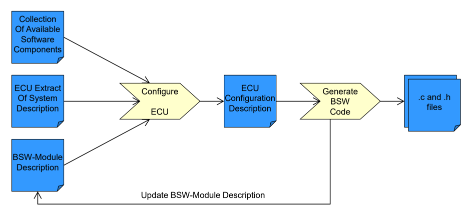

<!-- 源文档 AUTOSAR_CP_RS_BSWModuleDescriptionTemplate（R23-11），需求规范（RS），不受 Type A 七章骨架约束；章节结构镜像源文档自身编号（参考文献不编号，1–4）。需求项 ID [RS_BSWMD_*] 按 2026-11-03 Foundation 批次决议整体省略（标题仅翻译）；项间依赖引用改写为章节号交叉引用；源文档第 3 章 Requirements Tracing 为纯 ID 追溯表，按 ASWS 先例省略，后续章节编号相应前移（4→3、5→4）。封面元数据表、文档变更记录表、免责声明与目录按 EXP 流程省略。RS_BSWMD_00043 项标题在 markdown 转换中丢失标题层级，已按源文档恢复为小节标题；RS_BSWMD_00039、00038、00010、00037、00014、00033、00032、00035、00048、00044、00051、00053、00060、00015、00008 的表格单元格在 markdown 转换中发生错列，已依据 R23-11 PDF 原文恢复。图 1.1 为唯一内容插图，按内容哈希去重后嵌入（已按图边距规则加白边）；其余全部图片引用均为页面装饰性元素。变更历史中的增/删/改需求表按需求项 ID 整体省略决议仅保留标题列。源文档 ch.2 标题的笔误「Related Documentationn」按其本义译为「相关文档」。 -->

## 参考文献

[1] Methodology for Classic Platform
> AUTOSAR_CP_TR_Methodology

[2] Basic Software Module Description Template
> AUTOSAR_CP_TPS_BSWModuleDescriptionTemplate

[3] Meta Model-generated XML Schema
> AUTOSAR_FO_MMOD_XMLSchema

[4] Generic Structure Template
> AUTOSAR_FO_TPS_GenericStructureTemplate

[5] AUTOSAR XML Schema Production Rules
> AUTOSAR_FO_TPS_XMLSchemaProductionRules

[6] Standardization Template
> AUTOSAR_FO_TPS_StandardizationTemplate

[7] General Requirements on Basic Software Modules
> AUTOSAR_CP_SRS_BSWGeneral

[8] Requirements on ECU Configuration
> AUTOSAR_CP_RS_ECUConfiguration

[9] Requirements on Runtime Environment
> AUTOSAR_CP_SRS_RTE

[10] Glossary
> AUTOSAR_FO_TR_Glossary

[11] Specification of ECU Configuration
> AUTOSAR_CP_TPS_ECUConfiguration

[12] Requirements on Standardization Template
> AUTOSAR_FO_RS_StandardizationTemplate

[13] Specification of Memory Mapping
> AUTOSAR_CP_SWS_MemoryMapping

[14] Requirements on Timing Extensions
> AUTOSAR_FO_RS_TimingExtensions

[15] Specification of RTE Software
> AUTOSAR_CP_SWS_RTE

## 1. 文档范围

本文档收集对基础软件模块描述模板（**Basic Software Module Description Template**，**BSWMD-T**）的需求。

BSWMD-T 的主要目标是提供基础软件模块描述（**BSWMD**）的方案。BSWMD 保存关于 **BSW** 模块或模块簇（**cluster**）的一个实现的信息，以支持在 **ECU** 上的集成。另一个用例是支持 **BSW** 模块的一致性测试。

在方法论中可以区分 **BSW** 模块的三个阶段：

- 「**BSW** 模块规范」由 **AUTOSAR** 作为标准提供。

  **API** 可以针对所有用例加以规范。配置参数可能具有很宽的配置可能性范围。由于无法在规范中描述的硬件依赖关系，某些关键的配置参数可能缺失。

- 「**BSW** 模块实现」是 **BSW** 模块规范的一种可能实现。可能只实现被规范 **API** 的一个子集。可能已经做出了若干配置决策，但其他配置参数仍留给集成者选择。

  可以添加供应商特定的配置参数，以允许配置模块的行为（适用于所有 **BSW** 模块）和/或支持特定硬件元素的配置，例如特殊的寄存器设置（仅适用于硬件依赖的模块）。

- 「已配置的 **BSW** 模块」从具体的 **BSW** 模块实现中取得仍然开放的配置参数，并为它们赋予取值。完全配置的 **BSW** 模块才能实际集成到 **ECU** 上。

每个 **BSW** 模块实现都带有自己的 **BSW** 模块描述。重要的一点是始终使用正确的 **BSW** 模块实现与对应 **BSWMD** 的配对。

图 1.1 展示了「配置 ECU」（**Configure ECU**）活动的输入：

- 「可用软件组件集合」（**Collection of Available Software Components**）包含对映射到该特定 **ECU** 的所有软件组件描述的引用
- 「系统描述的 ECU 提取」（**ECU Extract of System Description**）包含系统配置中与该特定 **ECU** 相关的子集。这包括通信矩阵以及数据到信号的映射。
- 「**BSW** 模块描述」（**BSW Module Description**）（本文件收集其需求）。

输出是「**ECU** 配置描述」（**ECU Configuration Description**）。

由于部分 **BSW** 模块的高度可配置性，BSWMD 无法涵盖 **BSW** 模块配置的所有依赖关系。因此，也可以在 **BSW** 模块完成配置和生成之后更新 BSWMD，以提供关于已配置 **BSW** 模块的更具体的信息。

高度可配置的 **BSW** 模块的一个例子是 **RTE**，它几乎完全由生成产生，随未配置 **RTE** 一起交付的初始 BSWMD 无法以形式化的方式描述 **RTE** 的所有可能配置。

但在 **RTE** 完成配置之后，可以更新其 BSWMD，使其包含实际要生成的 **RTE** 的描述。更新后的 BSWMD 随后可用于辅助其他 **BSW** 模块（如 **Os**、**Debugger**、**Dlt**）的配置。

BSWMD-T 规定了实际的 basic software module description（**BSWMD**）能够提供哪些内容。从技术角度看，该模板以一份文档 [\[2\]](#ref-2) 和一个 XML schema [\[3\]](#ref-3) 的形式提供（另见 [\[4\]](#ref-4) 和 [\[5\]](#ref-5)）。

实际的 basic software module description 是符合该 XML schema 的 XML 文件。

### 1.1. 文档约定

**AUTOSAR** 文档中需求的表示遵循 TPS\_STDT\_00078 所规定的表格，参见标准模板（**Standardization Template**）的「追溯支持」（**Support for Traceability**）一章（[\[6\]](#ref-6)）。

应使用 TPS\_STDT\_00053 中规定的用于表达义务的助动词形式来表示需求，参见标准模板（**Standardization Template**）的「追溯支持」（**Support for Traceability**）一章（[\[6\]](#ref-6)）。

## 2. 相关文档

### 2.1. 输入文件

以下输入文档在开发这些需求的过程中被使用：

- **AUTOSAR** 基础软件模块通用需求（**General Requirements on Basic Software Modules**）[\[7\]](#ref-7)
- **AUTOSAR** ECU 配置需求（**Requirements on ECU Configuration**）[\[8\]](#ref-8)
- **AUTOSAR** RTE 软件需求规范（**RTE Software Requirement Specification**）[\[9\]](#ref-9)
- **AUTOSAR** 方法论（**Methodology**）[\[1\]](#ref-1)
- **AUTOSAR** 术语表（**Glossary**）[\[10\]](#ref-10)
- **AUTOSAR** 通用结构模板（**Generic Structure Template**）[\[4\]](#ref-4)
- **AUTOSAR** XML Schema 生成规则（**XML Schema Production Rules**）[\[5\]](#ref-5)

### 2.2. 规范文档

本文档中收集的需求将由以下文档满足：

- 《**Specification of the BSW Module Description Template**》[\[2\]](#ref-2)：该文档实现了本文所述的大部分需求。
- 《**ECU Configuration Specification**》[\[11\]](#ref-11)：该文档为标准化模块定义（**Standardized Module Definition**）和供应商特定模块定义（**Vendor-Specific Module Definition**）的创建提供规范和指南。

### 2.3. 缩略语

**BSW**
> 基础软件（**Basic Software**）

**BSWMD**
> 基础软件模块描述（**Basic Software Module Description**）

**BSWMD-T**
> 基础软件模块描述模板（**Basic Software Module Description Template**）

**ECUC**
> **ECU** 配置值（**ECU Configuration Values**）[\[11\]](#ref-11)

**ECUC Parameter Definition**
> **ECU** 配置参数定义（**ECU Configuration Parameter Definition**）[\[11\]](#ref-11)

**ECUC-T**
> **ECU** 配置模板（**ECU Configuration Template**）[\[11\]](#ref-11)

**ICS**
> 实现一致性声明（**Implementation Conformance Statement**）

**StMD**
> 标准化模块定义（**Standardized Module Definition**）[\[11\]](#ref-11)

**SWC**
> 软件组件描述（**Software Component Description**）

**SWC-T**
> 软件组件模板（**Software Component Template**）

**VSMD**
> 供应商特定模块定义（**Vendor-Specific Module Definition**）[\[11\]](#ref-11)

## 3. 对 BSW 模块描述模板的需求

### 3.1. 已发布信息

#### 3.1.1. 支持描述公共已发布信息

BSWMD 模板应提供描述 **BSW** 模块实现按照相应 **BSW** **SWS** 所提供的公共已发布信息的方法。

| 描述 | BSWMD 模板应提供描述 **BSW** 模块实现按照相应 **BSW** **SWS** 所提供的公共已发布信息的方法。 |
| --- | --- |
| 理由 | 配置工具应能够读取 **BSW** 实现的公共已发布信息，因为 **ECU** 配置值可能依赖于公共已发布信息。 |
| 依赖项 | [§3.1.2](#312-支持描述模块特定已发布信息) |
| 用例 | 提供如下公共已发布信息：模块 **VERSION**、**REVISION** 编号或 **AUTOSAR** 规范编号。 |
| 支撑材料 | - |

#### 3.1.2. 支持描述模块特定已发布信息

BSWMD 模板应提供描述 **BSW** 模块实现按照相应 **BSW** **SWS** 所提供的模块特定已发布信息的方法。

| 描述 | BSWMD 模板应提供描述 **BSW** 模块实现按照相应 **BSW** **SWS** 所提供的模块特定已发布信息的方法。 |
| --- | --- |
| 理由 | 配置工具应能够读取 **BSW** 实现的已发布信息，因为 **ECU** 配置值可能依赖于已发布信息。 |
| 依赖项 | [§3.1.20](#3120-提供供应商特定已发布信息)、[§3.1.1](#311-支持描述公共已发布信息) |
| 用例 | 使硬件依赖信息（如 **EEPROM-ERASE-TIME**）的取值，以及 **API** 参数宽度（如 **EEP-IF-ADDRESSTYPE**（uint8、16、32））的取值，可供其他模块（如 **MemIf**）使用。 |
| 支撑材料 | - |

#### 3.1.3. 识别已实现的 API 和函数

描述 **BSW** 模块/模块簇实际实现了哪些 **API** 和函数。

| 描述 | 描述 **BSW** 模块/模块簇实际实现了哪些 **API** 和函数。 |
| --- | --- |
| 理由 | **BSW** 模块的规范允许只实现被规范 **API** 和函数的一个子集。应描述实际实现的是哪个子集。 |
| 依赖项 | [§3.1.4](#314-识别所需的-api-和函数)、[§3.1.5](#315-所提供-api-实参数据类型的声明) |
| 用例 | 模块（模块簇）的一致性只能针对模块/模块簇实际提供的功能进行证明。 |
| 支撑材料 | - |

#### 3.1.4. 识别所需的 API 和函数

描述该实现需要其他模块的哪些 **API** 和函数。

| 描述 | 描述该实现需要其他模块的哪些 **API** 和函数。 |
| --- | --- |
| 理由 | 通过列出该实现实际使用所需的 **API** 来支持集成。 |
| 依赖项 | [§3.1.3](#313-识别已实现的-api-和函数)、[§3.1.5](#315-所提供-api-实参数据类型的声明)、[§3.1.22](#3122-bsw-模块间调用链依赖的建模) |
| 用例 | 检查其他模块所提供的 **API**、函数和操作签名是否与 **BSW** 模块实现的需求相匹配。 |
| 支撑材料 | - |

#### 3.1.5. 所提供 API 实参数据类型的声明

描述实现实际使用的、用于 **API** 函数实参的数据类型，以及在规范文档中留开的 **ECU** 配置参数定义。

| 描述 | 描述实现实际使用的、用于 **API** 函数实参的数据类型，以及在规范文档中留开的 **ECU** 配置参数定义。 |
| --- | --- |
| 理由 | **BSW** 模块的规范在某些情况下不固定实现所使用的数据类型。为了允许集成，需要描述实际实现的数据类型。 |
| 依赖项 | - |
| 用例 | 如果 **BSW** **SWS** 将某个 **API** 实参规范为 **UInt8** 或 **UInt16**，则 BSWMD 模板应提供描述实际实现中使用了哪种类型的方法。 |
| 支撑材料 | - |

#### 3.1.6. 所需 API 实参数据类型的描述

描述实现所需的、用于规范文档中留开的 **API** 函数实参的实际数据类型。

| 描述 | 描述实现所需的、用于规范文档中留开的 **API** 函数实参的实际数据类型。 |
| --- | --- |
| 理由 | **BSW** 模块的规范在某些情况下不固定实现所使用的数据类型。为了允许集成，需要描述这些实际实现的数据类型。 |
| 依赖项 | - |
| 用例 | 如果 **BSW** **SWS** 将某个 **API** 实参规范为 **UInt8** 或 **UInt16**，则 BSWMD 模板应提供描述实际实现中期望哪种类型的方法。 |
| 支撑材料 | - |

#### 3.1.7. API 调用的保证执行上下文

对于对其他模块的 **API** 调用，应可以描述调用方是否会在中断上下文中执行该调用。

| 描述 | 对于对其他模块的 **API** 调用，应可以描述调用方是否会在中断上下文中执行该调用。 |
| --- | --- |
| 理由 | 如果调用同时指定了调用方和被调用方的上下文，就可以在 **ECU** 配置活动期间检测出无效的调用链。 * 如果调用发生在中断上下文中，它对执行时间和可用指令有一些限制。 * **RTE** 生成器需要了解来自 **BSW** 服务的调用的上下文，以便将中断上下文与应用软件组件解耦。 |
| 依赖项 | [§3.1.8](#318-api-调用的所需执行上下文)、[§3.1.4](#314-识别所需的-api-和函数) |
| 用例 | **Com** 模块期望来自 **PduR** 的通知发生在任务上下文中，但 **PduR** 只处理来自 **CanIf** 的中断上下文。这是一个无效的配置，应被检测出来。 |
| 支撑材料 | - |

#### 3.1.8. API 调用的所需执行上下文

BSWMD 模板应提供为每个所提供的 **API** 函数定义其应被调用的上下文的方法。

| 描述 | BSWMD 模板应提供为每个所提供的 **API** 函数定义其应被调用的上下文的方法。 |
| --- | --- |
| 理由 | 如果调用同时指定了调用方和被调用方的上下文，就可以在 **ECU** 配置活动期间检测出无效的调用链。 |
| 依赖项 | [§3.1.7](#317-api-调用的保证执行上下文)、[§3.1.3](#313-识别已实现的-api-和函数) |
| 用例 | **Com** 模块期望来自 **PduR** 的通知发生在任务上下文中，但 **PduR** 只处理来自 **CanIf** 的中断上下文。这是一个无效的配置，应被检测出来。 |
| 支撑材料 | - |

#### 3.1.9. 编译器版本和设置

应可以描述实际使用的编译器（供应商、版本）及其设置——用于目标码交付时所使用的，或源码交付时需要使用的。

| 描述 | 应可以描述实际使用的编译器（供应商、版本）及其设置——用于目标码交付时所使用的，或源码交付时需要使用的。 |
| --- | --- |
| 理由 | 当 **BSW** 以目标码形式交付时，集成者需要了解目标码是如何编译的。 * 如果以源码形式交付，代码通常针对特定的编译器和版本提供。 |
| 依赖项 | - |
| 用例 | 使用不同编译器编译的目标码可能在栈结构上存在问题。因此，必须描述所使用的编译器及其设置，以便检测这类不一致。 |
| 支撑材料 | - |

#### 3.1.10. 所需的库

应可以描述目标码交付时使用了哪些库（供应商和版本），或源码交付时需要包含哪些库。

| 描述 | 应可以描述目标码交付时使用了哪些库（供应商和版本），或源码交付时需要包含哪些库。 |
| --- | --- |
| 理由 | 当 **BSW** 模块以目标码形式交付时，集成者需要了解目标码应如何集成。 * 如果以源码形式交付，代码可能只需要特定版本的预期库。 |
| 依赖项 | - |
| 用例 | 如果多个 **BSW** 模块使用同一个库，则该库只需在 **ECU** 上存在一份。描述所使用的库和版本，以便能够检测多个 **BSW** 模块实现所使用的库是否互不兼容。 |
| 支撑材料 | - |

#### 3.1.11. 支持交付信息

BSWMD 模板应支持描述 **BSW** 模块的交付中包含哪些文件（源码、目标码、文档）。

| 描述 | BSWMD 模板应支持描述 **BSW** 模块的交付中包含哪些文件（源码、目标码、文档）。 |
| --- | --- |
| 理由 | 描述 **BSW** 模块的交付中交付了哪些产物。 |
| 依赖项 | [§3.1.24](#3124-对生成产物的描述) |
| 用例 | 在集成之前检查所交付产物的完整性。 |
| 支撑材料 | - |

#### 3.1.12. 支持 BSW 模块簇

支持描述实现多个 **BSW** 模块的 **BSW** 模块簇。

| 描述 | 支持描述实现多个 **BSW** 模块的 **BSW** 模块簇。 |
| --- | --- |
| 理由 | **AUTOSAR** 允许将多个 **BSW** 模块（甚至包括 **AUTOSAR** 服务在内的整个 **BSW**）集成在单个簇中，并将该 **BSW** 簇视为一个实体。 * 必须了解该簇如何与其他模块/簇交互，才能对其集成。 * 针对簇的测试必须知道被测对象实际支持哪些部分（操作签名和可配置的功能）。 |
| 依赖项 | - |
| 用例 | 在单个实现中交付完整的 **COM** 栈。 * 在单个实现中交付整个 **AUTOSAR** **BSW**。 |
| 支撑材料 | - |

#### 3.1.13. ECU 配置编辑器与生成器所支持工具的版本信息

应可以描述所支持的 **ECU** 配置编辑器和生成器工具（供应商、版本）及其设置。

| 描述 | 应可以描述所支持的 **ECU** 配置编辑器和生成器工具（供应商、版本）及其设置。 |
| --- | --- |
| 理由 | 交付 **BSW** 模块时，集成者需要了解可以使用哪些编辑和生成工具来配置该 **BSW**。 |
| 依赖项 | - |
| 用例 | 由于 **BSW** 模块实现可能需要一些供应商特定的 **ECU** 配置参数处理，应可以声明哪个生成器能够应对这些扩展。 |
| 支撑材料 | 本需求不排除未明确列出的工具与该特定 XML 文件协同工作。 |

#### 3.1.14. 描述 ECU 配置参数的配置类别

当 **BSW** 模块的实际实现可以自由选择配置类别（编译前、链接时、post-build）时，应可以描述选择了哪种备选方案。

| 描述 | 当 **BSW** 模块的实际实现可以自由选择配置类别（编译前、链接时、post-build）时，应可以描述选择了哪种备选方案。 |
| --- | --- |
| 理由 | **ECU** 配置参数需要根据其配置类别以不同的方式处理。 |
| 依赖项 | - |
| 用例 | **ECU** 配置编辑器应能够只允许对 post-build 时的 **ECU** 配置参数进行更改。 |
| 支撑材料 | - |

#### 3.1.15. 预配置的 ECU 配置值

BSWMD 模板应允许规定一组由实现设置为固定取值的 **ECU** 配置值。

| 描述 | BSWMD 模板应允许规定一组由实现设置为固定取值的 **ECU** 配置值。 |
| --- | --- |
| 理由 | 预配置的 **ECU** 配置值包含 **BSW** 模块集成者无法更改的取值，因为这些取值由实现固定。 * 一旦选择了模块实现，这些预配置的 **ECU** 配置值应作为基础模块配置的一部分复制到实际 **BSW** 模块的 **ECU** 配置值中 [\[11\]](#ref-11)。 |
| 依赖项 | - |
| 用例 | 一个取值可能因不同原因被固定。例如，目标码交付中的所有编译前参数都被固定。 |
| 支撑材料 | - |

#### 3.1.16. 推荐的 ECU 配置值

BSWMD 模板应允许规定一组由实现推荐的 **ECU** 配置值。

| 描述 | BSWMD 模板应允许规定一组由实现推荐的 **ECU** 配置值。 |
| --- | --- |
| 理由 | 这些推荐的 **ECU** 配置值可以保存实现者推荐的 **ECU** 配置值，并在选择了 **BSW** 模块实现之后作为基础复制到该 **BSW** 模块的 **ECU** 配置值中。 * 推荐的 **ECU** 配置值比默认值更灵活，因为它们允许定义多个容器实例，且每个容器中具有不同的 **ECU** 配置参数取值 [\[11\]](#ref-11)。 |
| 依赖项 | - |
| 用例 | 允许 **BSW** 供应商将 **BSW** 模块的部分或完整 **ECU** 配置值文件随实现一起交付。这减轻了集成者的工作，他们只需填入缺失的 **ECU** 配置值。 |
| 支撑材料 | - |

#### 3.1.17. 提供标准化模块定义

BSWMD 模板应允许规定模块的标准化模块定义（**Standardized Module Definition**）。

| 描述 | BSWMD 模板应允许规定模块的标准化模块定义（**Standardized Module Definition**）。 |
| --- | --- |
| 理由 | 标准化模块定义是 **BSW** 模块配置的基础。供应商特定模块定义从标准化模块定义推导得出。 |
| 依赖项 | [§3.1.21](#3121-供应商特定模块定义的标记) |
| 用例 | 提供关于某个 **BSW** 模块实现使用哪个标准化模块定义的信息。 |
| 支撑材料 | - |

#### 3.1.18. 允许对标准化模块定义进行供应商特定修改

BSWMD 模板应允许对标准化模块定义进行修改，以支持实现特定的适配。

| 描述 | BSWMD 模板应允许对标准化模块定义进行修改，以支持实现特定的适配。 |
| --- | --- |
| 理由 | 标准化模块定义规定了每个配置参数可能取值的超集。某个实现可能会限制标准化模块定义中各个元素实际适用的特性。 |
| 依赖项 | [§3.1.17](#3117-提供标准化模块定义) |
| 用例 | **NvRam** 管理器的 **BlockId** 可以是 8 位或 16 位。标准化参数的最小取值为 1、最大取值为 65535。某个实现可以选择只支持 8 位取值，因此最大取值必须适配为 255。 |
| 支撑材料 | - |

#### 3.1.19. 提供供应商特定模块定义

BSWMD 模板应允许定义模块的供应商特定模块定义（**Vendor-Specific Module Definition**）。

| 描述 | BSWMD 模板应允许定义模块的供应商特定模块定义（**Vendor-Specific Module Definition**）。 |
| --- | --- |
| 理由 | 由于标准化模块定义不包含某些模块实现所需的全部相关配置参数，因此需要附加的配置参数。由于这些配置参数依赖于硬件，具体的实现需要附加的配置定义。 * 供应商特定模块定义规定 **BSW** 模块的具体实现实际支持哪些配置参数和范围。 |
| 依赖项 | [§3.1.21](#3121-供应商特定模块定义的标记) |
| 用例 | 可以添加供应商特定的配置参数，以允许配置模块的行为（适用于所有 **BSW** 模块）和/或支持特定硬件元素的配置，例如特殊的寄存器设置（仅适用于硬件依赖的模块）。 |
| 支撑材料 | 供应商特定参数的定义应使用 **ECU** 配置参数定义模板 [\[11\]](#ref-11)。 |

#### 3.1.20. 提供供应商特定已发布信息

BSWMD 模板应支持供应商特定已发布信息的定义。

| 描述 | BSWMD 模板应支持供应商特定已发布信息的定义。 |
| --- | --- |
| 理由 | 供应商可能希望发布专有信息，供其工具链使用。 |
| 依赖项 | [§3.1.21](#3121-供应商特定模块定义的标记)、[§3.1.2](#312-支持描述模块特定已发布信息) |
| 用例 | 基于所实现的目标，描述模块实际实现的供应商特定已发布信息。通过规定一种标准化的描述方式，避免使用专有手段提供此类扩展。 |
| 支撑材料 | RS\_ECUC\_00002 [\[8\]](#ref-8) |

#### 3.1.21. 供应商特定模块定义的标记

应可以区分标准化模块定义和供应商特定模块定义。

| 描述 | 应可以区分标准化模块定义和供应商特定模块定义。 |
| --- | --- |
| 理由 | 由于供应商可以向标准化模块定义添加供应商特定的 **ECU** 配置参数，这些添加内容需要与标准化的 **ECU** 配置参数相区分。 |
| 依赖项 | [§3.1.17](#3117-提供标准化模块定义)、[§3.1.19](#3119-提供供应商特定模块定义)、[§3.1.20](#3120-提供供应商特定已发布信息) |
| 用例 | 为了对供应商特定模块定义进行一致性检查，需要描述哪些 **ECU** 配置参数是标准化的、哪些是供应商特定的。 |
| 支撑材料 | - |

#### 3.1.22. BSW 模块间调用链依赖的建模

应可以描述一个函数调用了哪些其他 **API** 函数。

| 描述 | 应可以描述一个函数调用了哪些其他 **API** 函数。 |
| --- | --- |
| 理由 | 配置 **OS** 时需要此项，因为 **OS** 资源必须映射到使用它们的任务。 |
| 依赖项 | [§3.3.7](#337-发布-os-资源使用) |
| 用例 | 当调用某个 main 函数、而该 main 函数又调用另一个 **API** 函数、依此下去时，推导出使用了哪些 **OS** 资源。 |
| 支撑材料 | - |

#### 3.1.23. 描述可选和必需的元素

BSWMD 模板应提供描述 **BSW** 模块实现的可选和必需元素的方法。

| 描述 | BSWMD 模板应提供描述 **BSW** 模块实现的可选和必需元素的方法。 |
| --- | --- |
| 理由 | 由于 **BSW** 模块（源自 **AUTOSAR** 规范）的高度可配置性，应提供描述一个 **BSW** 模块实现实际支持的元素的方法。 |
| 依赖项 | - |
| 用例 | 声明某个 **BSW** 模块实现支持哪些可选元素。 * 交付包含可选元素、供生产使用的 **BSW** 模块描述，这些可选元素随后由集成者选择。 * 使用一个描述标准（包括强制和可选元素）的 **BSW** 模块描述，作为对其他 **BSW** 描述进行一致性检查的参照。 |
| 支撑材料 | - |

#### 3.1.24. 对生成产物的描述

支持描述生成工具将创建哪些产物。

| 描述 | 支持描述生成工具将创建哪些产物。 |
| --- | --- |
| 理由 | 了解 **BSW** 模块的生成工具会生成哪些产物（头文件和 c 文件、文档）有助于集成和构建过程。 |
| 依赖项 | [§3.1.11](#3111-支持交付信息) |
| 用例 | 基于 [§3.1.11](#3111-支持交付信息) 的信息和生成的产物生成 make 文件。 |
| 支撑材料 | - |

#### 3.1.25. 对库的描述

应可以描述库及其实现。

| 描述 | 应可以描述库及其实现。 |
| --- | --- |
| 理由 | 库用于在 **BSW** 以及应用软件组件中的多个使用者之间共享代码。应支持库的选择和集成。 |
| 依赖项 | - |
| 用例 | 描述库所提供的 **API** 描述库所需的 **API** 描述库的资源需求。 |
| 支撑材料 | - |

#### 3.1.26. 对生成的 RTE 的描述

应可以描述生成的 **RTE** 的属性。

| 描述 | 应可以描述生成的 **RTE** 的属性。 |
| --- | --- |
| 理由 | **RTE** 生成器能够做出许多影响 **RTE** 在 **ECU** 上集成的决策。 |
| 依赖项 | - |
| 用例 | 描述生成的 **VFB** 跟踪函数。 |
| 支撑材料 | - |

#### 3.1.27. 提供测量与标定支持

BSWMDT 应包含一个支持格式，用于描述测量与标定数据；外部工具可以将它（连同链接器生成的信息）用于生成标定和测量工具所需的数据描述。

| 描述 | BSWMDT 应包含一个支持格式，用于描述测量与标定数据；外部工具可以将它（连同链接器生成的信息）用于生成标定和测量工具所需的数据描述。 |
| --- | --- |
| 理由 | 对于由 **RTE** 生成的代码，其中包含的标定和测量数据在多个「上游」产物中描述。外部工具应能够基于一个更简单的、只包含相关信息的产物做进一步处理。 * 外部工具必须能够确定测量与标定数据的存储器地址。为此，必须在支持格式中提供变量和参数的实际链接器符号。 * 来自 **ECU** 配置的信息（例如 **RTE** 的标定方法）也必须可用。 |
| 依赖项 | - |
| 用例 | **RTE** 作为其自身 BSWMD 的一部分为测量与标定数据生成支持数据，例如端口中的数据元素。 * **RTE**（或其他工具）为模块内局部声明的测量与标定数据生成支持数据。BSWMD 用生成的支持数据进行更新。 |
| 支撑材料 | - |

#### 3.1.28. 提供快速原型支持

BSWMDT 应包含一个支持格式，用于描述快速原型数据；该格式可用于生成快速原型工具所需的数据描述。

| 描述 | BSWMDT 应包含一个支持格式，用于描述快速原型数据；该格式可用于生成快速原型工具所需的数据描述。 |
| --- | --- |
| 理由 | 对于由 **RTE** 生成的代码，应描述其中包含的快速原型机制，以便快速原型工具能够与 **RTE** 交互。 |
| 依赖项 | - |
| 用例 | **RTE** 作为其自身 BSWMD 的一部分为快速原型生成支持数据。 |
| 支撑材料 | - |

#### 3.1.29. 支持用于快速原型的 post-build 挂钩工具

**BSW** 模块描述模板应通过对已实现的 **RP** 存储器接口的描述，支持用于快速原型的 post-build 挂钩工具。**RP** 存储器接口由无歧义的存储器位置组成，**RP** 工具可以在这些位置修改后续使用的取值。

| 描述 | **BSW** 模块描述模板应通过对已实现的 **RP** 存储器接口的描述，支持用于快速原型的 post-build 挂钩工具。**RP** 存储器接口由无歧义的存储器位置组成，**RP** 工具可以在这些位置修改后续使用的取值。 |
| --- | --- |
| 理由 | post-build 挂钩工具需要识别正确的存储器位置以插入挂钩。 |
| 依赖项 | - |
| 用例 | - |
| 支撑材料 | - |

#### 3.1.30. 支持基于服务的旁路以实现快速原型

**BSW** 模块描述模板应支持描述快速原型服务点以及相关联的事件、可执行实体实例及其对数据的访问。此外，还需要了解为快速原型准备的可执行实体的条件执行所实现的使能标志。

| 描述 | **BSW** 模块描述模板应支持描述快速原型服务点以及相关联的事件、可执行实体实例及其对数据的访问。此外，还需要了解为快速原型准备的可执行实体的条件执行所实现的使能标志。 |
| --- | --- |
| 理由 | 为了支持基于服务的旁路（**service-based bypass**）的使用，快速原型工具需要了解由 **RTE** 插入的服务点及其与使能标志和所访问数据的关系。 |
| 依赖项 | - |
| 用例 | - |
| 支撑材料 | - |

#### 3.1.31. 生产错误与扩展生产错误的配置

**BSW** 模块描述模板应提供针对所有已实现的生产错误（**production errors**）和扩展生产错误（**extended production errors**）规定对 **Dem** 配置要求的能力。

| 描述 | **BSW** 模块描述模板应提供针对所有已实现的生产错误（**production errors**）和扩展生产错误（**extended production errors**）规定对 **Dem** 配置要求的能力。 |
| --- | --- |
| 理由 | 自动配置 **Dem**。 |
| 依赖项 | - |
| 用例 | 用于配置防抖计数器（递增/递减计数）、这些防抖计数器的限制配置等的服务需求。 * 规定诊断模块是否可以请求删除错误。如果可以，规定错误可以按何种方式以及在何时被复位。 |
| 支撑材料 | SWS\_BSW\_00001 |

### 3.2. BSW 调度

#### 3.2.1. BSW Main 函数基于周期的调度

BSWMD 模板应提供描述 **BSW** Main 函数基于周期的调度需求的方法。

| 描述 | BSWMD 模板应提供描述 **BSW** Main 函数基于周期的调度需求的方法。 |
| --- | --- |
| 理由 | **RTE** 生成器为整个 **ECU** 创建调度。许多 **BSW** 模块依赖其 main 函数基于周期的调用来完成自身的功能。**RTE** 生成器应能够基于所声明的要求实现基于周期的调用。 |
| 依赖项 | - |
| 用例 | 由生成的 **RTE** 调用函数「Com\_MainFunctionTx()」以实现 **IPdu** 的周期性发送。 |
| 支撑材料 | - |

#### 3.2.2. 应支持 BSW 模块的模式切换

BSWMD 模板应提供描述 **BSW** 模块的模式切换（**Mode Switch**）及调度需求的方法。

| 描述 | BSWMD 模板应提供描述 **BSW** 模块的模式切换（**Mode Switch**）及调度需求的方法。 |
| --- | --- |
| 理由 | **BSW** Main 函数依据 **ECU** 的不同运行模式进行条件调度。 * **BSW** Main 函数按模式进行调度： * 进入或退出某个模式时激活 * 在特定的模式转换时激活 |
| 依赖项 | - |
| 用例 | 初始化和终结阶段（模式由 **EcuM** 提供） * 不同的通信模式（模式由 **ComM** 提供） |
| 支撑材料 | - |

#### 3.2.3. 并行的模式转换

BSWMD 模板应提供规定控制 **BSW** 模块和应用软件组件所需并行切换模式的方法。

| 描述 | BSWMD 模板应提供规定控制 **BSW** 模块和应用软件组件所需并行切换模式的方法。 |
| --- | --- |
| 理由 | 模式转换期间，**AUTOSAR** **BSW** 模块和应用软件组件的同步行为。 |
| 依赖项 | - |
| 用例 | **ECU** 全局的初始化和终结阶段。 |
| 支撑材料 | - |

#### 3.2.4. BSW 模块模式切换通知的 API

BSWMD 模板应提供描述特定 BswModuleEntity 通信模式的方法。

| 描述 | BSWMD 模板应提供描述特定 BswModuleEntity 通信模式的方法。 |
| --- | --- |
| 理由 | **BSW** 调度器的代码生成器应生成 **BSW** 模块服务作为模式管理器（**Mode Manager**）所使用的模式切换 **API**。 |
| 依赖项 | - |
| 用例 | **EcuM** 通过 **BSW** 调度器向所有 **BSW** 模块通知 **ECU** 的运行状态。 |
| 支撑材料 | - |

#### 3.2.5. 由触发事件触发 BSW Main 函数

BSWMD 模板应提供描述由触发事件（**Triggered Event**）的发生触发 **BSW** Main 函数的方法。依赖触发事件的特定 **BSW** Main 函数应在事件发生后执行。触发事件的发生或者通过 **API** 报告给 **BSW** 调度器，或者借助 **OS**（例如 **OS** 闹钟到期）报告。限制：这仅适用于 **ECU** 内部的使用。

| 描述 | BSWMD 模板应提供描述由触发事件（**Triggered Event**）的发生触发 **BSW** Main 函数的方法。依赖触发事件的特定 **BSW** Main 函数应在事件发生后执行。触发事件的发生或者通过 **API** 报告给 **BSW** 调度器，或者借助 **OS**（例如 **OS** 闹钟到期）报告。限制：这仅适用于 **ECU** 内部的使用。 |
| --- | --- |
| 理由 | 不同 **BSW** 模块中 **BSW** Main 函数的偶发激活和非基于时序的周期激活。 |
| 依赖项 | - |
| 用例 | 内燃机点火的曲轴转角周期触发。 |
| 支撑材料 | - |

#### 3.2.6. 由触发事件进行的并行触发

BSWMD 模板应提供规定由共享的触发事件对 Runnable 实体和 **BSW** Main 函数进行所需同步触发的方法。

| 描述 | BSWMD 模板应提供规定由共享的触发事件对 Runnable 实体和 **BSW** Main 函数进行所需同步触发的方法。 |
| --- | --- |
| 理由 | **AUTOSAR** **BSW** 模块和应用软件组件中例程的同步激活。 |
| 依赖项 | - |
| 用例 | 内燃机的应用软件组件和复杂设备驱动中例程的曲轴转角周期触发。 |
| 支撑材料 | - |

#### 3.2.7. 由触发事件触发 BSW 模块的 API

BSWMD 模板应提供描述特定 BswModuleEntity 触发触发事件的方法。

| 描述 | BSWMD 模板应提供描述特定 BswModuleEntity 触发触发事件的方法。 |
| --- | --- |
| 理由 | **BSW** 调度器的代码生成器应生成捕获触发事件来源的 **BSW** 模块所使用的触发 **API**。 |
| 依赖项 | - |
| 用例 | 内燃机的应用软件组件和复杂设备驱动中例程的曲轴转角周期触发。 |
| 支撑材料 | - |

#### 3.2.8. 支持 BSW 模块和应用软件组件中的独占区

BSWMD 模板应提供定义特定 BswModuleEntity 所使用的独占区（**exclusive area**）的方法，以便进行优先级判定，防止对共享资源的并发访问。独占区应使用名称和访问它的 BswModuleEntity 来定义。独占区应只保护模块内部数据。

| 描述 | BSWMD 模板应提供定义特定 BswModuleEntity 所使用的独占区（**exclusive area**）的方法，以便进行优先级判定，防止对共享资源的并发访问。独占区应使用名称和访问它的 BswModuleEntity 来定义。独占区应只保护模块内部数据。 |
| --- | --- |
| 理由 | 将模块实现与数据一致性机制的应用解耦。 * **BSW** 调度器的代码生成器应为 **BSW** 模块提供进入或退出独占区的 **API**。 |
| 依赖项 | - |
| 用例 | 为 BswSchedulableEntity 与 BswInterruptEntity 之间共享的数据缓冲区提供数据一致性。 |
| 支撑材料 | - |

#### 3.2.9. 允许启用提供激活 BSW 事件的 API

BSWMD 模板应提供请求手段：基础软件调度器（**Basic Software Scheduler**）启用将激活的 **BSW** 事件传递给被调用的可调度实体（**Schedulable Entity**）这一特性。该请求应针对每个可调度实体可用。

| 描述 | BSWMD 模板应提供请求手段：基础软件调度器（**Basic Software Scheduler**）启用将激活的 **BSW** 事件传递给被调用的可调度实体（**Schedulable Entity**）这一特性。该请求应针对每个可调度实体可用。 |
| --- | --- |
| 理由 | 如果可调度实体的代码不需要激活的 **BSW** 事件，则它不应可用，并且生成的基础软件调度器不应为该可调度实体跟踪激活的 **BSW** 事件。 |
| 依赖项 | - |
| 用例 | 某个可调度实体被定义为既由「BswTimingEvent」激活，也由「BswDataReceivedEvent」激活。在该可调度实体执行期间，代码需要区分实际触发执行的是哪个激活来源。 |
| 支撑材料 | - |

#### 3.2.10. 支持 BSWModuleEntity 内独占区使用的可选配置

**BSW** 模块配置应支持为每个实现的 BSWModuleEntity 规定可选的配置信息，以描述： * 该实体以嵌套方式使用了哪些独占区。 * 在某个独占区或嵌套独占区内调用了哪些其他软件实体。

| 描述 | **BSW** 模块配置应支持为每个实现的 BSWModuleEntity 规定可选的配置信息，以描述： * 该实体以嵌套方式使用了哪些独占区。 * 在某个独占区或嵌套独占区内调用了哪些其他软件实体。 |
| --- | --- |
| 理由 | 附加的配置信息可以在配置阶段由工具检查。其目标是通过在资源共享于不同软件实体之间可能出现冲突时向实现者发出警告来防止死锁。 |
| 依赖项 | - |
| 用例 | 安全关键系统的发布：死锁和某些其他问题可能只在异常情况下发生，无法全部通过测试发现。安全关键 **ASIL** 系统的安全运行可能要求除其他验证与确认方法之外，通过静态分析证明无死锁。 * 锁定共享资源的资源消耗优化：根据软件到任务和内核的分配情况，需要不同的独占区实现。通过分析依赖关系，可以选择最高效的备选方案。 * 第三方软件的集成：对于第三方软件，通常无法获得其源码来分析独占区的使用方式。这必须在配置描述中详细规定和提供。 |
| 支撑材料 | - |

#### 3.2.11. BSW 分区间客户-服务器通信

BSWMDT 应提供规定 **BSW** 内分区间和/或内核间通信所需的和所提供的过程调用的方法。它们应同时支持同步和异步的客户-服务器模式，并应允许生成相应的 **BSW** 调度器 **API**。

| 描述 | BSWMDT 应提供规定 **BSW** 内分区间和/或内核间通信所需的和所提供的过程调用的方法。它们应同时支持同步和异步的客户-服务器模式，并应允许生成相应的 **BSW** 调度器 **API**。 |
| --- | --- |
| 理由 | 就 **BSW** 服务而言优化内核间的负载均衡。提高 **BSW** 服务执行的效率。支持多核软件分布的优化。 |
| 依赖项 | - |
| 用例 | 多核系统上应用的并行执行。 |
| 支撑材料 | - |

#### 3.2.12. BSW 分区间发送者-接收者通信

BSWMDT 应提供规定 **BSW** 内分区间和/或内核间通信所需的和所提供的数据的方法。它们应允许生成相应的 **BSW** 调度器 **API**。

| 描述 | BSWMDT 应提供规定 **BSW** 内分区间和/或内核间通信所需的和所提供的数据的方法。它们应允许生成相应的 **BSW** 调度器 **API**。 |
| --- | --- |
| 理由 | 就 **BSW** 服务而言优化内核间的负载均衡。提高 **BSW** 服务执行的效率。支持多核软件分布的优化。 |
| 依赖项 | - |
| 用例 | 多核系统上应用的并行执行。 |
| 支撑材料 | - |

#### 3.2.13. BSW 服务在本地或远程分区上的执行

如果某个 **BSW** 服务在特定分区上可用，BSWMDT 应允许为给定代码创建 BSWMD，以支持服务函数在同一分区中调用并执行的配置，以及在一个分区中调用、由 **RTE** 路由到另一分区执行的配置。

| 描述 | 如果某个 **BSW** 服务在特定分区上可用，BSWMDT 应允许为给定代码创建 BSWMD，以支持服务函数在同一分区中调用并执行的配置，以及在一个分区中调用、由 **RTE** 路由到另一分区执行的配置。 |
| --- | --- |
| 理由 | 就 **BSW** 服务而言优化内核间的负载均衡。提高 **BSW** 服务执行的效率。支持多核软件分布的优化。 |
| 依赖项 | - |
| 用例 | 多核系统上应用的并行执行。 |
| 支撑材料 | - |

### 3.3. 资源

#### 3.3.1. 软件实现存储器需求的描述

BSWMD 模板应支持描述软件模块（基础软件和应用软件）实现的存储器需求。还应支持规定这些取值的质量（例如估算、测量、分析）。应逐个描述所定义存储器段的存储器需求。

| 描述 | BSWMD 模板应支持描述软件模块（基础软件和应用软件）实现的存储器需求。还应支持规定这些取值的质量（例如估算、测量、分析）。应逐个描述所定义存储器段的存储器需求。 |
| --- | --- |
| 理由 | 设计和配置 **ECU** 需要资源的估算/测量。 |
| 依赖项 | [§3.3.2](#332-所用存储器段名称的描述) |
| 用例 | 以目标码形式交付的 **BSW** 模块的 **ROM** 占用通常是固定的，可以在 BSWMD 中声明。在大多数情况下，存储器需求依赖于实际的 **ECU** 配置参数取值，只能估算。 |
| 支撑材料 | - |

#### 3.3.2. 所用存储器段名称的描述

支持描述开发/编译软件模块时所使用的存储器段名称。

| 描述 | 支持描述开发/编译软件模块时所使用的存储器段名称。 |
| --- | --- |
| 理由 | 通过使用存储器段名称，可以将软件划分为若干段，这些段将在 **ECU** 配置活动中被放置到 **ECU** 的存储器段中。 |
| 依赖项 | [§3.3.1](#331-软件实现存储器需求的描述) |
| 用例 | **ECU** 状态管理器实现使用存储器段 **NOINIT** 来指示哪些已声明的变量在 **ECU** 启动期间不应被初始化。将该段实际映射到 **ECU** 上满足这一要求的适当存储器段属于 **ECU** 配置活动的职责。 |
| 支撑材料 | 存储器映射规范（**Specification of Memory Mapping**） [\[13\]](#ref-13)、RS\_ECUC\_00068 [\[8\]](#ref-8) |

#### 3.3.3. 外设寄存器使用的描述

BSWMD 模板应支持 **ECU** 配置工具确定访问同一外设寄存器的不同 **BSW** 模块之间的冲突。在某些情况下，这些需求依赖于实际的 **ECU** 配置参数取值（此时不应提供公式！）

| 描述 | BSWMD 模板应支持 **ECU** 配置工具确定访问同一外设寄存器的不同 **BSW** 模块之间的冲突。在某些情况下，这些需求依赖于实际的 **ECU** 配置参数取值（此时不应提供公式！） |
| --- | --- |
| 理由 | 来自不同供应商的 **BSW** 模块实现可能使用冲突的外设寄存器配置。当这些 **BSW** 模块集成到同一 **ECU** 时，**ECU** 配置工具应检测这些冲突并向用户告警。 |
| 依赖项 | - |
| 用例 | 两个 **BSW** 模块实现都写入同一个微控制器寄存器但使用不同的设置。必须识别出该冲突。 |
| 支撑材料 | - |

#### 3.3.4. 时序保证

BSWMD 模板应允许规定 **BSW** 模块函数（main 函数和 **API** 调用，包括回调与 **ISR**）的保证或估计的反应时间。

| 描述 | BSWMD 模板应允许规定 **BSW** 模块函数（main 函数和 **API** 调用，包括回调与 **ISR**）的保证或估计的反应时间。 |
| --- | --- |
| 理由 | 为了能够对应用软件组件进行时序分析，**BSW** 需要定义时序保证。 |
| 依赖项 | - |
| 用例 | 有了保证执行时间的知识，就可以优化独占区访问的设计，根据持续时间的不同，中断阻塞可能是可能的。 |
| 支撑材料 | RS\_TIMEX\_00013《时序扩展需求》（**Requirements on Timing Extensions**） [\[14\]](#ref-14) |

#### 3.3.5. 时序需求

BSWMD 模板应允许规定对在其他模块中调用的函数（如回调函数）的时序需求。

| 描述 | BSWMD 模板应允许规定对在其他模块中调用的函数（如回调函数）的时序需求。 |
| --- | --- |
| 理由 | 为了能够对应用软件组件进行时序分析，**BSW** 需要在时序保证（[§3.3.4](#334-时序保证)）之外定义时序需求。 |
| 依赖项 | - |
| 用例 | 为了满足给定的时序保证，对其他函数的调用需要在时间上受到限制。 |
| 支撑材料 | - |

#### 3.3.6. 为 BSW 调度器发布资源需求

BSWMD 模板应提供描述实现所使用的、需要由 **BSW** 调度器 [\[15\]](#ref-15) 提供和集成的资源的方法。

| 描述 | BSWMD 模板应提供描述实现所使用的、需要由 **BSW** 调度器 [\[15\]](#ref-15) 提供和集成的资源的方法。 |
| --- | --- |
| 理由 | **BSW** 调度器用于将具体 **OS** 机制的使用从抽象概念中抽象出来。这些抽象概念在 **BSW** 调度器规范 [\[15\]](#ref-15) 中描述。BSWMD 模板应提供描述 **BSW** 模块实现对于 **BSW** 调度器的需求的方法。但使用哪种实际机制来满足这些需求由 **BSW** 调度器的实现决定。 |
| 依赖项 | [§3.3.7](#337-发布-os-资源使用) |
| 用例 | 某个 **BSW** 模块在其实现中使用了独占区访问，需要描述这一使用；但该独占区访问实际上如何实现（使用全局中断阻塞或某个 **OS** 资源）由 **BSW** 调度器决定。 |
| 支撑材料 | - |

#### 3.3.7. 发布 OS 资源使用

对于每个函数（main、**API**、**ISR**），应可以描述该函数内使用的 **OS** 资源。

| 描述 | 对于每个函数（main、**API**、**ISR**），应可以描述该函数内使用的 **OS** 资源。 |
| --- | --- |
| 理由 | 为了正确配置 **OS**，必须为每个函数规定对 **OS** 资源的访问。**BSW** 调度器必须能够解析可能使用任何 **OS** 资源的任务上下文。 |
| 依赖项 | [§3.3.6](#336-为-bsw-调度器发布资源需求)、[§3.1.22](#3122-bsw-模块间调用链依赖的建模) |
| 用例 | 用正确的 **OS** 资源访问配置 **OS**。 |
| 支撑材料 | - |

#### 3.3.8. 发布所需的 AUTOSAR 服务资源

如果 **BSW** 模块需要来自 **AUTOSAR** 服务的资源，则必须描述这些需求。

| 描述 | 如果 **BSW** 模块需要来自 **AUTOSAR** 服务的资源，则必须描述这些需求。 |
| --- | --- |
| 理由 | 为了允许 **AUTOSAR** 服务的 **ECU** 配置活动，必须记录来自 **BSW** 和应用软件组件的需求。 |
| 依赖项 | - |
| 用例 | 当某个 **BSW** 模块需要一些 **NVRAM** 空间时，它必须提供该 **NVRAM** 必须具备的属性的描述。 |
| 支撑材料 | - |

#### 3.3.9. 所支持硬件的描述

对于硬件依赖的 **BSW** 模块（如各类驱动程序），应描述所支持的硬件。

| 描述 | 对于硬件依赖的 **BSW** 模块（如各类驱动程序），应描述所支持的硬件。 |
| --- | --- |
| 理由 | 某些软件模块只能集成到特定的硬件上。 |
| 依赖项 | 特性描述应通过引用 **ECU** 资源描述（**ECU Resource Description**）完成。 |
| 用例 | 规定了所支持的硬件后，可以为特定硬件提供驱动程序的选择。 |
| 支撑材料 | - |

### 3.4. 对模板的需求

#### 3.4.1. BSW 模块 ECU 配置活动与集成信息的主要来源

BSWMD 模板应提供描述——或引用——**BSW** 模块或 **BSW** 模块簇的 **ECU** 配置活动与集成所需信息的方法。这些描述格式应连同相关的 **BSW** **SWS** 文档一起用于 **ECU** 配置活动和集成。

| 描述 | BSWMD 模板应提供描述——或引用——**BSW** 模块或 **BSW** 模块簇的 **ECU** 配置活动与集成所需信息的方法。这些描述格式应连同相关的 **BSW** **SWS** 文档一起用于 **ECU** 配置活动和集成。 |
| --- | --- |
| 理由 | 通过选择某个 **BSW** 模块实现的 BSWMD，该模块的 **ECU** 配置活动和集成所需的信息应可用。当在单个簇中交付多个 **BSW** 模块时，BSWMD 模板应支持该簇的集成。然而，这种描述格式可能无法将做出集成决策（例如调度）所需的全部方面形式化。 |
| 依赖项 | [§3.1.12](#3112-支持-bsw-模块簇) |
| 用例 | 为了能够交换来自不同供应商的 **BSW** 模块，集成期间只能使用所规定的信息。 |
| 支撑材料 | - |

#### 3.4.2. BSW 模块描述应可被工具处理

基于 BSWMD 模板的工作成果应可被工具读取和处理。

| 描述 | 基于 BSWMD 模板的工作成果应可被工具读取和处理。 |
| --- | --- |
| 理由 | **ECU** 的 **ECU** 配置活动应得到以 BSWMD 作为输入之一的工具的支持。 |
| 依赖项 | - |
| 用例 | **ECU** 配置活动必须拥有工具支持。**ICS** 应可从 BSWMD 中提取。 |
| 支撑材料 | - |

#### 3.4.3. 按照 AUTOSAR 通用结构模板文档进行开发

BSWMD 模板的 **UML** 表示应按照 **AUTOSAR** 通用结构模板（**Generic Structure Template**）进行开发。

| 描述 | BSWMD 模板的 **UML** 表示应按照 **AUTOSAR** 通用结构模板（**Generic Structure Template**）进行开发。 |
| --- | --- |
| 理由 | 应复用已可用于 **AUTOSAR** 元建模的经验和工具。 |
| 依赖项 | - |
| 用例 | BSWMD 的模板与 **AUTOSAR** 通用结构模板已完成的其他模板类似。 |
| 支撑材料 | **AUTOSAR** 通用结构模板 [\[4\]](#ref-4) |

#### 3.4.4. 按照 AUTOSAR XML Schema 生成规则对 BSWMD 模板建模进行转换

BSWMD 模板的 **XML** 表示应根据 **AUTOSAR** XML Schema 生成规则（**XML Schema Production Rules**）从其 **UML** 表示推导得出。

| 描述 | BSWMD 模板的 **XML** 表示应根据 **AUTOSAR** XML Schema 生成规则（**XML Schema Production Rules**）从其 **UML** 表示推导得出。 |
| --- | --- |
| 理由 | 应复用已可用于 **AUTOSAR** 建模的经验和工具。 |
| 依赖项 | - |
| 用例 | BSWMD 的模板与已使用 **AUTOSAR** 元建模指南完成的其他模板类似。 |
| 支撑材料 | **AUTOSAR** XML Schema 生成规则 [\[5\]](#ref-5) |

## 4. 变更历史

### 4.1. AUTOSAR R4.0.1 相对于 R3.1.5 的变更历史

#### 4.1.1. R4.0.1 中新增的需求

表4.1：R4.0.1 中新增的 SRS 项

| 标题 |
| --- |
| 时序需求 |
| 对生成产物的描述 |
| 描述可选和必需的元素 |
| 对库的描述 |
| 对生成的 RTE 的描述 |
| BSW Main 函数基于周期的调度 |
| 应支持 BSW 模块的模式切换 |
| 并行的模式转换 |
| BSW 模块模式切换通知的 API |
| 由触发事件触发 BSW Main 函数 |
| 由触发事件进行的同步触发 |
| 由触发事件触发 BSW 模块的 API |
| 支持 BSW 模块和应用软件组件中的独占区 |
| 支持变量的调试 |
| 提供测量与标定支持 |

#### 4.1.2. R4.0.1 中变更的需求

表4.2：R4.0.1 中变更的 SRS 项

| 标题 |
| --- |
| 编译器版本和设置 |
| 支持 BSW 模块簇 |
| 支持交付信息 |
| 提供供应商特定模块定义 |
| 按照 AUTOSAR 通用结构模板文档进行开发 |
| 按照 AUTOSAR XML 模型持久化规则对 BSWMD 建模进行转换 |
| 推荐的 ECU 配置值 |
| 预配置的 ECU 配置值 |
| ECU 配置编辑器与生成器所支持工具的版本信息 |
| 提供标准化模块定义 |
| 识别所需的 API 和函数 |
| 所提供 API 实参数据类型的声明 |
| 所需 API 实参数据类型的描述 |
| 支持描述公共已发布信息 |
| BSW 模块间调用链依赖的建模 |
| 供应商特定模块定义的标记 |
| 允许对标准化模块定义进行供应商特定修改 |

#### 4.1.3. R4.0.1 中删除的需求

无

### 4.2. AUTOSAR R4.1.1 相对于 R4.0.3 的变更历史

#### 4.2.1. R4.1.1 中变更的需求

表4.3：R4.1.1 中新增的 SRS 项

| 标题 |
| --- |
| 使需求同样适用于应用软件组件。 |
| 使需求同样适用于应用软件组件。 |

#### 4.2.2. R4.1.1 中新增的需求

表4.4：R4.1.1 中新增的 SRS 项

| 标题 |
| --- |
| 允许启用提供激活 BSW 事件的 API |
| 支持 BSWModuleEntity 内独占区使用的可选配置 |
| 提供快速原型支持 |
| BSW 分区间客户-服务器通信 |
| BSW 分区间发送者-接收者通信 |
| BSW 服务在本地或远程分区上的执行 |
| 生产错误与扩展生产错误的配置 |

#### 4.2.3. R4.1.1 中删除的需求

无

### 4.3. AUTOSAR R4.2.1 相对于 R4.1.3 的变更历史

#### 4.3.1. R4.2.1 中新增的需求

无

#### 4.3.2. R4.2.1 中变更的需求

表4.5：R4.2.1 中变更的可追溯项

| 标题 |
| --- |
| 软件实现存储器需求的描述 |
| 编译器版本和设置 |
| API 调用的保证执行上下文 |
| 描述 ECU 配置参数的配置类别 |
| 支持交付信息 |
| 所用存储器段名称的描述 |
| 所需的库 |
| API 调用的所需执行上下文 |
| 识别已实现的 API 和函数 |
| 识别所需的 API 和函数 |
| 支持描述公共已发布信息 |
| 发布所需的 AUTOSAR 服务资源 |
| 对库的描述 |
| BSW Main 函数基于周期的调度 |
| 应支持 BSW 模块的模式切换 |
| 并行的模式转换 |
| BSW 模块模式切换通知的 API |
| 由触发事件触发 BSW Main 函数 |
| 由触发事件进行的同步触发 |
| 由触发事件触发 BSW 模块的 API |
| 支持 BSW 模块和应用软件组件中的独占区 |
| 支持变量的调试 |
| 提供测量与标定支持 |
| 允许启用提供激活 BSW 事件的 API |
| 支持 BSWModuleEntity 内独占区使用的可选配置 |
| 提供快速原型支持 |
| BSW 分区间客户-服务器通信 |
| BSW 分区间发送者-接收者通信 |
| BSW 服务在本地或远程分区上的执行 |

#### 4.3.3. R4.2.1 中删除的需求

无

### 4.4. AUTOSAR R4.2.2 相对于 R4.2.1 的变更历史

#### 4.4.1. R4.2.2 中新增的需求

无

#### 4.4.2. R4.2.2 中变更的需求

表4.6：R4.2.2 中变更的可追溯项

| 标题 |
| --- |
| 支持变量的调试 |

#### 4.4.3. R4.2.2 中删除的需求

无

### 4.5. AUTOSAR R4.3.0 相对于 R4.2.2 的变更历史

#### 4.5.1. R4.3.0 中新增的需求

表4.7：R4.3.0 中新增的可追溯项

| 标题 |
| --- |
| 支持用于快速原型的 post-build 挂钩工具 |
| 支持基于服务的旁路以实现快速原型 |

#### 4.5.2. R4.3.0 中变更的需求

表4.8：R4.3.0 中变更的可追溯项

| 标题 |
| --- |
| 按照 AUTOSAR XML Schema 生成规则对 BSWMD 模板建模进行转换 |
| 提供快速原型支持 |

#### 4.5.3. R4.3.0 中删除的需求

表4.9：R4.3.0 中删除的可追溯项

| 标题 |
| --- |
| 支持变量的调试 |

### 4.6. AUTOSAR R4.3.1 相对于 R4.3.0 的变更历史

#### 4.6.1. R4.3.1 中新增的需求

无

#### 4.6.2. R4.3.1 中变更的需求

无

#### 4.6.3. R4.3.1 中删除的需求

无

### 4.7. AUTOSAR R4.4.0 相对于 R4.3.1 的变更历史

#### 4.7.1. R4.4.0 中新增的需求

无

#### 4.7.2. R4.4.0 中变更的需求

无

#### 4.7.3. R4.4.0 中删除的需求

无

### 4.8. AUTOSAR R19-11 相对于 R4.4.0 的变更历史

#### 4.8.1. R19-11 中新增的需求

无

#### 4.8.2. R19-11 中变更的需求

无

#### 4.8.3. R19-11 中删除的需求

无

### 4.9. AUTOSAR R20-11 相对于 R19-11 的变更历史

#### 4.9.1. R20-11 中新增的需求

无

#### 4.9.2. R20-11 中变更的需求

无

#### 4.9.3. R20-11 中删除的需求

无

### 4.10. AUTOSAR R21-11 相对于 R20-11 的变更历史

#### 4.10.1. R21-11 中新增的需求

无

#### 4.10.2. R21-11 中变更的需求

无

#### 4.10.3. R21-11 中删除的需求

无

### 4.11. AUTOSAR R22-11 相对于 R21-11 的变更历史

#### 4.11.1. R22-11 中新增的需求

无

#### 4.11.2. R22-11 中变更的需求

表4.10：R22-11 中变更的需求

| 标题 |
| --- |
| 时序保证 |

#### 4.11.3. R22-11 中删除的需求

无

### 4.12. AUTOSAR R23-11 相对于 R22-11 的变更历史

#### 4.12.1. R23-11 中新增的需求

无

#### 4.12.2. R23-11 中变更的需求

无

#### 4.12.3. R23-11 中删除的需求

无
