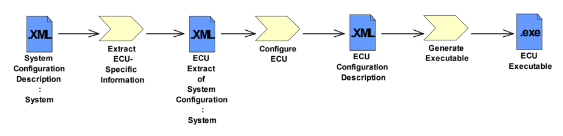

<!-- 源文档 AUTOSAR_CP_RS_ECUConfiguration（R23-11），需求规范（RS），不受 Type A 七章骨架约束；章节结构镜像源文档自身编号（参考文献不编号，1–4）。需求项 ID [RS_ECUC_*] 按 2026-11-03 Foundation 批次决议整体省略（标题仅翻译）；项间依赖引用改写为章节号交叉引用；源文档第 3 章 Requirements Tracing 为纯 ID 追溯表，按 ASWS 先例省略，后续章节编号相应前移（4→3、5→4）。封面元数据表、文档变更记录表、免责声明与目录按 EXP 流程省略。RS_ECUC_00032、00050、00043、00002、00018、00074、00025、00008、00068、00015、00016、00071、00030、00062 的表格单元格在 markdown 转换中发生错列，已依据 R23-11 PDF 原文恢复；变更历史小节标题中的笔误「in 4.2.1」（源 5.2.1，实为 R4.0.3）按所在章节的发布版上下文译出。图 1.1 为唯一内容插图，按内容哈希去重后嵌入（已按图边距规则加白边）；其余全部图片引用均为页面装饰性元素。变更历史中的增/删/改需求表按需求项 ID 整体省略决议仅保留标题列。 -->

## 参考文献

[1] Methodology for Classic Platform
> AUTOSAR_CP_TR_Methodology

[2] Standardization Template
> AUTOSAR_FO_TPS_StandardizationTemplate

[3] General Requirements on Basic Software Modules
> AUTOSAR_CP_SRS_BSWGeneral

[4] Requirements on Runtime Environment
> AUTOSAR_CP_SRS_RTE

[5] Glossary
> AUTOSAR_FO_TR_Glossary

[6] Generic Structure Template
> AUTOSAR_FO_TPS_GenericStructureTemplate

[7] AUTOSAR XML Schema Production Rules
> AUTOSAR_FO_TPS_XMLSchemaProductionRules

[8] Specification of ECU Configuration
> AUTOSAR_CP_TPS_ECUConfiguration

[9] Specification of ECU Configuration Parameters (XML)
> AUTOSAR_CP_MOD_ECUConfigurationParameters

[10] Requirements on Standardization Template
> AUTOSAR_FO_RS_StandardizationTemplate

[11] Layered Software Architecture
> AUTOSAR_CP_EXP_LayeredSoftwareArchitecture

[12] Basic Software Module Description Template
> AUTOSAR_CP_TPS_BSWModuleDescriptionTemplate

[13] Software Component Template
> AUTOSAR_CP_TPS_SoftwareComponentTemplate

[14] Specification of Memory Mapping
> AUTOSAR_CP_SWS_MemoryMapping

## 1. 文档范围

ECU 配置（**ECU Configuration**）是开发 **AUTOSAR** ECU 过程中执行的一项活动。

ECU 配置的输入是系统配置描述（**System Configuration Description**）中被称为系统配置的 ECU 提取（**ECU Extract of System Configuration**）的部分。ECU 配置这一活动是为一个 **ECU** 内的所有软件提供配置信息。其范围涵盖从 **AUTOSAR** 软件组件（**SW-Components**）、**RTE** 配置直到众多基础软件（**BSW**）模块。

ECU 配置的输出是 ECU 配置描述（**ECU Configuration Description**），它用于实际生成并构建 **ECU** 可执行文件。

本需求文档的主要关注点是 **ECU** 配置描述的格式。

### 1.1. 文档约定

**AUTOSAR** 文档中需求的表示遵循 TPS\_STDT\_00078 所规定的表格，参见标准模板（**Standardization Template**）的「追溯支持」（**Support for Traceability**）一章（[\[2\]](#ref-2)）。

应使用 TPS\_STDT\_00053 中规定的用于表达义务的助动词形式来表示需求，参见标准模板（**Standardization Template**）的「追溯支持」（**Support for Traceability**）一章（[\[2\]](#ref-2)）。

## 2. 相关文档

### 2.1. 输入文件

以下输入文档在开发这些需求的过程中被使用：

- **AUTOSAR** 基础软件模块通用需求（**General Requirements on Basic Software Modules**）[\[3\]](#ref-3)
- **AUTOSAR** 运行环境需求（**Requirements on Runtime Environment**）[\[4\]](#ref-4)
- **AUTOSAR** 方法论（**Methodology**）[\[1\]](#ref-1)
- **AUTOSAR** 术语表（**Glossary**）[\[5\]](#ref-5)
- **AUTOSAR** 通用结构模板（**Generic Structure Template**）[\[6\]](#ref-6)
- **AUTOSAR** XML Schema 生成规则（**XML Schema Production Rules**）[\[7\]](#ref-7)

### 2.2. 规范文档

本文档中收集的需求将由两份规范文档满足：

- ECU 配置规范（**ECU Configuration Specification**）[\[8\]](#ref-8)：该文档提供配置方法论的概要以及 **ECU** 配置参数的开发指南。
- ECU 配置参数 XML（**ECU Configuration Parameters XML**）[\[9\]](#ref-9)：该文档包含 **BSW**、**RTE**、软件组件（**SWComponents**）和 **ECU** 集成的 **AUTOSAR** 标准化配置参数的规范。

### 2.3. 缩略语

**BSW**
> 基础软件（**Basic Software**）

**BSWMD**
> 基础软件模块描述（**Basic Software Module Description**）

**ECUC**
> **ECU** 配置（**ECU Configuration**）

**SW-C**
> 软件组件（**Software Component**）

## 3. 对 ECU 配置的需求

### 3.1. 对模板的需求

本节中的需求均关注应如何定义 **ECU** 配置模板。

#### 3.1.1. ECU 配置描述应为 ECU 全部配置信息的根

**ECU** 配置模板应成为在特定 **ECU** 上集成软件的主干。任何必要的配置信息均应聚合或引用在该模板中。

| 描述 | **ECU** 配置模板应成为在特定 **ECU** 上集成软件的主干。任何必要的配置信息均应聚合或引用在该模板中。 |
| --- | --- |
| 理由 | 软件集成基本上意味着解决软件各特定部分之间的相互依赖。只有当所有相关信息都可访问时，解决过程才能正确执行。 * 注意，本需求并不意味着将所有相关信息都复制到模板中。可以包含对其他模板中元素的引用，以避免模型中出现冗余元素。 |
| 用例 | **ECU** 配置模板将包含对使用元模型的软件组件部分所描述的软件组件（**SW Components**）的引用。 * 它还将允许规定任务（**task**）内 runnable 的执行顺序，这是任何其他模板都未规定的内容。 |
| 依赖项 | 后果：**ECU** 配置工具（编辑器和生成器）还需要能够读取其他模板的部分内容（如系统模板（**System Template**）、软件组件模板（**SW Component Template**）、**ECU** 资源模板（**ECU Resource Template**））。 |
| 支撑材料 | - |

#### 3.1.2. 支持从依赖容器进行引用

应可以定义从参数容器到 **ECUC** 参数定义中的其他参数定义的引用，以及（对于标准化的 **AUTOSAR** 配置参数）到其他 **AUTOSAR** 模板中元素的引用。

| 描述 | 应可以定义从参数容器到 **ECUC** 参数定义中的其他参数定义的引用，以及（对于标准化的 **AUTOSAR** 配置参数）到其他 **AUTOSAR** 模板中元素的引用。 |
| --- | --- |
| 理由 | 如果两个容器之间存在引用，则假定引用容器对被引用容器存在依赖。 |
| 用例 | 这类依赖的示例如： * **PortPin** 引用使用该引脚的驱动程序 * **COM** 信号在 **IPdu** 中的 **BitPosition** 由系统模板（**SystemTemplate**）中的 **SignalPosition** 定义 |
| 依赖项 | - |
| 支撑材料 | - |

#### 3.1.3. 规定 ECU 配置参数定义

必须记录 **ECU** 配置参数及其约束（如配置类别、取值范围、多重性）的定义。

| 描述 | 必须记录 **ECU** 配置参数及其约束（如配置类别、取值范围、多重性）的定义。 |
| --- | --- |
| 理由 | 配置参数上的约束需要被识别和验证。这也包括实际参数自身取值的有效性，如范围和预定义值。 |
| 用例 | * 时钟频率必须 > 0； * 0 <= Data\_Length <= 8 |
| 依赖项 | - |
| 支撑材料 | - |

#### 3.1.4. 支持强制和可选配置参数的标准化

在 **ECU** 配置参数定义的标准化中，应可以定义参数是强制的还是可选的。可选与强制的定义如下：强制参数必须由该模块的所有实现实现，并且必须始终存在于完整的 **ECU** 配置描述中。可选参数可由某个实现省略。

| 描述 | 在 **ECU** 配置参数定义的标准化中，应可以定义参数是强制的还是可选的。可选与强制的定义如下：强制参数必须由该模块的所有实现实现，并且必须始终存在于完整的 **ECU** 配置描述中。可选参数可由某个实现省略。 |
| --- | --- |
| 理由 | 并非适用于每个实现的参数仍然可以被标准化，前提是明确并非每个实现都需要支持该参数。 * 注意，对于具体的实现，参数要么被支持且必须存在于 **ECU** 配置中，要么不被支持且必须不存在。因此，对于具体的实现而言不再存在可选性，可选性只存在于参数定义的标准化版本中。 * 注意，实现仍然可以选择固定某个强制参数的取值（例如目标码交付会固定编译前参数的取值）。但此时所选的取值必须在 **ECU** 配置描述 [\[8\]](#ref-8) 中说明。 |
| 用例 | **PORT** 模块中的参数 **ACTIVATE_PULLUP** 仅在硬件支持时才需要。因此，如果目标硬件不支持上拉（**pull up**），该 **PORT** 模块实现可以省略该参数。 |
| 依赖项 | - |
| 支撑材料 | - |

#### 3.1.5. 支持强制和可选容器

应可以将配置参数分组为容器的层次结构。应可以定义容器是强制的还是可选的。可选与强制的定义如下：模块中定义的强制容器必须由该模块的所有实现实现，并且必须始终存在于完整的 **ECU** 配置描述中。该容器的所有参数和子容器也必须存在，除非它们是可选的。可选容器可由某个实现省略。如果省略了某个可选容器，则该容器内定义的所有参数和子容器也随之省略，无论它们被定义为可选还是强制。

| 描述 | 应可以将配置参数分组为容器的层次结构。应可以定义容器是强制的还是可选的。可选与强制的定义如下：模块中定义的强制容器必须由该模块的所有实现实现，并且必须始终存在于完整的 **ECU** 配置描述中。该容器的所有参数和子容器也必须存在，除非它们是可选的。可选容器可由某个实现省略。如果省略了某个可选容器，则该容器内定义的所有参数和子容器也随之省略，无论它们被定义为可选还是强制。 |
| --- | --- |
| 理由 | 并非适用于每个实现的容器仍然可以被标准化，前提是明确并非每个实现都需要支持该容器。 |
| 用例 | **ADC** 模块可以为微处理器的每个 **ADC** 通道定义一组参数。如果特定微控制器上不存在 **ADC** 通道，这些参数中的任何一个都没有用处。如果定义了通道，则应为该通道填入所有强制参数。因此，定义一个包含强制参数的可选容器，比定义多个可选参数（它们随后可能彼此独立地被省略）更好。 |
| 依赖项 | - |
| 支撑材料 | - |

#### 3.1.6. 无重复的描述

即使需要配置多个模块，**ECU** 配置描述中的每项配置信息也只应包含一次。

| 描述 | 即使需要配置多个模块，**ECU** 配置描述中的每项配置信息也只应包含一次。 |
| --- | --- |
| 理由 | 这有助于避免描述中的不一致性，并使描述保持紧凑。 * 注意，仍然允许包含派生信息：如果配置参数 C 原则上可以由配置项 A 和 B 计算得出，仍然可以在模板中包含 C。 |
| 用例 | **ECU** 中所用任务的定义可能与 **OS** 配置和 **RTE** 配置都相关，但在 **ECU** 配置模板中只应定义一次。 |
| 依赖项 | - |
| 支撑材料 | - |

#### 3.1.7. 支持供应商特定的 ECU 配置参数

除了在 **BSW** 模块的 **SWS** 中定义的标准配置参数之外，**ECU** 配置还应提供供应商特定信息的方法。

| 描述 | 除了在 **BSW** 模块的 **SWS** 中定义的标准配置参数之外，**ECU** 配置还应提供供应商特定信息的方法。 |
| --- | --- |
| 理由 | 必须确保确实所有的 **ECU** 信息都能存储在 **ECU** 配置描述中。这样，特定条目才能传递给生成工具。 |
| 用例 | **NVRAM** 管理器的特殊属性和一些工具设置必须在 **ECU** 配置参数定义中定义，而实际取值存储在 **ECU** 配置描述中。 |
| 依赖项 | [§3.1.13](#3113-扩展处理) 要求扩展机制以支持标准的演进。 |
| 支撑材料 | - |

#### 3.1.8. 支持配置类别的定义

**ECU** 配置参数定义应支持配置参数之配置类别的定义。

| 描述 | **ECU** 配置参数定义应支持配置参数之配置类别的定义。 |
| --- | --- |
| 理由 | **BSW** **SWS** 允许多种配置类别：编译前（**pre-compile time**）、链接时（**link time**）、post-build 时（**post-build time**）。 * 配置参数的标准化不一定固定参数的配置类别，而是可以定义一个模块的不同的配置类别实现变体。实际的 **BSW** 模块实现会固定每个参数的配置类别。该信息必须存储在 **ECU** 配置参数定义中。 |
| 用例 | 如果参数 **XXX_DEV_ERROR_DETECT** 被规定为仅可编译前配置，则该参数取值在该 **BSW** 模块实例的所有配置集中必须相同。 |
| 依赖项 | - |
| 支撑材料 | - |

#### 3.1.9. 一种描述机制适用于不同的配置类别

对于所有不同种类的配置类别，应只有一种配置描述机制。因此，无论描述的是「编译前」「链接时」还是「post-build 时」配置，描述格式都应相同。

| 描述 | 对于所有不同种类的配置类别，应只有一种配置描述机制。因此，无论描述的是「编译前」「链接时」还是「post-build 时」配置，描述格式都应相同。 |
| --- | --- |
| 理由 | 配置的描述应独立于 **BSW** 实现。如果实现中参数类别发生变化，可能需要附加信息，例如 post-build 时参数的存储位置。 |
| 用例 | 如果一个 **BSW** 模块被配置为「编译前」配置——而该模块被替换为「链接时」配置的实现——则 **ECU** 配置描述不应因这一替换而改变。 |
| 依赖项 | - |
| 支撑材料 | - |

#### 3.1.10. ECU 配置描述应可被工具处理

**ECU** 配置描述应可被 **ECU** 配置工具和生成器读写。

| 描述 | **ECU** 配置描述应可被 **ECU** 配置工具和生成器读写。 |
| --- | --- |
| 理由 | **ECU** 的配置应得到工具的支持。 |
| 用例 | **ECU** 配置必须拥有工具支持。 |
| 依赖项 | - |
| 支撑材料 | - |

#### 3.1.11. 按照 AUTOSAR 通用结构模板文档进行开发

**ECU** 配置描述应按照 **AUTOSAR** 通用结构模板（**Generic Structure Template**）进行开发。

| 描述 | **ECU** 配置描述应按照 **AUTOSAR** 通用结构模板（**Generic Structure Template**）进行开发。 |
| --- | --- |
| 理由 | 应复用已可用于 **AUTOSAR** 建模的经验和工具。 |
| 用例 | **ECU** 配置的模板与 **AUTOSAR** 中已完成的其他模板类似。 |
| 依赖项 | - |
| 支撑材料 | **AUTOSAR** 通用结构模板 [\[6\]](#ref-6) |

#### 3.1.12. 按照 AUTOSAR XML Schema 生成规则对 ECUC 模型进行转换

**ECU** 配置模板的 schema 应使用 **AUTOSAR** XML Schema 生成规则（**XML Schema Production Rules**）中所描述的模型转换来推导。

| 描述 | **ECU** 配置模板的 schema 应使用 **AUTOSAR** XML Schema 生成规则（**XML Schema Production Rules**）中所描述的模型转换来推导。 |
| --- | --- |
| 理由 | 应复用其他模板中已可用于 **AUTOSAR** 建模的经验和工具。 |
| 用例 | **ECU** 配置的模板与 **AUTOSAR** 中已完成的其他模板类似。 |
| 依赖项 | - |
| 支撑材料 | **AUTOSAR** XML Schema 生成规则 [\[7\]](#ref-7)。 |

#### 3.1.13. 扩展处理

**ECU** 配置必须允许后续的扩展，以支持标准的演进。

| 描述 | **ECU** 配置必须允许后续的扩展，以支持标准的演进。 |
| --- | --- |
| 理由 | **ECU** 配置和目前尚不属于标准的 **ECU** 资源，可能必须处理扩展/附加方面。但在某个时间点，这些扩展应成为标准下一版本的一部分。 |
| 用例 | 例如，如果有新类型的 **ECU** 资源可用，必须能够将其轻松纳入 **AUTOSAR** 架构，而不必立即修改标准，因为对标准的修改可能需要一些时间。 |
| 依赖项 | [§3.1.7](#317-支持供应商特定的-ecu-配置参数) 规定了永远不会成为标准一部分的供应商特定扩展。 |
| 支撑材料 | - |

#### 3.1.14. 支持顺序式 ECU 配置

应可以分别编辑 **ECU** 配置描述的不同部分。

| 描述 | 应可以分别编辑 **ECU** 配置描述的不同部分。 |
| --- | --- |
| 理由 | **ECU** 配置描述包含多个模块的配置，而这些模块的配置会相互影响。因此，依赖关系必须按顺序且迭代地解决。 |
| 用例 | **RTE** 配置编辑器可以分配一个 **OS** 任务，但 **OS** 配置编辑器仍然能够更改该 **OS** 任务的属性。 |
| 依赖项 | [§3.1.15](#3115-兼容迭代式设计) 意味着工具也可以迭代使用。 |
| 支撑材料 | - |

#### 3.1.15. 兼容迭代式设计

支持 **AUTOSAR** 方法论所要求的迭代式设计。

| 描述 | 支持 **AUTOSAR** 方法论所要求的迭代式设计。 |
| --- | --- |
| 理由 | 任何产品的开发很少能在没有任何设计变更的情况下完成。设计变更必然要求对部分设计阶段进行迭代。**AUTOSAR** 工具将被迭代使用，其中包括 **ECU** 配置。 |
| 用例 | **ECU** 配置完成后发生产品设计变更，需要开发新的 **ECU** 配置。 |
| 依赖项 | 这与系统约束/配置描述（**System Constraint/Configuration Description**）的使用密切相关。 [§3.1.14](#3114-支持顺序式-ecu-配置) |
| 支撑材料 | - |

#### 3.1.16. 值侧容器存在的可变性

在 **ECU** 配置参数描述中，容器及其子结构的存在性应是可变的。

| 描述 | 在 **ECU** 配置参数描述中，容器及其子结构的存在性应是可变的。 |
| --- | --- |
| 理由 | 容器承载着配置描述的大部分结构。通过在容器上启用可变性，可以支持许多用例。 |
| 用例 | **OSTask** 的可变存在性。 |
| 依赖项 | - |
| 支撑材料 | - |

#### 3.1.17. 取值存在的可变性

在 **ECU** 配置参数描述中，参数或引用的存在性应是可变的。

| 描述 | 在 **ECU** 配置参数描述中，参数或引用的存在性应是可变的。 |
| --- | --- |
| 理由 | 当参数或引用是可选的时候，其取值的存在性可以是可变的。 |
| 用例 | 规定在多个备选参数之间的选择。 |
| 依赖项 | - |
| 支撑材料 | - |

#### 3.1.18. 可变取值

在 **ECU** 配置参数描述中，参数或引用的取值应是可变的。

| 描述 | 在 **ECU** 配置参数描述中，参数或引用的取值应是可变的。 |
| --- | --- |
| 理由 | 基于变体选择器计算参数的取值。 |
| 用例 | 基于变体配置总线的多种波特率。 |
| 依赖项 | - |
| 支撑材料 | - |

#### 3.1.19. ECU 配置参数定义中上下多重性的可变性

**ECU** 配置参数定义中的下多重性和上多重性的定义应是可变的。

| 描述 | **ECU** 配置参数定义中的下多重性和上多重性的定义应是可变的。 |
| --- | --- |
| 理由 | 下多重性和上多重性控制着 **ECU** 配置参数描述中元素的存在性。使边界可变可以在定义上提供自由度。 |
| 用例 | 将「参数是强制的还是可选的」这一决策本身设为变体。 |
| 依赖项 | - |
| 支撑材料 | - |

#### 3.1.20. ECU 配置参数定义中默认值的可变性

**ECU** 配置参数定义中的默认值应是可变的。「枚举参数定义」（**enumeration parameter definition**）不支持这种变体。

| 描述 | **ECU** 配置参数定义中的默认值应是可变的。「枚举参数定义」（**enumeration parameter definition**）不支持这种变体。 |
| --- | --- |
| 理由 | 默认值是为参数输入的第一个取值。为了给出有意义的默认值，默认值应是可变的，以便进行调整。 |
| 用例 | 将默认值的取值设为变体。 |
| 依赖项 | - |
| 支撑材料 | - |

#### 3.1.21. ECU 配置参数定义中最小/最大范围的可变性

**ECU** 配置参数的最小和最大范围在 **ECU** 配置参数定义中应是可变的。

| 描述 | **ECU** 配置参数的最小和最大范围在 **ECU** 配置参数定义中应是可变的。 |
| --- | --- |
| 理由 | 在 **ECU** 配置参数定义中，变体与最小/最大取值之间的关系相当常见。 |
| 用例 | **NvRamBlockId** 的最大取值可以是 255 或 65535，取决于选择了 8 位还是 16 位。 |
| 依赖项 | - |
| 支撑材料 | - |

#### 3.1.22. TPS_ECUConfiguration 应为公共符号提供命名约定

TPS\_ECUConfiguration 应为公共符号提供命名约定。这尤其包括发布版文档中使用的需求 ID、模块缩写、元数据和配置符号。

| 描述 | TPS\_ECUConfiguration 应为公共符号提供命名约定。这尤其包括发布版文档中使用的需求 ID、模块缩写、元数据和配置符号。 |
| --- | --- |
| 理由 | 避免规范内部的歧义和命名冲突。向规范的读者提供一致、统一的元数据呈现。允许对规范元素进行自动处理。 |
| 用例 | - |
| 依赖项 | - |
| 支撑材料 | - |

### 3.2. 来自 ECUC 客户方的需求

#### 3.2.1. BSW 的编译前配置

对于被定义为可编译前配置的配置参数，应可以在编译前（**pre-compile time**）配置 **BSW** 的参数。

| 描述 | 对于被定义为可编译前配置的配置参数，应可以在编译前（**pre-compile time**）配置 **BSW** 的参数。 |
| --- | --- |
| 理由 | 出于效率原因，部分 **AUTOSAR** **BSW** 模块的配置参数被定义为可编译前配置。**ECU** 配置需要支持这些参数。 |
| 用例 | 支持编译前配置参数。 |
| 依赖项 | - |
| 支撑材料 | **AUTOSAR** 术语表 [\[5\]](#ref-5) |

#### 3.2.2. BSW 的链接时配置

对于被定义为可链接时配置的配置参数，应可以在链接时（**link time**）配置 **BSW** 的参数。

| 描述 | 对于被定义为可链接时配置的配置参数，应可以在链接时（**link time**）配置 **BSW** 的参数。 |
| --- | --- |
| 理由 | 当 **BSW** 模块以目标码形式交付时，只能在链接时或 post-build 时对其进行配置。 |
| 用例 | 支持链接时配置参数。 |
| 依赖项 | - |
| 支撑材料 | **AUTOSAR** 术语表 [\[5\]](#ref-5) |

#### 3.2.3. BSW 的 post-build 配置

对于被定义为可 post-build 配置的配置参数，应可以在 post-build 时重新配置。

| 描述 | 对于被定义为可 post-build 配置的配置参数，应可以在 post-build 时重新配置。 |
| --- | --- |
| 理由 | 这将允许对 **ECU** 中的 **BSW** 组件进行 post-build 时配置，以适应周围系统的变化。在将某个参数定义为可 post-build 配置时，必须考虑其对整个系统的影响。 |
| 用例 | **FMC** 开发和售后方法论在很大程度上依赖于在 post-build 时重新配置 **CAN** 和 **LIN** 通信的可能性。主要的配置项是信号到帧的映射、帧优先级和帧时序。 |
| 依赖项 | - |
| 支撑材料 | **AUTOSAR** 术语表 [\[5\]](#ref-5) |

#### 3.2.4. 在 post-build 时处理不同的配置变体

**ECU** 配置中应允许存在在 post-build 时绑定的变体点（**variation point**）。

| 描述 | **ECU** 配置中应允许存在在 post-build 时绑定的变体点（**variation point**）。 |
| --- | --- |
| 理由 | 这将允许一个 **ECU** 中存在多个 **ECU** 配置变体。 |
| 用例 | 同一 **ECU** 软件可用于多个共享相同应用（例如左/右车门模块）的 **ECU**，并在运行时为每一个选择正确的配置。 |
| 依赖项 | - |
| 支撑材料 | **AUTOSAR** 术语表 [\[5\]](#ref-5) |

#### 3.2.5. 支持 BSW 的配置

**ECU** 配置应支持 **BSW** **SWS** 文档中定义的所有配置参数。全部受支持模块的列表可在分层软件架构（**Layered Software Architecture**）文档 [\[11\]](#ref-11) 中找到。

| 描述 | **ECU** 配置应支持 **BSW** **SWS** 文档中定义的所有配置参数。全部受支持模块的列表可在分层软件架构（**Layered Software Architecture**）文档 [\[11\]](#ref-11) 中找到。 |
| --- | --- |
| 理由 | **BSW** 必须能够从 **ECU** 配置描述出发进行配置。 |
| 用例 | **BSW** **SWS** 定义了一个配置参数列表。这些参数需要反映在 **ECU** 配置模板中。 * **OS** **SWS** 会从现有格式（如 **OIL**）中识别配置参数并将其纳入 **SWS**。在这种情况下，**ECUC** 中只使用 **OIL** 的内容，而不使用其格式本身。 |
| 依赖项 | - |
| 支撑材料 | **BSW** 模块的相关已发布规范 [\[11\]](#ref-11)。 |

#### 3.2.6. BSW 模块多个实例的配置

如果适用，应可以描述一个 **ECU** 上同一 **BSW** 模块类型的多个实例的配置。

| 描述 | 如果适用，应可以描述一个 **ECU** 上同一 **BSW** 模块类型的多个实例的配置。 |
| --- | --- |
| 理由 | 部分 **BSW** 模块类型可以在一个 **ECU** 内出现多次，使用不同的实现，例如 **FLASH**、**EEP** 和看门狗驱动程序。 * 对于部分 **BSW** 模块（如 **OS**、**NVRAM** 管理器等），不可能存在多个实例。 |
| 用例 | 当一个 **ECU** 上存在来自不同供应商的两个不同的外部 **EEPROM** 芯片时，需要两个不同的 **BSW** 驱动程序来应对。 |
| 依赖项 | - |
| 支撑材料 | - |

#### 3.2.7. 选择 AUTOSAR 软件组件和 BSW 模块实现

当有多个实现可用时，允许选择一个特定的软件模块实现。

| 描述 | 当有多个实现可用时，允许选择一个特定的软件模块实现。 |
| --- | --- |
| 理由 | 模块的多个实现（代码）可能可用于纳入系统配置，此时可能需要特定的选择。 |
| 用例 | 来自不同供应商的多个 **CAN** 驱动程序。 * 来自单一供应商的多个驱动程序版本。 * 同一 **AUTOSAR** 软件组件的不同实现。 |
| 依赖项 | - |
| 支撑材料 | - |

#### 3.2.8. 软件段到存储器的映射

软件的组成部分（代码、数据）应可映射到特定的存储器区域。

| 描述 | 软件的组成部分（代码、数据）应可映射到特定的存储器区域。 |
| --- | --- |
| 理由 | 每个软件都由若干段组成，这些段在开发/编译软件时定义。这些段需要被放置到 **ECU** 上不同的存储器区域中。 |
| 用例 | 如果数据应可 post-build 配置，则需要将其放置在非易失性存储器中。工具需要知道数据放置的位置，才能在之后修改数据。 * 某些软件变量必须放置在 **NOINIT** 存储器区域中，该区域在 **ECU** 启动期间不会被初始化。 |
| 依赖项 | 软件需要发布其在开发/编译软件时使用的存储器段。这需要成为 **BSWMD** [\[12\]](#ref-12) 和 **SWC-T** [\[13\]](#ref-13) 的一部分。 |
| 支撑材料 | 存储器映射规范（**Specification of Memory Mapping**） [\[14\]](#ref-14) |

#### 3.2.9. 支持 RTE 的配置

应支持 **RTE** 的生成和配置。

| 描述 | 应支持 **RTE** 的生成和配置。 |
| --- | --- |
| 理由 | **RTE** 必须基于 **ECUC** 的信息进行生成和配置。 |
| 用例 | 分析 **RTE** **SWS** 文档中的全部配置需求。 |
| 依赖项 | - |
| 支撑材料 | - |

#### 3.2.10. 支持配置特定 ECU 上可用的 AUTOSAR 服务

**AUTOSAR** 定义了若干可集成到 **ECU** 中的服务。应可以定义特定 **ECU** 上存在哪些 **AUTOSAR** 服务。

| 描述 | **AUTOSAR** 定义了若干可集成到 **ECU** 中的服务。应可以定义特定 **ECU** 上存在哪些 **AUTOSAR** 服务。 |
| --- | --- |
| 理由 | 可能存在不需要全部 **AUTOSAR** 服务的 **ECU**，因此可以定义一个子集。 |
| 用例 | 如果 **ECU** 不使用任何 **NvRam**，则该 **ECU** 上无需 **NvRam** 管理器。 |
| 依赖项 | - |
| 支撑材料 | - |

### 3.3. 来自软件组件的需求

#### 3.3.1. 支持 AUTOSAR 软件组件的集成

应支持 **AUTOSAR** 软件组件的集成。

| 描述 | 应支持 **AUTOSAR** 软件组件的集成。 |
| --- | --- |
| 理由 | **AUTOSAR** 软件组件应能在 **ECU** 上实例化。必须提供相关信息，使其能够在该 **ECU** 上集成并执行。 |
| 用例 | **AUTOSAR** 软件组件的使用。 |
| 依赖项 | - |
| 支撑材料 | - |

#### 3.3.2. 支持 AUTOSAR 软件组件的服务配置

**ECU** 配置应支持配置 **AUTOSAR** 软件组件与 **AUTOSAR** 服务之间的接口。

| 描述 | **ECU** 配置应支持配置 **AUTOSAR** 软件组件与 **AUTOSAR** 服务之间的接口。 |
| --- | --- |
| 理由 | 在 **ECU** 配置期间，需要为 **AUTOSAR** 软件组件的服务访问配置具体的取值。 |
| 用例 | 软件组件需要带符号 ID 的 **NVRAM** 块。**NVRAM** 管理器配置会分配具体的 ID 取值，并需要在软件组件中配置这些取值。 |
| 依赖项 | - |
| 支撑材料 | - |

#### 3.3.3. 同一 OS 任务内 runnable 实体的执行顺序

应可以描述跨软件组件边界的、**OS** 任务内 runnable 实体的执行顺序。

| 描述 | 应可以描述跨软件组件边界的、**OS** 任务内 runnable 实体的执行顺序。 |
| --- | --- |
| 理由 | 软件组件模板只能描述单个软件组件内 runnable 实体执行顺序上的约束。但必须能够描述映射到特定 **OS** 任务的不同软件组件的 runnable 实体之间的执行顺序，以建立控制流算法，使控制流按确定的顺序从一个软件组件传递到下一个。 |
| 用例 | 三个周期执行的 runnable 实体被映射到一个 **OS** 任务。必须定义当该 **OS** 任务被激活时，这些 runnable 实体按什么顺序执行。 |
| 依赖项 | - |
| 支撑材料 | - |

### 3.4. 对配置参数定义的需求

#### 3.4.1. 支持通用配置编辑器

**ECU** 参数定义应以可被工具处理的格式定义。参数定义应包含足够的信息以支持通用配置编辑器（**generic configuration editor**）。

| 描述 | **ECU** 参数定义应以可被工具处理的格式定义。参数定义应包含足够的信息以支持通用配置编辑器（**generic configuration editor**）。 |
| --- | --- |
| 理由 | 通用配置编辑器可以读入标准化参数和硬件供应商特定参数的参数定义，随后显示全部已定义的参数，并允许用所有已定义的参数填充 **ECU** 配置描述。 |
| 用例 | 减少配置一个 **ECU** 所需的配置编辑器数量。简单的 **BSW** 模块应可以使用通用配置编辑器进行配置。这也减少了 **BSW** 供应商的工作量，他们无需为简单的 **BSW** 模块编写专用的配置编辑器。 |
| 依赖项 | - |
| 支撑材料 | - |

### 3.5. 过程需求

这些需求说明了本文档要达成的目标。它们仅在传达已采取和将要采取的行动这一意义上是信息性的，并将在后续阶段被移除。

#### 3.5.1. 识别机制而非判据

工作组（**WP**）的成果只识别可用于配置 **ECU** 的方法和机制，而不识别配置工程师必须权衡的任何工程折中（例如性能与尺寸之间）。

| 描述 | 工作组（**WP**）的成果只识别可用于配置 **ECU** 的方法和机制，而不识别配置工程师必须权衡的任何工程折中（例如性能与尺寸之间）。 |
| --- | --- |
| 理由 | 机制是应用无关的，因此无法评估所有潜在影响。应用特定的折中必须由工程师在为某个应用构建而使用这些机制时加以考虑。 |
| 用例 | 配置参数定义只定义有效范围，而不提供寻找最佳设置的算法。 |
| 依赖项 | 这应成为某个交付物的工作组范围定义章节的一部分。 |
| 支撑材料 | - |

#### 3.5.2. 明确配置术语

确保引入 **AUTOSAR** 的所有配置术语都通过术语表条目或其他文档得到充分的解释。

| 描述 | 确保引入 **AUTOSAR** 的所有配置术语都通过术语表条目或其他文档得到充分的解释。 |
| --- | --- |
| 理由 | 「编译前配置」「链接时配置」和「post-build 时配置」等术语，根据其在开发过程中应用的时间点不同而有不同的含义。工作组必须确保所使用的任何术语在其可能出现的每个上下文中都得到充分的澄清。 |
| 用例 | 动力总成应用标定工程师对「post-build 时配置」含义的解读不同于动力总成软件工程师。 |
| 依赖项 | - |
| 支撑材料 | - |

### 3.6. 外部需求

这些是 **ECU** 配置描述自身无法满足的需求。这些需求被置于其他 **AUTOSAR** 工作成果之上。

#### 3.6.1. BSW 模块的存储器需求

**BSW** 模块应提供该模块存储器需求的信息。当存储器需求依赖于实际配置时也是如此。

| 描述 | **BSW** 模块应提供该模块存储器需求的信息。当存储器需求依赖于实际配置时也是如此。 |
| --- | --- |
| 理由 | 所需的存储器容量通常取决于模块的配置，并且最迟在配置之后最终确定。 |
| 用例 | **COM** 栈的 post-build 数据的大小随收发帧的数量而变化；生成代码的代码大小（**ROM**）也可能变化。**RAM** 和 **EEPROM** 中的数据结构同样可能变化。 |
| 依赖项 | 这是对 **BSW** 模块描述的需求，即使实际取值可能取决于配置。 |
| 支撑材料 | - |

#### 3.6.2. 识别未初始化的资源

**ECU** 配置应识别 **ECU** 中存在的未使用资源。

| 描述 | **ECU** 配置应识别 **ECU** 中存在的未使用资源。 |
| --- | --- |
| 理由 | 未被任何 **BSW** 模块（标准 **AUTOSAR** 或复杂设备驱动）使用的资源不会被 **ECU** 软件初始化。这可能影响 **ECU** 的健壮性，导致意外中断或造成虚假的 **EMC** 问题。 *（注意：这是对工具的需求——而不是对模板的需求） |
| 用例 | 当识别出未使用（因此未初始化）的资源时，用户可以向 **ECU** 添加适当的驱动程序，至少对这些资源进行初始化（例如显式禁用未使用的中断或 IO 端口）。 |
| 依赖项 | - |
| 支撑材料 | 这必须由工具链和/或流程来检查。 |

#### 3.6.3. 识别微控制器寄存器的冲突使用

**ECU** 配置工具应识别被多个 **BSW** 模块以不一致的方式配置和/或访问的微控制器寄存器。

| 描述 | **ECU** 配置工具应识别被多个 **BSW** 模块以不一致的方式配置和/或访问的微控制器寄存器。 |
| --- | --- |
| 理由 | **BSW** 模块（**AUTOSAR** 驱动程序、复杂驱动程序等）可能直接访问微控制器寄存器。当 **BSW** 模块（甚至可能来自不同供应商）被集成到单个 **ECU** 时，这些模块可能试图以不同的方式配置同一个微控制器寄存器。这类冲突必须被识别出来。 *（注意：这是对工具的需求——而不是对 **ECUC** 模板的需求） |
| 用例 | 某寄存器的低 4 位（**LSB**）由 **GPT** 驱动程序使用，同一寄存器的高 4 位（**MSB**）由 **ICU** 使用。如果两个模块都写入整个寄存器（8 位），则它们会相互覆盖对方的配置设置。一旦识别出冲突，可以使用不同的 **BSW** 模块实现或不同的 **BSW** 配置来解决该问题。 |
| 依赖项 | - |
| 支撑材料 | RS\_BSWMD\_00009 [\[12\]](#ref-12) |

#### 3.6.4. 初始化未使用存储器的配置选项

**AUTOSAR** 构建环境应提供一个将未使用存储器初始化为默认取值的配置选项。

| 描述 | **AUTOSAR** 构建环境应提供一个将未使用存储器初始化为默认取值的配置选项。 |
| --- | --- |
| 理由 | 有缺陷的 **ECU** 软件可能访问通常不使用的存储器位置，甚至可能尝试在这些位置执行代码。未使用的 **RAM** 包含随机数据，在发生错误的读取访问或执行时可能导致非确定性行为。初始化未使用的存储器可提高可靠性。 *（注意：这是对构建工具/环境的需求——而不是对模板的需求） |
| 用例 | 用 **HALT** 指令填充未使用的存储器（尤其是 **ROM**/**FLASH**），以增强对非预期代码执行的防护。用默认取值（0 或 **HALT** 指令）填充 **RAM**，以降低指针操作不当导致非确定性行为的风险。 |
| 依赖项 | - |
| 支撑材料 | - |

## 4. 变更历史

### 4.1. AUTOSAR R4.0.1 相对于 R3.1.5 的变更历史

#### 4.1.1. R4.0.1 中新增的需求

表4.1：R4.0.1 中新增的 SRS 项

| 标题 |
| --- |
| 值侧容器存在的可变性 |
| 取值存在的可变性 |
| 可变取值 |
| ECU 配置参数定义中上下多重性的可变性 |
| ECU 配置参数定义中默认值的可变性 |
| ECU 配置参数定义中最小/最大范围的可变性 |

#### 4.1.2. R4.0.1 中变更的需求

表4.2：R4.0.1 中变更的 SRS 项

| 标题 |
| --- |
| 支持配置类别的定义 |
| 按照 AUTOSAR 通用结构模板文档进行开发 |
| 按照 AUTOSAR XML 模型持久化规则对 ECUC 模型进行转换 |
| 支持从依赖容器进行引用 |

#### 4.1.3. R4.0.1 中删除的需求

表4.3：R4.0.1 中移除的 SRS 项

| 标题 |
| --- |
| 每个 ECU 应仅支持一个待配置的微控制器 |

### 4.2. AUTOSAR R4.0.3 相对于 R4.0.1 的变更历史

#### 4.2.1. R4.0.3 中新增的需求

无

#### 4.2.2. R4.0.3 中变更的需求

表4.4：R4.0.3 中变更的 SRS 项

| 标题 |
| --- |
| ECU 配置参数定义中默认值的可变性（排除「枚举参数定义」） |

#### 4.2.3. R4.0.3 中删除的需求

无

### 4.3. AUTOSAR R4.1.1 相对于 R4.0.3 的变更历史

无变更。

### 4.4. AUTOSAR R4.1.2 相对于 R4.1.1 的变更历史

无变更。

### 4.5. AUTOSAR R4.1.3 相对于 R4.1.2 的变更历史

无变更。

### 4.6. AUTOSAR R4.2.1 相对于 R4.1.3 的变更历史

#### 4.6.1. R4.2.1 中新增的需求

表4.5：R4.2.1 中新增的可追溯项

| 标题 |
| --- |
| 在 post-build 时处理不同的配置变体 |
| TPS\_ECUConfiguration 应为公共符号提供命名约定。 |

#### 4.6.2. R4.2.1 中变更的需求

表4.6：R4.2.1 中变更的可追溯项

| 标题 |
| --- |
| BSW 的 post-build 配置 |
| 值侧容器存在的可变性 |
| 取值存在的可变性 |
| 可变取值 |
| ECU 配置参数定义中上下多重性的可变性 |
| ECU 配置参数定义中默认值的可变性 |
| ECU 配置参数定义中最小/最大范围的可变性 |

#### 4.6.3. R4.2.1 中删除的需求

无

### 4.7. AUTOSAR R4.2.2 相对于 R4.2.1 的变更历史

无变更。

### 4.8. AUTOSAR R4.3.0 相对于 R4.2.2 的变更历史

#### 4.8.1. R4.3.0 中新增的需求

无

#### 4.8.2. R4.3.0 中变更的需求

表4.7：R4.3.0 中变更的可追溯项

| 标题 |
| --- |
| 按照 AUTOSAR XML Schema 生成规则对 ECUC 模型进行转换 |

#### 4.8.3. R4.3.0 中删除的需求

无

### 4.9. AUTOSAR R4.3.1 相对于 R4.3.0 的变更历史

#### 4.9.1. R4.3.1 中新增的需求

无

#### 4.9.2. R4.3.1 中变更的需求

无

#### 4.9.3. R4.3.1 中删除的需求

无

### 4.10. AUTOSAR R4.4.0 相对于 R4.3.1 的变更历史

#### 4.10.1. R4.4.0 中新增的需求

无

#### 4.10.2. R4.4.0 中变更的需求

无

#### 4.10.3. R4.4.0 中删除的需求

无

### 4.11. AUTOSAR R19-11 相对于 R4.4.0 的变更历史

#### 4.11.1. R19-11 中新增的需求

无

#### 4.11.2. R19-11 中变更的需求

无

#### 4.11.3. R19-11 中删除的需求

无

### 4.12. AUTOSAR R20-11 相对于 R19-11 的变更历史

#### 4.12.1. R20-11 中新增的需求

无

#### 4.12.2. R20-11 中变更的需求

无

#### 4.12.3. R20-11 中删除的需求

无

### 4.13. AUTOSAR R21-11 相对于 R20-11 的变更历史

#### 4.13.1. R21-11 中新增的需求

无

#### 4.13.2. R21-11 中变更的需求

无

#### 4.13.3. R21-11 中删除的需求

无

### 4.14. AUTOSAR R22-11 相对于 R21-11 的变更历史

#### 4.14.1. R22-11 中新增的需求

无

#### 4.14.2. R22-11 中变更的需求

无

#### 4.14.3. R22-11 中删除的需求

无

### 4.15. AUTOSAR R23-11 相对于 R22-11 的变更历史

#### 4.15.1. R23-11 中新增的需求

无

#### 4.15.2. R23-11 中变更的需求

无

#### 4.15.3. R23-11 中删除的需求

无
