<!-- 源文档 AUTOSAR_CP_TPS_ECUConfiguration（R23-11），模板规范（TPS），不受 Type A 七章骨架约束；章节结构镜像源文档自身编号（参考文献不编号，1–4 + 附录 A–E）。规范项 ID [TPS_ECUC_*] 与约束 ID [constr_*] 按 2026-11-03 Foundation 批次决议整体省略（标题仅翻译，约束项以「约束：」前缀呈现）；项间追溯尾注随之省略。类表按 tps_standardization_template 先例规范化为「竖排属性表 + 属性明细表」两段形式；变更历史表按 TPS_APSD/tps_standardization_template 先例仅保留标题列（Number 列丢弃）。内容插图（图 1.1–4.4 共 72 张）按内容哈希去重后嵌入（已按图边距规则加白边）。附录 A.3 Requirements Tracing 为纯 ID 追溯表，按 ASWS 先例整体省略（附录字母保持源文档编号，不重排）。附录 E 变更历史为数据（标题列保留、Number 列丢弃）。 -->

## 参考文献

<a id="ref-1"></a>[1] System Template
> AUTOSAR_CP_TPS_SystemTemplate

<a id="ref-2"></a>[2] Methodology for Classic Platform
> AUTOSAR_CP_TR_Methodology

<a id="ref-3"></a>[3] Standardization Template
> AUTOSAR_FO_TPS_StandardizationTemplate

<a id="ref-4"></a>[4] Generic Structure Template
> AUTOSAR_FO_TPS_GenericStructureTemplate

<a id="ref-5"></a>[5] AUTOSAR XML Schema Production Rules
> AUTOSAR_FO_TPS_XMLSchemaProductionRules

<a id="ref-6"></a>[6] Glossary
> AUTOSAR_FO_TR_Glossary

<a id="ref-7"></a>[7] Specification of ECU Configuration Parameters (XML)
> AUTOSAR_CP_MOD_ECUConfigurationParameters

<a id="ref-8"></a>[8] Meta Model
> AUTOSAR_FO_MMOD_MetaModel

<a id="ref-9"></a>[9] IEEE standard for radix-independent floating-point arithmetic (ANSI/IEEE Std 854-1987)
> https://standards.ieee.org/ieee/854/5325/

<a id="ref-10"></a>[10] Meta Model-generated XML Schema
> AUTOSAR_FO_MMOD_XMLSchema

<a id="ref-11"></a>[11] Software Component Template
> AUTOSAR_CP_TPS_SoftwareComponentTemplate

<a id="ref-12"></a>[12] List of Basic Software Modules
> AUTOSAR_CP_TR_BSWModuleList

<a id="ref-13"></a>[13] Layered Software Architecture
> AUTOSAR_CP_EXP_LayeredSoftwareArchitecture

<a id="ref-14"></a>[14] Requirements on ECU Configuration
> AUTOSAR_CP_RS_ECUConfiguration

<a id="ref-15"></a>[15] Software Process Engineering Meta-Model Specification
> https://www.omg.org/spec/SPEM/2.0/

## 1. 简介（**Introduction**）

依据 **AUTOSAR** 方法论（见图 1.1），配置过程是 **ECU** 软件集成的主要部分，它由「为 **ECU** 集成软件（**Intergrate Software for ECU**）」这一活动表示。

一个 **ECU** 的配置过程始于把系统描述拆分为若干描述，其中每个描述包含关于单个 **ECU** 的全部信息。在图 1.1 中，系统描述这一产物隐藏在「开发系统（**Develop System**）」活动中。**Ecu** 提取的创建在系统模板规范 [\[1\]](#ref-1) 中有详细描述。

**Ecu** 提取与 **BSW** 模块交付包（**BSW Module Delivered Bundle**）是 **ECU** 配置步骤的输入。这在图 1.2 中同样可见，其中 **ECU** 配置由「准备 **ECU** 配置（**Prepare ECU Configuration**）」与「配置 **BSW** 和 **RTE**（**Configure BSW and RTE**）」这两个活动描述。

这些活动的详细描述见 **AUTOSAR** 方法论 [\[2\]](#ref-2) 的第 2.7 章。

![图 1.1：AUTOSAR 方法论概览（取自 [2]）（AUTOSAR Methodology Overview (from [2])）](Figure1-1.png)

在 **ECU** 配置过程中，**AUTOSAR** 架构的每个单独模块都可以为该 **ECU** 的特殊需要进行配置。由于 **AUTOSAR** 架构以及模块与模块间相互依赖关系相当复杂，因此需要工具支持：**AUTOSAR ECU** 配置编辑器（**AUTOSAR ECU Configuration Editor(s)**）。

![图 1.2：ECU 配置概览（取自 [2]）（Ecu Configuration Overview (from [2])）](Figure1-2.png)

用于 **ECU** 配置的工具策略与工具细节不在本规范的范围之内。尽管如此，工具需要了解 **ECU** 配置参数及其约束——例如配置类、取值范围、多重性等。这一描述是工具的输入。配置参数的描述称为 **ECU** 配置参数定义（**ECU Configuration Parameter Definition**），并在本规范中详细描述（[第 2.3 章](#23-ecu-配置参数定义元模型ecu-configuration-parameter-definition-metamodel)）。

为确保所有工具对参数的配置值使用相同的输出格式，**ECU** 配置值描述（**ECU Configuration Value description**）同样是本规范的一部分，并在后面详细描述（[第 2.4 章](#24-ecu-配置值元模型ecu-configuration-value-metamodel)）。**ECU** 配置值描述一方面可以作为其他配置工具（在一个由若干配置编辑器组成的工具链内）的输入格式，另一方面它是生成器的基础。被配置的参数被生成到 **ECU** 可执行文件中。这是配置过程的最后一步，同样不在本规范的范围之内。

### 1.1. 文档约定（**Document Conventions**）

技术术语以等宽字体排版，例如 PortPrototype。作为一般规则，技术术语的复数形式通过在单数形式后添加「s」构成，例如 PortPrototypes。通过这种方式，本文档与 **AUTOSAR XML Schema** 中使用的术语保持一致。

本文档以文本形式包含约束（**constraint**），它们通过唯一的数值约束 ID、标题和约束正文与文本的其余部分区分开来，正文起始于「⌈」字符之后、终止于「⌋」字符。

这些约束的目的是字面上约束对 **AUTOSAR** 元模型的解释，使得能够检测元模型实例（即 M1 层）中实现的标准化行为的违例。

鼓励 **AUTOSAR** 工具的制作者在工具发出的诊断消息中附上与 M1 建模问题相对应的约束的数值 ID。

本文档引入的类的属性以类表（**class table**）的形式列出。它们具有顶层元素 AUTOSAR 示例所示的形式。

请注意，约束并不要求在 **AUTOSAR** 工作流的任意给定时刻都被强制执行。在模型开发期间，约束可以被合法地违反，因为一个不完整的模型显然会表现出不一致性。

然而，在工作流的特定时点，约束应当被强制执行，以防止错误配置。

约束应当被强制执行的工作流时点（有时也称为约束的「绑定时间（**binding time**）」）因模型类别而异，例如在经典平台上，为软件组件定义的约束通常在 **RTE** 生成之前强制执行，而针对 **Ecu** 提取定义的约束应在创建 Com 栈的 **ECU** 配置时应用。

对于每份文档，约束的可能绑定时间都有定义，并且绑定时间通常在约束自身中提及，以便为 **AUTOSAR** 编写工具的实现者提供适当的方向。

设 AUTOSAR 为典型类表的一个示例。表中的前几行含义如下：

类（**Class**）：在 **UML** 模型中定义的类的名称。

包（**Package**）：定义该类的 **UML** 包。列出此项只是为了帮助在整体元模型中定位该类。

说明（**Note**）：建模者对该类的注释（类注释）。类的构造型（**stereotype**）和 **UML** 标签（**tag**）也在此处注明。

基类（**Base Classes**）：如适用，直接基类的列表。

表中的表头含义如下：

属性（**Attribute**）：类的属性名。注意 **AUTOSAR** 不区分类属性和所拥有的关联端。

类型（**Type**）：类属性的类型。

多重性（**Mul.**）：分配给该属性的多重性，即有多少个给定数据类型的实例与该属性关联。

种类（**Kind**）：规定该属性是在类中聚合的（aggr 聚合）、类中的 **UML** 属性（attr 原始属性），还是仅由类引用（ref 引用）。实例引用也在此字段中指示（iref 实例引用）。

备注（**Note**）：建模者对该类属性的注释（角色注释）。构造型和 **UML** 标签也在此处注明。

请注意，以字母而非数字编号开头的章节代表本文档的附录。附录的目的是支持对本文档某些方面的解释，不代表标准的约束性约定。

应使用 TPS_STDT_00053 中规定的用于表达义务的助动词形式来表示需求，参见标准模板（**Standardization Template**）的「追溯支持」（**Support for Traceability**）一章（[\[3\]](#ref-3)）。

**AUTOSAR** 文档中需求的表示遵循 TPS_STDT_00078 所规定的表格，参见标准模板（**Standardization Template**）的「追溯支持」（**Support for Traceability**）一章（[\[3\]](#ref-3)）。

## 2. 配置元模型（**Configuration Metamodel**）

### 2.1. 引言（**Introduction**）

**AUTOSAR** 交换格式使用基于元模型的方法加以规定。用于配置 **ECU** 产物的元模型使用一种通用描述语言，从而可以规定不同种类的配置方面。这一点很重要，因为可以使用同一套语言元素描述 **AUTOSAR** 标准化的与供应商特定的 **ECU** 配置参数。这简化了工具的开发，并引入了在稍后时点标准化供应商特定 **ECU** 配置参数的可能性。

一般而言，配置语言使用容器（**container**）和实际参数。容器用于对相应的参数进行分组。参数保存配置 **ECU** 特定部分的相关取值。由于配置语言必须实现的灵活性，配置描述被分为两部分：

- **ECU** 配置参数定义（**ECU Configuration Parameter Definition**）
- **ECU** 配置值（**ECU Configuration Values**）

这两部分及其关系的详细描述在以下各节给出。
### 2.2. ECU 配置模板结构（**ECU Configuration Template Structure**）

本节介绍 **ECU** 配置所涉及的不同 **AUTOSAR** 模板之间的关系。模板定义一个实际描述的结构和可能的内容。这一概念可以用多种方式实现；在 **AUTOSAR** 中，已选择 **XML** 文件用作交换格式。如果使用 **XML** 文件，则构成描述的文件数量在概念上没有限制。所有相关文件在概念上被合并起来以构建实际描述。

**ECU** 配置值模板的目标是为一个 **ECU** 的 **ECU** 配置值规定一种交换格式。**ECU** 配置编辑器的实际输出存储在 **ECU** 配置值描述中，它可以是一个或多个 **XML** 文件。但 **ECU** 配置编辑器需要知道 **ECU** 配置值的内容应如何结构化（哪些参数在哪个容器中可用）以及应遵守何种限制（例如 **ECU** 配置参数是 0 到 255 范围内的整数值）。这在 **ECU** 配置参数定义中规定，它同样是一个 **XML** 文件。这两种文件类型之间的关系如图 2.1 所示。

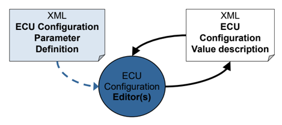

对于 **ECU** 配置编辑器，实现这些定义基本上有两种可能的方法：要么直接从 **XML** 文件读取并解释 **ECU** 配置参数定义，要么把定义的结构硬编码到工具中<sup>1</sup>。

为开发 **ECU** 配置参数定义与 **ECU** 配置值描述，选择了一种基于模型的方法，该方法已在其他 **AUTOSAR** 模板格式的开发过程中使用过。

其主要方法是用 **UML** 的一个子集对所需的实体及其关系进行图形化建模。然后在生成步骤中，从模型自动生成实际的 **XML** 格式。

**ECU 配置值与 ECU 配置参数定义元模型的建模（**Modeling of metamodels**）**：**ECU** 配置值与 **ECU** 配置参数定义元模型的建模依照通用结构模板 [\[4\]](#ref-4) 完成。

请注意，通用结构模板 [\[4\]](#ref-4) 包含一些基础设施元类和公共模式，并提供以下细节：

- Autosar 顶层结构，
- 常用元类与原始类型
- 变体处理
- 文档支持

**ECU 配置值与 ECU 配置参数定义元模型到模式定义的转换（**Transformation to schema definitions**）**：**ECU** 配置值与 **ECU** 配置参数定义元模型到模式定义的转换依照 **XML Schema** 生成规则 [\[5\]](#ref-5) 完成。

由于这些转换规则，**UML** 模型与生成的 **XML-Schema** 名称之间存在给定的差异。这也影响本文档。主要描述将基于 **UML** 模型表示（图与表），同时可能会给出相应的 **XML** 表示以供参考。

本节描述 **ECU** 配置的建模方法的应用。

**AUTOSAR** 使用 **UML** 元模型（M2 层）来描述可以在符合 **AUTOSAR** 的系统中使用的类和对象。这些元模型元素可以在应用模型（M1 层）中使用，以描述真实车辆的内容。**ECU** 配置是 **AUTOSAR** 标准的一部分，因此 **ECU** 配置描述的元素应在 M2 层的 **UML** 元模型中描述。因此，该（M2）元模型已用 **UML** 描述填充，从中可以构建 **ECU** 配置参数模型。

在 M2 定义就绪之后，就可以在 M1 层创建符合 **AUTOSAR** 的真实应用 **ECU** 配置参数模型（一个 **ECU** 配置参数定义模型）。真实应用配置的某些方面已经定义：**BSW** 模块具有标准接口和配置需求。因此，这些「真实」配置参数已经在 M1 层为每个已定义的 **BSW** 模块建模。它们在 **SWS** 文档中详细描述。

**XML** 已被选择为符合 **AUTOSAR** 的工具在符合 **AUTOSAR** 的系统开发期间用于定义和共享信息的技术。因此，应当可以把 **UML** 配置参数定义模型（M1 层）转换为 **XML** 配置参数定义，以便 **ECU** 配置工具使用。这就是工具获得「确切哪些 **ECU** 配置参数可用以及它们可以如何配置」的定义的方式。**XML Schema** 生成规则 [\[5\]](#ref-5) 描述了如何把 **UML** 元模型（M2 层）转换为描述包含模型元素的 **XML** 格式的模式。

同样的形式化也适用于 M2 层的 **ECU** 配置参数定义元模型元素：**XML Schema** 生成规则规定了 **ECU** 配置参数定义元素如何生成一个模式，以在 **XML ECU** 配置参数定义中容纳 **ECU** 配置参数模型（M1 层）元素，供 **ECU** 配置工具解释。

**ECU** 配置编辑器允许系统设计者为其特定应用设置 **ECU** 配置参数值。实际取值随后存储在符合 **UML** 中所述模板的 **ECU** 配置值描述中。

**ECU** 配置值描述是一个符合名为 **ECU** 配置值模板的 **AUTOSAR** 模式的 **XML** 文件。该模板又是一个 **AUTOSAR** 标准，通过把 **ECU** 配置值模板元素放入 **UML** 元模型（M2 层）而定义，使得该模式（**ECU** 配置值模板）可以生成（使用形式化指南规则）。

**ECU** 配置的开发涉及三个不同的部分：**UML** 模型、模式与 **XML** 内容文件。概览如图 2.2 所示。

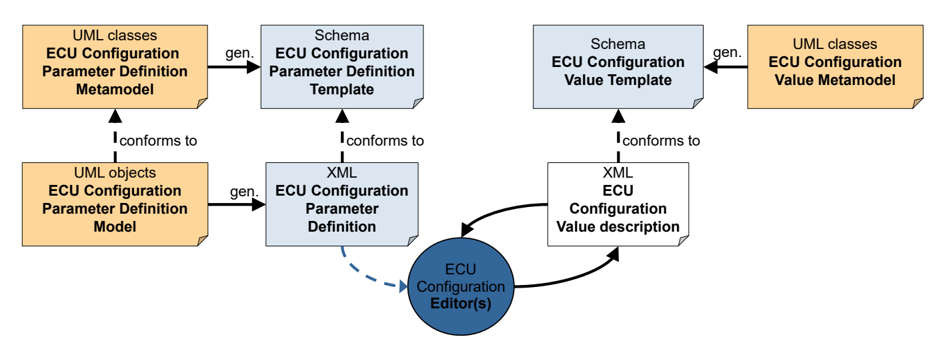

下一节描述定义 **ECU** 配置参数定义的一种方式。定义和维护 **ECU** 配置参数定义的其他方式也是可能的。

**ECU** 配置参数定义模型用于规定 **ECU** 配置参数定义。这使用对象图（这是元建模的 M1 层）完成，其特殊语义在[第 2.3 节](#23-ecu-配置参数定义元模型ecu-configuration-parameter-definition-metamodel)定义。**ECU** 配置参数定义模型中允许哪些 **UML** 元素由 **ECU** 配置参数定义元模型定义，该元模型符合通用结构模板 [\[4\]](#ref-4)。定义使用 **UML** 类图完成（这是元建模的 M2 层）。

从 **ECU** 配置参数定义元模型生成一个模式<sup>2</sup>，生成的 **ECU** 配置参数定义 **XML** 文件必须符合该模式。供应商特定的 **ECU** 配置参数定义也需要符合该模式。

**ECU** 配置值 **XML** 文件需要符合 **ECU** 配置值模板模式，该模式本身也是从以 **UML** 类图规定的 **ECU** 配置值元模型生成的。

在下一节中，将描述 **ECU** 配置参数定义元模型及其在 **ECU** 配置参数定义模型上的应用。

在下面的图和表中显示 **UML** 模型中的名称。在生成的 **XML-Schema** 中，名称可能依据 **XML Schema** 生成规则 [\[5\]](#ref-5) 而有所不同。例如，属性 shortName 在 **XML-Schema** 中将变为 SHORT-NAME。

> 1 使用解释器的优势在于 **ECU** 配置参数定义的变更可以直接在工具中生效。但硬编码的方法允许在工具中提供更多定制的用户支持。
> 2 使用 DTD 还是 **XML-Schema** 与本解释无关，留由 [\[5\]](#ref-5) 中定义的形式化策略决定。

### 2.3. ECU 配置参数定义元模型（**ECU Configuration Parameter Definition Metamodel**）

规定 **ECU** 配置参数定义的两个主要构件是容器与参数/引用。凭借在容器与参数之间建立关系的能力以及规定引用的手段，参数的定义具备了 **ECU** 配置所需的足够表达力。

#### 2.3.1. ECU 配置参数定义顶层结构（**ECU Configuration Parameter Definition top-level structure**）

每个软件模块<sup>3</sup>的配置的定义在顶层具有图 2.3 所示的结构。有关完整 **ECU** 配置顶层结构的概览，请参见[第 2.4.1 节](#241-ecu-配置值顶层结构ecu-configuration-value-top-level-structure)。

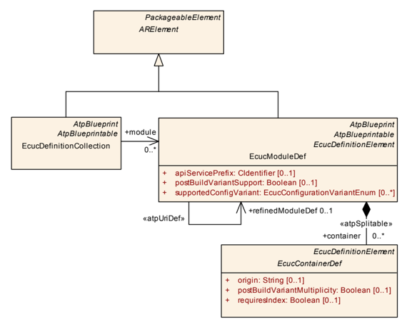

**所有 AUTOSAR 模板的通用结构（**Generic structure**）**：所有 **AUTOSAR** 模板的通用结构在 **AUTOSAR** 通用结构模板 [\[4\]](#ref-4) 中详细描述。

**标准化模块定义包结构（**Standardized Module Definition package structure**）**：由 **AUTOSAR** 交付的标准化模块定义（**Standardized Module Definition**，**StMD**）[\[7\]](#ref-7) 应提供在包结构 /AUTOSAR/EcucDefs/ 之内。

**ECU 配置参数定义的排序（**Sorting**）**：ECU 配置参数定义应按字母序排序。

> 3 软件模块可以是基础软件、**RTE**、应用软件组件或复杂驱动程序；参见 **AUTOSAR** 术语表 [\[6\]](#ref-6)。**Ecu** 配置的方法可以借助供应商特定模块定义应用于非标准化的 **AUTOSAR** 软件模块（应用软件组件或复杂驱动程序）。

**EcucDefinitionCollection 类（**EcucDefinitionCollection class**）**：第一个 **ECU** 配置特定的类是 EcucDefinitionCollection，它继承自 ARElement。通过这一继承，EcucDefinitionCollection 可以成为 **AUTOSAR** ARPackage 的一部分，从而成为 **AUTOSAR** 描述的一部分。

**约束：EcucDefinitionCollection.module 的存在性**：不包含任何对 EcucModuleDef 的引用的 EcucDefinitionCollection 对 **Ecu** 配置没有影响，在 **ECU** 配置参数定义完成时不应出现。

**EcucModuleDef 类（**EcucModuleDef class**）**：一个模块的 **ECU** 配置参数定义称为 EcucModuleDef，它继承自 ARElement。

ARElement 自身继承自 PackageableElement、Identifiable 与 Referrable，这带来两个结果：第一，每个 Referrable 必须有一个机器可读的 shortName；第二，Identifiable 为所包含的 Identifiable 对象引入了命名空间的概念，因此这些对象在该命名空间的作用域内需要具有唯一的 shortName。关于成为 Referrable 与 Identifiable 的后果以及附加属性的更多信息，请参见 **AUTOSAR** 通用结构模板 [\[4\]](#ref-4)。

**EcucDefinitionCollection 收集对各个模块配置定义的全部引用（**collects all references**）**：EcucDefinitionCollection 类的用例是收集 **AUTOSAR ECU** 配置中对各个模块配置定义的全部引用。因此，EcucDefinitionCollection 在属性 module 中规定对若干软件模块的定义的引用关系。

请注意，允许有多个 EcucDefinitionCollection 依据各种标准收集 EcucModuleDef，例如来自不同供应商的模块。

表2.1：EcucDefinitionCollection（**EcucDefinitionCollection**）

| 属性 | 值 |
| --- | --- |
| 类 | EcucDefinitionCollection |
| 包 | M2::AUTOSARTemplates::ECUCParameterDefTemplate |
| 说明 | 这表示 **AUTOSAR** 模板结构内 **ECU** 配置参数定义的锚点。标签：atp.recommendedPackage=EcucDefinitionCollections |
| 基类 | ARElement、ARObject、AtpBlueprint、AtpBlueprintable、CollectableElement、Identifiable、MultilanguageReferrable、PackageableElement、Referrable |
| 聚合于 | ARPackage.element |

| 属性 | 类型 | 多重性 | 种类 | 备注 |
| --- | --- | --- | --- | --- |
| module | EcucModuleDef | * | ref | 对各个软件模块的模块定义的引用。 |

#### 2.3.1.1. Admin Data 的使用（**Usage of the Admin Data**）

AdminData 是 Identifiable [\[4\]](#ref-4) 的一个属性，可用于为元素设置管理信息（例如版本信息）。这样的管理信息可以为整个 **ECU** 配置参数定义 **XML** 文件以及每个模块定义设置。

**ECU 配置参数定义 XML 文件中的 AdminData 字段（**AdminData field**）**：每个 **ECU** 配置参数定义 **XML** 文件（无论是 StMD 文件还是 VSMD 文件）的开头都要求有一个 AdminData 字段，以允许为整个 **XML** 文件设置 AdminData。

示例 2.1 展示如何为整个 **ECU** 配置参数定义文件使用 AdminData。对于由 **AUTOSAR** 提供的文件，AdminData 应填写 **AUTOSAR** 发布信息（发布与修订号）。对于由供应商提供的文件，AdminData 应填写供应商的发布信息。

示例2.1：

```
 <ADMIN-DATA>
<DOC-REVISIONS>
<DOC-REVISION>
<! --optional_file_revision-->
<REVISION-LABEL>4.1.0</REVISION-LABEL>
<! --AUTOSAR_or_VendorShortName-->
<ISSUED-BY>AUTOSAR</ISSUED-BY>
<! --optional_file_date-->
<DATE>2014-10-31</DATE>
</DOC-REVISION>
</DOC-REVISIONS>
</ADMIN-DATA>
```


**约束：EcucModuleDef 上 AdminData 的使用为强制**：对于每个模块定义，应提供 StMD 的修订版。对于 VSMD，应提供 **AUTOSAR** 发布版本与供应商自己的版本信息。在 EcucModuleDef 上使用 AdminData 是强制的。

**约束：VSMD 中的 AUTOSAR 发布版本**：在 VSMD 中，**AUTOSAR** 发布版本应按以下格式提供：

- DocRevision.revisionLabel 应设置为 **AUTOSAR** 发布号。
- DocRevision.issuedBy 应设置为 AUTOSAR。

示例 2.2 表明可以为 AdminData 规定多个元素。初始的一个由 **AUTOSAR** 提供，附加的一个是供应商的信息，它基于 **AUTOSAR** 的信息。

示例2.2：

```
 <ECUC-MODULE-DEF>
<SHORT-NAME>Rte</SHORT-NAME>
<DESC>
<L-2 L="EN"> Configuration Parameter Definition of the RTE </L-2>
</DESC>
<ADMIN-DATA>
<DOC-REVISIONS>
<DOC-REVISION>
<REVISION-LABEL>4.2.1</REVISION-LABEL>
<ISSUED-BY>AUTOSAR</ISSUED-BY>
<DATE>2014-10-31</DATE>
</DOC-REVISION>
<DOC-REVISION>
<REVISION-LABEL>15.3.0</REVISION-LABEL>
<! --predecessor -->
<REVISION-LABEL-P-1>2.1.1</REVISION-LABEL-P-1>
<ISSUED-BY>VendorX</ISSUED-BY>
<DATE>2007-06-21T09:30:00+01:00</DATE>
</DOC-REVISION>
</DOC-REVISIONS>
</ADMIN-DATA>
<LOWER-MULTIPLICITY>0</LOWER-MULTIPLICITY>
<UPPER-MULTIPLICITY>1</UPPER-MULTIPLICITY>
<CONTAINERS>
<! -- ... -->
</CONTAINERS>
</ECUC-MODULE-DEF>  For the definition of ECU Configuration Parameters there is support in the MetaModel to annotate the life cycle state of each EcucDefinitionElement . For the annotation the following tagged value pairs can be used (see example 2.3): - atp.Status - atp.StatusComment - atp.StatusRevisionBegin
```


#### 2.3.1.2. 生命期定义（**Life Cycle definition**）

**AUTOSAR** 提供对生命期处理的支持，定义在通用结构模板 [\[4\]](#ref-4) 中。标准化模板 [\[3\]](#ref-3) 定义了这一方法的标准化用法。

对于 **ECU** 配置参数的定义，元模型中提供支持，可为每个 EcucDefinitionElement 标注生命期状态。对于该标注，可以使用以下标记值对（见示例 2.3）：

- atp.Status
- atp.StatusComment
- atp.StatusRevisionBegin

示例2.3：

```
<SHORT-NAME>AUTOSARParameterDefinition</SHORT-NAME>
<DEFAULT-LC-STATE-REF DEST="LIFE-CYCLE-STATE"> /AUTOSAR/GenDef/ LifeCycleStateDefinitionGroups/AutosarLifeCycleStates/valid </DEFAULT- LC-STATE-REF>
<DEFAULT-PERIOD-BEGIN>
<AR-RELEASE-VERSION>4.1.1</AR-RELEASE-VERSION>
</DEFAULT-PERIOD-BEGIN>
<LIFE-CYCLE-INFOS>
<LIFE-CYCLE-INFO>
<LC-OBJECT-REF DEST="ECUC-DEFINITION-ELEMENT"> /AUTOSAR/EcucDefs/EcuC/ EcucConfigSet/EcucPduCollection/Pdu/SysTPduToFrameMappingRef </LC- OBJECT-REF>
<LC-STATE-REF DEST="LIFE-CYCLE-STATE"> /AUTOSAR/GenDef/ LifeCycleStateDefinitionGroups/AutosarLifeCycleStates/obsolete </LC -STATE-REF>
<PERIOD-BEGIN>
<AR-RELEASE-VERSION>4.1.1</AR-RELEASE-VERSION>
</PERIOD-BEGIN>
<REMARK>
<P>
<L-1 L="EN"> obsolete since R4.1.1 </L-1>
</P>
</REMARK>
<USE-INSTEAD-REFS>
<USE-INSTEAD-REF DEST="ECUC-DEFINITION-ELEMENT"> /AUTOSAR/EcucDefs/ EcuC/EcucConfigSet/EcucPduCollection/Pdu/ SysTPduToFrameTriggeringRef </USE-INSTEAD-REF>
<USE-INSTEAD-REF DEST="ECUC-DEFINITION-ELEMENT"> /AUTOSAR/EcucDefs/ EcuC/EcucConfigSet/EcucPduCollection/Pdu/ SysTPduToPduTriggeringRef </USE-INSTEAD-REF>
</USE-INSTEAD-REFS>
</LIFE-CYCLE-INFO>
</LIFE-CYCLE-INFOS>
<USED-LIFE-CYCLE-STATE-DEFINITION-GROUP-REF DEST="LIFE-CYCLE-STATE- DEFINITION-GROUP"> /AUTOSAR/GenDef/LifeCycleStateDefinitionGroups/ AutosarLifeCycleStates </USED-LIFE-CYCLE-STATE-DEFINITION-GROUP-REF>
</LIFE-CYCLE-INFO-SET>
```

如果 StMD 中的一个 EcucParamConfContainerDef 的 atp.Status 被设置为某个取值，则其所包含的 parameters、references 与 subContainers 的聚合允许依照约束「StMD 中 EcucParamConfContainerDef 与 EcucParameterDef/EcucAbstractReferenceDef/EcucContainerDef 的聚合之间允许的状态取值组合矩阵」设置 atp.Status。

表中「1」表示允许的组合，「0」表示不允许的组合。请注意，该约束只对 StMD 有效，对 VSMD 无效。

**StMD 中 EcucParamConfContainerDef 与 EcucParameterDef/EcucAbstractReferenceDef/EcucContainerDef 的聚合之间允许的状态取值组合矩阵（**Matrix of allowed status value combinations**）**：

| EcucParamConfContainerDef 的状态 | 所含聚合为 draft | 所含聚合为 valid | 所含聚合为 obsolete | 所含聚合为 removed |
| --- | --- | --- | --- | --- |
| draft | 1 | 0 | 1 | 1 |
| valid | 1 | 1 | 1 | 1 |
| obsolete | 0 | 0 | 1 | 1 |
| removed | 0 | 0 | 0 | 1 |

如果 StMD 中的一个 EcucAbstractReferenceDef 的 atp.Status 被设置为某个取值，则该引用的目标允许依照约束「EcucAbstractReferenceDef 的被引用目标之间允许的状态取值组合矩阵」设置 atp.Status。
**EcucAbstractReferenceDef 的被引用目标之间允许的状态取值组合矩阵（**Matrix of allowed status value combinations**）**：

| EcucAbstractReferenceDef 的状态 | 引用目标为 draft | 引用目标为 valid | 引用目标为 obsolete | 引用目标为 removed |
| --- | --- | --- | --- | --- |
| draft | 1 | 1 | 0 | 0 |
| valid | 0 | 1 | 0 | 0 |
| obsolete | 1 | 1 | 1 | 0 |
| removed | 1 | 1 | 1 | 1 |

请注意，在当前的 StMD 中只使用了 atp.Status 的取值「valid」「obsolete」与「draft」。

#### 2.3.1.3. 文档支持（**Documentation Support**）

**AUTOSAR** 提供对集成且结构良好的文档的支持。关于 **AUTOSAR** 文档支持概念的更多细节可以在 **AUTOSAR** 通用结构模板 [\[4\]](#ref-4) 中找到。

文档可以在以下层级内规定：

- 可以使用 desc 元素在任意 Identifiable 元素中插入单个段落。
- 任意 Identifiable 元素中都提供一个文档块作为 introduction。这种类型的文档通常用于捕获关于元素角色或其构建方式的简短引言。
- **AUTOSAR** 还提供结构化为多章的独立文档。它作为 Documentation 提供，Documentation 本身就是一个 ARElement，允许引用文档的上下文。

随着这一概念的引入，**ECU** 配置参数定义 **XML** 文件中的容器与参数备注被拆分为 desc 与 introduction 两个字段。desc 字段包含关于元素的简要描述，introduction 字段包含关于元素如何构建和使用的文档。

在当前 **AUTOSAR** 发布版的 **ECU** 配置参数定义 **XML** 文件中，无法保证 desc 与 introduction 字段的正确使用。因此，desc 与 introduction 的内容应作为一个连贯的备注来阅读。

示例 2.4 展示了 desc 与 introduction 的拆分。

示例2.4：

```
 <ECUC-MODULE-DEF>
<SHORT-NAME>Adc</SHORT-NAME>
<CONTAINERS>
<ECUC-PARAM-CONF-CONTAINER-DEF>
<SHORT-NAME>AdcHwUnit</SHORT-NAME>
<DESC>
<L-2 L="EN"> This container contains the Driver configuration ( parameters) depending on grouping of channels </L-2>
</DESC>
<INTRODUCTION>
<P>
<L-1 L="EN"> This container could contain HW specific parameters which are not defined in the Standardized Module Definition. They shall be added in the Vendor Specific Module Definition. < /L-1>
</P>
</INTRODUCTION>
<LOWER-MULTIPLICITY>1</LOWER-MULTIPLICITY>
<UPPER-MULTIPLICITY-INFINITE>true</UPPER-MULTIPLICITY-INFINITE>
</ECUC-PARAM-CONF-CONTAINER-DEF>
</CONTAINERS>
</ECUC-MODULE-DEF> 
```

示例 2.5 展示了 Documentation 元素用于描述章、列表、表格与图等元素的用法。关于这种描述手段的细节请参见 **AUTOSAR** 通用结构模板 [\[4\]](#ref-4)。

示例2.5：

```
 <DOCUMENTATION>
<SHORT-NAME>Adc_AddInfo</SHORT-NAME>
<CONTEXTS>
<DOCUMENTATION-CONTEXT>
<SHORT-NAME>AUTOSAR_Adc</SHORT-NAME>
<IDENTIFIABLE-REF DEST="ECUC-MODULE-DEF"> /AUTOSAR/Adc </IDENTIFIABLEREF>
</DOCUMENTATION-CONTEXT>
</CONTEXTS>   <SHORT-NAME>Introduction</SHORT-NAME>
<P>
<L-1 L="EN"> The ADC module initializes and controls the internal Analogue Digital Converter Unit(s) of the microcontroller. It provides services to start and stop a conversion respectively to enable and disable the trigger source for a conversion. </L-1>
</P>
<P>
<L-1 L="EN"> The consistency of the group channel results can be obtained with the following methods on the application side: </L-1>
</P>
<LIST>
<ITEM>
<P>
<L-1 L="EN"> Using group notification mechanism </L-1>
</P>
</ITEM>
<ITEM>
<P>
<L-1 L="EN"> Polling via API function Adc_GetGroupStatus </L-1>
< /P>
</ITEM>
</LIST>
<TABLE>
<TGROUP COLS="2">
<THEAD>
<ROW>
<ENTRY>
<P>
<L-1 L="EN"> column1 </L-1>
</P>
</ENTRY>
<ENTRY>
<P>
<L-1 L="EN"> column2 </L-1>
</P>
</ENTRY>
</ROW>
</THEAD>
<TBODY>
<ROW>
<ENTRY>
<P>
<L-1 L="EN"> element11 </L-1>
</P>
</ENTRY>
<ENTRY>
<P>
<L-1 L="EN"> element12 </L-1>
</P>
</ENTRY>
</ROW>
<ROW>
<ENTRY>
<P>
<L-1 L="EN"> element21 </L-1>
</P>
</ENTRY>
<ENTRY>
<P>
<L-1 L="EN"> element22 </L-1>
</P>
</ENTRY>
</ROW>
</TBODY>
</TGROUP>
</TABLE>
</CHAPTER>
</DOCUMENTATION-CONTENT>
</DOCUMENTATION>
```


#### 2.3.2. ECU 配置模块定义（**ECU Configuration Module Definition**）

**EcucModuleDef 类（**EcucModuleDef class**）**：类 EcucModuleDef 定义一个软件模块<sup>4</sup>的 **ECU** 配置参数。它继承自 ARElement，因此每个单独的 EcucModuleDef 需要在其外围 ARPackage 内具有唯一的名称。

**ECU 配置值描述中 BSW 模块实例的数量（**Number of instances**）**：EcucModuleDef 使用 EcucDefinitionElement 属性来规定在 **ECU** 配置值描述中允许该特定模块出现多少个实例（更多细节见约束「ECU 配置值描述中定义元素的实例数量」）。

表2.2：EcucModuleDef（**EcucModuleDef**）

| 属性 | 值 |
| --- | --- |
| 类 | EcucModuleDef |
| 包 | M2::AUTOSARTemplates::ECUCParameterDefTemplate |
| 说明 | 用作软件模块——包括 **BSW**、**RTE** 以及 **ECU** 基础设施——配置定义的顶层元素。标签：atp.recommendedPackage=EcucModuleDefs |
| 基类 | ARElement、ARObject、AtpBlueprint、AtpBlueprintable、AtpDefinition、CollectableElement、EcucDefinitionElement、Identifiable、MultilanguageReferrable、PackageableElement、Referrable |
| 聚合于 | ARPackage.element |

| 属性 | 类型 | 多重性 | 种类 | 备注 |
| --- | --- | --- | --- | --- |
| apiServicePrefix | CIdentifier | 0..1 | attr | 对于可以定义多个 VSMD 实例的模块，apiServicePrefix 定义派生实例的 **API** 命名空间，例如 Cdd、Xfrm（ComXf、SomeIpXf、E2EXf）。 |
| container | EcucContainerDef | * | aggr | 聚合该特定模块定义的顶层容器定义。构造型：atpSplitable 标签：atp.Splitkey=container.shortName、xml.sequenceOffset=11 |
| postBuildVariantSupport | Boolean | 0..1 | attr | 指示模块是否支持不同的后构建变体（以前称为后构建可选配置集）。**TRUE** 表示是，**FALSE** 表示否。 |
| refinedModuleDef | EcucModuleDef | 0..1 | ref | 从供应商特定模块定义到其细化的标准化模块定义的可选引用。若该 EcucModuleDef 的 category 为 STANDARDIZED_MODULE_DEFINITION，则不应提供该引用。若该 EcucModuleDef 的 category 为 VENDOR_SPECIFIC_MODULE_DEFINITION，则该引用为强制。构造型：atpUriDef |
| supportedConfigVariant | EcucConfigurationVariantEnum | * | attr | 规定该软件模块支持哪些 ConfigurationVariant。若 EcucModuleDef 的 category 为 STANDARDIZED_MODULE_DEFINITION，则该属性为可选。若 EcucModuleDef 的 category 属性设置为 VENDOR_SPECIFIC_MODULE_DEFINITION，则该属性为强制。 |

> 4 软件模块不限于 **BSW** 模块，还包括 **RTE**、应用软件组件与通用的 **ECU** 配置。

**约束：EcucModuleDef 能够聚合容器定义**：EcucModuleDef 以角色名 container 聚合容器定义（EcucModuleDef），后者可以容纳其他容器定义、参数定义与引用定义。

**约束：EcucModuleDef.container 的存在性**：不包含任何 EcucContainerDef 的 EcucModuleDef 对 **Ecu** 配置没有影响，在 **ECU** 配置参数定义完成时不应出现。

**约束：模块对后构建变体的支持**：EcucModuleDef 的 postBuildVariantSupport 属性规定该 EcucModuleDef 是否支持在后构建时间绑定的不同变体点（后构建变体）<sup>5</sup>。true 表示是，false 表示否。

**约束：postBuildVariantSupport 设置为 false 时 EcucContainerDef.postBuildVariantMultiplicity 的取值**：如果 postBuildVariantSupport 设置为 false，则该 EcucModuleDef 中每个 upperMultiplicity 大于 lowerMultiplicity 的 EcucContainerDef 的 postBuildVariantMultiplicity 属性都应设置为 false。

**约束：postBuildVariantSupport 设置为 false 时 postBuildVariantMultiplicity 的取值**：如果 postBuildVariantSupport 设置为 false，则该 EcucModuleDef 中每个 upperMultiplicity 大于 lowerMultiplicity 的 EcucCommonAttributes 的 postBuildVariantMultiplicity 属性都应设置为 false。

**约束：postBuildVariantSupport 设置为 false 时 postBuildVariantValue 的取值**：如果 postBuildVariantSupport 设置为 false，则该 EcucModuleDef 中每个 EcucCommonAttributes 的 postBuildVariantValue 属性都应设置为 false。

**约束：VSMD 细化 StMD**：从 category 为 VENDOR_SPECIFIC_MODULE_DEFINITION 的 EcucModuleDef 到 category 为 STANDARDIZED_MODULE_DEFINITION 的 EcucModuleDef 的引用 refinedModuleDef 规定：源 EcucModuleDef 是供应商特定模块定义，它细化被引用的标准化 EcucModuleDef。

**约束：引用 refinedModuleDef 为强制的用例**：如果 category 为 VENDOR_SPECIFIC_MODULE_DEFINITION 的 EcucModuleDef 实际细化了 category 为 STANDARDIZED_MODULE_DEFINITION 的 EcucModuleDef（例如 Com **BSW** 模块的供应商特定模块定义细化 Com **BSW** 模块的标准化模块定义），则引用 refinedModuleDef 为强制。

> 5 注意，后构建变体以前称为后构建可选配置集。

**约束：引用 refinedModuleDef 为可选的用例**：如果 category 为 VENDOR_SPECIFIC_MODULE_DEFINITION 的 EcucModuleDef 实际上并未细化任何 category 为 STANDARDIZED_MODULE_DEFINITION 的 EcucModuleDef（例如不参与 Com 栈配置的 **CDD** 的供应商特定模块定义），则引用 refinedModuleDef 不是必要的。

#### 2.3.3. 容器定义（**Container Definition**）

容器定义有两种特化。抽象类 EcucContainerDef 用于收集公共特征（见图 2.5）。

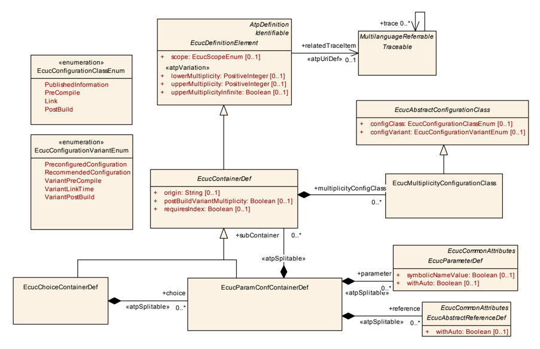

表2.3：EcucContainerDef（**EcucContainerDef**）

| 属性 | 值 |
| --- | --- |
| 类 | EcucContainerDef（抽象） |
| 包 | M2::AUTOSARTemplates::ECUCParameterDefTemplate |
| 说明 | 用于收集配置容器定义的公共属性的基类。 |
| 基类 | ARObject、AtpDefinition、EcucDefinitionElement、Identifiable、MultilanguageReferrable、Referrable |
| 子类 | EcucChoiceContainerDef、EcucParamConfContainerDef |
| 聚合于 | EcucDestinationUriPolicy.container、EcucModuleDef.container、EcucParamConfContainerDef.subContainer |

| 属性 | 类型 | 多重性 | 种类 | 备注 |
| --- | --- | --- | --- | --- |
| destinationUri | EcucDestinationUriDef | * | ref | 可为一个 EcucContainerDef 定义多个 destinationUri。借助这样的 destinationUri，一个 EcucContainerDef 可适用于多个 EcucUriReferenceDef。构造型：atpUriDef |
| multiplicityConfigClass | EcucMultiplicityConfigurationClass | * | aggr | 规定该容器对哪个 ConfigurationVariant 可用于哪个 MultiplicityConfigurationClass。若外围 EcucModuleDef 的 Category 为 STANDARDIZED_MODULE_DEFINITION，则该聚合为可选。若 EcucModuleDef 的 category 属性设置为 VENDOR_SPECIFIC_MODULE_DEFINITION 且 upperMultiplicity 大于 lowerMultiplicity，则该聚合为强制。标签：xml.namePlural=MULTIPLICITY-CONFIG-CLASSES |
| origin | String | 0..1 | attr | 该属性规定该配置容器是 **AUTOSAR** 标准化容器还是供应商特定容器。 |
| postBuildVariantMultiplicity | Boolean | 0..1 | attr | 指示一个容器在不同的后构建变体（以前称为后构建可选配置集）中是否可以有不同的实例数量。**TRUE** 表示是，**FALSE** 表示否。 |
| requiresIndex | Boolean | 0..1 | attr | 用于定义是否应为该定义的取值元素提供一个索引。 |

**约束：ECU 配置值描述中 EcucContainerDef 实例的数量**：每个 EcucContainerDef 还具有 EcucDefinitionElement 的特征，这使得可以为每个 EcucContainerDef 规定它在后续的 **ECU** 配置值描述中允许出现的频度（更多细节见约束「ECU 配置值描述中定义元素的实例数量」）。

**约束：不同配置时点下 EcucContainerDef 实例数量的差异**：EcucContainerDef.multiplicityConfigClass 将 configClass 分配到 configVariant，规定对于 EcucModuleDef 的每个实现变体（即 VariantPreCompile、VariantLinkTime、VariantPostBuild），该 EcucContainerDef 的实例数量最迟可以在何时（即预编译时间、链接时间、后构建时间）改变。

例如，若一个容器的 multiplicityConfigClass.configClass 对 multiplicityConfigClass.configVariant VariantPostBuild 等于 PostBuild，这意味着该容器的实例数量最迟可以在后构建时间改变（即更新的后构建配置可以包含该容器不同数量的实例，例如 ComIPdu）。

configClass 到 configVariant 的分配在[第 2.3.4.3.2 节](#23432-取值与多重性配置类value-and-multiplicity-configuration-classes)中描述。

**约束：multiplicityConfigClass 属性的适用性**：multiplicityConfigClass 属性只适用于 upperMultiplicity 大于 lowerMultiplicity 的 EcucContainerDef。

**约束：在后构建时间移除 EcucContainerDef 的实例**：只有在后构建时间引入（不属于后构建更新之前的初始配置的一部分）、其 multiplicityConfigClass.configVariant VariantPostBuild 中的 multiplicityConfigClass.configClass 设置为 PostBuild、且未被引用或仅被 valueConfigClass.configVariant VariantPostBuild 中 valueConfigClass.configClass 设置为 PostBuild 的 EcucAbstractReferenceDef 独占引用的 EcucContainerDef 实例，才能在后构建时间移除。

**约束：multiplicityConfigClass.configClass 属性的使用与其聚合的 subContainer 无关**：即使一个 EcucContainerDef 在角色 subContainer 中聚合的一个或多个 EcucContainerDef 在 valueConfigClass.configVariant VariantPostBuild 中将属性 multiplicityConfigClass.configClass 设置为 PreCompile 或 Link，该 EcucContainerDef 仍可以在 multiplicityConfigClass.configVariant VariantPostBuild 中将属性 multiplicityConfigClass.configClass 设置为 PostBuild。

如果容器「A」的属性 multiplicityConfigClass.configClass 设置为 PostBuild，而其子容器「B」设置为 Link，则在后构建时间不可能向「A」的既有容器实例「a1」添加子容器「B」的新实例「b2」。然而，允许添加容器「A」的新实例「a2」并同时添加其子容器「B」的新实例「b2」。

**约束：不同后构建变体中 EcucContainerDef 实例数量的差异**：EcucContainerDef 的 postBuildVariantMultiplicity 属性规定该 EcucContainerDef 在不同的后构建变体<sup>6</sup>中是否可以存在不同数量的实例。true 表示是，false 表示否。

**约束：postBuildVariantMultiplicity 属性的适用性**：EcucContainerDef 的 postBuildVariantMultiplicity 属性只适用于 upperMultiplicity 大于 lowerMultiplicity 的 EcucContainerDef。

**约束：postBuildVariantMultiplicity 属性的使用与聚合的 subContainer 无关**：即使一个 EcucContainerDef 在角色 subContainer 中聚合的一个或多个 EcucContainerDef 将属性 postBuildVariantMultiplicity 设置为 false，该 EcucContainerDef 仍可以将属性 postBuildVariantMultiplicity 设置为 true。

如果容器「A」的 postBuildVariantMultiplicity 属性设置为 true，而其子容器「B」设置为 false，则在不同的后构建变体中，「A」的同一实例内「B」的实例数量不可能不同。但允许容器「A」有不同的实例数量，其中新实例可以拥有任意数量的容器「B」实例。

**约束：依赖另一 EcucModuleDef 的 multiplicityConfigClass 设置为 Link/PostBuild 的 EcucContainerDef 的 EcucModuleDef**：如果一个 EcucModuleDef 依赖另一 EcucModuleDef 的 multiplicityConfigClass.configClass 设置为 Link/PostBuild 的 EcucContainerDef，则这些 EcucContainerDef 的实例数量只能在相应使用方 EcucModuleDef 的 EcucModuleConfigurationValues 将 implementationConfigVariant 分别设置为 VariantLinkTime/VariantPostBuild 时，才能在 Link/PostBuild 时间改变。

**注意：** 约束「依赖另一 EcucModuleDef 的 multiplicityConfigClass 设置为 Link/PostBuild 的 EcucContainerDef 的 EcucModuleDef」应由使用方模块检查，即不支持后构建的模块应确保从其他模块使用的后构建容器实例的数量不被改变。

> 6 注意，后构建变体以前称为后构建可选配置集。

**约束：依赖另一 EcucModuleDef 的 postBuildVariantMultiplicity 设置为 true 的 EcucContainerDef 的 EcucModuleDef**：如果一个 EcucModuleDef 依赖另一 EcucModuleDef 的 postBuildVariantMultiplicity 设置为 true 的 EcucContainerDef，则只有在使用方 EcucModuleDef 的实现支持后构建变体时，这些 EcucContainerDef 的实例数量才能在不同的后构建变体中不同。

**注意：** 约束「依赖另一 EcucModuleDef 的 postBuildVariantMultiplicity 设置为 true 的 EcucContainerDef 的 EcucModuleDef」应由使用方模块检查，即不支持后构建变体的模块应确保从其他模块使用的后构建可变容器实例的数量在所有变体中相同。

**EcucParamConfContainerDef 类（**EcucParamConfContainerDef class**）**：EcucParamConfContainerDef 是主要的容器类定义，可以包含其他容器、配置参数与引用。

表2.4：EcucParamConfContainerDef（**EcucParamConfContainerDef**）

| 属性 | 值 |
| --- | --- |
| 类 | EcucParamConfContainerDef |
| 包 | M2::AUTOSARTemplates::ECUCParameterDefTemplate |
| 说明 | 用于定义可以层次化地包含其他容器和/或参数定义的配置容器。 |
| 基类 | ARObject、AtpDefinition、EcucContainerDef、EcucDefinitionElement、Identifiable、MultilanguageReferrable、Referrable |
| 聚合于 | EcucChoiceContainerDef.choice、EcucDestinationUriPolicy.container、EcucModuleDef.container、EcucParamConfContainerDef.subContainer |

| 属性 | 类型 | 多重性 | 种类 | 备注 |
| --- | --- | --- | --- | --- |
| parameter | EcucParameterDef | * | aggr | 在 EcucParamConfContainerDef 内定义的参数。构造型：atpSplitable 标签：atp.Splitkey=parameter.shortName |
| reference | EcucAbstractReferenceDef | * | aggr | 在 EcucParamConfContainerDef 内定义的引用。构造型：atpSplitable 标签：atp.Splitkey=reference.shortName |
| subContainer | EcucContainerDef | * | aggr | 在 EcucParamConfContainerDef 内定义的容器。构造型：atpSplitable 标签：atp.Splitkey=subContainer.shortName |

图 2.6 展示了一个 EcucContainerDef 及其在 **ECU** 配置参数定义中的嵌入的示例。规定了一个 EcucModuleDef Rte，它是 EcucDefinitionCollection 的一部分。两个类型为 EcucParamConfContainerDef 的容器被规定为该模块定义的一部分。

在规定 EcucModuleDef 与容器之间的包含关系时，使用角色名 container。在规定两个容器之间的包含关系时，在被包含的容器处使用角色名为 subContainer 的聚合。

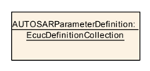

示例 2.7 中的 **XML** 摘录只显示图 2.6 中的相关部分，不包括 EcucDefinitionCollection<sup>7</sup>。对应的 **ECU** 配置值描述 **XML** 文件摘录见示例 2.32。

> 7 由于 EcucDefinitionCollection 是 EcucModuleDef 的聚合方，该层级的包含关系由该引用表示。

示例2.7：

```
<ECUC-MODULE-DEF>
<SHORT-NAME>Rte</SHORT-NAME>
<LOWER-MULTIPLICITY>0</LOWER-MULTIPLICITY>
<UPPER-MULTIPLICITY>1</UPPER-MULTIPLICITY>
<POST-BUILD-VARIANT-SUPPORT>false</POST-BUILD-VARIANT-SUPPORT>
<CONTAINERS>
<ECUC-PARAM-CONF-CONTAINER-DEF>
<SHORT-NAME>RteGeneration</SHORT-NAME>
<LOWER-MULTIPLICITY>1</LOWER-MULTIPLICITY>
<UPPER-MULTIPLICITY>1</UPPER-MULTIPLICITY>
</ECUC-PARAM-CONF-CONTAINER-DEF>
<ECUC-PARAM-CONF-CONTAINER-DEF>
<SHORT-NAME>SwComponentInstance</SHORT-NAME>
<LOWER-MULTIPLICITY>1</LOWER-MULTIPLICITY>
<UPPER-MULTIPLICITY-INFINITE>true</UPPER-MULTIPLICITY-INFINITE>
<MULTIPLICITY-CONFIG-CLASSES>
<ECUC-MULTIPLICITY-CONFIGURATION-CLASS>
<CONFIG-CLASS>PRE-COMPILE</CONFIG-CLASS>
<CONFIG-VARIANT>VARIANT-LINK-TIME</CONFIG-VARIANT>
</ECUC-MULTIPLICITY-CONFIGURATION-CLASS>
<ECUC-MULTIPLICITY-CONFIGURATION-CLASS>
<CONFIG-CLASS>PRE-COMPILE</CONFIG-CLASS>
<CONFIG-VARIANT>VARIANT-POST-BUILD</CONFIG-VARIANT>
</ECUC-MULTIPLICITY-CONFIGURATION-CLASS>
<ECUC-MULTIPLICITY-CONFIGURATION-CLASS>
<CONFIG-CLASS>PRE-COMPILE</CONFIG-CLASS>
<CONFIG-VARIANT>VARIANT-PRE-COMPILE</CONFIG-VARIANT>
</ECUC-MULTIPLICITY-CONFIGURATION-CLASS>
</MULTIPLICITY-CONFIG-CLASSES>
<POST-BUILD-VARIANT-MULTIPLICITY> false </POST-BUILD-VARIANT- MULTIPLICITY>
</ECUC-PARAM-CONF-CONTAINER-DEF>
</CONTAINERS>
</ECUC-MODULE-DEF> 7 Note that in the figures of ECU Configuration Parameter Definition modeled in UML the infinite upper multiplicity is shown as upperMultiplicity = * resulting in < UPPER-MULTIPLICITYINFINITE > true < /UPPER-MULTIPLICITY-INFINITE >
```


#### 2.3.3.1. 选项容器定义（**Choice Container Definition**）

**EcucChoiceContainerDef 类（**EcucChoiceContainerDef class**）**：EcucChoiceContainerDef 可用于规定某些容器在 **ECU** 配置值描述中可能以互斥的方式出现。在 **ECU** 配置参数定义中，潜在的容器被规定为 EcucChoiceContainerDef 的一部分，而约束是在实际的 **ECU** 配置值描述中只有这些被规定容器中的一部分会实际出现。

表2.5：EcucChoiceContainerDef（**EcucChoiceContainerDef**）

| 属性 | 值 |
| --- | --- |
| 类 | EcucChoiceContainerDef |
| 包 | M2::AUTOSARTemplates::ECUCParameterDefTemplate |
| 说明 | 用于定义在若干 EcucParamConfContainerDef 之间提供选项的配置容器。但在实际的 **ECU** 配置值中，选项列表中只会出现一个实例。 |
| 基类 | ARObject、AtpDefinition、EcucContainerDef、EcucDefinitionElement、Identifiable、MultilanguageReferrable、Referrable |
| 聚合于 | EcucDestinationUriPolicy.container、EcucModuleDef.container、EcucParamConfContainerDef.subContainer |

| 属性 | 类型 | 多重性 | 种类 | 备注 |
| --- | --- | --- | --- | --- |
| choice | EcucParamConfContainerDef | * | aggr | EcucChoiceContainerDef 中可用的选项。构造型：atpSplitable 标签：atp.Splitkey=choice.shortName |

**约束：待选容器的多重性**：待选容器的多重性应始终为 0..1，表示每次执行选择时，一次只能选择这些待选容器中的一个。

**约束：ECU 配置值描述中对可用待选容器的允许选择**：每次可以执行选择时，用户可以自由选择可用待选容器中的一个。EcucChoiceContainerDef 的 upperMultiplicity 规定在取值侧应允许多少个实例。

图 2.7 展示了 EcucChoiceContainerDef 用法的一个示例，**XML** 定义见示例 2.8。对应的 **ECU** 配置值描述见示例 2.33。

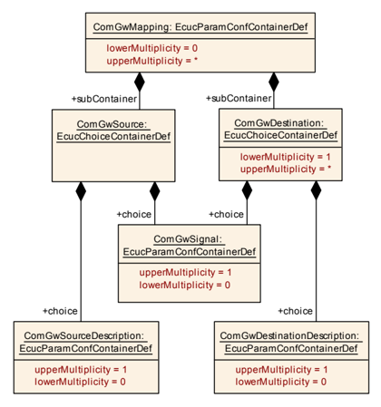

该示例展示了 EcucChoiceContainerDef 的两个用例，二者具有不同的 EcucChoiceContainerDef 多重性。

EcucChoiceContainerDef ComGwSource 定义为在后续的 **ECU** 配置值描述中能够容纳给定的两个容器之一。由于 ComGwSource 的 upperMultiplicity = 1，因此只能进行一次选择。

EcucChoiceContainerDef ComGwDestination 定义为在后续的 **ECU** 配置值描述中能够容纳给定的两个容器之一。由于 ComGwDestination 的 upperMultiplicity = *，因此可以进行多次选择。

示例2.8：

```
 <ECUC-MODULE-DEF>
<SHORT-NAME>Com</SHORT-NAME>
<LOWER-MULTIPLICITY>1</LOWER-MULTIPLICITY>
<UPPER-MULTIPLICITY>1</UPPER-MULTIPLICITY>
<POST-BUILD-VARIANT-SUPPORT>true</POST-BUILD-VARIANT-SUPPORT>
<CONTAINERS>
<ECUC-PARAM-CONF-CONTAINER-DEF>
<SHORT-NAME>ComGwMapping</SHORT-NAME>
<LOWER-MULTIPLICITY>0</LOWER-MULTIPLICITY>
<UPPER-MULTIPLICITY-INFINITE>true</UPPER-MULTIPLICITY-INFINITE>
<MULTIPLICITY-CONFIG-CLASSES>
<ECUC-MULTIPLICITY-CONFIGURATION-CLASS>
<CONFIG-CLASS>LINK</CONFIG-CLASS>
<CONFIG-VARIANT>VARIANT-LINK-TIME</CONFIG-VARIANT>
</ECUC-MULTIPLICITY-CONFIGURATION-CLASS>
<ECUC-MULTIPLICITY-CONFIGURATION-CLASS>
<CONFIG-CLASS>POST-BUILD</CONFIG-CLASS>
<CONFIG-VARIANT>VARIANT-POST-BUILD</CONFIG-VARIANT>
</ECUC-MULTIPLICITY-CONFIGURATION-CLASS>
<ECUC-MULTIPLICITY-CONFIGURATION-CLASS>
<CONFIG-CLASS>PRE-COMPILE</CONFIG-CLASS>
<CONFIG-VARIANT>VARIANT-PRE-COMPILE</CONFIG-VARIANT>
</ECUC-MULTIPLICITY-CONFIGURATION-CLASS>
</MULTIPLICITY-CONFIG-CLASSES>
<POST-BUILD-VARIANT-MULTIPLICITY> true </POST-BUILD-VARIANTMULTIPLICITY>
<SUB-CONTAINERS>
<ECUC-CHOICE-CONTAINER-DEF>
<SHORT-NAME>ComGwSource</SHORT-NAME>
<LOWER-MULTIPLICITY>1</LOWER-MULTIPLICITY>
<UPPER-MULTIPLICITY>1</UPPER-MULTIPLICITY>
<CHOICES>
<ECUC-PARAM-CONF-CONTAINER-DEF>
<SHORT-NAME>ComGwSignal</SHORT-NAME>
<! --... -->
</ECUC-PARAM-CONF-CONTAINER-DEF>
<ECUC-PARAM-CONF-CONTAINER-DEF>
<SHORT-NAME>ComGwSourceDescription</SHORT-NAME>
<! --... -->
</ECUC-PARAM-CONF-CONTAINER-DEF>
</CHOICES>   </ECUC-CHOICE-CONTAINER-DEF>
<ECUC-CHOICE-CONTAINER-DEF>
<SHORT-NAME>ComGwDestination</SHORT-NAME>
<LOWER-MULTIPLICITY>1</LOWER-MULTIPLICITY>
<UPPER-MULTIPLICITY-INFINITE>true</UPPER-MULTIPLICITY-INFINITE>
<MULTIPLICITY-CONFIG-CLASSES>
<ECUC-MULTIPLICITY-CONFIGURATION-CLASS>
<CONFIG-CLASS>LINK</CONFIG-CLASS>
<CONFIG-VARIANT>VARIANT-LINK-TIME</CONFIG-VARIANT>
</ECUC-MULTIPLICITY-CONFIGURATION-CLASS>
<ECUC-MULTIPLICITY-CONFIGURATION-CLASS>
<CONFIG-CLASS>POST-BUILD</CONFIG-CLASS>
<CONFIG-VARIANT>VARIANT-POST-BUILD</CONFIG-VARIANT>
</ECUC-MULTIPLICITY-CONFIGURATION-CLASS>
<ECUC-MULTIPLICITY-CONFIGURATION-CLASS>
<CONFIG-CLASS>PRE-COMPILE</CONFIG-CLASS>
<CONFIG-VARIANT>VARIANT-PRE-COMPILE</CONFIG-VARIANT>
</ECUC-MULTIPLICITY-CONFIGURATION-CLASS>
</MULTIPLICITY-CONFIG-CLASSES>
<POST-BUILD-VARIANT-MULTIPLICITY> true </POST-BUILD-VARIANTMULTIPLICITY>
<CHOICES>
<ECUC-PARAM-CONF-CONTAINER-DEF>
<SHORT-NAME>ComGwSignal</SHORT-NAME>
<! --... -->
</ECUC-PARAM-CONF-CONTAINER-DEF>
<ECUC-PARAM-CONF-CONTAINER-DEF>
<SHORT-NAME>ComGwDestinationDescription</SHORT-NAME>
<! --... -->
</ECUC-PARAM-CONF-CONTAINER-DEF>
</CHOICES>
</ECUC-CHOICE-CONTAINER-DEF>
</SUB-CONTAINERS>
</ECUC-PARAM-CONF-CONTAINER-DEF>
</CONTAINERS>
</ECUC-MODULE-DEF>  Variant Handling has been introduced to AUTOSAR in a generic way. The major specification can be found in the AUTOSAR Generic Structure Template [4]. Every element which is subject to variability shall have the stereotype <<atpVariation>>
```

当然，在示例中供选择的容器在一个实际的定义文件中必须以更详细的方式规定。

#### 2.3.4. 公共配置元素（**Common Configuration Elements**）

配置容器、参数与引用具有一些公共属性，本节将对它们加以描述。

##### 2.3.4.1. 变体处理（**Variant Handling**）

变体处理已以一种通用的方式引入 **AUTOSAR**。主要规范见 **AUTOSAR** 通用结构模板 [\[4\]](#ref-4)。每个受变体机制支配的元素都应设置构造型 &lt;&lt;atpVariation&gt;&gt;。

变体处理用于 **ECU** 配置的两个领域：**ECU** 配置参数定义与 **ECU** 配置值描述。在本规范中，变体处理的语义在其各自实际出现的位置规定。

##### 2.3.4.2. 配置多重性（**Configuration Multiplicity**）

**ECU 配置值描述中容器、参数与引用的出现次数（**Number of occurrences**）**：为了能够规定一个特定的配置元素（容器、参数或引用）在 **ECU** 配置值描述中允许出现的频度，引入了类 EcucDefinitionElement。借助两个属性 lowerMultiplicity 与 upperMultiplicity，规定该配置元素的最小与最大出现次数。

**ECU 配置值描述中容器、参数与引用的可数无限数量（**Countably infinite number**）**：为了表达该元素的可数无限出现次数，upperMultiplicityInfinite 元素应存在并应设置为 true<sup>8</sup>。

**约束：upperMultiplicityInfinite 与 upperMultiplicity 的存在性互斥**：元素 upperMultiplicityInfinite 与 upperMultiplicity 的存在性应互斥。

**约束：ECU 配置参数定义中可变的下与上多重性**：属性 lowerMultiplicity、upperMultiplicity 与 upperMultiplicityInfinite 受变体机制支配。取值可以使用变体处理机制计算。

在本规范中，字面量 n 与 m 用于表示某个自然数，以便允许定义 lowerMultiplicity 与 upperMultiplicity 之间的关系。

**约束：Ecuc 参数定义 UML 模型中容器、参数与引用可选性的表达（**Expression of optionality**）**：如果在 Ecuc 参数定义 **UML** 模型（[\[8\]](#ref-8) - AUTOSAR_MMOD_MetaModel）中未为某个元素定义多重性，则该元素将在 **Ecu** 参数定义 **ARXML** 文件（[\[7\]](#ref-7) - Specification of ECU Configuration Parameters）中生成为强制元素：

- lowerMultiplicity = 1
- upperMultiplicity = 1

为了在 Ecuc 参数定义模型（[\[8\]](#ref-8) - AUTOSAR_MMOD_MetaModel）中表达一个可选元素，必须将 lowerMultiplicity 显式设置为「0」。

> 8 注意，在以 **UML** 建模的 **ECU** 配置参数定义的图中，无限上多重性显示为 upperMultiplicity = *。

由于 Ecuc 参数定义 **UML** 模型图可能相当大并占用大量图形空间，可以通过省略 lowerMultiplicity 与 upperMultiplicity 或 upperMultiplicityInfinite 来节省空间。在生成的 **Ecu** 参数定义 **ARXML** 文件中，这些多重性定义为强制。

upperMultiplicity &gt; 1 的配置参数与引用定义必须谨慎对待，因为无法引用单个参数。因此，取值描述中一个参数的这种多次出现只是单纯的集合，既不保证顺序得以保留，也不保证单个元素具有特殊语义。

**约束：ECU 配置参数模型图中的多重性属性（**Multiplicity attributes**）**：在规范对象图（**ECU** 配置参数模型）中，如果两个取值都等于默认值「1」，则可以省略多重性属性。否则应显示两个属性。

表2.6：EcucDefinitionElement（**EcucDefinitionElement**）

| 属性 | 值 |
| --- | --- |
| 类 | EcucDefinitionElement（抽象） |
| 包 | M2::AUTOSARTemplates::ECUCParameterDefTemplate |
| 说明 | 用于表达配置参数、引用与容器共性的公共类。除非另有说明，默认多重性恰好是所指定元素的一次强制出现。 |
| 基类 | ARObject、AtpDefinition、Identifiable、MultilanguageReferrable、Referrable |
| 子类 | EcucCommonAttributes、EcucContainerDef、EcucModuleDef |

| 属性 | 类型 | 多重性 | 种类 | 备注 |
| --- | --- | --- | --- | --- |
| ecucCond | EcucConditionSpecification | 0..1 | aggr | 若求值为 true，则 **Ecu** 参数定义应按规定处理。否则应忽略该参数定义。标签：xml.sequenceOffset=100 |
| ecucValidationCond | EcucValidationCondition | * | aggr | 校验条件的集合，它们全部需要求值为 true，以表明 EcucDefinitionElement 的一个有效校验条件。 |
| lowerMultiplicity | PositiveInteger | 0..1 | attr | 所指定元素的下多重性。0：可选；1：至少一次出现；n：至少 n 次出现。atpVariation：[RS_ECUC_00082] 构造型：atpVariation 标签：vh.latestBindingTime=codeGenerationTime、xml.sequenceOffset=110 |
| relatedTraceItem | Traceable | 0..1 | ref | 这包含对该元素（EcucId）的 **Autosar** 兼容标识符的松散引用。构造型：atpUriDef 标签：xml.sequenceOffset=-10 |
| scope | EcucScopeEnum | 0..1 | attr | 规定该配置元素的作用范围。标签：xml.sequenceOffset=150 |
| upperMultiplicity | PositiveInteger | 0..1 | attr | 所指定元素的上多重性。0：无出现（用于 VSMD）；1：至多一次出现；m：至多 m 次出现。若设置了 upperMultiplicity，则不应使用 upperMultiplicityInfinite。atpVariation：[RS_ECUC_00082] 构造型：atpVariation 标签：vh.latestBindingTime=codeGenerationTime、xml.sequenceOffset=120 |
| upperMultiplicityInfinite | Boolean | 0..1 | attr | 为了表达该元素的无限出现次数，该属性必须设置为 true。若设置了 upperMultiplicityInfinite，则不应使用 upperMultiplicity。atpVariation：[RS_ECUC_00082] 构造型：atpVariation 标签：vh.latestBindingTime=codeGenerationTime、xml.sequenceOffset=130 |

表2.7：EcucScopeEnum（**EcucScopeEnum**）

| 属性 | 值 |
| --- | --- |
| 枚举 | EcucScopeEnum |
| 包 | M2::AUTOSARTemplates::ECUCParameterDefTemplate |
| 说明 | 配置元素的可能作用范围设置。 |
| 聚合于 | EcucDefinitionElement.scope |

| 字面量 | 说明 |
| --- | --- |
| ECU | 一个元素可以与其他模块共享。标签：atp.EnumerationLiteralIndex=0 |
| local | 一个元素只适用于定义它的模块。标签：atp.EnumerationLiteralIndex=1 |

引用 EcucDefinitionElement.relatedTraceItem 用于在 StMD 中提供相应 EcucDefinitionElement 的规范 ID。请注意，同一规范 ID 可以在 StMD 中出现多次，因为同一个 EcucDefinitionElement 可以是若干 EcucParamConfContainerDef 的一部分。

EcucDefinitionElement.relatedTraceItem 可以在 VSMD 中使用，但其取值不得与 **AUTOSAR** 定义的命名空间冲突。

**约束：VSMD 中 EcucDefinitionElement.relatedTraceItem 取值的限定**：VSMD 中 EcucDefinitionElement.relatedTraceItem 的取值绝不应以「ECUC_」开头。

以「ECUC_」开头的 EcucDefinitionElement.relatedTraceItem 取值为 **AUTOSAR** 标准化保留。

**约束：scope 属性的适用性**：属性 scope 的使用禁止用于 EcucModuleDef 以及 EcucContainerDef 的子类（即 EcucChoiceContainerDef 与 EcucParamConfContainerDef）。

有关示例请参见图 2.6 与示例 2.7。

##### 2.3.4.3. 公共配置属性（**Common Configuration Attributes**）

若干属性同时可用于参数与引用。这些公共属性如图 2.8 所示。

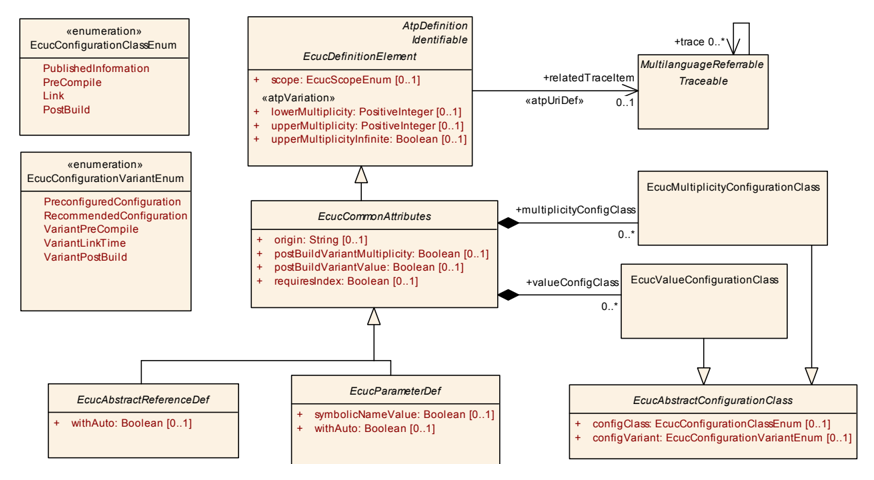

**约束：EcucDefinitionElement.lowerMultiplicity 始终必需**：在 **ECU** 配置参数定义完成时，属性 EcucDefinitionElement.lowerMultiplicity 应始终被定义。

**约束：EcucDefinitionElement.upperMultiplicity 或 EcucDefinitionElement.upperMultiplicityInfinite 始终必需**：在 **ECU** 配置参数定义完成时，属性 EcucDefinitionElement.upperMultiplicity 或 EcucDefinitionElement.upperMultiplicityInfinite 中应始终恰有一个被定义。

**约束：EcucCommonAttributes.origin 始终必需**：在 **ECU** 配置参数定义完成时，属性 EcucCommonAttributes.origin 应始终被定义。

**约束：EcucParameterDef.symbolicNameValue 始终必需**：在 **ECU** 配置参数定义完成时，属性 EcucParameterDef.symbolicNameValue 应始终被定义。

**约束：EcucAbstractConfigurationClass.configClass 始终必需**：在 **ECU** 配置参数定义完成时，属性 EcucAbstractConfigurationClass.configClass 应始终被定义。

**约束：EcucAbstractConfigurationClass.configVariant 始终必需**：在 **ECU** 配置参数定义完成时，属性 EcucAbstractConfigurationClass.configVariant 应始终被定义。

表2.8：EcucCommonAttributes（**EcucCommonAttributes**）

| 属性 | 值 |
| --- | --- |
| 类 | EcucCommonAttributes（抽象） |
| 包 | M2::AUTOSARTemplates::ECUCParameterDefTemplate |
| 说明 | 配置参数与引用都使用的属性。 |
| 基类 | ARObject、AtpDefinition、EcucDefinitionElement、Identifiable、MultilanguageReferrable、Referrable |
| 子类 | EcucAbstractReferenceDef、EcucParameterDef |

| 属性 | 类型 | 多重性 | 种类 | 备注 |
| --- | --- | --- | --- | --- |
| multiplicityConfigClass | EcucMultiplicityConfigurationClass | * | aggr | 规定该参数或引用在特定 ConfigurationVariant 中可用于哪个 MultiplicityConfigurationClass。若外围 EcucModuleDef 的 Category 为 STANDARDIZED_MODULE_DEFINITION，则该聚合为可选。若 EcucModuleDef 的 category 属性设置为 VENDOR_SPECIFIC_MODULE_DEFINITION，则该聚合为强制。标签：xml.namePlural=MULTIPLICITY-CONFIG-CLASSES |
| origin | String | 0..1 | attr | 规定该配置参数是 **AUTOSAR** 标准化配置参数，还是该参数是硬件或供应商特定的字符串。 |
| postBuildVariantMultiplicity | Boolean | 0..1 | attr | 指示一个参数或引用在不同的后构建变体（以前称为后构建可选配置集）中是否可以有不同的实例数量。**TRUE** 表示是，**FALSE** 表示否。 |
| postBuildVariantValue | Boolean | 0..1 | attr | 指示一个参数或引用在不同的后构建变体（以前称为后构建可选配置集）中是否可以有不同的取值。**TRUE** 表示是，**FALSE** 表示否。 |
| requiresIndex | Boolean | 0..1 | attr | 用于定义是否应为该定义的取值元素提供一个索引。 |
| valueConfigClass | EcucValueConfigurationClass | * | aggr | 规定该参数或引用在特定 ConfigurationVariant 中可用于哪个 ValueConfigurationClass。若外围 EcucModuleDef 的 Category 为 STANDARDIZED_MODULE_DEFINITION，则该聚合为可选。若 EcucModuleDef 的 category 属性设置为 VENDOR_SPECIFIC_MODULE_DEFINITION，则该聚合为强制。标签：xml.namePlural=VALUE-CONFIG-CLASSES |

###### 2.3.4.3.1. 参数来源（**Parameter Origin**）

**约束：参数与引用定义中的来源信息（**Origin information**）**：EcucCommonAttributes 或 EcucContainerDef 的每个子类实例都应为 origin 属性提供一个取值，且该属性应为以下之一：

- 「AUTOSAR_ECUC」——在参数定义由 **AUTOSAR** 标准化的情形下
- 供应商特定取值——在参数定义是供应商特定的情形下。对于供应商特定的来源，**AUTOSAR** 未定义任何规则，供应商可以自由选择取值（例如「VendorXYZ_v1.3」）。

示例2.9：

```
<ECUC-INTEGER-PARAM-DEF>- <SHORT-NAME> ClockRate </SHORT-NAME> - <ORIGIN> AUTOSAR_ECUC </ORIGIN> -</ECUC-INTEGER-PARAM-DEF> - <ECUC-BOOLEAN-PARAM-DEF>- <SHORT-NAME> VendorExtensionEnabled </SHORT-NAME> - <ORIGIN> VendorXYZ_v1.3 </ORIGIN>
</ECUC-BOOLEAN-PARAM-DEF>
```

###### 2.3.4.3.2. 取值与多重性配置类（**Value and Multiplicity Configuration Classes**）

**参数与引用定义的配置类（**Configuration class**）**：StMD 与 VSMD 中支持的配置类<sup>9</sup>为：

- **PublishedInformation**（配置类「PublishedInformation」）
- **PreCompile**（配置类「PreCompile」）
- **Link**（配置类「Link」）
- **PostBuild**（配置类「PostBuild」<sup>10</sup>）

元素 PublishedInformation 用于规定特定信息甚至在预编译阶段之前就已固定的事实。

**约束：PublishedInformation 配置类的使用**：如果选择 PublishedInformation 作为配置类，则它对所有配置变体都必须相同。

**约束：StMD 与 VSMD 中支持的配置变体**：StMD 与 VSMD 中支持的配置变体<sup>11</sup>为：

- **VariantPreCompile**（StMD 配置变体「VariantPreCompile」）
- **VariantLinkTime**（StMD 配置变体「VariantLinkTime」）
- **VariantPostBuild**（StMD 配置变体「VariantPostBuild」）

> 9 注意，本规范中的类名（例如 EcucIntegerParamDefinition）在 **XML Schema** 生成后可能不同，因为名称遵循 **XML Schema** 生成规则 [\[5\]](#ref-5)。
> 10 注意，PostBuild 配置类以前称为「可用在线配置（**available online configuration**）」。
> 11 注意，**XML** 表示使用 VARIANT-PRE-COMPILE、VARIANT-LINK-TIME、VARIANT-POST-BUILD。

**约束：configVariant 与 configClass 的配对（**Pairing**）**：configVariant 与 configClass 应始终成对存在；每个取值配置类或多重性配置类元素都应对二者进行规定。

**约束：multiplicityConfigClass 属性的适用性**：multiplicityConfigClass 属性只适用于 upperMultiplicity 大于 lowerMultiplicity 的 EcucCommonAttributes。

**约束：valueConfigClass 的多重性**：属性 EcucCommonAttributes.valueConfigClass 的多重性不得超过 3。

**约束：multiplicityConfigClass 的多重性**：属性 EcucCommonAttributes.multiplicityConfigClass 的多重性不得超过 3。

约束「valueConfigClass 的多重性」与约束「multiplicityConfigClass 的多重性」意味着模块的实现者不能完全自由地为每个单独的配置参数选择配置类，而需要从规定的变体中选择一个。

EcucConfigurationVariantEnum 到 EcucConfigurationClassEnum 的映射使用从 EcucAbstractConfigurationClass 继承的 EcucValueConfigurationClass 与 EcucMultiplicityConfigurationClass 完成：

表2.9：EcucAbstractConfigurationClass（**EcucAbstractConfigurationClass**）

| 属性 | 值 |
| --- | --- |
| 类 | EcucAbstractConfigurationClass（抽象） |
| 包 | M2::AUTOSARTemplates::ECUCParameterDefTemplate |
| 说明 | 为 EcucModuleDef 的每个 ConfigurationVariant 规定参数/引用的 ValueConfigurationClass，或参数/引用或容器的 MultiplicityConfigurationClass。 |
| 基类 | ARObject |
| 子类 | EcucMultiplicityConfigurationClass、EcucValueConfigurationClass |

| 属性 | 类型 | 多重性 | 种类 | 备注 |
| --- | --- | --- | --- | --- |
| configClass | EcucConfigurationClassEnum | 0..1 | attr | 为给定的 ConfigurationVariant 规定 ConfigurationClass。 |
| configVariant | EcucConfigurationVariantEnum | 0..1 | attr | 规定该 ConfigurationClass 所针对的 ConfigurationVariant。 |

表2.10：EcucValueConfigurationClass（**EcucValueConfigurationClass**）

| 属性 | 值 |
| --- | --- |
| 类 | EcucValueConfigurationClass |
| 包 | M2::AUTOSARTemplates::ECUCParameterDefTemplate |
| 说明 | 为 EcucModuleDef 的每个 ConfigurationVariant 规定参数/引用的 ValueConfigurationClass。 |
| 基类 | ARObject、EcucAbstractConfigurationClass |
| 聚合于 | EcucCommonAttributes.valueConfigClass |

| 属性 | 类型 | 多重性 | 种类 | 备注 |
| --- | --- | --- | --- | --- |
| - | - | - | - | - |

表2.11：EcucMultiplicityConfigurationClass（**EcucMultiplicityConfigurationClass**）

| 属性 | 值 |
| --- | --- |
| 类 | EcucMultiplicityConfigurationClass |
| 包 | M2::AUTOSARTemplates::ECUCParameterDefTemplate |
| 说明 | 为 EcucModuleDef 的每个 ConfigurationVariant 规定参数/引用或容器的 MultiplicityConfigurationClass。 |
| 基类 | ARObject、EcucAbstractConfigurationClass |
| 聚合于 | EcucCommonAttributes.multiplicityConfigClass、EcucContainerDef.multiplicityConfigClass |

| 属性 | 类型 | 多重性 | 种类 | 备注 |
| --- | --- | --- | --- | --- |
| - | - | - | - | - |

表2.12：EcucConfigurationClassEnum（**EcucConfigurationClassEnum**）

| 属性 | 值 |
| --- | --- |
| 枚举 | EcucConfigurationClassEnum |
| 包 | M2::AUTOSARTemplates::ECUCParameterDefTemplate |
| 说明 | **AUTOSAR** 配置参数的可能配置类。 |
| 聚合于 | EcucAbstractConfigurationClass.configClass |

| 字面量 | 说明 |
| --- | --- |
| Link | 链接时间：部分配置由另一个目标代码文件交付。标签：atp.EnumerationLiteralIndex=0 |
| PostBuild | 后构建时间：编译之后配置参数可以被改变。标签：atp.EnumerationLiteralIndex=1 |
| PreCompile | 预编译时间：编译之后配置参数不能再被改变。标签：atp.EnumerationLiteralIndex=2 |
| Published Information | PublishedInformation 用于规定特定信息甚至在预编译阶段之前就已固定的事实。标签：atp.EnumerationLiteralIndex=3 |

表2.13：EcucConfigurationVariantEnum（**EcucConfigurationVariantEnum**）

| 属性 | 值 |
| --- | --- |
| 枚举 | EcucConfigurationVariantEnum |
| 包 | M2::AUTOSARTemplates::ECUCParameterDefTemplate |
| 说明 | 规定用于 **AUTOSAR BSW** 模块的可能配置变体。 |
| 聚合于 | EcucAbstractConfigurationClass.configVariant、EcucModuleConfigurationValues.implementationConfigVariant、EcucModuleDef.supportedConfigVariant |

| 字面量 | 说明 |
| --- | --- |
| Preconfigured Configuration | 预配置（即固定）的配置，不可改变。标签：atp.EnumerationLiteralIndex=0 |
| Recommended Configuration | 模块的推荐配置。标签：atp.EnumerationLiteralIndex=1 |
| VariantLinkTime | 规定 **BSW** 模块实现可以使用预编译时间与链接时间配置参数。标签：atp.EnumerationLiteralIndex=2 |
| VariantPostBuild | 规定 **BSW** 模块实现可以使用预编译时间、链接时间与后构建配置参数。标签：atp.EnumerationLiteralIndex=3 |
| VariantPreCompile | 规定 **BSW** 模块实现只使用预编译时间配置参数。标签：atp.EnumerationLiteralIndex=6 |

**约束：EcucAbstractConfigurationClass 的使用**：对于 EcucModuleDef 支持的每个 EcucConfigurationVariantEnum，应存在一个 EcucAbstractConfigurationClass 元素（依据上下文为 EcucValueConfigurationClass 或 EcucMultiplicityConfigurationClass）。

模块支持的配置变体在[第 2.3.2 节](#232-ecu-配置模块定义ecu-configuration-module-definition)中描述。

**约束：configVariant 与 configClass 属性的使用**：对于每个既有的 EcucAbstractConfigurationClass（依据上下文为 EcucValueConfigurationClass 或 EcucMultiplicityConfigurationClass），configVariant 与 configClass 应始终成对存在。

**约束：成对 configVariant 所允许的 configClass**：PublishedInformation 配置类受到所有 configVariant 的支持，此时适用约束「PublishedInformation 配置类的使用」。此外，VariantPreCompile configVariant 支持 PreCompile configClass，VariantLinkTime configVariant 支持 PreCompile 与 Link configClass，VariantPostBuild configVariant 支持 PreCompile、Link 与 PostBuild configClass。

**约束：支持的配置变体下参数与引用的配置类选择（**Configuration class selection**）**：每个 EcucAbstractConfigurationClass 规定：对于 EcucModuleDef 支持的 EcucConfigurationVariantEnum，该参数或引用应实现为哪个 EcucConfigurationClassEnum。

示例 2.10 展示了如何在一个 **XML** 文件中为一个模块的三个配置变体提供 EcucValueConfigurationClass 与 EcucMultiplicityConfigurationClass。整数配置参数 SignalSize 对于配置变体 VARIANT-PRE-COMPILE 与 VARIANT-LINK-TIME 应实现为 PRE-COMPILE 参数；对于配置变体 VARIANT-POST-BUILD 应为 POST-BUILD。

示例2.10：

```
<ECUC-INTEGER-PARAM-DEF> <SHORT-NAME> SignalSize </SHORT-NAME>
<MULTIPLICITY-CONFIG-CLASSES>
<ECUC-MULTIPLICITY-CONFIGURATION-CLASS>
<CONFIG-CLASS> PRE-COMPILE </CONFIG-CLASS>
<CONFIG-VARIANT> VARIANT-PRE-COMPILE </CONFIG-VARIANT>
</ECUC-MULTIPLICITY-CONFIGURATION-CLASS>
<ECUC-MULTIPLICITY-CONFIGURATION-CLASS>
<CONFIG-CLASS> PRE-COMPILE </CONFIG-CLASS>
<CONFIG-VARIANT> VARIANT-LINK-TIME </CONFIG-VARIANT>
</ECUC-MULTIPLICITY-CONFIGURATION-CLASS>
<ECUC-MULTIPLICITY-CONFIGURATION-CLASS>
<CONFIG-CLASS> POST-BUILD </CONFIG-CLASS>
<CONFIG-VARIANT> VARIANT-POST-BUILD </CONFIG-VARIANT>
</ECUC-MULTIPLICITY-CONFIGURATION-CLASS>
</MULTIPLICITY-CONFIG-CLASSES>
<POST-BUILD-VARIANT-MULTIPLICITY> true </POST-BUILD-VARIANT-MULTIPLICITY>
<POST-BUILD-VARIANT-VALUE> true </POST-BUILD-VARIANT-VALUE>
<VALUE-CONFIG-CLASSES>
<ECUC-VALUE-CONFIGURATION-CLASS>
<CONFIG-CLASS> PRE-COMPILE </CONFIG-CLASS>
<CONFIG-VARIANT> VARIANT-PRE-COMPILE </CONFIG-VARIANT>
</ECUC-VALUE-CONFIGURATION-CLASS>
<ECUC-VALUE-CONFIGURATION-CLASS>
<CONFIG-CLASS> PRE-COMPILE </CONFIG-CLASS>
<CONFIG-VARIANT> VARIANT-LINK-TIME </CONFIG-VARIANT>
</ECUC-VALUE-CONFIGURATION-CLASS>
<ECUC-VALUE-CONFIGURATION-CLASS>
<CONFIG-CLASS> POST-BUILD </CONFIG-CLASS>
<CONFIG-VARIANT> VARIANT-POST-BUILD </CONFIG-VARIANT>
</ECUC-VALUE-CONFIGURATION-CLASS>
</VALUE-CONFIG-CLASSES>
</ECUC-INTEGER-PARAM-DEF>
```

配置工具现在能够从 **ECU** 配置参数定义 **XML** 文件 [\[7\]](#ref-7) 推导每个配置参数与引用的配置类。

###### 2.3.4.3.3. 不同后构建变体中的取值与多重性变体值（**Value and Multiplicity Variant Values in Different Post-Build Variants**）

**约束：不同后构建变体中 EcucCommonAttributes 实例的不同取值**：EcucCommonAttributes 的 postBuildVariantValue 属性规定该 EcucCommonAttributes 在不同的后构建变体中是否可以有不同的取值。true 表示是，false 表示否。

**约束：不同后构建变体中 EcucCommonAttributes 实例的不同数量**：EcucCommonAttributes 的 postBuildVariantMultiplicity 属性规定该 EcucCommonAttributes 在不同的后构建变体<sup>12</sup>中是否可以有不同的实例数量。true 表示是，false 表示否。

> 12 注意，后构建变体以前称为后构建可选配置集。

**约束：postBuildVariantMultiplicity 属性的适用性**：postBuildVariantMultiplicity 属性只适用于 upperMultiplicity 大于 lowerMultiplicity 的 EcucCommonAttributes。

上面的示例 2.10 展示了如何在 **XML** 文件中提供 postBuildVariantValue 与 postBuildVariantMultiplicity。整数配置参数 SignalSize 的这两个取值都应实现为 true。

**约束：依赖另一 EcucModuleDef 的 postBuildVariantValue 设置为 true 的 EcucCommonAttributes 的 EcucModuleDef**：如果一个 EcucModuleDef 依赖另一 EcucModuleDef 的 postBuildVariantValue 设置为 true 的 EcucCommonAttributes（参数与引用），则只有在使用方 EcucModuleDef 的实现支持后构建变体时，这些 EcucCommonAttributes 的取值才能在不同的后构建变体中不同。

**约束：依赖另一 EcucModuleDef 的 postBuildVariantMultiplicity 设置为 true 的 EcucCommonAttributes 的 EcucModuleDef**：如果一个 EcucModuleDef 依赖另一 EcucModuleDef 的 postBuildVariantMultiplicity 设置为 true 的 EcucCommonAttributes（参数与引用），则只有在使用方 EcucModuleDef 的实现支持后构建变体时，这些 EcucCommonAttributes 的实例数量才能在不同的后构建变体中不同。

**注意：** 约束「依赖另一 EcucModuleDef 的 postBuildVariantValue 设置为 true 的 EcucCommonAttributes 的 EcucModuleDef」与约束「依赖另一 EcucModuleDef 的 postBuildVariantMultiplicity 设置为 true 的 EcucCommonAttributes 的 EcucModuleDef」应由使用方模块检查，例如不支持后构建变体的模块应确保从其他模块使用的后构建可变参数的取值在所有变体中相同。
### 2.3.5. 参数定义（**Parameter Definition**）

**约束：EcucParamConfContainerDef 内参数的规定（**Definition of parameters**）**：参数在 EcucParamConfContainerDef 内定义，在参数一侧使用角色名为 parameter 的聚合。

**约束：参数类型（**Parameter types**）**：可能的参数类型使用从 EcucParameterDef 派生的特化类之一加以规定。EcucParameterDef 继承自 Identifiable、EcucCommonAttributes 与 EcucDefinitionElement。

可用的参数类型如图 2.9 所示。

**约束：依赖另一 EcucModuleDef 的 valueConfigClass 设置为 Link/PostBuild 的 EcucCommonAttributes 的 EcucModuleDef**：如果一个 EcucModuleDef 依赖另一 EcucModuleDef 的 valueConfigClass.configClass 设置为 Link/PostBuild 的 EcucCommonAttributes（参数与引用），则只有在使用方 EcucModuleDef 的相应 EcucModuleConfigurationValues 将 implementationConfigVariant 分别设置为 VariantLinkTime/VariantPostBuild 时，这些 EcucCommonAttributes 的取值才能在 Link/PostBuild 时间改变。

**约束：依赖另一 EcucModuleDef 的 multiplicityConfigClass 设置为 Link/PostBuild 的 EcucCommonAttributes 的 EcucModuleDef**：如果一个 EcucModuleDef 依赖另一 EcucModuleDef 的 multiplicityConfigClass.configClass 设置为 Link/PostBuild 的 EcucCommonAttributes（参数与引用），则只有在使用方 EcucModuleDef 的相应 EcucModuleConfigurationValues 将 implementationConfigVariant 分别设置为 VariantLinkTime/VariantPostBuild 时，这些 EcucCommonAttributes 的实例数量才能在 Link/PostBuild 时间改变。

**注意：** 约束「依赖另一 EcucModuleDef 的 valueConfigClass 设置为 Link/PostBuild 的 EcucCommonAttributes 的 EcucModuleDef」与约束「依赖另一 EcucModuleDef 的 multiplicityConfigClass 设置为 Link/PostBuild 的 EcucCommonAttributes 的 EcucModuleDef」应由使用方模块检查，例如不支持后构建的模块应确保从其他模块使用的后构建参数的取值不被改变。

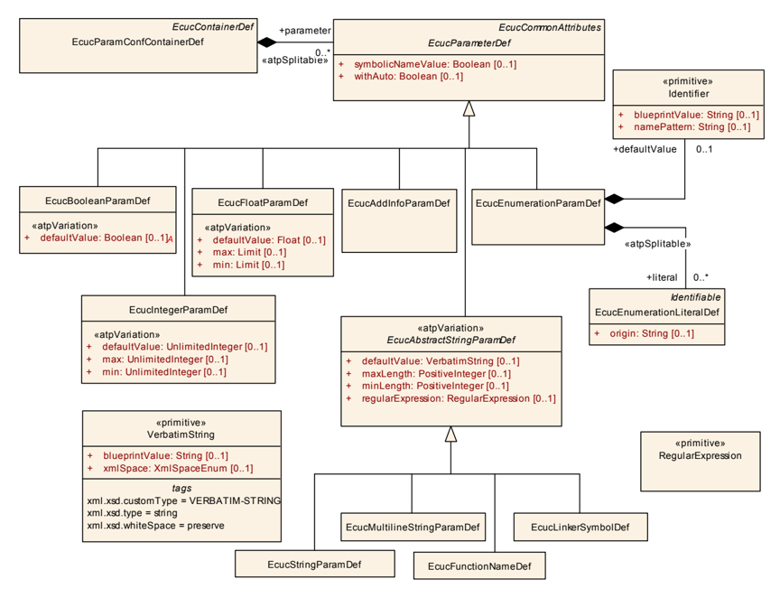

**约束：EcucEnumerationLiteralDef.origin 始终必需**：在 **ECU** 配置参数定义完成时，属性 EcucEnumerationLiteralDef.origin 应始终被定义。

表2.14：EcucParameterDef（**EcucParameterDef**）

| 属性 | 值 |
| --- | --- |
| 类 | EcucParameterDef（抽象） |
| 包 | M2::AUTOSARTemplates::ECUCParameterDefTemplate |
| 说明 | 用于定义作为子类定义的全部 **ECU** 配置参数类型的共性的抽象类。 |
| 基类 | ARObject、AtpDefinition、EcucCommonAttributes、EcucDefinitionElement、Identifiable、MultilanguageReferrable、Referrable |
| 子类 | EcucBooleanParamDef、EcucFloatParamDef、EcucFunctionNameDef、EcucIntegerParamDef、EcucLinkerSymbolDef、EcucMultilineStringParamDef、EcucStringParamDef |
| 聚合于 | EcucDestinationUriPolicy.parameter、EcucParamConfContainerDef.parameter |

| 属性 | 类型 | 多重性 | 种类 | 备注 |
| --- | --- | --- | --- | --- |
| symbolicNameValue | Boolean | 0..1 | attr | 如果为 true，则该参数的取值表示一个符号名（例如 HandleId）。默认值为 false。 |

#### 2.3.5.1. 布尔类型（**Boolean Type**）

**EcucBooleanParamDef 属性（**EcucBooleanParamDef properties**）**：使用 EcucBooleanParamDef 参数可以规定一个布尔取值。此外可以规定 defaultValue。

公式语言中不存在像 true 或 false 这样的文字（**BooleanLiteral**）。如果将 BooleanLiteral 用作变体机制中公式的结果，处理公式的工具必须将 BooleanLiteral 映射为 true → 1 与 false → 0 的整数。

请注意，将布尔参数值或支持 &lt;&lt;atpVariation&gt;&gt; 的属性表示为 true/false 已经需要公式处理器处理 BooleanLiteral true/false。

在 **ECU** 配置值描述一侧，布尔参数值表示为 EcucNumericalParamValue（见[第 2.4.4.2 节](#2442-数值参数值numerical-parameter-value)）。EcucNumericalParamValue 中的属性 value 支持 &lt;&lt;atpVariation&gt;&gt;，因此公式语言也支持 BooleanLiteral true/false。请注意，true 求值为 1，false 求值为 0（更多细节见 [\[4\]](#ref-4)）。

**约束：EcucBooleanParamDef 中可变的默认值（**Variable default value**）**：EcucBooleanParamDef 的属性 defaultValue 受变体机制支配。取值可以使用变体处理机制计算。

表2.15：EcucBooleanParamDef（**EcucBooleanParamDef**）

| 属性 | 值 |
| --- | --- |
| 类 | EcucBooleanParamDef |
| 包 | M2::AUTOSARTemplates::ECUCParameterDefTemplate |
| 说明 | 布尔类型的配置参数类型。允许的取值为 true 与 false。 |
| 基类 | ARObject、AtpDefinition、EcucCommonAttributes、EcucDefinitionElement、EcucParameterDef、Identifiable、MultilanguageReferrable、Referrable |
| 聚合于 | EcucDestinationUriPolicy.parameter、EcucParamConfContainerDef.parameter |

| 属性 | 类型 | 多重性 | 种类 | 备注 |
| --- | --- | --- | --- | --- |
| defaultValue | Boolean | 0..1 | attr | 布尔配置参数的默认取值。atpVariation：[RS_ECUC_00083] 构造型：atpVariation 标签：vh.latestBindingTime=codeGenerationTime |

示例 2.11 展示了 **ECUC** 参数定义 **XML** 文件。对应的 **ECUC** 值描述 **XML** 文件摘录见示例 2.37。

示例2.11：

```
<ECUC-INTEGER-PARAM-DEF>
<SHORT-NAME>PositionInTask</SHORT-NAME>
<DEFAULT-VALUE>0</DEFAULT-VALUE>
<MAX>255</MAX>
<MIN>0</MIN>
</ECUC-INTEGER-PARAM-DEF>
```


#### 2.3.5.2. 整数类型（**Integer Type**）

**EcucIntegerParamDef 属性（**EcucIntegerParamDef properties**）**：使用 EcucIntegerParamDef 参数可以规定一个有符号/无符号整数。借助附加属性 min 与 max，可以限制该参数取值在 **ECU** 配置值描述中的范围<sup>13</sup>。也可以规定 defaultValue。

**约束：EcucIntegerParamDef 中可变的默认值**：EcucIntegerParamDef 的属性 defaultValue 受变体机制支配。取值可以使用变体处理机制计算。

**约束：EcucIntegerParamDef 中可变的 min、max 取值**：EcucIntegerParamDef 的属性 min 与 max 受变体机制支配。取值可以使用变体处理机制计算。

EcucIntegerParamDef 的取值范围有两种用例：有符号与无符号，二者都必须适配 64 位数字空间。

**约束：有符号 EcucIntegerParamDef 取值范围（**Signed value range**）**：如果表示有符号取值，则 min 取值可以低至 -9223372036854775808，max 取值可以高至 9223372036854775807。

**约束：无符号 EcucIntegerParamDef 取值范围（**Unsigned value range**）**：如果表示无符号取值，则 min 取值可以低至 0，max 取值可以高至 18446744073709551615（十六进制 0xFFFFFFFFFFFFFFFF）。

**约束：EcucIntegerParamDef 中的 min 与 max 取值**：max 取值应大于或等于 min 取值，min 取值应小于或等于 max 取值。

**约束：EcucNumericalParamValue 中的 +/- 符号是可选的（**+/- sign optional**）**：如果省略 EcucNumericalParamValue 中可选的 +/- 符号，则假定为「+」。

> 13 min 与 max 取值定义为可选，但在「供应商特定模块定义」中这些取值为强制。

**约束：EcucNumericalParamValue 的取值应无歧义地为整数值**：EcucNumericalParamValue 的取值的规定应使其无歧义地为整数值。特别是 NumericalValueVariationPoint 的结果应产生整数，而非浮点数。

表2.16：EcucIntegerParamDef（**EcucIntegerParamDef**）

| 属性 | 值 |
| --- | --- |
| 类 | EcucIntegerParamDef |
| 包 | M2::AUTOSARTemplates::ECUCParameterDefTemplate |
| 说明 | 整数类型的配置参数类型。 |
| 基类 | ARObject、AtpDefinition、EcucCommonAttributes、EcucDefinitionElement、EcucParameterDef、Identifiable、MultilanguageReferrable、Referrable |
| 聚合于 | EcucDestinationUriPolicy.parameter、EcucParamConfContainerDef.parameter |

| 属性 | 类型 | 多重性 | 种类 | 备注 |
| --- | --- | --- | --- | --- |
| defaultValue | UnlimitedInteger | 0..1 | attr | 整数配置参数的默认取值。atpVariation：[RS_ECUC_00083] 构造型：atpVariation 标签：vh.latestBindingTime=codeGenerationTime |
| max | UnlimitedInteger | 0..1 | attr | 所定义参数允许的最大取值。atpVariation：[RS_ECUC_00084] 构造型：atpVariation 标签：vh.latestBindingTime=codeGenerationTime |
| min | UnlimitedInteger | 0..1 | attr | 所定义参数允许的最小取值。atpVariation：[RS_ECUC_00084] 构造型：atpVariation 标签：vh.latestBindingTime=codeGenerationTime |

示例 2.12 展示了 **ECUC** 参数定义 **XML** 文件。对应的 **ECUC** 值描述 **XML** 文件摘录见示例 2.38。

示例2.12：

```
 <ECUC-INTEGER-PARAM-DEF>
<SHORT-NAME>PositionInTask</SHORT-NAME>
<DEFAULT-VALUE>0</DEFAULT-VALUE>
<MAX>255</MAX>
<MIN>0</MIN>  </ECUC-INTEGER-PARAM-DEF>
```


#### 2.3.5.3. 浮点类型（**Float Type**）

**EcucFloatParamDef 属性（**EcucFloatParamDef properties**）**：为了能够规定带浮点取值的参数，可以使用 EcucFloatParamDef。附加属性 min、max 与 defaultValue 也可以规定<sup>14</sup>。

**约束：EcucFloatParamDef 中可变的默认值**：EcucFloatParamDef 的属性 defaultValue 受变体机制支配。取值可以使用变体处理机制计算。

**约束：EcucFloatParamDef 中可变的 min、max 取值**：EcucFloatParamDef 的属性 min 与 max 受变体机制支配。取值可以使用变体处理机制计算。

**约束：EcucFloatParamDef 中的 min 与 max 取值**：max 取值应大于或等于 min 取值，min 取值应小于或等于 max 取值。

**约束：特殊浮点取值（**Special float values**）**：特殊浮点取值「Not a Number」与正/负「infinity」的表示应为：

- NaN
- INF
- -INF

**约束：INF 与 -INF 允许作为 EcucFloatParamDef 的 defaultValue**：特殊浮点取值 INF 与 -INF 允许被规定为 EcucFloatParamDef 的 defaultValue。

**约束：EcucFloatParamDef 的表示（**Representation**）**：对于表示，使用 IEEE 754-1985 标准 [\[9\]](#ref-9) 的 IEEE 双精度 64 位浮点。

存在于不支持 64 位的目标 **ECU** 上的浮点取值必须转换为该目标的 float 32 中最接近该取值的近似值。在 **AUTOSAR XML** 中，取值应保持 64 位表示。

> 14 min 与 max 取值定义为可选，但在「供应商特定模块定义」中这些取值为强制。

表2.17：EcucFloatParamDef（**EcucFloatParamDef**）

| 属性 | 值 |
| --- | --- |
| 类 | EcucFloatParamDef |
| 包 | M2::AUTOSARTemplates::ECUCParameterDefTemplate |
| 说明 | 浮点类型的配置参数类型。 |
| 基类 | ARObject、AtpDefinition、EcucCommonAttributes、EcucDefinitionElement、EcucParameterDef、Identifiable、MultilanguageReferrable、Referrable |
| 聚合于 | EcucDestinationUriPolicy.parameter、EcucParamConfContainerDef.parameter |

| 属性 | 类型 | 多重性 | 种类 | 备注 |
| --- | --- | --- | --- | --- |
| defaultValue | Float | 0..1 | attr | 浮点配置参数的默认取值。atpVariation：[RS_ECUC_00083] 构造型：atpVariation 标签：vh.latestBindingTime=codeGenerationTime |
| max | Limit | 0..1 | attr | 所定义参数允许的最大取值。atpVariation：[RS_ECUC_00084] 构造型：atpVariation 标签：vh.latestBindingTime=codeGenerationTime |
| min | Limit | 0..1 | attr | 所定义参数允许的最小取值。atpVariation：[RS_ECUC_00084] 构造型：atpVariation 标签：vh.latestBindingTime=codeGenerationTime |

**约束：未定义属性 EcucFloatParamDef.min.intervalType**：如果属性 min.intervalType 未定义，则对 EcucFloatParamDef.min 隐式假设一个闭区间。

**约束：未定义属性 EcucFloatParamDef.max.intervalType**：如果属性 max.intervalType 未定义，则对 EcucFloatParamDef.max 隐式假设一个闭区间。

**约束：EcucFloatParamDef.min 与 EcucFloatParamDef.max 的区间类型定义（**Definition of interval type**）**：属性 EcucFloatParamDef.min 与 EcucFloatParamDef.max 用于定义相应 EcucFloatParamDef 的可用区间。区间本身在两端都可以定义为以下之一：

- 闭（**closed**）：提供的取值包含在区间内。这通过将属性 min.intervalType（相应地 max.intervalType）设置为 IntervalTypeEnum.closed 来表达。
  - min.intervalType = closed 在 **SWS**（章：「配置规范」）中通过在区间前加「[」表示。
  - max.intervalType = closed 在 **SWS**（章：「配置规范」）中通过在区间后加「]」表示。
  - 示例：Range: [0,1] =（min.intervalType = closed / max.intervalType = closed）表示范围应为（&gt;=0 且 &lt;=1）。
- 开（**open**）：提供的取值不包含在区间内。这通过将属性 min.intervalType（相应地 max.intervalType）设置为 IntervalTypeEnum.open 来表达。
  - min.intervalType = open 在 **SWS**（章：「配置规范」）中通过在区间前加「]」表示。
  - max.intervalType = open 在 **SWS**（章：「配置规范」）中通过在区间后加「[」表示。
  - 示例：Range: ]0,1[ =（min.intervalType = open / max.intervalType = open）表示范围应为（&gt;0 且 &lt;1）。

示例 2.13 展示了 **ECUC** 参数定义 **XML** 文件。对应的 **ECUC** 值描述 **XML** 文件摘录见示例 2.39。

示例2.13：

```
 <ECUC-FLOAT-PARAM-DEF>
<SHORT-NAME>SchedulingPeriod</SHORT-NAME>
<ORIGIN>AUTOSAR_ECUC</ORIGIN>
<DEFAULT-VALUE>NaN</DEFAULT-VALUE>
<MAX INTERVAL-TYPE="CLOSED"> 80 </MAX>
<MIN INTERVAL-TYPE="OPEN"> 0 </MIN>  </ECUC-FLOAT-PARAM-DEF>
```


#### 2.3.5.4. 字符串参数（**String Parameter**）

**EcucAbstractStringParamDef 的子类（**Subclasses**）**：类 EcucAbstractStringParamDef 的子类提供了在 **ECUC** 值描述中规定字符串的手段。此外可以提供可选的 defaultValue。

**约束：EcucAbstractStringParamDef 中可变的默认值**：EcucAbstractStringParamDef 及其子类的属性 defaultValue 受变体机制支配。取值可以使用变体处理机制计算。

**约束：正则表达式（**Regular expression**）**：正则表达式依照通用结构模板 [\[4\]](#ref-4) 提供。

表2.18：EcucAbstractStringParamDef（**EcucAbstractStringParamDef**）

| 属性 | 值 |
| --- | --- |
| 类 | &lt;&lt;atpVariation&gt;&gt; EcucAbstractStringParamDef（抽象） |
| 包 | M2::AUTOSARTemplates::ECUCParameterDefTemplate |
| 说明 | 用于收集 StringParamDef、LinkerSymbolDef、FunctionNameDef 与 MultilineStringParamDef 公共属性的抽象类。atpVariation：[RS_ECUC_00083] 标签：vh.latestBindingTime=codeGenerationTime |
| 基类 | ARObject、AtpDefinition、EcucCommonAttributes、EcucDefinitionElement、EcucParameterDef、Identifiable、MultilanguageReferrable、Referrable |
| 子类 | EcucFunctionNameDef、EcucLinkerSymbolDef、EcucMultilineStringParamDef、EcucStringParamDef |
| 聚合于 | EcucDestinationUriPolicy.parameter、EcucParamConfContainerDef.parameter |

| 属性 | 类型 | 多重性 | 种类 | 备注 |
| --- | --- | --- | --- | --- |
| defaultValue | VerbatimString | 0..1 | attr | 字符串配置参数的默认取值。 |
| maxLength | PositiveInteger | 0..1 | attr | 该字符串允许的最大长度。 |
| minLength | PositiveInteger | 0..1 | attr | 该字符串允许的最小长度。 |
| regularExpression | RegularExpression | 0..1 | attr | 这表示应用于校验字符串参数取值的正则表达式。 |

表2.19：EcucStringParamDef（**EcucStringParamDef**）

| 属性 | 值 |
| --- | --- |
| 类 | &lt;&lt;atpVariation&gt;&gt; EcucStringParamDef |
| 包 | M2::AUTOSARTemplates::ECUCParameterDefTemplate |
| 说明 | 字符串类型的配置参数类型。 |
| 基类 | ARObject、AtpDefinition、EcucAbstractStringParamDef、EcucCommonAttributes、EcucDefinitionElement、EcucParameterDef、Identifiable、MultilanguageReferrable、Referrable |
| 聚合于 | EcucDestinationUriPolicy.parameter、EcucParamConfContainerDef.parameter |

| 属性 | 类型 | 多重性 | 种类 | 备注 |
| --- | --- | --- | --- | --- |
| - | - | - | - | - |

表2.20：EcucMultilineStringParamDef（**EcucMultilineStringParamDef**）

| 属性 | 值 |
| --- | --- |
| 类 | &lt;&lt;atpVariation&gt;&gt; EcucMultilineStringParamDef |
| 包 | M2::AUTOSARTemplates::ECUCParameterDefTemplate |
| 说明 | 多行字符串（包括「回车」）的配置参数类型。 |
| 基类 | ARObject、AtpDefinition、EcucAbstractStringParamDef、EcucCommonAttributes、EcucDefinitionElement、EcucParameterDef、Identifiable、MultilanguageReferrable、Referrable |
| 聚合于 | EcucDestinationUriPolicy.parameter、EcucParamConfContainerDef.parameter |

| 属性 | 类型 | 多重性 | 种类 | 备注 |
| --- | --- | --- | --- | --- |
| - | - | - | - | - |

#### 2.3.5.5. 链接器符号参数（**Linker Symbol Parameter**）

**EcucLinkerSymbolDef 属性（**EcucLinkerSymbolDef properties**）**：当参数表示已配置软件中的一个链接器符号时，应使用 EcucLinkerSymbolDef。所定义符号的实际取值由实现软件规定，不属于配置的对象。

**约束：编程语言标识符的限制（**Programming language identifier limitations**）**：EcucLinkerSymbolDef 及其子类的 defaultValue 与取值的限制是通用的编程语言标识符限制：以一个字母或特殊字符（sc）开头，后跟大小写字母、数字与特殊字符：

#### 2.3.5.6. 函数名参数（**Function Name Parameter**）

**EcucFunctionNameDef 属性（**EcucFunctionNameDef properties**）**：当参数表示已配置软件中的一个函数名时，应使用 EcucFunctionNameDef。借助这一特性可以规定函数（例如回调）。类 EcucFunctionNameDef 不引入任何附加属性。

表2.21：EcucLinkerSymbolDef（**EcucLinkerSymbolDef**）

| 属性 | 值 |
| --- | --- |
| 类 | &lt;&lt;atpVariation&gt;&gt; EcucLinkerSymbolDef |
| 包 | M2::AUTOSARTemplates::ECUCParameterDefTemplate |
| 说明 | 链接器符号的配置参数类型，例如硬件寄存器的地址。 |
| 基类 | ARObject、AtpDefinition、EcucAbstractStringParamDef、EcucCommonAttributes、EcucDefinitionElement、EcucParameterDef、Identifiable、MultilanguageReferrable、Referrable |
| 聚合于 | EcucDestinationUriPolicy.parameter、EcucParamConfContainerDef.parameter |

| 属性 | 类型 | 多重性 | 种类 | 备注 |
| --- | --- | --- | --- | --- |
| - | - | - | - | - |

表2.22：EcucFunctionNameDef（**EcucFunctionNameDef**）

| 属性 | 值 |
| --- | --- |
| 类 | &lt;&lt;atpVariation&gt;&gt; EcucFunctionNameDef |
| 包 | M2::AUTOSARTemplates::ECUCParameterDefTemplate |
| 说明 | 函数名（例如用于规定回调函数的那些）的配置参数类型。 |
| 基类 | ARObject、AtpDefinition、EcucAbstractStringParamDef、EcucCommonAttributes、EcucDefinitionElement、EcucParameterDef、Identifiable、MultilanguageReferrable、Referrable |
| 聚合于 | EcucDestinationUriPolicy.parameter、EcucParamConfContainerDef.parameter |

| 属性 | 类型 | 多重性 | 种类 | 备注 |
| --- | --- | --- | --- | --- |
| - | - | - | - | - |

示例 2.15 展示了 **ECUC** 参数定义 **XML** 文件。对应的 **ECUC** 值描述 **XML** 文件摘录见示例 2.35。

示例2.15：

```
<ECUC-FUNCTION-NAME-DEF>
<SHORT-NAME>EepJobEndNotification</SHORT-NAME>
<ECUC-FUNCTION-NAME-DEF-VARIANTS>
<ECUC-FUNCTION-NAME-DEF-CONDITIONAL>
<DEFAULT-VALUE>Eep_JobEndNotification </ECUC-FUNCTION-NAME-DEF-CONDITIONAL>
</ECUC-FUNCTION-NAME-DEF-VARIANTS>
</ECUC-FUNCTION-NAME-DEF>
</DEFAULT-VALUE>
```

**注意：** 该示例在源文档的 markdown 转换中转义为单行且标签边界损坏（DEFAULT-VALUE 的闭合标签出现在了错误位置）；按可恢复的片段保留。


**约束：EcucFunctionNameDef 应表示一个有效的 C 标识符（**valid C Identifier**）**：EcucFunctionNameDef 的 defaultValue 与取值应遵循 CIdentifier 上下文中定义的模式 [a-zA-Z_][a-zA-Z0-9_]*。

#### 2.3.5.7. 枚举参数（**Enumeration Parameter**）

**EcucEnumerationParamDef 属性（**EcucEnumerationParamDef properties**）**：当参数可以是若干可能性之一时，应使用 EcucEnumerationParamDef。它定义将保存实际取值的参数，也可以定义该枚举的 defaultValue。

目前不支持为枚举规定可变的默认取值。

表2.23：EcucEnumerationParamDef（**EcucEnumerationParamDef**）

| 属性 | 值 |
| --- | --- |
| 类 | EcucEnumerationParamDef |
| 包 | M2::AUTOSARTemplates::ECUCParameterDefTemplate |
| 说明 | 枚举类型的配置参数类型。 |
| 基类 | ARObject、AtpDefinition、EcucCommonAttributes、EcucDefinitionElement、EcucParameterDef、Identifiable、MultilanguageReferrable、Referrable |
| 聚合于 | EcucDestinationUriPolicy.parameter、EcucParamConfContainerDef.parameter |

| 属性 | 类型 | 多重性 | 种类 | 备注 |
| --- | --- | --- | --- | --- |
| defaultValue | Identifier | 0..1 | attr | 枚举配置参数的默认取值。该字符串需要是为此枚举规定的字面量之一。 |
| literal | EcucEnumerationLiteralDef | * | aggr | 对用于定义该枚举参数的字面量的聚合。若外围 EcucModuleDef 的 category 为 STANDARDIZED_MODULE_DEFINITION，则该聚合为可选。若 EcucModuleDef 的 category 属性设置为 VENDOR_SPECIFIC_MODULE_DEFINITION，则该聚合为强制。构造型：atpSplitable 标签：atp.Splitkey=literal.shortName |

#### 2.3.5.8. 枚举字面量定义（**Enumeration Literal Definition**）

**约束：EcucEnumerationLiteralDef 的属性（**Properties**）**：EcucEnumerationLiteralDef 类用于规定枚举配置参数的单个字面量。 EcucEnumerationLiteralDef 的 defaultValue 与取值遵循 CIdentifier 上下文中定义的模式 [a-zA-Z_][a-zA-Z0-9_]*。

表2.24：EcucEnumerationLiteralDef（**EcucEnumerationLiteralDef**）

| 属性 | 值 |
| --- | --- |
| 类 | EcucEnumerationLiteralDef |
| 包 | M2::AUTOSARTemplates::ECUCParameterDefTemplate |
| 说明 | 用于定义 EcucEnumerationParamDef 字面量的类。 |
| 基类 | ARObject、AtpDefinition、Identifiable、MultilanguageReferrable、Referrable |
| 聚合于 | EcucEnumerationParamDef.literal |

| 属性 | 类型 | 多重性 | 种类 | 备注 |
| --- | --- | --- | --- | --- |
| origin | String | 0..1 | attr | 规定该枚举字面量是 **AUTOSAR** 标准化配置参数，还是该字面量是硬件或供应商特定的字符串。 |

示例 2.16 展示了 **ECUC** 参数定义 **XML** 文件。

示例2.16：

```
 <ECUC-ENUMERATION-PARAM-DEF>
<SHORT-NAME>RteGenerationMode</SHORT-NAME>
<LITERALS>
<ECUC-ENUMERATION-LITERAL-DEF>
<SHORT-NAME>CompatibilityMode</SHORT-NAME>
<LONG-NAME>
<L-4 L="EN"> Generate in Compatibility Mode </L-4>
</LONG-NAME>
</ECUC-ENUMERATION-LITERAL-DEF>
<ECUC-ENUMERATION-LITERAL-DEF>
<SHORT-NAME>VendorMode</SHORT-NAME>
<LONG-NAME>
<L-4 L="EN"> Generate in Vendor Mode </L-4>
</LONG-NAME>
</ECUC-ENUMERATION-LITERAL-DEF>
</LITERALS>  </ECUC-ENUMERATION-PARAM-DEF>
```


#### 2.3.5.9. AddInfo

**EcucAddInfoParamDef 类（**EcucAddInfoParamDef class**）**：附加信息（**AddInfo**）用于向配置参数添加与工具相关的补充信息。这样的信息由工具定义，在 **AUTOSAR** 模式的意义上不是「标准的」；然而，存在一些约定（**conventions**）以确保此类信息的通用处理，见下表。

表2.25：EcucAddInfoParamDef（**EcucAddInfoParamDef**）

| 属性 | 值 |
| --- | --- |
| 类 | EcucAddInfoParamDef |
| 包 | M2::AUTOSARTemplates::ECUCParameterDefTemplate |
| 说明 | 该类可由工具用于向 EcucParamConfContainerDef 添加工具特定的信息。 |
| 基类 | ARObject、AtpDefinition、EcucCommonAttributes、EcucDefinitionElement、EcucParameterDef、Identifiable、MultilanguageReferrable、Referrable |
| 聚合于 | EcucDestinationUriPolicy.parameter、EcucParamConfContainerDef.parameter |

| 属性 | 类型 | 多重性 | 种类 | 备注 |
| --- | --- | --- | --- | --- |
| definitionRef | Identifier | 1 | ref | 这是对 EcucAddInfoDef 的引用，EcucAddInfoDef 规定由此 EcucAddInfoParamDef 参数定义的参数。 |

**约束：definitionRef 的语义（**Semantics of definitionRef**）**：与所有其他 EcucParameterDef 类型相对，EcucAddInfoParamDef 类未在 EcucParamConfContainerDef 的上下文中定义参数的语义。因此，为了能够理解 AddInfo 的含义，每个 EcucAddInfoParamDef 都经由 definitionRef 引用一个 EcucAddInfoDef 元素，EcucAddInfoDef 在其 description 字段中定义该参数的语义。

示例2.17：

```
<ECUC-ADD-INFO-PARAM-DEF>
<SHORT-NAME>DiagnosticTesterMessage</SHORT-NAME>
</ECUC-ADD-INFO-PARAM-DEF>
```


### 2.3.6. 参数定义中的引用（**References in Parameter Definition**）

对于引用其他实体的配置参数的定义，有五种引用可用：

- 对 **ECU** 配置值描述内其他配置容器的引用（见[第 2.3.6.1 节](#2361-引用reference)）。
- 可以规定被引用配置容器中的一个选项，**ECU** 配置值描述可以（在受限的条件下）自由选择引用指向的目标类型（见[第 2.3.6.2 节](#2362-选项引用choice-reference)）。
- 当实体已在另一个 **AUTOSAR** 模板中规定时，可以引用 **ECU** 配置值描述之外的实体（见[第 2.3.6.3 节](#2363-外部引用foreign-reference)）。
- 可以使用通用结构模板 [\[4\]](#ref-4) 中定义的 instanceRef 语义引用 **ECU** 配置值描述之外的实体（见[第 2.3.6.4 节](#2364-实例引用instance-reference)）。
- 对经由 destinationUri 规定的目标的引用（见[第 2.3.6.6 节](#2366-uri-引用uri-reference)）。

这些引用的元模型如图 2.11 所示。

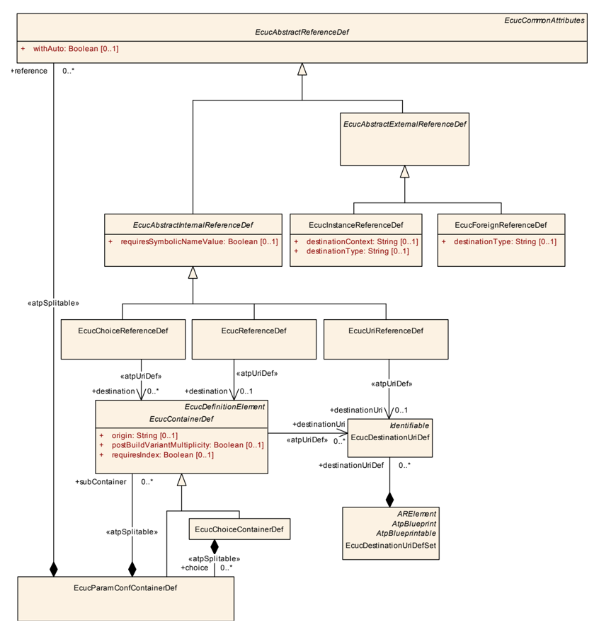

**约束：EcucInstanceReferenceDef.destinationContext 始终必需**：在 **ECU** 配置参数定义完成时，属性 EcucInstanceReferenceDef.destinationContext 应始终被定义。

**约束：EcucInstanceReferenceDef.destinationType 始终必需**：在 **ECU** 配置参数定义完成时，属性 EcucInstanceReferenceDef.destinationType 应始终被定义。

**约束：EcucForeignReferenceDef.destinationType 始终必需**：在 **ECU** 配置参数定义完成时，属性 EcucForeignReferenceDef.destinationType 应始终被定义。

**约束：EcucReferenceDef.destination 始终必需**：在 **ECU** 配置参数定义完成时，属性 EcucReferenceDef.destination 应始终被定义。

**约束：EcucUriReferenceDef.destinationUri 始终必需**：在 **ECU** 配置参数定义完成时，属性 EcucUriReferenceDef.destinationUri 应始终被定义。

**约束：EcucDestinationUriDefSet.destinationUriDef 始终必需**：在 **ECU** 配置参数定义完成时，属性 EcucDestinationUriDefSet.destinationUriDef 应始终被定义。

**约束：EcucAbstractReferenceDef 属性（**EcucAbstractReferenceDef properties**）**：抽象类 EcucAbstractReferenceDef 用于规定全部引用定义的公共部分。EcucAbstractReferenceDef 是一个 Identifiable，因此必须为每个引用定义命名。EcucAbstractReferenceDef 还继承自 EcucDefinitionElement，因此可以为每个引用定义规定：在后续的 **ECU** 配置值描述中，同一个配置容器内可以存在多少个这样的引用。

表2.26：EcucAbstractReferenceDef（**EcucAbstractReferenceDef**）

| 属性 | 值 |
| --- | --- |
| 类 | EcucAbstractReferenceDef（抽象） |
| 包 | M2::AUTOSARTemplates::ECUCParameterDefTemplate |
| 说明 | 用于收集引用定义属性的公共类。 |
| 基类 | ARObject、AtpDefinition、EcucCommonAttributes、EcucDefinitionElement、Identifiable、MultilanguageReferrable、Referrable |
| 子类 | EcucAbstractExternalReferenceDef、EcucAbstractInternalReferenceDef |
| 聚合于 | EcucDestinationUriPolicy.reference、EcucParamConfContainerDef.reference |

| 属性 | 类型 | 多重性 | 种类 | 备注 |
| --- | --- | --- | --- | --- |
| withAuto | Boolean | 0..1 | attr | 规定在取值一侧是否应允许将此引用取值规定为「AUTO」。如果 withAuto 为「true」，则应可以把相应引用的「isAutoValue」属性设置为「true」。这意味着该实际取值在 **ECU** 配置期间不被考虑，而是由代码生成器（重新）计算并随后存储在 value 属性中。这些隐式更新的取值可能需要对引用这些取值的其他模块进行重新生成。如果 withAuto 为「false」，则不应可以把相应引用的「isAutoValue」属性设置为「true」。若 withAuto 不存在，默认为「false」。 |

表2.27：EcucAbstractInternalReferenceDef（**EcucAbstractInternalReferenceDef**）

| 属性 | 值 |
| --- | --- |
| 类 | EcucAbstractInternalReferenceDef（抽象） |
| 包 | M2::AUTOSARTemplates::ECUCParameterDefTemplate |
| 说明 | 用于收集内部引用（其目标位于 **Ecu** 配置描述内）属性的公共抽象类。 |
| 基类 | ARObject、AtpDefinition、EcucAbstractReferenceDef、EcucCommonAttributes、EcucDefinitionElement、Identifiable、MultilanguageReferrable、Referrable |
| 子类 | EcucChoiceReferenceDef、EcucReferenceDef、EcucUriReferenceDef |
| 聚合于 | EcucDestinationUriPolicy.reference、EcucParamConfContainerDef.reference |

| 属性 | 类型 | 多重性 | 种类 | 备注 |
| --- | --- | --- | --- | --- |
| requiresSymbolicNameValue | Boolean | 0..1 | attr | 如果该属性设置为 true，则该引用的实现使用由被引用容器依照 TPS_ECUC_02108 定义的符号名完成。 |

表2.28：EcucAbstractExternalReferenceDef（**EcucAbstractExternalReferenceDef**）

| 属性 | 值 |
| --- | --- |
| 类 | EcucAbstractExternalReferenceDef（抽象） |
| 包 | M2::AUTOSARTemplates::ECUCParameterDefTemplate |
| 说明 | 用于收集外部引用（其目标不位于 **ECU** 配置描述内，而在另一个 **AUTOSAR** 模板中）属性的公共抽象类。 |
| 基类 | ARObject、AtpDefinition、EcucAbstractReferenceDef、EcucCommonAttributes、EcucDefinitionElement、Identifiable、MultilanguageReferrable、Referrable |
| 子类 | EcucForeignReferenceDef、EcucInstanceReferenceDef |
| 聚合于 | EcucDestinationUriPolicy.reference、EcucParamConfContainerDef.reference |

| 属性 | 类型 | 多重性 | 种类 | 备注 |
| --- | --- | --- | --- | --- |
| - | - | - | - | - |

#### 2.3.6.1. 引用（**Reference**）

**约束：容器之间的引用经由 EcucReferenceDef 建立（**established with the EcucReferenceDef**）**：EcucReferenceDef 用于建立从 **ECU** 配置值描述内的一个 EcucParamConfContainerDef 到另一个特定 EcucParamConfContainerDef 或 EcucChoiceContainerDef 的引用。为此，必须使用一个表示该引用的对象。

**约束：EcucReferenceDef 与 EcucChoiceReferenceDef 的目标是 EcucContainerDef（**Destination**）**：EcucReferenceDef 与 EcucChoiceReferenceDef 的目标都是 EcucContainerDef。因此，无法引用特定的 EcucParameterDef、EcucReferenceDef 或 EcucModuleDef。

其原因是不存在需要直接引用参数的用例。

表2.29：EcucReferenceDef（**EcucReferenceDef**）

| 属性 | 值 |
| --- | --- |
| 类 | EcucReferenceDef |
| 包 | M2::AUTOSARTemplates::ECUCParameterDefTemplate |
| 说明 | 规定 **ECU** 配置描述内参数容器之间的引用。 |
| 基类 | ARObject、AtpDefinition、EcucAbstractInternalReferenceDef、EcucAbstractReferenceDef、EcucCommonAttributes、EcucDefinitionElement、Identifiable、MultilanguageReferrable、Referrable |
| 聚合于 | EcucDestinationUriPolicy.reference、EcucParamConfContainerDef.reference |

| 属性 | 类型 | 多重性 | 种类 | 备注 |
| --- | --- | --- | --- | --- |
| destination | EcucContainerDef | 0..1 | ref | 作为目标，恰好允许一个对参数容器的引用。构造型：atpUriDef |

EcucReferenceDef 处的角色名必须是 reference，被引用容器处的角色名必须是 destination（示例见图 2.12）。

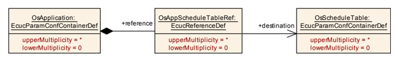

在图 2.12 的示例中，「OsApplication」被定义为包含对「OsScheduleTable」的引用。这些引用名为「OsAppScheduleTableRef」，在实际的 **ECU** 配置值描述文档中可以有若干这样的引用。对于引用的多重性，EcucReferenceDef 上的多重性定义是相关的（在该示例中 lowerMultiplicity 为「0」，upperMultiplicity 为「*」）。被引用容器的多重性对引用不予考虑。

在 **ECU** 配置参数定义 **XML** 文件中，目标必须被无歧义地标识，因为配置参数的名称并不要求在整个 **ECU** 配置参数定义内唯一。因此 **CAN** 驱动程序中定义的某个参数可能与 **ADC** 驱动程序中定义的某个参数同名。为此，被引用配置参数的包含层次结构必须在定义 **XML** 文件中标注，如示例 2.18 所示。在该示例中，被引用的参数将直接在 AUTOSARParameterDefinition 中的 Os 模块定义中找到。对应的 **ECUC** 值描述 **XML** 文件摘录见示例 2.41。

示例2.18：

```
<ECUC-REFERENCE-DEF>
<SHORT-NAME>OsAppScheduleTableRef</SHORT-NAME>
<DESTINATION-REF DEST="ECUC-PARAM-CONF-CONTAINER-DEF"> /AUTOSAR/ EcucDefs/Os/OsScheduleTable </DESTINATION-REF>
</ECUC-REFERENCE-DEF>
```


#### 2.3.6.2. 选项引用（**Choice Reference**）

**EcucChoiceReferenceDef 属性（**EcucChoiceReferenceDef properties**）**：借助 EcucChoiceReferenceDef，可以定义一个目标被规定为若干可能种类之一的引用。为了能够定义这样的选项，必须在容器中聚合一个 EcucChoiceReferenceDef 类的对象，该对象处的角色名为 reference。EcucChoiceReferenceDef 的 destination 可以是 EcucParamConfContainerDef 与 EcucChoiceContainerDef。

表2.30：EcucChoiceReferenceDef（**EcucChoiceReferenceDef**）

| 属性 | 值 |
| --- | --- |
| 类 | EcucChoiceReferenceDef |
| 包 | M2::AUTOSARTemplates::ECUCParameterDefTemplate |
| 说明 | 规定备选引用，其中在 **ECU** 配置描述中只有规定的引用之一会被实际使用。 |
| 基类 | ARObject、AtpDefinition、EcucAbstractInternalReferenceDef、EcucAbstractReferenceDef、EcucCommonAttributes、EcucDefinitionElement、Identifiable、MultilanguageReferrable、Referrable |
| 聚合于 | EcucDestinationUriPolicy.reference、EcucParamConfContainerDef.reference |

| 属性 | 类型 | 多重性 | 种类 | 备注 |
| --- | --- | --- | --- | --- |
| destination | EcucContainerDef | * | ref | 规定该引用全部可能的参数容器。构造型：atpUriDef |

全部可用的选项经由在被引用对象处角色名为 destination 的关联连接（示例见图 2.13）。

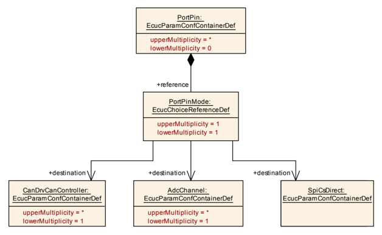

在该示例中，「PortPinMode」容器的一个实际实例可以引用三个已定义容器之一。同样，多重性由 EcucChoiceReferenceDef 定义（此处 lower 与 upper 均为默认值「1」），被引用容器的多重性对选项引用不相关。

同样，目标需要在 **ECU** 配置参数定义 **XML** 文件中无歧义地定义，如示例 2.19 所示。对应的 **ECUC** 值描述 **XML** 文件摘录见示例 2.42。

示例2.19：

```
<ECUC-CHOICE-REFERENCE-DEF>
<SHORT-NAME>PortPinMode</SHORT-NAME>
<DESTINATION-REFS>
<DESTINATION-REF DEST="ECUC-PARAM-CONF-CONTAINER-DEF"> /AUTOSAR/EcucDefs /Can/CanConfigSet </DESTINATION-REF>
<DESTINATION-REF DEST="ECUC-PARAM-CONF-CONTAINER-DEF"> /AUTOSAR/EcucDefs /Adc/AdcConfigSet </DESTINATION-REF>
<DESTINATION-REF DEST="ECUC-PARAM-CONF-CONTAINER-DEF"> /AUTOSAR/EcucDefs /Spi/SpiCsDirect </DESTINATION-REF>
</DESTINATION-REFS>
</ECUC-CHOICE-REFERENCE-DEF>
```

在 **ECU** 配置值描述中将执行实际的选择，届时将只剩一个引用目标<sup>15</sup>。

#### 2.3.6.3. 外部引用（**Foreign Reference**）

**EcucForeignReferenceDef 属性（**EcucForeignReferenceDef properties**）**：为了能够引用其他 **AUTOSAR** 模板的描述，使用参数定义 EcucForeignReferenceDef。借助属性 destinationType，必须规定被引用实体的类型。

表2.31：EcucForeignReferenceDef（**EcucForeignReferenceDef**）

| 属性 | 值 |
| --- | --- |
| 类 | EcucForeignReferenceDef |
| 包 | M2::AUTOSARTemplates::ECUCParameterDefTemplate |
| 说明 | 规定对在另一个 **AUTOSAR** 模板中描述的实体的 **XML** 描述的引用。 |
| 基类 | ARObject、AtpDefinition、EcucAbstractExternalReferenceDef、EcucAbstractReferenceDef、EcucCommonAttributes、EcucDefinitionElement、Identifiable、MultilanguageReferrable、Referrable |
| 聚合于 | EcucDestinationUriPolicy.reference、EcucParamConfContainerDef.reference |

| 属性 | 类型 | 多重性 | 种类 | 备注 |
| --- | --- | --- | --- | --- |
| destinationType | String | 0..1 | attr | 该引用允许指向的实例所属的 **AUTOSAR** 元模型中的类型。 |

**约束：EcucForeignReferenceDef 中 destinationType 的规定（**Specification of the destinationType**）**：由于 **AUTOSAR** 模式生成规则要求全部 Referrable 的类名在 **AUTOSAR** 「M2::AUTOSAR Templates」元模型内唯一，因此在 destinationType 中只提供被引用类的实际类名即可，如示例 2.20 所示。

> 15 EcucDefinitionElement 用于规定每个引用在后续 **ECU** 配置描述中的可能出现次数。EcucChoiceReferenceDef 为一个引用规定多个可能的目标，但在后续的 **ECU** 配置值描述中只能恰好描述一个目标。因此，多目标的自由性只在引用的定义侧可用；如果需要引用多个容器，则必须将 EcucDefinitionElement 设置为大于 1，即使对 EcucChoiceReferenceDef 也是如此。

**约束：EcucForeignReferenceDef 中 destinationType 格式的规定（**destinationType format**）**：作为 destinationType 输入的字符串应为元模型 [\[8\]](#ref-8) 中「M2::AUTOSAR Templates」下定义的一个 M2 类的名称——正如它在 **XML-Schema** [\[10\]](#ref-10) 中的表示——并且被引用的类需要（直接或间接）派生自 Referrable。在生成的参数定义 **XML** 文件 [\[7\]](#ref-7) 中应使用 **XML-Schema** 名称。

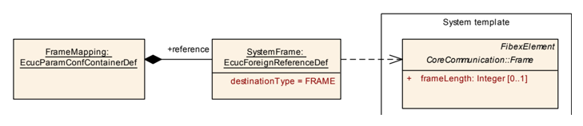

在图 2.14 的示例中，引用被定义为指向一个 Frame 的描述。Frame 定义在系统模板元模型 [\[1\]](#ref-1) 中，并且派生自 Identifiable（它是 Referrable 的子类）。对应的 **ECUC** 值描述 **XML** 文件摘录见示例 2.43。

示例2.20：

```
- <ECUC-FOREIGN-REFERENCE-DEF>
<SHORT-NAME>SystemFrame</SHORT-NAME>
<DESTINATION-TYPE>FRAME</DESTINATION-TYPE>
</ECUC-FOREIGN-REFERENCE-DEF>
```


#### 2.3.6.4. 实例引用（**Instance Reference**）

**EcucInstanceReferenceDef 属性（**EcucInstanceReferenceDef properties**）**：为了能够以 instanceRef 语义<sup>16</sup>引用其他 **AUTOSAR** 模板的描述，使用参数定义 EcucInstanceReferenceDef。借助属性 destinationType，必须规定被引用实体的类型。借助属性 destinationContext，必须规定上下文表达式。

**约束：EcucInstanceReferenceDef 中 destinationType 的规定（**Specification of the destinationType**）**：作为 destinationType 输入的字符串应为元模型 [\[8\]](#ref-8) 中「M2::AUTOSAR Templates」下定义的一个 M2 类的名称——正如它在 **XML-Schema** [\[10\]](#ref-10) 中的表示——并且被引用的类需要（直接或间接）派生自 Referrable。在生成的参数定义 **XML** 文件 [\[7\]](#ref-7) 中应使用 **XML-Schema** 名称。

> 16 关于 instanceRef 概念的详细描述请参见通用结构模板 [\[4\]](#ref-4)。

**约束：EcucInstanceReferenceDef 中 destinationContext 的规定（**Specification of the destinationContext**）**：作为 destinationContext 输入的字符串应为元模型 [\[8\]](#ref-8) 中「M2::AUTOSAR Templates」下定义的一个 M2 类名称的有序列表——正如它们在 **XML** 模式 [\[10\]](#ref-10) 中的表示——由空格（**SPACE**）字符分隔。此外，「*」字符可用于指示「*」字符之前的 M2 类的零次或多次出现。

destinationContext 表达式的示例：

SW-COMPONENT-PROTOTYPE R-PORT-PROTOTYPE

ROOT-SW-COMPOSITION-PROTOTYPE SW-COMPONENT-PROTOTYPE PORT-PROTOTYPE

ROOT-SW-COMPOSITION-PROTOTYPE SW-COMPONENT-PROTOTYPE PORT-PROTOTYPE DATA-PROTOTYPE*

表2.32：EcucInstanceReferenceDef（**EcucInstanceReferenceDef**）

| 属性 | 值 |
| --- | --- |
| 类 | EcucInstanceReferenceDef |
| 包 | M2::AUTOSARTemplates::ECUCParameterDefTemplate |
| 说明 | 使用 INSTANCE REFERENCE 语义规定对在另一个 **AUTOSAR** 模板中描述的实体的 **XML** 描述的引用。 |
| 基类 | ARObject、AtpDefinition、EcucAbstractExternalReferenceDef、EcucAbstractReferenceDef、EcucCommonAttributes、EcucDefinitionElement、Identifiable、MultilanguageReferrable、Referrable |
| 聚合于 | EcucDestinationUriPolicy.reference、EcucParamConfContainerDef.reference |

| 属性 | 类型 | 多重性 | 种类 | 备注 |
| --- | --- | --- | --- | --- |
| destinationContext | String | 0..1 | attr | 该引用允许指向的 **AUTOSAR** 元模型中的上下文。 |
| destinationType | String | 0..1 | attr | 该引用允许指向的实例所属的 **AUTOSAR** 元模型中的类型。 |

**约束：EcucInstanceReferenceDef 中 destinationType 的规定（**Specification of the destinationType**）**：由于 **AUTOSAR** 模式生成规则要求全部 Referrable 的类名在 **AUTOSAR** 「M2::AUTOSAR Templates」元模型内唯一，因此在 destinationType 中只提供被引用类的实际类名即可，如示例 2.21 所示。

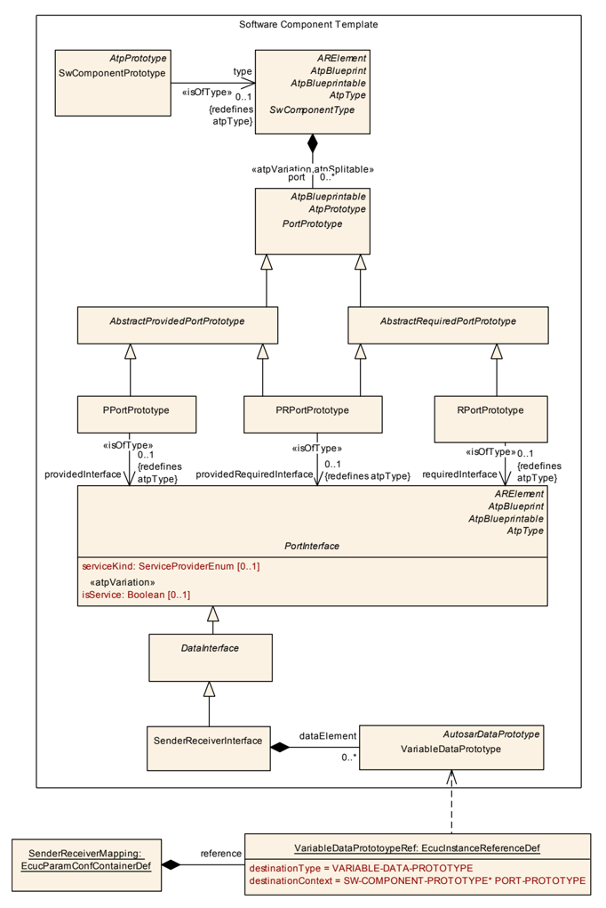

在图 2.15 的示例中，引用被定义为指向一个「VARIABLE-DATA-PROTOTYPE」的描述。「VARIABLE-DATA-PROTOTYPE」定义在软件组件模板元模型 [\[11\]](#ref-11) 中，并且派生自 Identifiable（它是 Referrable 的子类）。经由 destinationContext 规定：每个「VARIABLE-DATA-PROTOTYPE」存在于一个「PORT-PROTOTYPE」的上下文中，后者本身位于「SW-COMPONENT-PROTOTYPE」的上下文中。对应的 **ECUC** 值描述 **XML** 文件摘录见示例 2.44。

示例2.21：

```
<ECUC-INSTANCE-REFERENCE-DEF>
<SHORT-NAME>VariableDataPrototypeRef</SHORT-NAME>
<DESTINATION-CONTEXT> SW-COMPONENT-PROTOTYPE* PORT-PROTOTYPE </DESTINATIONCONTEXT>
<DESTINATION-TYPE>VARIABLE-DATA-PROTOTYPE</DESTINATION-TYPE>
</ECUC-INSTANCE-REFERENCE-DEF>
```


尽管 EcucForeignReferenceDef 与 EcucInstanceReferenceDef 的 **ECU** 配置参数定义相似，但它们在 **ECU** 配置值描述中的表示方式存在差异（见[第 2.4.5 节](#245-ecu-配置元模型中的引用references-in-the-ecu-configuration-metamodel)）。

#### 2.3.6.5. 符号名引用（**Symbolic Name Reference**）

**约束：符号名引用属性（**Symbolic Name Reference properties**）**：属性 requiresSymbolicNameValue 设置为 true 的 EcucAbstractInternalReferenceDef 用于建立符号名的使用方与符号名的提供方之间的关系。定义该 EcucAbstractInternalReferenceDef 的对象是使用方，引用的目标是符号名的提供方。

**约束：symbolicNameValue = true 的参数（**Parameters with symbolicNameValue**）**：如果配置参数（见约束「参数类型」）的属性 symbolicNameValue 设置为 true，则该配置参数对符号名的取值有贡献。在一个容器内只允许一个配置参数将属性 symbolicNameValue 设置为 true。

如果属性 symbolicNameValue 不存在，则应假定其设置为 false。

**约束：symbolicNameValue 参数的 valueConfigClass 属性**：symbolicNameValue 属性设置为 true 的 EcucParameterDef 的取值，对所有 valueConfigClass.configVariant 都应将其 valueConfigClass.configClass 设置为 PreCompile 或 PublishedInformation。

**约束：symbolicNameValue 参数的 multiplicityConfigClass 属性**：symbolicNameValue 属性设置为 true 的 EcucParameterDef 的取值，对所有 multiplicityConfigClass.configVariant 都应将其 multiplicityConfigClass.configClass 设置为 PreCompile。

**约束：symbolicNameValue 参数的 postBuildVariantValue 属性**：symbolicNameValue 属性设置为 true 的 EcucParameterDef 的取值应将其 postBuildVariantValue 设置为 false。

**约束：symbolicNameValue 参数的 postBuildVariantMultiplicity 属性**：symbolicNameValue 属性设置为 true 的 EcucParameterDef 的取值应将其 postBuildVariantMultiplicity 设置为 false。

在图 2.16 所示的示例定义中，CorTst 模块可以包含 CorTstDemEventParameterRefs。这些错误需要在 Dem 模块中定义，并且只有当全部错误都已在 Dem 模块中规定并收集之后，只有 Dem 模块才能定义与这些错误相关联的实际编号。这些关联的取值可以存储在属于每个 DemEventParameter 的 DemEventId 参数中。

关于这在 **ECU** 配置值描述中如何使用的示例，请参见[第 2.4.5.2 节](#2452-符号名的表示representation-of-symbolic-names)。对应的 **ECUC** 值描述 **XML** 文件摘录见示例 2.45。

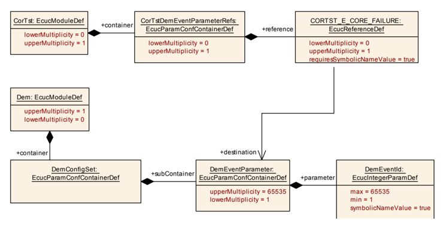

示例2.22：

```
 <ECUC-MODULE-DEF>
<SHORT-NAME>CorTst</SHORT-NAME>
<CONTAINERS>
<ECUC-PARAM-CONF-CONTAINER-DEF>
<SHORT-NAME>CorTstDemEventParameterRefs</SHORT-NAME>
<LOWER-MULTIPLICITY>0</LOWER-MULTIPLICITY>
<UPPER-MULTIPLICITY>1</UPPER-MULTIPLICITY>
<REFERENCES>
<ECUC-REFERENCE-DEF>
<SHORT-NAME>CORTST_E_CORE_FAILURE</SHORT-NAME>
<LOWER-MULTIPLICITY>1</LOWER-MULTIPLICITY>
<UPPER-MULTIPLICITY>1</UPPER-MULTIPLICITY>
<REQUIRES-SYMBOLIC-NAME-VALUE>true</REQUIRES-SYMBOLIC-NAME-VALUE>
<DESTINATION-REF DEST="ECUC-PARAM-CONF-CONTAINER-DEF"> /AUTOSAR/ EcucDefs/Dem/DemEventParameter </DESTINATION-REF>
</ECUC-REFERENCE-DEF>
</REFERENCES>
</ECUC-PARAM-CONF-CONTAINER-DEF>
</CONTAINERS>
</ECUC-MODULE-DEF>
<ECUC-MODULE-DEF>
<SHORT-NAME>Dem</SHORT-NAME>
<CONTAINERS>
<ECUC-PARAM-CONF-CONTAINER-DEF> <SHORT-NAME> DemEventParameter </SHORT-NAME>
<LOWER-MULTIPLICITY> 0 </LOWER-MULTIPLICITY>
<UPPER-MULTIPLICITY-INFINITE> true </UPPER-MULTIPLICITY-INFINITE> - <PARAMETERS>
<ECUC-INTEGER-PARAM-DEF> - <SHORT-NAME> DemEventId </SHORT-NAME> - <LOWER-MULTIPLICITY> 1 </LOWER-MULTIPLICITY> - <UPPER-MULTIPLICITY> 1 </UPPER-MULTIPLICITY> - <SYMBOLIC-NAME-VALUE> true </SYMBOLIC-NAME-VALUE>
</ECUC-INTEGER-PARAM-DEF>
</PARAMETERS>
</ECUC-PARAM-CONF-CONTAINER-DEF>
</CONTAINERS>
</ECUC-MODULE-DEF>
```


#### 2.3.6.6. URI 引用（**Uri Reference**）

**EcucUriReferenceDef 属性（**EcucUriReferenceDef properties**）**：借助 EcucUriReferenceDef，可以定义一个经由 destinationUri 规定目标的引用。任何具有相同 destinationUri 的 EcucContainerDef 都定义一个有效的引用目标。EcucUriReferenceDef 的目标可以是 EcucParamConfContainerDef 或 EcucChoiceContainerDef。

请注意，一个 EcucContainerDef 可以定义多个 destinationUri，因此可适用于多个 EcucUriReferenceDef。借助 EcucUriReferenceDef，可以独立于目标容器的具体定义而定义对其他模块中容器的引用。

表2.33：EcucUriReferenceDef（**EcucUriReferenceDef**）

| 属性 | 值 |
| --- | --- |
| 类 | EcucUriReferenceDef |
| 包 | M2::AUTOSARTemplates::ECUCParameterDefTemplate |
| 说明 | 定义一个经由 destinationUri 规定目标的引用。借助这样的引用，可以独立于目标容器的具体定义而定义对另一个模块中 EcucContainerDef 的引用。 |
| 基类 | ARObject、AtpDefinition、EcucAbstractInternalReferenceDef、EcucAbstractReferenceDef、EcucCommonAttributes、EcucDefinitionElement、Identifiable、MultilanguageReferrable、Referrable |
| 聚合于 | EcucDestinationUriPolicy.reference、EcucParamConfContainerDef.reference |

| 属性 | 类型 | 多重性 | 种类 | 备注 |
| --- | --- | --- | --- | --- |
| destinationUri | EcucDestinationUriDef | 0..1 | ref | 任何 destinationUri 与此处被引用的 destinationUri 相同的 EcucContainerDef 都定义一个有效目标。构造型：atpUriDef |

表2.34：EcucDestinationUriDefSet（**EcucDestinationUriDefSet**）

| 属性 | 值 |
| --- | --- |
| 类 | EcucDestinationUriDefSet |
| 包 | M2::AUTOSARTemplates::ECUCParameterDefTemplate |
| 说明 | 该类表示 EcucDestinationUriDef 的列表。标签：atp.recommendedPackage=EcucDestinationUriDefSets |
| 基类 | ARElement、ARObject、AtpBlueprint、AtpBlueprintable、CollectableElement、Identifiable、MultilanguageReferrable、PackageableElement、Referrable |
| 聚合于 | ARPackage.element |

| 属性 | 类型 | 多重性 | 种类 | 备注 |
| --- | --- | --- | --- | --- |
| destinationUriDef | EcucDestinationUriDef | * | aggr | 这是一个特定的 EcucDestinationUriDef。 |

表2.35：EcucDestinationUriDef（**EcucDestinationUriDef**）

| 属性 | 值 |
| --- | --- |
| 类 | EcucDestinationUriDef |
| 包 | M2::AUTOSARTemplates::ECUCParameterDefTemplate |
| 说明 | 用作 EcucUriReferenceDef 目标的 EcucDestinationUriDef 的描述。 |
| 基类 | ARObject、Identifiable、MultilanguageReferrable、Referrable |
| 聚合于 | EcucDestinationUriDefSet.destinationUriDef |

| 属性 | 类型 | 多重性 | 种类 | 备注 |
| --- | --- | --- | --- | --- |
| destinationUriPolicy | EcucDestinationUriPolicy | 0..1 | aggr | 对被目标 EcucContainerDef 的描述。 |

为了定义被引用 EcucContainerDef 的预期内容，EcucDestinationUriPolicy 限定被引用的 EcucContainerDef 应拥有哪些 container、parameter 和/或 reference。

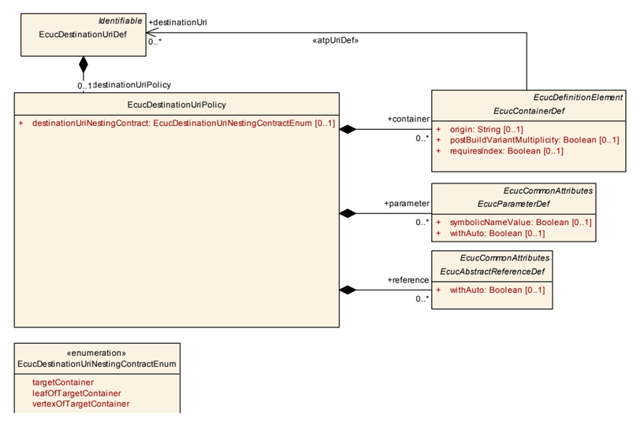

**约束：EcucDestinationUriDef.destinationUriPolicy 始终必需**：在 **ECU** 配置参数定义完成时，属性 EcucDestinationUriDef.destinationUriPolicy 应始终被定义。

**约束：EcucDestinationUriPolicy.destinationUriNestingContract 始终必需**：在 **ECU** 配置参数定义完成时，属性 EcucDestinationUriPolicy.destinationUriNestingContract 应始终被定义。

表2.36：EcucDestinationUriPolicy（**EcucDestinationUriPolicy**）

| 属性 | 值 |
| --- | --- |
| 类 | EcucDestinationUriPolicy |
| 包 | M2::AUTOSARTemplates::ECUCParameterDefTemplate |
| 说明 | EcucDestinationUriPolicy 描述将被 EcucUriReferenceDef 作为目标的 EcucContainerDef。描述的类型取决于 destinationUriNestingContract 属性。 |
| 基类 | ARObject |
| 聚合于 | EcucDestinationUriDef.destinationUriPolicy |

| 属性 | 类型 | 多重性 | 种类 | 备注 |
| --- | --- | --- | --- | --- |
| container | EcucContainerDef | * | aggr | 在 destinationUriNestingPolicy 设置为 targetContainer 的情形下对 targetContainer 的描述。在所有其他情形下，此处定义目标容器的 subContainer。 |
| destinationUriNestingContract | EcucDestinationUriNestingContractEnum | 0..1 | attr | 该属性定义被引用的目标 EcucContainerDef 如何描述。 |
| parameter | EcucParameterDef | * | aggr | 对目标容器中包含的参数的描述。 |
| reference | EcucAbstractReferenceDef | * | aggr | 对目标容器中包含的引用的描述。 |

表2.37：EcucDestinationUriNestingContractEnum（**EcucDestinationUriNestingContractEnum**）

| 属性 | 值 |
| --- | --- |
| 枚举 | EcucDestinationUriNestingContractEnum |
| 包 | M2::AUTOSARTemplates::ECUCParameterDefTemplate |
| 说明 | EcucDestinationUriNestingContractEnum 用于确定 EcucDestinationUriPolicy 限定的是什么。 |
| 聚合于 | EcucDestinationUriPolicy.destinationUriNestingContract |

| 字面量 | 说明 |
| --- | --- |
| leafOfTargetContainer | EcucDestinationUriPolicy 描述由目标容器直接拥有的元素（subContainer、Parameter、Reference）。标签：atp.EnumerationLiteralIndex=0 |
| targetContainer | EcucDestinationUriPolicy 描述 EcucUriReferenceDef 的目标容器。标签：atp.EnumerationLiteralIndex=1 |
| vertexOfTargetContainer | EcucDestinationUriPolicy 描述目标容器中可以在任意嵌套 subContainer 结构中定义的元素（subContainer、Parameter、Reference）。标签：atp.EnumerationLiteralIndex=2 |

**约束：被一个 EcucContainerDef 引用的 EcucDestinationUriDef 的必要内容**：由 EcucContainerDef 以角色 destinationUri 引用的 EcucDestinationUriDef，应至少定义由以下元素的 EcucDestinationUriPolicy 所规定的、类似的 container、parameter 与 reference 集合：该 EcucDestinationUriDef 被以该 EcucContainerDef 为目标的 EcucUriReferenceDef 所引用。

依据属性 destinationUriNestingContract，EcucDestinationUriPolicy 可以限定以下之一：

- 被引用的 EcucContainerDef
- 作为被引用 EcucContainerDef 叶子的 container、parameter 与 reference
- 在被引用 EcucContainerDef 之下的任意嵌套 subContainer 结构中定义的 container、parameter 与 reference

**约束：destinationUriNestingContract 设置为 targetContainer**：当 destinationUriNestingContract 设置为 targetContainer 时，角色 container 中的 EcucContainerDef 具备成为 EcucUriReferenceDef 目标容器的资格。相应的 EcucContainerDef 应具有相同的 shortName，并至少具有带有给定属性（例如 shortName、range 与多重性）的、已定义的 subContainer、reference 与 parameter。

**约束：destinationUriNestingContract 设置为 targetContainer 时适用的属性**：如果 destinationUriNestingContract 设置为 targetContainer，则属性 parameter 与 reference 不应存在。

**约束：destinationUriNestingContract 设置为 leafOfTargetContainer**：当 destinationUriNestingContract 设置为 leafOfTargetContainer 时，属性 container、parameter 与 reference 限定目标容器直接拥有的元素。在这种情况下，相应的 EcucContainerDef 应至少具有带有给定属性（例如 shortName、range 与多重性）的、已定义的 subContainer、reference 与 parameter。

这特别适用于定义目标容器拥有的参数或引用，而无需进一步规定目标容器（例如容器的类型或 shortName）。

**约束：destinationUriNestingContract 设置为 vertexOfTargetContainer**：当 destinationUriNestingContract 设置为 vertexOfTargetContainer 时，属性 container、parameter 与 reference 限定目标容器中可以在任意嵌套 subContainer 结构中定义的元素。在这种情况下，相应的 EcucContainerDef 或任何 subContainer 应至少具有带有给定属性（例如 shortName、range 与多重性）的、已定义的 subContainer、reference 与 parameter。

下面的示例展示了 destinationUri「/Example/UriSetA/Uri1」的定义。EcucDestinationUriPolicy 限定 shortName 为「UriReferableContainer」的 targetContainer 以及一个类型为 EcucIntegerParamDef 的参数「InterestingParam1」。模块「UriTarget」定义一个匹配的容器，模块「UriRef」定义一个相应的 EcucUriReferenceDef。

示例2.23：

```
 <CATEGORY>EXAMPLE</CATEGORY>
<AR-PACKAGES>
<AR-PACKAGE>
<SHORT-NAME>EcucModuleDefs</SHORT-NAME>
<ELEMENTS>
<ECUC-MODULE-DEF>
<SHORT-NAME>UriTarget</SHORT-NAME>
<CONTAINERS>
<ECUC-PARAM-CONF-CONTAINER-DEF>
<SHORT-NAME>UriReferableContainer</SHORT-NAME>
<DESTINATION-URI-REFS>
<DESTINATION-URI-REF DEST="ECUC-DESTINATION-URI-DEF"> / Example/EcucDestinationUriDefSet/UriSetA/Uri1 </ DESTINATION-URI-REF>
</DESTINATION-URI-REFS>
<PARAMETERS>
<ECUC-INTEGER-PARAM-DEF>
<SHORT-NAME>InterestingParam1</SHORT-NAME>
<LOWER-MULTIPLICITY>1</LOWER-MULTIPLICITY>
<UPPER-MULTIPLICITY>1</UPPER-MULTIPLICITY>
<MAX>255</MAX>
<MIN>1</MIN>
</ECUC-INTEGER-PARAM-DEF>
</PARAMETERS>
</ECUC-PARAM-CONF-CONTAINER-DEF>
</CONTAINERS>
</ECUC-MODULE-DEF>
<ECUC-MODULE-DEF>
<SHORT-NAME>UriRef</SHORT-NAME>
<CONTAINERS>
<ECUC-PARAM-CONF-CONTAINER-DEF>
<SHORT-NAME>Container1</SHORT-NAME>
<REFERENCES>
<ECUC-URI-REFERENCE-DEF>
<SHORT-NAME>UriRef_Uri1</SHORT-NAME>
<DESTINATION-URI-REF DEST="ECUC-DESTINATION-URI-DEF"> /Example/EcucDestinationUriDefSet/UriSetA/Uri1 </ DESTINATION-URI-REF>
</ECUC-URI-REFERENCE-DEF>
</REFERENCES>
</ECUC-PARAM-CONF-CONTAINER-DEF>
</CONTAINERS>
</ECUC-MODULE-DEF>
</ELEMENTS>
</AR-PACKAGE>
<AR-PACKAGE>
<SHORT-NAME>EcucDestinationUriDefSet</SHORT-NAME>
<ELEMENTS>
<ECUC-DESTINATION-URI-DEF-SET>
<SHORT-NAME>UriSetA</SHORT-NAME>
<DESTINATION-URI-DEFS>
<ECUC-DESTINATION-URI-DEF>
<SHORT-NAME>Uri1</SHORT-NAME>
<DESTINATION-URI-POLICY> <CONTAINERS>
<ECUC-PARAM-CONF-CONTAINER-DEF>
<SHORT-NAME> UriReferableContainer </SHORT-NAME>
<PARAMETERS>
<ECUC-INTEGER-PARAM-DEF>
<SHORT-NAME> InterestingParam1 </SHORT-NAME>
<LOWER-MULTIPLICITY> 1 </LOWER-MULTIPLICITY>
<UPPER-MULTIPLICITY> 1 </UPPER-MULTIPLICITY>
<MAX> 255 </MAX>
<MIN> 1 </MIN>
</ECUC-INTEGER-PARAM-DEF>
</PARAMETERS>
</ECUC-PARAM-CONF-CONTAINER-DEF>
</CONTAINERS>
<DESTINATION-URI-NESTING-CONTRACT> TARGET-CONTAINER </ DESTINATION-URI-NESTING-CONTRACT>
</DESTINATION-URI-POLICY>
</ECUC-DESTINATION-URI-DEF>
</DESTINATION-URI-DEFS>
</ECUC-DESTINATION-URI-DEF-SET>
</ELEMENTS>
</AR-PACKAGE>
```


### 2.3.7. 派生参数规定（**Derived Parameter Specification**）

前面各节介绍的参数定义用于定义配置参数类型，而不考虑实际取值将如何捕获。但由于 **ECU** 配置依赖于大量其他输入信息，**BSW** 与 **RTE** 配置的许多取值可以从描述中（例如系统提取或软件组件描述）或 **ECU** 配置的其他部分中已有的其他取值承接或计算得到。这类配置参数称为派生配置参数（**Derived Configuration Parameters**）。

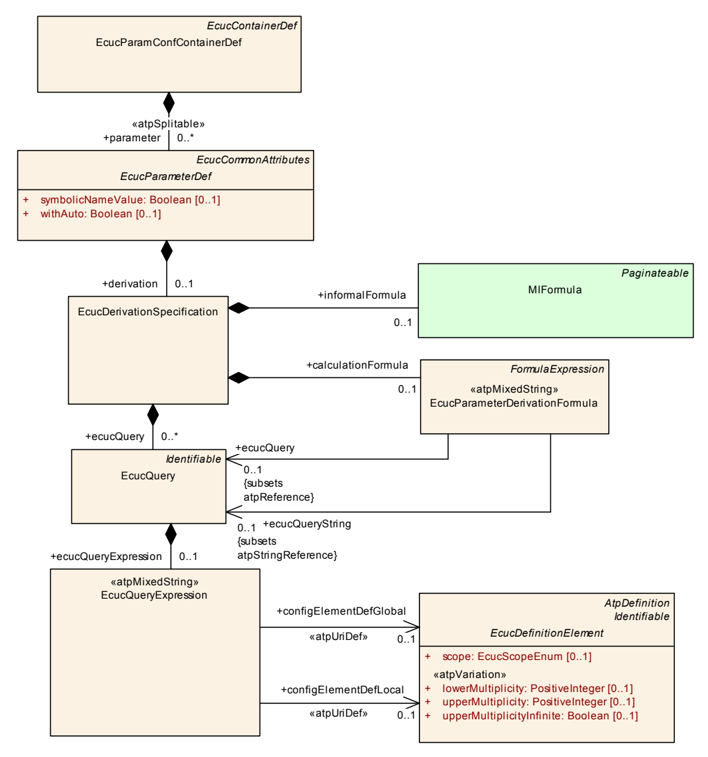

**约束：EcucQuery.ecucQueryExpression 始终必需**：在 **ECU** 配置参数定义完成时，属性 EcucQuery.ecucQueryExpression 应始终被定义。

表2.38：EcucDerivationSpecification（**EcucDerivationSpecification**）

| 属性 | 值 |
| --- | --- |
| 类 | EcucDerivationSpecification |
| 包 | M2::AUTOSARTemplates::ECUCParameterDefTemplate |
| 说明 | 允许定义基于以下取值计算的配置项：其他参数取值；在其他 **AUTOSAR** 模板（例如系统模板与 SW 组件模板）中定义的元素（属性/类）。 |
| 基类 | ARObject |
| 聚合于 | EcucParameterDef.derivation |

| 属性 | 类型 | 多重性 | 种类 | 备注 |
| --- | --- | --- | --- | --- |
| calculationFormula | EcucParameterDerivationFormula | 0..1 | aggr | 用于计算配置元素取值的公式的定义。 |
| ecucQuery | EcucQuery | * | aggr | 对 **ECU** 配置描述的查询。 |
| informalFormula | MlFormula | 0..1 | aggr | 用于计算配置元素取值的推导的非形式化描述。 |

**约束：参数取值的推导（**Derivation of parameter values**）**：对于每个 EcucParameterDef，可以规定参数取值将如何计算。这记录在元素 EcucDerivationSpecification 中。

**约束：推导的非形式化描述（**Informal description**）**：对于全部 EcucParameterDef 类型，可以在元素 informalFormula 中规定推导的非形式化描述。

**约束：推导的形式化描述（**Formal description**）**：对于 EcucParameterDef 类型

- EcucBooleanParamDef
- EcucIntegerParamDef
- EcucFloatParamDef

可以在元素 EcucParameterDerivationFormula 中规定形式化的 calculationFormula。

**注意：** 形式化计算公式只应用于上述类型，原因是计算公式的结果是数值型的。

#### 2.3.7.1. 派生参数计算公式（**Derived Parameter Calculation Formula**）

配置参数取值的推导可以用非形式化的计算公式规定，或用一种可用于规定计算规则的形式化语言规定（见图 2.18）。该形式化语言定义在通用结构模板 [\[4\]](#ref-4) 中。借助这一形式化语言，可以表达参数之间的依赖关系，例如基于其他参数的取值计算一个参数的取值。

表2.39：EcucParameterDerivationFormula（**EcucParameterDerivationFormula**）

| 属性 | 值 |
| --- | --- |
| 类 | &lt;&lt;atpMixedString&gt;&gt; EcucParameterDerivationFormula |
| 包 | M2::AUTOSARTemplates::ECUCParameterDefTemplate |
| 说明 | 该公式用于规定 **ECU** 参数如何从 **Autosar** 模板中的其他信息推导。 |
| 基类 | ARObject、FormulaExpression |
| 聚合于 | EcucDerivationSpecification.calculationFormula |

| 属性 | 类型 | 多重性 | 种类 | 备注 |
| --- | --- | --- | --- | --- |
| ecucQuery | EcucQuery | 0..1 | ref | 这是计算公式中使用的一个特定 EcucQuery。 |
| ecucQueryString | EcucQuery | 0..1 | ref | 这指示被引用的查询应返回一个字符串。 |

非形式化的计算公式（MlFormula）可以用于相同的目的。但在这里，派生取值如何计算的规则未定义。可以使用不同的表示来规定这样的非形式化计算规则。更多细节见 MSRSW。尽管 MlFormula 是非形式化的，其中可以解释一些编程语言的语法与语义。

为了用形式化计算公式推导配置参数取值，可以定义一个或多个 EcucQuery。一个 EcucQuery 是 Identifiable 并聚合一个 EcucQueryExpression。EcucQueryExpression 定义对 **ECU** 配置值描述的查询，并将结果输出为数值。EcucQueryExpression 目前支持四个函数：count、value、deref 与 refvalue。由于 EcucQueryExpression 的 atpMixedString 特性，一个 EcucQueryExpression 内可以定义混有若干局部与全局引用<sup>17</sup>的若干函数关键字。

表2.40：EcucQuery（**EcucQuery**）

| 属性 | 值 |
| --- | --- |
| 类 | EcucQuery |
| 包 | M2::AUTOSARTemplates::ECUCParameterDefTemplate |
| 说明 | 定义对 **ECUC** 描述的一个查询。 |
| 基类 | ARObject、Identifiable、MultilanguageReferrable、Referrable |
| 聚合于 | EcucConditionSpecification.ecucQuery、EcucDerivationSpecification.ecucQuery、EcucValidationCondition.ecucQuery |

| 属性 | 类型 | 多重性 | 种类 | 备注 |
| --- | --- | --- | --- | --- |
| ecucQueryExpression | EcucQueryExpression | 0..1 | aggr | 这是计算公式或条件公式中使用的 EcucQuery。 |

表2.41：EcucQueryExpression（**EcucQueryExpression**）

| 属性 | 值 |
| --- | --- |
| 类 | &lt;&lt;atpMixedString&gt;&gt; EcucQueryExpression |
| 包 | M2::AUTOSARTemplates::ECUCParameterDefTemplate |
| 说明 | 定义对 **ECUC** 描述的一个查询表达式，并将结果输出为数值。由于公式的「mixedString」特性，可以使用若干 EcuQueryExpression。 |
| 基类 | ARObject |
| 聚合于 | EcucQuery.ecucQueryExpression |

| 属性 | 类型 | 多重性 | 种类 | 备注 |
| --- | --- | --- | --- | --- |
| configElementDefGlobal | EcucDefinitionElement | 0..1 | ref | EcucQueryExpression 指向一个 EcucDefinitionElement，用于在 **Ecuc** 描述中查找元素。为了在 **Ecuc** 描述中找到正确的元素，需要执行一次搜索。如果需要搜索完整的 **Ecuc** 描述，则应使用该全局引用。由于 EcucQueryExpression 的「mixedString」特性，一个 EcucQueryExpression 内可以使用多个指向 EcucDefinitionElement 的引用。构造型：atpUriDef |
| configElementDefLocal | EcucDefinitionElement | 0..1 | ref | EcucQueryExpression 指向一个 EcucDefinitionElement，用于在 **Ecuc** 描述中查找元素。为了在 **Ecuc** 描述中找到正确的元素，需要执行一次搜索。如果搜索在包含该 EcucQuery 的同一模块内执行，则应使用该局部引用。由于 EcucQueryExpression 的「mixedString」特性，一个 EcucQueryExpression 内可以使用多个指向 EcucDefinitionElement 的引用。构造型：atpUriDef |

> 17 configElementDefLocal、configElementDefGlobal

**约束：EcucQueryExpression 元素的配置类**：一个计算公式中涉及的 EcucQueryExpression 的元素，相对于执行计算的上下文元素，应具有较低或相等的配置类（其中 PreCompile 配置类被视为最低，PostBuild 被视为最高）（例如一个 Link 配置参数不能基于 PostBuild 参数的取值计算其取值）。

**约束：refvalue 函数的输入与输出**：refvalue 函数接收一个 EcucDefinitionElement，并交付 **ECU** 配置值描述中共享所提供 EcucDefinitionElement 的定义角色的一组元素。

**约束：EcucDefinitionElement 指向 ECU 配置参数定义中不存在的元素时 refvalue 函数的输出**：如果 EcucDefinitionElement 指向 **ECU** 配置参数定义中一个不存在的元素，refvalue 函数应产生一个错误。

**约束：在 ECU 配置值描述中未找到元素时 refvalue 函数的输出**：如果 EcucDefinitionElement 指向 **ECU** 配置参数定义中一个已存在的元素但在 **ECU** 配置值描述中未找到任何元素，refvalue 函数应返回一个空集合。

**约束：deref 函数的输入与输出**：deref 函数接收两个参数：

1. 另一个 deref 函数或 refvalue 函数的结果，它是一个元素集合
2. 对第一个参数某个成员的引用

并返回第一个参数中由第二个参数所表示的成员。

**约束：value 函数的输入（**Input of the value function**）**：value 函数接收一个 deref 函数或 refvalue 函数的结果，它是一个元素集合。

**约束：value 函数的输出（**Output of the value function**）**：value 函数以数值形式返回参数的取值。

**约束：value 函数报告错误的情形（**Cases where the value function reports an error**）**：在以下情形下 value 函数应产生一个错误：

- 参数是空集合
- 参数是包含多于 1 个元素的集合<sup>19</sup>
- 参数的单个元素不具有取值（例如是一个容器）

**约束：strValue 函数的输入（**Input of the strValue function**）**：strValue 函数接收一个 deref 函数或 refvalue 函数的结果，它是一个元素集合。

**约束：strValue 函数的输出（**Output of the strValue function**）**：strValue 函数以字符串形式返回参数的取值。

**约束：strValue 函数报告错误的情形（**Cases where the strValue function reports an error**）**：在以下情形下 strValue 函数应产生一个错误：

- 参数是空集合
- 参数是包含多于 1 个元素的集合<sup>20</sup>
- 参数的单个元素不具有取值（例如是一个容器）

**约束：valueAt 函数的输入（**Input of the valueAt function**）**：valueAt 函数接收一个 deref 函数或 refvalue 函数的结果（它是一个元素集合）和一个从零开始的位置实参。

**约束：valueAt 函数的输出（**Output of the valueAt function**）**：valueAt 函数按照排序准则返回该位置处参数作为数值的取值。

**约束：valueAt 函数报告错误的情形（**Cases where the valueAt function reports an error**）**：在以下情形下 valueAt 函数应产生一个错误：

- 参数是空集合
- 参数是包含多于 1 个元素的集合
- 参数的单个元素不具有取值（例如是一个容器）
- 位置大于 count−1

**约束：strValueAt 函数的输入（**Input of the strValueAt function**）**：strValueAt 函数接收一个 deref 函数或 refvalue 函数的结果（它是一个元素集合）和一个从零开始的位置实参。

**约束：strValueAt 函数的输出（**Output of the strValueAt function**）**：strValueAt 函数按照排序准则返回该位置处参数作为字符串的取值。

**约束：strValueAt 函数报告错误的情形（**Cases where the strValueAt function reports an error**）**：在以下情形下 strValueAt 函数应产生一个错误：

- 参数是空集合
- 参数是包含多于 1 个元素的集合
- 参数的单个元素不具有取值（例如是一个容器）
- 位置大于 count−1

**约束：count 函数的输入（**Input of the count function**）**：count 函数以 deref 或 refvalue 函数的结果作为输入参数。

**约束：count 函数的输出（**Output of the count function**）**：count 函数返回输入参数集合中元素的数量。

**约束：输入参数集合为空时 count 函数的输出**：如果输入参数集合为空，count 函数返回零。

> 19 value 函数只应应用于保证至多包含 1 个元素的元素集合。
> 20 strValue 函数只应应用于保证至多包含 1 个元素的元素集合。

为了在 **ECUC** 值描述中找到被引用的元素，需要追踪对 EcucDefinitionElement 的引用。如果需要搜索完整的 **ECUC** 值描述，则应使用全局引用（configElementDefGlobal）。如果搜索在同一个模块内执行，则局部引用（configElementDefLocal）即可。

下面的小节展示 EcucQueryExpression 的语法：

index: '0' | ('1'..'9')('0'..'9')*;

图 2.19 展示了一个 **COM** 网关示例，其中计算了 CheckConsistency 布尔参数。该参数检查源信号的长度并与目标信号的长度比较。如果两个信号的长度相等，该参数设置为 true，否则设置为 false。**ECUC** 参数定义文件的 **XML** 摘录见示例 2.24。

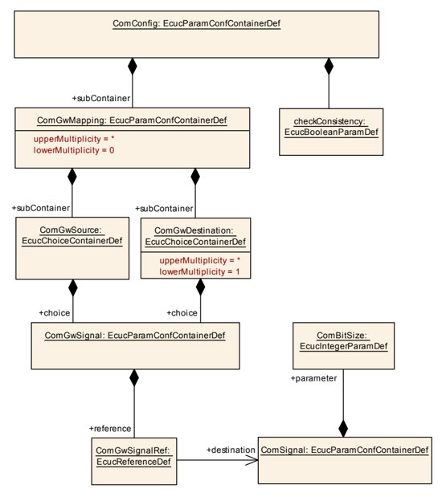

为了确定参数取值，CheckConsistency 参数内的 EcucDerivationSpecification 聚合两个 EcucQuery。

第一个 EcucQuery「getSourceSignalLength」包含一个带有指向 ComGwSignalRef 元素的局部引用的 EcucQueryExpression。为了从被引用的 ComGwSignal 获得信号长度，使用了两个 deref 函数。第一个 deref 函数以对 ComGwSignalRef 元素的引用作为输入，并返回由第二个输入参数所搜索的 ComGwSignal。第二个 deref 函数以 ComGwSignal 作为第一个输入参数，以对 ComGwSignal 内被搜索的 **ECUC** 参数的引用作为第二个输入参数，并返回 ComBitSize 参数。ComBitSize 参数的取值由 value 函数提供。

为了在 **ECUC** 值描述中找到正确的源信号，使用来自局部引用与来自 CheckConsistency 参数路径的最大公共前缀作为 **ECUC** 值描述的入口点。在本示例中，最大公共前缀是以下路径：/AUTOSAR/EcucDefs/Com/ComConfig/ComGwMapping/。

第二个 EcucQuery「getDestinationSignalLength」相应地提供目标信号的 ComBitSize 参数取值。

CalculationFormula 比较两个取值并确定 CheckConsistency 参数的取值。对应的 **ECUC** 值描述 **XML** 文件摘录见示例 2.24。

示例2.24：

```
<ECUC-MODULE-DEF>
<SHORT-NAME>Com</SHORT-NAME>
<CONTAINERS>
<ECUC-PARAM-CONF-CONTAINER-DEF>
<SHORT-NAME>ComConfig</SHORT-NAME>
<SUB-CONTAINERS>
<ECUC-PARAM-CONF-CONTAINER-DEF>
<SHORT-NAME>ComGwMapping</SHORT-NAME>
<PARAMETERS>
<ECUC-BOOLEAN-PARAM-DEF>
<SHORT-NAME>CheckConsistency</SHORT-NAME>
<DERIVATION>
<CALCULATION-FORMULA>( <ECUC-QUERY-REF DEST="ECUC-QUERY"> CheckConsistency/getSourceSignalLength </ECUC-QUERY-REF> /AUTOSAR/Com/ComConfig/ComGwMapping/ == <ECUC-QUERY-REF DEST="ECUC-QUERY"> /AUTOSAR/Com/ComConfig/ ComGwMapping/CheckConsistency/ getDestinationSignalLength </ECUC-QUERY-REF> )</CALCULATION-FORMULA>
<ECUC-QUERYS>
<ECUC-QUERY>
<SHORT-NAME>getSourceSignalLength</SHORT-NAME>
<ECUC-QUERY-EXPRESSION>value( deref( deref(  refvalue( <CONFIG-ELEMENT-DEF-LOCAL-REF DEST="ECUC-CHOICE-REFERENCE-DEF"> / AUTOSAR/EcucDefs/Com/ComConfig/ComGwMapping/ComGwSource/ComGwSignal/ ComGwSignalRef </CONFIG-ELEMENT-DEF-LOCAL-REF> ), /AUTOSAR/EcucDefs/Com/ComConfig/ComGwMapping/ComGwSource/ComGwSignal/ ComGwSignalRef), /ComBitSize) )</ECUC-QUERY-EXPRESSION>
</ECUC-QUERY>
<ECUC-QUERY>
<SHORT-NAME>getDestinationSignalLength</SHORT-NAME>
<ECUC-QUERY-EXPRESSION>value( deref( deref( refvalue( <CONFIG-ELEMENT-DEF-LOCAL-REF DEST="ECUC-CHOICE-REFERENCE-DEF"> / AUTOSAR/EcucDefs/Com/ComConfig/ComGwMapping/ComGwDestination/ComGwSignal /ComGwSignalRef </CONFIG-ELEMENT-DEF-LOCAL-REF> ), /AUTOSAR/EcucDefs/Com/ComConfig/ComGwMapping/ComGwDestination/ComGwSignal/ ComGwSignalRef), /ComBitSize) )</ECUC-QUERY-EXPRESSION>
</ECUC-QUERY>
</ECUC-QUERYS>
</DERIVATION>
</ECUC-BOOLEAN-PARAM-DEF>
</PARAMETERS>
</ECUC-PARAM-CONF-CONTAINER-DEF>
</SUB-CONTAINERS>
</ECUC-PARAM-CONF-CONTAINER-DEF>
</CONTAINERS>
</ECUC-MODULE-DEF> 
```

下一个示例 2.25 展示 count 操作的使用。在 **COM** 模块内引入一个整数参数 countNoOfCanDrv，它对可用的 CanDrv 模块计数。为了覆盖全部 CanDrv 模块，使用一个全局引用。

示例2.25：

```
 <ECUC-MODULE-DEF>
<SHORT-NAME>Com</SHORT-NAME>
<CONTAINERS>
<ECUC-PARAM-CONF-CONTAINER-DEF>
<SHORT-NAME>ComConfig</SHORT-NAME>
<PARAMETERS>
<ECUC-INTEGER-PARAM-DEF>
<SHORT-NAME>numberOfCanDrivers</SHORT-NAME>
<DERIVATION>
<CALCULATION-FORMULA>
<ECUC-QUERY-REF DEST="ECUC-QUERY"> /AUTOSAR/Com/ComConfig/ numberOfCanDrivers/countNoOfCanDrv </ECUC-QUERY-REF>
</CALCULATION-FORMULA>
<ECUC-QUERYS>  <ECUC-QUERY>
<SHORT-NAME> countNoOfCanDrv </SHORT-NAME>
<ECUC-QUERY-EXPRESSION> count( refvalue( <CONFIG-ELEMENT-DEF-GLOBAL-REF DEST="ECUC-MODULE-DEF"> /AUTOSAR/ EcucDefs/Can </CONFIG-ELEMENT-DEF-GLOBAL-REF> ) ) </ECUC-QUERY-EXPRESSION>
</ECUC-QUERY>
</ECUC-QUERYS>
</DERIVATION>
</ECUC-INTEGER-PARAM-DEF>
</PARAMETERS>
</ECUC-PARAM-CONF-CONTAINER-DEF>
</CONTAINERS>
</ECUC-MODULE-DEF>  A third example 2.20 shows a reference into the System Description. The referenced ComSignal contains a ForeignReference into the System Template (SystemTemplateSystemSignalRef). The searched startPosition attribute is defined in the System Template and describes a bitposition of a SystemSignal within a PDU . Figure 2.20: Calculation Formula Example
```


第三个示例 2.26 展示一个进入系统描述的引用。被引用的 ComSignal 包含一个进入系统模板的外部引用（SystemTemplateSystemSignalRef）。被搜索的 startPosition 属性定义在系统模板中，描述一个系统信号在一个 **PDU** 内的比特位置。

为了获得该属性的取值，使用了三个 deref 函数。第一个 deref 函数提供 ComSignal。第二个 deref 函数提供系统描述的 ISignalToPduMapping 元素，第三个 deref 函数返回 ISignalToPduMapping 元素的 startPosition 属性。属性取值由 value 函数提供并用于计算公式。

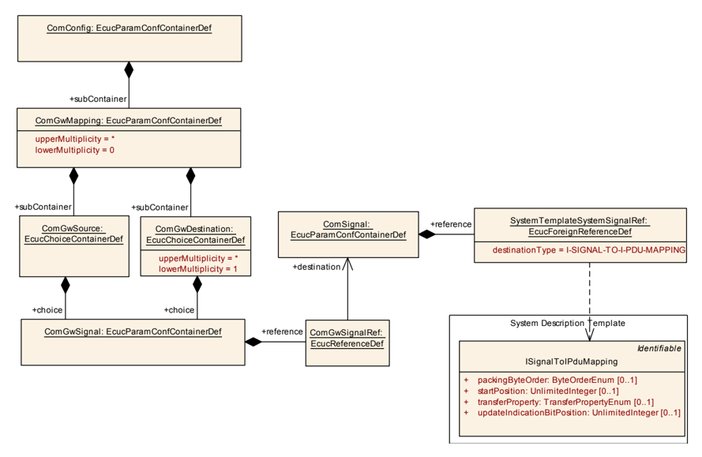

示例2.26：

```
 <ECUC-MODULE-DEF>
<SHORT-NAME>Com</SHORT-NAME>
<CONTAINERS>
<ECUC-PARAM-CONF-CONTAINER-DEF>
<SHORT-NAME>ComConfig</SHORT-NAME>
<SUB-CONTAINERS>
<ECUC-PARAM-CONF-CONTAINER-DEF>
<SHORT-NAME>ComGwMapping</SHORT-NAME>
<PARAMETERS>
<ECUC-INTEGER-PARAM-DEF>
<SHORT-NAME>startPositionBits</SHORT-NAME>
<DERIVATION>
<CALCULATION-FORMULA>
<ECUC-QUERY-REF DEST="ECUC-QUERY"> /AUTOSAR/Com/ComConfig/ ComGwMapping/startPositionBits/ getSourceSignalStartPosition </ECUC-QUERY-REF> * 8 </CALCULATION-FORMULA>
<ECUC-QUERYS>
<ECUC-QUERY>
<SHORT-NAME>getSourceSignalStartPosition</SHORT-NAME>
<ECUC-QUERY-EXPRESSION>value( deref( deref( deref( refvalue( <CONFIG-ELEMENT-DEF-LOCAL-REF DEST="ECUC-CHOICE-REFERENCE-DEF"> / AUTOSAR/EcucDefs/Com/ComConfig/ComGwMapping/ComGwSource/ComGwSignal/ ComGwSignalRef </CONFIG-ELEMENT-DEF-LOCAL-REF> ), /AUTOSAR/EcucDefs/Com/ComConfig/ComGwMapping/ComGwSource/ComGwSignal/ ComGwSignalRef), /SystemTemplateSystemSignalRef), /SystemTemplateSystemSignalRef), /startPosition) )</ECUC-QUERY-EXPRESSION>
</ECUC-QUERY>
</ECUC-QUERYS>
</DERIVATION>
</ECUC-INTEGER-PARAM-DEF>
</PARAMETERS>
</ECUC-PARAM-CONF-CONTAINER-DEF>
</SUB-CONTAINERS>
</ECUC-PARAM-CONF-CONTAINER-DEF>
</CONTAINERS>
</ECUC-MODULE-DEF>
```


#### 2.3.7.2. 对派生参数配置类的限制（**Restrictions on Configuration Class of Derived Parameters**）

派生参数的定义必须与普通配置参数类似，这意味着在配置的实际实现中也必须规定配置类。但由于派生参数确实依赖其他信息，存在某些适用的限制，降低派生参数可以是何种配置类的自由度。

如果派生参数派生自 **ECU** 配置值描述中的其他配置参数，则必须应用某些规则：

- **从 PreCompile 参数推导信息（**Derivation of information from PreCompile parameters**）**：如果派生参数使用定义为 PreCompile 的参数的信息，则派生参数可以是任何配置类。
- **从 Link 参数推导信息（**Derivation of information from Link parameters**）**：如果派生参数使用定义为 Link 的参数的信息，则派生参数应为 Link 或 PostBuild 配置类。
- **从 PostBuild 参数推导信息（**Derivation of information from PostBuild parameters**）**：如果派生参数使用定义为 PostBuild 的参数的信息，则派生参数应为 PostBuild 配置类。
- **从在预编译时间绑定的参数取值推导信息**：如果派生参数使用在预编译时间绑定的参数取值的信息，则派生参数取值可以在任何时间绑定。
- **从在链接时间绑定的参数取值推导信息**：如果派生参数使用在链接时间绑定的参数取值的信息，则派生参数取值应在链接时间或后构建时间绑定。
- **从在后构建时间绑定的参数取值推导信息**：如果派生参数使用在后构建时间绑定的参数取值的信息，则派生参数取值应在后构建时间绑定。

#### 2.3.8. ECUC 参数定义元素的存在依赖（**Existence dependence of ECUC Parameter Definition elements**）

**ECUC** 参数取值可以从 **ECU** 配置其他部分中可用的其他参数取值计算得到。这样的派生配置参数在[第 2.3.7 章](#237-派生参数规定derived-parameter-specification)中详细描述。但 **ECUC** 容器、参数与引用定义元素的存在也可以依赖于 **ECUC** 参数取值的设置。例如，可以定义只有在某个特定的开关参数设置为某个取值时才被考虑的参数；否则这些参数被忽略。

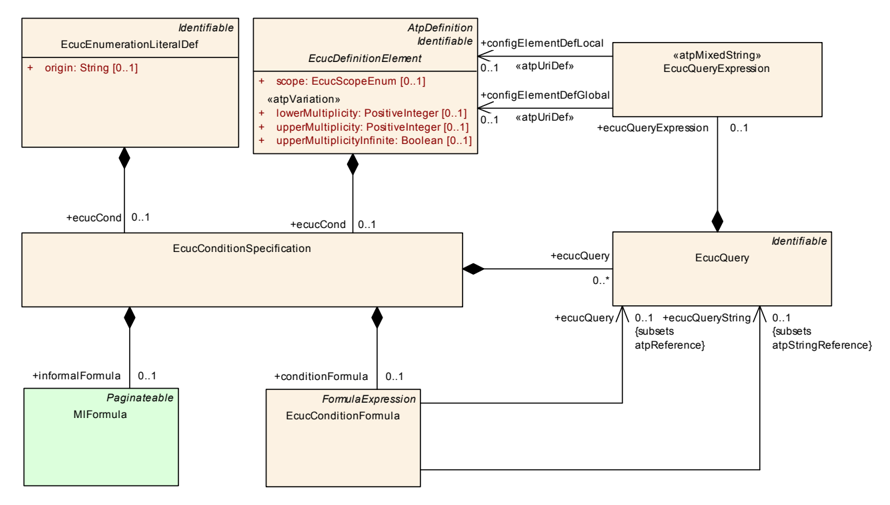

**约束：EcucConditionFormula.ecucQuery 始终必需**：在 **ECU** 配置参数定义完成时，属性 EcucConditionFormula.ecucQuery 应始终被定义。

**约束：EcucConditionFormula.ecucQueryString 始终必需**：在 **ECU** 配置参数定义完成时，属性 EcucConditionFormula.ecucQueryString 应始终被定义。

为了允许描述这样的存在依赖，EcucDefinitionElement 与 EcucEnumerationLiteralDef 聚合 EcucConditionSpecification。EcucConditionSpecification 聚合一个 EcucConditionFormula 或一个非形式化的计算公式（MlFormula）。如果 EcucConditionFormula 求值为 true，则参数定义/字面量定义应按规定处理；否则应忽略参数定义/字面量定义。非形式化的计算公式（MlFormula）可以用于相同的目的。但在这里，条件如何求值的规则未定义。

对 **ECU** 配置值描述的一个 EcucQuery 充当 EcucConditionFormula 的实参。由于 EcucConditionFormula 的 atpMixedString 特性，一个 EcucConditionFormula 内可以定义若干 EcucQuery。

一个 EcucQuery 是 Identifiable 并聚合一个 EcucQueryExpression。EcucQueryExpression 将结果输出为数值。EcucQueryExpression 语法在[第 2.3.7.1 节](#2371-派生参数计算公式derived-parameter-calculation-formula)中描述。

表2.42：EcucConditionSpecification（**EcucConditionSpecification**）

| 属性 | 值 |
| --- | --- |
| 类 | EcucConditionSpecification |
| 包 | M2::AUTOSARTemplates::ECUCParameterDefTemplate |
| 说明 | 允许基于参数取值的取值定义存在依赖。 |
| 基类 | ARObject |
| 聚合于 | EcucDefinitionElement.ecucCond、EcucEnumerationLiteralDef.ecucCond |

| 属性 | 类型 | 多重性 | 种类 | 备注 |
| --- | --- | --- | --- | --- |
| conditionFormula | EcucConditionFormula | 0..1 | aggr | 用于定义存在依赖的公式的定义。 |
| ecucQuery | EcucQuery | * | aggr | 对 **ECU** 配置描述的查询。 |
| informalFormula | MlFormula | 0..1 | aggr | 用于定义存在依赖的条件非形式化描述。 |

表2.43：EcucConditionFormula（**EcucConditionFormula**）

| 属性 | 值 |
| --- | --- |
| 类 | &lt;&lt;atpMixedString&gt;&gt; EcucConditionFormula |
| 包 | M2::AUTOSARTemplates::ECUCParameterDefTemplate |
| 说明 | 该公式应依据 ecuc 查询产生一个布尔表达式。注意，EcucConditionFormula 是一个混合字符串，因此属性的上多重性为 1。 |
| 基类 | ARObject、FormulaExpression |
| 聚合于 | EcucConditionSpecification.conditionFormula、EcucValidationCondition.validationFormula |

| 属性 | 类型 | 多重性 | 种类 | 备注 |
| --- | --- | --- | --- | --- |
| ecucQuery | EcucQuery | 0..1 | ref | 该 EcucQuery 充当公式的实参。 |
| ecucQueryString | EcucQuery | 0..1 | ref | 这指示被引用的查询应返回一个字符串。 |

在下面取自 **CAN** 接口模块的图 2.22 示例中，展示了条件公式的一种可能用法。

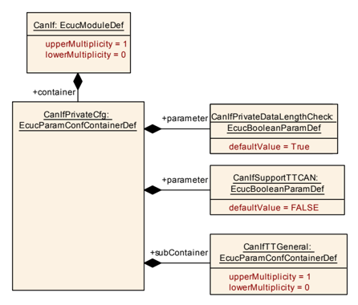

容器 CanIfPrivateCfg 包含 2 个参数与一个子容器。用例是使容器 CanIfTTGeneral 的存在依赖于参数 CanIfSupportTTCAN 中配置的取值。如果 CanIfSupportTTCAN 的取值设置为 true，则容器 CanIfTTGeneral 及其内容应可供配置。如果 CanIfSupportTTCAN 的取值设置为 false，则容器 CanIfTTGeneral 不应被考虑用于配置。

示例2.27：

```
 <ECUC-MODULE-DEF>
<SHORT-NAME>CanIf</SHORT-NAME>
<LOWER-MULTIPLICITY>0</LOWER-MULTIPLICITY>
<UPPER-MULTIPLICITY>1</UPPER-MULTIPLICITY>
<CONTAINERS>
<ECUC-PARAM-CONF-CONTAINER-DEF>
<SHORT-NAME>CanIfPrivateCfg</SHORT-NAME>
<LOWER-MULTIPLICITY>1</LOWER-MULTIPLICITY>
<UPPER-MULTIPLICITY>1</UPPER-MULTIPLICITY>
<PARAMETERS>
<ECUC-BOOLEAN-PARAM-DEF>
<SHORT-NAME>CanIfPrivateDlcCheck</SHORT-NAME>
<LOWER-MULTIPLICITY>1</LOWER-MULTIPLICITY>
<UPPER-MULTIPLICITY>1</UPPER-MULTIPLICITY>
<! --... -->
</ECUC-BOOLEAN-PARAM-DEF>
<ECUC-BOOLEAN-PARAM-DEF>
<SHORT-NAME>CanIfSupportTTCAN</SHORT-NAME>
<LOWER-MULTIPLICITY>1</LOWER-MULTIPLICITY>
<UPPER-MULTIPLICITY>1</UPPER-MULTIPLICITY>
<DEFAULT-VALUE>false</DEFAULT-VALUE>
</ECUC-BOOLEAN-PARAM-DEF>
</PARAMETERS>
<SUB-CONTAINERS>
<ECUC-PARAM-CONF-CONTAINER-DEF>
<SHORT-NAME>CanIfTTGeneral</SHORT-NAME>
<ECUC-COND>
<CONDITION-FORMULA>
<ECUC-QUERY-REF DEST="ECUC-QUERY"> /AUTOSAR/CanIf/ CanIfPrivateCfg/CanIfTTGeneral/GetTTCanEnabled </ECUC-QUERY -REF>
</CONDITION-FORMULA>
<ECUC-QUERYS>
<ECUC-QUERY>
<SHORT-NAME>GetTTCanEnabled</SHORT-NAME>
<ECUC-QUERY-EXPRESSION>value( refvalue( <CONFIG-ELEMENT-DEF-LOCAL-REF DEST="ECUC-BOOLEAN-PARAM-DEF"> / AUTOSAR/EcucDefs/CanIf/CanIfPrivateCfg/CanIfSupportTTCAN </CONFIGELEMENT-DEF-LOCAL-REF> ) )</ECUC-QUERY-EXPRESSION>
</ECUC-QUERY>
</ECUC-QUERYS>
</ECUC-COND>
<LOWER-MULTIPLICITY>0</LOWER-MULTIPLICITY>
<UPPER-MULTIPLICITY>1</UPPER-MULTIPLICITY>
<PARAMETERS>
<! --... -->
</PARAMETERS>
</ECUC-PARAM-CONF-CONTAINER-DEF>  </SUB-CONTAINERS>
</ECUC-PARAM-CONF-CONTAINER-DEF>
</CONTAINERS>
</ECUC-MODULE-DEF>
```

条件公式是 CanIfTTGeneral 容器定义的一部分（见示例 2.27）。公式本身非常简单，它只返回名为 GetTTCanEnabled 的 EcucQuery 的取值。

该 EcucQuery 使用 refvalue 函数在局部上下文中寻找 **ECU** 配置值描述中与定义（/AUTOSAR/EcucDefs/CanIf/CanIfPrivateCfg/CanIfSupportTTCAN）相匹配的元素。

该 EcucQuery 随后取该元素的取值并返回。由于该元素是布尔类型，EcucQuery 的结果已经是条件公式可以处理的布尔值。

#### 2.3.9. 校验条件（**Validation conditions**）

为了描述配置元素上的有效性约束，ecucValidationCond 可以定义一组 EcucValidationCondition，它们可以由 EcucDefinitionElement 的任何子类聚合。

**约束：EcucValidationCondition 的校验（**Validation**）**：如果一个 EcucDefinitionElement 的 EcucValidationCondition 的 validationFormula 求值为 true，则该校验条件被认为是有效的。

**约束：多个 EcucValidationCondition 的校验**：如果一个 EcucDefinitionElement 的全部已定义的 ecucValidationCond 都是有效的，则该 EcucDefinitionElement 的配置被认为是有效的。

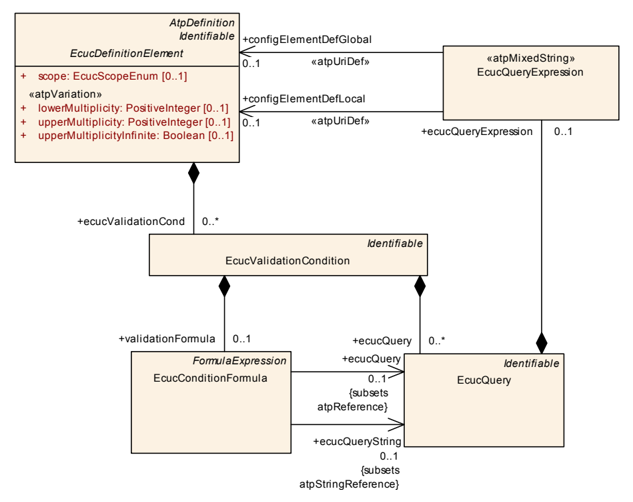

**约束：EcucValidationCondition.validationFormula 始终必需**：在 **ECU** 配置参数定义完成时，属性 EcucValidationCondition.validationFormula 应始终被定义。

表2.44：EcucValidationCondition（**EcucValidationCondition**）

| 属性 | 值 |
| --- | --- |
| 类 | EcucValidationCondition |
| 包 | M2::AUTOSARTemplates::ECUCParameterDefTemplate |
| 说明 | 用于执行基于 EcucQuery 的公式计算的校验条件。 |
| 基类 | ARObject、Identifiable、MultilanguageReferrable、Referrable |
| 聚合于 | EcucDefinitionElement.ecucValidationCond |

| 属性 | 类型 | 多重性 | 种类 | 备注 |
| --- | --- | --- | --- | --- |
| ecucQuery | EcucQuery | * | aggr | 对 **ECU** 配置描述的查询。 |
| validationFormula | EcucConditionFormula | 0..1 | aggr | 用于定义校验条件的公式的定义。 |
#### 2.3.10. 包含引用的完整容器树的多重聚合（**Multiple aggregation of full container trees that include references**）

**ECU** 配置参数定义的 **UML** 模型可以定义一个由不同 EcucParamConfContainerDef 以角色 subContainer 聚合的 EcucContainerDef。在该 subContainer 包含引用的情形下，适用以下描述的某些规则：

**约束：对同一聚合容器树内其他 subContainer 包含引用的容器树的多重聚合**：在一个 EcucParamConfContainerDef 被不同 EcucParamConfContainerDef 以角色 subContainer 聚合、且该被聚合的 subContainer 具有指向位于同一聚合 EcucParamConfContainerDef 结构内另一个 subContainer 的 EcucReferenceDef 的情形下，该 EcucReferenceDef 的 DESTINATION-REF（在生成的 **ECU** 配置参数定义 **XML** 文件中）应在 DESTINATION-REF 的 PATH 中包含回到聚合方 EcucParamConfContainerDef 的 shortName 路径。

下面的示例解释上述约束：ContainerB 与 ContainerC 在 **ECU** 配置参数定义的 **UML** 模型中聚合同一个 SubContainerA：

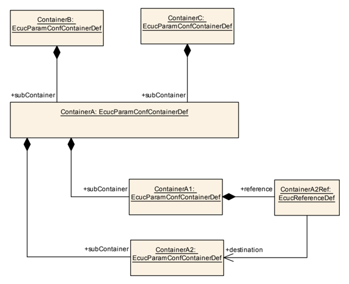

生成的 AUTOSAR_MOD_ECUConfigurationParameters.arxml 将如下定义（已简化）。请注意，ContainerB 与 ContainerC 中 DESTINATION-REF 的 PATH 是不同的。

示例：

**注意：** 源文档在示例 2.3.10 处直接给出了展开的 **XML** 片段（ContainerB 与 ContainerC 各自聚合 ContainerA 的完整树），未经「示例 N.N」题注编号；上表使用示例 2.27 的重建脚本不可复用，此处按源文档的展开片段原样保留其结构说明——两个聚合分支中 ContainerA2Ref 的 DESTINATION-REF 路径分别经由 ContainerB/ContainerA 与 ContainerC/ContainerA 回溯到各自的聚合方。

### 2.4. ECU 配置值元模型（**ECU Configuration Value Metamodel**）
如[第 2.2 节](#22-ecu-配置模板结构ecu-configuration-template-structure)所述，**ECU** 配置定义元模型提供了在配置文件中声明参数及其允许出现次数的手段。本节将在实际的取值描述一侧——即 **ECU** 配置值描述——规定该 **ECU** 配置参数定义的补充。

以下各节描绘 **ECU** 配置值元模型。[第 2.4.1 节](#241-ecu-配置值顶层结构ecu-configuration-value-top-level-structure)与[第 2.4.2 节](#242-模块配置module-configurations)将介绍配置值描述的顶层结构与模块配置，而[第 2.4.3 节](#243-参数容器描述parameter-container-description)、[第 2.4.4 节](#244-参数取值parameter-values)与[第 2.4.5 节](#245-ecu-配置元模型中的引用references-in-the-ecu-configuration-metamodel)将描述归档与结构化实际配置值的手段。

#### 2.4.1. ECU 配置值顶层结构（**ECU Configuration Value Top-Level Structure**）

**AUTOSAR ECU** 配置值描述的顶层入口点是 EcucValueCollection（见图 2.25）。由于继承自 ARElement，EcucValueCollection 可以像其对应物 EcucDefinitionCollection 那样成为 **AUTOSAR** 描述的一部分。请注意，EcucValueCollection 与 EcucDefinitionCollection 彼此独立。

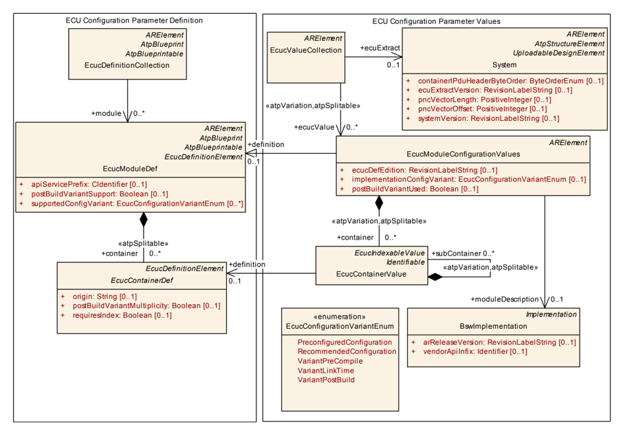

**约束：EcucValueCollection.ecucValue 的存在性**：不包含任何 EcucModuleConfigurationValues 的 EcucValueCollection 对 **Ecu** 配置没有影响，在代码生成时不应出现。

**约束：EcucValueCollection.ecuExtract 始终必需**：在代码生成时，属性 EcucValueCollection.ecuExtract 应始终被定义。

**约束：EcucModuleConfigurationValues.ecucDefEdition 始终必需**：在代码生成时，属性 EcucModuleConfigurationValues.ecucDefEdition 应始终被定义。

**约束：EcucModuleConfigurationValues.implementationConfigVariant 始终必需**：在代码生成时，属性 EcucModuleConfigurationValues.implementationConfigVariant 应始终被定义。

**约束：EcucModuleConfigurationValues.definition 始终必需**：在代码生成时，属性 EcucModuleConfigurationValues.definition 应始终被定义。

**约束：EcucModuleConfigurationValues.container**：不包含任何 EcucContainerValue 的 EcucModuleConfigurationValues 对 **Ecu** 配置没有影响，在代码生成时不应出现。

一个有效的 EcucValueCollection 需要引用系统描述（作为 ecuExtract 提供）[\[1\]](#ref-1)，它规定被配置 **ECU** 运行的环境。此外，它引用作为该 **ECU** 配置一部分的全部软件模块配置（见[第 2.4.2 节](#242-模块配置module-configurations)）。应注意，在一个 ecuExtract 的上下文中允许多个 EcucValueCollection。

表2.45：EcucValueCollection（**EcucValueCollection**）

| 属性 | 值 |
| --- | --- |
| 类 | EcucValueCollection |
| 包 | M2::AUTOSARTemplates::ECUCDescriptionTemplate |
| 说明 | 这表示 **ECU** 配置描述的锚点。标签：atp.recommendedPackage=EcucValueCollections |
| 基类 | ARElement、ARObject、CollectableElement、Identifiable、MultilanguageReferrable、PackageableElement、Referrable |
| 聚合于 | ARPackage.element |

| 属性 | 类型 | 多重性 | 种类 | 备注 |
| --- | --- | --- | --- | --- |
| ecucValue | EcucModuleConfigurationValues | * | ref | 对存在于该 **ECU** 上的各个软件模块配置的引用。atpVariation：[RS_ECUC_00079] 构造型：atpSplitable；atpVariation 标签：atp.Splitkey=ecucValue.ecucModuleConfigurationValues、ecucValue.variationPoint.shortLabel、vh.latestBindingTime=preCompileTime |
| ecuExtract | System | 0..1 | ref | 表示与用该 **ECU** 配置描述配置的 **ECU** 相关的系统配置提取。 |

**约束：EcucValueCollection.ecucValue 的可变引用（**Variable reference**）**：引用 EcucValueCollection.ecucValue 受变体机制支配。存在性可以使用变体处理机制求值。

#### 2.4.2. 模块配置（**Module Configurations**）

**EcucModuleConfigurationValues 属性（**EcucModuleConfigurationValues properties**）**：EcucModuleConfigurationValues 汇总属于一个受管软件模块的全部配置对象，即应用软件组件、**BSW** 模块、**RTE** 与通用的 **ECU** 配置产物（例如内存映射）。

**约束：EcucModuleConfigurationValues 的内容在若干 XML 文件间可拆分（**splitable**）**：EcucModuleConfigurationValues 以角色 container 聚合带有构造型 &lt;&lt;atpSplitable&gt;&gt; 的 EcucContainerValue，这允许把一个 EcucModuleConfigurationValues 的内容拆分到若干 **XML** 文件中。

**约束：取值侧 container 的可变存在性（**Variable existence**）**：被聚合的 container 受变体机制支配。存在性可以使用变体处理机制求值。

**约束：EcucModuleConfigurationValues 对 BswImplementation 的引用**：如果 EcucModuleConfigurationValues 持有一个 **BSW** 模块的配置值，则应提供对相应 BswImplementation 的引用。

建立对 BswImplementation 的引用，因为这是配置可用的最详细信息。

**约束：EcucModuleConfigurationValues 到一个 EcucModuleDef 的分配（**Assignment**）**：引用定义把 EcucModuleConfigurationValues 分配给它所依赖的相应 EcucModuleDef。

**约束：容器、参数与引用取值的排序（**Order**）**：容器、参数与引用取值应按照参数定义的 shortName（即 DEFINITION-REF 的最后一段）排序。

**约束：取值侧容器的排序准则（**Sorting criteria for Containers**）**：具有相同参数定义的取值侧容器应按以下准则排序：首要排序准则为 index；无 index 的容器排在有 index 的容器之后。次要排序准则为 EcucContainerValue 的 shortName。

**约束：取值侧引用的排序准则（**Sorting criteria for References**）**：具有相同定义的取值侧引用应按以下准则排序：首要排序准则为 index；无 index 的取值排在有 index 的取值之后。次要排序准则为引用取值（Base + 引用）。

**约束：取值侧参数的排序准则（**Sorting criteria for Parameters**）**：具有相同定义的取值侧参数应按以下准则排序：首要排序准则为 index；无 index 的参数取值应基于参数取值排序：次要排序准则为参数取值。


表2.46：EcucIndexableValue（**EcucIndexableValue**）

| 属性 | 值 |
| --- | --- |
| 类 | EcucIndexableValue（抽象） |
| 包 | M2::AUTOSARTemplates::ECUCDescriptionTemplate |
| 说明 | 用于支持参数取值排序的规定。 |
| 基类 | ARObject |
| 子类 | EcucAbstractReferenceValue、EcucContainerValue、EcucParameterValue |

| 属性 | 类型 | 多重性 | 种类 | 备注 |
| --- | --- | --- | --- | --- |
| index | PositiveInteger | 0..1 | attr | 用于支持参数取值排序的规定。标签：xml.sequenceOffset=-5 |

**约束：requiresIndex 设置为 true 的容器、参数与引用取值**：定义中 requiresIndex 设置为 true 的容器、参数与引用取值应提供一个 index。

**约束：EcucModuleDef 包含标准化与供应商特定的参数定义**：EcucModuleConfigurationValues 所关联的 EcucModuleDef 由相应软件模块的实现者规定。因此 EcucModuleDef 同时包含标准化与供应商特定的参数定义。

表2.47：EcucModuleConfigurationValues（**EcucModuleConfigurationValues**）

| 属性 | 值 |
| --- | --- |
| 类 | EcucModuleConfigurationValues |
| 包 | M2::AUTOSARTemplates::ECUCDescriptionTemplate |
| 说明 | 一个模块配置的头部。模块可以是 **BSW** 模块，也可以是 **RTE** 与 **ECU** 基础设施。作为 **BSW** 模块描述的一部分，EcucModuleConfigurationValues 元素具有两种不同的角色：recommendedConfiguration 包含由 **BSW** 模块供应商推荐的参数取值；preconfiguredConfiguration 包含由实现固定且不可改变的那些参数的取值。当创建基础 EcucModuleConfigurationValues（作为基础 **ECU** 配置的一部分）时，使用这两个 EcucModuleConfigurationValues 为参数填充初始取值。标签：atp.recommendedPackage=EcucModuleConfigurationValuess |
| 基类 | ARElement、ARObject、CollectableElement、Identifiable、MultilanguageReferrable、PackageableElement、Referrable |
| 聚合于 | ARPackage.element |

| 属性 | 类型 | 多重性 | 种类 | 备注 |
| --- | --- | --- | --- | --- |
| container | EcucContainerValue | * | aggr | 聚合属于该模块配置的全部容器。atpVariation：[RS_ECUC_00078] 构造型：atpSplitable；atpVariation 标签：atp.Splitkey=container.shortName、container.variationPoint.shortLabel、vh.latestBindingTime=postBuild、xml.sequenceOffset=10 |
| definition | EcucModuleDef | 0..1 | ref | 对该 EcucModuleConfigurationValues 元素的定义的引用。通常，这是一个供应商特定的模块配置。标签：xml.sequenceOffset=-10 |
| ecucDefEdition | RevisionLabelString | 0..1 | attr | 这是本取值所符合/所基于的 ModuleDef **ECUC** 参数定义的版本信息。对于 ModuleDef **ECUC** 参数的定义，应使用 AdminData 来表达语义变更。定义与取值修订标签之间的兼容性规则由模块的供应商决定。 |
| implementationConfigVariant | EcucConfigurationVariantEnum | 0..1 | attr | 规定该 EcucModuleConfigurationValues 元素提供的交付物种类。如果该元素未在特定角色中使用（例如 preconfiguredConfiguration 或 recommendedConfiguration），则取值应为 VariantPreCompile、VariantLinkTime、VariantPostBuild 之一。 |
| moduleDescription | BswImplementation | 0..1 | ref | 引用该 EcucModuleConfigurationValues 元素正在配置的 **BSW** 模块描述。这是可选的，因为 EcucModuleConfigurationValues 元素也用于配置 **ECU** 基础设施（内存映射）或应用 **SW-C**。然而，在 EcucModuleConfigurationValues 用于配置模块的情形下，为了获取模块特定的「公共」发布信息，该引用为强制。 |
| postBuildVariantUsed | Boolean | 0..1 | attr | 指示一个模块实现是否已经或计划拥有（即在链接或后构建时间引入）新的后构建变体点。**TRUE** 表示是，**FALSE** 表示否。若该属性未定义，应假定 **FALSE** 语义。 |

图 2.26 描绘了 EcucModuleConfigurationValues 与基础软件模块描述之间的不同关联。BswImplementation 可以规定一个供应商特定的预配置配置值描述（preconfiguredConfiguration），其中包含已由软件模块实现者分配的配置值；以及一个可用于初始化配置编辑器的供应商特定推荐配置值描述（recommendedConfiguration）。

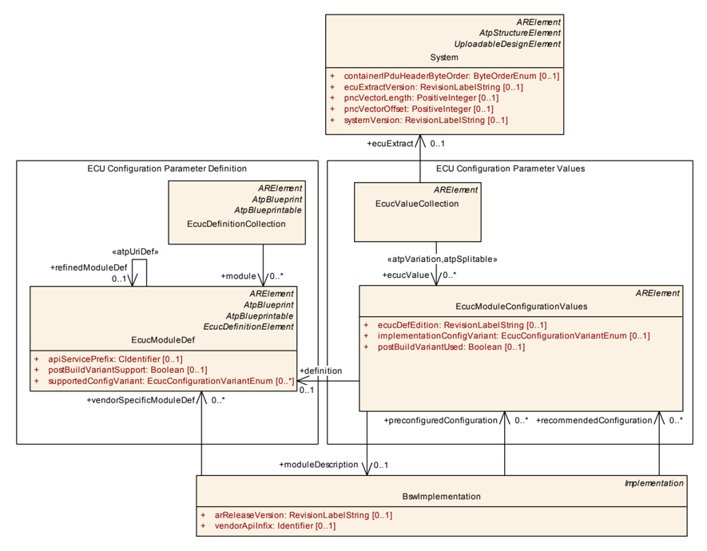

**约束：EcucModuleConfigurationValues 的配置变体（**Configuration variant**）**：implementationConfigVariant 规定为该 EcucModuleConfigurationValues 选择了哪个配置变体。选择取自与该 EcucModuleConfigurationValues 关联的 EcucModuleDef 中规定的 supportedConfigVariant 元素。取值 preconfiguredConfiguration 与 recommendedConfiguration 用于文档目的，不能用于代码生成。

元素 supportedConfigVariant 在[第 2.3.2 节](#232-ecu-配置模块定义ecu-configuration-module-definition)与[第 2.3.4.3.2 节](#23432-取值与多重性配置类value-and-multiplicity-configuration-classes)中描述。

**约束：在后构建配置时间引入新的后构建变体**：为了指示在一个特定的模块实现中，后构建变体计划在后构建配置时间添加，EcucModuleConfigurationValues 的 postBuildVariantUsed 应设置为 TRUE。

**约束：postBuildVariantUsed 取值设置为 FALSE 的影响**：如果 EcucModuleConfigurationValues.postBuildVariantUsed 的取值设置为 FALSE 或未定义，则不可能在后构建配置时间添加后构建变体。

**约束：存在后构建 VariationPoint 时 postBuildVariantUsed 的取值**：如果一个 **BSW** 模块的配置值包含至少一个后构建 VariationPoint，则该 EcucModuleConfigurationValues 的 postBuildVariantUsed 取值应设置为 TRUE。

**约束：postBuildVariantSupport 设置为 TRUE 时 EcucModuleConfigurationValues.postBuildVariantUsed 取值的设置限制**：如果 EcucModuleDef.postBuildVariantSupport 设置为 TRUE，则 EcucModuleConfigurationValues.postBuildVariantUsed 可以为 TRUE 或 FALSE。

**约束：postBuildVariantSupport 设置为 FALSE 时 EcucModuleConfigurationValues.postBuildVariantUsed 取值的设置限制**：如果 EcucModuleDef.postBuildVariantSupport 设置为 FALSE，则 EcucModuleConfigurationValues.postBuildVariantUsed 应为 FALSE。

为了说明 **ECU** 配置值描述的结构，示例 2.28 描绘了一个符合示例 2.6 所呈现的 **ECU** 配置定义 **XML** 文件的 **ECU** 配置值描述 **XML** 文件的顶层结构。请注意，允许在模块包定义之前有任意数量的包（例如 /AUTOSAR/Ecuc_VendorX/CanIf/...）。

采用示例 2.6 的唯一 supportedConfigVariant 作为 implementationConfigVariant 元素。

示例2.28：

```
 <AR-PACKAGE>
<SHORT-NAME>ECUC1</SHORT-NAME>
<ELEMENTS>
<ECUC-VALUE-COLLECTION>
<SHORT-NAME>Configuration</SHORT-NAME>
<ECU-EXTRACT-REF DEST="SYSTEM"> /some_package/some_path/ theEcuExtractForEcuXY </ECU-EXTRACT-REF>
<ECUC-VALUES>
<ECUC-MODULE-CONFIGURATION-VALUES-REF-CONDITIONAL>
<ECUC-MODULE-CONFIGURATION-VALUES-REF DEST="ECUC-MODULECONFIGURATION-VALUES"> /ECUC1/theRteConfig </ECUC-MODULECONFIGURATION-VALUES-REF>
</ECUC-MODULE-CONFIGURATION-VALUES-REF-CONDITIONAL>
</ECUC-VALUES>
</ECUC-VALUE-COLLECTION>
<ECUC-MODULE-CONFIGURATION-VALUES>
<SHORT-NAME>theRteConfig</SHORT-NAME>
<DEFINITION-REF DEST="ECUC-MODULE-DEF"> /AUTOSAR/EcucDefs/Rte </ DEFINITION-REF>
<IMPLEMENTATION-CONFIG-VARIANT> VARIANT-PRE-COMPILE </IMPLEMENTATIONCONFIG-VARIANT>
<MODULE-DESCRIPTION-REF DEST="BSW-IMPLEMENTATION"> /some_package/ some_path/theUsed_Rte_BSWModuleImplementation </MODULE-DESCRIPTIONREF>
<CONTAINERS>
<ECUC-CONTAINER-VALUE>
<SHORT-NAME>theGeneration</SHORT-NAME>  <DEFINITION-REF DEST="ECUC-PARAM-CONF-CONTAINER-DEF"> /AUTOSAR/ EcucDefs/Rte/RteGeneration </DEFINITION-REF>
<SUB-CONTAINERS>
<! --... -->
</SUB-CONTAINERS>
</ECUC-CONTAINER-VALUE>
</CONTAINERS>
</ECUC-MODULE-CONFIGURATION-VALUES>
</ELEMENTS>
</AR-PACKAGE> Each splitable property (attribute, aggregation, reference) need to be uniquely identifiable. This happens usually by shortName . The DEFINITION-REF can also be used. For example, the EcucParameterValue s of an EcucContainerValue are allowed to be split over several XML files. Each EcucParameterValue is uniquely identifiable via the reference to the EcucParameterDef . More details can be found in the Generic Structure Template [4]. In example 2.30 the value for the PRE-COMPILE time parameter ComSignalLength is specified, while in example 2.31 the POST-BUILD parameter's ComSignalInitValue value is given. The XML structure in both EcucModuleConfigurationValues XML files is equivalent with respect to the packages and containers. In both XML files a container with the name theSignal is defined. It is up to the configuration tool to merge the content of these two files into one model. Also is the number of possible XML files not limited, so it would be possible (although probably not reasonable) to put each parameter value into one XML file.
```


##### 2.4.2.1. 可拆分的模块配置（**Splitable ModuleConfiguration**）

在文档通用结构模板 [\[4\]](#ref-4) 中规定：如果关系标记有构造型 &lt;&lt;atpSplitable&gt;&gt;，则聚合的元素允许拆分到多个 **XML** 文件中。

引入构造型 &lt;&lt;atpSplitable&gt;&gt; 是为了支持把一个模块的 EcucModuleConfigurationValues 在若干 **XML** 文件中交付，用例另见 **Autosar** 方法论 [\[2\]](#ref-2) 第 2.7.8.3 与 2.7.8.4 章。

每个可拆分属性（属性、聚合、引用）都需要是唯一可标识的。这通常经由 shortName 实现。也可以使用 DEFINITION-REF。例如，一个 EcucContainerValue 的 EcucParameterValue 允许拆分到若干 **XML** 文件中。每个 EcucParameterValue 经由对 EcucParameterDef 的引用是唯一可标识的。更多细节见通用结构模板 [\[4\]](#ref-4)。

示例 2.29 展示了一个模块配置参数的简单定义。它只由一个容器组成，该容器具有两个参数：一个参数定义为预编译时间可配置，另一个参数就其取值与多重性而言都是后构建时间可配置。这些参数的取值与多重性在不同的过程步骤中定义，因此可以使用两个 **XML** 文件来描述这两类取值。

示例 2.30 规定了预编译时间参数 ComSignalLength 的取值，而示例 2.31 给出后构建参数 ComSignalInitValue 的取值。

两个 EcucModuleConfigurationValues **XML** 文件的 **XML** 结构就包与容器而言是等价的。两个 **XML** 文件中都定义了一个名为 theSignal 的容器。把这两个文件的内容合并到一个模型中是配置工具的职责。可能的 **XML** 文件数量也不受限制，因此（虽然可能不合理）可以把每个参数取值放入一个单独的 **XML** 文件。

示例2.29：

```
- <SHORT-NAME>Com</SHORT-NAME> - <LOWER-MULTIPLICITY>0</LOWER-MULTIPLICITY> - <UPPER-MULTIPLICITY>1</UPPER-MULTIPLICITY> - <POST-BUILD-VARIANT-SUPPORT>true</POST-BUILD-VARIANT-SUPPORT> - <SUPPORTED-CONFIG-VARIANTS>- <SUPPORTED-CONFIG-VARIANT> VARIANT-POST-BUILD </SUPPORTED-CONFIG-VARIANT>
</SUPPORTED-CONFIG-VARIANTS>
<CONTAINERS>
<ECUC-PARAM-CONF-CONTAINER-DEF>
<SHORT-NAME>ComSignal</SHORT-NAME>
<LOWER-MULTIPLICITY>0</LOWER-MULTIPLICITY>
<UPPER-MULTIPLICITY>*</UPPER-MULTIPLICITY>
<MULTIPLICITY-CONFIG-CLASSES>
<ECUC-MULTIPLICITY-CONFIGURATION-CLASS>
<CONFIG-CLASS>POST-BUILD</CONFIG-CLASS>
<CONFIG-VARIANT>VARIANT-POST-BUILD</CONFIG-VARIANT>
</ECUC-MULTIPLICITY-CONFIGURATION-CLASS>
</MULTIPLICITY-CONFIG-CLASSES>
<POST-BUILD-VARIANT-MULTIPLICITY> true </POST-BUILD-VARIANTMULTIPLICITY>
<PARAMETERS>
<ECUC-INTEGER-PARAM-DEF>
<SHORT-NAME>ComSignalLength</SHORT-NAME>
<MULTIPLICITY-CONFIG-CLASSES>
<ECUC-MULTIPLICITY-CONFIGURATION-CLASS>
<CONFIG-CLASS>PRE-COMPILE</CONFIG-CLASS>
<CONFIG-VARIANT>VARIANT-POST-BUILD</CONFIG-VARIANT>
</ECUC-MULTIPLICITY-CONFIGURATION-CLASS>
</MULTIPLICITY-CONFIG-CLASSES>
<ORIGIN>AUTOSAR_ECUC</ORIGIN>
<VALUE-CONFIG-CLASSES>
<ECUC-VALUE-CONFIGURATION-CLASS>
<CONFIG-CLASS>PRE-COMPILE</CONFIG-CLASS>
<CONFIG-VARIANT>VARIANT-POST-BUILD</CONFIG-VARIANT>
</ECUC-VALUE-CONFIGURATION-CLASS>
</VALUE-CONFIG-CLASSES>
</ECUC-INTEGER-PARAM-DEF>
<ECUC-INTEGER-PARAM-DEF>
<SHORT-NAME>ComSignalInitValue</SHORT-NAME>
<MULTIPLICITY-CONFIG-CLASSES>
<ECUC-MULTIPLICITY-CONFIGURATION-CLASS>
<CONFIG-CLASS>POST-BUILD</CONFIG-CLASS>
<CONFIG-VARIANT>VARIANT-POST-BUILD</CONFIG-VARIANT>
</ECUC-MULTIPLICITY-CONFIGURATION-CLASS>
</MULTIPLICITY-CONFIG-CLASSES>
<ORIGIN>AUTOSAR_ECUC</ORIGIN>
<VALUE-CONFIG-CLASSES>
<ECUC-VALUE-CONFIGURATION-CLASS>
<CONFIG-CLASS>POST-BUILD</CONFIG-CLASS>
<CONFIG-VARIANT>VARIANT-POST-BUILD</CONFIG-VARIANT>
</ECUC-VALUE-CONFIGURATION-CLASS>
</VALUE-CONFIG-CLASSES>
</ECUC-INTEGER-PARAM-DEF>
</PARAMETERS>
</ECUC-PARAM-CONF-CONTAINER-DEF>
</CONTAINERS>
</ECUC-MODULE-DEF>
```


示例2.30：

```
- <ECUC-MODULE-CONFIGURATION-VALUES>- <SHORT-NAME> theComConfig </SHORT-NAME> - <DEFINITION-REF DEST="ECUC-MODULE-DEF"> /AUTOSAR/EcucDefs/Com </DEFINITIONREF> - <IMPLEMENTATION-CONFIG-VARIANT> VARIANT-POST-BUILD </IMPLEMENTATION-CONFIGVARIANT> - <MODULE-DESCRIPTION-REF DEST="BSW-IMPLEMENTATION"> /some_package/some_path /theUsed_Com_BSWModuleImplementation </MODULE-DESCRIPTION-REF> - <CONTAINERS> - <ECUC-CONTAINER-VALUE> - <SHORT-NAME> theSignal </SHORT-NAME> - <DEFINITION-REF DEST= > EcucDefs/Com/ComSignal - "ECUC-PARAM-CONF-CONTAINER-DEF" /AUTOSAR/ </DEFINITION-REF> - <PARAMETER-VALUES>
<ECUC-NUMERICAL-PARAM-VALUE>
<DEFINITION-REF DEST="ECUC-INTEGER-PARAM-DEF"> /AUTOSAR/EcucDefs/ Com/ComSignal/ComSignalLength </DEFINITION-REF>
<VALUE> 2 </VALUE>
</ECUC-NUMERICAL-PARAM-VALUE>
</PARAMETER-VALUES> - </ECUC-CONTAINER-VALUE> - </CONTAINERS> -</ECUC-MODULE-CONFIGURATION-VALUES>
```


示例2.31：

```
- <ECUC-MODULE-CONFIGURATION-VALUES>- <SHORT-NAME> theComConfig </SHORT-NAME> - <DEFINITION-REF DEST="ECUC-MODULE-DEF"> /AUTOSAR/EcucDefs/Com </DEFINITIONREF> - <IMPLEMENTATION-CONFIG-VARIANT> VARIANT-POST-BUILD </IMPLEMENTATION-CONFIGVARIANT> - <MODULE-DESCRIPTION-REF DEST="BSW-IMPLEMENTATION"> /some_package/some_path /theUsed_Com_BSWModuleImplementation </MODULE-DESCRIPTION-REF> - <ECUC-CONTAINER-VALUE> - <SHORT-NAME> theSignal </SHORT-NAME> - <DEFINITION-REF DEST= > EcucDefs/Com/ComSignal - "ECUC-PARAM-CONF-CONTAINER-DEF" /AUTOSAR/ </DEFINITION-REF> - <PARAMETER-VALUES>
<ECUC-NUMERICAL-PARAM-VALUE>
<DEFINITION-REF DEST="ECUC-INTEGER-PARAM-DEF"> Com/ComSignal/ComSignalInitValue </DEFINITION-REF>
<VALUE> 0 </VALUE>
</ECUC-NUMERICAL-PARAM-VALUE>
</PARAMETER-VALUES> /AUTOSAR/EcucDefs/ </ECUC-CONTAINER-VALUE>
</CONTAINERS>
</ECUC-MODULE-CONFIGURATION-VALUES>
```


#### 2.4.3. 参数容器描述（**Parameter Container Description**）

与参数容器定义（见[第 2.3.3 节](#233-容器定义container-definition)）对称，规定参数容器描述以对其他容器、参数取值与引用进行分组。图 2.27 描绘了配置容器值描述的一般结构及其与配置定义的关联。这些依赖反映了 EcucContainerValue 与 EcucContainerDef 之间、以及 EcucParameterValue 与 ParameterType 之间的直接关系。

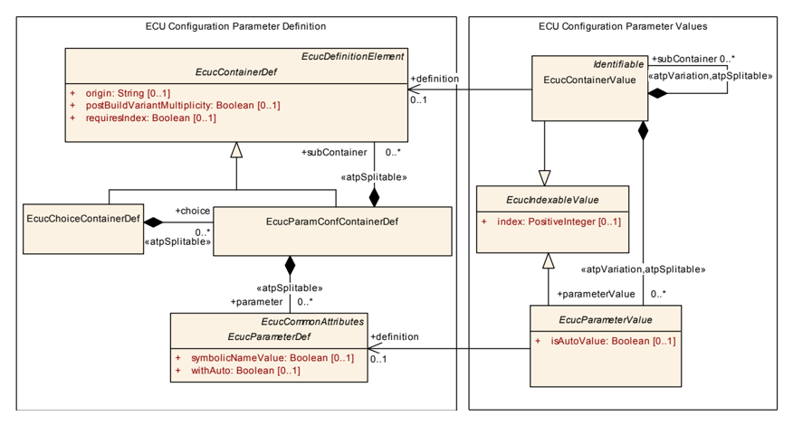

**约束：EcucContainerValue.definition 始终必需**：在代码生成时，属性 EcucContainerValue.definition 应始终被定义。

**约束：EcucParameterValue.definition 始终必需**：在代码生成时，属性 EcucParameterValue.definition 应始终被定义。

**约束：EcucContainerValue 为全部所含容器、参数与引用定义命名空间**：EcucContainerValue 继承自 Identifiable，为属于该 EcucContainerValue 的全部 EcucContainerValue、EcucParameterValue 与 EcucReferenceValue 定义一个命名空间。

**约束：后构建时间更新的 ECU 配置中 EcucContainerValue 实例的数量**：**ECU** 配置工具应检查：对于在相同的 EcucContainerValue 或 EcucModuleConfigurationValues 内（从 EcucModuleConfigurationValues 的 shortName 开始的限定 shortName 路径相同）、其 EcucContainerDef 在 VariantPostBuild multiplicityConfigClass.configVariant 中具有 PreCompile 或 Link multiplicityConfigClass.configClass 的 EcucContainerValue 实例的数量，在后构建时间更新的 **ECU** 配置中应相同。

**约束：不同后构建变体中 EcucContainerValue 实例的数量**：**ECU** 配置工具应检查：对于在相同的 EcucContainerValue 或 EcucModuleConfigurationValues 内（从 EcucModuleConfigurationValues 的 shortName 开始的限定 shortName 路径相同）、其 EcucContainerDef 的 postBuildVariantMultiplicity 设置为 false 的 EcucContainerValue 实例的数量，在所有在后构建时间绑定的变体点中应相同。

**约束：EcucContainerValue 定义引用（**definition reference**）**：引用定义把 EcucContainerValue 分配给它所依赖的相应 EcucContainerDef<sup>21</sup>。

如果提供的配置值描述没有相应的配置定义，编辑器将无法重构一个 EcucContainerValue 基于哪种 EcucContainerDef。

**约束：lowerMultiplicity < 1 的 EcucContainerDef 及其对相应 EcucContainerValue 的影响**：如果一个 EcucContainerDef 规定了 lowerMultiplicity &lt; 1，则相应的 EcucContainerValue 因被视为可选而可以在 **ECU** 配置值描述中省略。

> 21 包括全部 EcucContainerDef 的后代。

表2.48：EcucContainerValue（**EcucContainerValue**）

| 属性 | 值 |
| --- | --- |
| 类 | EcucContainerValue |
| 包 | M2::AUTOSARTemplates::ECUCDescriptionTemplate |
| 说明 | 表示 **ECU** 配置描述中的一个容器定义。 |
| 基类 | ARObject、EcucIndexableValue、Identifiable、MultilanguageReferrable、Referrable |
| 聚合于 | EcucContainerValue.subContainer、EcucModuleConfigurationValues.container |

| 属性 | 类型 | 多重性 | 种类 | 备注 |
| --- | --- | --- | --- | --- |
| definition | EcucContainerDef | 0..1 | ref | 对 **ECU** 配置参数定义中该容器的定义的引用。标签：xml.sequenceOffset=-10 |
| parameterValue | EcucParameterValue | * | aggr | 聚合该容器内的全部 **ECU** 配置值。atpVariation：[RS_ECUC_00079] 构造型：atpSplitable；atpVariation 标签：atp.Splitkey=parameterValue、parameterValue.variationPoint.shortLabel、vh.latestBindingTime=postBuild |
| referenceValue | EcucAbstractReferenceValue | * | aggr | 聚合该容器内的全部引用。atpVariation：[RS_ECUC_00079] 构造型：atpSplitable；atpVariation 标签：atp.Splitkey=referenceValue、referenceValue.variationPoint.shortLabel、vh.latestBindingTime=postBuild |
| subContainer | EcucContainerValue | * | aggr | 聚合该容器内的全部子容器。atpVariation：[RS_ECUC_00078] 构造型：atpSplitable；atpVariation 标签：atp.Splitkey=subContainer.shortName、subContainer.variationPoint.shortLabel、vh.latestBindingTime=postBuild |

**约束：可变的 subContainer（**Variable subContainers**）**：被聚合的 subContainer 受变体机制支配。存在性可以使用变体处理机制求值。

**约束：可变的 parameterValue（**Variable parameterValues**）**：被聚合的 parameterValue 受变体机制支配。存在性可以使用变体处理机制求值。

**约束：可变的 referenceValue（**Variable referenceValues**）**：被聚合的 referenceValue 受变体机制支配。存在性可以使用变体处理机制求值。

示例 2.32 展示了一个符合示例 2.7 所述 **ECU** 配置参数定义的 **ECU** 配置值描述 **XML** 文件片段。容器 RteGeneration 规定 upperMultiplicity 为 1，因此只能有一个 EcucContainerValue 表示。容器 SwComponentInstance 的 upperMultiplicity 为 *，因此该 EcucContainerValue 可以有多个表示。

示例2.32：

```
- <ECUC-MODULE-CONFIGURATION-VALUES>- <SHORT-NAME> theRteConfig </SHORT-NAME> - <DEFINITION-REF DEST="ECUC-MODULE-DEF"> /AUTOSAR/EcucDefs/Rte </DEFINITIONREF> - <IMPLEMENTATION-CONFIG-VARIANT> VARIANT-PRE-COMPILE </IMPLEMENTATION-CONFIG -VARIANT> - <MODULE-DESCRIPTION-REF DEST="BSW-IMPLEMENTATION"> /some_package/some_path /theUsed_Rte_BSWModuleImplementation </MODULE-DESCRIPTION-REF>
<CONTAINERS> - <ECUC-CONTAINER-VALUE> - <SHORT-NAME> theGeneration </SHORT-NAME> - <DEFINITION-REF DEST="ECUC-PARAM-CONF-CONTAINER-DEF"> EcucDefs/Rte/RteGeneration </DEFINITION-REF> - <SUB-CONTAINERS>
<! --... -->
</SUB-CONTAINERS>
</ECUC-CONTAINER-VALUE>
<ECUC-CONTAINER-VALUE> - <SHORT-NAME> SwcInstance1 </SHORT-NAME> - <DEFINITION-REF DEST="ECUC-PARAM-CONF-CONTAINER-DEF"> /AUTOSAR/ EcucDefs/Rte/RteSwComponentInstance </DEFINITION-REF> - <SUB-CONTAINERS>
<! --... -->
</SUB-CONTAINERS>
</ECUC-CONTAINER-VALUE>
<ECUC-CONTAINER-VALUE> - <SHORT-NAME> SwcInstance2 </SHORT-NAME>
<DEFINITION-REF DEST="ECUC-PARAM-CONF-CONTAINER-DEF"> EcucDefs/Rte/RteSwComponentInstance </DEFINITION-REF> - <SUB-CONTAINERS>
<! --... -->
</SUB-CONTAINERS>
</ECUC-CONTAINER-VALUE>
</CONTAINERS> -</ECUC-MODULE-CONFIGURATION-VALUES>
```


##### 2.4.3.1. 选项容器（**Choice Containers**）

**约束：取值侧的 EcucChoiceContainerDef**：在 **ECU** 配置参数定义中，容器选项被规定为 EcucChoiceContainerDef 的一部分。在取值侧，EcucChoiceContainerDef 被当作一个普通容器对待，不过选项可以被执行的次数取决于 EcucChoiceContainerDef 的 upperMultiplicity。执行了哪个选项由 &lt;SUB-CONTAINER&gt; 的 &lt;DEFINITION-REF&gt; 定义。

示例 2.33 描绘了如示例 2.8 所述的、已填写的 EcucChoiceContainerDef 的记法。

对于 myGwSource001，只可能有一个选择，此处选择了 ComGwSignal。

对于第二部分（ComGwDestination），执行了三个选择：myGwDestination021 选择了 ComGwSignal，然后 myGwDestination022 选择了 ComGwDestinationDescription，然后 myGwDestination023 又选择了另一个 ComGwSignal。

示例2.33：

```
<ECUC-MODULE-CONFIGURATION-VALUES>- <SHORT-NAME> myChoiceExample </SHORT-NAME> - <DEFINITION-REF DEST="ECUC-MODULE-DEF"> /AUTOSAR/EcucDefs/Com </DEFINITIONREF>
<CONTAINERS>
<ECUC-CONTAINER-VALUE>
<SHORT-NAME> ComGwMapping001 </SHORT-NAME>
<DEFINITION-REF DEST="ECUC-PARAM-CONF-CONTAINER-DEF"> /AUTOSAR/ EcucDefs/Com/ComConfig/ComGwMapping </DEFINITION-REF>
<SUB-CONTAINERS>
<ECUC-CONTAINER-VALUE> - <SHORT-NAME> myGwSource001 </SHORT-NAME>
<DEFINITION-REF DEST="ECUC-CHOICE-CONTAINER-DEF"> /AUTOSAR/ EcucDefs/Com/ComConfig/ComGwMapping/ComGwSource </DEFINITION- REF>
<SUB-CONTAINERS>
<ECUC-CONTAINER-VALUE>
<SHORT-NAME> myGwSource001_1 </SHORT-NAME>
<DEFINITION-REF DEST="ECUC-PARAM-CONF-CONTAINER-DEF"> /AUTOSAR /EcucDefs/Com/ComConfig/ComGwMapping/ComGwSource/ ComGwSignal </DEFINITION-REF>
<! --...-->
</ECUC-CONTAINER-VALUE>
</SUB-CONTAINERS>
</ECUC-CONTAINER-VALUE>
<ECUC-CONTAINER-VALUE>
<SHORT-NAME> myGwDestination021 </SHORT-NAME>
<DEFINITION-REF DEST="ECUC-CHOICE-CONTAINER-DEF"> /AUTOSAR/ EcucDefs/Com/ComConfig/ComGwMapping/ComGwDestination </ DEFINITION-REF>
<SUB-CONTAINERS>
<ECUC-CONTAINER-VALUE>
<SHORT-NAME> myGwDestination021a </SHORT-NAME>
<DEFINITION-REF DEST="ECUC-PARAM-CONF-CONTAINER-DEF"> /AUTOSAR /EcucDefs/Com/ComConfig/ComGwMapping/ComGwDestination/ ComGwSignal </DEFINITION-REF>
<! --...-->
</ECUC-CONTAINER-VALUE>
</SUB-CONTAINERS>
</ECUC-CONTAINER-VALUE>
<ECUC-CONTAINER-VALUE>
<SHORT-NAME> myGwDestination022 </SHORT-NAME>
<DEFINITION-REF DEST="ECUC-CHOICE-CONTAINER-DEF"> /AUTOSAR/ EcucDefs/Com/ComConfig/ComGwMapping/ComGwDestination </ DEFINITION-REF>
<SUB-CONTAINERS>
<ECUC-CONTAINER-VALUE>
<SHORT-NAME> myGwDestination022a </SHORT-NAME>
<DEFINITION-REF DEST="ECUC-PARAM-CONF-CONTAINER-DEF"> /AUTOSAR /EcucDefs/Com/ComConfig/ComGwMapping/ComGwDestination/ ComGwDestinationDescription </DEFINITION-REF>
<! --...-->
</ECUC-CONTAINER-VALUE>
</SUB-CONTAINERS>
</ECUC-CONTAINER-VALUE>
<ECUC-CONTAINER-VALUE>
<SHORT-NAME> myGwDestination023 </SHORT-NAME>
<DEFINITION-REF DEST="ECUC-CHOICE-CONTAINER-DEF"> /AUTOSAR/ EcucDefs/Com/ComConfig/ComGwMapping/ComGwDestination DEFINITION-REF>
<SUB-CONTAINERS>
<ECUC-CONTAINER-VALUE>
<SHORT-NAME> myGwDestination023a </SHORT-NAME>
<DEFINITION-REF DEST="ECUC-PARAM-CONF-CONTAINER-DEF" </ > /AUTOSAR /EcucDefs/Com/ComConfig/ComGwMapping/ComGwDestination/ ComGwSignal </DEFINITION-REF>
<! --...-->
</ECUC-CONTAINER-VALUE>
</SUB-CONTAINERS>
</ECUC-CONTAINER-VALUE>
</SUB-CONTAINERS>
</ECUC-CONTAINER-VALUE>
</CONTAINERS>
</ECUC-MODULE-CONFIGURATION-VALUES>
```


#### 2.4.4. 参数取值（**Parameter Values**）

在 **ECU** 配置参数定义中，不同类型的参数（例如布尔、整数、字符串，见[第 2.3.5 节](#235-参数定义parameter-definition)）存在单独的元素。在 **ECU** 配置值描述一侧，这种区分不再需要，因为每个参数取值元素都引用相应的定义元素，因此其类型已经绑定。

不过，依据变体处理的实现（见[第 2.3.4.1 节](#2341-变体处理variant-handling)）与文档支持（见[第 2.3.5.9 节](#2359-addinfo)），参数取值存在另一种区分。

**约束：EcucParameterValue 是全部参数取值的基类（**base class**）**：规定参数取值的全部元模型类都派生自 EcucParameterValue。

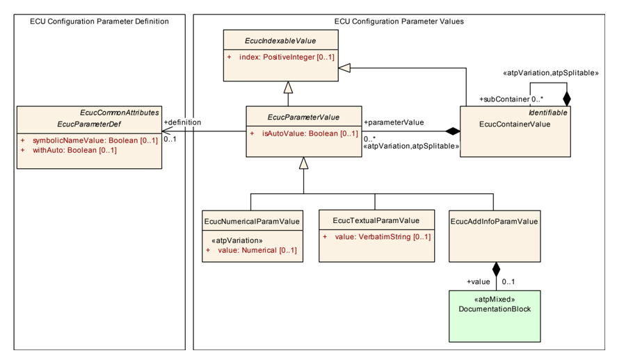

**约束：EcucNumericalParamValue.value 始终必需**：在代码生成时，属性 EcucNumericalParamValue.value 应始终被定义。

**约束：EcucTextualParamValue.value 始终必需**：在代码生成时，属性 EcucTextualParamValue.value 应始终被定义。

**约束：EcucAddInfoParamValue.value 始终必需**：在代码生成时，属性 EcucAddInfoParamValue.value 应始终被定义。

**约束：属性 value 在基于 XML 的描述中存储配置值（**stores the configuration value**）**：表示 **ECU** 配置值的全部继承元模型类都规定一个在基于 **XML** 的描述中存储配置值的属性 value。

**约束：EcucParameterValue 到相应 EcucParameterDef 的分配（**Assignment**）**：引用定义把 EcucParameterValue<sup>22</sup> 分配给它为之提供取值的相应 EcucParameterDef。

**约束：ECU 配置参数定义中规定的 defaultValue 可用作 ECU 配置值描述中的初始值**：如果 **ECU** 配置参数定义中规定了一个 defaultValue，则该给定值可以用作 **ECU** 配置值描述中相应 EcucParameterValue 的初始值，如 TPS_ECUC_01019 所解释。

**约束：ECU 配置值描述中不存在的可选参数的语义**：**ECU** 配置值描述中不存在的可选参数的语义是：没有参数取值可用，即使 **ECU** 参数定义提供了默认取值。

**约束：ECU 配置值描述中的每个参数都应有一个取值**：在一个良构且完整的 **ECU** 配置值描述中，每个提供的参数都需要规定一个取值，即使它只是从 **ECU** 配置定义的 defaultValue 复制而来。

关于在 **ECU** 配置定义中未规定 defaultValue 时如何提供取值的进一步规则，见[第 4.2 节](#42-构建基础-ecu-配置的规则rules-for-building-the-base-ecu-configuration)。

**约束：在 ECU 配置定义中声明为可选的参数可以在 ECU 配置值描述中省略**：如果一个 **ECU** 配置参数规定了 lowerMultiplicity &lt; 1，则该 **ECU** 配置值因被视为可选而可以在 **ECU** 配置值描述中省略。

> 22 EcucParameterValue 的子类。

表2.49：EcucParameterValue（**EcucParameterValue**）

| 属性 | 值 |
| --- | --- |
| 类 | EcucParameterValue（抽象） |
| 包 | M2::AUTOSARTemplates::ECUCDescriptionTemplate |
| 说明 | 全部配置值类型的公共类。 |
| 基类 | ARObject、EcucIndexableValue |
| 子类 | EcucAddInfoParamValue、EcucNumericalParamValue、EcucTextualParamValue |
| 聚合于 | EcucContainerValue.parameterValue |

| 属性 | 类型 | 多重性 | 种类 | 备注 |
| --- | --- | --- | --- | --- |
| annotation | Annotation | * | aggr | 在定义 **ECU** 配置参数取值时提供附加备注的可能性。这些并非用作文档，而只是设计备注。标签：xml.sequenceOffset=10 |
| definition | EcucParameterDef | 0..1 | ref | 对 **ECU** 配置参数定义中该 EcucParameterValue 子类的定义的引用。标签：xml.sequenceOffset=-10 |
| isAutoValue | Boolean | 0..1 | attr | 如果该参数定义的 withAuto 设置为「true」，则 isAutoValue 可以设置为「true」。如果 isAutoValue 设置为「true」，则实际取值在 **ECU** 配置期间不被考虑，而是由代码生成器（重新）计算并随后存储在 value 属性中。这些隐式更新的取值可能需要对引用这些取值的其他模块进行重新生成。若 isAutoValue 不存在，默认为「false」。标签：xml.sequenceOffset=20 |

**约束：后构建时间更新的 ECU 配置中 EcucParameterValue 实例的取值**：**ECU** 配置工具应检查：对于在相同的 EcucContainerValue 内（从 EcucModuleConfigurationValues 的 shortName 开始的限定 shortName 路径相同）、其 EcucParameterDef 在 VariantPostBuild valueConfigClass.configVariant 中具有 PreCompile 或 Link valueConfigClass.configClass 的 EcucParameterValue 实例的取值，在后构建时间更新的 **ECU** 配置中应相同。

**约束：不同后构建变体中 EcucParameterValue 实例的取值**：**ECU** 配置工具应检查：对于在相同的 EcucContainerValue 内（从 EcucModuleConfigurationValues 的 shortName 开始的限定 shortName 路径相同）、其 EcucParameterDef 的 postBuildVariantValue 设置为 false 的 EcucParameterValue 实例的取值，在所有在后构建时间绑定的变体点中应相同。

**约束：后构建时间更新的 ECU 配置中 EcucParameterValue 实例的数量**：**ECU** 配置工具应检查：对于在相同的 EcucContainerValue 内（从 EcucModuleConfigurationValues 的 shortName 开始的限定 shortName 路径相同）、其 EcucParameterDef 在 VariantPostBuild multiplicityConfigClass.configVariant 中具有 PreCompile 或 Link multiplicityConfigClass.configClass 的 EcucParameterValue 实例的数量，在后构建时间更新的 **ECU** 配置中应相同。

**约束：不同后构建变体中 EcucParameterValue 实例的数量**：**ECU** 配置工具应检查：对于在相同的 EcucParameterValue 内（从 EcucModuleConfigurationValues 的 shortName 开始的限定 shortName 路径相同）、其 EcucParameterDef 的 postBuildVariantMultiplicity 设置为 false 的 EcucParameterValue 实例的数量，在所有在后构建时间绑定的变体点中应相同。

**约束：在后构建更新后的配置中引入新的 EcucParamConfContainerDef 实例**：如果在一个更新的后构建配置中依据约束「不同配置时点下 EcucContainerDef 实例数量的差异」引入一个新的 EcucParamConfContainerDef 实例，则该 EcucParamConfContainerDef 实例内及其以角色 subContainer 实例化的聚合 EcucParamConfContainerDef 内的每个 EcucParameterValue 与 EcucReferenceValue，可以分配一个新的取值并拥有任意数量的实例（如果 upperMultiplicity 大于 lowerMultiplicity），而无论其 valueConfigClass 与 multiplicityConfigClass（PreCompile、Link 或 PostBuild）如何。

示例：既有 ComIPdu 的 HandleId 取值不应在后构建时间改变，因为它是链接时间可配置的。然而，如果在后构建时间引入一个新的 ComIPdu 实例，它应接收一个新的 HandleId 取值。这基本上意味着 valueConfigClass 与 multiplicityConfigClass 只适用于在后构建更新之前的初始配置中已存在的容器实例中的参数与引用。

**约束：后构建时间引入类型为 EcucFunctionNameDef 的新 EcucParameterValue**：在后构建时间引入类型为 EcucFunctionNameDef（见约束「EcucFunctionNameDef 属性」）的新 EcucParameterValue 的情形下，其取值应是既有函数名（例如 callout）之一。这意味着不允许在后构建时间引入新函数。

##### 2.4.4.1. 文本参数值（**Textual Parameter Value**）

对于没有数值表示的参数取值的存储，应使用元素 EcucTextualParamValue。

**约束：存储在元素 EcucTextualParamValue 中的参数类型的取值**：参数类型

- EcucEnumerationParamDef
- EcucAbstractStringParamDef 及其子类

的取值应存储在元素 EcucTextualParamValue 中。

实际取值作为 VerbatimString 存储在元素 value 中，并应符合 definition 元素中引用的 **ECU** 配置参数定义的定义。[第 2.3.5.4 节](#2354-字符串参数string-parameter)、[第 2.3.5.5 节](#2355-链接器符号参数linker-symbol-parameter)、[第 2.3.5.6 节](#2356-函数名参数function-name-parameter)与[第 2.3.5.7 节](#2357-枚举参数enumeration-parameter)中规定的对文本表示的限制适用于相应的取值规定。

如果 EcucTextualParamValue 的取值应受变体处理的影响，则各个备选 EcucTextualParamValue 元素的存在性应变为可变。value 元素本身不能受变体处理影响。

表2.50：EcucTextualParamValue（**EcucTextualParamValue**）

| 属性 | 值 |
| --- | --- |
| 类 | EcucTextualParamValue |
| 包 | M2::AUTOSARTemplates::ECUCDescriptionTemplate |
| 说明 | 持有一个不受变体机制支配的取值。 |
| 基类 | ARObject、EcucIndexableValue、EcucParameterValue |
| 聚合于 | EcucContainerValue.parameterValue |

| 属性 | 类型 | 多重性 | 种类 | 备注 |
| --- | --- | --- | --- | --- |
| value | VerbatimString | 0..1 | attr | 参数的取值，不受变体机制支配。 |

###### 2.4.4.1.1. EcucTextualParamValue 的示例（**Examples of EcucTextualParamValue**）

示例 2.34 描绘了示例 2.14 的定义类型 EcucLinkerSymbolDef 的配置描述。

示例2.34：

```
 <ECUC-TEXTUAL-PARAM-VALUE>
<DEFINITION-REF DEST="ECUC-LINKER-SYMBOL-DEF"> Resource/Pim/RtePimInitializationSymbol </DEFINITION-REF>
<VALUE>MyPimInitValuesLightMaster</VALUE>
</ECUC-TEXTUAL-PARAM-VALUE>   /AUTOSAR/EcucDefs/Rte/ 
```


示例 2.35 描绘了示例 2.15 的定义类型 EcucFunctionNameDef 的配置描述。

示例2.35：

```
 <ECUC-TEXTUAL-PARAM-VALUE>
<DEFINITION-REF DEST="ECUC-FUNCTION-NAME-DEF"> /AUTOSAR/EcucDefs/Eep/ EepInitConfiguration/EepJobEndNotification </DEFINITION-REF>
<VALUE>Eep_VendorXY_JobEndNotification</VALUE>
</ECUC-TEXTUAL-PARAM-VALUE> 
```

示例 2.36 描绘了示例 2.16 的定义类型 EcucEnumerationParamDef 的配置描述。

示例2.36：

```
 <ECUC-TEXTUAL-PARAM-VALUE>
<DEFINITION-REF DEST="ECUC-ENUMERATION-PARAM-DEF"> RteGeneration/RteGenerationMode </DEFINITION-REF>
<VALUE>CompatibilityMode</VALUE>
</ECUC-TEXTUAL-PARAM-VALUE>  /AUTOSAR/EcucDefs/Rte/ If the value of a configuration parameter shall be provided as subject to variant handling the element EcucNumericalParamValue shall be used. The value element of EcucNumericalParamValue is defined as <<atpVariation>>
```


##### 2.4.4.2. 数值参数值（**Numerical Parameter Value**）

如果配置参数的取值应作为受变体机制支配的对象提供，则应使用元素 EcucNumericalParamValue。EcucNumericalParamValue 的 value 元素定义为 &lt;&lt;atpVariation&gt;&gt;（见[第 2.3.4.1 节](#2341-变体处理variant-handling)）。

表2.51：EcucNumericalParamValue（**EcucNumericalParamValue**）

| 属性 | 值 |
| --- | --- |
| 类 | EcucNumericalParamValue |
| 包 | M2::AUTOSARTemplates::ECUCDescriptionTemplate |
| 说明 | 持有受变体机制支配的取值。 |
| 基类 | ARObject、EcucIndexableValue、EcucParameterValue |
| 聚合于 | EcucContainerValue.parameterValue |

| 属性 | 类型 | 多重性 | 种类 | 备注 |
| --- | --- | --- | --- | --- |
| value | Numerical | 0..1 | attr | 受变体机制支配的取值。atpVariation：[RS_ECUC_00080] 构造型：atpVariation 标签：vh.latestBindingTime=preCompileTime |

**约束：EcucNumericalParamValue.value 的可变取值（**Variable value**）**：EcucNumericalParamValue.value 的取值受变体机制支配。

###### 2.4.4.2.1. EcucNumericalParamValue 的示例（**Examples of EcucNumericalParamValue**）

示例 2.37 描绘了示例 2.11 的定义类型 EcucBooleanParamDef 的配置描述。

示例2.37：

```
 <ECUC-NUMERICAL-PARAM-VALUE>
<DEFINITION-REF DEST="ECUC-BOOLEAN-PARAM-DEF"> /AUTOSAR/EcucDefs/Rte/ RteGeneration/RteDevErrorDetect </DEFINITION-REF>
<VALUE>1</VALUE>  </ECUC-NUMERICAL-PARAM-VALUE>
```

示例 2.38 描绘了示例 2.12 的定义类型 EcucIntegerParamDef 的配置描述。

**注意：** 源文档的示例 2.38 在 markdown 转换中重复了示例 2.35 的清单体（ECUC-TEXTUAL-PARAM-VALUE/EepJobEndNotification），与正文宣称的 EcucIntegerParamDef/PositionInTask 不符；依据 PDF 排版版面，该处清单应为 POSITION-IN-TASK 的数值取值。此处按正文语义补正为：


示例 2.39 描绘了示例 2.13 的定义类型 EcucFloatParamDef 的配置描述。

示例2.39：

```
 <ECUC-NUMERICAL-PARAM-VALUE>
<DEFINITION-REF DEST="ECUC-FLOAT-PARAM-DEF"> /AUTOSAR/EcucDefs/Rte/ RunnableEntityMapping/SchedulingPeriod </DEFINITION-REF>
<VALUE>74.8</VALUE>
</ECUC-NUMERICAL-PARAM-VALUE>
```


##### 2.4.4.3. AddInfo 参数值（**AddInfo Parameter Value**）

取值唯一的类型特定区分是 **ECU** 配置参数类型 EcucAddInfoParamDef（见[第 2.3.5.9 节](#2359-addinfo)）。

**约束：参数类型 EcucAddInfoParamDef 的取值**：参数类型 EcucAddInfoParamDef 的取值应在元素 EcucAddInfoParamValue 中提供。这允许使用格式化的文本（更多信息见 **AUTOSAR** 通用结构模板 [\[4\]](#ref-4)）。

表2.52：EcucAddInfoParamValue（**EcucAddInfoParamValue**）

| 属性 | 值 |
| --- | --- |
| 类 | EcucAddInfoParamValue |
| 包 | M2::AUTOSARTemplates::ECUCDescriptionTemplate |
| 说明 | 该参数对应于 EcucAddInfoParamDef。 |
| 基类 | ARObject、EcucIndexableValue、EcucParameterValue |
| 聚合于 | EcucContainerValue.parameterValue |

| 属性 | 类型 | 多重性 | 种类 | 备注 |
| --- | --- | --- | --- | --- |
| value | DocumentationBlock | 0..1 | aggr | 持有格式化文本的内容。 |

示例 2.40 描绘了示例 2.17 的定义类型 EcucAddInfoParamDef 的配置描述。

示例2.40：

```
 <ECUC-ADD-INFO-PARAM-VALUE>
<DEFINITION-REF DEST="ECUC-ADD-INFO-PARAM-DEF"> /AUTOSAR/EcucDefs/Dcm/ DcmConfigSet/Dtc </DEFINITION-REF>
<VALUE>
<P>
<L-1 L="EN"> Description of the Dtc 0815. </L-1>
</P>
</VALUE>
</ECUC-ADD-INFO-PARAM-VALUE>
```


#### 2.4.5. ECU 配置元模型中的引用（**References in the ECU Configuration Metamodel**）

图 2.29 描绘了引用其他描述元素的 **ECU** 配置元模型。

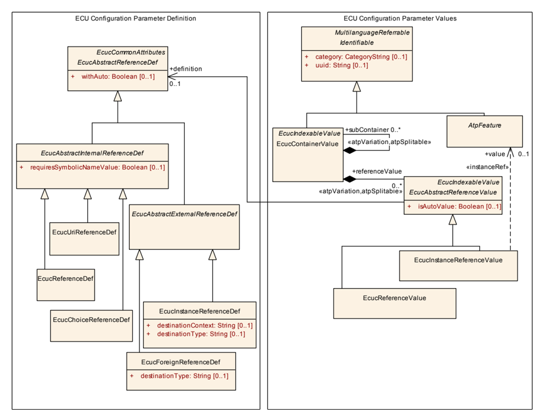

**约束：EcucAbstractReferenceValue.definition 始终必需**：在代码生成时，属性 EcucAbstractReferenceValue.definition 应始终被定义。

**约束：EcucInstanceReferenceValue.value 始终必需**：在代码生成时，属性 EcucInstanceReferenceValue.value 应始终被定义。

**约束：EcucReferenceValue.value 始终必需**：在代码生成时，属性 EcucReferenceValue.value 应始终被定义。

**约束：全部引用类型的泛化（**Generalization**）**：元模型类 EcucAbstractReferenceValue 充当 **ECU** 配置值描述中全部引用类型的泛化。

**约束：EcucAbstractReferenceValue 定义引用（**definition reference**）**：引用定义把 EcucAbstractReferenceValue<sup>23</sup> 分配给它所依赖的相应 EcucAbstractReferenceDef。

**约束：lowerMultiplicity < 1 的 EcucAbstractReferenceDef 及其对相应 EcucAbstractReferenceValue 的影响**：如果一个 EcucAbstractReferenceDef 规定了 lowerMultiplicity &lt; 1，则相应的 EcucAbstractReferenceValue 因被视为可选而可以在 **ECU** 配置值描述中省略。

> 23 及其全部后代。

表2.53：EcucAbstractReferenceValue（**EcucAbstractReferenceValue**）

| 属性 | 值 |
| --- | --- |
| 类 | EcucAbstractReferenceValue（抽象） |
| 包 | M2::AUTOSARTemplates::ECUCDescriptionTemplate |
| 说明 | 用作 **ECU** 配置描述中全部引用值的公共父类的抽象类。 |
| 基类 | ARObject、EcucIndexableValue |
| 子类 | EcucInstanceReferenceValue、EcucReferenceValue |
| 聚合于 | EcucContainerValue.referenceValue |

| 属性 | 类型 | 多重性 | 种类 | 备注 |
| --- | --- | --- | --- | --- |
| annotation | Annotation | * | aggr | 在定义模型元素（例如 **ECU** 配置参数取值）时提供附加备注的可能性。这些并非用作文档，而只是设计备注。 |
| definition | EcucAbstractReferenceDef | 0..1 | ref | 对 **ECU** 配置参数定义中该 EcucAbstractReferenceValue 子类的定义的引用。标签：xml.sequenceOffset=-10 |
| isAutoValue | Boolean | 0..1 | attr | 如果该参数定义的 withAuto 设置为「true」，则 isAutoValue 可以设置为「true」。如果 isAutoValue 设置为「true」，则实际取值在 **ECU** 配置期间不被考虑，而是由代码生成器（重新）计算并随后存储在 value 属性中。这些隐式更新的取值可能需要对引用这些取值的其他模块进行重新生成。若 isAutoValue 不存在，默认为「false」。 |

**约束：EcucReferenceValue 提供引用 Referrable 模型元素的机制**：元模型类 EcucReferenceValue 提供引用任何类型为 Referrable 的模型元素的机制。

**约束：EcucReferenceValue 在 Ecu 配置值描述中描述 EcucReferenceDef、EcucChoiceReferenceDef 与 EcucForeignReferenceDef**：EcucReferenceValue 提供描述除 EcucInstanceReferenceDef（它由约束「EcucInstanceReferenceValue 提供引用原型实例的机制」更详细地描述）之外的全部引用定义种类的手段。

**约束：EcucChoiceReferenceDef 在 ECU 配置值描述中转换为 EcucReferenceValue**：EcucChoiceReferenceDef 在 **ECU** 配置值描述中转换为 EcucReferenceValue，因为选项必须在该描述中被解析。因此不引入特殊的配置值描述类型。

表2.54：EcucReferenceValue（**EcucReferenceValue**）

| 属性 | 值 |
| --- | --- |
| 类 | EcucReferenceValue |
| 包 | M2::AUTOSARTemplates::ECUCDescriptionTemplate |
| 说明 | 用于表示其参数定义为 EcucAbstractReferenceDef 类型的配置值（用于其全部特化，EcucInstanceReferenceDef 除外）。 |
| 基类 | ARObject、EcucAbstractReferenceValue、EcucIndexableValue |
| 聚合于 | EcucContainerValue.referenceValue |

| 属性 | 类型 | 多重性 | 种类 | 备注 |
| --- | --- | --- | --- | --- |
| value | Referrable | 0..1 | ref | 规定该引用的目标。 |

**约束：后构建时间更新的 ECU 配置中 EcucAbstractReferenceValue 实例的取值**：**ECU** 配置工具应检查：对于在相同的 EcucContainerValue 内（从 EcucModuleConfigurationValues 的 shortName 开始的限定 shortName 路径相同）、其 EcucAbstractReferenceDef 在 VariantPostBuild valueConfigClass.configVariant 中具有 PreCompile 或 Link valueConfigClass.configClass 的 EcucAbstractReferenceValue 实例的取值，在后构建时间更新的 **ECU** 配置中应相同。

**约束：不同后构建变体中 EcucAbstractReferenceValue 实例的取值**：**ECU** 配置工具应检查：对于在相同的 EcucContainerValue 内（从 EcucModuleConfigurationValues 的 shortName 开始的限定 shortName 路径相同）、其 EcucAbstractReferenceDef 的 postBuildVariantValue 设置为 false 的 EcucAbstractReferenceValue 实例的取值，在所有在后构建时间绑定的变体点中应相同。

**约束：后构建时间更新的 ECU 配置中 EcucAbstractReferenceValue 实例的数量**：**ECU** 配置工具应检查：对于在相同的 EcucContainerValue 内（从 EcucModuleConfigurationValues 的 shortName 开始的限定 shortName 路径相同）、其 EcucAbstractReferenceDef 在 VariantPostBuild multiplicityConfigClass.configVariant 中具有 PreCompile 或 Link multiplicityConfigClass.configClass 的 EcucAbstractReferenceValue 实例的数量，在后构建时间更新的 **ECU** 配置中应相同。

**约束：不同后构建变体中 EcucAbstractReferenceValue 实例的数量**：**ECU** 配置工具应检查：对于在相同的 EcucParameterValue 内（从 EcucModuleConfigurationValues 的 shortName 开始的限定 shortName 路径相同）、其 EcucAbstractReferenceDef 的 postBuildVariantMultiplicity 设置为 false 的 EcucAbstractReferenceValue 实例的数量，在所有在后构建时间绑定的变体点中应相同。

**约束：被引用的容器应与引用本身属于同一个 EcucValueCollection**：如果一个 EcucAbstractReferenceValue 引用某个 EcucModuleConfigurationValues 内的一个容器，则被引用的容器应是某个 EcucModuleConfigurationValues 的一部分，而后者本身是 EcucValueCollection 的一部分。

依据图 2.25，一个 EcucModuleConfigurationValues 如果以 ecucValue 角色被引用，则它是 EcucValueCollection 的一部分。

以下各例将展示 EcucReferenceValue 可以用来表示 EcucAbstractReferenceDef 的大多数特化（即 EcucReferenceDef、EcucChoiceReferenceDef 与 EcucForeignReferenceDef）。

示例 2.41 描绘了示例 2.18 的定义类型 EcucReferenceDef 的配置描述。

示例2.41：

```
 <ECUC-REFERENCE-VALUE>
<DEFINITION-REF DEST="ECUC-REFERENCE-DEF"> /AUTOSAR/EcucDefs/Os/ OsApplication/OsAppScheduleTableRef </DEFINITION-REF>
<VALUE-REF DEST="ECUC-CONTAINER-VALUE"> /ECUC/myOs/myOsScheduleTable1 </ VALUE-REF>
</ECUC-REFERENCE-VALUE> 
```

示例 2.42 描绘了示例 2.19 的定义类型 EcucChoiceReferenceDef 的配置描述。为了更详细地说明 EcucChoiceReferenceDef 的用法，该示例利用了一个 PortPin 可以同时在若干模式中使用的事实，因此它具有多个不同类型的引用。

示例2.42：

```
 <ECUC-REFERENCE-VALUE>
<DEFINITION-REF DEST="ECUC-CHOICE-REFERENCE-DEF"> /AUTOSAR/EcucDefs/Port/ PortPin/PortPinMode </DEFINITION-REF>
<VALUE-REF DEST="ECUC-CONTAINER-VALUE"> /ECUC/mySpi/aSpiExternalDevice1 </ VALUE-REF>
</ECUC-REFERENCE-VALUE> 
```

示例 2.43 描绘了示例 2.20 的定义类型 EcucForeignReferenceDef 的配置描述。

示例2.43：

```
<ECUC-REFERENCE-VALUE>
<DEFINITION-REF DEST="ECUC-FOREIGN-REFERENCE-DEF"> /AUTOSAR/EcucDefs/Rte/ Communication/FrameMapping/SystemFrame </DEFINITION-REF>
<VALUE-REF DEST="FRAME"> /SystemDescription/SystemFrameNo42 </VALUE-REF>
</ECUC-REFERENCE-VALUE>
```


##### 2.4.5.1. 实例引用值（**Instance Reference Values**）

由于 **AUTOSAR** 模板中原型的形式化（见 [\[4\]](#ref-4)），对原型实例的引用需要声明该实例所在的完整上下文。

**约束：EcucInstanceReferenceValue 提供引用原型实例的机制**：元模型类 EcucInstanceReferenceValue 提供引用原型的一个实际实例的机制。这通过规定一个带有构造型 &lt;&lt;instanceRef&gt;&gt; 的关系实现。

图 2.30 规定了 EcucInstanceReferenceValue &lt;&lt;instanceRef&gt;&gt; 的详细建模。

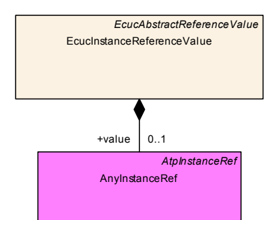

表2.55：EcucInstanceReferenceValue（**EcucInstanceReferenceValue**）

| 属性 | 值 |
| --- | --- |
| 类 | EcucInstanceReferenceValue |
| 包 | M2::AUTOSARTemplates::ECUCDescriptionTemplate |
| 说明 | **ECU** 配置中的实例引用（**InstanceReference**）表示。 |
| 基类 | ARObject、EcucAbstractReferenceValue、EcucIndexableValue |
| 聚合于 | EcucContainerValue.referenceValue |

| 属性 | 类型 | 多重性 | 种类 | 备注 |
| --- | --- | --- | --- | --- |
| value | AtpFeature | 0..1 | iref | **ECU** 配置中的实例引用表示。InstanceRef 由 AnyInstanceRef 实现。 |

示例 2.44 描绘了示例 2.21 的定义类型 EcucInstanceReferenceDef 的配置描述。如在示例中所见，引用值分解为实例的上下文路径与对实例本身的引用。

示例2.44：

```
 <ECUC-INSTANCE-REFERENCE-VALUE>
<DEFINITION-REF DEST="ECUC-INSTANCE-REFERENCE-DEF"> /AUTOSAR/EcucDefs/Rte/ DataMappings/DataSRMapping/DataElementPrototypeRef </DEFINITION-REF>
<VALUE-IREF>
<CONTEXT-ELEMENT-REF DEST="SW-COMPONENT-PROTOTYPE"> /SoftwareComponents/ RootComposition/DoorFr </CONTEXT-ELEMENT-REF>
<CONTEXT-ELEMENT-REF DEST="R-PORT-PROTOTYPE"> /SoftwareComponents/ DoorType/DoorAntennaReceiver </CONTEXT-ELEMENT-REF>
<TARGET-REF DEST="VARIABLE-DATA-PROTOTYPE"> /PortInterfaces/ DoorAntennaInterface/AntennaStatus </TARGET-REF>
</VALUE-IREF>
</ECUC-INSTANCE-REFERENCE-VALUE>
```

AnyInstanceRef 内 ImplementationDataType 的使用在 [\[4\]](#ref-4) 中详细描述。

##### 2.4.5.2. 符号名的表示（**Representation of Symbolic Names**）

**约束：符号名引用应只指向定义了符号名取值的容器**：如果存在一个 EcucReferenceValue，它在角色 definition 中指向一个属性 requiresSymbolicNameValue 设置为 true 的 EcucAbstractInternalReferenceDef，则作为引用目标的 EcucContainerValue 应在角色 definition 中指向一个 EcucParamConfContainerDef，后者包含一个属性 symbolicNameValue 存在且设置为 true 的 EcucParameterDef 的定义。该 EcucContainerValue 应定义一个指向属性 symbolicNameValue 存在且设置为 true 的 EcucParameterDef 的 EcucParameterValue。

**注意：** 换言之，如果一个符号名引用指向一个容器，则该容器应定义一个符号名取值。

请注意，上述约束也适用于 EcucUriReferenceDef 的 EcucReferenceValue，尽管引用的目标是通过匹配 destinationUri 确定的。

**约束：被引用容器的 shortName 在实现中提供符号名**：被引用目标的 shortName 预期是实现在后续提供的符号名。因此，提供方模块的代码生成器有责任把所提供的符号名<sup>24</sup>关联到其实际取值。

> 24 即被引用的那个。

**约束：symbolicNameValue 设置为 TRUE、由配置编辑器或模块生成器分配的参数取值应存储在 XML 文件中**：表示符号名取值的配置参数取值，在配置编辑器或模块生成器分配实际取值之后，应存储在相应的 **XML** 文件中。

示例 2.45 描绘了示例 2.22 的定义类型 EcucReferenceDef 且 requiresSymbolicNameValue 设置为 true 的配置描述。为了更好地说明引用机制与代码生成可能如何工作，此处展示了使用方模块与提供方模块的 EcucModuleConfigurationValues。

示例2.45：

```
<ECUC-MODULE-CONFIGURATION-VALUES>
<SHORT-NAME>myCorTst</SHORT-NAME>
<DEFINITION-REF DEST="ECUC-MODULE-DEF"> /AUTOSAR/EcucDefs/CorTst </ DEFINITION-REF>
<CONTAINERS>
<ECUC-CONTAINER-VALUE>
<SHORT-NAME>Dem_PLL_lock_error</SHORT-NAME>
<DEFINITION-REF DEST="ECUC-PARAM-CONF-CONTAINER-DEF"> /AUTOSAR/ EcucDefs/CorTst/CorTstDemEventParameterRefs </DEFINITION-REF>
<REFERENCE-VALUES>
<ECUC-REFERENCE-VALUE>
<DEFINITION-REF DEST="ECUC-REFERENCE-DEF"> /AUTOSAR/EcucDefs/ CorTst/CorTstDemEventParameterRefs/CORTST_E_CORE_FAILURE </ DEFINITION-REF>
<VALUE-REF DEST="ECUC-CONTAINER-VALUE"> /ECUC/myDem/ CORTST_E_CORE_FAILURE_1 </VALUE-REF>
</ECUC-REFERENCE-VALUE>
</REFERENCE-VALUES>
</ECUC-CONTAINER-VALUE>
</CONTAINERS>
</ECUC-MODULE-CONFIGURATION-VALUES> - -the module implementation prefix { Mip } of the declaring BSW Module (according to BswModuleList [12]) - -or the apiServicePrefix for Complex Driver Modules - -or the apiServicePrefix for Xfrm Modules - followed by the literal "Conf_" followed by  ... #define DemConf_DemEventParameter_CORTST_E_CORE_FAILURE_1 17 ...  Especially in case of production error reporting this pattern is used extensively: The integrator has the freedom to call the DemEventParameter container name arbitrarily. In general it is reasonable to name the DemEventParameter like the actual production error (e.g. FLS_E_ERASE_FAILED), however there are use-cases where the same production error shall be reported for several instances / channels individually, thus it is required to distinguish between these different production error occurrences (e.g. FRIF_E_NIT_CH_A_CLUSTER_1 where FRIF_E_NIT_CH_A is the production error name and _CLUSTER_1 encodes one specific FlexRay cluster). This needs to be kept in mind when accessing the production error symbolic name from the reporting module, e.g. FrIf shall call:  Dem_SetEventStatus(DemConf_DemEventParameter_FRIF_E_NIT_CH_A_CLUSTER_1, DEM_EVENT_STATUS_PASSED);  Figure 2.31: Example of ComSignal symbolic name definition
```


**约束：symbolicNameValue 设置为 TRUE 的参数在头文件中创建 #define 符号的规则**：有效配置类为 PreCompile 且 symbolicNameValue 设置为 TRUE 的 EcucParameterDef 的取值，应作为 #define 生成到声明模块的头文件中。该符号应由以下部分组成：

- 声明该 **BSW** 模块的模块实现前缀 {'}}Mip{{'}（依据 BswModuleList [\[12\]](#ref-12)）
- 或复杂驱动模块的 apiServicePrefix
- 或 Xfrm 模块的 apiServicePrefix

后跟字面量「Conf_」，再后跟：

- 声明模块的 EcucParamConfContainerDef 的 shortName，后跟「_」，再后跟
- 持有该 symbolicNameValue 配置参数取值的 EcucContainerValue 容器的 shortName。

依据上述规范要求，该配置片段将在提供方 Dem 模块的头文件中产生相应的符号名定义：


特别是在生产错误报告的情形下，这一模式被广泛使用：集成者可以任意命名 DemEventParameter 容器。通常，把 DemEventParameter 命名为与实际生产错误相同的名称是合理的（例如 FLS_E_ERASE_FAILED），但也存在若干实例/通道需要分别报告同一生产错误的用例，因此需要区分这些不同的生产错误出现（例如 FRIF_E_NIT_CH_A_CLUSTER_1，其中 FRIF_E_NIT_CH_A 是生产错误名称，而 _CLUSTER_1 编码一个特定的 **FlexRay** 集群）。从报告模块访问生产错误符号名时需要牢记这一点，例如 FrIf 应调用：

Dem_SetEventStatus(DemConf_DemEventParameter_FRIF_E_NIT_CH_A_CLUSTER_1, DEM_EVENT_STATUS_PASSED);

图 2.31 展示了符号名取值配置设置的另一个示例。示例 2.46 展示了该定义的一种可能的取值描述。

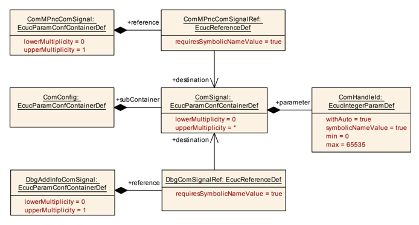

示例2.46：

```
<ECUC-CONTAINER-VALUE>
<SHORT-NAME>myComConfig</SHORT-NAME>  <DEFINITION-REF DEST="ECUC-PARAM-CONF-CONTAINER-DEF"> /AUTOSAR/ EcucDefs/Com/ComConfig </DEFINITION-REF>
<SUB-CONTAINERS>
<ECUC-CONTAINER-VALUE>
<SHORT-NAME>PNC_02</SHORT-NAME>
<DEFINITION-REF DEST="ECUC-PARAM-CONF-CONTAINER-DEF"> /AUTOSAR/ EcucDefs/Com/ComConfig/ComSignal </DEFINITION-REF>
<PARAMETER-VALUES>
<ECUC-NUMERICAL-PARAM-VALUE>
<DEFINITION-REF DEST="ECUC-INTEGER-PARAM-DEF"> /AUTOSAR/ EcucDefs/Com/ComConfig/ComSignal/ComHandleId </DEFINITIONREF>
<VALUE>231</VALUE>
</ECUC-NUMERICAL-PARAM-VALUE>
</PARAMETER-VALUES>
</ECUC-CONTAINER-VALUE>
<ECUC-CONTAINER-VALUE>
<SHORT-NAME>Debuging_Sig5</SHORT-NAME>
<DEFINITION-REF DEST="ECUC-PARAM-CONF-CONTAINER-DEF"> /AUTOSAR/ EcucDefs/Com/ComConfig/ComSignal </DEFINITION-REF>
<PARAMETER-VALUES>
<ECUC-NUMERICAL-PARAM-VALUE>
<DEFINITION-REF DEST="ECUC-INTEGER-PARAM-DEF"> /AUTOSAR/ EcucDefs/Com/ComConfig/ComSignal/ComHandleId </DEFINITIONREF>
<VALUE>245</VALUE>
</ECUC-NUMERICAL-PARAM-VALUE>
</PARAMETER-VALUES>
</ECUC-CONTAINER-VALUE>
</SUB-CONTAINERS>
</ECUC-CONTAINER-VALUE>
```

这导致在 **Com** 头文件中生成以下定义：


于是包含 **Com** 头文件的其他 **BSW** 模块可以使用这些符号调用 **Com** 模块：

ComM: Com_SendSignal(ComConf_ComSignal_PNC_02, value)
Dgb:  Com_SendSignal(ComConf_ComSignal_Debuging_Sig5, value)

###### 2.4.5.2.1. 符号名取值导致的无效配置（**Invalid configuration due to symbolic name values**）

**约束：符号名取值导致的无效配置（**Invalid configuration**）**：由于 EcucParameterValue 的层次结构或后构建变体的存在，同一个 shortName 可能成为多个 symbolicNameValue 定义的基础。如果该 shortName 的全部出现处依据约束「symbolicNameValue 设置为 TRUE 的参数在头文件中创建 #define 符号的规则」取值相等，则 #define 只应生成一次。如果该 shortName 的任何出现处取值不同，则该配置是无效的。

示例 2.32 展示了由于后构建变体的存在而导致的一个有效配置与一个无效配置。

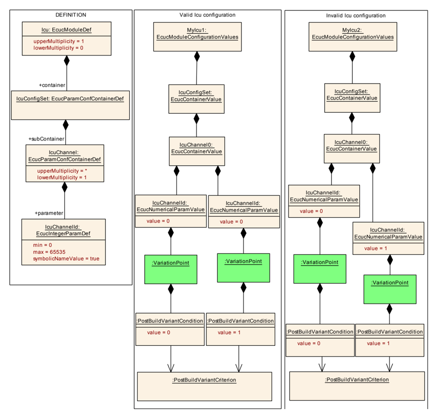

图 2.32 的有效示例会导致以下定义：


图 2.32 的无效示例可能导致以下定义：


其中不同的取值被分配给同一个符号。这是一个无效配置。

示例 2.33 与 2.34 展示了由于 EcucParameterValues 的层次结构而导致的一个有效配置与一个无效配置。

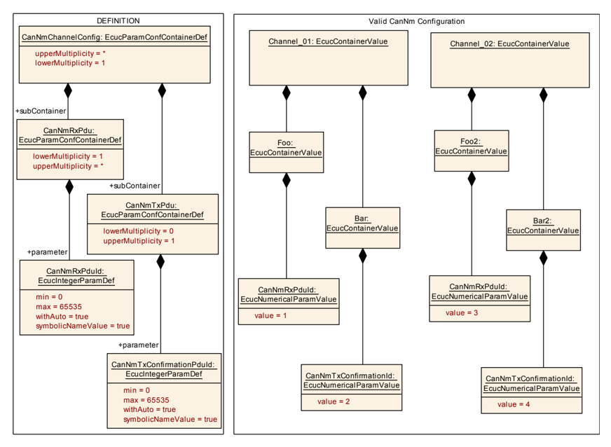

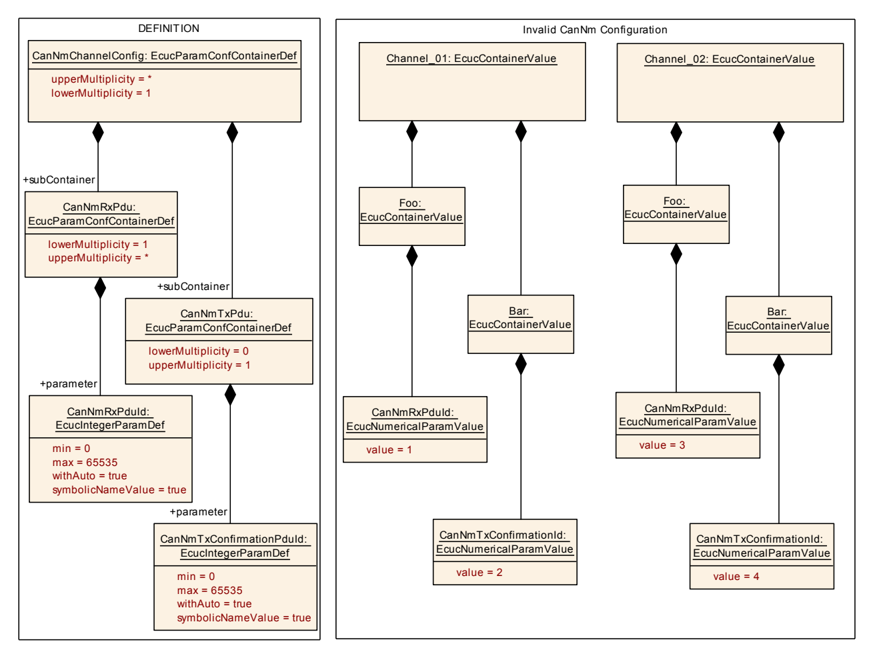

图 2.33 的有效示例会导致以下定义：


图 2.34 的无效示例可能导致以下定义：


其中不同的取值被分配给同一个符号。取值 1 会被重定义为 3，取值 2 会被重定义为 4。这是一个无效配置。

##### 2.4.5.3. ECUC 参数值描述中引用的规则（**Rules for references in the ECUC Parameter Value description**）

**约束：引用定义指向同一模块定义中的容器定义的 ECUC 参数值描述中的引用**：对于指向同一模块定义中的容器定义的引用定义，取值侧的引用应只引用该模块实例的容器实例。

图 2.35 的示例定义了 **CanDrv** 模块内的一个引用。因此，取值只能引用相应 **CanDrv** 配置实例内的容器实例。

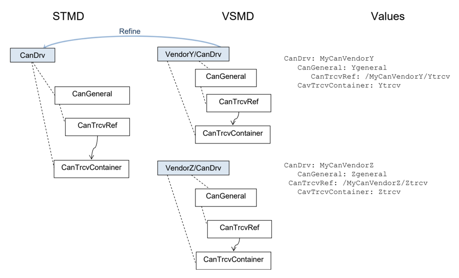

**约束：引用定义指向不同模块定义中的容器定义的 ECUC 参数值描述中的引用**：对于指向不同模块定义中的容器定义的引用定义，取值侧的引用可以依据同一模块定义引用不同模块实例的容器实例。

图 2.36 的示例定义了 **CanIf** 与 **CanDrv** 模块之间的一个引用。因此，取值可以引用不同 **CanDrv** 配置实例的容器实例。

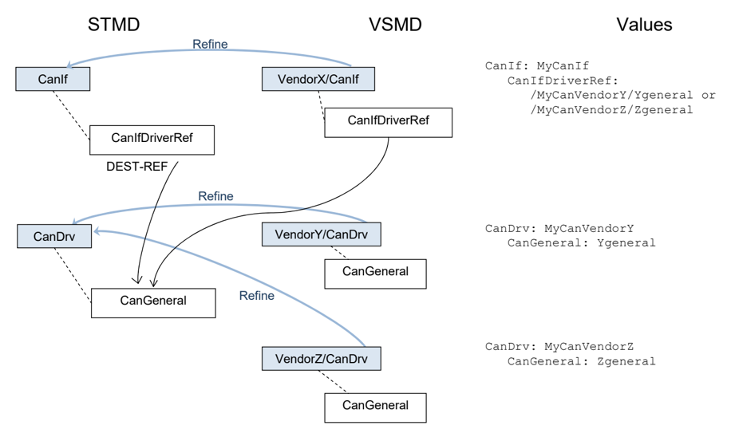
##### 2.4.6. ECU 配置描述中的派生参数（**Derived Parameters in an ECU Configuration Description**）

**约束：带有 EcucDerivationSpecification 的 EcucParameterDef 在 ECUC 值描述中产生一个 EcucNumericalParamValue**：为一个带有 EcucDerivationSpecification 的 EcucParameterDef 实例提供配置值，会产生一个 EcucNumericalParamValue。

**约束：带有已定义推导规范的参数取值**：即使定义它的 EcucParameterDef 具有 EcucDerivationSpecification，也应提供参数的取值。

通过这种方式可以保证：即使某个工具不支持推导公式，取值仍然可用。

随着取值的存储，还可以实现一致性检查：实际提供的取值是否与推导公式的结果相匹配。

示例 2.47 描绘了示例 2.24 的派生参数配置描述。

示例2.47：

```
<ECUC-NUMERICAL-PARAM-VALUE>
<DEFINITION-REF DEST="ECUC-BOOLEAN-PARAM-DEF" ComConfig/ComGwMapping/CheckConsistency <VALUE>
</VALUE>
</ECUC-NUMERICAL-PARAM-VALUE> > /AUTOSAR/EcucDefs/Com/ </DEFINITION-REF> The goal of this feature is to provide modeling support to handle several binding times of the ECU Configuration Value Description in one model. The idea is to utilize Variant Handling approach to allow different values and/or different number of instances of certain configuration parameters in different variation points bound at post-build time (referred to as post-build variants). In order to achieve this, at least one PostBuildVariantCriterion shall be declared in order to define a common selecting element for different post-build variants. The variants are specified using different PostBuildVariantCriterionValue s. An example of one criterion with two values is shown in 2.48:
```


##### 2.4.7. 使用变体处理应对 ECU 配置值描述中的多个绑定时间（**Using Variant Handling to Cope with Several Binding Times**）

这一特性的目标是提供建模支持，以在一个模型中处理 **ECU** 配置值描述的多个绑定时间。其思想是利用变体处理方法，允许在后构建时间绑定的不同变体点（称为后构建变体）中，某些配置参数具有不同的取值和/或不同的实例数量。为了实现这一点，至少应声明一个 PostBuildVariantCriterion，以便为不同的后构建变体定义一个共同的选择元素。这些变体使用不同的 PostBuildVariantCriterionValue 规定。一个带有两个取值的准则的示例见 2.48：

示例2.48：

```
<POST-BUILD-VARIANT-CRITERION>
<SHORT-NAME>PostBuildConfigSet</SHORT-NAME>
</POST-BUILD-VARIANT-CRITERION>
<POST-BUILD-VARIANT-CRITERION-VALUE-SET>
<SHORT-NAME>PostBuildVariants</SHORT-NAME>
<POST-BUILD-VARIANT-CRITERION-VALUES>
<POST-BUILD-VARIANT-CRITERION-VALUE>
<VARIANT-CRITERION-REF DEST="POST-BUILD-VARIANT-CRITERION"> /EcucDemo/ PostBuildConfigSet </VARIANT-CRITERION-REF>
<VALUE>1</VALUE>
</POST-BUILD-VARIANT-CRITERION-VALUE>
<POST-BUILD-VARIANT-CRITERION-VALUE>
<VARIANT-CRITERION-REF DEST="POST-BUILD-VARIANT-CRITERION"> /EcucDemo/ PostBuildConfigSet </VARIANT-CRITERION-REF>
<VALUE>2</VALUE>
</POST-BUILD-VARIANT-CRITERION-VALUE>
</POST-BUILD-VARIANT-CRITERION-VALUES>
</POST-BUILD-VARIANT-CRITERION-VALUE-SET>
```


**约束：EcuM/BswM 用于以不同后构建变体初始化 BSW 模块的 C 符号的创建模式（**Pattern**）**：对于一个 **BSW** 模块的不同后构建变体（配置集）的符号名称修饰，应使用以下模式：

&lt;Mip&gt;_ConfigType &lt;Mip&gt;_Config[_&lt;PredefinedVariant.shortName&gt;]

其中 &lt;Mip&gt; 是依据 [SWS_BSW_00102] 的模块实现前缀，&lt;PredefinedVariant.shortName&gt; 是相应模块的 EcucPostBuildVariants 容器中 EcucPostBuildVariantRef 引用所引用的 PredefinedVariant 的 shortName。

在不带后构建变体的纯后构建配置的情形下，可选的后缀 _&lt;PredefinedVariant.shortName&gt; 应省略。

###### 2.4.7.1. 使用变体处理的 ECU 配置示例（**Example of ECU configuration using Variant Handling**）

本节包含一个示例，说明如何使用变体处理来配置 postBuildVariantValue 与 postBuildVariantMultiplicity 属性设置为 true/false 的 **ECU** 配置参数，它们位于 postBuildVariantMultiplicity 属性设置为 true/false 的容器内。作为示例，选取 **Adc** 模块配置参数的一部分（见图 2.37）。

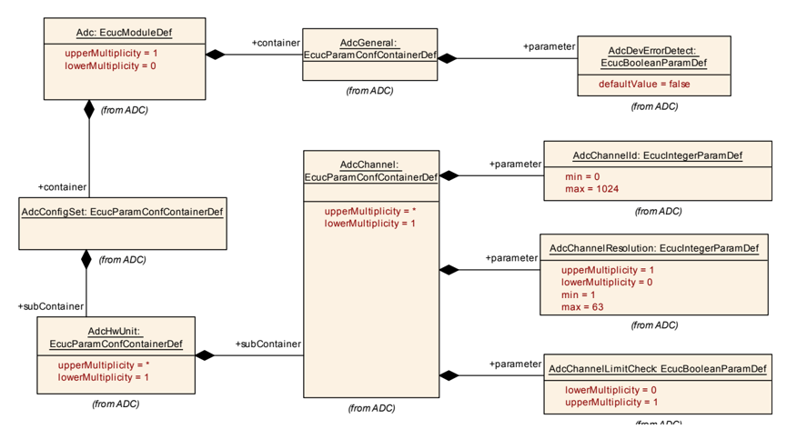

AdcGeneral 容器的 AdcDevErrorDetect 参数与 AdcChannel 容器的 AdcChannelLimitCheck 参数在所有后构建变体中应具有相同的取值（即 postBuildVariantValue 设置为 false），而 AdcChannel 容器的 AdcChannelId 与 AdcChannelResolution 参数在不同的后构建变体中可以具有不同的取值（即 postBuildVariantValue 设置为 true）。全部参数在不同的后构建变体中应具有相同的实例数量（即 postBuildVariantMultiplicity 设置为 false）。容器 AdcGeneral 不能在不同变体之间改变其实例数量（即 postBuildVariantMultiplicity 属性设置为 false），而容器 AdcChannel 可以（即 postBuildVariantMultiplicity 属性设置为 true）。示例 2.49 描绘了这一点。

示例2.49：

```
 <ECUC-MODULE-DEF UUID="ECUC:c03229fe-4dca-445e-a47c-1ae11e6c1832">
<SHORT-NAME>Adc</SHORT-NAME>
<LOWER-MULTIPLICITY>0</LOWER-MULTIPLICITY>
<UPPER-MULTIPLICITY>1</UPPER-MULTIPLICITY>
<POST-BUILD-VARIANT-SUPPORT>true</POST-BUILD-VARIANT-SUPPORT>
<SUPPORTED-CONFIG-VARIANTS>
<SUPPORTED-CONFIG-VARIANT>VARIANT-POST-BUILD <SUPPORTED-CONFIG-VARIANT> VARIANT-PRE-COMPILE  > -</SUPPORTED-CONFIG-VARIANT> - </SUPPORTED-CONFIG-VARIANT </SUPPORTED-CONFIG-VARIANTS> - <! -- Container Definition: AdcConfigSet -->
<ECUC-PARAM-CONF-CONTAINER-DEF UUID="ECUC:fc6e0617-8c73-4b71-b09edfb10b76e50d"> - <SHORT-NAME>AdcConfigSet</SHORT-NAME> - <LOWER-MULTIPLICITY>1</LOWER-MULTIPLICITY> - <UPPER-MULTIPLICITY>1</UPPER-MULTIPLICITY> - <SUB-CONTAINERS>- <! --Container Definition: AdcHwUnit --> - <ECUC-PARAM-CONF-CONTAINER-DEF UUID="ECUC:c67e7c58-3daf-455b-a213 - -95ae94b248d8"> - <SHORT-NAME> AdcHwUnit - <LOWER-MULTIPLICITY>
</SHORT-NAME>
</LOWER-MULTIPLICITY> - 1 - <UPPER-MULTIPLICITY-INFINITE> true </UPPER-MULTIPLICITY-INFINITE> - <POST-BUILD-VARIANT-MULTIPLICITY> false </POST-BUILD-VARIANTMULTIPLICITY> - <PARAMETERS/> - <SUB-CONTAINERS>
<! --Container Definition: AdcChannel -- >
<ECUC-PARAM-CONF-CONTAINER-DEF UUID="ECUC:bfd7d43b-017d-4755-9 a41-2bf12e38403d"> - <SHORT-NAME> AdcChannel - <LOWER-MULTIPLICITY> 1 </SHORT-NAME>
</LOWER-MULTIPLICITY> - <UPPER-MULTIPLICITY-INFINITE> true </UPPER-MULTIPLICITY- INFINITE> - <POST-BUILD-VARIANT-MULTIPLICITY> true </POST-BUILD-VARIANTMULTIPLICITY> - <! --PARAMETER DEFINITION: AdcChannelId -- >
<ECUC-INTEGER-PARAM-DEF UUID="ECUC:482b876b-9787-4e46-875a - -559b7a1427f2"> - <SHORT-NAME> AdcChannelId </SHORT-NAME> - <LOWER-MULTIPLICITY> 1 </LOWER-MULTIPLICITY> - <UPPER-MULTIPLICITY> 1 </UPPER-MULTIPLICITY> - <ORIGIN> AUTOSAR_ECUC </ORIGIN> - <POST-BUILD-VARIANT-VALUE> true </POST-BUILD-VARIANT-VALUE> - <VALUE-CONFIG-CLASSES>
<ECUC-VALUE-CONFIGURATION-CLASS> - <CONFIG-CLASS> POST-BUILD </CONFIG-CLASS>
<CONFIG-VARIANT> VARIANT-POST-BUILD </CONFIG-VARIANT> - </ECUC-VALUE-CONFIGURATION-CLASS>
<ECUC-VALUE-CONFIGURATION-CLASS> - <CONFIG-CLASS> PRE-COMPILE </CONFIG-CLASS>
<CONFIG-VARIANT> VARIANT-PRE-COMPILE </CONFIG-VARIANT>
</ECUC-VALUE-CONFIGURATION-CLASS> - </VALUE-CONFIG-CLASSES> - <SYMBOLIC-NAME-VALUE> false </SYMBOLIC-NAME-VALUE> - <MAX> 1024 </MAX> - <MIN> 0 </MIN> - </ECUC-INTEGER-PARAM-DEF> - <! --PARAMETER DEFINITION: AdcChannelLimitCheck -- >
<ECUC-BOOLEAN-PARAM-DEF UUID="ECUC:6c8938e0-f362-4cdc -8711-6d4b429215b3"> - <SHORT-NAME> AdcChannelLimitCheck </SHORT-NAME>
<DESC>
<L-2 L="EN"> Enables or disables limit checking for an ADC channel. </L-2>  </DESC>
<LOWER-MULTIPLICITY> 0 </LOWER-MULTIPLICITY>
<UPPER-MULTIPLICITY> 1 </UPPER-MULTIPLICITY>
<MULTIPLICITY-CONFIG-CLASSES>
<ECUC-MULTIPLICITY-CONFIGURATION-CLASS>
<CONFIG-CLASS> PRE-COMPILE </CONFIG-CLASS>
<CONFIG-VARIANT> VARIANT-POST-BUILD </CONFIG-VARIANT>
</ECUC-MULTIPLICITY-CONFIGURATION-CLASS>
<ECUC-MULTIPLICITY-CONFIGURATION-CLASS>
<CONFIG-CLASS> PRE-COMPILE </CONFIG-CLASS>
<CONFIG-VARIANT> VARIANT-PRE-COMPILE </CONFIG-VARIANT>
</ECUC-MULTIPLICITY-CONFIGURATION-CLASS>
</MULTIPLICITY-CONFIG-CLASSES>
<ORIGIN> AUTOSAR_ECUC </ORIGIN>
<POST-BUILD-VARIANT-MULTIPLICITY> false </POST-BUILDVARIANT-MULTIPLICITY>
<POST-BUILD-VARIANT-VALUE> false </POST-BUILD-VARIANT-VALUE >
<VALUE-CONFIG-CLASSES>
<ECUC-VALUE-CONFIGURATION-CLASS>
<CONFIG-CLASS> PRE-COMPILE </CONFIG-CLASS>
<CONFIG-VARIANT> VARIANT-POST-BUILD </CONFIG-VARIANT>
</ECUC-VALUE-CONFIGURATION-CLASS>
<ECUC-VALUE-CONFIGURATION-CLASS>
<CONFIG-CLASS> PRE-COMPILE </CONFIG-CLASS>
<CONFIG-VARIANT> VARIANT-PRE-COMPILE </CONFIG-VARIANT>
</ECUC-VALUE-CONFIGURATION-CLASS>
</VALUE-CONFIG-CLASSES>
<SYMBOLIC-NAME-VALUE> false </SYMBOLIC-NAME-VALUE>
</ECUC-BOOLEAN-PARAM-DEF>
<! --PARAMETER DEFINITION: AdcChannelResolution -->
<ECUC-INTEGER-PARAM-DEF UUID="ECUC:c05e44f5-f418-4772-9ed3ba767591baf1">
<SHORT-NAME> AdcChannelResolution </SHORT-NAME>
<LOWER-MULTIPLICITY> 0 </LOWER-MULTIPLICITY>
<UPPER-MULTIPLICITY> 1 </UPPER-MULTIPLICITY>
<MULTIPLICITY-CONFIG-CLASSES>
<ECUC-MULTIPLICITY-CONFIGURATION-CLASS>
<CONFIG-CLASS> POST-BUILD </CONFIG-CLASS>
<CONFIG-VARIANT> VARIANT-POST-BUILD </CONFIG-VARIANT>
</ECUC-MULTIPLICITY-CONFIGURATION-CLASS>
<ECUC-MULTIPLICITY-CONFIGURATION-CLASS>
<CONFIG-CLASS> PRE-COMPILE </CONFIG-CLASS>
<CONFIG-VARIANT> VARIANT-PRE-COMPILE </CONFIG-VARIANT>
</ECUC-MULTIPLICITY-CONFIGURATION-CLASS>
</MULTIPLICITY-CONFIG-CLASSES>
<ORIGIN> AUTOSAR_ECUC </ORIGIN>
<POST-BUILD-VARIANT-MULTIPLICITY> false </POST-BUILDVARIANT-MULTIPLICITY>
<POST-BUILD-VARIANT-VALUE> true </POST-BUILD-VARIANT-VALUE>
<VALUE-CONFIG-CLASSES>
<ECUC-VALUE-CONFIGURATION-CLASS>
<CONFIG-CLASS> POST-BUILD </CONFIG-CLASS>
<CONFIG-VARIANT> VARIANT-POST-BUILD </CONFIG-VARIANT>  </ECUC-VALUE-CONFIGURATION-CLASS>  <ECUC-VALUE-CONFIGURATION-CLASS>
<CONFIG-CLASS> PRE-COMPILE </CONFIG-CLASS>
<CONFIG-VARIANT> VARIANT-PRE-COMPILE </ECUC-VALUE-CONFIGURATION-CLASS>
</VALUE-CONFIG-CLASSES>
<SYMBOLIC-NAME-VALUE> false </SYMBOLIC-NAME-VALUE>
<MAX> 63 </MAX>
<MIN> 1 </MIN>
</ECUC-INTEGER-PARAM-DEF>
</PARAMETERS>
</ECUC-PARAM-CONF-CONTAINER-DEF>
</SUB-CONTAINERS>
</ECUC-PARAM-CONF-CONTAINER-DEF>
</SUB-CONTAINERS>
</ECUC-PARAM-CONF-CONTAINER-DEF>
<! -- Container Definition: AdcGeneral -->
<ECUC-PARAM-CONF-CONTAINER-DEF UUID="ECUC:da0aaff6-3ed6-4a15-824edc32f3a8bd93">
<SHORT-NAME>AdcGeneral</SHORT-NAME>
<LOWER-MULTIPLICITY>1</LOWER-MULTIPLICITY>
<UPPER-MULTIPLICITY>1</UPPER-MULTIPLICITY>
<PARAMETERS>
<! --PARAMETER DEFINITION: AdcDevErrorDetect -->
<ECUC-BOOLEAN-PARAM-DEF UUID="ECUC:db321b92-621a-4a62-8778-09 b8845d8f2c">
<SHORT-NAME>AdcDevErrorDetect</SHORT-NAME>
<LOWER-MULTIPLICITY>1</LOWER-MULTIPLICITY>
<UPPER-MULTIPLICITY>1</UPPER-MULTIPLICITY>
<ORIGIN>AUTOSAR_ECUC</ORIGIN>
<POST-BUILD-VARIANT-VALUE>false</POST-BUILD-VARIANT-VALUE>
<VALUE-CONFIG-CLASSES>
<ECUC-VALUE-CONFIGURATION-CLASS>
<CONFIG-CLASS>PRE-COMPILE</CONFIG-CLASS>
<CONFIG-VARIANT>VARIANT-POST-BUILD</CONFIG-VARIANT>
</ECUC-VALUE-CONFIGURATION-CLASS>
<ECUC-VALUE-CONFIGURATION-CLASS>
<CONFIG-CLASS>PRE-COMPILE</CONFIG-CLASS>
<CONFIG-VARIANT>VARIANT-PRE-COMPILE</CONFIG-VARIANT>
</ECUC-VALUE-CONFIGURATION-CLASS>
</VALUE-CONFIG-CLASSES>
<SYMBOLIC-NAME-VALUE>false</SYMBOLIC-NAME-VALUE>
</ECUC-BOOLEAN-PARAM-DEF>
</PARAMETERS>
</ECUC-PARAM-CONF-CONTAINER-DEF>
</CONTAINERS>
</ECUC-MODULE-DEF>  </CONFIG-VARIANT> The parameters with fixed value in all post-build variants inside containers with fixed number of instances are provided normally inside the container structure they are defined in (see AdcDevErrorDetect parameter in Example 2.50).
```


同样，位于可能在不同变体中具有不同实例数量的容器内（即 postBuildVariantMultiplicity 设置为 true）、在全部后构建变体中取值固定的参数，也不需要在每个变体中重复。相反，它们应只定义一次，这也保证了这些参数的取值在所有变体中相同（见示例 2.51 中的 AdcChannelLimitCheck 参数）。

示例2.51：

```
- <SHORT-NAME>theAdc</SHORT-NAME> - <DEFINITION-REF DEST="ECUC-MODULE-DEF"> /EcucDemo/Adc </DEFINITION-REF> - <CONTAINERS>- <ECUC-CONTAINER-VALUE> - <SHORT-NAME> myHwUnit </SHORT-NAME>
<DEFINITION-REF DEST="ECUC-PARAM-CONF-CONTAINER-DEF"> /EcucDemo/Adc/ AdcConfigSet/AdcHwUnit </DEFINITION-REF> - <SUB-CONTAINERS>
<ECUC-CONTAINER-VALUE>
<SHORT-NAME> myChannel1 </SHORT-NAME>
<DEFINITION-REF DEST="ECUC-PARAM-CONF-CONTAINER-DEF"> Adc/AdcConfigSet/AdcHwUnit/AdcChannel <PARAMETER-VALUES>
<ECUC-NUMERICAL-PARAM-VALUE>
<DEFINITION-REF DEST= > "ECUC-BOOLEAN-PARAM-DEF" /EcucDemo/Adc/ AdcConfigSet/AdcHwUnit/AdcChannel/AdcChannelLimitCheck </ DEFINITION-REF>
<VALUE> 0 </VALUE>
</ECUC-NUMERICAL-PARAM-VALUE>
</PARAMETER-VALUES>
</ECUC-CONTAINER-VALUE>
</SUB-CONTAINERS> /EcucDemo/ </DEFINITION-REF>
</ECUC-CONTAINER-VALUE>
</CONTAINERS>
</ECUC-MODULE-CONFIGURATION-VALUES> However for parameters which may have different value in different post-build variants (i.e. postBuildVariantValue is set to true ), the PostBuildVariantCriterion shall be referenced in order to define the common selector. A specific value for the selector is defined for each post-build variant to specify to which variant this parameter value is associated to (see AdcChannelResolution parameter in two post-build variants, left and right , in Example 2.52)..
```

``````

然而，对于可能在不同的后构建变体中具有不同取值的参数（即 postBuildVariantValue 设置为 true），应引用 PostBuildVariantCriterion 以定义共同的选择器。为每个后构建变体规定一个特定于该选择器的取值，以指定该参数取值与哪个变体相关联（见示例 2.52 中两个后构建变体 left 与 right 中的 AdcChannelResolution 参数）。

示例2.52：

```
- <SHORT-NAME>theAdc <DEFINITION-REF</SHORT-NAME> DEST="ECUC-MODULE-DEF" <CONTAINERS>- <ECUC-CONTAINER-VALUE>
<SHORT-NAME> myHwUnit </SHORT-NAME>
<DEFINITION-REF DEST="ECUC-PARAM-CONF-CONTAINER-DEF"> /EcucDemo/Adc/ AdcConfigSet/AdcHwUnit </DEFINITION-REF>
<SUB-CONTAINERS>
<ECUC-CONTAINER-VALUE>
<SHORT-NAME> myChannel1 </SHORT-NAME>
<DEFINITION-REF DEST="ECUC-PARAM-CONF-CONTAINER-DEF"> Adc/AdcConfigSet/AdcHwUnit/AdcChannel <PARAMETER-VALUES>
<ECUC-NUMERICAL-PARAM-VALUE>
<DEFINITION-REF DEST="ECUC-INTEGER-PARAM-DEF"> /EcucDemo/Adc/ AdcConfigSet/AdcHwUnit/AdcChannel/AdcChannelResolution </ DEFINITION-REF>
<VARIATION-POINT>
<POST-BUILD-VARIANT-CONDITIONS>
<POST-BUILD-VARIANT-CONDITION>
<MATCHING-CRITERION-REF DEST="POST-BUILD-VARIANT- CRITERION"> /EcucDemo/PostBuildConfigSet </MATCHING- CRITERION-REF>
<VALUE> 1 </VALUE>
<! --PostBuildFrontLeft -->
</POST-BUILD-VARIANT-CONDITION>
</POST-BUILD-VARIANT-CONDITIONS>
</VARIATION-POINT>
<VALUE> 10 </VALUE>
</ECUC-NUMERICAL-PARAM-VALUE>
<ECUC-NUMERICAL-PARAM-VALUE>
<DEFINITION-REF DEST="ECUC-INTEGER-PARAM-DEF"> /EcucDemo/Adc/ AdcConfigSet/AdcHwUnit/AdcChannel/AdcChannelResolution </ DEFINITION-REF>
<VARIATION-POINT>
<POST-BUILD-VARIANT-CONDITIONS>
<POST-BUILD-VARIANT-CONDITION>
<MATCHING-CRITERION-REF DEST="POST-BUILD-VARIANT- CRITERION"> /EcucDemo/PostBuildConfigSet </MATCHING- CRITERION-REF> > /EcucDemo/Adc </DEFINITION-REF> /EcucDemo/ </DEFINITION-REF>
<VALUE> 2 </VALUE>
<! --PostBuildFrontRight -->
</POST-BUILD-VARIANT-CONDITION>
</POST-BUILD-VARIANT-CONDITIONS>
</VARIATION-POINT>
<VALUE> 40 </VALUE>
</ECUC-NUMERICAL-PARAM-VALUE>
</PARAMETER-VALUES>
</ECUC-CONTAINER-VALUE>
</SUB-CONTAINERS>
</ECUC-CONTAINER-VALUE>
</CONTAINERS>
</ECUC-MODULE-CONFIGURATION-VALUES> If one container shall be used in all post-build variants (e.g. because there are precompile configurations pointing to this container), it shall not define a variation point and thus indicate its "pre-compile" nature. In case a container exists only in some post-build variants, it shall define a variation point. Also all included elements shall then define the respective variation point (see AdcChannel container in Example 2.53).
```

``````

示例 2.53 使用两个参数值变体展示了同样的机制，这些变体由变体处理器在配置时解析为取值。

示例2.53：

```
<ECUC-MODULE-CONFIGURATION-VALUES>- <SHORT-NAME> theAdc </SHORT-NAME>
<DEFINITION-REF DEST="ECUC-MODULE-DEF"> /EcucDemo/Adc </DEFINITION-REF>
<CONTAINERS>
<ECUC-CONTAINER-VALUE> - <SHORT-NAME> myChannel5 </SHORT-NAME> - <DEFINITION-REF DEST="ECUC-PARAM-CONF-CONTAINER-DEF"> /EcucDemo/Adc/ AdcConfigSet/AdcHwUnit/AdcChannel </DEFINITION-REF>
<PARAMETER-VALUES>
<ECUC-NUMERICAL-PARAM-VALUE>
<DEFINITION-REF DEST="ECUC-BOOLEAN-PARAM-DEF"> /EcucDemo/Adc/ AdcConfigSet/AdcHwUnit/AdcChannel/AdcChannelLimitCheck </ DEFINITION-REF>
<VALUE> 1 </VALUE>
</ECUC-NUMERICAL-PARAM-VALUE>
<ECUC-NUMERICAL-PARAM-VALUE>
<DEFINITION-REF DEST="ECUC-INTEGER-PARAM-DEF"> /EcucDemo/Adc/ AdcConfigSet/AdcHwUnit/AdcChannel/AdcChannelId </DEFINITION-REF >
<VALUE> 5 </VALUE>
</ECUC-NUMERICAL-PARAM-VALUE>
<ECUC-NUMERICAL-PARAM-VALUE>
<DEFINITION-REF DEST="ECUC-INTEGER-PARAM-DEF"> /EcucDemo/Adc/ AdcConfigSet/AdcHwUnit/AdcChannel/AdcChannelResolution </ DEFINITION-REF>
<VARIATION-POINT>
<POST-BUILD-VARIANT-CONDITIONS>
<POST-BUILD-VARIANT-CONDITION>
<MATCHING-CRITERION-REF DEST="POST-BUILD-VARIANT-CRITERION"> /EcucDemo/PostBuildConfigSet </MATCHING-CRITERION-REF>
<VALUE> 2 </VALUE>
<! --PostBuildFrontRight -->
</POST-BUILD-VARIANT-CONDITION>
</POST-BUILD-VARIANT-CONDITIONS>
</VARIATION-POINT>
<VALUE> 30 </VALUE>
</ECUC-NUMERICAL-PARAM-VALUE>
</PARAMETER-VALUES>
<VARIATION-POINT>
<POST-BUILD-VARIANT-CONDITIONS>
<POST-BUILD-VARIANT-CONDITION>
<MATCHING-CRITERION-REF DEST="POST-BUILD-VARIANT-CRITERION"> EcucDemo/PostBuildConfigSet </MATCHING-CRITERION-REF>
<VALUE> 2 </VALUE>
<! --PostBuildFrontRight -->
</POST-BUILD-VARIANT-CONDITION>
</POST-BUILD-VARIANT-CONDITIONS>
</VARIATION-POINT>
</ECUC-CONTAINER-VALUE>
</CONTAINERS>
</ECUC-MODULE-CONFIGURATION-VALUES>
```


## 3. ECU 配置参数定义的 SWS 影响（**ECU Configuration Parameter Definition SWS implications**）

本节描述将 **ECU** 配置规范应用于 **AUTOSAR** 规范的若干方面。

**ECU** 配置参数定义分布在 **BSW SWS** 文档中。这些参数在文档中如何规定在[第 3.1 节](#31-形式化方面formalization-aspects)中描述。

**AUTOSAR** Com 栈如何从模块间的视角进行配置在[第 3.4 节](#34-com-栈配置com-stack-configuration)中描述。

### 3.1. 形式化方面（**Formalization aspects**）

本节的目标是描述 **BSW** 模块的 **ECU** 配置参数定义在 **SWS** 文档中如何规定。因此，**ECU** 配置值描述（**XML** 文件）中的 **ECU** 配置参数取值到模块配置（头文件）之间不一定存在简单的转换。把 **XML** 文件中的配置信息转换到头文件是模块生成工具的职责。

**ECU** 配置参数定义在 **UML** 模型中形式化。该 **UML** 模型用于部分生成 **BSW SWS** 的规范表，并生成 **ECU** 配置参数定义 **XML** 文件<sup>1</sup>。

开发 **ECU** 配置参数定义时应用了一些形式化模式：

- 修改的参数名称：由于 **AUTOSAR XML** 格式施加的限制（以字母开头的 32 字符限制等），参数与容器的名称已被重新定义。同时也应用了不同的命名模式。**SWS** 中的原始名称也在本文档中提供。
- 添加的参数多重性：在 **BSW SWS** 的原始表格中，无法规定参数的可选性与多重性。已添加参数多重性。
- 添加的引用：为了更好地交互若干模块的配置值描述，引入了配置之间的引用。
- 协调的参数类型：
  - 布尔：一些参数被定义为枚举或 #define，而其存储的实际信息是布尔类型。在这些情形下，它们被建模为 boolean。
  - 浮点：一些参数以整数存储时间取值，并声明这是以例如微秒为单位的时间。如果规定的时间是绝对时间，则它被形式化为以秒为单位的浮点数。如果时间是某个给定时基的倍数，则保留整数。

> 1 从 **UML** 模型生成只是创建 **ECU** 配置参数定义 **XML** 文件的一种方式。**ECUC** 参数可以用任何其他方法定义，只要生成一个符合 **AUTOSAR** 的 **ECUC** 参数定义 **XML** 文件即可。

#### 3.1.1. ECU 配置参数定义表（**ECU Configuration Parameter Definition table**）

配置参数被结构化为容器，容器可以容纳参数、引用与其他容器。除了 **UML** 图中的图形化可视化之外，还使用表格来规定参数的结构。

下表规定了一个容器，它容纳两个参数以及两个附加的容器作为示例。

| SWS 条目 | 容器名称 | ContainerName |
| --- | --- | --- |
| 父容器 | aggregatingContainerName | |
| 说明 | 容器描述 | |
| 后构建变体多重性 | true | |
| 多重性配置类 | 预编译时间 | X；VARIANT-PRE-COMPILE |
| 多重性配置类 | 链接时间 | X；VARIANT-LINK-TIME、VARIANT-POST-BUILD |
| 多重性配置类 | 后构建时间 | - |
| 配置参数 | （见下） | |

| SWS 条目 | 参数名称 | ParameterName1 |
| --- | --- | --- |
| 父容器 | ContainerName | |
| 说明 | 参数描述 | |
| 多重性 | 1 | |
| 类型 | EcucIntegerParamDef | |
| 范围 | 0 .. 4294967295 | |
| 默认值 | 0 | |
| 后构建变体取值 | true | |
| 取值配置类 | 预编译时间 | X；VARIANT-PRE-COMPILE |
| 取值配置类 | 链接时间 | X；VARIANT-LINK-TIME、VARIANT-POST-BUILD |
| 取值配置类 | 后构建时间 | - |
| 作用域/依赖 | scope: local | |

| SWS 条目 | 参数名称 | ParameterName1 |
| --- | --- | --- |
| 父容器 | ContainerName | |
| 说明 | 参数描述 | |
| 多重性 | 0..1 | |
| 类型 | EcucIntegerParamDef | |
| 范围 | 0 .. 64 | |
| 默认值 | 默认值 | |
| 后构建变体多重性 | true | |
| 后构建变体取值 | true | |
| 多重性配置类 | 预编译时间 | X；VARIANT-PRE-COMPILE |
| 多重性配置类 | 链接时间 | X；VARIANT-LINK-TIME |
| 多重性配置类 | 后构建时间 | X；VARIANT-POST-BUILD |
| 取值配置类 | 预编译时间 | X；VARIANT-PRE-COMPILE |
| 取值配置类 | 链接时间 | X；VARIANT-LINK-TIME |
| 取值配置类 | 后构建时间 | X；VARIANT-POST-BUILD |
| 作用域/依赖 | scope: local | |

| 所含容器 | 多重性 | |
| --- | --- | --- |
| Container1 | 0..1 | 可选子容器 |
| Container2 | 0..* | 可选子容器 |

关于表格中元素的详细描述请参见[第 2 章](#2-配置元模型configuration-metamodel)。

**注意：** 源文档的示例表带有合并单元格伪影（同一取值跨折叠列重复展开为多列）；上表按 tps_ecu_resource_template 先例将取值折叠回单列。

#### 3.2. AUTOSAR 栈概览（**AUTOSAR Stack Overview**）

一个 **AUTOSAR ECU** 的软件架构已被划分为若干部分，以允许独立的模块以及模块之间接口的清晰定义。该架构描绘于图 3.1。

![图 3.1：ECU 架构概览 [13]（ECU Architecture Overview [13]）](Figure3-1.png)

应用 **SW** 组件位于顶层，只能经由 **RTE** 访问 **ECU** 的其余部分以及其他 **ECU**。

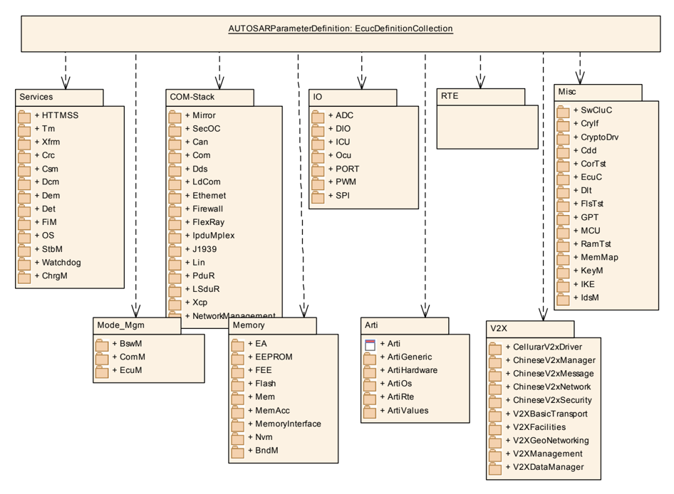

**RTE** 为应用 **SW** 组件提供通信与基础服务的封装，因此可以把应用 **SW** 组件映射到不同的 **ECU** 之间。

基础软件模块位于 **RTE** 之下。基础软件本身划分为以下子组：系统服务（**System Services**）、存储器（**Memory**）、通信（**Communication**）与 I/O 硬件抽象（**IO HWAbstraction**）。复杂驱动程序也位于 **RTE** 之下。

除其他外，操作系统（**OS**）、看门狗管理器与诊断服务位于系统服务子组中。

存储器子组包含提供对非易失性存储器（即 Flash 与 EEPROM）访问的模块。

在通信子组中规定了整个 **AUTOSAR** 通信栈（**COM** 栈），包括 **COM**、网络管理与通信驱动程序。

AUTOSARParameterDefinition 的顶层结构如图 3.2 所示。

容器 AUTOSARParameterDefinition 是 **AUTOSAR ECU** 配置参数定义结构的顶层元素。在该容器内定义了对不同 **SW** 模块的各类配置容器定义的引用。

在每个 EcucModuleDef 的上下文中定义的上多重性直接影响特定模块的实例化。如果 EcucModuleDef.upperMultiplicity 设置为 1，这意味着相应模块在一个 **AUTOSAR BSW** 栈中只能出现一次。如果 EcucModuleDef.upperMultiplicity 的取值大于 1（即 0..*），则该模块可以被多次实例化。

| SWS 条目 | ECU 配置名称 | AUTOSARParameterDefinition |
| --- | --- | --- |
| 说明 | **AUTOSAR** 配置参数定义的顶层容器。不同模块的全部参数定义都包含在该容器中。 | |

| 所含模块 | 多重性 | 作用域/依赖 |
| --- | --- | --- |
| Arti | 0..1 | The Arti Module serves as a superordinate container collecting all information and parameters concerning ARTI. |
| BndM | 0..1 | Configuration of the BulkNvDataManager module. |
| BswM | 0..1 | Configuration of the BswM (Basic SW Mode Manager) module. |
| CV2x | 0..* | Configuration of the CV2x module (Cellular V2X Driver). |
| Can | 0..* | This container holds the configuration of a single CAN Driver. |
| CanIf | 0..1 | This container includes all necessary configuration sub-containers according the CAN Interface configuration structure. |
| CanNm | 0..1 | Configuration Parameters for the Can Nm module. |
| CanSM | 0..1 | Configuration of the CanSM module |
| CanTSyn | 0..1 | Configuration of the Synchronized Time-base Manager (StbM) module with respect to global time handling on CAN. |
| CanTp | 0..1 | Configuration of the CanTp (CAN Transport Protocol) module. |
| CanTrcv | 0..* | Configuration of the CanTrcv (CAN Transceiver driver) module. |
| Cdd | 0..* | The CDD module describes the minimal requirements that are necessary for the configuration of a CDD with respect to the surrounding standardized BSW modules. |
| ChrgM | 0..1 | Configuration of the Charging Manager module. |
| CnV2xM | 0..1 | Configuration of the CnV2xM module. |
| CnV2xMsg | 0..1 | Configuration of the CnV2xMsg module. |
| CnV2xNet | 0..1 | Configuration of the CnV2xMsg module. |
| CnV2xSec | 0..1 | Configuration of the CnV2xSec module. |
| Com | 0..1 | Configuration of the AUTOSAR COM module. |
| ComM | 0..1 | Configuration of the ComM (Communications Manager) module. |
| CorTst | 0..1 | Configuration of the CorTst module. |
| CryIf | 0..1 | Configuration of the Crypto Interface. |
| Crypto | 0..* | Configuration of the Crypto (CryptoDriver) module |
| Csm | 0..1 | Configuration of the Csm (CryptoServiceManager) module. |
| Dcm | 0..1 | Configuration of the Dcm (Diagnostic Communications Manager) module. |
| Dds | 0..1 | Configuration of the Dds module. |
| Dem | 0..1 | Configuration of the Dem (Diagnostic Event Manager) module. |
| Det | 0..1 | Det configuration includes the functions to be called at notification. On one side the application functions are specified and in general it can be decided whether Dlt shall be called at each call of Det. |
| Dio | 0..1 | Configuration of the Dio (Digital IO) module. |
| Dlt | 0..1 | Configuration of the Dlt (Log&Trace) module. |
| DoIP | 0..1 | Configuration of the DoIP (Diagnostic over IP) module. |
| Ea | 0..1 | Configuration of the Ea (EEPROM Abstraction) module. The module shall abstract from the device specific addressing scheme and segmentation and provide the upper layers with a virtual addressing scheme and segmentation as well as a 'virtually' unlimited number of erase cycles. |
| EcuC | 0..1 | Virtual module to collect ECU Configuration specific / global configuration information. |
| EcuM | 0..1 | Configuration of the EcuM (ECU State Manager) module. |
| Eep | 0..* | Configuration of the Eep (internal or external EEPROM driver) module. Its multiplicity describes the number of EEPROM drivers present, so there will be one container for each EEPROM driver in the ECUC template. When no EEPROM driver is present then the multiplicity is 0. |
| Eth | 0..* | Configuration of the Eth (Ethernet Driver) module. |
| EthIf | 0..1 | Configuration of the EthIf (Ethernet Interface) module. |
| EthSM | 0..1 | Configuration of the Ethernet State Manager |
| EthSwt | 0..* | Configuration of the EthSwt (Ethernet Switch Driver) module. |
| EthTSyn | 0..1 | Configuration of the Synchronized Time-base Manager (StbM) module with respect to global time handling on Ethernet. |
| EthTrcv | 0..* | Configuration of Ethernet Transceiver Driver module |
| Fee | 0..1 | Configuration of the Fee (Flash EEPROM Emulation) module. |
| FiM | 0..1 | Configuration of the FiM (Function Inhibition Manager) module. |
| Firewall | 0..1 | Configuration of the Firewall module. |
| Fls | 0..* | Configuration of the Fls (internal or external flash driver) module. Its multiplicity describes the number of flash drivers present, so there will be one container for each flash driver in the ECUC template. When no flash driver is present then the multiplicity is 0. |
| FlsTst | 0..1 | Configuration of the FlsTst module. |
| Fr | 0..* | Configuration of the Fr (FlexRay driver) module. |
| FrArTp | 0..1 | Configuration of the FrArTp (FlexRay Transport Protocol) module. |
| FrIf | 0..1 | Configuration of the FrIf (FlexRay Interface) module. |
| FrNm | 0..1 | The Flexray Nm module |
| FrSM | 0..1 | Configuration of the FlexRay State Manager |
| FrTSyn | 0..1 | This represents the specific configuration variant for the TSyn on Flexray. |
| FrTp | 0..1 | Configuration of the FlexRay Transport Protocol module according to ISO 10681-2. |
| FrTrcv | 0..* | Configuration of the FrTrcv (FlexRay Transceiver driver) module. |
| Gpt | 0..1 | Configuration of the Gpt (General Purpose Timer) module. |
| HTTMS | 0..1 | Configuration of the Hardware Test Management start up and shutdown (HTMSS) module. |
| IEEE1722Tp | 0..1 | Configuration of the IEEE1722Tp module. |
| IKE | 0..1 | Description for the Internet Key Exchange. |
| Icu | 0..1 | Configuration of the Icu (Input Capture Unit) module. |
| IdsM | 0..1 | Configuration of the IdsM module. |
| IpduM | 0..1 | Configuration of the IpduM (Ipdu Multiplexer) module. |
| J1939Dcm | 0..1 | The SAE J1939 Dcm module |
| J1939Nm | 0..1 | Configuration of the J1939 Network Management module. |
| J1939Rm | 0..1 | Configuration of the J1939 Request Manager. |
| J1939Tp | 0..1 | Configuration of the J1939Tp (J1939 Transport Protocol) module. |
| KeyM | 0..1 | Configuration of the Mcu (Microcontroller Unit) module. |
| LSduR | 0..1 | Configuration of the LSduR module. |
| LdCom | 0..1 | Configuration of the AUTOSAR LdCom module. |
| Lin | 0..* | Configuration of the Lin (LIN driver) module. |
| LinIf | 0..1 | Configuration of the LinIf (LIN Interface) module. |
| LinSM | 0..1 | Configuration of the Lin State Manager module. |
| LinTp | 0..1 | Configuration of the LIN Transport Protocol. |
| LinTrcv | 0..* | Configuration of LIN Transceiver Driver module |
| Mcu | 0..1 | Configuration of the Mcu (Microcontroller Unit) module. |
| Mem | 0..* | Configuration of the Mem driver (internal or external memory driver) module. Its multiplicity describes the actual number of Mem drivers. There will be one container for each Mem driver. |
| MemAcc | 0..1 | The MemAcc (Memory Access module) coordinates the memory access by multiple users in order to avoid conflicts with this shared memory resource. The module abstracts from the memory device specific addressing scheme and provides a logical addressing scheme to the upper layer. |
| MemIf | 0..1 | Configuration of the MemIf (Memory Abstraction Interface) module. |
| MemMap | 0..1 | Configuration of the Memory Mapping module. |
| Mirror | 0..1 | Configuration of the Bus Mirroring module. |
| Mka | 0..1 | Configuration of the MACsec Key Agreement module. |
| Nm | 0..1 | The Generic Network Management Interface module |
| NvM | 0..1 | Configuration of the NvM (NvRam Manager) module. |
| Ocu | 0..1 | Configuration of Ocu (Output Compare Unit) module. |
| Os | 0..1 | Configuration of the Os (Operating System) module. |
| PduR | 0..1 | Configuration of the PduR (PDU Router) module. |
| Port | 0..1 | Configuration of the Port module. |
| Pwm | 0..* | Configuration of Pwm (Pulse Width Modulation) module. |
| RamTst | 0..1 | Configuration of the RamTst module. |
| Rte | 0..1 | Configuration of the Rte (Runtime Environment) module. Included Modules |
| Sd | 0..1 | Configuration of the Service Discovery module. |
| SecOC | 0..1 | Configuration of the SecOC (SecureOnboardCommunication) module. |
| SoAd | 0..1 | Configuration of the SoAd (Socket Adaptor) module. |
| SomeIpTp | 0..1 | Configuration of the SomeIpTp module. |
| Spi | 0..1 | Configuration of the Spi (Serial Peripheral Interface) module. |
| StbM | 0..1 | Configuration of the Synchronized Time-base Manager (StbM) module. |
| SwCluC | 0..1 | Module to collect Software Cluster Connection specific configuration information. |
| TcpIp | 0..1 | Configuration of the TcpIp (TCP/IP stack) module. |
| Tm | 0..1 | Configuration of the Time Service module. |
| UdpNm | 0..1 | Configuration of the UdpNm module. |
| V2xBtp | 0..1 | Configuration of the V2xBtp (Vehicle-2-X Basic Transport) module. |
| V2xDM | 0..1 | Configuration of the V2XDM module |
| V2xFac | 0..1 | Configuration of the V2xFac module. |
| V2xGn | 0..1 | Configuration of the V2xGn (Vehicle-2-X Geo Networking) module. |
| V2xM | 0..1 | Configuration of the V2xM (V2XManagement) module. |
| WEth | 0..* | Configuration of the WEth (Wireless Ethernet Driver) module. |
| WEthTrcv | 0..* | Configuration of Ethernet Transceiver Driver module |
| Wdg | 0..* | Configuration of the Wdg (Watchdog driver) module. |
| WdgIf | 0..1 | Configuration of the WdgIf (Watchdog Interface) module. |
| WdgM | 0..1 | Configuration of the WdgM (Watchdog Manager) module. |
| Xcp | 0..1 | Configuration of the XCP module |
| Xfrm | 0..* | Configuration of the Xfrm module. |
| EcucConfigSet | 0..1 | This container contains the configuration parameters and sub containers of the global PduCollection. |
| EcucHardware | 1 | Hardware definition of this Ecu. |
| EcucPartitionCollection | 0..1 | Collection of Partitions defined for this ECU. |
| EcucPostBuildVariants | 0..1 | Collection of toplevel PostBuildSelectable variants. The PredefinedVariants linked inside this container will determine how many PostBuildSelectableVariants exist. If this container exist the name pattern for initialization of BSW modules will be <Mip>_Config_<PredefinedVariant.shortName>. If this container does not exist the name pattern for initialization of BSW modlues will be <Mip>_Config. |
| EcucUnitGroupAssignment | 0..1 | Collection of UnitGroup references to support the generation of ASAM MCD file. |
| EcucVariationResolver | 0..1 | Collection of PredefinedVariant elements containing definition of values for SwSystemconst which shall be applied when resolving the variability during ECU Configuration. |

#### 3.3. 虚拟模块 EcuC（**Virtual Module EcuC**）

由于一些全局的 **ECU** 特定信息不属于任何一个单独的 **AUTOSAR** 模块，定义了一个虚拟模块 EcuC 来收集这些 **ECU** 配置特定的/全局的配置信息。EcuC 模块的定义（EcucModuleDef）由 **AUTOSAR** 提供，并且是标准化模块定义（**StMD**）的一部分；其取值（EcucModuleConfigurationValues）须由集成者提供。
#### 3.3.1. 硬件描述（**Hardware description**）

为了允许对硬件资源的唯一描述与访问，引入了 EcucHardware。

即使在多核系统中才需要其内容，EcucHardware 与 EcucCoreDefinition 容器也始终存在。这使得项目向多核系统的迁移更加容易。

EcucHardware 的一部分涉及计算核心的定义以及唯一 EcucCoreId 向这些核心的分配。此外，可以引用在硬件中表示该核心的 **ECU** 资源模板 HwElement。

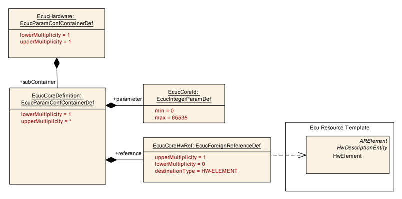

| 属性 | 值 |
| --- | --- |
| 容器名称 | EcucPartitionCollection |
| 父容器 | EcuC |
| 说明 | Collection of Partitions defined for this ECU. |
| 配置参数 | （见下） |

| 属性 | 值 |
| --- | --- |
| 容器名称 | EcucPartition |
| 父容器 | EcucPartitionCollection |
| 说明 | Definition of one Partition on this ECU. One Partition will be implemented using one Os-Application. |
| 后构建变体多重性 | false |
| 多重性配置类 | 预编译时间｜X｜VARIANT-PRE-COMPILE, VARIANT-POST-BUILD |
| 多重性配置类 | 链接时间｜- |
| 多重性配置类 | 后构建时间｜- |
| 配置参数 | （见下） |

| 属性 | 值 |
| --- | --- |
| 参数名称 | EcucDefaultBswPartition |
| 父容器 | EcucPartition |
| 说明 | Denotes the default BSW partition. This partition will host all BSW Modules, which are not explicitly mapped to a different partition. For partitions other than the default BSW partition this parameter can be omitted. |
| 多重性 | 0..1 |
| 类型 | EcucBooleanParamDef |
| 默认值 | - |
| 后构建变体多重性 | false |
| 后构建变体取值 | false |
| 多重性配置类 | 预编译时间｜X |
| 多重性配置类 | 链接时间｜- |
| 多重性配置类 | 后构建时间｜- |
| 取值配置类 | 预编译时间｜X |
| 取值配置类 | 链接时间｜- |
| 取值配置类 | 后构建时间｜- |
| 作用域/依赖 |  |

| 属性 | 值 |
| --- | --- |
| 参数名称 | EcucPartitionId |
| 父容器 | EcucPartition |
| 说明 | ID of the partition. |
| 多重性 | 1 |
| 类型 | EcucIntegerParamDef |

#### 3.3.2. 分区的定义（**Definition of Partitions**）

为了支持内存分区与多核，EcuC 虚拟模块中引入了 EcucPartition 的概念。

EcuC 模块可以拥有一个 EcucPartitionCollection，它可以容纳任意数量的 EcucPartition 元素。内存分区能够围绕 **SWC** 组创建保护边界。可以经由对 **SW** 组件实例的引用 EcucPartitionSoftwareComponentInstanceRef 把 **SWC** 分配到 EcucPartition。一个 EcucPartition 由 **OS** 内的一个 Os-Application 实现。因此，如图 3.4 所示，**SWC** 到分区的映射限制了可运行实体到任务的映射。

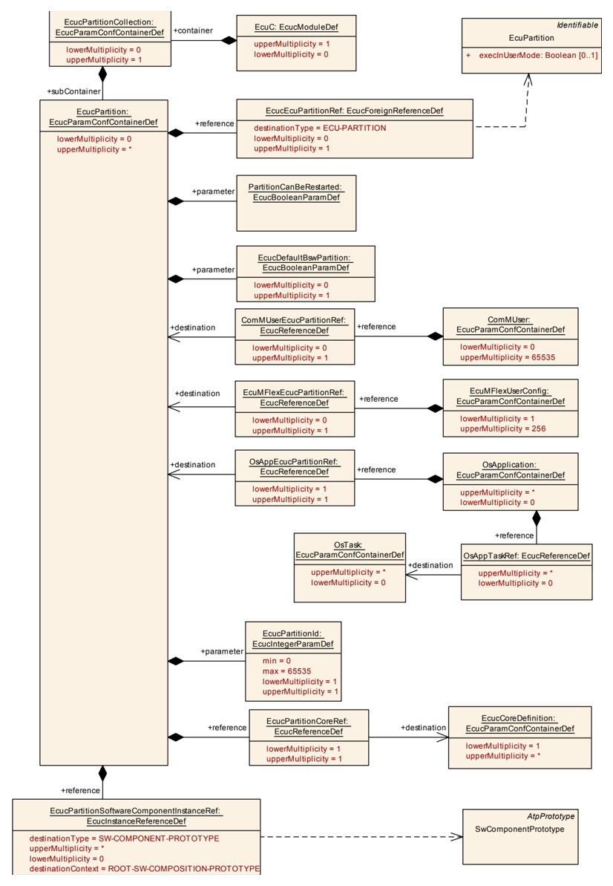

设计原则是：在创建分区之后，软件（**SWC**）被映射到该分区。在第二步中配置 **BSW**，分区的每个成员（**BSW**）定义一个指向 EcucPartition 元素的引用。

一个示例是 Os 模块：Os-Application 用于实现一个分区，因此从每个 Os-Application 到一个 Partition 应存在一个引用，指明该 Os-Application 实现的是哪个分区。

另一个示例是 **SWC** 与 **ComM** 的交互：在与 **BSW** 模块不同的分区中运行的 **SWC** 向 **ComM** 请求完全通信。如果该 **SWC** 所在的分区因分区违例而停止，则 **ComM** 处会存在一个未决的完全通信请求，它会阻止网络进入睡眠。借助所提供的配置手段，可以为此类用例实现应对措施。

EcucPartition 与 EcucCoreDefinition 之间的交互经由 OsApplication 的 OsApplicationCoreRef 完成。

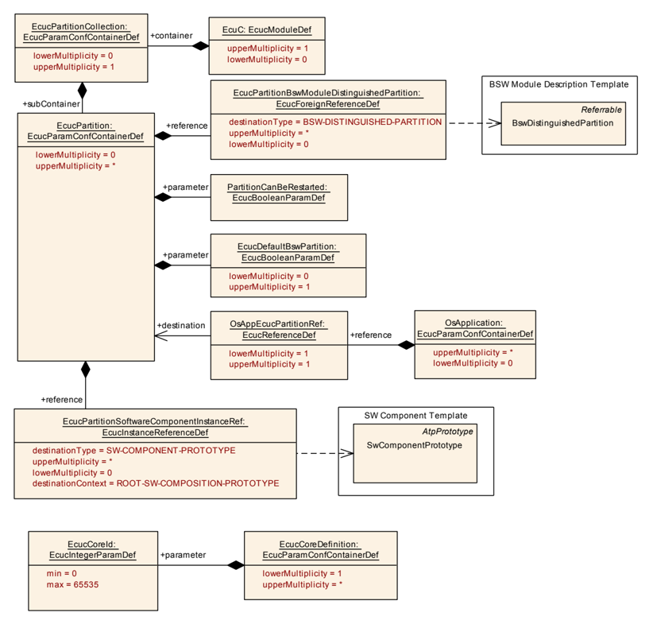

| 属性 | 值 |
| --- | --- |
| 参数名称 | PartitionCanBeRestarted |
| 父容器 | EcucPartition |
| 说明 | Specifies the requirement whether the Partition can be restarted. If set to true all software executing in this partition shall be capable of handling a restart. |
| 多重性 | 1 |
| 类型 | EcucBooleanParamDef |
| 默认值 | - |
| 后构建变体取值 | false |
| 取值配置类 | 预编译时间｜X｜All Variants |
| 取值配置类 | 链接时间｜- |
| 取值配置类 | 后构建时间｜- |
| 作用域/依赖 |  |

| 属性 | 值 |
| --- | --- |
| 参数名称 | EcucEcuPartitionRef |
| 父容器 | EcucPartition |
| 说明 | Reference to the EcuPartition to define the link to the partition described in the System description. Tags: atp.Status=draft |
| 多重性 | 0..1 |
| 类型 | Foreign reference to ECU-PARTITION |
| 多重性配置类 | 预编译时间｜X｜All Variants |
| 多重性配置类 | 链接时间｜- |
| 多重性配置类 | 后构建时间｜- |
| 取值配置类 | 预编译时间｜X｜All Variants |
| 取值配置类 | 链接时间｜- |
| 取值配置类 | 后构建时间｜- |
| 作用域/依赖 | scope: ECU |

| 属性 | 值 |
| --- | --- |
| 参数名称 | EcucPartitionBswModuleDistinguishedPartition |
| 父容器 | EcucPartition |
| 说明 | This maps the abstract partition of the Bsw Module to a concrete Partition existing in the ECU. |
| 多重性 | 0..* |
| 类型 | Foreign reference to BSW-DISTINGUISHED-PARTITION |
| 后构建变体多重性 | false |
| 后构建变体取值 | false |
| 多重性配置类 | 预编译时间｜X｜All Variants |

| 属性 | 值 |
| --- | --- |
| 参数名称 | EcucPartitionCoreRef |
| 父容器 | EcucPartition |
| 说明 | Reference to the core definition. This reference is used to describe to which core the EcucPartition is bound. |
| 多重性 | 1 |
| 类型 | Reference to EcucCoreDefinition |
| 后构建变体多重性 | false |
| 后构建变体取值 | false |
| 多重性配置类 | 预编译时间｜X |
| 多重性配置类 | 链接时间｜- |
| 多重性配置类 | 后构建时间｜- |
| 取值配置类 | 预编译时间｜X |
| 取值配置类 | 链接时间｜- |
| 取值配置类 | 后构建时间｜- |
| 作用域/依赖 | scope: ECU |

| 属性 | 值 |
| --- | --- |
| 参数名称 | EcucPartitionSoftwareComponentInstanceRef |
| 父容器 | EcucPartition |
| 说明 | References the SW Component instances from the Ecu Extract that shall be executed in this partition. |
| 多重性 | 0..* |
| 类型 | Instance reference to SW-COMPONENT-PROTOTYPE context: ROOT-SW-COMPOSITION-PROTOTYPE |
| 后构建变体多重性 | false |
| 后构建变体取值 | false |
| 多重性配置类 | 预编译时间｜X |
| 多重性配置类 | 链接时间｜- |
| 多重性配置类 | 后构建时间｜- |
| 取值配置类 | 预编译时间｜X |
| 取值配置类 | 链接时间｜- |
| 取值配置类 | 后构建时间｜- |
| 作用域/依赖 |  |

#### 3.3.3. 后构建变体（**PostBuild Variants**）

对于每个后构建变体（后构建配置集），恰好存在一个对全部支持后构建的 **BSW** 模块有效的「顶层」PredefinedVariant。这意味着每个支持后构建变体（以前称为后构建可选配置集）的模块都需要为 EcucPostBuildVariantRef 所引用的每个已定义的 PredefinedVariant 拥有配置。

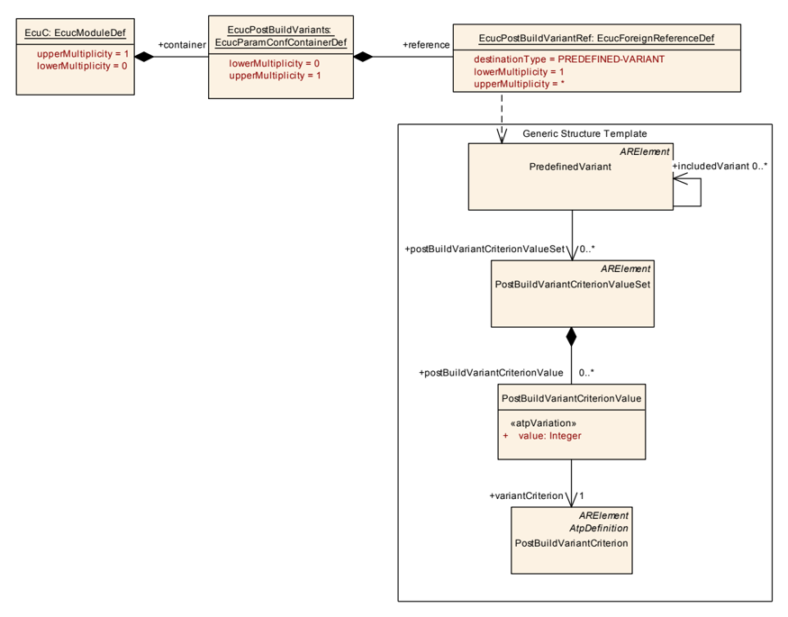

| 属性 | 值 |
| --- | --- |
| 容器名称 | EcucPostBuildVariants |
| 父容器 | EcuC |
| 说明 | Collection of toplevel PostBuildSelectable variants. The PredefinedVariants linked inside this container will determine how many PostBuildSelectableVariants exist. If this container exist the name pattern for initialization of BSW modules will be <Mip>_ Config_<PredefinedVariant.shortName>. If this container does not exist the name pattern for initialization of BSW modlues will be <Mip>_Config. |
| 配置参数 | （见下） |

| 属性 | 值 |
| --- | --- |
| 参数名称 | EcucPostBuildVariantRef |
| 父容器 | EcucPostBuildVariants |

**约束：EcucPostBuildVariantRef 所引用的 PredefinedVariant 的 shortName**：全部被 EcucPostBuildVariantRef 引用的 PredefinedVariant 应具有不同的 shortName。

PredefinedVariant 可以存在于不同的包中，因而可能具有相同的 shortName。EcucPostBuildVariants 中符号的生成要求这些 shortName 彼此不同。

#### 3.3.4. 变体解析器描述（**Variation Resolver Description**）

为了支持变体处理方法（见通用结构模板 [\[4\]](#ref-4)），使用集合 SwSystemconstantValueSet 规定系统常量的既有取值。在 EcuC 中，适用的 SwSystemconstantValueSet 元素经由 PredefinedVariant 集合间接引用。

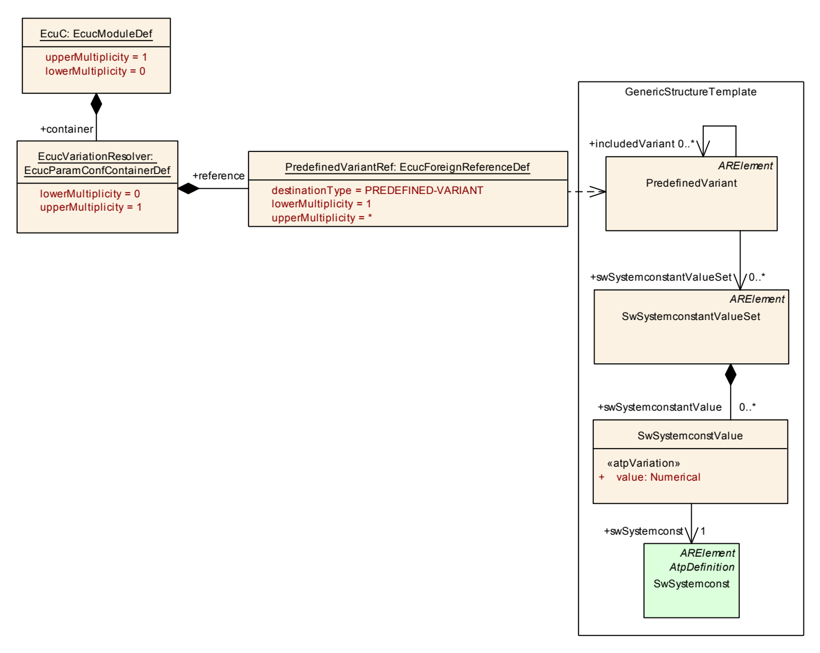

| 属性 | 值 |
| --- | --- |
| 容器名称 | EcucVariationResolver |
| 父容器 | EcuC |
| 说明 | Collection of PredefinedVariant elements containing definition of values for Sw Systemconst which shall be applied when resolving the variability during ECU Configuration. |
| 配置参数 | （见下） |

| 属性 | 值 |
| --- | --- |
| 参数名称 | PredefinedVariantRef |
| 父容器 | EcucVariationResolver |
| 说明 | - |
| 多重性 | 1..* |
| 类型 | Foreign reference to PREDEFINED-VARIANT |
| 后构建变体多重性 | false |
| 后构建变体取值 | false |
| 多重性配置类 | 预编译时间｜X |
| 多重性配置类 | 链接时间｜- |
| 多重性配置类 | 后构建时间｜- |
| 取值配置类 | 预编译时间｜X |
| 取值配置类 | 链接时间｜- |
| 取值配置类 | 后构建时间｜- |

#### 3.3.5. UnitGroup 分配（**UnitGroup Assignment**）

为了支持 **ASAM MCD** 文件的生成，可以在 EcuC 中选择与 MCD 系统相关的 UnitGroup。请注意，EcucUnitGroupAssignment 可用于控制 **A2L** 文件的生成，使计算所用的单位被应用域特定单位替换。

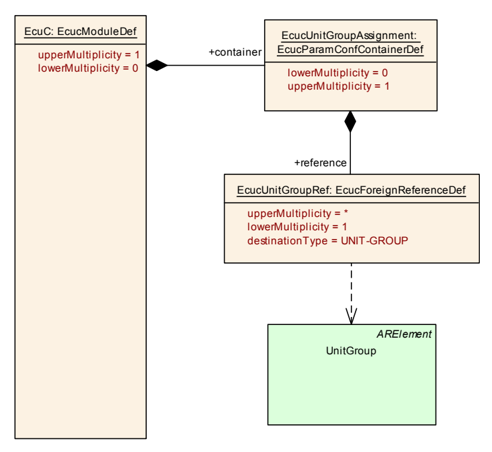

| 属性 | 值 |
| --- | --- |
| 容器名称 | EcucUnitGroupAssignment |
| 父容器 | EcuC |
| 说明 | Collection of UnitGroup references to support the generation of ASAM MCD file. |
| 配置参数 | （见下） |

| 属性 | 值 |
| --- | --- |
| 参数名称 | EcucUnitGroupRef |
| 父容器 | EcucUnitGroupAssignment |
| 说明 | Optional reference to the UnitGroup to support the generation of ASAM MCD file. These UnitGroups are selecting a set of units for a specific country. |
| 多重性 | 1..* |
| 类型 | Foreign reference to UNIT-GROUP |
| 后构建变体多重性 | false |

#### 3.3.6. Pdu 的定义（**Definition of Pdus**）

为了支持 Handle ID 的同步（见[第 3.4.1 节](#341-handle-id句柄-idhandle-ids)），两个模块需要能够引用同一个 Pdu 对象<sup>2</sup>。因此定义了一个不属于任何模块、而定义在 EcuC 模块中的通用 Pdu 容器。

由于流经 **COM** 栈的 Pdu 不属于单个模块，**ECU** 配置中引入了「虚拟」模块 EcuC。该模块用于收集不与任何特定标准化模块相关联的配置信息。

EcucPduCollection 可以包含若干「全局」Pdu 对象，如图 3.9 所示。每个 Pdu 要么表示一个 FrameTriggering（针对不经过 **Pdu** 路由器的 Pdu：UserDefinedPdu、NmPdu 与 NPdu），要么表示一个 PduTriggering（针对全部其他 Pdu），它们属于来自 **AUTOSAR** 系统描述 [\[1\]](#ref-1)（**ECU** 提取）的特定 **ECU**。因此，存在一个指向系统模板中 FrameTriggering（SysTPduToFrameTriggeringRef）或 PduTriggering（SysTPduToPduTriggeringRef）元素的可选引用。应使用 SysTPduToFrameTriggeringRef 或 SysTPduToPduTriggeringRef 之一。

> 2 就配置这一方面而言，Pdu 是何种类型并不重要，即 I-PDU、L-PDU 或 N-PDU。

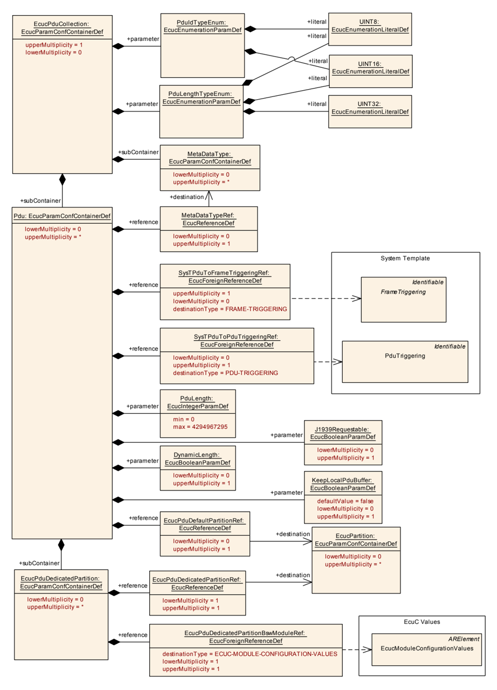

| 属性 | 值 |
| --- | --- |
| 容器名称 | EcucPduCollection |
| 父容器 | EcucConfigSet |
| 说明 | Collection of all Pdu objects flowing through the Com-Stack. |
| 配置参数 | （见下） |

| 属性 | 值 |
| --- | --- |
| 参数名称 | PduIdTypeEnum |
| 父容器 | EcucPduCollection |
| 说明 | The PduIdType is used within the entire AUTOSAR Com Stack except for bus drivers. The size of this global type depends on the maximum number of PDUs used within one software module. If no software module deals with more PDUs that 256, this type can be set to uint8. If at least one software module handles more than 256 PDUs, this type shall be set to uint16. See AUTOSAR_SWS_CommunicationStackTypes for more details. |
| 多重性 | 1 |
| 类型 | EcucEnumerationParamDef |
| 范围 | UINT16｜- |
| 范围 | UINT8｜- |
| 后构建变体取值 | false |
| 作用域/依赖 |  |

| 属性 | 值 |
| --- | --- |
| 参数名称 | PduLengthTypeEnum |
| 父容器 | EcucPduCollection |
| 说明 | The PduLengthType is used within the entire AUTOSAR Com Stack except for bus drivers. The size of this global type depends on the maximum length of PDUs to be sent by an ECU. If no segmentation is used the length depends on the maximum payload size of a frame of the underlying communication system (for FlexRay maximum size is 255 bytes, therefore uint8). If segmentation is used it depends on the maximum length of a segmented N-SDU (in general uint16 is used). See AUTOSAR_ SWS_CommunicationStackTypes for more details. |
| 多重性 | 1 |
| 类型 | EcucEnumerationParamDef |
| 范围 | UINT16｜- |
| 范围 | UINT32｜- |
| 范围 | UINT8｜- |
| 后构建变体取值 | false |
| 作用域/依赖 |  |

| 属性 | 值 |
| --- | --- |
| 容器名称 | Pdu |
| 父容器 | EcucPduCollection |
| 说明 | One Pdu flowing through the COM-Stack. This Pdu is used by all Com-Stack modules to agree on referencing the same Pdu. |
| 后构建变体多重性 | true |
| 多重性配置类 | 预编译时间｜X｜VARIANT-PRE-COMPILE |
| 多重性配置类 | 链接时间｜- |
| 多重性配置类 | 后构建时间｜X｜VARIANT-POST-BUILD |
| 配置参数 | （见下） |

| 属性 | 值 |
| --- | --- |
| 参数名称 | DynamicLength |
| 父容器 | Pdu |
| 说明 | This parameter defines whether the Pdu has dynamic length (true) or not (false). Please note that the usage of this attribute is restricted by [constr_3448]. |
| 多重性 | 0..1 |
| 类型 | EcucBooleanParamDef |
| 默认值 | - |
| 后构建变体多重性 | true |
| 后构建变体取值 | true |
| 多重性配置类 | 预编译时间｜X｜VARIANT-PRE-COMPILE |
| 多重性配置类 | 链接时间｜- |
| 多重性配置类 | 后构建时间｜X｜VARIANT-POST-BUILD |
| 取值配置类 | 预编译时间｜X｜VARIANT-PRE-COMPILE |
| 取值配置类 | 链接时间｜- |
| 取值配置类 | 后构建时间｜X｜VARIANT-POST-BUILD |
| 作用域/依赖 |  |

| 属性 | 值 |
| --- | --- |
| 参数名称 | J1939Requestable |
| 父容器 | Pdu |
| 说明 | Pdu can be triggered by the J1939 request message. |
| 多重性 | 0..1 |
| 类型 | EcucBooleanParamDef |
| 默认值 | - |
| 后构建变体多重性 | true |
| 后构建变体取值 | true |
| 多重性配置类 | 预编译时间｜X｜VARIANT-PRE-COMPILE |
| 多重性配置类 | 链接时间｜- |
| 多重性配置类 | 后构建时间｜X｜VARIANT-POST-BUILD |
| 取值配置类 | 预编译时间｜X｜VARIANT-PRE-COMPILE |
| 取值配置类 | 链接时间｜- |
| 取值配置类 | 后构建时间｜X｜VARIANT-POST-BUILD |
| 作用域/依赖 |  |

| 属性 | 值 |
| --- | --- |
| 参数名称 | KeepLocalPduBuffer |
| 父容器 | Pdu |
| 说明 | This parameter defines whether a module that handles the PDU would keep a temporary local buffer • until a confirmation or release-rx-buffer function call arrives (KeepLocalPduBuffer = TRUE) or • if a temporary local buffer is released after transmission or rx indication return (Keep LocalPduBuffer = FALSE). Tags: atp.Status=draft |
| 多重性 | 0..1 |
| 类型 | EcucBooleanParamDef |
| 默认值 | false |
| 后构建变体多重性 | false |
| 多重性配置类 | 预编译时间｜X |
| 多重性配置类 | 链接时间｜- |
| 多重性配置类 | 后构建时间｜- |
| 取值配置类 | 预编译时间｜X |
| 取值配置类 | 链接时间｜- |
| 取值配置类 | 后构建时间｜- |
| 作用域/依赖 |  |

| 属性 | 值 |
| --- | --- |
| 参数名称 | PduLength |
| 父容器 | Pdu |
| 说明 | Length of the Pdu in bytes. It should be noted that in former AUTOSAR releases (Rel 2.1, Rel 3.0, Rel 3.1, Rel 4.0 Rev. 1) this parameter was defined in bits. |
| 多重性 | 1 |
| 类型 | EcucIntegerParamDef |
| 范围 | 0 .. 4294967295 |
| 默认值 | - |
| 后构建变体取值 | true |
| 取值配置类 | 预编译时间｜X｜VARIANT-PRE-COMPILE |
| 取值配置类 | 链接时间｜- |
| 取值配置类 | 后构建时间｜X｜VARIANT-POST-BUILD |
| 作用域/依赖 |  |

| 属性 | 值 |
| --- | --- |
| 参数名称 | EcucPduDefaultPartitionRef |
| 父容器 | Pdu |
| 说明 | Reference to EcucPartition, where the according Pdu is assigned to. |
| 多重性 | 0..1 |
| 类型 | Reference to EcucPartition |
| 后构建变体多重性 | false |
| 后构建变体取值 | false |
| 多重性配置类 | 预编译时间｜X｜All Variants |
| 多重性配置类 | 链接时间｜- |
| 多重性配置类 | 后构建时间｜- |

| 属性 | 值 |
| --- | --- |
| 参数名称 | MetaDataTypeRef |
| 父容器 | Pdu |
| 说明 | Reference to meta data that is transported in the Pdu through the AUTOSAR layers. |
| 多重性 | 0..1 |
| 类型 | Reference to MetaDataType |
| 后构建变体取值 | false |
| 取值配置类 | 预编译时间｜X｜All Variants |
| 取值配置类 | 链接时间｜- |
| 取值配置类 | 后构建时间｜- |
| 作用域/依赖 |  |

| 属性 | 值 |
| --- | --- |
| 参数名称 | SysTPduToFrameTriggeringRef |
| 父容器 | Pdu |
| 说明 | Reference to the FrameTriggering from the SystemTemplate which this Pdu belongs to. SysTPduToFrameTriggeringRef shall be used for UserDefinedPdus, NmPdus and NPdus which are not going through the Pdu Router. This reference shall not be used if SysTPduToPduTriggeringRef exists. |
| 多重性 | 0..1 |
| 类型 | Foreign reference to FRAME-TRIGGERING |
| 后构建变体多重性 | true |
| 后构建变体取值 | true |
| 多重性配置类 | 预编译时间｜X｜VARIANT-PRE-COMPILE |
| 多重性配置类 | 链接时间｜- |
| 多重性配置类 | 后构建时间｜X｜VARIANT-POST-BUILD |
| 取值配置类 | 预编译时间｜X｜VARIANT-PRE-COMPILE |
| 取值配置类 | 链接时间｜- |
| 取值配置类 | 后构建时间｜X｜VARIANT-POST-BUILD |
| 作用域/依赖 | dependency: SysTPduToFrameTriggeringRef shall be used for UserDefinedPdus, Nm Pdus and NPdus which are not going through the Pdu Router. This reference shall not be used if SysTPduToPduTriggeringRef exists. |

| 属性 | 值 |
| --- | --- |
| 参数名称 | SysTPduToPduTriggeringRef |
| 父容器 | Pdu |
| 说明 | Reference to the PduTriggering from the SystemTemplate which this Pdu represents. SysTPduToPduTriggeringRef shall be used for all Pdus except UserDefinedPdus, Nm Pdus and NPdus which are not going through the Pdu Router. For these Pdus, Sys TPduToFrameTriggeringRef shall be used. |
| 多重性 | 0..1 |
| 类型 | Foreign reference to PDU-TRIGGERING |
| 后构建变体多重性 | true |

| 属性 | 值 |
| --- | --- |
| 容器名称 | EcucPduDedicatedPartition |
| 父容器 | Pdu |
| 说明 | Module specific container for Pdu to partition assignment. |
| 后构建变体多重性 | true |
| 多重性配置类 | 预编译时间｜X｜All Variants |
| 多重性配置类 | 链接时间｜- |
| 多重性配置类 | 后构建时间｜- |
| 配置参数 | （见下） |

| 属性 | 值 |
| --- | --- |
| 参数名称 | EcucPduDedicatedPartitionBswModuleRef |
| 父容器 | EcucPduDedicatedPartition |
| 说明 | Reference to BSW module, for which the according dedicated Pdu assignment is valid. |
| 多重性 | 1 |
| 类型 | Foreign reference to ECUC-MODULE-CONFIGURATION-VALUES |
| 后构建变体取值 | false |
| 取值配置类 | 预编译时间｜X｜All Variants |
| 取值配置类 | 链接时间｜- |
| 取值配置类 | 后构建时间｜- |
| 作用域/依赖 | scope: local |

| 属性 | 值 |
| --- | --- |
| 参数名称 | EcucPduDedicatedPartitionRef |
| 父容器 | EcucPduDedicatedPartition |
| 说明 | Module specific reference to EcucPartition, where the according Pdu is assigned to. The dedicated partition reference shall overrule the default partition reference for the respective module. |
| 多重性 | 1 |
| 类型 | Reference to EcucPartition |
| 后构建变体取值 | false |
| 取值配置类 | 预编译时间｜X｜All Variants |
| 取值配置类 | 链接时间｜- |

| 属性 | 值 |
| --- | --- |
| 容器名称 | MetaDataType |
| 父容器 | EcucPduCollection |
| 说明 | Meta data serves to transport information through the AUTOSAR layers. It is transported by the PduInfoType structure via a separate pointer to a byte array alongside the length of and a pointer to the payload of the PDU. This container defines the content of the meta data. |
| 后构建变体多重性 | false |
| 多重性配置类 | 预编译时间｜X｜All Variants |
| 多重性配置类 | 链接时间｜- |
| 多重性配置类 | 后构建时间｜- |
| 配置参数 | （见下） |

| 属性 | 值 |
| --- | --- |
| 容器名称 | MetaDataItem |
| 父容器 | MetaDataType |
| 说明 | The content of meta data in a Pdu consists of an ordered list of meta data items. This container represents a meta data item that is contained in meta data of a Pdu. Attributes: requiresIndex=true |
| 后构建变体多重性 | false |
| 多重性配置类 | 预编译时间｜X｜All Variants |
| 多重性配置类 | 链接时间｜- |
| 多重性配置类 | 后构建时间｜- |
| 配置参数 | （见下） |

| 属性 | 值 |
| --- | --- |
| 参数名称 | MetaDataItemLength |
| 父容器 | MetaDataItem |
| 说明 | This parameter defines the length of a meta data item in bytes. |
| 多重性 | 1 |
| 类型 | EcucIntegerParamDef |
| 范围 | 1 .. 64 |
| 默认值 | - |
| 后构建变体取值 | false |
| 取值配置类 | 预编译时间｜X｜All Variants |
| 取值配置类 | 链接时间｜- |
| 取值配置类 | 后构建时间｜- |
| 作用域/依赖 | scope: local |

| 属性 | 值 |
| --- | --- |
| 参数名称 | MetaDataItemType |
| 父容器 | MetaDataItem |
| 说明 | This parameter defines the type of a meta data item. |
| 多重性 | 1 |
| 类型 | EcucEnumerationParamDef |
| 范围 | ACCEPTANCEFIELD_32；Acceptance field of CAN XL. Size: 32 bits. |
| 范围 | ADDRESS_EXTENSION_8；Address extension field (N_AE) of the mixed addressing modes with 11bit and 29bit CAN ID of ISO 15765-2. Size: 8 bits. |
| 范围 | CAN_ID_32；CAN ID according to ISO 11898-2, either 29 bits or 11 bits. Encoding according to Can_IdType. Size: 32 bits. |

**约束：无效的 PduLength 参数取值配置**：把 PduLength 配置为大于底层所支持的取值会导致无效的配置。

#### 3.3.7. Pdu 元数据（**Pdu Meta-Data**）

**AUTOSAR** 通信栈的大量模块支持 Pdu 的元数据（**Meta-Data**）。元数据跨层传输信息，这些信息通常由分层架构抽象。元数据的内容由 MetaDataType 定义，与 Pdu 的关系由 MetaDataTypeRef 建立。

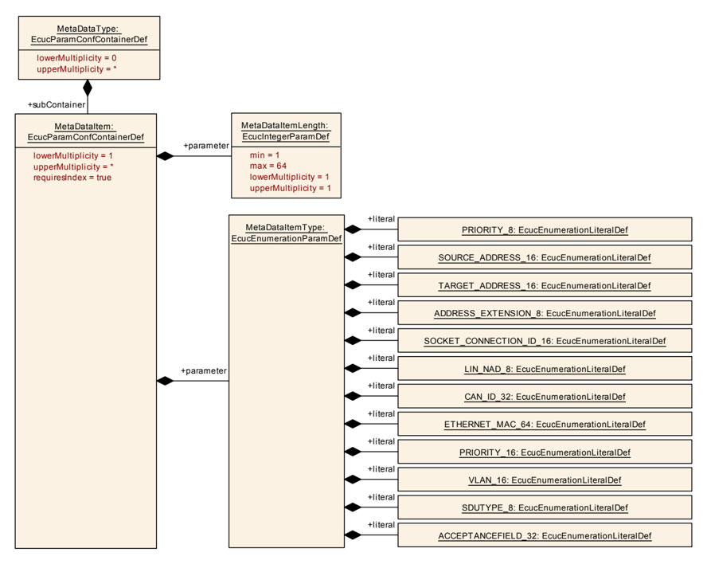

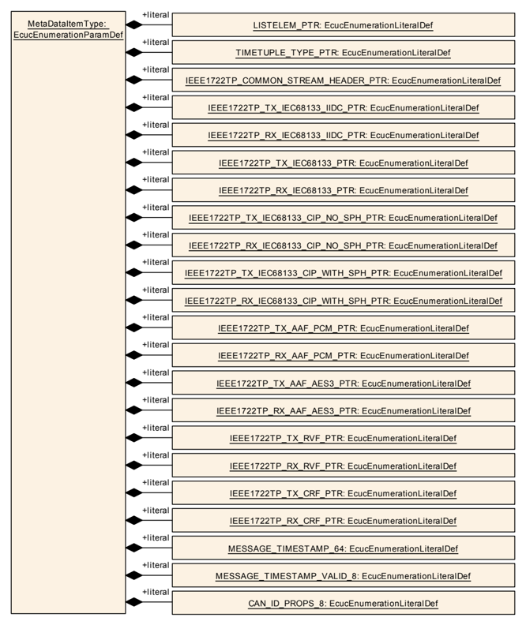

**约束：MetaDataType 的 MetaDataItem 的排序**：一个 MetaDataType 的 MetaDataItem 应按照其 MetaDataItemLength 排序，MetaDataItemLength 较大的排在前面。

约束「MetaDataType 的 MetaDataItem 的排序」存在的理由：这确保全部 MetaDataItem 都能正确对齐，而各个 MetaDataItem 之间不会有填充。

**约束：MetaDataType 的 MetaDataItem 顺序的相关性（**Relevance**）**：一个 MetaDataType 的 MetaDataItem 顺序定义相应 Pdu 的元数据数组中元数据项的顺序与位置。
### 3.4. Com 栈配置（**COM-Stack configuration**）

为了应对 **COM** 栈配置的复杂性，应用了一些重复出现的模式，本节将对它们加以描述。这里只展示这些模式以及一些示例。要获得每个单独模块配置的详细规范，请参见这些模块实际的 **BSW SWS** 文档。

#### 3.4.1. Handle ID（句柄 ID）（**Handle IDs**）

![图 3.12：COM 栈中的接口 [13]（Interfaces in the COM-Stack [13]）](Figure3-12.png)

图 3.12 展示了 **COM** 栈模块及其交互的详细视图。相邻<sup>3</sup>模块之间存在若干种交互。

##### 3.4.1.1. Handle ID 概念（**Handle ID concept**）

**COM** 栈中的 **API** 定义使用两个概念来实现相邻模块之间的交互：

- 指向 Pdu 数据缓冲区的指针（Pdu 数据缓冲区包含实际被通信的信息，取决于交互发生的具体层）
- 用于标识指针指向哪个 Pdu 的 Handle ID。

一个典型的 **API** 调用例如：

> 3 如果两个模块共享一个接口，则称它们为相邻模块；因此 PduR 与 Com 是相邻的，而 PduR 与 **CAN** 驱动程序不是。

PduR_ComTransmit(PduIdType ComTxPduId, PduInfoType *PduInfoPtr)

哪个 **BSW** 模块实际提供 Handle ID 的取值，在相应 **BSW** 模块的 **ECU** 配置参数定义中规定（规定的细节见[第 3.4.1.2 节](#3412-handle-id-的定义definition-of-handle-ids)）。

Handle ID 取值的选择由提供方模块的实现决定。可能存在优化 Handle ID 取值的不同策略，因此实现的内部结构可能对取值的选择产生影响。

此外，Handle ID 可以在每个模块内自由选择，因此一个 Pdu 可能以 ID=5 从 Com 发送到 PduR，然后 PduR 以 ID=19 将它继续发送给 CanIf。在 PduR 的配置信息中，必须能够推断出：如果一个 Pdu 以 ID=5 从 Com 到达，它必须以 ID=19 转发给 CanIf。

必须保证每个 Pdu 在相应 **API** 的作用域内具有唯一的 handle ID。例如：PduR 同时从 Com 与 Dcm 模块获得传输请求。但针对这些请求定义了两个不同的 **API**：

- PduR_ComTransmit(...)
- PduR_DcmTransmit(...)

因此，即使两个 Pdu 具有相同的 handle ID 但经由不同的 **API** 请求，PduR 也可以区分它们。

**COM** 栈中的另一个用例只向全部调用方提供一个 **API**：接口层（CanIf、FrIf、LinIf）。

- CanIf_Transmit(...)

这里必须保证：对一个特定 Pdu 的每个传输请求都具有唯一的 handle ID。

handle ID 的实际取值只能在一个模块的配置完成之后正确分配，因为只有那时才能定义内部数据结构。

在接下来的小节中，描述用于定义和使用 Handle ID 的模式。

##### 3.4.1.2. Handle ID 的定义（**Definition of Handle IDs**）

Handle ID 由提供 **API** 的模块定义，由调用该 **API** 的模块使用。在回调函数（例如 Tx Confirmation 函数或 Trigger Transmit 函数）中使用的 Handle ID 应由上层模块定义。在上层模块中，Tx Confirmation 与 Trigger Transmit 回调函数应使用相同的 HandleId。即接收传输请求的模块可以以不同于传输请求 Handle ID 的 Handle Id 调用 Tx 确认回调。这是与以往 **AUTOSAR** 发布版的一个差异，在以往版本中 Tx 确认以相同的 Handle ID 调用。

**ECU** 配置值描述（它持有配置参数的实际取值）按照各个 **BSW** 模块实例结构化。因此 **ECU** 配置参数定义也以这种方式结构化。

图 3.13 展示了 **CAN** 接口传输配置的一部分的示例性定义。

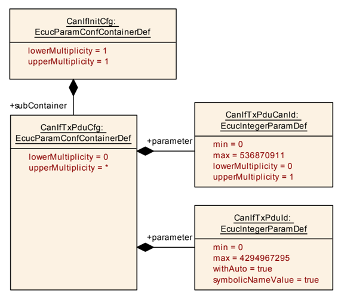

模块 CanIf 的配置可以包含若干 CanIfTxPduConfig 对象。

每个 CanIfTxPduConfig 对象包含来自上层（例如 PduR 或 Nm）并发往某个 **CAN** 驱动程序的一个 Pdu 的信息。在本示例中，为每个待传输的 Pdu 规定了 CanIfCanTxPduCanId 与 CanIfCanTxPduDlc。接收用例也需要一个类似的结构。

此外还规定了参数 CanIfCanTxPduId。这个整数参数稍后将持有 handle ID 的实际取值。因此 handle ID 取值存储在定义模块的结构内部。

由于 handle ID CanIfCanTxPduId 是容器 CanIfTxPduConfig 的一部分，因此可以应用符号名的语义。

所描述的示例只适用于 CanIf 与上层模块之间的通信。CanDrv 不支持 handle ID 概念，而是使用在 Can_Write() 期间传递的 PduId 指示 TxConfirmation。

**约束：需要在若干模块之间共享的 Handle Id**：如果一个配置参数持有一个需要在若干模块之间共享的 handle Id，则它应设置 symbolicNameValue = true。

因此，要求全部 handle Id 取值都可以经由符号名引用访问（见[第 3.4.1.4 节](#3414-带符号名的-handle-idhandle-ids-with-symbolic-names)）。

##### 3.4.1.3. Handle ID 的一致约定（**Agreement on Handle IDs**）

在一个模块的配置期间，会为流经该模块的每个 Pdu 创建信息（再次见图 3.13：CanIfTxPduConfig），其中持有模块特定的配置信息。现在，这些「局部」Pdu 配置中的每一个都需要关联到一个「全局」Pdu 元素（见[第 3.3.6 节](#336-pdu-的定义definition-of-pdus)），后者表示流经 **COM** 栈的信息。这是通过引入一个从「局部」Pdu 到「全局」Pdu 的 EcucReferenceDef 完成的。

图 3.14 展示了 PduRDestPdu 与 CanIfTxPduConfig 之间的这种关系。

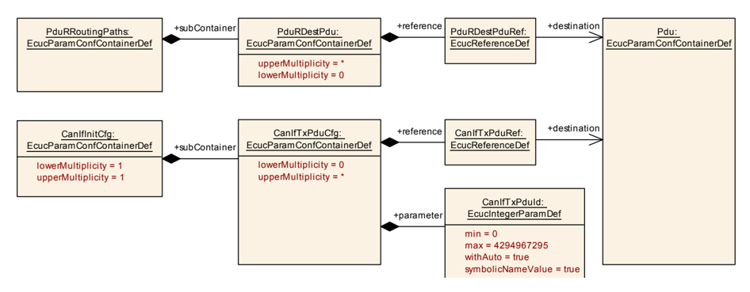

引入「全局」Pdu 并要求全部「局部」Pdu 只指向「全局」Pdu 的原因有两个：

- 在配置模块 PduR 时，只需要「全局」Pdu 存在；CanIf 中的「局部」Pdu 尚不需要存在。
- 引用存储在「局部」Pdu 结构中，因此所做的变更只影响被变更模块的结构。

采用图 3.14 所示的结构，现在可以生成两个模块。

CanIf（自动）配置编辑器收集全部「局部」CanIfTxPduConfig，并在 CanIfCanTxPduId 中生成/存储其 handle ID 的取值。如果 CanIf 需要知道 Pdu 传输请求来自哪里，它可以沿着 PduIdRef 走到「全局」Pdu，然后「查询」指向该 Pdu 的全部引用。沿这些引用反向追踪，就可以找到传输方模块。

PduR 生成器必须知道对每个要发送给 CanIf 的 Pdu 应使用哪个 handle ID。获取实际 handle ID 取值的机制与 CanIf 用例中相同：沿着「全局」Pdu 引用并「查询」指向该「全局」Pdu 的模块。然后找到该 Pdu 将要被传输到的模块类型。在组播的情形下，可能有若干模块需要接收同一个 Pdu。

借助这种方法，相关模块的配置信息之间实现了高度的解耦。即使模块相邻并且需要共享诸如 handle ID 之类的信息，模块之间的引用也始终是经由「全局」Pdu 元素的间接引用。

##### 3.4.1.4. 带符号名的 Handle ID（**Handle IDs with symbolic names**）

把 handle Id 与符号名结合使用，针对配置相邻模块的方法论的若干用例。可能的配置方法的定义请参见[附录 B.1.1](#b11-备选配置编辑器方法alternative-configuration-editor-approaches)。

在把方法论划分为配置编辑与模块生成两个步骤时，Handle Id 的用例可以区分为两种基本方法：

- 由配置编辑器分配的 Handle Id
- 由模块生成器分配的 Handle Id

假设整个栈的配置与生成使用不同的工具（可能来自不同的供应商）完成，这些工具可能实现上述两种方法之一。

为了支持定义一个参数取值应由用户提供、还是将由编辑器/生成器工具计算，EcucParameterDef 引入了属性 withAuto（见[第 2.3.5 节](#235-参数定义parameter-definition)）。

约束「需要在若干模块之间共享的 Handle Id」要求全部 handle Id 都表示为 symbolicNameValue = true 的配置参数，从而把取值与其使用解耦。

约束「symbolicNameValue 设置为 TRUE、由配置编辑器或模块生成器分配的参数取值应存储在 XML 文件中」要求已分配的取值存储在 **XML** 中（最迟在模块生成之后），从而记录已分配的取值。如果取值的分配必须在稍后的时点（以更新的输入信息）再次执行，则未受影响的取值可以保留。这也是支持调试所必需的。

约束「symbolicNameValue 设置为 TRUE 的参数在头文件中创建 #define 符号的规则」要求 handle Id 取值始终生成到模块的头文件中。借助这种方法，可以自由选择相邻模块的配置方法。

由于相邻模块之间的循环依赖（Com 使用 PduR 的 handle Id 发送到 PduR，PduR 使用 Com 的 handle Id 向 Com 指示），这种方法对方法论有重大影响。因此，一旦发生某些 handle Id 变更，就必须重新审视全部相邻模块的配置。这促成了「首先执行栈的配置，其次触发生成」的方法。

下面给出这种方法的一个示例：通过向持有 handle ID 的参数添加属性 symbolicNameValue = true（在图 3.14 中即参数 CanIfTxPduId），执行 CanIf 的代码生成器将在 CanIf_cfg.h 文件中生成一个 #define。

依据约束「symbolicNameValue 设置为 TRUE 的参数在头文件中创建 #define 符号的规则」，符号的名称由声明 **BSW** 模块的模块缩写 &lt;MA&gt;、后跟字面量「Conf_」、再后跟声明模块的 EcucParamConfContainerDef 的 shortName、再后跟持有该 symbolicNameValue 配置参数取值的 EcucContainerValue 容器的 shortName 组成。取值是分配给该 handle ID 的实际编号。


例如在 CanIf_cfg.h 中：#define CanIfConf_CanIfTxPduCfg_Pdu_2345634_985 17

好处是 PduR 的生成器不需要等待 CanIf 完全配置完成并生成 handle ID。如果 CanIf 为 handle ID 发布符号名，则 PduR 可以预期这些符号名，并使用这些符号名生成 PduR 代码。


例如在 PduR.c 中：CanIf_Transmit( CanIfConf_CanIfTxPduCfg_Pdu_2345634_985, PduPtr )

因此，PduR 可以在其自身配置完成后立即生成，而无需等待 CanIf 完全完成。不过，至少 CanIf 中的「局部」Pdu 必须已经创建，因为符号的名称必须从该配置中获取。

当然，只有在 CanIf 也生成之后 PduR 才能编译，但通过把符号名与 handle ID 结合使用，在配置过程中实现了更高程度的解耦。

#### 3.4.2. Pdu 路由器的配置示例（**Configuration examples for the Pdu Router**）

本节从配置的角度描述 PduR 的若干用例。重点是 PduR 配置与其他 **COM** 栈模块配置的交互。因此，这些示例中只实际展示部分配置参数。

##### 3.4.2.1. 从 Com 到 CanIf 的 Tx（**Tx from Com to CanIf**）

在图 3.15 的示例中，一个 Pdu 从 Com 模块——经由 **Pdu** 路由器——发送到 **CAN** 接口。由于这一个 Pdu 经过这些层交接，只需要一个全局 Pdu 对象 System_Pdu。

Com 模块的配置指向 System_Pdu 以指示应发送哪个 Pdu。然而，**API** 调用中必须使用的实际 Handle Id 将由 PduR 在参数 PduRSrcPdu::HandleId 中定义。在本示例中，Com 模块必须使用 Handle Id 23 把该 Pdu 传输给 PduR。

然后，由于 CanIf 指向同一个 System_Pdu，可以配置 PduR 把该 Pdu 发送给 CanIf。Handle Id 在 CanIf 配置的参数取值 CanIfCanTxPduId 中定义。

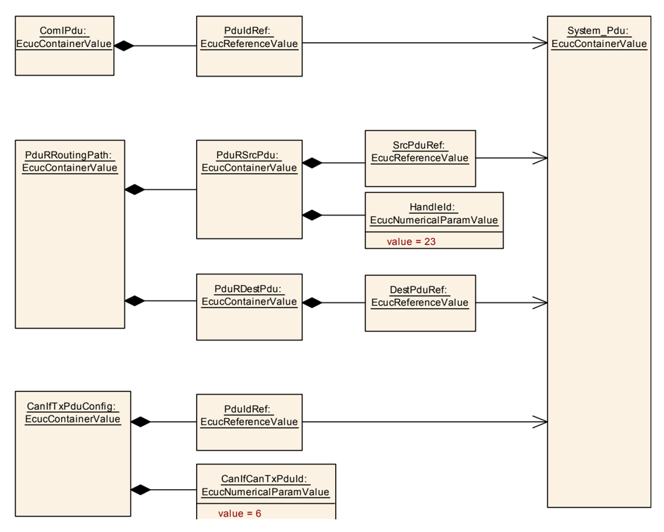

##### 3.4.2.2. 从 CanIf 到 Com 的 Rx（**Rx from CanIf to Com**）

在图 3.16 的示例中，配置了从 CanIf 到 Com 模块的接收用例。这里 Handle Id 在 PduR 与 Com 模块的配置中定义。

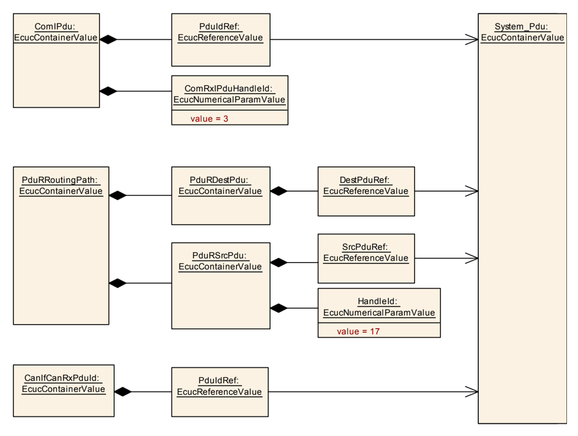

##### 3.4.2.3. 从 CanIf 到 FrIf 的网关（**Gateway from CanIf to FrIf**）

在图 3.17 的示例中展示了网关用例。由于涉及两个 Pdu，定义了两个 System_Pdu 对象：一个表示 **CAN** Pdu，一个表示 **Fr** Pdu。经由对这两个 System_Pdu 对象的引用配置网关。

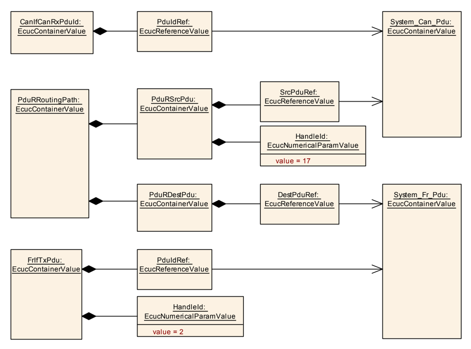

#### 3.4.3. 通信信道 ID（**Communication Channel IDs**）

对于控制路径模块（例如通信管理器、状态管理器、网络管理器）的配置，使用唯一的通信信道 ID（**Communication Channel ID**）方法标识相应的信道。这不同于 **COM** 栈的 Pdu Handle ID 的配置（见[第 3.4.1 节](#341-handle-id句柄-idhandle-ids)），后者按模块配置各个 Pdu Handle ID。


在图 3.18 中，ComMChannel 定义一个全局通信信道，并在参数取值 ComMChannelId 中提供该信道的通信信道 ID。使用通信信道的其他模块（例如 Nm、CanSM、CanNm 等）引用 ComMChannel，并可以以两种方式利用该通信信道 ID：

- 模块不存储通信信道 ID 的取值本身，而始终依赖 **ComM** 模块提供的取值（如 CanNm 所示）。
- 模块复制通信信道 ID 的取值，并要求复制的 id 取值等于 **ComM** 模块提供的取值（如 Nm 与 CanSM 所示）。

两种方法目前都在 **COM** 栈配置中使用。

#### 3.5. CDD 模块（**CDD module**）

CDD 模块描述了就外围标准化 **BSW** 模块而言配置一个复杂驱动程序（**Complex Driver**）所需的最小要求。

**约束：复杂驱动程序与标准化 AUTOSAR BSW 模块的交互（**Interaction**）**：如果一个复杂驱动程序想要与外围的标准化 **BSW** 模块交互，它必须从标准化的 CDD 模块定义派生一个供应商特定模块定义。生成供应商特定模块定义时应遵循的规则由约束「从标准化模块定义派生供应商特定模块定义」描述。

如约束「VSMD 的 shortName」所定义，VSMD 模块的 shortName 应与 StMD 的 shortName 相同。依据该需求，复杂驱动程序的模块定义的 shortName 始终为「Cdd」。

**约束：复杂驱动程序模块定义的区分（**Distinction**）**：为了把复杂驱动程序的模块定义彼此区分开来，应使用包结构。

**约束：复杂驱动模块与 Xfrm 模块的 apiServicePrefix 属性**：复杂驱动程序与 Xfrm 模块的模块缩写应等于其 apiServicePrefix 属性。

**约束：apiServicePrefix 的使用（**Usage of apiServicePrefix**）**：属性 apiServicePrefix 对从 CDD 与 Xfrm StMD 派生的 VSMD 是强制的。对于从任何其他 StMD 派生的 VSMD，不应提供该属性。

考虑一个名为「MyCdd」的复杂驱动程序。该复杂驱动程序的 VSMD 必须从 CDD StMD 派生。该复杂驱动程序模块定义的 shortName 必须等于「Cdd」。该复杂驱动程序 VSMD 的 apiServicePrefix 属性是强制的，并且必须等于「MyCdd」。

注意，CDD 的 VSMD 的配置参数不规定任何配置类。为全部配置参数（标准化与供应商特定的）定义配置类是该特定 CDD 实现者的职责（见约束「StMD 中的配置类规定」）。


| 属性 | 值 |
| --- | --- |
| Module Name | Cdd |
| 说明 | The CDD module describes the minimal requirements that are necessary for the configuration of a CDD with respect to the surrounding standardized BSW modules. |
| Post-Build Variant Support | true |
| Supported Config Variants | VARIANT-LINK-TIME, VARIANT-POST-BUILD, VARIANT-PRE-COMPILE |

| 属性 | 值 |
| --- | --- |
| 容器名称 | CddGeneral |
| 父容器 | Cdd |
| 说明 | Contains the general configuration parameters of the module. |
| 配置参数 | （见下） |

| 属性 | 值 |
| --- | --- |
| 参数名称 | CddInstanceId |
| 父容器 | CddGeneral |
| 说明 | Specifies the InstanceId of this module instance. If only one instance is present it shall have the Id 0. |
| 多重性 | 1 |
| 类型 | EcucIntegerParamDef |
| 范围 | 0 .. 255 |
| 默认值 | - |
| 后构建变体取值 | false |
| 取值配置类 | 预编译时间｜X｜All Variants |
| 取值配置类 | 链接时间｜- |
| 取值配置类 | 后构建时间｜- |
| 作用域/依赖 | scope: local |

| 属性 | 值 |
| --- | --- |
| 参数名称 | CddModuleId |
| 父容器 | CddGeneral |
| 说明 | Specifies the ModuleId of this module. |
| 多重性 | 0..1 |
| 类型 | EcucIntegerParamDef |
| 范围 | 255 .. 4095 |
| 默认值 | 255 |
| 后构建变体取值 | false |
| 取值配置类 | 预编译时间｜X｜All Variants |
| 取值配置类 | 链接时间｜- |
| 取值配置类 | 后构建时间｜- |
| 作用域/依赖 | scope: local |

**约束：CddModuleId 范围限制（**range restriction**）**：CddModuleId 的范围限定为取值 255 以及 2048..4095 的取值范围。

以下各节描述特定的 **COM** 栈模块以及与复杂驱动程序的交互。
##### 3.5.1. Pdu 路由器（**Pdu Router**）

在 **AUTOSAR COM** 栈中，允许上层与下层的复杂驱动程序访问 **Pdu** 路由器。在这两种情形下，都应配置 **CDD** 与 **Pdu** 路由器之间交换的 Pdu。复杂驱动程序的参与意味着一个指向全局 Pdu 的引用以及一个 HandleId 的定义。图 3.20 展示了位于 CanIf 与 PduR 之间的一个复杂驱动程序以及位于 PduR 之上的一个复杂驱动程序的示例。


图 3.21 展示了配置模型中的 **CDD** 参与。

注意，TxPdu 与 RxPdu 的可选存在并不影响 Cdd 中相应 **API** 的存在。


| 属性 | 值 |
| --- | --- |
| 容器名称 | CddPduRUpperLayerContribution |
| 父容器 | CddComStackContribution |
| 说明 | Parameters that are necessary for the configuration of a Complex Driver that serves as the UpperLayer of the Pdu Router module. |
| 配置参数 | （见下） |

| 属性 | 值 |
| --- | --- |
| 容器名称 | CddPduRLowerLayerContribution |
| 父容器 | CddComStackContribution |
| 说明 | Parameters that are necessary for the configuration of a Complex Driver that serves as the LowerLayer of the Pdu Router module. |
| 配置参数 | （见下） |

| 属性 | 值 |
| --- | --- |
| 容器名称 | CddPduRUpperLayerTxPdu |
| 父容器 | CddPduRUpperLayerContribution |
| 说明 | This container specifies Tx PDUs that are exchanged between the CDD and the standardized BSW module. |
| 配置参数 | （见下） |

| 属性 | 值 |
| --- | --- |
| 参数名称 | CddPduRApiType |
| 父容器 | CddPduRUpperLayerTxPdu |
| 说明 | This parameter configures the type of the CDD interface (IF/TP) |
| 多重性 | 0..1 |
| 类型 | EcucEnumerationParamDef |
| 范围 | IF｜- |
| 范围 | TP｜- |
| 后构建变体多重性 | false |
| 后构建变体取值 | false |
| 作用域/依赖 |  |

| 属性 | 值 |
| --- | --- |
| 参数名称 | CddPduRUpperLayerHandleId |
| 父容器 | CddPduRUpperLayerTxPdu |
| 说明 | ECU wide unique, symbolic handle for the Pdu. |
| 多重性 | 0..1 |
| 类型 | EcucIntegerParamDef (Symbolic Name generated for this parameter) |
| 范围 | 0 .. 65535 |
| 默认值 | - |
| 后构建变体多重性 | false |
| 后构建变体取值 | false |
| 作用域/依赖 | withAuto = true |

| 属性 | 值 |
| --- | --- |
| 参数名称 | CddPduRUpperLayerPduRef |
| 父容器 | CddPduRUpperLayerTxPdu |
| 说明 | Reference to the "global" Pdu structure to allow harmonization of handle IDs in the COM-Stack. |
| 多重性 | 1 |
| 类型 | Reference to Pdu |
| 后构建变体取值 | false |
| 作用域/依赖 |  |

| 属性 | 值 |
| --- | --- |
| 容器名称 | CddPduRUpperLayerRxPdu |
| 父容器 | CddPduRUpperLayerContribution |
| 说明 | This container specifies Rx PDUs that are exchanged between the CDD and the standardized BSW module. |
| 配置参数 | （见下） |

| 属性 | 值 |
| --- | --- |
| 参数名称 | CddPduRApiType |
| 父容器 | CddPduRUpperLayerRxPdu |
| 说明 | This parameter configures the type of the CDD interface (IF/TP) |
| 多重性 | 0..1 |
| 类型 | EcucEnumerationParamDef |
| 范围 | IF｜- |
| 范围 | TP｜- |
| 后构建变体多重性 | false |
| 后构建变体取值 | false |
| 作用域/依赖 |  |

| 属性 | 值 |
| --- | --- |
| 参数名称 | CddPduRUpperLayerHandleId |
| 父容器 | CddPduRUpperLayerRxPdu |
| 说明 | ECU wide |
| 多重性 | 0..1 |
| 类型 | EcucIntegerParamDef |
| 0 .. 65535 | Range |
| 默认值 | - |
| 后构建变体多重性 | false |
| 后构建变体取值 | false |
| 作用域/依赖 | withAuto = |

| 属性 | 值 |
| --- | --- |
| 参数名称 | CddPduRUpperLayerPduRef |
| 父容器 | CddPduRUpperLayerRxPdu |
| 说明 | Reference to the "global" Pdu structure to allow harmonization of handle IDs in the COM-Stack. |
| 多重性 | 1 |
| 类型 | Reference to Pdu |
| 后构建变体取值 | false |
| 作用域/依赖 |  |

| 属性 | 值 |
| --- | --- |
| 容器名称 | CddPduRLowerLayerTxPdu |
| 父容器 | CddPduRLowerLayerContribution |

| 属性 | 值 |
| --- | --- |
| 参数名称 | CddPduRApiType |
| 父容器 | CddPduRLowerLayerTxPdu |
| 说明 | This parameter configures the type of the CDD interface (IF/TP) |
| 多重性 | 0..1 |
| 类型 | EcucEnumerationParamDef |
| 范围 | IF｜- |
| 范围 | TP｜- |
| 后构建变体多重性 | false |
| 后构建变体取值 | false |
| 作用域/依赖 |  |

| 属性 | 值 |
| --- | --- |
| 参数名称 | CddPduRLowerLayerHandleId |
| 父容器 | CddPduRLowerLayerTxPdu |
| 说明 | ECU wide unique, symbolic handle for the Pdu. |
| 多重性 | 0..1 |
| 类型 | EcucIntegerParamDef (Symbolic Name generated for this parameter) |
| 范围 | 0 .. 65535 |
| 默认值 | - |
| 后构建变体多重性 | false |
| 后构建变体取值 | false |
| 作用域/依赖 | withAuto = true |

| 属性 | 值 |
| --- | --- |
| 参数名称 | CddPduRLowerLayerPduRef |
| 父容器 | CddPduRLowerLayerTxPdu |
| 说明 | Reference to the "global" Pdu structure to allow harmonization of handle IDs in the COM-Stack. |
| 多重性 | 1 |
| 类型 | Reference to Pdu |
| 后构建变体取值 | false |
| 作用域/依赖 |  |

| 属性 | 值 |
| --- | --- |
| 容器名称 | CddPduRLowerLayerRxPdu |
| 父容器 | CddPduRLowerLayerContribution |
| 说明 | This container specifies Rx PDUs that are exchanged between the CDD and the standardized BSW module. |
| 配置参数 | （见下） |

| 属性 | 值 |
| --- | --- |
| 参数名称 | CddPduRApiType |
| 父容器 | CddPduRLowerLayerRxPdu |
| 说明 | This parameter configures the type of the CDD interface (IF/TP) |
| 多重性 | 0..1 |
| 类型 | EcucEnumerationParamDef |
| 范围 | IF｜- |
| 范围 | TP｜- |
| 后构建变体多重性 | false |
| 后构建变体取值 | false |
| 作用域/依赖 |  |

| 属性 | 值 |
| --- | --- |
| 参数名称 | CddPduRLowerLayerHandleId |
| 父容器 | CddPduRLowerLayerRxPdu |
| 说明 | ECU wide |
| 多重性 | 0..1 |
| 类型 | EcucIntegerParamDef |
| 0 .. 65535 | Range |
| 默认值 | - |
| 后构建变体多重性 | false |
| 后构建变体取值 | false |
| 作用域/依赖 | withAuto = |

| 属性 | 值 |
| --- | --- |
| 参数名称 | CddPduRLowerLayerPduRef |
| 父容器 | CddPduRLowerLayerRxPdu |
| 说明 | Reference to the "global" Pdu structure to allow harmonization of handle IDs in the COM-Stack. |
| 多重性 | 1 |
| 类型 | Reference to Pdu |
| 后构建变体取值 | false |
| 作用域/依赖 |  |

##### 3.5.2. L-Sdu 路由器（**L-Sdu Router**）

与 **L-Sdu** 路由器模块交互的复杂驱动程序使用 CddLSduRUpperLayerContribution 与 CddLSduRLowerLayerContribution 定义其参与。


| 属性 | 值 |
| --- | --- |
| 容器名称 | CddLSduRUpperLayerContribution |
| 父容器 | CddComStackContribution |
| 说明 | Parameters that are necessary for the configuration of a Complex Driver that serves as the UpperLayer of the L-Sdu Router module. Tags: atp.Status=draft |
| 配置参数 | （见下） |

| 属性 | 值 |
| --- | --- |
| 容器名称 | CddLSduRUpperLayerTxPdu |
| 父容器 | CddLSduRUpperLayerContribution |
| 说明 | This container specifies Tx PDUs that are exchanged between an upper layer CDD and the L-Sdu Router. Tags: atp.Status=draft |
| 配置参数 | （见下） |

| 属性 | 值 |
| --- | --- |
| 参数名称 | CddLSduRUpperLayerHandleId |
| 父容器 | CddLSduRUpperLayerTxPdu |
| 说明 | ECU wide unique, symbolic handle for the Pdu. Tags: atp.Status=draft |
| 多重性 | 0..1 |
| 类型 | EcucIntegerParamDef (Symbolic Name generated for this parameter) |
| 0 .. 65535 | Range |
| 默认值 | - |
| 后构建变体多重性 | false |
| 后构建变体取值 | false |
| 作用域/依赖 | scope: ECU withAuto = true |

| 属性 | 值 |
| --- | --- |
| 参数名称 | CddLSduRUpperLayerPduRef |
| 父容器 | CddLSduRUpperLayerTxPdu |
| 说明 | Reference to the "global" Pdu structure to allow harmonization of handle IDs in the COM-Stack. Tags: atp.Status=draft |
| 多重性 | 1 |
| 类型 | Reference to Pdu |
| 后构建变体取值 | false |
| 作用域/依赖 |  |

| 属性 | 值 |
| --- | --- |
| 容器名称 | CddLSduRUpperLayerRxPdu |
| 父容器 | CddLSduRUpperLayerContribution |
| 说明 | This container specifies Rx PDUs that are exchanged between an upper layer CDD and the L-Sdu Router. Tags: atp.Status=draft |
| 配置参数 | （见下） |

| 属性 | 值 |
| --- | --- |
| 参数名称 | CddLSduRUpperLayerHandleId |
| 父容器 | CddLSduRUpperLayerRxPdu |

| 属性 | 值 |
| --- | --- |
| 参数名称 | CddLSduRUpperLayerPduRef |
| 父容器 | CddLSduRUpperLayerRxPdu |
| 说明 | Reference to the "global" Pdu structure to allow harmonization of handle IDs in the COM-Stack. Tags: atp.Status=draft |
| 多重性 | 1 |
| 类型 | Reference to Pdu |
| 后构建变体取值 | false |
| 作用域/依赖 |  |

| 属性 | 值 |
| --- | --- |
| 容器名称 | CddLSduRLowerLayerContribution |
| 父容器 | CddComStackContribution |
| 说明 | Parameters that are necessary for the configuration of a Complex Driver that serves as the LowerLayer of the L-Sdu Router module. Tags: atp.Status=draft |
| 配置参数 | （见下） |

| 属性 | 值 |
| --- | --- |
| 容器名称 | CddLSduRLowerLayerTxPdu |
| 父容器 | CddLSduRLowerLayerContribution |
| 说明 | This container specifies Tx PDUs that are exchanged between a lower layer CDD and the L-Sdu Router. Tags: atp.Status=draft |
| 配置参数 | （见下） |

| 属性 | 值 |
| --- | --- |
| 参数名称 | CddLSduRLowerLayerHandleId |
| 父容器 | CddLSduRLowerLayerTxPdu |
| 说明 | ECU wide unique, symbolic handle for the Pdu. Tags: atp.Status=draft |
| 多重性 | 0..1 |
| 类型 | EcucIntegerParamDef (Symbolic Name generated for this parameter) |
| 范围 | 0 .. 65535 |
| 默认值 | - |
| 后构建变体多重性 | false |
| 后构建变体取值 | false |
| 作用域/依赖 | withAuto = true |

| 属性 | 值 |
| --- | --- |
| 参数名称 | CddLSduRLowerLayerPduRef |
| 父容器 | CddLSduRLowerLayerTxPdu |
| 说明 | Reference to the "global" Pdu structure to allow harmonization of handle IDs in the COM-Stack. Tags: atp.Status=draft |
| 多重性 | 1 |
| 类型 | Reference to Pdu |
| 后构建变体取值 | false |
| 作用域/依赖 |  |

| 属性 | 值 |
| --- | --- |
| 容器名称 | CddLSduRLowerLayerRxPdu |
| 父容器 | CddLSduRLowerLayerContribution |
| 说明 | This container specifies Rx PDUs that are exchanged between a lower layer CDD and the L-Sdu Router. Tags: atp.Status=draft |
| 配置参数 | （见下） |

| 属性 | 值 |
| --- | --- |
| 参数名称 | CddLSduRLowerLayerHandleId |
| 父容器 | CddLSduRLowerLayerRxPdu |
| 说明 | ECU wide unique, symbolic handle for the Pdu. |
| 多重性 | 0..1 |
| 类型 | EcucIntegerParamDef |
| 0 .. 65535 | Range |
| 默认值 | - |
| 后构建变体多重性 | false |
| 后构建变体取值 | false |
| 作用域/依赖 | withAuto = |

| 属性 | 值 |
| --- | --- |
| 参数名称 | CddLSduRLowerLayerPduRef |
| 父容器 | CddLSduRLowerLayerRxPdu |
| 说明 | Reference to the "global" Pdu structure to allow harmonization of handle IDs in the COM-Stack. Tags: atp.Status=draft |
| 多重性 | 1 |
| 类型 | Reference to Pdu |
| 后构建变体取值 | false |
| 作用域/依赖 |  |

##### 3.5.3. COM 接口模块（**COM Interface modules**）

不允许复杂驱动程序访问 **COM** 栈模块 FrDrv、CanDrv 与 LinDrv。对于这些模块，使用者不超过一个。因此 **COM** 栈总线接口模块（FrIf、LinIf、CanIf）的下层不在 CDD 模块的考虑范围内。上层的复杂驱动程序允许访问这些模块的接口。与 PduRContribution 相同，复杂驱动程序的 CddComIfUpperLayerContribution 意味着一个指向全局 Pdu 的引用以及一个 HandleId 的定义。图 3.21 展示了配置模型中的 **CDD** 参与。

注意，TxPdu 与 RxPdu 的可选存在并不影响 Cdd 中相应 **API** 的存在。

##### 3.5.4. 通信管理器（**Communication Manager**）

允许复杂驱动程序在上层访问通信管理器。下层复杂驱动程序的参与对每个信道意味着一个引用，用于标识 **ComM** 配置中某个特定的网络句柄。


##### 3.5.5. 通用网络管理（**Generic Network Management**）

允许复杂驱动程序在上层访问 GenericNm 模块。下层复杂驱动程序的参与在每个 NmChannel 配置中意味着一个对相应 NM 信道句柄的引用。


##### 3.5.6. 套接字适配器（**Socket Adaptor**）

允许复杂驱动程序在上层访问 SoAd 模块。应配置 **CDD** 与 SoAd 之间交换的 Pdu。复杂驱动程序的参与意味着一个指向全局 Pdu 的引用以及一个 HandleId 的定义。图 3.26 展示了配置模型中的 **CDD** 参与。


##### 3.5.7. J1939Rm

J1939Rm 提供一个带有若干 callout 函数的 **CDD** 接口。为了能够为一个 **CDD** 生成头文件——该头文件随后可被 J1939Rm 包含以使 callout 原型可用——提供了一个 J1939Rm **CDD** 参与。

**约束：J1939Rm 回调函数**：已配置的 J1939Rm 回调函数的原型应导出到名为 &lt;apiServicePrefix&gt;_J1939Rm.h 的头文件中。

##### 3.5.8. 全局时间同步（**Global Time Synchronization**）

实现全局时间同步的时基提供方（**Timebase Providers**）的复杂驱动程序允许访问 StbM 以管理同步的时基。

图 3.27 展示了配置模型中的 **CDD** 参与。


#### 3.6. 用于初始化支持后构建的 BSW 模块的 EcuM 配置（**EcuM configuration to initialize post-build capable BSW Modules**）

EcuMDriverInitItem 包含指向应由 EcuM 初始化的模块实例的配置（EcucModuleConfigurationValues）的 EcuMModuleRef 引用。

EcucModuleConfigurationValues 可以包含 VariationPoint。为了初始化一个支持后构建的 **BSW** 模块，应使用 VariationPoint 中指向具有正确 PostBuildVariantCriterionValue 的 PostBuildVariantCriterion 的引用（见[第 2.4.7 节](#247-使用变体处理应对-ecu-配置值描述中的多个绑定时间using-variant-handling-to-cope-with-several-binding-times)）。

存在哪些 PredefinedVariant 由 EcucPostBuildVariants 定义，如[第 3.3.3 节](#333-后构建变体postbuild-variants)所述。

#### 3.7. 生产错误与扩展生产错误的可选报告（**Optional reporting of Production Errors and Extended Production Errors**）

从任何 **BSW** 模块向 Dem 的生产错误报告是可配置的（示例见图 2.16）。从报告模块到 DemEventParameter 的、属性 requiresSymbolicNameValue 设置为 true 的相应 EcucReferenceDef 是可选的。

**约束：生产错误与扩展生产错误报告的可选配置（**Optional configuration**）**：对报告 **BSW** 模块而言，生产错误与扩展生产错误报告的配置是可选的。由于报告 **BSW** 模块中的进一步功能需求，即使未配置向 Dem 的报告，可能仍需要检测生产错误或扩展生产错误并相应地采取行为。

另一种可能性是：配置生产错误或扩展生产错误并向 Dem 报告，然后在 Dem 配置内过滤该 DemEventParameter 的行为，使其不产生效果。

#### 3.8. 把主函数的时间参数转换为 ticks（**Converting time parameters of main functions to ticks**）

通常，**AUTOSAR** 中与时间相关的参数以浮点取值给出。不过，对某些参数，要求使用单位 [ticks]。在 **ECU** 配置中采用 ticks 的优势在于：在调用代码生成器之前，最终取值就已经确定。否则，计算出什么最终取值取决于代码生成器的实现者。

**约束：Ecuc 参数值描述中的 ticks**：如果以当前主周期生成的 ticks 数量与期望的时序不匹配，则应产生一个错误。

#### 3.9. 时钟树配置（**Clock Tree Configuration**）

在标准化的 **ECU** 配置参数定义中，只能规定与硬件无关的参数。由于时钟树高度依赖硬件，引入了 **MCU** 时钟参考点（**MCU clock reference point**），它允许独立于硬件地对时钟属性进行抽象描述。

因此，时钟树配置的细节应是由 **MCU** 驱动程序的实现者添加到 **MCU** 驱动程序配置的硬件/供应商特定补充。这意味着其他驱动程序（可能是供应商特定的），例如 **CAN** 驱动程序，需要一种机制来为其时序寄存器推导正确的设置，因为它们不知道实际的硬件特定参数。

**MCU** 模块定义了一个容器 McuClockReferencePoint（多重性 1..*）。在该容器中提供一个参数 McuClockReferencePointFrequency（类型 float，单位 Hz）。


| 属性 | 值 |
| --- | --- |
| 容器名称 | McuClockReferencePoint |
| 父容器 | McuClockSettingConfig |
| 说明 | This container defines a reference point in the Mcu Clock tree. It defines the frequency which then can be used by other modules as an input value. Lower multiplicity is 1, as even in the simplest case (only one frequency is used), there is one frequency to be defined. |
| 配置参数 | （见下） |

| 属性 | 值 |
| --- | --- |
| 参数名称 | McuClockReferencePointFrequency |
| 父容器 | McuClockReferencePoint |
| 说明 | This is the frequency for the specific instance of the McuClockReferencePoint container. It shall be given in Hz. |
| 多重性 | 1 |
| 类型 | EcucFloatParamDef |
| 范围 | [0 .. INF] |
| 默认值 | - |
| 后构建变体取值 | true |
| 取值配置类 | 预编译时间｜X｜VARIANT-PRE-COMPILE |
| 取值配置类 | 链接时间｜- |
| 取值配置类 | 后构建时间｜X｜VARIANT-POST-BUILD |
| 作用域/依赖 | scope: ECU |

**ECU** 集成者和/或 **MCU** 配置/生成工具需要从这些所需的输出频率——连同输入时钟频率等其他参数——推导出其内部对预分频器、多路选择器等的设置应如何配置。

时钟频率的使用者（例如 CanDrv、LinDrv、PWM）在其配置中定义一个指向容器 McuClockReferencePoint 的引用，使其能够选择使用哪个输入时钟。在该容器中，模块生成器将找到用作输入频率的频率（参数 McuClockReferencePointFrequency 的取值）。时钟频率的使用者可能需要通过设置局部预分频器与分频器来进一步调整时钟。

外设模块的配置编辑器（即 CanDrv 配置编辑器）可以通过只允许选择那些在物理上可以连接到该外设的时钟参考点来支持集成者。

设计准则是：直到 **MCU** 时钟参考点为止的全部设置都由 **MCU** 驱动程序负责（见图 3.29）。时钟频率的进一步调整由具体使用方外设的驱动程序负责。


## 4. 不同配置活动中应遵循的规则（**Rules to follow in different configuration activities**）

本章定义与标准化模块定义和供应商特定模块定义之间关系相关的规则、构建基础 **ECU** 配置值描述的规则以及面向配置编辑器的规则。作为 **ECU** 配置过程一部分的基础 **ECU** 配置值描述的生成在 **AUTOSAR** 方法论（[\[2\]](#ref-2)，第 2.7.3 章与第 3.6.1.3 章）中解释。

### 4.1. 从标准化模块定义派生供应商特定模块定义（**Deriving vendor specific module definitions**）

供应商特定模块定义（本章缩写为 **VSMD**）与标准化模块定义（本章缩写为 **StMD**）之间的基本关系描绘于图 4.1。


请注意，也允许存在一个在 StMD 中没有对应物的纯 VSMD。与 StMD 无关系的供应商特定参数/容器/引用也可以存在于 VSMD 中。图 4.2 展示了一个带有纯供应商特定容器与引用（以红色标记）的示例。


示例 4.1 定义了图 4.2 中两个模块的 StMD。

示例4.1：

```
 <AR-PACKAGE>
<SHORT-NAME>AUTOSAR</SHORT-NAME>
<AR-PACKAGES>
<AR-PACKAGE>
<SHORT-NAME>EcucDefs</SHORT-NAME>
<ELEMENTS>
<ECUC-MODULE-DEF>
<SHORT-NAME>CanIf</SHORT-NAME>
<CONTAINERS>
<ECUC-PARAM-CONF-CONTAINER-DEF>
<SHORT-NAME>CanIfDriver</SHORT-NAME>
<REFERENCES>
<ECUC-REFERENCE-DEF>
<SHORT-NAME>CanIfDriverRef</SHORT-NAME>
<DESTINATION-REF DEST="ECUC-PARAM-CONF-CONTAINER-DEF"> / AUTOSAR/EcucDefs/CanDrv/CanGeneral </DESTINATION-REF>
</ECUC-REFERENCE-DEF>
</REFERENCES>
</ECUC-PARAM-CONF-CONTAINER-DEF>
</CONTAINERS>
</ECUC-MODULE-DEF>
<ECUC-MODULE-DEF>
<SHORT-NAME>CanDrv</SHORT-NAME>
<CONTAINERS>
<ECUC-PARAM-CONF-CONTAINER-DEF>
<SHORT-NAME>CanGeneral</SHORT-NAME>   </ECUC-PARAM-CONF-CONTAINER-DEF>
</CONTAINERS>
</ECUC-MODULE-DEF>
</ELEMENTS>
</AR-PACKAGE>
</AR-PACKAGES>
</AR-PACKAGE> 
```

示例 4.2 展示了一个 CanDrv 实现的 VSMD。这里引入了一个供应商特定的容器 CanDrvTrcvContainer。

示例4.2：

```
 <AR-PACKAGE>
<SHORT-NAME>VendorX</SHORT-NAME>
<ELEMENTS>
<ECUC-MODULE-DEF>
<SHORT-NAME>CanIf</SHORT-NAME>
<REFINED-MODULE-DEF-REF DEST="ECUC-MODULE-DEF"> /AUTOSAR/EcucDefs/ CanIf </REFINED-MODULE-DEF-REF>
<CONTAINERS>
<ECUC-PARAM-CONF-CONTAINER-DEF>
<SHORT-NAME>CanIfDriver</SHORT-NAME>
<REFERENCES>
<ECUC-REFERENCE-DEF>
<SHORT-NAME>CanIfDriverRef</SHORT-NAME>
<DESTINATION-REF DEST="ECUC-PARAM-CONF-CONTAINER-DEF"> / AUTOSAR/EcucDefs/CanDrv/CanGeneral </DESTINATION-REF>
</ECUC-REFERENCE-DEF>
<ECUC-REFERENCE-DEF>
<SHORT-NAME>CanIfDrvTrcvRef</SHORT-NAME>
<DESTINATION-REF DEST="ECUC-PARAM-CONF-CONTAINER-DEF"> / VendorY/CanDrv/CanTrcvChannel </DESTINATION-REF>
</ECUC-REFERENCE-DEF>
</REFERENCES>
</ECUC-PARAM-CONF-CONTAINER-DEF>
</CONTAINERS>
</ECUC-MODULE-DEF>
</ELEMENTS>
</AR-PACKAGE>  In Example 4.3 the VSMD of a CanIf implementation is shown. The implicitly refined reference CanIfDriverRef still has the DESTINATION-REF in the VSMD pointing to the standardized AUTOSAR short-name path.   </SHORT-NAME>
<ECUC-MODULE-DEF>
<SHORT-NAME>CanDrv</SHORT-NAME>
<REFINED-MODULE-DEF-REF DEST="ECUC-MODULE-DEF"> /AUTOSAR/EcucDefs/ CanDrv </REFINED-MODULE-DEF-REF>
<ECUC-PARAM-CONF-CONTAINER-DEF>
<SHORT-NAME>CanGeneral</SHORT-NAME>
</ECUC-PARAM-CONF-CONTAINER-DEF>
<ECUC-PARAM-CONF-CONTAINER-DEF>
<SHORT-NAME>CanTrcvChannel</SHORT-NAME>
</ECUC-PARAM-CONF-CONTAINER-DEF>
</CONTAINERS>
</ECUC-MODULE-DEF>
</ELEMENTS>
</AR-PACKAGE>
```


示例 4.3 展示了一个 CanIf 实现的 VSMD。隐式细化的引用 CanIfDriverRef 在 VSMD 中的 DESTINATION-REF 仍然指向标准化的 **AUTOSAR** 短名路径。

此外，引入了纯供应商特定的引用 CanIfTrcvRef，它使用带有完全限定供应商特定短名路径的 DESTINATION-REF 指向供应商特定的容器 CanDrvTrcvContainer。

示例4.3：

```
<AR-PACKAGE>
  <SHORT-NAME>VendorY</SHORT-NAME>
  <ELEMENTS>
    <ECUC-MODULE-DEF>
      <SHORT-NAME>CanDrv</SHORT-NAME>
      <REFINED-MODULE-DEF-REF DEST="ECUC-MODULE-DEF">/AUTOSAR/EcucDefs/CanDrv</REFINED-MODULE-DEF-REF>
      <CONTAINERS>
        <ECUC-PARAM-CONF-CONTAINER-DEF>
          <SHORT-NAME>CanGeneral</SHORT-NAME>
        </ECUC-PARAM-CONF-CONTAINER-DEF>
        <ECUC-PARAM-CONF-CONTAINER-DEF>
          <SHORT-NAME>CanTrcvChannel</SHORT-NAME>
        </ECUC-PARAM-CONF-CONTAINER-DEF>
      </CONTAINERS>
    </ECUC-MODULE-DEF>
  </ELEMENTS>
</AR-PACKAGE>
```


**约束：校验 BSW 模块实现的规则（**Rules to validate**）**：校验一个 **SW** 模块实现是否符合其 **AUTOSAR** 规范的工具应检查以下规则：

- **VSMD 中模块的 lowerMultiplicity 与 upperMultiplicity**：VSMD 中模块的 lowerMultiplicity 应大于或等于 StMD 中的定义。该模块的 upperMultiplicity 应小于或等于 StMD 中的定义：StMD lowerMult ≤ VSMD lowerMult ≤ VSMD upperMult ≤ StMD upperMult。
- **VSMD 模块的 shortName**：VSMD 模块的 shortName 应与 StMD 的 shortName 相同。
- **VSMD 中 supportedConfigVariant 的限定**：VSMD 中支持的 EcucModuleDef.supportedConfigVariant 应限定到该实现实际支持的配置变体。这可以是 StMD 中 EcucModuleDef.supportedConfigVariant 的子集。
- **VSMD 的包结构**：VSMD 的包结构必须不同于「/AUTOSAR/EcucDefs/」，以便能够区分标准化模块定义与供应商特定模块定义。示例 4.4 展示了 VSMD 与 StMD 之间的差异。供应商特定 CanIf 模块定义的包结构以「/VendorX/CanIf」开头，供应商特定 CanDrv 模块定义的包结构以「/VendorY/Can」开头。
- **VSMD 中的 DESTINATION-REF**：如果引用定义在 StMD 中有对应物，则 VSMD 中的 DESTINATION-REF 应指向标准化的 **AUTOSAR** 短名路径（例如 /AUTOSAR/EcucDefs/Can/CanController）。在这种情况下不应使用供应商特定的短名路径（例如 /VendorX/Can）。示例 4.4 展示了来自 VendorX 的 CanIf 模块指向 VendorY 提供的 CanDrv 模块的 DESTINATION-REF。VSMD 中的 DESTINATION-REF 内容未从「/AUTOSAR/EcucDefs/...」改变。
- **在 STMD 中没有对应物的供应商特定引用定义**：一个纯供应商特定的引用定义（在 STMD 中没有对应物）可以指向：
  - 一个标准化容器（在 STMD 中有对应物），或
  - 一个供应商特定的容器。

  在任一情形下，都可以对 DESTINATION-REF 使用完全限定的供应商特定短名路径。只有第一种选项（引用标准化容器）才可以在替代方案中使用标准化的 **AUTOSAR** 短名路径。

示例4.4：

```
CanIf and CanDrv AUTOSAR standardized XML: <AR-PACKAGE>
<SHORT-NAME>AUTOSAR</SHORT-NAME>
<AR-PACKAGES>
<AR-PACKAGE>
<SHORT-NAME>EcucDefs</SHORT-NAME>
<ELEMENTS>
<ECUC-MODULE-DEF>
<SHORT-NAME>CanIf</SHORT-NAME>
<CONTAINERS>
<ECUC-PARAM-CONF-CONTAINER-DEF>
<SHORT-NAME>CanIfDriverConfig</SHORT-NAME>
<REFERENCES>
<! --Reference Definition:CanIfDriverRef-->
<ECUC-REFERENCE-DEF>
<SHORT-NAME>CanIfDriverRef</SHORT-NAME>
<DESTINATION-REF DEST="ECUC-PARAM-CONF-CONTAINER-DEF"> / AUTOSAR/EcucDefs/Can/CanGeneral </DESTINATION-REF>
</ECUC-REFERENCE-DEF>
</REFERENCES>
</ECUC-PARAM-CONF-CONTAINER-DEF>
</CONTAINERS>
</ECUC-MODULE-DEF>
<ECUC-MODULE-DEF>
<SHORT-NAME>Can</SHORT-NAME>
<CONTAINERS>
<ECUC-PARAM-CONF-CONTAINER-DEF>
<SHORT-NAME>CanGeneral</SHORT-NAME>
<PARAMETERS>
<! --... -->
</PARAMETERS>
</ECUC-PARAM-CONF-CONTAINER-DEF>
</CONTAINERS>
</ECUC-MODULE-DEF>  <AR-PACKAGE>
<SHORT-NAME>VendorX</SHORT-NAME>
<ELEMENTS>
<ECUC-MODULE-DEF>
<SHORT-NAME>CanIf</SHORT-NAME>
<REFINED-MODULE-DEF-REF DEST="ECUC-MODULE-DEF"> /AUTOSAR/EcucDefs/ CanIf </REFINED-MODULE-DEF-REF>
<CONTAINERS>
<ECUC-PARAM-CONF-CONTAINER-DEF>
<SHORT-NAME>CanIfDriverConfig</SHORT-NAME>
<REFERENCES>
<! --Reference Definition:CanIfDriverRef-->
<ECUC-REFERENCE-DEF>
<SHORT-NAME>CanIfDriverRef</SHORT-NAME>
<DESTINATION-REF DEST="ECUC-PARAM-CONF-CONTAINER-DEF"> / AUTOSAR/EcucDefs/Can/CanGeneral </DESTINATION-REF>
</ECUC-REFERENCE-DEF>
</REFERENCES>
</ECUC-PARAM-CONF-CONTAINER-DEF>
</CONTAINERS>
</ECUC-MODULE-DEF>
</ELEMENTS>
</AR-PACKAGE> CanDrv VendorY XML: <AR-PACKAGE>
<SHORT-NAME>VendorY</SHORT-NAME>
<ELEMENTS>
<ECUC-MODULE-DEF>
<SHORT-NAME>Can</SHORT-NAME>
<REFINED-MODULE-DEF-REF DEST="ECUC-MODULE-DEF"> /AUTOSAR/EcucDefs/Can /REFINED-MODULE-DEF-REF>
<CONTAINERS>
<ECUC-PARAM-CONF-CONTAINER-DEF>
<SHORT-NAME>CanGeneral</SHORT-NAME>
<PARAMETERS>
<! --... -->
</PARAMETERS>
</ECUC-PARAM-CONF-CONTAINER-DEF>
</CONTAINERS>
</ECUC-MODULE-DEF>
</ELEMENTS>
</AR-PACKAGE>
```

CanIf 与 CanDrv 的 **AUTOSAR** 标准化 **XML**：

```CanIf and CanDrv AUTOSAR standardized XML: <AR-PACKAGE>
            <! --Reference Definition:CanIfDriverRef-->
            <! --... -->
              <! --Reference Definition:CanIfDriverRef-->
对于 StMD 中的 EcucModuleDef 内定义的全部 EcucContainerDef、EcucParameterDef 与 EcucAbstractReferenceDef，以下约束成立：

- **约束：StMD 中定义的元素应存在于 VSMD 中**：StMD 中定义的元素应存在于 VSMD 中且不应被省略，即使 VSMD 中某元素的 upperMultiplicity 设置为 0。
- **约束：VSMD 中元素的 lowerMultiplicity 与 upperMultiplicity**：VSMD 中元素的 lowerMultiplicity 应大于或等于 StMD，upperMultiplicity 应小于或等于 StMD：StMD lowerMult ≤ VSMD lowerMult ≤ VSMD upperMult ≤ StMD upperMult。
- **约束：StMD 中未定义时 VSMD 中 EcucContainerDef.multiplicityConfigClass 属性的取值**：如果一个 EcucContainerDef 的 multiplicityConfigClass 属性在 StMD 中未定义，则应在 VSMD 中为全部 upperMultiplicity 大于 lowerMultiplicity 的 EcucContainerDef 定义它。这包括供应商特定的 EcucContainerDef。
- **约束：StMD 中已定义时 VSMD 中 EcucContainerDef.multiplicityConfigClass 属性的取值**：如果一个 EcucContainerDef 的 multiplicityConfigClass 属性在 StMD 中已定义且其 upperMultiplicity 大于 lowerMultiplicity，则相对于相应 EcucModuleDef 实际实现的 supportedConfigVariant 所定义的选定子集，VSMD 中每个 multiplicityConfigClass.configVariant 的 multiplicityConfigClass.configClass 应与 StMD 相同或更高（其中 PreCompile 被视为最低，PostBuild 被视为最高）。
- **约束：StMD 中未定义时 VSMD 中 EcucParameterDef.valueConfigClass 与 EcucAbstractReferenceDef.valueConfigClass 属性的取值**：如果一个 EcucParameterDef 或一个 EcucAbstractReferenceDef 的 valueConfigClass 属性在 StMD 中未定义，则应在 VSMD 中为全部 EcucParameterDef 与 EcucAbstractReferenceDef 定义它。
- **约束：StMD 中未定义时 VSMD 中 EcucParameterDef.multiplicityConfigClass 与 EcucAbstractReferenceDef.multiplicityConfigClass 属性的取值**：如果一个 EcucParameterDef 或一个 EcucAbstractReferenceDef 的 multiplicityConfigClass 属性在 StMD 中未定义，则应在 VSMD 中为全部 EcucParameterDef 与 EcucAbstractReferenceDef 定义它。
- **约束：StMD 中已定义时 VSMD 中 EcucParameterDef.valueConfigClass 与 EcucAbstractReferenceDef.valueConfigClass 属性的取值**：如果一个 EcucParameterDef 或一个 EcucAbstractReferenceDef 的 valueConfigClass 属性在 StMD 中已定义，则相对于相应 EcucModuleDef 实际实现的 supportedConfigVariant 所定义的选定子集，VSMD 中每个 valueConfigClass.configVariant 的 valueConfigClass.configClass 应与 StMD 相同或更高（其中 PreCompile 被视为最低，PostBuild 被视为最高）。

这意味着，如果一个 **BSW** 模块的 postBuildVariantSupport 属性在 StMD 中设置为 true，则该 **BSW** 模块支持在后构建时间绑定的变体点，这些变体点可能被使用也可能不被使用。

- **约束：StMD 中未定义时 VSMD 中 EcucContainerDef.postBuildVariantMultiplicity 属性的取值**：如果 EcucModuleDef.postBuildVariantSupport 设置为 true 且该 EcucModuleDef 中一个 EcucContainerDef 的 postBuildVariantMultiplicity 属性在 StMD 中未定义，则应在 VSMD 中为全部 upperMultiplicity 大于 lowerMultiplicity 的 EcucContainerDef 定义它。这包括供应商特定的 EcucContainerDef。
- **约束：StMD 中设置为 false 时 VSMD 中 EcucContainerDef.postBuildVariantMultiplicity 属性的取值**：如果 EcucModuleDef.postBuildVariantSupport 设置为 true 且该 EcucModuleDef 中一个 EcucContainerDef 的 postBuildVariantMultiplicity 属性在 StMD 中设置为 false，则相应的 VSMD 可以将其设置为 false 或 true（如果满足约束「postBuildVariantMultiplicity 属性的适用性」）。
- **约束：StMD 中设置为 true 时 VSMD 中 EcucContainerDef.postBuildVariantMultiplicity 的取值**：如果 EcucModuleDef.postBuildVariantSupport 设置为 true 且该 EcucModuleDef 中一个 EcucContainerDef 的 postBuildVariantMultiplicity 属性在 StMD 中设置为 true，则相应的 VSMD 也应将其设置为 true。
- **约束：StMD 中未定义时 VSMD 中 EcucParameterDef.postBuildVariantMultiplicity 与 EcucAbstractReferenceDef.postBuildVariantMultiplicity 属性的取值**：如果 EcucModuleDef.postBuildVariantSupport 设置为 true 且该 EcucModuleDef 中一个 EcucParameterDef 或一个 EcucAbstractReferenceDef 的 postBuildVariantMultiplicity 在 StMD 中未定义，则应在 VSMD 中为全部 upperMultiplicity 大于 lowerMultiplicity 的 EcucParameterDef 与 EcucAbstractReferenceDef 定义它。这包括供应商特定的 EcucParameterDef 与 EcucAbstractReferenceDef。
- **约束：StMD 中未定义时 VSMD 中 EcucParameterDef.postBuildVariantValue 与 EcucAbstractReferenceDef.postBuildVariantValue 属性的取值**：如果 EcucModuleDef.postBuildVariantSupport 设置为 true 且该 EcucModuleDef 中一个 EcucParameterDef 或一个 EcucAbstractReferenceDef 的 postBuildVariantValue 在 StMD 中未定义，则应在 VSMD 中为全部 EcucParameterDef 与 EcucAbstractReferenceDef 定义它。这包括供应商特定的 EcucParameterDef 与 EcucAbstractReferenceDef。
- **约束：StMD 中设置为 false 时 VSMD 中 EcucParameterDef.postBuildVariantValue 与 EcucAbstractReferenceDef.postBuildVariantValue 属性的取值**：如果 EcucModuleDef.postBuildVariantSupport 设置为 true 且该 EcucModuleDef 中一个 EcucParameterDef 或一个 EcucAbstractReferenceDef 的 postBuildVariantValue 在 StMD 中设置为 false，则相应的 VSMD 可以将其设置为 false 或 true。
- **约束：StMD 中设置为 false 时 VSMD 中 EcucParameterDef.postBuildVariantMultiplicity 与 EcucAbstractReferenceDef.postBuildVariantMultiplicity 属性的取值**：如果 EcucModuleDef.postBuildVariantSupport 设置为 true 且该 EcucModuleDef 中一个 EcucParameterDef 或一个 EcucAbstractReferenceDef 的 postBuildVariantMultiplicity 在 StMD 中设置为 false，则相应的 VSMD 可以将其设置为 false 或 true。
- **约束：StMD 中设置为 true 时 VSMD 中 EcucParameterDef.postBuildVariantValue 与 EcucAbstractReferenceDef.postBuildVariantValue 属性的取值**：如果 EcucModuleDef.postBuildVariantSupport 设置为 true 且该 EcucModuleDef 中一个 EcucParameterDef 或一个 EcucAbstractReferenceDef 的 postBuildVariantValue 在 StMD 中设置为 true，则相应的 VSMD 也应将其设置为 true。
- **约束：StMD 中设置为 true 时 VSMD 中 EcucParameterDef.postBuildVariantMultiplicity 与 EcucAbstractReferenceDef.postBuildVariantMultiplicity 属性的取值**：如果 EcucModuleDef.postBuildVariantSupport 设置为 true 且该 EcucModuleDef 中一个 EcucParameterDef 或一个 EcucAbstractReferenceDef 的 postBuildVariantMultiplicity 在 StMD 中设置为 true，则相应的 VSMD 也应将其设置为 true。
- **约束：VSMD 中从 StMD 承接的元素的 shortName**：从 StMD 承接到 VSMD 的元素应使用完全相同的 shortName，因为短名标识该元素。这适用于容器定义与单个参数。
- **约束：VSMD 中从 StMD 承接的元素的 UUID**：从 StMD 承接到 VSMD 的元素应在每个取值描述中具有唯一的 uuid。因此在承接一个元素时可以生成一个新的 uuid。
- **约束：VSMD 中从 StMD 承接的参数的 origin 属性**：对于从 StMD 承接的任何参数，origin 属性不应被改变，即使该参数的属性在 VSMD 中被修改。
- **约束：VSMD 中参数的 DefaultValue**：defaultValue 属性可以被改变（或在缺失时添加）。
- **约束：VSMD 中参数的 min、max 取值**：VSMD 中规定的 min 取值应大于或等于、max 取值应小于或等于 StMD 中规定的相应取值：StMD minValue ≤ VSMD minValue ≤ VSMD maxValue ≤ StMD maxValue。
- **约束：StMD 中 min 或 max 取值设置为无穷时 VSMD 中参数的 min、max 取值**：如果 StMD 中 min 取值等于 -inf 或 max 取值等于 inf，则 VSMD 中的 min/max 取值应替换为该实现实际支持的 min/max 取值。
- **约束：StMD 中派生参数的计算在 VSMD 中可以改变**：对于 StMD 中定义的派生参数，calculationFormula 与 calculationLanguage 的取值可以在 VSMD 中改变。
- **约束：EcucChoiceContainerDef 中的供应商特定 choice**：可以在 VSMD 中向 EcucChoiceContainerDef 添加额外的供应商特定 choice（即聚合的 EcucParamConfContainerDef）。
- **约束：EcucChoiceReferenceDef 中的供应商特定 destination**：可以在 VSMD 中为 EcucChoiceReferenceDef 添加额外的供应商特定引用。
- **约束：供应商特定参数定义、容器定义与引用的添加**：应按照字母序向 VSMD 添加额外的供应商特定参数定义、容器定义与引用。
- **约束：供应商特定元素中的 origin 属性**：供应商特定附加元素的 origin 属性应包含定义该元素的供应商的名称。
- **约束：向来自 StMD 的 EcucEnumerationParamDef 添加供应商特定的 EcucEnumerationLiteralDef**：对于来自 StMD 的 EcucEnumerationParamDef，如果该 EcucEnumerationParamDef 的 scope 为 local，则可以在 VSMD 中添加额外的 EcucEnumerationLiteralDef。
- **约束：从 StMD 创建 VSMD**：以简化的方式把 VSMD 引入 StMD，使配置能够无混乱地进行。
- **约束：VSMD 中参数的 desc 字段**：VSMD 中的 desc 可用于规定关于相应参数的详细信息。
- **约束：VSMD 中的 requiresIndex 设置**：requiresIndex 设置可以在 VSMD 中改变。
- **约束：来自 StMD 的 EcucValidationCondition 应被承接至 VSMD**：如果 StMD 定义了任何 ecucValidationCond，它们应被带入 VSMD。
- **约束：供应商特定 EcucValidationCondition 的添加**：可以向 VSMD 添加额外的 ecucValidationCond。在语义上，它们应提供比 StMD 中定义的条件更具限制性的校验条件。

图 4.3 概览了应由校验一个 **SW** 模块实现是否符合其 **AUTOSAR** 规范的工具检查的规则。在本示例中，三个参数定义在 StMD 中。

这些参数定义中的每一个的多重性规定一个参数在 **ECU** 配置值描述中允许出现的频度。在 VSMD 中，可选元素（lowerMultiplicity = 0）应存在，但 lowerMultiplicity 与 upperMultiplicity 可以设置为 0，正如参数 A（1）所发生的那样。VSMD 中参数的 lowerMultiplicity 应大于或等于 StMD 中的（1、2、3）。VSMD 中参数的 upperMultiplicity 应等于（2）或小于（1、3）StMD 中的。新的供应商特定参数也可以在 VSMD 中添加（4）。

VSMD 定义哪些参数在哪个容器中可用以及应遵守何种限制。


示例 4.5 描绘了参数定义情形下 VSMD 的使用。

示例4.5：

```
 <ECUC-INTEGER-PARAM-DEF>
<SHORT-NAME>ClockRate</SHORT-NAME>
<ORIGIN>AUTOSAR_ECUC</ORIGIN>
</ECUC-INTEGER-PARAM-DEF>
<ECUC-BOOLEAN-PARAM-DEF>
<SHORT-NAME>VendorExtensionEnabled</SHORT-NAME>
<ORIGIN>VendorXYZ_v1.3</ORIGIN>  - </ECUC-BOOLEAN-PARAM-DEF>
```

示例 4.6 描绘了参数描述情形下 VSMD 的使用。

示例4.6：

```
 <ECUC-NUMERICAL-PARAM-VALUE>
<DEFINITION-REF DEST="ECUC-INTEGER-PARAM-DEF"> /VendorXY/Mcu/ McuGeneralConfiguration/ClockRate </DEFINITION-REF>
<VALUE>123</VALUE>
</ECUC-NUMERICAL-PARAM-VALUE>
<ECUC-NUMERICAL-PARAM-VALUE>
<DEFINITION-REF DEST="ECUC-BOOLEAN-PARAM-DEF"> /VendorXY/Mcu/ McuGeneralConfiguration/VendorExtensionEnabled </DEFINITION-REF>
<VALUE>1</VALUE>
</ECUC-NUMERICAL-PARAM-VALUE>
```

对于 **CDD** 模块的情形，CDD 的 VSMD 的配置参数不规定任何配置类。为全部配置参数（标准化与供应商特定的）定义配置类是该特定 CDD 实现者的职责。

**约束：全部 CDD 配置参数与引用的配置类定义**：对于 **CDD** 模块，标准化的配置参数不规定任何配置类。在 VSMD 中为全部配置参数（标准化与供应商特定的）定义配置类是该特定 CDD 模块实现者的职责。

**约束：CDD 支持的配置变体的定义**：对于 **CDD** 模块，标准化的配置不规定任何支持的配置变体。在 VSMD 中定义配置变体是该特定 CDD 模块实现者的职责（因此约束「VSMD 中 supportedConfigVariant 的限定」不适用）。

### 4.2. 构建基础 ECU 配置的规则（**Rules for building the Base ECU configuration**）

**AUTOSAR** 方法论（[\[2\]](#ref-2)，第 2.7.3 章与第 3.6.1.3 章）定义了如何生成基础 **ECU** 配置值描述的活动。为一个模块生成基础 **ECU** 配置期间适用以下规则：

- **约束：为强制定义生成实例（**Generation of instances for mandatory definitions**）**：对于强制容器、参数与引用（即其定义中 lowerMultiplicity &gt; 0），至少应生成 lowerMultiplicity 所定义数量的实例。

  例如，一个 **CAN** 控制器的配置可以包含一个或多个硬件对象的配置，取决于硬件。硬件对象的配置在一个子容器中完成。由于至少总是存在一个硬件对象，因此该子容器的至少一个实例总是必须存在，并且应与 **CAN** 控制器的外围容器一起生成。

- **约束：为可选定义生成实例（**Generation of instances for optional definitions**）**：对于可选容器、参数与引用（即其定义中 lowerMultiplicity = 0），可以不生成任何实例。

  例如，配置可以在一个子容器中包含 RX **PDU** 的定义。每个接收到的 **PDU** 定义一个子容器实例。由于可能没有 RX **PDU**，很可能不需要生成任何容器实例。

- **约束：为多重性可变的容器定义生成实例（**Generation of instances for variable multiplicity**）**：对于多重性可变的容器（即 lowerMultiplicity &lt; upperMultiplicity），可以生成介于下与上多重性之间的任意数量的实例。（额外的实例可以在编辑配置值描述期间添加。）

### 4.3. 在 Ecu 配置产物中导航的规则（**Rules for navigating in Ecu Configuration Artifacts**）

以下规则适用于在 **Ecu** 配置产物中导航的工具：


- **约束：BswImplementation 与 vendorSpecificModuleDef 应为工具所知**：工具知道其 BswImplementation 元素以及随后的 vendorSpecificModuleDef。
- **约束：EcucValueCollection 是工具的输入**：工具应以 EcucValueCollection 作为输入信息。请注意，输入可以作为多个文件提供，并且可以以任意的包结构组织。
- **约束：工具应尊重被 EcucValueCollection 引用的 EcucModuleConfigurationValues 元素**：工具应只尊重那些被 EcucValueCollection 引用的 EcucModuleConfigurationValues 元素。
- **约束：工具与 EcucModuleConfigurationValues 的交互**：工具应只直接与其 definition 引用等于来自 BswImplementation 的 vendorSpecificModuleDef 引用的那些 EcucModuleConfigurationValues 元素交互。

  示例：如果要配置来自不同供应商的两个 **CAN** 驱动程序，则每个工具可以经由 definition 引用找到要直接交互的 EcucModuleConfigurationValues。

### 4.4. 后构建时间一致性（**Post-build Time Consistency**）

在生成一个后构建配置时，应确保使用正确的预编译与链接时间配置。

在初始化期间，应能够判定预编译与链接时间配置是否与后构建配置相匹配（例如可以通过在预编译与链接时间配置中放置一个基于预编译与链接时间配置参数的校验和，并在后构建配置中放置相同的校验和然后进行比较来实现）。

注意，属于在后构建时间引入的容器（依据约束「在后构建更新后的配置中引入新的 EcucParamConfContainerDef 实例」）的预编译与链接时间配置参数不应纳入一致性检查。

除此之外，可以应用附加的检查以确保使用兼容版本的配置生成器。

## A. 参考资料（**Reference Material**）

本章包含本规范的一些相关参考资料。

### A.1. 缩略语（**Abbreviations**）

本节描述 **ECU** 配置规范特有的、不属于 **AUTOSAR** 官方术语表 [\[6\]](#ref-6) 的缩略语。

本规范中特别提到并使用的缩略语如下：

表A.1：本文档范围内使用的缩略语（**Abbreviations used in the scope of this Document**）

| 缩略语 | 含义 |
| --- | --- |
| CDD | Complex Device Driver（复杂设备驱动程序） |
| StMD | Standardized Module Definition（标准化模块定义） |
| VSMD | Vendor Specific Module Definition（供应商特定模块定义） |

### A.2. 约束的施加时间（**Imposition Times of Constraints**）

本文档中的约束具有不同的实际施加时间。在定义一个 **ECU** 配置参数定义（一个 STANDARDIZED_MODULE_DEFINITION 或一个 VENDOR_SPECIFIC_MODULE_DEFINITION）时考虑文档的某些部分。在这种情形下，施加时间描述为「**ECU** 配置参数定义完成时」。

另一个施加时间考虑使用 **ECU** 配置取值生成代码的时间。在这种情形下，施加时间描述为「代码生成时」。

不得从本文档约束文本中出现仅适用于 **AUTOSAR** 经典平台的施加时间而推断该约束只适用于 **AUTOSAR** 经典平台。

### A.2 的省略说明

源文档附录 A.3（Requirements Tracing，需求追溯，表 A.2）为纯粹的 RS/TPS 项 ID 追溯表，按 ASWS 先例整体省略，不计入正文。

## B. 配置步骤的可能实现（**Possible Implementations for the Configuration Steps**）

### B.1. 备选方法（**Alternative Approaches**）

本章包含备选方法的描述以及不属于 **AUTOSAR** 但可能有帮助并提供一些指导的信息。

#### B.1.1. 备选配置编辑器方法（**Alternative Configuration Editor Approaches**）

**ECUC 参数定义与 ECUC 值描述所支持的工具方法（**Tooling approaches**）**：**ECUC** 参数定义与 **ECUC** 值描述被设计为支持多种不同的工具方法。

下面介绍规范开发期间考虑过的不同方法。这些工具方法受到 **ECUC** 参数定义与 **ECUC** 值描述的支持。其他方法可能与本规范一致，但没有被明确考虑。

工具供应商在其工具处理 **ECU** 配置的方法上有很高的自由度。

**ECU** 配置工具可以由一个能够操纵 **ECU** 配置全部方面的单一整体编辑器组成；可以是一个接受插件组件来操纵 **ECU** 配置特定方面的核心工具框架；可以是一组专门化的工具，每个工具能够配置一个特定类型或软件模块子集；或者——可能更可能的是——软件供应商可以提供单独的定制工具，只配置他们提供的代码块（类似于微处理器供应商为其自己的微控制器提供专门的调试器）。

不同工具方法的共同点是：每个配置编辑器都应能够读取一个（可能不完整的）**ECU** 配置值描述，并以相同的格式写回其修改后的配置结果。

修改可以包括 **ECU** 配置取值的变更取值，以及带有全部所含 **ECU** 配置值的容器的新增实例（仅适用于具有可变多重性的容器/参数）。

在任何情形下，**ECU** 配置值描述都被预期为参考点，即该过程的骨干。

以下小节考察一些可能的工具形式，并指出它们的一些优势与弱点。

##### B.1.1.1. 定制编辑器（**Custom Editors**）（资料性）


如图 B.1 所示的定制编辑器方法中，每个 **BSW** 模块都捆绑一个定制的配置编辑器与一个生成器交付（例如图 B.1 中的 AUTOSAR RTE Configuration Editor 与 AUTOSAR RTE Generator）。

这些工具可以针对配置单个 **BSW** 模块的特定任务进行优化，因此可能相当强大。**BSW** 模块配置与 **ECU** 配置值描述中其他配置项之间的复杂依赖可以在工具中表达并获得支持。

每个 **BSW** 模块的供应商都需要提供一个工具。系统与 **ECU** 工程师将需要大量工具来应对各种 **BSW** 模块。每个工具的外观与感受可能各不相同，这可能增加熟练使用所需的培训与经验。

##### B.1.1.2. 通用工具（**Generic Tools**）（资料性）


如图 B.2 所示的 **AUTOSAR** 通用配置编辑器将能够配置配置参数定义中定义的任何参数。它会读取这些定义，并提供一个通用接口来编辑 **ECU** 配置值描述中全部参数的取值。

它将只能解析配置参数定义中显式定义的相对简单的依赖。只需少量的编辑器——也许只要一个——而且通用工具之间的外观与感受不太可能有很大差异。

因此培训与工具成本可能较低。已经存在的这类工具的示例有 tresos、GENy、DAvE 与 MICROSAR。在生成方面，可以使用通用生成器，或者为各个模块使用定制生成器。

##### B.1.1.3. 工具框架（**Tools Framework**）（资料性）


如图 B.3 所示的工具框架是定制工具与通用工具的混合体，其中专门的配置步骤（**OS**、**COM**、**MCAL** 等）作为插件集成到公共的 **ECU** 配置框架中。

工具的核心是一个提供某些核心服务的框架，例如从标准文件格式导入与导出数据、维护标准内部数据结构以及向用户提供人机界面。这确保 **ECU** 配置值描述以确定的方式被读取、解释与写入。

该框架还可以监视与控制用户/项目工作流。它提供较低的初始工具与培训投入。这一方法的优势在于能够添加扩展核心功能的插件模块。

这将允许各个供应商添加非常复杂的功能，可能专用于一个 **BSW** 模块。此外，还可以添加跨全部 **BSW** 模块处理配置特定方面的通用插件。这一方法依赖于一个标准框架：多个框架标准可能导致高昂的工具成本。

这类工具的一个示例是 National Instruments 的 LabVIEW 测试与测量工具以及 Eclipse 框架。

#### B.1.2. 备选生成方法（**Alternative Generation Approaches**）

如前所述，**ECU** 配置值描述是存储基于 **AUTOSAR** 的 **ECU** 全部模块配置参数的唯一配置源。

然而，对于 **OS** 等若干模块，既有的配置语言已经确立。这些语言将来可能仍会用于非 **AUTOSAR** 系统。因此，同时用于 **AUTOSAR** 与非 **AUTOSAR** 系统的模块应并行支持不同的配置语言。

这可以以不同的方式实现，如图 B.4 所示。


在完全基于 **AUTOSAR** 的方法中，生成器读取 **ECU** 配置值描述并一步直接输出相关的源代码，在本例中由 AUTOSAR OS Generator 支持。

为了支持既有生成器工具的重用，这一单一步骤可以拆分为两个步骤。此时第一个活动是使用 AUTOSAR OS to OIL Rewriter 从 **ECU** 配置值描述中提取全部 **OS** 配置信息，并将其存储为既有工具使用的格式（在本例中为 OIL 文件）。

既有的 OSEK OS Generator 随后可以读取中间格式以生成代码。然而，中间格式不应被任何既有的配置工具改变，因为这些改变可能使整体配置不一致，并且这些改变会在下一次生成中间格式时丢失。

**约束：生成与提取活动完全自动**：因此，任何活动（提取、生成）都不应包含由工程师做决策的工程步骤。它们是完全自动的，因为驱动这些步骤的全部输入都包含在 **ECU** 配置值描述中。

## C. AUTOSAR 服务组件（**AUTOSAR Service Components**）

在系统配置的 **ECU** 提取中只考虑应用软件组件，而 **RTE** 与全部 **BSW** 模块没有被纳入。相对地，**ECU** 配置需要考虑 **ECU** 软件的全部方面，因此需要提供支持添加 **BSW** 与 **RTE** 的手段。

为了支持这一点，**ECU** 配置描述允许通过添加 **AUTOSAR** 服务原型以及建立应用与 **AUTOSAR** 服务组件之间连接的组装连接器来扩展 **ECU** 提取（见图 C.1 EcuTopLevelCompositionPrototype）。

**AUTOSAR** 服务是诸如 NvRam 管理器、看门狗管理器、**ECU** 状态管理器等模块，它们具有使用标准化 **AUTOSAR** 接口与应用软件组件交互的特征。


为了能够在 **ECU** 配置中把既有的 **ECU** 提取扩展为一个完整的软件系统，CompositionSwComponentType 对 SwComponentPrototype 与 SwConnector 的聚合被加了构造型 &lt;&lt;atpSplitable&gt;&gt;。
## D. 术语表（**Glossary**）

以下为本规范使用的术语（保留英文原文，工具术语为主，待批量门评审）：

**Artifact**
> This is a Work Product Definition that provides a description and definition for tangible work product types. Artifacts may be composed of other artifacts ([15]).

**AUTOSAR Tool**
> This is a software tool which supports one or more tasks defined as AUTOSAR tasks in the methodology. Depending on the supported tasks, an AUTOSAR tool can act as an authoring tool, a converter tool, a processor tool or as a combination of those (see separate definitions).

**AUTOSAR Authoring Tool**
> An AUTOSAR Tool used to create and modify AUTOSAR XML Descriptions. Example: System Description Editor.

**AUTOSAR Converter Tool**
> An AUTOSAR Tool used to create AUTOSAR XML files by converting information from other AUTOSAR XML files. Example: ECU Flattener

**AUTOSAR Definition**
> This is the definition of parameters which can have values. One could say that the parameter values are Instances of the definitions. But in the meta model hierarchy of AUTOSAR, definitions are also instances of the meta model and therefore considered as a description. Examples for AUTOSAR definitions are: EcucParameterDef , PostBuildVariantCriterion , SwSystemconst .

**AUTOSAR XML Description**
> In AUTOSAR this means "filled Template". In fact an AUTOSAR XML description is the XML representation of an AUTOSAR model.

**AUTOSAR**
> Meta-Model This is an UML2.0 model that defines the language for describing AUTOSAR systems. The AUTOSAR meta-model is an UML representation of the AUTOSAR templates. UML2.0 class diagrams are used to describe the attributes and their interrelationships. Stereotypes, UML tags and OCL expressions (object constraint language) are used for defining specific semantics and constraints.

**AUTOSAR**
> Meta-Model Tool The AUTOSAR Meta-Model Tool is the tool that generates different views (class tables, list of constraints, diagrams, XML Schema etc.) on the AUTOSAR meta-model.

**AUTOSAR Model**
> This is a representation of an AUTOSAR product. The AUTOSAR model represents aspects suitable to the intended use according to the AUTOSAR methodology.

**AUTOSAR Partial Model**
> In AUTOSAR, the possible partitioning of models is marked in the meta-model by << atpSplitable >> . One partial model is represented in an AUTOSAR XML description by one file. The partial model does not need to fulfill all semantic constraints applicable to an AUTOSAR model.

**AUTOSAR Processor Tool**
> An AUTOSAR Tool used to create non-AUTOSAR files by processing information from AUTOSAR XML files. Example: RTE Generator

**AUTOSAR Specification Element**
> An AUTOSAR Specification Element is a named element that is part of an AUTOSAR specification. Examples: requirement, constraint, specification item, class or attribute in the meta model, methodology, deliverable, methodology activity, model element, bsw module etc.

**AUTOSAR**
> Template The term "Template" is used in AUTOSAR to describe the format different kinds of descriptions. The term template comes from the idea, that AUTOSAR defines a kind of form which shall be filled out in order to describe a model. The filled form is then called the description.

**AUTOSAR Validation Tool**
> A specialized AUTOSAR Tool which is able to check an AUTOSAR model against the rules defined by a profile.

**AUTOSAR XML Schema**
> This is a W3C XML schema that defines the language for exchanging AUTOSAR models. This Schema is derived from the AUTOSAR meta-model. The AUTOSAR XML Schema defines the AUTOSAR data exchange format.

**Blueprint**
> This is a model from which other models can be derived by copy and refinement. Note that in contrast to meta model resp. types, this process is not an instantiation.

**Instance**
> Generally this is a particular exemplar of a model or of a type.

**Life**
> Cycle Life Cycle is the course of development/evolutionary stages of a model element during its life time.

**Model**
> A Model is an simplified representation of reality. The model represents the aspects suitable for an intended purpose.

**Partial**
> Model This is a part of a model which is intended to be persisted in one particular artifact.

**Pattern**
> in GST This is an approach to simplify the definition of the meta model by applying a model transformation. This transformation creates an enhanced model out of an annotated model.

**Profile Authoring Support**
> Data Data that is used for efficient authoring of a profile. E.g. list of referable constraints, meta-classes, meta-attributes or other reusable model assets (blueprints)

**Profile**
> Authoring Tool Aspecialized AUTOSAR Tool which focuses on the authoring of profiles for data exchange points. It e.g. provides support for the creation of profiles from scratch, modification of existing profiles or composition of existing profiles.

**Profile Compatibility Checker Tool**
> A specialized AUTOSAR Tool which focuses on checking the compatibility of profiles for data exchange. Note that this compatibility check includes manual compatibility checks by engineers and automated assistance using more formal algorithms.

**Profile Consistency Checker Tool**
> A specialized AUTOSAR Tool which focuses on checking the consistency of profiles.

**Property**
> A property is a structural feature of an object. As an example a 'connector' has the properties 'receive port' and 'send port'

**Prototype**
> This is the implementation of a role of a type within the definition of another type. In other words a type may contain Prototypes that in turn are typed by "Types". Each one of these prototypes becomes an instance when this type is instantiated.

**Type**
> A type provides features that can appear in various roles of this type.

**Value**
> This is a particular value assigned to a 'Definition'.

**Variability**
> Variability of a system is its quality to describe a set of variants. These variants are characterized by variant specific property settings and / or selections. As an example, such a system property selection manifests itself in a particular 'receive port' for a connection.

**Variant**
> A system variant is a concrete realization of a system, so that all its properties have been set respectively selected. The software system has no variability anymore with respect to the binding time.

**Variation**
> Binding A variant is the result of a variation binding process that resolves the variability of the system by assigning particular values/selections to all the system's properties.

**Variation**
> Binding Time The variation binding time determines the step in the methodology at which the variability given by a set of variable properties is resolved.

## E. 变更历史（**Change History**）

**注意：** 依照 TPS_APSD 附录先例，以下变更历史表仅保留标题列（Number 列按批项决策丢弃）。

### E.1. 本文档 R4.0.1 相对 R3.1.5 的变更历史

#### AUTOSAR Release 4.0 中重命名的元模型元素

无

#### 删除的 SWS 项

表E.1：删除的 SWS 项

| 标题 |
| --- |
| Rationale |
| Removed type specific value definitions. |
| Removed type specific value definitions. |
| Removed type specific value definitions. |
| Removed type specific value definitions. |
| Removed type specific value definitions. |
| Removed type specific value definitions. |
| The requirement from chapter B.1.1 has been changed to [TPS_ECUC_02124] because there were two requirements for this Id. |
| Removed due to changes on the derived parameter structure. |
| Removed due to changes on the derived parameter structure. |
| Removed due to changes on the derived parameter structure. |
| Removed due to changes on the derived parameter structure. |
| Removed due to changes on the derived parameter structure. |
| Removed due to changes on the derived parameter structure. |
| Removed due to changes on the derived parameter structure. |
| Removed due to changes on the derived parameter structure. |
| Removed due to changes on the derived parameter structure. |
| Removed due to changes on the derived parameter structure. |
| Removed due to changes on the derived parameter structure. |
| Removed due to changes on the derived parameter structure. |
| Removed due to changes on the derived parameter structure. |
| Removed due to changes on the derived parameter structure. |
| Removed due to changes on the derived parameter structure. |
| Removed due to changes on the derived parameter structure. |
| Removed due to changes in Ecu Extract description. |
| Removed due to changes in Ecu Extract description. |
| EcuC Parameter Definitions can also be manually generated. |
| currently not supported by the Variant Handling concept (aggregation of Prim- itives). |
| Replaced requirement by [TPS_ECUC_02012]. |
| Replaced requirement by [TPS_ECUC_06038]. |
| Replaced with [TPS_ECUC_06007] and [TPS_ECUC_06008] for clarification of derivation rules. |
| Replaced with [TPS_ECUC_06007] and [TPS_ECUC_06008] for clarification of derivation rules. |
| Removed for clarification of derivation rules. |
| Removed for clarification of derivation rules. |

#### 变更的 SWS 项

表E.2：变更的 SWS 项

| 标题 |
| --- |
| Heading |
| Subclasses of EcucAbstractStringParamDef |
| Programming language identifier limitations |
| Restriction on the length of EcucLinkerSymbolDef values and defaultValue |
| Rule for the creation of #define symbols in the header file for parameters with the symbolicNameValue set to TRUE |
| Refined because of unclear requirement. |
| EcucParameterDefs with EcucDerivationSpecification result in a EcucNumer- icalParamValue in the ECUC Value description |
| Derivation of parameter values |
| Creation of ServiceSwComponentTypes |
| Modeling of ECU Configuration Value and ECU Configuration Parameter Def- inition metamodels |
| Incompatible inter module queries. |
| Incompatible inter module queries. |
| Link time configuration |
| Programming language identifier limitations |
| VSMD refines the StMD |
| Attribute value stores the configuration value in XML-based description |
| Each parameter in an Ecuc Configuration Value description shall have a value |
| Parameters that are declared as optional in the ECU Configuration Definition may be left out in the ECU Configuration Value description |
| The value of an EcucNumericalParamValue shall be unambiguously an integer value |
| Values of parameters with the symbolicNameValue set to TRUE that are as- signed by the configuration editor or module generator shall be stored in the XML file |
| Transformation of the ECU Configuration Value and ECU Configuration Pa- rameter Definition metamodels to schema definitions |
| Generic structure of all AUTOSAR templates |
| AdminData field in ECU Configuration Parameter Definition XML file |
| Multiplicity of the to be chosen containers |
| Allowed choice of available to be chosen containers in the ECU Configuration Value description |
| Expression of optionality of containers, parameters and references |
| Subclasses of EcucAbstractStringParamDef |
| Creation of ServiceSwComponentTypes |

#### 新增的 SWS 项

表E.3：新增的 SWS 项

| 标题 |
| --- |
| Heading |
| Variable lower and upper multiplicity in ECUConfiguration Parameter definition |
| Variable default value in EcucBooleanParamDef |
| Variable default value in EcucAbstractStringParamDef |
| Implement Variant Handling Concept. |
| Variable default value in EcucIntegerParamDef |
| Variable default value in EcucFloatParamDef |
| Variable min, max values in EcucIntegerParamDef |
| Variable min, max values in EcucFloatParamDef |
| Variable existence of container on value side |
| Variable subContainers |
| Variable parameterValues |
| Variable referenceValues |
| EcucAddInfoParamDef properties |
| The value of the parameter type EcucAddInfoParamDef |
| Tooling approaches that are supported by the ECUC parameter definition and ECUC Value description |
| Value of parameters with a defined derivation specification |
| Values for parameter types stored in the element EcucTextualParamValue |
| Possible values for EcucBooleanParamDef parameters |
| Formal description of the derivation |
| Informal description of the derivation |
| Standardized Module Definition package structure |
| Content of CompositionSwComponentType in the ECU Configuration |
| DESTINATION-REF in the VSMD |
| Countably infinite number of containers, parameters and references in the ECU Configuration Value description |
| Existence of upperMultiplicityInfinite and upperMultiplicity is mutually exclusive |
| Input and Output of the refvalue function Output of the refvalue function if the EcucDefinitionElement points to a |
| not existing element in the ECU Configuration Parameter Definition |
| Output of the refvalue function if no element in the ECU Configuration Value description is found |
| Input and Output of the deref function |
| Output of the deref function in case the first input parameter is a reference Cases where the deref function reports an error |
| Input of the value function |
| Output of the value function |
| error |
| Cases where the value function reports an |
| Output of the count function |
| Output of the count function in case the input parameter set is empty |
| Invalid PduLength parameter value configuration AUTOSAR BSW |
| Interaction of Complex Driver with standardized modules |
| Min and max values in EcucIntegerParamDef |
| Min and max values in EcucFloatParamDef |
| Special float values |
| Link time configuration |
| Distinction of module definitions of Complex Drivers |
| apiServicePrefix attribute for Complex Driver modules |
| Rules to validate a BSW module implementation |
| refinedModuleDef reference in the |
| StMD |
| Regular expression |
| EcucLinkerSymbolDef properties |
| Elements defined in the StMD shall be present in the VSMD |
| lowerMultiplicity and upperMultiplicity of elements in the VSMD |
| Existence of a parameter in the Ecuc Parameter Value description in case the upperMultiplicity of the parameter definition is zero |
| Existence of a parameter in the Ecuc Parameter Value description in case the lowerMultiplicity of the parameter definition is bigger than zero |
| Missing parameters in the Ecuc Parameter Value description |
| Parameters without parameter definitions in the Ecuc Parameter Value de- scription |
| Number of parameters in the Ecuc Parameter Value description |

### E.2. 本文档 R4.0.2 相对 R4.0.1 的变更历史

#### 变更的 SWS 项

表E.4：变更的 SWS 项

| 标题 |
| --- |
| Heading |
| Signed EcucIntegerParamDef value range |
| VSMD refines the StMD |

#### 新增的 SWS 项

表E.5：新增的 SWS 项

| 标题 |
| --- |
| Heading |
| Origin information in literal definitions |
| BswImplementation and vendorSpecificModuleDef shall be known by tools |
| EcucValueCollection is the input for tools |
| Tools shall respect the EcucModuleConfigurationValues elements that are ref- erenced by the EcucValueCollection |
| Tools interaction with EcucModuleConfigurationValues |
| EcucModuleDef categories |
| refinedModuleDef reference in the StMD |
| min, max values of parameters in the VSMD in case that the min or max value in the StMD is set to infinite |

### E.3. 本文档 R4.0.3 相对 R4.0.2 的变更历史

#### 删除的 SWS 项

表E.6：删除的 SWS 项

| 标题 |
| --- |
| Rationale |
| Removed because it was unclear. |

#### 变更的 SWS 项

表E.7：变更的 SWS 项

| 标题 |
| --- |
| Heading |
| EcucForeignReferenceDef properties |
| Specification of the destinationType in a EcucInstanceReferenceDef |
| Specification of the destinationContext in a EcucInstanceReferenceDef |
| Removal of standardized EcucEnumerationLiteralDefs in the VSMD |
| DESTINATION-REF in the VSMD |
| Output of the value function |
| apiServicePrefix attribute for Complex Driver modules |
| Rule for the creation of #define symbols in the header file for parameters with the symbolicNameValue set to TRUE |

#### 新增的 SWS 项

表E.8：新增的 SWS 项

| 标题 |
| --- |
| Heading |
| The postBuildChangeable attribute shall only be set to true for containers lo- cated within a multipleConfigurationContainer |
| upperMultiplicity of a multipleConfigurationContainer |
| Vendor specific reference definition with no counterpart in the STMD |
| References in the ECUC Parameter Value description with reference defini- tions that refer to container definitions in the same module definition |
| References in the ECUC Parameter Value description with reference defini- tions that refer to container definitions in different module definitions |
| Restriction of supportedConfigVariants in the VSMD |
| supportedConfigVariants in the VSMD in case VariantPostBuild is supported in the StMD |
| ImplementationConfigClass of an EcucParameterDef or EcucAbstractRefer- enceDef in VSMD |
| Supported configuration variants in the VSMD |
| VSMD Configuration variant 'VariantPreCompile' |
| VSMD Configuration variant 'VariantLinkTime' |
| VSMD Configuration variant 'VariantPostBuildLoadable' |
| VSMD Configuration variant 'VariantPostBuildSelectable' |
| Input of the strValue function |
| Output of the strValue function |
| Cases where the strValue function reports an error |
| Input of the valueAt function |
| Output of the valueAt function |
| Cases where the valueAt function reports an error |
| Input of the strValueAt function |
| Output of the strValueAt function |
| Cases where the strValueAt function reports an error |
| Order of Container-, Parameter- and Reference-Values |
| Sorting criteria for Containers on the Values side |
| Sorting criteria for References on the Values side |
| Sorting criteria for Parameters on the Values side |
| Sorting of Ecu Configuration Parameter Definitions |
| ECU Configuration Editor shall be able to read parameter values in any order |
| Container-, Parameter-, and Reference-Values with requiresIndex set to true |
| The ECU Configuration Editor shall be able to work with arbitrary package structures |
| Invalid configuration due to symbolic name values |

#### 新增的约束

表E.9：新增的约束

| 标题 |
| --- |
| EcucModuleDef category restriction |
| Usage of apiServicePrefix |

### E.4. 本文档 R4.1.1 相对 R4.0.3 的变更历史

#### 删除的 SWS 项

表E.10：删除的 SWS 项

| 标题 |
| --- |
| Rationale |

#### 变更的 SWS 项

表E.11：变更的 SWS 项

| 标题 |
| --- |
| Heading |
| Sorting criteria for Containers on the Values side |
| Container-, Parameter-, and Reference-Values with requiresIndex set to true |
| References between containers are established with the EcucReferenceDef |
| EcucChoiceReferenceDef properties |
| ImplementationConfigClass of an EcucParameterDef or EcucAbstractRefer- enceDef in VSMD |

#### 新增的 SWS 项

表E.12：新增的 SWS 项

| 标题 |
| --- |
| Heading |
| requiresIndex setting in the VSMD |
| Validation of EcucValidationCondition |
| Validation of multiple EcucValidationConditions |
| EcucValidationConditions from the StMD shall be taken over to the VSMD. |
| Addition of vendor specific EcucValidationConditions |
| Definition of configuration classes for all CDD configuration parameters and references |
| Variable reference EcucValueCollection . ecucValue |
| Variable value of EcucNumericalParamValue . value |
| Configuration class of parameters and references within postBuildChange- able containers |
| Introduction of new EcucParamConfContainerDef instances in a post-build loadable configuration set |
| Usage of postBuildChangeable attribute is independent of aggregated sub- Containers |
| Changing of values and multiplicities of EcucParameterValues at post-build time |
| postBuildChangeable attribute in the VSMD in case it is not defined in the StMD |
| postBuildChangeable attribute in the VSMD in case it is set to false in the StMD |
| postBuildChangeable attribute in the VSMD in case it is set to true in the StMD |
| Usage of the multiple configuration container in EcucModuleDefs with sup- portedConfigVariant of VariantPostBuild |
| Names of containers inside a multiple configuration set |
| Ticks in the Ecuc Parameter Value description |
| Pattern for creating a C symbol used by the EcuM/BswM to initialize post- build Bsw modules |
| Optional configuration of Production Error and Extended Production Error reporting |
| Definition of supported config variants for CDD |

#### 新增的约束

表E.13：新增的约束

| 标题 |
| --- |
| Applicability of scope attribute |
| Applicability of postBuildChangeable attribute |
| EcucParameterValue s and EcucAbstractReferenceValue s in EcucCon- tainerValue s that exist in multiple configuration sets |
| EcucParameterValue s of type EcucFunctionNameDef |
| symbolicNameValue parameters in post-build configuration sets |
| Removing an instance of the EcucContainerDef in post-build time |
| Configuration class of the elements of the EcucQueryExpression |

### E.5. 本文档 R4.1.2 相对 R4.1.1 的变更历史

#### 删除的 SWS 项

表E.14：删除的 SWS 项

| 标题 |
| --- |
| Rationale |
| Removal of standardized EcucEnumerationLiteralDef s in the VSMD |
| Migrated to TR_METH_01114 |
| Migrated to TR_METH_01115 |
| Migrated to TR_METH_01116 |
| Equivalent to TR_METH_01095 |
| Equivalent to TR_METH_01098 |
| Equivalent to TR_METH_01104 |
| Equivalent to TR_METH_01107 |
| Migrated to TR_METH_01117 |
| Equivalent to TR_METH_01089 |
| Deprecated |
| Relies on deprecated chapter |
| Contradictory to the variant handling approach described in chapter 2.4.7 |

#### 变更的 SWS 项

表E.15：变更的 SWS 项

| 标题 |
| --- |
| Heading |
| ImplementationConfigClass of an EcucParameterDef or EcucAbstrac- tReferenceDef in VSMD |
| ECU Configuration Editor shall be able to merge ECU Configuration Value descriptions |

#### 新增的 SWS 项

表E.16：新增的 SWS 项

| 标题 |
| --- |
| Heading |
| EcucFunctionNameDef shall represent a valid C Identifier |

### E.6. 本文档 R4.1.3 相对 R4.1.2 的变更历史

#### 删除的 SWS 项

表E.17：删除的 SWS 项

| 标题 |
| --- |
| Heading |
| Configuration variants of a BSWmodule in the ECU Configuration Parameter Definition |

#### 变更的 SWS 项

表E.18：变更的 SWS 项

| 标题 |
| --- |
| Heading |
| VSMD refines the StMD |
| Mandatory configuration of CddConfigSet for post build configured CDD |

#### 新增的 SWS 项

表E.19：新增的 SWS 项

| 标题 |
| --- |
| Heading |
| Use cases where the reference refinedModuleDef is mandatory |
| Use cases where the reference refinedModuleDef is optional |

#### 新增的约束

表E.20：新增的约束

| 标题 |
| --- |
| Multiplicity of implementationConfigClass |
| Usage of EcucImplementationConfigurationClass.configVariant and EcucImplemen- tationConfigurationClass.configClass attributes |

### E.7. 本文档 R4.2.1 相对 R4.1.3 的变更历史

#### Added Specification Items in 4.2.1

表E.21：Added Specification Items in 4.2.1

| 标题 |
| --- |
| Heading |
| EcucUriReferenceDef properties |
| destinationUriNestingContract is set to targetContainer |
| destinationUriNestingContract is set to leafOfTargetContainer |
| destinationUriNestingContract is set to vertexOfTargetCon- tainer |
| Module support for post-build variants |
| Different number of EcucContainerDef instances in different post-build variants |
| Usage of postBuildVariantMultiplicity attribute is independent of aggregated subContainer s |
| Different number of EcucCommonAttributes s instances in different post- build variants |
| Different values of EcucCommonAttributes s instances in different post- build variants |
| Derivation of information from parameter values bound at PreCompile time |
| Derivation of information from parameter values bound at Link time |
| Derivation of information from parameter values bound at PostBuild time |
| The value of the EcucModuleDef . postBuildVariantSupport attribute in the VSMD in case it is not defined in the StMD |
| The value of the EcucContainerDef . postBuildVariantMultiplicity attribute in the VSMD in case it is not defined in the StMD |
| The value of the EcucContainerDef . postBuildVariantMultiplicity attribute in the VSMD in case it is set to false in the StMD |
| The value of the EcucContainerDef . postBuildVariantMultiplicity in the VSMD in case it is set to true in the StMD |
| The value of the EcucParameterDef . postBuildVariantMultiplicity and the EcucAbstractReferenceDef . postBuildVariantMultiplic- ity attributes in the VSMD in case they are not defined in the StMD |
| The value of the EcucParameterDef . postBuildVariantValue and the EcucAbstractReferenceDef . postBuildVariantValue attributes in the VSMD in case they are not defined in the StMD |
| The value of the EcucParameterDef . postBuildVariantValue and the EcucAbstractReferenceDef . postBuildVariantValue attributes in the VSMD in case they are set to false in the StMD |
| The value of the EcucParameterDef . postBuildVariantMultiplicity and the EcucAbstractReferenceDef . postBuildVariantMultiplic- ity attributes in the VSMD in case they are set to false in the StMD |
| The value of the EcucParameterDef . postBuildVariantValue and the EcucAbstractReferenceDef . postBuildVariantValue attributes in the VSMD in case they are set to true in the StMD |
| The value of the EcucParameterDef . postBuildVariantMultiplicity and the EcucAbstractReferenceDef . postBuildVariantMultiplic- ity attributes in the VSMD in case they are set to true in the StMD |
| Different values of EcucCommonAttributes s instances in different config- uration times |
| Different number of instances of EcucCommonAttributes s in different con- figuration times |
| The value of the EcucParameterDef . valueConfigClass and the Ecu- cAbstractReferenceDef . valueConfigClass attributes in the VSMD in case they are not defined in the StMD |
| The value of the EcucParameterDef . multiplicityConfigClass and the EcucAbstractReferenceDef . multiplicityConfigClass at- tributes in the VSMD in case they are not defined in the StMD |
| The value of the EcucParameterDef . valueConfigClass and the Ecu- cAbstractReferenceDef . valueConfigClass attributes in the VSMD in case they are defined in the StMD |
| The value of the EcucParameterDef . multiplicityConfigClass and the EcucAbstractReferenceDef . multiplicityConfigClass at- tributes in the VSMD in case they are defined in the StMD |
| The value of the EcucModuleDef . postBuildVariantSupport attribute in the VSMD in case it set to false in the StMD |
| The value of the EcucModuleDef . postBuildVariantSupport attribute in the VSMD in case it is set to true in the StMD |
| The number of EcucContainerValue instances in post-build time updated ECU configurations |
| The number of EcucContainerValue instances in different post-build vari- ants |
| The value of EcucParameterValue instances in post-build time updated ECU configurations |
| The value of EcucParameterValue instances in different post-build variants |
| The number of EcucParameterValue instances in post-build time updated ECU configurations |
| The number of EcucParameterValue instances in different post-build vari- ants |
| The value of EcucAbstractReferenceValue instances in post-build time updated ECU configurations |
| The value of EcucAbstractReferenceValue instances in different post- build variants |
| The number of EcucAbstractReferenceValue instances in post-build time updated ECU configurations |
| The number of EcucAbstractReferenceValue instances in different post-build variants |

#### Changed Specification Items in 4.2.1

表E.22：Changed Specification Items in 4.2.1

| 标题 |
| --- |
| Heading |
| Values derived from the ECU extract of the system configuration. |
| Configuration class of parameter and reference definitions |
| Configuration class 'PostBuild' |
| Derivation of information from Link parameters |
| Derivation of information from PostBuild parameters |
| Derivation of information from PreCompile parameters |
| Supported configuration variants in the StMD and the VSMD |
| StMD Configuration variant "VariantPreCompile" |
| StMD Configuration variant "VariantLinkTime" |
| StMD Configuration variant "VariantPostBuild" |
| EcucAbstractConfigurationClass usage |
| Configuration class selection for parameters and references for supported configuration variants |
| Definition of configuration classes for all CDD configuration parameters and references |
| shortName of a VSMD module |
| lowerMultiplicity and upperMultiplicity of elements in the VSMD |
| Vendor specific reference definition with no counterpart in the STMD |
| Different number of EcucContainerDef instances in different configuration times |
| Introduction of new EcucParamConfContainerDef instances in updated post-build configuration |
| Usage of multiplicityConfigClass .configClass attribute is indepen- dent of its aggregated subContainer s |
| The value of the EcucContainerDef . multiplicityConfigClass at- tribute in the VSMD in case it is not defined in the StMD |
| The value of the EcucContainerDef . multiplicityConfigClass at- tribute in the VSMD in case it is defined in the StMD |
| Pattern for creating a C symbol used by the EcuM/BswM to initialize BSW modules with different post-build variants |

#### Deleted Specification Items in 4.2.1

表E.23：Deleted Specification Items in 4.2.1

| 标题 |
| --- |
| Heading |
| Derivation of information from AUTOSAR Templates |
| 'NOAffect' affection |
| 'PCAffectsLT' affection |
| 'PCAffectsPB' affection |
| 'PCAffectsLTAndPB' affection |
| 'LTAffectsPB' affection |
| Parameters or references which are affected may be referenced with the affected reference |
| multipleConfigurationContainer approach |
| multipleConfigurationContainer allows several EcucContainer- Value elements in the ECU Configuration |
| Valid configuration set names |
| Uniqueness of configuration set names |
| upperMultiplicity of a multipleConfigurationContainer |
| Mandatory configuration of CddConfigSet for post build configured CDD |
| Definition of multiple configuration sets |
| Occurrence of multiple configuration containers in the ECUC Value descrip- tion |
| Name of the configuration set |
| Parameter value description structure underneath the multiple configuration container |
| Values of pre-compile time and link time parameters in different configuration sets |
| EcucReferenceValue in multiple configuration sets |
| supportedConfigVariant s in the VSMD in case VariantPostBuild is supported in the StMD |
| ImplementationConfigClass of an EcucParameterDef or EcucAbstrac- tReferenceDef in VSMD |
| Supported configuration variants in the VSMD |
| VSMD Configuration variant 'VariantPreCompile' |
| VSMD Configuration variant 'VariantLinkTime' |
| VSMD Configuration variant 'VariantPostBuildLoadable' |
| VSMD Configuration variant 'VariantPostBuildSelectable' |
| Configuration class of parameters and references within postBuildChangeable containers. |
| Changing of values and multiplicities of EcucParameterValue s at post- build time |
| postBuildChangeable attribute in the VSMD in case it is set to true in the StMD |
| Usage of the multiple configuration container in EcucModuleDef s with sup- portedConfigVariant of VariantPostBuild |
| Names of containers inside a multiple configuration set |

#### 新增的约束（in 4.2.1）

表E.24：新增的约束（in 4.2.1）

| 标题 |
| --- |
| Heading |
| Necessary content of EcucDestinationUriDef s that are referenced by an Ecuc- ContainerDef |
| Applicable attributes when destinationUriNestingContract is set to tar- getContainer |
| Multiplicity of multiplicityConfigClass |
| Applicability of postBuildVariantMultiplicity attribute |
| Value of EcucContainerDef . postBuildVariantMultiplicity if post- BuildVariantSupport is set to false |
| Applicability of postBuildVariantMultiplicity attribute |
| Value of postBuildVariantMultiplicity if postBuildVariantSupport is set to false |
| Value of postBuildVariantValue if postBuildVariantSupport is set to false |
| postBuildVariantValue attribute of symbolicNameValue parameters |
| Applicability of the multiplicityConfigClass attribute |
| valueConfigClass attribute of symbolicNameValue parameters |
| multiplicityConfigClass attribute of symbolicNameValue parameters |
| postBuildVariantMultiplicity attribute of symbolicNameValue parame- ters |
| Allowed configClass es for paired configVariant s |

#### Changed Constraints in 4.2.1

表E.25：Changed Constraints in 4.2.1

| 标题 |
| --- |
| Heading |
| Multiplicity of valueConfigClass |
| Usage of configVariant and configClass attributes |
| Applicability of the multiplicityConfigClass attribute |
| Introduction of new EcucParameterValue s of type EcucFunctionNameDef at post-build time |
| Removing an instance of the EcucContainerDef at post-build time |

#### Deleted Constraints in 4.2.1

表E.26：Deleted Constraints in 4.2.1

| 标题 |
| --- |
| Heading |
| EcucParameterValue s and EcucAbstractReferenceValue s in EcucCon- tainerValue s that exist in multiple configuration sets |
| symbolicNameValue parameters in post-build configuration sets |

### E.8. 本文档 R4.2.2 相对 R4.2.1 的变更历史

#### Added Specification Items in 4.2.2

表E.27：Added Specification Items in 4.2.2

| 标题 |
| --- |
| Heading |
| AUTOSAR release version in VSMD |
| Semantic of an optional parameter that is not present in the ECU Configura- tion Value description |

#### Changed Specification Items in 4.2.2

表E.28：Changed Specification Items in 4.2.2

| 标题 |
| --- |
| Heading |
| lowerMultiplicity and upperMultiplicity of modules in the VSMD |
| Signed EcucIntegerParamDef value range |
| Rule for the creation of #define symbols in the header file for parameters with the symbolicNameValue set to TRUE |
| EcucReferenceValue provides the mechanism to reference model ele- ments that are Referrable |
| EcucInstanceReferenceValue provides the mechanism to reference an instance of a prototype |
| Each parameter in an ECU Configuration Value description shall have a value |
| lowerMultiplicity and upperMultiplicity of elements in the VSMD |

#### Deleted Specification Items in 4.2.2

无

#### 新增的约束（in 4.2.2）

表E.29：新增的约束（in 4.2.2）

| 标题 |
| --- |
| Heading |
| Restriction on values of EcucDefinitionElement . relatedTraceItem in the VSMD |
| Symbolic name reference shall point only to containers with a symbolic name value defined |

#### Changed Constraints in 4.2.2

表E.30：Changed Constraints in 4.2.2

| 标题 |
| --- |
| Heading |
| EcucModuleDef category restriction |
| Usage of apiServicePrefix |
| Configuration class of the elements of the EcucQueryExpression |
| Applicability of postBuildVariantMultiplicity attribute |
| Value of EcucContainerDef . postBuildVariantMultiplicity if post- BuildVariantSupport is set to false |
| Value of postBuildVariantMultiplicity if postBuildVariantSupport is set to false |
| Value of postBuildVariantValue if postBuildVariantSupport is set to false |

#### Deleted Constraints in 4.2.2

无

### E.9. 本文档 R4.3.0 相对 R4.2.2 的变更历史

#### Added Specification Items in 4.3.0

表E.31：Added Specification Items in 4.3.0

| 标题 |
| --- |
| Heading |
| Attribute requiresSymbolicNameValue |
| Symbolic Name Reference properties |
| Introducing new post build variants at post build configuration time |
| Definition of interval type for EcucFloatParamDef . min and EcucFloat- ParamDef . max |
| Attribute EcucFloatParamDef . min . intervalType is not defined |
| Attribute EcucFloatParamDef . max . intervalType is not defined |
| Ordering of MetaDataItem s of an MetaDataType |
| Relevance of the order of MetaDataItem s of an MetaDataType |

#### Changed Specification Items in 4.3.0

表E.32：Changed Specification Items in 4.3.0

| 标题 |
| --- |
| Heading |
| The value of the EcucModuleDef . postBuildVariantSupport attribute in the VSMD in case it is set to true in the StMD |

#### Deleted Specification Items in 4.3.0

无

#### 新增的约束（in 4.3.0）

表E.33：新增的约束（in 4.3.0）

| 标题 |
| --- |
| Heading |
| EcucSymbolicNameReferenceDef presupposes requiresSymbolic- NameValue set to true |
| EcucModuleDef that relies on EcucCommonAttributes with valueConfig- Class set to Link / PostBuild of another EcucModuleDef |
| EcucModuleDef that relies on EcucCommonAttributes with multiplicity- ConfigClass set to Link / PostBuild of another EcucModuleDef |
| EcucModuleDef that relies on EcucContainerDef s with multiplicityCon- figClass set to Link / PostBuild of another EcucModuleDef |
| EcucModuleDef that relies on EcucCommonAttributes with postBuildVari- antValue set to true of another EcucModuleDef |
| EcucModuleDef that relies on EcucCommonAttributes with postBuildVari- antMultiplicity set to true of another EcucModuleDef |
| EcucModuleDef that relies on EcucContainerDef with postBuildVariant- Multiplicity set to true of another EcucModuleDef |
| ShortNames of PredefinedVariant s referenced by EcucPostBuildVari- antRef s |

#### Changed Constraints in 4.3.0

表E.34：Changed Constraints in 4.3.0

| 标题 |
| --- |
| Heading |
| Symbolic name reference shall point only to containers with a symbolic name value defined |

#### Deleted Constraints in 4.3.0

无

### E.10. 本文档 R4.3.0 相对 R4.3.1 的变更历史

#### Added Specification Items in 4.3.1

表E.35：Added Specification Items in 4.3.1

| 标题 |
| --- |
| INF and -INF allowed as defaultValue in EcucFloatParamDef |

#### Changed Specification Items in 4.3.1

表E.36：Changed Specification Items in 4.3.1

| 标题 |
| --- |
| Invalid configuration due to symbolic name values |

#### Deleted Specification Items in 4.3.1

无

#### 新增的约束（in 4.3.1）

无

#### Deleted Constraints in 4.3.1

无

### E.11. 本文档 R4.3.1 相对 R4.4.0 的变更历史

#### Added Specification Items in 4.4.0

表E.37：Added Specification Items in 4.4.0

| 标题 |
| --- |
| Replacement for EcucSymbolicNameReferenceDef |

#### Changed Specification Items in 4.4.0

表E.38：Changed Specification Items in 4.4.0

| 标题 |
| --- |
| Parameters with symbolicNameValue = true |
| Introducing new post build variants at post build configuration time |
| EcucReferenceValue describes EcucReferenceDef s, Ecuc- ChoiceReferenceDef s, and EcucForeignReferenceDef s in the Ecu Configuration Value description |
| The shortName of the referenced container provides the symbolic name in the implementation |
| Parameters without parameter definitions in the Ecuc Parameter Value de- scription |

#### Deleted Specification Items in 4.4.0

表E.39：Deleted Specification Items in 4.4.0

| 标题 |
| --- |
| EcucSymbolicNameReferenceDef properties |
| Attribute requiresSymbolicNameValue |
| EcucSymbolicNameReferenceDef translates to a EcucReference- Value in the ECU Configuration Value description |

#### 新增的约束（in 4.4.0）

表E.40：新增的约束（in 4.4.0）

| 标题 |
| --- |
| Impact of postBuildVariantUsed value set to FALSE |
| postBuildVariantUsed value in case of post build VariationPoint s |
| EcucModuleConfigurationValues . postBuildVariantUsed value setting re- striction in case postBuildVariantSupport is set to TRUE |
| EcucModuleConfigurationValues . postBuildVariantUsed value setting re- striction in case postBuildVariantSupport is set to FALSE |

#### Changed Constraints in 4.4.0

无

#### Deleted Constraints in 4.4.0

表E.41：Deleted Constraints in 4.4.0

| 标题 |
| --- |
| EcucSymbolicNameReferenceDef presupposes requiresSymbolic- NameValue set to true |

### E.12. 本文档 R4.4.0 相对 R19-11 的变更历史

#### Added Specification Items in 19-11

表E.42：Added Specification Items in 19-11

| 标题 |
| --- |
| Specification of the destinationType format in a EcucForeignRefer- enceDef |

#### Changed Specification Items in 19-11

表E.43：Changed Specification Items in 19-11

| 标题 |
| --- |
| lowerMultiplicity and upperMultiplicity of modules in the VSMD |
| Origin attribute of parameters in the VSMD that are taken over from the StMD |
| min , max values of parameters in the VSMD |
| Generate and extract activities are fully automatic |
| UUID of elements in the VSMD that are taken over from the StMD |
| Iterative development of the ECU Configuration Value description |
| Existence of a parameter in the Ecuc Parameter Value description in case the lowerMultiplicity of the parameter definition is bigger than zero |
| Interaction of Complex Driver with standardized AUTOSAR BSW modules |
| Min and max values in EcucIntegerParamDef |
| Min and max values in EcucFloatParamDef |

#### Deleted Specification Items in 19-11

表E.44：Deleted Specification Items in 19-11

| 标题 |
| --- |
| Replacement for EcucSymbolicNameReferenceDef |
| Ordering of MetaDataItem s of an MetaDataType |

#### 新增的约束（in 19-11）

表E.45：新增的约束（in 19-11）

| 标题 |
| --- |
| Ordering of MetaDataItem s of a MetaDataType |

#### Changed Constraints in 19-11

无

#### Deleted Constraints in 19-11

无

### E.13. 本文档 R19-11 相对 R20-11 的变更历史

#### Added Specification Items in R20-11

表E.46：Added Specification Items in R20-11

| 标题 |
| --- |
| Existence of EcucDefinitionCollection . module |
| Existence of EcucModuleDef . container |
| Existence of EcucValueCollection . ecucValue |
| EcucModuleConfigurationValues . container |

#### Changed Specification Items in R20-11

无

#### Deleted Specification Items in R20-11

表E.47：Deleted Specification Items in R20-11

| 标题 |
| --- |
| Configuration Editor shall display the content of the longName to users |
| ECU Configuration Editor shall be able to merge ECU Configuration Value descriptions |
| ECU Configuration Editor shall be able to work with subsets of parameters |
| ECUConfiguration Editor shall be able to generate and import EcucModule- ConfigurationValues |
| ECU Configuration Editor shall be able to read parameter values in any order |
| The ECU Configuration Editor shall be able to work with arbitrary package structures |

#### 新增的约束（in R20-11）

表E.48：新增的约束（in R20-11）

| 标题 |
| --- |
| EcucDefinitionElement . lowerMultiplicity always required |
| EcucCommonAttributes . origin always required |
| EcucParameterDef . symbolicNameValue always required |
| EcucAbstractConfigurationClass . configClass always required |
| EcucAbstractConfigurationClass . configVariant always required |
| EcucEnumerationLiteralDef . origin always required |
| EcucInstanceReferenceDef . destinationContext always required |
| EcucInstanceReferenceDef . destinationType always required |
| EcucForeignReferenceDef . destinationType always required |
| EcucReferenceDef . destination always required |
| EcucUriReferenceDef . destinationUri always required |
| EcucDestinationUriDefSet . destinationUriDef always required |
| EcucDestinationUriDef . destinationUriPolicy always required |
| EcucDestinationUriPolicy . destinationUriNestingContract always re- quired |
| EcucQuery . ecucQueryExpression always required |
| EcucConditionFormula . ecucQuery always required |
| EcucConditionFormula . ecucQueryString always required |
| EcucValidationCondition . validationFormula always required |
| EcucValueCollection . ecuExtract always required |
| EcucModuleConfigurationValues . ecucDefEdition always required |
| EcucModuleConfigurationValues . implementationConfigVariant al- ways required |
| EcucModuleConfigurationValues . definition always required |
| EcucContainerValue . definition always required |
| EcucParameterValue . definition always required |
| EcucNumericalParamValue . value always required |
| EcucTextualParamValue . value always required |
| EcucAddInfoParamValue . value always required |
| EcucAbstractReferenceValue . definition always required |
| EcucInstanceReferenceValue . value always required |
| EcucReferenceValue . value always required |
| CddModuleId range restriction |

#### Changed Constraints in R20-11

无

#### Deleted Constraints in R20-11

无

### E.14. 本文档 R20-11 相对 R21-11 的变更历史

#### Added Specification Items in R21-11

无

#### Changed Specification Items in R21-11

表E.49：Changed Specification Items in R21-11

| 标题 |
| --- |
| Sorting criteria for Parameters on the Values side |

#### Deleted Specification Items in R21-11

表E.50：Deleted Specification Items in R21-11

| 标题 |
| --- |
| Container definition |
| Each EcucContainerDef is Identifiable |

#### 新增的约束（in R21-11）

无

#### Changed Constraints in R21-11

表E.51：Changed Constraints in R21-11

| 标题 |
| --- |
| valueConfigClass attribute of symbolicNameValue parameters |

#### Deleted Constraints in R21-11

无

### E.15. 本文档 R21-11 相对 R22-11 的变更历史

#### Added Specification Items in R22-11

表E.52：Added Specification Items in R22-11

| 标题 |
| --- |
| Multiple aggregation of container trees that include references to other subContainer s in the same aggregated container tree |

#### Changed Specification Items in R22-11

表E.53：Changed Specification Items in R22-11

| 标题 |
| --- |
| Expression of optionality of containers, parameters and references in the Ecuc Parameter Definition UML model |
| Rule for the creation of #define symbols in the header file for parameters with the symbolicNameValue set to TRUE |
| apiServicePrefix attribute for Complex Driver module and Xfrm module |

#### Deleted Specification Items in R22-11

表E.54：Deleted Specification Items in R22-11

| 标题 |
| --- |
| Existence of upperMultiplicityInfinite and upperMultiplicity is mutually exclusive |

#### 新增的约束（in R22-11）

表E.55：新增的约束（in R22-11）

| 标题 |
| --- |
| Existence of upperMultiplicityInfinite and upperMultiplicity is mutually exclusive |
| EcucDefinitionElement . upperMultiplicity or EcucDefinitionElement . upperMultiplicityInfinite always required |
| Restriction for a reference destination in case of multiple aggregated EcucParamConfContainerDef s |

#### Changed Constraints in R22-11

表E.56：Changed Constraints in R22-11

| 标题 |
| --- |
| Usage of apiServicePrefix |

#### Deleted Constraints in R22-11

无

### E.16. 本文档 R22-11 相对 R23-11 的变更历史

#### Added Specification Items in R23-11

表E.57：Added Specification Items in R23-11

| 标题 |
| --- |
| Matrix of allowed status value combinations of EcucParamConfContainerDef and aggregations of EcucParameterDef/EcucAbstractReferenceDef/EcucContainerDef in the StMD |
| Matrix of allowed status value combinations of referenced targets of a EcucAbstractReferenceDef |
| J1939Rm callback functions |

#### Changed Specification Items in R23-11

表E.58：Changed Specification Items in R23-11

| 标题 |
| --- |
| Specification of the destinationType in a EcucForeignReferenceDef |
| Specification of the destinationType in a EcucInstanceReferenceDef |
| Specification of the destinationType in a EcucInstanceReferenceDef |
| Definition of interval type for EcucFloatParamDef . min and EcucFloatParamDef . max |
| Specification of the destinationType format in a EcucForeignReferenceDef |

#### Deleted Specification Items in R23-11

表E.59：Deleted Specification Items in R23-11

| 标题 |
| --- |
| Origin information in parameter and reference definitions |

#### 新增的约束（in R23-11）

表E.60：新增的约束（in R23-11）

| 标题 |
| --- |
| Origin information in parameter and reference definitions |

#### Changed Constraints in R23-11

无

#### Deleted Constraints in R23-11

表E.61：Deleted Constraints in R23-11

| 标题 |
| --- |
| ARElement (abstract) |
| M2::AUTOSARTemplates::GenericStructure::GeneralTemplateClasses::ARPackage |
| An element that can be defined stand-alone, i.e. without being part of another element (except for packages of course). |
| ARObject , CollectableElement , Identifiable , MultilanguageReferrable , PackageableElement , Referrable |
| AclObjectSet, AclOperation, AclPermission, AclRole, AliasNameSet, ApplicabilityInfoSet, Application Partition, AutosarDataType , BaseType , BlueprintMappingSet, BswEntryRelationshipSet, BswModule Description, BswModuleEntry, BuildActionManifest, CalibrationParameterValueSet, ClientIdDefinitionSet, ClientServerInterfaceToBswModuleEntryBlueprintMapping, Collection, CompuMethod, Consistency NeedsBlueprintSet, ConstantSpecification, ConstantSpecificationMappingSet, CpSoftwareCluster, Cp SoftwareClusterBinaryManifestDescriptor, CpSoftwareClusterMappingSet, CpSoftwareClusterResource Pool, CryptoEllipticCurveProps, CryptoServiceCertificate, CryptoServiceKey, CryptoServicePrimitive, CryptoServiceQueue, CryptoSignatureScheme, DataConstr, DataExchangePoint, DataTransformation Set, DataTypeMappingSet, DdsCpConfig, DiagnosticCommonElement , DiagnosticConnection, DiagnosticContributionSet, DltContext, DltEcu, Documentation, E2EProfileCompatibilityProps, Ecuc DefinitionCollection, EcucDestinationUriDefSet, EcucModuleConfigurationValues, EcucModuleDef, Ecuc ValueCollection, EndToEndProtectionSet, EthIpProps, EthTcpIpIcmpProps, EthTcpIpProps, Evaluated VariantSet, FMFeature, FMFeatureMap, FMFeatureModel, FMFeatureSelectionSet, FirewallRule, Flat Map, GeneralPurposeConnection, HwCategory, HwElement, HwType, IEEE1722TpConnection , IPSec ConfigProps, IPv6ExtHeaderFilterSet, IdsCommonElement , IdsDesign, Implementation , ImpositionTime DefinitionGroup, InterpolationRoutineMappingSet, J1939ControllerApplication, KeywordSet, LifeCycle InfoSet, LifeCycleStateDefinitionGroup, LogAndTraceMessageCollectionSet, MacSecGlobalKayProps, MacSecParticipantSet, McFunction, McGroup, ModeDeclarationGroup, ModeDeclarationMappingSet, Os TaskProxy, PhysicalDimension, PhysicalDimensionMappingSet, PortInterface , PortInterfaceMappingSet, PortPrototypeBlueprint, PostBuildVariantCriterion, PostBuildVariantCriterionValueSet, PredefinedVariant, RapidPrototypingScenario, SdgDef, SignalServiceTranslationPropsSet, SomeipSdClientEventGroup TimingConfig, SomeipSdClientServiceInstanceConfig, SomeipSdServerEventGroupTimingConfig, SomeipSdServerServiceInstanceConfig, SwAddrMethod, SwAxisType, SwComponentMapping Constraints, SwComponentType , SwRecordLayout, SwSystemconst, SwSystemconstantValueSet, Swc BswMapping, System, SystemSignal, SystemSignalGroup, TDCpSoftwareClusterMappingSet, Tcp OptionFilterSet, TimingExtension , TlsConnectionGroup, TlvDataIdDefinitionSet, TransformationProps |
| ARPackage.element |
| Type |
| ARPackage |
| M2::AUTOSARTemplates::GenericStructure::GeneralTemplateClasses::ARPackage |
| AUTOSAR package, allowing to create top level packages to structure the contained ARElements. ARPackages are open sets. This means that in a file based description system multiple files can be used to partially describe the contents of a package. This is an extended version of MSR's SW-SYSTEM. |
| ARObject , AtpBlueprint , AtpBlueprintable , CollectableElement , Identifiable , MultilanguageReferrable Referrable |
| ARPackage.arPackage, AUTOSAR.arPackage |
| Type |
| ARPackage |
| ARPackage |
| PackageableElement |
| ReferenceBase |
| AUTOSAR |
| M2::AUTOSARTemplates::AutosarTopLevelStructure |
| Root element of an AUTOSAR description, also the root element in corresponding XML documents. Tags: xml.globalElement=true |
| ARObject |
| Type |
| AdminData |
| ARPackage |
| FileInfoComment |
| AUTOSAR |
| DocumentationBlock |
| AdminData |
| Package |
| M2::MSR::AsamHdo::AdminData AdminData represents the ability to express administrative information and custom extensions for an element. This administration information is to be treated as meta-data such as revision id or state of the file. There are basically the following kinds of meta-data • The language and/or used languages. • Revision information covering e.g. revision number, state, release date, changes. Note that this information can be given in general as well as related to a particular company. • Document meta-data specific for a company |
| ARObject |
| AUTOSAR.adminData, Describable .adminData, Identifiable .adminData |
| Type |
| DocRevision |
| LEnum |
| Sdg |
| AdminData |
| MultiLanguagePlainText |
| AnyInstanceRef |
| M2::AUTOSARTemplates::GenericStructure::GeneralTemplateClasses::AnyInstanceRef |
| Describes a reference to any instance in an AUTOSAR model. This is the most generic form of an instance ref. Refer to the superclass notes for more details. |
| ARObject , AtpInstanceRef |
| Collection.collectedInstance, Collection.sourceInstance, DocumentationContext.feature, EcucInstance ReferenceValue.value, FlatInstanceDescriptor.ecuExtractReference, FlatInstanceDescriptor.upstream Reference, RptContainer.byPassPoint, RptHook.rptArHook, ViewMap.firstElementInstance, ViewMap. secondElementInstance |
| Type |
| AtpClassifier |
| AtpFeature |
| AtpFeature |
| AssemblySwConnector |
| M2::AUTOSARTemplates::SWComponentTemplate::Composition |
| AssemblySwConnectors are exclusively used to connect SwComponentPrototypes in the context of a CompositionSwComponentType. |
| ARObject , AtpClassifier , AtpFeature , AtpStructureElement , Identifiable , MultilanguageReferrable , Referrable , SwConnector |
| AtpClassifier .atpFeature, CompositionSwComponentType.connector |
| Type |
| AbstractProvidedPort Prototype |
| AbstractRequiredPort Prototype |
| BswImplementation |
| M2::AUTOSARTemplates::BswModuleTemplate::BswImplementation |
| Contains the implementation specific information in addition to the generic specification (BswModule Description and BswBehavior). It is possible to have several different BswImplementations referring to the same BswBehavior. |
| Tags: atp.recommendedPackage=BswImplementations |
| ARElement , ARObject , CollectableElement , Identifiable , Implementation , MultilanguageReferrable , PackageableElement , Referrable |
| ARPackage.element |
| Type |
| RevisionLabelString |
| BswInternalBehavior |
| EcucModule ConfigurationValues |
| EcucModule ConfigurationValues |
| Identifier |
| EcucModuleDef |
| CIdentifier |
| M2::AUTOSARTemplates::GenericStructure::GeneralTemplateClasses::PrimitiveTypes |
| This datatype represents a string, that follows the rules of C-identifiers. Tags: xml.xsd.customType=C-IDENTIFIER xml.xsd.pattern=[a-zA-Z_][a-zA-Z0-9_]* xml.xsd.type=string |
| Type |
| String |
| String |
| CompositionSwComponentType |
| M2::AUTOSARTemplates::SWComponentTemplate::Composition |
| A CompositionSwComponentType aggregates SwComponentPrototype s (that in turn are typed by SwComponentTypes ) as well as SwConnector s for primarily connecting SwComponentPrototype s among each others and towards the surface of the CompositionSwComponentType . By this means, a hierarchical structures of software-components can be created. Tags: atp.recommendedPackage=SwComponentTypes |
| ARElement , ARObject , AtpBlueprint , AtpBlueprintable , AtpClassifier , AtpType , CollectableElement , Identifiable , MultilanguageReferrable , PackageableElement , Referrable , SwComponentType |
| ARPackage.element |
| Type |
| SwComponent Prototype |
| CompositionSwComponentType |
| SwConnector |
| ConstantSpecification MappingSet |
| DataTypeMappingSet |
| InstantiationRTEEvent Props |
| CompositionSwComponentType |
| PhysicalDimension MappingSet |
| Describable (abstract) |
| M2::AUTOSARTemplates::GenericStructure::GeneralTemplateClasses::Identifiable |
| This meta-class represents the ability to add a descriptive documentation to non identifiable elements. |
| ARObject |
| CyclicTiming, EventControlledTiming, HwElementConnector, HwPinConnector, HwPinGroupConnector, I PduTiming, Ipv4DhcpServerConfiguration, Ipv6DhcpServerConfiguration, PncMapping, Socket Connection, TransformationComSpecProps , TransformationDescription , TransformationISignalProps |
| Type |
| AdminData |
| CategoryString |
| MultiLanguageOverview Paragraph |
| DocumentationBlock |
| DocRevision |
| M2::MSR::AsamHdo::AdminData |
| This meta-class represents the ability to maintain information which relates to revision management of documents or objects. |
| ARObject |
| AdminData.docRevision |
| DocRevision |
| Type |
| DateTime |
| String |
| Modification |
| RevisionLabelString |
| RevisionLabelString |
| RevisionLabelString |
| NameToken |
| Documentation |
| M2::AUTOSARTemplates::GenericStructure::DocumentationOnM1 |
| This meta-class represents the ability to handle a so called standalone documentation. Standalone means, that such a documentation is not embedded in another ARElement or identifiable object. The standalone documentation is an entity of its own which denotes its context by reference to other objects and instances. Tags: atp.recommendedPackage=Documentations |
| ARElement , ARObject , CollectableElement , Identifiable , MultilanguageReferrable , Packageable Element , Referrable , UploadableDesignElement , UploadablePackageElement |
| ARPackage.element |
| Type |
| DocumentationContext |
| PredefinedChapter |
| Frame (abstract) |
| M2::AUTOSARTemplates::SystemTemplate::Fibex::FibexCore::CoreCommunication |
| Data frame which is sent over a communication medium. This element describes the pure Layout of a frame sent on a channel. |
| ARObject , CollectableElement , FibexElement , Identifiable , MultilanguageReferrable , Packageable Element , Referrable |
| AbstractEthernetFrame , CanFrame, FlexrayFrame, LinFrame |
| ARPackage.element |
| Type |
| Integer |
| PduToFrameMapping |
| FrameTriggering (abstract) |
| M2::AUTOSARTemplates::SystemTemplate::Fibex::FibexCore::CoreCommunication |
| The FrameTriggering describes the instance of a frame sent on a channel and defines the manner of triggering (timing information) and identification of a frame on the channel, on which it is sent. For the same frame, if FrameTriggerings exist on more than one channel of the same cluster the fan-out/ in is handled by the Bus interface. |
| ARObject , Identifiable , MultilanguageReferrable , Referrable |
| CanFrameTriggering, EthernetFrameTriggering, FlexrayFrameTriggering, LinFrameTriggering |
| PhysicalChannel .frameTriggering |
| Type |
| Frame |
| FramePort |
| PduTriggering |
| HwElement |
| M2::AUTOSARTemplates::EcuResourceTemplate |
| This represents the ability to describe Hardware Elements on an instance level. The particular types of hardware are distinguished by the category. This category determines the applicable attributes. The possible categories and attributes are defined in HwCategory. Tags: atp.recommendedPackage=HwElements |
| ARElement , ARObject , CollectableElement , HwDescriptionEntity , Identifiable , MultilanguageReferrable , PackageableElement , Referrable |
| ARPackage.element |
| Type |
| HwElementConnector |
| HwPinGroup |
| HwElement |
| Identifiable (abstract) |
| M2::AUTOSARTemplates::GenericStructure::GeneralTemplateClasses::Identifiable |
| Instances of this class can be referred to by their identifier (within the namespace borders). In addition to this, Identifiables are objects which contribute significantly to the overall structure of an AUTOSAR description. In particular, Identifiables might contain Identifiables. |
| ARObject , MultilanguageReferrable , Referrable |
| Identifiable (abstract) |
| ARPackage, AbstractDoIpLogicAddressProps , AbstractEvent , AbstractImplementationDataTypeElement , AbstractSecurityEventFilter , AbstractSecurityIdsmInstanceFilter , AbstractServiceInstance , AppOsTask ProxyToEcuTaskProxyMapping, ApplicationEndpoint, ApplicationError, ApplicationPartitionToEcuPartition Mapping, AppliedStandard, AsynchronousServerCallResultPoint, AtpBlueprint , AtpBlueprintable , Atp Classifier , AtpFeature , AutosarOperationArgumentInstance, AutosarVariableInstance, BinaryManifest AddressableObject , BinaryManifestItemDefinition, BinaryManifestResource , BinaryManifestResource Definition, BlockState, BswInternalTriggeringPoint, BswModuleDependency, BuildActionEntity , Build ActionEnvironment, CanTpAddress, CanTpChannel, CanTpNode, Chapter, ClassContentConditional, ClientIdDefinition, ClientServerOperation, Code, CollectableElement , ComManagementMapping, Comm ConnectorPort , CommunicationConnector , CommunicationController , Compiler, ConsistencyNeeds, ConsumedEventGroup, CouplingElementAbstractDetails , CouplingPort, CouplingPortAbstractShaper , CouplingPortStructuralElement , CpSoftwareClusterResource , CpSoftwareClusterResourceToApplication PartitionMapping, CpSoftwareClusterToApplicationPartitionMapping, CpSoftwareClusterToEcuInstance Mapping, CpSoftwareClusterToResourceMapping, CryptoServiceMapping , DataPrototypeGroup, Data Transformation, DdsCpDomain, DdsCpPartition, DdsCpQosProfile, DdsCpTopic, DependencyOnArtifact, DiagEventDebounceAlgorithm , DiagnosticAuthTransmitCertificateEvaluation, DiagnosticConnected Indicator, DiagnosticDataElement, DiagnosticDebounceAlgorithmProps, DiagnosticFunctionInhibit Source, DiagnosticParameterElement, DiagnosticRoutineSubfunction , DltApplication, DltArgument, Dlt LogChannel, DltMessage, DoIpInterface, DoIpLogicAddress, DoIpRoutingActivation, ECUMapping, EOC ExecutableEntityRefAbstract , EcuPartition, EcucContainerValue, EcucDefinitionElement , Ecuc DestinationUriDef, EcucEnumerationLiteralDef, EcucQuery, EcucValidationCondition, EndToEnd Protection, EthernetWakeupSleepOnDatalineConfig, EventHandler, ExclusiveArea, ExecutableEntity , ExecutionTime , FMAttributeDef, FMFeatureMapAssertion, FMFeatureMapCondition, FMFeatureMap Element, FMFeatureRelation, FMFeatureRestriction, FMFeatureSelection, FlatInstanceDescriptor, FlexrayArTpNode, FlexrayTpConnectionControl, FlexrayTpNode, FlexrayTpPduPool, FrameTriggering , GeneralParameter, GlobalTimeGateway, GlobalTimeMaster , GlobalTimeSlave , HeapUsage , HwAttribute Def, HwAttributeLiteralDef, HwPin, HwPinGroup, IEEE1722TpAcfBus , IEEE1722TpAcfBusPart , IPSec Rule, IPv6ExtHeaderFilterList, ISignalToIPduMapping, ISignalTriggering, IdentCaption , ImpositionTime, InternalTriggeringPoint, J1939SharedAddressCluster, J1939TpNode, Keyword, LifeCycleState, Lin ScheduleTable, LinTpNode, Linker, MacMulticastGroup, MacSecKayParticipant, McDataInstance, MemorySection, ModeDeclaration, ModeDeclarationMapping, ModeSwitchPoint, NetworkEndpoint, Nm Cluster , NmEcu, NmNode , NvBlockDescriptor, PackageableElement , ParameterAccess, PduActivation RoutingGroup, PduToFrameMapping, PduTriggering, PerInstanceMemory, PhysicalChannel , Port ElementToCommunicationResourceMapping, PortGroup, PortInterfaceMapping , PossibleErrorReaction, ResourceConsumption, RootSwCompositionPrototype, RptComponent, RptContainer, RptExecutable Entity, RptExecutableEntityEvent, RptExecutionContext, RptProfile, RptServicePoint, RteEventIn CompositionSeparation, RteEventInCompositionToOsTaskProxyMapping, RteEventInSystemSeparation, RteEventInSystemToOsTaskProxyMapping, RunnableEntityGroup, SdgAttribute , SdgClass, Secure CommunicationAuthenticationProps, SecureCommunicationFreshnessProps, SecurityEventContext Props, ServerCallPoint , ServiceNeeds , SignalServiceTranslationElementProps, SignalServiceTranslation EventProps, SignalServiceTranslationProps, SocketAddress, SomeipTpChannel, SpecElement Reference , StackUsage , StaticSocketConnection, StructuredReq, SwGenericAxisParamType, SwService Arg, SwcServiceDependency, SwcToApplicationPartitionMapping, SwcToEcuMapping, SwcToImpl Mapping, SwitchAsynchronousTrafficShaperGroupEntry, SwitchFlowMeteringEntry, SwitchStreamFilter ActionDestPortModification, SwitchStreamFilterEntry, SwitchStreamFilterRule, SwitchStreamGateEntry, SwitchStreamIdentification, SystemMapping, SystemSignalGroupToCommunicationResourceMapping, SystemSignalToCommunicationResourceMapping, TDCpSoftwareClusterMapping, TDCpSoftware ClusterResourceMapping, TcpOptionFilterList, TimingClock , TimingClockSyncAccuracy, Timing Condition, TimingConstraint , TimingDescription , TimingExtensionResource, TimingModeInstance, Tls CryptoCipherSuite, TlsCryptoCipherSuiteProps, Topic1, TpAddress, TraceableTable, TraceableText, TracedFailure , TransformationProps , TransformationTechnology, Trigger, VariableAccess, VariationPoint Proxy, ViewMap, VlanConfig, WaitPoint |
| Type |
| AdminData |
| Identifiable (abstract) |
| Annotation |
| CategoryString |
| MultiLanguageOverview Paragraph |
| DocumentationBlock |
| String |
| Identifier |
| M2::AUTOSARTemplates::GenericStructure::GeneralTemplateClasses::PrimitiveTypes |
| An Identifier is a string with a number of constraints on its appearance, satisfying the requirements typical programming languages define for their Identifiers. This datatype represents a string, that can be used as a c-Identifier. It shall start with a letter, may consist of letters, digits and underscores. Tags: xml.xsd.customType=IDENTIFIER xml.xsd.maxLength=128 xml.xsd.pattern=[a-zA-Z][a-zA-Z0-9_]* xml.xsd.type=string |
| Type |
| String |
| String |
| ImplementationDataType |
| M2::AUTOSARTemplates::CommonStructure::ImplementationDataTypes |
| Describes a reusable data type on the implementation level. This will typically correspond to a typedef in C-code. Tags: atp.recommendedPackage=ImplementationDataTypes |
| ARElement , ARObject , AbstractImplementationDataType , AtpBlueprint , AtpBlueprintable , AtpClassifier , AtpType , AutosarDataType , CollectableElement , Identifiable , MultilanguageReferrable , Packageable Element , Referrable |
| ARPackage.element |
| Type |
| String |
| Boolean |
| ImplementationDataType |
| ImplementationData TypeElement |
| SymbolProps |
| NameToken |
| IntervalTypeEnum |
| M2::AUTOSARTemplates::GenericStructure::GeneralTemplateClasses::PrimitiveTypes |
| This enumerator specifies the type of an interval. |
| Limit.intervalType, LimitValueVariationPoint.intervalType |
| Description |
| The area is limited by the value given. The value itself is included. Tags: atp.EnumerationLiteralIndex=0 |
| The area is limited by the value given. The value itself is not included. Tags: atp.EnumerationLiteralIndex=2 |
| Limit |
| M2::AUTOSARTemplates::GenericStructure::GeneralTemplateClasses::PrimitiveTypes |
| This class represents the ability to express a numerical limit. Note that this is in fact a NumericalVariation Point but has the additional attribute intervalType. Tags: xml.xsd.customType=LIMIT-VALUE xml.xsd.pattern=(0[xX][0-9a-fA-F]+)&#124;(0[0-7]+)&#124;(0[bB][0-1]+)&#124;(([+\-]?[1-9] [0-9]+(\.[0-9]+)?&#124;[+\-]?[0-9](\.[0-9]+)?)([eE]([+\-]?)[0-9]+)?)&#124;\.0&#124;INF&#124;-INF&#124;NaN xml.xsd.type=string |
| Type |
| IntervalTypeEnum |
| MlFormula |
| M2::MSR::Documentation::BlockElements::Formula |
| This meta-class represents the ability to express a formula in a documentation. The formula can be expressed by various means. If more than one representation is available, they need to be consistent. The rendering system can use the representation which is most appropriate. |
| ARObject , DocumentViewSelectable , Paginateable |
| DocumentationBlock.formula, EcucConditionSpecification.informalFormula, EcucDerivationSpecification. informalFormula |
| Type |
| Caption |
| MultiLanguagePlainText |
| LGraphic |
| MultiLanguagePlainText |
| MultiLanguageVerbatim |
| MultilanguageReferrable (abstract) |
| M2::AUTOSARTemplates::GenericStructure::GeneralTemplateClasses::Identifiable |
| Instances of this class can be referred to by their identifier (while adhering to namespace borders). They also may have a longName. But they are not considered to contribute substantially to the overall structure of an AUTOSAR description. In particular it does not contain other Referrables. |
| ARObject , Referrable |
| Caption, DefItem, DocumentationContext, Identifiable , SdgCaption, TraceReferrable , Traceable |
| Type |
| MultilanguageLong Name |
| NPdu |
| M2::AUTOSARTemplates::SystemTemplate::Fibex::FibexCore::CoreCommunication |
| This is a Pdu of the Transport Layer. The main purpose of the TP Layer is to segment and reassemble IPdus. Tags: atp.recommendedPackage=Pdus |
| ARElement , ARObject , CollectableElement , FibexElement , IPdu , Identifiable , MultilanguageReferrable , PackageableElement , Pdu , Referrable , UploadableDesignElement , UploadablePackageElement |
| ARPackage.element |
| Type |
| NmPdu |
| M2::AUTOSARTemplates::SystemTemplate::Fibex::FibexCore::CoreCommunication |
| Network Management Pdu Tags: atp.recommendedPackage=Pdus |
| ARElement , ARObject , CollectableElement , FibexElement , Identifiable , MultilanguageReferrable , PackageableElement , Pdu , Referrable , UploadableDesignElement , UploadablePackageElement |
| ARPackage.element |
| Type |
| ISignalToIPduMapping |
| Boolean |
| Boolean |
| Integer |
| <<atpMixedString>> NumericalValueVariationPoint |
| M2::AUTOSARTemplates::GenericStructure::VariantHandling::AttributeValueVariationPoints |
| This class represents an attribute value variation point for Numerical attributes. Note that this class might be used in the extended meta-model only. |
| ARObject , AbstractNumericalVariationPoint , AttributeValueVariationPoint , FormulaExpression , Sw SystemconstDependentFormula |
| VariationPointProxy.valueAccess |
| Type |
| PackageableElement (abstract) |
| M2::AUTOSARTemplates::GenericStructure::GeneralTemplateClasses::ARPackage |
| This meta-class specifies the ability to be a member of an AUTOSAR package. |
| ARObject , CollectableElement , Identifiable , MultilanguageReferrable , Referrable |
| ARElement , EnumerationMappingTable, FibexElement |
| ARPackage.element |
| Type |
| Pdu (abstract) |
| M2::AUTOSARTemplates::SystemTemplate::Fibex::FibexCore::CoreCommunication |
| Collection of all Pdus that can be routed through a bus interface. |
| ARElement , ARObject , CollectableElement , FibexElement , Identifiable , MultilanguageReferrable , PackageableElement , Referrable , UploadableDesignElement , UploadablePackageElement |
| GeneralPurposePdu, IPdu , NmPdu, UserDefinedPdu |
| ARPackage.element |
| Type |
| Boolean |
| UnlimitedInteger |
| PduTriggering |
| M2::AUTOSARTemplates::SystemTemplate::Fibex::FibexCore::CoreCommunication |
| The PduTriggering describes on which channel the IPdu is transmitted. The Pdu routing by the PduR is only allowed for subclasses of IPdu. Depending on its relation to entities such channels and clusters it can be unambiguously deduced whether a fan-out is handled by the Pdu router or the Bus Interface. If the fan-out is specified between different clusters it shall be handled by the Pdu Router. If the fan-out is specified between different channels of the same cluster it shall be handled by the Bus Interface. |
| ARObject , Identifiable , MultilanguageReferrable , Referrable |
| PhysicalChannel .pduTriggering |
| Type |
| Pdu |
| IPduPort |
| ISignalTriggering |
| PduTriggering |
| SecOcCryptoService Mapping |
| TriggerIPduSend Condition |
| PortPrototype (abstract) |
| M2::AUTOSARTemplates::SWComponentTemplate::Components |
| Base class for the ports of an AUTOSAR software component. The aggregation of PortPrototypes is subject to variability with the purpose to support the conditional existence of ports. |
| ARObject , AtpBlueprintable , AtpFeature , AtpPrototype , Identifiable , MultilanguageReferrable , Referrable |
| AbstractProvidedPortPrototype , AbstractRequiredPortPrototype |
| AtpClassifier .atpFeature, SwComponentType .port |
| Type |
| ClientServerAnnotation |
| DelegatedPort Annotation |
| IoHwAbstractionServer Annotation |
| ModePortAnnotation |
| NvDataPortAnnotation |
| ParameterPort Annotation |
| SenderReceiver Annotation |
| TriggerPortAnnotation |
| PostBuildVariantCriterion |
| M2::AUTOSARTemplates::GenericStructure::VariantHandling |
| This class specifies one particular PostBuildVariantSelector. Tags: atp.recommendedPackage=PostBuildVariantCriterions |
| ARElement , ARObject , AtpDefinition , CollectableElement , Identifiable , MultilanguageReferrable , PackageableElement , Referrable |
| ARPackage.element |
| Type |
| CompuMethod |
| PostBuildVariantCriterionValue |
| M2::AUTOSARTemplates::GenericStructure::VariantHandling |
| This class specifies the value which shall be assigned to a particular variant criterion in order to bind the variation point. If multiple criterion/value pairs are specified, they all shall match to bind the variation point. |
| ARObject |
| PostBuildVariantCriterionValueSet.postBuildVariantCriterionValue |
| Type |
| Annotation |
| Integer |
| PostBuildVariant Criterion |
| PredefinedVariant |
| M2::AUTOSARTemplates::GenericStructure::VariantHandling |
| This specifies one predefined variant. It is characterized by the union of all system constant values and post-build variant criterion values aggregated within all referenced system constant value sets and post build variant criterion value sets plus the value sets of the included variants. Tags: atp.recommendedPackage=PredefinedVariants |
| ARElement , ARObject , CollectableElement , Identifiable , MultilanguageReferrable , Packageable Element , Referrable |
| ARPackage.element |
| Type |
| PredefinedVariant |
| PostBuildVariant CriterionValueSet |
| SwSystemconstant ValueSet |
| Referrable (abstract) |
| M2::AUTOSARTemplates::GenericStructure::GeneralTemplateClasses::Identifiable |
| Instances of this class can be referred to by their identifier (while adhering to namespace borders). |
| ARObject |
| Referrable (abstract) |
| AtpDefinition , BswDistinguishedPartition, BswModuleCallPoint , BswModuleClientServerEntry, Bsw VariableAccess, CouplingPortTrafficClassAssignment, DiagnosticEnvModeElement , EthernetPriority Regeneration, ExclusiveAreaNestingOrder, HwDescriptionEntity , ImplementationProps , LinSlaveConfig Ident, ModeTransition, MultilanguageReferrable , PncMappingIdent, SingleLanguageReferrable , SoConI PduIdentifier, SocketConnectionBundle, TimeSyncServerConfiguration, TpConnectionIdent |
| Type |
| Identifier |
| ShortNameFragment |
| ServiceNeeds (abstract) |
| M2::AUTOSARTemplates::CommonStructure::ServiceNeeds |
| This expresses the abstract needs that a Software Component or Basic Software Module has on the configuration of an AUTOSAR Service to which it will be connected. "Abstract needs" means that the model abstracts from the Configuration Parameters of the underlying Basic Software. |
| ARObject , Identifiable , MultilanguageReferrable , Referrable |
| BswMgrNeeds, ComMgrUserNeeds, CryptoKeyManagementNeeds, CryptoServiceJobNeeds, Crypto ServiceNeeds, DiagnosticCapabilityElement , DltUserNeeds, DoIpServiceNeeds , EcuStateMgrUser Needs, ErrorTracerNeeds, FunctionInhibitionAvailabilityNeeds, FunctionInhibitionNeeds, Global SupervisionNeeds, HardwareTestNeeds, IdsMgrCustomTimestampNeeds, IdsMgrNeeds, IndicatorStatus Needs, J1939DcmDm19Support, J1939RmIncomingRequestServiceNeeds, J1939RmOutgoingRequest ServiceNeeds, NvBlockNeeds, SecureOnBoardCommunicationNeeds, SupervisedEntityCheckpoint Needs, SupervisedEntityNeeds, SyncTimeBaseMgrUserNeeds, V2xDataManagerNeeds, V2xFacUser Needs, V2xMUserNeeds, VendorSpecificServiceNeeds |
| BswServiceDependency.serviceNeeds, SwcServiceDependency.serviceNeeds |
| Type |
| ServiceSwComponentType |
| M2::AUTOSARTemplates::SWComponentTemplate::Components |
| ServiceSwComponentType is used for configuring services for a given ECU. Instances of this class are only to be created in ECU Configuration phase for the specific purpose of the service configuration. Tags: atp.recommendedPackage=SwComponentTypes |
| ARElement , ARObject , AtomicSwComponentType , AtpBlueprint , AtpBlueprintable , AtpClassifier , Atp Type , CollectableElement , Identifiable , MultilanguageReferrable , PackageableElement , Referrable , Sw ComponentType |
| ARPackage.element |
| Type |
| SwComponentPrototype |
| M2::AUTOSARTemplates::SWComponentTemplate::Composition |
| Role of a software component within a composition. |
| ARObject , AtpFeature , AtpPrototype , Identifiable , MultilanguageReferrable , Referrable |
| AtpClassifier .atpFeature, CompositionSwComponentType.component |
| Type |
| SwComponentType |
| SwConnector (abstract) |
| M2::AUTOSARTemplates::SWComponentTemplate::Composition |
| The base class for connectors between ports. Connectors have to be identifiable to allow references from the system constraint template. |
| ARObject , AtpClassifier , AtpFeature , AtpStructureElement , Identifiable , MultilanguageReferrable , Referrable |
| AssemblySwConnector, DelegationSwConnector, PassThroughSwConnector |
| AtpClassifier .atpFeature, CompositionSwComponentType.connector |
| Type |
| PortInterfaceMapping |
| <<atpVariation>> SwDataDefProps |
| M2::MSR::DataDictionary::DataDefProperties |
| This class is a collection of properties relevant for data objects under various aspects. One could consider this class as a "pattern of inheritance by aggregation". The properties can be applied to all objects of all classes in which SwDataDefProps is aggregated. Note that not all of the attributes or associated elements are useful all of the time. Hence, the process definition (e.g. expressed with an OCL or a Document Control Instance MSR-DCI) has the task of implementing limitations. SwDataDefProps covers various aspects: • Structure of the data element for calibration use cases: is it a single value, a curve, or a map, but also the recordLayouts which specify how such elements are mapped/converted to the DataTypes in the programming language (or in AUTOSAR). This is mainly expressed by properties like swRecordLayout and swCalprmAxisSet • Implementation aspects, mainly expressed by swImplPolicy, swVariableAccessImplPolicy, swAddr Method, swPointerTagetProps, baseType, implementationDataType and additionalNativeTypeQualifier • Access policy for the MCD system, mainly expressed by swCalibrationAccess • Semantics of the data element, mainly expressed by compuMethod and/or unit, dataConstr, invalid Value • Code generation policy provided by swRecordLayout Tags: vh.latestBindingTime=codeGenerationTime |
| ARObject |
| <<atpVariation>> SwDataDefProps |
| AutosarDataType .swDataDefProps, CompositeNetworkRepresentation.networkRepresentation, Data Prototype .swDataDefProps, DataPrototypeTransformationProps.networkRepresentationProps, DiagnosticDataElement.swDataDefProps, DiagnosticEnvDataElementCondition.swDataDefProps, Dlt Argument.networkRepresentation, FlatInstanceDescriptor.swDataDefProps, ImplementationDataType Element.swDataDefProps, InstantiationDataDefProps.swDataDefProps, ISignal.networkRepresentation Props, McDataInstance.resultingProperties, ParameterAccess.swDataDefProps, PerInstanceMemory.sw DataDefProps, ReceiverComSpec .networkRepresentation, SenderComSpec .networkRepresentation, SomeipDataPrototypeTransformationProps.networkRepresentation, SwPointerTargetProps.swDataDef |
| Type |
| NativeDeclarationString |
| Annotation |
| SwBaseType |
| CompuMethod |
| DataConstr |
| DisplayFormatString |
| DisplayPresentation Enum |
| AbstractImplementation DataType |
| <<atpVariation>> SwDataDefProps |
| ValueSpecification |
| Float |
| SwAddrMethod |
| AlignmentType |
| SwBitRepresentation |
| SwCalibrationAccess Enum |
| SwCalprmAxisSet |
| SwVariableRefProxy |
| SwDataDependency |
| SwVariableRefProxy |
| SwImplPolicyEnum |
| <<atpVariation>> SwDataDefProps |
| Numerical |
| Identifier |
| Boolean |
| SwPointerTargetProps |
| SwRecordLayout |
| MultidimensionalTime |
| SwTextProps |
| Numerical |
| <<atpVariation>> SwDataDefProps |
| Numerical |
| Unit |
| ApplicationPrimitive DataType |
| SwPointerTargetProps |
| M2::MSR::DataDictionary::DataDefProperties |
| This element defines, that the data object (which is specified by the aggregating element) contains a reference to another data object or to a function in the CPU code. This corresponds to a pointer in the C-language. The attributes of this element describe the category and the detailed properties of the target which is either a data description or a function signature. |
| ARObject |
| SwDataDefProps.swPointerTargetProps |
| Type |
| BswModuleEntry |
| SwDataDefProps |
| Identifier |
| SwServiceArg |
| M2::MSR::DataDictionary::ServiceProcessTask |
| Specifies the properties of a data object exchanged during the call of an SwService, e.g. an argument or a return value. The SwServiceArg can also be used in the argument list of a C-macro. For this purpose the category shall be set to "MACRO". A reference to implementationDataType can optional be added if the actual argument has an implementationDataType. |
| ARObject , Identifiable , MultilanguageReferrable , Referrable |
| BswModuleEntry.argument, BswModuleEntry.returnType |
| Type |
| ArgumentDirection Enum |
| ValueList |
| SwDataDefProps |
| SwSystemconst |
| M2::MSR::DataDictionary::SystemConstant |
| This element defines a system constant which serves an input to select a particular variation point. In particular a system constant serves as an operand of the binding function (swSyscond) in a Variation point. Note that the binding process can only happen if a value was assigned to to the referenced system constants. Tags: atp.recommendedPackage=SwSystemconsts |
| ARElement , ARObject , AtpDefinition , CollectableElement , Identifiable , MultilanguageReferrable , PackageableElement , Referrable |
| ARPackage.element |
| Type |
| SwDataDefProps |
| SwSystemconstantValueSet |
| M2::AUTOSARTemplates::GenericStructure::VariantHandling |
| This meta-class represents the ability to specify a set of system constant values. Tags: atp.recommendedPackage=SwSystemconstantValueSets |
| ARElement , ARObject , CollectableElement , Identifiable , MultilanguageReferrable , Packageable Element , Referrable |
| ARPackage.element |
| Type |
| SwSystemconstValue |
| SwTextProps |
| M2::MSR::DataDictionary::DataDefProperties |
| This meta-class expresses particular properties applicable to strings in variables or calibration parameters. |
| ARObject |
| SwDataDefProps.swTextProps |
| Type |
| ArraySizeSemantics Enum |
| SwBaseType |
| Integer |
| Integer |
| UnitGroup |
| M2::MSR::AsamHdo::Units |
| This meta-class represents the ability to specify a logical grouping of units.The category denotes the unit system that the referenced units are associated to. In this way, e.g. country-specific unit systems (CATEGORY="COUNTRY") can be defined as well as specific unit systems for certain application domains. In the same way a group of equivalent units, can be defined which are used in different countries, by setting CATEGORY="EQUIV_UNITS". KmPerHour and MilesPerHour could such be combined to one group named "vehicle_speed". The unit MeterPerSec would not belong to this group because it is normally not used for vehicle speed. But all of the mentioned units could be combined to one group named "speed". Note that the UnitGroup does not ensure the physical compliance of the units. This is maintained by the physical dimension. Tags: atp.recommendedPackage=UnitGroups |
| ARElement , ARObject , CollectableElement , Identifiable , MultilanguageReferrable , Packageable Element , Referrable |
| ARPackage.element |
| Type |
| Unit |
| UserDefinedPdu |
| M2::AUTOSARTemplates::SystemTemplate::Fibex::FibexCore::CoreCommunication |
| UserDefinedPdu allows to describe PDU-based communication over Complex Drivers. If a new BSW module is added above the BusIf (e.g. a new Nm module) then this Pdu element shall be used to describe the communication. Tags: atp.recommendedPackage=Pdus |
| ARElement , ARObject , CollectableElement , FibexElement , Identifiable , MultilanguageReferrable , PackageableElement , Pdu , Referrable , UploadableDesignElement , UploadablePackageElement |
| ARPackage.element |
| Type |
| String |
| <<atpMixed>> ValueList |
| M2::MSR::DataDictionary::DataDefProperties |
| This is a generic list of numerical values. |
| ARObject |
| RuleBasedAxisCont.swArraysize, RuleBasedValueCont.swArraysize, SwAxisCont.swArraysize, Sw ServiceArg.swArraysize, SwValueCont.swArraysize |
| Type |
| Numerical |
| <<atpMixed>> ValueList |
| Numerical |
| VariationPoint |
| M2::AUTOSARTemplates::GenericStructure::VariantHandling |
| This meta-class represents the ability to express a "structural variation point". The container of the variation point is part of the selected variant if swSyscond evaluates to true and each postBuildVariant Criterion is fulfilled. |
| ARObject |
| Type |
| DocumentationBlock |
| MultiLanguageOverview Paragraph |
| BlueprintGenerator |
| PostBuildVariant Condition |
| Sdg |
| Identifier |
| VariationPoint |
| ConditionByFormula |
| VerbatimString |
| M2::AUTOSARTemplates::GenericStructure::GeneralTemplateClasses::PrimitiveTypes |
| This primitive represents a string in which white-space needs to be preserved. Tags: xml.xsd.customType=VERBATIM-STRING xml.xsd.type=string xml.xsd.whiteSpace=preserve |
| Type |
| String |
| XmlSpaceEnum |
| Splitkey |
| arPackage.shortName, arPackage.variation Point.shortLabel |
| element.shortName, element.variationPoint.short Label |
| referenceBase.shortLabel |
| adminData |
| choice.shortName |
| parameterValue, parameterValue.variation Point.shortLabel |
| referenceValue, referenceValue.variationPoint.short Label |
| subContainer.shortName, subContainer.variation Point.shortLabel |
| literal.shortName |
| container.shortName, container.variationPoint.short Label |
| container.shortName |
| parameter.shortName |
| reference.shortName |
| subContainer.shortName |
| ecucValue.ecucModuleConfigurationValues, ecuc Value.variationPoint.shortLabel |
| adminData |
| <Not applicable due to atpVariation (PropertySet Pattern)> |
| swDataDefProps |
| swDataDefProps |
| swDataDefProps |
| Latest Binding Time |
| blueprintDerivationTime |
| systemDesignTime |
| codeGenerationTime |
| codeGenerationTime |
| postBuild |
| postBuild |
| postBuild |
| codeGenerationTime |
| codeGenerationTime |
| codeGenerationTime |
| codeGenerationTime |
| codeGenerationTime |
| codeGenerationTime |
| codeGenerationTime |
| codeGenerationTime |
| codeGenerationTime |
| codeGenerationTime |
| codeGenerationTime |
| postBuild |
| codeGenerationTime |
| preCompileTime |
| codeGenerationTime |
| preCompileTime |
| codeGenerationTime |
| preCompileTime |
| preCompileTime |
| preCompileTime |

