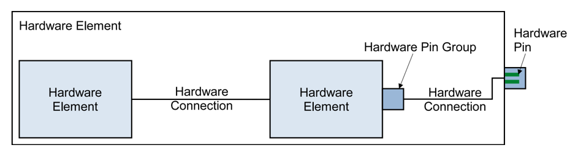
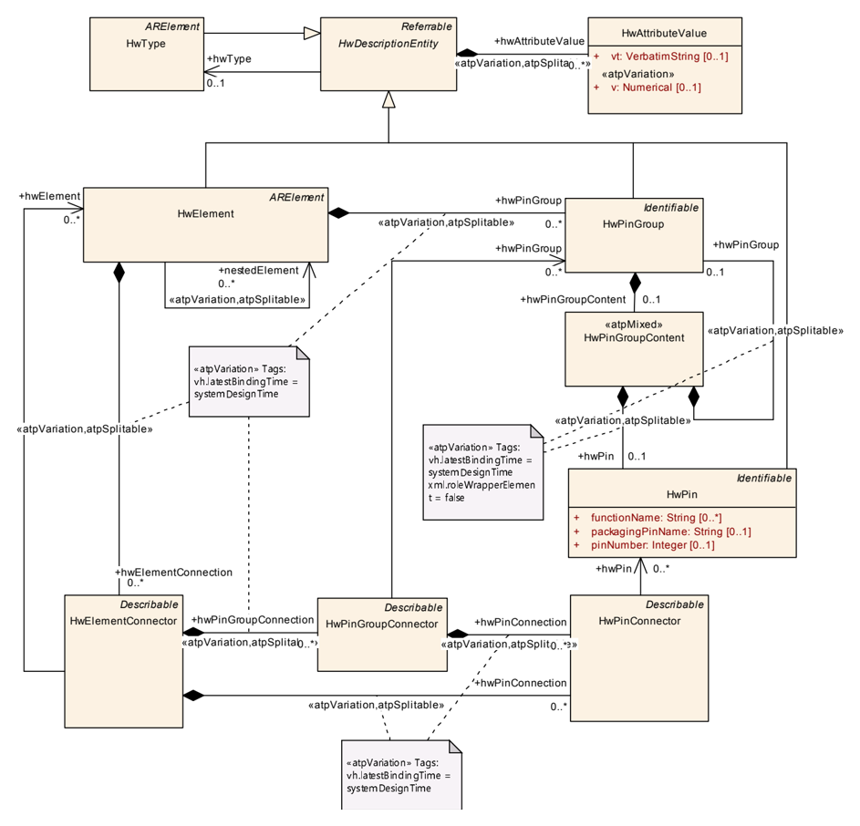
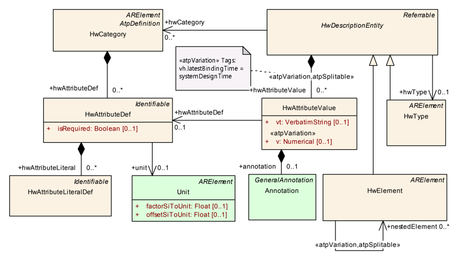
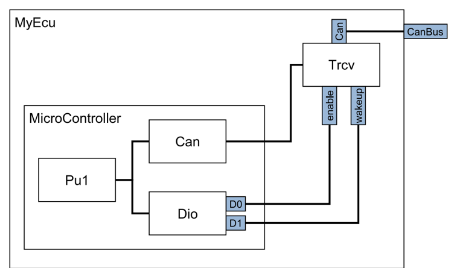

<!-- 源文档 AUTOSAR_CP_TPS_ECUResourceTemplate（R23-11），模板规范（TPS），不受 Type A 七章骨架约束；章节结构镜像源文档自身编号（参考文献不编号，1–3 + 附录 B/C/D/E）。规范项 ID [TPS_ECUR_*] 与约束 ID [constr_*] 按 2026-11-03 Foundation 批次决议整体省略（标题仅翻译，约束项以「约束：」前缀呈现）；项间追溯尾注 (RS_…) 随之省略。附录 A（Reference Material：A.1 Requirements Traceability / A.2 Requirements Tracing）为纯 ID 追溯表，按 ASWS 先例整体省略（附录字母保持源文档编号，不重排）。类表按 tps_standardization_template 先例规范化为「竖排属性表 + 属性明细表」两段形式（源 markdown 中类的 4 列重复展开已合并）；图 1.1、2.1、2.2、B.1 为内容插图，按内容哈希去重后嵌入（已按图边距规则加白边），其余全部图片引用均为页面装饰性元素。附录 B 的 ARXML 示例在 markdown 转换中被页分割符切断并夹带重复片段，已按结构重组为可读的多行形式；示例 B.3 源文档中表题位于表内容之后（转换产物），按表题编号置于表上方。 -->

## 参考文献

<a id="ref-1"></a>[1] Standardization Template
> AUTOSAR_FO_TPS_StandardizationTemplate

<a id="ref-2"></a>[2] Generic Structure Template
> AUTOSAR_FO_TPS_GenericStructureTemplate

<a id="ref-3"></a>[3] IEEE standard for radix-independent floating-point arithmetic (ANSI/IEEE Std 854-1987)
> https://standards.ieee.org/ieee/854/1248/

<a id="ref-4"></a>[4] Software Component Template
> AUTOSAR_CP_TPS_SoftwareComponentTemplate

<a id="ref-5"></a>[5] AUTOSAR XML Schema Production Rules
> AUTOSAR_FO_TPS_XMLSchemaProductionRules

<a id="ref-6"></a>[6] Requirements on ECU Resource Template
> AUTOSAR_CP_RS_ECUResourceTemplate

<a id="ref-7"></a>[7] Meta Model
> AUTOSAR_FO_MMOD_MetaModel

<a id="ref-8"></a>[8] Software Process Engineering Meta-Model Specification
> http://www.omg.org/spec/SPEM/2.0/

## 1. 简介

**AUTOSAR** 最显著的目标之一是与汽车软件应用相关的描述的标准化。在此背景下，对底层 **ECU** 硬件的描述是需要解决的主要课题之一。

本文档包含描述硬件所需的建模元素的规范，以达到必要的程度。**ECU** 资源模板的一个方面是为系统设计工程师提供必要的信息，以辅助系统划分，例如专用 **ECU** 的可用存储器和通信手段。**ECU** 资源模板的另一个方面是为 **ECU** 配置工程师和工具提供配置特定 **ECU** 上的微控制器和 **ECU** 抽象层所需的信息。

**ECU** 资源模板的关注点是描述一块已经设计完成的硬件、其内容和结构。支持电子硬件本身的设计不在 **ECU** 资源模板的关注范围之内。已有成熟的工具和交换格式可用于辅助电子硬件的设计。但此类工具或许能够以 **AUTOSAR** **ECU** 资源模板格式导出其设计，供后续在 **AUTOSAR** 设计工具中使用。

在适用的情况下，请查阅本文档所附的术语表和缩略语列表。下文先介绍 **ECU** 资源描述的一般特性，随后详细描述 **ECU** 内部的硬件组件。

### 1.1. ECU 资源模板的范围

**ECU** 资源模板的范围是借助以下基本构建块来描述 **ECU**：

- 硬件元素（**Hardware Elements**）
- 硬件引脚组（**Hardware PinGroups**）和硬件引脚（**Hardware Pins**）
- 硬件连接（**Hardware Connections**）

硬件元素是 **ECU** 的主要描述元素，例如：处理单元、存储器、外设和传感器/执行器。硬件元素具有唯一的名称，可以在 **ECU** 描述中被识别。硬件元素不一定必须在 **ECU** 层级上描述。也可以将硬件元素描述为其他硬件元素的组成部分。通过这种方式，可以创建硬件元素的层次化描述。

硬件元素提供硬件引脚组和硬件引脚，用于彼此互连。硬件引脚组允许粗略描述某些硬件引脚组的布置方式。详细描述可以通过硬件引脚完成。

硬件连接用于描述多个层级上的连接：

- 硬件元素之间的连接
- 硬件引脚组之间的连接
- 硬件引脚之间的连接

不同的抽象层级允许为 **ECU** 资源模板的不同用例定义和收集所需的信息。要粗略了解硬件元素在 **ECU** 中的布置，硬件元素之间的连接就足够了。要确切了解某个信号在哪个硬件引脚上提供，则需要详细的硬件引脚连接。

### 1.2. ECU 资源模板概述

图 1.1 描绘了 **ECU** 资源描述的主要元素及其相互关系。



**ECU** 资源模板中的建模元素可以按层次组织。特定的 **ECU**（包含电子部件的物理盒体）可以描述为一个或多个微控制器和 **ECU** 电子部件的层次化组合。每个微控制器又由处理单元、存储器、外设和管理单元组成。

同样的方法可用于描述特定 **ECU** 及其连接的所有传感器和执行器。

**ECU** 电子部件是 **ECU** 上存在的、用于保证处理单元运行（时钟）以及对流出或流入 **ECU** 的信号进行调理（通信收发器、放大器、分立电子部件）的硬件。

### 1.3. 文档约定

技术术语以等宽字体排版，例如 PortPrototype。作为一般规则，技术术语的复数形式通过在单数形式后添加「s」构成，例如 PortPrototypes。通过这种方式，本文档与 **AUTOSAR** XML Schema 中使用的术语保持一致。

本文档以文本形式包含约束（**constraint**），它们通过唯一的数值约束 ID、标题和约束正文与文本的其余部分区分开来，正文起始于「⌈」字符之后、终止于「⌋」字符。

这些约束的目的是字面上约束对 **AUTOSAR** 元模型的解释，使得能够检测元模型实例（即 M1 层）中实现的标准化行为的违例。

鼓励 **AUTOSAR** 工具的制作者在工具发出的诊断消息中附上与 M1 建模问题相对应的约束的数值 ID。

本文档引入的类的属性以类表（**class table**）的形式列出。它们具有顶层元素 AUTOSAR 示例所示的形式。

请注意，约束并不要求在 **AUTOSAR** 工作流的任意给定时刻都被强制执行。在模型开发期间，约束可以被合法地违反，因为一个不完整的模型显然会表现出不一致性。

然而，在工作流的特定时点，约束应当被强制执行，以防止错误配置。

约束应当被强制执行的工作流时点（有时也称为约束的「绑定时间（**binding time**）」）因模型类别而异，例如在经典平台上，为软件组件定义的约束通常在 **RTE** 生成之前强制执行，而针对 **Ecu** 提取定义的约束应在创建 Com 栈的 **ECU** 配置时应用。

对于每份文档，约束的可能绑定时间都有定义，并且绑定时间通常在约束自身中提及，以便为 **AUTOSAR** 编写工具的实现者提供适当的方向。

设 AUTOSAR 为典型类表的一个示例。表中的前几行含义如下：

类（**Class**）：在 **UML** 模型中定义的类的名称。

包（**Package**）：定义该类的 **UML** 包。列出此项只是为了帮助在整体元模型中定位该类。

说明（**Note**）：建模者对该类的注释（类注释）。类的构造型（**stereotype**）和 **UML** 标签（**tag**）也在此处注明。

基类（**Base**）：如适用，直接基类的列表。

表中的表头含义如下：

属性（**Attribute**）：类的属性名。注意 **AUTOSAR** 不区分类属性和所拥有的关联端。

类型（**Type**）：类属性的类型。

多重性（**Mul.**）：分配给该属性的多重性，即有多少个给定数据类型的实例与该属性关联。

种类（**Kind**）：规定该属性是在类中聚合的（aggr 聚合）、类中的 **UML** 属性（attr 原始属性），还是仅由类引用（ref 引用）。实例引用也在此字段中指示（iref 实例引用）。

备注（**Note**）：建模者对该类属性的注释（角色注释）。构造型和 **UML** 标签也在此处注明。

请注意，以字母而非数字编号开头的章节代表本文档的附录。附录的目的是支持对本文档某些方面的解释，不代表标准的约束性约定。

应使用 TPS\_STDT\_00053 中规定的用于表达义务的助动词形式来表示需求，参见标准模板（**Standardization Template**）的「追溯支持」（**Support for Traceability**）一章（[\[1\]](#ref-1)）。

**AUTOSAR** 文档中需求的表示遵循 TPS\_STDT\_00078 所规定的表格，参见标准模板（**Standardization Template**）的「追溯支持」（**Support for Traceability**）一章（[\[1\]](#ref-1)）。

## 2. 通用硬件描述

**ECU** 资源模板利用以下基本构建块

- 硬件元素
- 硬件元素的层次结构
- 硬件引脚
- 硬件引脚组
- 硬件连接

来描述实际硬件的相关方面。不过，**ECU** 资源模板允许根据用例选择描述硬件时的适当详细程度。它还允许描述任意硬件及其连接。

**支持 AUTOSAR 基础软件的配置（**Support of AUTOSAR Basic Software configuration**）**：**ECU** 资源模板的首要目标是通过提供关于相应硬件以及硬件之间如何相互连接的信息，来支持 **AUTOSAR** 基础软件的配置。

图 2.1 展示了所涉及类的概述。



### 2.1. 硬件描述实体

为了使 **ECU** 资源模板在描述多种硬件类型方面具有灵活性，**ECU** 资源模板只提供描述硬件元素及其连通性的通用方法。特定属性的描述可以按照 [第2.6节](#26-硬件类别定义) 提供。

**硬件元素的定义（**Definition of Hardware Elements**）**：HwDescriptionEntity 允许提供一组属性取值，这些取值由一个或多个硬件类别定义。

实际适用的硬件类别及对应属性的详情请参阅[第3章](#3-硬件类型特定描述)。

每个 HwDescriptionEntity 可以聚合多个 HwAttributeValue 元素。

**HwCategory 的定义（**Definition of HwCategory**）**：应可以引用不同种类的 HwCategory 元素，以描述硬件的不同方面（例如带有集成 Spi 通道的 **Can** 控制器）。

**HwCategory 的扩展（**Extension of HwCategory**）**：应可以通过附加属性扩展标准化的 HwCategory 规范。

有关 hwType 引用的描述请参阅[第2.2节](#22-硬件类型)。

HwDescriptionEntity 能够规定该 HwDescriptionEntity 适用于哪些硬件类别（见[第2.6节](#26-硬件类别定义)）。可以在角色 hwCategory 中定义多个引用。

**HwAttributeValue 的定义（**Definition of HwAttributeValue**）**：HwAttributeValue 用于为预定义属性指定一个取值。属性的链接通过角色 hwAttributeDef 中对 HwAttributeDef 的引用定义，该引用可进行变体处理。

属性的定义在[第2.6节](#26-硬件类别定义)中描述。

**硬件属性的取值（**Values of hardware attributes**）**：HwAttributeValue 的实际取值可以通过以下两种方式之一提供：

- vt —— 取值以文本表示形式规定。
- v —— 取值以数值表示形式规定。实际取值可进行变体处理。

更多细节请参阅[第2.7节](#27-ecu-资源变体处理)（Ecu 资源变体处理）。

表2.1：HwDescriptionEntity（**HwDescriptionEntity**）

| 属性 | 值 |
| --- | --- |
| 类 | HwDescriptionEntity（抽象） |
| 包 | M2::AUTOSARTemplates::EcuResourceTemplate |
| 说明 | 该元类表示描述硬件实体的能力。 |
| 基类 | ARObject、Referrable |
| 子类 | HwElement、HwPin、HwPinGroup、HwType |

| 属性 | 类型 | 多重性 | 种类 | 备注 |
| --- | --- | --- | --- | --- |
| hwAttributeValue | HwAttributeValue | * | aggr | 该聚合表示特定的硬件属性值。构造型：atpSplitable；atpVariation。标签：atp.Splitkey=hwAttributeValue、hwAttributeValue.variationPoint.shortLabel、vh.latestBindingTime=systemDesignTime、xml.sequenceOffset=50 |
| hwCategory | HwCategory | * | ref | 表示硬件实体的某一特定类别的关联之一。标签：xml.sequenceOffset=30 |
| hwType | HwType | 0..1 | ref | 该关联用于分配一个可选的 HwType，HwType 包含该 HwDescriptionEntity 的所有出现所共有的属性取值。注意，HwType 不能被重定义，因此不应拥有 hwType 引用。 |

表2.2：HwAttributeValue（**HwAttributeValue**）

| 属性 | 值 |
| --- | --- |
| 类 | HwAttributeValue |
| 包 | M2::AUTOSARTemplates::EcuResourceTemplate::HwElementCategory |
| 说明 | 该元类表示分配硬件属性取值的能力。注意 v 和 vt 互斥。 |
| 基类 | ARObject |
| 聚合于 | HwDescriptionEntity.hwAttributeValue |

| 属性 | 类型 | 多重性 | 种类 | 备注 |
| --- | --- | --- | --- | --- |
| annotation | Annotation | 0..1 | aggr | 可添加到每个 HwAttributeValue 的可选注释。 |
| hwAttributeDef | HwAttributeDef | 0..1 | ref | 该关联表示特定硬件属性取值的定义。 |
| v | Numerical | 0..1 | attr | 这表示一个数值型的硬件属性取值。构造型：atpVariation。标签：vh.latestBindingTime=systemDesignTime |
| vt | VerbatimString | 0..1 | attr | 这表示一个文本型的硬件属性取值。 |

**约束：HwAttributeValue.hwAttributeDef 的多重性**：对于每个 HwAttributeValue，角色 hwAttributeDef 中的引用必须存在。

### 2.2. 硬件类型

**HwType 的定义（**Definition of HwType**）**：HwType 用于为可能在一个 **Ecu** 中多次出现、且不会因其多次使用而改变的元素收集属性取值。

有关硬件元素多重出现的详情请参阅[第2.3.1节](#231-硬件元素的多重出现)。

HwType 是一个 ARElement，它继承自 HwDescriptionEntity。ARElement 的特性使硬件类型能够拥有名称并作为独立的元素存在于某个包中。HwDescriptionEntity 的特性使硬件类型能够描述硬件类别和属性取值（见[第2.1节](#21-硬件描述实体)）。

**在 HwType 中定义的属性取值适用于该 HwType 的所有出现（**Attribute values defined in the HwType are applicable for all occurrences of this HwType**）**：在 HwType 中定义的属性取值适用于该 HwType 的所有出现，尽管可以在 HwElement 中覆盖该取值。

**约束：HwType 不得引用另一个 HwType**：HwType（作为 HwDescriptionEntity）不得在角色 hwType 中引用另一个 HwType。HwType 的定义不是层次化的。

HwType 不规定硬件的任何结构特性。硬件引脚组、硬件引脚和硬件连接的描述只能在硬件元素层级上进行。

表2.3：HwType（**HwType**）

| 属性 | 值 |
| --- | --- |
| 类 | HwType |
| 包 | M2::AUTOSARTemplates::EcuResourceTemplate::HwElementCategory |
| 说明 | 这表示在抽象层级上描述硬件类型的能力。硬件的特定类型由类别区分，该类别决定适用的属性。可能的类别和属性在 HwCategory 中定义。标签：atp.recommendedPackage=HwTypes |
| 基类 | ARElement、ARObject、CollectableElement、HwDescriptionEntity、Identifiable、MultilanguageReferrable、PackageableElement、Referrable |
| 聚合于 | ARPackage.element |

| 属性 | 类型 | 多重性 | 种类 | 备注 |
| --- | --- | --- | --- | --- |
| - | - | - | - | - |

### 2.3. 硬件元素

**HwElement 描述一件硬件（**The HwElement describes one piece of hardware**）**：HwElement 描述一件硬件——作为一个构建块——如何为描述 **ECU** 的整体电路做出贡献。它可用于描述任何硬件，与粒度和规模无关。因此，既可以将 **ECU** 作为一个整体来描述（包括所连接的传感器和执行器、内置的微控制器和通信收发器），也可以描述微控制器内部的处理内核和存储器段。

**HwElement 是自包含的（**HwElement is self contained**）**：每个 HwElement 都可以以自包含的方式描述，因为 HwElement 是一个 ARElement。

每个 HwElement 都继承自 HwDescriptionEntity，因此能够描述一组属性（详情见[第2.1节](#21-硬件描述实体)）。

**HwElement 可以引用 HwType（**HwElement can refer to a HwType**）**：每个 HwElement 都可以在角色 hwType 中可选地引用一个 HwType 元素。HwType 中描述对该硬件类型的所有出现都通用的属性取值。如果 HwElement 提供的属性取值在所引用的 HwType 中也有提供，则以 HwElement 中的属性取值优先。

nestedElement 引用的特性在[第2.3.1节](#231-硬件元素的多重出现)中规定。

HwElement 可以描述多个 HwPinGroup 元素，这些元素包含在角色 hwPinGroup 中（关于 HwPinGroup 的详情请参阅[第2.4节](#24-硬件引脚与引脚组)）。

硬件元素可以描述多个 HwElementConnector 元素，这些元素包含在角色 hwElementConnection 中（关于 HwElementConnector 的详情请参阅[第2.5节](#25-硬件连接)）。

表2.4：HwElement（**HwElement**）

| 属性 | 值 |
| --- | --- |
| 类 | HwElement |
| 包 | M2::AUTOSARTemplates::EcuResourceTemplate |
| 说明 | 这表示在实例层级上描述硬件元素的能力。硬件的特定类型由类别区分，该类别决定适用的属性。可能的类别和属性在 HwCategory 中定义。标签：atp.recommendedPackage=HwElements |
| 基类 | ARElement、ARObject、CollectableElement、HwDescriptionEntity、Identifiable、MultilanguageReferrable、PackageableElement、Referrable |
| 聚合于 | ARPackage.element |

| 属性 | 类型 | 多重性 | 种类 | 备注 |
| --- | --- | --- | --- | --- |
| hwElementConnection | HwElementConnector | * | aggr | 这表示两个硬件元素之间的一个特定连接。构造型：atpSplitable；atpVariation。标签：atp.Splitkey=hwElementConnection、hwElementConnection.variationPoint.shortLabel、vh.latestBindingTime=systemDesignTime、xml.sequenceOffset=110 |
| hwPinGroup | HwPinGroup | * | aggr | 该聚合用于描述硬件元素的连接设施。注意，硬件元素没有引脚，只有引脚组。构造型：atpSplitable；atpVariation。标签：atp.Splitkey=hwPinGroup.shortName、hwPinGroup.variationPoint.shortLabel、vh.latestBindingTime=systemDesignTime、xml.sequenceOffset=90 |
| nestedElement | HwElement | * | ref | 该关联用于建立硬件元素的层次结构。注意，一个特定的 HwElement 只能作为该关联的目标出现一次。即不支持同一 HwElement 的多次实例化（在任何层级上）。构造型：atpSplitable；atpVariation。标签：atp.Splitkey=nestedElement.hwElement、nestedElement.variationPoint.shortLabel、vh.latestBindingTime=systemDesignTime、xml.sequenceOffset=70 |

#### 2.3.1. 硬件元素的多重出现

**硬件的层次结构（**Hierarchy of hardware**）**：硬件的层次结构通过角色 nestedElement 引用所包含的硬件元素来描述。硬件元素的包含层次在 XML 描述中不表示为层次结构，而是表示为链表。

这种建模方式允许使用不同的 **ARXML** 文件来描述容器硬件元素和被嵌套的硬件元素。例如，**CPU** 由半导体供应商描述，而这种 **CPU** 的项目特定用法由 **ECU** 供应商描述。

**约束：不支持多重实例化**：一条基本约束是每个 HwElement 只能作为一个 nestedElement 引用的目标。这意味着不存在硬件元素多重实例化的概念。如果同一硬件元素要被多次使用（通过 nestedElement 引用），则每次出现都必须有自己的描述。这对被引用的嵌套元素的嵌套元素同样适用。

因此，硬件元素及其所有结构特性（硬件引脚组、硬件引脚和硬件连接）都需要被克隆。不过，多个 HwElement 克隆可以引用同一个 HwType。

### 2.4. 硬件引脚与引脚组

HwPinGroup 允许描述硬件元素的专用连通通道。它可用于描述成组的硬件端口，如 **ADC** 和 **DIO**。它可以对端口信息进行层次化组织。在详细层级上，它可用于描述单个硬件引脚。

每个 HwPinGroup 都是 Identifiable。HwPinGroup 只能存在于 HwElement 或另一个 HwPinGroup 之内。

每个 HwPinGroup 都继承自 HwDescriptionEntity，因此能够描述一组属性（详情见[第2.1节](#21-硬件描述实体)）。

HwPinGroup 的内容聚合在角色 hwPinGroupContent 中。

表2.5：HwPinGroup（**HwPinGroup**）

| 属性 | 值 |
| --- | --- |
| 类 | HwPinGroup |
| 包 | M2::AUTOSARTemplates::EcuResourceTemplate |
| 说明 | 该元类表示描述用于连接硬件元素的引脚组的能力。该组充当引脚的捆绑，从而允许描述高层级的连接。引脚组甚至可以嵌套。 |
| 基类 | ARObject、HwDescriptionEntity、Identifiable、MultilanguageReferrable、Referrable |
| 聚合于 | HwElement.hwPinGroup、HwPinGroupContent.hwPinGroup |

| 属性 | 类型 | 多重性 | 种类 | 备注 |
| --- | --- | --- | --- | --- |
| hwPinGroupContent | HwPinGroupContent | 0..1 | aggr | 该聚合描述所包含的引脚/引脚组。 |

HwPinGroupContent 可以包含 HwPinGroup 和 HwPin。HwPinGroupContent 被定义为 «atpMixed»（见通用结构模板 [\[2\]](#ref-2)）。HwPinGroupContent 所包含的元素（HwPinGroup 和 HwPin）可以以任意顺序多次出现。这允许描述引脚组内引脚和引脚组的有序出现。一个主要用例是描述带有腔室（**chamber**）和引脚的物理连接器和插头。

表2.6：HwPinGroupContent（**HwPinGroupContent**）

| 属性 | 值 |
| --- | --- |
| 类 | «atpMixed» HwPinGroupContent |
| 包 | M2::AUTOSARTemplates::EcuResourceTemplate |
| 说明 | 该元类规定 hwPin 和 hwPinGroup 的混合。 |
| 基类 | ARObject |
| 聚合于 | HwPinGroup.hwPinGroupContent |

| 属性 | 类型 | 多重性 | 种类 | 备注 |
| --- | --- | --- | --- | --- |
| hwPin | HwPin | 0..1 | aggr | 该聚合表示硬件引脚组中的一个硬件引脚。构造型：atpSplitable；atpVariation。标签：atp.Splitkey=hwPin.shortName、hwPin.variationPoint.shortLabel、vh.latestBindingTime=systemDesignTime、xml.roleWrapperElement=false |
| hwPinGroup | HwPinGroup | 0..1 | aggr | 该聚合表示一个嵌套的硬件引脚组。构造型：atpSplitable；atpVariation。标签：atp.Splitkey=hwPinGroup.shortName、hwPinGroup.variationPoint.shortLabel、vh.latestBindingTime=systemDesignTime、xml.roleWrapperElement=false |

每个 HwPin 都是 Identifiable。HwPin 只能存在于 HwPinGroupContent 之内，因此间接地存在于 HwPinGroup 之内。

每个 HwPin 都继承自 HwDescriptionEntity，因此能够描述一组属性（详情见[第2.1节](#21-硬件描述实体)）。

表2.7：HwPin（**HwPin**）

| 属性 | 值 |
| --- | --- |
| 类 | HwPin |
| 包 | M2::AUTOSARTemplates::EcuResourceTemplate |
| 说明 | 该元类表示描述一个硬件引脚的能力。 |
| 基类 | ARObject、HwDescriptionEntity、Identifiable、MultilanguageReferrable、Referrable |
| 聚合于 | HwPinGroupContent.hwPin |

| 属性 | 类型 | 多重性 | 种类 | 备注 |
| --- | --- | --- | --- | --- |
| functionName | String | * | attr | 该属性描述引脚的功能（例如 **CLK** 表示时钟）。 |
| packagingPinName | String | 0..1 | attr | 该属性包含按照硬件元件封装（**packaging**）命名的引脚名称（例如 A03）。 |
| pinNumber | Integer | 0..1 | attr | 该属性包含物理引脚编号。 |

**HwPin 属性的语义（**Semantics of HwPin attributes**）**：属性 packagingPinName 和 functionName 应用于描述 HwPin 的语义。HwPin 的 shortName 不承载任何已定义的标准化语义。

**注意：** 对于 HwPin 的新描述，优先使用 packagingPinName 而非 pinNumber。pinNumber 可以额外用于规定引脚的数值排序。

### 2.5. 硬件连接

在 **ECU** 资源模板中，可以在多个层级上描述连接。这允许在所需的抽象层级上表达细节。

**HwElement 之间的连接（**Connections between HwElements**）**：HwElementConnector 允许描述两个 HwElement 之间的连接。它并非用于描述两个硬件元素之间实际的技术连通性，而是用于描述硬件元素之间的一般连通性。

表2.8：HwElementConnector（**HwElementConnector**）

| 属性 | 值 |
| --- | --- |
| 类 | HwElementConnector |
| 包 | M2::AUTOSARTemplates::EcuResourceTemplate |
| 说明 | 该元类表示连接两个硬件元素的能力。连接的细节可以通过 hwPinGroupConnection 细化。 |
| 基类 | ARObject、Describable |
| 聚合于 | HwElement.hwElementConnection |

| 属性 | 类型 | 多重性 | 种类 | 备注 |
| --- | --- | --- | --- | --- |
| hwElement | HwElement | * | ref | 该关联连接两个硬件元素。 |
| hwPinConnection | HwPinConnector | * | aggr | 这表示两个硬件引脚之间的一个特定连接。当需要描述引脚到引脚的连接、但不需要描述 HwPinGroup 的层次化组合之间的连接（使用 HwPinGroupConnector）时，应使用该连接。构造型：atpSplitable；atpVariation。标签：atp.Splitkey=hwPinConnection、hwPinConnection.variationPoint.shortLabel、vh.latestBindingTime=systemDesignTime、xml.sequenceOffset=60 |
| hwPinGroupConnection | HwPinGroupConnector | * | aggr | 这表示两个硬件引脚组之间的一个特定连接。构造型：atpSplitable；atpVariation。标签：atp.Splitkey=hwPinGroupConnection、hwPinGroupConnection.variationPoint.shortLabel、vh.latestBindingTime=systemDesignTime、xml.sequenceOffset=50 |

**约束：HwElementConnector.hwElement 的多重性**：对于每个 HwElementConnector，角色 hwElement 中必须恰好存在 2 个引用。

HwPinGroupConnector 允许描述两个 HwPinGroup 之间的连接。

表2.9：HwPinGroupConnector（**HwPinGroupConnector**）

| 属性 | 值 |
| --- | --- |
| 类 | HwPinGroupConnector |
| 包 | M2::AUTOSARTemplates::EcuResourceTemplate |
| 说明 | 该元类表示连接两个引脚组的能力。 |
| 基类 | ARObject、Describable |
| 聚合于 | HwElementConnector.hwPinGroupConnection |

| 属性 | 类型 | 多重性 | 种类 | 备注 |
| --- | --- | --- | --- | --- |
| hwPinConnection | HwPinConnector | * | aggr | 这表示两个硬件引脚之间的一个特定连接。所连接的引脚应与父级 hwPinGroupConnection 所提供的连接相匹配。构造型：atpSplitable；atpVariation。标签：atp.Splitkey=hwPinConnection、hwPinConnection.variationPoint.shortLabel、vh.latestBindingTime=systemDesignTime |
| hwPinGroup | HwPinGroup | * | ref | 该关联连接两个硬件引脚组。 |

**约束：HwPinGroupConnector.hwPinGroup 的多重性**：对于每个 HwPinGroupConnector，角色 hwPinGroup 中必须恰好存在 2 个引用。

HwPinConnector 允许描述两个 HwPin 之间的连接。

表2.10：HwPinConnector（**HwPinConnector**）

| 属性 | 值 |
| --- | --- |
| 类 | HwPinConnector |
| 包 | M2::AUTOSARTemplates::EcuResourceTemplate |
| 说明 | 该元类表示连接两个引脚的能力。 |
| 基类 | ARObject、Describable |
| 聚合于 | HwElementConnector.hwPinConnection、HwPinGroupConnector.hwPinConnection |

| 属性 | 类型 | 多重性 | 种类 | 备注 |
| --- | --- | --- | --- | --- |
| hwPin | HwPin | * | ref | 该关联连接两个硬件引脚。 |

**约束：HwPinConnector.hwPin 的多重性**：对于每个 HwPinConnector，角色 hwPin 中必须恰好存在 2 个引用。

#### 2.5.1. 连接的范围

硬件连接是硬件元素的一部分，并通过引用两个产物的描述将它们连接起来。原则上，这类引用可以指向输入信息中的任何硬件元素及其特性。但连接的范围会依据硬件连接所在的硬件元素加以限制。

**约束：连接的范围**：每个硬件连接只应连接同处于该硬件元素层次范围内的两个特性。层次范围涵盖：

- 属于包含该连接的硬件元素的所有特性
- 属于从包含该连接的硬件元素出发、经 nestedElement 关系直接和间接引用的硬件元素的所有特性

特别地，允许在更深层次级上的硬件元素中规定连接，也允许规定跨越层次级别的连接。

在图 B.1 的示例中，允许以下连接：

- 在硬件元素「MyEcu」范围内规定的连接：
  - 所有展示出的连接都可以在这一层级上规定。
  - 甚至另一个层次化硬件元素内部的连接（例如「Pu1」与「Can」之间）也可以在这一层级上规定。
  - 甚至跨越层次级别的连接（例如「Can」与「Trcv」之间）也可以在这一层级上规定。
- 在硬件元素「MicroController」范围内规定的连接：
  - 只有硬件元素「MicroController」内部的连接（例如「Pu1」与「Can」之间）可以规定。

### 2.6. 硬件类别定义



元素 HwCategory 规定所定义的硬件是什么类型。例如可以是存储器段、处理单元、通信收发器等。

HwCategory 随后由 HwDescriptionEntity 在角色 hwCategory 中引用，以描述所描述的硬件的类型。HwCategory 元素的 shortName 的可能取值在 **HwElement 的标准化 HwCategory（**Standardized HwCategories for HwElement**）** 和 **HwPinGroup 的标准化 HwCategory（**Standardized HwCategories for HwPinGroup**）** 中定义。

HwCategory 可以包含多个 HwAttributeDef 元素。

表2.11：HwCategory（**HwCategory**）

| 属性 | 值 |
| --- | --- |
| 类 | HwCategory |
| 包 | M2::AUTOSARTemplates::EcuResourceTemplate::HwElementCategory |
| 说明 | 该元类表示声明硬件类别及其特定属性的能力。标签：atp.recommendedPackage=HwCategorys |
| 基类 | ARElement、ARObject、AtpDefinition、CollectableElement、Identifiable、MultilanguageReferrable、PackageableElement、Referrable |
| 聚合于 | ARPackage.element |

| 属性 | 类型 | 多重性 | 种类 | 备注 |
| --- | --- | --- | --- | --- |
| hwAttributeDef | HwAttributeDef | * | aggr | 该聚合描述特定的硬件属性定义。 |

HwAttributeDef 规定适用于该 HwCategory 的一个属性。

属性的名称在 shortName 中定义。

属性的类型由 category 规定。HwAttributeDef 的 category 的适用取值在 **HwAttributeDef 的标准化类别（**Standardized categories for HwAttributeDef**）** 中定义。

**约束：HwAttributeDef 的 category 不得扩展**：与 category 可以通过用户特定取值扩展的一般规则相反，不允许扩展元类 HwAttributeDef 的属性 category 的含义。

**HwAttributeDef 的标准化类别（**Standardized categories for HwAttributeDef**）**

表2.12：HwAttributeDef 类别（**HwAttributeDef categories**）

| 类别 | 描述 |
| --- | --- |
| BOOLEAN | 定义布尔属性。布尔属性的取值可以以文本格式 'true' / 'false'（使用 HwAttributeValue 的 vt 元素）或数值格式 '1'（真）/ '0'（假）（使用 HwAttributeValue 的 v 元素）提供。 |
| INTEGER | 定义整数属性。整数属性的取值可以是带符号/无符号的整数。取值必须落在带符号/无符号 64 位数字空间内。 |
| FLOAT | 定义浮点属性。浮点属性的取值表示为 IEEE 754-1985 标准 [\[3\]](#ref-3) 的 IEEE 双精度 64 位浮点数。 |
| ENUMERATION | 定义枚举属性。可能的枚举字面量通过元素 vt 定义。枚举属性的取值以文本形式在 HwAttributeValue 的 vt 元素中提供。 |
| STRING | 定义字符串属性。字符串属性的取值以文本形式在 HwAttributeValue 的 vt 元素中提供。 |

元素 isRequired 规定该属性对于所定义的 HwCategory 是否是强制的。

**属性单位的定义（**Definition of attribute unit**）**：属性定义可选地可以引用一个 Unit 元素，该元素规定此属性的取值应以何种单位规定。

有关 Unit 规范的详情请参阅软件组件模板（**Software Component Template**） [\[4\]](#ref-4)。

表2.13：HwAttributeDef（**HwAttributeDef**）

| 属性 | 值 |
| --- | --- |
| 类 | HwAttributeDef |
| 包 | M2::AUTOSARTemplates::EcuResourceTemplate::HwElementCategory |
| 说明 | 该元类表示定义特定硬件属性的能力。该元素的 category 规定属性取值的类型。如果 category 为 Enumeration，则 hwAttributeEnumerationLiterals 规定可用的字面量。 |
| 基类 | ARObject、Identifiable、MultilanguageReferrable、Referrable |
| 聚合于 | HwCategory.hwAttributeDef |

| 属性 | 类型 | 多重性 | 种类 | 备注 |
| --- | --- | --- | --- | --- |
| hwAttributeLiteral | HwAttributeLiteralDef | * | aggr | Enumeration 定义的可用的枚举字面量。仅当 HwAttributeDef 的 category 等于 Enumeration 时适用。 |
| isRequired | Boolean | 0..1 | attr | 该属性规定是否要求提供所定义的属性取值。 |
| unit | Unit | 0..1 | ref | 该关联规定所定义硬件属性的物理单位。由于存在文本型属性，该元素是可选的。 |

**约束：HwAttributeDef.isRequired 的多重性**：对于每个 HwAttributeDef，属性 isRequired 必须存在。

如果 HwAttributeDef 的 category 被设为 Enumeration，则适用的枚举字面量通过元素 HwAttributeLiteralDef 规定。

表2.14：HwAttributeLiteralDef（**HwAttributeLiteralDef**）

| 属性 | 值 |
| --- | --- |
| 类 | HwAttributeLiteralDef |
| 包 | M2::AUTOSARTemplates::EcuResourceTemplate::HwElementCategory |
| 说明 | Enumeration 定义的一个可用的枚举字面量。仅当 HwAttributeDef 的 category 等于 Enumeration 时适用。 |
| 基类 | ARObject、Identifiable、MultilanguageReferrable、Referrable |
| 聚合于 | HwAttributeDef.hwAttributeLiteral |

| 属性 | 类型 | 多重性 | 种类 | 备注 |
| --- | --- | --- | --- | --- |
| - | - | - | - | - |

示例 B.8 中描述了为 MemorySegment HwCategory 定义部分属性的方式。

#### 2.6.1. 硬件类别定义的供应商特定扩展

为了允许描述任意硬件及其关系，**ECU** 资源模板允许扩展硬件类别和硬件属性的定义。为供应商特定用途扩展 **ECU** 资源描述时，应遵守以下规则：

- **新硬件类别的定义（**Definition of new hardware categories**）**：如果与已定义的类别不同，可以为 HwElement、HwPinGroup 和 HwPin 定义新的 HwCategory。该定义应位于非 AUTOSAR 的包中。然后 HwDescriptionEntity 应引用扩展的 HwCategory。已定义类别的更多细节见[第3章](#3-硬件类型特定描述)（硬件类型特定描述）。
- **现有硬件类别的扩展（**Extension of existing hardware categories**）**：现有的 HwCategory 可以通过新的属性定义进行扩展。扩展方式是：在非 AUTOSAR 的其他包中定义一个与标准化类别同名的 HwCategory。然后 HwDescriptionEntity 应引用标准化的和扩展的 HwCategory。已有硬件类别的更多细节见[第3章](#3-硬件类型特定描述)。
- **不得重定义硬件属性（**No redefinition of hardware attributes**）**：对标准化 HwCategory 的扩展不得定义与标准化 HwCategory 中已定义属性相同的硬件属性。
- **枚举的扩展（**Extension of enumeration**）**：现有的枚举属性可以通过新的枚举字面量扩展。已有枚举属性的更多细节见[第3章](#3-硬件类型特定描述)。
- **不得移除现有枚举字面量（**No removal of existing enumeration literals**）**：不得从已规定的枚举属性中移除枚举字面量。已有枚举属性的更多细节见[第3章](#3-硬件类型特定描述)。
- **不得更改类别（**No change of category**）**：已规定属性的类别（类型）不得更改。更多细节见[第3章](#3-硬件类型特定描述)。
- **不得更改 isRequired 取值（**No change of isRequired value**）**：对已规定的属性，isRequired 元素的取值不得更改。更多细节见[第3章](#3-硬件类型特定描述)。
- **不得更改 Unit 取值（**No change of Unit value**）**：对已规定的属性，Unit 元素的取值不得更改。更多细节见[第3章](#3-硬件类型特定描述)。

### 2.7. ECU 资源变体处理

有关 **AUTOSAR** 变体处理支持的详情请参阅 **AUTOSAR** 通用结构模板（**Generic Structure Template**） [\[2\]](#ref-2)。其结构如图 2.1 所示。

**支持变体处理（**Support for variant handling**）**：在硬件元素的描述中，以下关系可进行变体处理：

- nestedElement
- hwPinGroup
- hwElementConnection

HwPinGroup 的存在性可以通过来自 HwElement 的聚合角色 hwPinGroup 进行变体处理，因此可以规定 HwPinGroup 的不同备选方案。HwPinGroup 的内容同样可以通过来自 HwPinGroupContent 的角色 hwPinGroup 和 hwPin 进行变体处理。

HwElementConnector 的存在性可以通过来自 HwElement 的聚合角色 hwElementConnection 进行变体处理。多个角色中单个 HwPinGroupConnector 和 HwPinConnector 的存在性同样可以进行变体处理。

对于属性取值的描述，HwAttributeValue 的存在性和实际的 v 元素都可以进行变体处理（另见图 2.2）。

### 2.8. 文档支持

**AUTOSAR** 为集成且结构良好的文档提供支持。有关 **AUTOSAR** 文档支持概念的更多细节可在 **AUTOSAR** 通用结构模板 [\[2\]](#ref-2) 中找到。

**文档支持（**Documentation support**）**：可选的文档块可以应用于 **Ecu** 资源描述中的任何 Identifiable 和 Describable 元素。这种类型的文档通常用于记录关于元素角色或其构建方式的简短介绍。

### 2.9. 基础设施方面

**ECU 资源元模型的建模（**Modeling of ECU Resource metamodel**）**：**ECU** 配置值和 **ECU** 配置参数定义元模型的建模按照通用结构模板 [\[2\]](#ref-2) 进行。

**ECU 资源元模型到 schema 定义的转换（**Transformation of the ECU Resource metamodel to schema definition**）**：**ECU** 资源元模型到 schema 定义的转换按照 XML Schema 生成规则 [\[5\]](#ref-5) 进行。

## 3. 硬件类型特定描述

[第2章](#2-通用硬件描述)介绍了为描述硬件元素及其关系而提供的通用构建块。但为了使用 **ECU** 资源描述中的信息来辅助 **ECU** 的配置，需要描述特定硬件元素的专用属性（例如存储器大小）。

以下各节讨论使用 **ECU** 资源模板规定部分或完整设计的 **ECU** 所需的特殊元素。

### 3.1. HwElement 类别

**HwElement 的标准化 HwCategory（**Standardized HwCategories for HwElement**）**

表3.1：HwElement 的 HwCategory（**HwElement HwCategories**）

| HwCategory | 描述 |
| --- | --- |
| Ecu | 描述一个 **Ecu** |
| ProcessingUnit | 描述一个微控制器内核 |
| MicroController | 描述一个微控制器 |
| MemorySegment | 描述一个存储器段 |
| CommunicationController | 描述一个通信控制器 |
| CommunicationTransceiver | 描述一个通信收发器 |
| Digital | 描述一个数字 IO 外设 |
| Analog | 描述一个模拟 IO 外设 |
| Timer | 描述一个定时器外设 |
| Watchdog | 描述一个看门狗外设 |
| SensorActuator | 描述传感器和执行器 |

#### 3.1.1. Ecu 类别

**Ecu 的 HwCategory（**HwCategory of an Ecu**）**：**ECU** 的 HwCategory 定义为 Ecu。

目前没有为 **ECU** 定义特殊属性。

系统模板与 **ECU** 资源模板在术语「Ecu」的用法上存在不一致。在系统模板中，「Ecu」用于确定一个 **AUTOSAR** 栈（**AUTOSAR Stack**）的实例（例如 **ECUInstance** 中）。在 **Ecu** 资源模板中，「Ecu」用于描述物理盒体（HwCategory 为 Ecu 的 HardwareElement），其中包含电子部件，这些电子部件可能包含多个处理单元，其上运行着多个 **AUTOSAR** 栈实例。

#### 3.1.2. ProcessingUnit 类别

处理单元描述微控制器的一个内核。

**处理单元的 HwCategory（**HwCategory of a processing unit**）**：处理单元的 HwCategory 定义为 ProcessingUnit。

目前没有为处理单元定义特殊属性。

#### 3.1.3. MicroController 类别

微控制器描述微控制器硬件制造商交付的一件硬件。通常，微控制器包含一个或多个处理单元、存储器段和外设。

**微控制器的 HwCategory（**HwCategory of a micro-controller**）**：微控制器的 HwCategory 定义为 MicroController。

目前没有为微控制器定义特殊属性。

示例 B.1 展示了微控制器高层级视图的简单描述。

#### 3.1.4. MemorySegment 类别

**存储器段的 HwCategory（**HwCategory of a memory segment**）**：存储器段的 HwCategory 定义为 MemorySegment。

**HwCategory MemorySegment 的标准化属性（**Standardized attributes for the HwCategory MemorySegment**）**

表3.2：MemorySegment 的 HwElement 参数（**MemorySegment HwElement Parameters**）

| 属性 | 必需 | 类别 | 描述 |
| --- | --- | --- | --- |
| memorySize | true | INTEGER | 规定存储器段的大小（以字节为单位）。 |
| memoryType | true | ENUMERATION | 规定存储器的类型：<br>* **RAM**<br>* **ROM**<br>* **EEPROM**<br>* **Flash** |

#### 3.1.5. CommunicationController 类别

**通信控制器的 HwCategory（**HwCategory of a communication controller**）**：通信控制器的 HwCategory 是 CommunicationController。

**HwCategory CommunicationController 的标准化属性（**Standardized attributes for the HwCategory CommunicationController**）**

表3.3：CommunicationController 的 HwElement 属性（**CommunicationController HwElement Attributes**）

| 属性 | 必需 | 类别 | 描述 |
| --- | --- | --- | --- |
| communicationControllerType | true | ENUMERATION | 规定通信控制器的类型：<br>* **CAN**<br>* **TTCAN**<br>* **LIN**<br>* **FlexRay**<br>* **Ethernet**<br>* **Spi** |

#### 3.1.6. CommunicationTransceiver 类别

**通信收发器的 HwCategory（**HwCategory of a communication transceiver**）**：通信收发器的 HwCategory 定义为 CommunicationTransceiver。

**HwCategory CommunicationTransceiver 的标准化属性（**Standardized attributes for the HwCategory CommunicationTransceiver**）**

表3.4：CommunicationTransceiver 的 HwElement 属性（**CommunicationTransceiver HwElement Attributes**）

| 属性 | 必需 | 类别 | 描述 |
| --- | --- | --- | --- |
| supportsDisabling | false | BOOLEAN | 规定该收发器是否可以被禁用 |
| supportsWakeUp | false | BOOLEAN | 规定该收发器是否可以在总线上指示唤醒情况 |

#### 3.1.7. Digital IO 类别

**数字 IO 的 HwCategory（**HwCategory of a digital IO**）**：数字 IO 硬件元素的 HwCategory 定义为 Digital。

目前没有为数字 IO 定义特殊属性。

#### 3.1.8. Analog IO 类别

**模拟 IO 的 HwCategory（**HwCategory of an analog IO**）**：模拟 IO 硬件元素的 HwCategory 定义为 Analog。

目前没有为模拟 IO 定义特殊属性。

#### 3.1.9. Timer 类别

**定时器的 HwCategory（**HwCategory of a timer**）**：定时器的 HwCategory 定义为 Timer。

目前没有为定时器定义特殊属性。

#### 3.1.10. Watchdog 类别

**看门狗的 HwCategory（**HwCategory of a watchdog**）**：看门狗的 HwCategory 定义为 Watchdog。

目前没有为看门狗定义特殊属性。

#### 3.1.11. SensorActuator 类别

**传感器/执行器的 HwCategory（**HwCategory of a sensor/actuator**）**：传感器/执行器的 HwCategory 定义为 SensorActuator。

目前没有为传感器/执行器定义特殊属性。

### 3.2. HwPinGroup 类别

**HwPinGroup 的标准化 HwCategory（**Standardized HwCategories for HwPinGroup**）**

表3.5：HwPinGroup 的 HwCategory（**HwPinGroup HwCategories**）

| HwCategory | 描述 |
| --- | --- |
| CommunicationPort | 描述一个通信连接器 |

#### 3.2.1. CommunicationPort 类别

**通信端口的 HwCategory（**HwCategory of a Communication Port**）**：通信端口（**Communication Port**）的 HwCategory 定义为 CommunicationPort。

**HwCategory CommunicationPort 的标准化属性（**Standardized attributes for the HwCategory CommunicationPort**）**

表3.6：CommunicationPort 的 HwPinGroup 属性（**CommunicationPort HwPinGroup Attributes**）

| 属性 | 必需 | 类别 | 描述 |
| --- | --- | --- | --- |
| communicationPortType | true | ENUMERATION | 规定通信端口的类型：<br>* **CAN**<br>* **TTCAN**<br>* **LIN**<br>* **FlexRay**<br>* **Ethernet**<br>* **Spi** |

### 3.3. HwPin 类别

没有为 HwPin 规定专用的 HwCategory。

## B. 示例

### B.1. 硬件元素

示例 B.1 展示了微控制器高层级视图的简单描述。

**示例 B.1**

```xml
<AR-PACKAGE>
  <SHORT-NAME>VendorA_Example1</SHORT-NAME>
  <ELEMENTS>
    <HW-ELEMENT>
      <SHORT-NAME>SomeMicroController</SHORT-NAME>
      <HW-CATEGORY-REFS>
        <HW-CATEGORY-REF DEST="HW-CATEGORY">/AUTOSAR/EcuR/MicroController</HW-CATEGORY-REF>
      </HW-CATEGORY-REFS>
    </HW-ELEMENT>
  </ELEMENTS>
</AR-PACKAGE>
```

### B.2. 硬件元素的层次结构

示例 B.2 展示了微控制器中处理单元的层次化描述。

**示例 B.2**

```xml
<AR-PACKAGE>
  <SHORT-NAME>VendorA_Example2</SHORT-NAME>
  <ELEMENTS>
    <HW-ELEMENT>
      <SHORT-NAME>SomeMicroController</SHORT-NAME>
      <HW-CATEGORY-REFS>
        <HW-CATEGORY-REF DEST="HW-CATEGORY">/AUTOSAR/EcuR/MicroController</HW-CATEGORY-REF>
      </HW-CATEGORY-REFS>
      <NESTED-ELEMENTS>
        <HW-ELEMENT-REF-CONDITIONAL>
          <HW-ELEMENT-REF DEST="HW-ELEMENT">/VendorA_Example2/ProcessingUnit0</HW-ELEMENT-REF>
        </HW-ELEMENT-REF-CONDITIONAL>
      </NESTED-ELEMENTS>
    </HW-ELEMENT>
    <HW-ELEMENT>
      <SHORT-NAME>ProcessingUnit0</SHORT-NAME>
      <HW-CATEGORY-REFS>
        <HW-CATEGORY-REF DEST="HW-CATEGORY">/AUTOSAR/EcuR/ProcessingUnit</HW-CATEGORY-REF>
      </HW-CATEGORY-REFS>
    </HW-ELEMENT>
  </ELEMENTS>
</AR-PACKAGE>
```

### B.3. HwPinGroup 与 HwPin

示例 B.3 展示了微控制器的引脚组和引脚的描述。

**示例 B.3**

```xml
<AR-PACKAGE>
  <SHORT-NAME>VendorA_Example3</SHORT-NAME>
  <ELEMENTS>
    <HW-ELEMENT>
      <SHORT-NAME>SomeMicroController</SHORT-NAME>
      <HW-CATEGORY-REFS>
        <HW-CATEGORY-REF DEST="HW-CATEGORY">/AUTOSAR/EcuR/MicroController</HW-CATEGORY-REF>
      </HW-CATEGORY-REFS>
      <HW-PIN-GROUPS>
        <HW-PIN-GROUP>
          <SHORT-NAME>Adc</SHORT-NAME>
          <HW-PIN-GROUP-CONTENT>
            <HW-PIN-GROUP>
              <SHORT-NAME>AdcPortA</SHORT-NAME>
            </HW-PIN-GROUP>
            <HW-PIN-GROUP>
              <SHORT-NAME>AdcPortB</SHORT-NAME>
              <HW-PIN-GROUP-CONTENT>
                <HW-PIN>
                  <SHORT-NAME>AdcB01</SHORT-NAME>
                </HW-PIN>
                <HW-PIN>
                  <SHORT-NAME>AdcB02</SHORT-NAME>
                </HW-PIN>
              </HW-PIN-GROUP-CONTENT>
            </HW-PIN-GROUP>
          </HW-PIN-GROUP-CONTENT>
        </HW-PIN-GROUP>
      </HW-PIN-GROUPS>
    </HW-ELEMENT>
  </ELEMENTS>
</AR-PACKAGE>
```

### B.4. 硬件元素连接

示例 B.4 展示了微控制器内部结构的描述，用于定义哪些存储器段可以从哪个处理单元（内核）访问。

**示例 B.4**

```xml
<AR-PACKAGE>
  <SHORT-NAME>VendorA_Example4</SHORT-NAME>
  <ELEMENTS>
    <HW-ELEMENT>
      <SHORT-NAME>SomeMicroController</SHORT-NAME>
      <HW-CATEGORY-REFS>
        <HW-CATEGORY-REF DEST="HW-CATEGORY">/AUTOSAR/EcuR/MicroController</HW-CATEGORY-REF>
      </HW-CATEGORY-REFS>
      <NESTED-ELEMENTS>
        <HW-ELEMENT-REF-CONDITIONAL>
          <HW-ELEMENT-REF DEST="HW-ELEMENT">/VendorA_Example4/Core0</HW-ELEMENT-REF>
        </HW-ELEMENT-REF-CONDITIONAL>
        <HW-ELEMENT-REF-CONDITIONAL>
          <HW-ELEMENT-REF DEST="HW-ELEMENT">/VendorA_Example4/Core1</HW-ELEMENT-REF>
        </HW-ELEMENT-REF-CONDITIONAL>
        <HW-ELEMENT-REF-CONDITIONAL>
          <HW-ELEMENT-REF DEST="HW-ELEMENT">/VendorA_Example4/Mem01</HW-ELEMENT-REF>
        </HW-ELEMENT-REF-CONDITIONAL>
        <!-- ... -->
      </NESTED-ELEMENTS>
      <HW-ELEMENT-CONNECTIONS>
        <HW-ELEMENT-CONNECTOR>
          <HW-ELEMENT-REFS>
            <HW-ELEMENT-REF DEST="HW-ELEMENT">/VendorA_Example4/Core0</HW-ELEMENT-REF>
            <HW-ELEMENT-REF DEST="HW-ELEMENT">/VendorA_Example4/Mem01</HW-ELEMENT-REF>
          </HW-ELEMENT-REFS>
        </HW-ELEMENT-CONNECTOR>
        <HW-ELEMENT-CONNECTOR>
          <HW-ELEMENT-REFS>
            <HW-ELEMENT-REF DEST="HW-ELEMENT">/VendorA_Example4/Core0</HW-ELEMENT-REF>
            <HW-ELEMENT-REF DEST="HW-ELEMENT">/VendorA_Example4/Mem02</HW-ELEMENT-REF>
          </HW-ELEMENT-REFS>
        </HW-ELEMENT-CONNECTOR>
        <!-- .. -->
      </HW-ELEMENT-CONNECTIONS>
    </HW-ELEMENT>
    <HW-ELEMENT>
      <SHORT-NAME>Core0</SHORT-NAME>
      <HW-CATEGORY-REFS>
        <HW-CATEGORY-REF DEST="HW-CATEGORY">/AUTOSAR/EcuR/ProcessingUnit</HW-CATEGORY-REF>
      </HW-CATEGORY-REFS>
    </HW-ELEMENT>
    <HW-ELEMENT>
      <SHORT-NAME>Core1</SHORT-NAME>
      <HW-CATEGORY-REFS>
        <HW-CATEGORY-REF DEST="HW-CATEGORY">/AUTOSAR/EcuR/ProcessingUnit</HW-CATEGORY-REF>
      </HW-CATEGORY-REFS>
    </HW-ELEMENT>
    <HW-ELEMENT>
      <SHORT-NAME>Mem01</SHORT-NAME>
      <HW-CATEGORY-REFS>
        <HW-CATEGORY-REF DEST="HW-CATEGORY">/AUTOSAR/EcuR/MemorySegment</HW-CATEGORY-REF>
      </HW-CATEGORY-REFS>
    </HW-ELEMENT>
    <HW-ELEMENT>
      <SHORT-NAME>Mem02</SHORT-NAME>
      <HW-CATEGORY-REFS>
        <HW-CATEGORY-REF DEST="HW-CATEGORY">/AUTOSAR/EcuR/MemorySegment</HW-CATEGORY-REF>
      </HW-CATEGORY-REFS>
    </HW-ELEMENT>
    <HW-ELEMENT>
      <SHORT-NAME>Mem03</SHORT-NAME>
      <HW-CATEGORY-REFS>
        <HW-CATEGORY-REF DEST="HW-CATEGORY">/AUTOSAR/EcuR/MemorySegment</HW-CATEGORY-REF>
      </HW-CATEGORY-REFS>
    </HW-ELEMENT>
  </ELEMENTS>
</AR-PACKAGE>
```

### B.5. 组合示例

在本示例一节中，使用多种机制来描述一个 **Ecu** 及其部分电子部件属性。概述如图 B.1 所示。各小节描述不同的抽象层级。



#### B.5.1. 微控制器描述

微控制器由处理单元、一个 **Can** 控制器和一个 **Dio** 模块组成。处理单元被定义为可以访问这两个外设。

**Dio** 模块定义了两个 HwPinGroup，以支持更详细的连接描述。

整个微控制器定义在独立的 ARPackage 中，因此可以在多个项目中使用。

**示例 B.5**

```xml
<AR-PACKAGE>
  <SHORT-NAME>CpuVendor</SHORT-NAME>
  <ELEMENTS>
    <HW-ELEMENT>
      <SHORT-NAME>MicroController</SHORT-NAME>
      <NESTED-ELEMENTS>
        <HW-ELEMENT-REF-CONDITIONAL>
          <HW-ELEMENT-REF DEST="HW-ELEMENT">/CpuVendor/Pu1</HW-ELEMENT-REF>
        </HW-ELEMENT-REF-CONDITIONAL>
        <HW-ELEMENT-REF-CONDITIONAL>
          <HW-ELEMENT-REF DEST="HW-ELEMENT">/CpuVendor/Can</HW-ELEMENT-REF>
        </HW-ELEMENT-REF-CONDITIONAL>
        <HW-ELEMENT-REF-CONDITIONAL>
          <HW-ELEMENT-REF DEST="HW-ELEMENT">/CpuVendor/Dio</HW-ELEMENT-REF>
        </HW-ELEMENT-REF-CONDITIONAL>
      </NESTED-ELEMENTS>
      <HW-ELEMENT-CONNECTIONS>
        <HW-ELEMENT-CONNECTOR>
          <HW-ELEMENT-REFS>
            <HW-ELEMENT-REF DEST="HW-ELEMENT">/CpuVendor/Pu1</HW-ELEMENT-REF>
            <HW-ELEMENT-REF DEST="HW-ELEMENT">/CpuVendor/Can</HW-ELEMENT-REF>
          </HW-ELEMENT-REFS>
        </HW-ELEMENT-CONNECTOR>
        <HW-ELEMENT-CONNECTOR>
          <HW-ELEMENT-REFS>
            <HW-ELEMENT-REF DEST="HW-ELEMENT">/CpuVendor/Pu1</HW-ELEMENT-REF>
            <HW-ELEMENT-REF DEST="HW-ELEMENT">/CpuVendor/Dio</HW-ELEMENT-REF>
          </HW-ELEMENT-REFS>
        </HW-ELEMENT-CONNECTOR>
      </HW-ELEMENT-CONNECTIONS>
    </HW-ELEMENT>
    <HW-ELEMENT>
      <SHORT-NAME>Pu1</SHORT-NAME>
    </HW-ELEMENT>
    <HW-ELEMENT>
      <SHORT-NAME>Can</SHORT-NAME>
    </HW-ELEMENT>
    <HW-ELEMENT>
      <SHORT-NAME>Dio</SHORT-NAME>
      <HW-PIN-GROUPS>
        <HW-PIN-GROUP>
          <SHORT-NAME>D0</SHORT-NAME>
        </HW-PIN-GROUP>
        <HW-PIN-GROUP>
          <SHORT-NAME>D1</SHORT-NAME>
        </HW-PIN-GROUP>
      </HW-PIN-GROUPS>
    </HW-ELEMENT>
  </ELEMENTS>
</AR-PACKAGE>
```

#### B.5.2. 收发器描述

收发器模块被定义为一个 HwElement，它提供三个 HwPinGroup 来描述其连通性。

收发器模块定义在独立的 ARPackage 中，因此可以在多个项目中使用。

**示例 B.6**

```xml
<AR-PACKAGE>
  <SHORT-NAME>TransceiverVendor</SHORT-NAME>
  <ELEMENTS>
    <HW-ELEMENT>
      <SHORT-NAME>Trcv</SHORT-NAME>
      <HW-PIN-GROUPS>
        <HW-PIN-GROUP>
          <SHORT-NAME>enable</SHORT-NAME>
        </HW-PIN-GROUP>
        <HW-PIN-GROUP>
          <SHORT-NAME>wakeup</SHORT-NAME>
        </HW-PIN-GROUP>
        <HW-PIN-GROUP>
          <SHORT-NAME>CanBus</SHORT-NAME>
        </HW-PIN-GROUP>
      </HW-PIN-GROUPS>
    </HW-ELEMENT>
  </ELEMENTS>
</AR-PACKAGE>
```

#### B.5.3. Ecu 描述

**Ecu** 包含微控制器和收发器。

**Ecu** 定义一个 HwPinGroup 来表示 **Ecu** 对外的 **CanBus** 通信。

**Ecu** 定义内部的详细连通性。

**示例 B.7**

```xml
<AR-PACKAGE>
  <SHORT-NAME>EcuVendor</SHORT-NAME>
  <ELEMENTS>
    <HW-ELEMENT>
      <SHORT-NAME>MyEcu</SHORT-NAME>
      <NESTED-ELEMENTS>
        <HW-ELEMENT-REF-CONDITIONAL>
          <HW-ELEMENT-REF DEST="HW-ELEMENT">/CpuVendor/MicroController</HW-ELEMENT-REF>
        </HW-ELEMENT-REF-CONDITIONAL>
        <HW-ELEMENT-REF-CONDITIONAL>
          <HW-ELEMENT-REF DEST="HW-ELEMENT">/TransceiverVendor/Trcv</HW-ELEMENT-REF>
        </HW-ELEMENT-REF-CONDITIONAL>
      </NESTED-ELEMENTS>
      <HW-PIN-GROUPS>
        <HW-PIN-GROUP>
          <SHORT-NAME>CanBus</SHORT-NAME>
        </HW-PIN-GROUP>
      </HW-PIN-GROUPS>
      <HW-ELEMENT-CONNECTIONS>
        <HW-ELEMENT-CONNECTOR>
          <HW-ELEMENT-REFS>
            <HW-ELEMENT-REF DEST="HW-ELEMENT">/CpuVendor/Can</HW-ELEMENT-REF>
            <HW-ELEMENT-REF DEST="HW-ELEMENT">/TransceiverVendor/Trcv</HW-ELEMENT-REF>
          </HW-ELEMENT-REFS>
        </HW-ELEMENT-CONNECTOR>
        <HW-ELEMENT-CONNECTOR>
          <HW-ELEMENT-REFS>
            <HW-ELEMENT-REF DEST="HW-ELEMENT">/CpuVendor/Dio</HW-ELEMENT-REF>
            <HW-ELEMENT-REF DEST="HW-ELEMENT">/TransceiverVendor/Trcv</HW-ELEMENT-REF>
          </HW-ELEMENT-REFS>
          <HW-PIN-GROUP-CONNECTIONS>
            <HW-PIN-GROUP-CONNECTOR>
              <HW-PIN-GROUP-REFS>
                <HW-PIN-GROUP-REF DEST="HW-PIN-GROUP">/CpuVendor/Dio/D0</HW-PIN-GROUP-REF>
                <HW-PIN-GROUP-REF DEST="HW-PIN-GROUP">/TransceiverVendor/Trcv/enable</HW-PIN-GROUP-REF>
              </HW-PIN-GROUP-REFS>
            </HW-PIN-GROUP-CONNECTOR>
            <HW-PIN-GROUP-CONNECTOR>
              <HW-PIN-GROUP-REFS>
                <HW-PIN-GROUP-REF DEST="HW-PIN-GROUP">/CpuVendor/Dio/D1</HW-PIN-GROUP-REF>
                <HW-PIN-GROUP-REF DEST="HW-PIN-GROUP">/TransceiverVendor/Trcv/wakeup</HW-PIN-GROUP-REF>
              </HW-PIN-GROUP-REFS>
            </HW-PIN-GROUP-CONNECTOR>
          </HW-PIN-GROUP-CONNECTIONS>
        </HW-ELEMENT-CONNECTOR>
        <HW-ELEMENT-CONNECTOR>
          <HW-ELEMENT-REFS>
            <HW-ELEMENT-REF DEST="HW-ELEMENT">/TransceiverVendor/Trcv</HW-ELEMENT-REF>
            <HW-ELEMENT-REF DEST="HW-ELEMENT">/EcuVendor/MyEcu</HW-ELEMENT-REF>
          </HW-ELEMENT-REFS>
          <HW-PIN-GROUP-CONNECTIONS>
            <HW-PIN-GROUP-CONNECTOR>
              <HW-PIN-GROUP-REFS>
                <HW-PIN-GROUP-REF DEST="HW-PIN-GROUP">/TransceiverVendor/Trcv/CanBus</HW-PIN-GROUP-REF>
                <HW-PIN-GROUP-REF DEST="HW-PIN-GROUP">/EcuVendor/MyEcu/CanBus</HW-PIN-GROUP-REF>
              </HW-PIN-GROUP-REFS>
            </HW-PIN-GROUP-CONNECTOR>
          </HW-PIN-GROUP-CONNECTIONS>
        </HW-ELEMENT-CONNECTOR>
      </HW-ELEMENT-CONNECTIONS>
    </HW-ELEMENT>
  </ELEMENTS>
</AR-PACKAGE>
```

### B.6. 属性定义

示例 B.8 展示了如何在 **ECU** 资源模板中描述一个类别及相关的属性定义。

**示例 B.8**

```xml
<AR-PACKAGE>
  <SHORT-NAME>AUTOSAR</SHORT-NAME>
  <AR-PACKAGES>
    <AR-PACKAGE>
      <SHORT-NAME>EcuR</SHORT-NAME>
      <ELEMENTS>
        <HW-CATEGORY>
          <SHORT-NAME>MemorySegment</SHORT-NAME>
          <HW-ATTRIBUTE-DEFS>
            <HW-ATTRIBUTE-DEF>
              <SHORT-NAME>memorySize</SHORT-NAME>
              <DESC>
                <L-2 L="EN">Specifies the size of the memory segment in bytes.</L-2>
              </DESC>
              <CATEGORY>INTEGER</CATEGORY>
              <IS-REQUIRED>true</IS-REQUIRED>
            </HW-ATTRIBUTE-DEF>
            <HW-ATTRIBUTE-DEF>
              <SHORT-NAME>memoryType</SHORT-NAME>
              <DESC>
                <L-2 L="EN">Specifies the type of memory: RAM, ROM, EEPROM, Flash.</L-2>
              </DESC>
              <CATEGORY>ENUMERATION</CATEGORY>
              <HW-ATTRIBUTE-LITERALS>
                <HW-ATTRIBUTE-LITERAL-DEF>
                  <SHORT-NAME>RAM</SHORT-NAME>
                </HW-ATTRIBUTE-LITERAL-DEF>
                <HW-ATTRIBUTE-LITERAL-DEF>
                  <SHORT-NAME>ROM</SHORT-NAME>
                </HW-ATTRIBUTE-LITERAL-DEF>
                <HW-ATTRIBUTE-LITERAL-DEF>
                  <SHORT-NAME>FLASH</SHORT-NAME>
                </HW-ATTRIBUTE-LITERAL-DEF>
                <HW-ATTRIBUTE-LITERAL-DEF>
                  <SHORT-NAME>EEPROM</SHORT-NAME>
                </HW-ATTRIBUTE-LITERAL-DEF>
              </HW-ATTRIBUTE-LITERALS>
              <IS-REQUIRED>true</IS-REQUIRED>
            </HW-ATTRIBUTE-DEF>
          </HW-ATTRIBUTE-DEFS>
        </HW-CATEGORY>
      </ELEMENTS>
    </AR-PACKAGE>
  </AR-PACKAGES>
</AR-PACKAGE>
```

### B.7. 属性取值示例

示例 B.9 展示了使用 **ECU** 资源模板定义（见示例 B.8）的属性的描述。

**示例 B.9**

```xml
<AR-PACKAGE>
  <SHORT-NAME>VendorA_Example5</SHORT-NAME>
  <ELEMENTS>
    <HW-ELEMENT>
      <SHORT-NAME>MemorySeg001</SHORT-NAME>
      <HW-CATEGORY-REFS>
        <HW-CATEGORY-REF DEST="HW-CATEGORY">/AUTOSAR/EcuR/MemorySegment</HW-CATEGORY-REF>
      </HW-CATEGORY-REFS>
      <HW-ATTRIBUTE-VALUES>
        <HW-ATTRIBUTE-VALUE>
          <HW-ATTRIBUTE-DEF-REF DEST="HW-ATTRIBUTE-DEF">/AUTOSAR/EcuR/MemorySegment/memoryType</HW-ATTRIBUTE-DEF-REF>
          <VT>RAM</VT>
        </HW-ATTRIBUTE-VALUE>
        <HW-ATTRIBUTE-VALUE>
          <HW-ATTRIBUTE-DEF-REF DEST="HW-ATTRIBUTE-DEF">/AUTOSAR/EcuR/MemorySegment/memorySize</HW-ATTRIBUTE-DEF-REF>
          <V>1024</V>
        </HW-ATTRIBUTE-VALUE>
      </HW-ATTRIBUTE-VALUES>
    </HW-ELEMENT>
  </ELEMENTS>
</AR-PACKAGE>
```

## C. 术语表

**Artifact**
> 产物（**Artifact**）是一种工作产品定义（**Work Product Definition**），为有形的工作产品类型提供描述和定义。产物可以由其他产物组成 [\[8\]](#ref-8)。

> 在高层级上，一个产物表示为单个概念性文件。

**AUTOSAR Tool**
> **AUTOSAR** 工具，是一种支持方法论中定义的一个或多个 **AUTOSAR** 任务的软件工具。根据所支持的任务，**AUTOSAR** 工具可以用作编写工具、转换工具、处理工具或它们的组合（见各单独定义）。

**AUTOSAR Authoring Tool**
> **AUTOSAR** 编写工具，是用于创建和修改 **AUTOSAR** XML 描述的 **AUTOSAR** 工具。示例：系统描述编辑器。

**AUTOSAR Converter Tool**
> **AUTOSAR** 转换工具，是通过对其他 **AUTOSAR** XML 文件中的信息进行转换来创建 **AUTOSAR** XML 文件的 **AUTOSAR** 工具。示例：**ECU** Flattener。

**AUTOSAR Definition**
> **AUTOSAR** 定义，是可以拥有取值的参数的定义。可以说参数取值是定义的实例。但在 **AUTOSAR** 的元模型层次中，定义本身也是元模型的实例，因此被视为一种描述。**AUTOSAR** 定义的示例有：EcucParameterDef、PostBuildVariantCriterion、SwSystemconst。

**AUTOSAR XML Description**
> **AUTOSAR** XML 描述，在 **AUTOSAR** 中意为「已填充的模板」。实际上，**AUTOSAR** XML 描述就是一个 **AUTOSAR** 模型的 XML 表示。

> **AUTOSAR** XML 描述可以由多个文件组成。每个单独的文件表示一个 **AUTOSAR** 部分模型，并且应能针对 **AUTOSAR** XML schema 成功校验。

**AUTOSAR Meta-Model**
> **AUTOSAR** 元模型，是一个 **UML** 2.0 模型，定义了描述 **AUTOSAR** 系统的语言。**AUTOSAR** 元模型是 **AUTOSAR** 模板的 **UML** 表示。**UML** 2.0 类图用于描述属性及其相互关系。构造型、**UML** 标签和 **OCL** 表达式（对象约束语言）用于定义特定的语义和约束。

**AUTOSAR Meta-Model Tool**
> **AUTOSAR** 元模型工具，是生成 **AUTOSAR** 元模型的不同视图（类表、约束列表、图、XML Schema 等）的工具。

**AUTOSAR Model**
> **AUTOSAR** 模型，是一个 **AUTOSAR** 产品的表示。**AUTOSAR** 模型按照 **AUTOSAR** 方法论表示适合预期用途的方面。

> 严格来说，它是 **AUTOSAR** 元模型的一个实例。**AUTOSAR** 模型中包含的信息可以是任何能够按照 **AUTOSAR** 元模型表示的内容。

**AUTOSAR Partial Model**
> **AUTOSAR** 部分模型，在 **AUTOSAR** 中，模型可能的划分在元模型中通过 «atpSplitable» 标记。一个部分模型在 **AUTOSAR** XML 描述中由一个文件表示。部分模型不需要满足适用于 **AUTOSAR** 模型的全部语义约束。

**AUTOSAR Processor Tool**
> **AUTOSAR** 处理工具，是通过处理来自 **AUTOSAR** XML 文件的信息来创建非 **AUTOSAR** 文件的 **AUTOSAR** 工具。示例：**RTE** 生成器。

**AUTOSAR Specification Element**
> **AUTOSAR** 规范元素，是 **AUTOSAR** 规范的组成部分中的命名元素。示例：需求、约束、规范项、元模型中的类或属性、方法论、交付物、方法论活动、模型元素、**BSW** 模块等。

**AUTOSAR Template**
> **AUTOSAR** 模板，**AUTOSAR** 中使用术语「模板（**Template**）」来描述不同种类描述的格式。术语「模板」源于这样的想法：**AUTOSAR** 定义了一种表格，需要填写该表格来描述一个模型，填写后的表格即称为描述。

> 实际上，**AUTOSAR** 模板现在定义为元模型。

**AUTOSAR Validation Tool**
> **AUTOSAR** 校验工具，是一种专门的 **AUTOSAR** 工具，能够依据某个 profile 定义的规则检查 **AUTOSAR** 模型。

**AUTOSAR XML Schema**
> **AUTOSAR** XML Schema，是一个定义 **AUTOSAR** 模型交换语言的 **W3C** XML schema。该 schema 从 **AUTOSAR** 元模型派生。**AUTOSAR** XML Schema 定义了 **AUTOSAR** 数据交换格式。

**Blueprint**
> 蓝图（**Blueprint**），是一种可以从中通过复制和细化派生其他模型的模型。注意，与元模型（或类型）不同，这一过程不是实例化。

**Instance**
> 实例（**Instance**），通常是模型或类型的一个特定样例。

**Life Cycle**
> 生命周期（**Life Cycle**），是模型元素在其存续期间的发展/演化阶段进程。

**Meta-Model**
> 元模型（**Meta-Model**），定义模型的构建块。从这个意义上说，元模型表示构建模型的语言。

**Meta-Data**
> 元数据（**Meta-Data**），包括关于数据的相关信息，例如作者、版本、访问权限、时间戳等。

**Model**
> 模型（**Model**），是对现实的简化表示。模型表示适合预期用途的方面。

**Partial Model**
> 部分模型（**Partial Model**），是模型的一部分，意图持久化在一个特定的产物中。

**Pattern in GST**
> GST 中的模式（**Pattern in GST**），是一种通过应用模型转换来简化元模型定义的方法。该转换从一个带注解的模型创建出一个增强的模型。

**Profile Authoring Support Data**
> Profile 编写支持数据，是用于高效编写 profile 的数据。例如：可引用约束、元类、元属性或其他可复用模型资产（蓝图）的列表。

**Profile Authoring Tool**
> Profile 编写工具，是一种专门的 **AUTOSAR** 工具，专注于为数据交换点编写 profile。例如，它支持从零创建 profile、修改现有 profile 或组合现有 profile。

**Profile Compatibility Checker Tool**
> Profile 兼容性检查工具，是一种专门的 **AUTOSAR** 工具，专注于检查用于数据交换的 profile 的兼容性。注意，该兼容性检查包括工程师的人工兼容性检查和使用更形式化算法的自动辅助。

**Profile Consistency Checker Tool**
> Profile 一致性检查工具，是一种专门的 **AUTOSAR** 工具，专注于检查 profile 的一致性。

**Property**
> 属性（**Property**），是对象的结构特性。例如，「连接器」具有「接收端口」和「发送端口」属性。

**Prototype**
> 原型（**Prototype**），是在另一个类型的定义中某个类型角色的实现。换言之，一个类型可以包含原型，而这些原型又由「类型」来定义类型。当该类型被实例化时，这些原型中的每一个都成为实例。

**Type**
> 类型（**Type**），提供可以出现在该类型各种角色中的特性。

**Value**
> 取值（**Value**），是分配给某个「定义」的特定取值。

**Variability**
> 可变性（**Variability**），系统的可变性是其描述一组变体的能力。这些变体由变体特定的属性设置和/或选择来刻画。例如，这样的系统属性选择表现为连接的某个特定「接收端口」。

**Variant**
> 变体（**Variant**），系统变体是系统的一个具体实现，其所有属性都已被设置或选择。就绑定时间而言，软件系统不再具有可变性。

> 这通过 EvaluatedVariantSet 实现。

**Variation Binding**
> 变体绑定（**Variation Binding**），变体是变体绑定过程的结果，该过程通过为系统的所有属性分配特定的取值/选择来解析系统的可变性。

> 这通过 VariationPoint 实现。

**Variation Binding Time**
> 变体绑定时间（**Variation Binding Time**），规定方法论中解析由一组可变属性给出的可变性的步骤。

> 这通过相关属性上的 vh.LatestBindingtime 实现。

**Variation Definition Time**
> 变体定义时间（**Variation Definition Time**），规定方法论中定义变体点的步骤。

**Variation Point**
> 变体点（**Variation Point**），变体点指示某个属性可进行变体处理。此外，它与一个条件和绑定时间相关联，这两者共同定义选择/设置具体变体的系统上下文。

> 这通过 VariationPoint 实现。

## D. 约束与规范项历史

请注意，本章中的列表还包括在后续版本中已从规范中移除的约束和规范项。这些约束和规范项在文档中不作为超链接出现。

### D.1. 本文档按 AUTOSAR 发布版 R4.0.2 的约束与规范项历史

无变更。

### D.2. 本文档按 AUTOSAR 发布版 R4.0.3 的约束与规范项历史

#### D.2.1. R4.0.3 中新增的约束

表D.1：R4.0.3 中新增的约束

| 标题 |
| --- |
| HwAttributeDef 的 category 不得扩展 |

### D.3. 本文档按 AUTOSAR 发布版 R4.1.1 的约束与规范项历史

#### D.3.1. R4.1.1 中新增的约束

表D.2：R4.1.1 中新增的约束

| 标题 |
| --- |
| HwType 不得引用另一个 HwType |
| 不支持多重实例化 |
| 连接的范围 |

#### D.3.2. R4.1.1 中新增的可追溯项

表D.3：R4.1.1 中新增的可追溯项

| 标题 |
| --- |
| HwCategory 的定义 |
| HwCategory 的扩展 |
| 硬件元素的定义 |
| 硬件属性的取值 |
| HwElement 描述一件硬件 |
| HwElement 之间的连接 |
| 处理单元的类别定义为 ProcessingUnit |
| HwCategory MemorySegment 的标准化属性 |
| 通信控制器的类别是 CommunicationController |
| 通信收发器的类别定义为 CommunicationTransceiver |
| 数字 IO 硬件元素的类别定义为 Digital |
| 传感器/执行器的类别定义为 SensorActuator |
| 通信端口的类别定义为 CommunicationPort |
| HwAttributeValue 的定义 |
| 支持 AUTOSAR 基础软件的配置 |
| HwType 的定义 |
| 在 HwType 中定义的属性取值适用于该 HwType 的所有出现 |
| HwElement 是自包含的 |
| HwElement 可以引用 HwType |
| 硬件的层次结构 |
| 新硬件类别的定义 |
| 现有硬件类别的扩展 |
| 不得重定义硬件属性 |
| 枚举的扩展 |
| 不得移除现有枚举字面量 |
| 不得更改类别 |
| 不得更改 isRequired 取值 |
| 不得更改 Unit 取值 |
| 支持变体处理 |
| 文档支持 |
| 属性单位的定义 |
| ECU 资源元模型的建模 |
| ECU 资源元模型到 schema 定义的转换 |
| Ecu 的类别 |
| 微控制器的类别 |
| 模拟 IO 的类别 |
| 定时器的类别 |
| 看门狗的类别 |

### D.4. 本文档按 AUTOSAR 发布版 R4.1.2 的约束与规范项历史

无变更。

### D.5. 本文档按 AUTOSAR 发布版 R4.1.3 的约束与规范项历史

无变更。

### D.6. 本文档按 AUTOSAR 发布版 R4.2.1 的约束与规范项历史

无变更。

### D.7. 本文档按 AUTOSAR 发布版 R4.2.2 的约束与规范项历史

无变更。

### D.8. 本文档按 AUTOSAR 发布版 R4.3.0 的约束与规范项历史

无变更。

### D.9. 本文档按 AUTOSAR 发布版 R4.3.1 的约束与规范项历史

无变更。

### D.10. 本文档按 AUTOSAR 发布版 R4.4.0 的约束与规范项历史

无变更。

### D.11. 本文档按 AUTOSAR 发布版 R19-11 的约束与规范项历史

无变更。

### D.12. 本文档按 AUTOSAR 发布版 R20-11 的约束与规范项历史

无变更。

### D.13. 本文档按 AUTOSAR 发布版 21-11 的约束与规范项历史

#### D.13.1. R21-11 中新增的规范项

无

#### D.13.2. R21-11 中变更的规范项

表D.4：R21-11 中变更的规范项

| 标题 |
| --- |
| HwAttributeValue 的定义 |
| 新硬件类别的定义 |

#### D.13.3. R21-11 中删除的规范项

无

#### D.13.4. R21-11 中新增的约束

表D.5：R21-11 中新增的约束

| 标题 |
| --- |
| HwAttributeValue.hwAttributeDef 的多重性 |
| HwElementConnector.hwElement 的多重性 |
| HwPinGroupConnector.hwPinGroup 的多重性 |
| HwPinConnector.hwPin 的多重性 |
| HwAttributeDef.isRequired 的多重性 |

#### D.13.5. R21-11 中变更的约束

无

#### D.13.6. R21-11 中删除的约束

无

### D.14. 本文档按 AUTOSAR 发布版 R22-11 的约束与规范项历史

无变更。

### D.15. 本文档按 AUTOSAR 发布版 23-11 的约束与规范项历史

#### D.15.1. R23-11 中新增的规范项

表D.6：R23-11 中新增的规范项

| 标题 |
| --- |
| HwPin 属性的语义 |
| HwAttributeDef 的标准化类别 |
| HwElement 的标准化 HwCategory |
| 存储器段的 HwCategory |
| HwCategory CommunicationController 的标准化属性 |
| HwCategory CommunicationTransceiver 的标准化属性 |
| HwPinGroup 的标准化 HwCategory |
| HwCategory CommunicationPort 的标准化属性 |

#### D.15.2. R23-11 中变更的规范项

表D.7：R23-11 中变更的规范项

| 标题 |
| --- |
| HwCategory MemorySegment 的标准化属性 |

#### D.15.3. R23-11 中删除的规范项

无

#### D.15.4. R23-11 中新增的约束

无

#### D.15.5. R23-11 中变更的约束

无

#### D.15.6. R23-11 中删除的约束

无

## E. 本文档提及的类表

为完整起见，本章收录一组类表，表示本文档上下文中提及、但不直接属于描述特定元模型语义范围的元类。

表E.1：ARElement（**ARElement**）

| 属性 | 值 |
| --- | --- |
| 类 | ARElement（抽象） |
| 包 | M2::AUTOSARTemplates::GenericStructure::GeneralTemplateClasses::ARPackage |
| 说明 | 可以独立定义的元素，即不必作为另一个元素的组成部分存在（当然包除外）。 |
| 基类 | ARObject、CollectableElement、Identifiable、MultilanguageReferrable、PackageableElement、Referrable |
| 子类 | AclObjectSet、AclOperation、AclPermission、AclRole、AliasNameSet、ApplicabilityInfoSet、ApplicationPartition、AutosarDataType、BaseType、BlueprintMappingSet、BswEntryRelationshipSet、BswModuleDescription、BswModuleEntry、BuildActionManifest、CalibrationParameterValueSet、ClientIdDefinitionSet、ClientServerInterfaceToBswModuleEntryBlueprintMapping、Collection、CompuMethod、ConsistencyNeedsBlueprintSet、ConstantSpecification、ConstantSpecificationMappingSet、CpSoftwareCluster、CpSoftwareClusterBinaryManifestDescriptor、CpSoftwareClusterMappingSet、CpSoftwareClusterResourcePool、CryptoEllipticCurveProps、CryptoServiceCertificate、CryptoServiceKey、CryptoServicePrimitive、CryptoServiceQueue、CryptoSignatureScheme、DataConstr、DataExchangePoint、DataTransformationSet、DataTypeMappingSet、DdsCpConfig、DiagnosticCommonElement、DiagnosticConnection、DiagnosticContributionSet、DltContext、DltEcu、Documentation、E2EProfileCompatibilityProps、EcucDefinitionCollection、EcucDestinationUriDefSet、EcucModuleConfigurationValues、EcucModuleDef、EcucValueCollection、EndToEndProtectionSet、EthIpProps、EthTcpIpIcmpProps、EthTcpIpProps、EvaluatedVariantSet、FMFeature、FMFeatureMap、FMFeatureModel、FMFeatureSelectionSet、FirewallRule、FlatMap、GeneralPurposeConnection、HwCategory、HwElement、HwType、IEEE1722TpConnection、IPSecConfigProps、IPv6ExtHeaderFilterSet、IdsCommonElement、IdsDesign、Implementation、ImpositionTimeDefinitionGroup、InterpolationRoutineMappingSet、J1939ControllerApplication、KeywordSet、LifeCycleInfoSet、LifeCycleStateDefinitionGroup、LogAndTraceMessageCollectionSet、MacSecGlobalKayProps、MacSecParticipantSet、McFunction、McGroup、ModeDeclarationGroup、ModeDeclarationMappingSet、OsTaskProxy、PhysicalDimension、PhysicalDimensionMappingSet、PortInterface、PortInterfaceMappingSet、PortPrototypeBlueprint、PostBuildVariantCriterion、PostBuildVariantCriterionValueSet、PredefinedVariant、RapidPrototypingScenario、SdgDef、SignalServiceTranslationPropsSet、SomeipSdClientEventGroupTimingConfig、SomeipSdClientServiceInstanceConfig、SomeipSdServerEventGroupTimingConfig、SomeipSdServerServiceInstanceConfig、SwAddrMethod、SwAxisType、SwComponentMappingConstraints、SwComponentType、SwRecordLayout、SwSystemconst、SwSystemconstantValueSet、SwcBswMapping、System、SystemSignal、SystemSignalGroup、TDCpSoftwareClusterMappingSet、TcpOptionFilterSet、TimingExtension、TlsConnectionGroup、TlvDataIdDefinitionSet、TransformationProps |
| 聚合于 | ARPackage.element |

| 属性 | 类型 | 多重性 | 种类 | 备注 |
| --- | --- | --- | --- | --- |
| - | - | - | - | - |

表E.2：ARPackage（**ARPackage**）

| 属性 | 值 |
| --- | --- |
| 类 | ARPackage |
| 包 | M2::AUTOSARTemplates::GenericStructure::GeneralTemplateClasses::ARPackage |
| 说明 | **AUTOSAR** 包，允许创建顶层包以组织所包含的 ARElement。ARPackage 是开放集合。这意味着在基于文件的描述系统中，可以使用多个文件部分地描述一个包的内容。这是 **MSR** 的 SW-SYSTEM 的扩展版本。 |
| 基类 | ARObject、AtpBlueprint、AtpBlueprintable、CollectableElement、Identifiable、MultilanguageReferrable、Referrable |
| 聚合于 | ARPackage.arPackage、AUTOSAR.arPackage |

| 属性 | 类型 | 多重性 | 种类 | 备注 |
| --- | --- | --- | --- | --- |
| arPackage | ARPackage | * | aggr | 这表示 ARPackage 内的一个子包，从而允许无限的包层次结构。构造型：atpSplitable；atpVariation。标签：atp.Splitkey=arPackage.shortName、arPackage.variationPoint.shortLabel、vh.latestBindingTime=blueprintDerivationTime、xml.sequenceOffset=30 |
| element | PackageableElement | * | aggr | 属于该包的元素。构造型：atpSplitable；atpVariation。标签：atp.Splitkey=element.shortName、element.variationPoint.shortLabel、vh.latestBindingTime=systemDesignTime、xml.sequenceOffset=20 |
| referenceBase | ReferenceBase | * | aggr | 这表示该包的引用基。它是该包内所有相对引用的基础。基需要按照引用中的 base 属性选择。构造型：atpSplitable。标签：atp.Splitkey=referenceBase.shortLabel、xml.sequenceOffset=10 |

表E.3：AUTOSAR（**AUTOSAR**）

| 属性 | 值 |
| --- | --- |
| 类 | AUTOSAR |
| 包 | M2::AUTOSARTemplates::AutosarTopLevelStructure |
| 说明 | **AUTOSAR** 描述的根元素，也是对应 XML 文档中的根元素。标签：xml.globalElement=true |
| 基类 | ARObject |

| 属性 | 类型 | 多重性 | 种类 | 备注 |
| --- | --- | --- | --- | --- |
| adminData | AdminData | 0..1 | aggr | 这表示一个 Autosar 文件的管理数据。构造型：atpSplitable。标签：atp.Splitkey=adminData、xml.sequenceOffset=10 |
| arPackage | ARPackage | * | aggr | 这是 **AUTOSAR** 模型中的顶层包。构造型：atpSplitable；atpVariation。标签：atp.Splitkey=arPackage.shortName、arPackage.variationPoint.shortLabel、vh.latestBindingTime=blueprintDerivationTime、xml.sequenceOffset=30 |
| fileInfoComment | FileInfoComment | 0..1 | aggr | 这表示在 **AUTOSAR** 文件中提供结构化注释的一种方式。构造型：atpStructuredComment。标签：xml.roleElement=true、xml.sequenceOffset=-10、xml.typeElement=false |
| introduction | DocumentationBlock | 0..1 | aggr | 这表示 Autosar 文件的引言。例如用于表示免责声明和法律声明。标签：xml.sequenceOffset=20 |

表E.4：Describable（**Describable**）

| 属性 | 值 |
| --- | --- |
| 类 | Describable（抽象） |
| 包 | M2::AUTOSARTemplates::GenericStructure::GeneralTemplateClasses::Identifiable |
| 说明 | 该元类表示为不可识别元素添加描述性文档的能力。 |
| 基类 | ARObject |
| 子类 | CyclicTiming、EventControlledTiming、HwElementConnector、HwPinConnector、HwPinGroupConnector、IPduTiming、Ipv4DhcpServerConfiguration、Ipv6DhcpServerConfiguration、PncMapping、SocketConnection、TransformationComSpecProps、TransformationDescription、TransformationISignalProps |

| 属性 | 类型 | 多重性 | 种类 | 备注 |
| --- | --- | --- | --- | --- |
| adminData | AdminData | 0..1 | aggr | 这表示可描述对象的管理数据。构造型：atpSplitable。标签：atp.Splitkey=adminData、xml.sequenceOffset=-20 |
| category | CategoryString | 0..1 | attr | category 是一个特化 Describable 语义的关键字。它影响属性的预期存在性和约束的适用性。标签：xml.sequenceOffset=-50 |
| desc | MultiLanguageOverviewParagraph | 0..1 | aggr | 这表示关于所讨论对象是什么的一般但简短（单段）的描述。它只有一段！desc 旨在被收集到概览表中。该属性帮助人类读者识别所讨论的对象。更详细的文档（特别是对象如何构建或使用）应放入「introduction」。标签：xml.sequenceOffset=-60 |
| introduction | DocumentationBlock | 0..1 | aggr | 这表示关于所讨论对象如何构建或如何使用的更多信息。因此它是一个 DocumentationBlock。标签：xml.sequenceOffset=-30 |

表E.5：Identifiable（**Identifiable**）

| 属性 | 值 |
| --- | --- |
| 类 | Identifiable（抽象） |
| 包 | M2::AUTOSARTemplates::GenericStructure::GeneralTemplateClasses::Identifiable |
| 说明 | 该类的实例可以通过其标识符（在命名空间边界内）被引用。此外，Identifiable 是对 **AUTOSAR** 描述的整体结构有显著贡献的对象。特别是，Identifiable 可以包含 Identifiable。 |
| 基类 | ARObject、MultilanguageReferrable、Referrable |
| 子类 | ARPackage、AbstractDoIpLogicAddressProps、AbstractEvent、AbstractImplementationDataTypeElement、AbstractSecurityEventFilter、AbstractSecurityIdsmInstanceFilter、AbstractServiceInstance、AppOsTaskProxyToEcuTaskProxyMapping、ApplicationEndpoint、ApplicationError、ApplicationPartitionToEcuPartitionMapping、AppliedStandard、AsynchronousServerCallResultPoint、AtpBlueprint、AtpBlueprintable、AtpClassifier、AtpFeature、AutosarOperationArgumentInstance、AutosarVariableInstance、BinaryManifestAddressableObject、BinaryManifestItemDefinition、BinaryManifestResource、BinaryManifestResourceDefinition、BlockState、BswInternalTriggeringPoint、BswModuleDependency、BuildActionEntity、BuildActionEnvironment、CanTpAddress、CanTpChannel、CanTpNode、Chapter、ClassContentConditional、ClientIdDefinition、ClientServerOperation、Code、CollectableElement、ComManagementMapping、CommConnectorPort、CommunicationConnector、CommunicationController、Compiler、ConsistencyNeeds、ConsumedEventGroup、CouplingElementAbstractDetails、CouplingPort、CouplingPortAbstractShaper、CouplingPortStructuralElement、CpSoftwareClusterResource、CpSoftwareClusterResourceToApplicationPartitionMapping、CpSoftwareClusterToApplicationPartitionMapping、CpSoftwareClusterToEcuInstanceMapping、CpSoftwareClusterToResourceMapping、CryptoServiceMapping、DataPrototypeGroup、DataTransformation、DdsCpDomain、DdsCpPartition、DdsCpQosProfile、DdsCpTopic、DependencyOnArtifact、DiagEventDebounceAlgorithm、DiagnosticAuthTransmitCertificateEvaluation、DiagnosticConnectedIndicator、DiagnosticDataElement、DiagnosticDebounceAlgorithmProps、DiagnosticFunctionInhibitSource、DiagnosticParameterElement、DiagnosticRoutineSubfunction、DltApplication、DltArgument、DltLogChannel、DltMessage、DoIpInterface、DoIpLogicAddress、DoIpRoutingActivation、ECUMapping、EOCExecutableEntityRefAbstract、EcuPartition、EcucContainerValue、EcucDefinitionElement、EcucDestinationUriDef、EcucEnumerationLiteralDef、EcucQuery、EcucValidationCondition、EndToEndProtection、EthernetWakeupSleepOnDatalineConfig、EventHandler、ExclusiveArea、ExecutableEntity、ExecutionTime、FMAttributeDef、FMFeatureMapAssertion、FMFeatureMapCondition、FMFeatureMapElement、FMFeatureRelation、FMFeatureRestriction、FMFeatureSelection、FlatInstanceDescriptor、FlexrayArTpNode、FlexrayTpConnectionControl、FlexrayTpNode、FlexrayTpPduPool、FrameTriggering、GeneralParameter、GlobalTimeGateway、GlobalTimeMaster、GlobalTimeSlave、HeapUsage、HwAttributeDef、HwAttributeLiteralDef、HwPin、HwPinGroup、IEEE1722TpAcfBus、IEEE1722TpAcfBusPart、IPSecRule、IPv6ExtHeaderFilterList、ISignalToIPduMapping、ISignalTriggering、IdentCaption、ImpositionTime、InternalTriggeringPoint、J1939SharedAddressCluster、J1939TpNode、Keyword、LifeCycleState、LinScheduleTable、LinTpNode、Linker、MacMulticastGroup、MacSecKayParticipant、McDataInstance、MemorySection、ModeDeclaration、ModeDeclarationMapping、ModeSwitchPoint、NetworkEndpoint、NmCluster、NmEcu、NmNode、NvBlockDescriptor、PackageableElement、ParameterAccess、PduActivationRoutingGroup、PduToFrameMapping、PduTriggering、PerInstanceMemory、PhysicalChannel、PortElementToCommunicationResourceMapping、PortGroup、PortInterfaceMapping、PossibleErrorReaction、ResourceConsumption、RootSwCompositionPrototype、RptComponent、RptContainer、RptExecutableEntity、RptExecutableEntityEvent、RptExecutionContext、RptProfile、RptServicePoint、RteEventInCompositionSeparation、RteEventInCompositionToOsTaskProxyMapping、RteEventInSystemSeparation、RteEventInSystemToOsTaskProxyMapping、RunnableEntityGroup、SdgAttribute、SdgClass、SecureCommunicationAuthenticationProps、SecureCommunicationFreshnessProps、SecurityEventContextProps、ServerCallPoint、ServiceNeeds、SignalServiceTranslationElementProps、SignalServiceTranslationEventProps、SignalServiceTranslationProps、SocketAddress、SomeipTpChannel、SpecElementReference、StackUsage、StaticSocketConnection、StructuredReq、SwGenericAxisParamType、SwServiceArg、SwcServiceDependency、SwcToApplicationPartitionMapping、SwcToEcuMapping、SwcToImplMapping、SwitchAsynchronousTrafficShaperGroupEntry、SwitchFlowMeteringEntry、SwitchStreamFilterActionDestPortModification、SwitchStreamFilterEntry、SwitchStreamFilterRule、SwitchStreamGateEntry、SwitchStreamIdentification、SystemMapping、SystemSignalGroupToCommunicationResourceMapping、SystemSignalToCommunicationResourceMapping、TDCpSoftwareClusterMapping、TDCpSoftwareClusterResourceMapping、TcpOptionFilterList、TimingClock、TimingClockSyncAccuracy、TimingCondition、TimingConstraint、TimingDescription、TimingExtensionResource、TimingModeInstance、TlsCryptoCipherSuite、TlsCryptoCipherSuiteProps、Topic1、TpAddress、TraceableTable、TraceableText、TracedFailure、TransformationProps、TransformationTechnology、Trigger、VariableAccess、VariationPointProxy、ViewMap、VlanConfig、WaitPoint |

| 属性 | 类型 | 多重性 | 种类 | 备注 |
| --- | --- | --- | --- | --- |
| adminData | AdminData | 0..1 | aggr | 这表示可识别对象的管理数据。构造型：atpSplitable。标签：atp.Splitkey=adminData、xml.sequenceOffset=-40 |
| annotation | Annotation | * | aggr | 在定义模型元素（例如 **ECU** 配置参数取值）时提供附加注释的可能性。这些注释不作为文档，而只是设计说明。标签：xml.sequenceOffset=-25 |
| category | CategoryString | 0..1 | attr | category 是一个特化 Identifiable 语义的关键字。它影响属性的预期存在性和约束的适用性。标签：xml.sequenceOffset=-50 |
| desc | MultiLanguageOverviewParagraph | 0..1 | aggr | 这表示关于所讨论对象是什么的一般但简短（单段）的描述。它只有一段！desc 旨在被收集到概览表中。该属性帮助人类读者识别所讨论的对象。更详细的文档（特别是对象如何构建或使用）应放入「introduction」。标签：xml.sequenceOffset=-60 |
| introduction | DocumentationBlock | 0..1 | aggr | 这表示关于所讨论对象如何构建或如何使用的更多信息。因此它是一个 DocumentationBlock。标签：xml.sequenceOffset=-30 |
| uuid | String | 0..1 | attr | 该属性的目的是为元类的实例提供全局唯一的标识符。该属性的取值应为全局唯一的字符串，并以标识符类型作为前缀。例如，要包含 The Open Group 定义的 **DCE** **UUID**，该 **UUID** 会在前面加上「DCE:」。该属性的取值可用于支持不同 **AUTOSAR** 模型的合并。**UUID**（通用唯一标识符，**Universally Unique Identifier**）的形式取自 Open Group（原 Open Software Foundation）定义的标准。该标准被广泛使用，包括 **Microsoft** 在 **COM**（**GUID**）中以及许多公司在其基于 **CORBA** 的 **DCE** 中的使用。生成这些 128 位 ID 的方法已在标准中发布，其 ID 的有效性和唯一性在实践中没有争议。如果省略 ID 命名空间，则假定使用 **DCE**。示例：「DCE:2fac1234-31f8-11b4-a222-08002b34c003」。uuid 属性对 **AUTOSAR** 模型没有语义含义，并且不要求 **AUTOSAR** 工具管理时间戳。标签：xml.attribute=true |

表E.6：PortPrototype（**PortPrototype**）

| 属性 | 值 |
| --- | --- |
| 类 | PortPrototype（抽象） |
| 包 | M2::AUTOSARTemplates::SWComponentTemplate::Components |
| 说明 | **AUTOSAR** 软件组件端口（**port**）的基类。PortPrototype 的聚合可进行变体处理，以支持端口的条件性存在。 |
| 基类 | ARObject、AtpBlueprintable、AtpFeature、AtpPrototype、Identifiable、MultilanguageReferrable |
| 子类 | AbstractProvidedPortPrototype、AbstractRequiredPortPrototype |
| 聚合于 | AtpClassifier.atpFeature、SwComponentType.port |

| 属性 | 类型 | 多重性 | 种类 | 备注 |
| --- | --- | --- | --- | --- |
| clientServerAnnotation | ClientServerAnnotation | * | aggr | 该 PortPrototype 关于客户/服务器通信的注释。 |
| delegatedPortAnnotation | DelegatedPortAnnotation | 0..1 | aggr | 该委托端口（**delegated port**）上的注释。 |
| ioHwAbstractionServerAnnotation | IoHwAbstractionServerAnnotation | * | aggr | 该 IO 硬件抽象端口上的注释。 |
| modePortAnnotation | ModePortAnnotation | * | aggr | 该模式端口上的注释。 |
| nvDataPortAnnotation | NvDataPortAnnotation | * | aggr | 该非易失性数据端口上的注释。 |
| parameterPortAnnotation | ParameterPortAnnotation | * | aggr | 该参数端口上的注释。 |
| senderReceiverAnnotation | SenderReceiverAnnotation | * | aggr | 该端口发送者/接收者通信的注释集合。 |
| triggerPortAnnotation | TriggerPortAnnotation | * | aggr | 该触发端口上的注释。 |

表E.7：Referrable（**Referrable**）

| 属性 | 值 |
| --- | --- |
| 类 | Referrable（抽象） |
| 包 | M2::AUTOSARTemplates::GenericStructure::GeneralTemplateClasses::Identifiable |
| 说明 | 该类的实例可以通过其标识符（在遵守命名空间边界的前提下）被引用。 |
| 基类 | ARObject |
| 子类 | AtpDefinition、BswDistinguishedPartition、BswModuleCallPoint、BswModuleClientServerEntry、BswVariableAccess、CouplingPortTrafficClassAssignment、DiagnosticEnvModeElement、EthernetPriorityRegeneration、ExclusiveAreaNestingOrder、HwDescriptionEntity、ImplementationProps、LinSlaveConfigIdent、ModeTransition、MultilanguageReferrable、PncMappingIdent、SingleLanguageReferrable、SoAdSocketConnection…… |

| 属性 | 类型 | 多重性 | 种类 | 备注 |
| --- | --- | --- | --- | --- |
| shortName | Identifier | 1 | attr | 这规定对象的标识性 shortName。它在其上下文中需要唯一，面向人类，但更多是为了技术引用。构造型：atpIdentityContributor。标签：xml.enforceMinMultiplicity=true、xml.sequenceOffset=-100 |
| shortNameFragment | ShortNameFragment | * | aggr | 这规定 Referrable.shortName 如何由多个 shortNameFragment 组成。标签：xml.sequenceOffset=-90 |

表E.8：Unit（**Unit**）

| 属性 | 值 |
| --- | --- |
| 类 | Unit |
| 包 | M2::MSR::AsamHdo::Units |
| 说明 | 这是一个物理测量单位。所有可能定义的单位都应源自 **SI** 单位。为了将一个单位转换为另一个单位，定义了因子（factor）和偏移（offset）。从 **SI** 单位换算到所定义单位的计算方式为：x [{unit}] := y * [{siUnit}] * factorSiToUnit [[unit]/{siUnit}] + offsetSiToUnit [{unit}]。 |
| 基类 | ARElement、ARObject、CollectableElement、Identifiable、MultilanguageReferrable、PackageableElement、Referrable |
| 聚合于 | ARPackage.element |

| 属性 | 类型 | 多重性 | 种类 | 备注 |
| --- | --- | --- | --- | --- |
| displayName | SingleLanguageUnitNames | 0..1 | aggr | 这规定该单位在文档或工具的用户界面中的显示方式。displayName 对应 **ASAM** **MCD-2MC** 文件中的 Unit.Display。标签：xml.sequenceOffset=20 |
| factorSiToUnit | Float | 0..1 | attr | 这是从 **SI** 单位到各单位的转换因子。其倒数用于从各单位到 **SI** 单位的转换。标签：xml.sequenceOffset=30 |
| offsetSiToUnit | Float | 0..1 | attr | 这是从 siUnits 转换到其反向转换的偏移量。标签：xml.sequenceOffset=40 |
| physicalDimension | PhysicalDimension | 0..1 | ref | 该关联表示该单位所属的物理量纲。注意，只有具有相同物理量纲的单位的取值才能相互转换。标签：xml.sequenceOffset=50 |
