<!-- 源文档 AUTOSAR_CP_TPS_TimingExtensions（R23-11），模板规范（TPS），不受 Type A 七章骨架约束；章节结构镜像源文档自身编号（参考文献不编号，1–4 + 附录 A/B/C/D/E/F/G）。规范项 ID [TPS_TIMEX_*] 与约束 ID [constr_*] 按 2026-11-03 Foundation 批次决议整体省略（标题仅翻译，约束项以「约束：」前缀呈现；约束标题被后文以「约束「…」」形式回引处保留原文标题）；项间追溯尾注（RS_TIMEX_*）随之省略。类表按 tps_standardization_template 先例规范化为「竖排属性表 + 属性明细表」两段形式；变更历史表按 TPS_APSD/tps_standardization_template 先例仅保留标题列（Number 列丢弃）。内容插图（图 3.1–3.62、4.1–4.23 及附录 B 的图 B.1–B.7、附录 C 的图 C.1，共 93 张）按内容哈希去重后嵌入（已按图边距规则加白边）；其中附录 B/C 的 9 张图与 10 张主章图在本批次中修正（前次部分提取曾将 AUTOSAR logo 页眉误存为图 3.5/3.28/3.41/3.46/3.53/3.54/3.55/3.56/4.19/4.22，已按 PDF 邻近内容图逐一核对更正）。附录 C 的代码清单在 markdown 转换中被转义为单行/拆散，本批次以重建脚本机械恢复为多行代码块（清单 C.2/C.3/C.6/C.9 在转换中被栅格化为图片，按原图嵌入；清单 C.19 的起始部分在源转换中即已丢失，按可恢复片段保留并加注）。附录 D 的 65 张类表由源表规范化生成（4 列重复展开合并；类说明已译出，属性级备注保留英文原文，与 tr_modeling_show_cases 附录 A 同一偏差，待批量门评审决定是否全译）；表 D 编号按文档顺序顺序重排。附录 A.3 Requirements Traceability 为纯 ID 追溯表，按 ASWS 先例整体省略（附录字母保持源文档编号，不重排）。 -->

## 参考文献

<a id="ref-1"></a>[1] Meta Model
> AUTOSAR_FO_MMOD_MetaModel

<a id="ref-2"></a>[2] Methodology for Classic Platform
> AUTOSAR_CP_TR_Methodology

<a id="ref-3"></a>[3] Standardization Template
> AUTOSAR_FO_TPS_StandardizationTemplate

<a id="ref-4"></a>[4] Virtual Functional Bus
> AUTOSAR_CP_EXP_VFB

<a id="ref-5"></a>[5] Glossary
> AUTOSAR_FO_TR_Glossary

<a id="ref-6"></a>[6] Generic Structure Template
> AUTOSAR_FO_TPS_GenericStructureTemplate

<a id="ref-7"></a>[7] Software Component Template
> AUTOSAR_CP_TPS_SoftwareComponentTemplate

<a id="ref-8"></a>[8] Basic Software Module Description Template
> AUTOSAR_CP_TPS_BSWModuleDescriptionTemplate

<a id="ref-9"></a>[9] System-level Logical Execution Time: Augmenting the Logical Execution Time Paradigm for Distributed Real-time Automotive Software
> https://doi.org/10.1145/3126590

<a id="ref-10"></a>[10] System Template
> AUTOSAR_CP_TPS_SystemTemplate

<a id="ref-11"></a>[11] Requirements on Timing Extensions
> AUTOSAR_FO_RS_TimingExtensions

## 1. 简介

### 1.1. 概述（**Overview**）

本 **AUTOSAR** 文档包含 **AUTOSAR** 时序扩展（**Timing Extensions**）的规范，并描述用于为相应 **AUTOSAR** 平台创建时序模型的 **AUTOSAR** 元模型 [\[1\]](#ref-1) 的元素。它是对借助 **AUTOSAR** 元模型形式化定义的时序扩展的补充。换言之，本文档在形式化定义之外，还对与创建时序模型相关的 **AUTOSAR** 元模型部分提供了入门性描述和理由。

### 1.2. 模板影响（**Template implications**）

所有 **AUTOSAR** 模板使用一个公共元模型，该元模型用统一建模语言（**UML**）定义。为了把时序信息集成到 **AUTOSAR** 元模型中，必须在两种可行的备选方案之间做出抉择：一方面是扩展现有模板，另一方面是定义一个单独的时序模板。

多次讨论得出的决定是明确地**不**定义单独的时序模板。这种方法最有价值的优势已由当前模板组合的思想所解决：它们高度适配 **AUTOSAR** 方法论（**AUTOSAR** 方法论的更多细节见 [\[2\]](#ref-2)），各个模板处理方法论中的特定过程步骤。由于我们的范围不包括提出一个时序增强的开发过程提案，因此定义一个孤立的、新的过程步骤（例如时序过程步骤）同样不在我们的范围之内。因此，我们的项目成果会对部分既有模板产生影响。为此，增强既有模板而不是创建新的时序模板，可以减少元模型中模板之间的依赖。

### 1.3. 范围（**Scope**）

时序扩展的首要目的是支持构建满足给定时序需求的嵌入式实时系统，并在这些系统建立之后对其进行时序分析/验证。

**AUTOSAR** 时序扩展提供一个时序模型，作为基于契约的开发过程（**contract based development process**）的规范基础；在这种开发过程中，开发由不同组织在不同的地点和时间段内进行。在项目早期阶段（此时相应的解决方案尚未开发）输入的约束应被视为开发伙伴之间商定的额外功能需求（**extra-functional requirements**）。以此方式，时序规范支持自顶向下的设计方法论。然而，由于纯粹的自顶向下设计在多数情况下不可行（例如由于遗留代码），时序规范同样允许自底向上的设计方法论。

最终的总体规范（**AUTOSAR** 模型与时序扩展）应支持分析系统的时序行为，并对照时序约束验证分析结果。因此，分析所需的时序属性应包含在时序增强的系统模型中。例如：任务的优先级、中断的激活行为、**PDU** 和帧的发送时序等。这类时序属性遍布 **AUTOSAR**。例如，系统模板提供了配置和规定通信栈时序行为的手段。此外，可以规定可执行实体的执行时间。另外，总体规范应提供描述时序约束的手段。时序约束定义对系统时序行为的一种限制（例如限定从传感器采样到执行器访问的最大延迟）。时序约束使用 **AUTOSAR** 时序扩展加入系统模型。约束与时序分析的结果一起，在进行名义/实际取值比较时，用于系统时序行为的验证。

**注意：** 时序规范应支持对 **AUTOSAR** 系统时序行为的分析和验证。但是，本文档不涉及分析和验证结果的规范（例如 **ECU** 的最大资源负载等）。

### 1.4. 文档约定（**Document Conventions**）

技术术语以等宽字体排版，例如 PortPrototype。作为一般规则，技术术语的复数形式通过在单数形式后添加「s」构成，例如 PortPrototypes。通过这种方式，本文档与 **AUTOSAR** XML Schema 中使用的术语保持一致。

本文档以文本形式包含约束（**constraint**），它们通过唯一的数值约束 ID、标题和约束正文与文本的其余部分区分开来，正文起始于「⌈」字符之后、终止于「⌋」字符。

这些约束的目的是字面上约束对 **AUTOSAR** 元模型的解释，使得能够检测元模型实例（即 M1 层）中实现的标准化行为的违例。

鼓励 **AUTOSAR** 工具的制作者在工具发出的诊断消息中附上与 M1 建模问题相对应的约束的数值 ID。

本文档引入的类的属性以类表（**class table**）的形式列出。它们具有顶层元素 AUTOSAR 示例所示的形式。

请注意，约束并不要求在 **AUTOSAR** 工作流的任意给定时刻都被强制执行。在模型开发期间，约束可以被合法地违反，因为一个不完整的模型显然会表现出不一致性。

然而，在工作流的特定时点，约束应当被强制执行，以防止错误配置。

约束应当被强制执行的工作流时点（有时也称为约束的「绑定时间（**binding time**）」）因模型类别而异，例如在经典平台上，为软件组件定义的约束通常在 **RTE** 生成之前强制执行，而针对 **Ecu** 提取定义的约束应在创建 Com 栈的 **ECU** 配置时应用。

对于每份文档，约束的可能绑定时间都有定义，并且绑定时间通常在约束自身中提及，以便为 **AUTOSAR** 编写工具的实现者提供适当的方向。

设 AUTOSAR 为典型类表的一个示例。表中的前几行含义如下：

类（**Class**）：在 **UML** 模型中定义的类的名称。

包（**Package**）：定义该类的 **UML** 包。列出此项只是为了帮助在整体元模型中定位该类。

说明（**Note**）：建模者对该类的注释（类注释）。类的构造型（**stereotype**）和 **UML** 标签（**tag**）也在此处注明。

基类（**Base**）：如适用，直接基类的列表。

表中的表头含义如下：

属性（**Attribute**）：类的属性名。注意 **AUTOSAR** 不区分类属性和所拥有的关联端。

类型（**Type**）：类属性的类型。

多重性（**Mul.**）：分配给该属性的多重性，即有多少个给定数据类型的实例与该属性关联。

种类（**Kind**）：规定该属性是在类中聚合的（aggr 聚合）、类中的 **UML** 属性（attr 原始属性），还是仅由类引用（ref 引用）。实例引用也在此字段中指示（iref 实例引用）。

备注（**Note**）：建模者对该类属性的注释（角色注释）。构造型和 **UML** 标签也在此处注明。

请注意，以字母而非数字编号开头的章节代表本文档的附录。附录的目的是支持对本文档某些方面的解释，不代表标准的约束性约定。

应使用 TPS\_STDT\_00053 中规定的用于表达义务的助动词形式来表示需求，参见标准模板（**Standardization Template**）的「追溯支持」（**Support for Traceability**）一章（[\[3\]](#ref-3)）。

**AUTOSAR** 文档中需求的表示遵循 TPS\_STDT\_00078 所规定的表格，参见标准模板（**Standardization Template**）的「追溯支持」（**Support for Traceability**）一章（[\[3\]](#ref-3)）。

## 2. 基础（**Fundamentals**）

**AUTOSAR** 时序扩展提供了一些描述和规定时序信息的基本手段：由事件（**event**）和事件链（**event chain**）表达的时序描述（**timing descriptions**），以及施加在这些事件和事件链之上的时序约束（**timing constraints**）。时序描述和时序约束这两种手段都按特定目的组织在时序视图（**timing views**）中。大体而言，时序扩展的目的是双重的：第一个目的是提供时序需求，指导系统的构建使其最终满足这些时序需求；第二个目的是提供足够的时序信息以分析和验证系统的时间行为。

事件（**Events**）：事件引用系统中观察到事件发生的位置。**AUTOSAR** 时序扩展规范为这类可观察位置（**observable locations**）定义了一组预定义的事件类型。这些事件类型用于不同的时序视图，每个时序视图对应一个 **AUTOSAR** 平台视图：VFB 时序与虚拟功能总线（**VFB**）视图：

- SW-C 时序与软件组件视图
- System 时序与系统视图
- BSW 模块时序与基础软件模块视图
- ECU 时序与 **ECU** 视图。

特别地，这些事件用于规定：

- 从特定软件组件端口读出和向其写入数据
- 调用服务并接收其响应（VFB、SW-C、System 与 ECU 时序）
- 经由网络和通信栈发送和接收数据（System 与 ECU 时序）
- 激活、启动和终止可执行实体（SW-C 时序与基础软件模块时序）
- 调用基础软件服务并接收其响应（**ECU** 时序与基础软件模块时序）。

事件链（**Event Chains**）：事件链规定事件之间及其时间发生上的因果关系。事件链的概念使人能够规定两个事件之间的关系，例如当事件 A 发生时事件 B 发生；换言之，事件 B 发生当且仅当事件 A 先前发生。在事件链的上下文中，事件 A 扮演激励（**stimulus**）的角色，事件 B 扮演响应（**response**）的角色。事件链可以由既有事件链组合而成，也可以分解为更多的事件链——两种情况下这些事件链都扮演事件链段（**event chain segments**）的角色。

施加于事件的时序约束：事件（**Event**）的概念用于描述系统中发生特定事件，以及在该系统的哪些位置观察这些发生。此外，事件触发约束（**Event Triggering Constraint**）对事件的发生施加约束，即事件触发约束规定事件在时间空间中发生的方式。**AUTOSAR** 时序扩展规范提供了规定周期性和偶发事件发生的手段，以及遵循特定模式（突发（**burst**）、具体（**concrete**）和任意（**arbitrary**）模式）的事件发生的手段。

施加于事件链的时序约束：正如事件触发约束对事件及其发生施加时序约束，延迟与同步时序约束对事件链施加约束。在前一种情况下，约束用于规定反应（**reaction**）和老化（**age**），例如若激励事件发生，则相应的响应事件应在给定的时限内发生。在后一种情况下，约束用于规定激励或响应事件应在给定的时间区间（容差（**tolerance**））内发生，从而分别称其为同时（**simultaneous**）和同步（**synchronous**）发生。

附加的时序约束：除了施加于事件和事件链的时序约束之外，**AUTOSAR** 时序扩展还提供施加于可执行实体（**Executable Entities**）的时序约束，即执行顺序约束（**Execution Order Constraint**）和执行时间约束（**Execution Time Constraint**）。

这些基本概念勾勒了元模型中的表示，并构成后续各节描述的基础。

### 2.1. 时序行为的形式化规定（**Formal specification of timing behavior**）

与系统功能行为的规范相比，其时序行为的规范需要捕获额外的信息。不仅事件的最终发生，而且它们的精确时序或各种事件的并发性都变得重要。因此，在 **AUTOSAR** 时序扩展的规范中，事件是基本实体。该事件用于引用系统内在某一时间点的一个可观察行为。示例：（例如 RunnableEntity 的激活、帧的传输等。）

由于必须处理不同的抽象层级和视图（见[第3.1节](#31-时序扩展时序视图timingextensions-timing-views)），并且为了避免与既有概念的语义混淆，引入了一个新的抽象类型 TimingDescriptionEvent（见[第3.3.2节](#332-timingdescriptioneventtimingdescriptionevent)）作为时序扩展的形式化基础。依据模型实体及其关联的可观察行为，定义了特定的时序事件并链接到不同的视图。

对于系统时序行为的分析，通常不仅单个事件，而且不同事件之间的关联性也具有根本重要性。为了把时序事件彼此关联，引入了另一个概念 TimingDescriptionEventChain（见[第3.3.1节](#331-timingdescriptioneventchaintimingdescriptioneventchain)。此处重要的一点是，对事件链的被引用事件隐式地假设了一个功能依赖。这意味着链中的某个事件以某种方式引发后续的链事件。图 3.5（见[第3.1章](#31-时序扩展时序视图timingextensions-timing-views)）描绘了一个带总线通信的端到端事件链示例。该事件链描述了从软件组件实例「SWC1」到软件组件实例「SWC3」的路径。

基于事件和事件链，可以表达从抽象类型 TimingConstraint 派生的各种特定时序约束。这些时序约束规定预期的时序行为。由于时序约束应独立于实现细节而有效，它们同样在抽象层级上表达，即引用上文引入的形式化基础 TimingDescriptionEvent 和 TimingDescriptionEventChain。

于是，借助事件、事件链以及定义在其之上的时序约束，可以提供一个独立的中央时序规范，把预期的时序行为与实际实现的行为解耦。这一方法既支持自顶向下也支持自底向上的 **AUTOSAR** 系统时序契约。

## 3. 建模（**Modeling**）

本章将在以下小节中走查时序扩展的元模型表示。

### 3.1. 时序扩展（时序视图）（**TimingExtensions (Timing Views)**）

**AUTOSAR** 时序扩展模型以元类 TimingExtension——或者更确切地说，TimingExtension 的一个子类——作为顶层元素开始。它是所有其他相关元素的所有者元素。TimingExtension 的子类定义了一组时序视图，如图 3.1 所示并在下述小节中详述。视图的选择取决于必要信息的可用性和工作流中的阶段。时序视图有：

- VfbTiming：与 **VFB** 层级上 SwComponentType 之间的交互相关的时序信息（3.1.1）
- SwcTiming：与 AtomicSwComponentType 的 SwcInternalBehavior 相关的时序信息（3.1.2）
- SystemTiming：与 System 相关、利用拓扑、软件部署和信号映射信息的时序信息（3.1.3）
- BswModuleTiming / BswCompositionTiming：分别是与单个 BswModuleDescription 的 BswInternalBehavior 相关的时序信息；与 BswModuleDescription 的多于一个实现的 BswInternalBehavior 相关的时序信息（3.1.4）
- EcuTiming：与 EcucValueCollection 相关的时序信息，覆盖一个 **ECU** 上带应用软件和已配置基础软件的全部软件（3.1.5）

**时序扩展的可选性（**Optionality of Timing Extensions**）**：为了保持在 **AUTOSAR** 方法论中使用的可选性，TIMEX 始终向「外」引用其他外部（即在其他模板规范中的）模型元素。

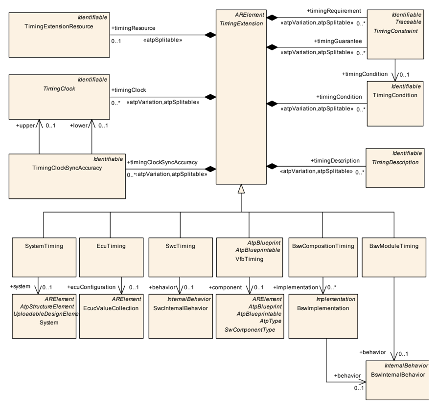

#### 3.1.1. VfbTiming（**VfbTiming**）

VfbTiming 视图适用于不同的系统粒度。最小的粒度是对单个 SwComponentType 而不带任何上下文嵌入的考察。此时，时序描述只能引用组件的 RPortPrototype 与同一组件的 PPortPrototype 之间的关系。

提供/需求的发送者-接收者端口

作为示例，考虑图 3.3 所说明的时序约束：「从 SWC 接收到取值 in 的那一刻起，直到送出新计算的取值 out 的那一刻为止，最大延迟应为 2 ms」。这将附加到引用 AtomicSwComponentType SW-C 的时序描述上。

对于本身包含其他 SwComponentPrototype 的 CompositionSwComponentType，不同组件之间的时序相互关系——例如从一个组件的 PPortPrototype 到另一组件的 RPortPrototype——也可能是令人感兴趣的。

**VfbTiming 的目的（**Purpose of VfbTiming**）**：元素 VfbTiming 聚合与 **VFB** 视图相关的全部时序信息、时序描述和时序约束。

表3.1：VfbTiming（**VfbTiming**）

| 属性 | 值 |
| --- | --- |
| 类 | VfbTiming |
| 包 | M2::AUTOSARTemplates::CommonStructure::Timing::TimingExtensions |
| 说明 | 用于在 **VFB** 层级定义时序描述和约束的模型元素。VfbTiming 聚合的 TimingDescriptions 限于引用由类 TDEventVfb 派生的事件的事件链。标签：atp.recommendedPackage=TimingExtensions |
| 基类 | ARElement、ARObject、AtpBlueprint、AtpBlueprintable、CollectableElement、Identifiable、MultilanguageReferrable、PackageableElement、Referrable、TimingExtension |
| 聚合于 | ARPackage.element |

| 属性 | 类型 | 多重性 | 种类 | 备注 |
| --- | --- | --- | --- | --- |
| component | SwComponentType | 0..1 | ref | 这定义 VfbTiming 的范围。所有相应的时序描述和约束都应定义在该范围之内。 |

**约束：VfbTiming.component 的存在性**：对于每个 VfbTiming，在 **VFB** 时序描述完成时，角色 component 中对 SwComponentType 的引用必须存在。

#### 3.1.2. SwcTiming（**SwcTiming**）

与 VfbTiming 视图相对，规范工程师可能特别感兴趣的是在 **VFB** 层级表示为黑盒的 AtomicSwComponentType 的 SwcInternalBehavior。SwcInternalBehavior 规定组件到 runnable 实体的行为分解，这些实体在运行时执行。因此，在 SwcTiming 视图中，时序描述附加到 SwComponentType 的 SwcInternalBehavior 上。它可以引用 RunnableEntity 执行的激活、启动和终止（见[第3.3.2.2.1节](#33221-tdeventswcinternalbehaviortdeventswcinternalbehavior)）。

**SwcTiming 的目的（**Purpose of SwcTiming**）**：元素 SwcTiming 聚合与软件组件视图相关的全部时序信息、时序描述和时序约束。

表3.2：SwcTiming（**SwcTiming**）

| 属性 | 值 |
| --- | --- |
| 类 | SwcTiming |
| 包 | M2::AUTOSARTemplates::CommonStructure::Timing::TimingExtensions |
| 说明 | SwcTiming 用于描述原子软件组件的时序。SwcTiming 聚合的 TimingDescriptions 限于引用由类 TDEventVfb 和 TDEventSwcInternalBehavior 派生的事件的事件链。标签：atp.recommendedPackage=TimingExtensions |
| 基类 | ARElement、ARObject、CollectableElement、Identifiable、MultilanguageReferrable、PackageableElement、Referrable、TimingExtension |
| 聚合于 | ARPackage.element |

| 属性 | 类型 | 多重性 | 种类 | 备注 |
| --- | --- | --- | --- | --- |
| behavior | SwcInternalBehavior | 0..1 | ref | 这定义 SwcTiming 的范围。所有相应的时序描述和约束都应定义在该范围之内。注意！多重性取 0..1 的原因是为了保证向后兼容。 |

#### 3.1.3. SystemTiming（**SystemTiming**）

在系统层级上，会实例化 CompositionSwComponentType 的一个特殊原型——RootSwCompositionPrototype。该原型、所选的硬件拓扑和其他产物被用作将软件组件部署到 **ECU** 上的任务的输入，以配置系统。主要的配置结果是把软件组件映射到 **ECU**，并在后续步骤中创建由此得到的通信矩阵。这些信息聚合在 System 描述中。

SystemTiming 视图用于在系统层级上提供时序信息。作为一个扩展，它可以附加到一个 System 上。由于 System 描述聚合了关于 SwComponentType 及其对应 SwcInternalBehavior 的全部信息，在 VfbTiming 和 SwcTiming 视图中可用的相同概念也可以在这一时序视图中使用。区别在于定义时序信息在系统层级上有效性的特定系统上下文。在不了解软件组件到目标硬件（即 **ECU**）的映射时，只能提供与平台无关的一般性描述。

感兴趣的数据流

此外，系统视图中的时序描述引用软件组件的具体通信——它们在 VfbTiming 视图中仅表示为抽象连接器。由于软件映射，此时的通信要么是经由 **RTE** 的本地通信（两个软件组件在同一 **ECU** 上），要么是经由 **RTE**、穿过 **BSW** 的通信栈和一条通信总线的远程通信。因此，系统特定的时序描述可以引用信号（**RTE**）、I-PDU（**COM**）和帧（通信驱动程序与总线）。

**SystemTiming 的目的（**Purpose of SystemTiming**）**：元素 SystemTiming 聚合与系统视图相关的全部时序信息、时序描述和时序约束。

表3.3：SystemTiming（**SystemTiming**）

| 属性 | 值 |
| --- | --- |
| 类 | SystemTiming |
| 包 | M2::AUTOSARTemplates::CommonStructure::Timing::TimingExtensions |
| 说明 | 用于在系统层级上细化（来自 VfbTiming 的）时序描述和约束的模型元素，利用系统模板中描述的拓扑、软件部署和信号映射信息。SystemTiming 聚合的 TimingDescriptions 限于由类 TDEventVfb、TDEventSwcInternalBehavior 和 TDEventCom 派生的事件。标签：atp.recommendedPackage=TimingExtensions |
| 基类 | ARElement、ARObject、CollectableElement、Identifiable、MultilanguageReferrable、PackageableElement、Referrable、TimingExtension |
| 聚合于 | ARPackage.element |

| 属性 | 类型 | 多重性 | 种类 | 备注 |
| --- | --- | --- | --- | --- |
| system | System | 0..1 | ref | 这定义 SystemTiming 的范围。所有相应的时序描述和约束都应定义在该范围之内。 |

**约束：SystemTiming.system 的存在性**：对于每个 SystemTiming，在系统时序描述完成时，角色 system 中对 System 的引用必须存在。

#### 3.1.4. BswModuleTiming 与 BswCompositionTiming（**BswModuleTiming and BswCompositionTiming**）

基础软件时序由两个视角组成，将在下面各节描述。

##### 3.1.4.1. BswModuleTiming（**BswModuleTiming**）

作为方法论的一部分，在 **ECU** 配置阶段会为每个 **BSW** 模块生成一个 BswModuleDescription。对每个模块都应定义其内部结构——BswInternalBehavior，即对任何 BswModuleEntity 的结构化。与[第3.1.2节](#312-swctimingswctiming)所述对 AtomicSwComponentType 的 SwcInternalBehavior 的时序视图类似，**BSW** 模块时序视图聚焦于任何 BswModuleEntity 执行的激活、启动和结束。每个模块的时序描述可以附加到 BswModuleDescription 上。

**BswModuleTiming 的目的（**Purpose of BswModuleTiming**）**：元素 BswModuleTiming 聚合与基础软件模块视图相关的全部时序信息、时序描述和时序约束。

表3.4：BswModuleTiming（**BswModuleTiming**）

| 属性 | 值 |
| --- | --- |
| 类 | BswModuleTiming |
| 包 | M2::AUTOSARTemplates::CommonStructure::Timing::TimingExtensions |
| 说明 | 用于为一个 **BSW** 模块的 BswInternalBehavior 定义时序描述和约束的模型元素。据此，可以为每个 BswInternalBehavior 规定一个单独的时序。在这一层级上定义的约束对该 BswInternalBehavior 的所有实现都成立。BswModuleTiming 聚合的 TimingDescriptions 限于引用由类 TDEventBswInternalBehavior 派生的事件的事件链。标签：atp.recommendedPackage=TimingExtensions |
| 基类 | ARElement、ARObject、CollectableElement、Identifiable、MultilanguageReferrable、PackageableElement、Referrable、TimingExtension |
| 聚合于 | ARPackage.element |

| 属性 | 类型 | 多重性 | 种类 | 备注 |
| --- | --- | --- | --- | --- |
| behavior | BswInternalBehavior | 0..1 | ref | 这定义 BswModuleTiming 的范围。所有相应的时序描述和约束都应定义在该范围之内。 |

**约束：BswModuleTiming.behavior 的存在性**：对于每个 BswModuleTiming，在 **BSW** 时序描述完成时，角色 behavior 中对 BswInternalBehavior 的引用必须存在。

##### 3.1.4.2. BswCompositionTiming（**BswCompositionTiming**）

与描述单个 BswInternalBehavior 的时序信息的元素 BswModuleTiming 相对，BswCompositionTiming 描述基础软件模块多于一个实现（即基础软件模块的组合）的时序信息。典型情况是：当需要描述由若干基础软件模块构成的基础软件栈的时序信息，或需要描述部署到不同内核上的基础软件模块的时序信息时。

**BswCompositionTiming 的目的（**Purpose of BswCompositionTiming**）**：元素 BswCompositionTiming 描述与一个 BswModuleDescription 的多于一个实现的 BswInternalBehavior 相关的时序信息。

表3.5：BswCompositionTiming（**BswCompositionTiming**）

| 属性 | 值 |
| --- | --- |
| 类 | BswCompositionTiming |
| 包 | M2::AUTOSARTemplates::CommonStructure::Timing::TimingExtensions |
| 说明 | 用于为一组表示 **BSW** 组合的 BswImplementation 定义时序描述和约束的模型元素。在这一层级上定义的约束对所有被引用的 **BSW** 实现都成立。注意，同一个基础软件模块的多个实现可能同时涉及。BswCompositionTiming 聚合的 TimingDescriptions 限于引用由类 TDEventBswInternalBehavior 和 TDEventBsw 派生的事件的事件链。标签：atp.recommendedPackage=TimingExtensions |
| 基类 | ARElement、ARObject、CollectableElement、Identifiable、MultilanguageReferrable、PackageableElement、Referrable、TimingExtension |
| 聚合于 | ARPackage.element |

| 属性 | 类型 | 多重性 | 种类 | 备注 |
| --- | --- | --- | --- | --- |
| implementation | BswImplementation | * | ref | 这定义 BswCompositionTiming 的范围。所有相应的时序描述和约束都应定义在该范围之内。 |

**约束：BswCompositionTiming.implementation 的存在性**：对于每个 BswCompositionTiming，在 **BSW** 时序描述完成时，角色 implementation 中对 BswImplementation 的引用必须至少存在一次。

#### 3.1.5. EcuTiming（**EcuTiming**）

**ECU** 配置阶段的一个结果是完整的 EcucValueCollection，它表示该 **ECU** 的配置描述。在 **ECU** 配置期间，该产物中除其他外会填入：

- 系统配置的 ECU 提取（**ECU Extract of System Configuration**），其中提取了总体系统描述中对该 **ECU** 需要的部分。
- 对该 **ECU** 上存在的所有 **BSW** 模块信息的引用。这些 **BSW** 模块由 BswModuleDescription 描述，提供例如模块提供或需要的接口的信息。

在这一视图中，时序可以引用所有与 **ECU** 相关的信息：已部署的软件组件实例、与 **ECU** 相关的交互（包括总线通信）、基础软件等。换言之，EcuTiming 具有与 System Timing 视图相同的表达能力，但只聚焦于系统拓扑中的一个特定 **ECU**。此外，因为 **BSW** 模块的完整组合和内部结构都是已知的，时序建模中可以考虑整个 **BSW**。**BSW** 模块的内部以及 **BSW** 模块之间的相互关系在这一时序视图中是令人感兴趣的。该信息附加到 EcucValueCollection 上。

**EcuTiming 的目的（**Purpose of EcuTiming**）**：元素 EcuTiming 聚合与 **ECU** 视图相关的全部时序信息、时序描述和时序约束。

表3.6：EcuTiming（**EcuTiming**）

| 属性 | 值 |
| --- | --- |
| 类 | EcuTiming |
| 包 | M2::AUTOSARTemplates::CommonStructure::Timing::TimingExtensions |
| 说明 | 用于在一个 **ECU** 配置的范围内定义时序描述和约束的模型元素。EcuTiming 聚合的 TimingDescriptions 允许使用由类 TimingDescriptionEvent 派生的全部事件。标签：atp.recommendedPackage=TimingExtensions |
| 基类 | ARElement、ARObject、CollectableElement、Identifiable、MultilanguageReferrable、PackageableElement、Referrable、TimingExtension |
| 聚合于 | ARPackage.element |

| 属性 | 类型 | 多重性 | 种类 | 备注 |
| --- | --- | --- | --- | --- |
| ecuConfiguration | EcucValueCollection | 0..1 | ref | 这定义 EcuTiming 的范围。所有相应的时序描述和约束都应定义在该范围之内。 |

**约束：EcuTiming.ecuConfiguration 的存在性**：对于每个 EcuTiming，在 **ECU** 时序描述完成时，角色 ecuConfiguration 中对 EcucValueCollection 的引用必须至少存在一次。

### 3.2. 时序条件（**Timing Conditions**）

在几乎所有情况下，系统以及在这些系统中执行的应用软件都在各种条件下运行，例如正常条件、错误条件、启动条件等。在这类系统的运行期间，条件可能随时变化。

因此，施加在系统上的时序约束也可能随这些条件而变化。TIMEX 提供了一种手段，按本节所述的条件时序（**Conditional Timing**）支持描述依赖这类条件的时序约束。

几乎所有控制内燃机的软件管理系统都应将冷却液温度维持在恒定值，以确保在特定条件下发动机的最佳运行。例如，可能出现可能导致发动机机械部件严重损坏的临界热状态。为了防止发动机的机械部件受损，软件应用的响应应比标称情况下更快。因此，依据一个已知的条件，会对给定的事件链施加不同的时序约束。


如图 3.8 所示，控制冷却液温度的软件组件（**SWC**）需要关于内燃机当前运行条件的信息。依据这些条件，会对事件链施加要求不同反应时间约束的不同时序约束。

在某种情形下，反应时间应远快于其他情形。例如，名为「发动机运行状态（**Engine Operating States**）」的模式端口指示内燃机运行所在的特定条件（即模式）。在这一特定模式下，内燃机可能面临临界热状态。

为了防止发动机受损，电子控制节温器（**ETC**）的驱动（名为 ECT Actuator 的客户端口）应比其他情况快得多。这是通过为该条件规定更紧的反应时间来实现的；而在任何其他条件下，反应时间可以更宽松。

除了这个特定的例子，还有更多场景中施加在给定事件链上的时序约束随内燃机模式的改变而变化。

在可信系统中，应用通常以容错方式设计。它或者在正常条件下运行——正常模式——或者在失效条件下运行——失效模式。如图 3.9 上部所示，在这类应用中，若干 runnable 实体处理三个传感器的取值。第一步，一个 runnable 实体对传感器取值进行修正，并将其传递给应用中的另一个 runnable 实体，后者使用控制算法计算一个输出。该输出取值用于控制执行器，或由系统中的其他 runnable 实体处理。在同一个应用中，另一个 runnable 实体检查从传感器接收的取值的合理性。

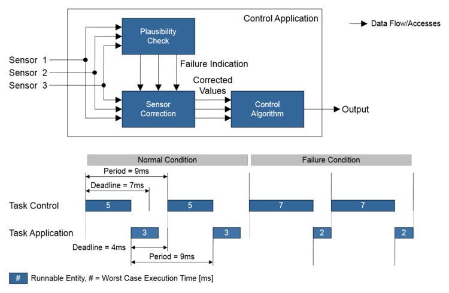

该 runnable 实体的目的是确定每个传感器的取值中任何意外的、不合乎预期的偏差。如果检查传感器取值合理性的 runnable 实体检测到这样的偏差，则通知修正传感器取值的 runnable 实体这一状况，即指示某个传感器失效。修正传感器取值的 runnable 实体能够基于监控其他物理量的其他传感器的取值，推导出错误传感器的取值。

因此，该应用在不同的条件下运行——正常模式和失效模式——并且就软件实现而言，这导致修正传感器取值的 runnable 实体具有不同的最坏情况执行时间。

假设执行这三个 runnable 实体的应用被映射到一个已经在执行另一个应用的 runnable 实体的 **ECU** 上。这两个应用的 runnable 实体在分别名为 Task Control 和 Task Application 的两个任务的上下文中执行。前一任务执行给定容错应用的 runnable 实体，后一任务执行已经映射到该 **ECU** 的、由若干 runnable 实体组成的应用。两个任务分别每 9 ms 周期激活一次。任务 Task Control 的期限（**deadline**）为 7 ms，任务 Task Application 的期限为 4 ms。

如上所述，第一个应用在两种不同的条件下运行：正常条件下 runnable 实体的执行时间不超过 5 ms；失效条件下由于执行推导错误传感器取值的算法所需的额外时间，runnable 实体的执行时间增加到 7 ms。

图 3.9 下部给出了包含这两个任务的任务调度的粗略草图。左侧容错应用在正常条件下运行，右侧该应用在失效条件下运行。在后者的情况下——失效条件——任务 Task Application 的 3 ms 执行时间导致调度被违反，这意味着除非两个应用都映射到一个更强大的 **ECU**（导致执行时间下降），否则这两个应用无法集成到同一个 **ECU** 上。另一种可能是：由任务 Task Application 执行的应用提供在降级条件下运行的能力，导致更短的执行时间，例如 2 ms。

然而，在上述情形中，施加在软件组件和/或 runnable 实体的时序属性上的时序约束，依赖于系统应正常运行的特定条件。

TIMEX 能够为特定条件规定时序约束，如图 3.10 所示。这样的时序约束当且仅当给定的时序条件成立时才有效。

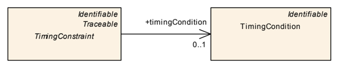

由于 TimingConstraint 扮演时序需求或时序保证的角色，对条件的依赖可以在两类时序信息——时序约束和时序属性——上都加以规定。

**TimingCondition 的目的（**Purpose of TimingCondition**）**：TimingCondition 的目的是描述时序约束所依赖的条件。

**TimingConditionFormula 的目的（**Purpose of TimingConditionFormula**）**：TimingConditionFormula 的目的是规定一个描述对特定条件之依赖的表达式。

**TimingExtensionResource 的目的（**Purpose of TimingExtensionResource**）**：TimingExtensionResource 的目的是收纳一组可复用的元素——例如对各种时序相关元素的实例引用——它们从 TimingConditionFormula 内部被引用。TimingExtensionResource 的这些元素与聚合它的父级——TimingExtension——的上下文相关。

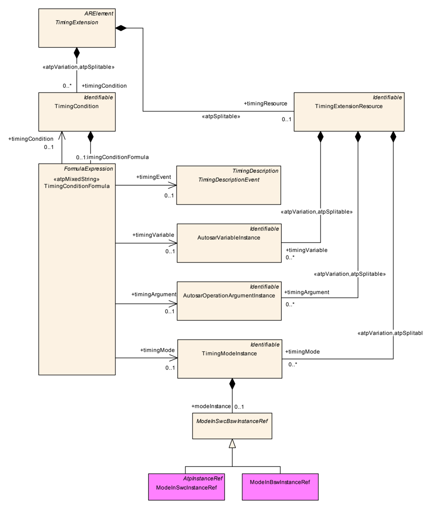

表3.7：TimingCondition（**TimingCondition**）

| 属性 | 值 |
| --- | --- |
| 类 | TimingCondition |
| 包 | M2::AUTOSARTemplates::CommonStructure::Timing::TimingCondition |
| 说明 | TimingCondition 描述对特定条件的依赖。该元素拥有一个描述时序条件依赖的表达式。 |
| 基类 | ARObject、Identifiable、MultilanguageReferrable、Referrable |
| 聚合于 | TimingExtension.timingCondition |

| 属性 | 类型 | 多重性 | 种类 | 备注 |
| --- | --- | --- | --- | --- |
| timingConditionFormula | TimingConditionFormula | 0..1 | aggr | 这是描述对特定条件之依赖的表达式。 |

表3.8：TimingConditionFormula（**TimingConditionFormula**）

| 属性 | 值 |
| --- | --- |
| 类 | &lt;&lt;atpMixedString&gt;&gt; TimingConditionFormula |
| 包 | M2::AUTOSARTemplates::CommonStructure::Timing::TimingCondition |
| 说明 | TimingConditionFormula 描述一种特定的依赖。该表达式应为布尔表达式，寻址模式、变量、实参和/或事件。 |
| 基类 | ARObject、FormulaExpression |
| 聚合于 | TimingCondition.timingConditionFormula |

| 属性 | 类型 | 多重性 | 种类 | 备注 |
| --- | --- | --- | --- | --- |
| timingArgument | AutosarOperationArgumentInstance | 0..1 | ref | 这引用一次操作调用的实参。 |
| timingCondition | TimingCondition | 0..1 | ref | 这引用一个时序条件，该条件是描述对特定条件之依赖的表达式的一部分。 |
| timingEvent | TimingDescriptionEvent | 0..1 | ref | 这引用一个时序事件。 |
| timingMode | TimingModeInstance | 0..1 | ref | 这引用一个模式声明。 |
| timingVariable | AutosarVariableInstance | 0..1 | ref | 这引用一个变量。 |

表3.9：TimingExtensionResource（**TimingExtensionResource**）

| 属性 | 值 |
| --- | --- |
| 类 | TimingExtensionResource |
| 包 | M2::AUTOSARTemplates::CommonStructure::Timing::TimingCondition |
| 说明 | TimingExtensionResource 提供收纳实例引用的能力，这些实例引用从时序条件公式内部被引用。 |
| 基类 | ARObject、Identifiable、MultilanguageReferrable、Referrable |
| 聚合于 | TimingExtension.timingResource |

| 属性 | 类型 | 多重性 | 种类 | 备注 |
| --- | --- | --- | --- | --- |
| timingArgument | AutosarOperationArgumentInstance | * | aggr | 这引用一次操作调用的实参的实例引用。构造型：atpSplitable；atpVariation 标签：atp.Splitkey=timingArgument.shortName、timingArgument.variationPoint.shortLabel、vh.latestBindingTime=postBuild |
| timingMode | TimingModeInstance | * | aggr | 这引用一个模式声明的实例引用。构造型：atpSplitable；atpVariation 标签：atp.Splitkey=timingMode.shortName、timingMode.variationPoint.shortLabel、vh.latestBindingTime=postBuild |
| timingVariable | AutosarVariableInstance | * | aggr | 这引用一个变量的实例引用。构造型：atpSplitable；atpVariation 标签：atp.Splitkey=timingVariable.shortName、timingVariable.variationPoint.shortLabel、vh.latestBindingTime=postBuild |

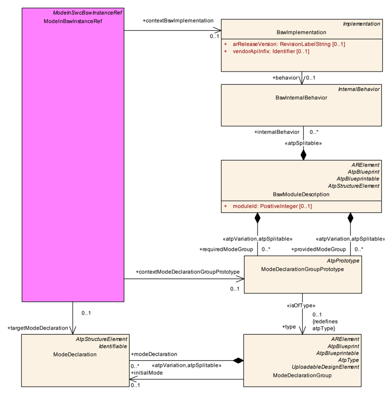

由于基础软件模块描述模板不支持「类型与原型」的概念，元素 ModeInBswInstanceRef 不是 AtpInstanceRef 的特化。因此，扮演「base」角色的有向关联不存在。

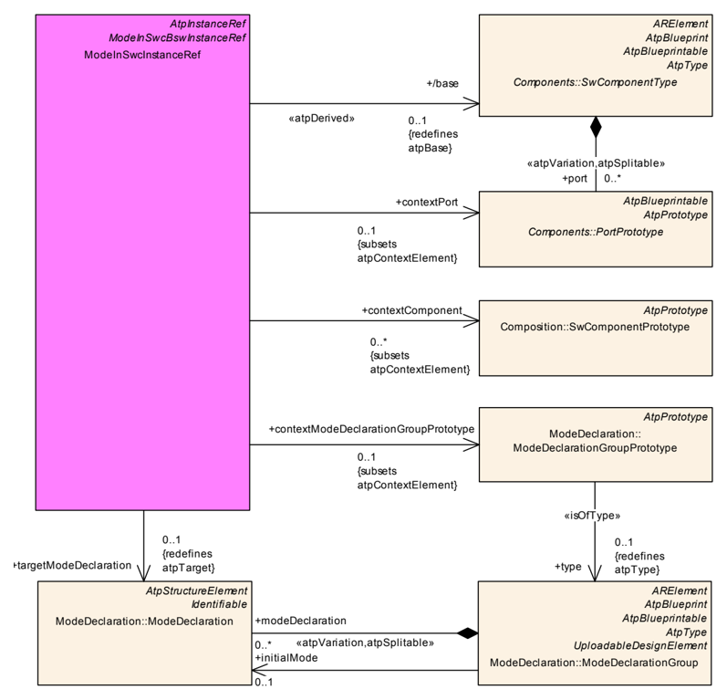

表3.10：TimingModeInstance（**TimingModeInstance**）

| 属性 | 值 |
| --- | --- |
| 类 | TimingModeInstance |
| 包 | M2::AUTOSARTemplates::CommonStructure::Timing::TimingCondition |
| 说明 | 该类规定要在模式声明组的特定实例中检查的模式声明。它在时序条件公式中用作一元时序函数 TIMEX_modeActive 的操作数，以检查在该表达式求值的时间点上该模式声明是否处于活动状态。 |
| 基类 | ARObject、Identifiable、MultilanguageReferrable、Referrable |
| 聚合于 | TDEventOccurrenceExpression.mode、TimingExtensionResource.timingMode |

| 属性 | 类型 | 多重性 | 种类 | 备注 |
| --- | --- | --- | --- | --- |
| modeInstance | ModeInSwcBswInstanceRef | 0..1 | aggr | 这引用给定上下文中的一个特定模式声明。 |

表3.11：ModeInBswInstanceRef（**ModeInBswInstanceRef**）

| 属性 | 值 |
| --- | --- |
| 类 | ModeInBswInstanceRef |
| 包 | M2::AUTOSARTemplates::CommonStructure::Timing::TimingCondition |
| 说明 | 实例引用，用于引用 **BSW** 模块中所使用的 ModeDeclarationGroupPrototype 的一个特定 ModeDeclaration。 |
| 基类 | ARObject、ModeInSwcBswInstanceRef |
| 聚合于 | TimingModeInstance.modeInstance |

| 属性 | 类型 | 多重性 | 种类 | 备注 |
| --- | --- | --- | --- | --- |
| contextBswImplementation | BswImplementation | 0..1 | ref | 规定体现该上下文的 **BSW** 实现。标签：xml.sequenceOffset=10 |
| contextModeDeclarationGroupPrototype | ModeDeclarationGroupPrototype | 0..1 | ref | 规定体现该上下文的模式声明组原型。标签：xml.sequenceOffset=20 |
| targetModeDeclaration | ModeDeclaration | 0..1 | ref | 规定给定上下文中的特定模式声明。标签：xml.sequenceOffset=30 |

**约束：ModeInBswInstanceRef.contextModeDeclarationGroupPrototype 的存在性**：对于每个 ModeInBswInstanceRef，在 **BSW** 时序描述完成时，角色 contextModeDeclarationGroupPrototype 中对 ModeDeclarationGroupPrototype 的引用必须至少存在一次。

**约束：ModeInBswInstanceRef.targetModeDeclaration 的存在性**：对于每个 ModeInBswInstanceRef，在 **BSW** 时序描述完成时，角色 targetModeDeclaration 中对 ModeDeclaration 的引用必须至少存在一次。

表3.12：ModeInSwcInstanceRef（**ModeInSwcInstanceRef**）

| 属性 | 值 |
| --- | --- |
| 类 | ModeInSwcInstanceRef |
| 包 | M2::AUTOSARTemplates::CommonStructure::Timing::TimingCondition |
| 说明 | 实例引用，用于在 **SW-C** 的特定模式切换端口上引用一个 ModeDeclaration。 |
| 基类 | ARObject、AtpInstanceRef、ModeInSwcBswInstanceRef |
| 聚合于 | TimingModeInstance.modeInstance |

| 属性 | 类型 | 多重性 | 种类 | 备注 |
| --- | --- | --- | --- | --- |
| base | SwComponentType | 0..1 | ref | 规定表示上下文基类的软件组件。构造型：atpDerived 标签：xml.sequenceOffset=10 |
| contextComponent | SwComponentPrototype | * | ref | 规定表示该上下文的软件组件原型。标签：xml.sequenceOffset=20 |
| contextModeDeclarationGroupPrototype | ModeDeclarationGroupPrototype | 0..1 | ref | 规定体现该上下文的模式声明组原型。标签：xml.sequenceOffset=40 |
| contextPort | PortPrototype | 0..1 | ref | 规定表示该上下文的端口原型。标签：xml.sequenceOffset=30 |
| targetModeDeclaration | ModeDeclaration | 0..1 | ref | 规定给定上下文中的特定模式声明。标签：xml.sequenceOffset=50 |

**约束：ModeInSwcInstanceRef.contextModeDeclarationGroupPrototype 的存在性**：对于每个 ModeInSwcInstanceRef，在 **SWC** 时序描述完成时，角色 contextModeDeclarationGroupPrototype 中对 ModeDeclarationGroupPrototype 的引用必须至少存在一次。

**约束：ModeInSwcInstanceRef.contextPort 的存在性**：对于每个 ModeInSwcInstanceRef，在 **SWC** 时序描述完成时，角色 contextPort 中对 PortPrototype 的引用必须至少存在一次。

**约束：ModeInSwcInstanceRef.targetModeDeclaration 的存在性**：对于每个 ModeInSwcInstanceRef，在 **SWC** 时序描述完成时，角色 targetModeDeclaration 中对 ModeDeclaration 的引用必须至少存在一次。

**约束：ModeInSwcInstanceRef.base 的存在性**：对于每个 ModeInSwcInstanceRef，在 **SWC** 时序描述完成时，角色 base 中对 SwComponentType 的引用必须至少存在一次。

### 3.3. 时序描述（**TimingDescription**）

TimingDescription 是一个抽象类，它为两个抽象子类 TimingDescriptionEventChain 和 TimingDescriptionEvent 提供基础——如图 3.14 所示，这两个子类又进一步为各自的具体事件类型提供基础。后续各节将对它们进行详细描述。

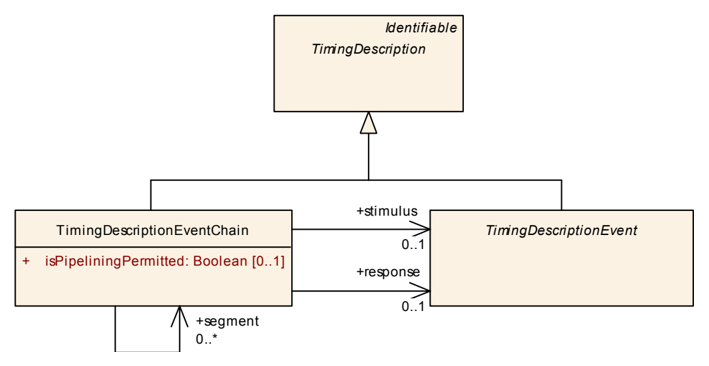

#### 3.3.1. TimingDescriptionEventChain（**TimingDescriptionEventChain**）

TimingDescriptionEventChain 描述一组功能依赖的 TimingDescriptionEvent 的因果顺序。每条 TimingDescriptionEventChain 至少定义激励（**stimulus**）与响应（**response**）之间的关系。借助 TimingDescriptionEventChain，可以显式地描述系统激励与其对应响应之间的关联，并将其用作 TimingConstraint 作用范围的形式化定义。

**TimingDescriptionEventChain 的目的（**Purpose of TimingDescriptionEventChain**）**：元素 TimingDescriptionEventChain 用于规定时序描述事件及其在系统运行时的发生之间的因果关系。

**TimingDescriptionEventChain.stimulus 的语义（**Semantics**）**：激励表示一条 TimingDescriptionEventChain 的起点（或初始 TimingDescriptionEvent）。

**TimingDescriptionEventChain.response 的语义（**Semantics**）**：响应表示一条 TimingDescriptionEventChain 的终点（或最终 TimingDescriptionEvent）。

表3.13：TimingDescriptionEventChain（**TimingDescriptionEventChain**）

| 属性 | 值 |
| --- | --- |
| 类 | TimingDescriptionEventChain |
| 包 | M2::AUTOSARTemplates::CommonStructure::Timing::TimingDescription |
| 说明 | 事件链描述一组功能依赖的时序事件的因果顺序。每条事件链都有明确定义的激励和响应，用以描述其起点和终点。此外，它可以层次化地分解为任意数量的子链，即所谓的事件链段（**event chain segments**）。 |
| 基类 | ARObject、Identifiable、MultilanguageReferrable、Referrable、TimingDescription |
| 聚合于 | TimingExtension.timingDescription |

| 属性 | 类型 | 多重性 | 种类 | 备注 |
| --- | --- | --- | --- | --- |
| isPipeliningPermitted | Boolean | 0..1 | attr | 规定 **LET** 区间内的被调度实体是否应使用流水线执行，即「允许流水线（**permitted pipelining**）属性」。若为 **TRUE**，则被调度实体必须实现流水线。若为 **FALSE** 或未定义，则不应用流水线。标签：atp.Status=draft |
| response | TimingDescriptionEvent | 0..1 | ref | 表示事件链终止时间点的响应事件。标签：xml.sequenceOffset=20 |
| segment | TimingDescriptionEventChain | * | ref | 组合事件链由任意数量的子链构成。标签：xml.sequenceOffset=30 |
| stimulus | TimingDescriptionEvent | 0..1 | ref | 表示事件链激活时间点的激励事件。标签：xml.sequenceOffset=10 |

**约束：TimingDescriptionEventChain 中 stimulus 与 response 的正交性**：引用 TimingDescriptionEventChain.stimulus 与引用 TimingDescriptionEventChain.response 不得引用同一个 TimingDescriptionEvent.shortName。

**约束：TimingDescriptionEventChain 中 stimulus 与 response 的一致性**：在角色 stimulus 和 response 中引用的 TimingDescriptionEvent，在与 TimingDescriptionEvent 的具体子类相关联的施加时间点，应属于 TimingDescriptionEvent 的同一子类。

根据 TimingDescriptionEventChain 的 category 取值，它可能用于不同的用例。

**TimingDescriptionEventChain 的标准化类别（**Standardized categories**）**：**AUTOSAR** 对 TimingDescriptionEventChain 的以下 category 取值及其语义进行标准化：

- **undefined**：依据 **STANDARD**
- **STANDARD**：不对 TimingDescriptionEventChain 施加特定语义。它表示标准行为。
- **LET_INTERVAL**：TimingDescriptionEventChain 表示一个 **LET** 区间
- **SL_LET_INTERVAL**：TimingDescriptionEventChain 表示一个 **SLLET** 区间

**约束：TimingDescriptionEventChain.category 的限定**：任何不在上文标准化列表中的 TimingDescriptionEventChain.category 取值都应被忽略。

**约束：TimingDescriptionEventChain.response 的存在性**：对于每条 TimingDescriptionEventChain，角色 response 中的引用应在与 TimingDescriptionEvent 的具体子类相关联的施加时间点存在。

**约束：TimingDescriptionEventChain.stimulus 的存在性**：对于每条 TimingDescriptionEventChain，角色 stimulus 中的引用应在与 TimingDescriptionEvent 的具体子类相关联的施加时间点存在。

**约束：TimingDescriptionEventChain.segment 的存在性**：对于每条 TimingDescriptionEventChain，角色 segment 中的引用应在与 TimingDescriptionEvent 的具体子类相关联的施加时间点至少存在一次。

图 3.15 展示了一条描述「传感器（**Sensor**）」与「执行器（**Actuator**）」之间因果依赖的事件链「End-to-End Timing」。事件链段的序列按 **AUTOSAR** 时序视图展示了「End-to-End Timing」的细节。

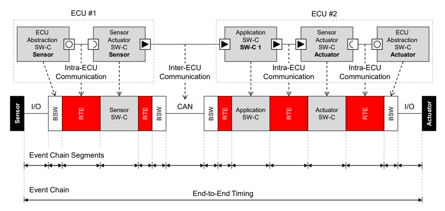

##### 3.3.1.1. 事件链段（**Segments**）

**约束：事件链段的规定**：如果一条 TimingDescriptionEventChain 由更多的事件链段构成，则从该事件链的激励到响应至少应存在一个事件链段序列。

**约束：不再引用更多事件链段**：如果一条 TimingDescriptionEventChain 未被细分为更多的事件链段，则扮演 segment 角色的引用应引用这条 TimingDescriptionEventChain 本身。换言之，一条不含任何事件链段的事件链应引用其自身。

**约束：第一条与最后一条事件链段的激励事件和响应事件的规定**：第一条事件链段的激励事件和最后一条事件链段的响应事件，应引用这些事件链段直接所属的父事件链的激励和响应。

##### 3.3.1.2. 方法（**Approach**）

以下小节描述如何为系统构建事件链。依据前置条件，可以区分两种不同的方法：自顶向下（分解）和自底向上（组合）。

事件链的分解与组合可以按照软件组件层次进行，但不一定必须遵循该层次。其主要目的是提高或降低时序描述的粒度。

注意，事件链用于所有 **AUTOSAR** 时序视图，事件链的任何组合与分解都可以跨不同的 **AUTOSAR** 时序视图进行。

###### 3.3.1.2.1. 分解（**Decomposition**）

第一步，识别系统中的时间关键路径。这意味着激励事件与响应事件之间的因果关系由一条事件链描述。为该事件链规定一个时序约束，以描述时间预算。第二步，将该事件链分解为若干事件链段，这意味着给定的时间预算也被拆分（分解）。

由于事件链段本身也是事件链，这些事件链段可以继续被分解。

图 3.16 展示了事件「请求制动踏板位置」（**Stimulus**）与事件「提供确定的车辆速度」（**Response**）之间的时间关键路径。这条事件链（**EC**）受一个时序约束——即 LatencyTimingConstraint——的约束，并相应地被分配时间预算。例如，事件链 **EC** 的时间预算被限定为 2 ms 的最大延迟。

在开发的后续步骤中，随着对系统动态特性的更深入了解，这条事件链及其时间预算可以沿系统的组件被拆分。由此得到事件链段 **EC1**、**EC2** 和 **EC3** 及其相应的时间预算。这些时间预算之和不得超过给定的 2 ms 时间预算。

###### 3.3.1.2.2. 组合（**Composition**）

第一步，基于包括时序描述在内的既有软件组件构建系统。第二步，将既有的事件链相互连接。由此得到一个事件链序列，其中一条事件链的响应事件扮演后续事件链的激励事件角色。第三步，基于扮演事件链段角色的既有事件链序列规定一条高层事件链。应为这条高层事件链规定时间预算。最后，需要评估聚合的时间预算是否可接受，即聚合的时间预算应小于或等于高层事件链的时间预算。

图 3.16 展示了相互连接的事件链 **EC1**、**EC2** 和 **EC3**。每条事件链都使用 LatencyTimingConstraint 规定时间预算：事件链 **EC1** 的时间预算为 0.5 ms，事件链 **EC2** 为 0.6 ms，事件链 **EC3** 为 0.7 ms。高层事件链 **EC** 是事件链 **EC1**、**EC2** 和 **EC3** 的组合。高层事件链的激励事件是事件「请求制动踏板位置」（**Stimulus**），其响应事件是事件「提供确定的车辆速度」（**Response**）。最终，使用 LatencyTimingConstraint 为高层事件链分配时间预算，例如 2 ms。该值与事件链段聚合的时间预算（0.5 ms + 0.6 ms + 0.7 ms = 1.8 ms）一致。

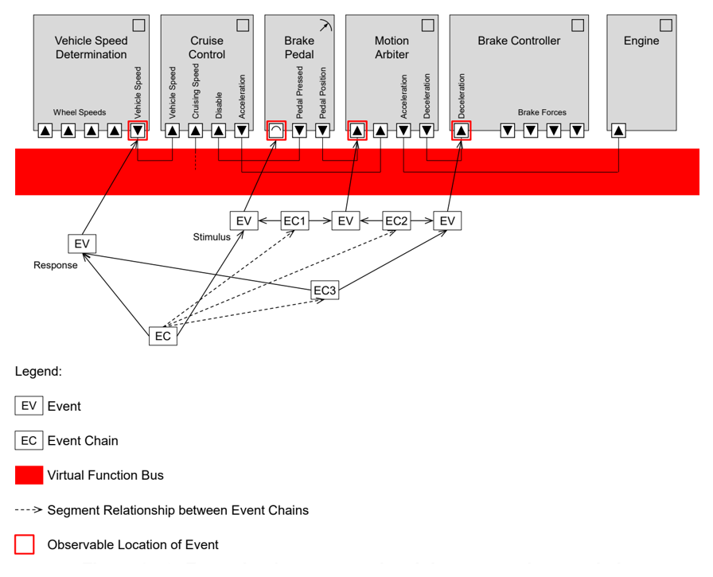

##### 3.3.1.3. 模式（**Patterns**）

事件链的序列或层次可以构成复杂的结构。然而，如果正确遵循上述方法之一，则只有少数几种模式适用。下面通过一个简单的例子介绍这些模式。

###### 3.3.1.3.1. 序列（**Sequence**）

最常用的模式是事件序列。这样的序列描述因果相关事件的相继发生，没有替代路径。

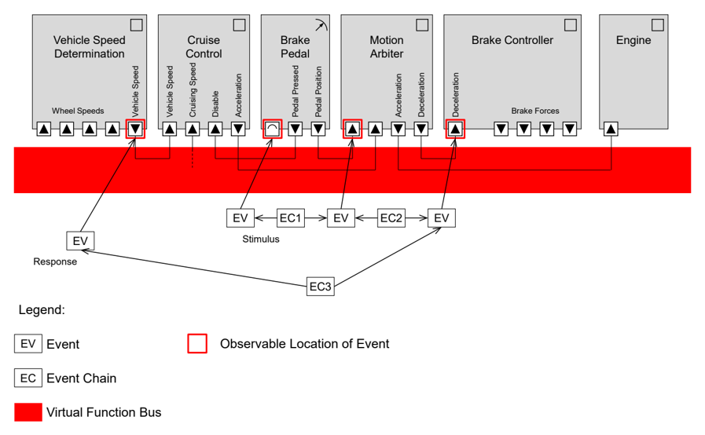

图 3.17 描绘了该模式的一个示例。事件链 **EC1** 至 **EC3** 定义了在名为 Brake Pedal 的 **SWC** 端口与名为 Vehicle Speed Determination 的 **SWC** 端口处观察到的事件之间的因果关系。

###### 3.3.1.3.2. 分叉（**Fork**）

「分叉（**Fork**）」模式描述若干事件链拥有一个共同激励事件和不同响应事件的情形。

图 3.18 说明了该模式，其中展示了一条因 SWC Brake Controller 为每个车轮计算制动力取值（**EC5** 至 **EC8**）而分叉的路径。

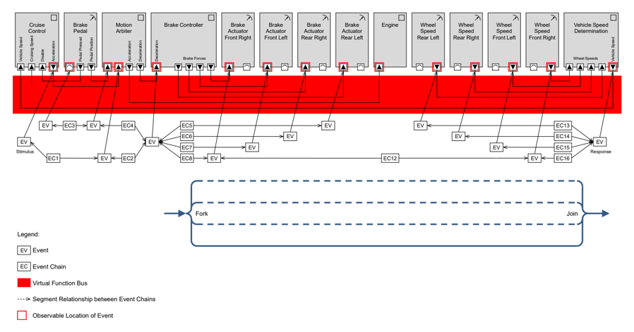

###### 3.3.1.3.3. 汇合（**Join**）

「汇合（**Join**）」模式描述若干事件链拥有一个共同响应事件和不同激励事件的情形。

图 3.18 说明了该模式，其中展示了一条因 SWC Vehicle Speed Determination 聚合来自各个车轮的车轮速度取值（**EC13** 至 **EC16**）而汇合的路径。

###### 3.3.1.3.4. 备选（**Alternative**）

「备选（**Alternative**）」模式描述在一个激励事件与一个响应事件之间存在多于一条路径的情形。这意味着至少一个「分叉」后面跟着至少一个「汇合」。

图 3.19 说明了该模式，其中展示了在 SWC Motion Arbiter 的需求端口处观察到的事件，要么导致 SWC Brake Controller 名为 Deceleration 的端口处发生一个事件，要么导致 SW-C Engine 名为 Acceleration 的端口处发生一个事件。图中的事件链 **EC2** 和 **EC4** 描述了这些备选的因果关系。无论哪种情况，车辆的减速或加速都会导致 SW-C Vehicle Speed Determination 的提供端口 Vehicle Speed 处发生一个事件，报告车辆的速度。事件链 **EC3** 和 **EC5** 描述了这些备选的因果关系，它们引用同一个响应事件。为完成整条事件链，备选路径中只有一条应已发生。

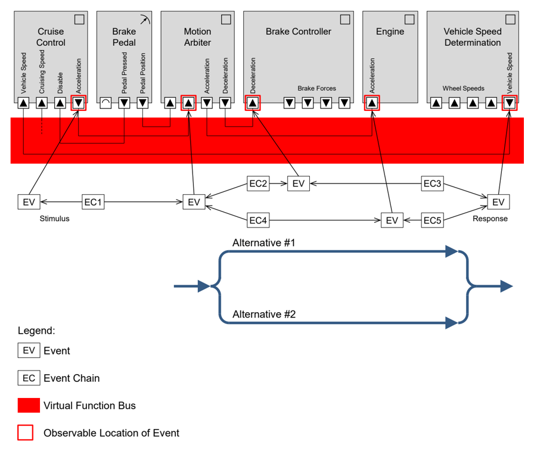

###### 3.3.1.3.5. 循环（**Cycle**）

「循环（**Cycle**）」模式描述从一条事件链的响应事件出发的路径通向该事件链的激励的情形。

图 3.20 说明了该模式，其中展示了三条事件链 **EC8**、**EC12** 和 **EC17** 构成一个循环。事件链 **EC8** 的激励事件是事件链 **EC17** 的响应事件；事件链 **EC12** 的响应事件是事件链 **EC17** 的激励事件。事件链 **EC8** 和 **EC12** 以不同角色引用同一个事件，即从事件链 **EC8** 的视角看是响应事件，而从事件链 **EC12** 的视角看是激励事件。

注意，一条事件链为其激励和响应引用同一个事件是被约束「TimingDescriptionEventChain 中 stimulus 与 response 的正交性」所禁止的。因此，一个循环至少由两条事件链构成。

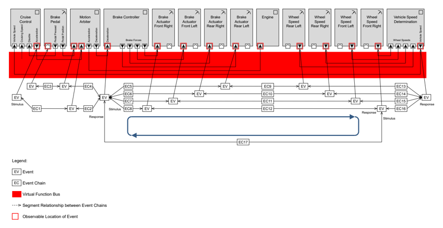

#### 3.3.2. TimingDescriptionEvent（**TimingDescriptionEvent**）

**TimingDescriptionEvent 的目的（**Purpose of TimingDescriptionEvent**）**：元素 TimingDescriptionEvent 及其特化用于描述在系统运行时在系统内特定位置观察到的事件的发生。

例如，这可以是 RunnableEntity 的启动，或将一帧存入通信控制器的硬件缓冲区。

图 3.21 给出了不同事件类型的概览。后续小节将对它们进行更详细的描述。

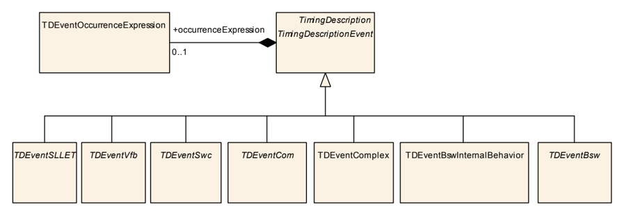

根据 TimingDescriptionEvent 的 category 取值，它可能用于不同的用例。

**TimingDescriptionEvent 在经典平台中的标准化类别（**Standardized categories**）**：**AUTOSAR** 对 TimingDescriptionEvent 的以下 category 取值及其语义进行标准化：

- **undefined**：依据 **STANDARD**
- **STANDARD**：不对 TimingDescriptionEvent 施加特定语义。它表示标准行为。
- **LET_RELEASE**：TimingDescriptionEvent 表示一个 **LET** 区间的释放/起点
- **LET_TERMINATE**：TimingDescriptionEvent 表示一个 **LET** 区间的终止/终点
- **SL_LET_RELEASE**：TimingDescriptionEvent 表示一个 **SL-LET** 区间的释放/起点
- **SL_LET_TERMINATE**：TimingDescriptionEvent 表示一个 **SL-LET** 区间的终止/终点
- **DISPATCH_ENTRY_POINT**：TimingDescriptionEvent 标记描述与软件集群相关联的调度器（**dispatcher**）的时序描述事件链的调度器入口点
- **DISPATCH_EXIT_POINT**：TimingDescriptionEvent 标记描述与软件集群相关联的调度器（**dispatcher**）的时序描述事件链的调度器出口点

**约束：TimingDescriptionEvent.category 的限定**：任何不在上文标准化列表中的 TimingDescriptionEvent.category 取值都应被忽略。

另请注意，关于 TimingDescriptionEvent 发生的信息在[第 3.4.2.2 节](#3422-eventtriggeringconstrainteventtriggeringconstraint)中单独描述。

##### 3.3.2.1. TDEventVfb（**TDEventVfb**）

**TDEventVfb 的目的（**Purpose of TDEventVfb**）**：元素 TDEventVfb 及其特化用于描述在 **VFB** 视图中特定位置观察到的事件的发生。

与 **VFB** 相关的事件可用于以下内容的规范中：

- VfbTiming（3.1.1）
- SystemTiming（3.1.3）
- SwcTiming（3.1.2）
- EcuTiming（3.1.5）

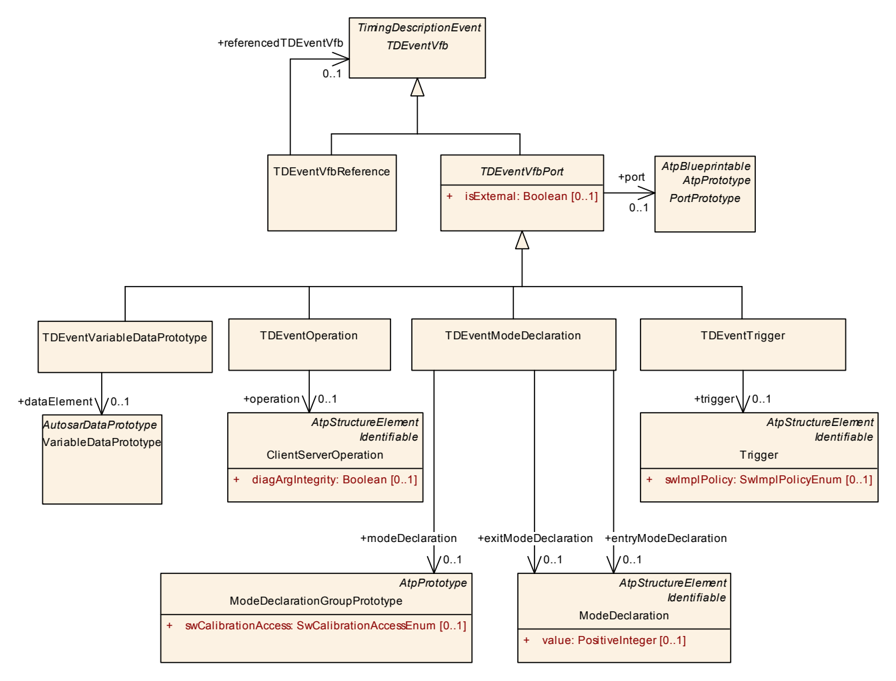

表3.14：TDEventVfb（**TDEventVfb**）

| 属性 | 值 |
| --- | --- |
| 类 | TDEventVfb（抽象） |
| 包 | M2::AUTOSARTemplates::CommonStructure::Timing::TimingDescription::TimingDescriptionEvents::TDEventVfb |
| 说明 | 这是用于描述虚拟功能总线（**VFB**）层级时序事件的抽象父类。 |
| 基类 | ARObject、Identifiable、MultilanguageReferrable、Referrable、TimingDescription、TimingDescriptionEvent |
| 子类 | TDEventVfbPort、TDEventVfbReference |
| 聚合于 | TimingExtension.timingDescription |

| 属性 | 类型 | 多重性 | 种类 | 备注 |
| --- | --- | --- | --- | --- |
| component | SwComponentPrototype | 0..1 | iref | 该时序事件作用范围的上下文。InstanceRef 由 ComponentInCompositionInstanceRef 实现。 |

###### 3.3.2.1.1. TDEventVfbReference（**TDEventVfbReference**）

**TDEventVfbReference 的目的（**Purpose of TDEventVfbReference**）**：元素 TDEventVfbReference 用于引用已经在其他时序视图中规定的时序描述事件。换言之，它使得可以复用既有的时序模型。

表3.15：TDEventVfbReference（**TDEventVfbReference**）

| 属性 | 值 |
| --- | --- |
| 类 | TDEventVfbReference |
| 包 | M2::AUTOSARTemplates::CommonStructure::Timing::TimingDescription::TimingDescriptionEvents::TDEventVfb |
| 说明 | 用于引用与虚拟功能总线（**VFB**）视图相关、在其他时序视图中规定的时序描述事件。 |
| 基类 | ARObject、Identifiable、MultilanguageReferrable、Referrable、TDEventVfb、TimingDescription、TimingDescriptionEvent |
| 聚合于 | TimingExtension.timingDescription |

| 属性 | 类型 | 多重性 | 种类 | 备注 |
| --- | --- | --- | --- | --- |
| referencedTDEventVfb | TDEventVfb | 0..1 | ref | 被引用的时序描述事件。 |

**约束：TDEventVfbReference.referencedTDEventVfb 的存在性**：对于每个 TDEventVfbReference，在 **VFB** 时序描述完成时，角色 referencedTDEventVfb 中对 TDEventVfb 的引用必须存在。

###### 3.3.2.1.2. TDEventVfbPort（**TDEventVfbPort**）

**TDEventVfbPort 的目的（**Purpose of TDEventVfbPort**）**：元素 TDEventVfbPort 及其特化用于描述在 **VFB** 视图中特定位置观察到的事件的发生。

表3.16：TDEventVfbPort（**TDEventVfbPort**）

| 属性 | 值 |
| --- | --- |
| 类 | TDEventVfbPort（抽象） |
| 包 | M2::AUTOSARTemplates::CommonStructure::Timing::TimingDescription::TimingDescriptionEvents::TDEventVfb |
| 说明 | 这是用于描述虚拟功能总线（**VFB**）层级特定时序事件类型的抽象父类。 |
| 基类 | ARObject、Identifiable、MultilanguageReferrable、Referrable、TDEventVfb、TimingDescription、TimingDescriptionEvent |
| 子类 | TDEventModeDeclaration、TDEventOperation、TDEventTrigger、TDEventVariableDataPrototype |
| 聚合于 | TimingExtension.timingDescription |

| 属性 | 类型 | 多重性 | 种类 | 备注 |
| --- | --- | --- | --- | --- |
| isExternal | Boolean | 0..1 | attr | 该属性用于在虚拟功能总线（**VFB**）层级引用与硬件 I/O 相关的外部事件，例如物理传感器和执行器。 |
| port | PortPrototype | 0..1 | ref | TimingEvent 应施加于其上的端口。 |
| portPrototypeBlueprint | PortPrototypeBlueprint | 0..1 | ref | TimingEvent 应施加于其上的端口（在 **AUTOSAR** 蓝图的上下文中）。 |

**约束：TDEventVfbPort.isExternal 的存在性**：对于每个 TDEventVfbPort，在 **VFB** 时序描述完成时，属性 isExternal 必须存在。

为了在 **VFB** 层级就已支持对硬件 I/O 时序事件的描述（例如为了引用物理传感器生成数据的时点）而无需规定具体的传感器硬件，有必要规定属性 isExternal。

如果对于类型为 TDEventVfbPort 的时序事件，该属性被设置为 **TRUE**，则该时序事件引用相应硬件 I/O 生成/处理数据的时点。

如果该属性被设置为 **FALSE**，则该时序事件引用数据在 **VFB** 层级进入或离开组件相应端口的时点。

###### 3.3.2.1.2.1. TDEventVariableDataPrototype（**TDEventVariableDataPrototype**）

**TDEventVariableDataPrototype 规定在发送者/接收者端口处可观察到的事件（**specifies events observable at sender/receiver ports**）**：元素 TDEventVariableDataPrototype 用于规定在需求端和提供端发送者/接收者端口处可观察到的事件，即变量数据原型的接收和发送。

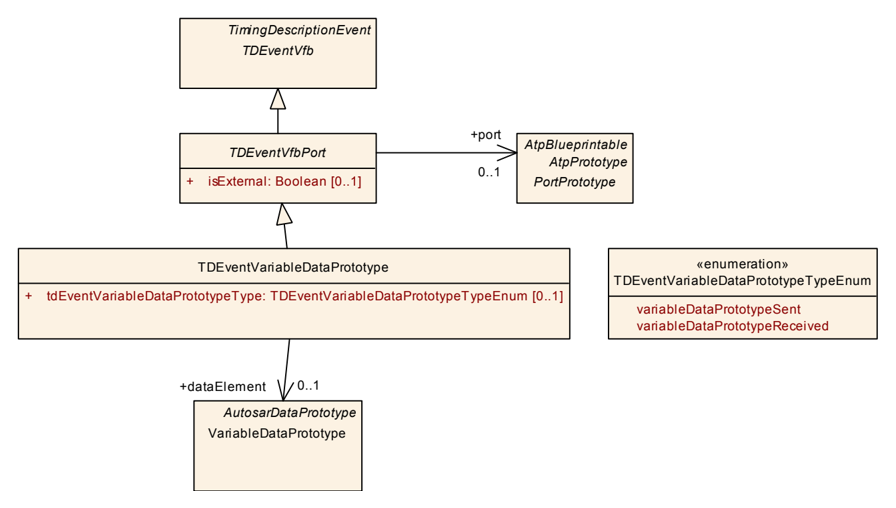

表3.17：TDEventVariableDataPrototype（**TDEventVariableDataPrototype**）

| 属性 | 值 |
| --- | --- |
| 类 | TDEventVariableDataPrototype |
| 包 | M2::AUTOSARTemplates::CommonStructure::Timing::TimingDescription::TimingDescriptionEvents::TDEventVfb |
| 说明 | 用于描述与 **VFB** 层级发送者-接收者通信相关的时序事件。 |
| 基类 | ARObject、Identifiable、MultilanguageReferrable、Referrable、TDEventVfb、TDEventVfbPort、TimingDescription、TimingDescriptionEvent |
| 聚合于 | TimingExtension.timingDescription |

| 属性 | 类型 | 多重性 | 种类 | 备注 |
| --- | --- | --- | --- | --- |
| dataElement | VariableDataPrototype | 0..1 | ref | 被引用的 VariableDataPrototype。 |
| tdEventVariableDataPrototypeType | TDEventVariableDataPrototypeTypeEnum | 0..1 | attr | 该时序事件的特定类型。 |

**约束：TDEventVariableDataPrototype.tdEventVariableDataPrototypeType 的存在性**：对于每个 TDEventVariableDataPrototype，在 **VFB** 时序描述完成时，属性 tdEventVariableDataPrototypeType 必须存在。

**约束：TDEventVariableDataPrototype.dataElement 的存在性**：对于每个 TDEventVariableDataPrototype，在 **VFB** 时序描述完成时，角色 dataElement 中对 VariableDataPrototype 的引用必须存在。

表3.18：TDEventVariableDataPrototypeTypeEnum（**TDEventVariableDataPrototypeTypeEnum**）

| 属性 | 值 |
| --- | --- |
| 枚举 | TDEventVariableDataPrototypeTypeEnum |
| 包 | M2::AUTOSARTemplates::CommonStructure::Timing::TimingDescription::TimingDescriptionEvents::TDEventVfb |
| 说明 | 用于描述 TDEventVariableDataPrototype 的特定事件类型。 |
| 聚合于 | TDEventVariableDataPrototype.tdEventVariableDataPrototypeType |

| 字面量 | 说明 |
| --- | --- |
| variableDataPrototypeReceived | 被引用的变量数据原型已成功传输、并在（**RTE** 的）相关通信缓冲区中对接收方 **SWC** 可用的时间点。标签：atp.EnumerationLiteralIndex=0 |
| variableDataPrototypeSent | 被引用的变量数据原型已由发送方 **SWC** 成功发出、从而在（**RTE** 的）相关通信缓冲区中可供传输的时间点。标签：atp.EnumerationLiteralIndex=1 |

###### 3.3.2.1.2.2. TDEventOperation（**TDEventOperation**）

**TDEventOperation 规定在客户端/服务器端口处可观察到的事件（**specifies events observable at client/server ports**）**：元素 TDEventOperation 用于规定在需求端和提供端客户端/服务器端口处可观察到的事件，即操作的调用及其完成。

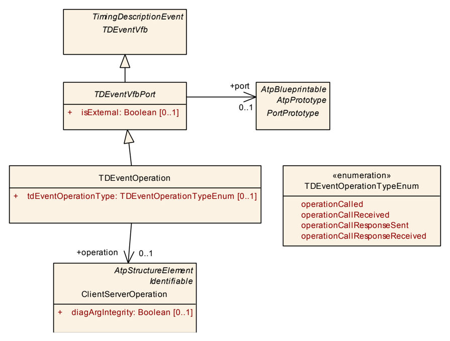

表3.19：TDEventOperation（**TDEventOperation**）

| 属性 | 值 |
| --- | --- |
| 类 | TDEventOperation |
| 包 | M2::AUTOSARTemplates::CommonStructure::Timing::TimingDescription::TimingDescriptionEvents::TDEventVfb |
| 说明 | 用于描述与 **VFB** 层级客户端-服务器通信相关的时序事件。 |
| 基类 | ARObject、Identifiable、MultilanguageReferrable、Referrable、TDEventVfb、TDEventVfbPort、TimingDescription、TimingDescriptionEvent |
| 聚合于 | TimingExtension.timingDescription |

| 属性 | 类型 | 多重性 | 种类 | 备注 |
| --- | --- | --- | --- | --- |
| operation | ClientServerOperation | 0..1 | ref | 被引用的操作。 |
| tdEventOperationType | TDEventOperationTypeEnum | 0..1 | attr | 该时序事件的特定类型。 |

**约束：TDEventOperation.tdEventOperationType 的存在性**：对于每个 TDEventOperation，在 **VFB** 时序描述完成时，属性 tdEventOperationType 必须存在。

**约束：TDEventOperation.operation 的存在性**：对于每个 TDEventOperation，在 **VFB** 时序描述完成时，角色 operation 中对 ClientServerOperation 的引用必须存在。

表3.20：TDEventOperationTypeEnum（**TDEventOperationTypeEnum**）

| 属性 | 值 |
| --- | --- |
| 枚举 | TDEventOperationTypeEnum |
| 包 | M2::AUTOSARTemplates::CommonStructure::Timing::TimingDescription::TimingDescriptionEvents::TDEventVfb |
| 说明 | 用于描述 TDEventOperation 的特定事件类型。 |
| 聚合于 | TDEventOperation.tdEventOperationType |

| 字面量 | 说明 |
| --- | --- |
| operationCalled | 客户端 **SWC** 调用被引用操作的时间点。标签：atp.EnumerationLiteralIndex=0 |
| operationCallReceived | 服务器 **SWC** 接收到被引用操作调用的时间点。标签：atp.EnumerationLiteralIndex=1 |
| operationCallResponseReceived | 客户端 **SWC** 接收到被引用操作调用响应的时间点。标签：atp.EnumerationLiteralIndex=2 |
| operationCallResponseSent | 服务器 **SWC** 已完成被引用操作的执行并发出响应的时间点。标签：atp.EnumerationLiteralIndex=3 |

###### 3.3.2.1.2.3. TDEventModeDeclaration（**TDEventModeDeclaration**）

**TDEventModeDeclaration 规定在模式端口处可观察到的事件（**specifies events observable at mode ports**）**：元素 TDEventModeDeclaration 用于规定在需求端和提供端模式端口处可观察到的事件，即模式变更的发起和传播。

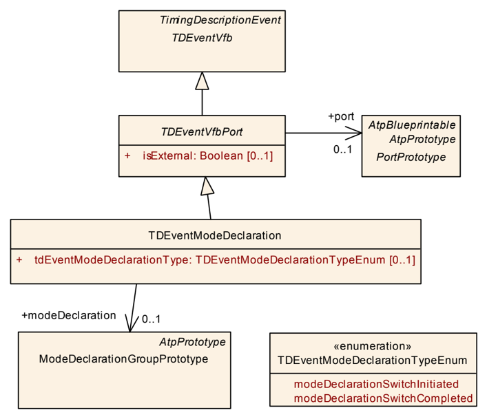

表3.21：TDEventModeDeclaration（**TDEventModeDeclaration**）

| 属性 | 值 |
| --- | --- |
| 类 | TDEventModeDeclaration |
| 包 | M2::AUTOSARTemplates::CommonStructure::Timing::TimingDescription::TimingDescriptionEvents::TDEventVfb |
| 说明 | 用于描述与 **VFB** 层级模式切换通信相关的时序事件。 |
| 基类 | ARObject、Identifiable、MultilanguageReferrable、Referrable、TDEventVfb、TDEventVfbPort、TimingDescription、TimingDescriptionEvent |
| 聚合于 | TimingExtension.timingDescription |

| 属性 | 类型 | 多重性 | 种类 | 备注 |
| --- | --- | --- | --- | --- |
| entryModeDeclaration | ModeDeclaration | 0..1 | ref | 细化 TDEventModeDeclaration 作用范围的可选参数。若设置了该参数，则仅当模式声明组原型实例应进入被引用的 ModeDeclaration 时事件才发生。 |
| exitModeDeclaration | ModeDeclaration | 0..1 | ref | 细化 TDEventModeDeclaration 作用范围的可选参数。若设置了该参数，则仅当模式声明组原型实例应退出被引用的 ModeDeclaration 时事件才发生。 |
| modeDeclaration | ModeDeclarationGroupPrototype | 0..1 | ref | 被引用的模式声明组原型。 |
| tdEventModeDeclarationType | TDEventModeDeclarationTypeEnum | 0..1 | attr | 该时序事件的特定类型。 |

**约束：TDEventModeDeclaration.tdEventModeDeclarationType 的存在性**：对于每个 TDEventModeDeclaration，在 **VFB** 时序描述完成时，属性 tdEventModeDeclarationType 必须存在。

**约束：TDEventModeDeclaration.modeDeclaration 的存在性**：对于每个 TDEventModeDeclaration，在 **VFB** 时序描述完成时，角色 modeDeclaration 中对 ModeDeclarationGroupPrototype 的引用必须存在。

表3.22：TDEventModeDeclarationTypeEnum（**TDEventModeDeclarationTypeEnum**）

| 属性 | 值 |
| --- | --- |
| 枚举 | TDEventModeDeclarationTypeEnum |
| 包 | M2::AUTOSARTemplates::CommonStructure::Timing::TimingDescription::TimingDescriptionEvents::TDEventVfb |
| 说明 | 用于描述 TDEventModeDeclaration 的特定事件类型。 |
| 聚合于 | TDEventModeDeclaration.tdEventModeDeclarationType |

| 字面量 | 说明 |
| --- | --- |
| modeDeclarationSwitchCompleted | 到关联的 ModeDeclarationGroupPrototype 的切换已完成的时间点。标签：atp.EnumerationLiteralIndex=0 |
| modeDeclarationSwitchInitiated | 到关联的 ModeDeclarationGroupPrototype 的切换已发起的时间点。标签：atp.EnumerationLiteralIndex=1 |

###### 3.3.2.1.2.4. TDEventTrigger（**TDEventTrigger**）

**TDEventTrigger 规定在触发端口处可观察到的事件（**specifies events observable at trigger ports**）**：元素 TDEventTrigger 用于规定在需求端和提供端触发端口处可观察到的事件，即触发的激活和释放。

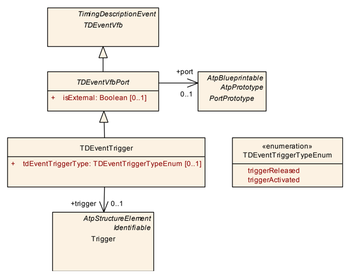

表3.23：TDEventTrigger（**TDEventTrigger**）

| 属性 | 值 |
| --- | --- |
| 类 | TDEventTrigger |
| 包 | M2::AUTOSARTemplates::CommonStructure::Timing::TimingDescription::TimingDescriptionEvents::TDEventVfb |
| 说明 | 用于描述与 **VFB** 层级触发相关的时序事件。 |
| 基类 | ARObject、Identifiable、MultilanguageReferrable、Referrable、TDEventVfb、TDEventVfbPort、TimingDescription、TimingDescriptionEvent |
| 聚合于 | TimingExtension.timingDescription |

| 属性 | 类型 | 多重性 | 种类 | 备注 |
| --- | --- | --- | --- | --- |
| tdEventTriggerType | TDEventTriggerTypeEnum | 0..1 | attr | 该时序事件的特定类型。 |
| trigger | Trigger | 0..1 | ref | 在给定上下文中被提供（释放）或被需求（激活）的触发。 |

**约束：TDEventTrigger.tdEventTriggerType 的存在性**：对于每个 TDEventTrigger，在 **VFB** 时序描述完成时，属性 tdEventTriggerType 必须存在。

**约束：TDEventTrigger.trigger 的存在性**：对于每个 TDEventTrigger，在 **VFB** 时序描述完成时，角色 trigger 中对 Trigger 的引用必须存在。

表3.24：TDEventTriggerTypeEnum（**TDEventTriggerTypeEnum**）

| 属性 | 值 |
| --- | --- |
| 枚举 | TDEventTriggerTypeEnum |
| 包 | M2::AUTOSARTemplates::CommonStructure::Timing::TimingDescription::TimingDescriptionEvents::TDEventVfb |
| 说明 | 用于描述 TDEventTrigger 的特定事件类型。 |
| 聚合于 | TDEventTrigger.tdEventTriggerType |

| 字面量 | 说明 |
| --- | --- |
| triggerActivated | 被引用的触发已成功释放、并正在激活接收方 **SW-C** 的可执行实体的时间点。标签：atp.EnumerationLiteralIndex=0 |
| triggerReleased | 被引用的触发已由发出方 **SW-C** 成功释放的时间点。标签：atp.EnumerationLiteralIndex=1 |

###### 3.3.2.1.2.5. 蓝图化 TDEventVfbPort（**Blueprinting TDEventVfbPort**）

蓝图化 VfbTiming 的主要目的是与「**AUTOSAR** 应用接口（**AUTOSAR Application Interface**）」[\[5\]](#ref-5) 一起使用。在「**AUTOSAR** 应用接口」的蓝图中，可以将 TimingConstraint 应用于 TDEventVfb，为被蓝图化的 PortPrototype 标注一个高层时序目标。引用 portPrototypeBlueprint 指向一个 PortPrototypeBlueprint，它有效地包装了在 **AUTOSAR** 蓝图上下文中使用的 PortPrototype，但如「蓝图化 PortPrototype（**Blueprinting PortPrototype**）」[\[3\]](#ref-3) 所解释的，允许超出 PortPrototype 的某些额外方面。

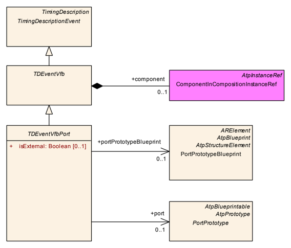

**约束：TDEventVfbPort.portPrototypeBlueprint 的存在性**：仅当直接父级满足 ARPackage.category == BLUEPRINT 时，引用 TDEventVfbPort.portPrototypeBlueprint 才应存在，在 **VFB** 时序描述完成时。

**约束：TDEventVfb.port 与 TDEventVfb.portPrototypeBlueprint 的双重存在**：引用 TDEventVfbPort.port 与 TDEventVfbPort.portPrototypeBlueprint 在模型中不得共存，在 **VFB** 时序描述完成时。

##### 3.3.2.2. TDEventSwc（**TDEventSwc**）

**TDEventSwc 的目的（**Purpose of TDEventSwc**）**：元素 TDEventSwc 用于规定在软件组件视图中可观察到的事件，即可执行实体的激活、启动和终止，以及变量访问。

表3.25：TDEventSwc（**TDEventSwc**）

| 属性 | 值 |
| --- | --- |
| 类 | TDEventSwc（抽象） |
| 包 | M2::AUTOSARTemplates::CommonStructure::Timing::TimingDescription::TimingDescriptionEvents::TDEventSwcInternalBehavior |
| 说明 | 这是用于描述软件组件（**SW-C**）层级时序事件的抽象父类。 |
| 基类 | ARObject、Identifiable、MultilanguageReferrable、Referrable、TimingDescription、TimingDescriptionEvent |
| 子类 | TDEventSwcInternalBehavior、TDEventSwcInternalBehaviorReference |
| 聚合于 | TimingExtension.timingDescription |

| 属性 | 类型 | 多重性 | 种类 | 备注 |
| --- | --- | --- | --- | --- |
| component | SwComponentPrototype | 0..1 | iref | 该时序事件作用范围的上下文。InstanceRef 由 ComponentInCompositionInstanceRef 实现。 |

###### 3.3.2.2.1. TDEventSwcInternalBehavior（**TDEventSwcInternalBehavior**）

**TDEventSwcInternalBehavior 规定可执行实体的可观察事件（**specifies observable events of runnable entities**）**：元素 TDEventSwcInternalBehavior 用于规定在软件组件视图中可观察到的事件，即可执行实体的激活、启动和终止，以及变量访问。

与 SwcInternalBehavior 相关的事件可用于以下内容的规范中：

- SwcTiming（3.1.2）
- SystemTiming（3.1.3）
- EcuTiming（3.1.5）

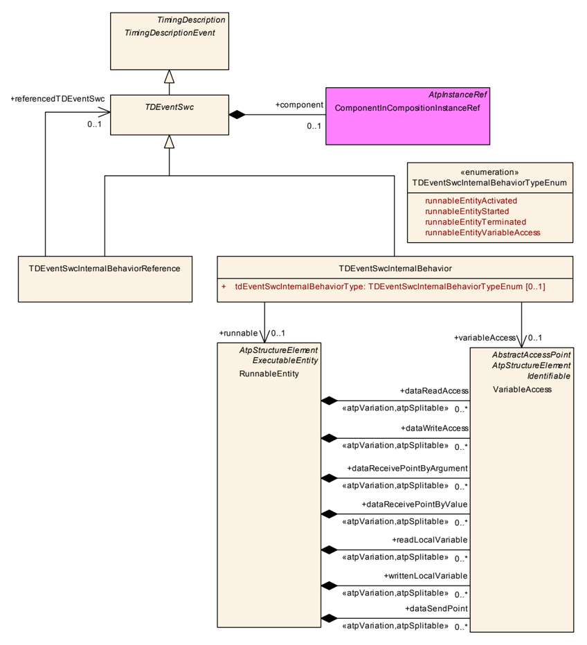

表3.26：TDEventSwcInternalBehavior（**TDEventSwcInternalBehavior**）

| 属性 | 值 |
| --- | --- |
| 类 | TDEventSwcInternalBehavior |
| 包 | M2::AUTOSARTemplates::CommonStructure::Timing::TimingDescription::TimingDescriptionEvents::TDEventSwcInternalBehavior |
| 说明 | 用于描述与 AtomicSwComponentType 的 SwcInternalBehavior 相关的时序事件。 |
| 基类 | ARObject、Identifiable、MultilanguageReferrable、Referrable、TDEventSwc、TimingDescription、TimingDescriptionEvent |
| 聚合于 | TimingExtension.timingDescription |

| 属性 | 类型 | 多重性 | 种类 | 备注 |
| --- | --- | --- | --- | --- |
| runnable | RunnableEntity | 0..1 | ref | 该时序事件的作用范围。 |
| tdEventSwcInternalBehaviorType | TDEventSwcInternalBehaviorTypeEnum | 0..1 | attr | 该时序事件的特定类型。 |
| variableAccess | VariableAccess | 0..1 | ref | 该时序事件的作用范围。 |

**约束：TDEventSwcInternalBehavior.tdEventSwcInternalBehaviorType 的存在性**：对于每个 TDEventSwcInternalBehavior，在 **SWC** 时序描述完成时，属性 tdEventSwcInternalBehaviorType 必须存在。

**约束：TDEventSwcInternalBehavior.runnable 的存在性**：对于每个 TDEventSwcInternalBehavior，在 **SWC** 时序描述完成时，角色 runnable 中对 RunnableEntity 的引用必须存在。

表3.27：TDEventSwcInternalBehaviorTypeEnum（**TDEventSwcInternalBehaviorTypeEnum**）

| 属性 | 值 |
| --- | --- |
| 枚举 | TDEventSwcInternalBehaviorTypeEnum |
| 包 | M2::AUTOSARTemplates::CommonStructure::Timing::TimingDescription::TimingDescriptionEvents::TDEventSwcInternalBehavior |
| 说明 | 用于描述 TDEventSwcInternalBehavior 的特定事件类型。 |
| 聚合于 | TDEventSwcInternalBehavior.tdEventSwcInternalBehaviorType |

| 字面量 | 说明 |
| --- | --- |
| runnableEntityActivated | 关联的 RunnableEntity 已被激活、即已进入「待启动（**to be started**）」状态的时间点。标签：atp.EnumerationLiteralIndex=0 |
| runnableEntityStarted | 关联的 RunnableEntity 在激活之后已进入「已启动（**started**）」状态的时间点。标签：atp.EnumerationLiteralIndex=1 |
| runnableEntityTerminated | 关联的 RunnableEntity 已终止并进入「挂起（**suspended**）」状态的时间点。标签：atp.EnumerationLiteralIndex=2 |
| runnableEntityVariableAccess | 关联的变量被访问的时间点。标签：atp.EnumerationLiteralIndex=3 |

**约束：RunnableEntity 与 VariableAccess 引用的规定**：当且仅当 tdEventSwcInternalBehaviorType 的取值为 runnableEntityVariableAccess 时，才应同时引用一个 RunnableEntity 和一个 VariableAccess。这两个引用并不互斥。

**约束：引用 RunnableEntity 的有效性**：当且仅当 tdEventSwcInternalBehaviorType 的取值为以下之一时，才应引用一个 RunnableEntity：

- runnableEntityActivated
- runnableEntityStarted
- runnableEntityTerminated
- runnableEntityVariableAccess

**约束：引用 VariableAccess 的有效性**：当且仅当 tdEventSwcInternalBehaviorType 的取值为 runnableEntityVariableAccess 时，才应引用一个 VariableAccess。

**TDEventSwcInternalBehaviorReference 的目的（**Purpose of TDEventSwcInternalBehaviorReference**）**：元素 TDEventSwcInternalBehaviorReference 用于引用已经在其他时序视图中规定的 TimingDescriptionEvent。换言之，它使得可以复用既有的时序模型。

表3.28：TDEventSwcInternalBehaviorReference（**TDEventSwcInternalBehaviorReference**）

| 属性 | 值 |
| --- | --- |
| 类 | TDEventSwcInternalBehaviorReference |
| 包 | M2::AUTOSARTemplates::CommonStructure::Timing::TimingDescription::TimingDescriptionEvents::TDEventSwcInternalBehavior |
| 说明 | 用于引用与软件组件（**SW-C**）视图相关、在其他时序视图中规定的时序描述事件。 |
| 基类 | ARObject、Identifiable、MultilanguageReferrable、Referrable、TDEventSwc、TimingDescription、TimingDescriptionEvent |
| 聚合于 | TimingExtension.timingDescription |

| 属性 | 类型 | 多重性 | 种类 | 备注 |
| --- | --- | --- | --- | --- |
| referencedTDEventSwc | TDEventSwc | 0..1 | ref | 被引用的时序描述事件。 |

**约束：TDEventSwcInternalBehaviorReference.referencedTDEventSwc 的存在性**：对于每个 TDEventSwcInternalBehaviorReference，在 **SWC** 时序描述完成时，角色 referencedTDEventSwc 中对 TDEventSwc 的引用必须存在。

##### 3.3.2.3. TDEventCom（**TDEventCom**）

**TDEventCom 的目的（**Purpose of TDEventCom**）**：元素 TDEventCom 及其特化用于描述在系统视图中特定位置观察到的事件的发生，特别是与通信相关的任何事件。

与通信相关的事件可用于以下内容的规范中：

- SystemTiming（3.1.2）
- EcuTiming（3.1.5）

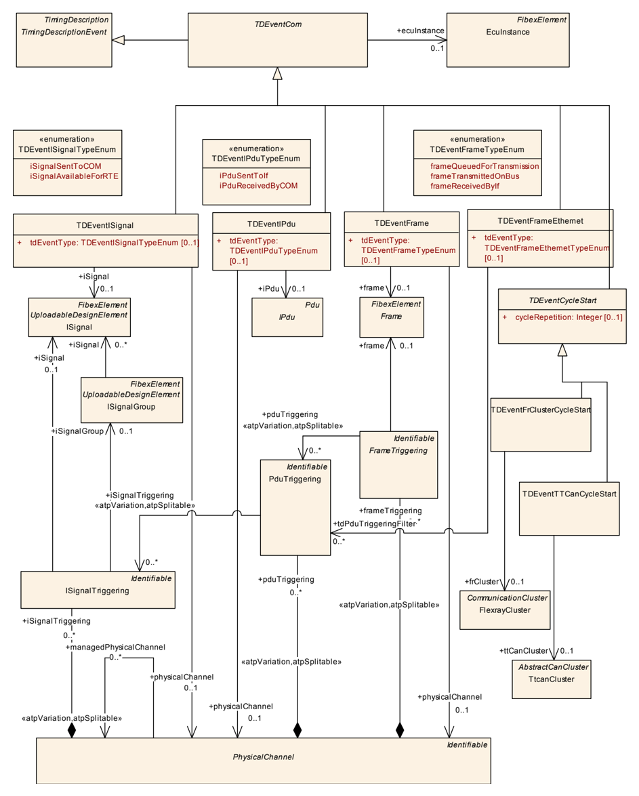

表3.29：TDEventCom（**TDEventCom**）

| 属性 | 值 |
| --- | --- |
| 类 | TDEventCom（抽象） |
| 包 | M2::AUTOSARTemplates::CommonStructure::Timing::TimingDescription::TimingDescriptionEvents::TDEventCom |
| 说明 | 这是用于描述与通信（包括物理层）相关的时序事件的抽象父类。 |
| 基类 | ARObject、Identifiable、MultilanguageReferrable、Referrable、TimingDescription、TimingDescriptionEvent |
| 子类 | TDEventCycleStart、TDEventFrame、TDEventFrameEthernet、TDEventIPdu、TDEventISignal |
| 聚合于 | TimingExtension.timingDescription |

| 属性 | 类型 | 多重性 | 种类 | 备注 |
| --- | --- | --- | --- | --- |
| ecuInstance | EcuInstance | 0..1 | ref | 特定时序事件的 **ECU** 上下文。该链接是可选的，因为对于类型为 TDEventCycleStart 的事件无法定义 EcuInstance。 |


###### 3.3.2.3.1. TDEventISignal（**TDEventISignal**）

**TDEventISignal 规定与 I-Signal 交换相关的事件（**specifies events related to the exchange of I-Signals**）**：元素 TDEventISignal 用于规定在 **RTE** 与 **AUTOSAR** Com 之间可观察到的事件，即 I-Signal 的交换。

表3.30：TDEventISignal（**TDEventISignal**）

| 属性 | 值 |
| --- | --- |
| 类 | TDEventISignal |
| 包 | M2::AUTOSARTemplates::CommonStructure::Timing::TimingDescription::TimingDescriptionEvents::TDEventCom |
| 说明 | 用于描述与 **COM** 和 **RTE** 之间 I-Signal 交换相关的时序事件。 |
| 基类 | ARObject、Identifiable、MultilanguageReferrable、Referrable、TDEventCom、TimingDescription、TimingDescriptionEvent |
| 聚合于 | TimingExtension.timingDescription |

| 属性 | 类型 | 多重性 | 种类 | 备注 |
| --- | --- | --- | --- | --- |
| iSignal | ISignal | 0..1 | ref | 该时序事件的作用范围。 |
| physicalChannel | PhysicalChannel | 0..1 | ref | 传输该 ISignal 的 PhysicalChannel。 |
| tdEventType | TDEventISignalTypeEnum | 0..1 | attr | 该时序事件的特定类型。 |

**约束：TDEventISignal 中 ISignal 的亲和性**：在 **ECU** 时序描述完成时，角色 TDEventISignal.iSignal 中被引用的 ISignal 也应存在于 TDEventISignal.physicalChannel.iSignalTriggering 所聚合的 iSignal 列表中。

**约束：TDEventISignal.tdEventType 的存在性**：对于每个 TDEventISignal，在 **ECU** 时序描述完成时，属性 tdEventType 必须存在。

**约束：TDEventISignal.iSignal 的存在性**：对于每个 TDEventISignal，在 **ECU** 时序描述完成时，角色 iSignal 中对 ISignal 的引用必须存在。

**约束：TDEventISignal.physicalChannel 的存在性**：对于每个 TDEventISignal，在 **ECU** 时序描述完成时，角色 physicalChannel 中对 PhysicalChannel 的引用必须存在。

表3.31：TDEventISignalTypeEnum（**TDEventISignalTypeEnum**）

| 属性 | 值 |
| --- | --- |
| 枚举 | TDEventISignalTypeEnum |
| 包 | M2::AUTOSARTemplates::CommonStructure::Timing::TimingDescription::TimingDescriptionEvents::TDEventCom |
| 说明 | 用于描述 TDEventISignal 的特定事件类型。 |
| 聚合于 | TDEventISignal.tdEventType |

| 字面量 | 说明 |
| --- | --- |
| iSignalAvailableForRTE | **COM** 模块使所包含的信号/信号组对 **RTE** 可用、并生成相应的 Rx Indication callout（若已配置）的时间点。标签：atp.EnumerationLiteralIndex=0 |
| iSignalSentToCOM | **RTE** 对一个命名的 **COM** 信号/信号组发出传输请求调用、且新取值被存入承载它的 **COM** I-PDU 缓冲区的时间点。标签：atp.EnumerationLiteralIndex=1 |

###### 3.3.2.3.2. TDEventIPdu（**TDEventIPdu**）

**TDEventIPdu 规定与 I-PDU 交换相关的事件（**specifies events related to the exchange of I-PDUs**）**：元素 TDEventIPdu 用于规定在总线特定的 **BSW** 模块（**CAN**、**FlexRay**、**LIN**）与 **AUTOSAR** Com 之间可观察到的事件，即 I-PDU 的交换。

表3.32：TDEventIPdu（**TDEventIPdu**）

| 属性 | 值 |
| --- | --- |
| 类 | TDEventIPdu |
| 包 | M2::AUTOSARTemplates::CommonStructure::Timing::TimingDescription::TimingDescriptionEvents::TDEventCom |
| 说明 | 用于描述与总线特定的（**FlexRay** / **CAN** / **LIN**）接口 **BSW** 模块和 **COM** 之间 I-PDU 交换相关的时序事件。 |
| 基类 | ARObject、Identifiable、MultilanguageReferrable、Referrable、TDEventCom、TimingDescription、TimingDescriptionEvent |
| 聚合于 | TimingExtension.timingDescription |

| 属性 | 类型 | 多重性 | 种类 | 备注 |
| --- | --- | --- | --- | --- |
| iPdu | IPdu | 0..1 | ref | 该时序事件的作用范围。 |
| physicalChannel | PhysicalChannel | 0..1 | ref | 传输该 IPdu 的 PhysicalChannel。 |
| tdEventType | TDEventIPduTypeEnum | 0..1 | attr | 该时序事件的特定类型。 |

**约束：TDEventIPdu 中 IPdu 的亲和性**：在 **ECU** 时序描述完成时，角色 TDEventIPdu.iPdu 中被引用的 IPdu 也应存在于 TDEventIPdu.physicalChannel.pduTriggering 所聚合的 iPdu 列表中。

**约束：TDEventIPdu.tdEventType 的存在性**：对于每个 TDEventIPdu，在 **ECU** 时序描述完成时，属性 tdEventType 必须存在。

**约束：TDEventIPdu.iPdu 的存在性**：对于每个 TDEventIPdu，在 **ECU** 时序描述完成时，角色 iPdu 中对 IPdu 的引用必须存在。

**约束：TDEventIPdu.physicalChannel 的存在性**：对于每个 TDEventIPdu，在 **ECU** 时序描述完成时，角色 physicalChannel 中对 PhysicalChannel 的引用必须存在。

表3.33：TDEventIPduTypeEnum（**TDEventIPduTypeEnum**）

| 属性 | 值 |
| --- | --- |
| 枚举 | TDEventIPduTypeEnum |
| 包 | M2::AUTOSARTemplates::CommonStructure::Timing::TimingDescription::TimingDescriptionEvents::TDEventCom |
| 说明 | 用于描述 TDEventIPdu 的特定事件类型。 |
| 聚合于 | TDEventIPdu.tdEventType |

| 字面量 | 说明 |
| --- | --- |
| iPduReceivedByCOM | 接收到的帧被相应的（**FlexRay** / **CAN** / **LIN**）接口 **BSW** 模块处理、经 **PDUR** 路由、且所包含的 **PDU** 被推送到 **COM** 模块的时间点。标签：atp.EnumerationLiteralIndex=0 |
| iPduSentToIf | 承载它的 **COM** I-PDU 经 **PDUR** 路由、并被推送到总线特定的（**FlexRay** / **CAN** / **LIN**）接口 **BSW** 模块的时间点。标签：atp.EnumerationLiteralIndex=1 |

###### 3.3.2.3.3. TDEventFrame（**TDEventFrame**）

**TDEventFrame 规定与网络帧交换相关的事件（**specifies events related to the exchange of network frames**）**：元素 TDEventFrame 用于规定在通信控制器与总线特定的 **BSW** 模块（**CAN**、**FlexRay**、**LIN**）之间可观察到、且在物理层可观察到的事件，即帧（**Frame**）的交换。

表3.34：TDEventFrame（**TDEventFrame**）

| 属性 | 值 |
| --- | --- |
| 类 | TDEventFrame |
| 包 | M2::AUTOSARTemplates::CommonStructure::Timing::TimingDescription::TimingDescriptionEvents::TDEventCom |
| 说明 | 用于描述与通信控制器和总线特定的（**FlexRay** / **CAN** / **LIN**）接口 **BSW** 模块之间帧交换相关的时序事件。 |
| 基类 | ARObject、Identifiable、MultilanguageReferrable、Referrable、TDEventCom、TimingDescription、TimingDescriptionEvent |
| 聚合于 | TimingExtension.timingDescription |

| 属性 | 类型 | 多重性 | 种类 | 备注 |
| --- | --- | --- | --- | --- |
| frame | Frame | 0..1 | ref | 该时序事件的作用范围。 |
| physicalChannel | PhysicalChannel | 0..1 | ref | 传输该 Frame 的 PhysicalChannel。 |
| tdEventType | TDEventFrameTypeEnum | 0..1 | attr | 该时序事件的特定类型。 |

**约束：TDEventFrame 中 Frame 的亲和性**：在 **ECU** 时序描述完成时，角色 TDEventFrame.frame 中被引用的 Frame 也应存在于 TDEventFrame.physicalChannel.frameTriggering 所聚合的 frame 列表中。

**约束：TDEventFrame.tdEventType 的存在性**：对于每个 TDEventFrame，在 **ECU** 时序描述完成时，属性 tdEventType 必须存在。

**约束：TDEventFrame.frame 的存在性**：对于每个 TDEventFrame，在 **ECU** 时序描述完成时，角色 frame 中对 Frame 的引用必须存在。

**约束：TDEventFrame.physicalChannel 的存在性**：对于每个 TDEventFrame，在 **ECU** 时序描述完成时，角色 physicalChannel 中对 PhysicalChannel 的引用必须存在。

表3.35：TDEventFrameTypeEnum（**TDEventFrameTypeEnum**）

| 属性 | 值 |
| --- | --- |
| 枚举 | TDEventFrameTypeEnum |
| 包 | M2::AUTOSARTemplates::CommonStructure::Timing::TimingDescription::TimingDescriptionEvents::TDEventCom |
| 说明 | 用于描述 TDEventFrame 的特定事件类型。 |
| 聚合于 | TDEventFrame.tdEventType |

| 字面量 | 说明 |
| --- | --- |
| frameQueuedForTransmission | 包含命名信号/I-PDU 的帧在相关通信驱动程序中被排队等待传输的时间点。标签：atp.EnumerationLiteralIndex=0 |
| frameReceivedByIf | 帧从订阅方的通信控制器被推送到相应的（**FlexRay** / **CAN** / **LIN**）接口 **BSW** 模块的时间点。标签：atp.EnumerationLiteralIndex=1 |
| frameTransmittedOnBus | 帧的传输成功完成、且订阅方的通信控制器从总线接收到该帧的时间点。标签：atp.EnumerationLiteralIndex=2 |

###### 3.3.2.3.4. TDEventComEthernet（**TDEventComEthernet**）

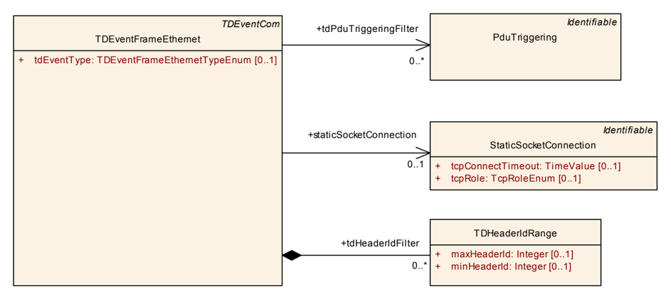

**TDEventFrameEthernet 规定与以太网帧交换相关的事件（**specifies events related to the exchange of Ethernet frames**）**：元素 TDEventFrameEthernet 用于规定在以太网通信控制器与以太网特定的 **BSW** 模块之间可观察到、且在物理层可观察到的事件，即以太网帧的交换。

表3.36：TDEventFrameEthernet（**TDEventFrameEthernet**）

| 属性 | 值 |
| --- | --- |
| 类 | TDEventFrameEthernet |
| 包 | M2::AUTOSARTemplates::CommonStructure::Timing::TimingDescription::TimingDescriptionEvents::TDEventCom |
| 说明 | 用于描述与以太网通信控制器和 **BSW** 以太网接口及驱动程序模块之间以太网帧交换相关的时序描述事件。 |
| 基类 | ARObject、Identifiable、MultilanguageReferrable、Referrable、TDEventCom、TimingDescription、TimingDescriptionEvent |
| 聚合于 | TimingExtension.timingDescription |

| 属性 | 类型 | 多重性 | 种类 | 备注 |
| --- | --- | --- | --- | --- |
| staticSocketConnection | StaticSocketConnection | 0..1 | ref | 规定在以太网帧内传输或接收物理数据单元（**PDU**）所经由的 SocketConnection。 |
| tdEventType | TDEventFrameEthernetTypeEnum | 0..1 | attr | 用于描述 TDEventFrameEthernet 的特定事件类型。 |
| tdHeaderIdFilter | TDHeaderIdRange | * | aggr | 规定包头标识符或包头标识符范围：若其包含在以太网帧中，则使 TDEventFrameEthernet 发生。 |
| tdPduTriggeringFilter | PduTriggering | * | ref | 规定 PDU：若其包含在以太网帧中，则使 TDEventFrameEthernet 发生。 |

**约束：TDEventFrameEthernet.tdEventType 的存在性**：对于每个 TDEventFrameEthernet，在 **ECU** 时序描述完成时，属性 tdEventType 必须存在。

表3.37：TDEventFrameEthernetTypeEnum（**TDEventFrameEthernetTypeEnum**）

| 属性 | 值 |
| --- | --- |
| 枚举 | TDEventFrameEthernetTypeEnum |
| 包 | M2::AUTOSARTemplates::CommonStructure::Timing::TimingDescription::TimingDescriptionEvents::TDEventCom |
| 说明 | 用于描述 TDEventFrameEthernet 的特定事件类型。 |
| 聚合于 | TDEventFrameEthernet.tdEventType |

| 字面量 | 说明 |
| --- | --- |
| frameEthernetQueuedForTransmission | 包含规定 **PDU** 的以太网帧在相应的以太网通信驱动程序中被排队等待传输的时间点。标签：atp.EnumerationLiteralIndex=0 |
| frameEthernetReceivedByIf | 帧从相应的以太网通信控制器被推送到 **BSW** 以太网通信接口的时间点。标签：atp.EnumerationLiteralIndex=1 |
| frameEthernetReceivedOnBus | 以太网帧/报文在接收方的以太网通信控制器上成功完成接收的时间点。换言之，以太网帧/报文已进入接收方的以太网通信控制器，即以太网帧/报文的最后一个比特已被接收。标签：atp.EnumerationLiteralIndex=2 |
| frameEthernetSentOnBus | 以太网帧/报文在物理以太网通信网络上成功完成传输的时间点。换言之，以太网帧/报文已离开发送方的以太网通信控制器，即以太网帧/报文的最后一个比特已被发送。标签：atp.EnumerationLiteralIndex=3 |

表3.38：TDHeaderIdRange（**TDHeaderIdRange**）

| 属性 | 值 |
| --- | --- |
| 类 | TDHeaderIdRange |
| 包 | M2::AUTOSARTemplates::CommonStructure::Timing::TimingDescription::TimingDescriptionEvents::TDEventCom |
| 说明 | 规定 **PDU** 头标识符的范围。该范围由一个最小头标识符和一个最大头标识符规定；最大头标识符应大于或等于最小头标识符。 |
| 基类 | ARObject |
| 聚合于 | TDEventFrameEthernet.tdHeaderIdFilter |

| 属性 | 类型 | 多重性 | 种类 | 备注 |
| --- | --- | --- | --- | --- |
| maxHeaderId | Integer | 0..1 | attr | 规定最大 **PDU** 头标识符，即 **PDU** 头标识符范围的上界。 |
| minHeaderId | Integer | 0..1 | attr | 规定最小 **PDU** 头标识符，即 **PDU** 头标识符范围的下界。 |

**约束：TDHeaderIdRange.maxHeaderId 的存在性**：对于每个 TDHeaderIdRange，在 **ECU** 时序描述完成时，属性 maxHeaderId 必须存在。

**约束：TDHeaderIdRange.minHeaderId 的存在性**：对于每个 TDHeaderIdRange，在 **ECU** 时序描述完成时，属性 minHeaderId 必须存在。

###### 3.3.2.3.5. TDEventCycleStart（**TDEventCycleStart**）

**约束：TDEventCycleStart.cycleRepetition 的存在性**：对于每个 TDEventCycleStart，在 **ECU** 时序描述完成时，属性 cycleRepetition 必须存在。

表3.39：TDEventCycleStart（**TDEventCycleStart**）

| 属性 | 值 |
| --- | --- |
| 类 | TDEventCycleStart（抽象） |
| 包 | M2::AUTOSARTemplates::CommonStructure::Timing::TimingDescription::TimingDescriptionEvents::TDEventCom |
| 说明 | 这是用于描述与通信周期开始的时间点相关的时序事件的抽象父类。经由属性 cycleRepetition，可以定义对周期开始的过滤视图。 |
| 基类 | ARObject、Identifiable、MultilanguageReferrable、Referrable、TDEventCom、TimingDescription、TimingDescriptionEvent |
| 子类 | TDEventFrClusterCycleStart、TDEventTTCanCycleStart |
| 聚合于 | TimingExtension.timingDescription |

| 属性 | 类型 | 多重性 | 种类 | 备注 |
| --- | --- | --- | --- | --- |
| cycleRepetition | Integer | 0..1 | attr | 该事件以每个第 &lt;cycleRepetition&gt; 个周期的开始为目标。 |

###### 3.3.2.3.5.1. TDEventFrClusterCycleStart（**TDEventFrClusterCycleStart**）

**TDEventFrClusterCycleStart 规定与 **FlexRay** 通信周期开始相关的事件（**specifies the event related to the start of a FlexRay communication cycle**）**：元素 TDEventFrClusterCycleStart 用于规定在 **FlexRay** 总线物理层可观察到的事件，即通信周期的开始。

表3.40：TDEventFrClusterCycleStart（**TDEventFrClusterCycleStart**）

| 属性 | 值 |
| --- | --- |
| 类 | TDEventFrClusterCycleStart |
| 包 | M2::AUTOSARTemplates::CommonStructure::Timing::TimingDescription::TimingDescriptionEvents::TDEventCom |
| 说明 | 用于描述与 **FlexRay** 集群上通信周期开始的时间点相关的时序事件。 |
| 基类 | ARObject、Identifiable、MultilanguageReferrable、Referrable、TDEventCom、TDEventCycleStart、TimingDescription、TimingDescriptionEvent |
| 聚合于 | TimingExtension.timingDescription |

| 属性 | 类型 | 多重性 | 种类 | 备注 |
| --- | --- | --- | --- | --- |
| frCluster | FlexrayCluster | 0..1 | ref | 该时序事件的作用范围。 |

**约束：TDEventFrClusterCycleStart.frCluster 的存在性**：对于每个 TDEventFrClusterCycleStart，在 **ECU** 时序描述完成时，属性 frCluster 必须存在。

###### 3.3.2.3.5.2. TDEventTTCanCycleStart（**TDEventTTCanCycleStart**）

**TDEventTTCanCycleStart 规定与 **TTCAN** 通信周期开始相关的事件（**specifies the event related to the start of a TTCAN communication cycle**）**：元素 TDEventTTCanCycleStart 用于规定在 **TTCAN** 总线物理层可观察到的事件，即通信周期的开始。

表3.41：TDEventTTCanCycleStart（**TDEventTTCanCycleStart**）

| 属性 | 值 |
| --- | --- |
| 类 | TDEventTTCanCycleStart |
| 包 | M2::AUTOSARTemplates::CommonStructure::Timing::TimingDescription::TimingDescriptionEvents::TDEventCom |
| 说明 | 用于描述与 **TTCAN** 集群上通信周期开始的时间点相关的时序事件。 |
| 基类 | ARObject、Identifiable、MultilanguageReferrable、Referrable、TDEventCom、TDEventCycleStart、TimingDescription、TimingDescriptionEvent |
| 聚合于 | TimingExtension.timingDescription |

| 属性 | 类型 | 多重性 | 种类 | 备注 |
| --- | --- | --- | --- | --- |
| ttCanCluster | TtcanCluster | 0..1 | ref | 该时序事件的作用范围。 |

**约束：TDEventTTCanCycleStart.ttCanCluster 的存在性**：对于每个 TDEventTTCanCycleStart，在 **ECU** 时序描述完成时，属性 ttCanCluster 必须存在。

##### 3.3.2.4. TDEventBswInternalBehavior（**TDEventBswInternalBehavior**）

**TDEventBswInternalBehavior 规定 **BSW** 模块实体的可观察事件（**specifies observable events of BSW module entities**）**：元素 TDEventBswInternalBehavior 用于规定在基础软件模块视图中可观察到的事件，即 **BSW** 模块实体的激活、启动和终止。

与 **BSW** 相关的事件可用于以下内容的规范中：

- BswModuleTiming（3.1.4.1）
- EcuTiming（3.1.5）

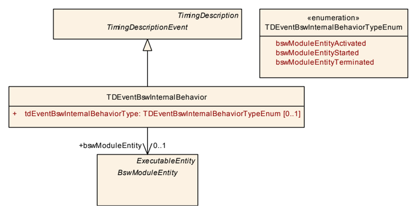

表3.42：TDEventBswInternalBehavior（**TDEventBswInternalBehavior**）

| 属性 | 值 |
| --- | --- |
| 类 | TDEventBswInternalBehavior |
| 包 | M2::AUTOSARTemplates::CommonStructure::Timing::TimingDescription::TimingDescriptionEvents::TDEventBswInternalBehavior |
| 说明 | 用于描述与 **BSW** 模块的 BswInternalBehavior 相关的时序事件。 |
| 基类 | ARObject、Identifiable、MultilanguageReferrable、Referrable、TimingDescription、TimingDescriptionEvent |
| 聚合于 | TimingExtension.timingDescription |

| 属性 | 类型 | 多重性 | 种类 | 备注 |
| --- | --- | --- | --- | --- |
| bswModuleEntity | BswModuleEntity | 0..1 | ref | 该时序事件的作用范围。 |
| tdEventBswInternalBehaviorType | TDEventBswInternalBehaviorTypeEnum | 0..1 | attr | 该时序事件的特定类型。 |

**约束：TDEventBswInternalBehavior.tdEventBswInternalBehaviorType 的存在性**：对于每个 TDEventBswInternalBehavior，在 **BSW** 时序描述完成时，属性 tdEventBswInternalBehaviorType 必须存在。

**约束：TDEventBswInternalBehavior.bswModuleEntity 的存在性**：对于每个 TDEventBswInternalBehavior，在 **BSW** 时序描述完成时，角色 bswModuleEntity 中对 BswModuleEntity 的引用必须存在。

请注意：对于每个 TDEventBswInternalBehavior，其作用范围由 bswModuleEntity 引用定义。它指向可以观察到该事件的 **BSW** 模块实体。这一作用范围定义假设每个 **BSW** 模块在每个 **ECU** 上只存在一次。否则，该作用范围将不够精确，因为每个模块实例都会带来相同的 **BSW** 模块实体。

表3.43：TDEventBswInternalBehaviorTypeEnum（**TDEventBswInternalBehaviorTypeEnum**）

| 属性 | 值 |
| --- | --- |
| 枚举 | TDEventBswInternalBehaviorTypeEnum |
| 包 | M2::AUTOSARTemplates::CommonStructure::Timing::TimingDescription::TimingDescriptionEvents::TDEventBswInternalBehavior |
| 说明 | 用于描述 TDEventBswInternalBehavior 的特定事件类型。 |
| 聚合于 | TDEventBswInternalBehavior.tdEventBswInternalBehaviorType |

| 字面量 | 说明 |
| --- | --- |
| bswModuleEntityActivated | 关联的 BswModuleEntity 已被激活、即已进入「待启动（**to be started**）」状态的时间点。标签：atp.EnumerationLiteralIndex=0 |
| bswModuleEntityStarted | 关联的 BswModuleEntity 在激活之后已进入「已启动（**started**）」状态的时间点。标签：atp.EnumerationLiteralIndex=1 |
| bswModuleEntityTerminated | 关联的 BswModuleEntity 已终止并进入「挂起（**suspended**）」状态的时间点。标签：atp.EnumerationLiteralIndex=2 |

##### 3.3.2.5. TDEventBsw（**TDEventBsw**）

**TDEventBsw 的目的（**Purpose of TDEventBsw**）**：元素 TDEventBsw 用于规定在基础软件模块视图中可观察到的事件，这意味着这类事件的发生可以在基础软件模块之间观察到。

**约束：TDEventBsw.bswModuleDescription 的存在性**：对于每个 BswModuleTiming，在 **BSW** 时序描述完成时，角色 bswModuleDescription 中对 BswModuleDescription 的引用必须存在。

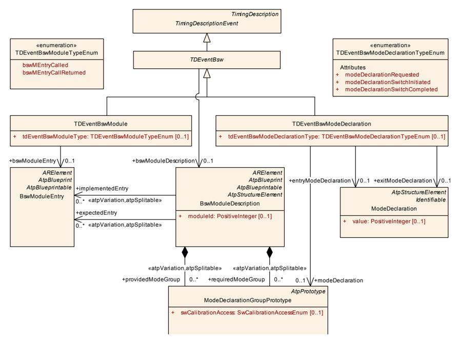

###### 3.3.2.5.1. TDEventBswModule（**TDEventBswModule**）

**TDEventBswModule 规定调用基础软件入口时的可观察事件（**specifies observable events when basic software entries are called**）**：元素 TDEventBswModule 用于规定可观察到的事件，即在基础软件内调用此类入口时，对基础软件模块入口的调用和返回。

表3.44：TDEventBswModule（**TDEventBswModule**）

| 属性 | 值 |
| --- | --- |
| 类 | TDEventBswModule |
| 包 | M2::AUTOSARTemplates::CommonStructure::Timing::TimingDescription::TimingDescriptionEvents::TDEventBsw |
| 说明 | 用于描述与 **BSW** 模块之间交互相关的时序事件。 |
| 基类 | ARObject、Identifiable、MultilanguageReferrable、Referrable、TDEventBsw、TimingDescription、TimingDescriptionEvent |
| 聚合于 | TimingExtension.timingDescription |

| 属性 | 类型 | 多重性 | 种类 | 备注 |
| --- | --- | --- | --- | --- |
| bswModuleEntry | BswModuleEntry | 0..1 | ref | 该时序事件的作用范围。 |
| tdEventBswModuleType | TDEventBswModuleTypeEnum | 0..1 | attr | 该时序事件的特定类型。 |

**约束：TDEventBswModule.tdEventBswModuleType 的存在性**：对于每个 TDEventBswModule，在 **BSW** 时序描述完成时，属性 tdEventBswModuleType 必须存在。

**约束：TDEventBswModule.bswModuleEntry 的存在性**：对于每个 TDEventBswModule，在 **BSW** 时序描述完成时，角色 bswModuleEntry 中对 BswModuleEntry 的引用必须存在。

表3.45：TDEventBswModuleTypeEnum（**TDEventBswModuleTypeEnum**）

| 属性 | 值 |
| --- | --- |
| 枚举 | TDEventBswModuleTypeEnum |
| 包 | M2::AUTOSARTemplates::CommonStructure::Timing::TimingDescription::TimingDescriptionEvents::TDEventBsw |
| 说明 | 用于描述 TDEventBswModule 的特定事件类型。 |
| 聚合于 | TDEventBswModule.tdEventBswModuleType |

| 字面量 | 说明 |
| --- | --- |
| bswMEntryCalled | 关联的 BswModuleEntry 已被调用的时间点。标签：atp.EnumerationLiteralIndex=0 |
| bswMEntryCallReturned | 关联的 BswModuleEntry 的调用已返回的时间点。标签：atp.EnumerationLiteralIndex=1 |

###### 3.3.2.5.2. TDEventBswModeDeclaration（**TDEventBswModeDeclaration**）

**TDEventBswModeDeclaration 规定 **BSW** 模式通信情形下的可观察事件（**specifies observable events in case of BSW mode communication**）**：元素 TDEventBswModeDeclaration 用于规定在基础软件中发起和传播模式变更时可观察到的事件。

表3.46：TDEventBswModeDeclaration（**TDEventBswModeDeclaration**）

| 属性 | 值 |
| --- | --- |
| 类 | TDEventBswModeDeclaration |
| 包 | M2::AUTOSARTemplates::CommonStructure::Timing::TimingDescription::TimingDescriptionEvents::TDEventBsw |
| 说明 | 用于描述与 **BSW** 层级模式通信相关的时序事件。 |
| 基类 | ARObject、Identifiable、MultilanguageReferrable、Referrable、TDEventBsw、TimingDescription、TimingDescriptionEvent |
| 聚合于 | TimingExtension.timingDescription |

| 属性 | 类型 | 多重性 | 种类 | 备注 |
| --- | --- | --- | --- | --- |
| entryModeDeclaration | ModeDeclaration | 0..1 | ref | 细化 TDEventBswModeDeclaration 作用范围的可选参数。若设置了该参数，则仅当模式声明组原型实例应进入被引用的 ModeDeclaration 时事件才发生。 |
| exitModeDeclaration | ModeDeclaration | 0..1 | ref | 细化 TDEventBswModeDeclaration 作用范围的可选参数。若设置了该参数，则仅当模式声明组原型实例应退出被引用的 ModeDeclaration 时事件才发生。 |
| modeDeclaration | ModeDeclarationGroupPrototype | 0..1 | ref | 该时序事件的作用范围。 |
| tdEventBswModeDeclarationType | TDEventBswModeDeclarationTypeEnum | 0..1 | attr | 该时序事件的特定类型。 |

**约束：TDEventBswModeDeclaration.tdEventBswModeDeclarationType 的存在性**：对于每个 TDEventBswModeDeclaration，在 **BSW** 时序描述完成时，属性 tdEventBswModeDeclarationType 必须存在。

**约束：TDEventBswModeDeclaration.modeDeclaration 的存在性**：对于每个 TDEventBswModeDeclaration，在 **BSW** 时序描述完成时，角色 modeDeclaration 中对 ModeDeclarationGroupPrototype 的引用必须存在。

表3.47：TDEventBswModeDeclarationTypeEnum（**TDEventBswModeDeclarationTypeEnum**）

| 属性 | 值 |
| --- | --- |
| 枚举 | TDEventBswModeDeclarationTypeEnum |
| 包 | M2::AUTOSARTemplates::CommonStructure::Timing::TimingDescription::TimingDescriptionEvents::TDEventBsw |
| 说明 | 用于描述 TDEventBswModeDeclaration 的特定事件类型。 |
| 聚合于 | TDEventBswModeDeclaration.tdEventBswModeDeclarationType |

| 字面量 | 说明 |
| --- | --- |
| modeDeclarationRequested | 关联的 ModeDeclarationGroupPrototype 已被请求的时间点。标签：atp.EnumerationLiteralIndex=0 |
| modeDeclarationSwitchCompleted | 到关联的 ModeDeclarationGroupPrototype 的切换已完成的时间点。标签：atp.EnumerationLiteralIndex=1 |
| modeDeclarationSwitchInitiated | 由 BswM 发起到关联的 ModeDeclarationGroupPrototype 的切换的时间点。标签：atp.EnumerationLiteralIndex=2 |

##### 3.3.2.6. TDEventComplex（**TDEventComplex**）

**TDEventComplex 的目的（**Purpose of TDEventComplex**）**：元素 TDEventComplex 用于规定事件的发生之间的关系。

复合时序事件可用于以下内容的规范中：

- VfbTiming（3.1.1）
- SystemTiming（3.1.3）
- SwcTiming（3.1.2）
- BswModuleTiming（3.1.4.1）
- EcuTiming（3.1.5）

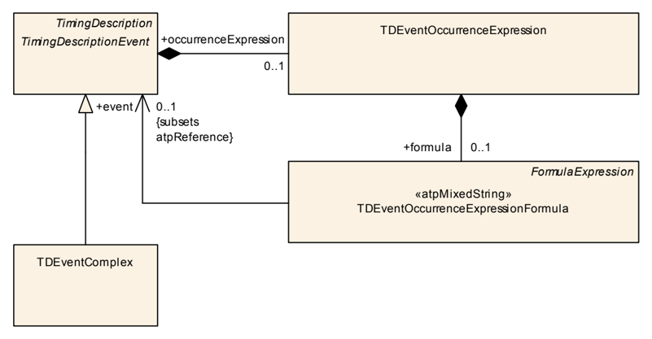

表3.48：TDEventComplex（**TDEventComplex**）

| 属性 | 值 |
| --- | --- |
| 类 | TDEventComplex |
| 包 | M2::AUTOSARTemplates::CommonStructure::Timing::TimingDescription::TimingDescriptionEvents::TDEventComplex |
| 说明 | 用于描述复合时序事件。复合时序事件的上下文要么以非形式化的方式描述（例如使用 documentation 块），要么由关联的 TDEventOccurrenceExpression 形式化地描述。 |
| 基类 | ARObject、Identifiable、MultilanguageReferrable、Referrable、TimingDescription、TimingDescriptionEvent |
| 聚合于 | TimingExtension.timingDescription |

复合时序事件是一种特殊的可观察事件。与上文描述的「原子」事件相比，复合事件不包含其所引用上下文的信息，例如 TDEventVariableDataPrototype 中的 VariableDataPrototype。相反，复合事件使用出现表达式来规定关于 TimingDescriptionEvent 发生的上下文，如下一节所述。

##### 3.3.2.7. TDEventSLLET（**TDEventSLLET**）

**SL-LET** 时序事件可用于以下内容的规范中：

- VfbTiming（3.1.1）
- SwcTiming（3.1.2）
- SystemTiming（3.1.3）
- EcuTiming（3.1.5）

**TDEventSLLET 的目的（**Purpose of TDEventSLLET**）**：元类 TDEventSLLET 为建模 **SL-LET** 时序事件的类型提供一个抽象类。

###### 3.3.2.7.1. TDEventSLLETPort（**TDEventSLLETPort**）

TDEventSLLET 的一个子类应用于在 **SL-LET** 的上下文中规定 **SWC** 端口上的时序事件。

**TDEventSLLETPort 的目的（**Purpose of TDEventSLLETPort**）**：元类 TDEventSLLETPort 描述源于被引用 PortPrototype 的 **SL-LET** 事件。

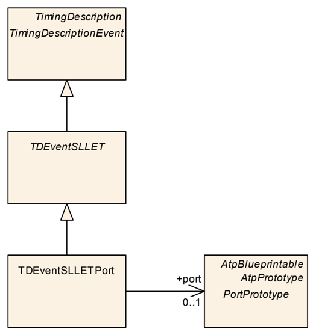

表3.49：TDEventSLLETPort（**TDEventSLLETPort**）

| 属性 | 值 |
| --- | --- |
| 类 | TDEventSLLETPort |
| 包 | M2::AUTOSARTemplates::CommonStructure::Timing::TimingDescription::TimingDescriptionEvents::TDEventSLLET |
| 说明 | 用于在 **SWC** 端口的层级描述 **SL-LET** 时序事件。标签：atp.Status=draft |
| 基类 | ARObject、Identifiable、MultilanguageReferrable、Referrable、TDEventSLLET、TimingDescription、TimingDescriptionEvent |
| 聚合于 | TimingExtension.timingDescription |

| 属性 | 类型 | 多重性 | 种类 | 备注 |
| --- | --- | --- | --- | --- |
| port | PortPrototype | 0..1 | ref | 该时序事件的起源端口。 |

##### 3.3.2.8. 时序事件的出现表达式语言（**Occurrence Expression Language for Timing Events**）

前几节提到的 TimingDescriptionEvent 允许规定具有明确定义上下文的可观察事件。然而，有时事件的上下文信息并不充分，因为附加的条件——例如取值过滤或附加的激励——会影响事件的发生。因此，出现表达式（**occurrence expression**）提供了克服原子事件局限的手段。

出现表达式提供了在以下情形中细化 TimingDescriptionEvent 上下文规范的能力：

- 内容过滤（**Content Filter**）：基于交换的数据或操作实参的取值过滤原子事件的发生。
- 复合事件（**Complex Event**）：组合任意数量的原子事件和复合事件，以规定一个新的 TimingDescriptionEvent。

###### 3.3.2.8.1. 规定出现表达式（**Specifying an Occurrence Expression**）

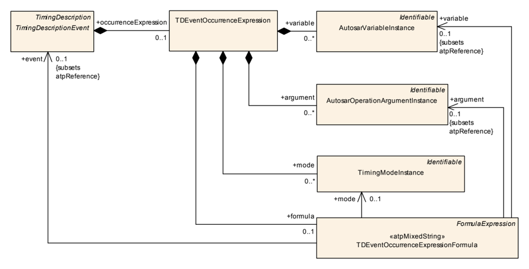

如图 3.35 所示，每个 TimingDescriptionEvent 聚合一个 TDEventOccurrenceExpression 作为可选参数。TDEventOccurrenceExpression 是表述该表达式所需的全部信息的容器。表达式本身经由 TDEventOccurrenceExpressionFormula 定义，后者派生自 FormulaExpression（参见通用结构模板 [\[6\]](#ref-6)）。TDEventOccurrenceExpressionFormula 使用 FormulaExpression 的能力，并向表达式语言添加以下函数：

- TIMEX_value：
  - 操作数：一个 AutosarVariableInstance 或一个 AutosarOperationArgumentInstance
  - 返回：Numerical（见约束「TDEventOccurrenceExpression 中仅使用数值」）
- TIMEX_occurs：
  - 操作数：一个其发生应被求值的 TimingDescriptionEvent
  - 返回：Boolean，若被引用的 TimingDescriptionEvent 在表达式求值的时间点发生则为 **TRUE**，否则为 **FALSE**
- TIMEX_hasOccurred：
  - 操作数：一个其发生应被求值的 TimingDescriptionEvent
  - 返回：Boolean，若被引用的 TimingDescriptionEvent 在表达式求值的时间点之前或同一时间点至少发生过一次则为 **TRUE**，否则为 **FALSE**
- TIMEX_timeSinceLastOccurrence：
  - 操作数：一个其发生应被求值的 TimingDescriptionEvent
  - 返回：Float，单位为秒。它返回被引用事件最后一次发生的时间点与表达式求值的时间点之间的时间差。
- TIMEX_angleSinceLastOccurrence：
  - 操作数：一个其发生应被求值的 TimingDescriptionEvent
  - 返回：Float，单位为度。它返回被引用事件最后一次发生的时间点与表达式求值的时间点之间曲轴的角度。
- TIMEX_modeActive：
  - 操作数：一个其发生应被求值的 TimingModeInstance
  - 返回：Boolean，若规定的模式声明在表达式求值的时间点处于活动状态则为 **TRUE**，否则为 **FALSE**

TIMEX 函数所考虑的时间区间的起点，是事件发生的测量开始的时间点。

函数所需的全部操作数都是对模型元素的引用。因此，TDEventOccurrenceExpressionFormula 需要对类型为 TimingDescriptionEvent、AutosarVariableInstance、AutosarOperationArgumentInstance 和 TimingModeInstance 的相应元素的引用。由于 TDEventOccurrenceExpressionFormula 的 atpMixedString 特性，出现表达式中可以使用多个这样的引用。

**约束：出现表达式函数的受限使用**：以下函数：

- TIMEX_occurs
- TIMEX_hasOccurred
- TIMEX_timeSinceLastOccurrence
- TIMEX_angleSinceLastOccurrence
- TIMEX_modeActive

只应用于施加于 TDEventComplex 的 TDEventOccurrenceExpressionFormula。

**约束：TDEventOccurrenceExpression 中仅使用数值**：变量和实参的实例引用的目标数据原型应为 Numerical。

TDEventOccurrenceExpressionFormula 被规定为描述一个事件而非一个状态。因此，TDEventOccurrenceExpressionFormula 应确保复合 TimingDescriptionEvent 只能在被引用的 TimingDescriptionEvent 之一的发生时刻发生。

**约束：引用仅用作函数操作数**：对模型元素的引用（例如指向 TimingDescriptionEvent 的时序事件引用）具有特定的语义。这些引用在表达式中的使用，仅允许作为上述函数的操作数。

下例展示了如何组合上述引入的函数，以便为一个名为 **ECX** 的复合事件规定 TDEventOccurrenceExpressionFormula。该复合事件表达：两个 dataElement **DE1** 和 **DE2** 在最大 0.5 ms 的区间内于 Swc1 的需求端口 RequiredPort 上变为可用，且在该时间点 dataElement **DE3** 的取值大于三（3）。

图 3.36 勾勒了该示例的 **AUTOSAR** 软件组件模型。

一个 **SWC** Swc1 拥有一个名为 RequiredPort 的 RPortPrototype 和一个名为 ProvidedPort 的 PPortPrototype。两个端口都由名为 SenderReceiverInterface1 的 SenderReceiverInterface 类型化，并由三个 dataElement 组成：**DE1**、**DE2** 和 **DE3**<sup>1</sup>。

> 1 也可以改为定义三个离散的 RPortPrototype，由 SenderReceiverInterface 类型化，每个端口带有一个单独的 dataElement。

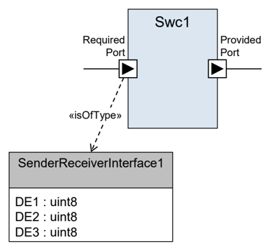

该示例对应的时序模型如清单 C.14 所示。由于时序是在虚拟功能总线视图中为软件组件描述的，因此使用 VfbTiming 来规定相应的时序模型，即虚拟功能总线时序视图。该时序模型应只包含与虚拟功能总线相关的时序描述事件，如[第 3.3.2.1 节](#3321-tdeventvfbtdeventvfb)所述。

复合事件 **ECX** 在满足以下条件时发生：

**条件 1**：原子时序事件 **E1** 或 **E2** 之一应发生。在本例中，**E1** 和 **E2** 是原子时序事件 TDEventVariableDataPrototype，当名为 **DE1** 和 **DE2** 的 VariableDataPrototype 在名为 Swc1 的组件的名为 RequiredPort 的 PortPrototype 上被接收时发生。

**条件 2**：名为 **DE3** 的 VariableDataPrototype 的取值应大于 3。

**条件 3**：名为 **DE1** 和 **DE2** 的 VariableDataPrototype 应在最大 0.5 ms 的时间区间内，在名为 RequiredPort 的需求 PortPrototype 上变为可用。

复合事件 **ECX** 将由 C.5.1 中的如下出现表达式描述。

由于第一个条件，复合事件 **ECX** 只能在原子时序事件 **E1** 或 **E2** 之一在求值时间点发生时发生，从而满足了「出现表达的是事件的语义而非状态」的原则。

图 3.39 展示了事件发生的一次测量。

复合事件 **ECX** 对应的 **AUTOSAR** **ARXML** 文件片段具有如下形式（见清单 C.14）。

表3.50：TDEventOccurrenceExpression（**TDEventOccurrenceExpression**）

| 属性 | 值 |
| --- | --- |
| 类 | TDEventOccurrenceExpression |
| 包 | M2::AUTOSARTemplates::CommonStructure::Timing::TimingDescription::TimingDescriptionEvents::TDEventOccurrenceExpression |
| 说明 | 用于借助 TDEventOccurrenceExpressionFormula 对 TimingDescriptionEvent 的发生规定过滤。过滤条件可以是变量和实参的取值——即时序事件只在特定取值下发生——也可以是任意时序事件发生的时间特性。 |
| 基类 | ARObject |
| 聚合于 | TimingDescriptionEvent.occurrenceExpression |

| 属性 | 类型 | 多重性 | 种类 | 备注 |
| --- | --- | --- | --- | --- |
| argument | AutosarOperationArgumentInstance | * | aggr | 出现表达式可以在其表达式中引用任意数量的 OperationArgumentPrototype。该关联聚合对 OperationArgumentPrototype 的实例引用，这些引用可在表达式中被引用。 |
| formula | TDEventOccurrenceExpressionFormula | 0..1 | aggr | 这是用于描述出现表达式的表达式公式。 |
| mode | TimingModeInstance | * | aggr | 出现表达式可以在其表达式中引用任意数量的 TimingModeInstance。该关联聚合对 ModeDeclaration 的实例引用，这些引用可在表达式中被引用。 |
| variable | AutosarVariableInstance | * | aggr | 出现表达式可以在其表达式中引用任意数量的 VariableDataPrototype。该关联聚合对 VariableDataPrototype 的实例引用，这些引用可在表达式中被引用。 |

**约束：TDEventOccurrenceExpression.formula 的存在性**：对于每个 TDEventOccurrenceExpression，在与 TimingDescriptionEvent 的具体子类相关联的施加时间点，属性 formula 必须存在。

表3.51：TDEventOccurrenceExpressionFormula（**TDEventOccurrenceExpressionFormula**）

| 属性 | 值 |
| --- | --- |
| 类 | &lt;&lt;atpMixedString&gt;&gt; TDEventOccurrenceExpressionFormula |
| 包 | M2::AUTOSARTemplates::CommonStructure::Timing::TimingDescription::TimingDescriptionEvents::TDEventOccurrenceExpression |
| 说明 | 这是 **AUTOSAR** 时序扩展对 FormulaExpression 的扩展。TDEventOccurrenceExpressionFormula 提供了将时序事件发生的时间特性与特定的变量和实参取值相关联地加以表达的手段。扩展函数（**ExtUnaryFunctions**）的形式化定义在 **AUTOSAR** 时序扩展中详细描述。 |
| 基类 | ARObject、FormulaExpression |
| 聚合于 | TDEventOccurrenceExpression.formula |

| 属性 | 类型 | 多重性 | 种类 | 备注 |
| --- | --- | --- | --- | --- |
| argument | AutosarOperationArgumentInstance | 0..1 | ref | 这是表达式公式中使用的一个特定实参取值。 |
| event | TimingDescriptionEvent | 0..1 | ref | 这是表达式公式中使用的一个特定时序描述事件。 |
| mode | TimingModeInstance | 0..1 | ref | 这是表达式公式中使用的一个特定模式。 |
| variable | AutosarVariableInstance | 0..1 | ref | 这是表达式公式中使用的一个特定变量取值。 |

表3.52：AutosarVariableInstance（**AutosarVariableInstance**）

| 属性 | 值 |
| --- | --- |
| 类 | AutosarVariableInstance |
| 包 | M2::AUTOSARTemplates::CommonStructure::Timing::TimingDescription::TimingDescriptionEvents::TDEventOccurrenceExpression |
| 说明 | 该类表示对 **AUTOSAR** 内一个变量实例的引用。借此可以在出现表达式公式中引用一个变量实例。变量实例可以指向以下变量之一：经 PortPrototype 提供的整个变量；经 PortPrototype 提供的组合变量内部的元素。 |
| 基类 | ARObject、Identifiable、MultilanguageReferrable、Referrable |
| 聚合于 | TDEventOccurrenceExpression.variable、TimingExtensionResource.timingVariable |

| 属性 | 类型 | 多重性 | 种类 | 备注 |
| --- | --- | --- | --- | --- |
| variableInstance | DataPrototype | 0..1 | iref | 这是指向 instanceRef 定义的引用。InstanceRef 由 VariableInComponentInstanceRef 实现。 |

**约束：AutosarVariableInstance.variableInstance 的存在性**：对于每个 AutosarVariableInstance，在与 TimingDescriptionEvent 的具体子类相关联的施加时间点，角色 variableInstance 中的引用必须存在。

表3.53：AutosarOperationArgumentInstance（**AutosarOperationArgumentInstance**）

| 属性 | 值 |
| --- | --- |
| 类 | AutosarOperationArgumentInstance |
| 包 | M2::AUTOSARTemplates::CommonStructure::Timing::TimingDescription::TimingDescriptionEvents::TDEventOccurrenceExpression |
| 说明 | 该类表示对一个实参实例的引用。借此可以在出现表达式公式中引用一个实参实例。实参实例可以指向以下实参之一：在带 ClientServerInterface 的 PortPrototype 的操作中使用的整个实参；在带 ClientServerInterface 的 PortPrototype 的操作中使用的组合实参内部的元素。 |
| 基类 | ARObject、Identifiable、MultilanguageReferrable、Referrable |
| 聚合于 | TDEventOccurrenceExpression.argument、TimingExtensionResource.timingArgument |

| 属性 | 类型 | 多重性 | 种类 | 备注 |
| --- | --- | --- | --- | --- |
| operationArgumentInstance | DataPrototype | 0..1 | iref | 这是指向 instanceRef 定义的引用。InstanceRef 由 OperationArgumentInComponentInstanceRef 实现。 |

**约束：AutosarOperationArgumentInstance.operationArgumentInstance 的存在性**：对于每个 AutosarOperationArgumentInstance，在与 TimingDescriptionEvent 的具体子类相关联的施加时间点，角色 operationArgumentInstance 中的引用必须存在。

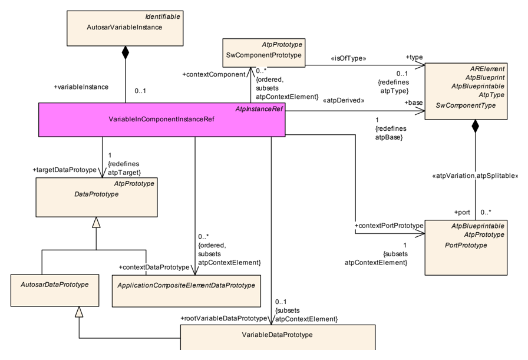

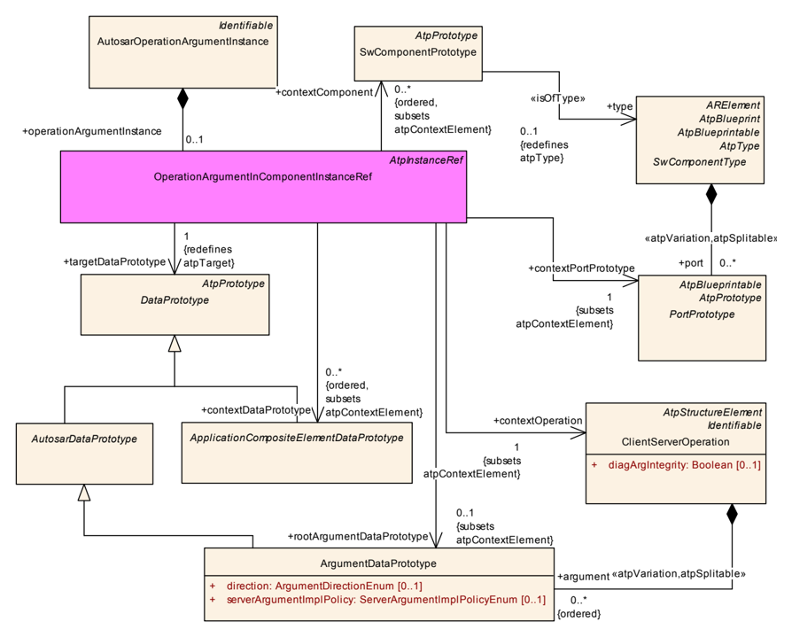

##### 3.3.2.9. 出现表达式语言语法（**Occurrence Expression Language Syntax**）

出现表达式语言基于通用结构模板 [\[6\]](#ref-6) 中定义的公式语言的语法。它通过附加函数以及对模型元素的附加引用扩展了该语言。下面基于语法定义介绍这些扩展对语法的影响。

**注意：** 为公式语言定义的语法不属于下方清单的一部分。下面只给出公式语言的时序特定扩展以及增强的函数和引用。

###### 3.3.2.9.1. 解释出现表达式（**Interpreting an Occurrence Expression**）

基于前几节描述的规范机制，可以使用出现表达式公式将时序规范细化到预期的精度。本节描述这样的出现表达式应如何被解释。解释器的职责是确定为其定义了出现表达式的 TimingDescriptionEvent 的发生。这以两种方式完成，取决于出现表达式是用作内容过滤器还是用作复合事件。

###### 3.3.2.9.1.1. 解释内容过滤器（**Interpreting a Content Filter**）

在这种情况下，出现表达式是为一个原子事件定义的。内容过滤器只允许使用一元时序函数 TIMEX_value(&lt;对实参或变量的引用&gt;)。在原子事件的每次发生时，解释器检查表达式定义的内容过滤是否被满足。这是依据操作数类型对函数 TIMEX_value 求值来完成的：

AutosarVariableInstance：在原子事件发生的时间点对被引用变量的取值求值。

AutosarOperationArgumentInstance：在原子事件发生的时间点对被引用实参的取值求值。

**约束：AutosarVariableInstance 在内容过滤中的受限使用**：如果一个内容过滤器为原子事件定义，则只有在原子事件为类型 TDEventVariableDataPrototype 时才允许引用 AutosarVariableInstance。只有在这种原子事件发生时，变量的取值才能被求值。因此，原子事件的作用范围也应与 AutosarVariableInstance 相同，即它们应指向同一个 VariableDataPrototype。

**约束：AutosarOperationArgumentInstance 在内容过滤中的受限使用**：如果一个内容过滤器为原子事件定义，则只有在原子事件为类型 TDEventOperation 时才允许引用 AutosarOperationArgumentInstance。只有在这种原子事件发生时，操作实参的取值才能被求值。因此，原子事件的作用范围也应与 AutosarOperationArgumentInstance 相同，即它们应指向同一个 ClientServerOperation。最后，只有当类型为 TDEventOperation 的原子事件指向操作调用响应已发送的时间点（TD-EVENT-OPERATION-TYPE=OPERATION-CALL-RESPONSE-SENT）或操作调用响应已接收的时间点（TD-EVENT-OPERATION-TYPE=OPERATION-CALL-RESPONSE-RECEIVED）时，才允许引用实参方向为「out」的 AutosarOperationArgumentInstance。

###### 3.3.2.9.1.2. 解释复合事件（**Interpreting a Complex Event**）

在这种情况下，出现表达式是为一个复合事件定义的。出现表达式语言的全部特性都可用于这种表达式类型。在特定时间点 t，解释器对该表达式求值，以确定复合事件是否已发生。

考虑为[第 3.3.2.8.1 节](#33281-规定出现表达式specifying-an-occurrence-expression)的示例定义的出现表达式，解释器「实现」一个函数 ECX(t)，若复合事件 **ECX** 在时间 t 发生则该函数返回 **TRUE**：

```
ECX(t) = ( TIMEX_occurs( t, /Example/Expression/E1 ) || TIMEX_occurs( t, /Example/Expression/E2 ) ) && TIMEX_value( t, /Example/Expression/ECX/avi_DE3 ) > 3 && abs( TIMEX_timeSinceLastOccurrence( t, /Example/Expression/E1 ) -TIMEX_timeSinceLastOccurrence( t, /Example/Expression/E2 ) ) <= 0.0005
```

该表达式应只在 **E1** 或 **E2** 的发生时刻求值，因为只有此时复合事件 **ECX** 才可能发生、表达式才可能返回 **TRUE**。

如图 3.39 中勾画的轨迹所示，名为 **E1** 和 **E2** 的时序描述事件在不同的时间点发生。在该图左侧，两个事件在 0.0005 秒的时间区间内发生。给定出现表达式被求值的时间点是事件 **E2** 发生的时间点。在该时间点——即 t<sub>evaluate</sub> 亦即 t<sub>E2</sub>——出现表达式的结果为 **TRUE**。在该图右侧，两个事件不在 0.0005 秒的时间区间内发生。给定出现表达式被求值的时间点是事件 **E1** 发生的时间点。在该时间点——即 t<sub>evaluate</sub> 亦即 t<sub>E1</sub>——出现表达式的结果为 **FALSE**。

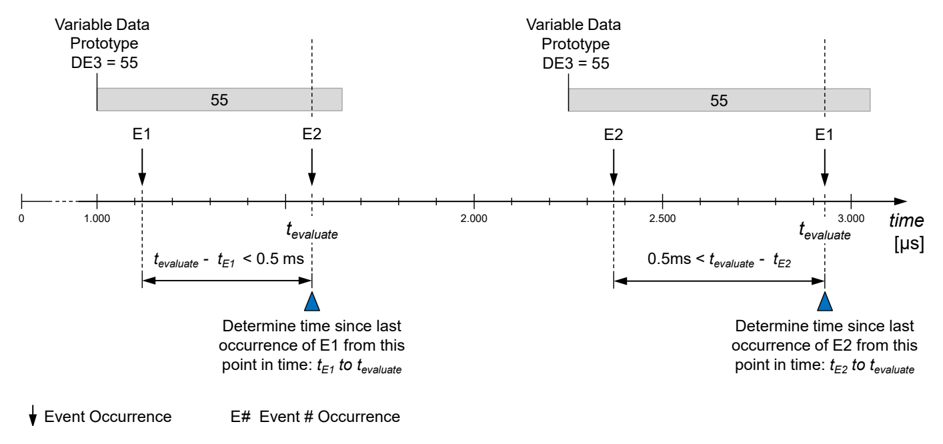

基于出现表达式语言提供的多个函数，解释器需要从系统获取以下信息：

- 在时间 t，被引用的 AutosarOperationArgumentInstance 的取值。
- 在时间 t，被引用的 AutosarVariableInstance 的取值。
- 在时间 t 及之前，被引用的 TimingDescriptionEvent 的发生。

获取所需信息有不同的方式：

- 模型分析与仿真：在确定性的系统环境中，TimingDescriptionEvent 的发生可以离线确定，例如帧将在 **FlexRay** 网络静态段中被传输的时间点。
- 目标机轨迹：所需信息可以从运行中的系统收集，方式是记录 TimingDescriptionEvent 发生的时间点。例如，针对 TDEventSwcInternalBehavior 的 **ECU** 轨迹可以为 RunnableEntity 被激活、启动或终止的每个时间点包含一个标记。

如果解释器拥有作为输入的所需信息，出现表达式语言提供的各函数可以按如下方式解释：

- TIMEX_value(t, &lt;对 AutosarVariableInstance 的引用&gt;) 返回时间 t 的变量取值。
- TIMEX_value(t, &lt;对 AutosarOperationArgumentInstance 的引用&gt;) 返回时间 t 的操作实参取值。
- TIMEX_occurs(t, &lt;对 TimingDescriptionEvent 的引用&gt;) 若被引用的事件在时间 t 发生则返回 **TRUE**（或 1），否则返回 **FALSE**（或 0）。
- TIMEX_hasOccurred(t, &lt;对 TimingDescriptionEvent 的引用&gt;) 若被引用的事件在时间 t 之前或同一时间点至少发生过一次，则返回 **TRUE**（或 1）。
- TIMEX_timeSinceLastOccurrence(t, &lt;对 TimingDescriptionEvent 的引用&gt;) 返回 t 与被引用事件最后一次发生的时间点之间的时间差。时间单位为秒。
- TIMEX_angleSinceLastOccurrence(t, &lt;对 TimingDescriptionEvent 的引用&gt;) 返回 t 与被引用事件最后一次发生的时间点之间的角度差。角度单位为度。
- TIMEX_modeActive(t, &lt;对 TimingModeInstance 的引用&gt;) 若被引用的模式在时间 t 处于活动状态则返回 **TRUE**（或 1），否则返回 **FALSE**（或 0）。

##### 3.3.2.10. 时序描述事件的时基引用（**Time Base Referencing for Timing Description Events**）

在某些用例中，TimingDescriptionEvent 可以引用一个可选的 TimingDescriptionEvent.clockReference，以提供与实际时基的关系；该概念在[第 4.2 节](#42-系统级逻辑执行时间system-level-logical-execution-time)中解释。

### 3.4. 时序约束（**TimingConstraint**）

TIMEX 的 TimingConstraint 可以用作功能需求，因而可以用作测试的基础；也可以用作时序保证，例如在性能规范的上下文中。

TimingConstraint 的应用依赖于上下文，用于约束 TimingDescriptionEvent、TimingDescriptionEventChain 或 ExecutableEntity。

#### 3.4.1. 施加于 TimingDescriptionEventChain 的时序约束（**TimingConstraints on TimingDescriptionEventChains**）

图 3.40 展示了施加于 TimingDescriptionEventChain 的 TimingConstraint 的不同子类。一般而言，当 TimingConstraint 应用于 TimingDescriptionEventChain 时，它指涉一个带有时间限制的给定作用域/链上下文，这存在于大多数子类中。其余属性则与上下文相关。由于 TimingDescriptionEventChain 具有有向无环图的语义，方向是显而易见的，但被约束的是单条 TimingDescriptionEventChain 还是一组 TimingDescriptionEventChain 是有区别的。

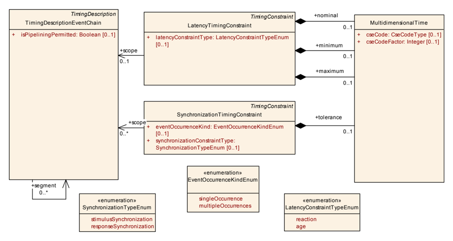

##### 3.4.1.1. SynchronizationTimingConstraint（**SynchronizationTimingConstraint**）

在分布式环境中，同步的目标是建立并维护不同子系统之间交互的一致时基，以获得正确的运行时顺序并避免意外的竞态条件。虽然建立同步的机制需要在实现层提供，但对同步的需要需要在设计层表达。为此，需要使用同步约束。

SynchronizationTimingConstraint 在两条或多条 TimingDescriptionEventChain 的激励或响应事件发生之间施加同步限制。在前一种情形（激励同步）下，被引用的 TimingDescriptionEventChain 应具有相同的响应事件（汇合）；在后一种情形（响应同步）下，它们应具有相同的激励事件（分叉）。

表3.54：SynchronizationTimingConstraint（**SynchronizationTimingConstraint**）

| 属性 | 值 |
| --- | --- |
| 类 | SynchronizationTimingConstraint |
| 包 | M2::AUTOSARTemplates::CommonStructure::Timing::TimingConstraint::SynchronizationTiming |
| 说明 | 约束该约束用于就同步而言限制不同但相关联的事件或事件链的时序行为。支持两种场景：<br>* 若 synchronizationConstraintType == responseSynchronization：<br>  * TimingDescriptionEvent：扮演响应角色的任意数量的相关联事件应就预定义的容差同步发生。<br>  * TimingDescriptionEventChain：具有共同激励但不同响应的任意数量的相关联事件链，其响应应就预定义的容差同步发生。<br>* 若 synchronizationConstraintType == stimulusSynchronization：<br>  * TimingDescriptionEvent：扮演激励角色的任意数量的相关联事件应就预定义的容差同步发生。<br>  * TimingDescriptionEventChain：具有共同响应但不同激励的任意数量的相关联事件链，其激励应就预定义的容差同步发生。<br>当约束施加于事件时，支持以下两种场景：<br>* 若 eventOccurrenceKind == singleOccurrence：任一事件在给定时间区间内应只发生一次。<br>* 若 eventOccurrenceKind == multipleOccurrences：任一事件在给定时间区间内可以发生多于一次。换言之，在给定时间区间内事件的多重发生是允许的。 |
| 基类 | ARObject、Identifiable、MultilanguageReferrable、Referrable、TimingConstraint、Traceable |
| 聚合于 | TimingExtension.timingGuarantee、TimingExtension.timingRequirement |

| 属性 | 类型 | 多重性 | 种类 | 备注 |
| --- | --- | --- | --- | --- |
| eventOccurrenceKind | EventOccurrenceKindEnum | 0..1 | attr | 指示被引用的事件在给定时间区间内应只发生一次（单次发生）还是可发生多次（多重发生）。 |
| scope | TimingDescriptionEventChain | * | ref | 处于该约束作用域内的事件链。与 scopeEvent 互斥，见约束「SynchronizationTimingConstraint 应引用事件或事件链之一」。 |
| scopeEvent | TimingDescriptionEvent | * | ref | 处于该约束作用域内的事件。与 scope 互斥，见约束「SynchronizationTimingConstraint 应引用事件或事件链之一」。 |
| synchronizationConstraintType | SynchronizationTypeEnum | 0..1 | attr | 指示 SynchronizationTimingConstraint 关联的事件具有共同的激励还是共同的响应。 |
| tolerance | MultidimensionalTime | 0..1 | aggr | 同步的事件应在其内发生的最大时间区间。事件可以在该时间区间内以任意顺序发生。该时间区间起始于被引用事件之一发生的时点。 |

表3.55：SynchronizationTypeEnum（**SynchronizationTypeEnum**）

| 属性 | 值 |
| --- | --- |
| 枚举 | SynchronizationTypeEnum |
| 包 | M2::AUTOSARTemplates::CommonStructure::Timing::TimingConstraint::SynchronizationTimingConstraint |
| 说明 | 为 SynchronizationTimingConstraint 规定 synchronizationConstraintType。 |
| 聚合于 | SynchronizationTimingConstraint.synchronizationConstraintType |

| 字面量 | 说明 |
| --- | --- |
| responseSynchronization | 当 SynchronizationTimingConstraint 为事件链规定时，关联事件链的响应事件应就规定的容差同步发生。所有关联的事件链应具有相同的激励事件。当 SynchronizationTimingConstraint 为事件规定时，关联的事件应就规定的容差同步发生。所有关联的事件都表示一个共同激励事件的响应事件，即使这样的激励事件尚未知或在模型的作用域内不可用。标签：atp.EnumerationLiteralIndex=0 |
| stimulusSynchronization | 当 SynchronizationTimingConstraint 为事件链规定时，关联事件链的激励事件应就规定的容差同步发生。所有关联的事件链应具有相同的响应事件。当 SynchronizationTimingConstraint 为事件规定时，关联的事件应就规定的容差同步发生。所有关联的事件都表示一个共同响应事件的激励事件，即使这样的响应事件尚未知或在模型的作用域内不可用。标签：atp.EnumerationLiteralIndex=1 |

表3.56：EventOccurrenceKindEnum（**EventOccurrenceKindEnum**）

| 属性 | 值 |
| --- | --- |
| 枚举 | EventOccurrenceKindEnum |
| 包 | M2::AUTOSARTemplates::CommonStructure::Timing::TimingConstraint::SynchronizationTimingConstraint |
| 说明 | 为 SynchronizationTimingConstraint 规定 eventOccurrenceKind。 |
| 聚合于 | SynchronizationTimingConstraint.eventOccurrenceKind |

| 字面量 | 说明 |
| --- | --- |
| multipleOccurrences | 规定一个事件可以在给定时间区间内发生多于一次。标签：atp.EnumerationLiteralIndex=0 |
| singleOccurrence | 被引用的事件在给定时间区间内应只发生一次。指示被引用的事件应只发生一次（单次发生）还是可发生多次（多重发生）。标签：atp.EnumerationLiteralIndex=1 |

这些参数的使用如图 3.41 和图 3.42 所示。

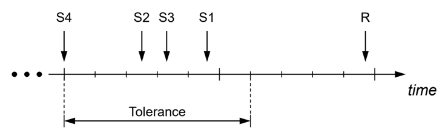

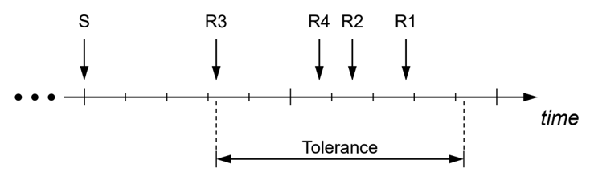

就 TimingDescriptionEventChain 的激励进行同步的一个示例是自适应巡航控制，它期望来自不同传感器的数据就预定义的容差（准）同时被采样。

就 TimingDescriptionEventChain 的响应进行同步的一个示例是不同指示灯的闪烁，它们应就预定义的容差（准）同时发生。

**约束：SynchronizationTimingConstraint 应引用事件或事件链之一**：SynchronizationTimingConstraint 应引用 TimingDescriptionEvent 或 TimingDescriptionEventChain，但不得同时引用两者。

**约束：SynchronizationTimingConstraint 应至少引用两条事件链**：在 SynchronizationTimingConstraint 施加于 TimingDescriptionEventChain 的情形下，应至少引用两条（2）TimingDescriptionEventChain。

**约束：属性 synchronizationConstraintType 的规定**：当 SynchronizationTimingConstraint 施加于 TimingDescriptionEventChain 时，应规定属性 synchronizationConstraintType。

##### 3.4.1.2. LatencyTimingConstraint（**LatencyTimingConstraint**）

LatencyTimingConstraint 规定一条 TimingDescriptionEventChain 的激励发生与相应响应发生之间的最小和/或最大持续时间。例如，这可以是一组数据在总线网络上从一个指定点到达另一个指定点所花的时间，或一个函数/任务在处理器上执行所花的时间。

**LatencyTimingConstraint 规定延迟约束（**specifies latency constraints**）**：元素 LatencyTimingConstraint<sup>2</sup> 用于规定任意两个 TimingDescriptionEvent 的发生之间所经过的时间量。

> 2 「延迟（delay）」的同义词

表3.57：LatencyTimingConstraint（**LatencyTimingConstraint**）

| 属性 | 值 |
| --- | --- |
| 类 | LatencyTimingConstraint |
| 包 | M2::AUTOSARTemplates::CommonStructure::Timing::TimingConstraint::LatencyTimingConstraint |
| 说明 | 约束该 scope 的激励发生与相应响应发生之间的持续时间。与 scope 相对，这里要求 scope 的激励与相应响应之间存在因果依赖。 |
| 基类 | ARObject、Identifiable、MultilanguageReferrable、Referrable、TimingConstraint、Traceable |
| 聚合于 | TimingExtension.timingGuarantee、TimingExtension.timingRequirement |

| 属性 | 类型 | 多重性 | 种类 | 备注 |
| --- | --- | --- | --- | --- |
| latencyConstraintType | LatencyConstraintTypeEnum | 0..1 | attr | 该延迟约束的特定类型。 |
| maximum | MultidimensionalTime | 0..1 | aggr | 关联事件链的激励发生与相应响应发生之间的最大延迟。标签：xml.sequenceOffset=20 |
| minimum | MultidimensionalTime | 0..1 | aggr | 关联事件链的激励发生与相应响应发生之间的最小延迟。标签：xml.sequenceOffset=10 |
| nominal | MultidimensionalTime | 0..1 | aggr | 关联事件链的激励发生与相应响应发生之间的标称延迟。标签：xml.sequenceOffset=30 |
| scope | TimingDescriptionEventChain | 0..1 | ref | 定义该约束作用域的事件链。 |

表3.58：LatencyConstraintTypeEnum（**LatencyConstraintTypeEnum**）

| 属性 | 值 |
| --- | --- |
| 枚举 | LatencyConstraintTypeEnum |
| 包 | M2::AUTOSARTemplates::CommonStructure::Timing::TimingConstraint::LatencyTimingConstraint |
| 说明 | 为 LatencyTimingConstraint 规定 latencyConstraintType。 |
| 聚合于 | LatencyTimingConstraint.latencyConstraintType |

| 字面量 | 说明 |
| --- | --- |
| age | LatencyTimingConstraint 从 scope 的响应事件的视角看待。给定某个响应事件，约束的是最近一次激励的老化（**age**）区间。标签：atp.EnumerationLiteralIndex=0 |
| reaction | LatencyTimingConstraint 从 scope 的激励事件的视角看待。给定某个激励事件，约束的是第一次响应的反应（**reaction**）区间。标签：atp.EnumerationLiteralIndex=1 |

LatencyTimingConstraint 的属性 minimum、maximum 和 nominal 可用于为作用域内 TimingDescriptionEventChain 的延迟定义下界、上界以及标称值。

**示例：** 在多速率网络中，由于生产者和消费者的周期可能不同，数据可能丢失或重复。若消费者的周期大于生产者的周期（欠采样），则发生数据丢失；相应地，若消费者的周期小于生产者的周期（过采样），则发生数据重复。图 3.43 描绘了这一点。

LatencyTimingConstraint 的应用会带来一些值得注意的观察：

- 在没有过采样和欠采样的系统中，老化与反应是相同的。但时序约束是与实现无关的。因此，在实现尚不确定的规定阶段，必须规定正确的延迟约束语义。
- 一条事件链的最小反应延迟与最小老化延迟总是相等。

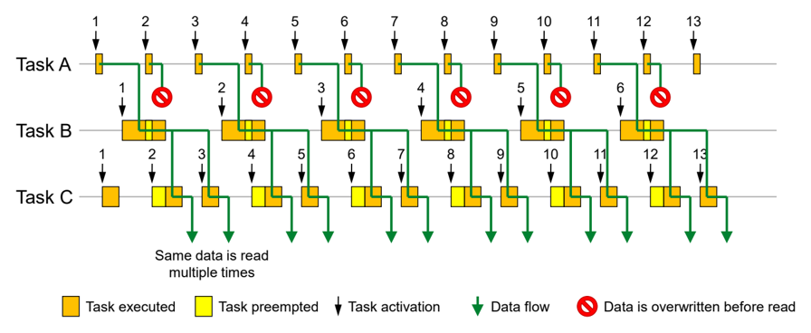

考虑过采样与欠采样，有两种端到端延迟语义对汽车系统具有重要意义，因而可以用 TIMEX 表达：某个响应的老化（**age**）与对某个激励的反应（**reaction**）。

数据老化时序约束主要在控制工程中重要，但也可能出现在所有域中。这里关注的是从响应而非激励出发的视角。换言之，其假设是「最后者最优（**last is best**）」，即接受/容忍一个取值在从激励到响应的路径上被覆盖。例如当一个执行器取值被周期性更新时，重要的是相应的输入取值不能太旧。在这种情况下，受约束的重要时间是自最近一次激励到给定响应的延迟。

当对激励的第一次反应重要时，使用反应时间约束。这通常是车身电子的情形，但也可能出现在其他域。一个例子是从按下按钮到灯亮所花的时间。另一个来自底盘域的例子，是从踩下制动踏板到制动器被激活的时间。在这两种情况下，受约束的重要时间是自给定激励到第一次相应响应的延迟。

**约束：LatencyTimingConstraint.latencyConstraintType 的存在性**：对于每个 LatencyTimingConstraint，在与 TimingDescriptionEvent 的具体子类相关联的施加时间点，属性 latencyConstraintType 必须存在。

**约束：LatencyTimingConstraint.maximum 的存在性**：对于每个 LatencyTimingConstraint，在与 TimingDescriptionEvent 的具体子类相关联的施加时间点，属性 maximum 必须存在。

**约束：LatencyTimingConstraint.minimum 的存在性**：对于每个 LatencyTimingConstraint，在与 TimingDescriptionEvent 的具体子类相关联的施加时间点，属性 minimum 必须存在。

**约束：LatencyTimingConstraint.scope 的存在性**：对于每个 LatencyTimingConstraint，在与 TimingDescriptionEvent 的具体子类相关联的施加时间点，角色 scope 中的引用应至少存在一次。

#### 3.4.2. 施加于 TimingDescriptionEvent 的时序约束（**TimingConstraints on TimingDescriptionEvents**）

图 3.44 展示了施加于 TimingDescriptionEvent 的 TimingConstraint 的不同子类。一般而言，当 TimingConstraint 应用于 TimingDescriptionEvent 时，它指涉一个带有时间限制的给定作用域/上下文，这存在于大多数子类中。其余属性则与上下文相关。

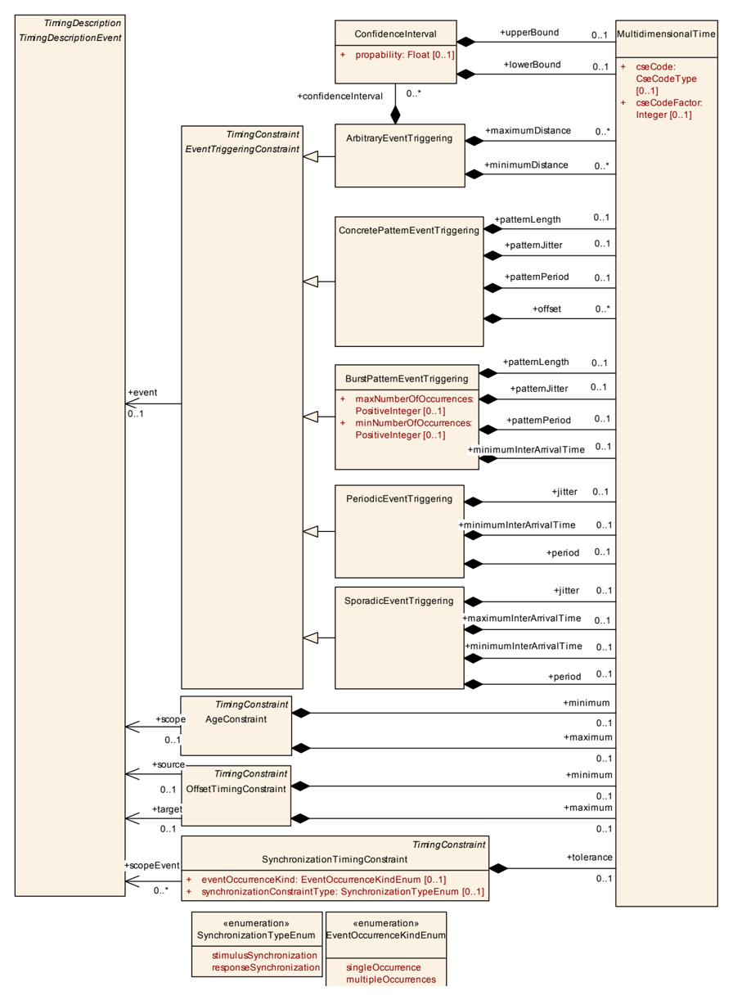

##### 3.4.2.1. SynchronizationTimingConstraint（**SynchronizationTimingConstraint**）

在某些情况下，在应规定时序约束的时间点上，完整的事件链尚未完全知晓，或在模型的作用域内不可用。为此，TIMEX 允许对事件规定同步约束。在这种情况下，被约束引用的事件是隐式关联的，因为它们具有一个尚未知或在模型作用域内不可用的共同激励（在约束类型为 responseSynchronization 时）或共同响应（在约束类型为 stimulusSynchronization 时）。

在开发的后续阶段，当细化的软件架构展现出完整的事件链时（例如因为共同的激励变得已知），应规定相应的事件链，并将其与施加于事件链的 SynchronizationTimingConstraint（见[第 3.4.1.1 节](#3411-synchronizationtimingconstraintsynchronizationtimingconstraint)）相关联，以细化先前定义的施加于事件的 SynchronizationTimingConstraint。

**SynchronizationTimingConstraint 规定同时性约束（**specifies synchronicity constraints**）**：元素 SynchronizationTimingConstraint 用于规定两条或多条 TimingDescriptionEvent 的发生之间的同步约束。

这些参数的使用如图 3.45 所示。

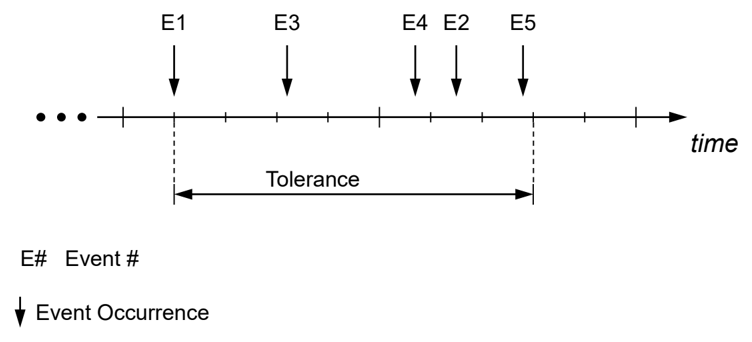

**约束：SynchronizationTimingConstraint 应至少引用两个事件**：在 SynchronizationTimingConstraint 施加于事件的情形下，应至少引用两个（2）时序描述事件。

**约束：属性 synchronizationConstraintType 的规定**：当 SynchronizationTimingConstraint 施加于事件时，应规定属性 synchronizationConstraintType。

**约束：SynchronizationTimingConstraint.synchronizationConstraintType 的存在性**：对于每个 SynchronizationTimingConstraint，在与 TimingDescriptionEvent 的具体子类相关联的施加时间点，属性 synchronizationConstraintType 必须存在。

**约束：SynchronizationTimingConstraint.tolerance 的存在性**：对于每个 SynchronizationTimingConstraint，在与 TimingDescriptionEvent 的具体子类相关联的施加时间点，属性 tolerance 必须存在。

###### 3.4.2.2. EventTriggeringConstraint（**EventTriggeringConstraint**）

EventTriggeringConstraint 是一个抽象基类，表示事件报告的具体类型（模式）的若干子类。无论具体的元类是什么，EventTriggeringConstraint 都需要一个事件作为其作用域。

**EventTriggeringConstraint 规定出现行为（**specifies occurrence behavior**）**：元素 EventTriggeringConstraint 是一个抽象元类，用于规定给定 TimingDescriptionEvent 的特定发生。

表3.59：EventTriggeringConstraint（**EventTriggeringConstraint**）

| 属性 | 值 |
| --- | --- |
| 类 | EventTriggeringConstraint（抽象） |
| 包 | M2::AUTOSARTemplates::CommonStructure::Timing::TimingConstraint::EventTriggeringConstraint |
| 说明 | 描述被引用时序事件的出现行为。只有当能够获得从时序事件到实现的映射时，才能确定出现行为。不过，建模者也可以将这样的出现行为描述为一个假设，或关于该事件发生的一个需求。 |
| 基类 | ARObject、Identifiable、MultilanguageReferrable、Referrable、TimingConstraint、Traceable |
| 子类 | ArbitraryEventTriggering、BurstPatternEventTriggering、ConcretePatternEventTriggering、PeriodicEventTriggering、SporadicEventTriggering |
| 聚合于 | TimingExtension.timingGuarantee、TimingExtension.timingRequirement |

| 属性 | 类型 | 多重性 | 种类 | 备注 |
| --- | --- | --- | --- | --- |
| event | TimingDescriptionEvent | 0..1 | ref | 被引用的时序事件。 |

**约束：EventTriggeringConstraint.event 的存在性**：对于每个 EventTriggeringConstraint，在与 TimingDescriptionEvent 的具体子类相关联的施加时间点，角色 event 中的引用必须存在。

###### 3.4.2.2.1. PeriodicEventTriggering（**PeriodicEventTriggering**）

**PeriodicEventTriggering 规定事件的周期性发生（**specifies periodic occurrences of events**）**：元素 PeriodicEventTriggering 用于规定周期性发生的 TimingDescriptionEvent 的特性。

表3.60：PeriodicEventTriggering（**PeriodicEventTriggering**）

| 属性 | 值 |
| --- | --- |
| 类 | PeriodicEventTriggering |
| 包 | M2::AUTOSARTemplates::CommonStructure::Timing::TimingConstraint::EventTriggeringConstraint |
| 说明 | 描述具有由 period 给定的严格周期性发生模式的事件的行为。此外，可以通过规定一个 jitter 来软化周期性发生行为的严格性，使得对周期的偏差最多可达 jitter 的大小。 |
| 基类 | ARObject、EventTriggeringConstraint、Identifiable、MultilanguageReferrable、Referrable、TimingConstraint、Traceable |
| 聚合于 | TimingExtension.timingGuarantee、TimingExtension.timingRequirement |

| 属性 | 类型 | 多重性 | 种类 | 备注 |
| --- | --- | --- | --- | --- |
| jitter | MultidimensionalTime | 0..1 | aggr | 周期性事件发生的最大偏差。标签：xml.sequenceOffset=20 |
| minimumInterArrivalTime | MultidimensionalTime | 0..1 | aggr | 关联事件的后续连续发生之间的最小时间距离。若 minimumInterArrivalTime 小于 period 减去 jitter，则 minimumInterArrivalTime 对该约束的属性没有影响。标签：xml.sequenceOffset=10 |
| period | MultidimensionalTime | 0..1 | aggr | 事件后续发生之间的周期距离。标签：xml.sequenceOffset=30 |

设 t<sub>n</sub> 为事件第 n 次发生的时间点。当且仅当至少存在一个参考时间点 t<sub>reference</sub>，使得对于事件在 t<sub>n</sub> 的每次发生，下式成立：

```
t_reference + (n-1)·period ≤ t_n ≤ t_reference + (n-1)·period + jitter
```

并且对所有这些事件发生，最小距离应小于或等于 minimumInterArrivalTime：

```
∃ t_reference | ∀n : t_reference + (n-1)·period ≤ t_n ≤ t_reference + (n-1)·period + jitter  AND  ∀n : t_n+1 − t_n ≤ minimumInterArrivalTime
```

图 3.46 说明了 PeriodicEventTriggering 的参数。该图上半部分展示 jitter 的取值小于参数 period 的取值的情形；而下半部分展示 jitter ≥ period 的情形。

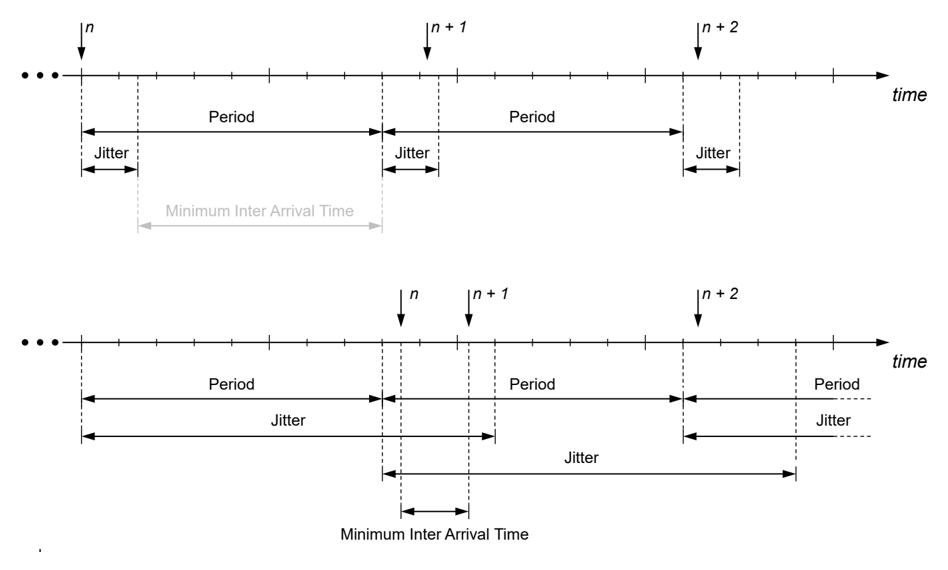

**示例：** 规定一个 PeriodicEventTriggering 约束，参数为 period=6ms 和 jitter=2ms。换言之，对一个事件施加每 6 ms 发生一次的时序约束，并规定 2 ms 的偏差是可容忍的。

此外，假设 minimumInterArrivalTime=1ms，因此它对事件发生的时序没有影响。该时序约束如图 3.47 所示。图中重复出现的灰色矩形指示事件可能发生的时间区间；即它们划定预期事件发生的后续时间区间。

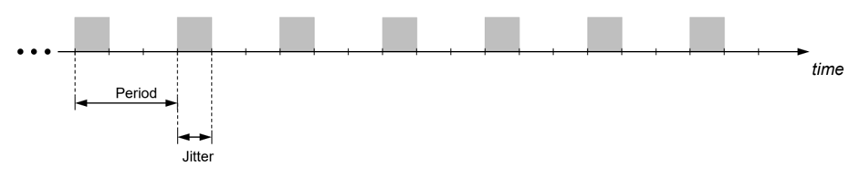

以下各图展示在对一个待分析系统的观测期间记录的各种事件发生。观测的时间区间由 t<sub>end-observation</sub> − t<sub>start-observation</sub> 给出。在给定示例中，系统被观测了 33.6 ms。

图 3.48 所示的后续事件发生满足给定的 PeriodicEventTriggering 约束，因为在观测时间区间内观察到的该事件的全部发生都落在由 period 和 jitter 给定的各自相应时间区间内。

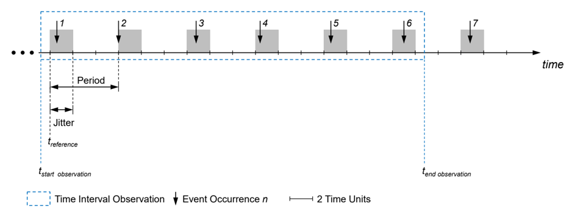

图 3.49 所示的后续事件发生满足给定的周期事件触发约束，因为在观测时间区间内观察到的该事件的全部发生都落在由 period 和 jitter 给定的各自相应时间区间内。与图 3.48 所示示例相比，参考时间点是另一个。

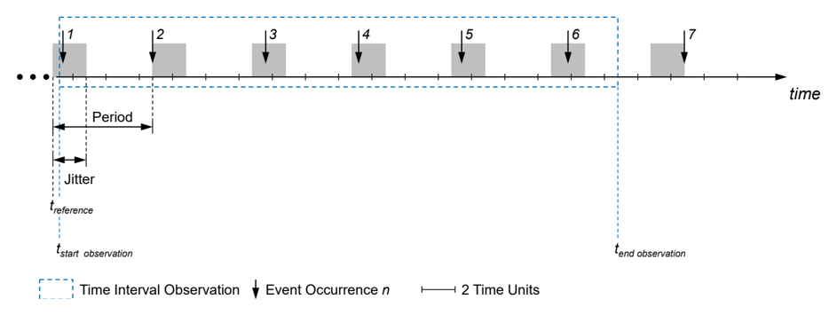

图 3.50 所示的后续事件发生违反给定的 PeriodicEventTriggering 约束，因为该事件的第五次发生没有落在由 period 和 jitter 给定的其相应时间区间内。换言之，不存在这样一个参考时间点，能够确保在观测时间区间内观察到的该事件的全部发生都落在由 period 和 jitter 给定的各自相应时间区间内。这导致参数 period 和 jitter 被违反。

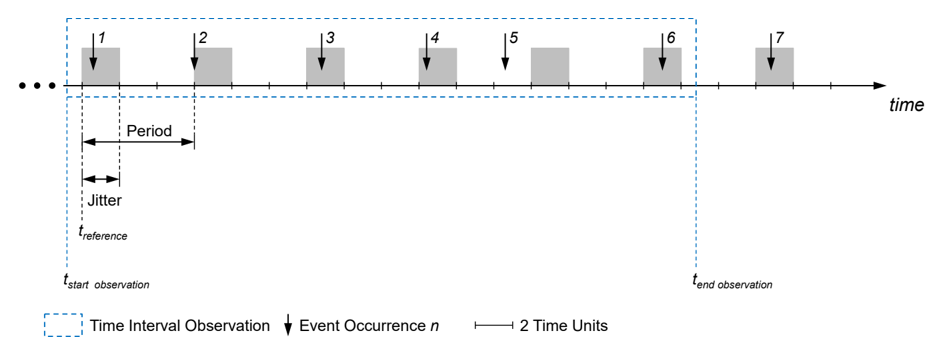

图 3.51 所示的后续事件发生违反给定的周期事件触发约束，因为该事件的第四次发生没有落在由 period 和 jitter 给定的其相应时间区间内。换言之，该事件的第四次发生在该事件第五次发生的时间区间内发生，因此违反了规定的 jitter。

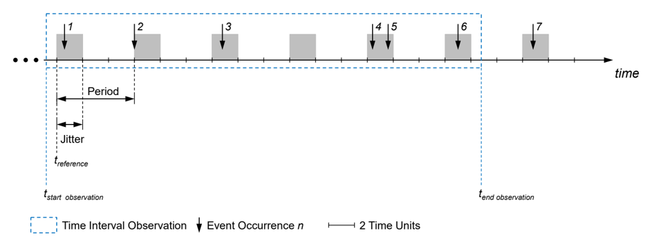

**约束：minimumInterArrivalTime 的最大值**：minimumInterArrivalTime 应 ≤ period。

**约束：PeriodicEventTriggering.jitter 的存在性**：对于每个 PeriodicEventTriggering，在与 TimingDescriptionEvent 的具体子类相关联的施加时间点，属性 jitter 必须存在。

**约束：PeriodicEventTriggering.minimumInterArrivalTime 的存在性**：对于每个 PeriodicEventTriggering，在与 TimingDescriptionEvent 的具体子类相关联的施加时间点，属性 minimumInterArrivalTime 必须存在。

**约束：PeriodicEventTriggering.period 的存在性**：对于每个 PeriodicEventTriggering，在与 TimingDescriptionEvent 的具体子类相关联的施加时间点，属性 period 必须存在。

###### 3.4.2.2.2. SporadicEventTriggering（**SporadicEventTriggering**）

与 PeriodicEventTriggering 相对，SporadicEventTriggering 允许那些不一定发生的事件。它增加了一个额外的参数：maximumInterArrivalTime，用于规定两次 TimingDescriptionEvent 发生之间可能的最大时间距离。

**SporadicEventTriggering 规定事件的偶发性发生（**specifies sporadic occurrences of events**）**：元素 SporadicEventTriggering 用于规定偶发性发生的 TimingDescriptionEvent 的特性。

表3.61：SporadicEventTriggering（**SporadicEventTriggering**）

| 属性 | 值 |
| --- | --- |
| 类 | SporadicEventTriggering |
| 包 | M2::AUTOSARTemplates::CommonStructure::Timing::TimingConstraint::EventTriggeringConstraint |
| 说明 | 描述偶尔或单独发生的事件的行为。 |
| 基类 | ARObject、EventTriggeringConstraint、Identifiable、MultilanguageReferrable、Referrable、TimingConstraint、Traceable |
| 聚合于 | TimingExtension.timingGuarantee、TimingExtension.timingRequirement |

| 属性 | 类型 | 多重性 | 种类 | 备注 |
| --- | --- | --- | --- | --- |
| jitter | MultidimensionalTime | 0..1 | aggr | 偶发性事件发生的最大偏差。Jitter=max&#124;nthPeriod − standardPeriod&#124; 标签：xml.sequenceOffset=30 |
| maximumInterArrivalTime | MultidimensionalTime | 0..1 | aggr | 关联事件两次连续（后续）发生之间的最大时间距离。标签：xml.sequenceOffset=20 |
| minimumInterArrivalTime | MultidimensionalTime | 0..1 | aggr | 关联事件两次连续（后续）发生之间的最小时间距离。标签：xml.sequenceOffset=10 |
| period | MultidimensionalTime | 0..1 | aggr | 事件后续发生之间的周期距离。标签：xml.sequenceOffset=40 |

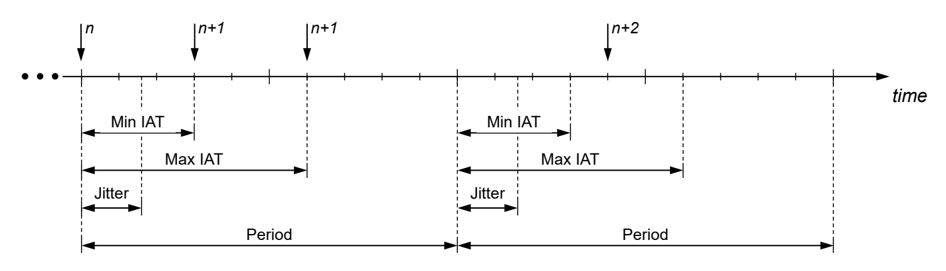

**约束：SporadicEventTriggering.maximumInterArrivalTime 的存在性**：对于每个 SporadicEventTriggering，在与 TimingDescriptionEvent 的具体子类相关联的施加时间点，属性 maximumInterArrivalTime 必须存在。

**约束：SporadicEventTriggering.minimumInterArrivalTime 的存在性**：对于每个 SporadicEventTriggering，在与 TimingDescriptionEvent 的具体子类相关联的施加时间点，属性 minimumInterArrivalTime 必须存在。

###### 3.4.2.2.3. ConcretePatternEventTriggering（**ConcretePatternEventTriggering**）

**ConcretePatternEventTriggering 规定事件发生的具体模式（**specifies concrete pattern of occurrences of events**）**：元素 ConcretePatternEventTriggering 用于规定按照具体模式发生的 TimingDescriptionEvent 的特性。

表3.62：ConcretePatternEventTriggering（**ConcretePatternEventTriggering**）

| 属性 | 值 |
| --- | --- |
| 类 | ConcretePatternEventTriggering |
| 包 | M2::AUTOSARTemplates::CommonStructure::Timing::TimingConstraint::EventTriggeringConstraint |
| 说明 | 描述按照一个精确已知的模式发生的事件的行为。 |
| 基类 | ARObject、EventTriggeringConstraint、Identifiable、MultilanguageReferrable、Referrable、TimingConstraint、Traceable |
| 聚合于 | TimingExtension.timingGuarantee、TimingExtension.timingRequirement |

| 属性 | 类型 | 多重性 | 种类 | 备注 |
| --- | --- | --- | --- | --- |
| offset | MultidimensionalTime | * | aggr | 规定时间区间内事件每次发生的偏移。即参数 patternLength 给定的时间区间内事件发生的时间点列表。标签：xml.name=TIME-VALUE、xml.roleElement=true、xml.sequenceOffset=10、xml.typeElement=false |
| patternJitter | MultidimensionalTime | 0..1 | aggr | 该时间区间起点相对给定周期开始的最大偏差。该参数仅与参数 patternPeriod 结合使用。 |
| patternLength | MultidimensionalTime | 0..1 | aggr | 事件在其中反复发生的时间区间的持续时间。事件在该给定时间区间内的具体时间点发生。标签：xml.sequenceOffset=20 |
| patternPeriod | MultidimensionalTime | 0..1 | aggr | 给定具体模式的后续重复开始之间的时间距离。 |

图 3.53 和图 3.54 说明了 ConcretePatternEventTriggering 参数的使用。

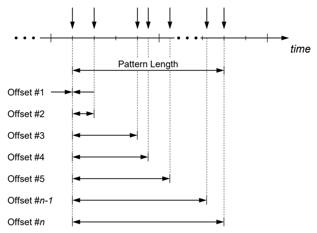

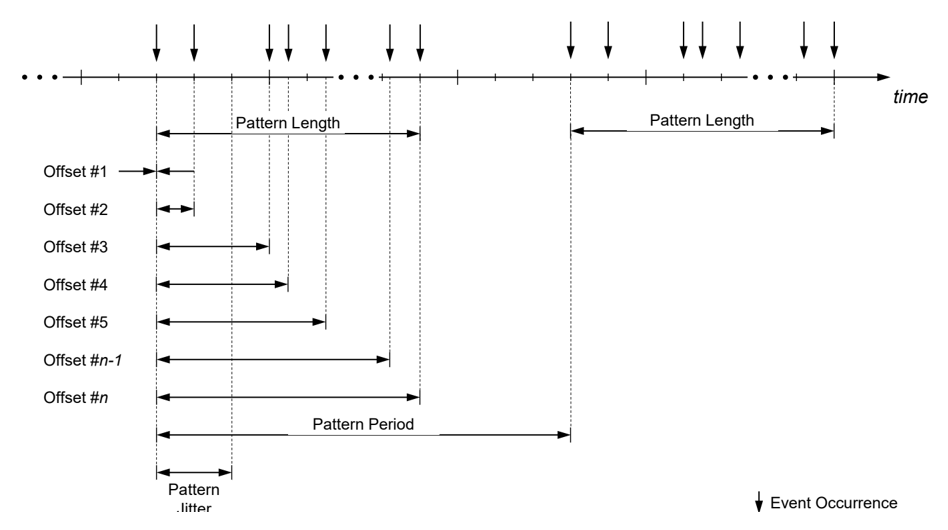

**约束：patternLength 的规定**：patternLength 的规定应满足：0 ≤ max(offset) ≤ patternLength。

**约束：patternLength、patternJitter 与 patternPeriod 的规定**：patternLength、patternJitter 和 patternPeriod 的规定应满足：patternLength + patternJitter &lt; patternPeriod。

**约束：ConcretePatternEventTriggering.patternLength 的存在性**：对于每个 ConcretePatternEventTriggering，在与 TimingDescriptionEvent 的具体子类相关联的施加时间点，属性 patternLength 必须存在。

**约束：ConcretePatternEventTriggering.offset 的存在性**：对于每个 ConcretePatternEventTriggering，在与 TimingDescriptionEvent 的具体子类相关联的施加时间点，属性 offset 必须存在。

###### 3.4.2.2.4. BurstPatternEventTriggering（**BurstPatternEventTriggering**）

**BurstPatternEventTriggering 规定事件发生的突发（**specifies burst of occurrences of events**）**：元素 BurstPatternEventTriggering 用于规定同一个 TimingDescriptionEvent 的一串突发发生的特性。

表3.63：BurstPatternEventTriggering（**BurstPatternEventTriggering**）

| 属性 | 值 |
| --- | --- |
| 类 | BurstPatternEventTriggering |
| 包 | M2::AUTOSARTemplates::CommonStructure::Timing::TimingConstraint::EventTriggeringConstraint |
| 说明 | 描述同一事件在给定时间区间内的最大发生次数。通常用于建模最坏情况激活场景。 |
| 基类 | ARObject、EventTriggeringConstraint、Identifiable、MultilanguageReferrable、Referrable、TimingConstraint、Traceable |
| 聚合于 | TimingExtension.timingGuarantee、TimingExtension.timingRequirement |

| 属性 | 类型 | 多重性 | 种类 | 备注 |
| --- | --- | --- | --- | --- |
| maxNumberOfOccurrences | PositiveInteger | 0..1 | attr | 给定时间区间内事件发生的最大次数。事件可以从不发生，也可以发生 N 次（1 与 maxNumberOfOccurrences 之间）。若规定了参数 minNumberOfOccurrences，则事件至少发生 minNumberOfOccurrences 规定的次数，至多发生 maxNumberOfOccurrences 规定的次数。 |
| minimumInterArrivalTime | MultidimensionalTime | 0..1 | aggr | 规定给定时间区间内事件后续发生之间的最小距离。 |
| minNumberOfOccurrences | PositiveInteger | 0..1 | attr | 给定时间区间内事件发生的最小次数。标签：xml.sequenceOffset=10 |
| patternJitter | MultidimensionalTime | 0..1 | aggr | 该时间区间起点相对给定周期开始的最大偏差。该参数仅与参数 patternPeriod 结合使用。 |
| patternLength | MultidimensionalTime | 0..1 | aggr | 事件在其中反复发生的时间区间的持续时间。事件在该给定时间区间内的任意时间点发生。 |
| patternPeriod | MultidimensionalTime | 0..1 | aggr | 给定突发模式的后续重复开始之间的时间距离。 |

图 3.55 和图 3.56 说明了 BurstPatternEventTriggering 参数的使用。

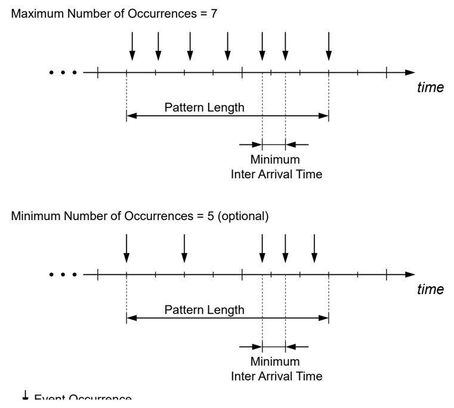

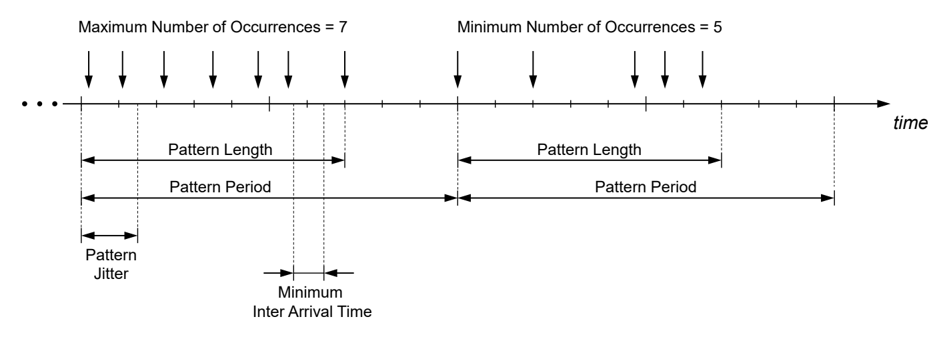

**约束：最小与最大发生次数的规定**：最小与最大发生次数的规定应满足：0 ≤ minNumberOfOccurrences ≤ maxNumberOfOccurrences。

**约束：最小到达间隔时间与模式长度的规定**：minimumInterArrivalTime 和 patternLength 的规定应满足：0 &lt; minimumInterArrivalTime ≤ patternLength。

**约束：模式长度、模式抖动与模式周期的规定**：patternLength、patternJitter 和 patternPeriod 的规定应满足：patternLength + patternJitter &lt; patternPeriod。

**约束：BurstPatternEventTriggering.maxNumberOfOccurrences 的存在性**：对于每个 BurstPatternEventTriggering，在与 TimingDescriptionEvent 的具体子类相关联的施加时间点，属性 maxNumberOfOccurrences 必须存在。

**约束：BurstPatternEventTriggering.minimumInterArrivalTime 的存在性**：对于每个 BurstPatternEventTriggering，在与 TimingDescriptionEvent 的具体子类相关联的施加时间点，属性 minimumInterArrivalTime 必须存在。

**约束：BurstPatternEventTriggering.patternLength 的存在性**：对于每个 BurstPatternEventTriggering，在与 TimingDescriptionEvent 的具体子类相关联的施加时间点，属性 patternLength 必须存在。

###### 3.4.2.2.5. ArbitraryEventTriggering（**ArbitraryEventTriggering**）

与 ConcretePatternEventTriggering 相对，这种事件触发对事件的发生不那么严格，而是概括性地描述事件的发生。

**ArbitraryEventTriggering 规定一个事件的任意发生（**specifies arbitrary occurrences of an event**）**：元素 ArbitraryEventTriggering 用于规定任意发生的 TimingDescriptionEvent 的特性。

表3.64：ArbitraryEventTriggering（**ArbitraryEventTriggering**）

| 属性 | 值 |
| --- | --- |
| 类 | ArbitraryEventTriggering |
| 包 | M2::AUTOSARTemplates::CommonStructure::Timing::TimingConstraint::EventTriggeringConstraint |
| 说明 | 描述一个事件偶尔地、单独地、不规则地或随机地发生。这种事件触发的主要目的是抽象化数据采集工具（后台调试器、轨迹分析器等）在系统运行时捕获的事件发生。 |
| 基类 | ARObject、EventTriggeringConstraint、Identifiable、MultilanguageReferrable、Referrable、TimingConstraint、Traceable |
| 聚合于 | TimingExtension.timingGuarantee、TimingExtension.timingRequirement |

| 属性 | 类型 | 多重性 | 种类 | 备注 |
| --- | --- | --- | --- | --- |
| confidenceInterval | ConfidenceInterval | * | aggr | 置信区间列表。标签：xml.sequenceOffset=30 |
| maximumDistance | MultidimensionalTime | * | aggr | 第 n 个数组元素描述对 n+1 次事件发生的样本可观察到的最大距离。这是一个与 minimumDistance 元素数量相同的数组。标签：xml.name=TIME-VALUE、xml.roleElement=true、xml.sequenceOffset=20、xml.typeElement=false |
| minimumDistance | MultidimensionalTime | * | aggr | 第 n 个数组元素描述对 n+1 次事件发生的样本可观察到的最小距离。这是一个与 maximumDistance 元素数量相同的数组。标签：xml.name=TIME-VALUE、xml.roleElement=true、xml.sequenceOffset=10、xml.typeElement=false |

表3.65：ConfidenceInterval（**ConfidenceInterval**）

| 属性 | 值 |
| --- | --- |
| 类 | ConfidenceInterval |
| 包 | M2::AUTOSARTemplates::CommonStructure::Timing::TimingConstraint::EventTriggeringConstraint |
| 说明 | 除事件发生的测量距离列表之外，还可以以给定的概率为两次连续事件发生的期望距离规定一个置信区间。 |
| 基类 | ARObject |
| 聚合于 | ArbitraryEventTriggering.confidenceInterval |

| 属性 | 类型 | 多重性 | 种类 | 备注 |
| --- | --- | --- | --- | --- |
| lowerBound | MultidimensionalTime | 0..1 | aggr | 两次连续事件发生的期望距离的下界。 |
| propability | Float | 0..1 | attr | 置信区间所测得的下界与上界的概率。 |
| upperBound | MultidimensionalTime | 0..1 | aggr | 两次连续事件发生的期望距离的上界。 |

图 3.57 说明了 ArbitraryEventTriggering 参数的使用。

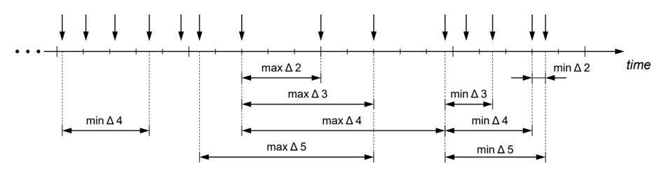

**约束：ArbitraryEventTriggering.minimumDistance 的存在性**：对于每个 ArbitraryEventTriggering，在与 TimingDescriptionEvent 的具体子类相关联的施加时间点，角色 minimumDistance 中的引用应至少存在一次。

**约束：ArbitraryEventTriggering.maximumDistance 的存在性**：对于每个 ArbitraryEventTriggering，在与 TimingDescriptionEvent 的具体子类相关联的施加时间点，角色 maximumDistance 中的引用应至少存在一次。

**约束：ConfidenceInterval.lowerBound 的存在性**：对于每个 ConfidenceInterval，在与 TimingDescriptionEvent 的具体子类相关联的施加时间点，属性 lowerBound 必须存在。

**约束：ConfidenceInterval.propability 的存在性**：对于每个 ConfidenceInterval，在与 TimingDescriptionEvent 的具体子类相关联的施加时间点，属性 propability 必须存在。

**约束：ConfidenceInterval.upperBound 的存在性**：对于每个 ConfidenceInterval，在与 TimingDescriptionEvent 的具体子类相关联的施加时间点，属性 upperBound 必须存在。

###### 3.4.2.3. OffsetTimingConstraint（**OffsetTimingConstraint**）

OffsetTimingConstraint 约束两个时序事件发生之间的时间偏移，而不要求源与目标之间存在直接的函数依赖。

这种约束类型经常与时序事件 TDEventCycleStart 作为源结合使用。在这种情况下，目标事件（例如 RunnableEntity 的启动）在大多数情况下与源事件是函数无关的。

**OffsetTimingConstraint 规定事件发生之间的偏移（**specifies offset between occurrences of events**）**：元素 OffsetTimingConstraint 用于规定两个 TimingDescriptionEvent 的发生之间的偏移。

表3.66：OffsetTimingConstraint（**OffsetTimingConstraint**）

| 属性 | 值 |
| --- | --- |
| 类 | OffsetTimingConstraint |
| 包 | M2::AUTOSARTemplates::CommonStructure::Timing::TimingConstraint::OffsetConstraint |
| 说明 | 约束两个时序事件发生之间的时间偏移，而不要求源与目标之间存在直接的函数依赖。若目标事件发生，则预期它最早以 minimum、最晚以 maximum 的偏移在源事件发生之后相对发生。注意：并非每一次源事件发生之后都应有目标事件发生。与 LatencyTimingConstraint 相对，源事件与目标事件之间不一定存在因果依赖。 |
| 基类 | ARObject、Identifiable、MultilanguageReferrable、Referrable、TimingConstraint、Traceable |
| 聚合于 | TimingExtension.timingGuarantee、TimingExtension.timingRequirement |

| 属性 | 类型 | 多重性 | 种类 | 备注 |
| --- | --- | --- | --- | --- |
| maximum | MultidimensionalTime | 0..1 | aggr | 目标事件在源事件发生之后相对发生的最大偏移。标签：xml.sequenceOffset=20 |
| minimum | MultidimensionalTime | 0..1 | aggr | 目标事件在源事件发生之后相对发生的最小偏移。标签：xml.sequenceOffset=10 |
| source | TimingDescriptionEvent | 0..1 | ref | 目标事件要与之同步的时序事件。 |
| target | TimingDescriptionEvent | 0..1 | ref | 预期在源事件之后及时发生的时序事件。 |

**约束：OffsetTimingConstraint.maximum 的存在性**：对于每个 OffsetTimingConstraint，在与 TimingDescriptionEvent 的具体子类相关联的施加时间点，属性 maximum 必须存在。

**约束：OffsetTimingConstraint.minimum 的存在性**：对于每个 OffsetTimingConstraint，在与 TimingDescriptionEvent 的具体子类相关联的施加时间点，属性 minimum 必须存在。

**约束：OffsetTimingConstraint.source 的存在性**：对于每个 OffsetTimingConstraint，在与 TimingDescriptionEvent 的具体子类相关联的施加时间点，角色 source 中的引用应至少存在一次。

**约束：OffsetTimingConstraint.target 的存在性**：对于每个 OffsetTimingConstraint，在与 TimingDescriptionEvent 的具体子类相关联的施加时间点，角色 target 中的引用应至少存在一次。

###### 3.4.2.4. AgeConstraint（**AgeConstraint**）

有时需要在数据经带 SenderReceiverInterface 的需求端口到达某个 **SWC** 时规定数据的年龄。如果数据的发送者已知，可以定义一条从发送者到接收者端口的 TimingDescriptionEventChain，而带老化语义的 LatencyTimingConstraint 表示数据年龄的规范。然而，数据的实际发送者可能未知，此时无法定义 TimingDescriptionEventChain。

通常，AgeConstraint 约束由相应发送者物理创建数据与数据对接收者可用之间的时间区间。AgeConstraint 的作用域是一个 TDEventVariableDataPrototype。每当被限定作用域的事件发生时，该 VariableDataPrototype 应具有规定的数据年龄。

在开发的后续阶段，当细化的软件架构展现出数据的实际发送者与接收者之间的关系时，应定义一条介于发送时间点与接收时间点之间的事件链，并将其与 LatencyTimingConstraint（见[第 3.4.1.2 节](#3412-latencytimingconstraintlatencytimingconstraint)）相关联，以细化先前定义的老化约束。

**AgeConstraint 的语义（**Semantics of an AgeConstraint**）**：AgeConstraint 用于为接收到的 VariableDataPrototype 或 Trigger 规定一个有下界（最小）和上界（最大）的容差。

表3.67：AgeConstraint（**AgeConstraint**）

| 属性 | 值 |
| --- | --- |
| 类 | AgeConstraint |
| 包 | M2::AUTOSARTemplates::CommonStructure::Timing::TimingConstraint::AgeConstraint |
| 说明 | 以最小和最大时间边界约束该作用域。 |
| 基类 | ARObject、Identifiable、MultilanguageReferrable、Referrable、TimingConstraint、Traceable |
| 聚合于 | TimingExtension.timingGuarantee、TimingExtension.timingRequirement |

| 属性 | 类型 | 多重性 | 种类 | 备注 |
| --- | --- | --- | --- | --- |
| maximum | MultidimensionalTime | 0..1 | aggr | scope 引用的接收事件不应超过该上界。 |
| minimum | MultidimensionalTime | 0..1 | aggr | scope 引用的接收事件不应早于该下界。 |
| scope | TimingDescriptionEvent | 0..1 | ref | 要被约束的 TimingDescriptionEvent。 |

**约束：AgeConstraint 作用域的限定**：在与 TimingDescriptionEvent 的具体子类相关联的施加时间点，AgeConstraint 在角色 scope 中只能引用以下之一：

- TDEventVariableDataPrototype.tdEventVariableDataPrototypeType == variableDataPrototypeReceived
- TDEventTrigger.tdEventTriggerType == triggerActivated

由于 AgeConstraint 预期只在那些没有发送上下文的场景中使用，将其限定到 TimingDescriptionEvent 预期子类的接收侧上下文、并进一步将被引用的端口上下文限定到接收侧 PortPrototype 是审慎的做法。

**约束：AgeConstraint 端口上下文的限定**：在与 TimingDescriptionEvent 的具体子类相关联的施加时间点，AgeConstraint.scope.port 应只引用 AbstractRequiredPortPrototype 的子类。

#### 3.4.3. 施加于 ExecutableEntity 的时序约束（**TimingConstraints on ExecutableEntities**）

TIMEX 提供了围绕执行顺序或执行时间等对 ExecutableEntity 规定约束的手段。与对单个事件或事件链的约束相对，这里的方法略有不同，并且与用例（例如[第 4.1 节](#41-逻辑执行时间logical-execution-time)）紧密相连——依据配置，其中会应用若干类型的约束。本章解释一般性的建模。


##### 3.4.3.1. ExecutionOrderConstraint（**ExecutionOrderConstraint**）

ExecutionOrderConstraint 可以用于任何 TIMEX 视图，只要要引用的 ExecutableEntity 和/或 AbstractEvent 在其他 **AUTOSAR** 模型——即 [\[7\]](#ref-7) 和 [\[8\]](#ref-8)——中可用。

**ExecutionOrderConstraint 约束 ExecutableEntity 序列的排序（**constrains the ordering of sequences of ExecutableEntities**）**：元素 ExecutionOrderConstraint 用于规定若干 ExecutableEntity 的执行顺序。

表3.68：ExecutionOrderConstraint（**ExecutionOrderConstraint**）

| 属性 | 值 |
| --- | --- |
| 类 | ExecutionOrderConstraint |
| 包 | M2::AUTOSARTemplates::CommonStructure::Timing::TimingConstraint::ExecutionOrderConstraint |
| 说明 | 该约束用于限制一组 ExecutableEntity 的执行顺序。ExecutionOrderConstraint 可以用于任何时序视图。ExecutionOrderConstraint 的各种作用域在下面描述。一般而言，每条 ExecutionOrderConstraint 具有一个软件组件的作用域，并且可以直接引用相应内部行为中可用的全部 ExecutableEntity（RunnableEntity 和 BswModuleEntity），或者经由激活或启动它们的事件（RteEvent 和 BswEvent）引用它们。在 **VFB** 层级，可以为 VfbTiming 所引用的组合层次中的 RunnableEntities 规定 ExecutionOrderConstraint。在 **SW-C** 层级，可以为 SwcTiming 所引用的 Internal Behavior 中的 RunnableEntities 规定 ExecutionOrderConstraint。在系统层级，可以为 SystemTiming 所引用的系统组合层次中的 RunnableEntities 规定 ExecutionOrderConstraint。在 **BSW** 模块层级，可以为 BswModuleTiming 所引用的 BswInternalBehavior 中的 BswModuleEntities 规定 ExecutionOrderConstraint。在 **ECU** 层级，可以为 EcuTiming 所引用的、经由 EcucValueCollection（覆盖 **ECU** 提取与 **BSW** 模块配置）可用的全部 ExecutableEntity 和 Event 规定 ExecutionOrderConstraint。 |
| 基类 | ARObject、Identifiable、MultilanguageReferrable、Referrable、TimingConstraint、Traceable |
| 聚合于 | TimingExtension.timingGuarantee、TimingExtension.timingRequirement |

| 属性 | 类型 | 多重性 | 种类 | 备注 |
| --- | --- | --- | --- | --- |
| baseComposition | CompositionSwComponentType | 0..1 | ref | 规定扮演包含其他 **SW-C** 的 **SW-C** 角色的组合 **SW-C** 类型，并表示执行顺序约束的作用域。 |
| executionOrderConstraintType | ExecutionOrderConstraintTypeEnum | 0..1 | attr | 规定 ExecutionOrderConstraint 的特定类型。 |
| ignoreOrderAllowed | Boolean | 0..1 | attr | 控制本约束规定的执行顺序是可以被有意忽略（**TRUE**），还是应被遵守（**FALSE**）。标签：atp.Status=obsolete |
| isEvent | Boolean | 0..1 | attr | 指示 ExecutionOrderConstraint 是只引用 ExecutableEntity（**FALSE**），还是只引用 **RTE** 和/或 **BSW** Event（**TRUE**）。 |
| orderedElement | EOCExecutableEntityRefAbstract | * | aggr | 该聚合表示对将被 ExecutionOrderConstraint 考虑的 RunnableEntities 的引用的一个无序集合。该角色并不意味着引用集合本身应是有序的。 |
| permitMultipleReferencesToEE | Boolean | 0..1 | attr | 指示 ExecutionOrderConstraint 允许一个 ExecutableEntity 在约束中被引用多次（**TRUE**），还是只允许一次（**FALSE**）。 |

表3.69：ExecutionOrderConstraintTypeEnum（**ExecutionOrderConstraintTypeEnum**）

| 属性 | 值 |
| --- | --- |
| 枚举 | ExecutionOrderConstraintTypeEnum |
| 包 | M2::AUTOSARTemplates::CommonStructure::Timing::TimingConstraint::ExecutionOrderConstraint |
| 说明 | 为 ExecutionOrderConstraint 规定 executionOrderConstraintType 的类型。 |
| 聚合于 | ExecutionOrderConstraint.executionOrderConstraintType |

| 字面量 | 说明 |
| --- | --- |
| hierarchicalEOC | 规定 ExecutionOrderConstraint 规定的是一个层次化执行顺序约束。标签：atp.EnumerationLiteralIndex=0 |
| ordinaryEOC | 规定 ExecutionOrderConstraint 规定的是一个普通执行顺序约束。标签：atp.EnumerationLiteralIndex=1 |
| repetitiveEOC | 规定 ExecutionOrderConstraint 规定的是一个重复执行顺序约束。标签：atp.EnumerationLiteralIndex=2 |

表3.70：EOCExecutableEntityRefAbstract（**EOCExecutableEntityRefAbstract**）

| 属性 | 值 |
| --- | --- |
| 类 | EOCExecutableEntityRefAbstract（抽象） |
| 包 | M2::AUTOSARTemplates::CommonStructure::Timing::TimingConstraint::ExecutionOrderConstraint |
| 说明 | 这是执行顺序约束可执行实体引用（叶子）与执行顺序约束可执行实体引用组（组合）的抽象。 |
| 基类 | ARObject、Identifiable、MultilanguageReferrable、Referrable |
| 子类 | EOCEventRef、EOCExecutableEntityRef、EOCExecutableEntityRefGroup |
| 聚合于 | ExecutionOrderConstraint.orderedElement |

| 属性 | 类型 | 多重性 | 种类 | 备注 |
| --- | --- | --- | --- | --- |
| directSuccessor | EOCExecutableEntityRefAbstract | * | ref | 一个可执行实体或一组可执行实体的直接后继。 |

表3.71：EOCExecutableEntityRefGroup（**EOCExecutableEntityRefGroup**）

| 属性 | 值 |
| --- | --- |
| 类 | EOCExecutableEntityRefGroup |
| 包 | M2::AUTOSARTemplates::CommonStructure::Timing::TimingConstraint::ExecutionOrderConstraint |
| 说明 | 用于规定一个由执行顺序约束可执行实体引用（叶子）和/或更多执行顺序约束可执行实体引用组（组合）构成的组（组合）。 |
| 基类 | ARObject、EOCExecutableEntityRefAbstract、Identifiable、MultilanguageReferrable、Referrable |
| 聚合于 | ExecutionOrderConstraint.orderedElement |

| 属性 | 类型 | 多重性 | 种类 | 备注 |
| --- | --- | --- | --- | --- |
| letDataExchangeParadigm | LetDataExchangeParadigmEnum | 0..1 | attr | 规定 **LET** 区间内 ExecutableEntity 之间的数据交换范式。标签：atp.Status=draft |
| letInterval | TimingDescriptionEventChain | * | ref | 该关联引用扮演 **LET** 区间角色、组内可执行实体被分配到的 TimingDescriptionEventChain。 |
| maxCycleRepetitions | PositiveInteger | 0..1 | attr | 仅限重复执行顺序约束：重复执行顺序约束中事件重复（周期）的次数。标签：atp.Status=draft |
| maxCycles | Integer | 0..1 | attr | 在重复执行顺序约束的情形下，该属性规定执行顺序约束考虑的周期数。标签：atp.Status=obsolete |
| maxSlots | Integer | 0..1 | attr | 在重复执行顺序约束的情形下，该属性规定执行顺序约束的每个周期由多少个槽位组成。标签：atp.Status=obsolete |
| maxSlotsPerCycle | PositiveInteger | 0..1 | attr | 仅限重复执行顺序约束：重复执行顺序约束中在一个周期内按给定顺序执行的 ExecutableEntity（槽位）的数量。标签：atp.Status=draft |
| nestedElement（有序） | EOCExecutableEntityRefAbstract | * | ref | 该关联用于建立 EOCEER 组与引用的层次结构。 |
| successor | EOCExecutableEntityRefAbstract | * | ref | 一个可执行实体或一组可执行实体的逻辑后继。 |
| triggeringEvent | TimingDescriptionEvent | 0..1 | ref | 在重复执行顺序约束的情形下，该关联引用触发每个周期的时序描述事件。 |

表3.72：EOCExecutableEntityRef（**EOCExecutableEntityRef**）

| 属性 | 值 |
| --- | --- |
| 类 | EOCExecutableEntityRef |
| 包 | M2::AUTOSARTemplates::CommonStructure::Timing::TimingConstraint::ExecutionOrderConstraint |
| 说明 | 用于定义对一个 ExecutableEntity 的引用。如果 ExecutionOrderConstraint 定义在 **VFB**、系统或 **ECU** 层级，则应经由 ComponentInCompositionInstanceRef 提供对被引用 ExecutableEntity 所属的 SwComponentPrototype 的引用，作为上下文信息。 |
| 基类 | ARObject、EOCExecutableEntityRefAbstract、Identifiable、MultilanguageReferrable、Referrable |
| 聚合于 | ExecutionOrderConstraint.orderedElement |

| 属性 | 类型 | 多重性 | 种类 | 备注 |
| --- | --- | --- | --- | --- |
| bswModuleInstance | BswImplementation | 0..1 | ref | 规定该 **BSW** 模块实体所属的 **BSW** 模块实例。 |
| component | SwComponentPrototype | 0..1 | iref | 该关联引用 **SW-C** 原型的特定实例。InstanceRef 由 ComponentInCompositionInstanceRef 实现。 |
| executable | ExecutableEntity | 0..1 | ref | 其执行顺序被该约束限制的 ExecutableEntity。 |
| successor | EOCExecutableEntityRefAbstract | * | ref | 一个可执行实体或一组可执行实体的逻辑后继。 |

表3.73：EOCEventRef（**EOCEventRef**）

| 属性 | 值 |
| --- | --- |
| 类 | EOCEventRef |
| 包 | M2::AUTOSARTemplates::CommonStructure::Timing::TimingConstraint::ExecutionOrderConstraint |
| 说明 | 用于定义对一个 **RTE** 或 **BSW** Event 的引用。 |
| 基类 | ARObject、EOCExecutableEntityRefAbstract、Identifiable、MultilanguageReferrable、Referrable |
| 聚合于 | ExecutionOrderConstraint.orderedElement |

| 属性 | 类型 | 多重性 | 种类 | 备注 |
| --- | --- | --- | --- | --- |
| bswModuleInstance | BswImplementation | 0..1 | ref | 规定该 **BSW** 事件所关联的 **BSW** 模块实例。 |
| component | SwComponentPrototype | 0..1 | iref | 该关联引用 **SW-C** 原型的特定实例。InstanceRef 由 ComponentInCompositionInstanceRef 实现。 |
| event | AbstractEvent | 0..1 | ref | 其执行顺序被该约束限制的 AbstractEvent（事件）。 |
| successor | EOCExecutableEntityRefAbstract | * | ref | 一个可执行实体或一组可执行实体的逻辑后继。 |

**EOCExecutableEntityRefAbstract 的目的（**Purpose of EOCExecutableEntityRefAbstract**）**：元素 EOCExecutableEntityRefAbstract 是一个抽象类，它表示：

- EOCExecutableEntityRefGroup（组合）
- EOCExecutableEntityRef（原子）
- EOCEventRef（原子）

并使用它们创建表示部分-整体层次的结构。

**ExecutionOrderConstraintTypeEnum 的目的（**Purpose of ExecutionOrderConstraintTypeEnum**）**：元素 ExecutionOrderConstraintTypeEnum 规定上述结构表示的是：

- ordinaryEOC
- hierarchicalEOC
- repetitiveEOC

**EOCExecutableEntityRefGroup 的目的（**Purpose of EOCExecutableEntityRefGroup**）**：元素 EOCExecutableEntityRefGroup 用于定义以下内容的组合：

- EOCExecutableEntityRefGroup
- EOCExecutableEntityRef
- EOCEventRef

**EOCExecutableEntityRef 的目的（**Purpose of EOCExecutableEntityRef**）**：元素 EOCExecutableEntityRef 用于引用应以特定顺序执行的 ExecutableEntity。

**EOCEventRef 的目的（**Purpose of EOCEventRef**）**：元素 EOCEventRef 用于引用：

- RTEEvent
- BswEvent

以规定 ExecutableEntity 的执行顺序。

上述元素可用于为各种目的创建 ExecutionOrderConstraint 的不同模式。这些模式在以下小节中描述。下面列出的约束适用于所有这些模式。

**约束：后继关系 successor 与 directSuccessor 的优先级**：后继关系 successor 和 directSuccessor 始终优先于关联 nestedElement 的有序多重性。

**约束：后继关系不得自引用**：后继关系 successor 和 directSuccessor 的目标与源不得相同。换言之，一个 EOCExecutableEntityRef 和 EOCExecutableEntityRefGroup 不得将其自身引用为它的逻辑或直接后继。

**约束：后继关系的最大数量**：以下两者之间的后继关系（即 successor 或 directSuccessor）的最大数量为一（1）：

- 两个 EOCExecutableEntityRef 之间
- 两个 EOCEventRef 之间
- 两个 EOCExecutableEntityRefGroup 之间
- 一个 EOCExecutableEntityRef 与一个 EOCExecutableEntityRefGroup 之间
- 一个 EOCEventRef 与一个 EOCExecutableEntityRefGroup 之间

**约束：directSuccessor 关系的最大数量**：以下之一的 directSuccessor 关系的数量：

- EOCExecutableEntityRef
- EOCEventRef
- EOCExecutableEntityRefGroup

不得超过系统中可用的独立执行单元的数量。

**约束：任何 ExecutableEntity 的相容重现**：在 ExecutionOrderConstraint 中，由所有 EOCExecutableEntityRef 以及所有 EOCEventRef 引用的 ExecutableEntity，就其重现性而言应是相容的。

**约束：ExecutionOrderConstraint 中元素之间的引用**：一个 EOCExecutableEntityRef 或 EOCEventRef，或一个 EOCExecutableEntityRefGroup，应只引用属于同一个 ExecutionOrderConstraint 的 EOCExecutableEntityRef、所有 EOCEventRef 或 EOCExecutableEntityRefGroup。

**约束：引用 ExecutableEntity 或 AbstractEvent 之一**：一条 ExecutionOrderConstraint 应只包含 EOCExecutableEntityRef 或只包含 EOCEventRef，但不得同时包含两者。在前一种情形下引用的是 ExecutableEntity，在后一种情形下引用的是 AbstractEvent。

**约束：属性 isEvent 的设置**：属性 isEvent 的取值应设置为：

- **TRUE**：当 ExecutionOrderConstraint 只引用 AbstractEvent 时
- **FALSE**：当 ExecutionOrderConstraint 只引用 ExecutableEntity 时

依据约束「引用 ExecutableEntity 或 AbstractEvent 之一」。

**约束：ExecutionOrderConstraint.permitMultipleReferencesToEE 的限定**：仅当依据约束「属性 isEvent 的设置」满足 ExecutionOrderConstraint.isEvent==FALSE 时，属性 permitMultipleReferencesToEE 才应存在，在 **SWC** 时序描述完成时。

约束「ExecutionOrderConstraint.permitMultipleReferencesToEE 的限定」的理由：只有当 ExecutionOrderConstraint 仅引用 ExecutableEntity（而不引用 AbstractEvent）时，同一个 ExecutableEntity 才可以被引用多于一次。

**约束：ExecutionOrderConstraint.orderedElement 的存在性**：对于每个 ExecutionOrderConstraint，在与 TimingDescriptionEvent 的具体子类相关联的施加时间点，属性 orderedElement 应至少存在一次。

**约束：EOCExecutableEntityRefGroup.nestedElement 的存在性**：对于每个 EOCExecutableEntityRefGroup，在与 TimingDescriptionEvent 的具体子类相关联的施加时间点，角色 nestedElement 中的引用应至少存在一次。

###### 3.4.3.1.1. 普通执行顺序约束（**Ordinary Execution Order Constraint**）

ExecutionOrderConstraint.executionOrderConstraintType == ordinaryEOC 用于规定 ExecutableEntity 的一个执行顺序。

如图 3.59 所示，ExecutionOrderConstraint 包含若干 EOCExecutableEntityRef，它们引用执行顺序所施加于的 ExecutableEntity。关联 successor 和 directSuccessor 用于规定后继关系的类型并强制执行执行顺序。


在图 3.60 中，ExecutionOrderConstraint 包含若干事件引用，它们指向执行顺序所施加于的特定 RTEEvent/ BswEvent。


**约束：类型为 ordinaryEOC 的 ExecutionOrderConstraint 中 EOCExecutableEntityRef 应引用 ExecutableEntity**：在 ExecutionOrderConstraint.executionOrderConstraintType == ordinaryEOC 中，所有 EOCExecutableEntityRef 都应引用一个 ExecutableEntity。

**约束：类型为 ordinaryEOC 的 ExecutionOrderConstraint 中 EOCEventRef 应引用 AbstractEvent**：在 ExecutionOrderConstraint.executionOrderConstraintType == ordinaryEOC 中，所有 EOCEventRef 都应引用一个 AbstractEvent。

###### 3.4.3.1.2. 层次化执行顺序约束（**Hierarchical Execution Order Constraint**）

ExecutionOrderConstraint.executionOrderConstraintType == hierarchicalEOC 使用创建 ExecutableEntity 组的能力规定 ExecutableEntity 的执行顺序。换言之，它使得可以规定 EOCExecutableEntityRefGroup、EOCExecutableEntityRef 和 EOCEventRef 的树状结构。

如图 3.61 所示，ExecutionOrderConstraint 包含若干 EOCExecutableEntityRef 和一个 EOCExecutableEntityRefGroup，后者又引用若干 EOCExecutableEntityRef。这些 EOCExecutableEntityRef 与 EOCExecutableEntityRefGroup 之间的关联 successor 和 directSuccessor 用于规定后继关系的类型并强制执行执行顺序。

图例：EOC = 执行顺序约束（**Execution Order Constraint**）；EER = 可执行实体引用（**Executable Entity Reference**）


**约束：maxCycleRepetitions 与 maxSlotsPerCycle 限于重复执行顺序约束**：仅当该 EOCExecutableEntityRefGroup 在 **SWC** 时序描述完成时被 ExecutionOrderConstraint.executionOrderConstraintType == repetitiveEOC 以角色 orderedElement 聚合时，以下属性才应存在：

- EOCExecutableEntityRefGroup.maxCycleRepetitions
- EOCExecutableEntityRefGroup.maxSlotsPerCycle

**约束：层次化执行顺序约束：EOCExecutableEntityRef、EOCEventRef 与 EOCExecutableEntityRefGroup 应是后继关系的目标或源**：在 ExecutionOrderConstraint.executionOrderConstraintType == hierarchicalEOC 中，每个不属于某个 EOCExecutableEntityRefGroup 的：

- EOCExecutableEntityRefGroup
- EOCExecutableEntityRef
- EOCEventRef

都应至少是一个后继关系的目标或源。

**约束：层次化执行顺序约束中 EOCExecutableEntityRef 应引用 ExecutableEntity**：在 ExecutionOrderConstraint.executionOrderConstraintType == hierarchicalEOC 中，所有 EOCExecutableEntityRef 都应引用一个 ExecutableEntity。

**约束：层次化执行顺序约束中 EOCEventRef 应引用 AbstractEvent**：在 ExecutionOrderConstraint.executionOrderConstraintType == hierarchicalEOC 中，所有 EOCEventRef 都应引用一个 AbstractEvent。

**约束：层次化执行顺序约束应有一个无歧义的根 EOCExecutableEntityRefGroup**：ExecutionOrderConstraint.executionOrderConstraintType == hierarchicalEOC 可以包含多个 orderedElement，它们可以是任意数量的 EOCExecutableEntityRef 或 EOCEventRef 与 EOCExecutableEntityRefGroup 的任意组合。在这些元素中，需要有且恰有一个 EOCExecutableEntityRefGroup，它既不是任何后继或直接后继关系的目标，也不是其源。这个 EOCExecutableEntityRefGroup 就是层次化执行顺序约束的根。

**层次化执行顺序约束中根的表示（**Representation of the root**）**：在 ExecutionOrderConstraint.executionOrderConstraintType == hierarchicalEOC 中，层次结构中的根应是 EOCExecutableEntityRefGroup.category == ROOT_GROUP。

**约束：层次化执行顺序约束中单例的 ROOT_GROUP**：在 ExecutionOrderConstraint.executionOrderConstraintType == hierarchicalEOC 中，在 orderedElement 的树中，在 **SWC** 时序描述完成时，应只有一个 EOCExecutableEntityRefGroup.category == ROOT_GROUP。

**约束：层次化执行顺序约束中从 ROOT_GROUP 出发的引用**：在 ExecutionOrderConstraint.executionOrderConstraintType == hierarchicalEOC 中，在 orderedElement 的树中，在唯一可识别的 ROOT_GROUP（依据约束「层次化执行顺序约束中单例的 ROOT_GROUP」）中：

- successor 不应存在
- directSuccessor 不应存在

在 **SWC** 时序描述完成时。

**约束：层次化执行顺序约束中对 ROOT_GROUP 的引用**：在 ExecutionOrderConstraint.executionOrderConstraintType == hierarchicalEOC 中，在 orderedElement 的树中，唯一可识别的 ROOT_GROUP（依据约束「层次化执行顺序约束中单例的 ROOT_GROUP」）不应在以下角色中被引用：

- 由另一个 EOCExecutableEntityRefGroup 以角色 successor
- 由另一个 EOCExecutableEntityRefGroup 以角色 directSuccessor
- 由另一个 EOCExecutableEntityRefGroup 以角色 nestedElement

在 **SWC** 时序描述完成时。

**注意：** 约束「ExecutionOrderConstraint 中元素之间的引用」禁止在多条 ExecutionOrderConstraint 中使用 EOCExecutableEntityRefAbstract 的同一个子类。

###### 3.4.3.1.3. 重复执行顺序约束（**Repetitive Execution Order Constraint**）

ExecutionOrderConstraint.executionOrderConstraintType == repetitiveEOC 用于依据特定事件的后续发生规定不同的 ExecutionOrderConstraint。这使得可以规定：每当特定的 TimingDescriptionEvent 发生时，就向给定数量的 ExecutableEntity 施加特定的 ExecutionOrderConstraint。

例如，若事件 **A** 发生：

- 第 1 次：可执行实体一（1）、二（2）和三（3）
- 第 2 次：可执行实体一（1）、四（4）和五（5）
- 第 3 次：可执行实体一（1）、二（2）和三（3）
- 第 4 次：可执行实体一（1）、四（4）和五（5）
- ……
- …应以该给定顺序执行。

规定事件的这些发生被称为周期（**cycle**），一个周期内 ExecutableEntity 的顺序由槽位（**slot**）安排。

如图 3.62 所示，重复执行顺序约束遵循一个特定的模式。

图例：EOC = 执行顺序约束（**Execution Order Constraint**）；EER = 可执行实体引用（**Executable Entity Reference**）；TD = 时序描述（**Timing Description**）


executionOrderConstraintType == repetitiveEOC 遵循层次化执行顺序约束的模式，但对可执行实体引用组的使用和结构施加了一些限制。ExecutionOrderConstraint 由一个可执行实体引用组构成，称为根组（**root group**），它只引用其他的可执行实体引用组。

这些组又引用可执行实体引用或事件引用，后者最终引用特定的 ExecutableEntity 或事件。根组规定最大周期数 maxCycles 和最大槽位数 maxSlots。

maxCycles 规定执行顺序约束在其后重复的后续事件发生次数（故名「重复执行顺序约束」）；maxSlots 规定一个周期内按给定顺序执行的 ExecutableEntity 的数量。

**注意：** maxCycles（对应地，cycle）是术语 maxRepetitions（对应地，repetition）的同义词。

下表以表格形式呈现图 3.62 所示的重复执行顺序约束。

表3.74：重复执行顺序约束示例（**Example Repetitive Execution Order Constraint**）

| 周期 | 槽位 1 | 槽位 2 | 槽位 3 |
| --- | --- | --- | --- |
| Cycle1 | RE1 | RE2 | RE3 |
| Cycle2 | RE1 | RE4 | RE5 |
| Cycle3 | RE7 | RE8 | RE9 |
| Cycle4 | RE1 | RE8 | RE6 |

创建重复执行顺序约束时应考虑以下约束：

**约束：重复执行顺序约束中 maxCycles 与 maxSlots 的规定**：属性 maxCycles 和 maxSlots 应只由可执行实体引用的根组 EOCExecutableEntityRefGroup 规定。

**约束：maxCycles 与 maxSlots 不得为零**：如果使用属性 maxCycles 和 maxSlots，则属性 maxCycles 和 maxSlots 的取值应大于零（0）。

**约束：重复执行顺序约束中 TimingDescriptionEvent 的引用**：TimingDescriptionEvent 应只由可执行实体引用的根组 EOCExecutableEntityRefGroup 规定。

**约束：根 EOCExecutableEntityRefGroup 应只引用 EOCExecutableEntityRefGroup**：根 EOCExecutableEntityRefGroup 应只引用由元素 EOCExecutableEntityRefGroup 分组的可执行实体引用组或事件引用组。

**约束：根 EOCExecutableEntityRefGroup 引用的嵌套元素数量**：根 EOCExecutableEntityRefGroup 引用的嵌套元素数量应恰好是属性 maxCycles 给出的数量。

**约束：表示一个周期的 EOCExecutableEntityRefGroup 应只引用 EOCExecutableEntityRef 或 EOCEventRef**：表示一个周期的 EOCExecutableEntityRefGroup 应只引用 EOCExecutableEntityRef 或 EOCEventRef。

**约束：表示一个周期的 EOCExecutableEntityRefGroup 引用的嵌套元素数量**：表示一个周期的 EOCExecutableEntityRefGroup 引用的嵌套元素数量应恰好是属性 maxSlots 给出的数量。

**约束：后继关系 successor 与 directSuccessor 不应使用**：后继关系 successor 和 directSuccessor 不应用于 executionOrderConstraintType == repetitiveEOC。

**约束：EOCExecutableEntityRefGroup.triggeringEvent 的限定**：仅当该 EOCExecutableEntityRefGroup 在与 TimingExtension 的具体子类相关联的施加时间点、被 ExecutionOrderConstraint.executionOrderConstraintType == repetitiveEOC 以角色 orderedElement 传递聚合时，角色 EOCExecutableEntityRefGroup.triggeringEvent 中引用的 TimingDescriptionEvent 才应存在。

###### 3.4.3.2. ExecutionTimeConstraint（**ExecutionTimeConstraint**）

**AUTOSAR** 的 ResourceConsumption.executionTime 可用于描述 ExecutableEntity 的执行时间。该概念在 [\[8\]](#ref-8) 中描述。这一执行时间描述表示 ExecutableEntity 的一个时序属性。

表3.75：ExecutionTimeConstraint（**ExecutionTimeConstraint**）

| 属性 | 值 |
| --- | --- |
| 类 | ExecutionTimeConstraint |
| 包 | M2::AUTOSARTemplates::CommonStructure::Timing::TimingConstraint::ExecutionTimeConstraint |
| 说明 | 将被引用组件中可执行实体的执行时间约束在最小与最大区间之间。执行该可执行实体所花的时间——包括被其他实体的中断以及外部调用——通常被称为「响应时间（**response time**）」。时序扩展为此提供了事件链和延迟约束的概念。一条从实体启动到实体终止、并带有相应延迟约束的事件链，表示该可执行实体的一个响应时间约束。 |
| 基类 | ARObject、Identifiable、MultilanguageReferrable、Referrable、TimingConstraint、Traceable |
| 聚合于 | TimingExtension.timingGuarantee、TimingExtension.timingRequirement |

| 属性 | 类型 | 多重性 | 种类 | 备注 |
| --- | --- | --- | --- | --- |
| component | SwComponentPrototype | 0..1 | iref | 为 ExecutionTimeConstraint 包含被引用 ExecutableEntity 的组件。若该实体在一个基础软件模块中，则不应提供组件。InstanceRef 由 ComponentInCompositionInstanceRef 实现。 |
| executable | ExecutableEntity | 0..1 | ref | ExecutionTimeConstraint 引用的 ExecutableEntity。 |
| executionTimeType | ExecutionTimeTypeEnum | 0..1 | attr | 规定 ExecutionTimeConstraint 所约束的执行时间的类型。 |
| maximum | MultidimensionalTime | 0..1 | aggr | 最大执行时间。 |
| minimum | MultidimensionalTime | 0..1 | aggr | 最小执行时间。 |

表3.76：ExecutionTimeTypeEnum（**ExecutionTimeTypeEnum**）

| 属性 | 值 |
| --- | --- |
| 枚举 | ExecutionTimeTypeEnum |
| 包 | M2::AUTOSARTemplates::CommonStructure::Timing::TimingConstraint::ExecutionTimeConstraint |
| 说明 | 为 ExecutionTimeConstraint 规定 executionTimeType 的类型。 |
| 聚合于 | ExecutionTimeConstraint.executionTimeType |

| 字面量 | 说明 |
| --- | --- |
| gross | 指示给定的执行时间是在**无**任何中断、**有**外部调用的情况下执行该可执行实体所用的时间。标签：atp.EnumerationLiteralIndex=0 |
| net | 指示给定的执行时间是在**无**任何中断、**无**任何外部调用的情况下执行该可执行实体所用的时间。标签：atp.EnumerationLiteralIndex=1 |

**ExecutionTimeConstraint 规定执行时间约束（**to specify execution time constraints**）**：元素 ExecutionTimeConstraint 用于规定 ExecutableEntity 的最小和最大执行时间约束。

一条 ExecutionTimeConstraint 引用其执行时间应被约束的 ExecutableEntity。由 component 引用的 ComponentInCompositionInstanceRef 定义包含该 RunnableEntity 的组件实例（对于 **BSW** ExecutableEntity，省略组件引用）。

**约束：ExecutionTimeConstraint.executionTimeType 的存在性**：对于每个 ExecutionTimeConstraint，在 **SWC** 时序描述完成时，属性 executionTimeType 必须存在。

**约束：ExecutionTimeConstraint.executable 的存在性**：对于每个 ExecutionTimeConstraint，在 **SWC** 时序描述完成时，角色 executable 中对 ExecutableEntity 的引用必须存在。

###### 3.4.3.3. SynchronizationPointConstraint（**SynchronizationPointConstraint**）

ExecutionOrderConstraint 的能力不足以显式表达「当且仅当一个或多个其他 ExecutableEntity 已完成执行时，才应启动一个或多个 ExecutableEntity 的执行」。换言之，当一个或多个其他 ExecutableEntity 全部完成其执行时，一个或多个 ExecutableEntity 应接续它们的执行。为了规定这种行为，使用 SynchronizationPointConstraint，它规定由相应 RTEEvent 或 BswEvent 引用的 ExecutableEntity 之间、或 EOCExecutableEntityRefGroup 之间的同步点。

注意，元素 SynchronizationTimingConstraint 也与同步相关，但该元素对事件的发生施加时间约束，例如可执行实体激活、启动和终止的发生。例如，若干 ExecutableEntity 应终止、若干可执行实体应在给定时间区间内启动。但无法规定 ExecutableEntity 应在该时间区间内、在这些可执行实体在该时间区间内启动之前终止。因此，这种能力不足以表达一个同步点。

实际上，可以将两种约束——SynchronizationPointConstraint 和 SynchronizationTimingConstraint——结合起来，以规定若干 ExecutableEntity 之间的同步点是强制性的，并且这些 ExecutableEntity 应在给定时间区间内终止和启动。

表3.77：SynchronizationPointConstraint（**SynchronizationPointConstraint**）

| 属性 | 值 |
| --- | --- |
| 类 | SynchronizationPointConstraint |
| 包 | M2::AUTOSARTemplates::CommonStructure::Timing::TimingConstraint::SynchronizationPointConstraint |
| 说明 | 规定可执行实体组之间、或经由相应 **RTE** 或 **BSW** 事件引用的各个可执行实体之间的同步点。 |
| 基类 | ARObject、Identifiable、MultilanguageReferrable、Referrable、TimingConstraint、Traceable |
| 聚合于 | TimingExtension.timingGuarantee、TimingExtension.timingRequirement |

| 属性 | 类型 | 多重性 | 种类 | 备注 |
| --- | --- | --- | --- | --- |
| sourceEec | EOCExecutableEntityRefGroup | * | ref | 包含应在同步点之前完成执行的实体的源可执行实体集群。 |
| sourceEvent | AbstractEvent | * | ref | 应在同步点之前完成执行的可执行实体（由其事件引用）。 |
| targetEec | EOCExecutableEntityRefGroup | * | ref | 包含应在同步点之后开始执行的实体的目标可执行实体集群。 |
| targetEvent | AbstractEvent | * | ref | 应在同步点之后开始执行的可执行实体（由其事件引用）。 |

**SynchronizationPointConstraint 显式规定可执行实体之间的同步点（**explicitly specifies a synchronization point between executable entities**）**：元素 SynchronizationPointConstraint 用于规定 ExecutableEntity 之间的同步点。

## 4. 应用（**Application**）

本章介绍如何组合[第 3 章](#3-建模modeling)中的各个方面，以实现特定的更高级别的时序应用。

### 4.1. 逻辑执行时间（**Logical Execution Time**）

逻辑执行时间（**Logical Execution Time**，**LET**）是一种实时编程抽象。它从实时程序的实际（物理）执行时间中抽象出来。LET 确定的是从读取程序输入到写出程序输出所花的时间，而不考虑执行处理输入并写出输出的程序所花的时间。LET 的动机源于这样的观察：实时程序的相关行为由何时读取输入、何时写出输出决定，而不是由程序何时执行任意代码决定。

这一逻辑概念如图 4.1 上半部分所示。在释放点（**release point**）读取输入，在终止点（**terminate point**）写出输出。在这两点之间——即逻辑执行时间——程序被执行，且输出的写出被延迟到逻辑执行时间流逝之后，即使程序在逻辑执行时间流逝之前就完成了执行。图 4.1 下半部分勾画了这一点，展示程序的实际物理执行。


### 4.1.1. LET 区间定义（**LET Interval Definition**）

LET 的建模始于一个分类化的 TimingDescriptionEventChain。以 TimingDescriptionEventChain.category == LET_INTERVAL 表示 LET 区间的跨度。这条 TimingDescriptionEventChain 应引用两个 TDEventComplex，以表示激励（见约束「TimingDescriptionEventChain.stimulus 的语义」）与响应（见约束「TimingDescriptionEventChain.response 的语义」）点。

之所以使用 TDEventComplex，是因为激励与响应都不引用可观察位置，与其他类型的 TimingDescriptionEvent 不同。TDEventComplex 上的 TDEventOccurrenceExpression 用于规定在释放点和终止点情形下预期发生的特定 TimingDescriptionEvent。

**TimingDescriptionEventChain 中 LET 区间的表示（**Representation of an LET interval**）**：一条 LET 区间应由 TimingDescriptionEventChain.category == LET_INTERVAL 描述。

**LET 区间释放的表示（**Representation of an LET interval release**）**：一条 LET 区间的释放应由引用 TDEventComplex.category == LET_RELEASE 的激励描述。

**LET 区间终止的表示（**Representation of an LET interval terminate**）**：一条 LET 区间的终止应由引用 TDEventComplex.category == LET_TERMINATE 的响应描述。

在定义了激励和响应事件之后，LET 区间的时序相关参数使用 TimingConstraint 规定。一条 LatencyTimingConstraint 规定 LET 区间的持续时间，一条 PeriodicEventTriggering 规定 LET 区间的重现。

**LET 区间持续时间的表示（**Representation of the duration**）**：一条 LET 区间的持续时间应由一条 LatencyTimingConstraint 描述，其中：

- latencyConstraintType == reaction
- maximum 应规定持续时间的语义。

**LET 区间重现的表示（**Representation of the recurrence**）**：一条 LET 区间的重现应由一条在角色 event 中引用 TimingDescriptionEvent 的 PeriodicEventTriggering 描述。

在上述持续时间的上下文中，属性 minimum 没有意义，应被忽略。

**LET 区间中所用 LatencyTimingConstraint.minimum 的可选性（**Optionality**）**：对于 LatencyTimingConstraint.latencyConstraintType == reaction，若规定了属性 minimum，则应被忽略。

该 PeriodicEventTriggering 约束应施加于表示 LET 区间的时序描述事件链的激励事件（LET 区间的释放点）。

**用于规定 LET 区间重现的 PeriodicEventTriggering 约束的应用（**Application**）**：对于用于配置 LET 区间重现语义的 PeriodicEventTriggering 约束，其引用的 event 应指向扮演 TimingDescriptionEventChain.stimulus 角色的 TDEventComplex。

**约束：LET 区间重现的强制性规定**：对于 TDEventComplex.category == LET_RELEASE，在 **SWC** 时序描述完成时，应存在一条在角色 event 中引用该 TDEventComplex.category == LET_RELEASE 的 PeriodicEventTriggering。

图 4.2 展示了一个示例 LET 模型，相应的 **ARXML** 清单见清单 C.2、C.3、C.4。


### 4.1.2. LET 区间之间的关系（**Relation between LET Intervals**）

本节描述描述 LET 区间的最突出情形以及它们之间可能的关系。这些情形在系统开发中频繁出现。本节描述使用 **AUTOSAR** 元素 PeriodicEventTriggering 和 OffsetTimingConstraint 来规定 LET 区间持续时间以及 LET 区间之间偏移的多种方式。LET 区间之间的偏移导致相互重叠的 LET 区间，或以先后顺序排列、彼此之间有或没有间隙的 LET 区间。

图 4.3 中规定了一个周期性 LET 区间。该 LET 区间周期性地重复，且 LET 区间的取值与周期相同。


描述该模式的对应 **ARXML** 片段如清单 C.2、C.3 和 C.4 所示。第一个清单给出规定 LET 区间的 **ARXML** 片段；第二个清单给出规定 LET 区间持续时间的 **ARXML** 片段；第三个清单给出规定 LET 区间重现的 **ARXML** 片段。

图 4.4 中规定了一个周期性 LET 区间，但周期的取值大于 LET 区间。这导致 LET 区间的终止点与 LET 区间的下一个释放点之间存在一个间隙。对应的 **ARXML** 片段如清单 C.5 所示。**ARXML** 片段的第一部分使用延迟时序约束 LatencyTimingConstraint 规定 LET 区间的持续时间为 6 ms；第二部分使用周期事件触发约束 PeriodicEventTriggering 规定 LET 区间的重现周期为 10 ms。


图 4.5 中规定了三条 LET 区间。第一条 LET 区间<sub>1</sub>的持续时间为 2.5 ms，第二条 LET 区间<sub>2</sub>的持续时间为 5 ms，第三条 LET 区间<sub>3</sub>的持续时间为 10 ms。每条 LET 区间的首次释放发生在同一时间点，随后每条 LET 区间周期性地重复。这一情形使用偏移时序约束 OffsetTimingConstraint 建模，这些 LET 区间释放点之间的偏移为 0 ms，即无偏移。


清单 C.6 给出一个 **ARXML** 片段，它规定 LET 区间<sub>1</sub>的释放点与 LET 区间<sub>2</sub>和 LET 区间<sub>3</sub>的释放点之间的两条偏移时序约束。两种情形下偏移都为零（0 ms），规定所有 LET 区间在同一时间点释放。

图 4.6 中规定了三条 LET 区间。第一条 LET 区间<sub>1</sub>的持续时间为 2.5 ms，第二条 LET 区间<sub>2</sub>的持续时间为 5 ms，第三条 LET 区间<sub>3</sub>的持续时间为 10 ms。每条 LET 区间的首次释放发生在不同的时间点，随后每条 LET 区间周期性地重复。这一情形使用偏移时序约束 OffsetTimingConstraint 建模。第一条 LET 区间<sub>1</sub>与第二条 LET 区间<sub>2</sub>释放点之间的偏移为 2.5 ms；第一条 LET 区间<sub>1</sub>与第三条 LET 区间<sub>3</sub>释放点之间的偏移为 7.5 ms。


清单 C.7 给出一个 **ARXML** 片段，它规定 LET 区间<sub>1</sub>的释放点与 LET 区间<sub>2</sub>和 LET 区间<sub>3</sub>的释放点之间的两条偏移时序约束。第一种情形下 LET 区间<sub>1</sub>与 LET 区间<sub>2</sub>释放点之间的偏移为 2.5 ms；第二种情形下 LET 区间<sub>1</sub>与 LET 区间<sub>3</sub>释放点之间的偏移为 7.5 ms。

图 4.7 中规定了四条 LET 区间。第一条 LET 区间<sub>1</sub>在第二条 LET 区间<sub>2</sub>释放之前终止；第二条 LET 区间<sub>2</sub>在第三条 LET 区间<sub>3</sub>释放之前终止；第三条 LET 区间<sub>3</sub>在第四条 LET 区间释放之前终止。最后，在第四条 LET 区间<sub>4</sub>终止之后，同一 LET 区间序列再次重复。这一情形使用偏移时序约束 OffsetTimingConstraint 规定第一条 LET 区间<sub>1</sub>的释放点与 LET 区间<sub>2</sub>至<sub>4</sub>各自释放点之间的偏移。每条 LET 区间的持续时间连同 LET 区间释放点之间的相应偏移一起列于表 4.1。

周期事件触发约束 PeriodicEventTriggering 用于规定该序列的周期为 32 ms。


下表汇总了图 4.7 所示 LET 区间的持续时间以及 LET 区间<sub>1</sub>的释放点与 LET 区间<sub>2</sub>至<sub>4</sub>释放点之间的偏移。

表4.1：规定任意 LET 区间（**Specifying Arbitrary LET Intervals**）

| LET 区间 | 长度 | 偏移 |
| --- | --- | --- |
| 1 | 2ms | 无偏移 |
| 2 | 6ms | 2ms |
| 3 | 1ms | 8ms |
| 4 | 9ms | 9ms |

清单 C.8 给出一个 **ARXML** 片段，它规定第一条 LET 区间<sub>1</sub>的释放点与三条 LET 区间<sub>2</sub>至<sub>4</sub>的释放点之间的三个偏移。

图 4.8 展示了一个与图 4.7 所述类似的情形，但一些 LET 区间之间的偏移和一些 LET 区间的持续时间不同，导致 LET 区间之间存在一些间隙。该情形每条 LET 区间的持续时间以及 LET 区间之间的偏移连同 LET 区间释放点之间的相应偏移一起列于表 4.2。

与前一个例子一样，周期事件触发约束 PeriodicEventTriggering 用于规定该序列的周期为 32 ms。


下表汇总了图 4.8 所示 LET 区间的持续时间以及 LET 区间<sub>1</sub>的释放点与 LET 区间<sub>2</sub>至<sub>4</sub>释放点之间的偏移。

表4.2：规定带间隙的任意 LET 区间（**Specifying Arbitrary LET Intervals with Gaps**）

| LET 区间 | 长度 | 偏移 |
| --- | --- | --- |
| 1 | 2ms | 无偏移 |
| 2 | 4ms | 3ms |
| 3 | 1ms | 8ms |
| 4 | 7ms | 9ms |

该示例的 **ARXML** 片段与清单 C.8 所示相同，只是偏移时序约束和规定四条 LET 区间持续时间的延迟时序约束的取值不同。

考虑到由多个电子控制单元组成的系统的开发——每个电子控制单元很可能配备多个处理器，处理器又包含若干独立的执行单元（也称为核心（**core**））——就有必要能够规定支持可执行实体并行执行的 LET 区间。

图 4.9 中规定了四条相互重叠的 LET 区间。LET 区间<sub>3</sub>与 LET 区间<sub>4</sub>相互重叠，并且也与 LET 区间<sub>1</sub>和 LET 区间<sub>2</sub>重叠。


下表汇总了图 4.9 所示 LET 区间的持续时间以及 LET 区间<sub>1</sub>的释放点与 LET 区间<sub>2</sub>至<sub>4</sub>释放点之间的偏移。

表4.3：规定带重叠的任意 LET 区间（**Specifying Arbitrary LET Intervals with Overlap**）

| LET 区间 | 长度 | 偏移 |
| --- | --- | --- |
| 1 | 8ms | 无偏移 |
| 2 | 6ms | 13ms |
| 3 | 12ms | 4ms |
| 4 | 14ms | 3ms |

周期事件触发约束 PeriodicEventTriggering 用于规定该序列的周期为 19 ms。

清单 C.9 给出一个 **ARXML** 片段，它规定 LET 区间<sub>1</sub>的释放点与 LET 区间<sub>2</sub>至 LET 区间<sub>4</sub>的三个释放点之间的三条偏移时序约束。偏移取值的选取使得 LET 区间<sub>3</sub>和 LET 区间<sub>4</sub>与 LET 区间<sub>1</sub>和 LET 区间<sub>2</sub>重叠。LET 区间<sub>1</sub>与 LET 区间<sub>2</sub>释放点之间的偏移为 13 ms；LET 区间<sub>1</sub>与 LET 区间<sub>3</sub>释放点之间的偏移为 4 ms；LET 区间<sub>1</sub>与 LET 区间<sub>4</sub>释放点之间的偏移为 3 ms。

### 4.1.3. 可执行实体集群到 LET 区间的映射（**Executable Entity Cluster to LET Interval mapping**）

在分布式实时系统的开发过程中，经常需要出于各种目的对可执行实体进行分组，例如调度、将若干可执行实体映射到 LET 区间，或规定施加在一组可执行实体上的其他约束<sup>1</sup>。

执行顺序约束 ExecutionOrderConstraint 对可执行实体分组的能力——对那些可执行实体的 **RTE** 或 **BSW** 事件的引用——用于规定可执行实体集群（**executable entities cluster**）。特别地，一个执行顺序约束可执行实体引用组 EOCExecutableEntityRefGroup（**EOCEERG**）用于引用属于一个可执行实体集群的可执行实体的全部 **RTE** 和/或 **BSW** 事件。而一个执行顺序约束可执行实体引用组又可以引用其他的可执行实体组，以形成可执行实体集群的层次结构。

术语「可执行实体集群（**Executable Entities Cluster**）」是 EOCExecutableEntityRefGroup 的同义词——也称为可执行实体组。一个可执行实体集群使用属性 letInterval 映射到一个 LET 区间。

作为示例，假设有 8 个 AtomicSwComponentType：Swc01..Swc08。这些 **SWC** 中的每一个都有内部行为 ib_Swc0#，其中数字符号指示 Swc01..Swc08 之一。每个 **SWC** 都有一个名为 re_re01_Swc0# 的 RunnableEntity，并规定了一个名为 te_re01_Swc0# 的 Timing Event，它引用该 **SWC** 中相应的 RunnableEntity。

这些 RunnableEntity 具有数据读取和数据写入访问点，从相应 **SWC** 的端口读取数据并向相应 **SWC** 的提供端口写入数据。RunnableEntity 之间的数据依赖图如图 4.10 所示。本例定义了三个可执行实体集群：第一个可执行实体集群由可运行实体 re_re01_Swc01、re_re01_Swc02 和 re_re01_Swc04 组成；第二个由可运行实体 re_re01_Swc03 和 re_re01_Swc07 组成；第三个可执行实体集群由可运行实体 re_re01_Swc05、re_re01_Swc06 和 re_re01_Swc08 组成。示例中定义了三条 LET 区间，分别名为 LETinterval1、LETinterval2 和 LETinterval3。第一个可执行实体集群使用元素 EOCExecutableEntityRefGroup 与元素 TimingDescriptionEventChain 之间名为 letInterval 的关联映射到第一条 LET 区间。

> 1 术语「可执行实体（**executable entity**）」用于同时指称 **AUTOSAR** Runnable Entity 和 Basic Software Module Entity。实际上，**AUTOSAR** 元素 ExecutableEntity 是一个抽象类，RunnableEntity 和 BswModuleEntity 是该类的特化。


清单 C.10 给出一个 **ARXML** 片段，它规定一个可执行实体集群，以及它被映射到 LETinterval1。

一个可执行实体集群通过让 EOCExecutableEntityRefGroup 引用扮演 LET 区间角色的时序描述事件链而映射到一个 LET 区间。

**属性 letInterval 的目的（**Purpose of the attribute letInterval**）**：关联 letInterval 用于把可执行实体组中包含的可执行实体映射到一个 LET 区间。

**约束：letInterval 所引用 TimingDescriptionEventChain 的限定**：在 **SWC** 时序描述完成时，元素 EOCExecutableEntityRefGroup.letInterval 应只存在于 ROOT_GROUP（依据约束「层次化执行顺序约束中单例的 ROOT_GROUP」）中。

**约束：LET 区间中所用 RTEEvent 的限定**：在 **SWC** 时序描述完成时，一个在角色 letInterval 中引用 TimingDescriptionEventChain.category == LET_INTERVAL、并且传递地引用角色 successor 中的 EOCEventRef 或引用角色 nestedElement 中的 EOCEventRef 的 EOCExecutableEntityRefGroup，其那些 EOCEventRef 应引用以下之一：

- 角色 event 中的 TimingEvent，或
- 角色 event 中的 BswTimingEvent

### 4.1.4. LET 区间内的数据流（**Data flow within an LET Interval**）

letInterval 的释放与终止事件定义了何时预期读取输入数据和写出输出数据。这为属于引用不同 LET 区间的 EOCExecutableEntityRefGroup 的 ExecutableEntity 之间的数据交换提供了唯一的数据流。

对于与单个 letInterval 相关的 EOCExecutableEntityRefGroup 中的所有 ExecutableEntity，在一个 letInterval 内如何交换数据有两种可能的范式——见图 4.11。

表4.4：LetDataExchangeParadigmEnum（**LetDataExchangeParadigmEnum**）

| 属性 | 值 |
| --- | --- |
| 枚举 | LetDataExchangeParadigmEnum |
| 包 | M2::AUTOSARTemplates::CommonStructure::Timing::TimingConstraint::ExecutionOrderConstraint |
| 说明 | 规定 **LET** 区间内 ExecutableEntity 之间的数据交换范式。标签：atp.Status=draft |
| 聚合于 | EOCExecutableEntityRefGroup.letDataExchangeParadigm |

| 字面量 | 说明 |
| --- | --- |
| interLetOnly | 映射到该 LET 区间的所有 ExecutableEntity 只在该 LET 区间的释放与终止事件处交换数据。这允许对所需的标签缓冲进行直接的转换，但会导致更长的端到端延迟（周期的倍数）。LET 区间内 ExecutableEntity 的执行顺序不影响数据流。标签：atp.EnumerationLiteralIndex=0、atp.Status=draft |
| intraLetEOC | 属于同一 EOCExecutableEntityRefGroup 并映射到该 LET 区间的 ExecutableEntity 按 EOCExecutableEntityRefGroup 定义的顺序执行，并根据隐式语义在该 LET 区间内直接交换数据。只在 LET 区间的边界处或独立的 EOCExecutableEntityRefGroup 之间，数据才按 LET 范式传播。标签：atp.EnumerationLiteralIndex=1、atp.Status=draft |

**默认 letDataExchangeParadigm（**Default**）**：默认 letDataExchangeParadigm = intraLetEOC。


letDataExchangeParadigm 应只应用于在 LET 区间上下文中使用的 EOCExecutableEntityRefGroup，因此应加以约束以反映这一点。

**约束：EOCExecutableEntityRefGroup.letDataExchangeParadigm 的限定**：仅当同一个 EOCExecutableEntityRefGroup 中的 letInterval 引用 TimingDescriptionEventChain.category == LET_INTERVAL 时，属性 letDataExchangeParadigm 才应存在，在 **SWC** 时序描述完成时。

### 4.2. 系统级逻辑执行时间（**System Level Logical Execution Time**）

系统级逻辑执行时间（**System Level Logical Execution Time**，**SL-LET**）建立在逻辑执行时间的概念之上，但面向系统级视图，例如（异构的）**CP ECU** 和/或 **AP Machine** 的端口之间 [\[9\]](#ref-9)。

**AUTOSAR** 中 LET 的作用域是为本地 **ECU** 上可运行实体的执行规定时间区间（因此仅限 **CP**），而 SL-LET：

- 寻址任意端口上的数据流（例如功能块、**SWC**、服务的端口），并允许规定大于周期的延迟（即 SL-LET 区间持续时间），
- 通过显式寻址具有有界同步精度的分布式时钟，允许纳入分布式通信，
- 可以已经在功能层级应用，并在开发过程中逐级分解。

对读写动作瞬时 SL-LET 事件的假设意味着这些动作在逻辑零时间内发生。SLLET 的正确实现必须保持 SL-LET 模型的数据流语义。

#### 4.2.1. SL-LET 区间定义（**SL-LET Interval Definition**）

SL-LET 的建模始于一个分类化的 TimingDescriptionEventChain。

**TimingDescriptionEventChain 中 SL-LET 区间的表示（**Representation of an SL-LET interval**）**：一条 SL-LET 区间应由 TimingDescriptionEventChain.category == SL_LET_INTERVAL 描述。

TimingDescriptionEventChain.category == SL_LET_INTERVAL 应引用两个 TDEventSLLET，以表示激励（见约束「TimingDescriptionEventChain.stimulus 的语义」）与响应（见约束「TimingDescriptionEventChain.response 的语义」）。

**SL-LET 区间释放的表示（**Representation of an SL-LET interval release**）**：一条 SL-LET 区间的释放应由引用 TDEventSLLET.category == SL_LET_RELEASE 的激励描述。

**SL-LET 区间终止的表示（**Representation of an SL-LET interval terminate**）**：一条 SL-LET 区间的终止应由引用 TDEventSLLET.category == SL_LET_TERMINATE 的响应描述。


提供属性 TimingDescriptionEventChain.isPipeliningPermitted 以规定 TimingDescriptionEventChain.category == SL_LET_INTERVAL 是否必须使用流水线执行 [\[9\]](#ref-9)。

**约束：TimingDescriptionEventChain.isPipeliningPermitted 在 TimingDescriptionEventChain 中的受限使用**：仅当 TimingDescriptionEventChain.category == SL_LET_INTERVAL 时，属性 isPipeliningPermitted 才应存在。

在此上下文中使用的 TimingDescriptionEvent 可以引用一个可选的 TimingDescriptionEvent.clockReference（4.2.2），但对于 SL-LET 之外的上下文应被排除。

**约束：TimingDescriptionEvent.clockReference 的受限使用**：当且仅当该 TimingDescriptionEvent 具有：

- category == SL_LET_RELEASE，或
- category == SL_LET_TERMINATE

时，引用 TimingDescriptionEvent.clockReference 才应存在。

C.12 中的清单给出了一个规定时序描述事件链和时序描述事件的 **ARXML**。图 4.13 以图形方式展示了一个 SL-LET 区间的简化模型。


一条 SL-LET 区间的时序参数以与 LET 区间相同的方式规定，并应按照[第 4.1.1 节](#411-let-区间定义let-interval-definition)的解释规定。示例 **ARXML** 见 C.12（持续时间）与 C.12（重现）。

##### 4.2.1.1. 执行顺序（**Execution Order**）

图 4.14 展示了一个关于执行顺序的示例。SL-LET 区间 SLLET1 的释放与终止事件关联到 Swc01 的需求端口和 Swc02 的提供端口。这意味着可运行实体的执行顺序 R1 → R2 → R3。该示例是平台无关的。


#### 4.2.2. SL-LET 时区（**SL-LET Time Zones**）

（**LET Zone**）是 SL-LET 领域内的一种扩展。其背景是：时序事件链中的时序描述事件可能实际具有不同的物理时基（**LET Zone Clock**），因此需要离散地引用这些 LET Zone Clock，以确定一个 SL-LET 区间的同步精度。

在部署视图中，LET Zone Clock 可以构成基于树形的层次结构。随着树从高层视图下降到低层视图，时基（LET Zone Clock）从逻辑的高层级（例如车辆级）移动到逻辑的低层级（例如传感器/执行器级）。

图 4.15 展示了这些概念的图形化示例。本例使用 3 个 LET 区（**LET zone**）表示层次结构；原则上任何数量的 LET 区都是可能的，但同步精度始终位于上 LET 区与下 LET 区（时序描述事件端点）之间。

一个名为 TZ_A 的 LET 区由一个 TDLETZoneClock 表示。通过在 TimingDescriptionEvent 中引用相应的 TimingClock，SL-LET 区间可以规定在 LET 区 TZ1 与 TZ2 之间，或者相对于 LET 区 TZ0 在更高的层次级别上规定。

如果存在一个 TimingClockSyncAccuracy，其 upper 指向 TDLETZoneClock_A、lower 指向 TDLETZoneClock_B，则 LET 区 TZ_B 是 TZ_A 的下级 LET 区。这一定义可以递归应用：若 TZ_C 是 TZ_B 的下级 LET 区，而 TZ_B 是 TZ_A 的下级 LET 区，则 TZ_C 也是 TZ_A 的下级 LET 区。

因此，内部同步精度要求 ε<sub>0,int</sub>（TDLETZoneClock 的属性 accuracyInt）被用作抽象 TZ0 的下级 LET 区的包装。

不同的 LET 区时钟（可由 TDLETZoneClock 规定）以层次化的方式同步。这一关系可以由元素 TimingClockSyncAccuracy 规定。图 4.12 展示了这些元素之间的关系。

对应的 **ARXML** 规范如清单 C.12 所示。


在图 4.15 中，内部同步精度要求 ε<sub>0,int</sub> = 30 µs（作为 TDLETZoneClock 的属性给出）被满足，因为 TZ0 的任意两个下级 LET 区之间的最坏情况为 ε<sub>1,ext</sub> + ε<sub>0,1</sub> + ε<sub>0,2</sub> + ε<sub>2,ext</sub> = 0 µs + 10 µs + 5 µs + 0 µs = 15 µs ≤ 30 µs。

图 4.16 展示了 LET 区 TZ2 应包含更多下级 LET 区的示例。最终，SL-LET 区间 SL-LET-1 将引用区时钟 ZC1 和——尚未定义的——区时钟 ZC<sub>x</sub>。这样的层次化具体化可以预先加以约束，方式是规定 TDLETZoneClock 的属性 accuracyExt 和 accuracyInt。

在不了解具体下级 LET 区的情况下，可以相对于 ZC2 规定 SL-LET 区间 SL-LET-1。如果该 SL-LET 区间的释放事件与终止事件都关联到 ZC2，则必须考虑 ZC2 的内部同步精度 accuracyInt。它抽象了 TZ2 的任意两个下级 LET 区之间的同步。如果两个事件中只有一个关联到 ZC2，而另一个例如关联到 ZC1，则必须考虑 ZC2 的外部同步精度 accuracyExt。它抽象了 TZ2 的一个下级 LET 区与任何外部 LET 区之间的同步精度。


##### 4.2.2.1. SL-LET 区时钟（**SL-LET Zone Clocks**）

本节详述 TimingClock。

**TimingClock 的目的（**Purpose of TimingClock**）**：元类 TimingClock 提供时序扩展时基的一个抽象模型。

**TDLETZoneClock 的目的（**Purpose of TDLETZoneClock**）**：元类 TDLETZoneClock 是 TimingClock 的特化，表示一个 LET Zone Clock。

**TimingClock.platformTimeBase 的使用（**Usage**）**：引用 TimingClock.platformTimeBase 指向 **CP/AP** 平台层级上的一个实际时基 GlobalTimeDomain。

**accuracyInt 的可选性（**Optionality of accuracyInt**）**：如果属性 accuracyInt 未规定，则应视为零。这对应于一个 LET 区没有下级 LET 区的情形。

**accuracyInt 的语义（**Semantics of accuracyInt**）**：属性 accuracyInt 为以下组合约束一个上界：被引用的 TimingClockSyncAccuracy 的任意两个 accuracy 的组合，加上被那些 TimingClockSyncAccuracy 引用的 TDLETZoneClock 的 accuracyExt。

**accuracyExt 的可选性（**Optionality of accuracyExt**）**：如果属性 accuracyExt 未规定，则应视为零。这对应于一个 LET 区没有下级 LET 区的情形。

**accuracyExt 的语义（**Semantics of accuracyExt**）**：属性 accuracyExt 为以下情形约束一个上界：TimingClockSyncAccuracy.accuracy 加上被该 TimingClockSyncAccuracy 引用的 TDLETZoneClock 的 accuracyExt。

##### 4.2.2.2. SL-LET 区时钟精度（**SL-LET Zone Clock Accuracy**）

**TimingClockSyncAccuracy 的目的（**Purpose of TimingClockSyncAccuracy**）**：一个 TimingClockSyncAccuracy 用于描述两个 TimingClock 之间的同步精度。

**TimingClockSyncAccuracy.upper 的目的（**Purpose of upper**）**：引用 upper 用于指向一个更高层级的 TimingClock，某个更低层级的 TimingClock 由它派生。

**TimingClockSyncAccuracy.lower 的目的（**Purpose of lower**）**：引用 lower 用于指向一个更低层级的 TimingClock，它由某个更高层级的 TimingClock 派生。

**TimingClockSyncAccuracy 的属性 accuracy 的使用（**Usage of the attribute accuracy**）**：TimingClockSyncAccuracy 的属性 accuracy 规定由属性 upper 引用的更高层级 TDLETZoneClock 与由属性 lower 引用的更低层级 TDLETZoneClock 之间的同步精度。

**accuracy 的可选性（**Optionality of accuracy**）**：如果属性 accuracy 未规定，则应视为零。

### 4.3. 经典平台软件集群（**Classic Platform Software Clusters**）

本节描述对为软件集群（**software cluster**）规定时序模型的支持。软件集群的概念及其目的在 [\[10\]](#ref-10) 中有更详细的描述。

在系统设计期间定义软件集群。软件集群由任意数量的软件组件组成，如图 4.17 所勾画。这些软件集群的内部结构——例如更多的组合软件组件和原子软件组件——在系统设计时是未知的。通常，这些内部结构，尤其是原子软件组件的内部行为以及可运行实体，是软件开发过程中后续步骤的结果。最终，这些可运行实体需要被分配到合适的操作系统任务，以确保正确执行，从而正确提供由这些可运行实体实现的预期功能。或者换言之，如果软件集群要提供这样的时间性与动态性资源，所使用的操作系统必须为软件集群的可运行实体提供所需的执行上下文。


为了在系统设计的开始和进行过程中提供一个框架，TIMEX 中可用的元素被用于描述软件集群的可运行实体正确执行所需的执行环境上施加的时间性与动态性需求和特性。所述方法背后的思想是：使用元素 TimingDescriptionEvent、TimingDescriptionEventChain 和 TimingConstraint 来抽象软件集群可能的可运行实体所需的执行上下文，以规定这类执行上下文的时间参数。该执行上下文被称为调度器（**dispatcher**），作为目标系统中发生的、用于激活一组可执行实体执行的系统事件的抽象。

**AUTOSAR** 元素的利用方式在本节其余部分描述。

由于软件集群是在系统设计期间——即在 **AUTOSAR** 软件系统层级——定义的，因此使用系统时序视图（SystemTiming）创建相应的时序模型。图 4.18 展示了这一点。


为一个软件集群或一组软件集群描述时序模型的系统时序引用一个系统，该系统又引用一个或多个软件集群。在后一种情形下，时序模型的作用域是被引用的软件集群的集合。一个软件集群的系统时序的时序模型主要包含执行上下文——调度器——的定义，它们是后续开发中定义的可运行实体正确执行所需的。

**经典平台软件集群的 SystemTiming（**SystemTiming**）**：引用 System.category == SW_CLUSTER_SYSTEM_DESCRIPTION（[TPS_SYST_01003]）的 SystemTiming 旨在观察经典平台软件集群的时序。

#### 4.3.1. 规定调度器（**Specifying a Dispatcher**）

TimingDescriptionEvent 的属性 category 的取值指示该时序描述是否表示调度器的入口点或出口点。取值 DISPATCH_ENTRY_POINT 指示调度器被进入的时间点。取值 DISPATCH_EXIT_POINT 指示调度器被退出的时间点。

**约束：TimingDescriptionEvent 中 category 取值 DISPATCH_ENTRY_POINT 的使用**：当且仅当该时序描述事件扮演激励事件的角色、且引用该时序描述事件的相应时序描述事件链在描述软件集群时序的上下文中表示一个调度器时，才应设置 TimingDescriptionEvent 的属性 category 的取值 DISPATCH_ENTRY_POINT。

**约束：TimingDescriptionEvent 中 category 取值 DISPATCH_EXIT_POINT 的使用**：当且仅当该时序描述事件扮演响应事件的角色、且引用该时序描述事件的相应时序描述事件链在描述软件集群时序的上下文中表示一个调度器时，才应设置 TimingDescriptionEvent 的属性 category 的取值 DISPATCH_EXIT_POINT。

如图 4.19 所勾画，软件集群的调度器由一条时序描述事件链 TimingDescriptionEventChain 规定。该时序描述事件链引用两个时序描述事件 TimingDescriptionEvent，分别表示调度器的入口点（该时序描述事件链的激励事件）和调度器的出口点（该时序描述事件链的响应事件）。前一个元素的属性 category 的取值为 DISPATCH_ENTRY_POINT；后一个元素的属性 category 的取值为 DISPATCH_EXIT_POINT。复合时序事件 TDEventComplex 用于指示调度器被进入和退出时发生的事件。之所以使用复合时序事件，是因为这两个时序描述事件与其他类型的时序描述事件不同，都不引用可观察位置。复合时序事件的事件出现表达式可用于规定在进入和退出调度器情形下预期发生的特定事件。


清单 C.11 给出一个与图 4.19 所示内容相匹配的 **ARXML** 片段。它规定了一条时序描述事件链，以及两个表示该调度器入口点和出口点的时序描述事件。前一个时序描述事件扮演时序描述事件链的激励角色，后一个时序描述事件扮演响应角色，该时序描述事件链表示调度器。

TimingDescriptionEvent 的属性 category 指示该元素在软件集群及调度器的时序模型上下文中的使用。

TimingDescriptionEvent 的属性 category 的取值指示该时序描述事件表示属于软件集群的调度器的调度入口点，还是属于软件集群的调度器的调度出口点。取值 DISPATCH_ENTRY_POINT 指示调度器被进入/激活的时间点。取值 DISPATCH_EXIT_POINT 指示调度器被退出/终止的时间点。更多细节参见[第 3.3.2 节](#332-timingdescriptioneventtimingdescriptionevent)，特别是约束「TimingDescriptionEvent.category 的限定」以及约束「TimingDescriptionEvent 中 category 取值 DISPATCH_ENTRY_POINT 的使用」「TimingDescriptionEvent 中 category 取值 DISPATCH_EXIT_POINT 的使用」。

#### 4.3.2. 规定调度器的时序参数（**Specifying Timing Parameters of a Dispatcher**）

调度器的时序参数以与 LET 区间相同的方式规定，并应按照[第 4.1 节](#41-逻辑执行时间logical-execution-time)——特别是调度器的最大执行时间（持续时间）——的解释规定。

一条延迟时序约束施加于表示调度器的时序描述事件链，属性 maximum 规定调度器的最大执行时间，如图 4.20 所示。属性 minimum 的取值应设置为零（0），因为不预期调度器必须执行一段最短时间。


如图 4.20 所描绘，调度器的时序参数由一条延迟时序约束和一条周期事件触发约束规定。延迟时序约束规定调度器在周期事件触发约束所规定的给定周期内的最大执行时间。

清单 C.11 给出一个 **ARXML** 片段，它定义了一条 500 µs 的延迟时序约束，施加于清单 C.11 中定义的时序描述事件链——调度器。本质上，该延迟时序约束规定调度器的最大执行时间为 500 µs。

调度器的重现使用周期事件触发约束 PeriodicEventTriggering 规定。这条时序约束施加于表示调度器的时序描述事件链的激励事件——调度器的入口点。清单 C.11 给出一个 **ARXML** 片段，它定义了一条规定重现周期为 10 ms 的周期事件触发约束；换言之，调度器每 10 ms 被进入一次。注意，调度器的执行应在调度器再次被启动——进入——之前完成。

#### 4.3.3. 将可执行实体映射到调度器（**Mapping Executable Entities to a Dispatcher**）

最终，软件集群内原子软件组件的内部行为所属的可执行实体应被分配到由可用的宿主软件集群提供的时间性与动态性资源。由于时间性资源要么是调度器、要么是 LET 区间，因此可执行实体需要被分配到两者之一。

两种情形都使用元素 ExecutionOrderConstraint 的能力来实现此目的。将可执行实体分配到 LET 区间在[第 4.1.3 节](#413-可执行实体集群到-let-区间的映射executable-entity-cluster-to-let-interval-mapping)中详细描述。

规定一条由 EOCEventRef 组成的 ExecutionOrderConstraint，这些 EOCEventRef 引用应被分配到调度器的可执行实体的 **RTE** 事件。这些 EOCEventRef 被规定为一个 EOCExecutableEntityRefGroup 中的嵌套元素。该 EOCExecutableEntityRefGroup 的 triggeringEvent 引用扮演调度入口点即调度器角色的 TDEventComplex。

清单 C.11 给出一个 **ARXML** 片段，它规定应用软件组件五（5）的可运行实体一（1）、应用软件组件二（2）的可运行实体一（1）、应用软件组件 15 的可运行实体二（2）、应用软件组件八（8）的可运行实体二（2）、应用软件组件 13 的可运行实体一（1），以及应用软件组件九（9）的可运行实体三（3）在名为「Dispatcher10ms」的调度器的上下文中执行。这些可运行实体全部属于应用软件组件，这些应用软件组件属于名为「SoftwareClusterA」的应用软件集群。

#### 4.3.4. 软件集群之间的映射（**Mappings between Software Clusters**）

**AUTOSAR** 软件系统开发中的一个重要步骤，是规定开发所涉各方之间的契约。软件集群映射用于规定提供和需要的时间性与动态性资源。这些映射的目的，首先是唯一地标识一个时间性与动态性资源，其次是规定提供这类资源的软件集群以及请求这类资源的软件集群。图 4.21 展示了这些映射元素及其关系。


**TDCpSoftwareClusterMappingSet 的目的（**Purpose of TDCpSoftwareClusterMappingSet**）**：元素 TDCpSoftwareClusterMappingSet 用于收集若干软件集群映射。

表4.5：TDCpSoftwareClusterMappingSet（**TDCpSoftwareClusterMappingSet**）

| 属性 | 值 |
| --- | --- |
| 类 | TDCpSoftwareClusterMappingSet |
| 包 | M2::AUTOSARTemplates::CommonStructure::Timing::TimingCpSoftwareCluster |
| 说明 | 用于收集经典平台软件集群映射。标签：atp.recommendedPackage=TimingExtensions |
| 基类 | ARElement、ARObject、CollectableElement、Identifiable、MultilanguageReferrable、PackageableElement、Referrable |
| 聚合于 | ARPackage.element |

| 属性 | 类型 | 多重性 | 种类 | 备注 |
| --- | --- | --- | --- | --- |
| tdCpSoftwareClusterResourceToTdMapping | TDCpSoftwareClusterResourceMapping | * | aggr | 将一个 **CP** 软件集群资源映射到一个时间性资源。构造型：atpSplitable；atpVariation 标签：atp.Splitkey=tdCpSoftwareClusterResourceToTdMapping.shortName、tdCpSoftwareClusterResourceToTdMapping.variationPoint.shortLabel、vh.latestBindingTime=postBuild |
| tdCpSoftwareClusterToTdMapping | TDCpSoftwareClusterMapping | * | aggr | 将一个时间性资源映射到提供方 **CP** 软件集群与请求方 **CP** 软件集群之间的一个映射。构造型：atpSplitable；atpVariation 标签：atp.Splitkey=tdCpSoftwareClusterToTdMapping.shortName、tdCpSoftwareClusterToTdMapping.variationPoint.shortLabel、vh.latestBindingTime=postBuild |

**约束：TDCpSoftwareClusterMapping 的引用提供方**：TDCpSoftwareClusterMapping 的引用 provider 应指向一个表示宿主软件集群的 CpSoftwareCluster。

**约束：TDCpSoftwareClusterMapping 的引用请求方**：TDCpSoftwareClusterMapping 的引用 requestor 应指向一个表示应用软件集群的 CpSoftwareCluster。

**TDCpSoftwareClusterMapping 的目的（**Purpose of TDCpSoftwareClusterMapping**）**：元素 TDCpSoftwareClusterMapping 用于规定提供时间性与动态性资源的软件集群与需要该资源的软件集群之间的映射。

表4.6：TDCpSoftwareClusterMapping（**TDCpSoftwareClusterMapping**）

| 属性 | 值 |
| --- | --- |
| 类 | TDCpSoftwareClusterMapping |
| 包 | M2::AUTOSARTemplates::CommonStructure::Timing::TimingCpSoftwareCluster |
| 说明 | 用于规定提供时间性与动态性资源的软件集群与需要这些资源的软件集群之间的映射。 |
| 基类 | ARObject、Identifiable、MultilanguageReferrable、Referrable |
| 聚合于 | TDCpSoftwareClusterMappingSet.tdCpSoftwareClusterToTdMapping |

| 属性 | 类型 | 多重性 | 种类 | 备注 |
| --- | --- | --- | --- | --- |
| provider | CpSoftwareCluster | 0..1 | ref | 提供该时间性与动态性资源的软件集群。 |
| requestor | CpSoftwareCluster | * | ref | 请求该时间性与动态性资源的软件集群。 |
| timingDescription | TimingDescription | 0..1 | ref | 表示该时间性与动态性资源的时序描述。 |

**约束：TDCpSoftwareClusterMapping 应只引用调度器或 LET 区间**：元素 TDCpSoftwareClusterMapping 应引用以下之一作为时序描述：

- TDEventComplex.category == DISPATCH_ENTRY_POINT，或
- TimingDescriptionEventChain.category == LET_INTERVAL。

**TDCpSoftwareClusterResourceMapping 的目的（**Purpose of TDCpSoftwareClusterResourceMapping**）**：元素 TDCpSoftwareClusterResourceMapping 用于为一个时间性与动态性资源分配一个全局唯一资源标识。

表4.7：TDCpSoftwareClusterResourceMapping（**TDCpSoftwareClusterResourceMapping**）

| 属性 | 值 |
| --- | --- |
| 类 | TDCpSoftwareClusterResourceMapping |
| 包 | M2::AUTOSARTemplates::CommonStructure::Timing::TimingCpSoftwareCluster |
| 说明 | 用于为一个时间性与动态性资源分配一个全局唯一资源标识。 |
| 基类 | ARObject、Identifiable、MultilanguageReferrable、Referrable |
| 聚合于 | TDCpSoftwareClusterMappingSet.tdCpSoftwareClusterResourceToTdMapping |

| 属性 | 类型 | 多重性 | 种类 | 备注 |
| --- | --- | --- | --- | --- |
| resource | CpSoftwareClusterResource | 0..1 | ref | 分配给该时间性与动态性资源的特定资源标识。 |
| timingDescription | TimingDescription | 0..1 | ref | 表示该时间性与动态性资源的时序描述。 |

**约束：TDCpSoftwareClusterResourceMapping 应只引用调度器或 LET 区间**：元素 TDCpSoftwareClusterResourceMapping 应引用以下之一作为时序描述：

- TDEventComplex.category == DISPATCH_ENTRY_POINT，或
- TimingDescriptionEventChain.category == LET_INTERVAL。

**约束：TDCpSoftwareClusterMapping 与 TDCpSoftwareClusterResourceMapping 的一致性**：元素 TDCpSoftwareClusterMapping 与元素 TDCpSoftwareClusterResourceMapping 引用的时序描述应一致。

清单 C.11 给出一个 **ARXML** 片段，它描述名为「SoftwareClusterA」的应用软件集群需要由名为「SoftwareClusterHost」的宿主软件集群提供的两个时间性资源。这两个所需的时间性资源是名为「Dispatcher10ms」的调度器和名为「Let5msInterval」的逻辑执行时间区间。

#### 4.3.5. 示例（**Example**）

在给定示例中，一个 **AUTOSAR** 软件系统由十一（11）个组合软件组件构成。名为「CSWCT01」的组合软件组件类型扮演该系统的根软件组合软件原型的角色。该组合软件组件类型包含两个名为「cSwcPt02」和「cSwcPt03」的组合软件组件原型。组合软件组件类型「CSWCT02」包含两个名为「cSwcPt04」和「cSwcPt09」的组合软件组件原型；组合软件组件类型「CSWCT03」包含名为「cSwcPt05」和「cSwcPt06」的组合软件组件原型。组合软件组件类型「CSWCT04」包含两个名为「cSwcPt07」和「cSwcPt08」的组合软件组件原型。最后，组合软件组件类型「CSWCT06」包含两个名为「cSwcPt10」和「cSwcPt11」的组合软件组件原型。软件组件的组合层次如图 4.22 所示。

图例：cSwcPt# = 组合软件组件原型（**Composition SW Component Prototype**）；CSWCT# = 组合软件组件类型（**Composition SW Component Type**）；aSwcPt# = 原子软件组件原型（**Atomic SW Component Prototype**）；ASWCT# = 原子软件组件类型（**Atomic SW Component Type**）


名为「CSWCT05」「CSWCT07」「CSWCT08」「CSWCT09」「CSWCT10」和「CSWCT11」的每个组合软件组件类型都包含三个原子软件组件原型。这些原子软件组件原型的名称遵循规则「aSwcPt##」。占位符「##」表示一个带前导零的两位数字，范围从 01 到 18。例如，组合软件组件类型「CSWCT05」包含三个名为「aSwcPt01」「aSwcPt02」和「aSwcPt03」的原子软件组件原型。每个原子软件组件类型都有一个内部行为，并且每个这样的内部行为都由三个名为「re#ASWCT##」的可运行实体组成；例如，名称「re1ASWCT05」表示原子软件组件类型五（5）的第一个可运行实体。为每个可运行实体规定一个 **RTE** 事件——Timing Event——并按如下方式命名：「teRe#ASWCT##」。

所描述的软件系统由两个软件集群组成，分别名为「Software Cluster A」和「Software Cluster B」。图 4.23 展示了这一点。软件集群 A 由组合软件组件「cSwcPt04」「cSwcPt05」「cSwcPt07」「cSwcPt08」和「cSwcPt10」组成。软件集群 B 由组合软件组件「cSwcPt09」和「cSwcPt11」组成。


假设软件集群 A 和软件集群 B 所需的时间性资源由表示宿主软件集群的第三个软件集群提供。

## A. 参考资料（**Reference Material**）

### A.1. 术语和缩略语（**Terms and Abbreviations**）

术语和缩略语的主列表在 [\[5\]](#ref-5) 中定义。下表包含本文档范围内使用的、但尚未在 [\[5\]](#ref-5) 中定义的术语和缩略语的列表，以及每个缩略语的完整含义。

表A.1：本文档范围内使用的缩略语（**Abbreviations used in the scope of this Document**）

| 缩略语 | 含义 |
| --- | --- |
| EOC | Execution Order Constraint（执行顺序约束） |
| TD | Timing Description（时序描述） |

表A.2：本文档范围内使用的术语（**Terms used in the scope of this Document**）

| 术语 | 含义 |
| --- | --- |
| Jitter（抖动） | 对于周期性发生的时序事件，抖动定义为其周期相对于预定义标准周期的最大变化。 |
| Latency（延迟） | 时序事件链的延迟描述激励发生与相应响应发生之间的持续时间。 |
| Maximum interarrival time（最大到达间隔时间） | 描述两次连续事件发生之间的最大时间区间。在更一般的情形下，该属性是两次、三次、四次……事件发生之间最大延迟的数组。 |
| Minimum interarrival time（最小到达间隔时间） | 描述两次连续事件发生之间的最小时间区间。在更一般的情形下，该属性是两次、三次、四次……事件发生之间最小延迟的数组。 |
| Period（周期） | 描述两次连续事件发生之间的预期时间区间，忽略变化（抖动）。 |
| Response（响应） | 事件链的终点。 |
| Synchronization（同步） | 同步关注不同时序事件的发生。时序事件的同步意味着它们应在某个容差区间内同时发生。 |
| Stimulus（激励） | 事件链的起点。 |
| Timing analysis（时序分析） | 时序分析是确定系统时序行为的一种方法。这包括对与时序相关的系统行为的考虑，例如任务抢占、中断处理、资源阻塞等。 |
| Timing constraint（时序约束） | 时序约束可以有两种不同的解释。一方面，它可以定义系统时序行为的一种限制（例如某个事件序列的最小（最大）延迟界限）。在这种情况下，时序约束是系统应满足的需求。另一方面，时序约束可以定义对系统时序行为的一种保证。在这种情况下，系统开发者保证系统在时序方面具有某种行为（例如保证一个时序事件以某个最大变化周期性地发生）。 |
| Timing description（时序描述） | 系统、子系统或软件组件的时序描述由事件和事件链组成。前者描述可观察的事件，后者描述它们的因果关系。 |
| Timing event（时序事件） | 时序事件是 **AUTOSAR** 规范中对可以在运行时观察到的特定系统行为的抽象表示。时序事件用于定义时序约束的作用范围。依据具体的作用范围、对系统的视图和抽象层级，定义了不同类型的事件。 |
| Timing event chain（时序事件链） | 时序事件链描述一组功能依赖的时序事件的因果顺序。每条事件链都有明确定义的激励和响应，用以描述其起点和终点。此外，它可以层次化地分解为任意数量的子链，即所谓的「事件链段」。 |
| Timing event occurrence（时序事件发生） | 当可以观察到由时序事件表示的特定系统行为时，称该时序事件「发生」。 |
| Timing guarantee（时序保证） | 参见 Timing constraint（时序约束）。 |
| Timing information（时序信息） | 时序属性与时序约束的上位概念。 |
| Timing path（时序路径） | 时序路径定义系统的一系列通信或计算活动，其时序行为应被检验。时序路径可以由事件链表达。 |
| Timing property（时序属性） | 时序属性定义系统内与时序相关方面的状态或取值。因此，属性不代表对系统的一种约束，而是系统的某种收集到的（例如测量、估计或确定的）或定义的属性。 |
| Timing requirement（时序需求） | 时序需求定义为确保系统正确运行而应满足的时序限制。时序需求可以通过使用时序约束来表达。 |
| Timing validation（时序验证） | 时序验证将时序分析的结果与时序约束所定义的预期行为进行比较。 |

### A.2. 约束的施加时间（**Imposition Times of Constraints**）

本文档中阐述的约束具有不同的实际施加时间，它们表示工作流中必须施加相应约束的步骤。

一些施加时间「包含」其他施加时间，表 A.3 中讨论了这种关系的一个示例。

本文档范围内认为适用的施加时间<sup>1</sup>列于表 A.3。

请注意，施加时间被有意呈现为技术术语，以便可以从每个约束回链到表 A.3 中受影响施加时间的定义。

> 1 其他 **AUTOSAR** 标准文档的上下文中可能定义不同的施加时间。

不过，一些约束在适用于其他 **AUTOSAR** 平台的其他施加时间的上下文中也可能有意义。

表A.3：本文档范围内考虑的施加时间（**Imposition Times considered in the scope of this document**）

| 施加时间 | 描述 |
| --- | --- |
| at the time when the VFB Timing Description is complete | 该施加时间针对 **VFB** Timing 完成的时间点。 |
| at the time when the Swc Timing Description is complete | 该施加时间针对 **SWC** Timing 完成的时间点。 |
| at the time when the System Timing Description is complete | 该施加时间针对系统 Timing 完成的时间点。 |
| at the time when the Bsw Timing Description is complete | 该施加时间针对 **BSW** Timing 完成的时间点。这同时适用于 **BSW** 模块 Timing 与 **BSW** 组合 Timing。 |
| at the time when the Ecu Timing Description is complete | 该施加时间针对 **ECU** 范围 Timing 完成的时间点。 |
| at the imposition time associated with the concrete subclass of TimingDescriptionEvent | 这意味着约束的施加时间无法在抽象元类 TimingDescriptionEvent 的层级上无歧义地定义。TimingDescriptionEvent 的子类具有与之相关联的施加时间（通过引用这些子类的约束），因此在 TimingDescriptionEvent 定义上下文中适用的约束因此不应包含具体的施加时间，而是从适用的子类继承施加时间。示例：子类 TDEventVfb 与施加时间 at the time when the VFB Timing Description is complete 相关联。 |
| at the imposition time associated with the concrete subclass of TimingExtension | 这意味着施加时间相对于所使用的 TimingExtension（时序视图）的具体子类，即：at the time when the VFB Timing Description is complete、at the time when the Swc Timing Description is complete、at the time when the System Timing Description is complete、at the time when the Bsw Timing Description is complete、at the time when the Ecu Timing Description is complete。 |

### A.2 的省略说明

源文档附录 A.3（Requirements Traceability，需求追溯）为纯粹的 RS/TPS 项 ID 追溯表（表 A.4/A.5：Requirement/Description/Satisfied by），按 ASWS 先例整体省略，不计入正文。

## B. 测试用例（**Test Cases**）

本章概述两个测试用例示例，描述以实用方式使用 TIMEX 的一种可能方法。此外，B.[3](#3-建模modeling) 章更详细地描述外部 **VFB** 事件的使用。

### B.1. 组件集成（**Component integration**）

使用 **AUTOSAR** 开发方法论和 **AUTOSAR** 交换格式的主要关注点之一，是 **OEM** 和供应商需要以机器可读、可靠且直接的方式交换规范数据，例如以便将组件集成到系统中。「时序扩展规范」的首要目的是促进对这类组件的特定时序行为的请求。本节基于一个集成场景更详细地描述这一主题。

集成由外部方交付的软件组件实例需要提供与该组件相关的时序信息。由于这一信息可以附加到特定的 SwComponentType 上，就其通信伙伴而言，使用相应的视图 VfbTiming（见[第 3.1.1 节](#311-vfbtimingvfbtiming)）。此外，也给出用于实现该软件组件的特定时序约束。


图 B.1 以示例性的方式勾勒了该场景。所示的 **ECU** 拥有三个软件组件：第一个名为「Sensor SW-C」，从硬件传感器读取数据；第二个名为「Conditioning SW-C」，执行信号数据调理，例如滤波和平均；最后，第三个名为「Output SW-C」，将内部数据表示（如 32 位 Float）转换为可发送的数据表示（如 UInt16）。由于对传感器数据调理（作为车辆内若干其他功能的输入）存在特定需求，软件组件「Conditioning SW-C」可以直接由 **OEM** 交付。这些组件、端口和接口的部分描述如清单 C.16 所示。

除此之外，其他 **ECU**（图中未显示）接收传感器数据，要求数据满足特定的时序需求，例如最大年龄。映射到图中，这意味着绘制的蓝色数据路径应具有特定的时间长度。这一需求是该实际场景的另一面。

软件组件「Conditioning SW-C」由 **OEM** 交付，以实现对测得的传感器数据应用特殊的滤波或平均算法。因此，软件组件到该 **ECU** 的映射已经固定。为了满足某些非功能需求，软件组件「Conditioning」的实现 RunnableEntity 需要在组件「Sensor SW-C」的 RunnableEntity 之后、且恰在组件「Output SW-C」的 RunnableEntity 之前立即执行。此外，Tier-1 需要关于在集成软件组件「Conditioning SW-C」时应当预期的可运行实体执行时间的信息。规定这一点可以通过描述 RunnableEntity 的测量（或仿真、估计等）执行时间来完成。以下小节简要说明如何利用 **AUTOSAR** 时序扩展规范的能力来实现这一点。

#### B.1.1. VFB 视图（**VFB view**）

首先，定义 **VFB** 层级上的时序描述和约束。组件「Conditioning SW-C」在特定时间点经由其需求端口「UnprocessedSensorData」接收数据。该时间点由事件「ConditioningReceived」表示，而事件「ConditioningSent」表示数据经提供端口「ProcessedSensorData」发送的时间点。为了规定读取输入的「最大年龄」，使用 LatencyTimingConstraint。为此，定义外部事件「SensorDataProduced」。在此基础上，规定该外部事件「SensorDataProduced」与事件「ConditioningReceived」之间的一条事件链——就规定的事件链而言，事件「SensorDataProduced」扮演激励事件的角色，事件「ConditioningReceived」扮演响应事件的角色。延迟时序约束指向这条事件链。事件、事件链和相应时序约束的表示如清单 C.17 所示。

#### B.1.2. ECU 视图（**ECU view**）

生成 **ECU** 提取之后，**ECU** 的实现相关细节可用，并且存在用于被映射软件组件——更准确地说是其可运行实体——的执行顺序约束。为了简化，每个软件组件实现一个 RunnableEntity。使用 ExecutionOrderConstraint 约束它们的执行顺序如清单 C.18 所示。

另一个典型的约束描述在总线上发送数据所经过的最大时间。因此，使用事件类型 TDEventFrame 规定一个事件「DataTransmitted」，表示数据在总线上被发送的时间点（清单 C.19）。此外，规定一条以「ConditioningSent」为激励事件、「DataTransmitted」为响应事件的 TimingDescriptionEventChain（见清单 C.20）。

规定激励事件发生的时间点与响应事件发生的时间点之间最大延迟的约束如清单 C.21 所示。

### B.2. 发动机控制（**Engine control**）

本示例说明在发动机管理系统中定义时序约束的一个示例。尽管该系统为纳入本章而做了简化，但其基本概念基于一个真实世界的例子。

#### B.2.1. 概述（**Overview**）

示例系统是一个空气质量受控的汽油内燃机控制系统。大致而言，软件组件的功能可以分类如下：

- 传感器：三个名为「MassAirFlowSensor」「AcceleratorPedalSensor」和「ThrottleSensor」的 SensorActuatorSwComponentType 负责读取最重要的控制因素。
- 基于计算的应用：大多数 ApplicationSwComponentType 为发动机计算新的控制因素。总之，这些组件是「AcceleratorPedalVoter」「ThrottleController」「ThrottleChange」「BaseFuelMass」「TransientFuelMass」「Ignition」和「TotalFuelMass」。
- 执行器：执行器的控制由 SensorActuatorSwComponentType「ThrottleActuator」「InjectionActuator」和「IgnitionActuator」封装。
- 发动机模式与控制：发动机可以在不同的运行模式下运行。AtomicSwComponentType「OperatingMode」包含一个状态机，它依据当前模式——例如正常行驶、怠速等——决定基于计算的应用采用何种设置。「IdleSpeedControl」提供类似的取值，它确定怠速期间应用计算的重要输入。
- 其他：AtomicSwComponentType「InjBatVoltCorrectionSensor」提供来自电池电压传感器的输入。AtomicSwComponentType「CylNumObserver」检查是否感知到气缸编号的变化，随后调度基于计算的应用。在本示例应用中，假设气缸编号以 2.5 ms 的速率从外部提供。

由于给出系统的完整概览会形成一个高度连接的图，图 B.2 展示了系统的一个简化草图，因为对这样一个系统的详细展示将远远超出本节范围。蓝色的线展示被认为对时序分析重要的信号路径，它们通常是时序需求约束的对象。


#### B.2.2. 时序需求（**Timing Requirements**）

假设以下时序需求已被阐述并施加于所勾画的发动机控制应用：

1. 当加速踏板的位置变化时，节气门应在 30 ms 内被操作。
2. 应用软件可容忍的节气门位置取值的最大年龄不得超过 10 ms。
3. 点火正时的计算应在检测到加速踏板位置变化之后最迟 50 ms 完成。
4. 点火正时的计算应在名为「Camshaft」的基础软件模块的 BswInterruptEntity 被激活之后 3 ms 完成。
5. 对每个气缸，相应喷油质量的计算应每 20 ms（50 Hz）激活一次，并应在激活之后不迟于 20 ms 完成。

上面列出的需求需要转换为 **AUTOSAR** 时序扩展规范的能力所捕获的时序需求。以下小节展示其中每项需求的时序模型的样子。

#### B.2.3. VFB 视图中时序约束的形式化描述（**Formal description of timing constraints in VFB View**）

应当理解，B.2.2 节中的需求可以映射到引用系统不同部分的时序约束。由于对整个系统的全面而详细的概览会超出本节范围，这里只给出系统及其时序的重要部分，以传达对每项所呈现的时序需求使用 **AUTOSAR** 时序扩展规范背后的思想。

需求 1 至 3 在 **VFB** 视图即 **VFB** Timing（VfbTiming）中表达。

##### B.2.3.1. 需求 1（**Requirement 1**）

图 B.3 展示了简化的信号流和涉及的组件。已经确定关键执行路径影响四个软件组件。传感器软件组件「AcceleratorPedal」负责读取信号并将其传递给应用软件组件「AcceleratorPedalVoter」。随后，经过处理的信号在应用软件组件「ThrottleController」中进一步处理，直至最终经执行器软件组件「ThrottleActuator」发送给执行器。为了规定时序约束，应定义一条时序描述事件链以及相应的时序描述事件。这些时序描述和时序约束在清单 C.22 中呈现，覆盖从传感器到执行器的整个路径。


由于时序约束施加于「传感器到执行器」的通信，所选的约束是 LatencyTimingConstraint，其类型为「Reaction」。另请注意，整条时序事件链引用了该事件链由之组成的全部事件链段。

##### B.2.3.2. 需求 2（**Requirement 2**）

需求 2 规定了一个关于传感器提供的数据年龄的典型时序约束。对于名为「BaseFuelMass」的 AtomicSwComponentType 中的计算——这里选作应用软件的一个示例——应保证关于节气门角度的输入数据的最大年龄。传感器取值在名为「ThrottleSensor」的 SensorActuatorSwComponentType 中确定，并传递给应用软件。图 B.4 展示了所有涉及的软件组件。


请注意，即使信号流继续延伸到系统的其他部分，也可以只规定所需时序行为的这一方面，如清单 C.23 所示。

##### B.2.3.3. 需求 3（**Requirement 3**）

在需求 3 中，约束了一条更复杂的时序描述事件链。该事件链的第一部分已经在需求 1 的上下文中定义。因此，可以引用已定义的事件集合以及已经规定的时序描述事件链。事件链的第二部分捕获系统中观察传感器的反馈，特别是「ThrottleSensor」。请注意，所有事件应具有函数依赖，因此重要的是理解 SensorActuatorSwComponentType「ThrottleSensor」应利用 SensorActuatorSwComponentType「ThrottleActuator」的最新信息。图 B.5 展示了整个信号路径，清单 C.24 给出了由时序描述和时序约束组成的完整时序信息。


#### B.2.4. ECU 视图中时序约束的形式化描述（**Formal description of timing constraints in ECU View**）

由于需求 4 引用与基础软件模块相关的事件——即中断系统——这些事件应在 **ECU** 视图即 **ECU** Timing（EcuTiming）的范围内定义。

##### B.2.4.1. 需求 4（**Requirement 4**）

本需求的时序描述事件链的激励事件是名为「Camshaft」的基础软件模块的 BswInterruptEntity 的启动。结果是软件组件「IgnitionActuator」的可运行实体被激活。如图 B.6 所示，该时序描述事件链的响应事件是属于软件组件「IgnitionActuator」的 RunnableEntity 的终止。


该情形的时序描述事件和事件链在清单 C.25 中呈现。

#### B.2.5. SW-C 视图中时序约束的形式化描述（**Formal description of timing constraints in SW-C View**）

需求 5 涉及软件组件 RunnableEntity 的执行行为，因此作用域是软件组件（**SW-C**）视图即软件组件（**SW-C**）Timing（SwcTiming）。

##### B.2.5.1. 需求 5（**Requirement 5**）

**SW-C** 时序引用 **SW-C** 的 RunnableEntity 的内部行为。这里引用软件组件「Ignition」的 RunnableEntity，它是一个 ComplexDeviceDriverSwComponentType。本质上，所述的时序需求首先要求 RunnableEntity 的激活与终止之间的延迟小于或等于 20 ms，其次要求 RunnableEntity 以 50 Hz 的频率触发，这意味着该可运行实体每 20 ms 周期性地被激活。


### B.3. 描述和约束传感器与执行器时序（**Describing and Constraining Sensor and Actuator Timing**）

[第 3.3.2.1 节](#3321-tdeventvfbtdeventvfb)描述了 **VFB** 时序描述事件的规定，并介绍了这类事件的属性 isExternal。如果该属性被设置为 **TRUE**，则该事件被视为外部（**external**）事件，这意味着该事件预期发生在 SensorActuatorSwComponentType、ComplexDeviceDriverSwComponentType 和 EcuAbstractionSwComponentType 所处理的物理传感器和/或执行器上。本章描述如何使用该属性来描述传感器与执行器时序的事件、这类不同事件在事件链中如何相互关联，以及如何使用 TimingConstraint 约束时序。

时序扩展的一个重要目的是已经在开发的早期阶段规定端到端的时序约束。然而，在 **VFB** 视图中，不存在诸如物理传感器、物理执行器或其他硬件相关元素这样的可供事件附加的元素。因此，与 **VFB** 视图相关的时序描述事件可用于声明「外部」事件。对于传感器和执行器时序，可以区分四种情形：外部事件可以在 SensorActuatorSwComponentType 与 ComplexDeviceDriverSwComponentType 之间观察到，也可以在 SensorActuatorSwComponentType 与 EcuAbstractionSwComponentType 之间观察到。

#### B.3.1. 经 S/R 访问的传感器的外部事件（**External Event of a Sensor accessed via S/R**）

在这种情形下，SensorActuatorSwComponentType 经由发送者-接收者接口、通过其需求端口从 EcuAbstractionSwComponentType 或 ComplexDeviceDriverSwComponentType 接收数据。规定两个指示数据接收的事件 TDEventVariableDataPrototype，两者都引用同一需求端口并指向同一个 VariableDataPrototype。其中一个事件的属性 isExternal 被设置为 **TRUE**，另一个事件的同一属性被设置为 **FALSE**。

外部事件的语义是它在硬件层级发生。另一个事件的语义是它指示数据经由 SensorActuatorSwComponentType 的相应需求端口被接收。其含义是外部事件在指示数据接收的事件之前发生。

#### B.3.2. 经 S/R 访问的执行器的外部事件（**External Event of an Actuator accessed via S/R**）

在这种情形下，SensorActuatorSwComponentType 经由 S/R 接口、通过其提供端口向 EcuAbstractionSwComponentType 或 ComplexDeviceDriverSwComponentType 发送数据。规定两个指示数据发送的事件 TDEventVariableDataPrototype，两者都引用同一提供端口并指向同一个 VariableDataPrototype。其中一个事件的属性 isExternal 被设置为 **TRUE**，另一个事件的同一属性被设置为 **FALSE**。

外部事件的语义是它在硬件层级发生。另一个事件的语义是它指示数据经由 SensorActuatorSwComponentType 的相应提供端口被发送。其含义是指示数据发送的事件在外部事件之前发生。

#### B.3.3. 经 C/S 访问的传感器的外部事件（**External Event of a Sensor accessed via C/S**）

在这种情形下，SensorActuatorSwComponentType 通过 **C/S** 接口在其需求端口上从 EcuAbstractionSwComponentType 或 ComplexDeviceDriverSwComponentType 接收数据。规定两个指示这类操作调用的结果被接收的事件 TDEventOperation，两者都引用同一需求端口并指向同一个 ClientServerOperation。其中一个事件的属性 isExternal 被设置为 **TRUE**，另一个事件的同一属性被设置为 **FALSE**。

外部事件的语义是它在硬件层级发生。另一个事件的语义是它指示数据经由 SensorActuatorSwComponentType 的相应需求端口被接收。其含义是外部事件在指示操作调用结果被接收的事件之前发生。

#### B.3.4. 经 C/S 访问的执行器的外部事件（**External Event of an Actuator accessed via C/S**）

在这种情形下，SensorActuatorSwComponentType 通过 **C/S** 接口在其需求端口上向 EcuAbstractionSwComponentType 或 ComplexDeviceDriverSwComponentType 发送数据。

规定两个指示这类操作调用被调用的事件 TDEventOperation，两者都引用同一需求端口并指向同一个 ClientServerOperation。其中一个事件的属性 isExternal 被设置为 **TRUE**，另一个事件的同一属性被设置为 **FALSE**。

外部事件的语义是它在硬件层级发生。另一个事件的语义是它指示数据经由 SensorActuatorSwComponentType 的相应需求端口被接收。其含义是指示操作被调用的事件在外部事件之前发生。

#### B.3.5. 在 **VFB** 层级考虑事件链的硬件 I/O 延迟（**Considering hardware I/O latency of EventChains at VFB-level**）

为了表达一条在 **VFB** 层级就包含硬件相关延迟的端到端传感器或执行器时序描述事件链，有必要相应地设置激励和/或响应的属性 isExternal。这样，整条端到端时序描述事件链也就包含了「输入延迟（**Input Latency**）」和/或「输出延迟（**Output Latency**）」。

##### B.3.5.1. 输入延迟（**Input latency**）

输入延迟定义为数据由硬件 I/O（例如物理传感器）生成的时间点与数据对应用组件（例如 SensorActuatorSwComponentType）可用的时间点之间的时间延迟。依据通信类型，输入延迟分别是 B.3.1 与 B.3.3 中描述的两个事件之间的时间。

##### B.3.5.2. 输出延迟（**Output latency**）

输出延迟定义为数据由应用组件（例如 SensorActuatorSwComponentType）发送的时间点与数据被硬件 I/O（例如物理执行器）消耗的时间点之间的时间延迟。依据通信类型，输出延迟分别是 B.3.2 与 B.3.4 中描述的两个事件之间的时间。

#### B.3.6. 约束输入或输出延迟（**Constraining Input or Output Latency**）

输入或输出延迟例如可以建模为扮演整条端到端链的段角色的事件链。整条端到端链以及输入和输出事件链段都可以附加时序约束。这样，在 **VFB** 层级就可以约束整条端到端时序行为，或只约束包含硬件延迟的输入和输出行为。

## C. 示例（**Examples**）

### C.1. 变体处理（**Variant Handling**）

如图 C.1 所示，一个名为 PlainVanillaSwc 的 **SWC** 由一个名为 RunnableEntityOne 的可运行实体组成。该可运行实体基于变量 DataElementOne 的取值计算变量 DataElementTwo 的取值。

后一个变量经由名为 rPortOne 的需求端口接收，前一个变量写到名为 pPortOne 的提供端口。在示例中，规定了激活该可运行实体的三种备选方案，如图 C.1 右侧的表格所示。


在清单 C.1 中，名为 swctPlainVanillaSwc 的 SwcTiming 规定了时序描述和时序需求。时序描述描述与 **SWC** PlainVanillaSwc 的可运行实体相关的事件，特别是可运行实体 RunnableEntityOne 的激活事件 RunnableEntityOneActivated、启动事件 RunnableEntityOneStarted 和终止事件 RunnableEntityOneTerminated。此外，规定了一条时序描述事件链 CalculateValueOfDataElementTwo，它描述事件 RunnableEntityOneActivated 与 RunnableEntityOneTerminated 之间的因果关系。

时序需求规定了名为 PeriodicActivationRunnableEntityOne 的周期事件触发约束的三种变体，描述可运行实体 RunnableEntityOne 的周期性激活。规定了以下备选方案：1 ms、5 ms 和 10 ms。此外，规定了施加于该可运行实体响应时间的三种延迟时序约束备选方案，名为 ResponseTimeForCalculatingDataElementTwo。在技术上，该时序约束的作用域是前面提到的事件链 CalculateValueOfDataElementTwo。

名为 ScTimingRunnableEntityOne 的系统常量最终用于选择所需时序的特定变体——可运行实体的激活频率和响应时间。所选变体由该系统常量在 SwSystemconstantValueSet 中的取值规定。在给定示例中选择了第一个变体 Timing1。

清单C.1：图 C.1 的 ARXML（**ARXML for Figure C.1**）

```
<AR-PACKAGE>
  <SHORT-NAME> TimingExtensions </SHORT-NAME>
  <ELEMENTS>
    <SWC-TIMING>
      <SHORT-NAME> swctPlainVanillaSwc </SHORT-NAME>
      <TIMING-DESCRIPTIONS>
        <TD-EVENT-SWC-INTERNAL-BEHAVIOR>
          <SHORT-NAME> RunnableEntityOneActivated </SHORT-NAME>
          <RUNNABLE-REF DEST="RUNNABLE-ENTITY"> /TimeSetExample/PlainVanillaSwc/InternalBehaviorPlainVanillaSwc/ RunnableEntityOne </RUNNABLE-REF>
          <TD-EVENT-SWC-INTERNAL-BEHAVIOR-TYPE> RUNNABLE-ENTITY-ACTIVATED </TD-EVENT-SWC-INTERNAL-BEHAVIOR-TYPE>
        </TD-EVENT-SWC-INTERNAL-BEHAVIOR>
        <TD-EVENT-SWC-INTERNAL-BEHAVIOR>
          <SHORT-NAME> RunnableEntityOneTerminated </SHORT-NAME>
          <RUNNABLE-REF DEST="RUNNABLE-ENTITY"> /TimeSetExample/PlainVanillaSwc/InternalBehaviorPlainVanillaSwc/ RunnableEntityOne </RUNNABLE-REF>
          <TD-EVENT-SWC-INTERNAL-BEHAVIOR-TYPE> RUNNABLE-ENTITY-TERMINATED </TD-EVENT-SWC-INTERNAL-BEHAVIOR-TYPE>
        </TD-EVENT-SWC-INTERNAL-BEHAVIOR>
        <TIMING-DESCRIPTION-EVENT-CHAIN>
          <SHORT-NAME> CalculateValueOfDataElementTwo </SHORT-NAME>
          <STIMULUS-REF DEST="TD-EVENT-SWC-INTERNAL-BEHAVIOR"> /TimingExtensions/swctPlainVanillaSwc/ RunnableEntityOneActivated </STIMULUS-REF>
          <RESPONSE-REF DEST="TD-EVENT-SWC-INTERNAL-BEHAVIOR"> /TimingExtensions/swctPlainVanillaSwc/ RunnableEntityOneTerminated </RESPONSE-REF>
          <SEGMENT-REFS>
            <SEGMENT-REF DEST="TIMING-DESCRIPTION-EVENT-CHAIN"> /TimingExtensions/swctPlainVanillaSwc/ CalculateValueOfDataElementTwo </SEGMENT-REF>
          </SEGMENT-REFS>
        </TIMING-DESCRIPTION-EVENT-CHAIN>
      </TIMING-DESCRIPTIONS>
      <TIMING-REQUIREMENTS>
        <PERIODIC-EVENT-TRIGGERING>
          <SHORT-NAME> PeriodicActivationRunnableEntityOne </SHORT-NAME>
          <VARIATION-POINT>
            <SHORT-LABEL> VpPetTiming1 </SHORT-LABEL>
            <SW-SYSCOND BINDING-TIME="SYSTEM-DESIGN-TIME"> ( <SYSC-REF DEST="SW-SYSTEMCONST"> /SystemConstants/ ScTimingRunnableEntityOne </SYSC-REF> ==1) </SW-SYSCOND>
          </VARIATION-POINT>
          <EVENT-REF DEST="TD-EVENT-SWC-INTERNAL-BEHAVIOR"> /TimingExtensions/swctPlainVanillaSwc/ RunnableEntityOneActivated </EVENT-REF>
          <PERIOD>
            <CSE-CODE> 3 </CSE-CODE>
            <CSE-CODE-FACTOR> 1 </CSE-CODE-FACTOR>
          </PERIOD>
        </PERIODIC-EVENT-TRIGGERING>
        <PERIODIC-EVENT-TRIGGERING>
          <SHORT-NAME> PeriodicActivationRunnableEntityOne </SHORT-NAME>
          <VARIATION-POINT>
            <SHORT-LABEL> VpPetTiming2 </SHORT-LABEL>
            <SW-SYSCOND BINDING-TIME="SYSTEM-DESIGN-TIME"> ( <SYSC-REF DEST="SW-SYSTEMCONST"> /SystemConstants/ ScTimingRunnableEntityOne </SYSC-REF> ==2) </SW-SYSCOND>
          </VARIATION-POINT>
          <EVENT-REF DEST="TD-EVENT-SWC-INTERNAL-BEHAVIOR"> /TimingExtensions/swctPlainVanillaSwc/ RunnableEntityOneActivated </EVENT-REF>
          <PERIOD>
            <CSE-CODE> 3 </CSE-CODE>
            <CSE-CODE-FACTOR> 5 </CSE-CODE-FACTOR>
          </PERIOD>
        </PERIODIC-EVENT-TRIGGERING>
        <PERIODIC-EVENT-TRIGGERING>
          <SHORT-NAME> PeriodicActivationRunnableEntityOne </SHORT-NAME>
          <VARIATION-POINT>
            <SHORT-LABEL> VpPetTiming3 </SHORT-LABEL>
            <SW-SYSCOND BINDING-TIME="SYSTEM-DESIGN-TIME"> ( <SYSC-REF DEST="SW-SYSTEMCONST"> /SystemConstants/ ScTimingRunnableEntityOne </SYSC-REF> ==3) </SW-SYSCOND>
          </VARIATION-POINT>
          <EVENT-REF DEST="TD-EVENT-SWC-INTERNAL-BEHAVIOR"> /TimingExtensions/swctPlainVanillaSwc/ RunnableEntityOneActivated </EVENT-REF>
          <PERIOD>
            <CSE-CODE> 3 </CSE-CODE>
            <CSE-CODE-FACTOR> 10 </CSE-CODE-FACTOR>
          </PERIOD>
        </PERIODIC-EVENT-TRIGGERING>
        <LATENCY-TIMING-CONSTRAINT>
          <SHORT-NAME> ResponseTimeForCalculatingDataElementTwo </SHORT-NAME>
          <VARIATION-POINT>
            <SHORT-LABEL> VpLtcTiming1 </SHORT-LABEL>
            <SW-SYSCOND BINDING-TIME="SYSTEM-DESIGN-TIME"> ( <SYSC-REF DEST="SW-SYSTEMCONST"> /SystemConstants/ ScTimingRunnableEntityOne </SYSC-REF> ==1) </SW-SYSCOND>
          </VARIATION-POINT>
          <LATENCY-CONSTRAINT-TYPE> REACTION </LATENCY-CONSTRAINT-TYPE>
          <SCOPE-REF DEST="TIMING-DESCRIPTION-EVENT-CHAIN"> /TimingExtensions/swctPlainVanillaSwc/ CalculateValueOfDataElementTwo </SCOPE-REF>
          <MINIMUM>
            <CSE-CODE> 2 </CSE-CODE>
            <CSE-CODE-FACTOR> 490 </CSE-CODE-FACTOR>
          </MINIMUM>
          <MAXIMUM>
            <CSE-CODE> 2 </CSE-CODE>
            <CSE-CODE-FACTOR> 510 </CSE-CODE-FACTOR>
          </MAXIMUM>
        </LATENCY-TIMING-CONSTRAINT>
        <LATENCY-TIMING-CONSTRAINT>
          <SHORT-NAME> ResponseTimeForCalculatingDataElementTwo </SHORT-NAME>
          <VARIATION-POINT>
            <SHORT-LABEL> VpLtcTiming2 </SHORT-LABEL>
            <SW-SYSCOND BINDING-TIME="SYSTEM-DESIGN-TIME"> ( <SYSC-REF DEST="SW-SYSTEMCONST"> /SystemConstants/ ScTimingRunnableEntityOne </SYSC-REF> ==2) </SW-SYSCOND>
          </VARIATION-POINT>
          <LATENCY-CONSTRAINT-TYPE> REACTION </LATENCY-CONSTRAINT-TYPE>
          <SCOPE-REF DEST="TIMING-DESCRIPTION-EVENT-CHAIN"> /TimingExtensions/swctPlainVanillaSwc/ CalculateValueOfDataElementTwo </SCOPE-REF>
          <MINIMUM>
            <CSE-CODE> 2 </CSE-CODE>
            <CSE-CODE-FACTOR> 1100 </CSE-CODE-FACTOR>
          </MINIMUM>
          <MAXIMUM>
            <CSE-CODE> 2 </CSE-CODE>
            <CSE-CODE-FACTOR> 1300 </CSE-CODE-FACTOR>
          </MAXIMUM>
        </LATENCY-TIMING-CONSTRAINT>
        <LATENCY-TIMING-CONSTRAINT>
          <SHORT-NAME> ResponseTimeForCalculatingDataElementTwo </SHORT-NAME>
          <VARIATION-POINT>
            <SHORT-LABEL> VpLtcTiming3 </SHORT-LABEL>
            <SW-SYSCOND BINDING-TIME="SYSTEM-DESIGN-TIME"> ( <SYSC-REF DEST="SW-SYSTEMCONST"> /SystemConstants/ ScTimingRunnableEntityOne </SYSC-REF> ==3) </SW-SYSCOND>
          </VARIATION-POINT>
          <LATENCY-CONSTRAINT-TYPE> REACTION </LATENCY-CONSTRAINT-TYPE>
          <SCOPE-REF DEST="TIMING-DESCRIPTION-EVENT-CHAIN" CalculateValueOfDataElementTwo </SCOPE-REF>
            <MINIMUM>
              <CSE-CODE> 2 </CSE-CODE>
              <CSE-CODE-FACTOR> 2000 </CSE-CODE-FACTOR>
            </MINIMUM>
            <MAXIMUM>
              <CSE-CODE> 2 </CSE-CODE>
              <CSE-CODE-FACTOR> 2500 </CSE-CODE-FACTOR>
            </MAXIMUM>
          </LATENCY-TIMING-CONSTRAINT>
        </TIMING-REQUIREMENTS>
        <BEHAVIOR-REF DEST="SWC-INTERNAL-BEHAVIOR"> /TimeSetExample/PlainVanillaSwc/InternalBehaviorPlainVanillaSwc </BEHAVIOR -REF>
      </SWC-TIMING>
    </ELEMENTS>
  </AR-PACKAGE>
  <AR-PACKAGE>
    <SHORT-NAME> SystemConstants </SHORT-NAME>
    <ELEMENTS>
      <SW-SYSTEMCONST>
        <SHORT-NAME> ScTimingRunnableEntityOne </SHORT-NAME>
      </SW-SYSTEMCONST>
    </ELEMENTS>
  </AR-PACKAGE>
  <AR-PACKAGE>
    <SHORT-NAME>Variants</SHORT-NAME>
    <ELEMENTS>
      <SW-SYSTEMCONSTANT-VALUE-SET>
      <SHORT-NAME>TIMEX_EXP_Time_Set_VariantValues</SHORT-NAME>
      <SW-SYSTEMCONSTANT-VALUES>
      <SW-SYSTEMCONST-VALUE>
      <! --The values of the system constant ScTimingRunnableEntityOne may range from 1 to 3. -->
      <SW-SYSTEMCONST-REF DEST="SW-SYSTEMCONST"> /SystemConstants/ScTimingRunnableEntityOne </SW-SYSTEMCONST-REF> > /TimingExtensions/swctPlainVanillaSwc/
```

### C.2. 逻辑执行时间（**Logical Execution Time**）

#### C.2.1. 逻辑执行时间 - 时序描述（**Logical Execution Time - Timing descriptions**）

清单C.2：规定 LET 区间（**Specifying LET Interval**）


#### C.2.2. 逻辑执行时间 - 时序约束 - 延迟时序（**Logical Execution Time - Timing constraints - Latency Timing**）

清单C.3：规定 LET 区间时序（**Specifying LET Interval Timing**）


#### C.2.3. 逻辑执行时间 - 时序约束 - 事件触发（**Logical Execution Time - Timing constraints - Event Triggering**）

清单C.4：规定 LET 区间的重现（**Specifying Recurrence of a LET Interval**）

```
C.2.3 Logical Execution Time - Timing constraints - Event Triggering <PERIODIC-EVENT-TRIGGERING>
<SHORT-NAME> petcLetIntervalRecurrence <EVENT-REF DEST="TD-EVENT-COMPLEX">
</SHORT-NAME> /LogicalExecutionTime/TimingExtensions/LogicalExecutionTime02/ LetIntervalRelease </EVENT-REF>
<MINIMUM-INTER-ARRIVAL-TIME>
  <CSE-CODE> 3 </CSE-CODE>
  <CSE-CODE-FACTOR> 10 </CSE-CODE-FACTOR>
</MINIMUM-INTER-ARRIVAL-TIME>
<JITTER>
  <CSE-CODE> 3 </CSE-CODE>
  <CSE-CODE-FACTOR> 0 </CSE-CODE-FACTOR>
</JITTER>
<PERIOD>
  <CSE-CODE> 3 </CSE-CODE>
  <CSE-CODE-FACTOR> 10 </CSE-CODE-FACTOR>
</PERIOD>
</PERIODIC-EVENT-TRIGGERING>
```

#### C.2.4. 逻辑执行时间 - 时序约束 - 事件触发 - 间隙（**Logical Execution Time - Timing constraints - Event Triggering - Gap**）

清单C.5：带间隙的周期性 LET 区间（**Periodic LET Interval with Gap**）

```
<LATENCY-TIMING-CONSTRAINT>
  <SHORT-NAME> ltcLetInterval_1 </SHORT-NAME>
  <CATEGORY> LET_INTERVAL </CATEGORY>
  <LATENCY-CONSTRAINT-TYPE> REACTION </LATENCY-CONSTRAINT-TYPE>
  <SCOPE-REF DEST="TIMING-DESCRIPTION-EVENT-CHAIN"> /SpecifyingPeriodicLetIntervalWithGap/ sysTiming_SpecifyingPeriodicLetIntervalWithGap/tdecLetInterval_1 </SCOPE-REF>
  <MINIMUM>
    <CSE-CODE> 3 </CSE-CODE>
    <CSE-CODE-FACTOR> 6 </CSE-CODE-FACTOR>
  </MINIMUM>
  <MAXIMUM>
    <CSE-CODE> 3 </CSE-CODE>
    <CSE-CODE-FACTOR> 6 </CSE-CODE-FACTOR>
  </MAXIMUM>
</LATENCY-TIMING-CONSTRAINT>
<PERIODIC-EVENT-TRIGGERING>
  <SHORT-NAME> petcLetInterval_1 </SHORT-NAME>
  <MINIMUM-INTER-ARRIVAL-TIME>
    <CSE-CODE> 3 </CSE-CODE>
    <CSE-CODE-FACTOR> 10 </CSE-CODE-FACTOR>
  </MINIMUM-INTER-ARRIVAL-TIME>
  <JITTER>
    <CSE-CODE> 3 </CSE-CODE>
    <CSE-CODE-FACTOR> 0 </CSE-CODE-FACTOR>
  </JITTER>
  <PERIOD>
    <CSE-CODE> 3 </CSE-CODE>
    <CSE-CODE-FACTOR> 10 </CSE-CODE-FACTOR>
  </PERIOD>
</PERIODIC-EVENT-TRIGGERING>
```

#### C.2.5. 逻辑执行时间 - 时序约束 - 偏移时序 - 无偏移（**Logical Execution Time - Timing constraints - Offset Timing - Without**）

清单C.6：无偏移的周期性 LET 区间（**Periodic LET Intervals with no Offset**）


#### C.2.6. 逻辑执行时间 - 时序约束 - 偏移时序 - 有偏移（**Logical Execution Time - Timing constraints - Offset Timing - With**）

清单C.7：带偏移的周期性 LET 区间（**Periodic LET Intervals with Offset**）

```
<OFFSET-TIMING-CONSTRAINT>
  <SHORT-NAME> otc_LetInterval_2 </SHORT-NAME>
  <SOURCE-REF DEST="TD-EVENT-COMPLEX"> /SpecifyingPeriodicLetIntervalsWithOffset/ sysTiming_SpecifyingPeriodicLetIntervalsWithOffset/LetIntervalRelease_1 </SOURCE-REF>
  <TARGET-REF DEST="TD-EVENT-COMPLEX"> /SpecifyingPeriodicLetIntervalsWithOffset/ sysTiming_SpecifyingPeriodicLetIntervalsWithOffset/LetIntervalRelease_2 </TARGET-REF>
  <MINIMUM>
    <CSE-CODE> 2 </CSE-CODE>
    <CSE-CODE-FACTOR> 25 </CSE-CODE-FACTOR>
  </MINIMUM>
  <MAXIMUM>
    <CSE-CODE> 2 </CSE-CODE>
    <CSE-CODE-FACTOR> 25 </CSE-CODE-FACTOR>
  </MAXIMUM>
</OFFSET-TIMING-CONSTRAINT>
<OFFSET-TIMING-CONSTRAINT>
  <SHORT-NAME> otc_LetInterval_3 </SHORT-NAME>
  <SOURCE-REF DEST="TD-EVENT-COMPLEX"> /SpecifyingPeriodicLetIntervalsWithOffset/ sysTiming_SpecifyingPeriodicLetIntervalsWithOffset/LetIntervalRelease_1 </SOURCE-REF>
  <TARGET-REF DEST="TD-EVENT-COMPLEX"> /SpecifyingPeriodicLetIntervalsWithOffset/ sysTiming_SpecifyingPeriodicLetIntervalsWithOffset/LetIntervalRelease_3 </TARGET-REF>
  <MINIMUM>
    <CSE-CODE> 2 </CSE-CODE>
    <CSE-CODE-FACTOR> 75 </CSE-CODE-FACTOR>
  </MINIMUM>
  <MAXIMUM>
    <CSE-CODE> 2 </CSE-CODE>
    <CSE-CODE-FACTOR> 75 </CSE-CODE-FACTOR>
  </MAXIMUM>
</OFFSET-TIMING-CONSTRAINT>
```

#### C.2.7. 逻辑执行时间 - 时序约束 - 偏移时序 - 任意（**Logical Execution Time - Timing constraints - Offset Timing - Arbitrary**）

清单C.8：任意 LET 区间（**Arbitrary LET Intervals**）

```
C.2.7 Logical Execution Time - Timing constraints - Offset Timing - Arbitrary <OFFSET-TIMING-CONSTRAINT>
<SHORT-NAME> otc_LetInterval_2 </SHORT-NAME>
<SOURCE-REF DEST="TD-EVENT-COMPLEX"> /SpecifyingArbitraryLetIntervals/sysTiming_SpecifyingArbitraryLetIntervals/ LetIntervalRelease_1 </SOURCE-REF>
<TARGET-REF DEST="TD-EVENT-COMPLEX"> /SpecifyingArbitraryLetIntervals/sysTiming_SpecifyingArbitraryLetIntervals/ LetIntervalRelease_2 </TARGET-REF>
<MINIMUM>
  <CSE-CODE> 3 </CSE-CODE>
  <CSE-CODE-FACTOR> 2 </CSE-CODE-FACTOR>
</MINIMUM>
<MAXIMUM>
  <CSE-CODE> 3 </CSE-CODE>
  <CSE-CODE-FACTOR> 2 </CSE-CODE-FACTOR>
</MAXIMUM>
</OFFSET-TIMING-CONSTRAINT>
<OFFSET-TIMING-CONSTRAINT>
  <SHORT-NAME> otc_LetInterval_3 </SHORT-NAME>
  <SOURCE-REF DEST="TD-EVENT-COMPLEX"> /SpecifyingArbitraryLetIntervals/sysTiming_SpecifyingArbitraryLetIntervals/ LetIntervalRelease_1 </SOURCE-REF>
  <TARGET-REF DEST="TD-EVENT-COMPLEX"> /SpecifyingArbitraryLetIntervals/sysTiming_SpecifyingArbitraryLetIntervals/ LetIntervalRelease_3 </TARGET-REF>
  <MINIMUM>
    <CSE-CODE> 3 </CSE-CODE>
    <CSE-CODE-FACTOR> 8 </CSE-CODE-FACTOR>
  </MINIMUM>
  <MAXIMUM>
    <CSE-CODE> 3 </CSE-CODE>
    <CSE-CODE-FACTOR> 8 </CSE-CODE-FACTOR>
  </MAXIMUM>
</OFFSET-TIMING-CONSTRAINT>
<OFFSET-TIMING-CONSTRAINT>
  <SHORT-NAME> otc_LetInterval_4 </SHORT-NAME>
  <SOURCE-REF DEST="TD-EVENT-COMPLEX"> /SpecifyingArbitraryLetIntervals/sysTiming_SpecifyingArbitraryLetIntervals/ LetIntervalRelease_1 </SOURCE-REF>
  <TARGET-REF DEST="TD-EVENT-COMPLEX"> /SpecifyingArbitraryLetIntervals/sysTiming_SpecifyingArbitraryLetIntervals/ LetIntervalRelease_4 </TARGET-REF>
  <MINIMUM>
    <CSE-CODE> 3 </CSE-CODE>
    <CSE-CODE-FACTOR> 9 </CSE-CODE-FACTOR>
  </MINIMUM>
  <MAXIMUM>
    <CSE-CODE> 3 </CSE-CODE>
    <CSE-CODE-FACTOR> 9 </CSE-CODE-FACTOR>
  </MAXIMUM>
</OFFSET-TIMING-CONSTRAINT>
```

#### C.2.8. 逻辑执行时间 - 时序约束 - 偏移时序 - 任意重叠（**Logical Execution Time - Timing constraints - Offset Timing - Arbitrary Overlap**）

清单C.9：带重叠的任意 LET 区间（**Arbitrary LET Intervals with Overlap**）


#### C.2.9. 逻辑执行时间 - 时序约束 - 执行顺序（**Logical Execution Time - Timing constraints - Execution Order**）

清单C.10：将可执行实体集群映射到 LET 区间（**Mapping Executable Entities Cluster to LET Intervals**）

```
<EOC-EXECUTABLE-ENTITY-REF-GROUP>
<SHORT-NAME>eocEerg_ExecutableEntitiesCluster_01</SHORT-NAME>
<LET-INTERVAL-REFS>
  <LET-INTERVAL-REF DEST="TIMING-DESCRIPTION-EVENT-CHAIN"> /MappingEecToLetInterval/ sysTiming_MappingEecToLetInterval/tdecLetInterval_1 </LET-INTERVAL-REF>
</LET-INTERVAL-REFS>
<NESTED-ELEMENT-REFS>
  <NESTED-ELEMENT-REF DEST="EOC-EVENT-REF"> /MappingEecToLetInterval/sysTiming_MappingEecToLetInterval/ eoc_DefiningAndMappingEecs/eocERef_te_re01_Swc01_1ms </NESTED-ELEMENT-REF>
  <NESTED-ELEMENT-REF DEST="EOC-EVENT-REF"> /MappingEecToLetInterval/sysTiming_MappingEecToLetInterval/ eoc_DefiningAndMappingEecs/eocERef_te_re01_Swc02_1ms </NESTED-ELEMENT-REF>
  <NESTED-ELEMENT-REF DEST="EOC-EVENT-REF"> /MappingEecToLetInterval/sysTiming_MappingEecToLetInterval/ eoc_DefiningAndMappingEecs/eocERef_te_re01_Swc04_1ms </NESTED-ELEMENT-REF>
</NESTED-ELEMENT-REFS>
<SUCCESSOR-REFS>
  <SUCCESSOR-REF DEST="EOC-EXECUTABLE-ENTITY-REF-GROUP"> /MappingEecToLetInterval/ sysTiming_MappingEecToLetInterval/eoc_DefiningAndMappingEecs/eocEerg_ExecutableEntitiesCluster_02 </ SUCCESSOR-REF>
  <SUCCESSOR-REF DEST="EOC-EXECUTABLE-ENTITY-REF-GROUP"> /MappingEecToLetInterval/ sysTiming_MappingEecToLetInterval/eoc_DefiningAndMappingEecs/eocEerg_ExecutableEntitiesCluster_03 </ SUCCESSOR-REF>
</SUCCESSOR-REFS>
```

### C.3. 软件集群（**Software Cluster**）

#### C.3.1. 软件集群 - 时序描述（**Software Cluster - Timing descriptions**）

清单C.11：时序扩展 - 软件集群调度器逻辑执行时间（**Timing Extensions - Software Cluster Dispatcher Logical Execution Time**）

```
C.3.1 Software Cluster - Timing descriptions <?xml version="1.0" encoding="UTF-8" ?>
<AUTOSAR xmlns="http://autosar.org/schema/r4.0" xmlns:xsi="http://www.w3.org/2001/XMLSchema-instance" xsi:schemaLocation=" http://autosar.org/schema/r4.0 AUTOSAR_00052.xsd">
  <AR-PACKAGES>
    <AR-PACKAGE UUID="bdbade53-5890-4e1c-aac0-91d3e71b2e19">
      <SHORT-NAME> System </SHORT-NAME>
      <ELEMENTS>
        <SYSTEM S="">
          <SHORT-NAME> SoftwareClusterA </SHORT-NAME>
          <CATEGORY> SW_CLUSTER_SYSTEM_DESCRIPTION </CATEGORY>
          <SW-CLUSTERS>
            <CP-SOFTWARE-CLUSTER-REF-CONDITIONAL>
              <CP-SOFTWARE-CLUSTER-REF DEST="CP-SOFTWARE-CLUSTER"> /SoftwareClusters/SoftwareClusterA </CP-SOFTWARE-CLUSTER-REF>
            </CP-SOFTWARE-CLUSTER-REF-CONDITIONAL>
          </SW-CLUSTERS>
        </SYSTEM>
        <SYSTEM S="">
          <SHORT-NAME> SoftwareClusterB </SHORT-NAME>
          <CATEGORY> SW_CLUSTER_SYSTEM_DESCRIPTION </CATEGORY>
          <SW-CLUSTERS>
            <CP-SOFTWARE-CLUSTER-REF-CONDITIONAL>
              <CP-SOFTWARE-CLUSTER-REF DEST="CP-SOFTWARE-CLUSTER"> /SoftwareClusters/SoftwareClusterB </CP-SOFTWARE-CLUSTER-REF>
            </CP-SOFTWARE-CLUSTER-REF-CONDITIONAL>
          </SW-CLUSTERS>
        </SYSTEM>
        <SYSTEM S="">
          <SHORT-NAME> SoftwareClusterHost </SHORT-NAME>
          <CATEGORY> SW_CLUSTER_SYSTEM_DESCRIPTION </CATEGORY>
          <SW-CLUSTERS>
            <CP-SOFTWARE-CLUSTER-REF-CONDITIONAL>
              <CP-SOFTWARE-CLUSTER-REF DEST="CP-SOFTWARE-CLUSTER"> /SoftwareClusters/SoftwareClusterHost </CP-SOFTWARE-CLUSTERREF>
            </CP-SOFTWARE-CLUSTER-REF-CONDITIONAL>
          </SW-CLUSTERS>
        </SYSTEM>
        <SYSTEM>
          <SHORT-NAME> System </SHORT-NAME>
          <CATEGORY> SYSTEM_DESCRIPTION </CATEGORY>
          <ROOT-SOFTWARE-COMPOSITIONS>
            <ROOT-SW-COMPOSITION-PROTOTYPE>
              <SHORT-NAME> rscp_System </SHORT-NAME>
              <SOFTWARE-COMPOSITION-TREF DEST="COMPOSITION-SW-COMPONENT-TYPE"> /SwComponents/CSWCT01 </SOFTWARE-COMPOSITION-TREF >
            </ROOT-SW-COMPOSITION-PROTOTYPE>
          </ROOT-SOFTWARE-COMPOSITIONS>
        </SYSTEM>
      </ELEMENTS>
    </AR-PACKAGE>
    <AR-PACKAGE>
      <SHORT-NAME> SoftwareClusters </SHORT-NAME>
      <ELEMENTS>
        <CP-SOFTWARE-CLUSTER>
          <SHORT-NAME> SoftwareClusterA </SHORT-NAME>
          <CATEGORY> APPLICATION_SOFTWARE_CLUSTER </CATEGORY>
          <SW-COMPOSITIONS>
            <COMPOSITION-SW-COMPONENT-TYPE-REF-CONDITIONAL>
              <COMPOSITION-SW-COMPONENT-TYPE-REF DEST="COMPOSITION-SW-COMPONENT-TYPE"> /SwComponents/CSWCT04 </COMPOSITION-SWCOMPONENT-TYPE-REF>
            </COMPOSITION-SW-COMPONENT-TYPE-REF-CONDITIONAL>
            <COMPOSITION-SW-COMPONENT-TYPE-REF-CONDITIONAL>
              <COMPOSITION-SW-COMPONENT-TYPE-REF DEST="COMPOSITION-SW-COMPONENT-TYPE"> /SwComponents/CSWCT05 </COMPOSITION-SWCOMPONENT-TYPE-REF>
            </COMPOSITION-SW-COMPONENT-TYPE-REF-CONDITIONAL>
            <COMPOSITION-SW-COMPONENT-TYPE-REF-CONDITIONAL>
              <COMPOSITION-SW-COMPONENT-TYPE-REF DEST="COMPOSITION-SW-COMPONENT-TYPE"> /SwComponents/CSWCT10 </COMPOSITION-SWCOMPONENT-TYPE-REF>
            </COMPOSITION-SW-COMPONENT-TYPE-REF-CONDITIONAL>
          </SW-COMPOSITIONS>
        </CP-SOFTWARE-CLUSTER>
        <CP-SOFTWARE-CLUSTER>
          <SHORT-NAME> SoftwareClusterB </SHORT-NAME>
          <CATEGORY> APPLICATION_SOFTWARE_CLUSTER </CATEGORY>
          <SW-COMPOSITIONS>
            <COMPOSITION-SW-COMPONENT-TYPE-REF-CONDITIONAL>
              <COMPOSITION-SW-COMPONENT-TYPE-REF DEST="COMPOSITION-SW-COMPONENT-TYPE"> /SwComponents/CSWCT09 </COMPOSITION-SWCOMPONENT-TYPE-REF>
            </COMPOSITION-SW-COMPONENT-TYPE-REF-CONDITIONAL>
            <COMPOSITION-SW-COMPONENT-TYPE-REF-CONDITIONAL>
              <COMPOSITION-SW-COMPONENT-TYPE-REF DEST="COMPOSITION-SW-COMPONENT-TYPE"> /SwComponents/CSWCT11 </COMPOSITION-SWCOMPONENT-TYPE-REF>
            </COMPOSITION-SW-COMPONENT-TYPE-REF-CONDITIONAL>
          </SW-COMPOSITIONS>
        </CP-SOFTWARE-CLUSTER>
        <CP-SOFTWARE-CLUSTER>
          <SHORT-NAME> SoftwareClusterHost </SHORT-NAME>
          <CATEGORY> HOST_SOFTWARE_CLUSTER </CATEGORY>
          <SW-COMPOSITIONS/>
          </CP-SOFTWARE-CLUSTER>
        </ELEMENTS>
      </AR-PACKAGE>
      <AR-PACKAGE>
        <SHORT-NAME> SoftwareClusterMappings </SHORT-NAME>
        <AR-PACKAGES>
          <AR-PACKAGE>
            <SHORT-NAME> AtoHost </SHORT-NAME>
            <ELEMENTS>
              <TD-CP-SOFTWARE-CLUSTER-MAPPING-SET>
                <SHORT-NAME> AtoHostMappingSet </SHORT-NAME>
                <TD-CP-SOFTWARE-CLUSTER-TO-TD-MAPPINGS>
                  <TD-CP-SOFTWARE-CLUSTER-MAPPING>
                    <SHORT-NAME> AToDispatcher10msMapping </SHORT-NAME>
                    <PROVIDER-REF DEST="CP-SOFTWARE-CLUSTER"> /SoftwareClusters/SoftwareClusterHost </PROVIDER-REF>
                    <REQUESTOR-REFS>
                      <REQUESTOR-REF DEST="CP-SOFTWARE-CLUSTER"> /SoftwareClusters/SoftwareClusterA </REQUESTOR-REF>
                    </REQUESTOR-REFS>
                    <TIMING-DESCRIPTION-REF DEST="TD-EVENT-COMPLEX"> /TimingExtensions/SoftwareClusterHostTiming/ Dispatcher10msEntry </TIMING-DESCRIPTION-REF>
                  </TD-CP-SOFTWARE-CLUSTER-MAPPING>
                  <TD-CP-SOFTWARE-CLUSTER-MAPPING>
                    <SHORT-NAME> AToLet5msMapping </SHORT-NAME>
                    <PROVIDER-REF DEST="CP-SOFTWARE-CLUSTER"> /SoftwareClusters/SoftwareClusterHost </PROVIDER-REF>
                    <REQUESTOR-REFS>
                      <REQUESTOR-REF DEST="CP-SOFTWARE-CLUSTER"> /SoftwareClusters/SoftwareClusterA </REQUESTOR-REF>
                    </REQUESTOR-REFS>
                    <TIMING-DESCRIPTION-REF DEST="TIMING-DESCRIPTION-EVENT-CHAIN"> /TimingExtensions/SoftwareClusterHostTiming/ Let5msInterval </TIMING-DESCRIPTION-REF>
                  </TD-CP-SOFTWARE-CLUSTER-MAPPING>
                </TD-CP-SOFTWARE-CLUSTER-TO-TD-MAPPINGS>
              </TD-CP-SOFTWARE-CLUSTER-MAPPING-SET>
            </ELEMENTS>
          </AR-PACKAGE>
          <AR-PACKAGE>
            <SHORT-NAME> BtoHost </SHORT-NAME>
          </AR-PACKAGE>
        </AR-PACKAGES>
      </AR-PACKAGE>
      <AR-PACKAGE UUID="0fddb17c-de73-447d-a0a6-85b85f5d2449">
        <SHORT-NAME>TimingExtensions</SHORT-NAME>
        <ELEMENTS>
          <SYSTEM-TIMING>
            <SHORT-NAME> SoftwareClusterATiming </SHORT-NAME>
            <TIMING-REQUIREMENTS>
              <EXECUTION-ORDER-CONSTRAINT>
                <SHORT-NAME> eocDispatcher10ms </SHORT-NAME>
                <IGNORE-ORDER-ALLOWED> false </IGNORE-ORDER-ALLOWED>
                <IS-EVENT> true </IS-EVENT>
                <ORDERED-ELEMENTS>
                  <EOC-EXECUTABLE-ENTITY-REF-GROUP>
                    <SHORT-NAME> eoceergDispatcher10ms </SHORT-NAME>
                    <NESTED-ELEMENT-REFS>
                      <NESTED-ELEMENT-REF DEST="EOC-EVENT-REF"> /TimingExtensions/SoftwareClusterATiming/eocDispatcher10ms/ eocerRe1ASWCT05 </NESTED-ELEMENT-REF>
                      <NESTED-ELEMENT-REF DEST="EOC-EVENT-REF"> /TimingExtensions/SoftwareClusterATiming/eocDispatcher10ms/ eocerRe1ASWCT02 </NESTED-ELEMENT-REF>
                      <NESTED-ELEMENT-REF DEST="EOC-EVENT-REF"> /TimingExtensions/SoftwareClusterATiming/eocDispatcher10ms/ eocerRe2ASWCT15 </NESTED-ELEMENT-REF>
                      <NESTED-ELEMENT-REF DEST="EOC-EVENT-REF"> /TimingExtensions/SoftwareClusterATiming/eocDispatcher10ms/ eocerRe2ASWCT08 </NESTED-ELEMENT-REF>
                      <NESTED-ELEMENT-REF DEST="EOC-EVENT-REF"> /TimingExtensions/SoftwareClusterATiming/eocDispatcher10ms/ eocerRe1ASWCT13 </NESTED-ELEMENT-REF>
                      <NESTED-ELEMENT-REF DEST="EOC-EVENT-REF"> /TimingExtensions/SoftwareClusterATiming/eocDispatcher10ms/ eocerRe3ASWCT09 </NESTED-ELEMENT-REF>
                    </NESTED-ELEMENT-REFS>
                    <TRIGGERING-EVENT-REF DEST="TD-EVENT-COMPLEX"> /TimingExtensions/SoftwareClusterHostTiming/ Dispatcher10msEntry </TRIGGERING-EVENT-REF>
                  </EOC-EXECUTABLE-ENTITY-REF-GROUP>
                  <EOC-EVENT-REF>
                    <SHORT-NAME> eocerRe1ASWCT13 </SHORT-NAME>
                    <EVENT-REF DEST="TIMING-EVENT"> /SwComponents/ASWCT13/ibASWCT13/teRe1ASWCT13 </EVENT-REF>
                  </EOC-EVENT-REF>
                  <EOC-EVENT-REF>
                    <SHORT-NAME> eocerRe1ASWCT02 </SHORT-NAME>
                    <EVENT-REF DEST="TIMING-EVENT"> /SwComponents/ASWCT02/ibASWCT02/teRe1ASWCT02 </EVENT-REF>
                  </EOC-EVENT-REF>
                  <EOC-EVENT-REF>
                    <SHORT-NAME> eocerRe1ASWCT05 </SHORT-NAME>
                    <EVENT-REF DEST="TIMING-EVENT"> /SwComponents/ASWCT05/ibASWCT05/teRe1ASWCT05 </EVENT-REF>
                  </EOC-EVENT-REF>
                  <EOC-EVENT-REF>
                    <SHORT-NAME> eocerRe2ASWCT08 </SHORT-NAME>
                    <EVENT-REF DEST="TIMING-EVENT"> /SwComponents/ASWCT08/ibASWCT08/teRe2ASWCT08 </EVENT-REF>
                  </EOC-EVENT-REF>
                  <EOC-EVENT-REF>
                    <SHORT-NAME> eocerRe2ASWCT15 </SHORT-NAME>
                    <EVENT-REF DEST="TIMING-EVENT"> /SwComponents/ASWCT15/ibASWCT15/teRe2ASWCT15 </EVENT-REF>
                  </EOC-EVENT-REF>
                  <EOC-EVENT-REF>
                    <SHORT-NAME> eocerRe3ASWCT09 </SHORT-NAME>
                    <EVENT-REF DEST="TIMING-EVENT"> /SwComponents/ASWCT09/ibASWCT09/teRe3ASWCT09 </EVENT-REF>
                  </EOC-EVENT-REF>
                </ORDERED-ELEMENTS>
              </EXECUTION-ORDER-CONSTRAINT>
              <EXECUTION-ORDER-CONSTRAINT>
                <SHORT-NAME> eocLet5ms </SHORT-NAME>
                <IGNORE-ORDER-ALLOWED> false </IGNORE-ORDER-ALLOWED>
                <IS-EVENT> true </IS-EVENT>
                <ORDERED-ELEMENTS>
                  <EOC-EXECUTABLE-ENTITY-REF-GROUP>
                    <SHORT-NAME> eoceergLet5ms </SHORT-NAME>
                    <LET-INTERVAL-REFS>
                      <LET-INTERVAL-REF DEST="TIMING-DESCRIPTION-EVENT-CHAIN"> /TimingExtensions/SoftwareClusterHostTiming/ Let5msInterval </LET-INTERVAL-REF>
                    </LET-INTERVAL-REFS>
                    <NESTED-ELEMENT-REFS>
                      <NESTED-ELEMENT-REF DEST="EOC-EVENT-REF"> /TimingExtensions/SoftwareClusterATiming/eocLet5ms/ eocerRe1ASWCT14 </NESTED-ELEMENT-REF>
                      <NESTED-ELEMENT-REF DEST="EOC-EVENT-REF"> /TimingExtensions/SoftwareClusterATiming/eocLet5ms/ eocerRe2ASWCT05 </NESTED-ELEMENT-REF>
                      <NESTED-ELEMENT-REF DEST="EOC-EVENT-REF"> /TimingExtensions/SoftwareClusterATiming/eocLet5ms/ eocerRe2ASWCT03 </NESTED-ELEMENT-REF>
                      <NESTED-ELEMENT-REF DEST="EOC-EVENT-REF"> /TimingExtensions/SoftwareClusterATiming/eocLet5ms/ eocerRe3ASWCT06 </NESTED-ELEMENT-REF>
                    </NESTED-ELEMENT-REFS>
                  </EOC-EXECUTABLE-ENTITY-REF-GROUP>
                  <EOC-EVENT-REF>
                    <SHORT-NAME> eocerRe1ASWCT14 </SHORT-NAME>
                    <EVENT-REF DEST="TIMING-EVENT"> /SwComponents/ASWCT14/ibASWCT14/teRe1ASWCT14 </EVENT-REF>
                  </EOC-EVENT-REF>
                  <EOC-EVENT-REF>
                    <SHORT-NAME> eocerRe2ASWCT03 </SHORT-NAME>
                    <EVENT-REF DEST="TIMING-EVENT"> /SwComponents/ASWCT03/ibASWCT03/teRe2ASWCT03 </EVENT-REF>
                  </EOC-EVENT-REF>
                  <EOC-EVENT-REF>
                    <SHORT-NAME> eocerRe2ASWCT05 </SHORT-NAME>
                    <EVENT-REF DEST="TIMING-EVENT"> /SwComponents/ASWCT05/ibASWCT05/teRe2ASWCT05 </EVENT-REF>
                  </EOC-EVENT-REF>
                  <EOC-EVENT-REF>
                    <SHORT-NAME> eocerRe3ASWCT06 </SHORT-NAME>
                    <EVENT-REF DEST="TIMING-EVENT"> /SwComponents/ASWCT06/ibASWCT06/teRe3ASWCT06 </EVENT-REF>
                  </EOC-EVENT-REF>
                </ORDERED-ELEMENTS>
                <PERMIT-MULTIPLE-REFERENCES-TO-EE> false </PERMIT-MULTIPLE-REFERENCES-TO-EE>
              </EXECUTION-ORDER-CONSTRAINT>
            </TIMING-REQUIREMENTS>
            <SYSTEM-REF DEST="SYSTEM"> /System/SoftwareClusterA </SYSTEM-REF>
          </SYSTEM-TIMING>
          <SYSTEM-TIMING S="">
            <SHORT-NAME> SoftwareClusterBTiming </SHORT-NAME>
            <SYSTEM-REF DEST="SYSTEM"> /System/SoftwareClusterB </SYSTEM-REF>
          </SYSTEM-TIMING>
          <SYSTEM-TIMING UUID="">
            <SHORT-NAME> SoftwareClusterHostTiming </SHORT-NAME>
            <TIMING-DESCRIPTIONS>
              <TIMING-DESCRIPTION-EVENT-CHAIN>
                <SHORT-NAME> Dispatcher10ms </SHORT-NAME>
                <STIMULUS-REF DEST="TD-EVENT-COMPLEX"> /TimingExtensions/SoftwareClusterHostTiming/Dispatcher10msEntry </STIMULUSREF>
                <RESPONSE-REF DEST="TD-EVENT-COMPLEX"> /TimingExtensions/SoftwareClusterHostTiming/Dispatcher10msExit </RESPONSEREF>
                <SEGMENT-REFS>
                  <SEGMENT-REF DEST="TIMING-DESCRIPTION-EVENT-CHAIN"> /TimingExtensions/SoftwareClusterHostTiming/Dispatcher10ms < /SEGMENT-REF>
                </SEGMENT-REFS>
              </TIMING-DESCRIPTION-EVENT-CHAIN>
              <TD-EVENT-COMPLEX>
                <SHORT-NAME> Dispatcher10msEntry </SHORT-NAME>
                <CATEGORY> DISPATCH_ENTRY_POINT </CATEGORY>
              </TD-EVENT-COMPLEX>
              <TD-EVENT-COMPLEX>
                <SHORT-NAME> Dispatcher10msExit </SHORT-NAME>
                <CATEGORY> DISPATCH_EXIT_POINT </CATEGORY>
              </TD-EVENT-COMPLEX>
              <TIMING-DESCRIPTION-EVENT-CHAIN>
                <SHORT-NAME> Let5msInterval </SHORT-NAME>
                <CATEGORY> LET_INTERVAL </CATEGORY>
                <STIMULUS-REF DEST="TD-EVENT-COMPLEX"> /TimingExtensions/SoftwareClusterHostTiming/Let5msRelease </STIMULUS-REF>
                <RESPONSE-REF DEST="TD-EVENT-COMPLEX"> /TimingExtensions/SoftwareClusterHostTiming/Let5msTerminate </RESPONSE-REF>
                <SEGMENT-REFS>
                  <SEGMENT-REF DEST="TIMING-DESCRIPTION-EVENT-CHAIN"> /TimingExtensions/SoftwareClusterHostTiming/Let5msInterval < /SEGMENT-REF>
                </SEGMENT-REFS>
              </TIMING-DESCRIPTION-EVENT-CHAIN>
              <TD-EVENT-COMPLEX>
                <SHORT-NAME> Let5msRelease </SHORT-NAME>
                <CATEGORY> LET_RELEASE </CATEGORY>
              </TD-EVENT-COMPLEX>
              <TD-EVENT-COMPLEX>
                <SHORT-NAME> Let5msTerminate </SHORT-NAME>
                <CATEGORY> LET_TERMINATE </CATEGORY>
              </TD-EVENT-COMPLEX>
            </TIMING-DESCRIPTIONS>
            <TIMING-REQUIREMENTS>
              <LATENCY-TIMING-CONSTRAINT>
                <SHORT-NAME> Dispatcher10msMaxExecutionTime </SHORT-NAME>
                <LATENCY-CONSTRAINT-TYPE> REACTION </LATENCY-CONSTRAINT-TYPE>
                <SCOPE-REF DEST="TIMING-DESCRIPTION-EVENT-CHAIN"> /TimingExtensions/SoftwareClusterHostTiming/Dispatcher10ms </ SCOPE-REF>
                <MINIMUM>
                  <CSE-CODE> 2 </CSE-CODE>
                  <CSE-CODE-FACTOR> 0 </CSE-CODE-FACTOR>
                </MINIMUM>
                <MAXIMUM>
                  <CSE-CODE> 2 </CSE-CODE>
                  <CSE-CODE-FACTOR> 5 </CSE-CODE-FACTOR>
                </MAXIMUM>
              </LATENCY-TIMING-CONSTRAINT>
              <PERIODIC-EVENT-TRIGGERING>
                <SHORT-NAME> Dispatcher10msPetc </SHORT-NAME>
                <EVENT-REF DEST="TD-EVENT-COMPLEX"> /TimingExtensions/SoftwareClusterHostTiming/Dispatcher10msEntry </EVENT-REF>
                <MINIMUM-INTER-ARRIVAL-TIME>
                  <CSE-CODE> 3 </CSE-CODE>
                  <CSE-CODE-FACTOR> 10 </CSE-CODE-FACTOR>
                </MINIMUM-INTER-ARRIVAL-TIME>
                <JITTER>
                  <CSE-CODE> 3 </CSE-CODE>
                  <CSE-CODE-FACTOR> 1 </CSE-CODE-FACTOR>
                </JITTER>
                <PERIOD>
                  <CSE-CODE> 3 </CSE-CODE>
                  <CSE-CODE-FACTOR> 10 </CSE-CODE-FACTOR>
                </PERIOD>
              </PERIODIC-EVENT-TRIGGERING>
              <LATENCY-TIMING-CONSTRAINT>
                <SHORT-NAME> Let5msLatency </SHORT-NAME>
                <LATENCY-CONSTRAINT-TYPE> REACTION </LATENCY-CONSTRAINT-TYPE>
                <MINIMUM>
                  <CSE-CODE> 3 </CSE-CODE>
                  <CSE-CODE-FACTOR> 5 </CSE-CODE-FACTOR>
                </MINIMUM>
                <MAXIMUM>
                  <CSE-CODE> 3 </CSE-CODE>
                  <CSE-CODE-FACTOR> 5 </CSE-CODE-FACTOR>
                </MAXIMUM>
              </LATENCY-TIMING-CONSTRAINT>
              <PERIODIC-EVENT-TRIGGERING>
                <SHORT-NAME> Let5msPetc </SHORT-NAME>
                <EVENT-REF DEST="TD-EVENT-COMPLEX"> /TimingExtensions/SoftwareClusterHostTiming/Let5msRelease </EVENT-REF>
                <MINIMUM-INTER-ARRIVAL-TIME>
                  <CSE-CODE> 3 </CSE-CODE>
                  <CSE-CODE-FACTOR> 5 </CSE-CODE-FACTOR>
                </MINIMUM-INTER-ARRIVAL-TIME>
                <JITTER>
                  <CSE-CODE> 3 </CSE-CODE>
                  <CSE-CODE-FACTOR> 0 </CSE-CODE-FACTOR>
                </JITTER>
                <PERIOD>
                  <CSE-CODE> 3 </CSE-CODE>
                  <CSE-CODE-FACTOR> 5 </CSE-CODE-FACTOR>
                </PERIOD>
              </PERIODIC-EVENT-TRIGGERING>
            </TIMING-REQUIREMENTS>
            <SYSTEM-REF DEST="SYSTEM"> /System/SoftwareClusterHost </SYSTEM-REF>
          </SYSTEM-TIMING>
        </ELEMENTS>
      </AR-PACKAGE>
    </AR-PACKAGES>
  </AUTOSAR>
```

### C.4. 系统级逻辑执行时间（**System Level Logical Execution Time**）

#### C.4.1. 系统级逻辑执行时间（**System Level Logical Execution Time**）

清单C.12：时序扩展 - 系统级逻辑执行时间（**Timing Extensions - System Level Logical Execution Time**）

```
<?xml version="1.0" encoding="UTF-8" ?>
<! --Purpose: Example ARXML listings for use in TPS_AbstractPlatformDescription Date: First version 2020-August Author: B.R. -->
<AUTOSAR xmlns="http://autosar.org/schema/r4.0" xmlns:xsi="http://www.w3.org/2001/XMLSchema-instance" xsi:schemaLocation=" http://autosar.org/schema/r4.0 AUTOSAR_00052.xsd">
  <AR-PACKAGES>
    <AR-PACKAGE>
      <SHORT-NAME> SystemLevelLogicalExecutionTime </SHORT-NAME>
      <AR-PACKAGES>
        <AR-PACKAGE>
          <SHORT-NAME> Interfaces </SHORT-NAME>
          <ELEMENTS>
            <SENDER-RECEIVER-INTERFACE>
              <SHORT-NAME> Interface1 </SHORT-NAME>
              <DATA-ELEMENTS>
                <VARIABLE-DATA-PROTOTYPE>
                  <SHORT-NAME> DataElement1 </SHORT-NAME>
                </VARIABLE-DATA-PROTOTYPE>
              </DATA-ELEMENTS>
            </SENDER-RECEIVER-INTERFACE>
          </ELEMENTS>
        </AR-PACKAGE>
        <AR-PACKAGE>
          <SHORT-NAME> Components </SHORT-NAME>
          <ELEMENTS>
            <APPLICATION-SW-COMPONENT-TYPE>
              <SHORT-NAME> Component1 </SHORT-NAME>
              <PORTS>
                <P-PORT-PROTOTYPE>
                  <SHORT-NAME> PPort1 </SHORT-NAME>
                  <PROVIDED-INTERFACE-TREF DEST="SENDER-RECEIVER-INTERFACE"> /SystemLevelLogicalExecutionTime/Interfaces/ Interface1 </PROVIDED-INTERFACE-TREF>
                </P-PORT-PROTOTYPE>
                <R-PORT-PROTOTYPE>
                  <SHORT-NAME> RPort1 </SHORT-NAME>
                  <REQUIRED-INTERFACE-TREF DEST="SENDER-RECEIVER-INTERFACE"> /SystemLevelLogicalExecutionTime/Interfaces/ Interface1 </REQUIRED-INTERFACE-TREF>
                </R-PORT-PROTOTYPE>
              </PORTS>
            </APPLICATION-SW-COMPONENT-TYPE>
          </ELEMENTS>
        </AR-PACKAGE>
        <AR-PACKAGE>
          <SHORT-NAME> TimingExtensions </SHORT-NAME>
          <ELEMENTS>
            <SYSTEM-TIMING>
              <SHORT-NAME> SystemTiming </SHORT-NAME>
              <TIMING-CLOCKS>
                <TDLET-ZONE-CLOCK>
                  <SHORT-NAME> ZoneClock0 </SHORT-NAME>
                  <ACCURACY-INT>
                    <CSE-CODE> 0 </CSE-CODE>
                    <CSE-CODE-FACTOR> 30 </CSE-CODE-FACTOR>
                  </ACCURACY-INT>
                </TDLET-ZONE-CLOCK>
                <TDLET-ZONE-CLOCK>
                  <SHORT-NAME> ZoneClock1 </SHORT-NAME>
                </TDLET-ZONE-CLOCK>
                <TDLET-ZONE-CLOCK>
                  <SHORT-NAME> ZoneClock2 </SHORT-NAME>
                </TDLET-ZONE-CLOCK>
              </TIMING-CLOCKS>
              <TIMING-CLOCK-SYNC-ACCURACYS>
                <TIMING-CLOCK-SYNC-ACCURACY>
                  <SHORT-NAME> SyncAccuracy1 </SHORT-NAME>
                  <ACCURACY>
                    <CSE-CODE> 0 </CSE-CODE>
                    <CSE-CODE-FACTOR> 10 </CSE-CODE-FACTOR>
                  </ACCURACY>
                  <LOWER-REF DEST="TDLET-ZONE-CLOCK"> /SystemLevelLogicalExecutionTime/TimingExtensions/SystemTiming/ZoneClock1 </LOWER-REF>
                  <UPPER-REF DEST="TDLET-ZONE-CLOCK"> /SystemLevelLogicalExecutionTime/TimingExtensions/SystemTiming/ZoneClock0 </UPPER-REF>
                </TIMING-CLOCK-SYNC-ACCURACY>
                <TIMING-CLOCK-SYNC-ACCURACY>
                  <SHORT-NAME> SyncAccuracy2 </SHORT-NAME>
                  <ACCURACY>
                    <CSE-CODE> 0 </CSE-CODE>
                    <CSE-CODE-FACTOR> 5 </CSE-CODE-FACTOR>
                  </ACCURACY>
                  <LOWER-REF DEST="TDLET-ZONE-CLOCK"> /SystemLevelLogicalExecutionTime/TimingExtensions/SystemTiming/ZoneClock2 </LOWER-REF>
                  <UPPER-REF DEST="TDLET-ZONE-CLOCK"> /SystemLevelLogicalExecutionTime/TimingExtensions/SystemTiming/ZoneClock0 </UPPER-REF>
                </TIMING-CLOCK-SYNC-ACCURACY>
              </TIMING-CLOCK-SYNC-ACCURACYS>
              <! --start example sllet tds -line 48 -->
              <TIMING-DESCRIPTIONS>
                <TIMING-DESCRIPTION-EVENT-CHAIN>
                  <SHORT-NAME> TimingDescriptionChainSlLet1 </SHORT-NAME>
                  <CATEGORY> SL_LET_INTERVAL </CATEGORY>
                  <STIMULUS-REF DEST="TD-EVENT-SLLET"> /SystemLevelLogicalExecutionTime/TimingExtensions/SystemTiming/ RPort1_Release </STIMULUS-REF>
                  <RESPONSE-REF DEST="TD-EVENT-SLLET"> /SystemLevelLogicalExecutionTime/TimingExtensions/SystemTiming/ PPort1_Terminate </RESPONSE-REF>
                  <SEGMENT-REFS>
                    <SEGMENT-REF DEST="TIMING-DESCRIPTION-EVENT-CHAIN"> /SystemLevelLogicalExecutionTime/TimingExtensions/ SystemTiming/TimingDescriptionChainSlLet1 </SEGMENT-REF>
                  </SEGMENT-REFS>
                </TIMING-DESCRIPTION-EVENT-CHAIN>
                <TD-EVENT-SLLET-PORT>
                  <SHORT-NAME> RPort1_Release </SHORT-NAME>
                  <CATEGORY> SL_LET_RELEASE </CATEGORY>
                  <CLOCK-REFERENCE-REF DEST="TDLET-ZONE-CLOCK"> /SystemLevelLogicalExecutionTime/TimingExtensions/SystemTiming/ ZoneClock0 </CLOCK-REFERENCE-REF>
                  <PORT-REF DEST="R-PORT-PROTOTYPE"> /SystemLevelLogicalExecutionTime/Components/Component1/RPort1 </PORT-REF>
                </TD-EVENT-SLLET-PORT>
                <TD-EVENT-SLLET-PORT>
                  <SHORT-NAME> PPort1_Terminate </SHORT-NAME>
                  <CATEGORY> SL_LET_TERMINATE </CATEGORY>
                  <CLOCK-REFERENCE-REF DEST="TDLET-ZONE-CLOCK"> /SystemLevelLogicalExecutionTime/TimingExtensions/SystemTiming/ ZoneClock1 </CLOCK-REFERENCE-REF>
                  <PORT-REF DEST="P-PORT-PROTOTYPE"> /SystemLevelLogicalExecutionTime/Components/Component1/PPort1 </PORT-REF>
                </TD-EVENT-SLLET-PORT>
              </TIMING-DESCRIPTIONS>
              <! -- end example sllet tds - line 72 -->
              <! -- start example sllet duration/recurrence -line 73 -->
              <TIMING-REQUIREMENTS>
                <PERIODIC-EVENT-TRIGGERING>
                  <SHORT-NAME> PeriodicEventTriggeringConstraintSlLetRecurrence1 </SHORT-NAME>
                  <EVENT-REF DEST="TD-EVENT-SLLET"> /SystemLevelLogicalExecutionTime/TimingExtensions/SystemTiming/ RPort1_Release </EVENT-REF>
                  <MINIMUM-INTER-ARRIVAL-TIME>
                    <CSE-CODE> 3 </CSE-CODE>
                    <CSE-CODE-FACTOR> 20 </CSE-CODE-FACTOR>
                  </MINIMUM-INTER-ARRIVAL-TIME>
                  <JITTER>
                    <CSE-CODE> 3 </CSE-CODE>
                    <CSE-CODE-FACTOR> 0 </CSE-CODE-FACTOR>
                  </JITTER>
                  <PERIOD>
                    <CSE-CODE> 3 </CSE-CODE>
                    <CSE-CODE-FACTOR> 20 </CSE-CODE-FACTOR>
                  </PERIOD>
                </PERIODIC-EVENT-TRIGGERING>
                <LATENCY-TIMING-CONSTRAINT>
                  <SHORT-NAME> LatencyTimingConstraintSlLetDuration1 </SHORT-NAME>
                  <LATENCY-CONSTRAINT-TYPE> REACTION </LATENCY-CONSTRAINT-TYPE>
                  <SCOPE-REF DEST="TIMING-DESCRIPTION-EVENT-CHAIN"> /SystemLevelLogicalExecutionTime/TimingExtensions/ SystemTiming/TimingDescriptionChainSlLet1 </SCOPE-REF>
                  <MAXIMUM>
                    <CSE-CODE> 3 </CSE-CODE>
                    <CSE-CODE-FACTOR> 400 </CSE-CODE-FACTOR>
                  </MAXIMUM>
                </LATENCY-TIMING-CONSTRAINT>
              </TIMING-REQUIREMENTS>
              <! -- end example sllet duration/recurrence -line 101 -->
            </SYSTEM-TIMING>
          </ELEMENTS>
        </AR-PACKAGE>
      </AR-PACKAGES>
    </AR-PACKAGE>
  </AR-PACKAGES>
</AUTOSAR>
```

### C.5. 时序描述事件发生（**Timing Description Event Occurrence**）

#### C.5.1. 时序描述事件发生 - 过滤表达式（**Timing Description Event Occurrence - Filter Expression**）

清单C.13：事件发生过滤（**Event Occurrence Filter**）

```
1 // Condition 1
2 TIMEX_occurs( reference( "TD-EVENT-VARIABLE-DATA-PROTOTYPE:/Example/Expression/E1" ) )
3 || TIMEX_occurs( reference( "TD-EVENT-VARIABLE-DATA-PROTOTYPE:/Example/Expression/E2" ) )
4 // Condition 2
5 && TIMEX_value( reference( "AUTOSAR-VARIABLE-INSTANCE:/Example/Expression/ECX/avi_DE3" ) ) > 3
6 // Condition 3
7 && abs( TIMEX_timeSinceLastOccurrence( reference( "TD-EVENT-VARIABLE-DATA-PROTOTYPE:/Example/Expression/E1" ) )
8 TIMEX_timeSinceLastOccurrence( reference( "TD-EVENT-VARIABLE-PROTOTYPE:/Example/Expression/E2" ) ) ) <= 0.0005
```

**注意：** 清单第 8 行在源 PDF 的转换中丢失了两行之间的减号；该表达式与本文[第 3.3.2.9.1.2 节](#332912-解释复合事件interpreting-a-complex-event)中的 ECX(t) 定义一致，即第 7 行与第 8 行的两项之差取绝对值。

#### C.5.2. 时序描述事件发生 - ARXML 中的过滤表达式（**Timing Description Event Occurrence - Filter Expression in ARXML**）

清单C.14：复合事件「ECX」的出现表达式的 AUTOSAR ARXML 表示（**AUTOSAR ARXML representation of the occurrence expression for the complex event 'ECX'**）

```
<?xml version="1.0" encoding="UTF-8" ?>
<AUTOSAR xmlns="http://autosar.org/schema/r4.0" xmlns:xsi="http://www.w3.org/2001/XMLSchema-instance" xsi:schemaLocation=" http://autosar.org/schema/r4.0 AUTOSAR_00052.xsd">
  <AR-PACKAGES>
    <AR-PACKAGE>
      <SHORT-NAME> Example </SHORT-NAME>
      <ELEMENTS>
        <VFB-TIMING>
          <SHORT-NAME> Expression </SHORT-NAME>
          <SHORT-NAME-PATTERN />
          <TIMING-DESCRIPTIONS>
            <TD-EVENT-VARIABLE-DATA-PROTOTYPE>
              <SHORT-NAME> E1 </SHORT-NAME>
              <PORT-REF DEST="R-PORT-PROTOTYPE"> /Example/Swc1/RequiredPort </PORT-REF>
              <DATA-ELEMENT-REF DEST="VARIABLE-DATA-PROTOTYPE"> /Example/SenderReceiverInterface1/DE1 </DATA-ELEMENT-REF>
              <TD-EVENT-VARIABLE-DATA-PROTOTYPE-TYPE> VARIABLE-DATA-PROTOTYPE-RECEIVED </TD-EVENT-VARIABLE-DATA-PROTOTYPE-TYPE>
            </TD-EVENT-VARIABLE-DATA-PROTOTYPE>
            <TD-EVENT-VARIABLE-DATA-PROTOTYPE>
              <SHORT-NAME> E2 </SHORT-NAME>
              <PORT-REF DEST="R-PORT-PROTOTYPE"> /Example/Swc1/RequiredPort </PORT-REF>
              <DATA-ELEMENT-REF DEST="VARIABLE-DATA-PROTOTYPE"> /Example/SenderReceiverInterface1/DE2 </DATA-ELEMENT-REF>
              <TD-EVENT-VARIABLE-DATA-PROTOTYPE-TYPE> VARIABLE-DATA-PROTOTYPE-RECEIVED </TD-EVENT-VARIABLE-DATA-PROTOTYPE-TYPE>
            </TD-EVENT-VARIABLE-DATA-PROTOTYPE>
            <TD-EVENT-VARIABLE-DATA-PROTOTYPE>
              <SHORT-NAME> E3 </SHORT-NAME>
              <PORT-REF DEST="R-PORT-PROTOTYPE"> /Example/Swc1/RequiredPort </PORT-REF>
              <DATA-ELEMENT-REF DEST="VARIABLE-DATA-PROTOTYPE"> /Example/SenderReceiverInterface1/DE3 </DATA-ELEMENT-REF>
              <TD-EVENT-VARIABLE-DATA-PROTOTYPE-TYPE> VARIABLE-DATA-PROTOTYPE-RECEIVED </TD-EVENT-VARIABLE-DATA-PROTOTYPE-TYPE>
            </TD-EVENT-VARIABLE-DATA-PROTOTYPE>
            <TD-EVENT-COMPLEX>
              <SHORT-NAME> ECX </SHORT-NAME>
              <OCCURRENCE-EXPRESSION>
                <FORMULA> ((TIMEX_occurs(<EVENT-REF DEST="TD-EVENT-VARIABLE-DATA-PROTOTYPE">/Example/Expression/E1</EVENTREF>) || TIMEX_occurs(<EVENT-REF DEST="TD-EVENT-VARIABLE-DATA-PROTOTYPE">/Example/Expression/E2</EVENTREF>)) && TIMEX_value(<VARIABLE-REF DEST="AUTOSAR-VARIABLE-INSTANCE">/Example/Expression/ECX/avi_DE3 </ VARIABLE-REF>) > 3 && abs(TIMEX_timeSinceLastOccurrence(<EVENT-REF DEST="TD-EVENT-VARIABLE-DATA-PROTOTYPE"> /Example/Expression/E1</EVENT-REF>) -TIMEX_timeSinceLastOccurrence(<EVENT-REF DEST="TD-EVENT-VARIABLE-DATA-PROTOTYPE"> /Example/Expression/E2<EVENT-REF>)) <= 0.0005) </FORMULA>
                <VARIABLES>
                  <AUTOSAR-VARIABLE-INSTANCE>
                    <SHORT-NAME> avi_DE3 </SHORT-NAME>
                    <VARIABLE-INSTANCE-IREF>
                      <CONTEXT-PORT-PROTOTYPE-REF DEST="P-PORT-PROTOTYPE"> /Example/Swc1/ProvidedPort </CONTEXT-PORT-PROTOTYPE -REF>
                      <TARGET-DATA-PROTOYPE-REF DEST="VARIABLE-DATA-PROTOTYPE"> /Example/SenderReceiverInterface1/DE3 </TARGET -DATA-PROTOYPE-REF>
                    </VARIABLE-INSTANCE-IREF>
                  </AUTOSAR-VARIABLE-INSTANCE>
                </VARIABLES>
              </OCCURRENCE-EXPRESSION>
            </TD-EVENT-COMPLEX>
          </TIMING-DESCRIPTIONS>
          <COMPONENT-REF DEST="APPLICATION-SW-COMPONENT-TYPE"> /Example/Swc1 </COMPONENT-REF>
        </VFB-TIMING>
        <SENDER-RECEIVER-INTERFACE>
          <SHORT-NAME> SenderReceiverInterface1 </SHORT-NAME>
          <DATA-ELEMENTS>
            <VARIABLE-DATA-PROTOTYPE>
              <SHORT-NAME> DE1 </SHORT-NAME>
            </VARIABLE-DATA-PROTOTYPE>
            <VARIABLE-DATA-PROTOTYPE>
              <SHORT-NAME> DE2 </SHORT-NAME>
            </VARIABLE-DATA-PROTOTYPE>
            <VARIABLE-DATA-PROTOTYPE>
              <SHORT-NAME> DE3 </SHORT-NAME>
            </VARIABLE-DATA-PROTOTYPE>
          </DATA-ELEMENTS>
        </SENDER-RECEIVER-INTERFACE>
        <APPLICATION-SW-COMPONENT-TYPE>
          <SHORT-NAME> Swc1 </SHORT-NAME>
          <PORTS>
            <P-PORT-PROTOTYPE>
              <SHORT-NAME> ProvidedPort </SHORT-NAME>
            </P-PORT-PROTOTYPE>
            <R-PORT-PROTOTYPE>
              <SHORT-NAME> RequiredPort </SHORT-NAME>
              <REQUIRED-INTERFACE-TREF DEST="SENDER-RECEIVER-INTERFACE"> /Example/SenderReceiverInterface1 </REQUIRED-INTERFACETREF>
            </R-PORT-PROTOTYPE>
          </PORTS>
        </APPLICATION-SW-COMPONENT-TYPE>
      </ELEMENTS>
    </AR-PACKAGE>
  </AR-PACKAGES>
</AUTOSAR>
```

#### C.5.3. 时序描述事件发生 - 语法（**Timing Description Event Occurrence - Grammar**）

清单C.15：AUTOSAR 时序扩展出现表达式语言（**AUTOSAR Timing Extensions Occurrence Expression Language**）

```
ExtUnaryFuncName : 'TIMEX_value' | 'TIMEX_occurs' | 'TIMEX_hasOccurred' | 'TIMEX_timeSinceLastOccurrence' | 'TIMEX_angleSinceLastOccurrence' | 'TIMEX_modeActive' ;
```

### C.6. 应用注释（**Application Notes**）

#### C.6.1. 应用注释 - VFB 元素（**Application Notes - VFB Elements**）

清单C.16：SWC 描述与接口定义（**SWC Descriptions and Interface Definitions**）

```
<AR-PACKAGE>
  <SHORT-NAME> Interfaces </SHORT-NAME>
  <ELEMENTS>
    <SENDER-RECEIVER-INTERFACE>
      <SHORT-NAME> InternalSensorData </SHORT-NAME>
      <DATA-ELEMENTS>
        <VARIABLE-DATA-PROTOTYPE>
          <SHORT-NAME> internValueX </SHORT-NAME>
          <TYPE-TREF DEST="APPLICATION-PRIMITIVE-DATA-TYPE" </VARIABLE-DATA-PROTOTYPE>
            <VARIABLE-DATA-PROTOTYPE>
              <SHORT-NAME> internValueY </SHORT-NAME>
              <TYPE-TREF DEST="APPLICATION-PRIMITIVE-DATA-TYPE" </VARIABLE-DATA-PROTOTYPE>
                <VARIABLE-DATA-PROTOTYPE>
                  <SHORT-NAME> internValueZ </SHORT-NAME>
                  <TYPE-TREF DEST="APPLICATION-PRIMITIVE-DATA-TYPE" </VARIABLE-DATA-PROTOTYPE>
                  </DATA-ELEMENTS>
                </SENDER-RECEIVER-INTERFACE>
                <SENDER-RECEIVER-INTERFACE>
                  <SHORT-NAME> OutputSensorData </SHORT-NAME>
                  <DATA-ELEMENTS>
                    <VARIABLE-DATA-PROTOTYPE>
                      <SHORT-NAME> outValueX </SHORT-NAME>
                      <TYPE-TREF DEST="APPLICATION-PRIMITIVE-DATA-TYPE" </VARIABLE-DATA-PROTOTYPE>
                        <VARIABLE-DATA-PROTOTYPE>
                          <SHORT-NAME> outValueY </SHORT-NAME>
                          <TYPE-TREF DEST="APPLICATION-PRIMITIVE-DATA-TYPE" </VARIABLE-DATA-PROTOTYPE>
                            <VARIABLE-DATA-PROTOTYPE>
                              <SHORT-NAME> outValueZ </SHORT-NAME>
                              <TYPE-TREF DEST="APPLICATION-PRIMITIVE-DATA-TYPE" </VARIABLE-DATA-PROTOTYPE>
                              </DATA-ELEMENTS>
                            </SENDER-RECEIVER-INTERFACE>
                          </ELEMENTS>
                        </AR-PACKAGE>
                        <AR-PACKAGE>
                          <SHORT-NAME> SensorPackage </SHORT-NAME>
                          <ELEMENTS>
                            <SENSOR-ACTUATOR-SW-COMPONENT-TYPE>
                              <SHORT-NAME> SensorComponent </SHORT-NAME>
                              <PORTS>
                                <P-PORT-PROTOTYPE>
                                  <SHORT-NAME> InternalSensorData </SHORT-NAME>
                                  <PROVIDED-INTERFACE-TREF DEST="SENDER-RECEIVER-INTERFACE"> /Interfaces/InternalSensorData </PROVIDED-INTERFACETREF>
                                </P-PORT-PROTOTYPE>
                              </PORTS>
                              <INTERNAL-BEHAVIORS>
                                <SWC-INTERNAL-BEHAVIOR>
                                  <SHORT-NAME> SensorBehavior </SHORT-NAME>
                                  <RUNNABLES>
                                    <RUNNABLE-ENTITY>
                                      <SHORT-NAME> SensorRunnable </SHORT-NAME>
                                    </RUNNABLE-ENTITY>
                                  </RUNNABLES>
                                </SWC-INTERNAL-BEHAVIOR>
                              </INTERNAL-BEHAVIORS>
                            </SENSOR-ACTUATOR-SW-COMPONENT-TYPE>
                            <APPLICATION-SW-COMPONENT-TYPE>
                              <SHORT-NAME> ConditioningComponent </SHORT-NAME>
                              <PORTS>
                                <R-PORT-PROTOTYPE>
                                  <SHORT-NAME> UnprocessedSensorData </SHORT-NAME>
                                  <REQUIRED-INTERFACE-TREF DEST="SENDER-RECEIVER-INTERFACE"> /Interfaces/InternalSensorData </REQUIRED-INTERFACE- TREF>
                                </R-PORT-PROTOTYPE>
                                <P-PORT-PROTOTYPE>
                                  <SHORT-NAME> ProcessedSensorData </SHORT-NAME>
                                  <PROVIDED-INTERFACE-TREF DEST="SENDER-RECEIVER-INTERFACE"> /Interfaces/InternalSensorData </PROVIDED-INTERFACETREF>
                                </P-PORT-PROTOTYPE>
                              </PORTS>
                              <INTERNAL-BEHAVIORS>
                                <SWC-INTERNAL-BEHAVIOR>
                                  <SHORT-NAME> ConditioningBehavior </SHORT-NAME>
                                  <RUNNABLES>
                                    <RUNNABLE-ENTITY>
                                      <SHORT-NAME> ConditioningRunnable </SHORT-NAME>
                                    </RUNNABLE-ENTITY>
                                  </RUNNABLES>
                                </SWC-INTERNAL-BEHAVIOR>
                              </INTERNAL-BEHAVIORS>
                            </APPLICATION-SW-COMPONENT-TYPE>
                            <APPLICATION-SW-COMPONENT-TYPE>
                              <SHORT-NAME> OutputComponent </SHORT-NAME>
                              <PORTS>
                                <R-PORT-PROTOTYPE>
                                  <SHORT-NAME> UnprocessedSensorData </SHORT-NAME>
                                  <REQUIRED-INTERFACE-TREF DEST= TREF>
                                </R-PORT-PROTOTYPE>
                                <P-PORT-PROTOTYPE>
                                  <SHORT-NAME> ProcessedSensorData </SHORT-NAME> "SENDER-RECEIVER-INTERFACE"> > > > > > /Datatypes/Float /Datatypes/Float </TYPE-TREF>
                                </TYPE-TREF> /Datatypes/Float </TYPE-TREF> /Datatypes/UInt16 </TYPE-TREF> /Datatypes/UInt16 /Datatypes/UInt16 </TYPE-TREF>
                              </TYPE-TREF> > /Interfaces/InternalSensorData </REQUIRED-INTERFACE- <PROVIDED-INTERFACE-TREF DEST="SENDER-RECEIVER-INTERFACE"> /Interfaces/OutputSensorData </PROVIDED-INTERFACE-TREF>
                            </P-PORT-PROTOTYPE>
                          </PORTS>
                          <INTERNAL-BEHAVIORS>
                            <SWC-INTERNAL-BEHAVIOR>
                              <SHORT-NAME> OutputBehavior </SHORT-NAME>
                              <RUNNABLES>
                                <RUNNABLE-ENTITY>
                                  <SHORT-NAME> OutputRunnable </SHORT-NAME>
                                </RUNNABLE-ENTITY>
                              </RUNNABLES>
                            </SWC-INTERNAL-BEHAVIOR>
                          </INTERNAL-BEHAVIORS>
                        </APPLICATION-SW-COMPONENT-TYPE>
                        <COMPOSITION-SW-COMPONENT-TYPE>
                          <SHORT-NAME> TopLevelComposition </SHORT-NAME>
                          <COMPONENTS>
                            <SW-COMPONENT-PROTOTYPE>
                              <SHORT-NAME> sensorComponent </SHORT-NAME>
                              <TYPE-TREF DEST="SENSOR-ACTUATOR-SW-COMPONENT-TYPE"> /SensorPackage/SensorComponent </TYPE-TREF>
                            </SW-COMPONENT-PROTOTYPE>
                            <SW-COMPONENT-PROTOTYPE>
                              <SHORT-NAME> conditioningComponent </SHORT-NAME>
                              <TYPE-TREF DEST="APPLICATION-SW-COMPONENT-TYPE"> /SensorPackage/ConditioningComponent </TYPE-TREF>
                            </SW-COMPONENT-PROTOTYPE>
                            <SW-COMPONENT-PROTOTYPE>
                              <SHORT-NAME> outputComponent </SHORT-NAME>
                              <TYPE-TREF DEST="APPLICATION-SW-COMPONENT-TYPE" </SW-COMPONENT-PROTOTYPE>
                              </COMPONENTS>
                            </COMPOSITION-SW-COMPONENT-TYPE>
                          </ELEMENTS>
                        </AR-PACKAGE>
                        <AR-PACKAGE>
```

#### C.6.2. 应用注释 - VFB 时序 - 延迟约束（**Application Notes - VFB Timing - Latency Constraints**）

清单C.17：VfbTiming 视图上的 LatencyConstraint 及相关事件（**LatencyConstraint and related events on VfbTiming view**）

```
<SHORT-NAME>SensorRunnableRef</SHORT-NAME>
<COMPONENT-IREF>
  <TARGET-COMPONENT-REF DEST="SW-COMPONENT-PROTOTYPE"> /SensorPackage/TopLevelComposition/sensorComponent </ TARGET-COMPONENT-REF>
</COMPONENT-IREF>
<EXECUTABLE-REF DEST="RUNNABLE-ENTITY"> /SensorPackage/SensorComponent/SensorBehavior/SensorRunnable </ EXECUTABLE-REF>
<SUCCESSOR-REFS>
  <SUCCESSOR-REF DEST="EOC-EXECUTABLE-ENTITY-REF"> /TimingPackage/SensorVfbTiming/EOC1/ ConditioningRunnableRef </SUCCESSOR-REF>
</SUCCESSOR-REFS>
</EOC-EXECUTABLE-ENTITY-REF>
<EOC-EXECUTABLE-ENTITY-REF>
  <SHORT-NAME> ConditioningRunnableRef </SHORT-NAME>
  <COMPONENT-IREF>
    <TARGET-COMPONENT-REF DEST="SW-COMPONENT-PROTOTYPE"> /SensorPackage/TopLevelComposition/ conditioningComponent </TARGET-COMPONENT-REF>
  </COMPONENT-IREF>
  <EXECUTABLE-REF DEST="RUNNABLE-ENTITY"> /SensorPackage/ConditioningComponent/ConditioningBehavior/ ConditioningRunnable </EXECUTABLE-REF>
  <SUCCESSOR-REFS>
    <SUCCESSOR-REF DEST="EOC-EXECUTABLE-ENTITY-REF"> /TimingPackage/SensorVfbTiming/EOC1/OutputRunnableRef </ SUCCESSOR-REF>
  </SUCCESSOR-REFS>
</EOC-EXECUTABLE-ENTITY-REF>
<EOC-EXECUTABLE-ENTITY-REF>
  <SHORT-NAME> OutputRunnableRef </SHORT-NAME>
  <COMPONENT-IREF>
    <TARGET-COMPONENT-REF DEST="SW-COMPONENT-PROTOTYPE"> /SensorPackage/TopLevelComposition/outputComponent </ TARGET-COMPONENT-REF>
  </COMPONENT-IREF>
  <EXECUTABLE-REF DEST="RUNNABLE-ENTITY"> /SensorPackage/OutputComponent/OutputBehavior/OutputRunnable </ EXECUTABLE-REF>
</EOC-EXECUTABLE-ENTITY-REF>
</ORDERED-ELEMENTS>
</EXECUTION-ORDER-CONSTRAINT>
</TIMING-REQUIREMENTS>
<COMPONENT-REF DEST="COMPOSITION-SW-COMPONENT-TYPE"> /SensorPackage/TopLevelComposition </COMPONENT-REF>
</VFB-TIMING>
<ECU-TIMING>
<SHORT-NAME>SensorEcuTiming</SHORT-NAME>
```

#### C.6.3. 应用注释 - VFB 时序 - 执行顺序约束（**Application Notes - VFB Timing - Execution Order Constraints**）

清单C.18：三个可运行实体的执行顺序约束（**Execution Order Constraint for Three Runnable Entities**）

```
<ORDERED-ELEMENTS>
  <EOC-EXECUTABLE-ENTITY-REF>
    <SHORT-NAME> SensorRunnableRef </SHORT-NAME>
    <COMPONENT-IREF>
      <TARGET-COMPONENT-REF DEST="SW-COMPONENT-PROTOTYPE"> /SensorPackage/TopLevelComposition/sensorComponent </ TARGET-COMPONENT-REF>
    </COMPONENT-IREF>
    <EXECUTABLE-REF DEST="RUNNABLE-ENTITY"> /SensorPackage/SensorComponent/SensorBehavior/SensorRunnable </ EXECUTABLE-REF>
    <SUCCESSOR-REFS>
      <SUCCESSOR-REF DEST="EOC-EXECUTABLE-ENTITY-REF"> /TimingPackage/SensorVfbTiming/EOC1/ ConditioningRunnableRef </SUCCESSOR-REF>
    </SUCCESSOR-REFS>
  </EOC-EXECUTABLE-ENTITY-REF>
  <EOC-EXECUTABLE-ENTITY-REF>
    <SHORT-NAME> ConditioningRunnableRef </SHORT-NAME>
    <COMPONENT-IREF>
      <TARGET-COMPONENT-REF DEST="SW-COMPONENT-PROTOTYPE"> /SensorPackage/TopLevelComposition/ conditioningComponent </TARGET-COMPONENT-REF>
    </COMPONENT-IREF>
    <EXECUTABLE-REF DEST="RUNNABLE-ENTITY"> /SensorPackage/ConditioningComponent/ConditioningBehavior/ ConditioningRunnable </EXECUTABLE-REF>
    <SUCCESSOR-REFS>
      <SUCCESSOR-REF DEST="EOC-EXECUTABLE-ENTITY-REF"> /TimingPackage/SensorVfbTiming/EOC1/OutputRunnableRef </ SUCCESSOR-REF>
    </SUCCESSOR-REFS>
  </EOC-EXECUTABLE-ENTITY-REF>
  <EOC-EXECUTABLE-ENTITY-REF>
    <SHORT-NAME> OutputRunnableRef </SHORT-NAME>
    <COMPONENT-IREF>
      <TARGET-COMPONENT-REF DEST="SW-COMPONENT-PROTOTYPE"> /SensorPackage/TopLevelComposition/outputComponent </ TARGET-COMPONENT-REF>
    </COMPONENT-IREF>
    <EXECUTABLE-REF DEST="RUNNABLE-ENTITY"> /SensorPackage/OutputComponent/OutputBehavior/OutputRunnable </ EXECUTABLE-REF>
  </EOC-EXECUTABLE-ENTITY-REF>
</ORDERED-ELEMENTS>
</EXECUTION-ORDER-CONSTRAINT>
</TIMING-REQUIREMENTS>
<COMPONENT-REF DEST="COMPOSITION-SW-COMPONENT-TYPE"> /SensorPackage/TopLevelComposition </COMPONENT-REF>
```

#### C.6.4. 应用注释 - COM 帧时序（**Application Notes - COM Frame Timing**）

清单C.19：描述数据在总线上被发送的时间点的事件（**Event describing the point in time where data is sent on the bus**）

**注意：** 该清单在源文档的 markdown 转换中丢失了起始部分（TD-EVENT-FRAME 元素的开头）；以下从转换中可恢复的片段按原样保留。

```
<FRAME-REF DEST="FLEXRAY-FRAME"> /SystemDescriptionPackage/SensorFrame </FRAME-REF>
<PHYSICAL-CHANNEL-REF DEST="FLEXRAY-PHYSICAL-CHANNEL"> /SystemDescriptionPackage/SampleFrCluster/FrChannel110MBit </PHYSICAL-CHANNEL-REF>
<TD-EVENT-TYPE>FRAME-TRANSMITTED-ON-BUS</TD-EVENT-TYPE>
</TD-EVENT-FRAME>
<TIMING-DESCRIPTION-EVENT-CHAIN>
<SHORT-NAME>SensorEcuChain</SHORT-NAME>
```

#### C.6.5. 应用注释 - COM 帧时序 - 时序描述事件链（**Application Notes - COM Frame Timing - Timing Description Event Chain**）

清单C.20：描述数据发送路径的事件链（**Event chain describing the sending path of data**）

```
<STIMULUS-REF DEST="TD-EVENT-VARIABLE-DATA-PROTOTYPE"> /TimingPackage/SensorVfbTiming/ConditioningSent </STIMULUSREF>
<RESPONSE-REF DEST="TD-EVENT-FRAME"> /TimingPackage/SensorEcuTiming/DataTransmitted </RESPONSE-REF>
<SEGMENT-REFS>
  <SEGMENT-REF DEST="TIMING-DESCRIPTION-EVENT-CHAIN"> /TimingPackage/SensorEcuTiming/SensorEcuChain </SEGMENT-REF>
</SEGMENT-REFS>
</TIMING-DESCRIPTION-EVENT-CHAIN>
</TIMING-DESCRIPTIONS>
<TIMING-REQUIREMENTS>
```

#### C.6.6. 应用注释 - COM 帧时序 - 延迟约束（**Application Notes - COM Frame Timing - Latency Constraint**）

清单C.21：规定 **ECU** 内发送路径最大延迟的延迟约束（**Latency constraint prescribing the maximum latency of sending path within the ECU**）

```
C.6.6 Application Notes - COM Frame Timing - Latency Constraint <SHORT-NAME>SensorEcuLatency <LATENCY-CONSTRAINT-TYPE>
</SHORT-NAME> REACTION </LATENCY-CONSTRAINT-TYPE>
<SCOPE-REF DEST="TIMING-DESCRIPTION-EVENT-CHAIN" <MAXIMUM>
<CSE-CODE> 1 </CSE-CODE>
<CSE-CODE-FACTOR> 400 </CSE-CODE-FACTOR>
</MAXIMUM>
</LATENCY-TIMING-CONSTRAINT>
</TIMING-REQUIREMENTS>
</ECU-TIMING>
</ELEMENTS>
```

### C.7. 应用注释 - 发动机控制（**Application Notes - Engine Control**）

#### C.7.1. 应用注释 - 发动机控制 - 需求 1（**Application Notes - Engine Control - Requirement 1**）

清单C.22：需求 1 的事件定义与约束（**Event Definitions and Constraints for Requirement 1**）

```
<VFB-TIMING>
  <SHORT-NAME> EngineControlVfbTiming1 </SHORT-NAME>
  <TIMING-DESCRIPTIONS>
    <TD-EVENT-VARIABLE-DATA-PROTOTYPE>
      <SHORT-NAME> RAcceleratorPedalPositionSensorReceived </SHORT-NAME>
      <IS-EXTERNAL> false </IS-EXTERNAL>
      <PORT-REF DEST="R-PORT-PROTOTYPE"> /Components/AcceleratorPedal/RAcceleratorPedalPositionSensor </PORT-REF>
      <DATA-ELEMENT-REF DEST="VARIABLE-DATA-PROTOTYPE"> /Interfaces/IAcceleratorPedalPositionSensor/ AcceleratorPedalPositionSensor </DATA-ELEMENT-REF>
      <TD-EVENT-VARIABLE-DATA-PROTOTYPE-TYPE> VARIABLE-DATA-PROTOTYPE-RECEIVED </TD-EVENT-VARIABLE-DATA-PROTOTYPE-TYPE>
    </TD-EVENT-VARIABLE-DATA-PROTOTYPE>
    <TD-EVENT-VARIABLE-DATA-PROTOTYPE>
      <SHORT-NAME> PAcceleratorPedalPositionSent </SHORT-NAME>
      <IS-EXTERNAL> false </IS-EXTERNAL>
      <PORT-REF DEST="P-PORT-PROTOTYPE"> /Components/AcceleratorPedal/PAcceleratorPedalPosition </PORT-REF>
      <DATA-ELEMENT-REF DEST="VARIABLE-DATA-PROTOTYPE"> /Interfaces/IAcceleratorPedalPosition/AcceleratorPedalPosition < /DATA-ELEMENT-REF>
      <TD-EVENT-VARIABLE-DATA-PROTOTYPE-TYPE> VARIABLE-DATA-PROTOTYPE-SENT </TD-EVENT-VARIABLE-DATA-PROTOTYPE-TYPE>
    </TD-EVENT-VARIABLE-DATA-PROTOTYPE>
    <TD-EVENT-VARIABLE-DATA-PROTOTYPE>
      <SHORT-NAME> RAcceleratorPedalPositionReceived </SHORT-NAME>
      <IS-EXTERNAL> false </IS-EXTERNAL>
      <PORT-REF DEST="R-PORT-PROTOTYPE"> /Components/AcceleratorPedalVoter/RAcceleratorPedalPosition </PORT-REF>
      <DATA-ELEMENT-REF DEST="VARIABLE-DATA-PROTOTYPE"> /Interfaces/IAcceleratorPedalPosition/AcceleratorPedalPosition < /DATA-ELEMENT-REF>
      <TD-EVENT-VARIABLE-DATA-PROTOTYPE-TYPE> VARIABLE-DATA-PROTOTYPE-RECEIVED </TD-EVENT-VARIABLE-DATA-PROTOTYPE-TYPE>
    </TD-EVENT-VARIABLE-DATA-PROTOTYPE>
    <TD-EVENT-VARIABLE-DATA-PROTOTYPE>
      <SHORT-NAME> PVotedPedalPositionSent </SHORT-NAME>
      <IS-EXTERNAL> false </IS-EXTERNAL>
      <PORT-REF DEST="P-PORT-PROTOTYPE"> /Components/AcceleratorPedalVoter/PVotedPedalPosition </PORT-REF> > /TimingPackage/SensorEcuTiming/SensorEcuChain </SCOPE-REF>
      <DATA-ELEMENT-REF DEST="VARIABLE-DATA-PROTOTYPE"> /Interfaces/IVotedPedalPosition/VotedPedalPosition </DATAELEMENT-REF>
      <TD-EVENT-VARIABLE-DATA-PROTOTYPE-TYPE> VARIABLE-DATA-PROTOTYPE-SENT </TD-EVENT-VARIABLE-DATA-PROTOTYPE-TYPE>
    </TD-EVENT-VARIABLE-DATA-PROTOTYPE>
    <TD-EVENT-VARIABLE-DATA-PROTOTYPE>
      <SHORT-NAME> RVotedPedalPositionReceived </SHORT-NAME>
      <IS-EXTERNAL> false </IS-EXTERNAL>
      <PORT-REF DEST="R-PORT-PROTOTYPE"> /Components/ThrottleController/RVotedPedalPosition </PORT-REF>
      <DATA-ELEMENT-REF DEST="VARIABLE-DATA-PROTOTYPE"> /Interfaces/IVotedPedalPosition/VotedPedalPosition </DATAELEMENT-REF>
      <TD-EVENT-VARIABLE-DATA-PROTOTYPE-TYPE> VARIABLE-DATA-PROTOTYPE-RECEIVED </TD-EVENT-VARIABLE-DATA-PROTOTYPE-TYPE>
    </TD-EVENT-VARIABLE-DATA-PROTOTYPE>
    <TD-EVENT-VARIABLE-DATA-PROTOTYPE>
      <SHORT-NAME> PUnlimitedThrottlePositionSent </SHORT-NAME>
      <IS-EXTERNAL> false </IS-EXTERNAL>
      <PORT-REF DEST="P-PORT-PROTOTYPE"> /Components/ThrottleController/PUnlimitedThrottlePosition </PORT-REF>
      <DATA-ELEMENT-REF DEST="VARIABLE-DATA-PROTOTYPE" UnlimitedThrottlePosition </DATA-ELEMENT-REF>
        <TD-EVENT-VARIABLE-DATA-PROTOTYPE-TYPE> VARIABLE-DATA-PROTOTYPE-SENT </TD-EVENT-VARIABLE-DATA-PROTOTYPE-TYPE>
      </TD-EVENT-VARIABLE-DATA-PROTOTYPE>
      <TD-EVENT-VARIABLE-DATA-PROTOTYPE>
        <SHORT-NAME> RUnlimitedThrottlePositionReceived </SHORT-NAME>
        <IS-EXTERNAL> false </IS-EXTERNAL>
        <PORT-REF DEST="R-PORT-PROTOTYPE"> /Components/ThrottleActuator/RUnlimitedThrottlePosition </PORT-REF>
        <DATA-ELEMENT-REF DEST="VARIABLE-DATA-PROTOTYPE" UnlimitedThrottlePosition </DATA-ELEMENT-REF>
          <TD-EVENT-VARIABLE-DATA-PROTOTYPE-TYPE> VARIABLE-DATA-PROTOTYPE-RECEIVED </TD-EVENT-VARIABLE-DATA-PROTOTYPE-TYPE>
        </TD-EVENT-VARIABLE-DATA-PROTOTYPE>
        <TD-EVENT-VARIABLE-DATA-PROTOTYPE>
          <SHORT-NAME> PUnlimitedThrottlePositionActuatorSent </SHORT-NAME>
          <IS-EXTERNAL> false </IS-EXTERNAL>
          <PORT-REF DEST="P-PORT-PROTOTYPE"> /Components/ThrottleActuator/PUnlimitedThrottlePositionActuator </PORT-REF>
          <DATA-ELEMENT-REF DEST="VARIABLE-DATA-PROTOTYPE"> /Interfaces/IUnlimitedThrottlePosition/ UnlimitedThrottlePosition </DATA-ELEMENT-REF>
          <TD-EVENT-VARIABLE-DATA-PROTOTYPE-TYPE> VARIABLE-DATA-PROTOTYPE-SENT </TD-EVENT-VARIABLE-DATA-PROTOTYPE-TYPE>
        </TD-EVENT-VARIABLE-DATA-PROTOTYPE>
        <TIMING-DESCRIPTION-EVENT-CHAIN>
          <SHORT-NAME> TimingChain1Seg0 </SHORT-NAME>
          <STIMULUS-REF DEST="TD-EVENT-VARIABLE-DATA-PROTOTYPE"> /Timing/EngineControlVfbTiming1/ RAcceleratorPedalPositionSensorReceived </STIMULUS-REF>
          <RESPONSE-REF DEST="TD-EVENT-VARIABLE-DATA-PROTOTYPE"> /Timing/EngineControlVfbTiming1/ PAcceleratorPedalPositionSent </RESPONSE-REF>
          <SEGMENT-REFS>
            <SEGMENT-REF DEST="TIMING-DESCRIPTION-EVENT-CHAIN"> /Timing/EngineControlVfbTiming1/TimingChain1Seg0 </SEGMENTREF>
          </SEGMENT-REFS>
        </TIMING-DESCRIPTION-EVENT-CHAIN>
        <TIMING-DESCRIPTION-EVENT-CHAIN>
          <SHORT-NAME> TimingChain1Seg1 </SHORT-NAME>
          <STIMULUS-REF DEST="TD-EVENT-VARIABLE-DATA-PROTOTYPE"> /Timing/EngineControlVfbTiming1/ PAcceleratorPedalPositionSent </STIMULUS-REF>
          <RESPONSE-REF DEST="TD-EVENT-VARIABLE-DATA-PROTOTYPE"> /Timing/EngineControlVfbTiming1/ RAcceleratorPedalPositionReceived </RESPONSE-REF>
          <SEGMENT-REFS>
            <SEGMENT-REF DEST="TIMING-DESCRIPTION-EVENT-CHAIN"> /Timing/EngineControlVfbTiming1/TimingChain1Seg1 </SEGMENTREF>
          </SEGMENT-REFS>
        </TIMING-DESCRIPTION-EVENT-CHAIN>
        <TIMING-DESCRIPTION-EVENT-CHAIN>
          <SHORT-NAME> TimingChain1Seg1_1 </SHORT-NAME>
          <STIMULUS-REF DEST="TD-EVENT-VARIABLE-DATA-PROTOTYPE"> /Timing/EngineControlVfbTiming1/ RAcceleratorPedalPositionReceived </STIMULUS-REF>
          <RESPONSE-REF DEST="TD-EVENT-VARIABLE-DATA-PROTOTYPE"> /Timing/EngineControlVfbTiming1/PVotedPedalPositionSent </ RESPONSE-REF>
          <SEGMENT-REFS>
            <SEGMENT-REF DEST="TIMING-DESCRIPTION-EVENT-CHAIN"> /Timing/EngineControlVfbTiming1/TimingChain1Seg1_1 </SEGMENT -REF>
          </SEGMENT-REFS>
        </TIMING-DESCRIPTION-EVENT-CHAIN>
        <TIMING-DESCRIPTION-EVENT-CHAIN>
          <SHORT-NAME> TimingChain1Seg2 </SHORT-NAME>
          <STIMULUS-REF DEST="TD-EVENT-VARIABLE-DATA-PROTOTYPE"> /Timing/EngineControlVfbTiming1/PVotedPedalPositionSent </ STIMULUS-REF>
          <RESPONSE-REF DEST="TD-EVENT-VARIABLE-DATA-PROTOTYPE"> /Timing/EngineControlVfbTiming1/ RVotedPedalPositionReceived </RESPONSE-REF>
          <SEGMENT-REFS>
            <SEGMENT-REF DEST="TIMING-DESCRIPTION-EVENT-CHAIN"> /Timing/EngineControlVfbTiming1/TimingChain1Seg2 </SEGMENTREF>
          </SEGMENT-REFS>
        </TIMING-DESCRIPTION-EVENT-CHAIN>
        <TIMING-DESCRIPTION-EVENT-CHAIN>
          <SHORT-NAME> TimingChain1Seg2_1 </SHORT-NAME>
          <STIMULUS-REF DEST="TD-EVENT-VARIABLE-DATA-PROTOTYPE"> /Timing/EngineControlVfbTiming1/ RVotedPedalPositionReceived </STIMULUS-REF>
          <RESPONSE-REF DEST="TD-EVENT-VARIABLE-DATA-PROTOTYPE"> /Timing/EngineControlVfbTiming1/ PUnlimitedThrottlePositionSent </RESPONSE-REF>
          <SEGMENT-REFS>
            <SEGMENT-REF DEST="TIMING-DESCRIPTION-EVENT-CHAIN"> /Timing/EngineControlVfbTiming1/TimingChain1Seg2_1 </SEGMENT -REF>
          </SEGMENT-REFS>
        </TIMING-DESCRIPTION-EVENT-CHAIN>
        <TIMING-DESCRIPTION-EVENT-CHAIN>
          <SHORT-NAME> TimingChain1Seg3 </SHORT-NAME>
          <STIMULUS-REF DEST="TD-EVENT-VARIABLE-DATA-PROTOTYPE"> /Timing/EngineControlVfbTiming1/ PUnlimitedThrottlePositionSent </STIMULUS-REF> > /Interfaces/IUnlimitedThrottlePosition/ > /Interfaces/IUnlimitedThrottlePosition/ <RESPONSE-REF DEST="TD-EVENT-VARIABLE-DATA-PROTOTYPE"> /Timing/EngineControlVfbTiming1/ RUnlimitedThrottlePositionReceived </RESPONSE-REF>
          <SEGMENT-REFS>
            <SEGMENT-REF DEST="TIMING-DESCRIPTION-EVENT-CHAIN"> /Timing/EngineControlVfbTiming1/TimingChain1Seg3 </SEGMENTREF>
          </SEGMENT-REFS>
        </TIMING-DESCRIPTION-EVENT-CHAIN>
        <TIMING-DESCRIPTION-EVENT-CHAIN>
          <SHORT-NAME> TimingChain1Seg4 </SHORT-NAME>
          <STIMULUS-REF DEST="TD-EVENT-VARIABLE-DATA-PROTOTYPE"> /Timing/EngineControlVfbTiming1/ RUnlimitedThrottlePositionReceived </STIMULUS-REF>
          <RESPONSE-REF DEST="TD-EVENT-VARIABLE-DATA-PROTOTYPE"> /Timing/EngineControlVfbTiming1/ PUnlimitedThrottlePositionActuatorSent </RESPONSE-REF>
          <SEGMENT-REFS>
            <SEGMENT-REF DEST="TIMING-DESCRIPTION-EVENT-CHAIN"> /Timing/EngineControlVfbTiming1/TimingChain1Seg4 </SEGMENTREF>
          </SEGMENT-REFS>
        </TIMING-DESCRIPTION-EVENT-CHAIN>
        <TIMING-DESCRIPTION-EVENT-CHAIN>
          <SHORT-NAME> TimingChain1AllSeg </SHORT-NAME>
          <STIMULUS-REF DEST="TD-EVENT-VARIABLE-DATA-PROTOTYPE"> /Timing/EngineControlVfbTiming1/ RAcceleratorPedalPositionSensorReceived </STIMULUS-REF>
          <RESPONSE-REF DEST="TD-EVENT-VARIABLE-DATA-PROTOTYPE"> /Timing/EngineControlVfbTiming1/ PUnlimitedThrottlePositionActuatorSent </RESPONSE-REF>
          <SEGMENT-REFS>
            <SEGMENT-REF DEST="TIMING-DESCRIPTION-EVENT-CHAIN"> /Timing/EngineControlVfbTiming1/TimingChain1Seg0 </SEGMENTREF>
            <SEGMENT-REF DEST="TIMING-DESCRIPTION-EVENT-CHAIN"> /Timing/EngineControlVfbTiming1/TimingChain1Seg1 </SEGMENTREF>
            <SEGMENT-REF DEST="TIMING-DESCRIPTION-EVENT-CHAIN"> /Timing/EngineControlVfbTiming1/TimingChain1Seg1_1 </SEGMENT -REF>
            <SEGMENT-REF DEST="TIMING-DESCRIPTION-EVENT-CHAIN"> /Timing/EngineControlVfbTiming1/TimingChain1Seg2 </SEGMENTREF>
            <SEGMENT-REF DEST="TIMING-DESCRIPTION-EVENT-CHAIN"> /Timing/EngineControlVfbTiming1/TimingChain1Seg2_1 </SEGMENT -REF>
            <SEGMENT-REF DEST="TIMING-DESCRIPTION-EVENT-CHAIN"> /Timing/EngineControlVfbTiming1/TimingChain1Seg3 </SEGMENTREF>
            <SEGMENT-REF DEST="TIMING-DESCRIPTION-EVENT-CHAIN"> /Timing/EngineControlVfbTiming1/TimingChain1Seg4 </SEGMENTREF>
          </SEGMENT-REFS>
        </TIMING-DESCRIPTION-EVENT-CHAIN>
      </TIMING-DESCRIPTIONS>
      <TIMING-REQUIREMENTS>
        <LATENCY-TIMING-CONSTRAINT>
          <SHORT-NAME> TimingChain1AllSegLatency </SHORT-NAME>
          <LATENCY-CONSTRAINT-TYPE> REACTION </LATENCY-CONSTRAINT-TYPE>
          <SCOPE-REF DEST="TIMING-DESCRIPTION-EVENT-CHAIN"> /Timing/EngineControlVfbTiming1/TimingChain1AllSeg </SCOPE-REF>
          <MINIMUM>
            <CSE-CODE> 1 </CSE-CODE>
            <CSE-CODE-FACTOR> 28 </CSE-CODE-FACTOR>
          </MINIMUM>
          <MAXIMUM>
            <CSE-CODE> 1 </CSE-CODE>
            <CSE-CODE-FACTOR> 30 </CSE-CODE-FACTOR>
          </MAXIMUM>
        </LATENCY-TIMING-CONSTRAINT>
      </TIMING-REQUIREMENTS>
      <COMPONENT-REF DEST="COMPOSITION-SW-COMPONENT-TYPE"> /Components/EngineControl </COMPONENT-REF>
    </VFB-TIMING>
```

#### C.7.2. 应用注释 - 发动机控制 - 需求 2（**Application Notes - Engine Control - Requirement 2**）

清单C.23：需求 2 的事件定义与约束（**Event Definitions and Constraints for Requirement 2**）

```
<SHORT-NAME>EngineControlVfbTiming2</SHORT-NAME>
<TIMING-DESCRIPTIONS>
  <TD-EVENT-VARIABLE-DATA-PROTOTYPE>
    <SHORT-NAME> RThrottlePositionSensorReceived </SHORT-NAME>
    <IS-EXTERNAL> false </IS-EXTERNAL>
    <PORT-REF DEST="R-PORT-PROTOTYPE"> /Components/ThrottleSensor/RThrottlePositionSensor </PORT-REF>
    <DATA-ELEMENT-REF DEST="VARIABLE-DATA-PROTOTYPE"> /Interfaces/IThrottlePositionSensor/ThrottlePositionSensor </ DATA-ELEMENT-REF>
    <TD-EVENT-VARIABLE-DATA-PROTOTYPE-TYPE> VARIABLE-DATA-PROTOTYPE-RECEIVED </TD-EVENT-VARIABLE-DATA-PROTOTYPE-TYPE>
  </TD-EVENT-VARIABLE-DATA-PROTOTYPE>
  <TD-EVENT-VARIABLE-DATA-PROTOTYPE>
    <SHORT-NAME> PThrottlePositionSent </SHORT-NAME>
    <IS-EXTERNAL> false </IS-EXTERNAL>
    <PORT-REF DEST="P-PORT-PROTOTYPE"> /Components/ThrottleSensor/PThrottlePosition </PORT-REF>
    <DATA-ELEMENT-REF DEST="VARIABLE-DATA-PROTOTYPE"> /Interfaces/IThrottlePosition/ThrottlePosition </DATA-ELEMENTREF>
    <TD-EVENT-VARIABLE-DATA-PROTOTYPE-TYPE> VARIABLE-DATA-PROTOTYPE-SENT </TD-EVENT-VARIABLE-DATA-PROTOTYPE-TYPE>
  </TD-EVENT-VARIABLE-DATA-PROTOTYPE>
  <TD-EVENT-VARIABLE-DATA-PROTOTYPE>
    <SHORT-NAME> RThrottlePositionReceived </SHORT-NAME>
    <IS-EXTERNAL> false </IS-EXTERNAL>
    <PORT-REF DEST="R-PORT-PROTOTYPE"> /Components/BaseFuelMass/RThrottlePosition </PORT-REF>
    <DATA-ELEMENT-REF DEST="VARIABLE-DATA-PROTOTYPE"> /Interfaces/IThrottlePosition/ThrottlePosition </DATA-ELEMENTREF>
    <TD-EVENT-VARIABLE-DATA-PROTOTYPE-TYPE> VARIABLE-DATA-PROTOTYPE-RECEIVED </TD-EVENT-VARIABLE-DATA-PROTOTYPE-TYPE>
  </TD-EVENT-VARIABLE-DATA-PROTOTYPE>
  <TIMING-DESCRIPTION-EVENT-CHAIN>
    <SHORT-NAME> TimingChain2Seg0 </SHORT-NAME>
    <STIMULUS-REF DEST="TD-EVENT-VARIABLE-DATA-PROTOTYPE"> /Timing/EngineControlVfbTiming2/ RThrottlePositionSensorReceived </STIMULUS-REF>
    <RESPONSE-REF DEST="TD-EVENT-VARIABLE-DATA-PROTOTYPE"> /Timing/EngineControlVfbTiming2/PThrottlePositionSent </ RESPONSE-REF>
    <SEGMENT-REFS>
      <SEGMENT-REF DEST="TIMING-DESCRIPTION-EVENT-CHAIN"> /Timing/EngineControlVfbTiming2/TimingChain2Seg0 </SEGMENTREF>
    </SEGMENT-REFS>
  </TIMING-DESCRIPTION-EVENT-CHAIN>
  <TIMING-DESCRIPTION-EVENT-CHAIN>
    <SHORT-NAME> TimingChain2Seg1 </SHORT-NAME>
    <STIMULUS-REF DEST="TD-EVENT-VARIABLE-DATA-PROTOTYPE"> /Timing/EngineControlVfbTiming2/PThrottlePositionSent </ STIMULUS-REF>
    <RESPONSE-REF DEST="TD-EVENT-VARIABLE-DATA-PROTOTYPE"> /Timing/EngineControlVfbTiming2/RThrottlePositionReceived < /RESPONSE-REF>
    <SEGMENT-REFS>
      <SEGMENT-REF DEST="TIMING-DESCRIPTION-EVENT-CHAIN"> /Timing/EngineControlVfbTiming2/TimingChain2Seg1 </SEGMENTREF>
    </SEGMENT-REFS>
  </TIMING-DESCRIPTION-EVENT-CHAIN>
  <TIMING-DESCRIPTION-EVENT-CHAIN>
    <SHORT-NAME> TimingChain2AllSeg </SHORT-NAME>
    <STIMULUS-REF DEST="TD-EVENT-VARIABLE-DATA-PROTOTYPE"> /Timing/EngineControlVfbTiming2/ RThrottlePositionSensorReceived </STIMULUS-REF>
    <RESPONSE-REF DEST="TD-EVENT-VARIABLE-DATA-PROTOTYPE"> /Timing/EngineControlVfbTiming2/RThrottlePositionReceived < /RESPONSE-REF>
    <SEGMENT-REFS>
      <SEGMENT-REF DEST="TIMING-DESCRIPTION-EVENT-CHAIN"> /Timing/EngineControlVfbTiming2/TimingChain2Seg0 </SEGMENTREF>
      <SEGMENT-REF DEST="TIMING-DESCRIPTION-EVENT-CHAIN"> /Timing/EngineControlVfbTiming2/TimingChain2Seg1 </SEGMENTREF>
    </SEGMENT-REFS>
  </TIMING-DESCRIPTION-EVENT-CHAIN>
</TIMING-DESCRIPTIONS>
<TIMING-REQUIREMENTS>
  <LATENCY-TIMING-CONSTRAINT>
    <SHORT-NAME> TimingChain2AllSegLatency </SHORT-NAME>
    <LATENCY-CONSTRAINT-TYPE> AGE </LATENCY-CONSTRAINT-TYPE>
    <SCOPE-REF DEST="TIMING-DESCRIPTION-EVENT-CHAIN"> /Timing/EngineControlVfbTiming2/TimingChain2Seg1 </SCOPE-REF>
    <MAXIMUM>
      <CSE-CODE> 3 </CSE-CODE>
      <CSE-CODE-FACTOR> 10 </CSE-CODE-FACTOR>
    </MAXIMUM>
  </LATENCY-TIMING-CONSTRAINT>
</TIMING-REQUIREMENTS>
</VFB-TIMING>
```

#### C.7.3. 应用注释 - 发动机控制 - 需求 3（**Application Notes - Engine Control - Requirement 3**）

清单C.24：需求 3 的事件定义与约束（**Event Definitions and Constraints for Requirement 3**）

```
<VFB-TIMING>
  <SHORT-NAME> EngineControlVfbTiming3 </SHORT-NAME>
  <TIMING-DESCRIPTIONS>
    <TD-EVENT-VARIABLE-DATA-PROTOTYPE>
      <SHORT-NAME> PMafRateOutSent </SHORT-NAME>
      <IS-EXTERNAL> false </IS-EXTERNAL>
      <PORT-REF DEST="P-PORT-PROTOTYPE"> /Components/BaseFuelMass/PMafRateOut </PORT-REF>
      <DATA-ELEMENT-REF DEST="VARIABLE-DATA-PROTOTYPE"> /Interfaces/IMafRateOut/MafRateOut </DATA-ELEMENT-REF>
      <TD-EVENT-VARIABLE-DATA-PROTOTYPE-TYPE> VARIABLE-DATA-PROTOTYPE-SENT </TD-EVENT-VARIABLE-DATA-PROTOTYPE-TYPE>
    </TD-EVENT-VARIABLE-DATA-PROTOTYPE>
    <TD-EVENT-VARIABLE-DATA-PROTOTYPE>
      <SHORT-NAME> RMafRateOutReceived </SHORT-NAME>
      <IS-EXTERNAL> false </IS-EXTERNAL>
      <PORT-REF DEST="R-PORT-PROTOTYPE"> /Components/Ignition/RMafRateOut </PORT-REF>
      <DATA-ELEMENT-REF DEST="VARIABLE-DATA-PROTOTYPE"> /Interfaces/IMafRateOut/MafRateOut </DATA-ELEMENT-REF>
      <TD-EVENT-VARIABLE-DATA-PROTOTYPE-TYPE> VARIABLE-DATA-PROTOTYPE-RECEIVED </TD-EVENT-VARIABLE-DATA-PROTOTYPE-TYPE>
    </TD-EVENT-VARIABLE-DATA-PROTOTYPE>
    <TD-EVENT-VARIABLE-DATA-PROTOTYPE>
      <SHORT-NAME> PIgnitionTimingSent </SHORT-NAME>
      <IS-EXTERNAL> false </IS-EXTERNAL>
      <PORT-REF DEST="P-PORT-PROTOTYPE"> /Components/Ignition/PIgnitionTiming </PORT-REF>
      <DATA-ELEMENT-REF DEST="VARIABLE-DATA-PROTOTYPE" <TD-EVENT-VARIABLE-DATA-PROTOTYPE-TYPE> > /Interfaces/IIgnitionTiming/IgnitionTiming VARIABLE-DATA-PROTOTYPE-SENT </TD-EVENT-VARIABLE-DATA-PROTOTYPE>
      <TD-EVENT-VARIABLE-DATA-PROTOTYPE>
        <SHORT-NAME> RIgnitionTimingReceived </SHORT-NAME>
        <IS-EXTERNAL> false </IS-EXTERNAL>
        <PORT-REF DEST="R-PORT-PROTOTYPE"> /Components/IngnitionActuator/RIgnitionTiming </PORT-REF>
        <DATA-ELEMENT-REF DEST="VARIABLE-DATA-PROTOTYPE" <TD-EVENT-VARIABLE-DATA-PROTOTYPE-TYPE> > /Interfaces/IIgnitionTiming/IgnitionTiming VARIABLE-DATA-PROTOTYPE-RECEIVED </TD-EVENT-VARIABLE-DATA-PROTOTYPE>
        <TIMING-DESCRIPTION-EVENT-CHAIN>
          <SHORT-NAME> TimingChain3Seg0 </SHORT-NAME>
          <STIMULUS-REF DEST="TD-EVENT-VARIABLE-DATA-PROTOTYPE"> /Timing/EngineControlVfbTiming1/ RUnlimitedThrottlePositionReceived </STIMULUS-REF>
          <RESPONSE-REF DEST="TD-EVENT-VARIABLE-DATA-PROTOTYPE"> /Timing/EngineControlVfbTiming3/PMafRateOutSent </RESPONSEREF>
          <SEGMENT-REFS>
          </DATA-ELEMENT-REF>
        </TD-EVENT-VARIABLE-DATA-PROTOTYPE-TYPE>
      </DATA-ELEMENT-REF>
    </TD-EVENT-VARIABLE-DATA-PROTOTYPE-TYPE>
    <SEGMENT-REF DEST="TIMING-DESCRIPTION-EVENT-CHAIN"> /Timing/EngineControlVfbTiming3/TimingChain3Seg0 </SEGMENTREF>
  </SEGMENT-REFS>
</TIMING-DESCRIPTION-EVENT-CHAIN>
<TIMING-DESCRIPTION-EVENT-CHAIN>
  <SHORT-NAME> TimingChain3Seg1 </SHORT-NAME>
  <STIMULUS-REF DEST="TD-EVENT-VARIABLE-DATA-PROTOTYPE"> /Timing/EngineControlVfbTiming3/PMafRateOutSent </STIMULUSREF>
  <RESPONSE-REF DEST="TD-EVENT-VARIABLE-DATA-PROTOTYPE"> /Timing/EngineControlVfbTiming3/RMafRateOutReceived </ RESPONSE-REF>
  <SEGMENT-REFS>
    <SEGMENT-REF DEST="TIMING-DESCRIPTION-EVENT-CHAIN"> /Timing/EngineControlVfbTiming3/TimingChain3Seg1_1 </SEGMENT -REF>
  </SEGMENT-REFS>
</TIMING-DESCRIPTION-EVENT-CHAIN>
<TIMING-DESCRIPTION-EVENT-CHAIN>
  <SHORT-NAME> TimingChain3Seg1_1 </SHORT-NAME>
  <STIMULUS-REF DEST="TD-EVENT-VARIABLE-DATA-PROTOTYPE"> /Timing/EngineControlVfbTiming3/RMafRateOutReceived </ STIMULUS-REF>
  <RESPONSE-REF DEST="TD-EVENT-VARIABLE-DATA-PROTOTYPE"> /Timing/EngineControlVfbTiming3/PIgnitionTimingSent </ RESPONSE-REF>
  <SEGMENT-REFS>
    <SEGMENT-REF DEST="TIMING-DESCRIPTION-EVENT-CHAIN"> /Timing/EngineControlVfbTiming3/TimingChain3Seg1_1 </SEGMENT -REF>
  </SEGMENT-REFS>
</TIMING-DESCRIPTION-EVENT-CHAIN>
<TIMING-DESCRIPTION-EVENT-CHAIN>
  <SHORT-NAME> TimingChain3Seg2 </SHORT-NAME>
  <STIMULUS-REF DEST="TD-EVENT-VARIABLE-DATA-PROTOTYPE"> /Timing/EngineControlVfbTiming3/PIgnitionTimingSent </ STIMULUS-REF>
  <RESPONSE-REF DEST="TD-EVENT-VARIABLE-DATA-PROTOTYPE"> /Timing/EngineControlVfbTiming3/RIgnitionTimingReceived </ RESPONSE-REF>
  <SEGMENT-REFS>
    <SEGMENT-REF DEST="TIMING-DESCRIPTION-EVENT-CHAIN"> /Timing/EngineControlVfbTiming3/TimingChain3Seg2 </SEGMENTREF>
  </SEGMENT-REFS>
</TIMING-DESCRIPTION-EVENT-CHAIN>
<TIMING-DESCRIPTION-EVENT-CHAIN>
  <SHORT-NAME> TimingChain3AllSeg </SHORT-NAME>
  <STIMULUS-REF DEST="TD-EVENT-VARIABLE-DATA-PROTOTYPE"> /Timing/EngineControlVfbTiming1/ RAcceleratorPedalPositionSensorReceived </STIMULUS-REF>
  <RESPONSE-REF DEST="TD-EVENT-VARIABLE-DATA-PROTOTYPE"> /Timing/EngineControlVfbTiming3/RIgnitionTimingReceived </ RESPONSE-REF>
  <SEGMENT-REFS>
    <SEGMENT-REF DEST="TIMING-DESCRIPTION-EVENT-CHAIN"> /Timing/EngineControlVfbTiming1/TimingChain1AllSeg </SEGMENT -REF>
    <SEGMENT-REF DEST="TIMING-DESCRIPTION-EVENT-CHAIN"> /Timing/EngineControlVfbTiming2/TimingChain2Seg0 </SEGMENTREF>
    <SEGMENT-REF DEST="TIMING-DESCRIPTION-EVENT-CHAIN"> /Timing/EngineControlVfbTiming2/TimingChain2Seg1 </SEGMENTREF>
    <SEGMENT-REF DEST="TIMING-DESCRIPTION-EVENT-CHAIN"> /Timing/EngineControlVfbTiming3/TimingChain3Seg0 </SEGMENTREF>
    <SEGMENT-REF DEST="TIMING-DESCRIPTION-EVENT-CHAIN"> /Timing/EngineControlVfbTiming3/TimingChain3Seg1 </SEGMENTREF>
    <SEGMENT-REF DEST="TIMING-DESCRIPTION-EVENT-CHAIN"> /Timing/EngineControlVfbTiming3/TimingChain3Seg1_1 </SEGMENT -REF>
    <SEGMENT-REF DEST="TIMING-DESCRIPTION-EVENT-CHAIN"> /Timing/EngineControlVfbTiming3/TimingChain3Seg2 </SEGMENTREF>
  </SEGMENT-REFS>
</TIMING-DESCRIPTION-EVENT-CHAIN>
</TIMING-DESCRIPTIONS>
<TIMING-GUARANTEES>
  <LATENCY-TIMING-CONSTRAINT>
    <SHORT-NAME> TimingChain3AllSegLatency1 </SHORT-NAME>
    <LATENCY-CONSTRAINT-TYPE> REACTION </LATENCY-CONSTRAINT-TYPE>
    <SCOPE-REF DEST="TIMING-DESCRIPTION-EVENT-CHAIN"> /Timing/EngineControlVfbTiming3/TimingChain3AllSeg </SCOPE-REF>
    <MAXIMUM>
      <CSE-CODE> 3 </CSE-CODE>
      <CSE-CODE-FACTOR> 50 </CSE-CODE-FACTOR>
    </MAXIMUM>
  </LATENCY-TIMING-CONSTRAINT>
</TIMING-GUARANTEES>
<TIMING-REQUIREMENTS>
  <OFFSET-TIMING-CONSTRAINT>
    <SHORT-NAME> Otc </SHORT-NAME>
    <SOURCE-REF DEST="TD-EVENT-VARIABLE-DATA-PROTOTYPE"> /Timing/EngineControlVfbTiming1/ PUnlimitedThrottlePositionActuatorSent </SOURCE-REF>
    <TARGET-REF DEST="TD-EVENT-VARIABLE-DATA-PROTOTYPE"> /Timing/EngineControlVfbTiming2/RThrottlePositionReceived </ TARGET-REF>
    <MAXIMUM>
      <CSE-CODE> 3 </CSE-CODE>
      <CSE-CODE-FACTOR> 5 </CSE-CODE-FACTOR>
    </MAXIMUM>
  </OFFSET-TIMING-CONSTRAINT>
  <LATENCY-TIMING-CONSTRAINT>
    <SHORT-NAME> TimingChain3AllSegLatency2 </SHORT-NAME>
    <LATENCY-CONSTRAINT-TYPE> REACTION </LATENCY-CONSTRAINT-TYPE>
    <SCOPE-REF DEST="TIMING-DESCRIPTION-EVENT-CHAIN"> /Timing/EngineControlVfbTiming3/TimingChain3AllSeg </SCOPE-REF>
    <MAXIMUM>
      <CSE-CODE> 3 </CSE-CODE>
      <CSE-CODE-FACTOR> 50 </CSE-CODE-FACTOR>
    </MAXIMUM>
  </LATENCY-TIMING-CONSTRAINT>
</TIMING-REQUIREMENTS>
</VFB-TIMING>
```

#### C.7.4. 应用注释 - 发动机控制 - 需求 4（**Application Notes - Engine Control - Requirement 4**）

清单C.25：需求 4 的事件定义与约束（**Event Definitions and Constraints for Requirement 4**）

```
<ECU-TIMING>
  <SHORT-NAME> EngineControlEcuTiming </SHORT-NAME>
  <TIMING-DESCRIPTIONS>
    <TD-EVENT-BSW-INTERNAL-BEHAVIOR>
      <SHORT-NAME> CamShaftISRActivated </SHORT-NAME>
      <BSW-MODULE-ENTITY-REF DEST="BSW-INTERRUPT-ENTITY"> /Modules/CamShaft/CamShaftBehavior/CamShaftISR </BSW-MODULEENTITY-REF>
      <TD-EVENT-BSW-INTERNAL-BEHAVIOR-TYPE> BSW-MODULE-ENTITY-ACTIVATED </TD-EVENT-BSW-INTERNAL-BEHAVIOR-TYPE>
    </TD-EVENT-BSW-INTERNAL-BEHAVIOR>
    <TD-EVENT-BSW-INTERNAL-BEHAVIOR>
      <SHORT-NAME> CamShaftISRStarted </SHORT-NAME>
      <BSW-MODULE-ENTITY-REF DEST="BSW-INTERRUPT-ENTITY"> /Modules/CamShaft/CamShaftBehavior/CamShaftISR </BSW-MODULEENTITY-REF>
      <TD-EVENT-BSW-INTERNAL-BEHAVIOR-TYPE> BSW-MODULE-ENTITY-STARTED </TD-EVENT-BSW-INTERNAL-BEHAVIOR-TYPE>
    </TD-EVENT-BSW-INTERNAL-BEHAVIOR>
    <TD-EVENT-BSW-INTERNAL-BEHAVIOR>
      <SHORT-NAME> CamShaftIsrTerminated </SHORT-NAME>
      <BSW-MODULE-ENTITY-REF DEST="BSW-INTERRUPT-ENTITY"> /Modules/CamShaft/CamShaftBehavior/CamShaftISR </BSW-MODULEENTITY-REF>
      <TD-EVENT-BSW-INTERNAL-BEHAVIOR-TYPE> BSW-MODULE-ENTITY-TERMINATED </TD-EVENT-BSW-INTERNAL-BEHAVIOR-TYPE>
    </TD-EVENT-BSW-INTERNAL-BEHAVIOR>
    <TD-EVENT-SWC-INTERNAL-BEHAVIOR>
      <SHORT-NAME> IgnitionActuatorCalculationActivated </SHORT-NAME>
      <RUNNABLE-REF DEST="RUNNABLE-ENTITY"> /Components/IngnitionActuator/IgnitionActuatorBehavior/ IngnitionActuatorCalculation </RUNNABLE-REF>
      <TD-EVENT-SWC-INTERNAL-BEHAVIOR-TYPE> RUNNABLE-ENTITY-ACTIVATED </TD-EVENT-SWC-INTERNAL-BEHAVIOR-TYPE>
    </TD-EVENT-SWC-INTERNAL-BEHAVIOR>
    <TD-EVENT-SWC-INTERNAL-BEHAVIOR>
      <SHORT-NAME> IgnitionActuatorCalculationStarted </SHORT-NAME>
      <RUNNABLE-REF DEST="RUNNABLE-ENTITY"> /Components/IngnitionActuator/IgnitionActuatorBehavior/ IngnitionActuatorCalculation </RUNNABLE-REF>
      <TD-EVENT-SWC-INTERNAL-BEHAVIOR-TYPE> RUNNABLE-ENTITY-STARTED </TD-EVENT-SWC-INTERNAL-BEHAVIOR-TYPE>
    </TD-EVENT-SWC-INTERNAL-BEHAVIOR>
    <TD-EVENT-SWC-INTERNAL-BEHAVIOR>
      <SHORT-NAME> IgnitionActuatorCalculationTerminated </SHORT-NAME>
      <RUNNABLE-REF DEST="RUNNABLE-ENTITY"> /Components/IngnitionActuator/IgnitionActuatorBehavior/ IngnitionActuatorCalculation </RUNNABLE-REF>
      <TD-EVENT-SWC-INTERNAL-BEHAVIOR-TYPE> RUNNABLE-ENTITY-TERMINATED </TD-EVENT-SWC-INTERNAL-BEHAVIOR-TYPE>
    </TD-EVENT-SWC-INTERNAL-BEHAVIOR>
    <TIMING-DESCRIPTION-EVENT-CHAIN>
      <SHORT-NAME> TimingChain4Seg1 </SHORT-NAME>
      <STIMULUS-REF DEST="TD-EVENT-BSW-INTERNAL-BEHAVIOR"> /Timing/EngineControlEcuTiming/CamShaftISRStarted </STIMULUS- REF>
      <RESPONSE-REF DEST="TD-EVENT-BSW-INTERNAL-BEHAVIOR"> /Timing/EngineControlEcuTiming/CamShaftIsrTerminated </ RESPONSE-REF>
      <SEGMENT-REFS>
        <SEGMENT-REF DEST="TIMING-DESCRIPTION-EVENT-CHAIN"> /Timing/EngineControlEcuTiming/TimingChain4Seg1 </SEGMENTREF>
      </SEGMENT-REFS>
    </TIMING-DESCRIPTION-EVENT-CHAIN>
    <TIMING-DESCRIPTION-EVENT-CHAIN>
      <SHORT-NAME> TimingChain4Seg2 </SHORT-NAME>
      <STIMULUS-REF DEST="TD-EVENT-BSW-INTERNAL-BEHAVIOR"> /Timing/EngineControlEcuTiming/CamShaftIsrTerminated </ STIMULUS-REF>
      <RESPONSE-REF DEST="TD-EVENT-SWC-INTERNAL-BEHAVIOR"> /Timing/EngineControlEcuTiming/ IgnitionActuatorCalculationStarted </RESPONSE-REF>
      <SEGMENT-REFS>
        <SEGMENT-REF DEST="TIMING-DESCRIPTION-EVENT-CHAIN"> /Timing/EngineControlEcuTiming/TimingChain4Seg2 </SEGMENTREF>
      </SEGMENT-REFS>
    </TIMING-DESCRIPTION-EVENT-CHAIN>
    <TIMING-DESCRIPTION-EVENT-CHAIN>
      <SHORT-NAME> TimingChain4Seg3 </SHORT-NAME>
      <STIMULUS-REF DEST="TD-EVENT-SWC-INTERNAL-BEHAVIOR"> /Timing/EngineControlEcuTiming/ IgnitionActuatorCalculationStarted </STIMULUS-REF>
      <RESPONSE-REF DEST="TD-EVENT-SWC-INTERNAL-BEHAVIOR"> /Timing/EngineControlEcuTiming/ IgnitionActuatorCalculationTerminated </RESPONSE-REF>
      <SEGMENT-REFS>
        <SEGMENT-REF DEST="TIMING-DESCRIPTION-EVENT-CHAIN"> /Timing/EngineControlEcuTiming/TimingChain4Seg3 </SEGMENTREF>
      </SEGMENT-REFS>
    </TIMING-DESCRIPTION-EVENT-CHAIN>
    <TIMING-DESCRIPTION-EVENT-CHAIN>
      <SHORT-NAME> TimingChain4AllSeg </SHORT-NAME>
      <STIMULUS-REF DEST="TD-EVENT-BSW-INTERNAL-BEHAVIOR"> /Timing/EngineControlEcuTiming/CamShaftISRStarted </STIMULUSREF>
      <RESPONSE-REF DEST="TD-EVENT-SWC-INTERNAL-BEHAVIOR"> /Timing/EngineControlEcuTiming/ IgnitionActuatorCalculationTerminated <SEGMENT-REFS>
      <SEGMENT-REF DEST="TIMING-DESCRIPTION-EVENT-CHAIN"> /Timing/EngineControlEcuTiming/TimingChain4Seg1 </SEGMENTREF>
      <SEGMENT-REF DEST="TIMING-DESCRIPTION-EVENT-CHAIN"> /Timing/EngineControlEcuTiming/TimingChain4Seg2 </SEGMENTREF>
      <SEGMENT-REF DEST="TIMING-DESCRIPTION-EVENT-CHAIN"> /Timing/EngineControlEcuTiming/TimingChain4Seg3 </SEGMENTREF>
    </RESPONSE-REF>
  </SEGMENT-REFS>
</TIMING-DESCRIPTION-EVENT-CHAIN>
</TIMING-DESCRIPTIONS>
<TIMING-REQUIREMENTS>
  <LATENCY-TIMING-CONSTRAINT>
    <SHORT-NAME> TimingChain4AllSegLatency </SHORT-NAME>
    <LATENCY-CONSTRAINT-TYPE> REACTION </LATENCY-CONSTRAINT-TYPE>
    <SCOPE-REF DEST="TIMING-DESCRIPTION-EVENT-CHAIN"> /Timing/EngineControlEcuTiming/TimingChain4AllSeg </SCOPE-REF>
    <MAXIMUM>
      <CSE-CODE> 3 </CSE-CODE>
      <CSE-CODE-FACTOR> 3 </CSE-CODE-FACTOR>
    </MAXIMUM>
  </LATENCY-TIMING-CONSTRAINT>
</TIMING-REQUIREMENTS>
</ECU-TIMING>
```

#### C.7.5. 应用注释 - 发动机控制 - 需求 5（**Application Notes - Engine Control - Requirement 5**）

清单C.26：需求 5 的事件定义与约束（**Event Definitions and Constraints for Requirement 5**）

```
<SWC-TIMING>
  <SHORT-NAME> EngineControlSwcTimingIgnition </SHORT-NAME>
  <TIMING-DESCRIPTIONS>
    <TD-EVENT-SWC-INTERNAL-BEHAVIOR>
      <SHORT-NAME> IgnitionTimingCalculationActivated </SHORT-NAME>
      <RUNNABLE-REF DEST="RUNNABLE-ENTITY"> /Components/Ignition/IngnitionBehavior/IgnitionTimingCalculation </RUNNABLEREF>
      <TD-EVENT-SWC-INTERNAL-BEHAVIOR-TYPE> RUNNABLE-ENTITY-ACTIVATED </TD-EVENT-SWC-INTERNAL-BEHAVIOR-TYPE>
    </TD-EVENT-SWC-INTERNAL-BEHAVIOR>
    <TD-EVENT-SWC-INTERNAL-BEHAVIOR>
      <SHORT-NAME> IgnitionTimingCalculationStarted </SHORT-NAME>
      <RUNNABLE-REF DEST="RUNNABLE-ENTITY"> /Components/Ignition/IngnitionBehavior/IgnitionTimingCalculation </RUNNABLEREF>
      <TD-EVENT-SWC-INTERNAL-BEHAVIOR-TYPE> RUNNABLE-ENTITY-STARTED </TD-EVENT-SWC-INTERNAL-BEHAVIOR-TYPE>
    </TD-EVENT-SWC-INTERNAL-BEHAVIOR>
    <TD-EVENT-SWC-INTERNAL-BEHAVIOR>
      <SHORT-NAME> IgnitionTimingCalculationTerminated </SHORT-NAME>
      <RUNNABLE-REF DEST="RUNNABLE-ENTITY"> /Components/Ignition/IngnitionBehavior/IgnitionTimingCalculation </RUNNABLEREF>
      <TD-EVENT-SWC-INTERNAL-BEHAVIOR-TYPE> RUNNABLE-ENTITY-TERMINATED </TD-EVENT-SWC-INTERNAL-BEHAVIOR-TYPE>
    </TD-EVENT-SWC-INTERNAL-BEHAVIOR>
    <TIMING-DESCRIPTION-EVENT-CHAIN>
      <SHORT-NAME> TimingChain5 </SHORT-NAME>
      <STIMULUS-REF DEST="TD-EVENT-SWC-INTERNAL-BEHAVIOR"> /Timing/EngineControlSwcTimingIgnition/ IgnitionTimingCalculationActivated </STIMULUS-REF>
      <RESPONSE-REF DEST="TD-EVENT-SWC-INTERNAL-BEHAVIOR"> /Timing/EngineControlSwcTimingIgnition/ IgnitionTimingCalculationTerminated </RESPONSE-REF>
      <SEGMENT-REFS>
        <SEGMENT-REF DEST="TIMING-DESCRIPTION-EVENT-CHAIN"> /Timing/EngineControlSwcTimingIgnition/TimingChain5 </ SEGMENT-REF>
      </SEGMENT-REFS>
    </TIMING-DESCRIPTION-EVENT-CHAIN>
  </TIMING-DESCRIPTIONS>
  <TIMING-REQUIREMENTS>
    <PERIODIC-EVENT-TRIGGERING>
      <SHORT-NAME> CalculateIgnitionTimingTriggeringConstraint </SHORT-NAME>
      <JITTER>
        <CSE-CODE> 3 </CSE-CODE>
        <CSE-CODE-FACTOR> 1 </CSE-CODE-FACTOR>
      </JITTER>
      <PERIOD>
        <CSE-CODE> 3 </CSE-CODE>
        <CSE-CODE-FACTOR> 20 </CSE-CODE-FACTOR>
      </PERIOD>
    </PERIODIC-EVENT-TRIGGERING>
    <LATENCY-TIMING-CONSTRAINT>
      <SHORT-NAME> TimingChain5Latency </SHORT-NAME>
      <LATENCY-CONSTRAINT-TYPE> REACTION </LATENCY-CONSTRAINT-TYPE>
      <SCOPE-REF DEST="TIMING-DESCRIPTION-EVENT-CHAIN"> /Timing/EngineControlSwcTimingIgnition/TimingChain5 </SCOPE-REF>
      <MAXIMUM>
        <CSE-CODE> 3 </CSE-CODE>
        <CSE-CODE-FACTOR> 20 </CSE-CODE-FACTOR>
      </MAXIMUM>
    </LATENCY-TIMING-CONSTRAINT>
  </TIMING-REQUIREMENTS>
  <BEHAVIOR-REF DEST="SWC-INTERNAL-BEHAVIOR"> /Components/Ignition/IngnitionBehavior </BEHAVIOR-REF>
</SWC-TIMING>
</ELEMENTS>
```
## D. 本文档提及的类表（**Mentioned Class Tables**）

为完整起见，本章收录一组类表，表示本文档上下文中提及、但不直接属于描述特定元模型语义范围的元类。属性级备注（Note 列）保留英文原文（量大，待批量门评审决定是否全译）。

表D.1：ARPackage（**ARPackage**）

| 属性 | 值 |
| --- | --- |
| 类 | ARPackage |
| 包 | M2::AUTOSARTemplates::GenericStructure::GeneralTemplateClasses::ARPackage |
| 说明 | **AUTOSAR** 包，允许创建顶层包以组织所包含的 ARElement。ARPackage 是开放集合。这意味着在基于文件的描述系统中，可以使用多个文件部分地描述一个包的内容。这是 **MSR** 的 SW-SYSTEM 的扩展版本。 |
| 基类 | ARObject , AtpBlueprint , AtpBlueprintable , CollectableElement , Identifiable , MultilanguageReferrable , Referrable |
| 聚合于 | ARPackage.arPackage, AUTOSAR.arPackage |

| 属性 | 类型 | 多重性 | 种类 | 备注 |
| --- | --- | --- | --- | --- |
| arPackage | ARPackage | * | aggr | This represents a sub package within an ARPackage, thus allowing for an unlimited package hierarchy. Stereotypes: atpSplitable; atpVariation Tags: atp.Splitkey=arPackage.shortName, arPackage.variation Point.shortLabel vh.latestBindingTime=blueprintDerivationTime xml.sequenceOffset=30 |
| element | PackageableElement | * | aggr | Elements that are part of this package Stereotypes: atpSplitable; atpVariation Tags: atp.Splitkey=element.shortName, element.variation Point.shortLabel vh.latestBindingTime=systemDesignTime xml.sequenceOffset=20 |
| referenceBase | ReferenceBase | * | aggr | This denotes the reference bases for the package. This is the basis for all relative references within the package. The base needs to be selected according to the base attribute within the references. Stereotypes: atpSplitable Tags: atp.Splitkey=referenceBase.shortLabel xml.sequenceOffset=10 |

表D.2：AUTOSAR（**AUTOSAR**）

| 属性 | 值 |
| --- | --- |
| 类 | AUTOSAR |
| 包 | M2::AUTOSARTemplates::AutosarTopLevelStructure |
| 说明 | 一个 **AUTOSAR** 描述的根元素，也是相应 **XML** 文档中的根元素。 |
| 基类 | ARObject |

表D.3：AbstractEvent（**AbstractEvent**）

| 属性 | 值 |
| --- | --- |
| 类 | AbstractEvent（抽象） |
| 包 | M2::AUTOSARTemplates::CommonStructure::InternalBehavior |
| 说明 | 该元类表示对可以实现 **AUTOSAR** 中应用软件或基础软件的事件进行建模的抽象能力。 |
| 基类 | ARObject , Identifiable , MultilanguageReferrable , Referrable |
| 子类 | BswEvent , RTEEvent |

| 属性 | 类型 | 多重性 | 种类 | 备注 |
| --- | --- | --- | --- | --- |
| activation Reason Representation | ExecutableEntity ActivationReason | 0..1 | ref | If the activationReasonRepresentation is referenced from the enclosing AbstractEvent this shall be taken as an indication that the latter contributes to the activating vector of this ExecutableEntity that owns the referenced ExecutableEntityActivationReason. |

表D.4：AbstractRequiredPortPrototype（**AbstractRequiredPortPrototype**）

| 属性 | 值 |
| --- | --- |
| 类 | AbstractRequiredPortPrototype（抽象） |
| 包 | M2::AUTOSARTemplates::SWComponentTemplate::Components |
| 说明 | 该抽象类提供成为一个需求 PortPrototype 的能力。 |
| 基类 | ARObject , AtpBlueprintable , AtpFeature , AtpPrototype , Identifiable , MultilanguageReferrable , Port Prototype , Referrable |
| 子类 | PRPortPrototype, RPortPrototype |
| 聚合于 | AtpClassifier .atpFeature, SwComponentType .port |

表D.5：ApplicationSwComponentType（**ApplicationSwComponentType**）

| 属性 | 值 |
| --- | --- |
| 类 | ApplicationSwComponentType |
| 包 | M2::AUTOSARTemplates::SWComponentTemplate::Components |
| 说明 | ApplicationSwComponentType 用于表示应用软件。标签：atp.recommendedPackage=SwComponentTypes |
| 基类 | ARElement , ARObject , AtomicSwComponentType , AtpBlueprint , AtpBlueprintable , AtpClassifier , Atp Type , CollectableElement , Identifiable , MultilanguageReferrable , PackageableElement , Referrable , Sw ComponentType |
| 聚合于 | ARPackage.element |

| 属性 | 类型 | 多重性 | 种类 | 备注 |
| --- | --- | --- | --- | --- |
| - | - | - | - | - |

表D.6：AtomicSwComponentType（**AtomicSwComponentType**）

| 属性 | 值 |
| --- | --- |
| 类 | AtomicSwComponentType（抽象） |
| 包 | M2::AUTOSARTemplates::SWComponentTemplate::Components |
| 说明 | 原子软件组件是原子的，其含义是它不能被进一步分解并分布到多个 **ECU** 上。 |
| 基类 | ARElement , ARObject , AtpBlueprint , AtpBlueprintable , AtpClassifier , AtpType , CollectableElement , Identifiable , MultilanguageReferrable , PackageableElement , Referrable , SwComponentType |
| 子类 | ApplicationSwComponentType, ComplexDeviceDriverSwComponentType, EcuAbstractionSwComponent Type, NvBlockSwComponentType, SensorActuatorSwComponentType, ServiceProxySwComponent Type, ServiceSwComponentType |
| 聚合于 | ARPackage.element |

| 属性 | 类型 | 多重性 | 种类 | 备注 |
| --- | --- | --- | --- | --- |
| internalBehavior | SwcInternalBehavior | 0..1 | aggr | The SwcInternalBehaviors owned by an AtomicSw ComponentType can be located in a different physical file. Therefore the aggregation is <<atpSplitable>>. Stereotypes: atpSplitable; atpVariation Tags: atp.Splitkey=internalBehavior.shortName, internal Behavior.variationPoint.shortLabel vh.latestBindingTime=preCompileTime |
| symbolProps | SymbolProps | 0..1 | aggr | This represents the SymbolProps for the AtomicSw ComponentType. Stereotypes: atpSplitable Tags: atp.Splitkey=symbolProps.shortName |

表D.7：AtpInstanceRef（**AtpInstanceRef**）

| 属性 | 值 |
| --- | --- |
| 类 | AtpInstanceRef（抽象） |
| 包 | M2::AUTOSARTemplates::GenericStructure::GeneralTemplateClasses::PrimitiveTypes |
| 说明 | 一个分类器（**classifier**）的 M0 实例可以表示为以该实例为根的树，其中每个节点之下是由在该节点处扮演特征的实例所表示的子树。实例引用（**instance ref**）规定从基（它是一个分类器）的任意 M0 树实例到一个叶子（它是目标的实例）的导航路径。 |
| 基类 | ARObject |
| 子类 | AnyInstanceRef, ApplicationCompositeElementInPortInterfaceInstanceRef, ComponentInComposition InstanceRef, ComponentInSystemInstanceRef, DataPrototypeInPortInterfaceInstanceRef , Data PrototypeInSystemInstanceRef, InnerDataPrototypeGroupInCompositionInstanceRef, InnerPortGroupIn CompositionInstanceRef, InnerRunnableEntityGroupInCompositionInstanceRef, InstanceEventIn CompositionInstanceRef, ModeDeclarationGroupPrototypeInSystemInstanceRef, ModeGroupInAtomic SwcInstanceRef , ModeInBswModuleDescriptionInstanceRef, ModeInSwcInstanceRef, Operation ArgumentInComponentInstanceRef, OperationInAtomicSwcInstanceRef , OperationInSystemInstance Ref, PModeInSystemInstanceRef, ParameterDataPrototypeInSystemInstanceRef, ParameterInAtomicS WCTypeInstanceRef, PortGroupInSystemInstanceRef, PortInCompositionTypeInstanceRef , RModeIn AtomicSwcInstanceRef, RteEventInCompositionInstanceRef, RteEventInEcuInstanceRef, RteEventIn SystemInstanceRef, RunnableEntityInCompositionInstanceRef, SwcServiceDependencyInSystem InstanceRef, TriggerInAtomicSwcInstanceRef , TriggerInSystemInstanceRef, VariableAccessInEcu InstanceRef, VariableDataPrototypeInCompositionInstanceRef, VariableDataPrototypeInSystemInstance Ref, VariableInAtomicSWCTypeInstanceRef, VariableInAtomicSwcInstanceRef , VariableInComponent |

| 属性 | 类型 | 多重性 | 种类 | 备注 |
| --- | --- | --- | --- | --- |
| atpBase | AtpClassifier | 1 | ref | This is the base from which the navigaion path starts. Stereotypes: atpAbstract; atpDerived |
| atpContext Element (ordered) | AtpPrototype | * | ref | This is one particular step in the navigation path. Stereotypes: atpAbstract |
| atpTarget | AtpFeature | 1 | ref | This is the target of the instance ref. In other words it is the terminal of the navigation path. Stereotypes: atpAbstract |

表D.8：BswEvent（**BswEvent**）

| 属性 | 值 |
| --- | --- |
| 类 | BswEvent（抽象） |
| 包 | M2::AUTOSARTemplates::BswModuleTemplate::BswBehavior |
| 说明 | 用于触发本 **BSW** 模块或集群的 BswModuleEntity 的各种事件类型的基类。该事件对 **BSW** 模块或集群是局部的。元类实例的短名称旨在作为配置 **BSW** 调度器所需 **API** 的输入。 |
| 基类 | ARObject , AbstractEvent , Identifiable , MultilanguageReferrable , Referrable |
| 子类 | BswInterruptEvent, BswOperationInvokedEvent, BswScheduleEvent |
| 聚合于 | BswInternalBehavior.event |

表D.9：BswImplementation（**BswImplementation**）

| 属性 | 值 |
| --- | --- |
| 类 | BswImplementation |
| 包 | M2::AUTOSARTemplates::BswModuleTemplate::BswImplementation |
| 说明 | 除通用规范（BswModuleDescription 和 BswBehavior）之外，还包含实现特定的信息。可以有若干不同的 BswImplementation 引用同一个 BswBehavior。标签：atp.recommendedPackage=BswImplementations |
| 基类 | ARElement , ARObject , CollectableElement , Identifiable , Implementation , MultilanguageReferrable , PackageableElement , Referrable |
| 聚合于 | ARPackage.element |

| 属性 | 类型 | 多重性 | 种类 | 备注 |
| --- | --- | --- | --- | --- |
| arRelease Version | RevisionLabelString | 0..1 | attr | Version of the AUTOSAR Release on which this implementation is based. The numbering contains three levels (major, minor, revision) which are defined by AUTOSAR. |
| behavior | BswInternalBehavior | 0..1 | ref | The behavior of this implementation. This relation is made as an association because • it follows the pattern of the SWCT • since ARElement cannot be splitted, but we want supply the implementation later, the Bsw Implementation is not aggregated in BswBehavior |
| preconfigured Configuration | EcucModule ConfigurationValues | * | ref | Reference to the set of preconfigured (i.e. fixed) configuration values for this BswImplementation. If the BswImplementation represents a cluster of several modules, more than one EcucModuleConfigurationValues element can be referred (at most one per module), otherwise at most one such element can be referred. Tags: xml.roleWrapperElement=true |
| recommended Configuration | EcucModule ConfigurationValues | * | ref | Reference to one or more sets of recommended configuration values for this module or module cluster. |

表D.10：BswInternalBehavior（**BswInternalBehavior**）

| 属性 | 值 |
| --- | --- |
| 类 | BswInternalBehavior |
| 包 | M2::AUTOSARTemplates::BswModuleTemplate::BswBehavior |
| 说明 | 就 **BSW** 调度器可见的代码实体而言，规定一个 **BSW** 模块或 **BSW** 集群的行为。可以有若干不同的 BswInternalBehavior 引用同一个 BswModuleDescription。 |
| 基类 | ARObject , AtpClassifier , AtpFeature , AtpStructureElement , Identifiable , InternalBehavior , Multilanguage Referrable , Referrable |
| 聚合于 | AtpClassifier .atpFeature, BswModuleDescription.internalBehavior |

| 属性 | 类型 | 多重性 | 种类 | 备注 |
| --- | --- | --- | --- | --- |
| arTypedPer Instance Memory | VariableDataPrototype | * | aggr | Defines an AUTOSAR typed memory-block that needs to be available for each instance of the Basic Software Module. The aggregation of arTypedPerInstanceMemory is subject to variability with the purpose to support variability in the Basic Software Module's implementations. Typically different algorithms in the implementation are requiring different number of memory objects. Stereotypes: atpSplitable; atpVariation Tags: atp.Splitkey=arTypedPerInstanceMemory.shortName, ar TypedPerInstanceMemory.variationPoint.shortLabel vh.latestBindingTime=preCompileTime |

表D.11：BswInterruptEntity（**BswInterruptEntity**）

| 属性 | 值 |
| --- | --- |
| 类 | BswInterruptEntity |
| 包 | M2::AUTOSARTemplates::BswModuleTemplate::BswBehavior |
| 说明 | 设计为由中断触发的 **BSW** 模块实体。 |
| 基类 | ARObject , BswModuleEntity , ExecutableEntity , Identifiable , MultilanguageReferrable , Referrable |
| 聚合于 | BswInternalBehavior.entity |

| 属性 | 类型 | 多重性 | 种类 | 备注 |
| --- | --- | --- | --- | --- |
| interrupt Category | BswInterruptCategory | 0..1 | attr | Category of the interrupt |
| interruptSource | String | 0..1 | attr | Allows a textual documentation of the intended interrupt source. |

表D.12：BswModuleDescription（**BswModuleDescription**）

| 属性 | 值 |
| --- | --- |
| 类 | BswModuleDescription |
| 包 | M2::AUTOSARTemplates::BswModuleTemplate::BswOverview |
| 说明 | 描述单个 **BSW** 模块或 **BSW** 集群的根元素。在描述一个 **BSW** 模块的情形下，该元素的短名称等于该 **BSW** 模块的名称。标签：atp.recommendedPackage=BswModuleDescriptions |
| 基类 | ARElement , ARObject , AtpBlueprint , AtpBlueprintable , AtpClassifier , AtpFeature , AtpStructureElement , CollectableElement , Identifiable , MultilanguageReferrable , PackageableElement , Referrable |
| 聚合于 | ARPackage.element, AtpClassifier .atpFeature |

| 属性 | 类型 | 多重性 | 种类 | 备注 |
| --- | --- | --- | --- | --- |
| bswModule Dependency | BswModuleDependency | * | aggr | Describes the dependency to another BSW module. Stereotypes: atpSplitable; atpVariation Tags: atp.Splitkey=bswModuleDependency.shortName, bsw ModuleDependency.variationPoint.shortLabel vh.latestBindingTime=preCompileTime xml.sequenceOffset=20 |
| bswModule Documentation | SwComponent Documentation | 0..1 | aggr | This adds a documentation to the BSW module. Stereotypes: atpSplitable; atpVariation Tags: atp.Splitkey=bswModuleDocumentation, bswModule Documentation.variationPoint.shortLabel vh.latestBindingTime=preCompileTime xml.sequenceOffset=6 |
| expectedEntry | BswModuleEntry | * | ref | Indicates an entry which is required by this module. Replacement of outgoingCallback / requiredEntry. Stereotypes: atpSplitable; atpVariation Tags: atp.Splitkey=expectedEntry.bswModuleEntry, expected Entry.variationPoint.shortLabel vh.latestBindingTime=preCompileTime |
| implemented Entry | BswModuleEntry | * | ref | Specifies an entry provided by this module which can be called by other modules. This includes "main" functions, interrupt routines, and callbacks. Replacement of providedEntry / expectedCallback. Stereotypes: atpSplitable; atpVariation Tags: atp.Splitkey=implementedEntry.bswModuleEntry, implementedEntry.variationPoint.shortLabel vh.latestBindingTime=preCompileTime |

表D.13：BswModuleEntity（**BswModuleEntity**）

| 属性 | 值 |
| --- | --- |
| 类 | BswModuleEntity（抽象） |
| 包 | M2::AUTOSARTemplates::BswModuleTemplate::BswBehavior |
| 说明 | 规定在 **AUTOSAR** 内可以为 **BSW** 模块或集群描述的最小代码片段。 |
| 基类 | ARObject , ExecutableEntity , Identifiable , MultilanguageReferrable , Referrable |
| 子类 | BswCalledEntity, BswInterruptEntity, BswSchedulableEntity |
| 聚合于 | BswInternalBehavior.entity |

| 属性 | 类型 | 多重性 | 种类 | 备注 |
| --- | --- | --- | --- | --- |
| accessedMode Group | ModeDeclarationGroup Prototype | * | ref | A mode group which is accessed via API call by this entity. It shall be a ModeDeclarationGroupPrototype required by this module or cluster. Stereotypes: atpSplitable; atpVariation Tags: atp.Splitkey=accessedModeGroup.modeDeclaration GroupPrototype, accessedModeGroup.variation Point.shortLabel vh.latestBindingTime=preCompileTime |
| activationPoint | BswInternalTriggering Point | * | ref | Activation point used by the module entity to activate one or more internal triggers. Stereotypes: atpSplitable; atpVariation Tags: atp.Splitkey=activationPoint.bswInternalTriggeringPoint, activationPoint.variationPoint.shortLabel vh.latestBindingTime=preCompileTime |
| callPoint | BswModuleCallPoint | * | aggr | A call point used in the code of this entity. The variability of this association is especially targeted at debug scenarios: It is possible to have one variant calling into the AUTOSAR debug module and another one which doesn't. Stereotypes: atpSplitable; atpVariation Tags: atp.Splitkey=callPoint.shortName, callPoint.variation Point.shortLabel vh.latestBindingTime=preCompileTime |
| dataReceive Point | BswVariableAccess | * | aggr | The data is received via the BSW Scheduler. Stereotypes: atpSplitable; atpVariation Tags: atp.Splitkey=dataReceivePoint.shortName, dataReceive Point.variationPoint.shortLabel vh.latestBindingTime=preCompileTime |
| dataSendPoint | BswVariableAccess | * | aggr | The data is sent via the BSW Scheduler. Stereotypes: atpSplitable; atpVariation Tags: atp.Splitkey=dataSendPoint.shortName, dataSend Point.variationPoint.shortLabel vh.latestBindingTime=preCompileTime |
| implemented Entry | BswModuleEntry | 0..1 | ref | The entry which is implemented by this module entity. |
| issuedTrigger | Trigger | * | ref | A trigger issued by this entity via BSW Scheduler API call. It shall be a BswTrigger released (i.e. owned) by this module or cluster. Stereotypes: atpSplitable; atpVariation Tags: atp.Splitkey=issuedTrigger.trigger, issuedTrigger.variation Point.shortLabel vh.latestBindingTime=preCompileTime |

表D.14：BswModuleEntry（**BswModuleEntry**）

| 属性 | 值 |
| --- | --- |
| 类 | BswModuleEntry |
| 包 | M2::AUTOSARTemplates::BswModuleTemplate::BswInterfaces |
| 说明 | 该类表示进入 **BSW** 模块或集群的单个 **API** 入口（C 函数原型）。C 函数的名称等于该元素的短名称，但有一个例外：在同一 **CPU** 上存在一个模块的多个实例的情形下，适用关于「中缀（**infix**）」的特殊规则，参见类 BswImplementation 的描述。标签：atp.recommendedPackage=BswModuleEntrys |
| 基类 | ARElement , ARObject , AtpBlueprint , AtpBlueprintable , CollectableElement , Identifiable , Multilanguage Referrable , PackageableElement , Referrable |
| 聚合于 | ARPackage.element |

| 属性 | 类型 | 多重性 | 种类 | 备注 |
| --- | --- | --- | --- | --- |
| argument (ordered) | SwServiceArg | * | aggr | An argument belonging to this BswModuleEntry. Stereotypes: atpSplitable; atpVariation Tags: atp.Splitkey=argument.shortName, argument.variation Point.shortLabel vh.latestBindingTime=blueprintDerivationTime xml.sequenceOffset=45 |
| bswEntryKind | BswEntryKindEnum | 0..1 | attr | This describes whether the entry is concrete or abstract. If the attribute is missing the entry is considered as concrete. Tags: xml.sequenceOffset=40 |
| callType | BswCallType | 0..1 | attr | The type of call associated with this service. Tags: xml.sequenceOffset=25 |
| execution Context | BswExecutionContext | 0..1 | attr | Specifies the execution context which is required (in case of entries into this module) or guaranteed (in case of entries called from this module) for this service. Tags: xml.sequenceOffset=30 |
| function Prototype Emitter | NameToken | 0..1 | attr | This attribute is used to control the generation of function prototypes. If set to "RTE", the RTE generates the function prototypes in the Module Interlink Header File. |

表D.15：BswTimingEvent（**BswTimingEvent**）

| 属性 | 值 |
| --- | --- |
| 类 | BswTimingEvent |
| 包 | M2::AUTOSARTemplates::BswModuleTemplate::BswBehavior |
| 说明 | 由时间段驱动的周期性 BswEvent。 |
| 基类 | ARObject , AbstractEvent , BswEvent , BswScheduleEvent , Identifiable , MultilanguageReferrable , Referrable |
| 聚合于 | BswInternalBehavior.event |

| 属性 | 类型 | 多重性 | 种类 | 备注 |
| --- | --- | --- | --- | --- |
| period | TimeValue | 0..1 | attr | Requirement for the time period (in seconds) by which this event is triggered. |

表D.16：ClientServerOperation（**ClientServerOperation**）

| 属性 | 值 |
| --- | --- |
| 类 | ClientServerOperation |
| 包 | M2::AUTOSARTemplates::SWComponentTemplate::PortInterface |
| 说明 | 在客户端/服务器接口的作用域内声明的一个操作。 |
| 基类 | ARObject , AtpClassifier , AtpFeature , AtpStructureElement , Identifiable , MultilanguageReferrable , Referrable |
| 聚合于 | ApplicationInterface.command, AtpClassifier .atpFeature, ClientServerInterface.operation, Diagnostic DataElementInterface.read, DiagnosticDataIdentifierInterface.read, DiagnosticDataIdentifierInterface. write, DiagnosticRoutineInterface.requestResult, DiagnosticRoutineInterface.start, DiagnosticRoutine Interface.stop, PhmRecoveryActionInterface.recovery, ServiceInterface.method |

| 属性 | 类型 | 多重性 | 种类 | 备注 |
| --- | --- | --- | --- | --- |
| argument (ordered) | ArgumentDataPrototype | * | aggr | An argument of this ClientServerOperation Stereotypes: atpSplitable; atpVariation Tags: atp.Splitkey=argument.shortName, argument.variation Point.shortLabel vh.latestBindingTime=blueprintDerivationTime |
| diagArgIntegrity | Boolean | 0..1 | attr | This attribute shall only be used in the implementation of diagnostic routines to support the case where input and output arguments are allocated in a shared buffer and might unintentionally overwrite input arguments by tentative write operations to output arguments. This situation can happen during sliced execution or while output parameters are arrays (call by reference). The value true means that the ClientServerOperation is aware of the usage of a shared buffer and takes precautions to avoid unintentional overwrite of input arguments. If the attribute does not exist or is set to false the Client ServerOperation does not have to consider the usage of a shared buffer. |
| possibleError | ApplicationError | * | ref | Possible errors that may by raised by the referring operation. |

表D.17：ComplexDeviceDriverSwComponentType（**ComplexDeviceDriverSwComponentType**）

| 属性 | 值 |
| --- | --- |
| 类 | ComplexDeviceDriverSwComponentType |
| 包 | M2::AUTOSARTemplates::SWComponentTemplate::Components |
| 说明 | ComplexDeviceDriverSwComponentType 是一种特殊的 AtomicSwComponentType，它对一个 **ECU** 上的硬件具有直接访问能力，因此链接到一个特定的 **ECU** 或特定硬件。ComplexDeviceDriverSwComponentType 引入了从软件表示链接到由 **ECU** 资源模板提供的其硬件描述的可能性。标签：atp.recommendedPackage=SwComponentTypes |
| 基类 | ARElement , ARObject , AtomicSwComponentType , AtpBlueprint , AtpBlueprintable , AtpClassifier , Atp Type , CollectableElement , Identifiable , MultilanguageReferrable , PackageableElement , Referrable , Sw ComponentType |
| 聚合于 | ARPackage.element |

| 属性 | 类型 | 多重性 | 种类 | 备注 |
| --- | --- | --- | --- | --- |
| hardware Element | HwDescriptionEntity | * | ref | Reference from the ComplexDeviceDriverSwComponent Type to the description of the used HwElements. |

表D.18：ComponentInCompositionInstanceRef（**ComponentInCompositionInstanceRef**）

| 属性 | 值 |
| --- | --- |
| 类 | ComponentInCompositionInstanceRef |
| 包 | M2::AUTOSARTemplates::SWComponentTemplate::Composition::InstanceRefs |
| 说明 | ComponentInCompositionInstanceRef 指向一个 CompositionSwComponentType 内的一个具体 SwComponentPrototype。 |
| 基类 | ARObject , AtpInstanceRef |
| 聚合于 | DiagnosticJ1939SwMapping.swComponentPrototype, EOCEventRef.component, EOCExecutableEntity Ref.component, ExecutionTimeConstraint.component, TDEventSwc .component, TDEventVfb . component |

| 属性 | 类型 | 多重性 | 种类 | 备注 |
| --- | --- | --- | --- | --- |
| base | CompositionSw ComponentType | 0..1 | ref | Stereotypes: atpDerived Tags: xml.sequenceOffset=10 |
| context Component (ordered) | SwComponent Prototype | * | ref | The context for the scope of this timing event. Tags: xml.sequenceOffset=20 |
| target Component | SwComponent Prototype | 0..1 | ref | Tags: xml.sequenceOffset=30 |

表D.19：CompositionSwComponentType（**CompositionSwComponentType**）

| 属性 | 值 |
| --- | --- |
| 类 | CompositionSwComponentType |
| 包 | M2::AUTOSARTemplates::SWComponentTemplate::Composition |
| 说明 | CompositionSwComponentType 聚合 SwComponentPrototype（它们又由 SwComponentType 类型化）以及 SwConnector，后者主要用于在 SwComponentPrototype 彼此之间以及向 CompositionSwComponentType 的表面建立连接。借此，可以创建软件组件的层次结构。标签：atp.recommendedPackage=SwComponentTypes |
| 基类 | ARElement , ARObject , AtpBlueprint , AtpBlueprintable , AtpClassifier , AtpType , CollectableElement , Identifiable , MultilanguageReferrable , PackageableElement , Referrable , SwComponentType |
| 聚合于 | ARPackage.element |

| 属性 | 类型 | 多重性 | 种类 | 备注 |
| --- | --- | --- | --- | --- |
| component | SwComponent Prototype | * | aggr | The instantiated components that are part of this composition. The aggregation of SwComponentPrototype is subject to variability with the purpose to support the conditional existence of a SwComponentPrototype . Please be aware: if the conditional existence of SwComponentPrototype s is resolved post-build, the deselected SwComponentPrototype s are still contained in the ECUs build but the instances are inactive in that they are not scheduled by the RTE. The aggregation is marked as atpSplitable in order to allow the addition of service components to the ECU extract during the ECU integration. The use case for having 0 components owned by the CompositionSwComponentType could be to deliver an empty CompositionSwComponentType to e.g. a supplier for filling the internal structure. Stereotypes: atpSplitable; atpVariation Tags: atp.Splitkey=component.shortName, component.variation Point.shortLabel vh.latestBindingTime=postBuild |

表D.20：CpSoftwareCluster（**CpSoftwareCluster**）

| 属性 | 值 |
| --- | --- |
| 类 | CpSoftwareCluster |
| 包 | M2::AUTOSARTemplates::SystemTemplate::SoftwareCluster |
| 说明 | 该元类提供定义一个 **CP** 软件集群的能力。每个 **CP** 软件集群都可以单独集成和构建。它定义属于该 **CP** 软件集群的软件组件的层次树的子集。该 **CP** 软件集群所需或提供的资源在相应的映射中给出。标签：atp.recommendedPackage=CpSoftwareClusters |
| 基类 | ARElement , ARObject , CollectableElement , Identifiable , MultilanguageReferrable , Packageable Element , Referrable |
| 聚合于 | ARPackage.element |

| 属性 | 类型 | 多重性 | 种类 | 备注 |
| --- | --- | --- | --- | --- |
| softwareCluster Id | PositiveInteger | 0..1 | attr | This attribute represents the value of the id of the corresponding CP software cluster. |
| swComponent Assignment | SwComponent PrototypeAssignment | * | aggr | This is the collection of SwComponentPrototype Assignments Stereotypes: atpSplitable; atpVariation Tags: atp.Splitkey=swComponentAssignment, swComponent Assignment.variationPoint.shortLabel vh.latestBindingTime=postBuild |
| swComposition | CompositionSw ComponentType | * | ref | Software Components in the context of a CompositionSw ComponentType belonging to this CP Software Cluster. This reference can be used to describe the belonging SWCs when the CP Software Cluster is described out of the context of a System, e.g. reusable CP Software Cluster. Stereotypes: atpSplitable; atpVariation Tags: atp.Splitkey=swComposition.compositionSwComponent Type, swComposition.variationPoint.shortLabel vh.latestBindingTime=systemDesignTime |

表D.21：EcuAbstractionSwComponentType（**EcuAbstractionSwComponentType**）

| 属性 | 值 |
| --- | --- |
| 类 | EcuAbstractionSwComponentType |
| 包 | M2::AUTOSARTemplates::SWComponentTemplate::Components |
| 说明 | **ECU** 抽象是一种特殊的 AtomicSwComponentType，它位于想要访问 **ECU** 外设的软件组件与微控制器抽象之间。EcuAbstractionSwComponentType 引入了从软件表示链接到由 **ECU** 资源模板提供的其硬件描述的可能性。标签：atp.recommendedPackage=SwComponentTypes |
| 基类 | ARElement , ARObject , AtomicSwComponentType , AtpBlueprint , AtpBlueprintable , AtpClassifier , Atp Type , CollectableElement , Identifiable , MultilanguageReferrable , PackageableElement , Referrable , Sw ComponentType |
| 聚合于 | ARPackage.element |

| 属性 | 类型 | 多重性 | 种类 | 备注 |
| --- | --- | --- | --- | --- |
| hardware Element | HwDescriptionEntity | * | ref | Reference from the EcuAbstractionComponentType to the description of the used HwElements. |

表D.22：EcucValueCollection（**EcucValueCollection**）

| 属性 | 值 |
| --- | --- |
| 类 | EcucValueCollection |
| 包 | M2::AUTOSARTemplates::ECUCDescriptionTemplate |
| 说明 | 这表示 **ECU** 配置描述的锚点。标签：atp.recommendedPackage=EcucValueCollections |
| 基类 | ARElement , ARObject , CollectableElement , Identifiable , MultilanguageReferrable , Packageable Element , Referrable |
| 聚合于 | ARPackage.element |

| 属性 | 类型 | 多重性 | 种类 | 备注 |
| --- | --- | --- | --- | --- |
| ecucValue | EcucModule ConfigurationValues | * | ref | References to the configuration of individual software modules that are present on this ECU. atpVariation: [RS_ECUC_00079] Stereotypes: atpSplitable; atpVariation Tags: atp.Splitkey=ecucValue.ecucModuleConfigurationValues, ecucValue.variationPoint.shortLabel vh.latestBindingTime=preCompileTime |
| ecuExtract | System | 0..1 | ref | Represents the extract of the System Configuration that is relevant for the ECU configured with that ECU Configuration Description. |

表D.23：ExecutableEntity（**ExecutableEntity**）

| 属性 | 值 |
| --- | --- |
| 类 | ExecutableEntity（抽象） |
| 包 | M2::AUTOSARTemplates::GenericStructure::GeneralTemplateClasses::PrimitiveTypes |
| 说明 | 可执行代码的抽象。 |
| 基类 | ARObject , Identifiable , MultilanguageReferrable , Referrable |
| 子类 | BswModuleEntity , RunnableEntity |

| 属性 | 类型 | 多重性 | 种类 | 备注 |
| --- | --- | --- | --- | --- |
| activation Reason | ExecutableEntity ActivationReason | * | aggr | If the ExecutableEntity provides at least one activation Reason element the RTE resp. BSW Scheduler shall provide means to read the activation vector of this executable entity execution. If no activationReason element is provided the feature of being able to determine the activating RTEEvent is disabled for this ExecutableEntity. |

表D.24：FormulaExpression（**FormulaExpression**）

| 属性 | 值 |
| --- | --- |
| 类 | FormulaExpression（抽象） |
| 包 | M2::AUTOSARTemplates::GenericStructure::FormulaLanguage |
| 说明 | 该类表示公式语言的语法。该类被建模为抽象类，以便特化到具体的用例。对于每个用例，可在特化中规定可引用的对象。 |
| 基类 | ARObject |
| 子类 | CompuGenericMath, EcucConditionFormula, EcucParameterDerivationFormula, FMFormulaByFeatures AndAttributes , SwSystemconstDependentFormula , TDEventOccurrenceExpressionFormula, Timing ConditionFormula |

| 属性 | 类型 | 多重性 | 种类 | 备注 |
| --- | --- | --- | --- | --- |
| atpReference | Referrable | * | ref | The referable object shall yield a numerical / boolean value. Stereotypes: atpAbstract |
| atpString Reference | Referrable | * | ref | The referable object shall yield a string value. Stereotypes: atpAbstract |

表D.25：Frame（**Frame**）

| 属性 | 值 |
| --- | --- |
| 类 | Frame（抽象） |
| 包 | M2::AUTOSARTemplates::SystemTemplate::Fibex::FibexCore::CoreCommunication |
| 说明 | 经由通信介质发送的数据帧。该元素描述在信道上发送的帧的纯布局（**Layout**）。 |
| 基类 | ARObject , CollectableElement , FibexElement , Identifiable , MultilanguageReferrable , Packageable Element , Referrable |
| 子类 | AbstractEthernetFrame , CanFrame, FlexrayFrame, LinFrame |
| 聚合于 | ARPackage.element |

| 属性 | 类型 | 多重性 | 种类 | 备注 |
| --- | --- | --- | --- | --- |
| frameLength | Integer | 0..1 | attr | The used length (in bytes) of the referencing frame. Should not be confused with a static byte length reserved for each frame by some platforms (e.g. FlexRay). The frameLength of zero bytes is allowed. Please consider also TPS_SYST_02255. |
| pduToFrame Mapping | PduToFrameMapping | * | aggr | A frames layout as a sequence of Pdus. atpVariation: The content of a frame can be variable. Stereotypes: atpSplitable; atpVariation Tags: atp.Splitkey=pduToFrameMapping.shortName, pduTo FrameMapping.variationPoint.shortLabel vh.latestBindingTime=postBuild |

表D.26：FrameTriggering（**FrameTriggering**）

| 属性 | 值 |
| --- | --- |
| 类 | FrameTriggering（抽象） |
| 包 | M2::AUTOSARTemplates::SystemTemplate::Fibex::FibexCore::CoreCommunication |
| 说明 | FrameTriggering 描述在信道上发送的帧的实例，并定义该帧在其发送所在信道上的触发方式（时序信息）与标识。对于同一帧，如果在同一集群的多个信道上存在 FrameTriggering，则扇出/扇入由总线接口处理。 |
| 基类 | ARObject , Identifiable , MultilanguageReferrable , Referrable |
| 子类 | CanFrameTriggering, EthernetFrameTriggering, FlexrayFrameTriggering, LinFrameTriggering |
| 聚合于 | PhysicalChannel .frameTriggering |

| 属性 | 类型 | 多重性 | 种类 | 备注 |
| --- | --- | --- | --- | --- |
| frame | Frame | 0..1 | ref | One frame can be triggered several times, e.g. on different channels. If a frame has no frame triggering, it won't be sent at all. A frame triggering has assigned exactly one frame, which it triggers. |

表D.27：GlobalTimeDomain（**GlobalTimeDomain**）

| 属性 | 值 |
| --- | --- |
| 类 | GlobalTimeDomain |
| 包 | M2::AUTOSARTemplates::SystemTemplate::GlobalTime |
| 说明 | 这表示定义一个全局时域的能力。标签：atp.recommendedPackage=GlobalTimeDomains |
| 基类 | ARElement , ARObject , CollectableElement , FibexElement , Identifiable , MultilanguageReferrable , PackageableElement , Referrable , UploadableDesignElement , UploadablePackageElement |
| 聚合于 | ARPackage.element |

| 属性 | 类型 | 多重性 | 种类 | 备注 |
| --- | --- | --- | --- | --- |
| debounceTime | TimeValue | 0..1 | attr | Defines the minimum amount of time between two time sync messages are transmitted. |
| domainId | PositiveInteger | 0..1 | attr | This represents the ID of the GlobalTimeDomain used in the network messages sent on behalf of global time management. |
| gateway | GlobalTimeGateway | * | aggr | A GlobalTimeGateway may exist in the context of a GlobalTimeDomain to actively update the global time information as it is routed from one GlobalTimeDomain to another. Stereotypes: atpSplitable; atpVariation Tags: atp.Splitkey=gateway.shortName, gateway.variation Point.shortLabel vh.latestBindingTime=postBuild |
| globalTime CorrectionProps | GlobalTimeCorrection Props | 0..1 | aggr | Defintion of attributes for rate and offset correction. |
| globalTime Domain Property | AbstractGlobalTime DomainProps | 0..1 | aggr | Additional properties of the GlobalTimeDomain. Stereotypes: atpSplitable; atpVariation Tags: atp.Splitkey=globalTimeDomainProperty, globalTime DomainProperty.variationPoint.shortLabel vh.latestBindingTime=postBuild |

表D.28：IPdu（**IPdu**）

| 属性 | 值 |
| --- | --- |
| 类 | IPdu（抽象） |
| 包 | M2::AUTOSARTemplates::SystemTemplate::Fibex::FibexCore::CoreCommunication |
| 说明 | IPdu（交互层协议数据单元）元素用于汇总由 **PduR** 路由的全部 Pdu。 |
| 基类 | ARElement , ARObject , CollectableElement , FibexElement , Identifiable , MultilanguageReferrable , PackageableElement , Pdu , Referrable , UploadableDesignElement , UploadablePackageElement |
| 子类 | ContainerIPdu, DcmIPdu, GeneralPurposeIPdu, ISignalIPdu, J1939DcmIPdu, MultiplexedIPdu, NPdu, SecuredIPdu, UserDefinedIPdu |
| 聚合于 | ARPackage.element |

| 属性 | 类型 | 多重性 | 种类 | 备注 |
| --- | --- | --- | --- | --- |
| containedIPdu Props | ContainedIPduProps | 0..1 | aggr | Defines whether this IPdu may be collected inside a ContainerIPdu. |

表D.29：ISignal（**ISignal**）

| 属性 | 值 |
| --- | --- |
| 类 | ISignal |
| 包 | M2::AUTOSARTemplates::SystemTemplate::Fibex::FibexCore::CoreCommunication |
| 说明 | 交互层的信号。**RTE** 支持「信号扇出（**signal fan-out**）」，即同一系统信号在不同的 SignalIPdu 中发送给多个接收者。为了支持 **RTE** 的「信号扇出」，每个 SignalIPdu 包含 ISignal。如果同一系统信号要映射到多个 SignalIPdu，则每个 ISignalToIPduMapping 需要一个 ISignal。ISignal 描述预编译配置的 **RTE** 与可能后构建配置的 Com 栈之间的接口（参见 **ECUC** 参数映射）。对于 SystemSignalGroup，应为 SystemSignalGroup 中包含的每个系统信号创建一个 ISignal。标签：atp.recommendedPackage=ISignals |
| 基类 | ARElement , ARObject , CollectableElement , FibexElement , Identifiable , MultilanguageReferrable , PackageableElement , Referrable , UploadableDesignElement , UploadablePackageElement |
| 聚合于 | ARPackage.element |

| 属性 | 类型 | 多重性 | 种类 | 备注 |
| --- | --- | --- | --- | --- |
| data Transformation | DataTransformation | 0..1 | ref | Optional reference to a DataTransformation which represents the transformer chain that is used to transform the data that shall be placed inside this ISignal. Stereotypes: atpSplitable; atpVariation Tags: atp.Splitkey=dataTransformation.dataTransformation, dataTransformation.variationPoint.shortLabel vh.latestBindingTime=codeGenerationTime |
| dataTypePolicy | DataTypePolicyEnum | 0..1 | attr | With the aggregation of SwDataDefProps an ISignal specifies how it is represented on the network. This representation follows a particular policy. Note that this causes some redundancy which is intended and can be used to support flexible development methodology as well as subsequent integrity checks. If the policy "networkRepresentationFromComSpec" is chosen the network representation from the ComSpec that is aggregated by the PortPrototype shall be used. If the "override" policy is chosen the requirements specified in the PortInterface and in the ComSpec are not fulfilled by the networkRepresentationProps. In case the System Description doesn't use a complete Software Component Description (VFB View) the "legacy" policy can be chosen. |

表D.30：ISignalTriggering（**ISignalTriggering**）

| 属性 | 值 |
| --- | --- |
| 类 | ISignalTriggering |
| 包 | M2::AUTOSARTemplates::SystemTemplate::Fibex::FibexCore::CoreCommunication |
| 说明 | ISignalTriggering 允许将 ISignal 分配到物理信道。 |
| 基类 | ARObject , Identifiable , MultilanguageReferrable , Referrable |
| 聚合于 | PhysicalChannel .iSignalTriggering |

| 属性 | 类型 | 多重性 | 种类 | 备注 |
| --- | --- | --- | --- | --- |
| iSignal | ISignal | 0..1 | ref | This reference shall be used if an ISignal is transported on the PhysicalChannel. This reference forms an XOR relationship with the ISignalTriggering-ISignalGroup reference. |
| iSignalGroup | ISignalGroup | 0..1 | ref | This reference shall be used if an ISignalGroup is transported on the PhysicalChannel. This reference forms an XOR relationship with the ISignal Triggering-ISignal reference. |
| iSignalPort | ISignalPort | * | ref | References to the ISignalPort on every ECU of the system which sends and/or receives the ISignal. References for both the sender and the receiver side shall be included when the system is completely defined. |

表D.31：Identifiable（**Identifiable**）

| 属性 | 值 |
| --- | --- |
| 类 | Identifiable（抽象） |
| 包 | M2::AUTOSARTemplates::GenericStructure::GeneralTemplateClasses::Identifiable |
| 说明 | 该类的实例可以通过其标识符（在命名空间边界内）被引用。此外，Identifiable 是对 **AUTOSAR** 描述的整体结构有显著贡献的对象。特别地，Identifiable 可以包含 Identifiable。 |
| 基类 | ARObject , MultilanguageReferrable , Referrable |
| 子类 | ARPackage, AbstractDoIpLogicAddressProps , AbstractEvent , AbstractImplementationDataTypeElement , AbstractSecurityEventFilter , AbstractSecurityIdsmInstanceFilter , AbstractServiceInstance , AppOsTask ProxyToEcuTaskProxyMapping, ApplicationEndpoint, ApplicationError, ApplicationPartitionToEcuPartition Mapping, AppliedStandard, AsynchronousServerCallResultPoint, AtpBlueprint , AtpBlueprintable , Atp Classifier , AtpFeature , AutosarOperationArgumentInstance, AutosarVariableInstance, BinaryManifest AddressableObject , BinaryManifestItemDefinition, BinaryManifestResource , BinaryManifestResource Definition, BlockState, BswInternalTriggeringPoint, BswModuleDependency, BuildActionEntity , Build ActionEnvironment, CanTpAddress, CanTpChannel, CanTpNode, Chapter, ClassContentConditional, ClientIdDefinition, ClientServerOperation, Code, CollectableElement , ComManagementMapping, Comm ConnectorPort , CommunicationConnector , CommunicationController , Compiler, ConsistencyNeeds, ConsumedEventGroup, CouplingElementAbstractDetails , CouplingPort, CouplingPortAbstractShaper , CouplingPortStructuralElement , CpSoftwareClusterResource , CpSoftwareClusterResourceToApplication PartitionMapping, CpSoftwareClusterToApplicationPartitionMapping, CpSoftwareClusterToEcuInstance Mapping, CpSoftwareClusterToResourceMapping, CryptoServiceMapping , DataPrototypeGroup, Data Transformation, DdsCpDomain, DdsCpPartition, DdsCpQosProfile, DdsCpTopic, DependencyOnArtifact, DiagEventDebounceAlgorithm , DiagnosticAuthTransmitCertificateEvaluation, DiagnosticConnected Indicator, DiagnosticDataElement, DiagnosticDebounceAlgorithmProps, DiagnosticFunctionInhibit Source, DiagnosticParameterElement, DiagnosticRoutineSubfunction , DltApplication, DltArgument, Dlt LogChannel, DltMessage, DoIpInterface, DoIpLogicAddress, DoIpRoutingActivation, ECUMapping, EOC ExecutableEntityRefAbstract , EcuPartition, EcucContainerValue, EcucDefinitionElement , Ecuc DestinationUriDef, EcucEnumerationLiteralDef, EcucQuery, EcucValidationCondition, EndToEnd Protection, EthernetWakeupSleepOnDatalineConfig, EventHandler, ExclusiveArea, ExecutableEntity , ExecutionTime , FMAttributeDef, FMFeatureMapAssertion, FMFeatureMapCondition, FMFeatureMap Element, FMFeatureRelation, FMFeatureRestriction, FMFeatureSelection, FlatInstanceDescriptor, FlexrayArTpNode, FlexrayTpConnectionControl, FlexrayTpNode, FlexrayTpPduPool, FrameTriggering , GeneralParameter, GlobalTimeGateway, GlobalTimeMaster , GlobalTimeSlave , HeapUsage , HwAttribute Def, HwAttributeLiteralDef, HwPin, HwPinGroup, IEEE1722TpAcfBus , IEEE1722TpAcfBusPart , IPSec Rule, IPv6ExtHeaderFilterList, ISignalToIPduMapping, ISignalTriggering, IdentCaption , ImpositionTime, InternalTriggeringPoint, J1939SharedAddressCluster, J1939TpNode, Keyword, LifeCycleState, Lin ScheduleTable, LinTpNode, Linker, MacMulticastGroup, MacSecKayParticipant, McDataInstance, MemorySection, ModeDeclaration, ModeDeclarationMapping, ModeSwitchPoint, NetworkEndpoint, Nm Cluster , NmEcu, NmNode , NvBlockDescriptor, PackageableElement , ParameterAccess, PduActivation RoutingGroup, PduToFrameMapping, PduTriggering, PerInstanceMemory, PhysicalChannel , Port ElementToCommunicationResourceMapping, PortGroup, PortInterfaceMapping , PossibleErrorReaction, ResourceConsumption, RootSwCompositionPrototype, RptComponent, RptContainer, RptExecutable Entity, RptExecutableEntityEvent, RptExecutionContext, RptProfile, RptServicePoint, RteEventIn CompositionSeparation, RteEventInCompositionToOsTaskProxyMapping, RteEventInSystemSeparation, RteEventInSystemToOsTaskProxyMapping, RunnableEntityGroup, SdgAttribute , SdgClass, Secure CommunicationAuthenticationProps, SecureCommunicationFreshnessProps, SecurityEventContext Props, ServerCallPoint , ServiceNeeds , SignalServiceTranslationElementProps, SignalServiceTranslation EventProps, SignalServiceTranslationProps, SocketAddress, SomeipTpChannel, SpecElement Reference , StackUsage , StaticSocketConnection, StructuredReq, SwGenericAxisParamType, SwService Arg, SwcServiceDependency, SwcToApplicationPartitionMapping, SwcToEcuMapping, SwcToImpl Mapping, SwitchAsynchronousTrafficShaperGroupEntry, SwitchFlowMeteringEntry, SwitchStreamFilter ActionDestPortModification, SwitchStreamFilterEntry, SwitchStreamFilterRule, SwitchStreamGateEntry, SwitchStreamIdentification, SystemMapping, SystemSignalGroupToCommunicationResourceMapping, SystemSignalToCommunicationResourceMapping, TDCpSoftwareClusterMapping, TDCpSoftware ClusterResourceMapping, TcpOptionFilterList, TimingClock , TimingClockSyncAccuracy, Timing Condition, TimingConstraint , TimingDescription , TimingExtensionResource, TimingModeInstance, Tls CryptoCipherSuite, TlsCryptoCipherSuiteProps, Topic1, TpAddress, TraceableTable, TraceableText, TracedFailure , TransformationProps , TransformationTechnology, Trigger, VariableAccess, VariationPoint Proxy, ViewMap, VlanConfig, WaitPoint |

| 属性 | 类型 | 多重性 | 种类 | 备注 |
| --- | --- | --- | --- | --- |
| adminData | AdminData | 0..1 | aggr | This represents the administrative data for the identifiable object. Stereotypes: atpSplitable Tags: atp.Splitkey=adminData xml.sequenceOffset=-40 |

表D.32：InternalBehavior（**InternalBehavior**）

| 属性 | 值 |
| --- | --- |
| 类 | InternalBehavior（抽象） |
| 包 | M2::AUTOSARTemplates::CommonStructure::InternalBehavior |
| 说明 | 软件组件与基础软件模块/集群的内部行为的公共基类（抽象）。 |
| 基类 | ARObject , AtpClassifier , AtpFeature , AtpStructureElement , Identifiable , MultilanguageReferrable Referrable |
| 子类 | BswInternalBehavior, SwcInternalBehavior |
| 聚合于 | AtpClassifier .atpFeature |

表D.33：ModeDeclaration（**ModeDeclaration**）

| 属性 | 值 |
| --- | --- |
| 类 | ModeDeclaration |
| 包 | M2::AUTOSARTemplates::CommonStructure::ModeDeclaration |
| 说明 | 一个模式的声明。特定模式的名称和语义未在元模型中定义。 |
| 基类 | ARObject , AtpClassifier , AtpFeature , AtpStructureElement , Identifiable , MultilanguageReferrable , Referrable |
| 聚合于 | AtpClassifier .atpFeature, ModeDeclarationGroup.modeDeclaration |

| 属性 | 类型 | 多重性 | 种类 | 备注 |
| --- | --- | --- | --- | --- |
| value | PositiveInteger | 0..1 | attr | The RTE shall take the value of this attribute for generating the source code representation of this Mode Declaration. |

表D.34：ModeDeclarationGroupPrototype（**ModeDeclarationGroupPrototype**）

| 属性 | 值 |
| --- | --- |
| 类 | ModeDeclarationGroupPrototype |
| 包 | M2::AUTOSARTemplates::GenericStructure::GeneralTemplateClasses::PrimitiveTypes |
| 说明 | ModeDeclarationGroupPrototype 规定在给定上下文中提供或需求的一组模式（ModeDeclarationGroup）。 |
| 基类 | ARObject , AtpFeature , AtpPrototype , Identifiable , MultilanguageReferrable , Referrable |
| 聚合于 | AtpClassifier .atpFeature, BswModuleDescription.providedModeGroup, BswModuleDescription.required ModeGroup, FirewallStateSwitchInterface.firewallStateMachine, FunctionGroupSet.functionGroup, Mode SwitchInterface.modeGroup, Process.processStateMachine, StateManagementStateNotification.state Machine |

| 属性 | 类型 | 多重性 | 种类 | 备注 |
| --- | --- | --- | --- | --- |
| swCalibration Access | SwCalibrationAccess Enum | 0..1 | attr | This allows for specifying whether or not the enclosing ModeDeclarationGroupPrototype can be measured at run-time. |
| type | ModeDeclarationGroup | 0..1 | tref | The "collection of ModeDeclarations" ( = ModeDeclaration Group) supported by a component Stereotypes: isOfType |

表D.35：PPortPrototype（**PPortPrototype**）

| 属性 | 值 |
| --- | --- |
| 类 | PPortPrototype |
| 包 | M2::AUTOSARTemplates::SWComponentTemplate::Components |
| 说明 | 提供某个端口接口的组件端口。 |
| 基类 | ARObject , AbstractProvidedPortPrototype , AtpBlueprintable , AtpFeature , AtpPrototype , Identifiable , MultilanguageReferrable , PortPrototype , Referrable |
| 聚合于 | AtpClassifier .atpFeature, SwComponentType .port |

| 属性 | 类型 | 多重性 | 种类 | 备注 |
| --- | --- | --- | --- | --- |
| provided Interface | PortInterface | 0..1 | tref | The interface that this port provides. Stereotypes: isOfType |

表D.36：PduTriggering（**PduTriggering**）

| 属性 | 值 |
| --- | --- |
| 类 | PduTriggering |
| 包 | M2::AUTOSARTemplates::SystemTemplate::Fibex::FibexCore::CoreCommunication |
| 说明 | PduTriggering 描述 IPdu 在哪个信道上传输。**PduR** 进行的 Pdu 路由只允许用于 IPdu 的子类。依据它与信道和集群等实体的关系，可以无歧义地推导出扇出是由 Pdu 路由器还是由总线接口处理。如果扇出规定在不同集群之间，则应由 Pdu 路由器处理；如果扇出规定在同一集群的不同信道之间，则应由总线接口处理。 |
| 基类 | ARObject , Identifiable , MultilanguageReferrable , Referrable |
| 聚合于 | PhysicalChannel .pduTriggering |

| 属性 | 类型 | 多重性 | 种类 | 备注 |
| --- | --- | --- | --- | --- |
| iPdu | Pdu | 0..1 | ref | Reference to the Pdu for which the PduTriggering is defined. One I-Pdu can be triggered on different channels (PduR fan-out). The Pdu routing by the PduR is only allowed for subclasses of IPdu. Nevertheless is the reference to the Pdu element necessary since the PduTriggering element is also used to specify the sending and receiving connections to Ecu Ports. |
| iPduPort | IPduPort | * | ref | References to the IPduPort on every ECU of the system which sends and/or receives the I-PDU. References for both the sender and the receiver side shall be included when the system is completely defined. |

表D.37：PhysicalChannel（**PhysicalChannel**）

| 属性 | 值 |
| --- | --- |
| 类 | PhysicalChannel（抽象） |
| 包 | M2::AUTOSARTemplates::SystemTemplate::Fibex::FibexCore::CoreTopology |
| 说明 | 物理信道是用于在通信的 **ECU** 之间发送和接收信息的传输介质。每个 CommunicationCluster 至少有一个物理信道。像 **CAN** 和 **LIN** 这样的总线系统恰好只有一个 PhysicalChannel。一个 **FlexRay** 集群可以有多个 PhysicalChannel，它们可以并行用于冗余通信。如果一个 **ECU** 包含至少一个连接到集群至少一个信道的控制器，则该 **ECU** 是该集群的一部分。 |
| 基类 | ARObject , Identifiable , MultilanguageReferrable , Referrable |
| 子类 | AbstractCanPhysicalChannel , EthernetPhysicalChannel, FlexrayPhysicalChannel, LinPhysicalChannel, UserDefinedPhysicalChannel |
| 聚合于 | CommunicationCluster .physicalChannel |

| 属性 | 类型 | 多重性 | 种类 | 备注 |
| --- | --- | --- | --- | --- |
| comm Connector | Communication Connector | * | ref | Reference to the ECUInstance via a Communication Connector to which the channel is connected. atpVariation: Variable assignment of Physical Channels to different CommunicationConnectors is expressed with this variation. Stereotypes: atpSplitable; atpVariation Tags: atp.Splitkey=commConnector.communicationConnector, commConnector.variationPoint.shortLabel vh.latestBindingTime=postBuild |

表D.38：PortPrototype（**PortPrototype**）

| 属性 | 值 |
| --- | --- |
| 类 | PortPrototype（抽象） |
| 包 | M2::AUTOSARTemplates::SWComponentTemplate::Components |
| 说明 | **AUTOSAR** 软件组件端口的基类。PortPrototype 的聚合受变体机制支配，目的是支持端口的条件性存在。 |
| 基类 | ARObject , AtpBlueprintable , AtpFeature , AtpPrototype , Identifiable , MultilanguageReferrable , Referrable |
| 子类 | AbstractProvidedPortPrototype , AbstractRequiredPortPrototype |
| 聚合于 | AtpClassifier .atpFeature, SwComponentType .port |

| 属性 | 类型 | 多重性 | 种类 | 备注 |
| --- | --- | --- | --- | --- |
| clientServer Annotation | ClientServerAnnotation | * | aggr | Annotation of this PortPrototype with respect to client/ server communication. |
| delegatedPort Annotation | DelegatedPort Annotation | 0..1 | aggr | Annotations on this delegated port. |
| ioHwAbstraction Server Annotation | IoHwAbstractionServer Annotation | * | aggr | Annotations on this IO Hardware Abstraction port. |
| modePort Annotation | ModePortAnnotation | * | aggr | Annotations on this mode port. |

表D.39：PortPrototypeBlueprint（**PortPrototypeBlueprint**）

| 属性 | 值 |
| --- | --- |
| 类 | PortPrototypeBlueprint |
| 包 | M2::AUTOSARTemplates::CommonStructure::StandardizationTemplate::BlueprintDedicated::Port ProtoypeBlueprint |
| 说明 | 该元类表示通过引用特定的 PortInterface 来表达 PortPrototype 蓝图的能力。该蓝图随后可用作创建按照该蓝图定义的特定 PortPrototype 的指导。借此，可以在无需同时标准化以标准化端口接口类型化其 PortPrototype 的软件组件的情况下，标准化应用接口。标签：atp.recommendedPackage=PortPrototypeBlueprints |
| 基类 | ARElement , ARObject , AtpBlueprint , AtpClassifier , AtpFeature , AtpStructureElement , Collectable Element , Identifiable , MultilanguageReferrable , PackageableElement , Referrable |
| 聚合于 | ARPackage.element, AtpClassifier .atpFeature |

| 属性 | 类型 | 多重性 | 种类 | 备注 |
| --- | --- | --- | --- | --- |
| initValue | PortPrototypeBlueprint InitValue | * | aggr | This specifies the init values for the dataElements in the particular PortPrototypeBlueprint. |
| interface | PortInterface | 1 | ref | This is the interface for which the blueprint is defined. It may be a blueprint itself or a standardized PortInterface |
| providedCom Spec | PPortComSpec | * | aggr | Provided communication attributes per interface element (data element or operation). |
| requiredCom Spec | RPortComSpec | * | aggr | Required communication attributes, one for each interface element. |

表D.40：RPortPrototype（**RPortPrototype**）

| 属性 | 值 |
| --- | --- |
| 类 | RPortPrototype |
| 包 | M2::AUTOSARTemplates::SWComponentTemplate::Components |
| 说明 | 需求某个端口接口的组件端口。 |
| 基类 | ARObject , AbstractRequiredPortPrototype , AtpBlueprintable , AtpFeature , AtpPrototype , Identifiable , MultilanguageReferrable , PortPrototype , Referrable |
| 聚合于 | AtpClassifier .atpFeature, SwComponentType .port |

| 属性 | 类型 | 多重性 | 种类 | 备注 |
| --- | --- | --- | --- | --- |
| mayBe Unconnected | Boolean | 0..1 | attr | If set to true, this attribute indicates that the enclosing RPortPrototype may be left unconnected and that this aspect has explicitly been considered in the software-component's design. |
| required Interface | PortInterface | 0..1 | tref | The interface that this port requires. Stereotypes: isOfType |

表D.41：RTEEvent（**RTEEvent**）

| 属性 | 值 |
| --- | --- |
| 类 | RTEEvent（抽象） |
| 包 | M2::AUTOSARTemplates::SWComponentTemplate::SwcInternalBehavior::RTEEvents |
| 说明 | 所有与 **RTE** 相关的事件的抽象基类。 |
| 基类 | ARObject , AbstractEvent , AtpClassifier , AtpFeature , AtpStructureElement , Identifiable , Multilanguage Referrable , Referrable |
| 子类 | AsynchronousServerCallReturnsEvent, BackgroundEvent, DataReceiveErrorEvent, DataReceivedEvent, DataSendCompletedEvent, DataWriteCompletedEvent, ExternalTriggerOccurredEvent, InitEvent, InternalTriggerOccurredEvent, ModeSwitchedAckEvent, OperationInvokedEvent, OsTaskExecutionEvent, SwcModeManagerErrorEvent, SwcModeSwitchEvent, TimingEvent, TransformerHardErrorEvent |
| 聚合于 | AtpClassifier .atpFeature, SwcInternalBehavior.event |

| 属性 | 类型 | 多重性 | 种类 | 备注 |
| --- | --- | --- | --- | --- |
| disabledMode | ModeDeclaration | * | iref | Reference to the Modes that disable the Event. Stereotypes: atpSplitable Tags: atp.Splitkey=disabledMode.contextPort, disabled Mode.contextModeDeclarationGroupPrototype, disabled Mode.targetModeDeclaration InstanceRef implemented by: RModeInAtomicSwc InstanceRef |
| startOnEvent | RunnableEntity | 0..1 | ref | The referenced RunnableEntity starts when the corresponding RTEEvent is raised. |

表D.42：Referrable（**Referrable**）

| 属性 | 值 |
| --- | --- |
| 类 | Referrable（抽象） |
| 包 | M2::AUTOSARTemplates::GenericStructure::GeneralTemplateClasses::Identifiable |
| 说明 | 该类的实例可以通过其标识符被引用（同时遵守命名空间边界）。 |
| 基类 | ARObject |
| 子类 | AtpDefinition , BswDistinguishedPartition, BswModuleCallPoint , BswModuleClientServerEntry, Bsw VariableAccess, CouplingPortTrafficClassAssignment, DiagnosticEnvModeElement , EthernetPriority Regeneration, ExclusiveAreaNestingOrder, HwDescriptionEntity , ImplementationProps , LinSlaveConfig Ident, ModeTransition, MultilanguageReferrable , PncMappingIdent, SingleLanguageReferrable , SoConI PduIdentifier, SocketConnectionBundle, TimeSyncServerConfiguration, TpConnectionIdent |

| 属性 | 类型 | 多重性 | 种类 | 备注 |
| --- | --- | --- | --- | --- |
| shortName | Identifier | 1 | attr | This specifies an identifying shortName for the object. It needs to be unique within its context and is intended for humans but even more for technical reference. Stereotypes: atpIdentityContributor Tags: xml.enforceMinMultiplicity=true xml.sequenceOffset=-100 |
| shortName Fragment | ShortNameFragment | * | aggr | This specifies how the Referrable.shortName is composed of several shortNameFragments. Tags: xml.sequenceOffset=-90 |

表D.43：ResourceConsumption（**ResourceConsumption**）

| 属性 | 值 |
| --- | --- |
| 类 | ResourceConsumption |
| 包 | M2::AUTOSARTemplates::CommonStructure::ResourceConsumption |
| 说明 | 对一个软件实现所消耗资源的描述。 |
| 基类 | ARObject , Identifiable , MultilanguageReferrable , Referrable |
| 聚合于 | EcuResourceEstimation.bswResourceEstimation, EcuResourceEstimation.rteResourceEstimation, Implementation .resourceConsumption, StateDependentStartupConfig.resourceConsumption |

表D.44：RootSwCompositionPrototype（**RootSwCompositionPrototype**）

| 属性 | 值 |
| --- | --- |
| 类 | RootSwCompositionPrototype |
| 包 | M2::AUTOSARTemplates::SystemTemplate |
| 说明 | RootSwCompositionPrototype 表示给定 System 中软件组件的顶层组合。依据该 System 的用例，它可以例如是一个或多或少完整的 **VFB** 描述、一个系统提取（**System Extract**）的软件，或只含原子 **SWC** 的扁平 **ECU** 提取的软件。因此，RootSwComposition 只会偶尔包含完整 **VFB** 系统中使用的全部原子软件组件。**OEM** 主要关注所需的功能以及定义软件组件集成到系统中的接口。这样一个组件的内部结构通常包含供应商的大量知识产权。因此，顶层软件组合通常包含表示子系统的空组合。所包含的 SwComponentPrototype 由其 SwComponentType（包括端口原型、端口接口、VariableDataPrototype、SwcInternalBehavior 等）完整规定，其端口使用 SwConnectorPrototype 相互连接。 |
| 基类 | ARObject , AtpFeature , AtpPrototype , Identifiable , MultilanguageReferrable , Referrable |
| 聚合于 | AtpClassifier .atpFeature, System.rootSoftwareComposition |

| 属性 | 类型 | 多重性 | 种类 | 备注 |
| --- | --- | --- | --- | --- |
| calibration ParameterValue Set | CalibrationParameter ValueSet | * | ref | Used CalibrationParameterValueSet for instance specific initialization of calibration parameters. Stereotypes: atpSplitable Tags: atp.Splitkey=calibrationParameterValueSet |
| flatMap | FlatMap | 0..1 | ref | The FlatMap used in the scope of this RootSw CompositionPrototype. Stereotypes: atpSplitable Tags: atp.Splitkey=flatMap |
| software Composition | CompositionSw ComponentType | 0..1 | tref | We assume that there is exactly one top-level composition that includes all Component instances of the system. Stereotypes: isOfType |

表D.45：RunnableEntity（**RunnableEntity**）

| 属性 | 值 |
| --- | --- |
| 类 | RunnableEntity |
| 包 | M2::AUTOSARTemplates::SWComponentTemplate::SwcInternalBehavior |
| 说明 | RunnableEntity 表示由 AtomicSwComponentType 提供的、在 **RTE** 控制下执行的最小代码片段。RunnableEntity 例如被设置为响应数据接收或服务器上的操作调用。 |
| 基类 | ARObject , AtpClassifier , AtpFeature , AtpStructureElement , ExecutableEntity , Identifiable , Multilanguage Referrable , Referrable |
| 聚合于 | AtpClassifier .atpFeature, SwcInternalBehavior.runnable |

| 属性 | 类型 | 多重性 | 种类 | 备注 |
| --- | --- | --- | --- | --- |
| argument (ordered) | RunnableEntity Argument | * | aggr | This represents the formal definition of a an argument to a RunnableEntity. |

表D.46：SenderReceiverInterface（**SenderReceiverInterface**）

| 属性 | 值 |
| --- | --- |
| 类 | SenderReceiverInterface |
| 包 | M2::AUTOSARTemplates::SWComponentTemplate::PortInterface |
| 说明 | 发送者/接收者接口声明若干要发送和接收的数据元素。标签：atp.recommendedPackage=PortInterfaces |
| 基类 | ARElement , ARObject , AtpBlueprint , AtpBlueprintable , AtpClassifier , AtpType , CollectableElement , DataInterface , Identifiable , MultilanguageReferrable , PackageableElement , PortInterface , Referrable |
| 聚合于 | ARPackage.element |

| 属性 | 类型 | 多重性 | 种类 | 备注 |
| --- | --- | --- | --- | --- |
| dataElement | VariableDataPrototype | * | aggr | The data elements of this SenderReceiverInterface. |
| invalidation Policy | InvalidationPolicy | * | aggr | InvalidationPolicy for a particular dataElement |
| metaDataItem Set | MetaDataItemSet | * | aggr | This aggregation defines fixed sets of meta-data items associated with dataElements of the enclosing Sender ReceiverInterface |

表D.47：SensorActuatorSwComponentType（**SensorActuatorSwComponentType**）

| 属性 | 值 |
| --- | --- |
| 类 | SensorActuatorSwComponentType |
| 包 | M2::AUTOSARTemplates::SWComponentTemplate::Components |
| 说明 | SensorActuatorSwComponentType 引入了从传感器/执行器的软件表示链接到由 **ECU** 资源模板提供的其硬件描述的可能性。标签：atp.recommendedPackage=SwComponentTypes |
| 基类 | ARElement , ARObject , AtomicSwComponentType , AtpBlueprint , AtpBlueprintable , AtpClassifier , Atp Type , CollectableElement , Identifiable , MultilanguageReferrable , PackageableElement , Referrable , Sw ComponentType |
| 聚合于 | ARPackage.element |

| 属性 | 类型 | 多重性 | 种类 | 备注 |
| --- | --- | --- | --- | --- |
| sensorActuator | HwDescriptionEntity | 0..1 | ref | Reference from the Sensor Actuator Software Component Type to the description of the actual hardware. |

表D.48：SwComponentPrototype（**SwComponentPrototype**）

| 属性 | 值 |
| --- | --- |
| 类 | SwComponentPrototype |
| 包 | M2::AUTOSARTemplates::SWComponentTemplate::Composition |
| 说明 | 软件组件在一个组合中的角色。 |
| 基类 | ARObject , AtpFeature , AtpPrototype , Identifiable , MultilanguageReferrable , Referrable |
| 聚合于 | AtpClassifier .atpFeature, CompositionSwComponentType.component |

| 属性 | 类型 | 多重性 | 种类 | 备注 |
| --- | --- | --- | --- | --- |
| type | SwComponentType | 0..1 | tref | Type of the instance. Stereotypes: isOfType |

表D.49：SwComponentType（**SwComponentType**）

| 属性 | 值 |
| --- | --- |
| 类 | SwComponentType（抽象） |
| 包 | M2::AUTOSARTemplates::SWComponentTemplate::Components |
| 说明 | **AUTOSAR** 软件组件的基类。 |
| 基类 | ARElement , ARObject , AtpBlueprint , AtpBlueprintable , AtpClassifier , AtpType , CollectableElement , Identifiable , MultilanguageReferrable , PackageableElement , Referrable |
| 子类 | AtomicSwComponentType , CompositionSwComponentType, ParameterSwComponentType |
| 聚合于 | ARPackage.element |

| 属性 | 类型 | 多重性 | 种类 | 备注 |
| --- | --- | --- | --- | --- |
| consistency Needs | ConsistencyNeeds | * | aggr | This represents the collection of ConsistencyNeeds owned by the enclosing SwComponentType. Stereotypes: atpSplitable; atpVariation Tags: atp.Splitkey=consistencyNeeds.shortName, consistency Needs.variationPoint.shortLabel vh.latestBindingTime=preCompileTime |
| port | PortPrototype | * | aggr | The PortPrototypes through which this SwComponent Type can communicate. The aggregation of PortPrototype is subject to variability with the purpose to support the conditional existence of PortPrototypes. Stereotypes: atpSplitable; atpVariation Tags: atp.Splitkey=port.shortName, port.variationPoint.short Label vh.latestBindingTime=preCompileTime |
| portGroup | PortGroup | * | aggr | A port group being part of this component. Stereotypes: atpSplitable; atpVariation Tags: atp.Splitkey=portGroup.shortName, portGroup.variation Point.shortLabel vh.latestBindingTime=preCompileTime |
| swcMapping Constraint | SwComponentMapping Constraints | * | ref | Reference to constraints that are valid for this Sw ComponentType. |
| swComponent Documentation | SwComponent Documentation | 0..1 | aggr | This adds a documentation to the SwComponentType. Stereotypes: atpSplitable; atpVariation Tags: atp.Splitkey=swComponentDocumentation, sw ComponentDocumentation.variationPoint.shortLabel vh.latestBindingTime=preCompileTime xml.sequenceOffset=-10 |
| unitGroup | UnitGroup | * | ref | This allows for the specification of which UnitGroups are relevant in the context of referencing SwComponentType. |

表D.50：SwSystemconstantValueSet（**SwSystemconstantValueSet**）

| 属性 | 值 |
| --- | --- |
| 类 | SwSystemconstantValueSet |
| 包 | M2::AUTOSARTemplates::GenericStructure::VariantHandling |
| 说明 | 该元类表示规定一组系统常量取值的能力。标签：atp.recommendedPackage=SwSystemconstantValueSets |
| 基类 | ARElement , ARObject , CollectableElement , Identifiable , MultilanguageReferrable , Packageable Element , Referrable |
| 聚合于 | ARPackage.element |

| 属性 | 类型 | 多重性 | 种类 | 备注 |
| --- | --- | --- | --- | --- |
| sw Systemconstant Value | SwSystemconstValue | * | aggr | This is one particular value of a system constant. |

表D.51：SwcInternalBehavior（**SwcInternalBehavior**）

| 属性 | 值 |
| --- | --- |
| 类 | SwcInternalBehavior |
| 包 | M2::AUTOSARTemplates::SWComponentTemplate::SwcInternalBehavior |
| 说明 | AtomicSwComponentType 的 SwcInternalBehavior 就 **RTE** 而言描述该软件组件的相关方面，即 RunnableEntity 及其响应的 RTEEvent。 |
| 基类 | ARObject , AtpClassifier , AtpFeature , AtpStructureElement , Identifiable , InternalBehavior , Multilanguage Referrable , Referrable |
| 聚合于 | AtomicSwComponentType .internalBehavior, AtpClassifier .atpFeature |

| 属性 | 类型 | 多重性 | 种类 | 备注 |
| --- | --- | --- | --- | --- |
| arTypedPer Instance Memory | VariableDataPrototype | * | aggr | Defines an AUTOSAR typed memory-block that needs to be available for each instance of the SW-component. This is typically only useful if supportsMultipleInstantiation is set to "true" or if the component defines NVRAM access via permanent blocks. The aggregation of arTypedPerInstanceMemory is subject to variability with the purpose to support variability in the software component's implementations. Typically different algorithms in the implementation are requiring different number of memory objects. Stereotypes: atpSplitable; atpVariation Tags: atp.Splitkey=arTypedPerInstanceMemory.shortName, ar TypedPerInstanceMemory.variationPoint.shortLabel vh.latestBindingTime=preCompileTime |
| event | RTEEvent | * | aggr | This is a RTEEvent specified for the particular Swc InternalBehavior. The aggregation of RTEEvent is subject to variability with the purpose to support the conditional existence of RTE events. Note: the number of RTE events might vary due to the conditional existence of PortPrototypes using Data ReceivedEvents or due to different scheduling needs of algorithms. Stereotypes: atpSplitable; atpVariation Tags: atp.Splitkey=event.shortName, event.variationPoint.short Label vh.latestBindingTime=preCompileTime |

表D.52：System（**System**）

| 属性 | 值 |
| --- | --- |
| 类 | System |
| 包 | M2::AUTOSARTemplates::SystemTemplate |
| 说明 | 系统描述的顶层元素。系统描述定义五个主要元素：拓扑（**Topology**）、软件（**Software**）、通信（**Communication**）、映射（**Mapping**）与映射约束（**Mapping Constraints**）。System 元素直接聚合描述软件、映射与映射约束的元素；它包含对一个规定通信与拓扑的 **ASAM FIBEX** 描述的引用。标签：atp.recommendedPackage=Systems |
| 基类 | ARElement , ARObject , AtpClassifier , AtpFeature , AtpStructureElement , CollectableElement , Identifiable , MultilanguageReferrable , PackageableElement , Referrable , UploadableDesignElement UploadablePackageElement |
| 聚合于 | ARPackage.element, AtpClassifier .atpFeature |

表D.53：TDEventBsw（**TDEventBsw**）

| 属性 | 值 |
| --- | --- |
| 类 | TDEventBsw（抽象） |
| 包 | M2::AUTOSARTemplates::CommonStructure::Timing::TimingDescription::TimingDescription Events::TDEventBsw |
| 说明 | 用于描述与 **BSW** 模块相关的时序事件。 |
| 基类 | ARObject , Identifiable , MultilanguageReferrable , Referrable , TimingDescription , TimingDescriptionEvent |
| 子类 | TDEventBswModeDeclaration, TDEventBswModule |
| 聚合于 | TimingExtension .timingDescription |

| 属性 | 类型 | 多重性 | 种类 | 备注 |
| --- | --- | --- | --- | --- |
| bswModule Description | BswModuleDescription | 0..1 | ref | The scope of this timing event. |

表D.54：TDEventSLLET（**TDEventSLLET**）

| 属性 | 值 |
| --- | --- |
| 类 | TDEventSLLET（抽象） |
| 包 | M2::AUTOSARTemplates::CommonStructure::Timing::TimingDescription::TimingDescription Events::TDEventSLLET |
| 说明 | 用于描述 **SL-LET**（系统级）时序事件。标签：atp.Status=draft |
| 基类 | ARObject , Identifiable , MultilanguageReferrable , Referrable , TimingDescription , TimingDescriptionEvent |
| 子类 | TDEventSLLETPort |
| 聚合于 | TimingExtension .timingDescription |

| 属性 | 类型 | 多重性 | 种类 | 备注 |
| --- | --- | --- | --- | --- |
| - | - | - | - | - |

表D.55：TDLETZoneClock（**TDLETZoneClock**）

| 属性 | 值 |
| --- | --- |
| 类 | TDLETZoneClock |
| 包 | M2::AUTOSARTemplates::CommonStructure::Timing::TimingClock |
| 说明 | 描述一个 **LET** 区时钟。标签：atp.Status=draft |
| 基类 | ARObject , Identifiable , MultilanguageReferrable , Referrable , TimingClock |
| 聚合于 | TimingExtension .timingClock |

| 属性 | 类型 | 多重性 | 种类 | 备注 |
| --- | --- | --- | --- | --- |
| accuracyExt | MultidimensionalTime | 0..1 | aggr | External synchronization accuracy within the LET Zone/ Zone Clock. Tags: atp.Status=draft |
| accuracyInt | MultidimensionalTime | 0..1 | aggr | Internal synchronization accuracy within the LET Zone/ Zone Clock. Tags: atp.Status=draft |

表D.56：TimingClock（**TimingClock**）

| 属性 | 值 |
| --- | --- |
| 类 | TimingClock（抽象） |
| 包 | M2::AUTOSARTemplates::CommonStructure::Timing::TimingClock |
| 说明 | 描述一个抽象时钟。标签：atp.Status=draft |
| 基类 | ARObject , Identifiable , MultilanguageReferrable , Referrable |
| 子类 | TDLETZoneClock |
| 聚合于 | TimingExtension .timingClock |

| 属性 | 类型 | 多重性 | 种类 | 备注 |
| --- | --- | --- | --- | --- |
| platformTime Base | GlobalTimeDomain | 0..1 | ref | Refers to a physical time base reference on the respective platform level Stereotypes: atpSplitable; atpVariation Tags: atp.Splitkey=platformTimeBase.globalTimeDomain, platformTimeBase.variationPoint.shortLabel vh.latestBindingTime=postBuild |

表D.57：TimingClockSyncAccuracy（**TimingClockSyncAccuracy**）

| 属性 | 值 |
| --- | --- |
| 类 | TimingClockSyncAccuracy |
| 包 | M2::AUTOSARTemplates::CommonStructure::Timing::TimingClock |
| 说明 | 描述恰好两个 TDClock 之间的同步精度。标签：atp.Status=draft |
| 基类 | ARObject , Identifiable , MultilanguageReferrable , Referrable |
| 聚合于 | TimingExtension .timingClockSyncAccuracy |

| 属性 | 类型 | 多重性 | 种类 | 备注 |
| --- | --- | --- | --- | --- |
| accuracy | MultidimensionalTime | 0..1 | aggr | Synchronization accuracy, treated as zero if not given. Tags: atp.Status=draft |
| lower | TimingClock | 0..1 | ref | References a target clock |
| upper | TimingClock | 0..1 | ref | References a source clock |

表D.58：TimingConstraint（**TimingConstraint**）

| 属性 | 值 |
| --- | --- |
| 类 | TimingConstraint（抽象） |
| 包 | M2::AUTOSARTemplates::CommonStructure::Timing::TimingConstraint |
| 说明 | 时序扩展所支持的不同时序约束的抽象父类。一个具体的时序约束用于约束其作用域内模型元素的时序行为。 |
| 基类 | ARObject , Identifiable , MultilanguageReferrable , Referrable , Traceable |
| 子类 | AgeConstraint, EventTriggeringConstraint , ExecutionOrderConstraint, ExecutionTimeConstraint, Latency TimingConstraint, OffsetTimingConstraint, SynchronizationPointConstraint, SynchronizationTiming Constraint |
| 聚合于 | TimingExtension .timingGuarantee, TimingExtension .timingRequirement |

| 属性 | 类型 | 多重性 | 种类 | 备注 |
| --- | --- | --- | --- | --- |
| timingCondition | TimingCondition | 0..1 | ref | A timing condition the timing constraint depends on. In other words it specifies the condition the timing constraint holds. |

表D.59：TimingDescription（**TimingDescription**）

| 属性 | 值 |
| --- | --- |
| 类 | TimingDescription（抽象） |
| 包 | M2::AUTOSARTemplates::CommonStructure::Timing::TimingDescription |
| 说明 | 用于定义时序约束作用域的模型元素的抽象父类。 |
| 基类 | ARObject , Identifiable , MultilanguageReferrable , Referrable |
| 子类 | TimingDescriptionEvent , TimingDescriptionEventChain |
| 聚合于 | TimingExtension .timingDescription |

| 属性 | 类型 | 多重性 | 种类 | 备注 |
| --- | --- | --- | --- | --- |
| - | - | - | - | - |

表D.60：TimingDescriptionEvent（**TimingDescriptionEvent**）

| 属性 | 值 |
| --- | --- |
| 类 | TimingDescriptionEvent（抽象） |
| 包 | M2::AUTOSARTemplates::CommonStructure::Timing::TimingDescription |
| 说明 | 时序事件是 **AUTOSAR** 规范中对可以在运行时观察到的特定系统行为的抽象表示。时序事件用于定义时序约束的作用范围。依据具体的作用范围、对系统的视图和抽象层级，定义了不同类型的事件。为了避免与 **AUTOSAR** 模板中既有的事件描述混淆，时序特定的事件类型使用前缀 TD。 |
| 基类 | ARObject , Identifiable , MultilanguageReferrable , Referrable , TimingDescription |
| 子类 | TDEventBsw , TDEventBswInternalBehavior, TDEventCom , TDEventComplex, TDEventSLLET , TDEvent Swc , TDEventVfb |
| 聚合于 | TimingExtension .timingDescription |

| 属性 | 类型 | 多重性 | 种类 | 备注 |
| --- | --- | --- | --- | --- |
| clockReference | TimingClock | 0..1 | ref | Optional reference to a clock that holds the time base for an TD event. Tags: atp.Status=draft |
| occurrence Expression | TDEventOccurrence Expression | 0..1 | aggr | The occurrence expression for this event. |

表D.61：TimingEvent（**TimingEvent**）

| 属性 | 值 |
| --- | --- |
| 类 | TimingEvent |
| 包 | M2::AUTOSARTemplates::SWComponentTemplate::SwcInternalBehavior::RTEEvents |
| 说明 | 该事件用于启动应周期性执行的 RunnableEntity。 |
| 基类 | ARObject , AbstractEvent , AtpClassifier , AtpFeature , AtpStructureElement , Identifiable , Multilanguage Referrable , RTEEvent , Referrable |
| 聚合于 | AtpClassifier .atpFeature, SwcInternalBehavior.event |

| 属性 | 类型 | 多重性 | 种类 | 备注 |
| --- | --- | --- | --- | --- |
| offset | TimeValue | 0..1 | attr | The value makes an assumption about the time offset of the first activation of the RunnableEntity triggered by the mapped TimingEvent relative to the periodic activation of the time base of this TimingEvent. Unit: second. |
| period | TimeValue | 0..1 | attr | Period of timing event in seconds. The value of this attribute shall be greater than zero. |

表D.62：TimingExtension（**TimingExtension**）

| 属性 | 值 |
| --- | --- |
| 类 | TimingExtension（抽象） |
| 包 | M2::AUTOSARTemplates::CommonStructure::Timing::TimingExtensions |
| 说明 | 不同模板特定时序扩展的抽象父类。依据具体的时序扩展，可用于规定时序行为的时序描述和时序约束受到限制。 |
| 基类 | ARElement , ARObject , CollectableElement , Identifiable , MultilanguageReferrable , Packageable Element , Referrable |
| 子类 | BswCompositionTiming, BswModuleTiming, EcuTiming, SwcTiming, SystemTiming, VfbTiming |
| 聚合于 | ARPackage.element |

| 属性 | 类型 | 多重性 | 种类 | 备注 |
| --- | --- | --- | --- | --- |
| timingClock | TimingClock | * | aggr | A list of abstract model Clocks. Stereotypes: atpSplitable; atpVariation Tags: atp.Splitkey=timingClock.shortName, timing Clock.variationPoint.shortLabel atp.Status=draft vh.latestBindingTime=postBuild |
| timingClock SyncAccuracy | TimingClockSync Accuracy | * | aggr | A list of accuracies - which may be used to specify synchronizations from one model clock to another model clock. Stereotypes: atpSplitable; atpVariation Tags: atp.Splitkey=timingClockSyncAccuracy.shortName, timing ClockSyncAccuracy.variationPoint.shortLabel atp.Status=draft vh.latestBindingTime=postBuild |
| timingCondition | TimingCondition | * | aggr | The timing condition specifies a specific condition. Stereotypes: atpSplitable; atpVariation Tags: atp.Splitkey=timingCondition.shortName, timing Condition.variationPoint.shortLabel vh.latestBindingTime=postBuild |

表D.63：Trigger（**Trigger**）

| 属性 | 值 |
| --- | --- |
| 类 | Trigger |
| 包 | M2::AUTOSARTemplates::CommonStructure::TriggerDeclaration |
| 说明 | 在给定上下文中被提供（即释放）或被需求（即用于激活某物）的触发。 |
| 基类 | ARObject , AtpClassifier , AtpFeature , AtpStructureElement , Identifiable , MultilanguageReferrable , Referrable |
| 聚合于 | AtpClassifier .atpFeature, BswModuleDescription.releasedTrigger, BswModuleDescription.required Trigger, ServiceInterface.trigger, TriggerInterface.trigger |

| 属性 | 类型 | 多重性 | 种类 | 备注 |
| --- | --- | --- | --- | --- |
| swImplPolicy | SwImplPolicyEnum | 0..1 | attr | This attribute, when set to value queued, allows for a queued processing of Triggers. |
| triggerPeriod | MultidimensionalTime | 0..1 | aggr | Optional definition of a period in case of a periodically (time or angle) driven external trigger. |

表D.64：VariableAccess（**VariableAccess**）

| 属性 | 值 |
| --- | --- |
| 类 | VariableAccess |
| 包 | M2::AUTOSARTemplates::SWComponentTemplate::SwcInternalBehavior::DataElements |
| 说明 | VariableAccess 的存在意味着一个 RunnableEntity 需要访问一个 VariableDataPrototype。访问的种类由该类被使用时的角色规定。 |
| 基类 | ARObject , AbstractAccessPoint , AtpClassifier , AtpFeature , AtpStructureElement , Identifiable , MultilanguageReferrable , Referrable |
| 聚合于 | AtpClassifier .atpFeature, ReceiverComSpec .replaceWith, RunnableEntity.dataReadAccess, Runnable Entity.dataReceivePointByArgument, RunnableEntity.dataReceivePointByValue, RunnableEntity.data SendPoint, RunnableEntity.dataWriteAccess, RunnableEntity.readLocalVariable, RunnableEntity.written LocalVariable |

| 属性 | 类型 | 多重性 | 种类 | 备注 |
| --- | --- | --- | --- | --- |
| accessed Variable | AutosarVariableRef | 0..1 | aggr | This denotes the accessed variable. |
| scope | VariableAccessScope Enum | 0..1 | attr | This attribute allows for constraining the scope of the corresponding communication. For example, it possible to express whether the communication is intended to cross the boundary of an ECU or whether it is intended not to cross the boundary of a single partition. |

表D.65：VariableDataPrototype（**VariableDataPrototype**）

| 属性 | 值 |
| --- | --- |
| 类 | VariableDataPrototype |
| 包 | M2::AUTOSARTemplates::SWComponentTemplate::Datatype::DataPrototypes |
| 说明 | VariableDataPrototype 表示一个形式化的通用信息片段，它通常可由应用软件层修改。VariableDataPrototype 用于多种上下文，具体上下文赋予这个原本通用的 VariableDataPrototype 专门的语义。 |
| 基类 | ARObject , AtpFeature , AtpPrototype , AutosarDataPrototype , DataPrototype , Identifiable , Multilanguage Referrable , Referrable |
| 聚合于 | ApplicationInterface.indication, AtpClassifier .atpFeature, BswInternalBehavior.arTypedPerInstance Memory, BswModuleDescription.providedData, BswModuleDescription.requiredData, BulkNvData Descriptor.bulkNvBlock, InternalBehavior .staticMemory, NvBlockDescriptor.ramBlock, NvDataInterface. nvData, SenderReceiverInterface.dataElement, ServiceInterface.event, SwcInternalBehavior.arTypedPer InstanceMemory, SwcInternalBehavior.explicitInterRunnableVariable, SwcInternalBehavior.implicitInter RunnableVariable |

| 属性 | 类型 | 多重性 | 种类 | 备注 |
| --- | --- | --- | --- | --- |
| initValue | ValueSpecification | 0..1 | aggr | Specifies initial value(s) of the VariableDataPrototype |
## E. 本文档范围内的可拆分元素（**Splitable Elements in the Scope of this Document**）

本章包含本文档范围内所有带构造型 &lt;&lt;atpSplitable&gt;&gt; 的模型元素的表。

下表中的每一项由特定模型元素自身的标识以及标记值 atp.Splitkey 的适用取值组成。

关于可拆分模型元素的概念及其处理方式的更多信息，请参见 [\[6\]](#ref-6)。

表E.1：可拆分元素的使用（**Usage of splitable elements**）

| 可拆分元素名称 | Splitkey |
| --- | --- |
| TDCpSoftwareClusterMappingSet.tdCpSoftwareClusterResourceToTdMapping | tdCpSoftwareClusterResourceToTdMapping.shortName、tdCpSoftwareClusterResourceToTdMapping.variationPoint.shortLabel |
| TDCpSoftwareClusterMappingSet.tdCpSoftwareClusterToTdMapping | tdCpSoftwareClusterToTdMapping.shortName、tdCpSoftwareClusterToTdMapping.variationPoint.shortLabel |
| TimingClock.platformTimeBase | platformTimeBase.globalTimeDomain、platformTimeBase.variationPoint.shortLabel |
| TimingExtension.timingClock | timingClock.shortName、timingClock.variationPoint.shortLabel |
| TimingExtension.timingClockSyncAccuracy | timingClockSyncAccuracy.shortName、timingClockSyncAccuracy.variationPoint.shortLabel |
| TimingExtension.timingCondition | timingCondition.shortName、timingCondition.variationPoint.shortLabel |
| TimingExtension.timingDescription | timingDescription.shortName、timingDescription.variationPoint.shortLabel |
| TimingExtension.timingGuarantee | timingGuarantee.shortName、timingGuarantee.variationPoint.shortLabel |
| TimingExtension.timingRequirement | timingRequirement.shortName、timingRequirement.variationPoint.shortLabel |
| TimingExtension.timingResource | timingResource.shortName |
| TimingExtensionResource.timingArgument | timingArgument.shortName、timingArgument.variationPoint.shortLabel |
| TimingExtensionResource.timingMode | timingMode.shortName、timingMode.variationPoint.shortLabel |
| TimingExtensionResource.timingVariable | timingVariable.shortName、timingVariable.variationPoint.shortLabel |

## F. 本文档范围内的变体点（**Variation Points in the Scope of this Document**）

本章包含本文档范围内所有带构造型 &lt;&lt;atpVariation&gt;&gt; 的模型元素的表。

下表中的每一项由模型元素自身的标识以及标记值 vh.latestBindingTime 的适用取值组成。

关于变体点的概念以及包含变体点的模型元素应如何处理的更多信息，请参见 [\[6\]](#ref-6)。

表F.1：变体点的使用（**Usage of variation points**）

| 变体点 | 最迟绑定时间 |
| --- | --- |
| TDCpSoftwareClusterMappingSet.tdCpSoftwareClusterResourceToTdMapping | postBuild |
| TDCpSoftwareClusterMappingSet.tdCpSoftwareClusterToTdMapping | postBuild |
| TimingClock.platformTimeBase | postBuild |
| TimingExtension.timingClock | postBuild |
| TimingExtension.timingClockSyncAccuracy | postBuild |
| TimingExtension.timingCondition | postBuild |
| TimingExtension.timingDescription | postBuild |
| TimingExtension.timingGuarantee | postBuild |
| TimingExtension.timingRequirement | postBuild |
| TimingExtensionResource.timingArgument | postBuild |
| TimingExtensionResource.timingMode | postBuild |
| TimingExtensionResource.timingVariable | postBuild |

## G. 变更历史（**Change History**）

请注意，本章中的清单还包括在后续版本中已从规范中移除的约束与规范项。这些约束与规范项在文档中不再作为超链接出现。

**注意：** 依照 TPS_APSD 附录先例，以下变更历史表仅保留标题列（Number 列按批项决策丢弃）。

### G.1. 本文档 R4.2.1 版本的变更历史

#### G.1.1. R4.2.1 中新增的规范项

表G.1：R4.2.1 中新增的规范项（**Added Specification Items in R4.2.1**）

| 标题 |
| --- |
| Purpose of ExecutionOrderConstraintTypeEnum |
| Purpose of EOCEventRef |

#### G.1.2. R4.2.1 中变更的规范项

表G.2：R4.2.1 中变更的规范项（**Changed Specification Items in R4.2.1**）

| 标题 |
| --- |
| Added the possibility to reference RTEEvent s and BswEvent s in addi- tion to ExecutableEntity s. The optional attributes executionOrder- ConstraintType , isEvent and permitMultipleReferencesToEE have been specified to support consistency checking of an execution order con- straint. |

#### G.1.3. R4.2.1 中删除的规范项

无

#### G.1.4. R4.2.1 中新增的约束

表G.3：R4.2.1 中新增的约束（**Added Constraints in R4.2.1**）

| 标题 |
| --- |
| Specifying patternLength , patternJitter and patternPeriod |
| Referring either ExecutableEntity s or AbstractEvent s |
| Setting the attribute isEvent |
| Setting the attribute permitMultipleReferencesToEE |
| EOCEventRef shall reference AbstractEvent in Ordinary Execution Order Con- straint |
| EOCEventRef shall reference AbstractEvent in Hierarchical Execution Order Con- straint |

#### G.1.5. R4.2.1 中变更的约束

表G.4：R4.2.1 中变更的约束（**Changed Constraints in R4.2.1**）

| 标题 |
| --- |
| The root EOCExecutableEntityRefGroup shall reference only EOCExe- cutableEntityRefGroup s |
| An EOCExecutableEntityRefGroup representing a cycle shall reference only EO- CExecutableEntityRef s respectively EOCEventRef s |
| Maximum number of successor relationships |
| Maximum number of directSuccessor relationships |
| An ExecutionOrderConstraint needs to be consistent regarding effective modes |
| Compatible recurrence of any ExecutableEntity |
| References among elements in an ExecutionOrderConstraint |

#### G.1.5. R4.2.1 中变更的约束

无

### G.2. 本文档 R4.2.2 版本的变更历史

#### G.2.3. R4.2.2 中删除的规范项

无

#### G.2.3. R4.2.2 中删除的规范项

无

#### G.2.5. R4.2.2 中变更的约束

无

#### G.2.6. R4.2.2 中删除的约束

无

### G.3. 本文档 R4.3.0 版本的变更历史

#### G.3.1. R4.3.0 中新增的规范项

表G.5：R4.3.0 中新增的规范项（**Added Specification Items in R4.3.0**）

| 标题 |
| --- |
| Purpose of TimingCondition |
| Purpose of TimingConditionFormula |
| Purpose of TimingExtensionResource |
| Purpose of TDEventFrameEthernet |

#### G.3.2. R4.3.0 中变更的规范项

无

#### G.3.3. R4.3.0 中新增的约束

表G.6：R4.3.0 中新增的约束（**Added Constraints in R4.3.0**）

| 标题 |
| --- |
| Use only Numericals in TDEventOccurrenceExpression |
| Restricted usage of AutosarVariableInstance for Content Filter |

#### G.3.4. R4.3.0 中变更的约束

表G.7：R4.3.0 中变更的约束（**Changed Constraints in R4.3.0**）

| 标题 |
| --- |
| Application rule for the occurrence expression |

#### G.3.4. R4.3.0 中变更的约束

无

#### G.3.4. R4.3.0 中变更的约束

无

#### G.3.4. R4.3.0 中变更的约束

无

#### G.3.4. R4.3.0 中变更的约束

无

#### G.3.4. R4.3.0 中变更的约束

无

#### G.3.4. R4.3.0 中变更的约束

无

### G.5. 本文档 R4.4.0 版本的变更历史

#### G.5.2. R4.4.0 中变更的规范项

无

#### G.5.3. R4.4.0 中新增的约束

表G.8：R4.4.0 中新增的约束（**Added Constraints in R4.4.0**）

| 标题 |
| --- |
| Usage of optional attribute ExecutionOrderConstraint . ignoreOrderAllowed |
| Usage of optional directed association/reference letInterval |
| Usage of the category value LET_RELEASE in TimingDescriptionEvent |
| Usage of the category value LET_TERMINATE in TimingDescriptionEvent |
| Usage of the category value LET_INTERVAL in TimingDescriptionEventChain |
| Applicability of LET semantics |
| category of TimingDescriptionEvent shall not be extended |
| category of TimingDescriptionEventChain shall not be extended |

#### G.5.4. R4.4.0 中变更的约束

无

#### G.5.5. R4.4.0 中删除的约束

表G.9：R4.4.0 中删除的约束（**Deleted Constraints in R4.4.0**）

| 标题 |
| --- |
| An ExecutionOrderConstraint needs to be consistent regarding effective modes |

### G.6. 本文档 R19-11 版本的变更历史

#### G.6.1. 19-11 中新增的规范项

无

#### G.6.2. 19-11 中变更的规范项

无

#### G.6.3. 19-11 中新增的约束

无

#### G.6.4. 19-11 中变更的约束

无

#### G.6.5. 19-11 中删除的约束

无

### G.7. 本文档 R20-11 版本的变更历史

#### G.7.1. R20-11 中新增的规范项

表G.10：R20-11 中新增的规范项（**Added Specification Items in R20-11**）

| 标题 |
| --- |
| Purpose of TDCpSoftwareClusterMappingSet |
| Purpose of TDCpSoftwareClusterMapping |
| Purpose of TDCpSoftwareClusterResourceMapping |

#### G.7.2. R20-11 中变更的规范项

无

#### G.7.3. R20-11 中删除的规范项

无

#### G.7.4. R20-11 中新增的约束

表G.11：R20-11 中新增的约束（**Added Constraints in R20-11**）

| 标题 |
| --- |
| Usage of the category value DISPATCH_ENTRY_POINT in TimingDe- scriptionEvent |
| Usage of the category value DISPATCH_EXIT_POINT in TimingDe- scriptionEvent |
| TDCpSoftwareClusterMapping shall reference only dispatcher or LET interval |
| TDCpSoftwareClusterResourceMapping shall reference only dis- patcher or LET interval |
| Consistency of TDCpSoftwareClusterMapping and TDCpSoft- wareClusterResourceMapping |
| SystemTiming describing timing of software clusters and category of Sys- tem |
| Reference provider of TDCpSoftwareClusterMapping |
| Reference requestor of TDCpSoftwareClusterMapping |

#### G.7.5. R20-11 中变更的约束

无

#### G.7.6. R20-11 中删除的约束

无

### G.8. 本文档 R21-11 版本的变更历史

#### G.8.1. R21-11 中新增的规范项

表G.12：R21-11 中新增的规范项（**Added Specification Items in R21-11**）

| 标题 |
| --- |
| Purpose of TimingDescriptionEvent |
| Purpose of TimingDescriptionEventChain |
| EventTriggeringConstraint specifies occurrence behavior respectively model |
| LatencyTimingConstraint specifies latency constraints |
| AgeConstraint to specify age constraints |
| SynchronizationTimingConstraint specifies synchronicity constraints |
| ExecutionOrderConstraint specifies sequence of executing executable entities |
| ExecutionTimeConstraint to specify execution time constraints |
| Optional use of timing extensions |
| PeriodicEventTriggering specifies periodic occurrences of events |
| SporadicEventTriggering specifies sporadic occurrences of events |
| ConcretePatternEventTriggering specifies concrete pattern of occurrences of events |
| BurstPatternEventTriggering specifies burst of occurrences of events |
| ArbitraryEventTriggering specifies arbitrary occurrences of an event |
| OffsetTimingConstraint specifies offset between occurrences of events |
| Purpose of TDEventVfb |
| TDEventVariableDataPrototype specifies events observable at sender/receiver ports |
| TDEventOperation specifies events observable at client/server ports. |
| TDEventModeDeclaration specifies events observable at mode ports. |
| TDEventSwcInternalBehavior specifies observable events of runnable entities |
| Purpose of TDEventCom |
| TDEventISignal specifies events related to the exchange of I-Signals |
| TDEventIPdu specifies events related to the exchange of I-PDUs |
| TDEventFrame specifies events related to the exchange of network frames |
| TDEventFrClusterCycleStart specifies the event related to the start of a FlexRay communication cycle |
| TDEventTTCanCycleStart specifies the event related to the start of a TTCAN communication cycle |
| Purpose of TDEventComplex |
| TDEventBswInternalBehavior specifies observable events of BSW module entities |
| Purpose of TDEventBsw |
| TDEventBswModule specifies observable events when basic software entries are called |
| TDEventBswModeDeclaration specifies observable events in case of BSW mode communication |
| Purpose of VfbTiming |
| Purpose of SwcTiming |
| Purpose of SystemTiming |
| Purpose of BswModuleTiming |
| Purpose of EcuTiming |
| TimingConstraint is a Traceable |
| Purpose of EOCExecutableEntityRefAbstract |
| TDEventTrigger specifies events observable at trigger ports |
| Blueprinting VfbTiming |
| Purpose of EOCExecutableEntityRefGroup |
| Purpose of TDEventVfbPort |
| Purpose of TDEventVfbReference |
| Purpose of TDEventSwc |
| Purpose of TDEventSwcInternalBehaviorReference |
| Purpose of EOCExecutableEntityRef |
| Purpose of ExecutionOrderConstraintTypeEnum |
| Purpose of EOCEventRef |
| Purpose of TimingCondition |
| Purpose of TimingConditionFormula |
| Purpose of TimingExtensionResource |
| TDEventFrameEthernet specifies events related to the exchange of Ethernet frames |
| Purpose of BswCompositionTiming |
| SynchronizationPointConstraint explicitly specifies a synchronization point between executable entities |
| Purpose of the attribute letInterval |
| Attribute category used in context of TimingDescriptionEvent and LET |
| Attribute category used in context of TimingDescriptionEventChain and LET |
| Purpose of TDCpSoftwareClusterMappingSet |
| Purpose of TDCpSoftwareClusterMapping |
| Purpose of TDCpSoftwareClusterResourceMapping |

#### G.8.2. R21-11 中变更的规范项

无

#### G.8.3. R21-11 中删除的规范项

无

#### G.8.4. R21-11 中新增的约束

表G.13：R21-11 中新增的约束（**Added Constraints in R21-11**）

| 标题 |
| --- |
| Restricted usage of functions |
| Application rule for the occurrence expression in TDEventComplex |
| Use references only as function operands |
| Restricted usage of AutosarOperationArgumentInstance for Content Filter |
| Restricted usage of AgeConstraint |
| Specifying minimum and maximum number of occurrences |
| Specifying minimum inter-arrival time and pattern length |
| Specifying pattern length, pattern jitter and patter period |
| TDEventVfb shall reference PortPrototypeBlueprint only in Blueprints |
| Only VfbTiming shall be a Blueprint |
| Specifying references to RunnableEntity and VariableAccess |
| Validity of referencing RunnableEntity |
| Validity of referencing VariableAccess |
| SynchronizationTimingConstraint shall reference at least two events |
| SynchronizationTimingConstraint shall reference at least two event chains |
| Specifying stimulus and response in TimingDescriptionEventChain |
| Specifying event chain segments |
| Referencing no further event chain segments |
| Specifying stimulus event and response event of first and last event chain segment |
| Specifying patternLength |
| Specifying attribute synchronizationConstraintType |
| Specifying attribute synchronizationConstraintType |
| SynchronizationTimingConstraint shall either reference events or event chains |
| Specifying attributes maxCycles and maxSlots |
| Referencing TimingDescriptionEvent |
| Precedence of successor relationships successor and directSuccessor |
| Specifying maxCycles and maxSlots in a Repetitive Execution Order Constraint |
| Referencing TimingDescriptionEvent in a Repetitive Execution Order Constraint |
| The root EOCExecutableEntityRefGroup shall reference only EOCExecutableEntityRefGroup s |
| Number of nested elements referenced by the root EOCExecutableEntityRefGroup |
| An EOCExecutableEntityRefGroup representing a cycle shall reference only EOCExecutableEntityRef s respectively EOCEventRef s |
| Number of nested elements referenced by EOCExecutableEntityRefGroup representing a cycle |
| Successor relationship is not self-referencing |
| Maximum number of successor relationships |
| Maximum number of directSuccessor relationships |
| Compatible recurrence of any ExecutableEntity |
| References among elements in an ExecutionOrderConstraint |
| Hierarchical Execution Order Constraint: EOCExecutableEntityRef , EOCEventRef , and EOCExecutableEntityRefGroup shall be target or source of a successor relationship |
| The successor relationships successor and directSuccessor shall not be used |
| maxCycles and maxSlots shall not be zero |
| EOCExecutableEntityRef shall reference ExecutableEntity in Ordinary Execution Order Constraint |
| EOCExecutableEntityRef shall reference ExecutableEntity in Hierarchical Execution Order Constraint |
| Maximum value of the parameter minimumInterArrivalTime |
| Specifying patternLength , patternJitter and patternPeriod |
| Referring either ExecutableEntity s or AbstractEvent s |
| Setting the attribute isEvent |
| Setting the attribute permitMultipleReferencesToEE |
| EOCEventRef shall reference AbstractEvent in Ordinary Execution Order Constraint |
| EOCEventRef shall reference AbstractEvent in Hierarchical Execution Order Constraint |
| A Hierarchical Execution Order Constraint shall have an unambiguous root EOCExecutableEntityRefGroup |
| Use only Numericals in TDEventOccurrenceExpression |
| Restricted usage of AutosarVariableInstance for Content Filter |
| Usage of optional attribute ignoreOrderAllowed |
| Usage of optional directed association/reference letInterval |
| Usage of the category value LET_RELEASE in TimingDescriptionEvent |
| Usage of the category value LET_TERMINATE in TimingDescriptionEvent |
| Usage of the category value LET_INTERVAL in TimingDescriptionEventChain |
| Applicability of LET semantics |
| category of TimingDescriptionEvent shall not be extended |
| category of TimingDescriptionEventChain shall not be extended |
| Usage of the category value DISPATCH_ENTRY_POINT in TimingDescriptionEvent |
| Usage of the category value DISPATCH_EXIT_POINT in TimingDescriptionEvent |
| TDCpSoftwareClusterMapping shall reference only dispatchers or LET intervals |
| TDCpSoftwareClusterResourceMapping shall reference only dispatchers or LET intervals |
| Consistency of TDCpSoftwareClusterMapping and TDCpSoftwareClusterResourceMapping |
| SystemTiming describing timing of software clusters and category of System |
| Reference provider of TDCpSoftwareClusterMapping |
| Reference requestor of TDCpSoftwareClusterMapping |

#### G.8.5. R21-11 中变更的约束

无

#### G.8.6. R21-11 中删除的约束

无

### G.9. 本文档 R22-11 版本的变更历史

#### G.9.1. R22-11 中新增的规范项

表G.14：R22-11 中新增的规范项（**Added Specification Items in R22-11**）

| 标题 |
| --- |
| Optionality of accuracyInt |
| Semantics of accuracyInt |
| Optionality of LatencyTimingConstraint . minimum used in an LET interval |
| Optionality of accuracyExt |
| Semantics of accuracyExt |
| Purpose of TimingClockSyncAccuracy |
| Purpose of TimingClockSyncAccuracy . upper |
| Purpose of TimingClockSyncAccuracy . lower |
| Usage of the attribute accuracy of TimingClockSyncAccuracy |
| Optionality of accuracy |
| Standardized category s of TimingDescriptionEventChain |
| Semantics of TimingDescriptionEventChain . stimulus |
| Representation of an LET interval release |
| Representation of an LET interval terminate |
| Semantics of TimingDescriptionEventChain . response |
| Representation of an SL-LET interval release |
| Representation of an SL-LET interval terminate |
| Representation of the recurrence of an LET interval |
| Usage of TimingClock . platformTimeBase |
| Purpose of TDLETZoneClock |
| Purpose of TDEventSLLET |
| Representation of the duration of an LET interval |
| Application of a PeriodicEventTriggering constraint used to specify the recurrence of an LET interval |
| Purpose of TimingClock |
| Purpose of TDEventSLLETPort |
| Representation of an SL-LET interval in a TimingDescriptionEventChain |
| Representation of an SL-LET interval in a TimingDescriptionEvent |

#### G.9.2. R22-11 中变更的规范项

表G.15：R22-11 中变更的规范项（**Changed Specification Items in R22-11**）

| 标题 |
| --- |
| Standardized category s of TimingDescriptionEvent in Classic Platform |

#### G.9.3. R22-11 中删除的规范项

无

#### G.9.4. R22-11 中新增的约束

表G.16：R22-11 中新增的约束（**Added Constraints in R22-11**）

| 标题 |
| --- |
| Restricted usage of TimingDescriptionEventChain . isPipeliningPermitted in TimingDescriptionEventChain |
| Restricted usage of TimingDescriptionEvent . clockReference |
| Existence of EventTriggeringConstraint . event |
| Existence of PeriodicEventTriggering . jitter |
| Existence of PeriodicEventTriggering . minimumInterArrivalTime |
| Existence of PeriodicEventTriggering . period |
| Existence of SporadicEventTriggering . maximumInterArrivalTime |
| Existence of SporadicEventTriggering . minimumInterArrivalTime |
| Existence of ConcretePatternEventTriggering . patternLength |
| Existence of BurstPatternEventTriggering . maxNumberOfOccurrences |
| Existence of BurstPatternEventTriggering . minimumInterArrivalTime |
| Existence of BurstPatternEventTriggering . patternLength |
| Existence of ArbitraryEventTriggering . minimumDistance |
| Existence of ArbitraryEventTriggering . maximumDistance |
| Existence of ConfidenceInterval . lowerBound |
| Existence of ConfidenceInterval . propability |
| Existence of ConfidenceInterval . upperBound |
| Existence of ExecutionOrderConstraint . orderedElement |
| Existence of EOCExecutableEntityRefGroup . nestedElement |
| Existence of ExecutionTimeConstraint . executionTimeType |
| Existence of ExecutionTimeConstraint . executable |
| Existence of LatencyTimingConstraint . latencyConstraintType |
| Existence of LatencyTimingConstraint . maximum |
| Existence of LatencyTimingConstraint . minimum |
| Existence of LatencyTimingConstraint . nominal |
| Existence of LatencyTimingConstraint . scope |
| Existence of OffsetTimingConstraint . maximum |
| Existence of OffsetTimingConstraint . minimum |
| Existence of OffsetTimingConstraint . source |
| Existence of OffsetTimingConstraint . target |
| Existence of SynchronizationTimingConstraint . synchronizationConstraintType |
| Existence of SynchronizationTimingConstraint . tolerance |
| Existence of VfbTiming . component |
| Existence of SystemTiming . system |
| Existence of BswModuleTiming . behavior |
| Existence of BswCompositionTiming . implementation |
| Existence of EcuTiming . ecuConfiguration |
| Existence of ModeInBswInstanceRef . contextModeDeclarationGroupPrototype |
| Existence of ModeInBswInstanceRef . targetModeDeclaration |
| Existence of ModeInSwcInstanceRef . contextModeDeclarationGroupPrototype |
| Existence of ModeInSwcInstanceRef . contextPort |
| Existence of ModeInSwcInstanceRef . targetModeDeclaration |
| Existence of TDEventBswInternalBehavior . tdEventBswInternalBehaviorType |
| Existence of TDEventBswInternalBehavior . bswModuleEntity |
| Existence of TDEventBswModule . tdEventBswModuleType |
| Existence of TDEventBswModule . bswModuleEntry |
| Existence of TDEventBswModeDeclaration . tdEventBswModeDeclarationType |
| Existence of TDEventBswModeDeclaration . modeDeclaration |
| Existence of TDEventISignal . tdEventType |
| Existence of TDEventISignal . iSignal |
| Existence of TDEventISignal . physicalChannel |
| Existence of TDEventIPdu . tdEventType |
| Existence of TDEventIPdu . iPdu |
| Existence of TDEventIPdu . physicalChannel |
| Existence of TDEventFrame . tdEventType |
| Existence of TDEventFrame . frame |
| Existence of TDEventFrame . physicalChannel |
| Existence of TDEventFrameEthernet . tdEventType |
| Existence of TDHeaderIdRange . maxHeaderId |
| Existence of TDHeaderIdRange . minHeaderId |
| Existence of TDEventCycleStart . cycleRepetition |
| Existence of TDEventFrClusterCycleStart . frCluster |
| Existence of TDEventTTCanCycleStart . ttCanCluster |
| Existence of TDEventOccurrenceExpression . formula |
| Existence of AutosarVariableInstance . variableInstance |
| Existence of AutosarOperationArgumentInstance . operationArgumentInstance |
| Existence of TDEventSwcInternalBehavior . tdEventSwcInternalBehaviorType |
| Existence of TDEventSwcInternalBehavior . runnable |
| Existence of TDEventSwcInternalBehaviorReference . referencedTDEventSwc |
| Existence of TDEventVfbPort . isExternal |
| Existence of TDEventVfbReference . referencedTDEventVfb |
| Existence of TDEventVariableDataPrototype . tdEventVariableDataPrototypeType |
| Existence of TDEventVariableDataPrototype . dataElement |
| Existence of TDEventOperation . tdEventOperationType |
| Existence of TDEventOperation . operation |
| Existence of TDEventModeDeclaration . tdEventModeDeclarationType |
| Existence of TDEventModeDeclaration . modeDeclaration |
| Existence of TDEventTrigger . tdEventTriggerType |
| Existence of TDEventTrigger . trigger |
| Existence of TimingDescriptionEventChain . response |
| Existence of TimingDescriptionEventChain . stimulus |
| Existence of TimingDescriptionEventChain . segment |
| Existence of ConcretePatternEventTriggering . offset |
| Existence of ModeInSwcInstanceRef . base |

#### G.9.5. R22-11 中变更的约束

表G.17：R22-11 中变更的约束（**Changed Constraints in R22-11**）

| 标题 |
| --- |
| Restriction of TimingDescriptionEvent . category |
| Restriction of TimingDescriptionEventChain . category |

#### G.9.6. R22-11 中删除的约束

无

### G.10. 本文档 R23-11 版本的变更历史

#### G.10.1. R23-11 中新增的规范项

表G.18：R23-11 中新增的规范项（**Added Specification Items in R23-11**）

| 标题 |
| --- |
| SystemTiming of classic platform software clusters |
| Default letDataExchangeParadigm |
| Representation of the root in a Hierarchical Execution Order Constraint |

#### G.10.2. R23-11 中变更的规范项

表G.19：R23-11 中变更的规范项（**Changed Specification Items in R23-11**）

| 标题 |
| --- |
| Semantics of an AgeConstraint |
| Optionality of Timing Extensions |
| Purpose of TDCpSoftwareClusterMappingSet |
| Purpose of TDCpSoftwareClusterMapping |
| Purpose of TDCpSoftwareClusterResourceMapping |
| Representation of an SL-LET interval release |
| Representation of an SL-LET interval terminate |

#### G.10.3. R23-11 中删除的规范项

表G.20：R23-11 中删除的规范项（**Deleted Specification Items in R23-11**）

| 标题 |
| --- |
| TimingConstraint is a Traceable |
| Blueprinting VfbTiming |
| Representation of an SL-LET interval in a TimingDescriptionEvent |

#### G.10.4. R23-11 中新增的约束

表G.21：R23-11 中新增的约束（**Added Constraints in R23-11**）

| 标题 |
| --- |
| Dual existence of TDEventVfb . port and TDEventVfb . portPrototypeBlueprint |
| Existence of TDEventBsw . bswModuleDescription |
| Conformity of stimulus and response in a TimingDescriptionEventChain |
| Restriction of EOCExecutableEntityRefGroup . triggeringEvent |
| Restriction of EOCExecutableEntityRefGroup . letDataExchangeParadigm |
| Singleton ROOT_GROUP in a Hierarchical Execution Order Constraint |
| Referencing from a ROOT_GROUP in a Hierarchical Execution Order Constraint |
| Referencing to a ROOT_GROUP in a Hierarchical Execution Order Constraint |
| Mandatory specification of LET interval recurrence |
| Restriction on RTEEvent s used in an LET interval |
| Restriction of the port context of an AgeConstraint |
| Affinity of ISignal in TDEventISignal |
| Affinity of Frame in TDEventFrame |
| Affinity of IPdu in TDEventIPdu |

#### G.10.5. R23-11 中变更的约束

表G.22：R23-11 中变更的约束（**Changed Constraints in R23-11**）

| 标题 |
| --- |
| Restriction of the scope of an AgeConstraint |
| Existence of TDEventVfbPort . portPrototypeBlueprint |
| Restriction of maxCycleRepetitions and maxSlotsPerCycle to Repetitive Execution Order Constraint |
| Restriction of ExecutionOrderConstraint . permitMultipleReferencesToEE |
| Restriction of the referenced TimingDescriptionEventChain for a letInterval |
| Usage of the category value DISPATCH_ENTRY_POINT in TimingDescriptionEvent |
| Usage of the category value DISPATCH_EXIT_POINT in TimingDescriptionEvent |
| TDCpSoftwareClusterMapping shall reference only dispatchers or LET intervals |
| TDCpSoftwareClusterResourceMapping shall reference only dispatchers or LET intervals |
| Consistency of TDCpSoftwareClusterMapping and TDCpSoftwareClusterResourceMapping |
| Reference provider of TDCpSoftwareClusterMapping |
| Reference requestor of TDCpSoftwareClusterMapping |

#### G.10.6. R23-11 中删除的约束

表G.23：R23-11 中删除的约束（**Deleted Constraints in R23-11**）

| 标题 |
| --- |
| Application rule for the occurrence expression in TDEventComplex |
| Only VfbTiming shall be a Blueprint |
| Referencing TimingDescriptionEvent |
| Usage of optional attribute ignoreOrderAllowed |
| Usage of the category value LET_RELEASE in TimingDescriptionEvent |
| Usage of the category value LET_TERMINATE in TimingDescriptionEvent |
| Usage of the category value LET_INTERVAL in TimingDescriptionEventChain |
| Applicability of LET semantics |
| SystemTiming describing timing of software clusters and category of System |
| Existence of LatencyTimingConstraint . nominal |
