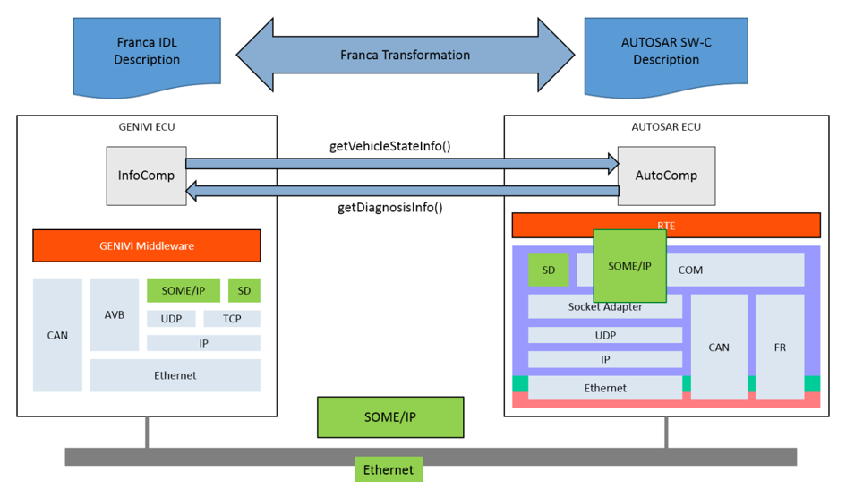
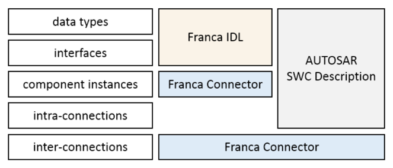
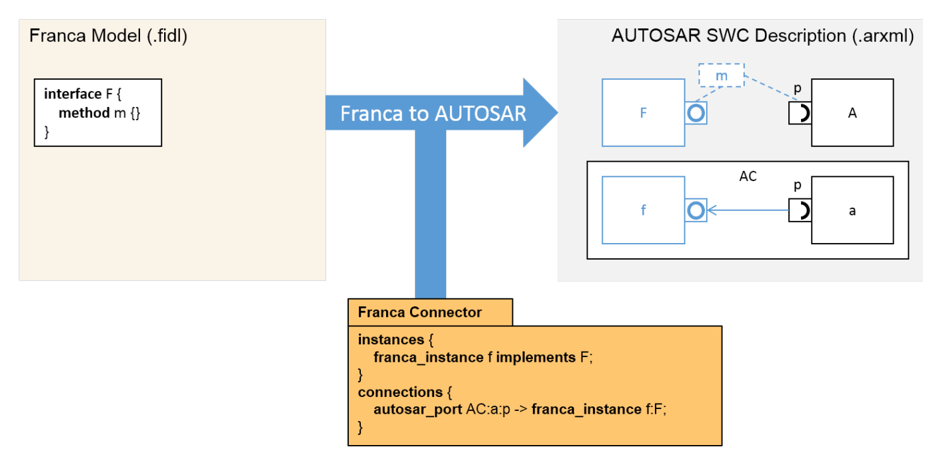
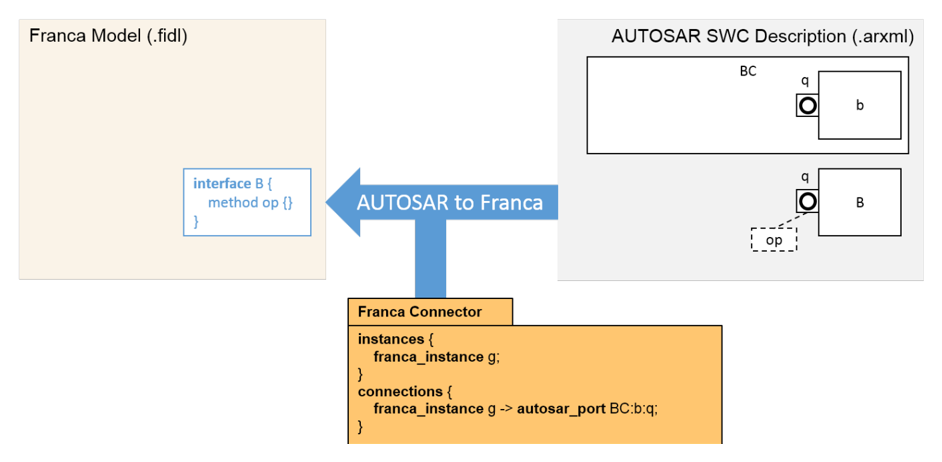
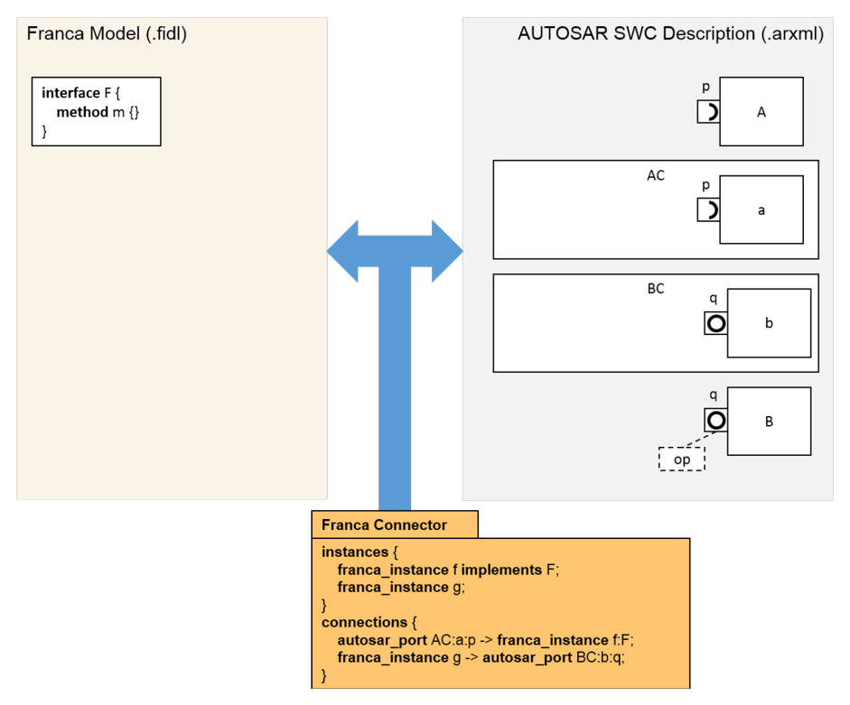
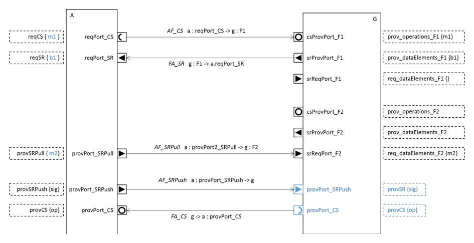
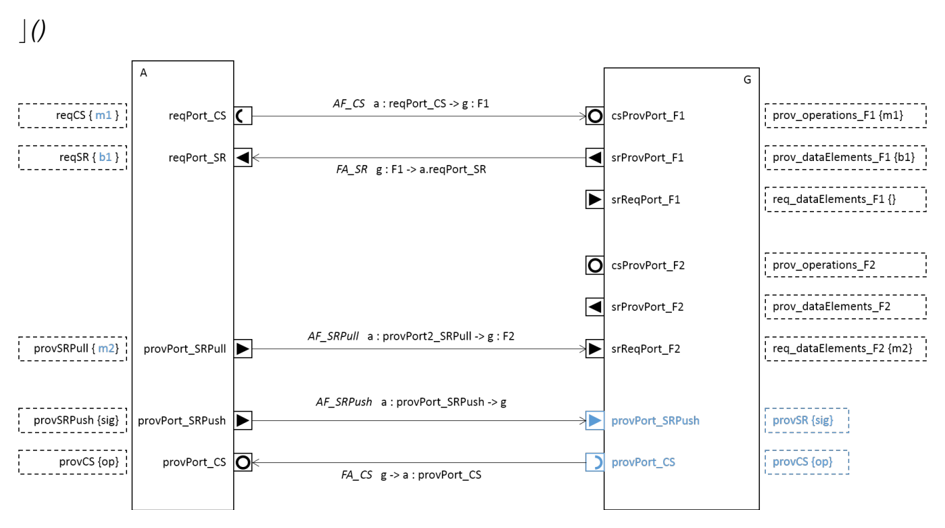
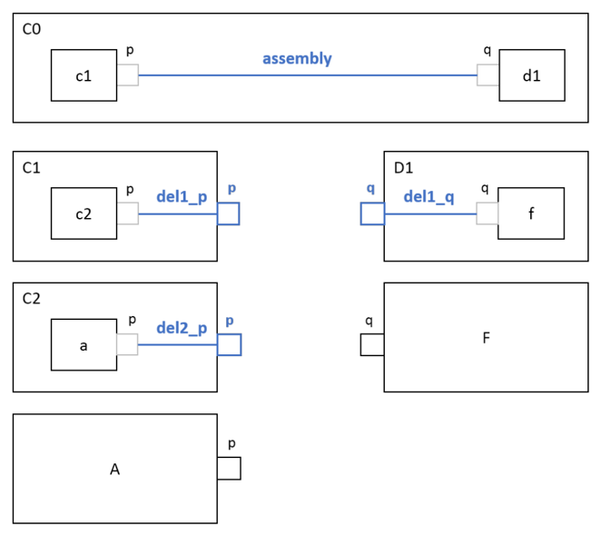

<!-- 源文档 AUTOSAR_CP_TR_FrancaIntegration（R23-11），技术报告（TR），不受 Type A 七章骨架约束；章节结构镜像源文档自身编号（参考文献不编号，1–4 + 附录 A/B/C）。规范项 ID [TR_FRANCA_*] 按 2026-11-03 Foundation 批次决议整体省略（标题仅翻译）；翻译规则项以「粗体项标题行 + 映射表（属性|值：AR 元素/AR 容器/属性/条件）」呈现。封面元数据表、文档变更记录表、免责声明与目录按 EXP 流程省略。源文档全部 87 处图片引用中 9 处为内容插图（图 1.1–1.6、2.1、3.1、3.2），按内容哈希去重后嵌入（已按图边距规则加白边）；其余均为页面装饰性元素。附录 A 的 4 个示例（Franca 模型、AUTOSAR XML、Franca Connector）在 markdown 转换中被页分割符切断并夹带重复片段与转义残片，已按结构重组为可读的多行形式；附录 B 的 29 张类表按 tps_standardization_template 先例规范化为「竖排属性表 + 属性明细表」两段形式（表题在源 markdown 中位于表内容之后，按表题编号置于表上方）。图 1.1 的 UML 序列图文字（生命线/消息标签）为 PDF 转换溢出物，按图省略惯例舍弃。 -->

## 参考文献

<a id="ref-1"></a>[1] Franca User Guide
> https://code.google.com/a/eclipselabs.org/p/franca/downloads/detail?name=FrancaUserGuide-0.3.0.pdf

<a id="ref-2"></a>[2] Virtual Functional Bus
> AUTOSAR_CP_EXP_VFB

<a id="ref-3"></a>[3] Specification of RTE Software
> AUTOSAR_CP_SWS_RTE

<a id="ref-4"></a>[4] Software Component Template
> AUTOSAR_CP_TPS_SoftwareComponentTemplate

<a id="ref-5"></a>[5] Methodology for Classic Platform
> AUTOSAR_CP_TR_Methodology

<a id="ref-6"></a>[6] IPC CommonAPI C++
> http://projects.genivi.org/commonapi/

<a id="ref-7"></a>[7] Specification of Platform Types for Classic Platform
> AUTOSAR_CP_SWS_PlatformTypes

## 1. 简介

### 1.1. 目标

**AUTOSAR** 覆盖了不同的汽车应用领域，但未必覆盖所有领域。与其一味扩展 **AUTOSAR** 以使其能够轻松应用于那些目前在 **AUTOSAR** 中还难以实现的领域，不如让 **AUTOSAR** 开放地与那些专为这类应用领域设计的标准和技术进行集成，这看起来更为合理。例如，开源开发平台 **GENIVI**（参见 www.genivi.org）为车载信息娱乐系统定义了一套标准和技术，并得到众多公司的支持和采用。**GENIVI** 架构与 **AUTOSAR** 架构相似，都区分应用层级、中间件和基础软件，这为集成提供了便利。在应用层级上描述软件组件时，**GENIVI** 使用 **Franca** 接口定义语言（**Franca IDL**，见 [\[1\]](#ref-1)）。

**AUTOSAR** 与 **GENIVI** 的过程也是相似的。二者都致力于从应用层级组件及其到 **ECU** 网络分布的描述出发，生成中间件和基础软件。因此，也可以将 **AUTOSAR** 系统与 **GENIVI** 系统的集成拆分为应用层级部分和通信层级部分。

Franca 集成的目的是支持 **AUTOSAR** 系统与 **GENIVI** 系统在应用层级上的集成。也就是说，它解决的是功能的虚拟集成，对应于 **AUTOSAR** 的虚拟功能总线（**Virtual Functional Bus**）视图（见 [\[2\]](#ref-2)）。Franca 集成提供了一种记法，用于规定 **AUTOSAR** 应用组件与 **GENIVI** 应用组件的连接，并在这两类组件的描述之间进行双向翻译。借助这些手段，Franca 集成使整个系统的 **AUTOSAR** 部分与 **GENIVI** 部分的开发和生成过程得以互连。

这一应用层级的集成必须与通信层级的集成相结合，后者在「线上（**on the wire**）」实现 **AUTOSAR** 系统与 **GENIVI** 系统之间的消息交换。这意味着必须提供用于从软件和系统描述生成基础软件和中间件的公共协议与手段。这一层级在其他 **AUTOSAR** 贡献中解决，例如用于经由以太网通信的序列化协议 **SOME/IP**。

### 1.2. 目标

当开发一个 **AUTOSAR** 系统和一个 **GENIVI** 系统时，它们的应用层级组件使用这两个标准定义的格式来描述：**AUTOSAR** 部分使用 **AUTOSAR** 软件组件描述，**GENIVI** 部分使用 **Franca IDL** 描述。**AUTOSAR** 软件组件描述由一个或若干个 arxml 文件给出，其中包含描述的 XML 表示；**Franca** 描述由一个或若干个 fidl 和 fdepl 文件给出，其中包含按照 **Franca IDL** 定义的文本语法对描述的文本表示。在这一过程状态中，集成系统在任一格式下都还没有完整描述，而且两个系统所期望的互操作也无法在其中一个格式中描述。这是因为另一方的的方法、操作、属性等的名称尚未包含在本方的描述之中。这两个特性——(1) 互操作互连的描述和 (2) 完整的系统描述——应由 Franca 集成来实现。为此，它由三个部分组成。

1. 一种规定 **AUTOSAR** 部分与 **GENIVI** 部分应用层级互连的新格式——**Franca Connector**（Franca 连接器）。
2. 将带 Franca Connector 的 **Franca** 模型翻译为 **AUTOSAR** 软件组件描述。
3. 将 **AUTOSAR** 软件组件描述翻译为 **Franca** 模型。

Franca Connector 应用于规定哪个 **GENIVI** 组件调用哪个 **AUTOSAR** 组件，反之亦然。尽管 **Franca IDL** 包含一种扩展机制——部署规范（**deployment specification**）——它本可以允许在 **Franca IDL** 内定义所期望的互连，但 Franca Connector 仍被定义为一种新格式。原因在于支持将集成方法轻松地泛化到其他组件或接口描述语言。此外，这一方法也保留了这样的可能性：通过 **Franca** 部署定义来定义所期望的互连，然后从该部署定义生成对应的 Franca Connector，或者从 Franca Connector 生成 **Franca** 部署定义。

给定以 Franca Connector 表示的所期望互连的规范，这两个翻译使得能够以任一格式获得完整的、集成后的应用层级的描述：**AUTOSAR** 软件组件描述或 **Franca** 模型。然而，必须注意，**Franca** 模型只涉及类型层级——组件类型和数据类型——而 **AUTOSAR** 描述还规定组件实例（称为原型（**prototype**））及其连接。此外，**AUTOSAR** 数据类型远比 **Franca** 中对应的数据类型定义详细。出于这些原因，完整集成后的应用层级 **Franca** 模型与完整集成后的应用层级 **AUTOSAR** 描述在语义上并不等价。它们是一致的，但 **AUTOSAR** 描述的范围和细化程度都更大。

从 **AUTOSAR** 的角度出发，我们将完整系统描述的达成陈述为 Franca 集成的总体目标：

**Franca 集成的目标（**Goal of the Franca Integration**）**：Franca 集成的目标是获得由 **AUTOSAR** 部分和以 **Franca IDL** 描述的部分组成的系统之应用层级的两个一致的完整描述：一个作为 **AUTOSAR** 软件组件描述，另一个作为 **Franca** 模型。描述的完整性是相对于所涉及的描述格式的表达手段而言的。

### 1.3. 动机

为了更详细地论证：作为 **AUTOSAR** 系统与非 **AUTOSAR** 系统集成的组成部分，Franca 集成为何必要，我们勾勒一个总体用例——开发一个集成系统，其中一个汽车应用组件 AutoComp 与一个信息娱乐应用组件 InfoComp 互操作（见图 1.1）。前者是 **AUTOSAR** 系统的一部分，后者是 **GENIVI** 系统的一部分。该集成系统可能包含以下两项互操作。

- InfoComp 请求 AutoComp 的服务，例如车辆状态信息。
- AutoComp 请求 InfoComp 的服务，例如诊断信息。

为简单起见，我们假设这两个组件运行在不同的 **ECU** 上——一个 **AUTOSAR** **ECU** 和一个 **GENIVI** **ECU**，二者经由以太网连接。做出这一假设的原因是：已有 **SOME/IP** 这一可在 **AUTOSAR** 和 **GENIVI** 中实现的适配协议。其他系统配置，例如经由 **SPI** 这类慢速总线的连接，或两个系统运行在同一处理器上的方案，则需要其他协议。在所考虑的设置下，**AUTOSAR**-**GENIVI** 总体集成的基本边界条件可以表述如下。

- AutoComp 实现为 **AUTOSAR** **ECU** 的一个 **AUTOSAR** 软件组件，这意味着

  1. AutoComp 的通信只使用 **AUTOSAR** 运行时环境（**RTE**，见 [\[3\]](#ref-3)）经软件组件 **API** 提供的 **AUTOSAR** 通信服务。
  2. AutoComp 拥有一份 **AUTOSAR** 软件组件描述（见 [\[4\]](#ref-4)）。
  3. **AUTOSAR** **ECU** 的 **RTE** 和基础软件按照 **AUTOSAR** 过程生成和配置（见 [\[5\]](#ref-5)）。

- InfoComp 实现为 **GENIVI** **ECU** 的一个 **GENIVI** 组件，这意味着

  1. InfoComp 的通信只使用 **GENIVI** 节点间通信中间件（**INC MW**）和传输协议（**INC TP**）经 Common **API**（见 [\[6\]](#ref-6)）提供的服务。
  2. InfoComp 以 **Franca IDL** 描述它所实现的接口。
  3. InfoComp 的实现只依赖于从 **Franca IDL** 描述生成的 Common **API** 存根（**stub**）和代理（**proxy**）。



根据这些条件，为了能够与 InfoComp 通信，**AUTOSAR** 组件 AutoComp 首先需要一个 **RTE API** 操作，在其某个端口上调用所期望的 InfoComp 方法 getDiagnosisInfo()。其次，它需要一个实现到总线信号路由的以太网通信栈。只有当 AutoComp 与 InfoComp 之间的通信链路作为连接器包含在 **AUTOSAR** 软件组件描述中时，**RTE API** 和通信栈才能被正确生成。而这又只有在 **AUTOSAR** 软件组件描述中也存在 InfoComp 的表示时才可能。为了做到这一点，需要从 **Franca** 模型到 **AUTOSAR** 软件组件描述的翻译。

对系统的 **GENIVI** 部分生成 Common **API** 也一样：它需要以 **Franca IDL** 规定的、关于它想要通信的 **AUTOSAR** 组件的信息。给定从 **AUTOSAR** 软件组件描述到 **Franca** 模型的翻译，这一点同样可以达成。

### 1.4. 集成方法

[\[5\]](#ref-5) 中描述的 **AUTOSAR** 过程以 **AUTOSAR** 记法对系统的描述为起点。也就是说，需要填写用于描述应用组件及其连接、**ECU** 及其连接、以及应用组件到 **ECU** 映射的相应模板。Franca 集成解决的是位于这一起点之前的一个方法论步骤。此时提供的描述尚不完整——特别是在应用层级上——因为 **AUTOSAR** 应用组件与 **GENIVI** 应用组件之间的互连尚未规定。集成系统的描述只是 Franca 集成的目标。

Franca 集成的初始情形可以定义如下。

- 存在一份应用组件彼此连接的 **AUTOSAR** 软件组件描述。某些端口可能未连接，某些端口可能没有接口或接口不完整。它们或者表示提供给 **GENIVI** 部分的操作（提供端口未连接），或者表示需要从 **GENIVI** 部分获得的操作（没有或只有不完整的需求端口接口）。
- 存在一个包含一组接口和数据类型定义的 **Franca** 模型。
- 哪个 **AUTOSAR** 组件应与哪个 **GENIVI** 组件互操作（反之亦然）是已知的——但尚未形式化地表示。互操作可以是客户-服务器通信或发送者-接收者通信。

在这一情形下，从 **AUTOSAR** 视角看到的 Franca 集成的主要方法论步骤是：

1. 用 Franca Connector 表示关于互操作的知识。
2. 对 **Franca** 模型和 Franca Connector 应用 Franca-to-AUTOSAR 翻译。

其结果是一个完整的、集成后的系统应用层级的 **AUTOSAR** 软件组件描述，即完整的 **VFB** 视图。

**GENIVI** 视角是类似的。由于实例和连接不在 **Franca IDL** 中表示，Franca Connector 对完整 **Franca** 模型的推导并不相关。因此只有一个步骤。

1. 对 **AUTOSAR** 软件组件描述应用 AUTOSAR-to-Franca 翻译。

其结果是一个完整的、集成后的系统应用层级的 **Franca** 模型。它由系统的完整接口集合组成——既有 **GENIVI** 部分的，也有 **AUTOSAR** 部分的。

如上所述，两个完整集成后的应用层级描述在语义上一致，但并不等价。首先，这是因为 **Franca** 模型规定类型，而不规定实例或连接。此外，一个 **Franca** 接口只定义组件提供（**provides**）的方法和属性，而不定义它所需要（**requires**）的方法和属性。图 1.2 描绘了 **Franca** 模型与 **AUTOSAR** 软件组件描述所涉及的不同方面。二者都规定数据类型和接口。组件实例和内部连接（即系统 **GENIVI** 部分或 **AUTOSAR** 部分内部组件实例之间的连接）只在 **AUTOSAR** 软件组件描述中规定。互连（即一个 **AUTOSAR** 组件实例与一个 **GENIVI** 组件实例之间的连接）显然既不在 **Franca** 模型中规定，也不在 **AUTOSAR** 软件组件描述中规定。这种不对称由 Franca Connector 来刻画。它提供了定义实现 **Franca** 接口的组件实例以及 **Franca** 与 **AUTOSAR** 组件实例之间互连的可能性。这在[第2章](#2-franca-连接器franca-connector)中详细定义。



因此，两个翻译的结果也不同。Franca-to-AUTOSAR 翻译从 **Franca** 模型和 Franca Connector 中获取信息，构造一个包含 **Franca** 接口、组件实例和互连的 **AUTOSAR** 软件组件描述——分别对应端口接口、组件原型和连接器。AUTOSAR-to-Franca 翻译只考虑 **AUTOSAR** 软件组件描述的端口接口和数据类型，并将其翻译为 **Franca IDL**。实例和互连本来就无法在 **Franca IDL** 中表示。

#### 1.4.1. 以 AUTOSAR SWC 描述表示的集成系统描述

图 1.3 展示了一个场景中 Franca-to-AUTOSAR 翻译的示例：一个 **AUTOSAR** 操作请求一个 **GENIVI** 方法。最初给定如下规范（图 1.3 中以黑色描绘）。

- **Franca** 模型定义了一个包含方法 m 的接口 F。
- **AUTOSAR** 软件组件描述定义了组件类型 A 以及组合类型 AC 中 A 的实例 a。
- A 有一个需求端口 p，**Franca** 方法 m 将在该端口上被调用。该端口的接口尚未定义，因为 **AUTOSAR** 软件组件描述中还没有 m 的表示。
- Franca Connector 规定：
  - 存在一个实现接口 F 的组件实例 f；
  - **AUTOSAR** 组件实例 a 的需求端口 p 与 **Franca** 实例 f 提供的接口 F 相连接。

随后，Franca-to-AUTOSAR 翻译向 **AUTOSAR** 软件组件描述添加以下部分（图 1.3 中以蓝色描绘）。

- 一个包含操作 m 的接口，以及一条「**AUTOSAR** 需求端口 p 以该接口定义类型」的声明。
- 一个组件类型 F，带有一个同样以该接口定义类型的提供端口。
- 组合类型 AC 中 F 的实例 f。
- 组合类型 AC 中开放 **AUTOSAR** 端口 p 与新组件类型 F 端口之间的一个连接器。

于是，**AUTOSAR** 软件组件描述中现在表示了 **AUTOSAR** 组件实例 a 与 **Franca** 组件实例 f 之间所期望的互连。



相反的场景——一个 **GENIVI** 方法请求一个 **AUTOSAR** 操作——对 Franca-to-AUTOSAR 翻译而言没有进一步的意义，因为请求在 **Franca** 接口中没有表示。**Franca** 接口可以被翻译为一个 **AUTOSAR** 组件类型，但既不会生成新的 **AUTOSAR** 实例，也不会生成连接。

以发送者-接收者通信（而非客户-服务器通信，即操作调用）的情形与上述操作调用场景的处理方式相同。信号的提供在 **Franca IDL** 中用广播（**broadcast**）表达。实现包含广播的接口的 **Franca** 实例，被翻译为一个 **AUTOSAR** 组件，该组件在提供端口上提供一个与广播具有相同数据类型的数据元素。后者可以连接到一个需要该数据元素的 **AUTOSAR** 组件端口。

#### 1.4.2. 以 Franca 模型表示的集成系统描述

一个 **AUTOSAR** 组件为 **GENIVI** 组件提供操作的场景描绘在图 1.4 中。此时 **AUTOSAR** 软件组件描述是完整的，但没有请求组件 B 的端口 q 所提供的操作 op 的组件实例。**Franca** 模型尚为空，因为对操作的请求无法表达。存在一个请求 **AUTOSAR** 操作 op 的实例 g 这一信息表示在 Franca Connector 中。在这个（人为构造的）示例中，g 是一个不实现任何所考虑 **Franca** 接口的 **Franca** 组件实例。引入它只是为了在完整系统描述中规定谁调用 **AUTOSAR** 组件实例 b 的端口 q 上的操作。

AUTOSAR-to-Franca 翻译向 **Franca** 模型添加一个带方法 op 的接口 B，其他 **Franca** 组件现在可以使用它。由于实例和连接不在 **Franca IDL** 中表示，这就是翻译所做的一切。



#### 1.4.3. 完整视图

把上面讨论的场景组合起来，我们得到作为 Franca 集成目标而宣称的两个完整应用层级系统视图。图 1.5 展示了初始情形：以 **Franca** 模型表示的应用组件描述、以 **AUTOSAR** 软件组件描述表示的应用组件描述，以及一个 Franca Connector。Franca-to-AUTOSAR 翻译和 AUTOSAR-to-Franca 翻译的结果展示在图 1.6 中。**AUTOSAR** 描述为 **Franca** 接口和实例扩展了组件类型（AtomicSwComponentType）和实例（SwComponentPrototype）、一个包含「由 **Franca** 组件提供且被某个 **AUTOSAR** 组件请求的方法」的接口，以及与 Franca Connector 中两个连接条目相对应的两个连接。**Franca** 模型为 **AUTOSAR** 组件类型扩展了接口定义。




### 1.5. 限制与扩展

#### 1.5.1. 动态通信

**AUTOSAR** 过程要求运行期间可能发生的应用组件实例之间的所有互操作都在 **AUTOSAR** 软件组件描述中静态声明（编译前）。而信息娱乐系统中的互操作通常是动态的。例如，**GENIVI** 使用套接字（**socket**），允许在运行期间动态发现并与服务提供者建立连接。未来的 **AUTOSAR** 发布版也可能支持动态通信，但在目前状态下，通信链路的静态声明是强制性的。因此，至少应当互操作的 **AUTOSAR** 与 **GENIVI** 组件实例必须在设计时已知并被识别。在 **GENIVI** 一侧，可以引入这些组件实例作为占位符，并在运行期间通过相应的动态发现与连接服务与真实组件实例建立连接。在 **AUTOSAR** 一侧，实例无论如何都必须在设计时声明，因此它们已经存在并可用于互连的规定。通过这种方案，静态互连声明的限制将只落在本来就受此限制的 **AUTOSAR** 部分上，而 **GENIVI** 部分则不受约束。关于动态通信与 **AUTOSAR** 系统集成的更详细讨论是必要的，但不在本报告的范围之内。

#### 1.5.2. RTE 契约与 RTE 生成

Franca 集成着眼于集成系统的虚拟功能总线视图，这只是 **AUTOSAR** 开发的第一步。为了生成 **AUTOSAR** **RTE**，还需要关于 **ECU** 网络、应用组件以及应用组件到 **ECU** 网络映射的进一步信息。这些信息在 [\[3\]](#ref-3) 中定义。在第一步——**RTE** 契约阶段（**RTE Contract Phase**）——需要定义并实现组件的行为，并细化关于数据类型的信息。第二步——**RTE** 生成阶段（**RTE Generation Phase**）——还需要关于 **ECU** 资源以及应用组件到资源映射的信息。要完整集成一个 **AUTOSAR** 系统和一个 **GENIVI** 系统，这些阶段及相应的描述需求也必须考虑。由于 **Franca IDL** 没有规定行为、资源或分配的固定手段，Franca 集成无法定义相应的翻译。为 **AUTOSAR** 集成定义一个涵盖这些方面的 **Franca** 部署规范，才是应该做的事。

## 2. Franca 连接器（**Franca Connector**）

Franca connector 是为规定 **Franca** 应用组件与 **AUTOSAR** 应用组件之间所期望的互操作而引入的新格式。它由三个主要部分组成：

- Imports（导入）：对分别定义 **Franca** 应用组件和 **AUTOSAR** 应用组件的 **Franca** 模型和 **AUTOSAR** 软件组件描述的引用。
- Franca Instances（Franca 实例）：将参与所期望互操作的 **Franca** 组件实例的定义。
- Links（链路）：**AUTOSAR** 组件实例与 **Franca** 组件实例之间互连的定义。

### 2.1. 导入与 Franca 实例

一个导入（**import**）是一个字符串，指示一个 **Franca** 模型（fidl 文件）或一个 **AUTOSAR** 软件组件描述（arxml 文件）的位置。导入特别地定义了可以在 Franca Connector 中引用的 **Franca** 接口和 **AUTOSAR** 端口。

一个 **Franca** 实例通过其名称以及它所实现的 **Franca** 接口的列表来声明。这些 **Franca** 接口必须包含在已导入的 **Franca** 模型中。一个实例的已实现接口列表可以为空。

Franca Connector 中 **Franca** 实例定义的一种可能的具体记法是：

```
franca_instance g implements F1, ..., Fn
```

其中 g 是所定义 **Franca** 实例的名称，F1, …, Fn 是所实现 **Franca** 接口的名称。

### 2.2. 链路

一条链路（**link**）有一个 **AUTOSAR** 侧和一个 **Franca** 侧。**AUTOSAR** 侧总是由一个端口实例引用给出，即一个 SwComponentPrototype 和一个属于该 SwComponentPrototype 的 SwComponentType 的 PortPrototype。**AUTOSAR** 侧的一种可能的具体记法是：

```
autosar_port comp : p
```

其中 comp 是 SwComponentPrototype 的名称，p 是 PortPrototype 的名称。

链路的 **Franca** 侧或者仅由一个 **Franca** 实例给出，或者由一个 **Franca** 实例及其实现的某个 **Franca** 接口给出：

```
franca_instance g : F    或    franca_instance g
```

其中 g 是 **Franca** 实例的名称，F 是 **Franca** 接口的名称。

链路按照预期的通信流方向是有向的。链路的左侧定义发出数据元素或操作调用的实例；右侧定义接收数据元素或操作调用的实例。

每个 **AUTOSAR** 端口都以一个接口定义类型，该接口可以是客户-服务器接口或发送者-接收者接口。在前一种情况下，它包含在端口上提供（provided，PPortPrototype）或需要（required，RPortPrototype）的操作；在后一种情况下，它包含在端口上发送（provided，PPortPrototype）或期望（required，RPortPrototype）的数据元素。两类 **AUTOSAR** 接口与 Franca Connector 链路的两个方向（AUTOSAR-to-Franca 和 Franca-to-AUTOSAR）组合出四种链路类型。

1. AUTOSAR-to-Franca 客户-服务器链路
2. AUTOSAR-to-Franca 发送者-接收者链路
3. Franca-to-AUTOSAR 客户-服务器链路
4. Franca-to-AUTOSAR 发送者-接收者链路

图 2.1 展示了四种可能的链路类型的示例。它使用混合记法，仅旨在解释 **Franca** 链路类型、它们在 Franca Connector 中的表示，以及翻译到 **AUTOSAR** 的结果。组件和端口以 **AUTOSAR** 风格展示。为简洁起见，链路在类型层级上描绘；在更忠实的图中应展示端口实例引用的连接。连接器使用上文引入的链路具体记法标注，为简洁起见省略了标签 autosar\_port 和 franca\_instance。链路的名称（AF\_CS、AF\_SR、FA\_CS 和 FA\_SR）指示方向（AUTOSAR-to-Franca 或 Franca-to-AUTOSAR）和 **AUTOSAR** 端口接口类型（客户-服务器或发送者-接收者）。两条 Autosar-to-Franca 发送者-接收者链路 AF\_SRPull 与 AF\_SRPush 之间的区分，源于 **Franca** 可以将方法声明为「即发即忘（**fire-and-forget**）」方法的可能性。这将在下文和[第3.4.2节](#342-franca-方法franca-methods)中详细解释。

表2.1：AUTOSAR 组件 A 的端口（**Ports of AUTOSAR component A**）

| 端口 | 接口 | 接口内容 |
| --- | --- | --- |
| reqPort_CS | reqCS | ∅ |
| reqPort_SR | reqSR | ∅ |
| provPort_CS | provCS | { op } |
| provPort_SRPush | provSRPush | { sig } |
| provPort_SRPull | provSRPull | ∅ |



在下文的讨论中，我们假设以下 **AUTOSAR** 与 **Franca** 元素已作为起点给定。

1. 一个 **AUTOSAR** 组件 A，其端口如表 2.1 所定义。
2. 一个 **AUTOSAR** 组件原型 a，其类型为 A。
3. 一个带方法 m1 和广播 b1 的 **Franca** 接口 F1，以及第二个带即发即忘方法 m2 的 **Franca** 接口 F2。
4. 一个实现 F1 和 F2 的 **Franca** 实例 g。

对 **Franca** 接口和 **Franca** 实例到 **AUTOSAR** 的翻译——在下一章讨论——得到图 2.1 右侧所示的组件类型。对每个 **Franca** 接口（例如 F1）生成三个端口：

1. 一个将 **Franca** 接口的方法提供为 **AUTOSAR** 操作的端口（csProvPort\_F1，以 prov\_operations\_F1 定义类型）。
2. 一个将 **Franca** 接口的广播提供为 **AUTOSAR** 数据元素的端口（srProvPort\_F1，以 prov\_dataElements\_F1 定义类型）。
3. 一个将 **Franca** 接口的即发即忘方法请求为 **AUTOSAR** 数据元素的端口（srReqPort\_F1，以 req\_dataElements\_F1 定义类型）。

五条链路对应的五个连接器按下文讨论的方式由五条 **Franca** 链路生成。

#### 2.2.1. AUTOSAR-to-Franca 客户-服务器链路（**AUTOSAR-to-Franca Client Server Link**）

一条 AUTOSAR-to-Franca 客户-服务器链路

```
autosar_port a : reqPort_CS -> franca_instance g : F1
```

规定 **AUTOSAR** 组件原型 a 在其端口 reqPort\_CS 上要求（调用）**Franca** 实例 g 中 **Franca** 接口 F1 定义的操作（方法）。AUTOSAR-to-Franca 客户-服务器链路的正确性条件是：链路的 **AUTOSAR** 侧是一个以客户-服务器接口（ClientServerInterface）定义类型的需求端口（RPortPrototype），且 **Franca** 侧拥有一个 **Franca** 接口。

#### 2.2.2. AUTOSAR-to-Franca 发送者-接收者链路（**AUTOSAR-to-Franca Sender Receiver Link**）

AUTOSAR-to-Franca 发送者-接收者链路有两种，按其 **Franca** 侧区分。如果 **Franca** 侧包含一个接口，则意味着实现该接口的 **Franca** 实例提供一个即发即忘方法。链路

```
autosar_port a : provPort_SRPull -> franca_instance g : F2
```

表示该即发即忘方法由 **AUTOSAR** 组件原型 a 调用。这个此前在 **AUTOSAR** 描述中尚未知晓的即发即忘方法，经由该链路被「拉取（**pull**）」到定义端口 provPort\_SRPull 类型的接口中（这由接口 provSRPull 中蓝色的 m2 表示）。

如果 **Franca** 侧不包含接口，则链路

```
autosar_port a : provPort_SRPush -> franca_instance g
```

规定 **AUTOSAR** 组件原型 a 将定义端口 provPort\_SRPush 类型的接口 provSRPush 中声明的数据元素发送给 **Franca** 实例 g。由于 **Franca** 模型并未规定哪些数据元素可以发送给一个实例，相应的元素此时被创建。端口 provPort\_SRPush、接口 provSRPush 以及在端口 provPort\_SRPush 上提供的数据元素 sig 被「推送（**push**）」到 **Franca** 侧。

AUTOSAR-to-Franca 发送者-接收者链路的正确性条件是：**AUTOSAR** 侧是一个以发送者-接收者接口（SenderReceiverInterface）定义类型的提供端口（PPortPrototype），且 **Franca** 侧要么拥有一个至少包含一个即发即忘方法的 **Franca** 接口（拉取链路），要么没有接口（推送链路）。

#### 2.2.3. Franca-to-AUTOSAR 客户-服务器链路（**Franca-to-AUTOSAR Client Server Link**）

一条 Franca-to-AUTOSAR 客户-服务器链路

```
franca_instance g -> autosar_port a : provPort_CS
```

规定 **Franca** 实例 g 要求（调用）**AUTOSAR** 操作。Franca-to-AUTOSAR 客户-服务器链路的正确性条件是：**Franca** 侧没有 **Franca** 接口，且 **AUTOSAR** 侧是一个以客户-服务器接口（ClientServerInterface）定义类型的提供端口（PPortPrototype）。

#### 2.2.4. Franca-to-AUTOSAR 发送者-接收者链路（**Franca-to-AUTOSAR Sender Receiver Link**）

一条 Franca-to-AUTOSAR 发送者-接收者链路

```
franca_instance g : F1 -> autosar_port a : reqPort_SR
```

规定 **Franca** 实例 g 将 **Franca** 接口 F1 的广播（以及属性的变更通知）发送给 **AUTOSAR** 端口 reqPort\_SR。Franca-to-AUTOSAR 发送者-接收者链路的正确性条件是：**Franca** 侧必须拥有 **Franca** 接口，且 **AUTOSAR** 侧是一个以发送者-接收者接口（SenderReceiverInterface）定义类型的需求端口（RPortPrototype）。

### 2.3. 约束

Franca Connector 中所包含的链路集合必须遵守以下约束。

第一条约束是形式性的；它防止重复链路。

**约束：Franca 连接器没有重复链路**：在 Franca Connector 中不得存在两条 **AUTOSAR** 侧与 **Franca** 侧都相同的链路。

第二条约束防止一个客户连接到多个服务器。

**约束：Franca 连接器没有客户-服务器扇出**：一个 **AUTOSAR** 组件原型的需求客户-服务器端口不得连接到多于一个 **Franca** 实例。

## 3. Franca-to-AUTOSAR 翻译

任一方向——Franca 到 AUTOSAR 或 AUTOSAR 到 Franca——翻译的输入总是一个 Franca Connector。经由其导入，Franca Connector 引用将要互连和翻译的 **Franca** 模型与 **AUTOSAR** 软件组件描述。翻译的目标既可以是 **AUTOSAR** 软件组件描述（Franca-to-AUTOSAR 翻译），也可以是 **Franca** 模型（AUTOSAR-to-Franca 翻译）。

可以定义一个只包含 **Franca** 导入的 Franca Connector；即其 **AUTOSAR** 导入为空且不含链路。此时 Franca-to-AUTOSAR 翻译只是把 **Franca IDL** 中的接口和数据类型规范翻译为这些接口和数据类型在 **AUTOSAR** XML 文档中的语义等价表示。

更一般的情况是同时导入 **Franca** 与 **AUTOSAR** 规范并将二者连接。此时 Franca-to-AUTOSAR 翻译得到一个 **AUTOSAR** 软件组件描述，它包含：

- 已导入的 **AUTOSAR** 软件组件描述；
- **Franca** 模型（接口和数据类型）的翻译；
- **Franca** 实例与 **AUTOSAR** 实例之间互连的表示。

因此，纯翻译是 **Franca** 模型与 **AUTOSAR** 软件组件描述更一般集成的一种特例。

### 3.1. 记法

**Franca IDL** 元素到 **AUTOSAR** 元素的翻译定义沿用它们在 [\[1\]](#ref-1) 中的呈现方式。对每个 **Franca IDL** 元类，我们命名一个泛型元素，并定义该元素映射到的 **AUTOSAR** 元素或元素集合。为此我们使用一个表——当该 **Franca IDL** 元素映射到一组 **AUTOSAR** 元素时则使用一组表——其含义如下。

| 条目 | 含义 |
| --- | --- |
| AR Element | 该条目定义 **Franca** 元类映射到的 **AUTOSAR** 元类。此外，还为目标元素引入一个名称，以便在后续条目或规则中引用映射的结果。 |
| AR Container | 该条目按其名称规定包含上述条目所定义目标元素的 **AUTOSAR** 元素。 |
| Attributes | 该条目定义目标元素的属性和交叉引用。 |
| Condition | 该条目给出映射的一个条件。若条件为假，则该 **Franca** 元素不在 **AUTOSAR** 表示中生成目标元素。 |

### 3.2. Franca 模型

**Franca** 模型顶层元素 FModel 的翻译生成一个 **AUTOSAR** 包结构，它们随后用作进一步元素的容器。生成一个顶层包（FrancaModelPackage），它包含翻译的完整结果。它被添加到 **AUTOSAR** XML 的根。

**包 FrancaModelPackage（**Package FrancaModelPackage**）**

表3.1：FrancaModelPackage 映射（**FrancaModelPackage mapping**）

| 属性 | 值 |
| --- | --- |
| AR 元素 | ARPackage FrancaModelPackage |
| AR 容器 | AUTOSAR |
| 属性 | shortName = fModel.name |
| 条件 | - |

**包 FrancaApplicationDataTypes（**Package FrancaApplicationDataTypes**）**

表3.2：FrancaApplicationDataTypes 映射（**FrancaApplicationDataTypes mapping**）

| 属性 | 值 |
| --- | --- |
| AR 元素 | ARPackage FrancaApplicationDataTypes |
| AR 容器 | FrancaModelPackage |
| 属性 | shortName = "FrancaApplicationDataTypes" |
| 条件 | - |

**包 FrancaImplementationDataTypes（**Package FrancaImplementationDataTypes**）**

表3.3：FrancaImplementationDataTypes 映射（**FrancaImplementationDataTypes mapping**）

| 属性 | 值 |
| --- | --- |
| AR 元素 | ARPackage FrancaImplementationDataTypes |
| AR 容器 | FrancaModelPackage |
| 属性 | shortName = "FrancaImplementationDataTypes" |
| 条件 | - |

**包 FrancaBaseDataTypes（**Package FrancaBaseDataTypes**）**

表3.4：FrancaBaseDataTypes 映射（**FrancaBaseDataTypes mapping**）

| 属性 | 值 |
| --- | --- |
| AR 元素 | ARPackage FrancaBaseDataTypes |
| AR 容器 | FrancaModelPackage |
| 属性 | shortName = "FrancaBaseDataTypes" |
| 条件 | - |

**包 FrancaDataTypeMaps（**Package FrancaDataTypeMaps**）**

表3.5：FrancaDataTypeMaps 映射（**FrancaDataTypeMaps mapping**）

| 属性 | 值 |
| --- | --- |
| AR 元素 | ARPackage FrancaDataTypeMaps |
| AR 容器 | FrancaModelPackage |
| 属性 | shortName = "FrancaDataTypeMaps" |
| 条件 | - |

**包 FrancaPortInterfaces（**Package FrancaPortInterfaces**）**

表3.6：FrancaPortInterfaces 映射（**FrancaPortInterfaces mapping**）

| 属性 | 值 |
| --- | --- |
| AR 元素 | ARPackage FrancaPortInterfaces |
| AR 容器 | FrancaModelPackage |
| 属性 | shortName = "FrancaPortInterfaces" |
| 条件 | - |

**包 FrancaSwComponentTypes（**Package FrancaSwComponentTypes**）**

表3.7：FrancaSwComponentTypes 映射（**FrancaSwComponentTypes mapping**）

| 属性 | 值 |
| --- | --- |
| AR 元素 | ARPackage FrancaSwComponentTypes |
| AR 容器 | FrancaModelPackage |
| 属性 | shortName = "FrancaSwComponentTypes" |
| 条件 | - |

**Franca** 版本信息映射到 **AUTOSAR** 文档修订版。

**Franca 版本映射到 AUTOSAR 文档修订版（**Franca version is mapped to AUTOSAR document revision**）**：**Franca** 元素 fElement 的 FVersion fVersion 映射到 fElement 所映射到的 **AUTOSAR** 元素的文档修订版

```text
docRevision = fVersion.major + "." + fVersion.minor
```

### 3.3. Franca 类型

**AUTOSAR** 区分应用数据类型和实现数据类型。应用数据类型允许从应用的角度定义在软件组件之间、或软件组件与测量标定工具之间交换数据所需的全部数据属性。实现数据类型对应 **CPU** 上编程语言所处理的实际二进制数。它们包含与数据在存储器中的组织相关、而对应用层级不重要的概念，如指针和联合。实现数据类型特别是生成 **C** 代码的来源。按照[第1章](#1-简介)中陈述的 Franca 集成的目标——获得集成系统的应用层级视图——应用数据类型是 Franca-to-AUTOSAR 翻译的合适目标。然而，**Franca IDL** 包含联合类型和类型定义作为数据类型构造器；而这些不被 **AUTOSAR** 应用数据类型构造器覆盖。

另一方面，**AUTOSAR** 实现数据类型构造器涵盖联合类型和类型定义，以及其他 **Franca** 类型构造器。它们因此可以用作 **Franca** 数据类型 Franca-to-AUTOSAR 翻译的目标。但由于它们用于代码生成，其规范需要远多于 **Franca** 模型所给出的细节。此外，如果一个 **Franca** 模型还要用于标定或测量目的，就再次需要 **AUTOSAR** 应用数据类型的表达能力。

出于这些原因，Franca-to-AUTOSAR 翻译尝试将一个 **Franca** 数据类型映射到：

- 一个 **AUTOSAR** 应用数据类型，
- 一个 **AUTOSAR** 实现数据类型，
- 以及一个关联这两种数据类型的 **AUTOSAR** 数据类型映射。

如上所述，可能发生某个 **Franca** 数据类型没有生成 **AUTOSAR** 应用数据类型的情况。除完全不翻译的 **Franca** 映射（**map**）类型外，**AUTOSAR** 实现数据类型总是生成。当应用数据类型和实现数据类型都生成时，它们通过一个数据类型映射相关联。

**Franca 数据类型的应用数据类型与实现数据类型相互关联（**Application and implementation data type of a Franca data type are related**）**：当一个 **Franca** 数据类型被映射到 **AUTOSAR** ApplicationDataType appType 和 **AUTOSAR** ImplementationDataType implType 时，appType 与 implType 通过一个 DataTypeMap 相关联。由 **Franca** 模型翻译产生的数据类型映射收集在一个全局 DataTypeMappingSet 中，它包含在 [包 FrancaDataTypeMaps](#32-franca-模型) 中定义的包 FrancaDataTypeMaps 内。

**Franca** 数据类型到 **AUTOSAR** 数据类型的翻译导出一个按如下定义的映射 ARType。

**从 Franca 数据类型到 AUTOSAR 数据类型的映射（**Mapping from Franca data types to AUTOSAR data types**）**：设 fDataType 为一个 **Franca** 数据类型。

1. 如果 fDataType 可以翻译为 **AUTOSAR** 应用数据类型 arAppDataType，则
2. …（ARType 按后文各项规则定义；若 fDataType 无法翻译为 **AUTOSAR** 数据类型，则 ARType(fDataType) 无定义）

#### 3.3.1. Franca 类型集合（**Franca Type Collections**）

**Franca** 类型集合（**type collection**）是 **Franca** 数据类型的容器，对应一个 **AUTOSAR** 包。按照上面的讨论，每个类型集合生成两个包：一个用于生成的应用数据类型，一个用于生成的实现数据类型。

**Franca 类型集合映射到 AUTOSAR 包（**Franca type collection is mapped to AUTOSAR packages**）**：一个 FTypeCollection fTypeCollection 映射为应用类型包 FrancaApplicationDataTypes 的一个子包（见 [AUTOSAR packages for Franca application type collection](#33-franca-类型)）以及实现类型包 FrancaImplementationDataTypes 的一个子包（见 [AUTOSAR packages for Franca implementation type collection](#33-franca-类型)）。

**用于 Franca 应用类型集合的 AUTOSAR 包（**AUTOSAR packages for Franca application type collection**）**

表3.8：fTypeCollection 到应用类型包的映射（**fTypeCollection mapping to the application type package**）

| 属性 | 值 |
| --- | --- |
| AR 元素 | ARPackage applicationTypeCollectionPackage |
| AR 容器 | FrancaApplicationDataTypes |
| 属性 | shortName = fTypeCollection.name |
| 条件 | - |

**用于 Franca 实现类型集合的 AUTOSAR 包（**AUTOSAR packages for Franca implementation type collection**）**

表3.9：fTypeCollection 到实现类型包的映射（**fTypeCollection mapping to the implementation type package**）

| 属性 | 值 |
| --- | --- |
| AR 元素 | ARPackage implementationTypeCollectionPackage |
| AR 容器 | FrancaImplementationDataTypes |
| 属性 | shortName = fTypeCollection.name |
| 条件 | - |

#### 3.3.2. 原始类型（**Primitive Types**）

**Franca IDL** 有一组预定义的、所谓原始（**primitive**）的数据类型：整数、浮点数、布尔值和字符串。整数、浮点数和布尔值由 **AUTOSAR** 平台类型覆盖，字符串则必须编码。下文定义由 Franca-to-AUTOSAR 翻译生成、用于表示 **Franca IDL** 原始类型的应用数据类型和实现数据类型。应用类型和实现类型都获得表 3.10 中给出的 short-name。

**Franca 原始类型与对应的 AUTOSAR 平台类型（**Franca primitive types and the corresponding AUTOSAR platform types**）**

表3.10：与 Franca 原始类型对应的 AUTOSAR 数据类型的短名称（**Short names of AUTOSAR data types corresponding to Franca primitive types**）

| Franca 原始类型 | AUTOSAR 短名称 |
| --- | --- |
| UInt8 | uint8 |
| Int8 | sint8 |
| UInt16 | uint16 |
| Int16 | sint16 |
| UInt32 | uint32 |
| Int32 | sint32 |
| UInt64 | uint64 |
| Int64 | sint64 |
| Boolean | boolean |
| Float | float32 |
| Double | float64 |

**原始类型映射到 ApplicationPrimitiveDataType（**Primitive Type is mapped to ApplicationPrimitiveDataType**）**

表3.11：与 Franca 原始类型对应的 AUTOSAR 应用数据类型的类别与属性（**Categories and properties of AUTOSAR application data types corresponding to Franca primitive types**）

| Franca 类型 | AR 类别 | AR 属性 |
| --- | --- | --- |
| UInt8 | VALUE | 数据约束：下限 = 0，上限 = 255 |
| Int8 | VALUE | 数据约束：下限 = -128，上限 = 127 |
| UInt16 | VALUE | 数据约束：下限 = 0，上限 = 65535 |
| Int16 | VALUE | 数据约束：下限 = -32768，上限 = 32767 |
| UInt32 | VALUE | 数据约束：下限 = 0，上限 = 2^32 |
| Int32 | VALUE | 数据约束：下限 = -(2^31)，上限 = 2^31 - 1 |
| UInt64 | VALUE | 数据约束：下限 = 0，上限 = 2^64 |
| Int64 | VALUE | 数据约束：下限 = -(2^63)，上限 = 2^63 - 1 |
| Float | VALUE | - |
| Double | VALUE | - |
| Boolean | BOOLEAN | 数据约束：下限 = 0，上限 = 1 |
| String | STRING | 最大文本长度缺省 = 256，可在 **Franca** 部署定义中重定义 |

应用原始数据类型直接由 **AUTOSAR** 的元类 ApplicationPrimitiveDataType 定义。为了表达一个实现数据类型在 **AUTOSAR** 中表示原始类型，其名称必须与某个 **AUTOSAR** 平台类型的名称一致（见 [\[7\]](#ref-7)），并且它必须关联到一个没有本地（**native**）声明的基类型。这一点反映在下面对 **Franca** 原始数据类型到 **AUTOSAR** 实现类型翻译的定义中。

**原始类型映射到与 AUTOSAR 平台类型对应的 ImplementationDataType（**Primitive Type is mapped to ImplementationDataType corresponding to AUTOSAR platform type**）**：除原始类型 String 之外的 **Franca** 原始类型，映射到以 [Franca primitive types and the corresponding AUTOSAR platform types](#332-原始类型primitive-types) 所述表定义的 short-name 的 ImplementationDataType。这些实现数据类型中每一个的基类型都必须没有本地声明。

**Franca** 的原始类型 String 被解释为字符数组。**Franca** 未定义字符串是定长还是变长。这可以在 **Franca** 部署定义中定义。定长字符串可以直接表示为 **AUTOSAR** 中的定长数组。变长数组在 **AUTOSAR** 中编码为带两个元素的结构：一个定义数组实际大小的整数字段，和一个包含数组本身的数组字段。后者还包含数组实例的最大大小。

**定长原始类型 String 映射到 AUTOSAR 数组实现数据类型（**Primitive type String of fixed size is mapped to AUTOSAR array implementation data type**）**：如果 **Franca** 原始类型 String 的属性 FixedStringLength 设为 true 且属性 MaxStringLength 为 n，则类型 String 映射到按如下方式定义的 ImplementationDataType stringImplType。

- stringImplType.shortName = String
- stringImplType.category = ARRAY
- stringImplType.subElement = subElement，其中
  - subElement.shortName = Char
  - subElement.category = VALUE
  - subElement.arraySize = n
  - subElement.arraySizeSemantics = fixedSize

两个 String 属性的缺省值为 FixedStringLength = false 和 MaxStringLength = 256。

**变长原始类型 String 映射到 AUTOSAR 结构实现数据类型（**Primitive type String of variable size is mapped to AUTOSAR structure implementation data type**）**：如果 **Franca** 原始类型 String 的属性 FixedStringLength 未设置（即取缺省值 false）且属性 MaxStringLength 为 n，则类型 String 映射到按如下方式定义的 ImplementationDataType stringImplType。

- stringImplType.shortName = String
- stringImplType.category = STRUCTURE
- stringImplType.subElements = { size, chars }

其中 ImplementationDataTypeElement size 和 chars 为：

- size.shortName = size
- size.category = TYPE\_REFERENCE
- size.swDataDefProps.implementationDataType = uint8
- chars.shortName = chars
- chars.category = ARRAY
- chars.subElement = char，其中
  - char.shortName = char
  - char.category = TYPE\_REFERENCE
  - char.arraySize = n
  - char.arraySizeSemantics = variableSize
  - char.swDataDefProps.implementationDataType = uint8

MaxStringLength 的缺省值为 256。

#### 3.3.3. Franca 内联数组（**Franca Inline Arrays**）

方法的参数、广播的参数、属性以及联合和结构类型字段的类型，可以在 **Franca** 中定义为内联数组（**inline array**）。也就是说，可以用内联记法 `t[] element` 代替显式定义的数组类型。

由于 **AUTOSAR** 不支持内联数组，隐式定义的 **Franca** 数组类型必须翻译为显式的 **AUTOSAR** 应用数组和实现数组类型。这按 [Application Array Type](#3341-映射到应用数据类型mapping-to-application-data-types)、[Implementation Array Type of fixed size](#3342-映射到实现数据类型mapping-to-implementation-data-types) 和 [Implementation Array Type of variable size](#3342-映射到实现数据类型mapping-to-implementation-data-types) 的规定达成。

为了在 **AUTOSAR** 描述被翻译回 **Franca** 时恢复原始 **Franca** 模型，这些数组类型在 **Franca** special data 组中以特殊数据加以注解。由于这只影响翻译的句法表示而不影响其语义，此处不再进一步规定。

下文不再显式说明内联数组处理方式，而是默认内联数组被翻译为显式定义的 **AUTOSAR** 数组类型。

#### 3.3.4. 用户自定义类型（**User-defined Types**）

**Franca** 的用户自定义类型包括数组、结构和联合等复合类型。到 **AUTOSAR** 数据类型的翻译按这样的方式定义：每个类型要么被完整翻译，要么完全不被翻译。例如考虑一个元素由联合类型定义类型的 **Franca** 数组类型：**Franca** 数组类型可以翻译为 **AUTOSAR** 应用数据类型，但 **Franca** 联合类型不能翻译为 **AUTOSAR** 应用数据类型。因此上面提到的「**Franca** 联合的数组」不会被翻译为 **AUTOSAR** 应用数据类型。

另一方面，数组类型和联合类型都可以翻译为 **AUTOSAR** 实现数据类型。因此「**Franca** 联合的数组」类型也可以翻译为 **AUTOSAR** 实现数据类型。

唯一完全无法翻译为 **AUTOSAR** 数据类型的 **Franca** 数据类型是映射（**map**）类型。如果它出现在复合类型中，则整个复合类型也不映射到任何 **AUTOSAR** 数据类型。

##### 3.3.4.1. 映射到应用数据类型（**Mapping to Application Data Types**）

**应用数组类型（**Application Array Type**）**：一个 FArrayType fArrayType 映射到按如下方式定义的 **AUTOSAR** ApplicationArrayDataType arArrayType：

- arArrayType.shortName = fArrayType.name
- arArrayType.category = ARRAY
- arArrayType.element = element，element 定义为：
  - element.shortName = fArrayType.name + "element"
  - element.maxNumberOfElements = fArrayType.ArraySize
  - element.arraySizeSemantics = fixedSize（若 fArrayType.ArrayFixedSize == true）
  - element.arraySizeSemantics = variableSize（若 fArrayType.ArrayFixedSize == false）
  - element.type = ARType(fArrayType.elementType)
  - element.category = ARType(fArrayType.elementType).category

取值 fArrayType.ArraySize 和 fArrayType.ArrayFixedSize 在包含该数据类型的 **Franca** 模型的部署定义中定义。如果 ARType(fArrayType.elementType) 无定义，则 fArrayType 的翻译同样无定义。

**应用枚举类型（**Application Enumeration Type**）**：一个 FEnumerationType fEnumerationType 翻译为按如下方式定义的 ApplicationPrimitiveDataType arEnumerationType：

- arEnumerationType.shortName = fEnumerationType.name
- arEnumerationType.category = VALUE

fEnumerationType 的 FEnumerator 集合按 [\[4\]](#ref-4) 中 [TPS\_SWCT\_01562] 的定义映射到一个 CompuMethod。

**应用结构类型（**Application Structure Type**）**：一个 FStructType fStructType 映射到按如下方式定义的 **AUTOSAR** ApplicationRecordDataType arStructType：

- arStructType.shortName = fStructType.name
- arStructType.category = STRUCTURE

并且对每个 FField fField 生成一个 ApplicationRecordElement recordElement，定义如下：

- recordElement.shortName = fField.name
- recordElement.type = ARType(fField.type)

**应用联合类型（**Application Union Type**）**：一个 FUnionType fUnionType 不映射到 **AUTOSAR** 应用数据类型。

**应用类型定义（**Application Type Definition**）**：一个 FTypeDef fTypeDef 不映射到 **AUTOSAR** 应用数据类型。

**应用映射类型（**Application Map Type**）**：一个 FMapType fMapType 不映射到 **AUTOSAR** 应用数据类型。

##### 3.3.4.2. 映射到实现数据类型（**Mapping to Implementation Data Types**）

与定长字符串（[Primitive type String of fixed size is mapped to AUTOSAR array implementation data type](#332-原始类型primitive-types)）和变长字符串（[Primitive type String of variable size is mapped to AUTOSAR structure implementation data type](#332-原始类型primitive-types)）的区分类似，**Franca** 数组类型到 **AUTOSAR** 实现数据类型的翻译区分定长和变长数组类型。

**定长的实现数组类型（**Implementation Array Type of fixed size**）**：属性 ArrayFixedSize 设为 true 的 FArrayType fArrayType 映射到按如下方式定义的 ImplementationDataType arArrayType：

- arArrayType.shortName = fArrayType.name
- arArrayType.category = ARRAY
- arArrayType.subElement = subElement，subElement 定义为：
  - subElement.shortName = fArrayType.name + "\_elements"
  - subElement.category = TYPE\_REFERENCE
  - subElement.arraySize = fArrayType.ArraySize
  - subElement.arraySizeSemantics = fixedSize
  - subElement.swDataDefProps.implementationDataType = ARType(fArrayType.elementType)

其中 fArrayType.ArraySize 和 fArrayType.ArrayFixedSize 在 **Franca** 模型的部署定义中定义。fArrayType.ArrayFixedSize 的缺省值为 false。如果 ARType(fArrayType.elementType) 无定义，则 fArrayType 不被翻译。

变长数组在 **AUTOSAR** 的实现类型层级表示为一个结构，其第一个元素是指示数组实际大小的整数，第二个元素是数组本身。

**变长的实现数组类型（**Implementation Array Type of variable size**）**：属性 ArrayFixedSize 未设置（即取缺省值 false）或设为 false 的 FArrayType fArrayType 映射到按如下方式定义的 ImplementationDataType stringImplType：

- stringImplType.shortName = fArrayType.name
- stringImplType.category = STRUCTURE
- stringImplType.subElements = { size, array }

其中 ImplementationDataTypeElement size 和 array 为：

- size.shortName = size
- size.category = TYPE\_REFERENCE
- size.swDataDefProps.implementationDataType = uint8
- array.shortName = array
- array.category = ARRAY
- array.subElement = array\_element，其中：
  - array\_element.shortName = array\_element
  - array\_element.category = TYPE\_REFERENCE
  - array\_element.arraySize = fArrayType.ArraySize
  - array\_element.arraySizeSemantics = variableSize
  - array\_element.swDataDefProps.implementationDataType.type = ARType(fArrayType.elementType)

**实现枚举类型（**Implementation Enumeration Type**）**：一个 FEnumerationType fEnumerationType 翻译为按如下方式定义的 ImplementationDataType arEnumerationType：

- arEnumerationType.shortName = fEnumerationType.name
- arEnumerationType.category = VALUE

fEnumerationType 的 FEnumerator 集合按 [\[4\]](#ref-4) 中 [TPS\_SWCT\_01562] 的定义映射到一个 CompuMethod。

**实现结构类型（**Implementation Structure Type**）**：一个 FStructType fStructType 映射到按如下方式定义的 ImplementationDataType arStructType：

- arStructType.shortName = fStructType.name
- arStructType.category = STRUCTURE

并且对 fStructType 的每个 FField fField 生成一个 ImplementationDataTypeElement subElement，定义如下：

- subElement.shortName = fField.name
- subElement.category = TYPE\_REFERENCE
- subElement.swDataDefProps.implementationDataType = ARType(fField.type)

如果 ARType(fField.type) 无定义，则 fStructType 不被翻译。

**实现联合类型（**Implementation Union Type**）**：一个 FUnionType fUnionType 映射到按如下方式定义的 ImplementationDataType arUnionType：

- arUnionType.shortName = fUnionType.name
- arUnionType.category = UNION

并且对 fUnionType 的每个 FField fField 生成一个 ImplementationDataTypeElement subElement，定义如下：

- subElement.shortName = fField.name
- subElement.category = TYPE\_REFERENCE
- subElement.swDataDefProps.implementationDataType = ARType(fField.type)

如果 ARType(fField.type) 无定义，则 fUnionType 不被翻译。

**实现类型定义（**Implementation Type Definition**）**：一个 FTypeDef fTypeDef 映射到按如下方式定义的 ImplementationDataType arTypeDef：

- arTypeDef.shortName = fTypeDef.name
- arTypeDef.category = TYPE\_REFERENCE
- arTypeDef.swDataDefProps.implementationDataType = ARType(fTypeDef.actualType)

如果 ARType(fTypeDef.actualType) 无定义，则 fTypeDef 不被翻译。

**实现映射类型（**Implementation Map Type**）**：一个 FMapType fMapType 不映射到 **AUTOSAR** 实现数据类型。

#### 3.3.5. 类型继承（**Type Inheritance**）

**Franca IDL** 允许枚举、结构和联合的类型继承。由于 **AUTOSAR** 不支持继承，**Franca** 类型定义在翻译到 **AUTOSAR** 时必须被解析（**resolve**）。这意味着 **Franca** 枚举翻译得到的 **AUTOSAR** 类型直接包含该 **Franca** 枚举经其基类型链直接或间接包含的所有字面量。类似地，**Franca** 结构或联合类型的翻译包含为该类型直接或间接定义的所有字段。

这一解析不改变数据类型的语义；但它影响其句法表示。为了在把对 **AUTOSAR** 的翻译求逆时尽可能贴近地重建原始 **Franca** 数据类型定义，目标 **AUTOSAR** 数据类型及其元素被加以注解。**AUTOSAR** 中用于此目的的手段是特殊数据（**special data**）。引入一个 gid 为 Franca\_Transformation 的特定特殊数据组来承载这一注解。该特殊数据组中包含的数据都不影响翻译所得 **AUTOSAR** 软件组件描述的语义；该特殊数据只表示句法结构方面的信息。

### 3.4. Franca 接口

#### 3.4.1. Franca 接口（**Franca Interfaces**）

单个 **Franca** 接口可以包含方法、属性和广播。**AUTOSAR** 侧对应的元素是操作和数据元素。由于一个 **AUTOSAR** 操作只能包含在客户-服务器接口中，而一个 **AUTOSAR** 数据元素只能包含在发送者-接收者接口中，一个 **Franca** 接口至少必须生成两个 **AUTOSAR** 接口。**Franca IDL** 支持映射为数据元素（发送者-接收者通信）而非操作（客户-服务器通信）的即发即忘方法。由实现相应接口的 **Franca** 实例提供的即发即忘方法，由 **AUTOSAR** 组件原型通过向该 **Franca** 实例发送相应数据元素来调用。与由实现相应接口的 **Franca** 实例提供的方法和广播不同，被解释为数据元素的即发即忘方法是由 **Franca** 实例需要的。这反映在相应端口的定义（[Franca interface implemented by a Franca instance yields AUTOSAR required sender-receiver ports of componentType](#35-franca-连接器franca-connector)）中，并引出与一个 **Franca** 接口对应的第三个 **AUTOSAR** 端口接口，用于表示即发即忘方法。

下面给出的规则本质上定义了：

- 一个 **Franca** 方法映射到一个 **AUTOSAR** 操作；例外是 **Franca** 即发即忘方法，它映射到一个 **AUTOSAR** 数据元素；
- 一个 **Franca** 属性映射到一个 getter 操作、一个 setter 操作和一个变更通知数据元素；
- 一个 **Franca** 广播映射到一个 **AUTOSAR** 数据元素。

与 **Franca** 属性对应的 getter 操作总是存在。如果设置了 **Franca** 标志 readonly 或 noSubscriptions，则分别禁止生成 setter 操作和变更通知数据元素。因此，如果所有属性都是只读且不可订阅，并且没有广播，则不会生成任何数据元素。此时也不会生成提供的发送者-接收者接口。如果没有即发即忘方法，则不会生成需求的发送者-接收者接口。

一个 FInterface fInterface 按 [ClientServerInterface for FrancaInterface](#341-franca-接口franca-interfaces)、[SenderReceiverInterface for provided elements of FrancaInterface](#341-franca-接口franca-interfaces) 和 [SenderReceiverInterface for required elements of FrancaInterface](#341-franca-接口franca-interfaces) 的描述映射到 **AUTOSAR** 接口。

**FrancaInterface 的 ClientServerInterface（**ClientServerInterface for FrancaInterface**）**

表3.12：Franca 接口到 ClientServerInterface 的映射（**Franca Interface mapping to ClientServerInterface**）

| 属性 | 值 |
| --- | --- |
| AR 元素 | ClientServerInterface FrancaProvOperationsInterface |
| AR 容器 | FrancaPortInterfaces |
| 属性 | shortName = "prov\_operations\_" + fInterface.name |
| 条件 | - |

**用于 FrancaInterface 所提供元素的 SenderReceiverInterface（**SenderReceiverInterface for provided elements of FrancaInterface**）**

表3.13：FrancaProvDataElementsInterface 到 SenderReceiverInterface 的映射（**FrancaProvDataElementsInterface mapping to SenderReceiverInterface**）

| 属性 | 值 |
| --- | --- |
| AR 元素 | SenderReceiverInterface FrancaProvDataElementsInterface |
| AR 容器 | FrancaPortInterfaces |
| 属性 | shortName = "prov\_dataElements\_" + fInterface.name |
| 条件 | fInterface 至少有一个可订阅且非只读的属性，或至少有一个广播。 |

**用于 FrancaInterface 所需元素的 SenderReceiverInterface（**SenderReceiverInterface for required elements of FrancaInterface**）**

表3.14：FrancaReqDataElementsInterface 到 SenderReceiverInterface 的映射（**FrancaReqDataElementsInterface mapping to SenderReceiverInterface**）

| 属性 | 值 |
| --- | --- |
| AR 元素 | SenderReceiverInterface FrancaReqDataElementsInterface |
| AR 容器 | FrancaPortInterfaces |
| 属性 | shortName = "req\_dataElements\_" + fInterface.name |
| 条件 | fInterface 至少有一个即发即忘方法。 |

#### 3.4.2. Franca 方法（**Franca Methods**）

一个 **Franca** 方法映射到一个 **AUTOSAR** 客户-服务器操作。例外是被调用后即消费且不返回返回值的即发即忘方法，它们映射到 **AUTOSAR** 数据元素。

非即发即忘方法的 FMethod fMethod 按 [Franca method is mapped to AUTOSAR client server operation](#342-franca-方法franca-methods) 的描述映射到 ClientServerOperation。

**Franca 方法映射到 AUTOSAR 客户-服务器操作（**Franca method is mapped to AUTOSAR client server operation**）**

表3.15：Franca 方法映射（**Franca method mapping**）

| 属性 | 值 |
| --- | --- |
| AR 元素 | ClientServerOperation csOperation |
| AR 容器 | FrancaProvOperationsInterface |
| 属性 | shortName = fMethod.name |
| 条件 | fMethod 不是即发即忘方法。 |

fireAndForget 标志设为 true 的 FMethod fMethod 按 [Franca fire-and-forget method is mapped to AUTOSAR variable data prototype](#342-franca-方法franca-methods) 的描述映射到 VariableDataPrototype。

**Franca 即发即忘方法映射到 AUTOSAR 变量数据原型（**Franca fire-and-forget method is mapped to AUTOSAR variable data prototype**）**

表3.16：Franca 即发即忘方法映射（**Franca fire and forget method mapping**）

| 属性 | 值 |
| --- | --- |
| AR 元素 | VariableDataPrototype srDataElement |
| AR 容器 | FrancaReqDataElementsInterface |
| 属性 | shortName = fMethod.name |
| 条件 | fMethod 是即发即忘方法。 |

数据元素 srDataElement 的类型是结构类型 fMethod\_type，其元素对应 fMethod 输入参数的类型。依据输入参数的类型，fMethod\_type 要么是 ApplicationRecordDataType，要么是 ImplementationDataType。

如果对 fMethod.inArgs 中包含的每个 FArgument inArg，ARType(inArg) 有定义且得到一个 ApplicationDataType，则 fMethod\_type 是按如下方式定义的 ApplicationRecordDataType：

- fMethod\_type.shortName = fMethod.name + "\_type"
- fMethod\_type.category = STRUCTURE

对 fMethod.inArgs 中包含的每个 inArg，类型 fMethod\_type 包含一个按如下方式定义的 ApplicationRecordElement recordElement：

- recordElement.shortName = inArg.name
- recordElement.type = ARType(inArg)

如果对 fMethod.inArgs 的每个 FArgument inArg，ARType(inArg) 都有定义且其中至少一个得到 ImplementationDataType，则 fMethod\_type 是按如下方式定义的 ImplementationDataType：

- fMethod\_type.shortName = fMethod.name + "\_type"
- fMethod\_type.category = STRUCTURE

对 fMethod.inArgs 中包含的每个 inArg，类型 fMethod\_type 包含一个按如下方式定义的 ImplementationDataTypeElement recordElement：

- recordElement.shortName = inArg.name
- recordElement.category = TYPE\_REFERENCE
- recordElement.swDataDefProps.implementationDataType = ARType(inArg)

如果对 fMethod.inArgs 的至少一个 FArgument inArg，ARType(inArg) 无定义，则该即发即忘方法 fMethod 不被映射。

作为方法参数的 FArgument fArgument 按 [Franca argument of a method is mapped to AUTOSAR argument data prototype](#342-franca-方法franca-methods) 的描述映射到一个 ArgumentDataPrototype。

**方法的 Franca 参数映射到 AUTOSAR 参数数据原型（**Franca argument of a method is mapped to AUTOSAR argument data prototype**）**

表3.17：Franca 方法参数映射（**Franca argument of a method mapping**）

| 属性 | 值 |
| --- | --- |
| AR 元素 | ArgumentDataPrototype arg |
| AR 容器 | csOperation |
| 属性 | shortName = fArgument.name<br>direction = ArgumentDirectionEnum.IN（若 arg 是输入参数）<br>direction = ArgumentDirectionEnum.OUT（若 arg 是输出参数） |
| 条件 | 将 fArgument 作为输入或输出参数包含的方法映射到 **AUTOSAR** 客户-服务器操作 csOperation。 |

#### 3.4.3. Franca 属性（**Franca Attributes**）

一个 FAttribute fAttribute 按 [AUTOSAR getter operations for Franca attribute](#343-franca-属性franca-attributes)、[AUTOSAR setter operations for Franca attribute](#343-franca-属性franca-attributes) 和 [AUTOSAR notifier for Franca attribute](#343-franca-属性franca-attributes) 映射到 **AUTOSAR** 客户-服务器操作和数据元素。

**用于 Franca 属性的 AUTOSAR getter 操作（**AUTOSAR getter operations for Franca attribute**）**

表3.18：Getter 映射（**Getter mapping**）

| 属性 | 值 |
| --- | --- |
| AR 元素 | ClientServerOperation getter |
| AR 容器 | FrancaProvOperationsInterface |
| 属性 | shortName = "get\_" + fAttribute.name |
| 条件 | - |

**用于 Franca 属性的 AUTOSAR setter 操作（**AUTOSAR setter operations for Franca attribute**）**

表3.19：Setter 映射（**Setter mapping**）

| 属性 | 值 |
| --- | --- |
| AR 元素 | ClientServerOperation setter |
| AR 容器 | FrancaProvOperationsInterface |
| 属性 | shortName = "set\_" + fAttribute.name |
| 条件 | fAttribute 不是只读的。 |

**用于 Franca 属性的 AUTOSAR 变更通知（**AUTOSAR notifier for Franca attribute**）**

表3.20：变更通知映射（**Notification mapping**）

| 属性 | 值 |
| --- | --- |
| AR 元素 | VariableDataPrototype notification |
| AR 容器 | FrancaProvDataElementsInterface |
| 属性 | shortName = "notify\_" + fAttribute.name<br>type = ARType(fAttribute.type) |
| 条件 | fAttribute 是可订阅的（**subscribable**）。 |

#### 3.4.4. Franca 广播（**Franca Broadcasts**）

一个 **Franca** 广播映射到一个 **AUTOSAR** 数据元素。该数据元素的类型是一个结构类型，其元素由广播的出参数（**out-argument**）确定。也就是说，一个 FBroadcast fBroadcast 按 [Franca broadcast is mapped to AUTOSAR variable data prototype](#344-franca-广播franca-broadcasts) 映射到该变量数据原型。

**Franca 广播映射到 AUTOSAR 变量数据原型（**Franca broadcast is mapped to AUTOSAR variable data prototype**）**

表3.21：广播映射（**Broadcast mapping**）

| 属性 | 值 |
| --- | --- |
| AR 元素 | VariableDataPrototype broadcast |
| AR 容器 | FrancaProvDataElementsInterface |
| 属性 | shortName = "broadcast\_" + fBroadcast.name<br>type：**AUTOSAR** 结构类型，其字段由 fBroadcast 出参数的名称和其类型 Franca-to-AUTOSAR 类型翻译给出。 |
| 条件 | - |

#### 3.4.5. 接口继承（**Interface Inheritance**）

**Franca** 接口继承的处理方式与 **Franca** 数据类型继承相同。翻译为 **Franca** 接口按其继承层次直接或间接包含的所有元素生成目标元素。被间接包含的元素以 **Franca**\_Transformation 特殊数据组中的特殊数据加以注解。利用这一注解，从 **AUTOSAR** 到 **Franca IDL** 的逆翻译可以恰当地处理它们。

### 3.5. Franca 连接器（**Franca Connector**）

一个 Franca Connector 声明 **Franca** 实例以及 **Franca** 实例与 **AUTOSAR** 组件原型之间的连接。一个 **Franca** 实现一组 **Franca** 接口。该集合也可以为空，这可用于声明那些使用 **AUTOSAR** 操作、但其提供接口与 Franca 集成无关的 **Franca** 实例。

一个 **Franca** 实例被翻译为一个 **AUTOSAR** 组件原型。该组件原型的类型由 **Franca** 实例实现的接口列表确定。对出现在 Franca Connector 实例声明部分中的每个已实现接口列表，生成一个 **AUTOSAR** ApplicationSwComponentType。它对列表中的每个 **Franca** 接口包含三个端口。第一个是提供端口，以包含表示该 **Franca** 接口所含方法以及属性的 getter 和 setter 操作的客户-服务器接口定义类型。第二个同样是提供端口，以包含表示该 **Franca** 接口所含属性变更通知和广播的数据元素的发送者-接收者接口定义类型。第三个是需求端口，也以发送者-接收者接口定义类型，包含表示该 **Franca** 接口即发即忘方法的数据元素。

**Franca 实例映射到 AUTOSAR 组件原型和 AUTOSAR 应用组件类型（**Franca instance is mapped to AUTOSAR component prototype and AUTOSAR application component type**）**：实现 **Franca** 接口 F1, …, Fn 的 **Franca** 实例 g 映射到 shortName 为 g 的 SwComponentPrototype componentInstance。

依据 Franca Connector 中出现 componentInstance g 的链路，确定包含 g 的 CompositionSwComponentType。如果存在包含 g 的链路，则 g 的容器是同时也包含链路另一端 SwComponentPrototype 的那个 CompositionSwComponentType 的容器。如果没有任何链路包含 componentInstance，则其容器是一个新创建的 CompositionSwComponentType。

g 的类型由下面的 ApplicationSwComponentType componentType 给出。

表3.22：Franca 实例映射（**Franca instance mapping**）

| 属性 | 值 |
| --- | --- |
| AR 元素 | ApplicationSwComponentType componentType |
| AR 容器 | FrancaSwComponentTypes |
| 属性 | shortName = "type\_" + g |
| 条件 | 对 g 实现的 **Franca** 接口列表，该类型尚未生成。 |

**Franca** 实例实现的每个 **Franca** 接口为上述组件实例的类型 componentType 导出端口。对该 **Franca** 接口有两个提供端口——分别用于方法和广播——以及一个用于即发即忘方法的需求端口。回顾一下，后者映射为发送给该组件实例的数据元素。

也就是说：**Franca** 实例 g 实现的每个 **Franca** 接口 F 为 [Franca instance is mapped to AUTOSAR component prototype and AUTOSAR application component type](#35-franca-连接器franca-connector) 中定义的 g 的 componentType 生成 [Franca interface implemented by a Franca instance yields AUTOSAR provided client-server ports of componentType](#35-franca-连接器franca-connector)、[Franca interface implemented by a Franca instance yields AUTOSAR provided sender-receiver ports of componentType](#35-franca-连接器franca-connector) 和 [Franca interface implemented by a Franca instance yields AUTOSAR required sender-receiver ports of componentType](#35-franca-连接器franca-connector) 中描述的 PortPrototype。

**Franca 实例实现的 Franca 接口导出 componentType 的 AUTOSAR 提供客户-服务器端口（**Franca interface implemented by a Franca instance yields AUTOSAR provided client-server ports of componentType**）**

表3.23：Franca 接口到 ClientServer PPortPrototype 的映射（**Franca Interface mapping to a ClientServer PPortPrototype**）

| 属性 | 值 |
| --- | --- |
| AR 元素 | PPortPrototype csProvPort |
| AR 容器 | componentType |
| 属性 | shortName = "csProvPort\_" + fInterface.name，providedInterface = FrancaProvOperations |
| 条件 | - |

**Franca 实例实现的 Franca 接口导出 componentType 的 AUTOSAR 提供发送者-接收者端口（**Franca interface implemented by a Franca instance yields AUTOSAR provided sender-receiver ports of componentType**）**

表3.24：Franca 接口到 SenderReceiver PPortPrototype 的映射（**Franca Interface mapping to a SenderReceiver PPortPrototype**）

| 属性 | 值 |
| --- | --- |
| AR 元素 | PPortPrototype srProvPort |
| AR 容器 | componentType |
| 属性 | shortName = "srProvPort\_" + fInterface.name，providedInterface = FrancaProvDataElements |
| 条件 | FrancaProvDataElements 存在。 |

**Franca 实例实现的 Franca 接口导出 componentType 的 AUTOSAR 需求发送者-接收者端口（**Franca interface implemented by a Franca instance yields AUTOSAR required sender-receiver ports of componentType**）**

表3.25：Franca 接口到 SenderReceiver RPortPrototype 的映射（**Franca Interface mapping to a SenderReceiver RPortPrototype**）

| 属性 | 值 |
| --- | --- |
| AR 元素 | RPortPrototype srReqPort |
| AR 容器 | componentType |
| 属性 | shortName = "srReqPort\_" + fInterface.name，requiredInterface = FrancaReqDataElements |
| 条件 | srInterface 存在。 |



图 3.1 展示了 Franca Connector 中所含链路的翻译。本质上，一条 **Franca** 链路生成一个 **AUTOSAR** 组装软件连接器（**assembly software connector**）。链路的方向——AUTOSAR-to-Franca 或 Franca-to-AUTOSAR——以及链路的 **AUTOSAR** 端口类型——客户-服务器接口或发送者-接收者接口——确定组装的提供者和请求者的上下文组件与目标端口。四类链路（见[第2.2节](#22-链路)）的翻译在下文讨论。

在整个讨论中我们使用图 3.1 引入的端口、接口和链路名称。我们首先考虑每个 **Franca** 实例都可以放入与其所链接 **AUTOSAR** 组件原型相同的容器（CompositionSwComponentType）中的情形。当包含该 **Franca** 实例的所有链路，其另一侧的 **AUTOSAR** 组件原型都包含在同一个容器中时，成立。此时这些链路生成的 AssemblySwConnector 也包含在该容器中。更一般的情况在[第3.5.6节](#356-连接位于不相交容器中的实例connecting-instances-in-disjoint-containers)中讨论。

#### 3.5.1. AUTOSAR-to-Franca 客户-服务器链路（**AUTOSAR-to-Franca Client Server Link**）

一条 AUTOSAR-to-Franca 客户-服务器链路

```
autosar_port a : reqPort_CS -> franca_instance g : F1
```

被翻译为一个 AssemblySwConnector assemblyConnector，其 PPortInCompositionInstanceRef assemblyProvider 和 RPortInCompositionInstanceRef assemblyRequester 定义如下。

- 提供的上下文组件：由 **Franca** 组件实例 g 的翻译生成的 componentInstance g。
- 提供的目标端口：由 **Franca** 接口 F1 的翻译生成的端口 csProvPort\_F1。
- 请求的上下文组件：SwComponentPrototype a。
- 请求的目标端口：RPortPrototype reqPort\_CS。

定义 reqPort\_CS 类型的 ClientServerInterface reqCS 按如下方式更新：对定义 csProvPort\_F1 类型的接口 prov\_operations\_F1 中的每个 ClientServerOperation op，向 reqCS 添加 op 的一个副本。也就是说，reqCS 包含 F1 的全部方法和 getter/setter 操作的表示。

翻译的实现必须确保更新后的接口 reqCS 中客户-服务器操作名称的唯一性。如果 reqCS 已包含与从 prov\_operations\_F1 移入的操作 op 同名的操作，则必须为该副本生成一个新名称——例如 op 的全限定名。此外，还必须添加一个关联这两个名称的 ClientServerInterfaceMapping，并由 assemblyConnector 引用。

#### 3.5.2. AUTOSAR-to-Franca 发送者-接收者链路（**AUTOSAR-to-Franca Sender Receiver Link**）

一条 AUTOSAR-to-Franca 发送者-接收者链路

```
autosar_port a : provPort_SRPush -> franca_instance g
```

被翻译为一个 AssemblySwConnector assemblyConnector，其 PPortInCompositionInstanceRef assemblyProvider 和 RPortInCompositionInstanceRef assemblyRequester 定义如下。

- 提供的上下文组件：SwComponentPrototype a。
- 提供的目标端口：PPortPrototype provPort\_SRPush。
- 请求的上下文组件：由 **Franca** 组件实例 g 的翻译生成的 componentInstance g。
- 请求的目标端口：provPort\_SRPush 的一个副本，附加到由 **Franca** 组件实例 g 的翻译生成的 ApplicationSwComponentType componentType 上。如果 componentType 已包含与 provPort\_SRPush 同名的端口，则必须为该副本生成一个在 componentType 名称空间内唯一的新名称。

新 RPortPrototype 的类型是同样定义 provPort\_SRPush 类型的接口 provSRPush。

#### 3.5.3. 用于即发即忘方法的 AUTOSAR-to-Franca 发送者-接收者链路（**AUTOSAR-to-Franca Sender Receiver Link for Fire-And-Forget-Methods**）

一条 AUTOSAR-to-Franca 发送者-接收者链路

```
autosar_port a : provPort_SRPull -> franca_instance g : F2
```

被翻译为一个 AssemblySwConnector assemblyConnector，其 PPortInCompositionInstanceRef assemblyProvider 和 RPortInCompositionInstanceRef assemblyRequester 定义如下。

- 提供的上下文组件：SwComponentPrototype a。
- 提供的目标端口：PPortPrototype provPort\_SRPull。
- 请求的上下文组件：由 **Franca** 组件实例 g 的翻译生成的 componentInstance g。
- 请求的目标端口：RPortPrototype srReqPort\_F2。

定义 provPort\_SRPull 类型的 SenderReceiverInterface provSRPull 按如下方式更新：对定义 srReqPort\_F2 类型的接口 req\_dataElements\_F2 中的每个 VariableDataPrototype m，向 provSRPull 添加 m 的一个副本。也就是说，provSRPull 包含 F2 的全部即发即忘方法的表示。如果接口 provSRPull 已包含与 m 同名的数据元素，则必须生成一个在 provSRPull 名称空间内唯一的新名称。

#### 3.5.4. Franca-to-AUTOSAR 客户-服务器链路（**Franca-to-AUTOSAR Client Server Link**）

一条 Franca-to-AUTOSAR 客户-服务器链路

```
franca_instance g -> autosar_port a : provPort_CS
```

被翻译为一个 AssemblySwConnector assemblyConnector，其 PPortInCompositionInstanceRef assemblyProvider 和 RPortInCompositionInstanceRef assemblyRequester 定义如下。

- 提供的上下文组件：SwComponentPrototype a。
- 提供的目标端口：PPortPrototype provPort\_CS。
- 请求的上下文组件：由 **Franca** 组件实例 g 的翻译生成的 componentInstance。
- 请求的目标端口：provPort\_CS 的一个副本附加到由 **Franca** 组件实例 g 的翻译生成的 ApplicationSwComponentType componentType 上。如果 componentType 已包含与 provPort\_CS 同名的端口，则必须为该副本生成一个在 componentType 名称空间内唯一的新名称。

新 RPortPrototype 的类型是同样定义 provPort\_CS 类型的接口 provCS。

#### 3.5.5. Franca-to-AUTOSAR 发送者-接收者链路（**Franca-to-AUTOSAR Sender Receiver Link**）

一条 Franca-to-AUTOSAR 属性链路

```
franca_instance g : F1 -> autosar_port a : reqPort_SR
```

被翻译为一个 AssemblySwConnector assemblyConnector，其 PPortInCompositionInstanceRef assemblyProvider 和 RPortInCompositionInstanceRef assemblyRequester 定义如下。

- 提供的上下文组件：由 **Franca** 组件实例 g 的翻译生成的 componentInstance g。
- 提供的目标端口：由 **Franca** 接口 F1 的翻译生成的 srProvPort\_F1。
- 请求的上下文组件：SwComponentPrototype a。
- 请求的目标端口：RPortPrototype reqPort\_SR。

定义 reqPort\_SR 类型的 SenderReceiverInterface reqSR 按如下方式更新：对定义 srProvPort\_F1 类型的接口 prov\_dataElements\_F1 中的每个 VariableDataPrototype b，向 reqSR 添加 b 的一个副本。也就是说，reqSR 包含 F1 的全部属性变更通知和广播的表示。如果 reqSR 已包含与 b 同名的数据元素，则必须区分两种情况。

1. 如果 b 已经由于另一条 **Franca** 侧同样是 franca\_instance g : F1 的链路的翻译而包含在 reqSR 中，则不生成新的副本。
2. 否则添加该副本，并生成一个在 reqSR 名称空间内唯一的新名称。

#### 3.5.6. 连接位于不相交容器中的实例（**Connecting Instances in Disjoint Containers**）

上述定义的前提是链路的 **Franca** 实例与 **AUTOSAR** 组件原型包含在同一个容器（CompositionSwComponentType）中。一旦有两条链路把一个 **Franca** 实例连接到包含在不同组合类型中的两个 **AUTOSAR** 组件原型，这一前提不再成立。此时必须生成一条由委托连接器和组装连接器构成的链，而不是单个组装连接器。设 C0 是经由包含链和类型关系链包含 **Franca** 实例 f 和 **AUTOSAR** 组件原型 a 的最小组合类型。图 3.2 展示了一个原型化的情形。CompositionSwComponentType C2 包含 **AUTOSAR** SwComponentPrototype a；CompositionSwComponentType C1 包含类型为 C2 的 SwComponentPrototype c2；C0 包含类型为 C1 的 SwComponentPrototype c1。图中右侧展示了 **Franca** 实例 f 包含关系的类似层次。为了连接 a 与 f，必须向组件类型 C2 和 C1 分别添加 DelegationSwConnector del2\_p 和 del1\_p。在此步骤中还必须向 C2 和 C1 添加新的 PortPrototype，作为要连接的起始端口 p 的代理。在此步骤中必须避免新委托和新端口两方面的名称冲突。另一侧也必须生成类似的委托和端口。最后在 C0 内可以生成 AssemblySwConnector assembly。



## 4. AUTOSAR-to-Franca 翻译

AUTOSAR-to-Franca 翻译从一个 **AUTOSAR** xml 文件收集数据类型和端口接口，并将它们转换为 **Franca IDL** 格式。因此它更像是一个过滤器而非翻译。

### 4.1. 数据类型（**Data Types**）

**Franca** 不区分应用数据类型和实现数据类型。由于与 **Franca** 模型相关的所有数据类型属性都被 **AUTOSAR** 应用数据类型属性覆盖，首先考虑应用数据类型。每当一个 **AUTOSAR** 实现数据类型经由数据类型映射与应用数据类型相关联时，后者被视为实现数据类型的代表。也就是说，只有应用数据类型被翻译为 **Franca IDL**。实现数据类型必须在语义上与应用数据类型兼容，因此不为翻译提供进一步的信息。

然而，如果一个实现数据类型没有与任何应用数据类型相关联，它将被翻译。对联合类型和类型定义——它们在 **AUTOSAR** 应用类型层级不可用——总是如此。由于 **AUTOSAR** 输入可能不包含数据类型映射，翻译必须对实现数据类型和应用数据类型的所有种类都有定义。

翻译从 **AUTOSAR** 输入中选出在 **Franca IDL** 中有表示的数据类型。不适合下文定义的任何模式的 **AUTOSAR** 数据类型不被翻译。

**从 AUTOSAR 数据类型到 Franca 数据类型的映射（**Mapping from AUTOSAR data types to Franca data types**）**：**AUTOSAR** 数据类型到 **Franca** 数据类型的翻译导出一个按如下定义的映射 FType。设 arDataType 为一个 **AUTOSAR** 数据类型。

```text
FType(arDataType) = fDataType
```

如果 arDataType 被翻译为 **Franca** 数据类型 fDataType；若 arDataType 无法翻译为 **Franca** 数据类型，则 FType(arDataType) 无定义。

#### 4.1.1. 平台类型（**Platform Types**）

如果一个 **AUTOSAR** 实现数据类型的 short-name 与 [\[7\]](#ref-7) 中定义的某个 **AUTOSAR** 平台类型的 short-name 一致，且其基类型没有本地声明，则它是平台类型。**Franca** 原始类型与 **AUTOSAR** 平台类型的名称对应关系已在表 3.10 中定义。从右向左读该表即得到 **AUTOSAR** 实现类型到 **Franca** 原始类型的映射。

**实现平台类型映射到原始类型（**Implementation platform type is mapped to primitive type**）**：如果一个 **AUTOSAR** 实现类型 implDataType 是平台类型，则它按 [Franca primitive types and the corresponding AUTOSAR platform types](#332-原始类型primitive-types) 所述表中的名称对应关系映射到该 **Franca** 原始类型。

应用数据类型的相应映射同样由名称导出。此时使用 TR\_FRANCA\_0100 中定义的数据属性来检测与 **Franca** 原始类型对应的应用数据类型。

**具有适当属性的应用数据类型映射到原始类型（**Application data type with appropriate properties is mapped to primitive type**）**：如果 **AUTOSAR** 应用类型 applDataType 的类别和属性与 TR\_FRANCA\_0100 中陈述的一致，并且 applDataType 的 short-name 经 [Franca primitive types and the corresponding AUTOSAR platform types](#332-原始类型primitive-types) 所述表定义的关系对应 **Franca** 原始类型 fPrimitiveType 的名称，则 applDataType 映射到 fPrimitiveType。

#### 4.1.2. 用户自定义类型（**User-defined Types**）

##### 4.1.2.1. 应用数据类型（**Application Data Types**）

**应用数组数据类型映射到 Franca 数组类型（**Application array data type is mapped to Franca array type**）**：一个 ApplicationArrayDataType appArrayType 映射到按如下方式定义的 FArrayType fArrayType：

- fArrayType.name = appArrayType.shortName
- fArrayType.elementType = FType(arArrayType.element.type)

如果 FType(arArrayDataType.element.type) 无定义，则 appArrayType 不被翻译。

**应用取值数据类型映射到 Franca 枚举类型（**Application value data type is mapped to Franca enumeration type**）**：类别为 VALUE 的 ApplicationPrimitiveDataType applicationPrimitiveType 翻译为 fEnumerationType.name = applicationPrimitiveType.shortName 的 FEnumerationType fEnumerationType，前提是可以应用 [\[3\]](#ref-3) 中定义的枚举类型检测算法。后者同时给出 fEnumerationType 的 FEnumerator。

**应用记录数据类型映射到 Franca 结构类型（**Application record data type is mapped to Franca struct type**）**：一个 ApplicationRecordDataType appRecordType 映射到 fStructType.name = appStructType.shortName 的 FStructType fStructType，并且对 arRecordType.elements 中的每个 ApplicationRecordElement recordElement 生成一个 FField fField，其中：

- fField.name = recordElement.shortName
- fField.type = FType(recordElement.type)

如果 FType(recordElement.type) 无定义，则 appRecordType 不被翻译。

##### 4.1.2.2. 实现数据类型（**Implementation Data Types**）

**数组（**Array**）**：类别为 ARRAY 的 ImplementationDataType implDataType 映射到按如下方式定义的 FArrayType fArrayType：

- fArrayType.name = implArrayType.shortName
- fArrayType.elementType = FType(swDataDefProps.implementationDataType)

其中 swDataDefProps 是 implDataType 的（唯一）子元素的 SwDataDefProps。如果 FType(swDataDefProps.implementationDataType) 无定义，则 implArrayType 不被翻译。

**取值（**Value**）**：类别为 VALUE 的 ImplementationDataType implDataType 映射到 fEnumerationType.name = implDataType.shortName 的 FEnumerationType fEnumerationType，前提是可以应用 [\[3\]](#ref-3) 中定义的枚举类型检测算法。后者同时给出 fEnumerationType 的 FEnumerator。

**表示数组的结构（**Struct representing an array**）**：设 implDataType 是类别为 STRUCTURE、且匹配 [Implementation Array Type of variable size](#3342-映射到实现数据类型mapping-to-implementation-data-types) 中定义模式的 ImplementationDataType。也就是说，implDataType 恰好包含两个子元素：

- size：类别为 TYPE\_REFERENCE、引用 ImplementationDataType uint8 的 ImplementationDataTypeElement；
- array：类别为 ARRAY 的 ImplementationDataTypeElement。

implDataType 映射到对 ImplementationDataTypeElement array 应用规则 [数组（**Array**）](#4122-实现数据类型implementation-data-types) 所得的 FArrayType。

**结构（**Struct**）**：不匹配 [表示数组的结构（**Struct representing an array**）](#4122-实现数据类型implementation-data-types) 中所定义模式的、类别为 STRUCTURE 的 ImplementationDataType implDataType 映射到 fStructType.name = implDataType.shortName 的 FStructType fStructType，并且对 implDataType.subElements 中的每个 ImplementationDataTypeElement element 生成一个 FField fField，其中：

- fField.name = element.shortName
- fField.type = FType(element.swDataDefProps.implementationDataType)

如果 FType(element.swDataDefProps.implementationDataType) 无定义，则 implDataType 不被翻译。

**联合（**Union**）**：类别为 UNION 的 ImplementationDataType implDataType 映射到 fStructType.name = implDataType.shortName 的 FStructType fStructType，并且对 implDataType.subElements 中的每个 ImplementationDataTypeElement element 生成一个 FField fField，其中：

- fField.name = element.shortName
- fField.type = FType(element.swDataDefProps.implementationDataType)

如果 FType(element.swDataDefProps.implementationDataType) 无定义，则 implDataType 不被翻译。

**类型定义（**Type Definition**）**：类别为 TYPE\_REFERENCE 的 ImplementationDataType implDataType 映射到按如下方式定义的 FTypeDef fTypeDef：

- fTypeDef.name = implDataType.shortName
- fTypeDef.actualType = FType(implDataType.swDataDefProps.implementationDataType)

如果 FType(implDataType.swDataDefProps.implementationDataType) 无定义，则 implDataType 不被翻译。

### 4.2. 端口接口（**Port Interfaces**）

**AUTOSAR** 端口接口映射到 **Franca** 接口。一般而言，一个 **AUTOSAR** 操作映射到一个 **Franca** 方法，一个 **AUTOSAR** 数据元素映射到一个 **Franca** 广播。只有当 **AUTOSAR** 输入包含 **Franca** special data 时，才会从 getter 方法恢复 **Franca** 属性，并从数据元素恢复即发即忘方法。在前一种情况下，相应的 setter 方法和变更通知将被忽略，因为它们都表示已从 getter 方法推导出的同一个 **Franca** 属性。在后一种情况下，生成方法而非广播。

**Franca** special data 还用于标识与某个客户-服务器接口表示同一 **Franca** 接口的 **AUTOSAR** 发送者-接收者接口。如[第3章](#3-franca-to-autosar-翻译)所定义，一个 **Franca** 接口被翻译为三个接口：用于方法的客户-服务器接口、用于属性变更通知和广播的发送者-接收者接口，以及用于即发即忘方法的发送者-接收者接口。这些 **AUTOSAR** 接口相应地映射回一个 **Franca** 接口。

**端口接口（**Port Interface**）**：一个 PortInterface arPortInterface 映射到一个 FInterface fInterface，其内容由以下规则定义。

**客户-服务器操作（**Client Server Operation**）**：未被标记为 **Franca** getter 或 setter 方法的 ClientServerOperation csOperation 映射到按如下方式定义的 FMethod fMethod：

- fMethod.name = csOperation.shortName
- fMethod.inArgs 由 csOperation.arguments 中方向为 IN 的参数的翻译给出
- fMethod.outArgs 由 csOperation.arguments 中方向为 OUT 的参数的翻译给出

csOperation.arguments 的一个 ArgumentDataPrototype arArgument 映射到 fMethod 的一个 FArgument fArgument，定义如下：

- fArgument.name = arArgument.shortName
- fArgument.type = FType(arArgument.type)

如果 FType(arArgument.type) 无定义，则 csOperation 不被翻译。

**变量数据原型（**Variable Data Prototype**）**：未被标记为 **Franca** 即发即忘方法的 VariableDataPrototype dataElement 映射到按如下方式定义的 FBroadcast fBroadcast：

- fBroadcast.name = "broadcast\_" + dataElement.shortName
- fBroadcast.outArgs = (fArgument)，即由以下定义的单元素列表：
  - fArgument.name = dataElement.shortName
  - fArgument.type = FType(dataElement.type)

如果 FType(dataElement.type) 无定义，则 dataElement 不被翻译。

如果 dataElement 被标记为 **Franca** 即发即忘方法，则它映射到 fMethod.name = dataElement.shortName 的 FMethod fMethod，并以如下 FArgument fArgument 作为输入：对按 [Franca fire-and-forget method is mapped to AUTOSAR variable data prototype](#342-franca-方法franca-methods) 定义的 dataElement 类型中包含的每个 ApplicationRecordElement 或 ImplementationDataTypeElement recordElement：

- fArgument.name = recordElement.shortName
- fArgument.type = FType(recordElement.type)

### 4.3. Franca 特殊数据（**Franca special data**）

如[第3.3.5节](#335-类型继承type-inheritance)和[第3.4.5节](#345-接口继承interface-inheritance)所讨论，**Franca** 模型的继承元素使用 **Franca** special data 加以注解。在 Franca-to-AUTOSAR 翻译期间，继承元素被解析，完整化后的模型被翻译到 **AUTOSAR**。为了得到尽可能贴近原始模型的 **Franca** 模型，特别要恢复继承结构。为此使用的两个特殊数据元素是指示某个 **Franca** 元素是派生的 derived-tag，以及指向某个 **Franca** 元素之基的 base-reference-tag。这两个标签在 AUTOSAR-to-Franca 翻译中求值。当一个 **AUTOSAR** 元素带有 derived-tag 时，它被忽略。当一个 **AUTOSAR** 元素带有 base-reference-tag 时，被引用的元素作为 base 属性添加到 **Franca** 元素。这对所有拥有 base 属性的 **Franca** 元素进行。

## A. 示例

下面的清单展示了图 2.1 所指示的 Franca 集成示例的主要部分。清单 A.1 展示 **Franca** 接口 F1 和 F2 的 **Franca** 模型。定义组件原型 a 的 **AUTOSAR** XML 文件展示在清单 A.2 中。清单 A.3 展示定义实现 **Franca** 接口 F1 和 F2 的 **Franca** 实例 g 及其到 **AUTOSAR** 组件原型 a 的链路的 Franca Connector。

**清单 A.1**

```text
interface F1 {
  method m1 {}
  broadcast b1 {
    out {
      UInt8 mb1
      UInt8 mb2
    }
  }
}
interface F2 {
  method m2 fireAndForget {}
}
```

**清单 A.2**

```xml
<?xml version="1.0" encoding="UTF-8"?>
<AUTOSAR xmlns="http://autosar.org/schema/r4.0"
         xmlns:xsi="http://www.w3.org/2001/XMLSchema-instance"
         xsi:schemaLocation="http://autosar.org/schema/r4.0 autosar_4-1-1.xsd">
  <AR-PACKAGES>
    <AR-PACKAGE>
      <SHORT-NAME>autosar</SHORT-NAME>
      <ELEMENTS>
        <APPLICATION-PRIMITIVE-DATA-TYPE UUID="d2cf9cc2-9c01-3324-971d-738afdfabf20">
          <SHORT-NAME>UInt8</SHORT-NAME>
          <CATEGORY>VALUE</CATEGORY>
        </APPLICATION-PRIMITIVE-DATA-TYPE>
        <IMPLEMENTATION-DATA-TYPE UUID="45007175-9d62-360a-98a2-7054be84318d">
          <SHORT-NAME>UInt8Impl</SHORT-NAME>
          <CATEGORY>VALUE</CATEGORY>
          <SW-DATA-DEF-PROPS>
            <SW-DATA-DEF-PROPS-VARIANTS>
              <SW-DATA-DEF-PROPS-CONDITIONAL/>
            </SW-DATA-DEF-PROPS-VARIANTS>
          </SW-DATA-DEF-PROPS>
        </IMPLEMENTATION-DATA-TYPE>
        <DATA-TYPE-MAPPING-SET UUID="9293a76d-8ea6-3fff-9035-1afc9c97f086">
          <SHORT-NAME>dataTypeMappingSet</SHORT-NAME>
          <DATA-TYPE-MAPS>
            <DATA-TYPE-MAP>
              <APPLICATION-DATA-TYPE-REF DEST="APPLICATION-PRIMITIVE-DATA-TYPE">/autosar/UInt8</APPLICATION-DATA-TYPE-REF>
              <IMPLEMENTATION-DATA-TYPE-REF DEST="IMPLEMENTATION-DATA-TYPE">/autosar/UInt8Impl</IMPLEMENTATION-DATA-TYPE-REF>
            </DATA-TYPE-MAP>
          </DATA-TYPE-MAPS>
        </DATA-TYPE-MAPPING-SET>
        <CLIENT-SERVER-INTERFACE UUID="3734d142-7bb9-36d8-91b4-09bb0b575d42">
          <SHORT-NAME>reqCS</SHORT-NAME>
          <IS-SERVICE>false</IS-SERVICE>
        </CLIENT-SERVER-INTERFACE>
        <SENDER-RECEIVER-INTERFACE UUID="04b5ab3e-601f-3386-9f7d-63a6f55e11c8">
          <SHORT-NAME>reqSR</SHORT-NAME>
          <IS-SERVICE>false</IS-SERVICE>
        </SENDER-RECEIVER-INTERFACE>
        <SENDER-RECEIVER-INTERFACE UUID="755e8152-0c87-3427-94dd-da407ab39759">
          <SHORT-NAME>provSRPull</SHORT-NAME>
          <IS-SERVICE>false</IS-SERVICE>
        </SENDER-RECEIVER-INTERFACE>
        <SENDER-RECEIVER-INTERFACE UUID="f9b76c74-bb67-30c1-bff7-2fe79bef5106">
          <SHORT-NAME>provSRPush</SHORT-NAME>
          <IS-SERVICE>false</IS-SERVICE>
          <DATA-ELEMENTS>
            <VARIABLE-DATA-PROTOTYPE UUID="693ee17a-86f2-34a6-bd36-d70148e3da35">
              <SHORT-NAME>sig</SHORT-NAME>
              <SW-DATA-DEF-PROPS>
                <SW-DATA-DEF-PROPS-VARIANTS>
                  <SW-DATA-DEF-PROPS-CONDITIONAL>
                    <SW-IMPL-POLICY>STANDARD</SW-IMPL-POLICY>
                  </SW-DATA-DEF-PROPS-CONDITIONAL>
                </SW-DATA-DEF-PROPS-VARIANTS>
              </SW-DATA-DEF-PROPS>
              <TYPE-TREF DEST="APPLICATION-PRIMITIVE-DATA-TYPE">/autosar/UInt8</TYPE-TREF>
            </VARIABLE-DATA-PROTOTYPE>
          </DATA-ELEMENTS>
        </SENDER-RECEIVER-INTERFACE>
        <CLIENT-SERVER-INTERFACE UUID="56dc14c0-6550-30e5-9e62-a7d7e03e9150">
          <SHORT-NAME>provCS</SHORT-NAME>
          <IS-SERVICE>false</IS-SERVICE>
          <OPERATIONS>
            <CLIENT-SERVER-OPERATION UUID="e877d6a3-1f83-3dec-b9b1-addef11e3ca8">
              <SHORT-NAME>op</SHORT-NAME>
            </CLIENT-SERVER-OPERATION>
          </OPERATIONS>
        </CLIENT-SERVER-INTERFACE>
        <APPLICATION-SW-COMPONENT-TYPE UUID="ded260d5-532f-3250-9227-cccd1d0d0a2f">
          <SHORT-NAME>A</SHORT-NAME>
          <PORTS>
            <R-PORT-PROTOTYPE UUID="5cd37e72-4682-3fda-92fa-95a810de29c7">
              <SHORT-NAME>reqPort_CS</SHORT-NAME>
              <REQUIRED-INTERFACE-TREF DEST="CLIENT-SERVER-INTERFACE">/autosar/reqCS</REQUIRED-INTERFACE-TREF>
            </R-PORT-PROTOTYPE>
            <R-PORT-PROTOTYPE UUID="6330886b-e7e5-30ef-ada6-32324ce4d5a6">
              <SHORT-NAME>reqPort_SR</SHORT-NAME>
              <REQUIRED-INTERFACE-TREF DEST="SENDER-RECEIVER-INTERFACE">/autosar/reqSR</REQUIRED-INTERFACE-TREF>
            </R-PORT-PROTOTYPE>
            <P-PORT-PROTOTYPE UUID="b55ce023-9a76-37a1-a941-80f27a10f72e">
              <SHORT-NAME>provPort_SRPull</SHORT-NAME>
              <PROVIDED-INTERFACE-TREF DEST="SENDER-RECEIVER-INTERFACE">/autosar/provSRPull</PROVIDED-INTERFACE-TREF>
            </P-PORT-PROTOTYPE>
            <P-PORT-PROTOTYPE UUID="0673841e-a393-32d6-ad0b-d6dad901310c">
              <SHORT-NAME>provPort_SRPush</SHORT-NAME>
              <PROVIDED-INTERFACE-TREF DEST="SENDER-RECEIVER-INTERFACE">/autosar/provSRPush</PROVIDED-INTERFACE-TREF>
            </P-PORT-PROTOTYPE>
            <P-PORT-PROTOTYPE UUID="b009abfe-1538-3c83-b2cc-d596b65d8d11">
              <SHORT-NAME>provPort_CS</SHORT-NAME>
              <PROVIDED-INTERFACE-TREF DEST="CLIENT-SERVER-INTERFACE">/autosar/provCS</PROVIDED-INTERFACE-TREF>
            </P-PORT-PROTOTYPE>
          </PORTS>
        </APPLICATION-SW-COMPONENT-TYPE>
        <COMPOSITION-SW-COMPONENT-TYPE UUID="acb0061a-b365-32d4-b0e4-9fea3427044d">
          <SHORT-NAME>C</SHORT-NAME>
          <COMPONENTS>
            <SW-COMPONENT-PROTOTYPE UUID="2dcf4e8f-1ca0-3270-b247-9278f627d8ee">
              <SHORT-NAME>a</SHORT-NAME>
              <TYPE-TREF DEST="APPLICATION-SW-COMPONENT-TYPE">/autosar/A</TYPE-TREF>
            </SW-COMPONENT-PROTOTYPE>
          </COMPONENTS>
        </COMPOSITION-SW-COMPONENT-TYPE>
      </ELEMENTS>
    </AR-PACKAGE>
  </AR-PACKAGES>
</AUTOSAR>
```

**清单 A.3**

```text
connector FA_Connection {
  import_franca "../franca/componentF.fidl"
  import_autosar "../autosar/componentA.arxml"
  instances {
    franca_instance g implements franca.F1, franca.F2
  }
  connections {
    AF_CS autosar_port autosar.C : a : autosar.A.reqPort_CS -> franca_instance g : F1
    AF_SRPull autosar_port autosar.C : a : autosar.A.provPort_SRPull -> franca_instance g : F2
    AF_SRPush autosar_port autosar.C : a : autosar.A.provPort_SRPush -> franca_instance g
    FA_SR franca_instance g : F1 -> autosar_port autosar.C : a : autosar.A.reqPort_SR
    FA_CS franca_instance g -> autosar_port autosar.C : a : autosar.A.provPort_CS
  }
}
```

对 Franca Connector（A.3）的翻译结果在清单 A.4 中给出。只展示包含两个组件原型 a 和 g 以及五个组装连接器 AF\_CS、AF\_SRPull、AF\_SRPush、FA\_SR 和 FA\_CS 的组合软件组件类型 C。

**清单 A.4**

```xml
<COMPOSITION-SW-COMPONENT-TYPE UUID="acb0061a-b365-32d4-b0e4-9fea3427044d">
  <SHORT-NAME>C</SHORT-NAME>
  <COMPONENTS>
    <SW-COMPONENT-PROTOTYPE UUID="2dcf4e8f-1ca0-3270-b247-9278f627d8ee">
      <SHORT-NAME>a</SHORT-NAME>
      <TYPE-TREF DEST="APPLICATION-SW-COMPONENT-TYPE">/autosar/A</TYPE-TREF>
    </SW-COMPONENT-PROTOTYPE>
    <SW-COMPONENT-PROTOTYPE UUID="269da27d-413f-4969-a931-0fa13019360c">
      <SHORT-NAME>g</SHORT-NAME>
      <TYPE-TREF DEST="APPLICATION-SW-COMPONENT-TYPE">/SwComponentTypes/type_g</TYPE-TREF>
    </SW-COMPONENT-PROTOTYPE>
  </COMPONENTS>
  <CONNECTORS>
    <ASSEMBLY-SW-CONNECTOR UUID="b33c857a-681f-44c2-a622-2f97d1548e30">
      <SHORT-NAME>AF_CS</SHORT-NAME>
      <PROVIDER-IREF>
        <CONTEXT-COMPONENT-REF DEST="SW-COMPONENT-PROTOTYPE">/autosar/C/g</CONTEXT-COMPONENT-REF>
        <TARGET-P-PORT-REF DEST="P-PORT-PROTOTYPE">/SwComponentTypes/type_g/csPPort_F1</TARGET-P-PORT-REF>
      </PROVIDER-IREF>
      <REQUESTER-IREF>
        <CONTEXT-COMPONENT-REF DEST="SW-COMPONENT-PROTOTYPE">/autosar/C/a</CONTEXT-COMPONENT-REF>
        <TARGET-R-PORT-REF DEST="R-PORT-PROTOTYPE">/autosar/A/reqPort_CS</TARGET-R-PORT-REF>
      </REQUESTER-IREF>
    </ASSEMBLY-SW-CONNECTOR>
    <ASSEMBLY-SW-CONNECTOR UUID="6644e6ab-b794-4547-bf01-f6d5b158bb86">
      <SHORT-NAME>AF_SRPull</SHORT-NAME>
      <PROVIDER-IREF>
        <CONTEXT-COMPONENT-REF DEST="SW-COMPONENT-PROTOTYPE">/autosar/C/a</CONTEXT-COMPONENT-REF>
        <TARGET-P-PORT-REF DEST="P-PORT-PROTOTYPE">/autosar/A/provPort_SRPull</TARGET-P-PORT-REF>
      </PROVIDER-IREF>
      <REQUESTER-IREF>
        <CONTEXT-COMPONENT-REF DEST="SW-COMPONENT-PROTOTYPE">/autosar/C/g</CONTEXT-COMPONENT-REF>
        <TARGET-R-PORT-REF DEST="R-PORT-PROTOTYPE">/SwComponentTypes/type_g/srRPort_F2</TARGET-R-PORT-REF>
      </REQUESTER-IREF>
    </ASSEMBLY-SW-CONNECTOR>
  </CONNECTORS>
</COMPOSITION-SW-COMPONENT-TYPE>
```

## B. 本文档提及的类表（Mentioned Class Tables）

为完整起见，本章收录一组类表，表示本文档上下文中提及、但不直接属于描述特定元模型语义范围的元类。

表B.1：ARPackage（**ARPackage**）

| 属性 | 值 |
| --- | --- |
| 类 | ARPackage |
| 包 | M2::AUTOSARTemplates::GenericStructure::GeneralTemplateClasses::ARPackage |
| 说明 | **AUTOSAR** 包，允许创建顶层包以组织所包含的 ARElement。ARPackage 是开放集合。这意味着在基于文件的描述系统中，可以使用多个文件部分地描述一个包的内容。这是 **MSR** 的 SW-SYSTEM 的扩展版本。 |
| 基类 | ARObject、AtpBlueprint、AtpBlueprintable、CollectableElement、Identifiable、MultilanguageReferrable、Referrable |
| 聚合于 | ARPackage.arPackage、AUTOSAR.arPackage |

| 属性 | 类型 | 多重性 | 种类 | 备注 |
| --- | --- | --- | --- | --- |
| arPackage | ARPackage | * | aggr | 这表示 ARPackage 内的一个子包，从而允许无限的包层次结构。构造型：atpSplitable；atpVariation。标签：atp.Splitkey=arPackage.shortName、arPackage.variationPoint.shortLabel、vh.latestBindingTime=blueprintDerivationTime、xml.sequenceOffset=30 |
| element | PackageableElement | * | aggr | 属于该包的元素。构造型：atpSplitable；atpVariation。标签：atp.Splitkey=element.shortName、element.variationPoint.shortLabel、vh.latestBindingTime=systemDesignTime、xml.sequenceOffset=20 |
| referenceBase | ReferenceBase | * | aggr | 这表示该包的引用基。它是该包内所有相对引用的基础。基需要按照引用中的 base 属性选择。构造型：atpSplitable。标签：atp.Splitkey=referenceBase.shortLabel、xml.sequenceOffset=10 |

表B.2：ApplicationArrayDataType（**ApplicationArrayDataType**）

| 属性 | 值 |
| --- | --- |
| 类 | ApplicationArrayDataType |
| 包 | M2::AUTOSARTemplates::SWComponentTemplate::Datatype::Datatypes |
| 说明 | 一种数组形式的应用数据类型，每个元素都是同一应用数据类型。标签：atp.recommendedPackage=ApplicationDataTypes |
| 基类 | ARElement、ARObject、ApplicationCompositeDataType、ApplicationDataType、AtpBlueprint、AtpBlueprintable、AtpClassifier、AtpType、AutosarDataType、CollectableElement、Identifiable、MultilanguageReferrable、PackageableElement、Referrable |
| 聚合于 | ARPackage.element |

| 属性 | 类型 | 多重性 | 种类 | 备注 |
| --- | --- | --- | --- | --- |
| dynamicArraySizeProfile | String | 0..1 | attr | 规定该数组在为变长数组时所遵循的 profile。 |
| element | ApplicationArrayElement | 0..1 | aggr | 该关联实现数组元素的概念。也就是说，在某些情况下需要能够识别单个数组元素，例如作为插值例程的输入取值。 |

表B.3：ApplicationDataType（**ApplicationDataType**）

| 属性 | 值 |
| --- | --- |
| 类 | ApplicationDataType（抽象） |
| 包 | M2::AUTOSARTemplates::SWComponentTemplate::Datatype::Datatypes |
| 说明 | ApplicationDataType 从应用的角度定义数据类型。特别是只要涉及「物理」层面就应使用它。ApplicationDataType 表示应用模型中看到的取值集合，例如测量单位。它不考虑实现细节，如位大小、字节序等。应当可以只使用 ApplicationDataType 对 **VFB** 系统的应用层级方面建模。 |
| 基类 | ARElement、ARObject、AtpBlueprint、AtpBlueprintable、AtpClassifier、AtpType、AutosarDataType、CollectableElement、Identifiable、MultilanguageReferrable、PackageableElement、Referrable |
| 子类 | ApplicationCompositeDataType、ApplicationPrimitiveDataType |
| 聚合于 | ARPackage.element |

| 属性 | 类型 | 多重性 | 种类 | 备注 |
| --- | --- | --- | --- | --- |
| - | - | - | - | - |

表B.4：ApplicationPrimitiveDataType（**ApplicationPrimitiveDataType**）

| 属性 | 值 |
| --- | --- |
| 类 | ApplicationPrimitiveDataType |
| 包 | M2::AUTOSARTemplates::SWComponentTemplate::Datatype::Datatypes |
| 说明 | 原始数据类型定义一组允许的取值。标签：atp.recommendedPackage=ApplicationDataTypes |
| 基类 | ARElement、ARObject、ApplicationDataType、AtpBlueprint、AtpBlueprintable、AtpClassifier、AtpType、AutosarDataType、CollectableElement、Identifiable、MultilanguageReferrable、PackageableElement、Referrable |
| 聚合于 | ARPackage.element |

| 属性 | 类型 | 多重性 | 种类 | 备注 |
| --- | --- | --- | --- | --- |
| - | - | - | - | - |

表B.5：ApplicationRecordDataType（**ApplicationRecordDataType**）

| 属性 | 值 |
| --- | --- |
| 类 | ApplicationRecordDataType |
| 包 | M2::AUTOSARTemplates::SWComponentTemplate::Datatype::Datatypes |
| 说明 | 一种可以分解为其他应用数据类型原型的应用数据类型。标签：atp.recommendedPackage=ApplicationDataTypes |
| 基类 | ARElement、ARObject、ApplicationCompositeDataType、ApplicationDataType、AtpBlueprint、AtpBlueprintable、AtpClassifier、AtpType、AutosarDataType、CollectableElement、Identifiable、MultilanguageReferrable、PackageableElement、Referrable |
| 聚合于 | ARPackage.element |

| 属性 | 类型 | 多重性 | 种类 | 备注 |
| --- | --- | --- | --- | --- |
| element（有序） | ApplicationRecordElement | * | aggr | 规定记录的一个元素。ApplicationRecordElement 的聚合可进行变体处理，以支持 ApplicationRecordDataType 内元素的条件性存在。构造型：atpSplitable；atpVariation。标签：atp.Splitkey=element.shortName、element.variationPoint.shortLabel、vh.latestBindingTime=preCompileTime |

表B.6：ApplicationRecordElement（**ApplicationRecordElement**）

| 属性 | 值 |
| --- | --- |
| 类 | ApplicationRecordElement |
| 包 | M2::AUTOSARTemplates::SWComponentTemplate::Datatype::DataPrototypes |
| 说明 | 描述应用记录数据类型中某个特定元素的属性。 |
| 基类 | ARObject、ApplicationCompositeElementDataPrototype、AtpFeature、AtpPrototype、DataPrototype、Identifiable、MultilanguageReferrable、Referrable |
| 聚合于 | ApplicationRecordDataType.element、AtpClassifier.atpFeature |

| 属性 | 类型 | 多重性 | 种类 | 备注 |
| --- | --- | --- | --- | --- |
| isOptional | Boolean | 0..1 | attr | 该属性表示将外层 ApplicationRecordElement 声明为可选的能力。这意味着在运行期间，ApplicationRecordElement 可能有也可能没有有效取值，因此应被忽略。底层运行时软件提供在通信发送端将 ApplicationRecordElement 设为无效并在接收端判定其有效性的手段。 |

表B.7：ApplicationSwComponentType（**ApplicationSwComponentType**）

| 属性 | 值 |
| --- | --- |
| 类 | ApplicationSwComponentType |
| 包 | M2::AUTOSARTemplates::SWComponentTemplate::Components |
| 说明 | ApplicationSwComponentType 用于表示应用软件。标签：atp.recommendedPackage=SwComponentTypes |
| 基类 | ARElement、ARObject、AtomicSwComponentType、AtpBlueprint、AtpBlueprintable、AtpClassifier、AtpType、CollectableElement、Identifiable、MultilanguageReferrable、PackageableElement、Referrable、SwComponentType |
| 聚合于 | ARPackage.element |

| 属性 | 类型 | 多重性 | 种类 | 备注 |
| --- | --- | --- | --- | --- |
| - | - | - | - | - |

表B.8：ArgumentDataPrototype（**ArgumentDataPrototype**）

| 属性 | 值 |
| --- | --- |
| 类 | ArgumentDataPrototype |
| 包 | M2::AUTOSARTemplates::SWComponentTemplate::PortInterface |
| 说明 | 操作的一个参数，与数据元素类似，但还携带方向信息，并且由某个特定的 ClientServerOperation 拥有。 |
| 基类 | ARObject、AtpFeature、AtpPrototype、AutosarDataPrototype、DataPrototype、Identifiable、MultilanguageReferrable、Referrable |
| 聚合于 | AtpClassifier.atpFeature、ClientServerOperation.argument |

| 属性 | 类型 | 多重性 | 种类 | 备注 |
| --- | --- | --- | --- | --- |
| direction | ArgumentDirectionEnum | 0..1 | attr | 该属性规定参数原型的方向。 |
| serverArgumentImplPolicy | ServerArgumentImplPolicyEnum | 0..1 | attr | 这定义服务器 RunnableEntity 的参数类型如何实现。如果未定义该属性，其语义与对原始参数和结构将该属性设为 useArgumentType 相同。 |

表B.9：AssemblySwConnector（**AssemblySwConnector**）

| 属性 | 值 |
| --- | --- |
| 类 | AssemblySwConnector |
| 包 | M2::AUTOSARTemplates::SWComponentTemplate::Composition |
| 说明 | AssemblySwConnector 专门用于在 CompositionSwComponentType 的上下文中连接 SwComponentPrototype。 |
| 基类 | ARObject、AtpClassifier、AtpFeature、AtpStructureElement、Identifiable、MultilanguageReferrable、Referrable、SwConnector |
| 聚合于 | AtpClassifier.atpFeature、CompositionSwComponentType.connector |

| 属性 | 类型 | 多重性 | 种类 | 备注 |
| --- | --- | --- | --- | --- |
| provider | AbstractProvidedPortPrototype | 0..1 | iref | 提供端口的实例。实例引用实现者：PPortInCompositionInstanceRef |
| requester | AbstractRequiredPortPrototype | 0..1 | iref | 需求端口的实例。实例引用实现者：RPortInCompositionInstanceRef |

表B.10：AtomicSwComponentType（**AtomicSwComponentType**）

| 属性 | 值 |
| --- | --- |
| 类 | AtomicSwComponentType（抽象） |
| 包 | M2::AUTOSARTemplates::SWComponentTemplate::Components |
| 说明 | 原子软件组件之「原子」在于它不能进一步分解并分布到多个 **ECU** 上。 |
| 基类 | ARElement、ARObject、AtpBlueprint、AtpBlueprintable、AtpClassifier、AtpType、CollectableElement、Identifiable、MultilanguageReferrable、PackageableElement、Referrable、SwComponentType |
| 子类 | ApplicationSwComponentType、ComplexDeviceDriverSwComponentType、EcuAbstractionSwComponentType、NvBlockSwComponentType、SensorActuatorSwComponentType、ServiceProxySwComponentType、ServiceSwComponentType |
| 聚合于 | ARPackage.element |

| 属性 | 类型 | 多重性 | 种类 | 备注 |
| --- | --- | --- | --- | --- |
| internalBehavior | SwcInternalBehavior | 0..1 | aggr | AtomicSwComponentType 拥有的 SwcInternalBehavior 可以位于不同的物理文件中。因此该聚合标记为 «atpSplitable»。构造型：atpSplitable；atpVariation。标签：atp.Splitkey=internalBehavior.shortName、internalBehavior.variationPoint.shortLabel、vh.latestBindingTime=preCompileTime |
| symbolProps | SymbolProps | 0..1 | aggr | 这表示 AtomicSwComponentType 的 SymbolProps。构造型：atpSplitable。标签：atp.Splitkey=symbolProps.shortName |

表B.11：ClientServerInterface（**ClientServerInterface**）

| 属性 | 值 |
| --- | --- |
| 类 | ClientServerInterface |
| 包 | M2::AUTOSARTemplates::SWComponentTemplate::PortInterface |
| 说明 | 客户/服务器接口声明若干可由客户在服务器上调用的操作。标签：atp.recommendedPackage=PortInterfaces |
| 基类 | ARElement、ARObject、AtpBlueprint、AtpBlueprintable、AtpClassifier、AtpType、CollectableElement、Identifiable、MultilanguageReferrable、PackageableElement、PortInterface、Referrable |
| 聚合于 | ARPackage.element |

| 属性 | 类型 | 多重性 | 种类 | 备注 |
| --- | --- | --- | --- | --- |
| operation | ClientServerOperation | * | aggr | 该 ClientServerInterface 的 ClientServerOperation。构造型：atpSplitable；atpVariation。标签：atp.Splitkey=operation.shortName、operation.variationPoint.shortLabel、vh.latestBindingTime=blueprintDerivationTime |
| possibleError | ApplicationError | * | aggr | 作为该接口组成部分定义的应用错误。 |

表B.12：ClientServerInterfaceMapping（**ClientServerInterfaceMapping**）

| 属性 | 值 |
| --- | --- |
| 类 | ClientServerInterfaceMapping |
| 包 | M2::AUTOSARTemplates::SWComponentTemplate::PortInterface |
| 说明 | 在两个不同的 ClientServerInterface 的上下文中定义 ClientServerOperation 的映射。 |
| 基类 | ARObject、AtpBlueprint、AtpBlueprintable、Identifiable、MultilanguageReferrable、PortInterfaceMapping、Referrable |
| 聚合于 | PortInterfaceMappingSet.portInterfaceMapping |

| 属性 | 类型 | 多重性 | 种类 | 备注 |
| --- | --- | --- | --- | --- |
| errorMapping | ClientServerApplicationErrorMapping | * | aggr | 在两个不同 ClientServerInterface 的上下文中定义的两个不同 ApplicationError 之间的映射。 |
| operationMapping | ClientServerOperationMapping | * | aggr | 两个不同 ClientServerInterface 中两个 ClientServerOperation 的映射。构造型：atpSplitable。标签：atp.Splitkey=operationMapping |

表B.13：ClientServerOperation（**ClientServerOperation**）

| 属性 | 值 |
| --- | --- |
| 类 | ClientServerOperation |
| 包 | M2::AUTOSARTemplates::SWComponentTemplate::PortInterface |
| 说明 | 在客户/服务器接口范围内声明的一个操作。 |
| 基类 | ARObject、AtpClassifier、AtpFeature、AtpStructureElement、Identifiable、MultilanguageReferrable、Referrable |
| 聚合于 | ApplicationInterface.command、AtpClassifier.atpFeature、ClientServerInterface.operation、DiagnosticDataElementInterface.read、DiagnosticDataIdentifierInterface.read、DiagnosticDataIdentifierInterface.write、DiagnosticRoutineInterface.requestResult、DiagnosticRoutineInterface.start、DiagnosticRoutineInterface.stop、PhmRecoveryActionInterface.recovery、ServiceInterface.method |

| 属性 | 类型 | 多重性 | 种类 | 备注 |
| --- | --- | --- | --- | --- |
| argument（有序） | ArgumentDataPrototype | * | aggr | 该 ClientServerOperation 的一个参数。构造型：atpSplitable；atpVariation。标签：atp.Splitkey=argument.shortName、argument.variationPoint.shortLabel、vh.latestBindingTime=blueprintDerivationTime |
| diagArgIntegrity | Boolean | 0..1 | attr | 该属性只应在诊断例程的实现中使用，以支持输入和输出参数分配在共享缓冲区中、且对输出参数的尝试性写操作可能无意覆盖输入参数的情形。这种情况可能发生在切片执行期间或输出参数为数组（按引用调用）时。取值 true 表示 ClientServerOperation 意识到共享缓冲区的使用，并采取预防措施避免输入参数被无意覆盖。如果该属性不存在或设为 false，则 ClientServerOperation 不必考虑共享缓冲区的使用。 |
| possibleError | ApplicationError | * | ref | 所引用操作可能引发的可能错误。 |

表B.14：CompositionSwComponentType（**CompositionSwComponentType**）

| 属性 | 值 |
| --- | --- |
| 类 | CompositionSwComponentType |
| 包 | M2::AUTOSARTemplates::SWComponentTemplate::Composition |
| 说明 | CompositionSwComponentType 聚合 SwComponentPrototype（它们依次由 SwComponentType 定义类型）以及 SwConnector，主要用于将 SwComponentPrototype 彼此连接并连接到 CompositionSwComponentType 的表面。借此可以创建软件组件的层次化结构。标签：atp.recommendedPackage=SwComponentTypes |
| 基类 | ARElement、ARObject、AtpBlueprint、AtpBlueprintable、AtpClassifier、AtpType、CollectableElement、Identifiable、MultilanguageReferrable、PackageableElement、Referrable、SwComponentType |
| 聚合于 | ARPackage.element |

| 属性 | 类型 | 多重性 | 种类 | 备注 |
| --- | --- | --- | --- | --- |
| component | SwComponentPrototype | * | aggr | 属于该组合的被实例化组件。SwComponentPrototype 的聚合可进行变体处理，以支持 SwComponentPrototype 的条件性存在。请注意：如果 SwComponentPrototype 的条件性存在在 post-build 阶段解析，被剔除的 SwComponentPrototype 仍包含在 **ECU** 的构建中，但实例是不活动的，即不被 **RTE** 调度。该聚合标记为 atpSplitable，以便在 **ECU** 集成期间可以向 **ECU** 提取添加服务组件。CompositionSwComponentType 拥有 0 个组件的用例可以是：交付一个空的 CompositionSwComponentType 给（例如）供应商，由其填充内部结构。构造型：atpSplitable；atpVariation。标签：atp.Splitkey=component.shortName、component.variationPoint.shortLabel、vh.latestBindingTime=postBuild |
| connector | SwConnector | * | aggr | SwConnector 具有在 PortPrototype 之间建立连接的基本能力。它们在 CompositionSwComponentType 的上下文中可以扮演多种角色，细节由子类细化。SwConnector 的聚合可进行变体处理，以支持变体数据流。该聚合标记为 atpSplitable，以便在 **ECU** 集成期间可以用 ApplicationSwComponentType 与 ServiceSwComponentType 之间的 AssemblySwConnector 扩展 **ECU** 提取。构造型：atpSplitable；atpVariation。标签：atp.Splitkey=connector.shortName、connector.variationPoint.shortLabel、vh.latestBindingTime=postBuild |
| constantValueMapping | ConstantSpecificationMappingSet | * | ref | 对 PPortComSpec 和 RPortComSpec 的 initValue 应用的 ConstantSpecificationMapping 的引用。构造型：atpSplitable。标签：atp.Splitkey=constantValueMapping |
| dataTypeMapping | DataTypeMappingSet | * | ref | 对 PortInterface 中使用的 ApplicationDataType 应用的 DataTypeMapping 的引用。背景：开发子系统时，ApplicationDataType 可能被用于 CompositionSwComponentType 的表面。此时，能够一并提供到 ImplementationDataType 的预期映射是合理的。然而，该映射应是非正式的，对实现者没有技术上的约束力，主要因为 **RTE** 生成器不关心 CompositionSwComponentType。理由：如果委托端口与内部端口上 ApplicationDataType 的映射相匹配，则到 ImplementationDataType 的映射不影响兼容性。构造型：atpSplitable。标签：atp.Splitkey=dataTypeMapping |
| instantiationRTEEventProps | InstantiationRTEEventProps | * | aggr | 这允许为 **RTE** 事件定义实例化特定属性，特别是实例特定的调度。构造型：atpSplitable；atpVariation。标签：atp.Splitkey=instantiationRTEEventProps.shortLabel、instantiationRTEEventProps.variationPoint.shortLabel、vh.latestBindingTime=codeGenerationTime |
| physicalDimensionMapping | PhysicalDimensionMappingSet | 0..1 | ref | 该引用标识在所外层 CompositionSwComponentType 的上下文中适用的 PhysicalDimensionMappingSet。在 CompositionSwComponentType 范围内创建 PortInterfaceMapping 时，评估 PhysicalDimension 的兼容性应考虑 PhysicalDimensionMappingSet 中包含的 PhysicalDimensionMapping。 |

表B.15：CompuMethod（**CompuMethod**）

| 属性 | 值 |
| --- | --- |
| 类 | CompuMethod |
| 包 | M2::MSR::AsamHdo::ComputationMethod |
| 说明 | 该元类表示表达物理取值与数学表示之间关系的能力。注意，它仍然独立于数据类型中的技术实现。它只规定内部取值与其物理对应物相对应的公式。标签：atp.recommendedPackage=CompuMethods |
| 基类 | ARElement、ARObject、AtpBlueprint、AtpBlueprintable、CollectableElement、Identifiable、MultilanguageReferrable、PackageableElement、Referrable |
| 聚合于 | ARPackage.element |

| 属性 | 类型 | 多重性 | 种类 | 备注 |
| --- | --- | --- | --- | --- |
| compuInternalToPhys | Compu | 0..1 | aggr | 这规定从内部取值到物理取值的计算。构造型：atpSplitable。标签：atp.Splitkey=compuInternalToPhys、xml.sequenceOffset=80 |
| compuPhysToInternal | Compu | 0..1 | aggr | 这表示从物理取值到内部取值的计算。构造型：atpSplitable。标签：atp.Splitkey=compuPhysToInternal、xml.sequenceOffset=90 |
| displayFormat | DisplayFormatString | 0..1 | attr | 该属性规定物理取值应如何显示，例如在文档或测量标定工具中。标签：xml.sequenceOffset=20 |
| unit | Unit | 0..1 | ref | 这是该 CompuMethod 所适用的物理取值的物理单位。标签：xml.sequenceOffset=30 |

表B.16：DataTypeMap（**DataTypeMap**）

| 属性 | 值 |
| --- | --- |
| 类 | DataTypeMap |
| 包 | M2::AUTOSARTemplates::SWComponentTemplate::Datatype::Datatypes |
| 说明 | 该类表示 ApplicationDataType 与其实现所用的 AbstractImplementationDataType 之间的关系。 |
| 基类 | ARObject |
| 聚合于 | DataTypeMappingSet.dataTypeMap |

| 属性 | 类型 | 多重性 | 种类 | 备注 |
| --- | --- | --- | --- | --- |
| applicationDataType | ApplicationDataType | 0..1 | ref | 这是对应的 ApplicationDataType。 |
| implementationDataType | AbstractImplementationDataType | 0..1 | ref | 这是对应的 AbstractImplementationDataType。 |

表B.17：DataTypeMappingSet（**DataTypeMappingSet**）

| 属性 | 值 |
| --- | --- |
| 类 | DataTypeMappingSet |
| 包 | M2::AUTOSARTemplates::SWComponentTemplate::Datatype::Datatypes |
| 说明 | 该类表示 ApplicationDataType 与 ImplementationDataType 之间映射的列表。此外，它还可以包含 ImplementationDataType 与 ModeDeclarationGroup 之间的映射。标签：atp.recommendedPackage=DataTypeMappingSets |
| 基类 | ARElement、ARObject、AtpBlueprint、AtpBlueprintable、CollectableElement、Identifiable、MultilanguageReferrable、PackageableElement、Referrable |
| 聚合于 | ARPackage.element |

| 属性 | 类型 | 多重性 | 种类 | 备注 |
| --- | --- | --- | --- | --- |
| dataTypeMap | DataTypeMap | * | aggr | 这是一个 ApplicationDataType 与其 AbstractImplementationDataType 之间的特定关联。 |
| modeRequestTypeMap | ModeRequestTypeMap | * | aggr | 这是一个 ModeDeclarationGroup 与其 AbstractImplementationDataType 之间的特定关联。 |

表B.18：DelegationSwConnector（**DelegationSwConnector**）

| 属性 | 值 |
| --- | --- |
| 类 | DelegationSwConnector |
| 包 | M2::AUTOSARTemplates::SWComponentTemplate::Composition |
| 说明 | 委托连接器将一个内部 PortPrototype（组合内部使用的组件的端口）委托给类型兼容、直接属于该组合的外部 PortPrototype（由组合拥有的端口）。 |
| 基类 | ARObject、AtpClassifier、AtpFeature、AtpStructureElement、Identifiable、MultilanguageReferrable、Referrable、SwConnector |
| 聚合于 | AtpClassifier.atpFeature、CompositionSwComponentType.connector |

| 属性 | 类型 | 多重性 | 种类 | 备注 |
| --- | --- | --- | --- | --- |
| innerPort | PortPrototype | 0..1 | iref | 属于组合中 ComponentPrototype 的端口。标签：xml.typeElement=true。实例引用实现者：PortInCompositionTypeInstanceRef |
| outerPort | PortPrototype | 0..1 | ref | 位于组合类型外部的端口。 |

表B.19：ImplementationDataType（**ImplementationDataType**）

| 属性 | 值 |
| --- | --- |
| 类 | ImplementationDataType |
| 包 | M2::AUTOSARTemplates::CommonStructure::ImplementationDataTypes |
| 说明 | 描述实现层级上一个可复用的数据类型。它通常对应 **C** 代码中的一个 typedef。标签：atp.recommendedPackage=ImplementationDataTypes |
| 基类 | ARElement、ARObject、AbstractImplementationDataType、AtpBlueprint、AtpBlueprintable、AtpClassifier、AtpType、AutosarDataType、CollectableElement、Identifiable、MultilanguageReferrable、PackageableElement、Referrable |
| 聚合于 | ARPackage.element |

| 属性 | 类型 | 多重性 | 种类 | 备注 |
| --- | --- | --- | --- | --- |
| dynamicArraySizeProfile | String | 0..1 | attr | 规定该数据类型为变长数组时数组所遵循的 profile。 |
| isStructWithOptionalElement | Boolean | 0..1 | attr | 该属性仅在 category 属性设为 STRUCTURE 时有效。若设为 true，该属性表示创建该 ImplementationDataType 的意图是将该结构的至少一个元素定义为可选。 |
| subElement（有序） | ImplementationDataTypeElement | * | aggr | 规定数组、结构或联合数据类型的一个元素。ImplementationDataTypeElement 的聚合可进行变体处理，以支持表示结构的 ImplementationDataType 内元素的条件性存在。构造型：atpSplitable；atpVariation。标签：atp.Splitkey=subElement.shortName、subElement.variationPoint.shortLabel、vh.latestBindingTime=preCompileTime |
| symbolProps | SymbolProps | 0..1 | aggr | 这表示 ImplementationDataType 的 SymbolProps。构造型：atpSplitable。标签：atp.Splitkey=symbolProps.shortName |
| typeEmitter | NameToken | 0..1 | attr | 该属性用于控制 **AUTOSAR** 工具链的哪一部分应当触发数据类型定义。 |

表B.20：ImplementationDataTypeElement（**ImplementationDataTypeElement**）

| 属性 | 值 |
| --- | --- |
| 类 | ImplementationDataTypeElement |
| 包 | M2::AUTOSARTemplates::CommonStructure::ImplementationDataTypes |
| 说明 | 声明一个局部聚合的数据对象。这样的元素只能在聚合它的范围内使用。该元素要么由进一步的 subElement 组成，要么通过其 swDataDefProps 进一步定义。在 ImplementationDataType 系统内，这样的局部声明有若干用例：<br>* 它可以表示数组的元素，定义元素类型和数组大小<br>* 它可以表示结构的一个元素，定义其类型<br>* 它可以是调试元素的局部声明。 |
| 基类 | ARObject、AbstractImplementationDataTypeElement、AtpClassifier、AtpFeature、AtpStructureElement、Identifiable、MultilanguageReferrable、Referrable |
| 聚合于 | AtpClassifier.atpFeature、ImplementationDataType.subElement、ImplementationDataTypeElement.subElement |

| 属性 | 类型 | 多重性 | 种类 | 备注 |
| --- | --- | --- | --- | --- |
| arrayImplPolicy | ArrayImplPolicyEnum | 0..1 | attr | 该属性控制数组载荷的实现。只有当外层 ImplementationDataType 构成数组时才应使用。 |
| arraySize | PositiveInteger | 0..1 | attr | 该属性的存在（若大于 0）定义数组的大小，并声明该 ImplementationDataTypeElement 表示每个单一数组元素的类型。构造型：atpVariation。标签：vh.latestBindingTime=preCompileTime |
| arraySizeHandling | ArraySizeHandlingEnum | 0..1 | attr | 变长数组情形下处理数组大小的方式。 |
| arraySizeSemantics | ArraySizeSemanticsEnum | 0..1 | attr | 该属性控制数组大小取值的含义。 |
| isOptional | Boolean | 0..1 | attr | 该属性表示将外层 ImplementationDataTypeElement 声明为可选的能力。这意味着在运行期间，ImplementationDataTypeElement 可能有也可能没有有效取值，因此应被忽略。底层运行时软件提供在通信发送端将 ImplementationDataTypeElement 设为无效并在接收端判定其有效性的手段。 |
| subElement（有序） | ImplementationDataTypeElement | * | aggr | 嵌套声明（即不使用「typedef」）情形下数组、结构或联合的元素。ImplementationDataTypeElement 的聚合可进行变体处理，以支持表示结构的 ImplementationDataType 内元素的条件性存在。构造型：atpSplitable；atpVariation。标签：atp.Splitkey=subElement.shortName、subElement.variationPoint.shortLabel、vh.latestBindingTime=preCompileTime |
| swDataDefProps | SwDataDefProps | 0..1 | aggr | 该 ImplementationDataTypeElement 的属性。构造型：atpSplitable。标签：atp.Splitkey=swDataDefProps |

表B.21：PPortInCompositionInstanceRef（**PPortInCompositionInstanceRef**）

| 属性 | 值 |
| --- | --- |
| 类 | PPortInCompositionInstanceRef |
| 包 | M2::AUTOSARTemplates::SWComponentTemplate::Composition::InstanceRefs |
| 说明 | （无） |
| 基类 | ARObject、AtpInstanceRef、PortInCompositionTypeInstanceRef |
| 聚合于 | AssemblySwConnector.provider、DelegationSwConnector.innerPort |

| 属性 | 类型 | 多重性 | 种类 | 备注 |
| --- | --- | --- | --- | --- |
| contextComponent | SwComponentPrototype | 0..1 | ref | 标签：xml.sequenceOffset=20 |
| targetPPort | AbstractProvidedPortPrototype | 0..1 | ref | 标签：xml.sequenceOffset=30 |

表B.22：PPortPrototype（**PPortPrototype**）

| 属性 | 值 |
| --- | --- |
| 类 | PPortPrototype |
| 包 | M2::AUTOSARTemplates::SWComponentTemplate::Components |
| 说明 | 提供某个端口接口的组件端口。 |
| 基类 | ARObject、AbstractProvidedPortPrototype、AtpBlueprintable、AtpFeature、AtpPrototype、Identifiable、MultilanguageReferrable、PortPrototype、Referrable |
| 聚合于 | AtpClassifier.atpFeature、SwComponentType.port |

| 属性 | 类型 | 多重性 | 种类 | 备注 |
| --- | --- | --- | --- | --- |
| providedInterface | PortInterface | 0..1 | tref | 该端口提供的接口。构造型：isOfType |

表B.23：PortPrototype（**PortPrototype**）

| 属性 | 值 |
| --- | --- |
| 类 | PortPrototype（抽象） |
| 包 | M2::AUTOSARTemplates::SWComponentTemplate::Components |
| 说明 | **AUTOSAR** 软件组件端口的基类。PortPrototype 的聚合可进行变体处理，以支持端口的条件性存在。 |
| 基类 | ARObject、AtpBlueprintable、AtpFeature、AtpPrototype、Identifiable、MultilanguageReferrable、Referrable |
| 子类 | AbstractProvidedPortPrototype、AbstractRequiredPortPrototype |
| 聚合于 | AtpClassifier.atpFeature、SwComponentType.port |

| 属性 | 类型 | 多重性 | 种类 | 备注 |
| --- | --- | --- | --- | --- |
| clientServerAnnotation | ClientServerAnnotation | * | aggr | 该 PortPrototype 关于客户/服务器通信的注释。 |
| delegatedPortAnnotation | DelegatedPortAnnotation | 0..1 | aggr | 该委托端口上的注释。 |
| ioHwAbstractionServerAnnotation | IoHwAbstractionServerAnnotation | * | aggr | 该 IO 硬件抽象端口上的注释。 |
| modePortAnnotation | ModePortAnnotation | * | aggr | 该模式端口上的注释。 |
| nvDataPortAnnotation | NvDataPortAnnotation | * | aggr | 该非易失性数据端口上的注释。 |
| parameterPortAnnotation | ParameterPortAnnotation | * | aggr | 该参数端口上的注释。 |
| senderReceiverAnnotation | SenderReceiverAnnotation | * | aggr | 该端口发送者/接收者通信的注释集合。 |
| triggerPortAnnotation | TriggerPortAnnotation | * | aggr | 该触发端口上的注释。 |

表B.24：RPortInCompositionInstanceRef（**RPortInCompositionInstanceRef**）

| 属性 | 值 |
| --- | --- |
| 类 | RPortInCompositionInstanceRef |
| 包 | M2::AUTOSARTemplates::SWComponentTemplate::Composition::InstanceRefs |
| 说明 | （无） |
| 基类 | ARObject、AtpInstanceRef、PortInCompositionTypeInstanceRef |
| 聚合于 | AssemblySwConnector.requester、DelegationSwConnector.innerPort、SecurityEventReportToSecurityEventDefinitionMapping.reportedSecurityEvent |

| 属性 | 类型 | 多重性 | 种类 | 备注 |
| --- | --- | --- | --- | --- |
| contextComponent | SwComponentPrototype | 0..1 | ref | 标签：xml.sequenceOffset=20 |
| targetRPort | AbstractRequiredPortPrototype | 0..1 | ref | 标签：xml.sequenceOffset=30 |

表B.25：RPortPrototype（**RPortPrototype**）

| 属性 | 值 |
| --- | --- |
| 类 | RPortPrototype |
| 包 | M2::AUTOSARTemplates::SWComponentTemplate::Components |
| 说明 | 需要某个端口接口的组件端口。 |
| 基类 | ARObject、AbstractRequiredPortPrototype、AtpBlueprintable、AtpFeature、AtpPrototype、Identifiable、MultilanguageReferrable、PortPrototype、Referrable |
| 聚合于 | AtpClassifier.atpFeature、SwComponentType.port |

| 属性 | 类型 | 多重性 | 种类 | 备注 |
| --- | --- | --- | --- | --- |
| mayBeUnconnected | Boolean | 0..1 | attr | 若设为 true，该属性表示外层 RPortPrototype 可以保持未连接，并且软件组件的设计已经明确考虑了这一方面。 |
| requiredInterface | PortInterface | 0..1 | tref | 该端口需要的接口。构造型：isOfType |

表B.26：SenderReceiverInterface（**SenderReceiverInterface**）

| 属性 | 值 |
| --- | --- |
| 类 | SenderReceiverInterface |
| 包 | M2::AUTOSARTemplates::SWComponentTemplate::PortInterface |
| 说明 | 发送者/接收者接口声明若干要发送和接收的数据元素。标签：atp.recommendedPackage=PortInterfaces |
| 基类 | ARElement、ARObject、AtpBlueprint、AtpBlueprintable、AtpClassifier、AtpType、CollectableElement、DataInterface、Identifiable、MultilanguageReferrable、PackageableElement、PortInterface、Referrable |
| 聚合于 | ARPackage.element |

| 属性 | 类型 | 多重性 | 种类 | 备注 |
| --- | --- | --- | --- | --- |
| dataElement | VariableDataPrototype | * | aggr | 该 SenderReceiverInterface 的数据元素。 |
| invalidationPolicy | InvalidationPolicy | * | aggr | 针对特定 dataElement 的失效策略（**InvalidationPolicy**）。 |
| metaDataItemSet | MetaDataItemSet | * | aggr | 该聚合定义与外层 SenderReceiverInterface 的 dataElement 相关联的固定元数据项集合。 |

表B.27：SwComponentPrototype（**SwComponentPrototype**）

| 属性 | 值 |
| --- | --- |
| 类 | SwComponentPrototype |
| 包 | M2::AUTOSARTemplates::SWComponentTemplate::Composition |
| 说明 | 软件组件在一个组合中的角色。 |
| 基类 | ARObject、AtpFeature、AtpPrototype、Identifiable、MultilanguageReferrable、Referrable |
| 聚合于 | AtpClassifier.atpFeature、CompositionSwComponentType.component |

| 属性 | 类型 | 多重性 | 种类 | 备注 |
| --- | --- | --- | --- | --- |
| type | SwComponentType | 0..1 | tref | 实例的类型。构造型：isOfType |

表B.28：SwComponentType（**SwComponentType**）

| 属性 | 值 |
| --- | --- |
| 类 | SwComponentType（抽象） |
| 包 | M2::AUTOSARTemplates::SWComponentTemplate::Components |
| 说明 | **AUTOSAR** 软件组件的基类。 |
| 基类 | ARElement、ARObject、AtpBlueprint、AtpBlueprintable、AtpClassifier、AtpType、CollectableElement、Identifiable、MultilanguageReferrable、PackageableElement、Referrable |
| 子类 | AtomicSwComponentType、CompositionSwComponentType、ParameterSwComponentType |
| 聚合于 | ARPackage.element |

| 属性 | 类型 | 多重性 | 种类 | 备注 |
| --- | --- | --- | --- | --- |
| consistencyNeeds | ConsistencyNeeds | * | aggr | 这表示外层 SwComponentType 拥有的 ConsistencyNeeds 集合。构造型：atpSplitable；atpVariation。标签：atp.Splitkey=consistencyNeeds.shortName、consistencyNeeds.variationPoint.shortLabel |
| port | PortPrototype | * | aggr | 该 SwComponentType 借以通信的 PortPrototype。PortPrototype 的聚合可进行变体处理，以支持 PortPrototype 的条件性存在。构造型：atpSplitable；atpVariation。标签：atp.Splitkey=port.shortName、port.variationPoint.shortLabel、vh.latestBindingTime=preCompileTime |
| portGroup | PortGroup | * | aggr | 属于该组件的一个端口组。构造型：atpSplitable；atpVariation。标签：atp.Splitkey=portGroup.shortName、portGroup.variationPoint.shortLabel、vh.latestBindingTime=preCompileTime |
| swcMappingConstraint | SwComponentMappingConstraints | * | ref | 对该 SwComponentType 有效的约束的引用。 |
| swComponentDocumentation | SwComponentDocumentation | 0..1 | aggr | 这为该 SwComponentType 添加文档。构造型：atpSplitable；atpVariation。标签：atp.Splitkey=swComponentDocumentation、swComponentDocumentation.variationPoint.shortLabel |
| unitGroup | UnitGroup | * | ref | 这允许规定在引用 SwComponentType 的上下文中哪些 UnitGroup 是相关的。 |

表B.29：VariableDataPrototype（**VariableDataPrototype**）

| 属性 | 值 |
| --- | --- |
| 类 | VariableDataPrototype |
| 包 | M2::AUTOSARTemplates::SWComponentTemplate::Datatype::DataPrototypes |
| 说明 | VariableDataPrototype 表示一个形式化的通用信息单元，通常可由应用软件层修改。VariableDataPrototype 用于多种上下文，具体上下文赋予这一原本通用的 VariableDataPrototype 特定的语义。 |
| 基类 | ARObject、AtpFeature、AtpPrototype、AutosarDataPrototype、DataPrototype、Identifiable、MultilanguageReferrable、Referrable |
| 聚合于 | ApplicationInterface.indication、AtpClassifier.atpFeature、BswInternalBehavior.arTypedPerInstanceMemory、BswModuleDescription.providedData、BswModuleDescription.requiredData、BulkNvDataDescriptor.bulkNvBlock、InternalBehavior.staticMemory 等 |

| 属性 | 类型 | 多重性 | 种类 | 备注 |
| --- | --- | --- | --- | --- |
| initValue | ValueSpecification | 0..1 | aggr | 规定该 VariableDataPrototype 的初始取值。 |

## C. AUTOSAR 可追溯项变更历史

### C.1. 本文档按 AUTOSAR 发布版 R23-11 的可追溯项历史

#### C.1.1. R23-11 中新增的规范项

无

#### C.1.2. R23-11 中变更的规范项

无

#### C.1.3. R23-11 中删除的规范项

无

#### C.1.4. R23-11 中新增的约束

无

#### C.1.5. R23-11 中变更的约束

无

#### C.1.6. R23-11 中删除的约束

无
