<!-- 源文档 AUTOSAR_CP_TR_GeneralBlueprintsSupplement（R23-11），技术报告（TR），不受 Type A 七章骨架约束；章节结构镜像源文档自身编号（参考文献不编号，1–5 + 附录 A）。封面元数据表、文档变更记录表、免责声明与目录按 EXP 流程省略。全部 115 处图片引用中 39 处为内容插图（图 2.1、3.1–3.15、3.17–3.31、3.33、3.35–3.42），按内容哈希去重后嵌入（已按图边距规则加白边）；其余均为页面装饰性元素。图 3.12 与 3.13 共用同一张图（按内容哈希去重，图 3.13 复用 Figure3-12.png）；图 3.16、3.32、3.34 在源文档中为纯文字/字符画表示，无对应插图，按图省略惯例仅保留正文。PDF→markdown 转换把图的坐标标注（如 [1,1]、[2,3] 矩阵下标）溢出为正文文本，按图省略惯例随图舍弃；SwRecordLayout 的可视化图本身承载这些下标。附录 A 的 15 张类表按 tps_standardization_template 先例规范化为「竖排属性表 + 属性明细表」两段形式（表题在源 markdown 中位于表内容之后，按表内 Class 行归属表题并置于表上方；附录 A 中类表标题与类内容错位一格属转换产物，已按 Class 行修正归属）。 -->

## 参考文献

<a id="ref-1"></a>[1] Standardization Template
> AUTOSAR_FO_TPS_StandardizationTemplate

<a id="ref-2"></a>[2] Basic Software Module Description Template
> AUTOSAR_CP_TPS_BSWModuleDescriptionTemplate

<a id="ref-3"></a>[3] Specification of Floating Point Interpolation Routines
> AUTOSAR_CP_SWS_IFLLibrary

<a id="ref-4"></a>[4] Specification of Fixed Point Interpolation Routines
> AUTOSAR_CP_SWS_IFXLibrary

<a id="ref-5"></a>[5] Specification of Memory Mapping
> AUTOSAR_CP_SWS_MemoryMapping

<a id="ref-6"></a>[6] Specification of NVRAM Manager
> AUTOSAR_CP_SWS_NVRAMManager

<a id="ref-7"></a>[7] Software Component Template
> AUTOSAR_CP_TPS_SoftwareComponentTemplate

<a id="ref-8"></a>[8] XML Specification of Application Interfaces
> AUTOSAR_CP_MOD_AISpecification

<a id="ref-9"></a>[9] Predefined Names in AUTOSAR
> AUTOSAR_FO_TR_PredefinedNames

<a id="ref-10"></a>[10] SW-C and System Modeling Guide
> AUTOSAR_CP_TR_SWCModelingGuide

## 1. 简介

本技术报告为既有蓝图（**blueprint**）提供附加信息。

## 2. General Blueprints 概述

General Blueprints 提供在辅助包 AUTOSAR\_MOD\_GeneralBlueprints 中。当前它包含：

- AUTOSAR\_MOD\_BSWServiceInterfaces\_Blueprint
- AUTOSAR\_MOD\_BswModuleEntrys\_Blueprint
- AUTOSAR\_MOD\_BswServiceInterfaceMappings\_Blueprint
- AUTOSAR\_MOD\_BswServiceDataTypes\_Blueprint
- AUTOSAR\_MOD\_CommonDataTypes\_Blueprint
- AUTOSAR\_MOD\_BswDataTypes\_Blueprint
- AUTOSAR\_MOD\_IFL\_RecordLayouts\_Blueprint
- AUTOSAR\_MOD\_IFX\_RecordLayouts\_Blueprint
- AUTOSAR\_MOD\_Cube\_SwRecordLayouts\_Blueprint
- AUTOSAR\_MOD\_ValBlk\_SwRecordLayouts\_Blueprint
- AUTOSAR\_MOD\_MemoryMapping\_SwAddrMethods\_Blueprint
- AUTOSAR\_MOD\_SWCServiceRelatedInterfaces\_Blueprint
- AUTOSAR\_MOD\_PhyiscalDimensions\_Blueprint
- AUTOSAR\_MOD\_Units\_Blueprint
- AUTOSAR\_TR\_PredefinedNames\_Blueprint
- AUTOSAR\_TP\_FormulaLanguage\_TestCases\_Blueprint。

### 2.1. AUTOSAR_MOD_BSWServiceInterfaces_Blueprint

AUTOSAR\_MOD\_BSWServiceInterfaces\_Blueprint 为多种 **BSW** 模块提供其标准化 **AUTOSAR** 接口（由 ClientServerInterface、ModeDeclarationGroup、ModeSwitchInterface、SenderReceiverInterface 和 ServiceSwComponentType 组成）的蓝图化规范。这些蓝图内部也使用 BlueprintPolicy。BlueprintPolicy 的详细描述见 [\[1\]](#ref-1)。ARXML 文件基于 **BSW** **UML** 模型生成。

### 2.2. AUTOSAR_MOD_BswModuleEntrys_Blueprint

AUTOSAR\_MOD\_BswModuleEntrys\_Blueprint 基于 [\[2\]](#ref-2) 提供 BswModuleDescription 和 BswModuleEntry 的蓝图。

### 2.3. AUTOSAR_MOD_BswServiceInterfaceMappings_Blueprint

AUTOSAR\_MOD\_BswServiceInterfaceMappings\_Blueprint 基于 [\[1\]](#ref-1) 提供逐客户-服务器接口的映射 ClientServerInterfaceToBswModuleEntryBlueprintMapping 的蓝图。

### 2.4. AUTOSAR_MOD_BswServiceDataTypes_Blueprint

AUTOSAR\_MOD\_BswServiceDataTypes\_Blueprint 基于 [\[1\]](#ref-1) 为服务提供 DataConstr、CompuMethod 和 ImplementationDataType 的蓝图。

### 2.5. AUTOSAR_MOD_CommonDataTypes_Blueprint

AUTOSAR\_MOD\_CommonDataTypes\_Blueprint 基于 [\[1\]](#ref-1) 为平台、标准和通用定义提供 BaseType、CompuMethod 和 ImplementationDataType 的蓝图。

### 2.6. AUTOSAR_MOD_BswDataTypes_Blueprint

AUTOSAR\_MOD\_BswDataTypes\_Blueprint 基于 [\[1\]](#ref-1) 为 **BSW** 提供 DataConstr、CompuMethod 和 ImplementationDataType 的蓝图。

### 2.7. AUTOSAR_MOD_IFL_RecordLayouts_Blueprint

AUTOSAR\_MOD\_IFL\_RecordLayouts\_Blueprint 基于 [\[3\]](#ref-3) 提供 InterpolationRoutineMappingSet 和 SwRecordLayout 的蓝图。

### 2.8. AUTOSAR_MOD_IFX_RecordLayouts_Blueprint

AUTOSAR\_MOD\_IFX\_RecordLayouts\_Blueprint 基于 [\[4\]](#ref-4) 提供 InterpolationRoutineMappingSet 和 SwRecordLayout 的蓝图。

### 2.9. AUTOSAR_MOD_Cube_RecordLayouts_Blueprint

AUTOSAR\_MOD\_Cube\_RecordLayouts\_Blueprint 为长方体（**cuboid**）提供 SwRecordLayout 的蓝图。

### 2.10. AUTOSAR_MOD_ValBlk_SwRecordLayouts_Blueprint

AUTOSAR\_MOD\_ValBlk\_SwRecordLayouts\_Blueprint 为取值（**Value**）和值块（**Valueblock**）提供 SwRecordLayout 的蓝图。

### 2.11. AUTOSAR_MOD_MemoryMapping_SwAddrMethods_Blueprint

AUTOSAR\_MOD\_MemoryMapping\_SwAddrMethods\_Blueprint 基于 [\[5\]](#ref-5) 提供 SwAddrMethod 的蓝图。

### 2.12. AUTOSAR_MOD_SWCServiceRelatedInterfaces_Blueprint

AUTOSAR\_MOD\_SWCServiceRelatedInterfaces\_Blueprint 提供从 **NVRAM** 管理器 [\[6\]](#ref-6) 的标准化 **AUTOSAR** 接口派生的 ClientServerInterface 的蓝图。这些 ClientServerInterface 按 [\[7\]](#ref-7) 的描述用于 NvBlockSwComponentType。

### 2.13. AUTOSAR_MOD_PhyiscalDimensions_Blueprint

AUTOSAR\_MOD\_PhyiscalDimensions\_Blueprint 提供标准化 **AUTOSAR** 物理量纲（**Physical Dimensions**）定义的蓝图集合，它们用于单位定义，例如在 AUTOSAR\_MOD\_Units\_Blueprint 中。

### 2.14. AUTOSAR_MOD_Units_Blueprint

AUTOSAR\_MOD\_Units\_Blueprint 提供标准化 **AUTOSAR** 单位（**Units**）定义的蓝图集合，它们用于例如 [\[8\]](#ref-8) 所述的接口定义。

### 2.15. AUTOSAR_TR_PredefinedNames_Blueprint

AUTOSAR\_TR\_PredefinedNames\_Blueprint 提供 **AUTOSAR** 模型和文档 [\[9\]](#ref-9) 中使用的各种预定义名称。它们基于 **AUTOSAR** XML 模型以蓝图形式提供。在该模型中，预定义名称按照 [\[1\]](#ref-1) 表示为 Keyword。

### 2.16. AUTOSAR_TP_FormulaLanguage_TestCases_Blueprint

AUTOSAR\_TP\_FormulaLanguage\_TestCases\_Blueprint 提供用于验证公式语言（**formula language**）表达式的各种预定义测试用例。

### 2.17. 蓝图的组成（**Composition of Blueprints**）

蓝图由不同的元素组成，这些元素可以按用例具体应用。表 2.1 给出蓝图所描述元素的概览。

表2.1：蓝图元素概览（**Overview Blueprint Elements**）

| | BswModuleDescription | BswModuleEntry | ClientServerInterface | ClientServerInterfaceToBswModuleEntryBlueprintMapping | CompuMethod | DataConstr | ImplementationDataType | ModeDeclarationGroup | ModeSwitchInterface | SenderReceiverInterface | ServiceSwComponentType |
| --- | --- | --- | --- | --- | --- | --- | --- | --- | --- | --- | --- |
| AUTOSAR_MOD_BswServiceInterfaces_Blueprint | | | x | | | | | x | x | x | x |
| AUTOSAR_MOD_BswModuleEntrys_Blueprint | x | x | | | | | | | | | |
| AUTOSAR_MOD_BswServiceInterfaceMappings_Blueprint | | | | x | | | | | | | |
| AUTOSAR_MOD_SWCServiceRelatedInterfaces_Blueprint | | | x | | | | | | | | |
| AUTOSAR_MOD_BswServiceDataTypes_Blueprint | | | | | x | x | x | | | | |
| AUTOSAR_MOD_CommonDataTypes_Blueprint | | | | | x | x | x | | | | |
| AUTOSAR_MOD_BswDataTypes_Blueprint | | | | | x | x | x | | | | |

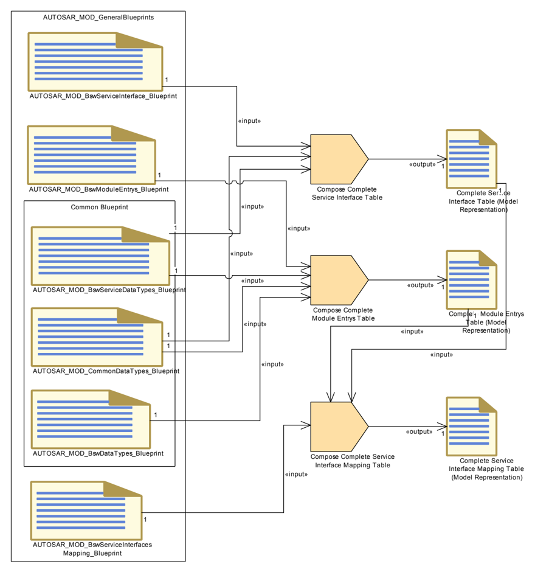

## 3. SwRecordLayout 的可视化（**Visualization of SwRecordLayouts**）

SwRecordLayout 的可视化遵循一种统一的表示。所使用的图形元素在图 3.1 中说明。

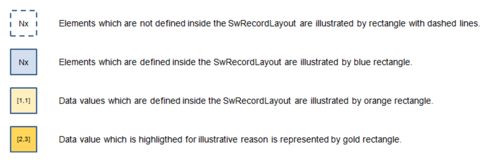

逻辑视图（**logical view**）将确定的元素表示为采样点数量、轴元素和数据取值。数据取值按适用的维度排列。曲线（**Curve**）按一维可视化（例如一列，见图 3.7）。映射（**Map**）按二维矩阵可视化（见图 3.19）。

存储器表示（**memory representation**）说明取值在线性存储器中的存储。当 SwRecordLayout 还将元素定义为采样点数量和轴元素（蓝色矩形）时，存储器表示从这些元素开始。随后是数据取值的存储（橙色矩形）。当 SwRecordLayout 未将元素定义为采样点数量和轴元素时，存储器表示从数据取值的存储开始。

ARXML 表示列出描述该 SwRecordLayout 的 ARXML 文件的重要部分。

### 3.1. 分布式数据点（**Distributed Data Points**）

本章描述用于分布式数据点查找的记录布局（**record layout**）。这意味着该 SwRecordLayout 只描述采样点的数量和轴取值，不描述任何取值。此时多条曲线可以使用同一根轴（分布式数据点），见图 3.3。

#### 3.1.1. 记录布局：Distr（**Record Layout: Distr**）

##### 3.1.1.1. 逻辑视图（**Logical view**）

图 3.2 说明 SwRecordLayout Distr 的逻辑视图。Nx 表示 SwRecordLayoutV.swRecordLayoutVProp 的标准化取值，记录于 [TPS\_SWCT\_01489]。在本例中取值为 COUNT。

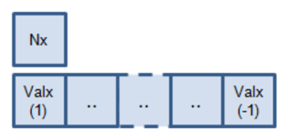

##### 3.1.1.2. 存储器表示（**Memory representation**）

由于采样点数量和轴取值（本记录布局定义的内容）在没有曲线定义的情况下不存储在存储器中，因此不定义存储器表示。

##### 3.1.1.3. ARXML 表示（**ARXML representation**）

摘自 AUTOSAR\_MOD\_IFX\_RecordLayouts\_Blueprint.arxml 的记录布局 Distr\_s16。

```xml
<SW-RECORD-LAYOUT>
  <SHORT-NAME NAME-PATTERN="{blueprintName}">Distr_s16</SHORT-NAME>
  <SW-RECORD-LAYOUT-GROUP>
    <SW-RECORD-LAYOUT-V>
      <SHORT-LABEL NAME-PATTERN="{blueprintName}">N</SHORT-LABEL>
      <BASE-TYPE-REF DEST="SW-BASE-TYPE">/AUTOSAR/Platform/BaseTypes_Blueprint/sint16</BASE-TYPE-REF>
      <SW-RECORD-LAYOUT-V-AXIS>1</SW-RECORD-LAYOUT-V-AXIS>
      <SW-RECORD-LAYOUT-V-PROP>COUNT</SW-RECORD-LAYOUT-V-PROP>
    </SW-RECORD-LAYOUT-V>
    <SW-RECORD-LAYOUT-GROUP>
      <SHORT-LABEL NAME-PATTERN="{blueprintName}">X</SHORT-LABEL>
      <CATEGORY>INDEX_INCR</CATEGORY>
      <SW-RECORD-LAYOUT-GROUP-AXIS>1</SW-RECORD-LAYOUT-GROUP-AXIS>
      <SW-RECORD-LAYOUT-GROUP-FROM>1</SW-RECORD-LAYOUT-GROUP-FROM>
      <SW-RECORD-LAYOUT-GROUP-TO>-1</SW-RECORD-LAYOUT-GROUP-TO>
      <SW-RECORD-LAYOUT-V>
        <BASE-TYPE-REF DEST="SW-BASE-TYPE">/AUTOSAR/Platform/BaseTypes_Blueprint/sint16</BASE-TYPE-REF>
        <SW-RECORD-LAYOUT-V-AXIS>1</SW-RECORD-LAYOUT-V-AXIS>
        <SW-RECORD-LAYOUT-V-PROP>VALUE</SW-RECORD-LAYOUT-V-PROP>
      </SW-RECORD-LAYOUT-V>
    </SW-RECORD-LAYOUT-GROUP>
  </SW-RECORD-LAYOUT-GROUP>
</SW-RECORD-LAYOUT>
<!-- SW-RECORD-LAYOUT: Distr_s8 -->
```

清单3.1：ARXML 表示的记录布局 Distr\_s16（**Record Layout: Distr\_s16 in ARXML representation**）

不同的曲线可以分配给同一分布（**distribution**）。

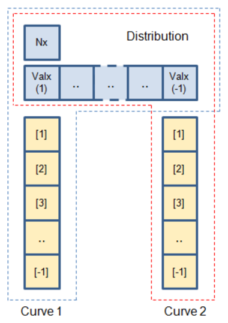

两条曲线使用同一分布（AXIS 1），例如由紫色点线所示（x 取值 25），而取值不同（AXIS 0），曲线取值（y 取值分别为 65 和 15）。

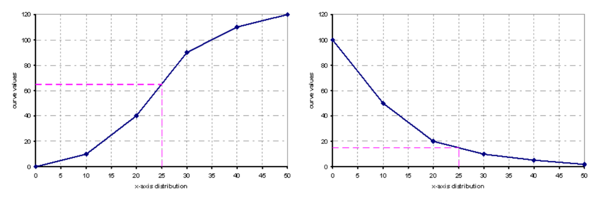

### 3.2. 曲线（**Curves**）

#### 3.2.1. 记录布局：Cur（**Record Layout: Cur**）

本章描述一条曲线的记录布局。

##### 3.2.1.1. 逻辑视图（**Logical view**）

图 3.5 说明 SwRecordLayout Cur 的逻辑视图。采样点的数量（Nx）和 [AXIS 1] 的元素不在这个 SwRecordLayout 内定义。shortLabel 为 Val 的 SwRecordLayoutGroup 显示在下部。

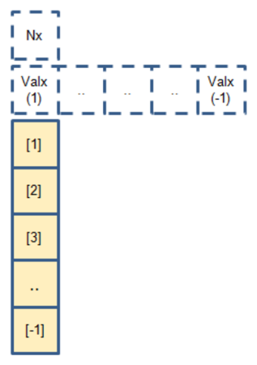

##### 3.2.1.2. 存储器表示（**Memory representation**）

图 3.5 所示的 SwRecordLayout Cur 按如下方式存储：

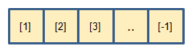

这意味着数据按列方向（[1]、[2]、[3]、…）存储。

##### 3.2.1.3. ARXML 表示（**ARXML representation**）

摘自 AUTOSAR\_MOD\_IFX\_RecordLayouts\_Blueprint.arxml 的记录布局 Cur\_s16。

清单3.2：ARXML 表示的记录布局 Cur\_s16（**Record Layout: Cur\_s16 in ARXML representation**）

#### 3.2.2. 记录布局：IntCur（**Record Layout: IntCur**）

本章描述带集成数据点查找的曲线的记录布局。也就是说，该 SwRecordLayout 表示一条完整的曲线，含采样点数量、轴数量和取值。它描述曲线的所有元素。

##### 3.2.2.1. 逻辑视图（**Logical view**）

图 3.7 说明 SwRecordLayout IntCur 的逻辑视图。Nx 表示采样点的数量，由 SwRecordLayoutV.swRecordLayoutVProp 的标准化取值给出。在本例中取值为 COUNT。shortLabel 为 Val 的 SwRecordLayoutGroup 显示在下部。其元素按 [AXIS 1] 从取值（AXIS 1:=1）到取值（AXIS 1:=-1）索引，其中 -1 表示最后一个取值。

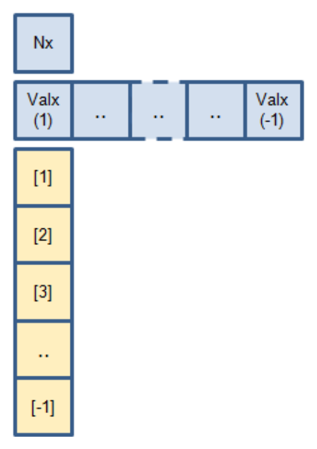

##### 3.2.2.2. 存储器表示（**Memory representation**）

图 3.7 所示的 SwRecordLayout IntCur 按如下方式存储：

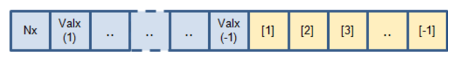

这意味着数据按列方向（[1]、[2]、[3]、…）存储。

##### 3.2.2.3. ARXML 表示（**ARXML representation**）

摘自 AUTOSAR\_MOD\_IFX\_RecordLayouts\_Blueprint.arxml 的记录布局 IntCur\_s16\_s8。

清单3.3：ARXML 表示的记录布局 IntCur\_s16\_s8（**Record Layout: IntCur\_s16\_s8 in ARXML representation**）

#### 3.2.3. 记录布局：FixIntCur（**Record Layout: FixIntCur**）

本章描述固定轴点的曲线的记录布局。固定轴分为三类：FIX\_AXIS\_PAR、FIX\_AXIS\_PAR\_DIST 和 FIX\_AXIS\_PAR\_LIST，见 [\[7\]](#ref-7) 中的 [TPS\_SWCT\_01748]。

采样点的数量（Nx）、偏移（**Offset**）、移位（**shift**）和距离取值在后续各章中用如下逻辑视图表示：

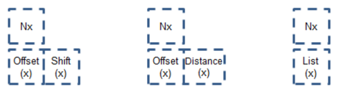

这些取值不在带固定轴点的 SwRecordLayout 内定义。

##### 3.2.3.1. 逻辑视图（**Logical view**）

图 3.10 说明 SwRecordLayout FixIntCur 的逻辑视图。shortLabel 为 Val 的 SwRecordLayoutGroup 显示在下部。其元素按虚拟 [AXIS 1] 索引，该轴是固定的、类别为 FIX\_AXIS\_PAR，且不在这个 SwRecordLayout 内定义。

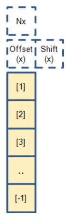

##### 3.2.3.2. 存储器表示（**Memory representation**）

图 3.10 所示的 SwRecordLayout FixIntCur 按如下方式存储：

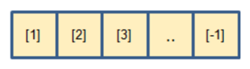

这意味着数据按列方向（[1]、[2]、[3]、…）存储。

##### 3.2.3.3. ARXML 表示（**ARXML representation**）

摘自 AUTOSAR\_MOD\_IFX\_RecordLayouts\_Blueprint.arxml 的记录布局 FixIntCur\_s16\_s16。

清单3.4：ARXML 表示的记录布局 FixIntCur\_s16\_s16（**Record Layout: FixIntCur\_s16\_s16 in ARXML representation**）

### 3.3. 映射（**Maps**）

#### 3.3.1. 索引的定义（**Definition of Indexing**）

为了理解 SwRecordLayout 的可视化，重要的是对所使用的索引建立共同的理解。存在线性代数中矩阵定义所用的索引和笛卡尔坐标系所用的索引。在线性代数中，矩阵 A(m,n) 由行索引（m）和列索引（n）定义。

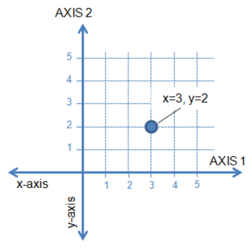

**AUTOSAR** 和 **ASAM** 使用的笛卡尔坐标系将 AXIS 2（AXIS\_PTS\_Y）分配给行索引（m），将 AXIS 1（AXIS\_PTS\_X）分配给列索引（n）。这是从矩阵定义的索引到笛卡尔坐标系表示的转换中的关键点。图 3.12 中的矩阵元素 a(2,3) 在图 3.13 的笛卡尔坐标系中表示为（AXIS 1）x = 3 和（AXIS 2）y = 2。


基于这一转换定义，下面对 SwRecordLayout 的可视化应当能促进对所提供 SwRecordLayout 的更好共同理解。

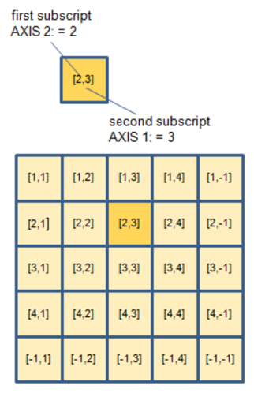

矩阵的每个元素用带两个下标 [AXIS 2, AXIS 1] 的索引表示。例如，[2,3] 表示矩阵第二行（AXIS 2）第三列（AXIS 1）处的元素。矩阵的索引可以按两种不同方式转换到存储器表示：

- 数组取值按列主序（**column-major order**）存储到线性存储器 —— COLUMN\_DIR
- 数组取值按行主序（**row-major order**）存储到线性存储器 —— ROW\_DIR

按列主序，多维数组在线性存储器中被组织为各列依次存储。选中第一列的第一个元素 [1,1]，然后在该列内迭代直至最后一个元素 [-1,1]（由图 3.15 中的红色箭头指示）。最后一个元素在 SwRecordLayout 中由「-1」定义。之后选中第二列的第一个元素 [1,2]，迭代像第一列那样重新开始。

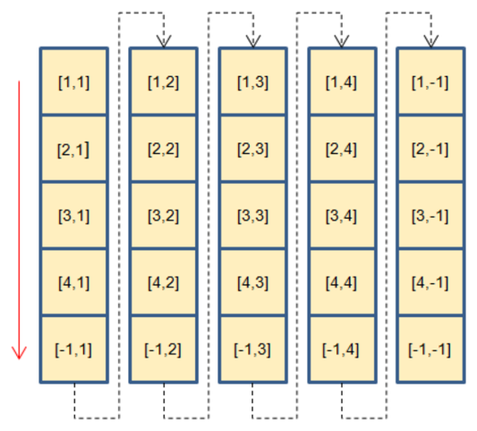

这个清单展示了列主序情形下两个嵌套 FOR 循环：外循环在 AXIS 1 上迭代，内循环在 AXIS 2 上迭代。

按行主序，多维数组在线性存储器中被组织为各行依次存储。选中第一行的第一个元素 [1,1]，然后在该行内迭代直至最后一个元素 [1,-1]（由图 3.16 中的蓝色箭头指示）。之后选中第二行的第一个元素 [2,1]，迭代像第一行那样重新开始。

这个清单展示了行主序情形下两个嵌套 FOR 循环：外循环在 AXIS 2 上迭代，内循环在 AXIS 1 上迭代。

#### 3.3.2. 将逻辑视图变换为存储器表示（**Transform Logical View in Memory Representation**）

逻辑视图按 3.3.1 节所述由 m×n 矩阵（二维矩阵）表示。

矩阵的每个元素用带两个下标 [AXIS 2, AXIS 1] 的索引表示。例如，[2,3] 表示矩阵第二行（AXIS 2）第三列（AXIS 1）处的元素。矩阵的索引可以按两种不同方式转换到存储器表示：

- 数组取值按列主序存储到线性存储器 —— COLUMN\_DIR
- 数组取值按行主序存储到线性存储器 —— ROW\_DIR

#### 3.3.3. 记录布局：Map（**Record Layout: Map**）

本章描述一个映射的记录布局。

##### 3.3.3.1. 逻辑视图（**Logical view**）

图 3.17 说明 SwRecordLayout Map 的逻辑视图。采样点的数量（Nx、Ny）和 [AXIS 2, AXIS 1] 的元素不在这个 SwRecordLayout 内定义。shortLabel 为 Val 的 SwRecordLayoutGroup 显示在下部。

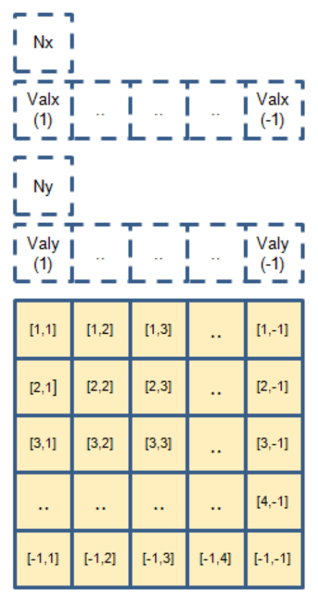

图 3.17 中的矩阵元素 a(2,3) 表示为（AXIS 1）x = 3 和（AXIS 2）y = 2。

##### 3.3.3.2. 存储器表示（COLUMN\_DIR）（**Memory representation (COLUMN\_DIR)**）

图 3.17 所示的 SwRecordLayout Map 在类别为 COLUMN\_DIR 时按如下方式存储：

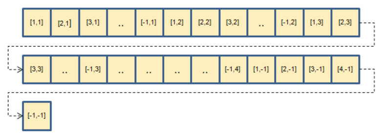

这意味着数据先按列方向、再按行方向存储（[1,1]、[2,1]、[3,1]、…）。

##### 3.3.3.3. ARXML 表示（**ARXML representation**）

摘自 AUTOSAR\_MOD\_IFX\_RecordLayouts\_Blueprint.arxml 的记录布局 Map\_s16。

清单3.5：ARXML 表示的记录布局 Map\_s16（**Record Layout: Map\_s16 in ARXML representation**）

#### 3.3.4. 记录布局：IntMap（**Record Layout: IntMap**）

本章描述带集成数据点查找的映射的记录布局。

##### 3.3.4.1. 逻辑视图（**Logical view**）

图 3.19 说明 SwRecordLayout IntMap 的逻辑视图。Nx 和 Ny 表示由 SwRecordLayoutV.swRecordLayoutVProp 的标准化取值给出的采样点数量。在下面的示例中，Nx 和 Ny 的维度不是固定定义的，而是由索引值指示的范围给出。在本例中取值为 COUNT。shortLabel 为 Val 的 SwRecordLayoutGroup 显示在下部。其元素按 [AXIS 2, AXIS 1] 从取值（AXIS 2:=1, AXIS 1:=1）到取值（AXIS 2:=-1, AXIS 1:=-1）索引，其中 -1 表示最后一个取值。

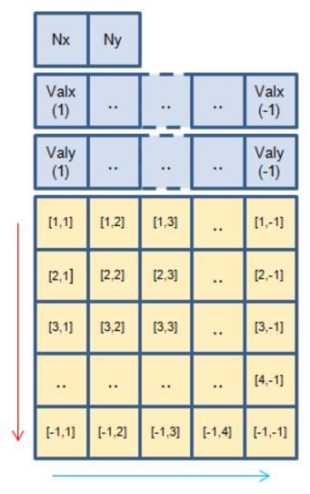

图 3.19 中的矩阵元素 a(2,3) 表示为（AXIS 1）x = 3 和（AXIS 2）y = 2。

##### 3.3.4.2. 存储器表示（COLUMN\_DIR）（**Memory representation (COLUMN\_DIR)**）

图 3.19 所示的 SwRecordLayout IntMap 在类别为 COLUMN\_DIR 时按如下方式存储：

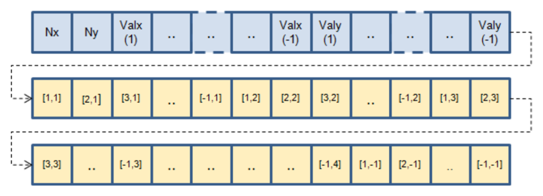

这意味着数据先按列方向、再按行方向存储（[1,1]、[2,1]、[3,1]、…）。

##### 3.3.4.3. ARXML 表示（**ARXML representation**）

摘自 AUTOSAR\_MOD\_IFX\_RecordLayouts\_Blueprint.arxml 的记录布局 IntMap\_s16s16\_s16。

清单3.6：ARXML 表示的记录布局 IntMap\_s16s16\_s16（**Record Layout: IntMap\_s16s16\_s16 in ARXML representation**）

##### 3.3.4.4. 存储器表示（ROW\_DIR）（**Memory representation (ROW\_DIR)**）

图 3.19 所示的 SwRecordLayout IntMap 在类别为 ROW\_DIR 时按如下方式存储：

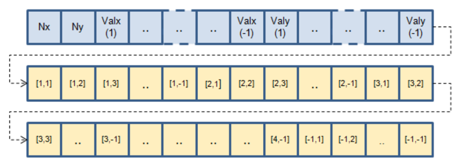

这意味着数据先按行方向、再按列方向存储（[1,1]、[1,2]、[1,3]、…）。

##### 3.3.4.5. ARXML 表示（**ARXML representation**）

摘自 AUTOSAR\_MOD\_IFX\_RecordLayouts\_Blueprint.arxml 的记录布局 IntMap\_s8s16\_s16。

清单3.7：ARXML 表示的记录布局 IntMap\_s8s16\_s16（**Record Layout: IntMap\_s8s16\_s16 in ARXML representation**）

#### 3.3.5. 记录布局：IntMap 3 x 4（**Record Layout: IntMap 3 x 4**）

非对称矩阵很常用，因此这里给出其处理的详细描述。

逻辑视图由 3×4 矩阵（二维矩阵）表示。矩阵的每个元素用带两个下标 [AXIS 2, AXIS 1] 的索引表示。例如，[3,2] 表示矩阵第三行（AXIS 2）第二列（AXIS 1）处的元素。

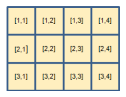

按列主序变换时，3×4 矩阵得到：

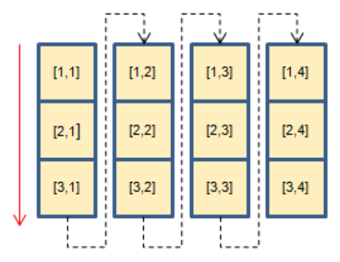

按行主序变换时，3×4 矩阵得到：

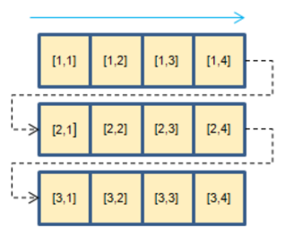

##### 3.3.5.1. 逻辑视图（**Logical view**）

图 3.25 说明 SwRecordLayout IntMap 对 3×4 矩阵的逻辑视图。Nx 和 Ny 表示由 SwRecordLayoutV.swRecordLayoutVProp 的标准化取值给出的采样点数量。在下面的示例中维度为 Nx = 4 和 Ny = 3。在本例中取值为 COUNT。shortLabel 为 Val 的 SwRecordLayoutGroup 显示在下部。其元素按 [AXIS 2, AXIS 1] 从取值（AXIS 2:=1, AXIS 1:=1）到取值（AXIS 2:=3, AXIS 1:=4）索引。AXIS 1 分配给 Valx，显示在取值上方；AXIS 2 分配给 Valy，显示在取值左侧。

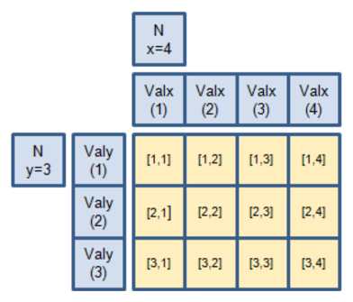

##### 3.3.5.2. 存储器表示（**Memory representation**）

图 3.26 所示的 3×4 矩阵的 SwRecordLayout IntMap 在类别为 COLUMN\_DIR 时按如下方式存储：

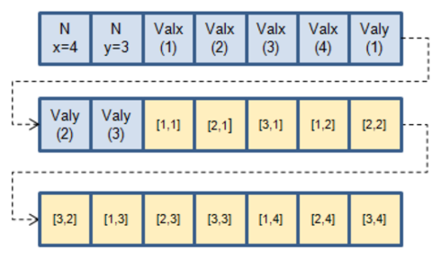

这意味着数据先按列方向、再按行方向存储。即对 Valx(1) 为（[1,1]、[2,1]、[3,1]），对 Valx(2) 为（[1,2]、[2,2]、[3,2]），对 Valx(3) 为（[1,3]、[2,3]、[3,3]），对 Valx(4) 为（[1,4]、[2,4]、[3,4]）。

图 3.27 所示的 3×4 矩阵的 SwRecordLayout IntMap 在类别为 ROW\_DIR 时按如下方式存储：

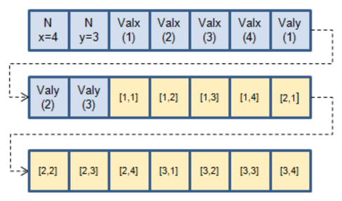

这意味着数据先按行方向、再按列方向存储。即对 Valy(1) 为（[1,1]、[1,2]、[1,3]、[1,4]），对 Valy(2) 为（[2,1]、[2,2]、[2,3]、[2,4]），对 Valy(3) 为（[3,1]、[3,2]、[3,3]、[3,4]）。

#### 3.3.6. 记录布局：FixIntMap（**Record Layout: FixIntMap**）

本章描述固定轴点的映射的记录布局。固定轴分为三类：FIX\_AXIS\_PAR、FIX\_AXIS\_PAR\_DIST 和 FIX\_AXIS\_PAR\_LIST，见 [\[7\]](#ref-7) 中的 [TPS\_SWCT\_01748]。

采样点的数量（Nx、Ny）、偏移、移位和距离取值在后续各章中用如下逻辑视图表示：

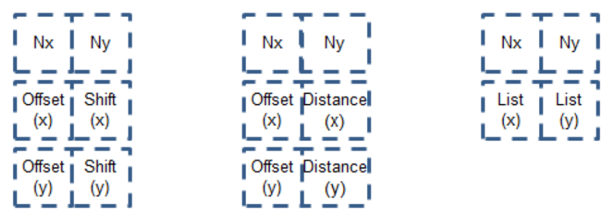

这些取值不在带固定轴点的 SwRecordLayout 内定义。

##### 3.3.6.1. 逻辑视图（**Logical view**）

图 3.29 说明 SwRecordLayout FixIntMap 的逻辑视图。shortLabel 为 Val 的 SwRecordLayoutGroup 显示在下部。其元素按 [AXIS 2, AXIS 1] 从取值（AXIS 2:=1, AXIS 1:=1）到取值（AXIS 2:=-1, AXIS 1:=-1）索引，其中 -1 表示最后一个取值。

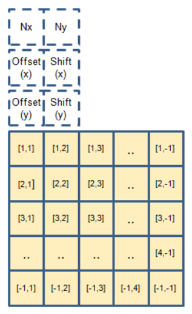

图 3.29 中的矩阵元素 a(2,3) 表示为（AXIS 1）x = 3 和（AXIS 2）y = 2。

##### 3.3.6.2. 存储器表示（COLUMN\_DIR）（**Memory representation (COLUMN\_DIR)**）

图 3.29 所示的 SwRecordLayout FixIntMap 在类别为 COLUMN\_DIR 时按如下方式存储：

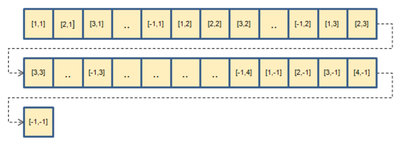

这意味着数据按列方向、再按行方向存储（[1,1]、[2,1]、[3,1]、…）。

##### 3.3.6.3. ARXML 表示（**ARXML representation**）

摘自 AUTOSAR\_MOD\_IFX\_RecordLayouts\_Blueprint.arxml 的记录布局 FixIntMap\_s16\_s16。

清单3.8：ARXML 表示的记录布局 FixIntMap\_s16\_s16（**Record Layout: FixIntMap\_s16\_s16 in ARXML representation**）

### 3.4. 多维数组（**Multidimensional Arrays**）

本章描述针对多维数组（如长方体、cube\_4 和 cube\_5）的记录布局。

#### 3.4.1. 索引的定义（**Definition of Indexing**）

为超过两个维度的数组定义记录布局时，使用与 3.3.1 节中映射相同的方法。

在线性代数中，三维矩阵由 A(l,m,n) 定义。尽管符号矩阵记法的细节变化很大，下标有意定义如下（见图 3.31）：切片（**slice**）或平面（**plane**）索引（l）、行索引（m）和列索引（n）。行索引（m）和列索引（n）张成图 3.12 已知的映射。切片或平面索引（l）构建由索引（m,n）定义的映射数组。

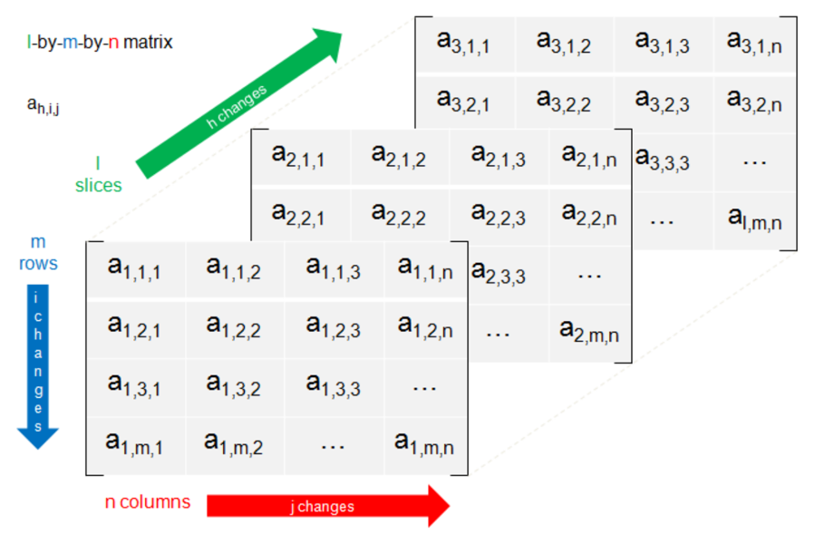

从矩阵定义的索引到笛卡尔坐标系表示的转换如图 3.32 所示。

（AXIS 1）和（AXIS 2）张成一个映射。（AXIS 3）构建这些映射的数组，称为切片。每个切片将定义一个三维欧几里得空间，其中每个点由三个「坐标」确定：（AXIS 1）、（AXIS 2）和取值。

必须理解，（AXIS 3）并不提供数据点的取值。（AXIS 3）给出长方体中三维欧几里得空间的编号。

#### 3.4.2. 记录布局：Cuboid（**Record Layout: Cuboid**）

本章描述一个长方体的记录布局。

##### 3.4.2.1. 逻辑视图（**Logical view**）

图 3.33 说明 SwRecordLayout Cuboid 的逻辑视图。采样点的数量（Nx、Ny、Nz）由 SwRecordLayout 内独立的 SwRecordLayoutV 定义。在下面的示例中维度为 Nx = 5、Ny = 4 和 Nz = 2。[AXIS 1, AXIS 2, AXIS 3] 的元素由外层 SwRecordLayoutGroup 内独立的 SwRecordLayoutGroup 定义。shortLabel 为 Val 的 SwRecordLayoutGroup 定义数据点的取值，显示在下部。

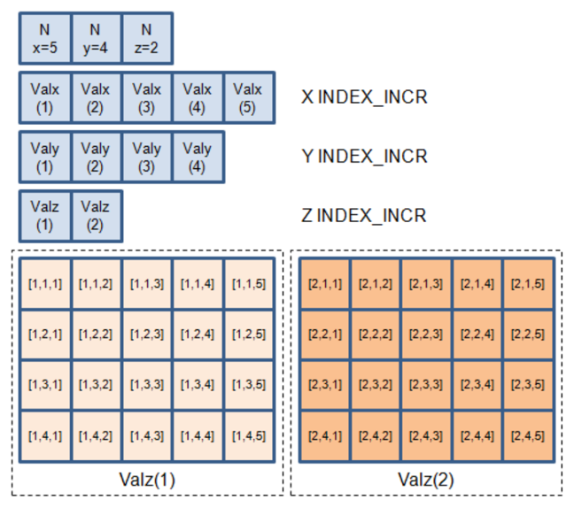

第一个切片（AXIS 3:=1）由命名为 Valz(1) 的虚线矩形区域说明，第二个切片（AXIS 3:=2）相应地命名为 Valz(2)。

##### 3.4.2.2. 存储器表示（**Memory representation**）

图 3.33 所示的 SwRecordLayout Cuboid 在类别为 COLUMN\_DIR 时按如下方式存储：

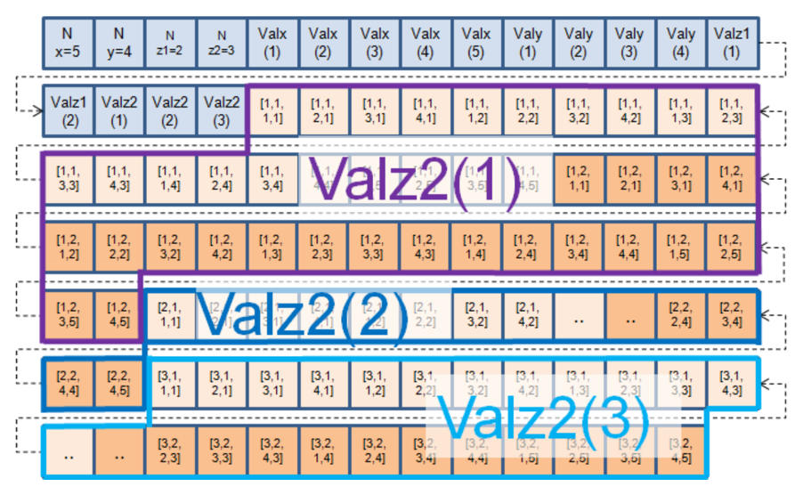

这意味着数据按列方向、再按行方向存储，从第一个切片开始（[1,1,1]、[1,2,1]、[1,3,1]、…、[1,4,5]）。第二个切片从（[2,1,1]、[2,2,1]、[2,3,1]、…、[2,4,5]）开始，并遵循相同的模式。

##### 3.4.2.3. ARXML 表示（**ARXML representation**）

记录布局 Cuboid\_s16s16s16\_s16 的 ARXML 表示出于说明的原因分两部分给出。第一部分定义采样点的数量和轴的元素。

清单3.9：Cuboid 的记录布局——第一部分（**Record Layout of Cuboid - part one**）

第二部分定义数据点的取值。在 shortLabel 为 Val 的 SwRecordLayoutGroup 内部，存储器表示（COLUMN\_DIR 或 ROW\_DIR）的定义必须唯一。也就是说，映射（AXIS 1 和 AXIS 2）的存储器表示与切片（AXIS 3）的存储器表示必须相同。在清单 3.10 的情况下定义的是存储器表示 COLUMN\_DIR。

清单3.10：Cuboid 的记录布局——第二部分（**Record Layout of Cuboid - part two**）

不同基类型的组合，例如 Cuboid\_u8s16u16\_u32，在技术上是可能的，但本文档不再进一步描述。

#### 3.4.3. 记录布局：Cube_4 与 Cube_5（**Record Layout: Cube\_4 and Cube\_5**）

本章描述 Cube\_4 和 Cube\_5 的记录布局。Cube\_4 存储一个带有递增或递减（AXIS 4）的长方体数组。Cube\_5 相应地存储一个带有递增或递减（AXIS 5）的 Cube\_4 数组。在本文档的这一版中只描述 Cube\_4。

##### 3.4.3.1. 逻辑视图（**Logical view**）

图 3.35 说明 SwRecordLayout Cube\_4 的逻辑视图。采样点的数量（Nx、Ny、Nz1、Nz2）由 SwRecordLayout 内独立的 SwRecordLayoutV 定义。在下面的示例中维度为 Nx = 5、Ny = 4、Nz1 = 2 和 Nz2 = 3。[AXIS 1, AXIS 2, AXIS 3, AXIS 4] 的元素由 SwRecordLayout 内独立的 SwRecordLayoutGroup 定义。

shortLabel 为 Val 的 SwRecordLayoutGroup 定义数据点的取值，显示在右侧。

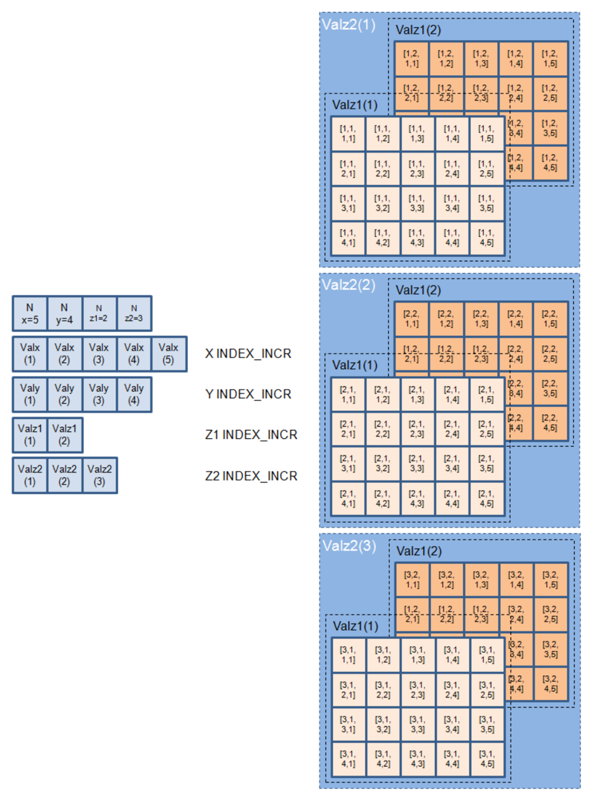

第一个长方体数组（AXIS 4:=1）由图 3.35 顶部命名为 Valz2(1) 的蓝色矩形区域说明。它包含带切片 Valz1(1) 和 Valz1(2) 的长方体。第二个长方体数组（AXIS 4:=2）和第三个（AXIS 4:=3）在图 3.35 的中部和底部说明。二者都包含带切片 Valz1(1) 和 Valz1(2) 的长方体。矩阵的每个元素用带四个下标 [AXIS 4, AXIS 3, AXIS 2, AXIS 1] 的索引表示。

##### 3.4.3.2. 存储器表示（**Memory representation**）

图 3.35 所示的 SwRecordLayout Cube\_4 在类别为 COLUMN\_DIR 时按如下方式存储：


数据取值按以下顺序存储：从沿长方体 Valz2(1)、Valz2(2) 和 Valz2(3) 的迭代开始。在每个这样的迭代内部，运行沿切片 Valz1(1) 和 Valz1(2) 的迭代。在每个这样的迭代内部，按 3.3.2 节已知的方式执行沿映射的迭代。图 3.36 中有意未完整展示长方体 Valz2(2) 和 Valz2(3) 的数据取值。

##### 3.4.3.3. ARXML 表示（**ARXML representation**）

记录布局 Cube\_4\_s16s16s16s16\_s16 的 ARXML 表示出于说明的原因分三部分给出。第一部分定义采样点的数量（Nx、Ny、Nz1、Nz2）。

清单3.11：Cube\_4 的记录布局——第一部分（**Record Layout of Cube\_4 - part one**）

第二部分定义轴的元素。

清单3.12：Cube\_4 的记录布局——第二部分（**Record Layout of Cube\_4 - part two**）

第三部分定义数据点的取值。

清单3.13：Cube\_4 的记录布局——第三部分（**Record Layout of Cube\_4 - part three**）

### 3.5. 取值与值块（**Value and ValueBlock**）

#### 3.5.1. 记录布局：Value（**Record Layout: Value**）

##### 3.5.1.1. 逻辑视图（**Logical view**）

图 3.37 说明 SwRecordLayout Value 的逻辑视图。该 SwRecordLayout 只包含一个取值。

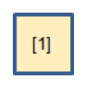

##### 3.5.1.2. 存储器表示（**Memory representation**）

图 3.37 所示的 SwRecordLayout Val 按如下方式存储：

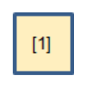

##### 3.5.1.3. ARXML 表示（**ARXML representation**）

清单3.14：Value 的记录布局（**Record Layout of Value**）

#### 3.5.2. 记录布局：一维 ValueBlock（**Record Layout: One dimensional ValueBlock**）

##### 3.5.2.1. 逻辑视图（**Logical view**）

图 3.39 说明 SwRecordLayout ValueBlock 的逻辑视图。该 SwRecordLayout 是一个取值数组（类似于轴，但没有轴点数量）。

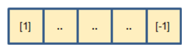

##### 3.5.2.2. 存储器表示（**Memory representation**）

图 3.40 所示的 SwRecordLayout ValueBlock 按如下方式存储：

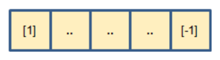

##### 3.5.2.3. ARXML 表示（**ARXML representation**）

清单3.15：ValueBlock 的记录布局（**Record Layout of ValueBlock**）

#### 3.5.3. 记录布局：多维 ValueBlock（**Record Layout: Multi dimensional ValueBlock**）

一般而言，**AUTOSAR** 和 **ASAM** 支持多维值块（**ValueBlock**）。下面的示例展示一个二维 SwRecordLayout。因此 AUTOSAR\_MOD\_ValBlk\_SwRecordLayouts\_Blueprint.arxml 只包含最多两个维度的蓝图。

##### 3.5.3.1. 逻辑视图（**Logical view**）

图 3.41 说明 SwRecordLayout 多维 ValueBlock 的逻辑视图。该 SwRecordLayout 是一个取值数组（类似于映射或长方体，但没有轴点）。Ni 定义值块的维度，在本例中 i = 2。Nj 定义专门维度中取值的数量。

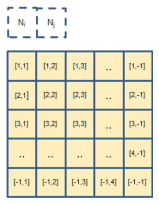

##### 3.5.3.2. 存储器表示（**Memory representation**）

图 3.41 所示的 SwRecordLayout 多维 ValueBlock 按如下方式存储：

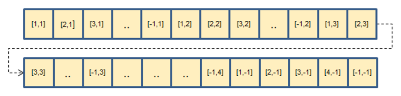

##### 3.5.3.3. ARXML 表示（**ARXML representation**）

清单3.16：多维 ValueBlock 的记录布局（**Record Layout of Multi dimensional ValueBlock**）

## 4. 附加的 SwRecordLayout（**Additional SwRecordLayouts**）

本章将描述未由专门 **SWS** 文档覆盖的进一步 SwRecordLayout。

内容将随版本更新。

## 5. 单位与物理量纲（**Units and Physical Dimensions**）

单位和物理量纲按照 [\[10\]](#ref-10) 和 [\[7\]](#ref-7) 中的描述由 [TPS\_SWCT\_01285]、[TPS\_SWCT\_01056]、[TPS\_SWCT\_01057]、[TPS\_SWCT\_01058]、[TPS\_SWCT\_01736]、[TPS\_SWCT\_01059]、[TPS\_SWCT\_01737]、[TPS\_SWCT\_01060]、[TPS\_SWCT\_01061]、[TPS\_SWCT\_01068]、[constr\_1026] 和 [constr\_1255] 定义。

## A. 本文档提及的类表（Mentioned Class Tables）

为完整起见，本章收录一组类表，表示本文档上下文中提及的元类。表题在源文档转换产物中位于表内容之后，本文章按表内 Class 行归属表题并置于表上方。

表A.1：BaseType（**BaseType**）

| 属性 | 值 |
| --- | --- |
| 类 | BaseType（抽象） |
| 包 | M2::MSR::AsamHdo::BaseTypes |
| 说明 | 该抽象元类表示规定平台相关基类型的能力。 |
| 基类 | ARElement、ARObject、CollectableElement、Identifiable、MultilanguageReferrable、PackageableElement、Referrable |
| 子类 | SwBaseType |
| 聚合于 | ARPackage.element |

| 属性 | 类型 | 多重性 | 种类 | 备注 |
| --- | --- | --- | --- | --- |
| baseTypeDefinition | BaseTypeDefinition | 1 | aggr | 这是基类型的实际定义。标签：xml.roleElement=false、xml.roleWrapperElement=false、xml.sequenceOffset=20、xml.typeElement=false、xml.typeWrapperElement=false |

表A.2：BlueprintPolicy（**BlueprintPolicy**）

| 属性 | 值 |
| --- | --- |
| 类 | BlueprintPolicy（抽象） |
| 包 | M2::AUTOSARTemplates::CommonStructure::StandardizationTemplate::AbstractBlueprintStructure |
| 说明 | 该元类表示指示可蓝图化元素可修改或不可修改的能力。 |
| 基类 | ARObject |
| 子类 | BlueprintPolicyModifiable、BlueprintPolicyNotModifiable |
| 聚合于 | AtpBlueprint.blueprintPolicy |

| 属性 | 类型 | 多重性 | 种类 | 备注 |
| --- | --- | --- | --- | --- |
| attributeName | String | 1 | attr | 这标识 BlueprintPolicy 的相关属性。为了在模型上导航，使用 xpath 表达式的一个子集。 |

表A.3：BswModuleDescription（**BswModuleDescription**）

| 属性 | 值 |
| --- | --- |
| 类 | BswModuleDescription |
| 包 | M2::AUTOSARTemplates::BswModuleTemplate::BswOverview |
| 说明 | 描述单个 **BSW** 模块或 **BSW** 簇的根元素。当它描述一个 **BSW** 模块时，该元素的 short-name 等于该 **BSW** 模块的名称。标签：atp.recommendedPackage=BswModuleDescriptions |
| 基类 | ARElement、ARObject、AtpBlueprint、AtpBlueprintable、AtpClassifier、AtpFeature、AtpStructureElement、CollectableElement、Identifiable、MultilanguageReferrable、PackageableElement、Referrable |
| 聚合于 | ARPackage.element、AtpClassifier.atpFeature |

| 属性 | 类型 | 多重性 | 种类 | 备注 |
| --- | --- | --- | --- | --- |
| bswModuleDependency | BswModuleDependency | * | aggr | 描述对另一个 **BSW** 模块的依赖。构造型：atpSplitable；atpVariation。标签：atp.Splitkey=bswModuleDependency.shortName、bswModuleDependency.variationPoint.shortLabel、vh.latestBindingTime=preCompileTime、xml.sequenceOffset=20 |
| bswModuleDocumentation | SwComponentDocumentation | 0..1 | aggr | 这为该 **BSW** 模块添加文档。构造型：atpSplitable；atpVariation。标签：atp.Splitkey=bswModuleDocumentation、bswModuleDocumentation.variationPoint.shortLabel、vh.latestBindingTime=preCompileTime、xml.sequenceOffset=6 |
| expectedEntry | BswModuleEntry | * | ref | 指示该模块需要的一个入口。取代 outgoingCallback / requiredEntry。构造型：atpSplitable；atpVariation。标签：atp.Splitkey=expectedEntry.bswModuleEntry、expectedEntry.variationPoint.shortLabel、vh.latestBindingTime=preCompileTime |
| implementedEntry | BswModuleEntry | * | ref | 规定该模块提供、可被其他模块调用的一个入口。这包括「main」函数、中断例程和回调。取代 providedEntry / expectedCallback。构造型：atpSplitable；atpVariation。标签：atp.Splitkey=implementedEntry.bswModuleEntry、implementedEntry.variationPoint.shortLabel、vh.latestBindingTime=preCompileTime |
| internalBehavior | BswInternalBehavior | * | aggr | 与一个 BswModuleDescription 关联的各个 BswInternalBehavior 可以分布在多个物理文件中。因此该聚合为 «atpSplitable»。构造型：atpSplitable。标签：atp.Splitkey=internalBehavior.shortName、xml.sequenceOffset=65 |
| moduleId | PositiveInteger | 0..1 | attr | 引用 **AUTOSAR** 标准定义的 **BSW** 模块标识符。对于非标准化模块，可以选择一个专有标识符。 |
| providedClientServerEntry | BswModuleClientServerEntry | * | aggr | 规定该模块提供一个可从另一分区或内核调用的客户-服务器入口。该入口在此上下文中局部声明，并将经由 **BSW** 调度器的配置连接到另一个或同一模块的 requiredClientServerEntry。构造型：atpSplitable；atpVariation。标签：atp.Splitkey=providedClientServerEntry.shortName、providedClientServerEntry.variationPoint.shortLabel、vh.latestBindingTime=preCompileTime |
| providedData | VariableDataPrototype | * | aggr | 规定该模块提供的一个数据原型，以便从另一分区或内核读取。providedData 在此上下文中局部声明，并将经由 **BswScheduler** 的配置连接到另一个或同一模块的 requiredData。构造型：atpSplitable；atpVariation。标签：atp.Splitkey=providedData.shortName、providedData.variationPoint.shortLabel、vh.latestBindingTime=preCompileTime、xml.sequenceOffset=55 |
| providedModeGroup | ModeDeclarationGroupPrototype | * | aggr | 由该模块或簇拥有并提供的一组模式。它可以经由 **BswScheduler** 的配置连接到其他模块或簇的 requiredModeGroup。它还可以与由关联的 ServiceSwComponentType、EcuAbstractionSwComponentType 或 ComplexDeviceDriverSwComponentType 经端口提供的模式同步。构造型：atpSplitable；atpVariation。标签：atp.Splitkey=providedModeGroup.shortName、providedModeGroup.variationPoint.shortLabel、vh.latestBindingTime=preCompileTime、xml.sequenceOffset=25 |
| releasedTrigger | Trigger | * | aggr | 由该模块或簇释放的一个触发器。它可以经由 **BswScheduler** 的配置连接到其他模块或簇的 requiredTriggers。它还可以与由关联的 ServiceSwComponentType、EcuAbstractionSwComponentType 或 ComplexDeviceDriverSwComponentType 经端口提供的 Trigger 同步。构造型：atpSplitable；atpVariation。标签：atp.Splitkey=releasedTrigger.shortName、releasedTrigger.variationPoint.shortLabel、vh.latestBindingTime=preCompileTime、xml.sequenceOffset=35 |
| requiredClientServerEntry | BswModuleClientServerEntry | * | aggr | 规定该模块需要一个可在另一分区或内核上实现的客户-服务器入口。该入口在此上下文中局部声明，并将经由 **BSW** 调度器的配置连接到另一个或同一模块的 providedClientServerEntry。构造型：atpSplitable；atpVariation。标签：atp.Splitkey=requiredClientServerEntry.shortName、requiredClientServerEntry.variationPoint.shortLabel、vh.latestBindingTime=preCompileTime、xml.sequenceOffset=50 |
| requiredData | VariableDataPrototype | * | aggr | 规定该模块需要的一个数据原型，以便由另一分区或内核提供。requiredData 在此上下文中局部声明，并将经由 **BswScheduler** 的配置连接到另一个或同一模块的 providedData。构造型：atpSplitable；atpVariation。标签：atp.Splitkey=requiredData.shortName、requiredData.variationPoint.shortLabel、vh.latestBindingTime=preCompileTime |
| requiredModeGroup | ModeDeclarationGroupPrototype | * | aggr | 规定该模块或簇依赖于某个特定的模式组。requiredModeGroup 在此上下文中是局部的，并将经由 **BswScheduler** 的配置连接到另一模块或簇的 providedModeGroup。构造型：atpSplitable；atpVariation。标签：atp.Splitkey=requiredModeGroup.shortName、requiredModeGroup.variationPoint.shortLabel、vh.latestBindingTime=preCompileTime、xml.sequenceOffset=30 |
| requiredTrigger | Trigger | * | aggr | 规定该模块或簇对外部触发器做出反应。该 requiredTrigger 在此上下文中局部声明，并将经由 **BswScheduler** 的配置连接到另一模块或簇的 providedTrigger。构造型：atpSplitable；atpVariation。标签：atp.Splitkey=requiredTrigger.shortName、requiredTrigger.variationPoint.shortLabel、vh.latestBindingTime=preCompileTime、xml.sequenceOffset=40 |

表A.4：BswModuleEntry（**BswModuleEntry**）

| 属性 | 值 |
| --- | --- |
| 类 | BswModuleEntry |
| 包 | M2::AUTOSARTemplates::BswModuleTemplate::BswInterfaces |
| 说明 | 该类表示进入 **BSW** 模块或簇的单个 **API** 入口（**C** 函数原型）。**C** 函数的名称等于该元素的 short-name，但有一个例外：当同一 **CPU** 上存在一个模块的多个实例时，适用「中缀（**infix**）」的特殊规则，参见类 BswImplementation 的描述。标签：atp.recommendedPackage=BswModuleEntrys |
| 基类 | ARElement、ARObject、AtpBlueprint、AtpBlueprintable、CollectableElement、Identifiable、MultilanguageReferrable、PackageableElement、Referrable |
| 聚合于 | ARPackage.element |

| 属性 | 类型 | 多重性 | 种类 | 备注 |
| --- | --- | --- | --- | --- |
| argument（有序） | SwServiceArg | * | aggr | 属于该 BswModuleEntry 的一个参数。构造型：atpSplitable；atpVariation。标签：atp.Splitkey=argument.shortName、argument.variationPoint.shortLabel、vh.latestBindingTime=blueprintDerivationTime、xml.sequenceOffset=45 |
| bswEntryKind | BswEntryKindEnum | 0..1 | attr | 描述该入口是具体的还是抽象的。如果缺少该属性，则该入口被视为具体的。标签：xml.sequenceOffset=40 |
| callType | BswCallType | 0..1 | attr | 与该服务关联的调用类型。标签：xml.sequenceOffset=25 |
| executionContext | BswExecutionContext | 0..1 | attr | 规定该服务所需的（对于进入本模块的入口）或所保证的（对于从本模块调用的入口）执行上下文。标签：xml.sequenceOffset=30 |
| functionPrototypeEmitter | NameToken | 0..1 | attr | 该属性用于控制函数原型的生成。若设为「RTE」，则 **RTE** 在模块互连头文件（**Module Interlink Header File**）中生成函数原型。 |
| isReentrant | Boolean | 0..1 | attr | 从函数调用者角度看的可重入性：<br>* true：允许在服务尚未结束时再次调用该服务。<br>* false：禁止在服务结束之前再次调用该服务。标签：xml.sequenceOffset=15 |
| isSynchronous | Boolean | 0..1 | attr | 从函数调用者角度看的同步性：<br>* true：调用同步服务，即调用返回时服务已完成。<br>* false：调用返回时服务（在语义层面）可能尚未完成。标签：xml.sequenceOffset=20 |
| returnType | SwServiceArg | 0..1 | aggr | 属于该 bswModuleEntry 的返回类型。标签：xml.sequenceOffset=40 |
| role | Identifier | 0..1 | attr | 规定该入口在给定上下文中的角色。它应等于服务调用的标准化名称，特别是在未规定 ServiceIdentifier 的情况下（例如对回调而言）。注意 ShortName 并非总是足够，因为它可能是供应商特定的（例如对可以拥有多个实例的回调）。 |
| serviceId | PositiveInteger | 0..1 | attr | 引用 **AUTOSAR** 基础软件标准化接口的服务标识符。对于非标准化接口，可以选择性地用于专有标识。标签：xml.sequenceOffset=5 |
| swServiceImplPolicy | SwServiceImplPolicyEnum | 0..1 | attr | 表示实现策略：标准函数调用、内联函数或宏。这必须在接口层级上规定，因为它决定调用的签名。标签：xml.sequenceOffset=35 |

表A.5：ClientServerInterface（**ClientServerInterface**）

| 属性 | 值 |
| --- | --- |
| 类 | ClientServerInterface |
| 包 | M2::AUTOSARTemplates::SWComponentTemplate::PortInterface |
| 说明 | 客户/服务器接口声明若干可由客户在服务器上调用的操作。标签：atp.recommendedPackage=PortInterfaces |
| 基类 | ARElement、ARObject、AtpBlueprint、AtpBlueprintable、AtpClassifier、AtpType、CollectableElement、Identifiable、MultilanguageReferrable、PackageableElement、PortInterface、Referrable |
| 聚合于 | ARPackage.element |

| 属性 | 类型 | 多重性 | 种类 | 备注 |
| --- | --- | --- | --- | --- |
| operation | ClientServerOperation | * | aggr | 该 ClientServerInterface 的 ClientServerOperation。构造型：atpSplitable；atpVariation。标签：atp.Splitkey=operation.shortName、operation.variationPoint.shortLabel、vh.latestBindingTime=blueprintDerivationTime |
| possibleError | ApplicationError | * | aggr | 作为该接口组成部分定义的应用错误。 |

表A.6：ClientServerInterfaceToBswModuleEntryBlueprintMapping（**ClientServerInterfaceToBswModuleEntryBlueprintMapping**）

| 属性 | 值 |
| --- | --- |
| 类 | ClientServerInterfaceToBswModuleEntryBlueprintMapping |
| 包 | M2::AUTOSARTemplates::CommonStructure::StandardizationTemplate::ClientServerInterfaceToBswModuleEntryMapping |
| 说明 | 这表示一个 ClientServerInterface 蓝图与一个 BswModuleEntry 蓝图之间的映射，用于在考虑 PortDefinedArguments 的前提下表达 ClientServerOperations 由特定 BswModuleEntry 实现的意图。这样的映射支持形式化检查「操作（加上附加的 PortDefinedArguments）的参数数量与参数数据类型是否与该 BswModuleEntry 的签名匹配」。标签：atp.recommendedPackage=BlueprintMappingSets |
| 基类 | ARElement、ARObject、AtpBlueprint、CollectableElement、Identifiable、MultilanguageReferrable、PackageableElement、Referrable |
| 聚合于 | ARPackage.element |

| 属性 | 类型 | 多重性 | 种类 | 备注 |
| --- | --- | --- | --- | --- |
| clientServerInterface | ClientServerInterface | 1 | ref | 被引用的 ClientServerInterface 表示该映射所 dedicated 的客户-服务器接口。 |
| operationMapping | ClientServerOperationBlueprintMapping | 1..* | aggr | 这规定在 ClientServerInterface 与 BswModuleEntry 之间的映射中使用的操作。构造型：atpSplitable；atpVariation。标签：atp.Splitkey=operationMapping、operationMapping.variationPoint.shortLabel、vh.latestBindingTime=preCompileTime |
| portDefinedArgumentBlueprint（有序） | PortDefinedArgumentBlueprint | * | aggr | 这规定在 ClientServerInterface 与 BswModuleEntry 之间的映射中使用的 PortDefinedArgument。构造型：atpSplitable；atpVariation。标签：atp.Splitkey=portDefinedArgumentBlueprint、portDefinedArgumentBlueprint.variationPoint.shortLabel、vh.latestBindingTime=preCompileTime |

表A.7：CompuMethod（**CompuMethod**）

| 属性 | 值 |
| --- | --- |
| 类 | CompuMethod |
| 包 | M2::MSR::AsamHdo::ComputationMethod |
| 说明 | 该元类表示表达物理取值与数学表示之间关系的能力。注意，它仍然独立于数据类型中的技术实现。它只规定内部取值与其物理对应物相对应的公式。标签：atp.recommendedPackage=CompuMethods |
| 基类 | ARElement、ARObject、AtpBlueprint、AtpBlueprintable、CollectableElement、Identifiable、MultilanguageReferrable、PackageableElement、Referrable |
| 聚合于 | ARPackage.element |

| 属性 | 类型 | 多重性 | 种类 | 备注 |
| --- | --- | --- | --- | --- |
| compuInternalToPhys | Compu | 0..1 | aggr | 这规定从内部取值到物理取值的计算。构造型：atpSplitable。标签：atp.Splitkey=compuInternalToPhys、xml.sequenceOffset=80 |
| compuPhysToInternal | Compu | 0..1 | aggr | 这表示从物理取值到内部取值的计算。构造型：atpSplitable。标签：atp.Splitkey=compuPhysToInternal、xml.sequenceOffset=90 |
| displayFormat | DisplayFormatString | 0..1 | attr | 该属性规定物理取值应如何显示，例如在文档或测量标定工具中。标签：xml.sequenceOffset=20 |
| unit | Unit | 0..1 | ref | 这是该 CompuMethod 所适用的物理取值的物理单位。标签：xml.sequenceOffset=30 |

表A.8：DataConstr（**DataConstr**）

| 属性 | 值 |
| --- | --- |
| 类 | DataConstr |
| 包 | M2::MSR::AsamHdo::Constraints::GlobalConstraints |
| 说明 | 该元类表示对数据规定约束的能力。标签：atp.recommendedPackage=DataConstrs |
| 基类 | ARElement、ARObject、AtpBlueprint、AtpBlueprintable、CollectableElement、Identifiable、MultilanguageReferrable、PackageableElement、Referrable |
| 聚合于 | ARPackage.element |

| 属性 | 类型 | 多重性 | 种类 | 备注 |
| --- | --- | --- | --- | --- |
| dataConstrRule | DataConstrRule | * | aggr | 这是数据约束中的一条特定规则。标签：xml.roleElement=true、xml.roleWrapperElement=true、xml.sequenceOffset=30、xml.typeElement=false、xml.typeWrapperElement=false |

表A.9：ImplementationDataType（**ImplementationDataType**）

| 属性 | 值 |
| --- | --- |
| 类 | ImplementationDataType |
| 包 | M2::AUTOSARTemplates::CommonStructure::ImplementationDataTypes |
| 说明 | 描述实现层级上一个可复用的数据类型。它通常对应 **C** 代码中的一个 typedef。标签：atp.recommendedPackage=ImplementationDataTypes |
| 基类 | ARElement、ARObject、AbstractImplementationDataType、AtpBlueprint、AtpBlueprintable、AtpClassifier、AtpType、AutosarDataType、CollectableElement、Identifiable、MultilanguageReferrable、PackageableElement、Referrable |
| 聚合于 | ARPackage.element |

| 属性 | 类型 | 多重性 | 种类 | 备注 |
| --- | --- | --- | --- | --- |
| dynamicArraySizeProfile | String | 0..1 | attr | 规定该数据类型为变长数组时数组所遵循的 profile。 |
| isStructWithOptionalElement | Boolean | 0..1 | attr | 该属性仅在 category 属性设为 STRUCTURE 时有效。若设为 true，该属性表示创建该 ImplementationDataType 的意图是将该结构的至少一个元素定义为可选。 |
| subElement（有序） | ImplementationDataTypeElement | * | aggr | 规定数组、结构或联合数据类型的一个元素。ImplementationDataTypeElement 的聚合可进行变体处理，以支持表示结构的 ImplementationDataType 内元素的条件性存在。构造型：atpSplitable；atpVariation。标签：atp.Splitkey=subElement.shortName、subElement.variationPoint.shortLabel、vh.latestBindingTime=preCompileTime |
| symbolProps | SymbolProps | 0..1 | aggr | 这表示 ImplementationDataType 的 SymbolProps。构造型：atpSplitable。标签：atp.Splitkey=symbolProps.shortName |
| typeEmitter | NameToken | 0..1 | attr | 该属性用于控制 **AUTOSAR** 工具链的哪一部分应当触发数据类型定义。 |

表A.10：InterpolationRoutineMappingSet（**InterpolationRoutineMappingSet**）

| 属性 | 值 |
| --- | --- |
| 类 | InterpolationRoutineMappingSet |
| 包 | M2::AUTOSARTemplates::SWComponentTemplate::MeasurementAndCalibration::InterpolationRoutineMappingSet |
| 说明 | 该元类规定一组插值例程映射。标签：atp.recommendedPackage=InterpolationRoutineMappingSets |
| 基类 | ARElement、ARObject、CollectableElement、Identifiable、MultilanguageReferrable、PackageableElement、Referrable |
| 聚合于 | ARPackage.element |

| 属性 | 类型 | 多重性 | 种类 | 备注 |
| --- | --- | --- | --- | --- |
| interpolationRoutineMapping | InterpolationRoutineMapping | * | aggr | 这规定记录布局与其匹配的插值例程之间的一个特定映射。 |

表A.11：Keyword（**Keyword**）

| 属性 | 值 |
| --- | --- |
| 类 | Keyword |
| 包 | M2::AUTOSARTemplates::CommonStructure::StandardizationTemplate::Keyword |
| 说明 | 该元类表示预定义关键词的能力，这些关键词随后可用于按照给定命名约定（例如 **AUTOSAR** 命名约定）构造名称。注意，这样的名称不仅是 shortName，还可以是 symbol，甚至是 longName。关键词的应用不限于特定名称。 |
| 基类 | ARObject、Identifiable、MultilanguageReferrable、Referrable |
| 聚合于 | KeywordSet.keyword |

| 属性 | 类型 | 多重性 | 种类 | 备注 |
| --- | --- | --- | --- | --- |
| abbrName | NameToken | 1 | attr | 该属性规定关键词的缩写名。该缩写例如可用于按照 **AUTOSAR** 命名约定构造有效的 shortName。与 shortName 不同，它可以包含任何名称 token，例如可以仅由数字组成。 |
| classification | NameToken | * | attr | 该属性允许为关键词附加分类，例如 MEAN、ACTION、CONDITION、INDEX、PREPOSITION。 |

表A.12：ModeDeclarationGroup（**ModeDeclarationGroup**）

| 属性 | 值 |
| --- | --- |
| 类 | ModeDeclarationGroup |
| 包 | M2::AUTOSARTemplates::CommonStructure::ModeDeclaration |
| 说明 | 模式声明的集合。同时，初始模式被显式标识。标签：atp.recommendedPackage=ModeDeclarationGroups |
| 基类 | ARElement、ARObject、AtpBlueprint、AtpBlueprintable、AtpClassifier、AtpType、CollectableElement、Identifiable、MultilanguageReferrable、PackageableElement、Referrable、UploadableDesignElement、UploadablePackageElement |
| 聚合于 | ARPackage.element |

| 属性 | 类型 | 多重性 | 种类 | 备注 |
| --- | --- | --- | --- | --- |
| initialMode | ModeDeclaration | 0..1 | ref | ModeDeclarationGroup 的初始模式。在任何模式切换发生之前，该模式是活动的。 |
| modeDeclaration | ModeDeclaration | * | aggr | 收集在该 ModeDeclarationGroup 中的 ModeDeclaration。构造型：atpSplitable；atpVariation。标签：atp.Splitkey=modeDeclaration.shortName、modeDeclaration.variationPoint.shortLabel、vh.latestBindingTime=blueprintDerivationTime |
| modeManagerErrorBehavior | ModeErrorBehavior | 0..1 | aggr | 这表示定义模式管理器一侧（例如模式用户被终止）出错时所期望的错误行为的能力。 |
| modeTransition | ModeTransition | * | aggr | 这表示该 ModeDeclarationGroup 可用的 ModeTransition。 |
| modeUserErrorBehavior | ModeErrorBehavior | 0..1 | aggr | 这表示模式用户一侧（例如模式管理器被终止）出错时所期望的错误行为的定义。 |
| onTransitionValue | PositiveInteger | 0..1 | attr | **RTE** 生成器在以程序化方式表示用于两个状态之间转换的取值时，应考虑该属性的取值。 |

表A.13：ModeSwitchInterface（**ModeSwitchInterface**）

| 属性 | 值 |
| --- | --- |
| 类 | ModeSwitchInterface |
| 包 | M2::AUTOSARTemplates::SWComponentTemplate::PortInterface |
| 说明 | 模式切换接口声明一个要发送和接收的 ModeDeclarationGroupPrototype。标签：atp.recommendedPackage=PortInterfaces |
| 基类 | ARElement、ARObject、AtpBlueprint、AtpBlueprintable、AtpClassifier、AtpType、CollectableElement、Identifiable、MultilanguageReferrable、PackageableElement、PortInterface、Referrable |
| 聚合于 | ARPackage.element |

| 属性 | 类型 | 多重性 | 种类 | 备注 |
| --- | --- | --- | --- | --- |
| modeGroup | ModeDeclarationGroupPrototype | 0..1 | aggr | 该模式接口的 ModeDeclarationGroupPrototype。 |

表A.14：NvBlockSwComponentType（**NvBlockSwComponentType**）

| 属性 | 值 |
| --- | --- |
| 类 | NvBlockSwComponentType |
| 包 | M2::AUTOSARTemplates::SWComponentTemplate::Components |
| 说明 | NvBlockSwComponentType 定义可在 SwComponentPrototype 之间共享的非易失性数据。NvBlockSwComponentType 的非易失性数据可经由提供和需求端口访问。标签：atp.recommendedPackage=SwComponentTypes |
| 基类 | ARElement、ARObject、AtomicSwComponentType、AtpBlueprint、AtpBlueprintable、AtpClassifier、AtpType、CollectableElement、Identifiable、MultilanguageReferrable、PackageableElement、Referrable、SwComponentType |
| 聚合于 | ARPackage.element |

| 属性 | 类型 | 多重性 | 种类 | 备注 |
| --- | --- | --- | --- | --- |
| bulkNvDataDescriptor | BulkNvDataDescriptor | * | aggr | 该聚合形式化地定义外层 NvBlockSwComponentType 提供给应用软件的大块 **Nv** 块（**bulk Nv Blocks**）。构造型：atpSplitable；atpVariation。标签：atp.Splitkey=bulkNvDataDescriptor.shortName、bulkNvDataDescriptor.variationPoint.shortLabel、vh.latestBindingTime=preCompileTime |
| nvBlockDescriptor | NvBlockDescriptor | * | aggr | 恰好一个 **NVRAM** 块的属性规定。构造型：atpSplitable；atpVariation。标签：atp.Splitkey=nvBlockDescriptor.shortName、nvBlockDescriptor.variationPoint.shortLabel、vh.latestBindingTime=preCompileTime |

表A.15：SenderReceiverInterface（**SenderReceiverInterface**）

| 属性 | 值 |
| --- | --- |
| 类 | SenderReceiverInterface |
| 包 | M2::AUTOSARTemplates::SWComponentTemplate::PortInterface |
| 说明 | 发送者/接收者接口声明若干要发送和接收的数据元素。标签：atp.recommendedPackage=PortInterfaces |
| 基类 | ARElement、ARObject、AtpBlueprint、AtpBlueprintable、AtpClassifier、AtpType、CollectableElement、DataInterface、Identifiable、MultilanguageReferrable、PackageableElement、PortInterface、Referrable |
| 聚合于 | ARPackage.element |

| 属性 | 类型 | 多重性 | 种类 | 备注 |
| --- | --- | --- | --- | --- |
| dataElement | VariableDataPrototype | * | aggr | 该 SenderReceiverInterface 的数据元素。 |
| invalidationPolicy | InvalidationPolicy | * | aggr | 针对特定 dataElement 的失效策略（**InvalidationPolicy**）。 |
| metaDataItemSet | MetaDataItemSet | * | aggr | 该聚合定义与外层 SenderReceiverInterface 的 dataElement 相关联的固定元数据项集合。 |

表A.16：ServiceSwComponentType（**ServiceSwComponentType**）

| 属性 | 值 |
| --- | --- |
| 类 | ServiceSwComponentType |
| 包 | M2::AUTOSARTemplates::SWComponentTemplate::Components |
| 说明 | ServiceSwComponentType 用于为给定 **ECU** 配置服务。该类的实例只在 **ECU** 配置阶段为服务配置的特定目的而创建。标签：atp.recommendedPackage=SwComponentTypes |
| 基类 | ARElement、ARObject、AtomicSwComponentType、AtpBlueprint、AtpBlueprintable、AtpClassifier、AtpType、CollectableElement、Identifiable、MultilanguageReferrable、PackageableElement、Referrable、SwComponentType |
| 聚合于 | ARPackage.element |

| 属性 | 类型 | 多重性 | 种类 | 备注 |
| --- | --- | --- | --- | --- |
| - | - | - | - | - |

表A.17：SwAddrMethod（**SwAddrMethod**）

| 属性 | 值 |
| --- | --- |
| 类 | SwAddrMethod |
| 包 | M2::MSR::DataDictionary::AuxillaryObjects |
| 说明 | 用于为数据或代码对象分配一个共同的寻址方法，例如公共存储器段。这些对象实际上可以位于不同的模块或组件中。标签：atp.recommendedPackage=SwAddrMethods |
| 基类 | ARElement、ARObject、AtpBlueprint、AtpBlueprintable、CollectableElement、Identifiable、MultilanguageReferrable、PackageableElement、Referrable |
| 聚合于 | ARPackage.element |

| 属性 | 类型 | 多重性 | 种类 | 备注 |
| --- | --- | --- | --- | --- |
| memoryAllocationKeywordPolicy | MemoryAllocationKeywordPolicyType | 0..1 | attr | 规定存储器分配关键字（**Memory Allocation Keyword**）名称模式的枚举。 |
| option | Identifier | * | attr | 该属性引入规定相关对象应放置其中的 MemorySection 的进一步预期属性的能力。这些属性被视为待选项。预期选项在列表中提及。在存储器映射配置中，该选项列表用于确定合适的 MemMapAddressingModeSet。 |
| sectionInitializationPolicy | SectionInitializationPolicyType | 0..1 | attr | 规定变量（包括实现 VariableDataPrototype 的那些）的预期初始化。因此，这是 **BSW** 模块（特别是 **RTE**）初始化代码以及启动代码的实现约束；后者初始化引用这些 SwAddrMethod 的 AutosarDataPrototype 之后所映射到的存储器段。如果未定义该属性，其语义与属性取值「INIT」相同。 |
| sectionType | MemorySectionType | 0..1 | attr | 定义可与该寻址方法关联的存储器段的类型。 |

表A.18：SwRecordLayout（**SwRecordLayout**）

| 属性 | 值 |
| --- | --- |
| 类 | SwRecordLayout |
| 包 | M2::MSR::DataDictionary::RecordLayout |
| 说明 | 定义数据对象（变量、标定参数等）应如何存储在 **ECU** 存储器中。例如，该定义规定 **ECU** 存储器中轴点的顺序。对轴取值的迭代存储在子元素 swRecordLayoutGroup 中。标签：atp.recommendedPackage=SwRecordLayouts |
| 基类 | ARElement、ARObject、CollectableElement、Identifiable、MultilanguageReferrable、PackageableElement、Referrable |
| 聚合于 | ARPackage.element |

| 属性 | 类型 | 多重性 | 种类 | 备注 |
| --- | --- | --- | --- | --- |
| swRecordLayoutGroup | SwRecordLayoutGroup | 0..1 | aggr | 这是顶层记录布局组。标签：xml.roleElement=true、xml.roleWrapperElement=false、xml.sequenceOffset=20、xml.typeElement=false、xml.typeWrapperElement=false |

表A.19：SwRecordLayoutGroup（**SwRecordLayoutGroup**）

| 属性 | 值 |
| --- | --- |
| 类 | SwRecordLayoutGroup |
| 包 | M2::MSR::DataDictionary::RecordLayout |
| 说明 | 规定记录布局如何搭建。借助 SwRecordLayoutGroup，可以递归地对轴取值的迭代建模。子元素 swRecordLayoutGroupContentType 可以为所建模的记录布局引用其他 SwRecordLayout、SwRecordLayoutV 和 SwRecordLayoutGroup。 |
| 基类 | ARObject |
| 聚合于 | SwRecordLayout.swRecordLayoutGroup、SwRecordLayoutGroupContent.swRecordLayoutGroup |

| 属性 | 类型 | 多重性 | 种类 | 备注 |
| --- | --- | --- | --- | --- |
| category | AsamRecordLayoutSemantics | 0..1 | attr | 该属性特别是以对应 **A2L** 关键词的方式表示语义。这是为了支持把 **AUTOSAR**/**MSR** 中更一般的记录布局映射到特定的 **A2L** 关键词。可以在 swRecordLayoutGroup 中表达 **A2L** recordlayout 关键词的特定语义，但不总是能反向表达。因此该映射在这个可选属性中提供。标签：xml.sequenceOffset=5 |
| desc | MultiLanguageOverviewParagraph | 0..1 | aggr | 该聚合允许对特定记录布局组做简要描述，帮助识别该条目。深入的文档应添加到外围记录布局的 introduction 中。标签：xml.sequenceOffset=20 |
| shortLabel | Identifier | 0..1 | attr | 该属性规定一个名称，例如从记录布局组生成 **ECU** 代码时可以使用。标签：xml.sequenceOffset=3 |
| swGenericAxisParamType | SwGenericAxisParamType | 0..1 | ref | 该关联允许规定记录布局组对通用轴参数进行迭代。例如，如果该通用轴参数是一个数组，则记录布局组将对该数组迭代。显然，swRecordLayoutGroupAxis 所引用的轴必须是聚合了被引用 SwGenericAxisType 的通用轴。标签：xml.sequenceOffset=50 |
| swRecordLayoutComponent | Identifier | 0..1 | attr | 该属性用于表示该组所适用的组件。因此记录布局支持结构化对象。由于可以通过名称引用组件，这保证了对组件顺序的独立性。标签：xml.sequenceOffset=90 |
| swRecordLayoutGroupAxis | AxisIndexType | 0..1 | attr | 该属性为一个 SwRecordLayoutGroup 规定迭代轴编号。当前记录布局组于是恰好引用具有该编号的轴。这意味着取值通过沿被引用轴迭代而取得。标签：xml.sequenceOffset=30 |
| swRecordLayoutGroupContentType | SwRecordLayoutGroupContent | 0..1 | aggr | 这是记录布局的内容，为迭代的每一步生成。标签：xml.roleElement=false、xml.roleWrapperElement=false、xml.sequenceOffset=100、xml.typeElement=false、xml.typeWrapperElement=false |
| swRecordLayoutGroupFrom | RecordLayoutIteratorPoint | 0..1 | attr | 该属性为记录布局组开始的轴上那一点规定迭代器索引。负值也可行，即取值 -4 表示从末端第四个取值起计。如果缺少该属性，迭代从「1」开始。标签：xml.sequenceOffset=60 |
| swRecordLayoutGroupIndex | NameToken | 0..1 | attr | 该属性为叠加的记录布局组的迭代器赋予一个符号名。它可以作为循环索引被所包含的 SwRecordLayoutV 元素引用。标签：xml.sequenceOffset=40 |
| swRecordLayoutGroupStep | Integer | 0..1 | attr | 该属性为当前记录布局组使用的迭代器索引规定步宽。注意，在起点高于终点的情况下负值也可行。如果缺少该属性，步宽为「1」。标签：xml.sequenceOffset=80 |
| swRecordLayoutGroupTo | RecordLayoutIteratorPoint | 0..1 | attr | 该属性规定迭代的终点。负值也可行，即取值 -4 表示计到末端第四个取值。如果不存在该属性，迭代在「-1」（即最后一个元素）处结束。注意，依据 SwTextProps 的 arraySizeSemantics，迭代在 swMaxTextSize 中规定的取值处结束。标签：xml.sequenceOffset=70 |

表A.20：SwRecordLayoutV（**SwRecordLayoutV**）

| 属性 | 值 |
| --- | --- |
| 类 | SwRecordLayoutV |
| 包 | M2::MSR::DataDictionary::RecordLayout |
| 说明 | 该元素规定为当前 SwRecordLayoutGroup 存储哪些取值。如果不存在 baseType，则最初在父级 SwRecordLayoutGroup 中引用的 SwBaseType 有效。swRecordLayoutVAxis 的规定给出将要按照当前记录布局 SwRecordLayoutGroup 存储的取值所在之轴。在 swRecordLayoutVProp 中可以规定要存储的信息。 |
| 基类 | ARObject |
| 聚合于 | SwRecordLayoutGroupContent.swRecordLayoutV |

| 属性 | 类型 | 多重性 | 种类 | 备注 |
| --- | --- | --- | --- | --- |
| baseType | SwBaseType | 0..1 | ref | 该关联允许在需要特定编码时引用一个基类型。如果没有引用基类型，则使用对应 DataPrototype 中最初引用的基类型。标签：xml.sequenceOffset=30 |
| desc | MultiLanguageOverviewParagraph | 0..1 | aggr | 该聚合允许对特定记录布局取值做简要描述，帮助识别该条目。深入的文档应添加到外围记录布局的 introduction 中。标签：xml.sequenceOffset=20 |
| shortLabel | Identifier | 0..1 | attr | 该属性规定一个名称，例如从记录布局取值生成 **ECU** 代码时可以使用。标签：xml.sequenceOffset=3 |
| swGenericAxisParamType | SwGenericAxisParamType | 0..1 | ref | 该关联支持要存储来自通用轴定义的取值的情形。该取值由一个特定的通用轴参数类型表示。标签：xml.sequenceOffset=70 |
| swRecordLayoutVAxis | AxisIndexType | 0..1 | attr | 该属性给出其取值被存储到记录中的轴的索引。swRecordVIndex 引用要存储其轴取值的迭代器的符号名。在嵌套迭代器的情况下（主要用于多维对象），迭代器名称以空格分隔的名称规定。这些符号名与 swRecordLayoutGroupIndex 相关。迭代器从左到右处理，从而它们从外到内地符号化循环索引。如果规定的组件数量多于相关 ApplicationDataType 中存在的轴数，则视为错误。标签：xml.sequenceOffset=40 |
| swRecordLayoutVFixValue | Integer | 0..1 | attr | 该属性以十六进制数字的形式规定当前记录布局的填充字符。它也用于规定例如 FIXRIGHTDIFF 的固定取值。标签：xml.sequenceOffset=80 |
| swRecordLayoutVIndex | NameTokens | 0..1 | attr | 迭代的符号取值，或以空格分隔的符号取值，引用 swRecordLayoutGroupIndex 中给出的符号取值。迭代器从左到右处理，从而它们从外到内地符号化循环索引。如果记录布局被一个轴数量少于此处引用的索引名称数量的实体引用，则视为错误。标签：xml.sequenceOffset=60 |
| swRecordLayoutVProp | NameToken | 0..1 | attr | 该属性描述要存储的取值的种类，更多细节见下文。为该属性规定的标准化取值定义于 [TPS\_SWCT\_01489]。标签：xml.sequenceOffset=50 |
