<!-- 源文档 AUTOSAR_CP_TR_ModelingShowCases（R23-11；队列行中记录的 EXP_ 编号实为示例压缩包 AUTOSAR_EXP_ModelingShowCases.zip 的编号，磁盘上的 R23-11 markdown 与 PDF 均为 TR_ 编号，按实际源文档记录），技术报告（TR），不受 Type A 七章骨架约束；章节结构镜像源文档自身编号（参考文献不编号，1–4 + 附录 A）。封面元数据表、文档变更记录表、免责声明与目录按 EXP 流程省略。图 3.1–3.14、4.1–4.3 共 16 处内容插图按内容哈希去重后嵌入（已按图边距规则加白边）；其余 185 处图片引用均为页面装饰性元素。图 4.2 的插图在 markdown 转换中缺失，已依据 R23-11 PDF（第 113 页）提取补齐。物理公式的图片在 markdown 转换中未解码（formula-not-decoded），按原样以图片说明占位。清单 3.x/4.x 的 ARXML/C/A2L 代码体在 markdown 转换中转义为单行并与 OCR 溢出文本交错，除 清单3.28 一处完整可恢复外无法忠实重建，文章按 清单 题注保留（与 tr_general_blueprints_supplement 同一偏差，待批量门评审）。3.1.7/3.2.2 的模型导出表（表3.10–3.112）与附录 A 的 83 张类表由源表规范化生成：4 列重复展开合并、单元格为元模型标识符者按原样保留；表的标签短语与单元格说明性文字已译出，附录 A 的类说明（Note）已译出，属性级备注（Note 列）保留英文原文（量大，待批量门评审决定是否全译）。 -->

## 参考文献

[1] Methodology for Classic Platform
> AUTOSAR_CP_TR_Methodology

[2] Modeling Show Cases Examples
> AUTOSAR_CP_EXP_ModelingShowCases

[3] Software Component Template
> AUTOSAR_CP_TPS_SoftwareComponentTemplate

[4] Standardization Template
> AUTOSAR_FO_TPS_StandardizationTemplate

[5] Specification of Platform Types for Classic Platform
> AUTOSAR_CP_SWS_PlatformTypes

[6] System Template
> AUTOSAR_CP_TPS_SystemTemplate

## 1. 简介

本报告的目标是针对选定的展示案例（**show case**），说明并演练 **AUTOSAR** 建模与 **AUTOSAR** 方法论（见 [\[1\]](#ref-1)）。

每个展示案例聚焦于少数几个特定主题，并概述它们的基本用法及其在领域中的应用。在适当的情况下，这些展示案例基于 **AUTOSAR** 标准的实际应用。

本文档包含：

- 针对 **AUTOSAR** 建模的特定部分所应用的功能用例的解释性背景。
- 以相互链接的表的形式说明 **AUTOSAR** 模型内容。
- 解释这些 **AUTOSAR** 模型的处理结果（例如 **C** 代码、**A2L** 文件等）。
- 完整示例的片段。完整示例在压缩包 AUTOSAR\_EXP\_ModelingShowCases.zip [\[2\]](#ref-2) 中提供。

## 2. 概述（**Overview**）

本报告按所含展示案例的主要焦点分章组织。每章包含一个主题特定的概述和至少一个展示案例。每章都是自包含的，无需阅读任何其他章节即可理解。

**AUTOSAR** 方法论技术报告 [\[1\]](#ref-1) 值得特别一提，它是通读这些展示案例的配套文档。

在本技术报告的第一版中，展示案例针对测量与标定主题，涉及基于 **AUTOSAR** 模型创建 **A2L** 文件。对于这些展示案例，软件组件模板（**SoftwareComponentTemplate**） [\[3\]](#ref-3) 的规范也是一份很好的配套文档。

本更新版本增加了一个针对结构化需求（**Structured Requirements**）主题的额外展示案例。对于这些展示案例，标准化模板（**StandardizationTemplate**） [\[4\]](#ref-4) 的规范也是一份很好的配套文档。

## 3. 测量与标定（**Measurement and Calibration**）

测量与标定（简称 **MC**）是电子控制单元（**ECU**）开发中的一个重要步骤。测量与标定系统（**MC 系统**）——包括软件工具（**MC 工具**）以及访问 **ECU** 的硬件（此处不作为焦点）——使开发者能够在 **ECU** 运行期间测量变量并调整标定参数（或「特性（**characteristics**）」）。

例如，以下任务通常由「测量与标定」完成：

- 适配真实硬件（例如插入传感器的电气特性）
- 控制器标定（例如调整闭环控制器的参数）
- 调优 **ECU** 内部环境模型（例如用于「虚拟传感器」）
- 验证 **ECU** 功能
- 跟踪开发错误
- 为参数的自动化优化收集数据

「入门展示案例」（见 [第3.1节](#31-入门展示案例introductory-show-case)）展示了从一个需要 **ECU** 控制的物理系统到使用 **MC** 系统进行测量和标定的过程中所有基本产物。

出于教学简化，仅使用了少数几种数据类型，例如既未选择 CURVE（曲线）也不选择 MAP（映射），也未选择任何 ApplicationCompositeDataType。

然而，这些高级主题、它们在 **AUTOSAR** 中的建模以及它们向 **MC** 工具的传输，是特别令人感兴趣的：它们在该领域中被经常需要和使用。因此，[第3.2节](#32-高级展示案例advanced-show-case)中的「高级展示案例」特别突出这些主题。该展示案例直接来源于动力总成领域一家大型一级供应商（**Tier 1**）的实际建模与结构化方法。因此它也展示了该领域内为「要在开发后期进行测量和标定的 **AUTOSAR** 系统」设计时的「良好实践」。

1 CURVE 是通过轴点和对应函数取值定义的二维函数。未直接定义的函数取值通过插值或外推计算。
2 MAP 与 CURVE 类似，但为三维。

### 3.1. 入门展示案例（**Introductory Show Case**）

作为 **AUTOSAR** 测量与标定的入门，我们选择了一个简单的人工闭环控制系统。这使得使用 **MC** 工具时能够观察到系统的有趣反馈。同时，模型、源代码和生成的文件仍然易于理解。

一个缺点是它并未涵盖所有典型的「真实世界」数据类型。这类主题在[第3.2节](#32-高级展示案例advanced-show-case)的「高级展示案例」中讨论。

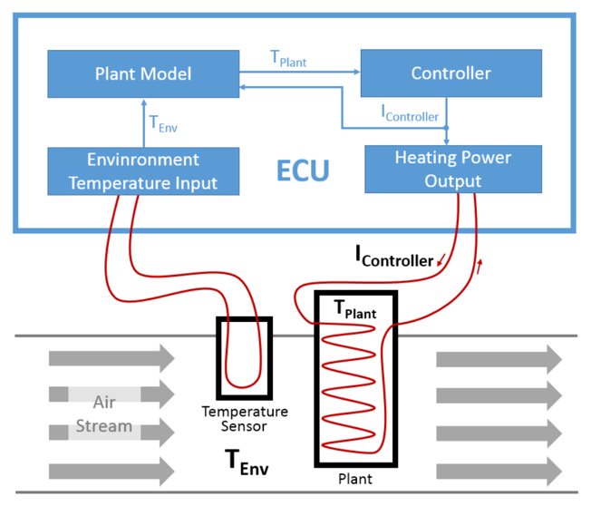

#### 3.1.1. 物理系统（**Physical System**）

本节描述物理系统的设置。如果读者只对 **AUTOSAR** 建模本身感兴趣，可以放心跳过本节。

图 3.1 展示了我们系统的主要物理量和实体。控制任务如下：被控对象（**plant**）是气流中一个需要加热的传感器。温度 T Plant 应由 **ECU** 控制。然而，没有直接测量 T Plant 的方法。

为了估计 T Plant，我们使用系统的以下特性：

- T Plant 取决于环境温度 T Env，即气流的温度。T Env 可以直接测量。
- T Plant 取决于 **ECU** 输出、由控制器控制因而已知的电流 I Controller。
- 被控对象本身充当一个热能储存体。因此 T Plant 还取决于当前储存在被控对象中的热量。
- 对 T Plant 的所有其他影响被视为不显著。因此对于这一控制任务可以放心地忽略它们。

T Plant 的估计可以由一个被控对象模型（**plant model**）计算，该模型以 T Env 和 I Controller 为输入，并以已储存的热量为内部状态。

#### 3.1.1.1. 组件概览（**Components Overview**）

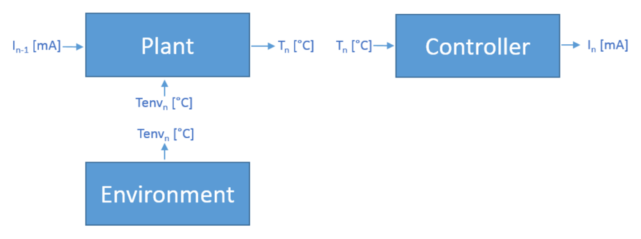

对于本展示案例，与真实物理环境的交互被完全排除，即不存在「加热功率输出」组件，而 T Env 的曲线在组件 Environment 内部随机生成。这从示例中削减了大量复杂性，并允许软件系统在 **PC** 上运行而无需复杂的环境仿真。

为完整起见：被控对象模型在组件 Plant 内计算，控制器在组件 Controller 内计算。

典型的 **ECU** 以时间离散的方式进行计算，即组件中的计算按离散的时间步周期执行。在下文中，索引 n ∈ {1, 2, …} 表示当前时间步。前一个时间步用索引 n−1 表示。索引 0 表示初始化取值。这也意味着时间步 1 是 **ECU** 实际计算的第一个时间步。

此外，Δt 表示从上一个时间步的计算到当前时间步的计算之间经过的秒数。对于时间步 1，Δt 表示从系统初始化到时间步 1 之间经过的时间。设置 Δt 的实际取值时必须考虑系统中物理属性的频率带宽。减小 Δt 的取值通常会提高物理信号采样的质量，直到某一点，继续减小 Δt 的代价超过了在信号质量方面获得的收益。

#### 3.1.1.2. 环境（**The Environment**）

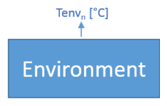

环境的建模和实现不是本展示案例的焦点。温度 Tenv n [°C] 以（伪）随机方式生成。这样做是为了在系统运行期间看到控制器和被控对象模型「在起作用」。

生成的曲线是一条受上下边界限制、并在这些边界处饱和的随机游走（**random walk**）。

随机游走可通过 T LowLimit [°C] 和 T HighLimit [°C]（用于边界）以及 T StepSize [K]（用于一个时间步内的温度变化）进行配置。

假设 rand n [-] ∈ {-1, 0, 1} 且 n ∈ {1, 2, 3, …}，则 Tenv n 由下式刻画（其中 Tenv 0 [°C] = −273.15 [°C]）：Tenv n = Tenv n−1 + rand n · T StepSize——当且仅当 Tenv n 将处于边界之内，即 T LowLimit ≤ Tenv n ≤ T HighLimit。如果 Tenv n 超出某一边界，则将其设为该边界的取值。

#### 3.1.1.3. 被控对象（**The Plant**）

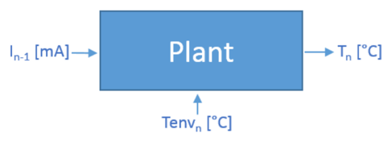

被控对象是一个暴露在环境气流中的电加热质量块。储存在被控对象内部的热量 Qplant 被认为始终与温度 T 成正比，比例系数恒定。在系统运行期间，被控对象的质量和比热容都不改变。

为简单起见，该比例系数被视为 1 [J/K]。对于 Plant 组件内部的计算，我们始终使用 [K] 作为温度单位，因此与 [°C] 的相互转换只发生在组件的接口处。

据此我们有：Qplant n [J] = T n [K]·1 [J/K]，即 Qplant n [J] = T n [K]。

这也意味着 Qplant n [J] = 0 [J] 对应 T n [K] = 0 [K]，即绝对零度。因此 Qplant n [J] ≥ 0 [J] 应始终成立。

在每个时间步中存在两个热流：一个从电加热器流向被控对象，一个从被控对象流向环境。负热流意味着热能在离开被控对象；相应地，正热流意味着热能储存在被控对象中。

一个时间步内从电加热器到被控对象的热流 Qheater n [J] 被认为与该时间步内流过被控对象的电流 I n [mA] 成正比，比例系数为 h Heater [J/(mA·s)]。当然，被控对象只能被电加热器加热，即「负」电流 I n 不会冷却被控对象，而是产生与 −I n 相同的加热效果。因此我们有：Qheater n = h Heater · |I n| · Δt。

被控对象的冷却只能通过第二个热流发生，即从被控对象流向环境的热流 Qenv n [J]。一个时间步内的热流被认为与被控对象的温度（由上一个时间步储存的热量计算得出）和环境温度（在本时间步接收、但实际上是在上一个时间步「测量」的）之差成正比。以比例系数 h Env [J/K]，我们有：Qenv n = h Env · (T n−1 − Tenv n−1) · Δt。

上一个时间步储存在被控对象中的热量 Qplant n−1 被这两个热流修改，得到当前时间步的储存热量。取 Qplant 0 [J] = 0 [J]，我们有：Qplant n = Qplant n−1 + Qheater n − Qenv n。

#### 3.1.1.4. 控制器（**The Controller**）

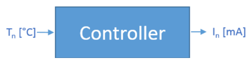

对于组件 Controller 的闭环控制，(大致) 选择了 I 控制器（**I controller**）。这意味着输入信号的放大与误差（即被测量与设定值之间的偏差）的积分成正比。由于控制器无法主动冷却被控对象的温度，对所有 n 有输出 I n ≥ 0。

同样，所有温度都在组件接口处与 [°C] 相互转换。所有内部计算都以 [K] 进行。

当前时间步的误差是 T SetPoint [K] 与被测量 T n [K] 之差：e n = T SetPoint − T n。

控制器的积分部分通过对之前所有步骤的误差求和计算。取 eSum n [K·s] = 0 [K·s]，我们有：eSum n = eSum n−1 + e n · Δt。

控制器的一个进一步设计决策是限制积分并在限制处饱和。这带来的好处是限制了控制器输出的电流 I n。此外，它使控制器在长时间偏差之后能够更快地反应。

下限为 0 [K·s]。因此如果 eSum n 在时间步 n 中降到零以下，我们设 eSum n [K·s] = 0 [K·s]。上限为 L MaxESum [K·s]。如果 eSum n 在时间步 n 中超过 L MaxESum，我们设 eSum n [K·s] = L MaxESum [K·s]。

控制器的积分状态 eSum n 随后被 k [mA/(K·s)] 放大，以计算电流 I n [mA]，即控制器的输出：I n = k · eSum n。

于是 eSum n 的限制保证了 0 ≤ I n ≤ k · L MaxESum。

#### 3.1.2. AUTOSAR 建模（**AUTOSAR Modeling**）

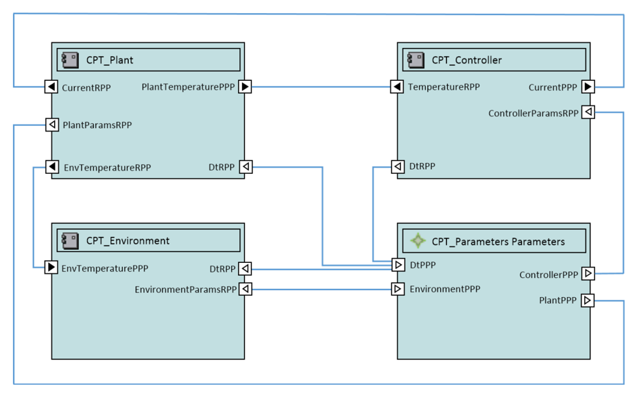

本节给出 **AUTOSAR** 建模的简要概述。浏览[第3.1.7节](#317-示例中的展示案例show-cases-in-the-example)中相互链接的表可以获得更多洞见。这些表由本展示案例的 **AUTOSAR** 模型生成。如果这仍不够，完整模型以 .arxml 格式在 AUTOSAR\_EXP\_ModelingShowCases.zip [\[2\]](#ref-2) 中提供。

在本展示案例中，[第3.1.1.1节](#3111-组件概览components-overview)规定的组件被建模为 ApplicationSwComponentType：

- Environment
- Plant
- Controller

为保持示例简单，没有建模任何 SwcImplementation。对于某些任务（例如为嵌入式控制器生成 MemMap），这会是必需的。

ApplicationSwComponentType 的输入和输出建模为 SenderReceiverInterface。内部状态实现为 implicitInterRunnableVariable。除了说明性的考虑之外，这一设计决策的理由是：内部状态很可能被（至少在「入门展示案例」之外的）ApplicationSwComponentType 中的多个 runnable 使用。

对于只需在 **MC** 工具中可供测量的变量，使用 arTypedPerInstanceMemory。对于这一用例，无需实现对变量访问的同步，因此选择了开销最小的方式。

组件规范中的所有参数被放入第四个 SwComponentType——ParameterSwComponentType「Parameters」。

为三个 ApplicationSwComponentType 各自的参数定义了一个专门的 ParameterInterface。ParameterSwComponentType 的相应 PPortPrototype 在 PortPrototype 中持有每个 ParameterDataPrototype 的 initValue。每个取值规定在由 ParameterProvideComSpec 聚合的 ValueSpecification 中。

组件类型在 CompositionSwComponentType「Composition」中实例化。

该 Composition 是 ECU\_EXTRACT 的 rootSoftwareComposition 的类型。这也意味着 Composition 的所有 SwComponentPrototype 都映射到一个 EcuInstance。

关于 FlatMap 的一些信息见[第3.1.3.1节](#3131-flatmapflatmap)。

#### 3.1.3. RTE 生成、测量与标定（**RTE Generation, Measurement and Calibration**）

McSupport 是 **RTE** 生成器与 **A2L** 生成器之间的接口。**RTE** 生成器为每个可标定或可测量的对象提供一个 McDataInstance。从逻辑视角看，McSupport 的生成分两步：

1. 为所有被实例化一次或多次的参数、测量、组件原型提供唯一的名称。这由所使用的 **AUTOSAR** 编写工具完成。
2. 生成 McSupport 本身。这通常由 **RTE** 生成器完成。**A2L** 只支持一个全局命名空间，而 **AUTOSAR** 在每个 ARPackage 内定义自己的命名空间。这意味着一方面，所有要在测量和标定期间可访问的对象（参数、测量、组件原型）都需要唯一的名称；但另一方面，所有其他将出现在 **A2L** 中的事物（例如 CompuMethod、Unit）也需要唯一的名称。**RTE** 生成器会为它们创建唯一的名称。

**AUTOSAR** 另外规定了可用于覆盖名称的 AliasNameSet，此处不使用。

生成的 Rte\_McSupportData.arxml 文件见 AUTOSAR\_EXP\_ModelingShowCases.zip [\[2\]](#ref-2)。

##### 3.1.3.1. FlatMap（**FlatMap**）

在本展示案例中，FlatMap 为以下对象赋予唯一的名称：

- dataElement
- implicitInterRunnableVariable
- arTypedPerInstanceMemory

**RTE** 生成器使用该信息生成 McSupport 文件以及 .c 和 .h 文件。

FlatMap 由这些 VariableDataPrototype 的每个实例的一个 FlatInstanceDescriptor 组成。

该用例的 FlatMap 的具体建模见 AUTOSAR\_EXP\_ModelingShowCases.zip [\[2\]](#ref-2)。

##### 3.1.3.2. ECU 文档、测量与标定（**ECU Documentation, Measurement and Calibration**）

开发 **ECU** 时，一个常见的要求是：**A2L** 中描述的对象能够在 **ECU** 文档中容易被找到。这是一个挑战，因为文档位于 SwComponentType 层级，而 **A2L** 定义在类别为「ECU\_EXTRACT」的 System 层级。

- SwComponentPrototype 的名称可能与 SwComponentType 的名称不同
- McDataInstance 的名称可能与 DataPrototype 的名称不同

如果类型被多次实例化，这一挑战会更大。这个问题需要通过恰当的架构、建模约定和聪明的 FlatMap 生成来解决。

在本展示案例中，通过将 TemperatureSRIF 实例化两次——一次用于传输 T Env 的接口、一次用于传输 T Plant 的接口——略微触及了这一主题。

我们演示了 FlatMap 可用于解决这一问题。但是，我们手工 crafting 了 FlatMap，这在实际领域中通常不可行。FlatMap 通常由可定制的、「聪明的」、非标准化的工具自动生成。

#### 3.1.4. A2L 文件（**A2L File**）

利用 McSupport 文件中的信息可以生成 **A2L** 文件。但是，为此还需要变量和特性的存储器地址。它们通常从 **ECU** 可执行文件的链接器输出的 map 文件中提取。**A2L** 文件生成的确切过程以及所用工具都未标准化。

示例 **A2L** 文件在 AUTOSAR\_EXP\_ModelingShowCases.zip 中提供。

#### 3.1.5. C 语言实现（**Implementation in C**）

**C** 实现是对 **AUTOSAR** 建模内物理规范（见[第3.1.1.1节](#3111-组件概览components-overview)和[第3.1.2节](#312-autosar-建模autosar-modeling)）的直接实现。因此，除了源代码中的注释外，清单不做进一步解释直接给出。

关于 Environment.c（清单 3.1）第 22 行生成的（伪）随机数的一点说明：这些数不具备很好的「伪随机」特性，但对本展示案例而言足够了。选择这种生成方式只是因为它能放进一行 **C** 代码而不引入对库的依赖。

清单3.1：Environment.c（**Environment.c**）

清单3.2：Plant.c（**Plant.c**）

清单3.3：Controller.c（**Controller.c**）

#### 3.1.6. 带着 T_Plant 走一遍展示案例（**A walk with T\_Plant through the Show Case**）

本节重温完整的展示案例，但聚焦于一个物理量：T Plant。它遍历所有产物，并突出显示所有与 T Plant 相关的位置，以说明所有产物之间的依赖关系。

##### 3.1.6.1. 物理系统（**Physical System**）

我们的旅程始于物理系统，在物理系统中 **ECU** 之外的物理量的取值与 **ECU** 内的一个软件取值被标识为同一个。

TEnv

###### 3.1.6.1.1. 组件（**Components**）

它位于两个架构组件之间的接口处，由 Plant 发送、由 Controller 接收。此外还引入了一个顺序安排，即在一个时间步中 Plant 先于 Controller 计算。

3 请注意，这一顺序安排是一个设计决策。由于也存在从 Plant 到 Controller 的数据流，也可以为另一种计算顺序辩护。

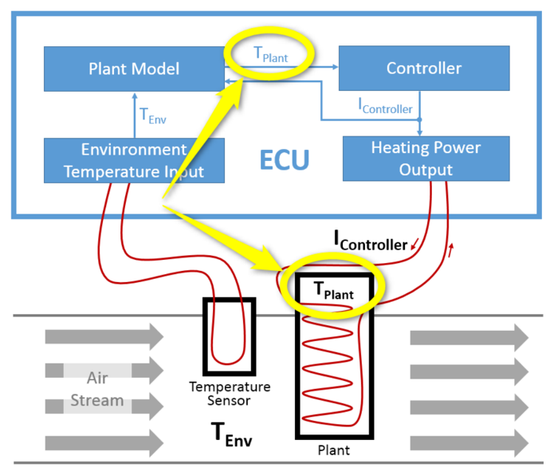

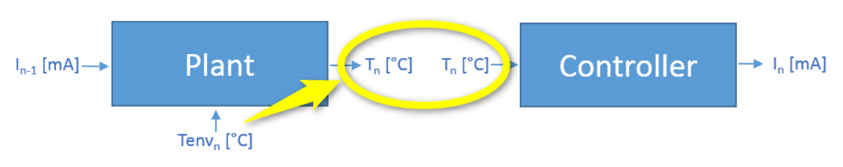

###### 3.1.6.1.2. 方程（**Equations**）

功能行为由 Plant 的方程定义：

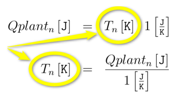

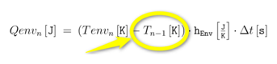

T Plant 也被组件 Controller 中的物理方程使用：

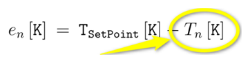

此外，组件内部的计算以开尔文 [K] 进行。与 [°C] 的相互转换发生在接口层级。

##### 3.1.6.2. AUTOSAR 建模（**AUTOSAR Modeling**）

这一架构，即物理系统的布局，在 **AUTOSAR** 中建模。由方程定义的功能行为稍后将以 **C** 代码实现。

###### 3.1.6.2.1. 物理量纲与单位（**Physical Dimension and Unit**）

定义一个 PhysicalDimension：T Plant 是一个温度。

表3.1：PhysicalDimension Temparature（**PhysicalDimension Temparature**）

对应的 **ARXML** 描述为：

清单3.4：温度的物理量纲（**Physical Dimension of Temperature**）

T Plant 应具有单位 DegreeCelsius：

表3.2：Unit DegreeCelsius（**Unit DegreeCelsius**）

对应的 **ARXML** 描述为：

清单3.5：单位 Degree Celsius（**Unit Degree Celsius**）

下面为了完整起见给出，尽管 T Plant 并不直接需要它。可以将多于一个单位链接到一个物理量纲。因此模型中还有单位 Kelvin 的定义：

表3.3：Unit Kelvin（**Unit Kelvin**）

对应的 **ARXML** 代码为：

清单3.6：单位 Kelvin（**Unit Kelvin**）

###### 3.1.6.2.2. 应用数据类型（**Application Data Type**）

为以摄氏度为单位的温度定义了一个新的 ApplicationDataType：

表3.4：ApplicationDataType Temperature\_C（**ApplicationDataType Temperature\_C**）

对应的 **ARXML** 代码在 ApplicationDataType 的定义之间拆分：

清单3.8：转换（**Conversion**）

该 ApplicationDataType 映射到 ImplementationDataType float32。包含该 DataTypeMap 的 DataTypeMappingSet 被稍后给出的 ApplicationSwComponentType 的 SwcInternalBehavior 引用。

清单3.9：类型映射（**Type Mapping**）

为完整起见，此处还插入包含 float32 定义的 **ARXML**：

清单3.10：实现类型与基类型（**Implementation Type and Base Type**）

###### 3.1.6.2.3. 端口接口（**Port Interface**）

Temperature\_C 用于定义 SenderReceiverInterface，该接口为 SwComponentType 之间以摄氏度为单位的温度「传输」定义类型。请注意，在本展示案例中，该 PortInterface 不仅用于为 T Plant 的「传输」定义类型，也用于为 T Env 的「传输」定义类型。

表3.5：SenderReceiverInterface TemperatureSRIF（**SenderReceiverInterface TemperatureSRIF**）

**ARXML** 表示：

清单3.11：端口接口（**Port Interface**）

为完整起见，此处还描述被引用的 SwAddrMethod：

表3.6：SwAddrMethod VAR（**SwAddrMethod VAR**）

**ARXML** 表示：

清单3.12：软件地址方法（**Software Address Method**）

###### 3.1.6.2.4. 软件组件（**Software Components**）

两个 ApplicationSwComponentType——Controller 和 Plant——都使用 T Plant。

在 Plant 中，定义了一个由 TemperatureSRIF 定义类型的 PPortPrototype 用于送出 T Plant。

此外，dataWriteAccess 被授予该 ApplicationSwComponentType 中的唯一 RunnableEntity。你还可以看到 symbol，即实现 **C** 函数的名称，以及触发该 RunnableEntity 执行的 TimingEvent。这两者对于把系统联系在一起具有进一步的意义。

**ARXML** 表示：

表3.7：ApplicationSwComponentType Plant（**ApplicationSwComponentType Plant**）

清单3.13：Plant（**Plant**）

在 Controller 中，定义了一个由 TemperatureSRIF 定义类型的 RPortPrototype 用于接收 T Plant。

此外，dataReadAccess 被授予该 ApplicationSwComponentType 中的唯一 RunnableEntity。你还可以看到 symbol，即实现 **C** 函数的名称，以及触发该 RunnableEntity 执行的 TimingEvent。这两者对于把系统联系在一起具有进一步的意义。

表3.8：ApplicationSwComponentType Controller（**ApplicationSwComponentType Controller**）

**ARXML** 表示：

清单3.14：Controller（**Controller**）

这两个 ApplicationSwComponentType 随后用于为 Composition 中的 SwComponentPrototype 定义类型。SwComponentPrototype 的 PortPrototype 由一个 AssemblySwConnector 连接：

表3.9：CompositionSwComponentType Composition（**CompositionSwComponentType Composition**）

**ARXML** 表示：

清单3.15：组合（**Composition**）

##### 3.1.6.3. 系统（**System**）

在 ECU\_EXTRACT（即类别为 ECU\_EXTRACT 的 System）中，Composition 用于为 rootSoftwareComposition 定义类型。本展示案例中 Composition 中的所有 SwComponentPrototype 都映射到唯一的 EcuInstance。

清单3.16：System 与 EcuInstance（**System and EcuInstance**）

ECU\_EXTRACT 中引用的 FlatMap 为一个 dataElement 赋予名称 TPlant（见下方 ecuExtractReference）。名称 TPlant 稍后会显示在 **MC** 工具中。

清单3.17：FlatMap（**FlatMap**）

##### 3.1.6.4. ECU 配置（**ECU Configuration**）

在生成 **RTE** 和 **OS** 之前还需要定义其他事项。例如，RunnableEntity 的 RTEEvent 的调用顺序以及到某个 OsTask 的分配。这经由 EcucModuleConfigurationValues 完成。**RTE** 配置中有趣的部分是：

清单3.18：RTE 配置（**RTE Config**）

**OS** 配置的这一部分定义了 OSTask 的名称，我们稍后会在生成的 **C** 代码中看到它：

清单3.20：EcuC 值集合（**EcuC Value Collection**）

至此完成了走查中对 **AUTOSAR** 建模的呈现。

##### 3.1.6.5. RTE 生成（**RTE Generation**）

下面给出部分生成的 **RTE** 片段。然而，它们只是示例，若使用不同的 **RTE** 生成器则可能有所不同。

除其他外，OSTask 按照上文 **ECU** 配置中的定义生成：

清单3.23：Rte\_Controller.h（**Rte\_Controller.h**）

此外，McSupport 文件作为「**AUTOSAR** 世界」与「**A2L** 世界」之间的接口生成。读者可以看到，这是前面给出的 **AUTOSAR** 模型中必要数据的汇编：

清单3.24：McSupportData（**McSupportData**）

##### 3.1.6.6. C 语言实现（**Implementation in C**）

**C** 代码实现是物理方程的直接实现。Plant 使用 **RTE** 生成器生成的 MACRO 来写入 T Plant：

清单3.25：Plant（**Plant**）

Controller 使用 **RTE** 生成器生成的 MACRO 来读取 T Plant：

清单3.26：Controller（**Controller**）

##### 3.1.6.7. A2L 文件（**A2L File**）

使用 McSupport 文件和来自链接器的 map 文件，为本展示案例生成了一个示例 **A2L** 文件。下面的片段仅为示例，若使用不同的 **A2L** 文件生成器则可能有所不同：

清单3.27：A2L 文件（**A2L File**）

##### 3.1.6.8. 测量与标定工具（**Measurement and Calibration Tool**）

**A2L** 文件随后由 **MC** 工具用于测量 T Plant。当然，除了 **A2L** 文件之外，还必须有合适的 **ECU** 访问手段，才能对本展示案例的 **AUTOSAR** 系统实际执行测量和标定。但 **ECU** 访问不在本展示案例的焦点之内，故不给出。

4 例如，像 **XCP** 这样的测量与标定服务，或对微控制器存储器的硬件访问。

下面是在一次实际的测量和标定任务期间来自 **MC** 工具的典型屏幕截图。可以看到以摄氏度为单位测量并显示的 T Plant。

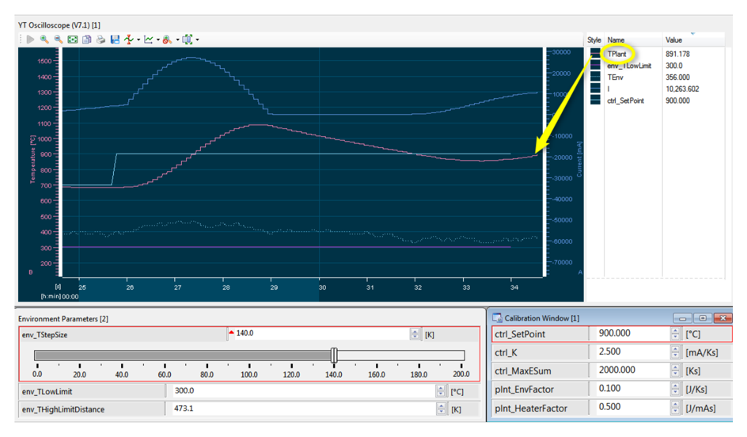
#### 3.1.6.9. C 语言实现（续）

清单3.25 与 3.26 所示的实现即物理方程的直接实现。

### 3.1.7. 示例中的展示案例（**Show cases in the Example**）

以下各表由该展示案例的 **AUTOSAR** 模型生成，以相互链接的表的形式给出模型内容。表中的单元格内容为模型元素的标识符与属性取值，按原样保留。

表3.1：PhysicalDimension Temparature（**Temparature**）

| shortName | Temperature |
| currentExp | 0 |
| lengthExp | 0 |
| luminousIntensity- Exp | 0 |
| massExp | 0 |
| molarAmountExp | 0 |
| temperatureExp | 1 |
| timeExp | 0 |

表3.2：Unit DegreeCelsius（**DegreeCelsius**）

| Unit 的公共属性 |
| shortName | DegreeCelsius |
|  | displayName | °C |
|  | offsetSiToUnit | -273.15 |
|  | factorSiToUnit | 1.0 |
|  | physicalDimension | Temperature |

表3.3：Unit Kelvin（**Kelvin**）

| Unit 的公共属性 |
| shortName | Kelvin |
|  | displayName | K |
|  | offsetSiToUnit | 0.0 |
|  | factorSiToUnit | 1.0 |
|  | physicalDimension | Temperature |

表3.4：ApplicationDataType Temperature_C（**Temperature_C**）

| ApplicationDataType 的公共属性 |
| shortName | Temperature_C |
| category | VALUE |
| desc | 以 [°C] 为单位的温度类型。 |
| swCalibrationAccess | readOnly |
| unit | DegreeCelsius |
| Range |
| Conversion |
|  | category | LINEAR |
|  | direction | compuInternalToPhys |
|  | desc | lowerLimit | compuNumerator / compuDenominator |
|  | - | Phys = - 273 . 15+1 ∗ Internal 1 |

表3.5：SenderReceiverInterface TemperatureSRIF（**TemperatureSRIF**）

| SenderReceiverInterface 的公共属性 |
| shortName | TemperatureSRIF |
| desc | 用于传输以 [°C] 为单位的温度的接口类型。 |
| 数据元素的属性 |
| VariableDataPrototype 的属性 |
| shortName | T |
| type | Temperature_C |
| swImplPolicy | standard |
| swCalibrationAccess | readOnly |
| swAddrMethod | VAR |

表3.6：SwAddrMethod VAR（**VAR**）

| SwAddrMethod 的公共属性 |
| shortName | VAR |
| desc | 用于变量的存储器段。 |
| sectionType | var |
| memoryAllocation- KeywordPolicy | addrMethodShortName |
| sectionInitializa- tionPolicy | - |
| option | safetyQM |

表3.7：ApplicationSwComponentType Plant（**Plant**）

| internalBehavior | PlantInternalBehavior |
| [ ... ] |
| runnable 的属性 |
| RunnableEntity 的属性 |
|  | shortName | plantRE |
|  | symbol | plantRE_func |
| 事件的属性 |
| TimingEvent 的属性 |
|  | shortName | plant100ms |
|  | startOnEvent | plantRE |
|  | period | 0.1 |

表3.8：ApplicationSwComponentType Controller（**Controller**）

| ApplicationSwComponentType 的公共属性 |
| shortName | Controller |
| 端口的属性 |
| RPortPrototype 的属性 |
|  | shortName | TemperatureRPP |
|  | desc | 接收被控对象温度的端口。 |
|  | requiredInterface | TemperatureSRIF |
| [ ... | ] |
| internalBehavior | ControllerInternalBehavior |
| [ ... ] |
| runnable 的属性 |
| RunnableEntity 的属性 |
|  | shortName | ControllerRE |
|  | symbol | controllerRE_func |
| 事件的属性 |
| TimingEvent 的属性 |
|  | shortName | controller100ms |
|  | startOnEvent | ControllerRE |
|  | period | 0.1 |

表3.9：CompositionSwComponentType Composition（**Composition**）

| CompositionSwComponentType 的公共属性 |
| shortName | Composition |
| 组件的属性 |
| SwComponentPrototype 的属性 |
| shortName | CPT_Controller |
| type | Controller |
| SwComponentPrototype 的属性 |
| shortName | CPT_Plant |
| type | Plant |
| [ ... ] |

### 3.1.7.1. CompositionSwComponentType（**CompositionSwComponentTypes**）

表3.10：CompositionSwComponentType Composition（**Composition**）

| CompositionSwComponentType 的公共属性 |
| shortName | Composition |
| 组件的属性 |
| SwComponentPrototype 的属性 |
|  | shortName | CPT_Controller |
|  | type | Controller |
| SwComponentPrototype 的属性 |
|  | shortName | CPT_Parameters |
|  | type | Parameters |
| SwComponentPrototype 的属性 |
|  | shortName | CPT_Plant |
|  | type | Plant |
| SwComponentPrototype 的属性 |
|  | shortName | CPT_Environment |
|  | type | Environment |

### 3.1.7.2. ParameterSwComponentType（**ParameterSwComponentTypes**）

表3.11：ParameterSwComponentType Parameters（**Parameters**）

| ParameterSwComponentType 的公共属性 |
| shortName | Parameters |
| desc | 向应用软件组件提供参数的类型。 |
| 端口的属性 |
| PPortPrototype 的属性 |
|  | shortName | ControllerPPP |
|  | desc | 为控制器提供参数的端口。 |
|  | providedInterface | ControllerPIF |
| PPortPrototype 的属性 |
|  | shortName | PlantPPP |
|  | desc | 为被控对象提供参数的端口。 |
|  | providedInterface | PlantPIF |
| PPortPrototype 的属性 |
|  | shortName | EnvironmentPPP |
|  | desc | 为环境提供参数的端口。 |
|  | providedInterface | EnvironmentPIF |
| PPortPrototype 的属性 |
|  | shortName | DtPPP |
|  | desc | 一个时间步的时长。 |
|  | providedInterface | DtPIF |

### 3.1.7.3. ApplicationSwComponentType（**ApplicationSwComponentTypes**）

表3.12：ApplicationSwComponentType Controller（**Controller**）

| SwcInternalBehavior 的公共属性 |
| shortName | ControllerInternalBehavior |
| implicitInterRunnableVariable / explicitInterRunnableVariable 的属性 |
| VariableDataPrototype 的属性 |
|  | shortName | ESum |
|  | desc | 控制器的内部状态：控制误差之和。 |
|  | type | ESum |
|  | swImplPolicy | standard |
|  | swCalibrationAccess | readOnly |
|  | swAddrMethod | CODE |
| arTypedPerInstanceMemory 的属性 |
| VariableDataPrototype 的属性 |
|  | shortName | E |
|  | desc | Measurement point for the control error, the deviation between set point and acutal temperature of the plant, in the current time step |
|  | type | Temperature_K |
|  | swImplPolicy | standard |
|  | swCalibrationAccess | readOnly |

表3.13：SwcInternalBehavior ControllerInternalBehavior（**ControllerInternalBehavior**）

| swAddrMethod | CODE |  |
| runnable 的属性 |
| RunnableEntity 的属性 |
| shortName | ControllerRE |  |
| symbol | controllerRE_func |  |
| 事件的属性 |
| TimingEvent 的属性 |
| shortName | controller100ms |  |
| startOnEvent | ControllerRE |  |
| period | 0.1 |  |

表3.14：ApplicationSwComponentType Plant（**Plant**）

| Common | ApplicationSwComponentType 属性 Plant |
| 端口的属性 | ApplicationSwComponentType 属性 Plant |
| RPortPrototype 的属性 |
|  | shortName | CurrentRPP |
|  | desc | 接收来自控制器的电流的端口。 |
|  | requiredInterface | CurrentSRIF |
| PPortPrototype 的属性 |
|  | shortName | PlantTemperaturePPP |
|  | desc | 送出被控对象估计温度的端口。 |
|  | providedInterface | TemperatureSRIF |
| RPortPrototype 的属性 |
|  | shortName | PlantParamsRPP |
|  | desc | 获取被控对象参数的端口。 |
|  | requiredInterface | PlantPIF |
| RPortPrototype 的属性 |
|  | shortName | EnvTemperatureRPP |
|  | desc | 接收环境温度的端口。 |
|  | requiredInterface | TemperatureSRIF |
| RPortPrototype 的属性 |
|  | shortName | DtRPP |
|  | desc | 获取 Δt（即一个时间步的时长）的端口。 |
|  | requiredInterface | DtPIF |
| internalBehavior | PlantInternalBehavior |
| SwcInternalBehavior 的公共属性 |
| shortName | PlantInternalBehavior |
| implicitInterRunnableVariable / explicitInterRunnableVariable 的属性 |
| VariableDataPrototype 的属性 |
|  | shortName | QPlant |
|  | desc | 被控对象的内部状态：当前时间步中存储的能量。 |
|  | type | Energy |
|  | swImplPolicy | standard |
|  | swCalibrationAccess | readOnly |
|  | swAddrMethod | CODE |
| arTypedPerInstanceMemory 的属性 |
| VariableDataPrototype 的属性 |
|  | shortName | QHeater |
|  | desc | Measurement point for heat flow between the electrical heater and the plant in the current time step. |
|  | type | Energy |
|  | swImplPolicy | standard |
|  | swCalibrationAccess | readOnly |
|  | swAddrMethod | VAR |
| VariableDataPrototype 的属性 |
|  | shortName | QEnv |
|  | desc | 当前时间步中被控对象与环境之间热流的测量点。 |
|  | type | Energy |
|  | swImplPolicy | standard |
|  | swCalibrationAccess | readOnly |
| runnable 的属性 |
| RunnableEntity 的属性 |
|  | shortName | plantRE |
|  | symbol | plantRE_func |
| 事件的属性 |
| TimingEvent 的属性 |
|  | shortName | plant100ms |
|  | startOnEvent | plantRE |
|  | period | 0.1 |

表3.15：SwcInternalBehavior PlantInternalBehavior（**PlantInternalBehavior**）

| ApplicationSwComponentType 的公共属性 |
| shortName | Environment |
| 端口的属性 |
| PPortPrototype 的属性 |
|  | shortName | EnvTemperaturePPP |
|  | desc | 送出环境温度的端口。 |
|  | providedInterface | TemperatureSRIF |
| RPortPrototype 的属性 |
|  | shortName | EnvParamsRPP |
|  | desc | 获取环境参数的端口。 |
|  | requiredInterface | EnvironmentPIF |
| RPortPrototype 的属性 |
|  | shortName | DtRPP |
|  | desc | 获取 Δt（即一个时间步的时长）的端口。 |
|  | requiredInterface | DtPIF |
| internalBehavior | EnvironmentInternalBehavior |

表3.16：ApplicationSwComponentType Environment（**Environment**）

| SwcInternalBehavior 的公共属性 |
| shortName | EnvironmentInternalBehavior |
| implicitInterRunnableVariable / explicitInterRunnableVariable 的属性 |
| VariableDataPrototype 的属性 |
|  | shortName | Seed |
|  | desc | 环境的内部状态：（伪）随机数生成的当前种子。 |
|  | type | uint32 |
|  | swImplPolicy | standard |
|  | swCalibrationAccess | notAccessible |
|  | swAddrMethod | CODE |
| VariableDataPrototype 的属性 |
|  | shortName | TEnv |
|  | desc | 环境的内部状态：环境温度。 |
|  | type | Temperature_C |
|  | swImplPolicy | standard |
|  | swCalibrationAccess | readOnly |
|  | swAddrMethod | CODE |
| arTypedPerInstanceMemory 的属性 |
| VariableDataPrototype 的属性 |
|  | shortName | THighLimit |
|  | desc | 生成的温度曲线上限的测量点。 |
|  | type | Temperature_C |

表3.17：SwcInternalBehavior EnvironmentInternalBehavior（**EnvironmentInternalBehavior**）

| swImplPolicy |  | standard |
|  | swCalibrationAccess |
| readOnly | swAddrMethod |  |
| CODE |
| shortName |
|  | envRE | symbol |
| properties of the event properties of | envRE_func s TimingEvent | shortName |
| env100ms |
| startOnEvent |  | envRE |
| period |  | 0.1 |

### 3.1.7.4. ParameterInterface（**ParameterInterfaces**）

表3.18：ParameterInterface ControllerPIF（**ControllerPIF**）

| ParameterInterface 的公共属性 |
| shortName | PlantPIF |
| desc | 包含被控对象全部参数的接口。 |
| 参数的属性 |
| ParameterDataPrototype 的属性 |
| shortName | plnt_EnvFactor |  |
| desc |  | Proportionality factor for the heat flow between plant and environment |
| type |  | EnvFactor |
| swImplPolicy |  | standard |
| swCalibrationAccess |  | readWrite |
| swAddrMethod | CALIB |  |
| ParameterDataPrototype 的属性 |
| shortName |  | plnt_HeaterFactor |
| desc | 被控对象与电加热器之间热流的比例因子。 |
| type | HeaterFactor |
| swImplPolicy | standard |
| swCalibrationAccess | readWrite |
| swAddrMethod | CALIB |

表3.19：ParameterInterface PlantPIF（**PlantPIF**）

| ParameterInterface 的公共属性 |
| shortName | EnvironmentPIF |
| desc | 包含环境全部参数的接口。 |
| 参数的属性 |
| ParameterDataPrototype 的属性 |
|  | shortName | env_TLowLimit |
|  | desc | 生成的温度曲线下限。 |
|  | type | Temperature_C |
|  | swImplPolicy | standard |
|  | swCalibrationAccess | readWrite |
|  | swAddrMethod | CALIB |
| ParameterDataPrototype 的属性 |
|  | shortName | env_TStepSize |
|  | desc | 一个时间步内环境的最大温度差。 |
|  | type | Temperature_K |
|  | swImplPolicy | standard |
|  | swCalibrationAccess | readWrite |
|  | swAddrMethod | CALIB |
| ParameterDataPrototype 的属性 |
|  | shortName | env_THighLimitDistance |
|  | desc | 生成的温度曲线上限与下限之间的距离。 |
|  | type | Temperature_K |
|  | swImplPolicy | standard |
|  | swCalibrationAccess | readWrite |
|  | swAddrMethod | CALIB |

表3.20：ParameterInterface EnvironmentPIF（**EnvironmentPIF**）

| ParameterInterface 的公共属性 |
| shortName | DtPIF |
| 参数的属性 |
| ParameterDataPrototype 的属性 |
| shortName | Dt |

表3.21：ParameterInterface DtPIF（**DtPIF**）

| desc | 组件的调度时间。 |
| type | Time |
| swImplPolicy | standard |
| swCalibrationAccess | readWrite |
| swAddrMethod | CALIB |

### 3.1.7.5. SenderReceiverInterface（**SenderReceiverInterfaces**）

表3.22：SenderReceiverInterface TemperatureSRIF（**TemperatureSRIF**）

| SenderReceiverInterface 的公共属性 |
| shortName | TemperatureSRIF |
| desc | 用于传输以 [°C] 为单位的温度的接口类型。 |
| 数据元素的属性 |
| VariableDataPrototype 的属性 |
| shortName | T |
| type | Temperature_C |
| swImplPolicy | standard |
| swCalibrationAccess | readOnly |
| swAddrMethod | VAR |

表3.23：SenderReceiverInterface CurrentSRIF（**CurrentSRIF**）

| SenderReceiverInterface 的公共属性 |
| shortName | CurrentSRIF |
| desc | 用于传输以 [mA] 为单位的电流的接口类型。 |
| 数据元素的属性 |
| VariableDataPrototype 的属性 |
| shortName | I |
| type | Current |
| swImplPolicy | standard |
| swCalibrationAccess | readOnly |
| swAddrMethod | VAR |

### 3.1.7.6. 应用数据类型，类别 VALUE（**ApplicationDataTypes, Category VALUE**）

表3.24：ApplicationDataType Temperature_C（**Temperature_C**）

| ApplicationDataType 的公共属性 |
| shortName | Current |
| category | VALUE |
| desc | 以 [mA] 为单位的电流类型。 |
| swCalibrationAccess | readOnly |
| unit | MilliAmpere |
| Range |
| Conversion |
|  | category | LINEAR |
|  | direction | compuInternalToPhys |
|  | desc | lowerLimit | compuNumerator / compuDenominator |
|  | - | Phys = 0 +1000 ∗ Internal 1 |

表3.25：ApplicationDataType Current（**Current**）

| ApplicationDataType 的公共属性 |
| shortName | EnvFactor |
| category | VALUE |
| desc | 以 [J/Ks] 为单位的环境（热传导）因子类型。 |
| swCalibrationAccess | readOnly |
| unit | JoulePerKelvinSecond |
| Range |
| Conversion |
|  | category | IDENTICAL |
|  | direction | - |

表3.26：ApplicationDataType EnvFactor（**EnvFactor**）

| ApplicationDataType 的公共属性 |
| shortName | Temperature_K |
| category | VALUE |
| desc | 以 [K] 为单位的温度类型。 |
| swCalibrationAccess | readOnly |
| unit | Kelvin |
| Range |
| Conversion |
|  | category | IDENTICAL |
|  | direction | - |

表3.27：ApplicationDataType Temperature_K（**Temperature_K**）

| ApplicationDataType 的公共属性 |
| shortName | Amplification |
| category | VALUE |
| desc | 控制器中以 [mA/Ks] 为单位的放大因子类型。 |
| swCalibrationAccess | readOnly |
| unit | MilliAmperePerKelvinSecond |
| Range |
| Conversion |
|  | category | IDENTICAL |
|  | direction | - |

表3.28：ApplicationDataType Amplification（**Amplification**）

| ApplicationDataType 的公共属性 |
| shortName | Energy |
| category | VALUE |
| desc | 以 [J] 为单位的能量类型。 |
| swCalibrationAccess | readOnly |
| unit | Joule |
| Range |
| Conversion |
|  | category | IDENTICAL |
| direction | - |

表3.29：ApplicationDataType Energy（**Energy**）

| ApplicationDataType 的公共属性 |
| shortName | ESum |
| category | VALUE |
| desc | I 控制器中以 [Ks] 为单位的控制误差之和的类型。 |
| swCalibrationAccess | readOnly |
| unit | KelvinSecond |
| Range |
| Conversion |
|  | category | IDENTICAL |
|  | direction | - |

表3.31：ApplicationDataType HeaterFactor（**HeaterFactor**）

| ApplicationDataType 的公共属性 |
| shortName | HeaterFactor |
| category | VALUE |
| desc | Type of a proportionality factor for the heat flow from an electrical heater to a thermal energy storage in [J/mAs] |
| swCalibrationAccess | readOnly |
| unit | JoulePerMilliAmpereSecond |
| Range |
| Conversion |
|  | category | IDENTICAL |
|  | direction | - |

表3.32：ApplicationDataType Time（**Time**）

| ApplicationDataType 的公共属性 |
| shortName | Time |
| category | VALUE |
| desc | 以 [s] 为单位的时间类型。 |
| swCalibrationAccess | readOnly |
| unit | Second |
| Range |
| Conversion |
|  | category | IDENTICAL |
|  | direction | - |

### 3.1.7.7. Unit（**Units**）

表3.33：Unit DegreeCelsius（**DegreeCelsius**）

| Unit 的公共属性 |
| shortName | Kelvin |
|  | displayName | K |
|  | offsetSiToUnit | 0.0 |
|  | factorSiToUnit | 1.0 |
|  | physicalDimension | Temperature |

表3.34：Unit Kelvin（**Kelvin**）

| Unit 的公共属性 |
| shortName | Joule |
|  | displayName | J |
|  | offsetSiToUnit | 0.0 |
|  | factorSiToUnit | 1.0 |
|  | physicalDimension | Energy |

表3.35：Unit Joule（**Joule**）

| Unit 的公共属性 |
| shortName | MilliAmpere |
|  | displayName | mA |
|  | offsetSiToUnit | 0.0 |
|  | factorSiToUnit | 1000.0 |
|  | physicalDimension | Current |

表3.36：Unit MilliAmpere（**MilliAmpere**）

| Unit 的公共属性 |
| shortName | KelvinSecond |
|  | displayName | Ks |
|  | offsetSiToUnit | 0.0 |
|  | factorSiToUnit | 1.0 |
| physicalDimension | TemperatureTime |

表3.37：Unit KelvinSecond（**KelvinSecond**）

| Unit 的公共属性 |
| shortName | JoulePerKelvinSecond |
|  | displayName | J/Ks |
|  | offsetSiToUnit | 0.0 |
|  | factorSiToUnit | 1.0 |
|  | physicalDimension | EnergyPerTemperatureTime |

表3.38：Unit JoulePerKelvinSecond（**JoulePerKelvinSecond**）

| Unit 的公共属性 |
| shortName | JoulePerMilliAmpereSecond |
|  | displayName | J/mAs |
|  | offsetSiToUnit | 0.0 |
|  | factorSiToUnit | 0.001 |
|  | physicalDimension | EnergyPerCurrentTime |

表3.39：Unit JoulePerMilliAmpereSecond（**JoulePerMilliAmpereSecond**）

| Unit 的公共属性 |
| shortName | MilliAmperePerKelvinSecond |
|  | displayName | mA/Ks |
|  | offsetSiToUnit | 0.0 |
|  | factorSiToUnit | 1000.0 |
|  | physicalDimension | CurrentPerTemperatureTime |

表3.40：Unit MilliAmperePerKelvinSecond（**MilliAmperePerKelvinSecond**）

| Unit 的公共属性 |
| shortName | Second |
|  | displayName | s |
|  | offsetSiToUnit | 0.0 |
|  | factorSiToUnit | 1.0 |
|  | physicalDimension | Time |

### 3.1.7.8. PhysicalDimension（**PhysicalDimensions**）

表3.42：PhysicalDimension Energy（**Energy**）

| shortName | Current |
| currentExp | 1 |
| lengthExp | 0 |
| luminousIntensity- Exp | 0 |
| massExp | 0 |
| molarAmountExp | 0 |
| temperatureExp | 0 |
| timeExp | 0 |

表3.43：PhysicalDimension Current（**Current**）

| shortName | CurrentPerTemperatureTime |
| currentExp | 1 |
| lengthExp | 0 |
| luminousIntensity- Exp | 0 |
| massExp | 0 |
| molarAmountExp | 0 |
| temperatureExp | -1 |
| timeExp | -1 |

表3.44：PhysicalDimension CurrentPerTemperatureTime（**CurrentPerTemperatureTime**）

| PhysicalDimension 的公共属性 |
| shortName | EnergyPerCurrentTime |
|  | currentExp | -1 |
| lengthExp | 2 |
| luminousIntensity- Exp | 0 |
| massExp | 1 |
| molarAmountExp | 0 |
| temperatureExp | 0 |
| timeExp | -3 |

表3.45：PhysicalDimension EnergyPerCurrentTime（**EnergyPerCurrentTime**）

| shortName | EnergyPerTemperatureTime |
| currentExp | 0 |
| lengthExp | 2 |
| luminousIntensity- Exp | 0 |
| massExp | 1 |
| molarAmountExp | 0 |
| temperatureExp | -1 |
| timeExp | -3 |

表3.46：PhysicalDimension EnergyPerTemperatureTime（**EnergyPerTemperatureTime**）

| shortName | Time |
| currentExp | 0 |
| lengthExp | 0 |
| luminousIntensity- Exp | 0 |
| massExp | 0 |
| molarAmountExp | 0 |
| temperatureExp | 0 |
| timeExp | 1 |

表3.47：PhysicalDimension Time（**Time**）

| PhysicalDimension 的公共属性 |
| shortName | Temperature |
|  | currentExp | 0 |
|  | lengthExp | 0 |
|  | luminousIntensity- Exp | 0 |
|  | massExp | 0 |
|  | molarAmountExp | 0 |

表3.48：PhysicalDimension Temperature（**Temperature**）

| temperatureExp | 1 |
| timeExp | 0 |

表3.49：PhysicalDimension TemperatureTime（**TemperatureTime**）

| shortName | TemperatureTime |
| currentExp | 0 |
| lengthExp | 0 |
| luminousIntensity- Exp | 0 |
| massExp | 0 |
| molarAmountExp | 0 |
| temperatureExp | 1 |
| timeExp | 1 |

表3.51：SwAddrMethod CALIB（**CALIB**）

| SwAddrMethod 的公共属性 |
| shortName | CALIB |
| desc | 用于标定参数的存储器段。 |
| sectionType memoryAllocation- KeywordPolicy sectionInitializa- tionPolicy option | var |
|  | addrMethodShortName |
|  | - |
|  | safetyQM |

表3.52：SwAddrMethod CODE（**CODE**）

| SwAddrMethod 的公共属性 |
| shortName | CODE |
| desc | 用于代码的存储器段。 |
| sectionType memoryAllocation- KeywordPolicy sectionInitializa- tionPolicy option | var |
|  | addrMethodShortName |
|  | - |
|  | safetyQM |

表3.53：CompositionSwComponentType Pcpt_CMscA（**Pcpt_CMscA**）

| CompositionSwComponentType 的公共属性 |
| shortName | Pcpt_CMscA |
| desc | 原始量测量与计算的建模展示案例。 |
| 端口的属性 |
| PPortPrototype 的属性 |
| shortName | P_ModeDirection |
| desc | 指示方向的模式 |
| providedInterface | ModeDirection |
| PPortPrototype 的属性 |
| shortName | P_PrimCal_Mass_Lnr_Kg |
| desc | 最小鸡蛋质量的原始标定参数。 |
| providedInterface | PrimCal_Mass_Lnr_Kg |
| PPortPrototype 的属性 |
| shortName | P_PrimData_Mass_Lnr_Kg_uint8 |
| desc | 以千克为单位的质量 |
| providedInterface | PrimData_Mass_Lnr_Kg_uint8 |
| PPortPrototype 的属性 |
| shortName | P_PrimData_StepsSpeed_Txt_sint8 |
| desc | 分级的转速指示 |
| providedInterface | PrimData_StepsSpeed_Txt_sint8 |
| PPortPrototype 的属性 |
| shortName | P_PrimData_Temperature_Lin_K_C_uint16 |
| desc | 以开尔文为单位、但显示为摄氏度的温度 1 |
| providedInterface | PrimData_Temperature_Lin_K_C_uint16 |
| RPortPrototype 的属性 |
| shortName | R_PrimData_StepsSpeed_Txt_sint8 |
| desc | 分级的转速指示 |
| requiredInterface | PrimData_StepsSpeed_Txt_sint8 |
| 组件的属性 |
| SwComponentPrototype 的属性 |
| shortName | CMscA |
| type | CMscA |
| SwComponentPrototype 的属性 |
| shortName | CMscA_par |
| type | CMscA_par |
| CompositionSwComponentType 的公共属性 |
| shortName | SystemU_Root |
| 组件的属性 |
| SwComponentPrototype 的属性 |
| shortName | CMscA |
| type | CMscA |
| SwComponentPrototype 的属性 |
| shortName | CMscA_par |
| type | CMscA_par |
| SwComponentPrototype 的属性 |
| shortName | CMscB |
| type | CMscB |
| SwComponentPrototype 的属性 |
| shortName | CMscB_par |
| type | CMscB_par |
| SwComponentPrototype 的属性 |
| shortName | CMscC_nvm |
| type | CMscC_nvm |
| SwComponentPrototype 的属性 |
| shortName | CMscD |
| type | CMscD |
| SwComponentPrototype 的属性 |
| shortName | CMscD_par |
| type | CMscD_par |

表3.54：CompositionSwComponentType SystemU_Root（**SystemU_Root**）

| CompositionSwComponentType 的公共属性 |
| shortName | SystemURootComposition_EcuDescr |
| 组件的属性 |
| SwComponentPrototype 的属性 |
| shortName | CMscC |
| type | Pcpt_CMscC |

表3.55：CompositionSwComponentType SystemURootComposition_EcuDescr（**SystemURootComposition_EcuDescr**）

| CompositionSwComponentType 的公共属性 |
| shortName | Pcpt_CMscD |
| desc | 轴与映射数组的建模展示案例。 |
| 端口的属性 |
| RPortPrototype 的属性 |
| shortName | R_ComAxis_Mass_Lnr_Kg_uint8 |
| desc |  | 质量的共享轴 |
| requiredInterface |  | ComAxis_Mass_Lnr_Kg_uint8 |
| RPortPrototype 的属性 |
| shortName |  | R_PrimData_MassCorrected_Lnr_Kg_uint8 |
| desc |  | 以 kg 为单位保存修正后质量的原始数据。 |
|  | requiredInterface | PrimData_MassCorrected_Lnr_Kg_uint8 |
| 组件的属性 |
| SwComponentPrototype 的属性 |
| shortName | CMscD |  |
| type | CMscD |  |
| SwComponentPrototype 的属性 |
| shortName | CMscD_par |  |
| type |  | CMscD_par |

表3.56：CompositionSwComponentType Pcpt_CMscD（**Pcpt_CMscD**）

| CompositionSwComponentType 的公共属性 |
| shortName | Pcpt_CMscC |
| desc | 建模展示案例 C 的组合。 |
| 端口的属性 |
| PPortPrototype 的属性 |
|  | shortName | P_PrimData_Time_Lnr_s_uint16 |
|  | desc | 保存时间取值的原始数据。 |
|  | providedInterface | PrimData_Time_Lnr_s_uint16 |
| PPortPrototype 的属性 |
|  | shortName | P_PrimData_ValidState_Txt_noUnit_boolean |
|  | desc | 表示数据有效性的布尔值 |
|  | providedInterface | PrimData_ValidState_Txt_noUnit_boolean |
| 组件的属性 |
| SwComponentPrototype 的属性 |
|  | shortName | CMscA |
|  | type | Pcpt_CMscA |
| SwComponentPrototype 的属性 |
|  | shortName | CMscB |
|  | type | Pcpt_CMscB |
| SwComponentPrototype 的属性 |
|  | shortName | CMscC_nvm |
|  | type | CMscC_nvm |
| SwComponentPrototype 的属性 |
|  | shortName | CMscD |

### 3.2. 高级展示案例（**Advanced Show Case**）

#### 3.2.1. 模型结构的一般目标（**General Objectives of the Model Structure**）

##### 3.2.1.1. ECU 描述（**The Ecu Description**）

由于本展示案例只聚焦于测量和标定，因此只提供一个最小的系统模型。此处文件 Pprj\_EcuDescr\_U\_SystemNodeStub.arxml 定义了类别为 ECU\_SYSTEM\_DESCRIPTION 的 System SystemU\_EcuDescr，它只包含 RootSwCompositionPrototype。文件 Pprj\_EcuDescr\_U.arxml 包含相应的 CompositionSwComponentType，描述表 SystemURootComposition\_EcuDescr 所示的软件组件的层次化顶层组合。

##### 3.2.1.2. ECU 提取（**The Ecu Extract**）

文件 Pprj\_EcuExtract\_U\_SystemNodeStub.arxml 定义了类别为 ECU\_EXTRACT 的 System SystemU\_System，它只包含引用 **ECU** Flat Map 和扁平顶层组合 SystemU\_Root 的 RootSwCompositionPrototype SystemU。文件 Pprj\_EcuExtract\_U.arxml 包含相应的 CompositionSwComponentType，描述表 SystemU\_Root 所示的软件组件的扁平顶层组合。

请注意，扁平顶层组合使用与层次化顶层组合完全相同的软件组件类型。因此，在层次化软件组件结构或扁平结构中识别组件实例和数据实例，需要从相应的 System 节点开始正确迭代。

###### 3.2.1.2.1. ECU 扁平映射（**The ECU Flat Map**）

文件 Pprj\_EcuExtract\_U\_FlatMap.arxml 包含 **ECU** Flat Map。

**ECU** Flat Map 用于为表示测量和特性的所有 DataPrototype 赋予唯一且易于理解的名称。这对标定工程师非常重要。

5 此处的标定工程师指使用测量和标定工具的工程师，例如为了确定正确的标定参数取值，使软件组件中的功能适配车辆中的机械部件。

创建 FlatInstanceDescriptor.shortName 所采用的策略是：当某个 DataPrototype 只使用单一实例时，将其缩短为该 DataPrototype 的 shortName。

##### 3.2.1.3. 数据类型与数据对象（**Data Types and Data Objects**）

组件的设计是自顶向下的，从物理功能一直到目标编程语言 **C** 的实现。此处软件组件的接口通常以 ApplicationDataType 定义类型，以描述 DataPrototype 的物理含义。唯一的例外是与 **AUTOSAR** 服务的接口——由于它们是标准化的，这些接口直接以 ImplementationDataType 定义类型。ApplicationPrimitiveDataType 的类别主要有：

- BOOLEAN
- VALUE
- CURVE
- MAP
- COM\_AXIS

而最重要的 CompuMethod 类别是：

- LINEAR
- TEXTTABLE

对于 LINEAR 转换，支持区分用于实现计算的 Unit 与在 **MCD** 系统中使用的另一个 Unit。这类 Unit 之间的关系用 UnitGroup 表达。这些 ARElement 的结构化方式支持：多个组件描述共同使用与接口描述相关的、直至 PortInterface 层级的元素。这些元素位于文件 Pprj\_DataDictionary.arxml 的 Tier1/ARPlatform1/DataDictionary/&lt;KindPackage&gt; 之下。

CompuMethod 和 DataConstr 只被一个 ApplicationPrimitiveDataType 独占地使用。本模型结构不使用 **AUTOSAR** 支持的 ApplicationPrimitiveDataType 之间可能的复用。当定义这样一个 ApplicationDataType 时，已经在定义中考虑到指向合理 ImplementationDataType 的预期映射，以最佳地利用 ImplementationDataType 的可能取值范围。尽管如此，多种物理含义并不通过定义单独的 ImplementationDataType 来体现，实现层级上的原始量只用标准化的平台类型 [\[5\]](#ref-5) 描述。其效果是：对于原始量及其数组，**RTE API** 以标准化的平台类型定义类型；只有结构类型才会在 **RTE API** 的类型中显现。这种方法允许直接在数学或插值库中使用从 **RTE** 读取的数据，而无需任何类型转换。

数据对象的存储器分配通过使用 SwAddrMethod 控制。它们在 PortInterface 层级上为 ParameterDataPrototype 和 VariableDataPrototype 定义。一些示例见[第3.2.2.17节](#32217-swaddrmethodswaddrmethods)，覆盖标定参数、普通数据和代码等基本用例。

##### 3.2.1.4. 轴、曲线与映射（**Axis, Curves and Maps**）

本展示案例包含对轴、曲线和映射的描述，它们在 **AUTOSAR** 中称为复合原始类型（**compound primitives**）。为了理解示例中的结构和定义的属性，了解这类对象在 **AUTOSAR** 中如何描述是有帮助的。为此有必要考察 ApplicationDataType、DataPrototype、PortPrototype、SwComponentType 和 FlatMap 的层次结构。

##### 3.2.1.5. ApplicationDataType 层级上的轴、曲线与映射（**Axis, Curves and Maps on ApplicationDataType level**）

图 3.13 以 ApplicationPrimitiveDataType Map\_Time\_Lnr\_s\_uint16 为例。它展示了描述以下内容各 ApplicationPrimitiveDataType 之间的关系：

- MAP 本身
- 作为组轴（**group axis**）的轴
- 进而匹配工作点（**working point**）的属性

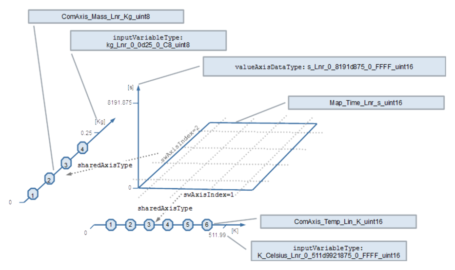

ApplicationPrimitiveDataType Map\_Time\_Lnr\_s\_uint16 为带组轴的 MAP 定义数据类型。所包含取值的物理含义和范围由 ApplicationPrimitiveDataType s\_Lnr\_-0\_8191d875\_0\_FFFF\_uint16 描述，它通过 valueAxisDataType 属性引用。这意味着它是一个取值范围为 0 .. 8191.875 [second]、分辨率为 0.125 [second] 的取值。

在 valueAxisDataType 角色中被引用的 ApplicationPrimitiveDataType 表示复合原始类型（例如 CURVE、MAP）中取值轴的原始数据类型。它取代 CompuMethod、Unit 和 BaseType。在该具体示例中，valueAxisDataType 经由对 ApplicationPrimitiveDataType 的 valueAxisDataType 引用提供 CURVE 或 MAP 原始元素的属性。后者又定义了以下属性：

- dataConstr
- compuMethod
- displayFormat
- unit
- swCalibrationAccess

因此，尽管已设置，被引用的 ApplicationPrimitiveDataType 的 swCalibrationAccess 取值对使用它的 CURVE 和 MAP 而言是无意义的。注意：被引用的数据类型必须是真正的原始类型（通常类别为 VALUE；类别 BOOLEAN 也受支持）。

CURVE 和 MAP 的 ApplicationPrimitiveDataType 还可以定义对整个复合原始类型相关的 SwDataDefProps。当前示例中使用以下属性：

- swCalprmAxisSet
- swRecordLayout
- swCalibrationAccess（但将在 DataPrototype 层级上细化）

进而，经由使用它的软件组件的 dataTypeMapping，ImplementationDataType 和 SwBaseType 的属性得到描述。

作为 MAP 的轴，使用了两个组轴。组轴的属性由两个类别为 COM\_AXIS 的 ApplicationPrimitiveDataType 描述。属性 swAxisIndex 指示组轴适用于哪个维度（1 = X，2 = Y）。属性 sharedAxisType 定义对描述该轴的 ApplicationPrimitiveDataType 的引用。

在示例中，组轴 ComAxis\_Temp\_Lin\_K\_uint16 定义了适用的最小和最大轴点数量。此外，inputVariableType 对 ApplicationPrimitiveDataType K\_Celsius\_Lnr\_0\_511d9921875\_0\_FFFF\_uint16 的引用定义了轴输入取值的属性。这又与作为轴点存储的取值相对应。同样的原则适用于组轴 ComAxis\_Mass\_Lnr\_Kg\_uint8。

请注意，上述属性定义在 ApplicationDataType 层级上，到目前为止尚不存在实现这些属性的数据实例。这需要对这些 ApplicationDataType 进行实例化。

##### 3.2.1.6. DataPrototype 与 SwComponentPrototype 层级上的轴、曲线与映射（**Axis, Curves and Maps on DataPrototype and SwComponentPrototype level**）

###### 3.2.1.6.1. 轴、曲线与映射的实例化（**Instantiation of Axis, Curves and Maps**）

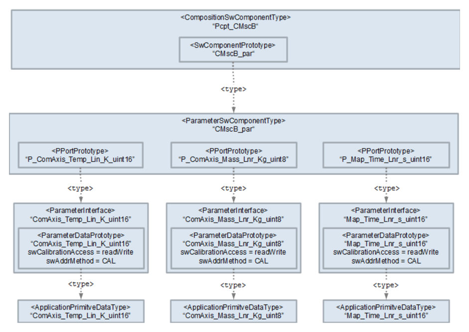

图 3.14 展示了 ApplicationPrimitiveDataType ComAxis\_Temp\_Lin\_K\_uint16、ComAxis\_Mass\_Lnr\_Kg\_uint8 和 Map\_Time\_Lnr\_s\_uint16 向上直到 CompositionSwComponentType Pcpt\_CMscB 层级的实例化。

此处 ParameterDataPrototype 以所述的 ApplicationPrimitiveDataType 定义类型。每个 ParameterDataPrototype 由一个自己的 ParameterInterface 拥有。这提供了最大的灵活性，可以彼此独立地实例化映射和轴。在 ParameterDataPrototype 层级上还定义了 swCalibrationAccess 和 swAddrMethod。

进而，ParameterSwComponentType CMscB\_par 定义了三个由 ParameterInterface 定义类型的 PPortPrototype。

请注意，曲线或映射的组轴不一定由与提供该曲线或映射者相同的 ParameterSwComponentType 提供。映射 Arr1dMap\_Time\_Lnr\_s\_uint16 说明了这种情况：它使用由 CMscD\_par 提供的组轴 Arr1dComAxis\_Temp\_Lin\_K\_uint16 和由 CMscB\_par 提供的 ComAxis\_Mass\_Lnr\_Kg\_uint8。

###### 3.2.1.6.2. 软件组件对轴、曲线与映射的使用（**Usage of Axis, Curves and Maps by Software Components**）

###### 3.2.1.6.3. 将映射与曲线实例链接到其轴实例（**Linking map and curve instances to its axes instances**）

考虑一个使用带组轴的曲线和映射的软件组件。此时需要指明曲线和映射的哪个实例把组轴的哪个实例用作横坐标轴，以及（对于映射）用作纵坐标轴。

**AUTOSAR** 元模型为此提供了两种可能：

- RunnableEntity.parameterAccess.swDataDefProps
- 或 SwcInternalBehavior.instantiationDataDefProps.swDataDefProps

在一个软件组件内部，同一个曲线或映射被不同的 RunnableEntity 以不同的轴使用是极不可能的（注意，**ASAM** **MCD-2MC** 也无法表达这种情况）。因此，本展示案例使用第二种能力。这避免了多个 RunnableEntity 对同一曲线或映射实例定义 parameterAccess 时产生不一致的风险。

相应的 instantiationDataDefProps.parameterInstance 在 SwComponentType 的范围内引用映射实例，而 swDataDefProps.swCalprmAxisSet.swCalprmAxis.swCalprmAxisTypeProps.swCalprmRef 以相应的 SwCalprmAxis.swAxisIndex 引用所应用的组轴。

清单3.28：映射的 InstantiationDataDefProps 示例（**Example of an InstantiationDataDefProps for a map**）

###### 3.2.1.6.4. 将轴实例链接到其工作点实例（**Linking axes instances to its working point instances**）

当软件组件使用包含轴的复合原始类型（例如曲线、映射或组轴）时，指出哪个数据被用作相应轴的输入是有益的。这使测量和标定工具能够显示当前的工作点。如[第3.2.1.6.3节](#32163-将映射与曲线实例链接到其轴实例linking-map-and-curve-instances-to-its-axes-instances)所解释，这一信息可以提供于：

- 包含轴的复合原始类型的 ParameterAccess.swDataDefProps，或
- 借助 instantiationDataDefProps.swDataDefProps。

在本展示案例中，出于与[第3.2.1.6.3节](#32163-将映射与曲线实例链接到其轴实例linking-map-and-curve-instances-to-its-axes-instances)讨论相同的原因，使用第二种能力。

相应的 instantiationDataDefProps.parameterInstance 在 SwComponentType CMscB 的范围内引用轴实例。swDataDefProps.swCalprmAxisSet.swCalprmAxis.swCalprmAxisTypeProps.swVariableRef 以相应的 SwCalprmAxis.swAxisIndex 引用所应用的工作点变量（此处为 RPortPrototype 中的一个 dataElement）。

清单3.29：轴的 InstantiationDataDefProps 示例（**Example of an InstantiationDataDefProps for an axis**）

###### 3.2.1.6.5. ECU Flat Map 中的轴、曲线与映射（**Axis, Curves and Maps in the ECU Flat Map**）

**ECU** Flat Map 包含所有曲线、映射、轴和工作点变量的条目。所使用的命名模式在[第3.2.1.2.1节](#32121-ecu-扁平映射the-ecu-flat-map)中描述。

清单3.30：映射轴与工作点变量的 FlatInstanceDescriptor 示例（**Example of a FlatInstanceDescriptor for map axis and working point variable**）

###### 3.2.1.7. 映射与轴的数组（**Arrays of Maps and Axes**）

曲线、映射和长方体的能力通常用于描述一个特性对其他物理输入值的物理依赖关系。此时每个输入值由一根正交轴描述。与之相对，数组用于把一组同类的取值分组，这些取值可以由同一个算法处理。通常，此时算法以索引对数组迭代。尽管如此，每个数组元素可以表示车辆的特定部分，例如某个特定的气缸或某个特定的传感器。可以把这些设计原则组合起来。这最终导致需要描述曲线、映射、长方体及其相应轴的数组。

本展示案例用以下元素说明这些对象的模型：

- Arr1dMap\_Time\_Lnr\_s\_uint16
- Arr1dComAxis\_Temp\_Lin\_K\_uint16
- Arr1dPrimData\_Temperature\_Lin\_K\_C\_uint16

此处，映射数组 Arr1dMap\_Time\_Lnr\_s\_uint16 的 x 轴使用组轴数组 Arr1dComAxis\_Temp\_Lin\_K\_uint16，后者又使用原始取值数组 Arr1dPrimData\_Temperature\_Lin\_K\_C\_uint16 作为工作点。此时，第 n 个映射使用第 n 根 x 轴，后者使用第 n 个取值作为工作点。与之相对，该映射的 y 轴使用一根组轴 ComAxis\_Mass\_Lnr\_Kg\_uint8。此时数组中的所有映射使用同一根 y 轴。

###### 3.2.1.7.1. ECU Flat Map 中的映射与轴数组（**Arrays of Maps and Axes in the ECU Flat Map**）

在 **ECU** Flat Map 中，引用 ApplicationCompositeElementDataPrototype 的能力被用来表达映射数组和组轴中每个数组元素的特定含义。

例如，数组 Arr1dMap\_Time\_Lnr\_s\_uint16 中的每个元素的命名方式都表明其特定含义：

- Arr1dMap\_Time\_Lnr\_s\_uint16\_FrontLeft
- Arr1dMap\_Time\_Lnr\_s\_uint16\_FrontRight
- Arr1dMap\_Time\_Lnr\_s\_uint16\_RearLeft
- Arr1dMap\_Time\_Lnr\_s\_uint16\_RearRight

下面的清单以一个示例展示这样的 FlatInstanceDescriptior 的结构：

清单3.31：ApplicationCompositeElementDataPrototype 的 FlatInstanceDescriptor 示例（**Example of a FlatInstanceDescriptor for an ApplicationCompositeElementDataPrototype**）

请注意在目标引用中 index 属性的使用。

###### 3.2.1.8. 模式的测量（**Measurement of Modes**）

###### 3.2.1.8.1. 启用模式的测量（**Enabling Measurement of Modes**）

###### 3.2.1.8.2. ECU Flat Map 中的模式（**Modes in the ECU Flat Map**）
#### 3.2.2. 示例中的展示案例（**Show cases in the Example**）

以下各表由高级展示案例的 **AUTOSAR** 模型生成，以相互链接的表的形式给出模型内容。表中的单元格内容为模型元素的标识符与属性取值，按原样保留。

### 3.2.2.1. CompositionSwComponentType（**CompositionSwComponentTypes**）

表3.57：CompositionSwComponentType Pcpt_CMscC（**Pcpt_CMscC**）

| shortName |  | Pcpt_CMscB |
| desc | 轴、曲线与映射的建模展示案例。 |
| 端口的属性 |
| PPortPrototype 的属性 |
| shortName desc providedInterface properties of shortName desc providedInterface properties of shortName desc providedInterface properties of shortName desc providedInterface properties of shortName desc requiredInterface properties of shortName desc requiredInterface properties of |  | P_ComAxis_Mass_Lnr_Kg_uint8 |
|  | 质量的共享轴 |
|  | ComAxis_Mass_Lnr_Kg_uint8 |
| PPortPrototype |
|  | P_PrimData_MassCorrected_Lnr_Kg_uint8 |
|  | 以 kg 为单位保存修正后质量的原始数据。 |
|  | PrimData_MassCorrected_Lnr_Kg_uint8 |
| PPortPrototype |
|  | P_PrimData_Time_Lnr_s_uint16 |
|  | 保存时间取值的原始数据。 |
|  | PrimData_Time_Lnr_s_uint16 |
| PPortPrototype |
|  | P_PrimData_ValidState_Txt_noUnit_boolean |
|  | 表示数据有效性的布尔值 |
|  | PrimData_ValidState_Txt_noUnit_boolean |
| RPortPrototype |
|  | R_ModeDirection |
|  | 指示方向的模式 |
|  | ModeDirection |
| RPortPrototype |
|  | R_PrimData_Mass_Lnr_Kg_uint8 |
|  | 以千克为单位的质量 |
|  | PrimData_Mass_Lnr_Kg_uint8 |
| RPortPrototype |
| shortName |  | R_PrimData_StepsSpeed_Txt_sint8 |
| desc |  | 分级的转速指示 |
|  | requiredInterface | PrimData_StepsSpeed_Txt_sint8 |
| RPortPrototype 的属性 |
| shortName |  | R_PrimData_Temperature_Lin_K_C_uint16 |
| desc |  | 以开尔文为单位、但显示为摄氏度的温度 1 |
|  | requiredInterface | PrimData_Temperature_Lin_K_C_uint16 |

表3.58：CompositionSwComponentType Pcpt_CMscB（**Pcpt_CMscB**）

| SwComponentPrototype 的属性 |
| shortName | CMscB |
| type | CMscB |
| SwComponentPrototype 的属性 |
| shortName | CMscB_par |
| type | CMscB_par |

### 3.2.2.2. ParameterSwComponentType（**ParameterSwComponentTypes**）

表3.59：ParameterSwComponentType CMscA_par（**CMscA_par**）

| ParameterSwComponentType 的公共属性 |
| shortName | CMscD_par |
| desc | 轴与映射数组的建模展示案例。 |
| 端口的属性 |
| PPortPrototype 的属性 |
|  | shortName | P_Arr1dComAxis_Temp_Lin_K_uint16 |
|  | desc | 温度共享轴的数组 |
|  | providedInterface | Arr1dComAxis_Temp_Lin_K_uint16 |
| PPortPrototype 的属性 |
|  | shortName | P_Arr1dMap_Time_Lnr_s_uint16 |
|  | desc | 依据温度和质量获取时间的映射。 |
|  | providedInterface | Arr1dMap_Time_Lnr_s_uint16 |

表3.60：ParameterSwComponentType CMscD_par（**CMscD_par**）

| ParameterSwComponentType 的公共属性 |
| shortName | CMscB_par |
| desc | 轴、曲线与映射的建模展示案例。 |
| 端口的属性 |
| PPortPrototype 的属性 |
|  | shortName | P_ComAxis_Mass_Lnr_Kg_uint8 |
|  | desc | 质量的共享轴 |
|  | providedInterface | ComAxis_Mass_Lnr_Kg_uint8 |
| PPortPrototype 的属性 |
|  | shortName | P_ComAxis_Steps_Txt_sint8 |
|  | desc | 转速档位的共享轴 |
|  | providedInterface | ComAxis_Steps_Txt_sint8 |
| PPortPrototype 的属性 |
|  | shortName | P_ComAxis_Temp_Lin_K_uint16 |

表3.61：ParameterSwComponentType CMscB_par（**CMscB_par**）

| desc | 温度的共享轴 |
| providedInterface | ComAxis_Temp_Lin_K_uint16 |
| PPortPrototype 的属性 |
| shortName | P_Curve_Mass_Lnr_Kg_uint8 |
| desc | 依据不同转速档位获取质量的曲线。 |
| providedInterface | Curve_Mass_Lnr_Kg_uint8 |
| PPortPrototype 的属性 |
| shortName | P_Map_Time_Lnr_s_uint16 |
| desc | 依据温度和质量获取时间的映射。 |
| providedInterface | Map_Time_Lnr_s_uint16 |

### 3.2.2.3. ApplicationSwComponentType（**ApplicationSwComponentTypes**）

表3.62：ApplicationSwComponentType CMscD（**CMscD**）

| ApplicationSwComponentType 的公共属性 |
| shortName | CMscD |
| desc | 轴与映射数组的建模展示案例。 |
| 端口的属性 |
| PPortPrototype 的属性 |
| shortName | P_Arr1dPrimData_Temperature_Lin_K_C_uint16 |
| desc | 以开尔文为单位、但显示为摄氏度的温度 1 |
| providedInterface | Arr1dPrimData_Temperature_Lin_K_C_uint16 |
| RPortPrototype 的属性 |
| shortName | R_Arr1dComAxis_Temp_Lin_K_uint16 |
| desc | 温度共享轴的数组 |
| requiredInterface | Arr1dComAxis_Temp_Lin_K_uint16 |
| RPortPrototype 的属性 |
| shortName | R_Arr1dMap_Time_Lnr_s_uint16 |
| desc | 依据温度和质量获取时间的映射。 |
| requiredInterface | Arr1dMap_Time_Lnr_s_uint16 |
| RPortPrototype 的属性 |
| shortName | R_Arr1dPrimData_Temperature_Lin_K_C_uint16 |
| desc | 以开尔文为单位、但显示为摄氏度的温度 1 |
| requiredInterface | Arr1dPrimData_Temperature_Lin_K_C_uint16 |
| RPortPrototype 的属性 |
| shortName | R_ComAxis_Mass_Lnr_Kg_uint8 |
| desc | 质量的共享轴 |
| requiredInterface | ComAxis_Mass_Lnr_Kg_uint8 |
| RPortPrototype 的属性 |
| shortName | R_PrimData_MassCorrected_Lnr_Kg_uint8 |
| desc | 以 kg 为单位保存修正后质量的原始数据。 |
| requiredInterface | PrimData_MassCorrected_Lnr_Kg_uint8 |
| internalBehavior | CMscD |

表3.63：SwcInternalBehavior CMscD（**CMscD**）

| SwcInternalBehavior 的公共属性 |
| shortName | CMscD |
| runnable 的属性 |
| RunnableEntity 的属性 |
| shortName | CMscD_Process |
| symbol | CMscD_Process |
| ApplicationSwComponentType 的公共属性 |
| shortName | CMscB |
| desc Modeling show case for axes, curves and mapes. |
| 端口的属性 |
| PPortPrototype 的属性 |
| shortName | P_PrimData_MassCorrected_Lnr_Kg_uint8 |
| desc | 以 kg 为单位保存修正后质量的原始数据。 |
| providedInterface | PrimData_MassCorrected_Lnr_Kg_uint8 |
| PPortPrototype 的属性 |
| shortName | P_PrimData_Time_Lnr_s_uint16 |
| desc | 保存时间取值的原始数据。 |
| providedInterface | PrimData_Time_Lnr_s_uint16 |
| PPortPrototype 的属性 |
| shortName | P_PrimData_ValidState_Txt_noUnit_boolean |
| desc | 表示数据有效性的布尔值 |
| providedInterface | PrimData_ValidState_Txt_noUnit_boolean |
| RPortPrototype 的属性 |
| shortName | R_ComAxis_Mass_Lnr_Kg_uint8 |
| desc | 质量的共享轴 |
| requiredInterface | ComAxis_Mass_Lnr_Kg_uint8 |
| RPortPrototype 的属性 |
| shortName | R_ComAxis_Steps_Txt_sint8 |
| desc | 转速档位的共享轴 |
| requiredInterface | ComAxis_Steps_Txt_sint8 |
| RPortPrototype 的属性 |
| shortName | R_ComAxis_Temp_Lin_K_uint16 |
| desc | 温度的共享轴 |
| requiredInterface | ComAxis_Temp_Lin_K_uint16 |
| RPortPrototype 的属性 |
| shortName | R_Curve_Mass_Lnr_Kg_uint8 |
| desc | 依据不同转速档位获取质量的曲线。 |
| requiredInterface | Curve_Mass_Lnr_Kg_uint8 |
| RPortPrototype 的属性 |
| shortName | R_Map_Time_Lnr_s_uint16 |
| desc | 依据温度和质量获取时间的映射。 |
| requiredInterface | Map_Time_Lnr_s_uint16 |
| RPortPrototype 的属性 |
| shortName | R_ModeDirection |
| desc | 指示方向的模式 |
| requiredInterface | ModeDirection |

表3.64：ApplicationSwComponentType CMscB（**CMscB**）

| shortName | R_PrimData_Mass_Lnr_Kg_uint8 |
| desc | 以千克为单位的质量 |
| requiredInterface | PrimData_Mass_Lnr_Kg_uint8 |
| RPortPrototype 的属性 |
| shortName | R_PrimData_MassCorrected_Lnr_Kg_uint8 |
| desc | 以 kg 为单位保存修正后质量的原始数据。 |
| requiredInterface | PrimData_MassCorrected_Lnr_Kg_uint8 |
| RPortPrototype 的属性 |
| shortName | R_PrimData_StepsSpeed_Txt_sint8 |
| desc | 分级的转速指示 |
| requiredInterface | PrimData_StepsSpeed_Txt_sint8 |
| RPortPrototype 的属性 |
| shortName | R_PrimData_Temperature_Lin_K_C_uint16 |
| desc | 以开尔文为单位、但显示为摄氏度的温度 1 |
| requiredInterface | PrimData_Temperature_Lin_K_C_uint16 |
| RPortPrototype 的属性 |
| shortName | R_PrimData_Time_Lnr_s_uint16 |
| desc | 保存时间取值的原始数据。 |
| requiredInterface | PrimData_Time_Lnr_s_uint16 |
| RPortPrototype 的属性 |
| shortName | R_PrimData_ValidState_Txt_noUnit_boolean |
| desc | 表示数据有效性的布尔值 |
| requiredInterface | PrimData_ValidState_Txt_noUnit_boolean |
| internalBehavior | CMscB |

表3.65：SwcInternalBehavior CMscB（**CMscB**）

| SwcInternalBehavior 的公共属性 |
| shortName | CMscB |
| runnable 的属性 |
| RunnableEntity 的属性 |
| shortName | CMscB_Process |
| desc | 用于计算的周期性过程。 |
| symbol | CMscB_Process |

表3.67：ParameterInterface Arr（**Arr**）

| ParameterInterface 的公共属性 |
| shortName | Arr1dMap_Time_Lnr_s_uint16 |
| desc | 依据温度和质量获取时间的映射。 |
| 参数的属性 |
| ParameterDataPrototype 的属性 |
| shortName | Arr1dMap_Time_Lnr_s_uint16 |
| desc | 依据温度和质量获取时间的映射。 |
| type | Map_Time_Lnr_s_uint16_ScNoOfWheels |
| swImplPolicy | standard |
| swCalibrationAccess | readWrite |
| swAddrMethod | CAL |

表3.68：ParameterInterface ComAxis_Mass_Lnr_Kg_uint（**ComAxis_Mass_Lnr_Kg_uint**）

| ParameterInterface 的公共属性 |
| shortName | ComAxis_Mass_Lnr_Kg_uint8 |
| desc | 质量的共享轴 |
| 参数的属性 |
| ParameterDataPrototype 的属性 |
| shortName | ComAxis_Mass_Lnr_Kg_uint8 |
| desc | 质量的共享轴 |
| type | ComAxis_Mass_Lnr_Kg_uint8 |
| swImplPolicy | standard |
| swCalibrationAccess | readWrite |
| swAddrMethod | CAL |
| ParameterInterface 的公共属性 |
| shortName | ComAxis_Steps_Txt_sint8 |
| desc | 转速档位的共享轴 |
| 参数的属性 |
| ParameterDataPrototype 的属性 |
| shortName | ComAxis_Steps_Txt_sint8 |
| desc | 转速档位的共享轴 |
| type | ComAxis_Steps_Txt_sint8 |
| swImplPolicy | standard |
| swCalibrationAccess | readWrite |
| swAddrMethod | CAL |

表3.70：ParameterInterface ComAxis_Temp_Lin_K_uint（**ComAxis_Temp_Lin_K_uint**）

| ParameterInterface 的公共属性 |
| shortName | ComAxis_Temp_Lin_K_uint16 |
| desc | 温度的共享轴 |
| 参数的属性 |
| ParameterDataPrototype 的属性 |
| shortName | ComAxis_Temp_Lin_K_uint16 |
| desc | 温度的共享轴 |
| type | ComAxis_Temp_Lin_K_uint16 |
| swImplPolicy | standard |
| swCalibrationAccess | readWrite |
| swAddrMethod | CAL |

表3.71：ParameterInterface Curve_Mass_Lnr_Kg_uint（**Curve_Mass_Lnr_Kg_uint**）

| ParameterInterface 的公共属性 |
| shortName | Curve_Mass_Lnr_Kg_uint8 |
| desc | 依据不同转速档位获取质量的曲线。 |
| 参数的属性 |
| ParameterDataPrototype 的属性 |
| shortName | Curve_Mass_Lnr_Kg_uint8 |
| desc | 依据不同转速档位获取质量的曲线。 |
| type | Curve_Mass_Lnr_Kg_uint8 |
| swImplPolicy | standard |
| swCalibrationAccess | readWrite |
| swAddrMethod | CAL |

表3.72：ParameterInterface Map_Time_Lnr_s_uint（**Map_Time_Lnr_s_uint**）

| ParameterInterface 的公共属性 |
| shortName | Map_Time_Lnr_s_uint16 |
| desc | 依据温度和质量获取时间的映射。 |
| 参数的属性 |
| ParameterDataPrototype 的属性 |
| shortName | Map_Time_Lnr_s_uint16 |
| desc | 依据温度和质量获取时间的映射。 |
| type | Map_Time_Lnr_s_uint16 |
| swImplPolicy | standard |
| swCalibrationAccess | readWrite |
| swAddrMethod | CAL |

表3.73：ParameterInterface PrimCal_Mass_Lnr_Kg（**PrimCal_Mass_Lnr_Kg**）

| ParameterInterface 的公共属性 |
| shortName | PrimCal_Mass_Lnr_Kg |
| desc | 最小鸡蛋质量的原始标定参数。 |
| 参数的属性 |
| ParameterDataPrototype 的属性 |
| shortName | PrimCal_Mass_Lnr_Kg |
| desc | 最小鸡蛋质量的原始标定参数。 |
| type | kg_Lnr_0_0d25_0_C8_uint8 |
| swImplPolicy | standard |
| swCalibrationAccess | readWrite |
| swAddrMethod | CAL |

### 3.2.2.5. ModeSwitchInterface（**ModeSwitchInterfaces**）

表3.74：ModeSwitchInterface ModeDirection（**ModeDirection**）

| ModeSwitchInterface 的公共属性 |
| shortName | ModeDirection |
| desc | 指示方向的模式 |
| 模式组的属性 |
|  | shortName | ModeDirection |
|  | swCalibrationAccess | readOnly |
|  | type | Direction |

表3.76：SenderReceiverInterface PrimData_Mass_Lnr_Kg_uint（**PrimData_Mass_Lnr_Kg_uint**）

| SenderReceiverInterface 的公共属性 |
| shortName | PrimData_Mass_Lnr_Kg_uint8 |
| desc | 以千克为单位的质量 |
| 数据元素的属性 |
| VariableDataPrototype 的属性 |
| shortName | PrimData_Mass_Lnr_Kg_uint8 |
| desc | 以千克为单位的质量 |
| type | kg_Lnr_0_0d25_0_C8_uint8 |
| swImplPolicy | standard |
| swCalibrationAccess | readOnly |
| swAddrMethod | DATA |

表3.77：SenderReceiverInterface PrimData_MassCorrected_Lnr_Kg_uint（**PrimData_MassCorrected_Lnr_Kg_uint**）

| SenderReceiverInterface 的公共属性 |
| shortName | PrimData_MassCorrected_Lnr_Kg_uint8 |
| desc | 以 kg 为单位保存修正后质量的原始数据。 |
| 数据元素的属性 |
| VariableDataPrototype 的属性 |
| shortName | PrimData_MassCorrected_Lnr_Kg_uint8 |
| desc | 以 kg 为单位保存修正后质量的原始数据。 |
| type | kg_Lnr_0_0d25_0_C8_uint8 |
| swImplPolicy | standard |
| swCalibrationAccess | readOnly |
| swAddrMethod | DATA |
| SenderReceiverInterface 的公共属性 |
| shortName | PrimData_Temperature_Lin_K_C_uint16 |
| desc | 以开尔文为单位、但显示为摄氏度的温度 1 |
| 数据元素的属性 |
| VariableDataPrototype 的属性 |
| shortName | PrimData_Temperature_Lin_K_C_uint16 |
| desc | 以开尔文为单位、但显示为摄氏度的温度 1 |
| type | K_Celsius_Lnr_0_511d9921875_0_FFFF_uint16 |
| swImplPolicy | standard |
| swCalibrationAccess | readOnly |
| swAddrMethod | DATA |

表3.79：SenderReceiverInterface PrimData_Time_Lnr_s_uint（**PrimData_Time_Lnr_s_uint**）

| SenderReceiverInterface 的公共属性 |
| shortName | PrimData_Time_Lnr_s_uint16 |
| desc | 保存时间取值的原始数据。 |
| 数据元素的属性 |
| VariableDataPrototype 的属性 |
| shortName | PrimData_Time_Lnr_s_uint16 |
| desc | 保存时间取值的原始数据。 |
| type | s_Lnr_0_8191d875_0_FFFF_uint16 |
| swImplPolicy | standard |
| swCalibrationAccess | readOnly |
| swAddrMethod | DATA |

表3.80：SenderReceiverInterface PrimData_ValidState_Txt_noUnit_boolean（**PrimData_ValidState_Txt_noUnit_boolean**）

| SenderReceiverInterface 的公共属性 |
| shortName | PrimData_ValidState_Txt_noUnit_boolean |
| desc | 表示数据有效性的布尔值 |
| 数据元素的属性 |
| VariableDataPrototype 的属性 |
| shortName | PrimData_ValidState_Txt_noUnit_boolean |
| desc | 表示数据有效性的布尔值 |
| type | DataValidityType |
| swImplPolicy | standard |
| swCalibrationAccess | readOnly |
| swAddrMethod | DATA |

### 3.2.2.7. 应用数据类型，类别 BOOLEAN（**ApplicationDataTypes, Category BOOLEAN**）

表3.81：ApplicationDataType DataValidityType（**DataValidityType**）

| ApplicationDataType 的公共属性 |
| shortName | DataValidityType |
| category | BOOLEAN |
| desc | 表示数据有效性的布尔值 |
| swCalibrationAccess | notAccessible |
| unit | NoUnit |
| Range |
|  | 下限 上限 |
|  | physConstrs | 0 1 |
| Conversion |
|  | category | TEXTTABLE |
|  | direction | compuInternalToPhys |
|  | desc | lowerLimit | upperLimit vt | symbol |
|  | - | 0 | 0 Invalid |
|  | - | 1 | 1 Valid |

### 3.2.2.8. 应用数据类型，类别 VALUE（**ApplicationDataTypes, Category VALUE**）

表3.82：ApplicationDataType K_Celsius_Lnr_（**K_Celsius_Lnr_**）

| ApplicationDataType 的公共属性 |
| shortName | K_Celsius_Lnr_0_511d9921875_0_FFFF_uint16 |
| category | VALUE |
| desc | Temperature |
| swCalibrationAccess | notAccessible |
| unit | K |
| Range |
|  | 下限 上限 |
|  | physConstrs | 0 | 511.9921875 |
| Conversion |
|  | category | LINEAR |
|  | direction | compuInternalToPhys |
|  | desc | lowerLimit | compuNumerator / compuDenominator |
|  | - | Phys = 0+0 . 0078125 ∗ Internal 1 |

表3.83：ApplicationDataType kg_Lnr_（**kg_Lnr_**）

| ApplicationDataType 的公共属性 |
| shortName | kg_Lnr_0_0d25_0_C8_uint8 |
| category | VALUE |
| desc | Mass |
| swCalibrationAccess | notAccessible |
| unit | kg |
| Range |
|  | 下限 上限 |
|  | physConstrs | 0 | 0.25 |
| Conversion |
|  | category | LINEAR |
|  | direction | compuInternalToPhys |
|  | desc | lowerLimit | compuNumerator / compuDenominator |
|  | - | Phys = 0+0 . 00125 ∗ Internal 1 |
| ApplicationDataType 的公共属性 |
| shortName | NoUnit_Lnr_1_4_1_4_uint8 |
| category | VALUE |
| swCalibrationAccess | notAccessible |
| unit | NoUnit |
| Range |
|  | lowerLimit | upperLimit |
|  | physConstrs | 1 | 4 |
| Conversion |
|  | category | LINEAR |
|  | direction | compuInternalToPhys |
|  | desc | lowerLimit | compuNumerator / compuDenominator |
|  | - | Phys = 0+1 ∗ Internal 1 |

表3.84：ApplicationDataType NoUnit_Lnr_（**NoUnit_Lnr_**）

| ApplicationDataType 的公共属性 |
| shortName | NoUnit_Lnr_1_65535_1_FFFF_uint16 |
| category | VALUE |
| swCalibrationAccess | notAccessible |
| unit | NoUnit |
| Range |
|  | lowerLimit | upperLimit |
|  | physConstrs | 1 | 65535 |
| Conversion |
|  | category | LINEAR |
|  | direction | compuInternalToPhys |
|  | desc | lowerLimit | compuNumerator / compuDenominator |
|  | - | Phys = 0+1 ∗ Internal 1 |

表3.85：ApplicationDataType NoUnit_Lnr_（**NoUnit_Lnr_**）

| ApplicationDataType 的公共属性 |
| shortName | s_Lnr_0_8191d875_0_FFFF_uint16 |
| category | VALUE |
| desc | 以秒为单位的烹调时间。 |
| swCalibrationAccess | notAccessible |
| unit | s |
| Range |
|  | lowerLimit | upperLimit |
|  | physConstrs | 0 | 8191.875 |
| Conversion |
|  | category | LINEAR |
|  | direction | compuInternalToPhys |
|  | desc | lowerLimit | upperLimit | compuNumerator / compuDenominator |
|  | - | Phys = 0+0 . 125 ∗ Internal 1 |

表3.86：ApplicationDataType s_Lnr_（**s_Lnr_**）

| ApplicationDataType 的公共属性 |
| shortName | speedSteps |
| category | VALUE |
| desc | 可能的转速档位 |
| swCalibrationAccess | notAccessible |
| unit | NoUnit |
| Range |
|  | 下限 上限 |
|  | physConstrs | -1 2 |
| Conversion |
|  | category | TEXTTABLE |
|  | direction | compuInternalToPhys |
|  | desc | lowerLimit | upperLimit vt | symbol |
|  | - | -1 | -1 Stop |
|  | - | 0 | 0 LightSpeed |
|  | - | 1 | 1 RidiculousSpeed |
|  | - | 2 | 2 LudicrousSpeed |

表3.87：ApplicationDataType speedSteps（**speedSteps**）

| ApplicationDataType 的公共属性 |
| shortName | TxWheelNames |  |
| category | VALUE |  |
| desc | 车轮名称。 |  |
| swCalibrationAccess | notAccessible |  |
| unit | NoUnit |  |
| Range |
|  | lowerLimit |

表3.88：ApplicationDataType TxWheelNames（**TxWheelNames**）

| physConstrs | 0 | 3 |
| Conversion |
| category | TEXTTABLE |
| direction | compuInternalToPhys |
| desc | lowerLimit | upperLimit | vt | symbol |
| - | 0 | FrontLeft |  |
| - | 1 | FrontRight |  |
| - | 2 | RearLeft |  |
| - | 3 | RearRight |  |

### 3.2.2.9. 应用数据类型，类别 COM\_AXIS（**ApplicationDataTypes, Category COM\_AXIS**）

表3.89：ApplicationDataType ComAxis_Temp_Lin_K_uint（**ComAxis_Temp_Lin_K_uint**）

| ApplicationDataType 的公共属性 |
| shortName | ComAxis_Steps_Txt_sint8 |
| category | COM_AXIS |
| swCalibrationAccess | notAccessible |
| swRecordLayout | RL20_ME_Axis |
| 轴的属性（swCalprmAxisSet） |
| SwAxisIndividual 的属性（swCalprmAxis 与 swCalprmAxisTypeProps） |
| swAxisIndex | 1 |
| category | COM_AXIS |
| inputVariableType | speedSteps |
| swMaxAxisPoints | 4 |
| swMinAxisPoints | 4 |

表3.90：ApplicationDataType ComAxis_Steps_Txt_sint（**ComAxis_Steps_Txt_sint**）

| ApplicationDataType 的公共属性 |
| shortName | ComAxis_Mass_Lnr_Kg_uint8 |
| category | COM_AXIS |
| swCalibrationAccess | notAccessible |
| swRecordLayout | RL20_ME_Axis |
| 轴的属性（swCalprmAxisSet） |
| SwAxisIndividual 的属性（swCalprmAxis 与 swCalprmAxisTypeProps） |
| swAxisIndex | 1 |
| category | COM_AXIS |
| inputVariableType | kg_Lnr_0_0d25_0_C8_uint8 |
| swMaxAxisPoints | 4 |

### 3.2.2.10. 应用数据类型，类别 CURVE（**ApplicationDataTypes, Category CURVE**）

表3.92：ApplicationDataType Curve_Mass_Lnr_Kg_uint（**Curve_Mass_Lnr_Kg_uint**）

| ApplicationDataType 的公共属性 |
| shortName | Curve_Mass_Lnr_Kg_uint8 |
| category | CURVE |
| swCalibrationAccess | notAccessible |
| swRecordLayout | RL20_ME_1DimMap |
| valueAxisDataType | kg_Lnr_0_0d25_0_C8_uint8 |
| 轴的属性（swCalprmAxisSet） |
| SwAxisGrouped 的属性（swCalprmAxis 与 swCalprmAxisTypeProps） |
| swAxisIndex | 1 |
| category | COM_AXIS |
| sharedAxisType | ComAxis_Steps_Txt_sint8 |

### 3.2.2.11. 应用数据类型，类别 MAP（**ApplicationDataTypes, Category MAP**）

表3.93：ApplicationDataType Map_Time_Lnr_s_uint（**Map_Time_Lnr_s_uint**）

| ApplicationDataType 的公共属性 |
| shortName | Map_Time_Lnr_s_uint16 |
| category | MAP |
| swCalibrationAccess | notAccessible |
| swRecordLayout | RL20_ME_2DimMap |
| valueAxisDataType | s_Lnr_0_8191d875_0_FFFF_uint16 |
| 轴的属性（swCalprmAxisSet） |
| SwAxisGrouped 的属性（swCalprmAxis 与 swCalprmAxisTypeProps） |
| swAxisIndex |  | 1 |
| category |  | COM_AXIS |
| sharedAxisType |  | ComAxis_Temp_Lin_K_uint16 |
| SwAxisGrouped 的属性（swCalprmAxis 与 swCalprmAxisTypeProps） |
| swAxisIndex | 2 |  |
| category |  | COM_AXIS |
| sharedAxisType |  | ComAxis_Mass_Lnr_Kg_uint8 |

表3.95：ApplicationArrayDataType K_Celsius_Lnr_（**K_Celsius_Lnr_**）

| ApplicationArrayDataType 的公共属性 |
| shortName | K_Celsius_Lnr_0_511d9921875_0_FFFF_uint16_ScNoOfWheels |
| category | ARRAY |
| swCalibrationAccess | notAccessible |
| 元素的属性 |
| ApplicationArrayElement 的属性 |
|  | shortName | K_Celsius_Lnr_0_511d9921875_0_FFFF_uint16_ScNoOfWheels |
|  | category | VALUE |
|  | type | K_Celsius_Lnr_0_511d9921875_0_FFFF_uint16 |
|  | arraySizeSemantics | fixedSize |
|  | maxNumberOfElements |

表3.96：ApplicationArrayDataType Map_Time_Lnr_s_uint（**Map_Time_Lnr_s_uint**）

| ApplicationArrayDataType 的公共属性 |
| shortName | Map_Time_Lnr_s_uint16_ScNoOfWheels |
| category | ARRAY |
| swCalibrationAccess | notAccessible |
| 元素的属性 |
| ApplicationArrayElement 的属性 |
| shortName | Map_Time_Lnr_s_uint16_ScNoOfWheels |
| category | MAP |
| type | Map_Time_Lnr_s_uint16 |
| arraySizeSemantics | fixedSize |
| maxNumberOfElements |  |

### 3.2.2.13. ApplicationRecordDataType（**ApplicationRecordDataTypes**）

表3.97：ApplicationRecordDataType CMscC_nvm_NvBlockATyp（**CMscC_nvm_NvBlockATyp**）

| ApplicationRecordDataType 的公共属性 |
| shortName | CMscC_nvm_NvBlockATyp |
| category | STRUCTURE |
| swCalibrationAccess | notAccessible |
| 元素的属性 |
| properties of ApplicationRecordElement |
| shortName | PrimData_StepsSpeed_Txt_sint8 |
| category | VALUE |
| type | speedSteps |

### 3.2.2.14. ModeDeclarationGroup（**ModeDeclarationGroups**）

表3.98：ModeDeclarationGroup Direction（**Direction**）

| ModeDeclarationGroup 的公共属性 |
| shortName | Direction |
| category | EXPLICIT_ORDER |
| initialMode | Halt |
| 模式声明的属性 |
| ModeDeclaration 的属性 |
|  | shortName | Backward |
|  | desc | 后退方向。 |
|  | value | 2 |
| ModeDeclaration 的属性 |
|  | shortName | Forward |
|  | desc | 前进方向。 |
|  | value | 1 |
| ModeDeclaration 的属性 |
|  | shortName | Halt |
|  | desc | 静止。 |
|  | value | 0 |

### 3.2.2.15. Unit（**Units**）

表3.99：Unit Celsius（**Celsius**）

| Unit 的公共属性 |
| shortName | K |
| desc | Temperature |
|  | displayName | K |
|  | offsetSiToUnit | 0.0 |
|  | factorSiToUnit | 1.0 |
|  | physicalDimension | PD_K |

表3.101：Unit kg（**kg**）

| Unit 的公共属性 |
| shortName | kg |
| desc | Mass |
|  | displayName | kg |
|  | offsetSiToUnit | 0.0 |
|  | factorSiToUnit | 1.0 |
|  | physicalDimension | PD_kg |

表3.102：Unit NoUnit（**NoUnit**）

| Unit 的公共属性 |
| shortName | NoUnit |
| desc | No Unit |
|  | displayName | - |
|  | offsetSiToUnit | 0.0 |
|  | factorSiToUnit | 1.0 |
|  | physicalDimension | PD_NoUnit |

表3.103：Unit s（**s**）

| Unit 的公共属性 |
| shortName | s |
| desc | Time |
|  | displayName | s |
|  | offsetSiToUnit | 0.0 |
|  | factorSiToUnit | 1.0 |
|  | physicalDimension | PD_s |

### 3.2.2.16. PhysicalDimension（**PhysicalDimensions**）

表3.104：PhysicalDimension PD_K（**PD_K**）

| shortName | PD_kg |
| currentExp | 0 |
| lengthExp | 0 |
| luminousIntensity- Exp | 0 |
| massExp | 1 |
| molarAmountExp | 0 |
| temperatureExp | 0 |
| timeExp | 0 |

表3.105：PhysicalDimension PD_kg（**PD_kg**）

| shortName | PD_NoUnit |
| currentExp | 0 |
| lengthExp | 0 |
| luminousIntensity- Exp | 0 |
| massExp | 0 |
| molarAmountExp | 0 |
| temperatureExp | 0 |
| timeExp | 0 |

表3.106：PhysicalDimension PD_NoUnit（**PD_NoUnit**）

| PhysicalDimension 的公共属性 |
| shortName | PD_s |
|  | currentExp | 0 |

表3.107：PhysicalDimension PD_s（**PD_s**）

| lengthExp | 0 |
| luminousIntensity- Exp | 0 |
| massExp | 0 |
| molarAmountExp | 0 |
| temperatureExp | 0 |
| timeExp | 1 |

### 3.2.2.17. SwAddrMethod（**SwAddrMethods**）

表3.108：SwAddrMethod CAL（**CAL**）

| SwAddrMethod 的公共属性 |
| shortName | CODE_10MS |
| desc | 每 10 ms 调用一次的 ECU 函数的代码；安全等级 QM。 |
| sectionType memoryAllocation- KeywordPolicy sectionInitializa- tionPolicy option | code |
|  | addrMethodShortName |
|  | - |
|  | safetyQM |

表3.109：SwAddrMethod CODE_（**CODE_**）

| SwAddrMethod 的公共属性 |
| shortName | CONST_SLOW |
| desc | 不常调用的 ECU 函数的不可标定常量；安全等级 QM。 |
|  | sectionType | const |
|  | memoryAllocation- KeywordPolicy | addrMethodShortName |
|  | sectionInitializa- tionPolicy | - |
|  | option | safetyQM |

表3.110：SwAddrMethod CONST_SLOW（**CONST_SLOW**）

| SwAddrMethod 的公共属性 |
| shortName | DATA |
| desc | Variables of ECU-functions; safety level QM. Variables will be located in different memory sections depending on the alignment of the variable. |
|  | sectionType | var |

表3.111：SwAddrMethod DATA（**DATA**）

| memoryAllocation- KeywordPolicy | addrMethodShortNameAndAlignment |
| sectionInitializa- tionPolicy | INIT |
| option | safetyQM |

表3.112：SwAddrMethod DATA_NVDAT（**DATA_NVDAT**）

| SwAddrMethod 的公共属性 |
| shortName | DATA_NVDAT |
| desc | 存储在非易失性存储器中的变量；安全等级 QM。 |
| sectionType memoryAllocation- KeywordPolicy tionPolicy option | var |
|  | addrMethodShortName |
| sectionInitializa- | NO-INIT |
|  | nvData, safetyQM |

表4.1：StructuredReq of CanDevErrorDetect（**of CanDevErrorDetect**）

| ReqID | CAN_00001 | CanDevErrorDetect | Setting | FALSE |
| Use Case | preconfigured/default | 4.2.2, 4.3.0, 4.4.0 | Range | FALSE, TRUE |
| Descrip- tion | Switches the development error detection and notification on or off. true: detection and notification is enabled. false: detection and notification is disabled. | Rational | The feature development error detection shall be disabled for production code else it has to be ensured that there will be no side effects from this code. |
## 4. 结构化需求（**Structured Requirements**）

结构化需求（**Structured Requirements**）在元模型的不同部分中可用。StructuredReq 的元素有明确的定义。基于这些元素可以应用各种可能的用例。以下展示案例对此加以说明：

- 为配置提供附加信息
- 将规范项作为需求提供
- 提供诊断需求
- 提供需求的分解

### 4.1. 入门展示案例（**Introductory Show Case**）

例如，**OEM** 可以使用结构化需求规定附加的未映射 **ECU** 配置信息。它们用标准化的 **ARXML** 序列化。这将确保供应商一侧的合适工具方案对这些数据进行一致的处理。此外，还可以对数据应用进一步的验证，从而提高所交换信息的质量。元模型中不必引入任何新的附加元素，因为 StructuredReq 已经提供了所需的全部实体。

#### 4.1.1. 附加信息（M1 参数）（**Additional information (M1 parameter)**）

系统模板 [\[6\]](#ref-6) 为多种 M1 参数定义了上游映射。它们由 System Extract 或 Diagnostic Extract 传输，并在图 4.1 中作为可导入参数（**importable parameters**）给出。

本展示案例说明：**OEM** 需要为不可导入的 M1 参数（**AUTOSAR** 模板中未规定完整映射）规定一个取值，以确定一个专门的行为，例如可以通过 true 启用或通过 false 禁用的 CanDevErrorDetect。图 4.1 将其表示为可处理参数（**processable parameters**）。对这些信息的基于工具的处理可以提高效率并最小化出错倾向。本展示案例的目标是使用 StructuredReq 解决这一问题。

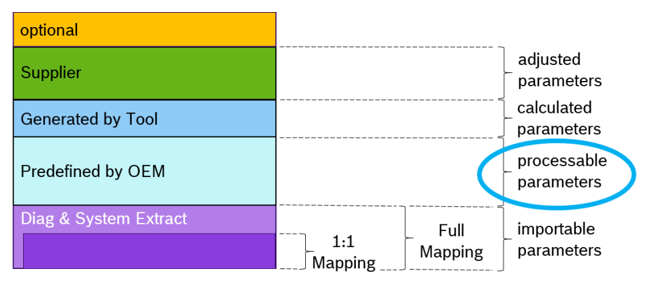

图 4.1 还展示了其他类型的参数：计算参数（**calculated parameters**）和调整参数（**adjusted parameters**）；它们存在但不属于本展示案例的范围。

清单 4.1 展示了 CanDevErrorDetect 的 StructuredReq。

清单4.1：StructuredReq 示例 1（**Example 1 for StructuredReq**）

出于说明的原因，下面的清单 4.2 只包含示例的一个子集，其中取值范围（**ValueRange**）使用 DataConstr 规定。

清单4.2：StructuredReq 中 ValueRange 的示例 2（**Example 2 for ValueRange in StructuredReq**）

相应的 DataConstr 见清单 4.3。

清单4.3：DataConstr 的示例 2（**Example 2 for DataConstr**）

同样的数据也可以呈现在表 4.1 中。

表4.1：CanDevErrorDetect 的 StructuredReq（**StructuredReq of CanDevErrorDetect**）

#### 4.1.2. 作为需求的规范项（**Specification items as requirements**）

**AUTOSAR** 在 **AUTOSAR** **RS** 文档 [TPS\_STDT\_00060] 中使用 StructuredReq。它们基于规范生成过程自动生成。这些规范项使用 StructuredReq 的属性（包括 Traceable）来实现向上追溯。一个专门的示例在 4.4 中说明。

[RS\_SYST\_00020] 将信号排除在特定物理线路之外：

类型：

描述：

valid

理由：

某些物理线路可能不适合（太慢、通信协议不安全等）传输某些特定信号。

依赖项：

未识别到。

用例：

清单4.4：RS AUTOSAR 规范中 StructuredReq 的示例（**Example for StructuredReq in RS AUTOSAR Specification**）

Traceable 由 &lt;TRACE-REFS&gt; 内部的 &lt;TRACE-REF&gt; 标签实现。在规范中，向上追溯显示为表下方的链接。

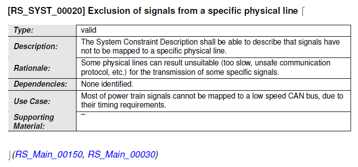

使用 StructuredReq，完整的需求描述和追溯都是可用的。

#### 4.1.3. 诊断需求（**Diagnostic requirements**）

在此上下文中，StructuredReq 被嵌入 DiagnosticAccessPermission。此处主要展示两个条件的描述。

材料：

StructuredReqA

StructuredReqB

清单4.5：DiagnosticAccessPermission 的前置条件与运行条件定义示例（**Example for the definition of preand run-conditions for DiagnosticAccessPermission**）

#### 4.1.4. 需求的分解（**Decomposition of requirements**）

StructuredReq 还可以用于需求的分解。

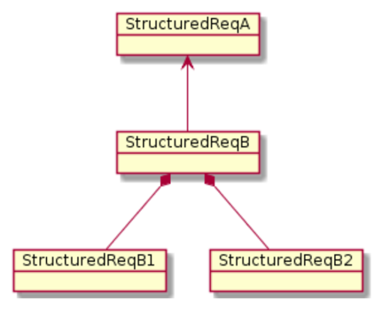

在图 4.3 中，StructuredReqB 具有到 StructuredReqA 的上游需求，由 Traceable 借助 &lt;TRACE-REF&gt; 实现。StructuredReqB 本身由 StructuredReqB1 和 StructuredReqB2 分解。这由 StructuredReq 的 dependencies 属性实现，它包含两个 &lt;TRACE&gt;，后者又再次使用 &lt;TRACE-REF&gt;。

清单4.6：StructuredReq 分解的示例（**Example for decomposition of StructuredReq**）
## A. 本文档提及的类表（Mentioned Class Tables）

为完整起见，本章收录一组类表，表示本文档上下文中提及的元类。

表A.1：ARElement（**ARElement**）

| 属性 | 值 |
| --- | --- |
| 包 | M2::AUTOSARTemplates::GenericStructure::GeneralTemplateClasses::ARPackage |
| 说明 | 可以独立定义的元素，即不必作为另一个元素的组成部分存在（当然包除外）。 |
| 基类 | ARObject , CollectableElement , Identifiable , MultilanguageReferrable , PackageableElement , Referrable |
| 子类 | AclObjectSet, AclOperation, AclPermission, AclRole, AliasNameSet, ApplicabilityInfoSet, Application Partition, AutosarDataType , BaseType , BlueprintMappingSet, BswEntryRelationshipSet, BswModule Description, BswModuleEntry, BuildActionManifest, CalibrationParameterValueSet, ClientIdDefinitionSet, ClientServerInterfaceToBswModuleEntryBlueprintMapping, Collection, CompuMethod, Consistency NeedsBlueprintSet, ConstantSpecification, ConstantSpecificationMappingSet, CpSoftwareCluster, Cp SoftwareClusterBinaryManifestDescriptor, CpSoftwareClusterMappingSet, CpSoftwareClusterResource Pool, CryptoEllipticCurveProps, CryptoServiceCertificate, CryptoServiceKey, CryptoServicePrimitive, CryptoServiceQueue, CryptoSignatureScheme, DataConstr, DataExchangePoint, DataTransformation Set, DataTypeMappingSet, DdsCpConfig, DiagnosticCommonElement , DiagnosticConnection, DiagnosticContributionSet, DltContext, DltEcu, Documentation, E2EProfileCompatibilityProps, Ecuc DefinitionCollection, EcucDestinationUriDefSet, EcucModuleConfigurationValues, EcucModuleDef, Ecuc ValueCollection, EndToEndProtectionSet, EthIpProps, EthTcpIpIcmpProps, EthTcpIpProps, Evaluated VariantSet, FMFeature, FMFeatureMap, FMFeatureModel, FMFeatureSelectionSet, FirewallRule, Flat Map, GeneralPurposeConnection, HwCategory, HwElement, HwType, IEEE1722TpConnection , IPSec ConfigProps, IPv6ExtHeaderFilterSet, IdsCommonElement , IdsDesign, Implementation , ImpositionTime DefinitionGroup, InterpolationRoutineMappingSet, J1939ControllerApplication, KeywordSet, LifeCycle InfoSet, LifeCycleStateDefinitionGroup, LogAndTraceMessageCollectionSet, MacSecGlobalKayProps, MacSecParticipantSet, McFunction, McGroup, ModeDeclarationGroup, ModeDeclarationMappingSet, Os TaskProxy, PhysicalDimension, PhysicalDimensionMappingSet, PortInterface , PortInterfaceMappingSet, PortPrototypeBlueprint, PostBuildVariantCriterion, PostBuildVariantCriterionValueSet, PredefinedVariant, RapidPrototypingScenario, SdgDef, SignalServiceTranslationPropsSet, SomeipSdClientEventGroup TimingConfig, SomeipSdClientServiceInstanceConfig, SomeipSdServerEventGroupTimingConfig, SomeipSdServerServiceInstanceConfig, SwAddrMethod, SwAxisType, SwComponentMapping Constraints, SwComponentType , SwRecordLayout, SwSystemconst, SwSystemconstantValueSet, Swc BswMapping, System, SystemSignal, SystemSignalGroup, TDCpSoftwareClusterMappingSet, Tcp OptionFilterSet, TimingExtension , TlsConnectionGroup, TlvDataIdDefinitionSet, TransformationProps |
| 聚合于 | ARPackage.element |

表A.2：ARPackage（**ARPackage**）

| 属性 | 值 |
| --- | --- |
| 包 | M2::AUTOSARTemplates::GenericStructure::GeneralTemplateClasses::ARPackage |
| 说明 | **AUTOSAR** 包，允许创建顶层包以组织所包含的 ARElement。ARPackage 是开放集合。这意味着在基于文件的描述系统中，可以使用多个文件部分地描述一个包的内容。这是 **MSR** 的 SW-SYSTEM 的扩展版本。 |
| 基类 | ARObject , AtpBlueprint , AtpBlueprintable , CollectableElement , Identifiable , MultilanguageReferrable Referrable |
| 聚合于 | ARPackage.arPackage, AUTOSAR.arPackage |

| 属性 | 类型 | 多重性 | 种类 | 备注 |
| --- | --- | --- | --- | --- |
| arPackage | ARPackage | * | aggr | This represents a sub package within an ARPackage, thus allowing for an unlimited package hierarchy. Stereotypes: atpSplitable; atpVariation Tags: atp.Splitkey=arPackage.shortName, arPackage.variation Point.shortLabel vh.latestBindingTime=blueprintDerivationTime xml.sequenceOffset=30 |
| element | PackageableElement | * | aggr | Elements that are part of this package Stereotypes: atpSplitable; atpVariation Tags: atp.Splitkey=element.shortName, element.variation Point.shortLabel vh.latestBindingTime=systemDesignTime xml.sequenceOffset=20 |
| referenceBase | ReferenceBase | * | aggr | This denotes the reference bases for the package. This is the basis for all relative references within the package. The base needs to be selected according to the base attribute within the references. Stereotypes: atpSplitable Tags: atp.Splitkey=referenceBase.shortLabel xml.sequenceOffset=10 |

表A.3：AliasNameSet（**AliasNameSet**）

| 属性 | 值 |
| --- | --- |
| 包 | M2::AUTOSARTemplates::CommonStructure::FlatMap |
| 说明 | 该元类表示一组别名（**AliasName**）的集合。AliasNameSet 例如可以作为 **A2L** 生成器的输入。 |
| 基类 | ARElement , ARObject , AtpBlueprint , AtpBlueprintable , CollectableElement , Identifiable , Multilanguage Referrable , PackageableElement , Referrable |
| 聚合于 | ARPackage.element |

| 属性 | 类型 | 多重性 | 种类 | 备注 |
| --- | --- | --- | --- | --- |
| aliasName | AliasNameAssignment | * | aggr | AliasNames contained in the AliasNameSet. Stereotypes: atpSplitable; atpVariation Tags: atp.Splitkey=aliasName.shortLabel, aliasName.variation Point.shortLabel vh.latestBindingTime=preCompileTime |

表A.4：AnyInstanceRef（**AnyInstanceRef**）

| 属性 | 值 |
| --- | --- |
| 包 | M2::AUTOSARTemplates::GenericStructure::GeneralTemplateClasses::AnyInstanceRef |
| 说明 | 描述对 **AUTOSAR** 模型中任意实例的引用。这是实例引用最一般的形式。更多细节请参阅超类的说明。 |
| 基类 | ARObject , AtpInstanceRef |
| 聚合于 | Collection.collectedInstance, Collection.sourceInstance, DocumentationContext.feature, EcucInstance ReferenceValue.value, FlatInstanceDescriptor.ecuExtractReference, FlatInstanceDescriptor.upstream Reference, RptContainer.byPassPoint, RptHook.rptArHook, ViewMap.firstElementInstance, ViewMap. secondElementInstance |

| 属性 | 类型 | 多重性 | 种类 | 备注 |
| --- | --- | --- | --- | --- |
| base | AtpClassifier | 1 | ref | This is the base from which navigation path begins. Stereotypes: atpDerived |
| contextElement (ordered) | AtpFeature | * | ref | This is one step in the navigation path specified by the instance ref. |
| target | AtpFeature | 1 | ref | This is the target of the instance ref. |

表A.5：ApplicationArrayDataType（**ApplicationArrayDataType**）

| 属性 | 值 |
| --- | --- |
| 包 | M2::AUTOSARTemplates::SWComponentTemplate::Datatype::Datatypes |
| 说明 | 一种数组形式的应用数据类型，每个元素都是同一应用数据类型。 |
| 基类 | ARElement , ARObject , ApplicationCompositeDataType , ApplicationDataType , AtpBlueprint , Atp Blueprintable , AtpClassifier , AtpType , AutosarDataType , CollectableElement , Identifiable , Multilanguage Referrable , PackageableElement , Referrable |
| 聚合于 | ARPackage.element |

| 属性 | 类型 | 多重性 | 种类 | 备注 |
| --- | --- | --- | --- | --- |
| dynamicArray SizeProfile | String | 0..1 | attr | Specifies the profile which the array will follow if it is a variable size array. |
| element | ApplicationArray Element | 0..1 | aggr | This association implements the concept of an array element. That is, in some cases it is necessary to be able to identify single array elements, e.g. as input values for an interpolation routine. |

表A.6：ApplicationArrayElement（**ApplicationArrayElement**）

| 属性 | 值 |
| --- | --- |
| 包 | M2::AUTOSARTemplates::SWComponentTemplate::Datatype::DataPrototypes |
| 说明 | 描述应用数组数据类型中元素的属性。 |
| 基类 | ARObject , ApplicationCompositeElementDataPrototype , AtpFeature , AtpPrototype , DataPrototype , Identifiable , MultilanguageReferrable , Referrable |
| 聚合于 | ApplicationArrayDataType.element, AtpClassifier .atpFeature |

| 属性 | 类型 | 多重性 | 种类 | 备注 |
| --- | --- | --- | --- | --- |
| arraySize Handling | ArraySizeHandling Enum | 0..1 | attr | The way how the size of the array is handled. |
| arraySize Semantics | ArraySizeSemantics Enum | 0..1 | attr | This attribute controls how the information about the array size shall be interpreted. |
| indexDataType | ApplicationPrimitive DataType | 0..1 | ref | This reference can be taken to assign a CompuMethod of category TEXTTABLE to the array. The texttable entries associate a textual value to an index number such that the element with that index number is represented by a symbolic name. |
| maxNumberOf Elements | PositiveInteger | 0..1 | attr | The maximum number of elements that the array can contain. Stereotypes: atpVariation Tags: vh.latestBindingTime=preCompileTime |

表A.7：ApplicationCompositeDataType（**ApplicationCompositeDataType**）

| 属性 | 值 |
| --- | --- |
| 包 | M2::AUTOSARTemplates::SWComponentTemplate::Datatype::Datatypes |
| 说明 | 由其他数据类型组合而成的应用数据类型的抽象基类。 |
| 基类 | ARElement , ARObject , ApplicationDataType , AtpBlueprint , AtpBlueprintable , AtpClassifier , AtpType , AutosarDataType , CollectableElement , Identifiable , MultilanguageReferrable , PackageableElement , Referrable |
| 子类 | ApplicationArrayDataType, ApplicationRecordDataType |
| 聚合于 | ARPackage.element |

表A.8：ApplicationCompositeElementDataPrototype（**ApplicationCompositeElementDataPrototype**）

| 属性 | 值 |
| --- | --- |

表A.9：ApplicationDataType（**ApplicationDataType**）

| 属性 | 值 |
| --- | --- |
| 包 | M2::AUTOSARTemplates::SWComponentTemplate::Datatype::DataPrototypes |
| 说明 | ApplicationDataType 从应用的角度定义数据类型。特别是只要涉及「物理」层面就应使用它。ApplicationDataType 表示应用模型中看到的取值集合，例如测量单位。它不考虑实现细节，如位大小、字节序等。应当可以只使用 ApplicationDataType 对 **VFB** 系统的应用层级方面建模。 |
| 基类 | ARObject , AtpFeature , AtpPrototype , DataPrototype , Identifiable , MultilanguageReferrable , Referrable |
| 子类 | ApplicationArrayElement, ApplicationRecordElement |
| 聚合于 | AtpClassifier .atpFeature |

| 属性 | 类型 | 多重性 | 种类 | 备注 |
| --- | --- | --- | --- | --- |
| type | ApplicationDataType | 0..1 | tref | This represents the corresponding data type. Stereotypes: isOfType |

表A.10：ApplicationPrimitiveDataType（**ApplicationPrimitiveDataType**）

| 属性 | 值 |
| --- | --- |
| 包 | M2::AUTOSARTemplates::SWComponentTemplate::Datatype::Datatypes |
| 说明 | 原始数据类型定义一组允许的取值。 |
| 基类 | ARElement , ARObject , AtpBlueprint , AtpBlueprintable , AtpClassifier , AtpType , AutosarDataType , CollectableElement , Identifiable , MultilanguageReferrable , PackageableElement , Referrable |
| 子类 | ApplicationCompositeDataType , ApplicationPrimitiveDataType |
| 聚合于 | ARPackage.element |
| 包 | M2::AUTOSARTemplates::SWComponentTemplate::Datatype::Datatypes |
| 说明 | 原始数据类型定义一组允许的取值。 |
| 基类 | ARElement , ARObject , ApplicationDataType , AtpBlueprint , AtpBlueprintable , AtpClassifier , AtpType , AutosarDataType , CollectableElement , Identifiable , MultilanguageReferrable , PackageableElement , Referrable |
| 聚合于 | ARPackage.element |

表A.11：ApplicationRecordDataType（**ApplicationRecordDataType**）

| 属性 | 值 |
| --- | --- |

表A.12：ApplicationRecordElement（**ApplicationRecordElement**）

| 属性 | 值 |
| --- | --- |
| 包 | M2::AUTOSARTemplates::SWComponentTemplate::Datatype::Datatypes |
| 说明 | 描述应用记录数据类型中某个特定元素的属性。 |
| 基类 | ARElement , ARObject , ApplicationCompositeDataType , ApplicationDataType , AtpBlueprint , Atp Blueprintable , AtpClassifier , AtpType , AutosarDataType , CollectableElement , Identifiable , Multilanguage Referrable , PackageableElement , Referrable |
| 聚合于 | ARPackage.element |

| 属性 | 类型 | 多重性 | 种类 | 备注 |
| --- | --- | --- | --- | --- |
| element (ordered) | ApplicationRecord Element | * | aggr | Specifies an element of a record. The aggregation of ApplicationRecordElement is subject to variability with the purpose to support the conditional existence of elements inside a ApplicationrecordData Type. Stereotypes: atpSplitable; atpVariation Tags: atp.Splitkey=element.shortName, element.variation Point.shortLabel vh.latestBindingTime=preCompileTime |

表A.13：ApplicationSwComponentType（**ApplicationSwComponentType**）

| 属性 | 值 |
| --- | --- |
| 包 | M2::AUTOSARTemplates::SWComponentTemplate::Datatype::DataPrototypes |
| 说明 | ApplicationSwComponentType 用于表示应用软件。 |
| 基类 | ARObject , ApplicationCompositeElementDataPrototype , AtpFeature , AtpPrototype , DataPrototype , Identifiable , MultilanguageReferrable , Referrable |
| 聚合于 | ApplicationRecordDataType.element, AtpClassifier .atpFeature |
| 包 | M2::AUTOSARTemplates::SWComponentTemplate::Components |
| 说明 | ApplicationSwComponentType 用于表示应用软件。 |
| 基类 | ARElement , ARObject , AtomicSwComponentType , AtpBlueprint , AtpBlueprintable , AtpClassifier , Atp Type , CollectableElement , Identifiable , MultilanguageReferrable , PackageableElement , Referrable , Sw ComponentType |
| 聚合于 | ARPackage.element |

| 属性 | 类型 | 多重性 | 种类 | 备注 |
| --- | --- | --- | --- | --- |
| isOptional | Boolean | 0..1 | attr | This attribute represents the ability to declare the enclosing ApplicationRecordElement as optional. This means the that, at runtime, the ApplicationRecord Element may or may not have a valid value and shall therefore be ignored. The underlying runtime software provides means to set the ApplicationRecordElement as not valid at the sending end of a communication and determine its validity at the receiving end. |

表A.14：ArraySizeSemanticsEnum（**ArraySizeSemanticsEnum**）

| 属性 | 值 |
| --- | --- |
| 包 | M2::AUTOSARTemplates::CommonStructure::ImplementationDataTypes |
| 说明 | 该类型控制 ApplicationArrayDataType 中元素数量信息应如何解释。 |
| 聚合于 | ApplicationArrayElement.arraySizeSemantics, DiagnosticDataElement.arraySizeSemantics, ImplementationDataTypeElement.arraySizeSemantics, SwTextProps.arraySizeSemantics |

| 属性 | 类型 | 多重性 | 种类 | 备注 |
| --- | --- | --- | --- | --- |
| Enumeration | ArraySizeSemanticsEnum |  |  |  |
| Literal | Description |  |  |  |
| fixedSize | This means that the ApplicationArrayDataType will always have a fixed number of elements. Tags: atp.EnumerationLiteralIndex=0 |  |  |  |
| variableSize | This implies that the actual number of elements in the ApplicationArrayDataType might vary at run-time. The value of arraySize represents the maximum number of elements in the array. Tags: atp.EnumerationLiteralIndex=1 |  |  |  |

表A.15：AssemblySwConnector（**AssemblySwConnector**）

| 属性 | 值 |
| --- | --- |
| 包 | M2::AUTOSARTemplates::SWComponentTemplate::Composition |
| 说明 | AssemblySwConnector 专门用于在 CompositionSwComponentType 的上下文中连接 SwComponentPrototype。 |
| 基类 | ARObject , AtpClassifier , AtpFeature , AtpStructureElement , Identifiable , MultilanguageReferrable , Referrable , SwConnector |
| 聚合于 | AtpClassifier .atpFeature, CompositionSwComponentType.connector |

| 属性 | 类型 | 多重性 | 种类 | 备注 |
| --- | --- | --- | --- | --- |
| provider | AbstractProvidedPort Prototype | 0..1 | iref | Instance of providing port. InstanceRef implemented by: PPortInComposition InstanceRef |
| requester | AbstractRequiredPort Prototype | 0..1 | iref | Instance of requiring port. InstanceRef implemented by: RPortInComposition InstanceRef |

表A.16：AtomicSwComponentType（**AtomicSwComponentType**）

| 属性 | 值 |
| --- | --- |
| 包 | M2::AUTOSARTemplates::SWComponentTemplate::Components |
| 说明 | 原子软件组件之「原子」在于它不能进一步分解并分布到多个 **ECU** 上。 |
| 基类 | ARElement , ARObject , AtpBlueprint , AtpBlueprintable , AtpClassifier , AtpType , CollectableElement , Identifiable , MultilanguageReferrable , PackageableElement , Referrable , SwComponentType |
| 子类 | ApplicationSwComponentType, ComplexDeviceDriverSwComponentType, EcuAbstractionSwComponent Type, NvBlockSwComponentType, SensorActuatorSwComponentType, ServiceProxySwComponent Type, ServiceSwComponentType |
| 聚合于 | ARPackage.element |

| 属性 | 类型 | 多重性 | 种类 | 备注 |
| --- | --- | --- | --- | --- |
| internalBehavior | SwcInternalBehavior | 0..1 | aggr | The SwcInternalBehaviors owned by an AtomicSw ComponentType can be located in a different physical file. Therefore the aggregation is <<atpSplitable>>. Stereotypes: atpSplitable; atpVariation Tags: atp.Splitkey=internalBehavior.shortName, internal Behavior.variationPoint.shortLabel vh.latestBindingTime=preCompileTime |
| symbolProps | SymbolProps | 0..1 | aggr | This represents the SymbolProps for the AtomicSw ComponentType. Stereotypes: atpSplitable Tags: atp.Splitkey=symbolProps.shortName |

表A.17：AutosarDataPrototype（**AutosarDataPrototype**）

| 属性 | 值 |
| --- | --- |
| 包 | M2::AUTOSARTemplates::SWComponentTemplate::Datatype::DataPrototypes |
| 说明 | **AutosarDataType** 的原型角色（**prototypical role**）的基类。 |
| 基类 | ARObject , AtpFeature , AtpPrototype , DataPrototype , Identifiable , MultilanguageReferrable , Referrable |
| 子类 | ArgumentDataPrototype, ParameterDataPrototype, VariableDataPrototype |
| 聚合于 | AtpClassifier .atpFeature |

| 属性 | 类型 | 多重性 | 种类 | 备注 |
| --- | --- | --- | --- | --- |
| type | AutosarDataType | 0..1 | tref | This represents the corresponding data type. Stereotypes: isOfType |

表A.18：CompositionSwComponentType（**CompositionSwComponentType**）

| 属性 | 值 |
| --- | --- |
| 包 | M2::AUTOSARTemplates::SWComponentTemplate::Composition |
| 说明 | CompositionSwComponentType 聚合 SwComponentPrototype（它们依次由 SwComponentType 定义类型）以及 SwConnector，主要用于将 SwComponentPrototype 彼此连接并连接到 CompositionSwComponentType 的表面。借此可以创建软件组件的层次化结构。 |
| 基类 | ARElement , ARObject , AtpBlueprint , AtpBlueprintable , AtpClassifier , AtpType , CollectableElement Identifiable , MultilanguageReferrable , PackageableElement , Referrable , SwComponentType |
| 聚合于 | ARPackage.element |

| 属性 | 类型 | 多重性 | 种类 | 备注 |
| --- | --- | --- | --- | --- |
| component | SwComponent Prototype | * | aggr | The instantiated components that are part of this composition. The aggregation of SwComponentPrototype is subject to variability with the purpose to support the conditional existence of a SwComponentPrototype . Please be aware: if the conditional existence of SwComponentPrototype s is resolved post-build, the deselected SwComponentPrototype s are still contained in the ECUs build but the instances are inactive in that they are not scheduled by the RTE. The aggregation is marked as atpSplitable in order to allow the addition of service components to the ECU extract during the ECU integration. The use case for having 0 components owned by the CompositionSwComponentType could be to deliver an empty CompositionSwComponentType to e.g. a supplier for filling the internal structure. Stereotypes: atpSplitable; atpVariation Tags: atp.Splitkey=component.shortName, component.variation Point.shortLabel vh.latestBindingTime=postBuild |
| connector | SwConnector | * | aggr | SwConnector s have the principal ability to establish a connection among PortPrototype s. They can have many roles in the context of a CompositionSwComponentType . Details are refined by subclasses. The aggregation of SwConnector s is subject to variability with the purpose to support variant data flow. The aggregation is marked as atpSplitable in order to allow the extension of the ECU extract with AssemblySwConnector s between ApplicationSwComponentType s and ServiceSwComponentType s during the ECU integration. Stereotypes: atpSplitable; atpVariation Tags: atp.Splitkey=connector.shortName, connector.variation Point.shortLabel vh.latestBindingTime=postBuild |
| constantValue Mapping | ConstantSpecification MappingSet | * | ref | Reference to the ConstantSpecificationMapping to be applied for initValues of PPortComSpec s and RPortComSpec . Stereotypes: atpSplitable Tags: atp.Splitkey=constantValueMapping |

表A.19：CompuConstTextContent（**CompuConstTextContent**）

| 属性 | 值 |
| --- | --- |

| 属性 | 类型 | 多重性 | 种类 | 备注 |
| --- | --- | --- | --- | --- |
| dataType Mapping | DataTypeMappingSet | * | ref | Reference to the DataTypeMappingSet to be applied for the used ApplicationDataType s in PortInterface s. Background: when developing subsystems it may happen that ApplicationDataType s are used on the surface of CompositionSwComponentType s. In this case it would be reasonable to be able to also provide the intended mapping to the ImplementationDataType s. However, this mapping shall be informal and not technically binding for the implementors mainly because the RTE generator is not concerned about the CompositionSwComponentType s. Rationale: if the mapping of ApplicationDataType s on the delegated and inner PortPrototype matches then the mapping to ImplementationDataType s is not impacting compatibility. Stereotypes: atpSplitable Tags: atp.Splitkey=dataTypeMapping |
| instantiation RTEEventProps | InstantiationRTEEvent Props | * | aggr | This allows to define instantiation specific properties for RTE Events, in particular for instance specific scheduling. Stereotypes: atpSplitable; atpVariation Tags: atp.Splitkey=instantiationRTEEventProps.shortLabel, instantiationRTEEventProps.variationPoint.shortLabel vh.latestBindingTime=codeGenerationTime |
| physical Dimension Mapping | PhysicalDimension MappingSet | 0..1 | ref | This reference identifies the PhysicalDimensionMappingSet that is applicable in the context of the enclosing CompositionSwComponentType . The PhysicalDimensionMapping s contained in the PhysicalDimensionMappingSet shall be taken into account for the assessment of the compatibility of PhysicalDimension s in the context of creation of a PortInterfaceMapping in the scope of the CompositionSwComponentType . |

表A.20：CompuMethod（**CompuMethod**）

| 属性 | 值 |
| --- | --- |
| 包 | M2::MSR::AsamHdo::ComputationMethod |
| 说明 | 该元类表示表达物理取值与数学表示之间关系的能力。注意，它仍然独立于数据类型中的技术实现。它只规定内部取值与其物理对应物相对应的公式。 |
| 基类 | ARObject , CompuConstContent |
| 聚合于 | CompuConst.compuConstContentType |

| 属性 | 类型 | 多重性 | 种类 | 备注 |
| --- | --- | --- | --- | --- |
| vt | VerbatimString | 0..1 | attr | This represents a textual constant in the computation method. |

表A.21：CompuRationalCoeffs（**CompuRationalCoeffs**）

| 属性 | 值 |
| --- | --- |
| 包 | M2::MSR::AsamHdo::ComputationMethod |
| 说明 | 该元类表示通过规定分子和分母多项式的系数来表达有理函数的能力。 |
| 基类 | ARElement , ARObject , AtpBlueprint , AtpBlueprintable , CollectableElement , Identifiable , Multilanguage Referrable , PackageableElement , Referrable |
| 聚合于 | ARPackage.element |

| 属性 | 类型 | 多重性 | 种类 | 备注 |
| --- | --- | --- | --- | --- |
| compuInternal ToPhys | Compu | 0..1 | aggr | This specifies the computation from internal values to physical values. Stereotypes: atpSplitable Tags: atp.Splitkey=compuInternalToPhys xml.sequenceOffset=80 |
| compuPhysTo Internal | Compu | 0..1 | aggr | This represents the computation from physical values to the internal values. Stereotypes: atpSplitable Tags: atp.Splitkey=compuPhysToInternal xml.sequenceOffset=90 |
| displayFormat | DisplayFormatString | 0..1 | attr | This property specifies, how the physical value shall be displayed e.g. in documents or measurement and calibration tools. Tags: xml.sequenceOffset=20 |
| unit | Unit | 0..1 | ref | This is the physical unit of the Physical values for which the CompuMethod applies. Tags: xml.sequenceOffset=30 |

表A.22：CompuScale（**CompuScale**）

| 属性 | 值 |
| --- | --- |
| 包 | M2::MSR::AsamHdo::ComputationMethod |
| 说明 | 该元类表示规定分段计算方法中一个分段的能力。 |
| 基类 | ARObject |
| 聚合于 | CompuScaleRationalFormula.compuRationalCoeffs |

| 属性 | 类型 | 多重性 | 种类 | 备注 |
| --- | --- | --- | --- | --- |
| compu Denominator | CompuNominator Denominator | 0..1 | aggr | This is the denominator of the expression. Tags: xml.sequenceOffset=30 |
| compu Numerator | CompuNominator Denominator | 0..1 | aggr | This is the numerator of the rational expression. Tags: xml.sequenceOffset=20 |

表A.23：DataConstr（**DataConstr**）

| 属性 | 值 |
| --- | --- |
| 包 | M2::MSR::AsamHdo::ComputationMethod |
| 说明 | 该元类表示对数据规定约束的能力。 |
| 基类 | ARObject |
| 聚合于 | CompuScales.compuScale |
| 包 | M2::MSR::AsamHdo::Constraints::GlobalConstraints |
| 说明 | 该元类表示对数据规定约束的能力。 |
| 基类 | ARElement , ARObject , AtpBlueprint , AtpBlueprintable , CollectableElement , Identifiable , Multilanguage Referrable , PackageableElement , Referrable |
| 聚合于 | ARPackage.element |

| 属性 | 类型 | 多重性 | 种类 | 备注 |
| --- | --- | --- | --- | --- |
| a2lDisplayText | String | 0..1 | attr | The value of this attribute shall be taken for generating one display text (specifically the OutVal) within the equivalent of the enclosing CompuMethod in A2L. |
| compuInverse Value | CompuConst | 0..1 | aggr | This is the inverse value of the constraint. This supports the case that the scale is not reversible per se. Tags: xml.sequenceOffset=60 |
| compuScale Contents | CompuScaleContents | 0..1 | aggr | This represents the computation details of the scale. Tags: xml.roleElement=false xml.roleWrapperElement=false xml.sequenceOffset=70 xml.typeElement=false xml.typeWrapperElement=false |
| desc | MultiLanguageOverview Paragraph | 0..1 | aggr | <desc> represents a general but brief description of the object in question. |
| lowerLimit | Limit | 0..1 | attr | This specifies the lower limit of the scale. Stereotypes: atpVariation Tags: vh.latestBindingTime=preCompileTime xml.sequenceOffset=40 |
| mask | PositiveUnlimitedInteger | 0..1 | attr | In difference to all the other computational methods every COMPU-SCALE will be applied including the bit MASK. Therefore it is allowed for this type of COMPU-METHOD, that COMPU-SCALES overlap. To calculate the string reverse to a value, the string has to be split and the according value for each substring has to be summed up. The sum is finally transmitted. The processing has to be done in order of the COMPU-SCALE elements. Tags: xml.sequenceOffset=35 |
| shortLabel | Identifier | 0..1 | attr | This element specifies a short name for the particular scale. The name can for example be used to derive a programming language identifier. Tags: xml.sequenceOffset=20 |
| symbol | CIdentifier | 0..1 | attr | The symbol, if provided, is used by code generators to get a C identifier for the CompuScale. The name will be used as is for the code generation, therefore it needs to be unique within the generation context. Tags: xml.sequenceOffset=25 |
| upperLimit | Limit | 0..1 | attr | This specifies the upper limit of a of the scale. Stereotypes: atpVariation Tags: vh.latestBindingTime=preCompileTime xml.sequenceOffset=50 |
| dataConstrRule | DataConstrRule | * | aggr | This is one particular rule within the data constraints. Tags: xml.roleElement=true xml.roleWrapperElement=true xml.sequenceOffset=30 xml.typeElement=false xml.typeWrapperElement=false |

表A.24：DataConstrRule（**DataConstrRule**）

| 属性 | 值 |
| --- | --- |
| 包 | M2::MSR::AsamHdo::Constraints::GlobalConstraints |
| 说明 | 该元类表示表达一条特定数据约束规则的能力。 |
| 基类 | ARObject |
| 聚合于 | DataConstr.dataConstrRule |

| 属性 | 类型 | 多重性 | 种类 | 备注 |
| --- | --- | --- | --- | --- |
| constrLevel | Integer | 0..1 | attr | This attribute describes the category of a constraint. One of its functions is in the area of constraint violation, where it can be used from a certain level, to produce error messages. The lower the level, the more stringent the check. Used to distinguish hard or soft limits. Tags: xml.sequenceOffset=20 |
| internalConstrs | InternalConstrs | 0..1 | aggr | Describes the limitations applicable on the internal domain (as opposed to the physical domain). Tags: xml.sequenceOffset=40 |
| physConstrs | PhysConstrs | 0..1 | aggr | Describes the limitations applicable on the physical domain (as opposed to the internal domain). Tags: xml.sequenceOffset=30 |

表A.25：DataPrototype（**DataPrototype**）

| 属性 | 值 |
| --- | --- |
| 包 | M2::AUTOSARTemplates::SWComponentTemplate::Datatype::DataPrototypes |
| 说明 | 任何数据类型之原型角色（**prototypical role**）的基类。 |
| 基类 | ARObject , AtpFeature , AtpPrototype , Identifiable , MultilanguageReferrable , Referrable |
| 子类 | ApplicationCompositeElementDataPrototype , AutosarDataPrototype |
| 聚合于 | AtpClassifier .atpFeature |

| 属性 | 类型 | 多重性 | 种类 | 备注 |
| --- | --- | --- | --- | --- |
| swDataDef Props | SwDataDefProps | 0..1 | aggr | This property allows to specify data definition properties which apply on data prototype level. Stereotypes: atpSplitable Tags: atp.Splitkey=swDataDefProps |

表A.26：DataTypeMap（**DataTypeMap**）

| 属性 | 值 |
| --- | --- |
| 包 | M2::AUTOSARTemplates::SWComponentTemplate::Datatype::Datatypes |
| 说明 | 该类表示 ApplicationDataType 与其实现所用的 AbstractImplementationDataType 之间的关系。 |
| 基类 | ARObject |
| 聚合于 | DataTypeMappingSet.dataTypeMap |

| 属性 | 类型 | 多重性 | 种类 | 备注 |
| --- | --- | --- | --- | --- |
| applicationData Type | ApplicationDataType | 0..1 | ref | This is the corresponding ApplicationDataType |
| implementation DataType | AbstractImplementation DataType | 0..1 | ref | This is the corresponding AbstractImplementationData Type. |

表A.27：DataTypeMappingSet（**DataTypeMappingSet**）

| 属性 | 值 |
| --- | --- |
| 包 | M2::AUTOSARTemplates::SWComponentTemplate::Datatype::Datatypes |
| 说明 | 该类表示 ApplicationDataType 与 ImplementationDataType 之间映射的列表。此外，它还可以包含 ImplementationDataType 与 ModeDeclarationGroup 之间的映射。 |
| 基类 | ARElement , ARObject , AtpBlueprint , AtpBlueprintable , CollectableElement , Identifiable , Multilanguage Referrable , PackageableElement , Referrable |
| 聚合于 | ARPackage.element |

| 属性 | 类型 | 多重性 | 种类 | 备注 |
| --- | --- | --- | --- | --- |
| dataTypeMap | DataTypeMap | * | aggr | This is one particular association between an Application DataType and its AbstractImplementationDataType. |
| modeRequest TypeMap | ModeRequestTypeMap | * | aggr | This is one particular association between an Mode DeclarationGroup and its AbstractImplementationData Type. |

表A.28：DiagnosticAccessPermission（**DiagnosticAccessPermission**）

| 属性 | 值 |
| --- | --- |
| 包 | M2::AUTOSARTemplates::DiagnosticExtract::Dcm |
| 说明 | 这表示按照元数据的存在与否、某个给定服务是否可被访问的规定。 |
| 基类 | ARElement , ARObject , CollectableElement , DiagnosticCommonElement , Identifiable , Multilanguage Referrable , PackageableElement , Referrable |
| 聚合于 | ARPackage.element |

| 属性 | 类型 | 多重性 | 种类 | 备注 |
| --- | --- | --- | --- | --- |
| authentication Enabled | DiagnosticAuthRole Proxy | 0..1 | aggr | The existence of this aggregation indicates that an authentication is foreseen. The details are clarified by the aggregated class. Stereotypes: atpSplitable Tags: atp.Splitkey=authenticationEnabled |
| diagnostic Session | DiagnosticSession | * | ref | This represents the associated DiagnosticSessions Stereotypes: atpSplitable Tags: atp.Splitkey=diagnosticSession |
| environmental Condition | Diagnostic EnvironmentalCondition | 0..1 | ref | This represents the environmental conditions associated with the access permission. Stereotypes: atpSplitable Tags: atp.Splitkey=environmentalCondition |
| securityLevel | DiagnosticSecurityLevel | * | ref | This represents the associated DiagnosticSecurityLevels Stereotypes: atpSplitable Tags: atp.Splitkey=securityLevel |

表A.29：EcuInstance（**EcuInstance**）

| 属性 | 值 |
| --- | --- |
| 包 | M2::AUTOSARTemplates::SystemTemplate::Fibex::FibexCore::CoreTopology |
| 说明 | ECUInstances are used to define the ECUs used in the topology. The type of the ECU is defined by a reference to an ECU specified with the ECU resource description. Tags: atp.recommendedPackage=EcuInstances |
| 基类 | ARObject , CollectableElement , FibexElement , Identifiable , MultilanguageReferrable , Packageable Element , Referrable |
| 聚合于 | ARPackage.element |

| 属性 | 类型 | 多重性 | 种类 | 备注 |
| --- | --- | --- | --- | --- |
| associatedCom IPduGroup | ISignalIPduGroup | * | ref | With this reference it is possible to identify which ISignal IPduGroups are applicable for which Communication Connector/ ECU. Only top level ISignalIPduGroups shall be referenced by an EcuInstance. If an ISignalIPduGroup contains other ISignalIPduGroups than these contained ISignalIPdu Groups shall not be referenced by the EcuInstance. Contained ISignalIPduGroups are associated to an Ecu Instance via the top level ISignalIPduGroup. |
| associated Consumed Provided ServiceInstance Group | ConsumedProvided ServiceInstanceGroup | * | ref | With this reference it is possible to identify which ConsumedProvidedServiceInstanceGroups are applicable for which ECUInstance. Stereotypes: atpSplitable; atpVariation Tags: atp.Splitkey=associatedConsumedProvidedService InstanceGroup.consumedProvidedServiceInstanceGroup, associatedConsumedProvidedServiceInstance Group.variationPoint.shortLabel vh.latestBindingTime=postBuild |
| associatedPdur IPduGroup | PdurIPduGroup | * | ref | With this reference it is possible to identify which PduR IPdu Groups are applicable for which Communication Connector/ ECU. |
| channel Synchronous Wakeup | Boolean | 0..1 | attr | If this parameter is available and set to true, then all available channels will be woken up as soon as at least one channel wakeup occurs. If PNCs are configured, then all PNCs will be requested upon a channel wakeup. |
| clientIdRange | ClientIdRange | 0..1 | aggr | Restriction of the Client Identifier for this Ecu to an allowed range of numerical values. The Client Identifier of the transaction handle is generated by the client RTE for inter-Ecu Client/Server communication. |
| com Configuration GwTimeBase | TimeValue | 0..1 | attr | The period between successive calls to Com_Main FunctionRouteSignals of the AUTOSAR COM module in seconds. |
| com ConfigurationRx TimeBase | TimeValue | 0..1 | attr | The period between successive calls to Com_Main FunctionRx of the AUTOSAR COM module in seconds. |
| com ConfigurationTx TimeBase | TimeValue | 0..1 | attr | The period between successive calls to Com_Main FunctionTx of the AUTOSAR COM module in seconds. |
| comEnable MDTForCyclic Transmission | Boolean | 0..1 | attr | Enables for the Com module of this EcuInstance the minimum delay time monitoring for cyclic and repeated transmissions (TransmissionModeTiming has cyclic Timing assigned or eventControlledTiming with numberOf Repetitions > 0). |
| commController | Communication Controller | * | aggr | CommunicationControllers of the ECU. Stereotypes: atpSplitable; atpVariation Tags: atp.Splitkey=commController.shortName, comm Controller.variationPoint.shortLabel vh.latestBindingTime=postBuild |
| connector | Communication Connector | * | aggr | All channels controlled by a single controller. Stereotypes: atpSplitable; atpVariation Tags: atp.Splitkey=connector.shortName, connector.variation Point.shortLabel vh.latestBindingTime=postBuild |
| dltConfig | DltConfig | 0..1 | aggr | Describes the Dlt configuration on this EcuInstance. |
| doIpConfig | DoIpConfig | 0..1 | aggr | DoIp configuration on this EcuInstance. Tags: atp.Status=draft |
| ecuTaskProxy | OsTaskProxy | * | ref | Reference to OsTaskProxies assigned to the Ecu Instance. Stereotypes: atpSplitable Tags: atp.Splitkey=ecuTaskProxy |
| ethSwitchPort Group Derivation | Boolean | 0..1 | attr | Defines whether the derivation of SwitchPortGroups based on VLAN and/or CouplingPort.pncMapping shall be performed for this EcuInstance. If not defined the derivation shall not be done. |
| firewallRule | StateDependentFirewall | * | ref | Firewall rules defined in the context of an EcuInstance. Tags: atp.Status=candidate |
| partition | EcuPartition | * | aggr | Optional definition of Partitions within an Ecu. |
| pncNmRequest | Boolean | 0..1 | attr | Defines if this EcuInstance shall request Nm on all its PhysicalChannels which have Nm variant set to FULL each time a PNC is requested. |
| pncPrepare SleepTimer | TimeValue | 0..1 | attr | Time in seconds the PNC state machine shall wait in PNC_PREPARE_SLEEP. |
| pnc Synchronous Wakeup | Boolean | 0..1 | attr | If this parameter is available and set to true then all available PNCs will be woken up as soon as a channel wakeup occurs. This is ensured by adding all PNCs to all channel wakeup sources during upstream mapping. |
| pnResetTime | TimeValue | 0..1 | attr | Specifies the runtime of the reset timer in seconds. This reset time is valid for the reset of PN requests in the EIRA and in the ERA. |
| sleepMode Supported | Boolean | 0..1 | attr | Specifies whether the ECU instance may be put to a "low power mode" • true: sleep mode is supported • false: sleep mode is not supported Note: This flag may only be set to "true" if the feature is supported by both hardware and basic software. |
| tcpIpIcmpProps | EthTcpIpIcmpProps | 0..1 | ref | EcuInstance specific ICMP (Internet Control Message Protocol) attributes |
| tcpIpProps | EthTcpIpProps | 0..1 | ref | EcuInstance specific TcpIp Stack attributes. |
| v2xSupported | V2xSupportEnum | 0..1 | attr | This attribute is used to control the existence of the V2X stack on the given EcuInstance. |
| wakeUpOver BusSupported | Boolean | 0..1 | attr | Driver support for wakeup over Bus. |

表A.30：EcucModuleConfigurationValues（**EcucModuleConfigurationValues**）

| 属性 | 值 |
| --- | --- |
| 包 | M2::AUTOSARTemplates::ECUCDescriptionTemplate |
| 说明 | 一个模块配置的头。模块可以是 **BSW** 模块，也可以是 **RTE** 和 **ECU** 基础设施。 |
| 基类 | ARElement , ARObject , CollectableElement , Identifiable , MultilanguageReferrable , Packageable Element , Referrable |
| 聚合于 | ARPackage.element |

| 属性 | 类型 | 多重性 | 种类 | 备注 |
| --- | --- | --- | --- | --- |
| container | EcucContainerValue | * | aggr | Aggregates all containers that belong to this module configuration. atpVariation: [RS_ECUC_00078] Stereotypes: atpSplitable; atpVariation Tags: atp.Splitkey=container.shortName, container.variation Point.shortLabel vh.latestBindingTime=postBuild xml.sequenceOffset=10 |

表A.31：EcucValueCollection（**EcucValueCollection**）

| 属性 | 值 |
| --- | --- |

| 属性 | 类型 | 多重性 | 种类 | 备注 |
| --- | --- | --- | --- | --- |
| definition | EcucModuleDef | 0..1 | ref | Reference to the definition of this EcucModule ConfigurationValues element. Typically, this is a vendor specific module configuration. Tags: xml.sequenceOffset=-10 |
| ecucDefEdition | RevisionLabelString | 0..1 | attr | This is the version info of the ModuleDef ECUC Parameter definition to which this values conform to / are based on. For the Definition of ModuleDef ECUC Parameters the AdminData shall be used to express the semantic changes. The compatibility rules between the definition and value revision labels is up to the module's vendor. |
| implementation ConfigVariant | EcucConfiguration VariantEnum | 0..1 | attr | Specifies the kind of deliverable this EcucModule ConfigurationValues element provides. If this element is not used in a particular role (e.g. preconfigured Configuration or recommendedConfiguration) then the value shall be one of VariantPreCompile, VariantLink Time, VariantPostBuild. |
| module Description | BswImplementation | 0..1 | ref | Referencing the BSW module description, which this EcucModuleConfigurationValues element is configuring. This is optional because the EcucModuleConfiguration Values element is also used to configure the ECU infrastructure (memory map) or Application SW-Cs. However in case the EcucModuleConfigurationValues are used to configure the module, the reference is mandatory in order to fetch module specific "common" published information. |
| postBuildVariant Used | Boolean | 0..1 | attr | Indicates whether a module implementation has or plans to have (i.e., introduced at link or post-build time) new post-build variation points. TRUE means yes, FALSE means no. If the attribute is not defined, FALSE semantics shall be assumed. |

表A.32：FlatInstanceDescriptor（**FlatInstanceDescriptor**）

| 属性 | 值 |
| --- | --- |
| 包 | M2::AUTOSARTemplates::ECUCDescriptionTemplate |
| 说明 | 包含一个对软件对象的扁平引用列表。该列表用于识别实例并解析扁平软件组件结构中的引用。 |
| 基类 | ARElement , ARObject , CollectableElement , Identifiable , MultilanguageReferrable , Packageable Element , Referrable |
| 聚合于 | ARPackage.element |
| 包 | M2::AUTOSARTemplates::CommonStructure::FlatMap |
| 说明 | 包含一个对软件对象的扁平引用列表。该列表用于识别实例并解析扁平软件组件结构中的引用。 |
| 基类 | ARObject , Identifiable , MultilanguageReferrable , Referrable |
| 聚合于 | FlatMap.instance |

| 属性 | 类型 | 多重性 | 种类 | 备注 |
| --- | --- | --- | --- | --- |
| ecucValue | EcucModule ConfigurationValues | * | ref | References to the configuration of individual software modules that are present on this ECU. atpVariation: [RS_ECUC_00079] Stereotypes: atpSplitable; atpVariation Tags: atp.Splitkey=ecucValue.ecucModuleConfigurationValues, ecucValue.variationPoint.shortLabel vh.latestBindingTime=preCompileTime |
| ecuExtract | System | 0..1 | ref | Represents the extract of the System Configuration that is relevant for the ECU configured with that ECU Configuration Description. |
| ecuExtract Reference | AtpFeature | 0..1 | iref | Refers to the instance in the ECU extract. This is valid only, if the FlatMap is used in the context of an ECU extract. The reference shall be such that it uniquely defines the object instance. For example, if a data prototype is declared as a role within an SwcInternalBehavior, it is not enough to state the SwcInternalBehavior as context and the aggregated data prototype as target. In addition, the reference shall also include the complete path identifying instance of the component prototype and the Atomic SoftwareComponentType, which is refered by the particular SwcInternalBehavior. Tags: xml.sequenceOffset=40 InstanceRef implemented by: AnyInstanceRef |
| role | Identifier | 0..1 | attr | The role denotes the particular role of the downstream memory location described by this FlatInstanceDescriptor. It applies to use case where one upstream object results in multiple downstream objects, e.g. ModeDeclaration GroupPrototypes which are measurable. In this case the RTE will provide locations for current mode, previous mode and next mode. |
| rtePluginProps | RtePluginProps | 0..1 | aggr | The properties of a communication graph with respect to the utilization of RTE Implementation Plug-in. Stereotypes: atpSplitable Tags: atp.Splitkey=rtePluginProps |
| swDataDef Props | SwDataDefProps | 0..1 | aggr | The properties of this FlatInstanceDescriptor. Stereotypes: atpSplitable Tags: atp.Splitkey=swDataDefProps |

表A.33：FlatMap（**FlatMap**）

| 属性 | 值 |
| --- | --- |

| 属性 | 类型 | 多重性 | 种类 | 备注 |
| --- | --- | --- | --- | --- |
| upstream Reference | AtpFeature | 0..1 | iref | Refers to the instance in the context of an "upstream" description, which could be: the SYSTEM_ DESCRIPTION, or SYSTEM_EXTRACT, or ECU_ SYSTEM_DESCRIPTION, or SW_CLUSTER_SYSTEM_ DESCRIPTION, or the basic software module description (in this case only the target reference of the AnyInstance Ref is needed), or (if a flat map is used in preliminary context) a description of an atomic component or composition. This reference is optional in case the flat map is used in ECU context. The reference shall be such that it uniquely defines the object instance in the given context. For example, if a data prototype is declared as a role within an SwcInternal Behavior, it is not enough to state the Swc Internal Behavior as context and the aggregated data prototype as target. In addition, the reference shall also include the complete path identifying the instance of the component prototype that contains the particular instance of Swc InternalBehavior. Tags: xml.sequenceOffset=20 InstanceRef implemented by: AnyInstanceRef |

表A.34：Identifiable（**Identifiable**）

| 属性 | 值 |
| --- | --- |
| 包 | M2::AUTOSARTemplates::CommonStructure::FlatMap |
| 说明 | 该类的实例可以通过其标识符（在命名空间边界内）被引用。此外，Identifiable 是对 **AUTOSAR** 描述的整体结构有显著贡献的对象。特别是，Identifiable 可以包含 Identifiable。 |
| 基类 | ARElement , ARObject , AtpBlueprint , AtpBlueprintable , CollectableElement , Identifiable , Multilanguage Referrable , PackageableElement , Referrable |
| 聚合于 | ARPackage.element |
| 包 | M2::AUTOSARTemplates::GenericStructure::GeneralTemplateClasses::Identifiable |
| 说明 | 该类的实例可以通过其标识符（在命名空间边界内）被引用。此外，Identifiable 是对 **AUTOSAR** 描述的整体结构有显著贡献的对象。特别是，Identifiable 可以包含 Identifiable。 |
| 基类 | ARObject , MultilanguageReferrable , Referrable |
| 子类 | ARPackage, AbstractDoIpLogicAddressProps , AbstractEvent , AbstractImplementationDataTypeElement , AbstractSecurityEventFilter , AbstractSecurityIdsmInstanceFilter , AbstractServiceInstance , AppOsTask ProxyToEcuTaskProxyMapping, ApplicationEndpoint, ApplicationError, ApplicationPartitionToEcuPartition Mapping, AppliedStandard, AsynchronousServerCallResultPoint, AtpBlueprint , AtpBlueprintable , Atp Classifier , AtpFeature , AutosarOperationArgumentInstance, AutosarVariableInstance, BinaryManifest AddressableObject , BinaryManifestItemDefinition, BinaryManifestResource , BinaryManifestResource Definition, BlockState, BswInternalTriggeringPoint, BswModuleDependency, BuildActionEntity , Build ActionEnvironment, CanTpAddress, CanTpChannel, CanTpNode, Chapter, ClassContentConditional, ClientIdDefinition, ClientServerOperation, Code, CollectableElement , ComManagementMapping, Comm ConnectorPort , CommunicationConnector , CommunicationController , Compiler, ConsistencyNeeds, ConsumedEventGroup, CouplingElementAbstractDetails , CouplingPort, CouplingPortAbstractShaper , CouplingPortStructuralElement , CpSoftwareClusterResource , CpSoftwareClusterResourceToApplication PartitionMapping, CpSoftwareClusterToApplicationPartitionMapping, CpSoftwareClusterToEcuInstance Mapping, CpSoftwareClusterToResourceMapping, CryptoServiceMapping , DataPrototypeGroup, Data Transformation, DdsCpDomain, DdsCpPartition, DdsCpQosProfile, DdsCpTopic, DependencyOnArtifact, DiagEventDebounceAlgorithm , DiagnosticAuthTransmitCertificateEvaluation, DiagnosticConnected Indicator, DiagnosticDataElement, DiagnosticDebounceAlgorithmProps, DiagnosticFunctionInhibit Source, DiagnosticParameterElement, DiagnosticRoutineSubfunction , DltApplication, DltArgument, Dlt LogChannel, DltMessage, DoIpInterface, DoIpLogicAddress, DoIpRoutingActivation, ECUMapping, EOC ExecutableEntityRefAbstract , EcuPartition, EcucContainerValue, EcucDefinitionElement , Ecuc DestinationUriDef, EcucEnumerationLiteralDef, EcucQuery, EcucValidationCondition, EndToEnd Protection, EthernetWakeupSleepOnDatalineConfig, EventHandler, ExclusiveArea, ExecutableEntity , ExecutionTime , FMAttributeDef, FMFeatureMapAssertion, FMFeatureMapCondition, FMFeatureMap Element, FMFeatureRelation, FMFeatureRestriction, FMFeatureSelection, FlatInstanceDescriptor, FlexrayArTpNode, FlexrayTpConnectionControl, FlexrayTpNode, FlexrayTpPduPool, FrameTriggering , GeneralParameter, GlobalTimeGateway, GlobalTimeMaster , GlobalTimeSlave , HeapUsage , HwAttribute Def, HwAttributeLiteralDef, HwPin, HwPinGroup, IEEE1722TpAcfBus , IEEE1722TpAcfBusPart , IPSec Rule, IPv6ExtHeaderFilterList, ISignalToIPduMapping, ISignalTriggering, IdentCaption , ImpositionTime, InternalTriggeringPoint, J1939SharedAddressCluster, J1939TpNode, Keyword, LifeCycleState, Lin ScheduleTable, LinTpNode, Linker, MacMulticastGroup, MacSecKayParticipant, McDataInstance, MemorySection, ModeDeclaration, ModeDeclarationMapping, ModeSwitchPoint, NetworkEndpoint, Nm Cluster , NmEcu, NmNode , NvBlockDescriptor, PackageableElement , ParameterAccess, PduActivation RoutingGroup, PduToFrameMapping, PduTriggering, PerInstanceMemory, PhysicalChannel , Port ElementToCommunicationResourceMapping, PortGroup, PortInterfaceMapping , PossibleErrorReaction, ResourceConsumption, RootSwCompositionPrototype, RptComponent, RptContainer, RptExecutable Entity, RptExecutableEntityEvent, RptExecutionContext, RptProfile, RptServicePoint, RteEventIn CompositionSeparation, RteEventInCompositionToOsTaskProxyMapping, RteEventInSystemSeparation, RteEventInSystemToOsTaskProxyMapping, RunnableEntityGroup, SdgAttribute , SdgClass, Secure CommunicationAuthenticationProps, SecureCommunicationFreshnessProps, SecurityEventContext Props, ServerCallPoint , ServiceNeeds , SignalServiceTranslationElementProps, SignalServiceTranslation EventProps, SignalServiceTranslationProps, SocketAddress, SomeipTpChannel, SpecElement Reference , StackUsage , StaticSocketConnection, StructuredReq, SwGenericAxisParamType, SwService Arg, SwcServiceDependency, SwcToApplicationPartitionMapping, SwcToEcuMapping, SwcToImpl Mapping, SwitchAsynchronousTrafficShaperGroupEntry, SwitchFlowMeteringEntry, SwitchStreamFilter ActionDestPortModification, SwitchStreamFilterEntry, SwitchStreamFilterRule, SwitchStreamGateEntry, SwitchStreamIdentification, SystemMapping, SystemSignalGroupToCommunicationResourceMapping, SystemSignalToCommunicationResourceMapping, TDCpSoftwareClusterMapping, TDCpSoftware ClusterResourceMapping, TcpOptionFilterList, TimingClock , TimingClockSyncAccuracy, Timing Condition, TimingConstraint , TimingDescription , TimingExtensionResource, TimingModeInstance, Tls CryptoCipherSuite, TlsCryptoCipherSuiteProps, Topic1, TpAddress, TraceableTable, TraceableText, |

| 属性 | 类型 | 多重性 | 种类 | 备注 |
| --- | --- | --- | --- | --- |
| instance | FlatInstanceDescriptor | * | aggr | A descriptor instance aggregated in the flat map. The variation point accounts for the fact, that the system in scope can be subject to variability, and thus the existence of some instances is variable. The aggregation has been made splitable because the content might be contributed by different stakeholders at different times in the workflow. Plus, the overall size might be so big that eventually it becomes more manageable if it is distributed over several files. Stereotypes: atpSplitable; atpVariation Tags: atp.Splitkey=instance.shortName, instance.variation Point.shortLabel vh.latestBindingTime=postBuild |

表A.35：ImplementationDataType（**ImplementationDataType**）

| 属性 | 值 |
| --- | --- |
| 包 | M2::AUTOSARTemplates::CommonStructure::ImplementationDataTypes |
| 说明 | 描述实现层级上一个可复用的数据类型。它通常对应 **C** 代码中的一个 typedef。 |
| 基类 | ARElement , ARObject , AbstractImplementationDataType , AtpBlueprint , AtpBlueprintable , AtpClassifier , AtpType , AutosarDataType , CollectableElement , Identifiable , MultilanguageReferrable , Packageable Element , Referrable |
| 聚合于 | ARPackage.element |

| 属性 | 类型 | 多重性 | 种类 | 备注 |
| --- | --- | --- | --- | --- |
| adminData | AdminData | 0..1 | aggr | This represents the administrative data for the identifiable object. Stereotypes: atpSplitable Tags: atp.Splitkey=adminData xml.sequenceOffset=-40 |
| annotation | Annotation | * | aggr | Possibility to provide additional notes while defining a model element (e.g. the ECU Configuration Parameter Values). These are not intended as documentation but are mere design notes. Tags: xml.sequenceOffset=-25 |
| category | CategoryString | 0..1 | attr | The category is a keyword that specializes the semantics of the Identifiable. It affects the expected existence of attributes and the applicability of constraints. Tags: xml.sequenceOffset=-50 |
| desc | MultiLanguageOverview Paragraph | 0..1 | aggr | This represents a general but brief (one paragraph) description what the object in question is about. It is only one paragraph! Desc is intended to be collected into overview tables. This property helps a human reader to identify the object in question. More elaborate documentation, (in particular how the object is built or used) should go to "introduction". Tags: xml.sequenceOffset=-60 |
| introduction | DocumentationBlock | 0..1 | aggr | This represents more information about how the object in question is built or is used. Therefore it is a DocumentationBlock. |
| uuid | String | 0..1 | attr | The purpose of this attribute is to provide a globally unique identifier for an instance of a meta-class. The values of this attribute should be globally unique strings prefixed by the type of identifier. For example, to include a DCE UUID as defined by The Open Group, the UUID would be preceded by "DCE:". The values of this attribute may be used to support merging of different AUTOSAR models. The form of the UUID (Universally Unique Identifier) is taken from a standard defined by the Open Group (was Open Software Foundation). This standard is widely used, including by Microsoft for COM (GUIDs) and by many companies for DCE, which is based on CORBA. The method for generating these 128-bit IDs is published in the standard and the effectiveness and uniqueness of the IDs is not in practice disputed. If the id namespace is omitted, DCE is assumed. An example is "DCE:2fac1234-31f8-11b4-a222-08002b34c003". The uuid attribute has no semantic meaning for an AUTOSAR model and there is no requirement for AUTOSAR tools to manage the timestamp. |
| dynamicArray SizeProfile | String | 0..1 | attr | Specifies the profile which the array will follow in case this data type is a variable size array. |
| isStructWith Optional Element | Boolean | 0..1 | attr | This attribute is only valid if the attribute category is set to STRUCTURE. If set to true, this attribute indicates that the ImplementationDataType has been created with the intention to define at least one element of the structure as optional. |
| subElement (ordered) | ImplementationData TypeElement | * | aggr | Specifies an element of an array, struct, or union data type. The aggregation of ImplementionDataTypeElement is subject to variability with the purpose to support the conditional existence of elements inside a Implementation DataType representing a structure. Stereotypes: atpSplitable; atpVariation Tags: atp.Splitkey=subElement.shortName, sub Element.variationPoint.shortLabel vh.latestBindingTime=preCompileTime |
| symbolProps | SymbolProps | 0..1 | aggr | This represents the SymbolProps for the Implementation DataType. Stereotypes: atpSplitable Tags: atp.Splitkey=symbolProps.shortName |
| typeEmitter | NameToken | 0..1 | attr | This attribute is used to control which part of the AUTOSAR toolchain is supposed to trigger data type definitions. |

表A.36：InstantiationDataDefProps（**InstantiationDataDefProps**）

| 属性 | 值 |
| --- | --- |
| 包 | M2::AUTOSARTemplates::SWComponentTemplate::SwcInternalBehavior::InstantiationDataDefProps |
| 说明 | 这是一个通用类，允许向 Data Prototype 的特定实例化附加额外的 SwDataDefProps。 |
| 基类 | ARObject |
| 聚合于 | NvBlockDescriptor.instantiationDataDefProps, ParameterSwComponentType.instantiationDataDefProps, SwcInternalBehavior.instantiationDataDefProps |

| 属性 | 类型 | 多重性 | 种类 | 备注 |
| --- | --- | --- | --- | --- |
| parameter Instance | AutosarParameterRef | 0..1 | aggr | This reference identifies the particular DataPrototype (defined in the context of a composite ParameterData Prototype) on which the swDataDefProps shall be applied. |
| swDataDef Props | SwDataDefProps | 0..1 | aggr | These are the particular data definition properties which shall be applied Stereotypes: atpSplitable Tags: atp.Splitkey=swDataDefProps |
| variableInstance | AutosarVariableRef | 0..1 | aggr | This reference identifies the particular DataPrototype (defined in the context of a composite VariableData Prototype) on which the swDataDefProps shall be applied. |

表A.37：InternalBehavior（**InternalBehavior**）

| 属性 | 值 |
| --- | --- |
| 包 | M2::AUTOSARTemplates::CommonStructure::InternalBehavior |
| 说明 | 软件组件与基础软件模块/簇的内部行为的公共基类（抽象）。 |
| 基类 | ARObject , AtpClassifier , AtpFeature , AtpStructureElement , Identifiable , MultilanguageReferrable , Referrable |
| 子类 | BswInternalBehavior, SwcInternalBehavior |
| 聚合于 | AtpClassifier .atpFeature |

| 属性 | 类型 | 多重性 | 种类 | 备注 |
| --- | --- | --- | --- | --- |
| constant Memory | ParameterData Prototype | * | aggr | Describes a read only memory object containing characteristic value(s) implemented by this Internal Behavior. The shortName of ParameterDataPrototype has to be equal to the 'C' identifier of the described constant. The characteristic value(s) might be shared between Sw ComponentPrototypes of the same SwComponentType. The aggregation of constantMemory is subject to variability with the purpose to support variability in the software component or module implementations. Typically different algorithms in the implementation are requiring different number of memory objects. Stereotypes: atpSplitable; atpVariation Tags: atp.Splitkey=constantMemory.shortName, constant Memory.variationPoint.shortLabel vh.latestBindingTime=preCompileTime |
| constantValue Mapping | ConstantSpecification MappingSet | * | ref | Reference to the ConstantSpecificationMapping to be applied for the particular InternalBehavior Stereotypes: atpSplitable Tags: atp.Splitkey=constantValueMapping |
| dataType Mapping | DataTypeMappingSet | * | ref | Reference to the DataTypeMapping to be applied for the particular InternalBehavior Stereotypes: atpSplitable Tags: atp.Splitkey=dataTypeMapping |

表A.38：McDataInstance（**McDataInstance**）

| 属性 | 值 |
| --- | --- |
| 包 | M2::AUTOSARTemplates::CommonStructure::MeasurementCalibrationSupport |
| 说明 | 描述一个数据实例的特定属性，以支持对该数据的测量和/或标定。 |
| 基类 | ARObject , Identifiable , MultilanguageReferrable , Referrable |
| 聚合于 | McDataInstance.subElement, McSupportData.mcParameterInstance, McSupportData.mcVariable Instance |

| 属性 | 类型 | 多重性 | 种类 | 备注 |
| --- | --- | --- | --- | --- |
| exclusiveArea | ExclusiveArea | * | aggr | This specifies an ExclusiveArea for this InternalBehavior. The exclusiveArea is local to the component resp. module. The aggregation of ExclusiveAreas is subject to variability. Note: the number of ExclusiveAreas might vary due to the conditional existence of RunnableEntities or BswModuleEntities. Stereotypes: atpSplitable; atpVariation Tags: atp.Splitkey=exclusiveArea.shortName, exclusive Area.variationPoint.shortLabel vh.latestBindingTime=preCompileTime |
| exclusiveArea NestingOrder | ExclusiveAreaNesting Order | * | aggr | This represents the set of ExclusiveAreaNestingOrder owned by the InternalBehavior. Stereotypes: atpSplitable; atpVariation Tags: atp.Splitkey=exclusiveAreaNestingOrder.shortName, exclusiveAreaNestingOrder.variationPoint.shortLabel vh.latestBindingTime=preCompileTime |
| staticMemory | VariableDataPrototype | * | aggr | Describes a read and writeable static memory object representing measurerment variables implemented by this software component. The term "static" is used in the meaning of "non-temporary" and does not necessarily specify a linker encapsulation. This kind of memory is only supported if supportsMultipleInstantiation is FALSE. The shortName of the VariableDataPrototype has to be equal with the 'C' identifier of the described variable. The aggregation of staticMemory is subject to variability with the purpose to support variability in the software component's implementations. Typically different algorithms in the implementation are requiring different number of memory objects. Stereotypes: atpSplitable; atpVariation Tags: atp.Splitkey=staticMemory.shortName, static Memory.variationPoint.shortLabel vh.latestBindingTime=preCompileTime |
| arraySize | PositiveInteger | 0..1 | attr | The existence of this attribute turns the data instance into an array of data. The attribute determines the size of the array in terms of number of elements. |
| displayIdentifier | McdIdentifier | 0..1 | attr | An optional attribute to be used to set the ASAM ASAP2 DISPLAY_IDENTIFIER attribute. |
| flatMapEntry | FlatInstanceDescriptor | 0..1 | ref | Reference to the corresponding entry in the ECU Flat Map. This allows to trace back to the original specification of the generated data instance. This link shall be added by the RTE generator mainly for documentation purposes. The reference is optional because • The McDataInstance may represent an array or struct in which only the subElements correspond to FlatMap entries. • The McDataInstance may represent a task local buffer for rapid prototyping access which is different from the "main instance" used for measurement access. |
| instanceIn Memory | ImplementationElement InParameterInstance Ref | 0..1 | aggr | Reference to the corresponding data instance in the description of calibration data structures published by the RTE generator. This is used to support emulation methods inside the ECU, it is not required for A2L generation. |
| mcDataAccess Details | McDataAccessDetails | 0..1 | aggr | Refers to "upstream" information on how the RTE uses this data instance. Use Case: Rapid Prototyping |
| mcData Assignment | RoleBasedMcData Assignment | * | aggr | An assignment between McDataInstances. This supports the indication of related McDataElement implementing the of "RP global buffer", "RP global measurement buffer", "RP enabler flag". |
| resulting Properties | SwDataDefProps | 0..1 | aggr | These are the generated properties resulting from decisions taken by the RTE generator for the actually implemented data instance. Only those properties are relevant here, which are needed for the measurement and calibration system. Stereotypes: atpSplitable Tags: atp.Splitkey=resultingProperties |
| resultingRptSw Prototyping Access | RptSwPrototyping Access | 0..1 | aggr | Describes the implemented accessibility of data and modes by the rapid prototyping tooling. |

表A.39：MemoryAllocationKeywordPolicyType（**MemoryAllocationKeywordPolicyType**）

| 属性 | 值 |
| --- | --- |

| 属性 | 类型 | 多重性 | 种类 | 备注 |
| --- | --- | --- | --- | --- |
| role | Identifier | 0..1 | attr | An optional attribute to be used for additional information on the role of this data instance, for example in the context of rapid prototyping. |
| rptImplPolicy | RptImplPolicy | 0..1 | aggr | Describes the implemented code preparation for rapid prototyping at data accesses for a hook based bypassing. |
| subElement (ordered) | McDataInstance | * | aggr | This relation indicates, that the target element is part of a "struct" which is given by the source element. This information will be used by the final generator to set up the correct addressing scheme. Stereotypes: atpSplitable; atpVariation Tags: atp.Splitkey=subElement.shortName, sub Element.variationPoint.shortLabel vh.latestBindingTime=preCompileTime |
| symbol | SymbolString | 0..1 | attr | This String is used to determine the memory address during final generation of the MC configuration data (e.g. "A2L" file) . It shall be the name of the element in the programming language such that it can be identified in linker generated information. In case the McDataInstance is part of composite data in the programming language, the symbol String may include parts denoting the element context, unless the context is given by the symbol attribute of an enclosing McDataInstance. This means in particular for the C language that the "." character shall be used as a separator between the name of a "struct" variable the name of one of its elements. The symbol can differ from the shortName in case of generated C data declarations. It is an optional attribute since it may be missing in case the instance represents an element (e.g. a single array element) which has no name in the linker map. Stereotypes: atpSplitable Tags: atp.Splitkey=symbol |

表A.40：MemorySectionType（**MemorySectionType**）

| 属性 | 值 |
| --- | --- |
| 包 | M2::MSR::DataDictionary::AuxillaryObjects |
| 说明 | 规定存储器段类型的枚举。 |
| 聚合于 | SwAddrMethod.memoryAllocationKeywordPolicy |
| 包 | M2::MSR::DataDictionary::AuxillaryObjects |
| 说明 | 规定存储器段类型的枚举。 |
| 聚合于 | SwAddrMethod.sectionType |

| 属性 | 类型 | 多重性 | 种类 | 备注 |
| --- | --- | --- | --- | --- |
| Enumeration | MemoryAllocationKeywordPolicyType |  |  |  |
| Literal | Description |  |  |  |
| addrMethodShort Name | The MemorySection shortNames of referring MemorySections and therefore the belonging Memory Allocation Keywords in the code are build with the shortName of the SwAddrMethod. This is the default value if the attribute does not exist. Tags: atp.EnumerationLiteralIndex=0 |  |  |  |
| addrMethodShort NameAndAlignment | The MemorySection shortNames of referring MemorySections and therefore the belonging Memory Allocation Keywords in the code are build with the shortName of the SwAddrMethod and a variable alignment postfix. Thereby the alignment postfix needs to be consistent with the alignment attribute of the related MemorySection. Tags: atp.EnumerationLiteralIndex=1 |  |  |  |
| Enumeration | MemorySectionType |  |  |  |
| Literal | Description |  |  |  |
| calibrationVariables | This memory section is reserved for "virtual variables" that are computed by an MCD system during a measurement session but do not exist in the ECU memory. Tags: atp.EnumerationLiteralIndex=2 |  |  |  |
| calprm | To be used for calibratable constants of ECU-functions. Tags: atp.EnumerationLiteralIndex=3 |  |  |  |
| code | To be used for mapping code to application block, boot block, external flash etc. Tags: atp.EnumerationLiteralIndex=4 |  |  |  |
| configData | Constants with attributes that show that they reside in one segment for module configuration. Tags: atp.EnumerationLiteralIndex=5 |  |  |  |
| const | To be used for global or static constants. Tags: atp.EnumerationLiteralIndex=6 |  |  |  |
| excludeFromFlash | This memory section is reserved for "virtual parameters" that are taken for computing the values of so-called dependent parameter of an MCD system. Dependent Parameters that are not at the same time "virtual parameters" are allocated in the ECU memory. Virtual parameters, on the other hand, are not allocated in the ECU memory. Virtual parameters exist in the ECU Hex file for the purpose of being considered (for computing the values of dependent parameters) during an offline-calibration session. Tags: atp.EnumerationLiteralIndex=7 |  |  |  |
| var | To be used for global or static variables. The expected initialization is specified with the attribute sectionInitializationPolicy. Tags: atp.EnumerationLiteralIndex=9 |  |  |  |

表A.41：ModeDeclaration（**ModeDeclaration**）

| 属性 | 值 |
| --- | --- |
| 包 | M2::AUTOSARTemplates::CommonStructure::ModeDeclaration |
| 说明 | 一个模式的声明。特定模式的名称和语义不在元模型中定义。 |
| 基类 | ARObject , AtpClassifier , AtpFeature , AtpStructureElement , Identifiable , MultilanguageReferrable , Referrable |
| 聚合于 | AtpClassifier .atpFeature, ModeDeclarationGroup.modeDeclaration |

| 属性 | 类型 | 多重性 | 种类 | 备注 |
| --- | --- | --- | --- | --- |
| value | PositiveInteger | 0..1 | attr | The RTE shall take the value of this attribute for generating the source code representation of this Mode Declaration. |

表A.42：ModeDeclarationGroup（**ModeDeclarationGroup**）

| 属性 | 值 |
| --- | --- |
| 包 | M2::AUTOSARTemplates::CommonStructure::ModeDeclaration |
| 说明 | 模式声明的集合。同时，初始模式被显式标识。 |
| 基类 | ARElement , ARObject , AtpBlueprint , AtpBlueprintable , AtpClassifier , AtpType , CollectableElement , Identifiable , MultilanguageReferrable , PackageableElement , Referrable , UploadableDesignElement , UploadablePackageElement |
| 聚合于 | ARPackage.element |

| 属性 | 类型 | 多重性 | 种类 | 备注 |
| --- | --- | --- | --- | --- |
| initialMode | ModeDeclaration | 0..1 | ref | The initial mode of the ModeDeclarationGroup. This mode is active before any mode switches occurred. |
| mode Declaration | ModeDeclaration | * | aggr | The ModeDeclarations collected in this ModeDeclaration Group. Stereotypes: atpSplitable; atpVariation Tags: atp.Splitkey=modeDeclaration.shortName, mode Declaration.variationPoint.shortLabel vh.latestBindingTime=blueprintDerivationTime |
| modeManager ErrorBehavior | ModeErrorBehavior | 0..1 | aggr | This represents the ability to define the error behavior expected by the mode manager in case of errors on the mode user side (e.g. terminated mode user). |
| modeTransition | ModeTransition | * | aggr | This represents the avaliable ModeTransitions of the ModeDeclarationGroup |
| modeUserError Behavior | ModeErrorBehavior | 0..1 | aggr | This represents the definition of the error behavior expected by the mode user in case of errors on the mode manager side (e.g. terminated mode manager). |
| onTransition Value | PositiveInteger | 0..1 | attr | The value of this attribute shall be taken into account by the RTE generator for programmatically representing a value used for the transition between two statuses. |

表A.43：ModeDeclarationGroupPrototype（**ModeDeclarationGroupPrototype**）

| 属性 | 值 |
| --- | --- |
| 包 | M2::AUTOSARTemplates::CommonStructure::ModeDeclaration |
| 说明 | ModeDeclarationGroupPrototype 规定由软件组件或模块提供或需要的一组模式（ModeDeclarationGroup）。 |
| 基类 | ARObject , AtpFeature , AtpPrototype , Identifiable , MultilanguageReferrable , Referrable |
| 聚合于 | AtpClassifier .atpFeature, BswModuleDescription.providedModeGroup, BswModuleDescription.required ModeGroup, FirewallStateSwitchInterface.firewallStateMachine, FunctionGroupSet.functionGroup, Mode SwitchInterface.modeGroup, Process.processStateMachine, StateManagementStateNotification.state Machine |

| 属性 | 类型 | 多重性 | 种类 | 备注 |
| --- | --- | --- | --- | --- |
| swCalibration Access | SwCalibrationAccess Enum | 0..1 | attr | This allows for specifying whether or not the enclosing ModeDeclarationGroupPrototype can be measured at run-time. |
| type | ModeDeclarationGroup | 0..1 | tref | The "collection of ModeDeclarations" ( = ModeDeclaration Group) supported by a component Stereotypes: isOfType |

表A.44：ModeSwitchInterface（**ModeSwitchInterface**）

| 属性 | 值 |
| --- | --- |
| 包 | M2::AUTOSARTemplates::SWComponentTemplate::PortInterface |
| 说明 | 模式切换接口声明一个要发送和接收的 ModeDeclarationGroupPrototype。 |
| 基类 | ARElement , ARObject , AtpBlueprint , AtpBlueprintable , AtpClassifier , AtpType , CollectableElement , Identifiable , MultilanguageReferrable , PackageableElement , PortInterface , Referrable |
| 聚合于 | ARPackage.element |

| 属性 | 类型 | 多重性 | 种类 | 备注 |
| --- | --- | --- | --- | --- |
| modeGroup | ModeDeclarationGroup Prototype | 0..1 | aggr | The ModeDeclarationGroupPrototype of this mode interface. |

表A.45：NumericalValueSpecification（**NumericalValueSpecification**）

| 属性 | 值 |
| --- | --- |
| 包 | M2::AUTOSARTemplates::CommonStructure::Constants |
| 说明 | 旨在分配给原始数据元素的数值型 ValueSpecification。注意，数值用分子/分母表示，以避免浮点舍入问题。 |
| 基类 | ARObject , ValueSpecification |
| 聚合于 | ApplicationAssocMapElementValueSpecification.key, ApplicationAssocMapElementValueSpecification. value, ArrayValueSpecification.element, CalibrationParameterValue.applInitValue, CalibrationParameter Value.implInitValue, ConstantSpecification.valueSpec, CryptoServiceKey.developmentValue, Diagnostic EnvDataCondition.compareValue, DiagnosticEnvDataElementCondition.compareValue, FieldSenderCom Spec.initValue, ISignal.initValue, ISignal.timeoutSubstitutionValue, NonqueuedReceiverComSpec.init Value, NonqueuedReceiverComSpec.timeoutSubstitutionValue, NonqueuedSenderComSpec.initValue, NvProvideComSpec.ramBlockInitValue, NvProvideComSpec.romBlockInitValue, NvRequireComSpec.init Value, ParameterDataPrototype.initValue, ParameterProvideComSpec.initValue, ParameterRequireCom Spec.initValue, PersistencyDataRequiredComSpec.initValue, PersistencyKeyValuePair.initValue, Port DefinedArgumentValue.value, PortPrototypeBlueprintInitValue.value, RecordValueSpecification.field, SomeipEventDeployment.eventReceptionDefaultValue, StateManagementCompareCondition .compare Value, SwDataDefProps.invalidValue, VariableDataPrototype.initValue |

| 属性 | 类型 | 多重性 | 种类 | 备注 |
| --- | --- | --- | --- | --- |
| value | Numerical | 0..1 | attr | This is the value itself. Stereotypes: atpVariation Tags: vh.latestBindingTime=preCompileTime |

表A.46：PPortPrototype（**PPortPrototype**）

| 属性 | 值 |
| --- | --- |
| 包 | M2::AUTOSARTemplates::SWComponentTemplate::Components |
| 说明 | 提供某个端口接口的组件端口。 |
| 基类 | ARObject , AbstractProvidedPortPrototype , AtpBlueprintable , AtpFeature , AtpPrototype , Identifiable , MultilanguageReferrable , PortPrototype , Referrable |
| 聚合于 | AtpClassifier .atpFeature, SwComponentType .port |

| 属性 | 类型 | 多重性 | 种类 | 备注 |
| --- | --- | --- | --- | --- |
| provided Interface | PortInterface | 0..1 | tref | The interface that this port provides. Stereotypes: isOfType |

表A.47：ParameterAccess（**ParameterAccess**）

| 属性 | 值 |
| --- | --- |
| 包 | M2::AUTOSARTemplates::SWComponentTemplate::SwcInternalBehavior::DataElements |
| 说明 | ParameterAccess 的存在意味着某个 RunnableEntity 需要访问一个 ParameterDataPrototype。 |
| 基类 | ARObject , AbstractAccessPoint , AtpClassifier , AtpFeature , AtpStructureElement , Identifiable , MultilanguageReferrable , Referrable |
| 聚合于 | AtpClassifier .atpFeature, RunnableEntity.parameterAccess |

| 属性 | 类型 | 多重性 | 种类 | 备注 |
| --- | --- | --- | --- | --- |
| accessed Parameter | AutosarParameterRef | 0..1 | aggr | Reference to the accessed calibration parameter. |
| swDataDef Props | SwDataDefProps | 0..1 | aggr | This allows denote instance and access specific properties, mainly input values and common axis. Stereotypes: atpSplitable Tags: atp.Splitkey=swDataDefProps |

表A.48：ParameterDataPrototype（**ParameterDataPrototype**）

| 属性 | 值 |
| --- | --- |
| 包 | M2::AUTOSARTemplates::SWComponentTemplate::Datatype::DataPrototypes |
| 说明 | ParameterDataPrototype 表示一个形式化的通用信息单元，通常不可由应用软件层修改。 |
| 基类 | ARObject , AtpFeature , AtpPrototype , AutosarDataPrototype , DataPrototype , Identifiable , Multilanguage Referrable , Referrable |
| 聚合于 | AtpClassifier .atpFeature, BswInternalBehavior.perInstanceParameter, InternalBehavior .constant Memory, NvBlockDescriptor.romBlock, ParameterInterface.parameter, SwcInternalBehavior.perInstance Parameter, SwcInternalBehavior.sharedParameter |

| 属性 | 类型 | 多重性 | 种类 | 备注 |
| --- | --- | --- | --- | --- |
| initValue | ValueSpecification | 0..1 | aggr | Specifies initial value(s) of the ParameterDataPrototype |

表A.49：ParameterInterface（**ParameterInterface**）

| 属性 | 值 |
| --- | --- |
| 包 | M2::AUTOSARTemplates::SWComponentTemplate::PortInterface |
| 说明 | 参数接口声明若干要在参数方和请求方之间交换的参数和特性取值。 |
| 基类 | ARElement , ARObject , AtpBlueprint , AtpBlueprintable , AtpClassifier , AtpType , CollectableElement , DataInterface , Identifiable , MultilanguageReferrable , PackageableElement , PortInterface , Referrable |
| 聚合于 | ARPackage.element |

| 属性 | 类型 | 多重性 | 种类 | 备注 |
| --- | --- | --- | --- | --- |
| parameter | ParameterData Prototype | * | aggr | The ParameterDataPrototype of this ParameterInterface. |

表A.50：ParameterProvideComSpec（**ParameterProvideComSpec**）

| 属性 | 值 |
| --- | --- |
| 包 | M2::AUTOSARTemplates::SWComponentTemplate::Communication |
| 说明 | 应用于连接提供方一侧参数的「通信」规范。 |
| 基类 | ARObject , PPortComSpec |
| 聚合于 | AbstractProvidedPortPrototype .providedComSpec, PortPrototypeBlueprint.providedComSpec |

| 属性 | 类型 | 多重性 | 种类 | 备注 |
| --- | --- | --- | --- | --- |
| initValue | ValueSpecification | 0..1 | aggr | The initial value applicable for the corresponding ParameterDataPrototype. |
| parameter | ParameterData Prototype | 0..1 | ref | The ParameterDataPrototype to which the Parameter ComSpec applies. |

表A.51：ParameterSwComponentType（**ParameterSwComponentType**）

| 属性 | 值 |
| --- | --- |
| 包 | M2::AUTOSARTemplates::SWComponentTemplate::Components |
| 说明 | ParameterSwComponentType 定义可经由提供端口访问的参数和特性取值。 |
| 基类 | ARElement , ARObject , AtpBlueprint , AtpBlueprintable , AtpClassifier , AtpType , CollectableElement , Identifiable , MultilanguageReferrable , PackageableElement , Referrable , SwComponentType |
| 聚合于 | ARPackage.element |

| 属性 | 类型 | 多重性 | 种类 | 备注 |
| --- | --- | --- | --- | --- |
| constant Mapping | ConstantSpecification MappingSet | * | ref | Reference to the ConstantSpecificationMapping to be applied for the particular ParameterSwComponentType Stereotypes: atpSplitable Tags: atp.Splitkey=constantMapping |
| dataType Mapping | DataTypeMappingSet | * | ref | Reference to the DataTypeMapping to be applied for the particular ParameterSwComponentType Stereotypes: atpSplitable Tags: atp.Splitkey=dataTypeMapping |
| instantiation DataDefProps | InstantiationDataDef Props | * | aggr | The purpose of this is that within the context of a given SwComponentType some data def properties of individual instantiations can be modified. The aggregation of InstantiationDataDefProps is subject to variability with the purpose to support the conditional existence of PortPrototypes Stereotypes: atpSplitable; atpVariation Tags: atp.Splitkey=instantiationDataDefProps, instantiationData DefProps.variationPoint.shortLabel vh.latestBindingTime=preCompileTime |

表A.52：PhysConstrs（**PhysConstrs**）

| 属性 | 值 |
| --- | --- |
| 包 | M2::MSR::AsamHdo::Constraints::GlobalConstraints |
| 说明 | 该元类表示表达物理约束的能力。因此它（与 InternalConstrs 相反）指定物理取值的约束。 |
| 基类 | ARObject |
| 聚合于 | DataConstrRule.physConstrs |

| 属性 | 类型 | 多重性 | 种类 | 备注 |
| --- | --- | --- | --- | --- |
| lowerLimit | Limit | 0..1 | attr | This specifies the lower limit of the constraint. Stereotypes: atpVariation Tags: vh.latestBindingTime=preCompileTime xml.sequenceOffset=20 |
| maxDiff | Numerical | 0..1 | attr | Maximum difference that is permitted between two consecutive values if the constraint is applied to an axis. Tags: xml.sequenceOffset=60 |
| maxGradient | Numerical | 0..1 | attr | This element specifies the maximum slope that may be used in curves and maps. Tags: xml.sequenceOffset=50 |
| monotony | MonotonyEnum | 0..1 | attr | This specifies the monotony constraints on the data object. Note that this applies only to curves and maps. Tags: xml.sequenceOffset=70 |
| scaleConstr (ordered) | ScaleConstr | * | aggr | This is one particular scale which contributes to the data constraints. Tags: atp.Status=obsolete xml.roleElement=true xml.roleWrapperElement=true xml.sequenceOffset=40 xml.typeElement=false xml.typeWrapperElement=false |
| unit | Unit | 0..1 | ref | This is the unit to which the physical constraints relate to. In particular, it is the physical unit of the specified limits. Tags: xml.sequenceOffset=80 |
| upperLimit | Limit | 0..1 | attr | This specifies the upper limit of the constraint. Stereotypes: atpVariation Tags: vh.latestBindingTime=preCompileTime xml.sequenceOffset=30 |

表A.53：PhysicalDimension（**PhysicalDimension**）

| 属性 | 值 |
| --- | --- |
| 包 | M2::MSR::AsamHdo::Units |
| 说明 | 该类表示一个物理量纲。如果两个单位的物理量纲相同，则可以进行转换。 |
| 基类 | ARElement , ARObject , CollectableElement , Identifiable , MultilanguageReferrable , Packageable Element , Referrable |
| 聚合于 | ARPackage.element |

表A.54：PortInterface（**PortInterface**）

| 属性 | 值 |
| --- | --- |

| 属性 | 类型 | 多重性 | 种类 | 备注 |
| --- | --- | --- | --- | --- |
| currentExp | Numerical | 0..1 | attr | This attribute represents the exponent of the physical dimension "electric current". Tags: xml.sequenceOffset=50 |
| lengthExp | Numerical | 0..1 | attr | The exponent of the physical dimension "length". Tags: xml.sequenceOffset=20 |
| luminous IntensityExp | Numerical | 0..1 | attr | The exponent of the physical dimension "luminous intensity". Tags: xml.sequenceOffset=80 |
| massExp | Numerical | 0..1 | attr | The exponent of the physical dimension "mass". Tags: xml.sequenceOffset=30 |
| molarAmount Exp | Numerical | 0..1 | attr | The exponent of the physical dimension "quantity of substance". Tags: xml.sequenceOffset=70 |
| temperatureExp | Numerical | 0..1 | attr | The exponent of the physical dimension "temperature". Tags: xml.sequenceOffset=60 |
| timeExp | Numerical | 0..1 | attr | The exponent of the physical dimension "time". Tags: xml.sequenceOffset=40 |

表A.55：PortPrototype（**PortPrototype**）

| 属性 | 值 |
| --- | --- |
| 包 | M2::AUTOSARTemplates::SWComponentTemplate::PortInterface |
| 说明 | **AUTOSAR** 软件组件端口的基类。PortPrototype 的聚合可进行变体处理，以支持端口的条件性存在。 |
| 基类 | ARElement , ARObject , AtpBlueprint , AtpBlueprintable , AtpClassifier , AtpType , CollectableElement , Identifiable , MultilanguageReferrable , PackageableElement , Referrable |
| 子类 | ClientServerInterface, DataInterface , ModeSwitchInterface, TriggerInterface |
| 聚合于 | ARPackage.element |
| 包 | M2::AUTOSARTemplates::SWComponentTemplate::Components |
| 说明 | **AUTOSAR** 软件组件端口的基类。PortPrototype 的聚合可进行变体处理，以支持端口的条件性存在。 |
| 基类 | ARObject , AtpBlueprintable , AtpFeature , AtpPrototype , Identifiable , MultilanguageReferrable , Referrable |
| 子类 | AbstractProvidedPortPrototype , AbstractRequiredPortPrototype |
| 聚合于 | AtpClassifier .atpFeature, SwComponentType .port |

| 属性 | 类型 | 多重性 | 种类 | 备注 |
| --- | --- | --- | --- | --- |
| isService | Boolean | 0..1 | attr | This flag is set if the PortInterface is to be used for communication between an • ApplicationSwComponentType or • ServiceProxySwComponentType or • SensorActuatorSwComponentType or • ComplexDeviceDriverSwComponentType • ServiceSwComponentType • EcuAbstractionSwComponentType and a ServiceSwComponentType (namely an AUTOSAR Service) located on the same ECU. Otherwise the flag is not set. Stereotypes: atpVariation Tags: vh.latestBindingTime=blueprintDerivationTime |
| serviceKind | ServiceProviderEnum | 0..1 | attr | This attribute provides further details about the nature of the applied service. |
| clientServer Annotation | ClientServerAnnotation | * | aggr | Annotation of this PortPrototype with respect to client/ server communication. |
| delegatedPort Annotation | DelegatedPort Annotation | 0..1 | aggr | Annotations on this delegated port. |
| ioHwAbstraction Server Annotation | IoHwAbstractionServer Annotation | * | aggr | Annotations on this IO Hardware Abstraction port. |
| modePort Annotation | ModePortAnnotation | * | aggr | Annotations on this mode port. |
| nvDataPort Annotation | NvDataPortAnnotation | * | aggr | Annotations on this non voilatile data port. |
| parameterPort Annotation | ParameterPort Annotation | * | aggr | Annotations on this parameter port. |
| senderReceiver Annotation | SenderReceiver Annotation | * | aggr | Collection of annotations of this ports sender/receiver communication. |
| triggerPort Annotation | TriggerPortAnnotation | * | aggr | Annotations on this trigger port. |

表A.56：RPortPrototype（**RPortPrototype**）

| 属性 | 值 |
| --- | --- |
| 包 | M2::AUTOSARTemplates::SWComponentTemplate::Components |
| 说明 | 需要某个端口接口的组件端口。 |
| 基类 | ARObject , AbstractRequiredPortPrototype , AtpBlueprintable , AtpFeature , AtpPrototype , Identifiable , MultilanguageReferrable , PortPrototype , Referrable |
| 聚合于 | AtpClassifier .atpFeature, SwComponentType .port |

| 属性 | 类型 | 多重性 | 种类 | 备注 |
| --- | --- | --- | --- | --- |
| mayBe Unconnected | Boolean | 0..1 | attr | If set to true, this attribute indicates that the enclosing RPortPrototype may be left unconnected and that this aspect has explicitly been considered in the software-component's design. |
| required Interface | PortInterface | 0..1 | tref | The interface that this port requires. Stereotypes: isOfType |

表A.57：RTEEvent（**RTEEvent**）

| 属性 | 值 |
| --- | --- |
| 包 | M2::AUTOSARTemplates::SWComponentTemplate::SwcInternalBehavior::RTEEvents |
| 说明 | 所有与 **RTE** 相关的事件的抽象基类。 |
| 基类 | ARObject , AbstractEvent , AtpClassifier , AtpFeature , AtpStructureElement , Identifiable , Multilanguage Referrable , Referrable |

表A.58：Ref（**Ref**）

| 属性 | 值 |
| --- | --- |
| 子类 | AsynchronousServerCallReturnsEvent, BackgroundEvent, DataReceiveErrorEvent, DataReceivedEvent, DataSendCompletedEvent, DataWriteCompletedEvent, ExternalTriggerOccurredEvent, InitEvent, InternalTriggerOccurredEvent, ModeSwitchedAckEvent, OperationInvokedEvent, OsTaskExecutionEvent, SwcModeManagerErrorEvent, SwcModeSwitchEvent, TimingEvent, TransformerHardErrorEvent |
| 聚合于 | AtpClassifier .atpFeature, SwcInternalBehavior.event |

| 属性 | 类型 | 多重性 | 种类 | 备注 |
| --- | --- | --- | --- | --- |
| disabledMode | ModeDeclaration | * | iref | Reference to the Modes that disable the Event. Stereotypes: atpSplitable Tags: atp.Splitkey=disabledMode.contextPort, disabled Mode.contextModeDeclarationGroupPrototype, disabled Mode.targetModeDeclaration InstanceRef implemented by: RModeInAtomicSwc InstanceRef |
| startOnEvent | RunnableEntity | 0..1 | ref | The referenced RunnableEntity starts when the corresponding RTEEvent is raised. |

表A.59：Referrable（**Referrable**）

| 属性 | 值 |
| --- | --- |
| 包 | M2::AUTOSARTemplates::GenericStructure::GeneralTemplateClasses::PrimitiveTypes |
| 说明 | 该类的实例可以通过其标识符（在遵守命名空间边界的前提下）被引用。 |

| 属性 | 类型 | 多重性 | 种类 | 备注 |
| --- | --- | --- | --- | --- |
| Primitive | Ref |  |  |  |
| base | Identifier | 0..1 | attr | This attribute reflects the base to be used for this reference. Tags: xml.attribute=true |
| blueprintValue | String | 0..1 | attr | This represents a description that documents how the value shall be defined when deriving objects from the blueprint. Tags: atp.Status=draft xml.attribute=true |
| index | PositiveInteger | 0..1 | attr | This attribute supports the use case to point on specific elements in an array. This is in particular required if arrays are used to implement particular data objects. The counting of array indices starts with the value 0, i.e. the index of the first array element is 0. Tags: xml.attribute=true |

表A.60：RootSwCompositionPrototype（**RootSwCompositionPrototype**）

| 属性 | 值 |
| --- | --- |
| 包 | M2::AUTOSARTemplates::GenericStructure::GeneralTemplateClasses::Identifiable |
| 说明 | RootSwCompositionPrototype 表示给定 System 内软件组件的顶层组合。 |
| 基类 | ARObject |
| 子类 | AtpDefinition , BswDistinguishedPartition, BswModuleCallPoint , BswModuleClientServerEntry, Bsw VariableAccess, CouplingPortTrafficClassAssignment, DiagnosticEnvModeElement , EthernetPriority Regeneration, ExclusiveAreaNestingOrder, HwDescriptionEntity , ImplementationProps , LinSlaveConfig Ident, ModeTransition, MultilanguageReferrable , PncMappingIdent, SingleLanguageReferrable , SoConI PduIdentifier, SocketConnectionBundle, TimeSyncServerConfiguration, TpConnectionIdent |

| 属性 | 类型 | 多重性 | 种类 | 备注 |
| --- | --- | --- | --- | --- |
| shortName | Identifier | 1 | attr | This specifies an identifying shortName for the object. It needs to be unique within its context and is intended for humans but even more for technical reference. Stereotypes: atpIdentityContributor Tags: xml.enforceMinMultiplicity=true xml.sequenceOffset=-100 |
| shortName Fragment | ShortNameFragment | * | aggr | This specifies how the Referrable.shortName is composed of several shortNameFragments. Tags: xml.sequenceOffset=-90 |

表A.61：RunnableEntity（**RunnableEntity**）

| 属性 | 值 |
| --- | --- |
| 包 | M2::AUTOSARTemplates::SystemTemplate |
| 说明 | RunnableEntity 是原子软件组件内部行为中一个可调度实体的声明。 |
| 基类 | ARObject , AtpFeature , AtpPrototype , Identifiable , MultilanguageReferrable , Referrable |
| 聚合于 | AtpClassifier .atpFeature, System.rootSoftwareComposition |
| 包 | M2::AUTOSARTemplates::SWComponentTemplate::SwcInternalBehavior |
| 说明 | RunnableEntity 是原子软件组件内部行为中一个可调度实体的声明。 |
| 基类 | ARObject , AtpClassifier , AtpFeature , AtpStructureElement , ExecutableEntity , Identifiable , Multilanguage Referrable , Referrable |
| 聚合于 | AtpClassifier .atpFeature, SwcInternalBehavior.runnable |

| 属性 | 类型 | 多重性 | 种类 | 备注 |
| --- | --- | --- | --- | --- |
| calibration ParameterValue Set | CalibrationParameter ValueSet | * | ref | Used CalibrationParameterValueSet for instance specific initialization of calibration parameters. Stereotypes: atpSplitable Tags: atp.Splitkey=calibrationParameterValueSet |
| flatMap | FlatMap | 0..1 | ref | The FlatMap used in the scope of this RootSw CompositionPrototype. Stereotypes: atpSplitable Tags: atp.Splitkey=flatMap |
| software Composition | CompositionSw ComponentType | 0..1 | tref | We assume that there is exactly one top-level composition that includes all Component instances of the system. Stereotypes: isOfType |
| argument (ordered) | RunnableEntity Argument | * | aggr | This represents the formal definition of a an argument to a RunnableEntity. |
| asynchronous ServerCall ResultPoint | AsynchronousServer CallResultPoint | * | aggr | The server call result point admits a runnable to fetch the result of an asynchronous server call. The aggregation of AsynchronousServerCallResultPoint is subject to variability with the purpose to support the conditional existence of client server PortPrototypes and the variant existence of server call result points in the implementation. Stereotypes: atpSplitable; atpVariation Tags: atp.Splitkey=asynchronousServerCallResultPoint.short Name, asynchronousServerCallResultPoint.variation Point.shortLabel vh.latestBindingTime=preCompileTime |
| canBeInvoked Concurrently | Boolean | 0..1 | attr | If the value of this attribute is set to "true" the enclosing RunnableEntity can be invoked concurrently (even for one instance of the corresponding AtomicSwComponent Type). This implies that it is the responsibility of the implementation of the RunnableEntity to take care of this form of concurrency. |
| dataRead Access | VariableAccess | * | aggr | RunnableEntity has implicit read access to dataElement of a sender-receiver PortPrototype or nv data of a nv data PortPrototype. The aggregation of dataReadAccess is subject to variability with the purpose to support the conditional existence of sender receiver ports or the variant existence of dataReadAccess in the implementation. Stereotypes: atpSplitable; atpVariation Tags: atp.Splitkey=dataReadAccess.shortName, dataRead Access.variationPoint.shortLabel |
| dataReceive PointBy Argument | VariableAccess | * | aggr | vh.latestBindingTime=preCompileTime RunnableEntity has explicit read access to dataElement of a sender-receiver PortPrototype or nv data of a nv data PortPrototype. The result is passed back to the application by means of an argument in the function signature. The aggregation of dataReceivePointByArgument is subject to variability with the purpose to support the conditional existence of sender receiver PortPrototype or the variant existence of data receive points in the implementation. Stereotypes: atpSplitable; atpVariation Tags: atp.Splitkey=dataReceivePointByArgument.shortName, dataReceivePointByArgument.variationPoint.shortLabel vh.latestBindingTime=preCompileTime |
| dataReceive PointByValue | VariableAccess | * | aggr | RunnableEntity has explicit read access to dataElement of a sender-receiver PortPrototype or nv data of a nv data PortPrototype. The result is passed back to the application by means of the return value. The aggregation of dataReceivePointBy Value is subject to variability with the purpose to support the conditional existence of sender receiver ports or the variant existence of data receive points in the implementation. Stereotypes: atpSplitable; atpVariation Tags: atp.Splitkey=dataReceivePointByValue.shortName, data ReceivePointByValue.variationPoint.shortLabel vh.latestBindingTime=preCompileTime |
| dataSendPoint | VariableAccess | * | aggr | RunnableEntity has explicit write access to dataElement of a sender-receiver PortPrototype or nv data of a nv data PortPrototype. The aggregation of dataSendPoint is subject to variability with the purpose to support the conditional existence of sender receiver PortPrototype or the variant existence of data send points in the implementation. Stereotypes: atpSplitable; atpVariation Tags: atp.Splitkey=dataSendPoint.shortName, dataSend Point.variationPoint.shortLabel vh.latestBindingTime=preCompileTime |
| dataWrite Access | VariableAccess | * | aggr | RunnableEntity has implicit write access to dataElement of a sender-receiver PortPrototype or nv data of a nv data PortPrototype. The aggregation of dataWriteAccess is subject to variability with the purpose to support the conditional existence of sender receiver ports or the variant existence of dataWriteAccess in the implementation. Stereotypes: atpSplitable; atpVariation Tags: atp.Splitkey=dataWriteAccess.shortName, dataWrite Access.variationPoint.shortLabel vh.latestBindingTime=preCompileTime |
| external TriggeringPoint | ExternalTriggeringPoint | * | aggr | The aggregation of ExternalTriggeringPoint is subject to variability with the purpose to support the conditional existence of trigger ports or the variant existence of external triggering points in the implementation. Stereotypes: atpSplitable; atpVariation Tags: atp.Splitkey=externalTriggeringPoint.ident.shortName, externalTriggeringPoint.variationPoint.shortLabel vh.latestBindingTime=preCompileTime |
| internal TriggeringPoint | InternalTriggeringPoint | * | aggr | The aggregation of InternalTriggeringPoint is subject to variability with the purpose to support the variant existence of internal triggering points in the implementation. Stereotypes: atpSplitable; atpVariation Tags: atp.Splitkey=internalTriggeringPoint.shortName, internal TriggeringPoint.variationPoint.shortLabel vh.latestBindingTime=preCompileTime |
| modeAccess Point | ModeAccessPoint | * | aggr | The runnable has a mode access point. The aggregation of ModeAccessPoint is subject to variability with the purpose to support the conditional existence of mode ports or the variant existence of mode access points in the implementation. Stereotypes: atpSplitable; atpVariation Tags: atp.Splitkey=modeAccessPoint.ident.shortName, mode AccessPoint.variationPoint.shortLabel vh.latestBindingTime=preCompileTime |
| modeSwitch Point | ModeSwitchPoint | * | aggr | The runnable has a mode switch point. The aggregation of ModeSwitchPoint is subject to variability with the purpose to support the conditional existence of mode ports or the variant existence of mode switch points in the implementation. Stereotypes: atpSplitable; atpVariation Tags: atp.Splitkey=modeSwitchPoint.shortName, modeSwitch Point.variationPoint.shortLabel vh.latestBindingTime=preCompileTime |
| parameter Access | ParameterAccess | * | aggr | The presence of a ParameterAccess implies that a RunnableEntity needs read only access to a Parameter DataPrototype which may either be local or within a Port Prototype. The aggregation of ParameterAccess is subject to variability with the purpose to support the conditional existence of parameter ports and component local parameters as well as the variant existence of Parameter Access (points) in the implementation. Stereotypes: atpSplitable; atpVariation Tags: atp.Splitkey=parameterAccess.shortName, parameter Access.variationPoint.shortLabel vh.latestBindingTime=preCompileTime |
| readLocal Variable | VariableAccess | * | aggr | The presence of a readLocalVariable implies that a RunnableEntity needs read access to a VariableData Prototype in the role of implicitInterRunnableVariable or explicitInterRunnableVariable. The aggregation of readLocalVariable is subject to variability with the purpose to support the conditional existence of implicitInterRunnableVariable and explicit InterRunnableVariable or the variant existence of read LocalVariable (points) in the implementation. Stereotypes: atpSplitable; atpVariation Tags: atp.Splitkey=readLocalVariable.shortName, readLocal Variable.variationPoint.shortLabel vh.latestBindingTime=preCompileTime |
| serverCallPoint | ServerCallPoint | * | aggr | The RunnableEntity has a ServerCallPoint. The aggregation of ServerCallPoint is subject to variability with the purpose to support the conditional existence of client server PortPrototypes or the variant existence of server call points in the implementation. Stereotypes: atpSplitable; atpVariation Tags: atp.Splitkey=serverCallPoint.shortName, serverCall Point.variationPoint.shortLabel vh.latestBindingTime=preCompileTime |
| symbol | CIdentifier | 0..1 | attr | The symbol describing this RunnableEntity's entry point. This is considered the API of the RunnableEntity and is required during the RTE contract phase. |
| waitPoint | WaitPoint | * | aggr | The WaitPoint associated with the RunnableEntity. |
| writtenLocal Variable | VariableAccess | * | aggr | The presence of a writtenLocalVariable implies that a RunnableEntity needs write access to a VariableData Prototype in the role of implicitInterRunnableVariable or explicitInterRunnableVariable. The aggregation of writtenLocalVariable is subject to variability with the purpose to support the conditional existence of implicitInterRunnableVariable and explicit InterRunnableVariable or the variant existence of written LocalVariable (points) in the implementation. Stereotypes: atpSplitable; atpVariation Tags: atp.Splitkey=writtenLocalVariable.shortName, written LocalVariable.variationPoint.shortLabel vh.latestBindingTime=preCompileTime |

表A.62：SenderReceiverInterface（**SenderReceiverInterface**）

| 属性 | 值 |
| --- | --- |
| 包 | M2::AUTOSARTemplates::SWComponentTemplate::PortInterface |
| 说明 | 发送者/接收者接口声明若干要发送和接收的数据元素。 |
| 基类 | ARElement , ARObject , AtpBlueprint , AtpBlueprintable , AtpClassifier , AtpType , CollectableElement , DataInterface , Identifiable , MultilanguageReferrable , PackageableElement , PortInterface , Referrable |
| 聚合于 | ARPackage.element |

| 属性 | 类型 | 多重性 | 种类 | 备注 |
| --- | --- | --- | --- | --- |
| dataElement | VariableDataPrototype | * | aggr | The data elements of this SenderReceiverInterface. |
| invalidation Policy | InvalidationPolicy | * | aggr | InvalidationPolicy for a particular dataElement |
| metaDataItem Set | MetaDataItemSet | * | aggr | This aggregation defines fixed sets of meta-data items associated with dataElements of the enclosing Sender ReceiverInterface |

表A.63：StructuredReq（**StructuredReq**）

| 属性 | 值 |
| --- | --- |
| 包 | M2::MSR::Documentation::BlockElements::RequirementsTracing |
| 说明 | 这表示一个结构化需求。它适用于需要对特性/功能提出具体需求、且这些需求应被进一步处理的情形。 |
| 基类 | ARObject , DocumentViewSelectable , Identifiable , MultilanguageReferrable , Paginateable , Referrable Traceable |
| 聚合于 | DocumentationBlock.structuredReq |

表A.64：SwAddrMethod（**SwAddrMethod**）

| 属性 | 值 |
| --- | --- |
| 包 | M2::MSR::DataDictionary::AuxillaryObjects |
| 说明 | 用于为数据或代码对象分配一个共同的寻址方法，例如公共存储器段。这些对象实际上可以位于不同的模块或组件中。 |
| 基类 | ARElement , ARObject , AtpBlueprint , AtpBlueprintable , CollectableElement , Identifiable , Multilanguage Referrable , PackageableElement , Referrable |
| 聚合于 | ARPackage.element |

| 属性 | 类型 | 多重性 | 种类 | 备注 |
| --- | --- | --- | --- | --- |
| appliesTo | StandardNameEnum | * | attr | This attribute represents the platform the requirement is assigned to. Tags: xml.namePlural=APPLIES-TO-DEPENDENCIES xml.sequenceOffset=25 |
| conflicts | DocumentationBlock | 0..1 | aggr | This represents an informal specification of conflicts. Tags: xml.sequenceOffset=40 |
| date | DateTime | 1 | attr | This represents the date when the requirement was initiated. Tags: xml.sequenceOffset=5 |
| dependencies | DocumentationBlock | 0..1 | aggr | This represents an informal specification of dependencies. Note that upstream tracing should be formalized in the property trace provided by the superclass Traceable. Tags: xml.sequenceOffset=30 |
| description | DocumentationBlock | 0..1 | aggr | This represents the general description of the requirement. Tags: xml.sequenceOffset=10 |
| importance | String | 1 | attr | This allows to represent the importance of the requirement. Tags: xml.sequenceOffset=8 |
| issuedBy | String | 1 | attr | This represents the person, organization or authority which issued the requirement. Tags: xml.sequenceOffset=6 |
| rationale | DocumentationBlock | 0..1 | aggr | This represents the rationale of the requirement. Tags: xml.sequenceOffset=20 |
| remark | DocumentationBlock | 0..1 | aggr | This represents an informal remark. Note that this is not modeled as annotation, since these remark is still essential part of the requirement. Tags: xml.sequenceOffset=60 |
| supporting Material | DocumentationBlock | 0..1 | aggr | This represents an informal specification of the supporting material. Tags: xml.sequenceOffset=50 |
| testedItem | Traceable | * | ref | This association represents the ability to trace on the same specification level. This supports for example the of acceptance tests. Tags: xml.sequenceOffset=70 |
| type | String | 1 | attr | This attribute allows to denote the type of requirement to denote for example is it an "enhancement", "new feature" etc. Tags: xml.sequenceOffset=7 |
| useCase | DocumentationBlock | 0..1 | aggr | This describes the relevant use cases. Note that formal references to use cases should be done in the trace relation. Tags: xml.sequenceOffset=35 |
| memory Allocation KeywordPolicy | MemoryAllocation KeywordPolicyType | 0..1 | attr | Enumeration to specify the name pattern of the Memory Allocation Keyword. |
| option | Identifier | * | attr | This attribute introduces the ability to specify further intended properties of the MemorySection in with the related objects shall be placed. These properties are handled as to be selected. The intended options are mentioned in the list. In the Memory Mapping configuration, this option list is used to determine an appropriate MemMapAddressing ModeSet. |
| section Initialization Policy | SectionInitialization PolicyType | 0..1 | attr | Specifies the expected initialization of the variables (inclusive those which are implementing VariableData Prototypes). Therefore this is an implementation constraint for initialization code of BSW modules (especially RTE) as well as the start-up code which initializes the memory segment to which the AutosarData Prototypes referring to the SwAddrMethod's are later on mapped. If the attribute is not defined it has the identical semantic as the attribute value "INIT" |
| sectionType | MemorySectionType | 0..1 | attr | Defines the type of memory sections which can be associated with this addressing method. |

表A.65：SwAxisGrouped（**SwAxisGrouped**）

| 属性 | 值 |
| --- | --- |
| 包 | M2::MSR::DataDictionary::Axis |
| 说明 | SwAxisGrouped 是在多个标定参数之间共享的轴。 |
| 基类 | ARObject , SwCalprmAxisTypeProps |
| 聚合于 | SwCalprmAxis.swCalprmAxisTypeProps |

| 属性 | 类型 | 多重性 | 种类 | 备注 |
| --- | --- | --- | --- | --- |
| sharedAxisType | ApplicationPrimitive DataType | 0..1 | ref | This is the datatype of the calibration parameter providing the shared axis. |
| swAxisIndex | AxisIndexType | 0..1 | attr | Describes which axis of the referenced calibration parameter provides the values for the group axis. The index satisfies the following convention: • 0 = value axis. in this case, the interpolation result of the referenced parameter is used as a base point index. • The index should only be specified if the parameter under swCalprm contains more than one axis. It is standard practice for the axis index of parameters with more than one axis, to be set to 1, if data has not been assigned to swAxisIndex. Tags: xml.sequenceOffset=20 |
| swCalprmRef | SwCalprmRefProxy | 1 | aggr | This property specifies the calibration parameter which serves as the input axis. In AUTOSAR, the type of the referenced Calibration parameter shall be compatible to the type specified by sharedAxisType. Please note that the multiplicity of this aggregation cannot be set to 0..1 based on the non-mainstream schema generation instructions defined at the aggregation. However, the multiplicity has to be factually considered 0..1 (i.e. a SwAxisGrouped that does not aggregate the role swCalprmRef is still valid according to the XML schema, depending on the use case documented in [constr_1015]). Tags: xml.roleElement=false xml.roleWrapperElement=false xml.sequenceOffset=30 xml.typeElement=false xml.typeWrapperElement=false |

表A.66：SwAxisIndividual（**SwAxisIndividual**）

| 属性 | 值 |
| --- | --- |
| 包 | M2::MSR::DataDictionary::Axis |
| 说明 | 该元类描述集成到参数（字段等）中的轴。该集成使这条单独的轴成为该参数的个体部分。 |
| 基类 | ARObject , SwCalprmAxisTypeProps |
| 聚合于 | SwCalprmAxis.swCalprmAxisTypeProps |

| 属性 | 类型 | 多重性 | 种类 | 备注 |
| --- | --- | --- | --- | --- |
| compuMethod | CompuMethod | 0..1 | ref | This is the compuMethod which is expected for the axis. It is used in early stages if the particular input-value is not yet available. Tags: xml.sequenceOffset=30 |
| dataConstr | DataConstr | 0..1 | ref | Refers to constraints, e.g. for plausibility checks. Tags: xml.sequenceOffset=80 |
| inputVariable Type | ApplicationPrimitive DataType | 0..1 | ref | This is the datatype of the input value for the axis. This allows to define e.g. a type of curve, where the input value is finalized at the access point. |
| swAxisGeneric | SwAxisGeneric | 0..1 | aggr | this specifies the properties of a generic axis if applicable. Tags: xml.sequenceOffset=90 |

表A.67：SwBaseType（**SwBaseType**）

| 属性 | 值 |
| --- | --- |

| 属性 | 类型 | 多重性 | 种类 | 备注 |
| --- | --- | --- | --- | --- |
| swMaxAxis Points | Integer | 0..1 | attr | Maximum number of base points contained in the axis of a map or curve. Stereotypes: atpVariation Tags: vh.latestBindingTime=preCompileTime xml.sequenceOffset=60 |
| swMinAxis Points | Integer | 0..1 | attr | Minimum number of base points contained in the axis of a map or curve. Stereotypes: atpVariation Tags: vh.latestBindingTime=preCompileTime |
| swVariableRef (ordered) | SwVariableRefProxy | * | aggr | xml.sequenceOffset=70 Refers to input variables of the axis. It is possible to specify more than one variable. Here the following is valid: • The variable with the highest priority shall be given first. It is used in the generation of the code and is also displayed first in the application system. • All variables referenced shall be of the same physical nature. This is usually detected in that the conversion formulae affected refer back to the same SI-units. In AUTOSAR this ensured by the constraint, that the referenced input variables shall use a type compatible to "inputVariableType". • This multiple referencing allows a base point distribution for more than one input variable to be used. One example of this are the temperature curves which can depend both on the induction air temperature and the engine temperature. These variables can be displayed simultaneously by MCD systems (adjustment systems), enabling operating points to be shown in the curves. Tags: xml.roleElement=false xml.roleWrapperElement=true xml.sequenceOffset=20 xml.typeElement=false xml.typeWrapperElement=false |
| unit | Unit | 0..1 | ref | This represents the physical unit of the input value of the axis. It is provided to support the case that the particular input variable is not yet known. Tags: xml.sequenceOffset=40 |

表A.68：SwCalibrationAccessEnum（**SwCalibrationAccessEnum**）

| 属性 | 值 |
| --- | --- |
| 包 | M2::MSR::AsamHdo::BaseTypes |
| 说明 | This meta-class represents a base type used within ECU software. Tags: atp.recommendedPackage=BaseTypes |
| 基类 | ARElement , ARObject , AtpBlueprint , AtpBlueprintable , BaseType , CollectableElement , Identifiable , MultilanguageReferrable , PackageableElement , Referrable |
| 聚合于 | ARPackage.element |
| 包 | M2::MSR::DataDictionary::DataDefProperties |
| 说明 | Determines the access rights to a data object w.r.t. measurement and calibration. |
| 聚合于 | ModeDeclarationGroupPrototype.swCalibrationAccess, SwCalprmAxis.swCalibrationAccess, SwData DefProps.swCalibrationAccess |

| 属性 | 类型 | 多重性 | 种类 | 备注 |
| --- | --- | --- | --- | --- |
| Enumeration | SwCalibrationAccessEnum |  |  |  |
| Literal | Description |  |  |  |
| notAccessible | The element will not be accessible via MCD tools, i.e. will not appear in the ASAP file. Tags: atp.EnumerationLiteralIndex=0 |  |  |  |
| readOnly | The element will only appear as read-only in an ASAP file. Tags: atp.EnumerationLiteralIndex=1 |  |  |  |
| readWrite | The element will appear in the ASAP file with both read and write access. Tags: atp.EnumerationLiteralIndex=2 |  |  |  |

表A.69：SwCalprmAxis（**SwCalprmAxis**）

| 属性 | 值 |
| --- | --- |
| 包 | M2::MSR::DataDictionary::CalibrationParameter |
| 说明 | 该元素规定一个单独的输入参数轴（横坐标）。 |
| 基类 | ARObject |
| 聚合于 | SwCalprmAxisSet.swCalprmAxis |

| 属性 | 类型 | 多重性 | 种类 | 备注 |
| --- | --- | --- | --- | --- |
| category | CalprmAxisCategory Enum | 0..1 | attr | This property specifies the category of a particular axis. Tags: xml.sequenceOffset=30 |
| displayFormat | DisplayFormatString | 0..1 | attr | This property specifies how the axis values shall be displayed e.g. in documents or in measurement and calibration tools. Tags: xml.sequenceOffset=100 |
| swAxisIndex | AxisIndexType | 0..1 | attr | This attribute specifies which axis is specified by the containing SwCalprmAxis. For example in a curve this is usually "1". In a map this is "1" or "2". Tags: xml.sequenceOffset=20 |
| swCalibration Access | SwCalibrationAccess Enum | 0..1 | attr | Describes the applicability of parameters and variables. Tags: xml.sequenceOffset=90 |
| swCalprmAxis TypeProps | SwCalprmAxisType Props | 0..1 | aggr | specific properties depending on the type of the axis. Tags: xml.roleElement=false xml.roleWrapperElement=false xml.sequenceOffset=40 xml.typeElement=true xml.typeWrapperElement=false |

表A.70：SwCalprmAxisSet（**SwCalprmAxisSet**）

| 属性 | 值 |
| --- | --- |
| 包 | M2::MSR::DataDictionary::CalibrationParameter |
| 说明 | 该元素规定参数（以及变量，如果它们被另外用于标定）的输入参数轴（横坐标）。 |
| 基类 | ARObject |
| 聚合于 | SwDataDefProps.swCalprmAxisSet |

| 属性 | 类型 | 多重性 | 种类 | 备注 |
| --- | --- | --- | --- | --- |
| swCalprmAxis | SwCalprmAxis | * | aggr | One axis belonging to this SwCalprmAxisSet Tags: xml.roleElement=true xml.roleWrapperElement=false xml.sequenceOffset=20 xml.typeElement=false xml.typeWrapperElement=false |

表A.71：SwComponentPrototype（**SwComponentPrototype**）

| 属性 | 值 |
| --- | --- |
| 包 | M2::AUTOSARTemplates::SWComponentTemplate::Composition |
| 说明 | 软件组件在一个组合中的角色。 |
| 基类 | ARObject , AtpFeature , AtpPrototype , Identifiable , MultilanguageReferrable , Referrable |
| 聚合于 | AtpClassifier .atpFeature, CompositionSwComponentType.component |

| 属性 | 类型 | 多重性 | 种类 | 备注 |
| --- | --- | --- | --- | --- |
| type | SwComponentType | 0..1 | tref | Type of the instance. Stereotypes: isOfType |

表A.72：SwComponentType（**SwComponentType**）

| 属性 | 值 |
| --- | --- |
| 包 | M2::AUTOSARTemplates::SWComponentTemplate::Components |
| 说明 | **AUTOSAR** 软件组件的基类。 |
| 基类 | ARElement , ARObject , AtpBlueprint , AtpBlueprintable , AtpClassifier , AtpType , CollectableElement , Identifiable , MultilanguageReferrable , PackageableElement , Referrable |
| 子类 | AtomicSwComponentType , CompositionSwComponentType, ParameterSwComponentType |
| 聚合于 | ARPackage.element |

| 属性 | 类型 | 多重性 | 种类 | 备注 |
| --- | --- | --- | --- | --- |
| consistency Needs | ConsistencyNeeds | * | aggr | This represents the collection of ConsistencyNeeds owned by the enclosing SwComponentType. Stereotypes: atpSplitable; atpVariation Tags: atp.Splitkey=consistencyNeeds.shortName, consistency Needs.variationPoint.shortLabel vh.latestBindingTime=preCompileTime |
| port | PortPrototype | * | aggr | The PortPrototypes through which this SwComponent Type can communicate. The aggregation of PortPrototype is subject to variability with the purpose to support the conditional existence of PortPrototypes. Stereotypes: atpSplitable; atpVariation Tags: atp.Splitkey=port.shortName, port.variationPoint.short Label vh.latestBindingTime=preCompileTime |
| portGroup | PortGroup | * | aggr | A port group being part of this component. Stereotypes: atpSplitable; atpVariation Tags: atp.Splitkey=portGroup.shortName, portGroup.variation Point.shortLabel vh.latestBindingTime=preCompileTime |
| swcMapping Constraint | SwComponentMapping Constraints | * | ref | Reference to constraints that are valid for this Sw ComponentType. |
| swComponent Documentation | SwComponent Documentation | 0..1 | aggr | This adds a documentation to the SwComponentType. Stereotypes: atpSplitable; atpVariation Tags: atp.Splitkey=swComponentDocumentation, sw ComponentDocumentation.variationPoint.shortLabel vh.latestBindingTime=preCompileTime xml.sequenceOffset=-10 |
| unitGroup | UnitGroup | * | ref | This allows for the specification of which UnitGroups are relevant in the context of referencing SwComponentType. |

表A.73：SwDataDefProps（**SwDataDefProps**）

| 属性 | 值 |
| --- | --- |
| 包 | M2::MSR::DataDictionary::DataDefProperties |
| 说明 | 该类是从不同方面与数据对象相关的属性的集合。 |
| 基类 | ARObject |
| 聚合于 | AutosarDataType .swDataDefProps, CompositeNetworkRepresentation.networkRepresentation, Data Prototype .swDataDefProps, DataPrototypeTransformationProps.networkRepresentationProps, DiagnosticDataElement.swDataDefProps, DiagnosticEnvDataElementCondition.swDataDefProps, Dlt Argument.networkRepresentation, FlatInstanceDescriptor.swDataDefProps, ImplementationDataType Element.swDataDefProps, InstantiationDataDefProps.swDataDefProps, ISignal.networkRepresentation Props, McDataInstance.resultingProperties, ParameterAccess.swDataDefProps, PerInstanceMemory.sw DataDefProps, ReceiverComSpec .networkRepresentation, SenderComSpec .networkRepresentation, SomeipDataPrototypeTransformationProps.networkRepresentation, SwPointerTargetProps.swDataDef Props, SwServiceArg.swDataDefProps, SwSystemconst.swDataDefProps, SystemSignal.physicalProps |

| 属性 | 类型 | 多重性 | 种类 | 备注 |
| --- | --- | --- | --- | --- |
| additionalNative TypeQualifier | NativeDeclarationString | 0..1 | attr | This attribute is used to declare native qualifiers of the programming language which can neither be deduced from the baseType (e.g. because the data object describes a pointer) nor from other more abstract attributes. Examples are qualifiers like "volatile", "strict" or "enum" of the C-language. All such declarations have to be put into one string. Tags: xml.sequenceOffset=235 |
| annotation | Annotation | * | aggr | This aggregation allows to add annotations (yellow pads ...) related to the current data object. Tags: xml.roleElement=true xml.roleWrapperElement=true xml.sequenceOffset=20 xml.typeElement=false xml.typeWrapperElement=false |
| baseType | SwBaseType | 0..1 | ref | Base type associated with the containing data object. Tags: xml.sequenceOffset=50 |
| compuMethod | CompuMethod | 0..1 | ref | Computation method associated with the semantics of this data object. |
| dataConstr | DataConstr | 0..1 | ref | Data constraint for this data object. Tags: xml.sequenceOffset=190 |
| displayFormat | DisplayFormatString | 0..1 | attr | This property describes how a number is to be rendered e.g. in documents or in a measurement and calibration system. Tags: xml.sequenceOffset=210 |
| display Presentation | DisplayPresentation Enum | 0..1 | attr | This attribute controls the presentation of the related data for measurement and calibration tools. |
| implementation DataType | AbstractImplementation DataType | 0..1 | ref | This association denotes the ImplementationDataType of a data declaration via its aggregated SwDataDefProps. It is used whenever a data declaration is not directly referring to a base type. Especially • redefinition of an ImplementationDataType via a "typedef" to another ImplementationDatatype • the target type of a pointer (see SwPointerTarget Props), if it does not refer to a base type directly • the data type of an array or record element within an ImplementationDataType, if it does not refer to a base type directly • the data type of an SwServiceArg, if it does not refer to a base type directly Tags: xml.sequenceOffset=215 |
| invalidValue | ValueSpecification | 0..1 | aggr | Optional value to express invalidity of the actual data element. Tags: xml.sequenceOffset=255 |
| stepSize | Float | 0..1 | attr | This attribute can be used to define a value which is added to or subtracted from the value of a DataPrototype when using up/down keys while calibrating. |
| swAddrMethod | SwAddrMethod | 0..1 | ref | Addressing method related to this data object. Via an association to the same SwAddrMethod it can be specified that several DataPrototypes shall be located in the same memory without already specifying the memory section itself. Tags: xml.sequenceOffset=30 |
| swAlignment | AlignmentType | 0..1 | attr | The attribute describes the intended typical alignment of the DataPrototype. If the attribute is not defined the alignment is determined by the swBaseType size and the memoryAllocationKeywordPolicy of the referenced Sw AddrMethod. Tags: xml.sequenceOffset=33 |
| swBit Representation | SwBitRepresentation | 0..1 | aggr | Description of the binary representation in case of a bit variable. Tags: xml.sequenceOffset=60 |
| swCalibration Access | SwCalibrationAccess Enum | 0..1 | attr | Specifies the read or write access by MCD tools for this data object. Tags: xml.sequenceOffset=70 |
| swCalprmAxis Set | SwCalprmAxisSet | 0..1 | aggr | This specifies the properties of the axes in case of a curve or map etc. This is mainly applicable to calibration parameters. Tags: xml.sequenceOffset=90 |
| swComparison Variable | SwVariableRefProxy | * | aggr | Variables used for comparison in an MCD process. Tags: xml.sequenceOffset=170 xml.typeElement=false |
| swData Dependency | SwDataDependency | 0..1 | aggr | Describes how the value of the data object has to be calculated from the value of another data object (by the MCD system). Tags: xml.sequenceOffset=200 |
| swHostVariable | SwVariableRefProxy | 0..1 | aggr | Contains a reference to a variable which serves as a host-variable for a bit variable. Only applicable to bit objects. Tags: xml.sequenceOffset=220 xml.typeElement=false |
| swImplPolicy | SwImplPolicyEnum | 0..1 | attr | Implementation policy for this data object. Tags: xml.sequenceOffset=230 |
| swIntended Resolution | Numerical | 0..1 | attr | The purpose of this element is to describe the requested quantization of data objects early on in the design process. The resolution ultimately occurs via the conversion formula present (compuMethod), which specifies the transition from the physical world to the standardized world (and vice-versa) (here, "the slope per bit" is present implicitly in the conversion formula). In the case of a development phase without a fixed conversion formula, a pre-specification can occur through swIntendedResolution. The resolution is specified in the physical domain according to the property "unit". |
| swInterpolation Method | Identifier | 0..1 | attr | This is a keyword identifying the mathematical method to be applied for interpolation. The keyword needs to be related to the interpolation routine which needs to be invoked. Tags: xml.sequenceOffset=250 |
| swIsVirtual | Boolean | 0..1 | attr | This element distinguishes virtual objects. Virtual objects do not appear in the memory, their derivation is much more dependent on other objects and hence they shall have a swDataDependency . Tags: xml.sequenceOffset=260 |
| swPointerTarget Props | SwPointerTargetProps | 0..1 | aggr | Specifies that the containing data object is a pointer to another data object. Note: This atpSplitable property has no atp.Splitkey due to atpVariation (PropertySetPattern). Stereotypes: atpSplitable Tags: xml.sequenceOffset=280 |
| swRecord Layout | SwRecordLayout | 0..1 | ref | Record layout for this data object. Tags: xml.sequenceOffset=290 |
| swRefresh Timing | MultidimensionalTime | 0..1 | aggr | This element specifies the frequency in which the object involved shall be or is called or calculated. This timing can be collected from the task in which write access processes to the variable run. But this cannot be done by the MCD system. So this attribute can be used in an early phase to express the desired refresh timing and later on to specify the real refresh timing. Tags: xml.sequenceOffset=300 |
| swTextProps | SwTextProps | 0..1 | aggr | the specific properties if the data object is a text object. Tags: xml.sequenceOffset=120 |
| swValueBlock Size | Numerical | 0..1 | attr | This represents the size of a Value Block Stereotypes: atpVariation Tags: vh.latestBindingTime=preCompileTime xml.sequenceOffset=80 |
| swValueBlock SizeMult (ordered) | Numerical | * | attr | This attribute is used to specify the dimensions of a value block (VAL_BLK) for the case that that value block has more than one dimension. The dimensions given in this attribute are ordered such that the first entry represents the first dimension, the second entry represents the second dimension, and so on. For one-dimensional value blocks the attribute swValue BlockSize shall be used and this attribute shall not exist. Stereotypes: atpVariation Tags: vh.latestBindingTime=preCompileTime |
| unit | Unit | 0..1 | ref | Physical unit associated with the semantics of this data object. This attribute applies if no compuMethod is specified. If both units (this as well as via compuMethod) are specified the units shall be compatible. |
| valueAxisData Type | ApplicationPrimitive DataType | 0..1 | ref | The referenced ApplicationPrimitiveDataType represents the primitive data type of the value axis within a compound primitive (e.g. curve, map). It supersedes CompuMethod, Unit, and BaseType. Tags: xml.sequenceOffset=355 |

表A.74：SwImplPolicyEnum（**SwImplPolicyEnum**）

| 属性 | 值 |
| --- | --- |
| 包 | M2::MSR::DataDictionary::DataDefProperties |
| 说明 | 规定变量一致性机制的实现策略。 |
| 聚合于 | BswInternalTriggeringPoint.swImplPolicy, InternalTriggeringPoint.swImplPolicy, SwDataDefProps.sw ImplPolicy, Trigger.swImplPolicy |

| 属性 | 类型 | 多重性 | 种类 | 备注 |
| --- | --- | --- | --- | --- |
| Enumeration | SwImplPolicyEnum |  |  |  |
| Literal | Description |  |  |  |
| const | forced implementation such that the running software within the ECU shall not modify it. For example implemented with the "const" modifier in C. This can be applied for parameters (not for those in NVRAM) as well as argument data prototypes. Tags: atp.EnumerationLiteralIndex=0 |  |  |  |
| fixed | This data element is fixed. In particular this indicates, that it might also be implemented e.g. as in place data, (#DEFINE). Tags: atp.EnumerationLiteralIndex=1 |  |  |  |
| measurementPoint | The data element is created for measurement purposes only. The data element is never read directly within the ECU software. In contrast to a "standard" data element in an unconnected provide port is, this unconnection is guaranteed for measurementPoint data elements. Tags: atp.EnumerationLiteralIndex=2 |  |  |  |
| queued | The content of the data element is queued and the data element has 'event' semantics, i.e. data elements are stored in a queue and all data elements are processed in 'first in first out' order. The queuing is intended to be implemented by RTE Generator. This value is not applicable for parameters. Tags: atp.EnumerationLiteralIndex=3 |  |  |  |
| standard | This is applicable for all kinds of data elements. For variable data prototypes the 'last is best' semantics applies. For parameter there is no specific implementation directive. Tags: atp.EnumerationLiteralIndex=4 |  |  |  |

表A.75：SwcImplementation（**SwcImplementation**）

| 属性 | 值 |
| --- | --- |
| 包 | M2::AUTOSARTemplates::SWComponentTemplate::SwcImplementation |
| 说明 | 该元类表示一般 Implementation 元类针对 **SWC** 用法的一个特化。 |
| 基类 | ARElement , ARObject , CollectableElement , Identifiable , Implementation , MultilanguageReferrable , PackageableElement , Referrable |
| 聚合于 | ARPackage.element |

| 属性 | 类型 | 多重性 | 种类 | 备注 |
| --- | --- | --- | --- | --- |
| behavior | SwcInternalBehavior | 0..1 | ref | The internal behavior implemented by this Implementation. |
| perInstance MemorySize | PerInstanceMemory Size | * | aggr | Allows a definition of the size of the per-instance memory for this implementation. The aggregation of PerInstance MemorySize is subject to variability with the purpose to support variability in the software components implementations. Typically different algorithms in the implementation are requiring different number of memory objects, in this case PerInstanceMemory. Stereotypes: atpSplitable; atpVariation Tags: atp.Splitkey=perInstanceMemorySize, perInstance MemorySize.variationPoint.shortLabel vh.latestBindingTime=preCompileTime |
| required RTEVendor | String | 0..1 | attr | Identify a specific RTE vendor. This information is potentially important at the time of integrating (in particular: linking) the application code with the RTE. The semantics is that (if the association exists) the corresponding code has been created to fit to the vendor-mode RTE provided by this specific vendor. Attempting to integrate the code with another RTE generated in vendor mode is in general not possible. |

表A.76：SwcInternalBehavior（**SwcInternalBehavior**）

| 属性 | 值 |
| --- | --- |
| 包 | M2::AUTOSARTemplates::SWComponentTemplate::SwcInternalBehavior |
| 说明 | AtomicSwComponentType 的 SwcInternalBehavior 描述该软件组件与其环境相关的方面。 |
| 基类 | ARObject , AtpClassifier , AtpFeature , AtpStructureElement , Identifiable , InternalBehavior , Multilanguage Referrable , Referrable |
| 聚合于 | AtomicSwComponentType .internalBehavior, AtpClassifier .atpFeature |

| 属性 | 类型 | 多重性 | 种类 | 备注 |
| --- | --- | --- | --- | --- |
| arTypedPer Instance Memory | VariableDataPrototype | * | aggr | Defines an AUTOSAR typed memory-block that needs to be available for each instance of the SW-component. This is typically only useful if supportsMultipleInstantiation is set to "true" or if the component defines NVRAM access via permanent blocks. The aggregation of arTypedPerInstanceMemory is subject to variability with the purpose to support variability in the software component's implementations. Typically different algorithms in the implementation are requiring different number of memory objects. Stereotypes: atpSplitable; atpVariation Tags: atp.Splitkey=arTypedPerInstanceMemory.shortName, ar TypedPerInstanceMemory.variationPoint.shortLabel vh.latestBindingTime=preCompileTime |
| event | RTEEvent | * | aggr | This is a RTEEvent specified for the particular Swc InternalBehavior. The aggregation of RTEEvent is subject to variability with the purpose to support the conditional existence of RTE events. Note: the number of RTE events might vary due to the conditional existence of PortPrototypes using Data ReceivedEvents or due to different scheduling needs of algorithms. Stereotypes: atpSplitable; atpVariation Tags: atp.Splitkey=event.shortName, event.variationPoint.short Label vh.latestBindingTime=preCompileTime |
| exclusiveArea Policy | SwcExclusiveArea Policy | * | aggr | Options how to generate the ExclusiveArea related APIs. When no SwcExclusiveAreaPolicy is specified for an ExclusiveArea the default values apply. Stereotypes: atpSplitable; atpVariation Tags: atp.Splitkey=exclusiveAreaPolicy, exclusiveArea Policy.variationPoint.shortLabel vh.latestBindingTime=preCompileTime |
| explicitInter Runnable Variable | VariableDataPrototype | * | aggr | Implement state message semantics for establishing communication among runnables of the same component. The aggregation of explicitInterRunnable Variable is subject to variability with the purpose to support variability in the software components implementations. Typically different algorithms in the implementation are requiring different number of memory objects. Stereotypes: atpSplitable; atpVariation Tags: atp.Splitkey=explicitInterRunnableVariable.shortName, explicitInterRunnableVariable.variationPoint.shortLabel vh.latestBindingTime=preCompileTime |
| implicitInter Runnable Variable | VariableDataPrototype | * | aggr | Implement state message semantics for establishing communication among runnables of the same component. The aggregation of implicitInterRunnable Variable is subject to variability with the purpose to support variability in the software components implementations. Typically different algorithms in the implementation are requiring different number of memory objects. Stereotypes: atpSplitable; atpVariation Tags: atp.Splitkey=implicitInterRunnableVariable.shortName, implicitInterRunnableVariable.variationPoint.shortLabel |
| includedData TypeSet | IncludedDataTypeSet | * | aggr | The includedDataTypeSet is used by a software component for its implementation. Stereotypes: atpSplitable Tags: atp.Splitkey=includedDataTypeSet |
| includedMode Declaration GroupSet | IncludedMode DeclarationGroupSet | * | aggr | This aggregation represents the included Mode DeclarationGroups Stereotypes: atpSplitable Tags: atp.Splitkey=includedModeDeclarationGroupSet |
| instantiation DataDefProps | InstantiationDataDef Props | * | aggr | The purpose of this is that within the context of a given SwComponentType some data def properties of individual instantiations can be modified. The aggregation of InstantiationDataDefProps is subject to variability with the purpose to support the conditional existence of Port Prototypes and component local memories like "per InstanceParameter" or "arTypedPerInstanceMemory". Stereotypes: atpSplitable; atpVariation Tags: atp.Splitkey=instantiationDataDefProps, instantiationData DefProps.variationPoint.shortLabel vh.latestBindingTime=preCompileTime |
| perInstance Memory | PerInstanceMemory | * | aggr | Defines a per-instance memory object needed by this software component. The aggregation of PerInstance Memory is subject to variability with the purpose to support variability in the software components implementations. Typically different algorithms in the implementation are requiring different number of memory objects. Stereotypes: atpSplitable; atpVariation Tags: atp.Splitkey=perInstanceMemory.shortName, perInstance Memory.variationPoint.shortLabel vh.latestBindingTime=preCompileTime |
| perInstance Parameter | ParameterData Prototype | * | aggr | Defines parameter(s) or characteristic value(s) that needs to be available for each instance of the software-component. This is typically only useful if supportsMultipleInstantiation is set to "true". The aggregation of perInstanceParameter is subject to variability with the purpose to support variability in the software components implementations. Typically different algorithms in the implementation are requiring different number of memory objects. Stereotypes: atpSplitable; atpVariation Tags: atp.Splitkey=perInstanceParameter.shortName, per InstanceParameter.variationPoint.shortLabel vh.latestBindingTime=preCompileTime |
| portAPIOption | PortAPIOption | * | aggr | Options for generating the signature of port-related calls from a runnable to the RTE and vice versa. The aggregation of PortPrototypes is subject to variability with the purpose to support the conditional existence of ports. Stereotypes: atpSplitable; atpVariation Tags: atp.Splitkey=portAPIOption, portAPIOption.variation Point.shortLabel vh.latestBindingTime=preCompileTime |

表A.77：System（**System**）

| 属性 | 值 |
| --- | --- |
| 包 | M2::AUTOSARTemplates::SystemTemplate |
| 说明 | 系统描述的顶层元素。系统描述定义五个主要元素：拓扑、软件集成、映射、配置和诊断提取。 |
| 基类 | ARElement , ARObject , AtpClassifier , AtpFeature , AtpStructureElement , CollectableElement , Identifiable , MultilanguageReferrable , PackageableElement , Referrable , UploadableDesignElement , UploadablePackageElement ARPackage.element, AtpClassifier .atpFeature |

| 属性 | 类型 | 多重性 | 种类 | 备注 |
| --- | --- | --- | --- | --- |
| runnable | RunnableEntity | * | aggr | This is a RunnableEntity specified for the particular Swc InternalBehavior. The aggregation of RunnableEntity is subject to variability with the purpose to support the conditional existence of RunnableEntities. Note: the number of RunnableEntities might vary due to the conditional existence of Port Prototypes using DataReceivedEvents or due to different scheduling needs of algorithms. Stereotypes: atpSplitable; atpVariation Tags: atp.Splitkey=runnable.shortName, runnable.variation Point.shortLabel vh.latestBindingTime=preCompileTime |
| service Dependency | SwcService Dependency | * | aggr | Defines the requirements on AUTOSAR Services for a particular item. The aggregation of SwcServiceDependency is subject to variability with the purpose to support the conditional existence of ports as well as the conditional existence of ServiceNeeds. The SwcServiceDependency owned by an SwcInternal Behavior can be located in a different physical file in order to support that SwcServiceDependency might be provided in later development steps or even by different expert domain (e.g OBD expert for Obd related Service Needs) tools. Therefore the aggregation is <<atp Splitable>>. Stereotypes: atpSplitable; atpVariation Tags: atp.Splitkey=serviceDependency.shortName, service Dependency.variationPoint.shortLabel vh.latestBindingTime=preCompileTime |
| shared Parameter | ParameterData Prototype | * | aggr | Defines parameter(s) or characteristic value(s) shared between SwComponentPrototypes of the same Sw ComponentType The aggregation of sharedParameter is subject to variability with the purpose to support variability in the software components implementations. Typically different algorithms in the implementation are requiring different number of memory objects. Stereotypes: atpSplitable; atpVariation Tags: atp.Splitkey=sharedParameter.shortName, shared Parameter.variationPoint.shortLabel |
| supports Multiple Instantiation | Boolean | 0..1 | attr | Indicate whether the corresponding software-component can be multiply instantiated on one ECU. In this case the attribute will result in an appropriate component API on programming language level (with or without instance handle). |
| variationPoint Proxy | VariationPointProxy | * | aggr | Proxy of a variation points in the C/C++ implementation. Stereotypes: atpSplitable Tags: atp.Splitkey=variationPointProxy.shortName |
|  | Tags: atp.recommendedPackage=Systems |  |  |  |
| clientId DefinitionSet | ClientIdDefinitionSet | * | ref | Set of Client Identifiers that are used for inter-ECU client-server communication in the System. |
| containerIPdu HeaderByte Order | ByteOrderEnum | 0..1 | attr | Defines the byteOrder of the header in ContainerIPdus. |
| ecuExtract Version | RevisionLabelString | 0..1 | attr | Version number of the Ecu Extract. |
| fibexElement | FibexElement | * | ref | Reference to ASAM FIBEX elements specifying Communication and Topology. All Fibex Elements used within a System Description shall be referenced from the System Element. atpVariation: In order to describe a product-line, all Fibex Elements can be optional. Stereotypes: atpSplitable; atpVariation Tags: atp.Splitkey=fibexElement.fibexElement, fibex Element.variationPoint.shortLabel vh.latestBindingTime=postBuild |
| interpolation Routine MappingSet | InterpolationRoutine MappingSet | * | ref | This reference identifies the InterpolationRoutineMapping Sets that are relevant in the context of the enclosing System. |
| j1939Shared AddressCluster | J1939SharedAddress Cluster | * | aggr | Collection of J1939Clusters that share a common address space for the routing of messages. Stereotypes: atpSplitable; atpVariation Tags: atp.Splitkey=j1939SharedAddressCluster.shortName, j1939SharedAddressCluster.variationPoint.shortLabel vh.latestBindingTime=postBuild |
| mapping | SystemMapping | * | aggr | Aggregation of all mapping aspects (mapping of SW components to ECUs, mapping of data elements to signals, and mapping constraints). In order to support OEM / Tier 1 interaction and shared development for one common System this aggregation is atpSplitable and atpVariation. The content of System Mapping can be provided by several parties using different names for the SystemMapping. This element is not required when the System description is used for a network-only use-case. Stereotypes: atpSplitable; atpVariation Tags: atp.Splitkey=mapping.shortName, mapping.variation Point.shortLabel |

表A.78：TimingEvent（**TimingEvent**）

| 属性 | 值 |
| --- | --- |

| 属性 | 类型 | 多重性 | 种类 | 备注 |
| --- | --- | --- | --- | --- |
| pncVector Length | PositiveInteger | 0..1 | attr | Length of the partial networking request release information vector (in bytes). |
| pncVectorOffset | PositiveInteger | 0..1 | attr | Absolute offset (with respect to the NM-PDU) of the partial networking request release information vector that is defined in bytes as an index starting with 0. |
| rootSoftware Composition | RootSwComposition Prototype | 0..1 | aggr | Aggregation of the root software composition, containing all software components in the System in a hierarchical structure. This element is not required when the System description is used for a network-only use-case. atpVariation: The RootSwCompositionPrototype can vary. Stereotypes: atpSplitable; atpVariation Tags: atp.Splitkey=rootSoftwareComposition.shortName, root SoftwareComposition.variationPoint.shortLabel vh.latestBindingTime=systemDesignTime |
| swCluster | CpSoftwareCluster | * | ref | CP Software Clusters of this System Stereotypes: atpSplitable; atpVariation Tags: atp.Splitkey=swCluster.cpSoftwareCluster, sw Cluster.variationPoint.shortLabel vh.latestBindingTime=systemDesignTime |
| system Documentation | Chapter | * | aggr | Possibility to provide additional documentation while defining the System. The System documentation can be composed of several chapters. Stereotypes: atpSplitable; atpVariation Tags: atp.Splitkey=systemDocumentation.shortName, system Documentation.variationPoint.shortLabel vh.latestBindingTime=systemDesignTime xml.sequenceOffset=-10 |
| systemVersion | RevisionLabelString | 0..1 | attr | Version number of the System Description. |

表A.79：Traceable（**Traceable**）

| 属性 | 值 |
| --- | --- |
| 包 | M2::AUTOSARTemplates::SWComponentTemplate::SwcInternalBehavior::RTEEvents |
| 说明 | 该元类表示在 **AUTOSAR** 模型中可被追溯的能力。 |
| 基类 | ARObject , AbstractEvent , AtpClassifier , AtpFeature , AtpStructureElement , Identifiable , Multilanguage Referrable , RTEEvent , Referrable |
| 聚合于 | AtpClassifier .atpFeature, SwcInternalBehavior.event |

| 属性 | 类型 | 多重性 | 种类 | 备注 |
| --- | --- | --- | --- | --- |
| offset | TimeValue | 0..1 | attr | The value makes an assumption about the time offset of the first activation of the RunnableEntity triggered by the mapped TimingEvent relative to the periodic activation of the time base of this TimingEvent. Unit: second. |
| period | TimeValue | 0..1 | attr | Period of timing event in seconds. The value of this attribute shall be greater than zero. |

表A.80：Unit（**Unit**）

| 属性 | 值 |
| --- | --- |
| 包 | M2::MSR::Documentation::BlockElements::RequirementsTracing |
| 说明 | 这是一个物理测量单位。所有可能定义的单位都应源自 **SI** 单位。为了将一个单位转换为另一个单位，定义了因子（factor）和偏移（offset）。 |
| 基类 | ARObject , MultilanguageReferrable , Referrable |
| 子类 | StructuredReq, TimingConstraint , TraceableTable, TraceableText |

| 属性 | 类型 | 多重性 | 种类 | 备注 |
| --- | --- | --- | --- | --- |
| trace | Traceable | * | ref | This association represents the ability to trace to upstream requirements / constraints. This supports for example the bottom up tracing ProjectObjectives <- MainRequirements <- Features <- RequirementSpecs <- BSW/AI Tags: xml.sequenceOffset=20 |

表A.81：UnitGroup（**UnitGroup**）

| 属性 | 值 |
| --- | --- |
| 包 | M2::MSR::AsamHdo::Units |
| 说明 | UnitGroup 允许将针对同一物理量、但用于不同用途（例如实现与标定显示）的多个单位组合在一起。 |
| 基类 | ARElement , ARObject , CollectableElement , Identifiable , MultilanguageReferrable , Packageable Element , Referrable |
| 聚合于 | ARPackage.element |
| 包 | M2::MSR::AsamHdo::Units |
| 说明 | UnitGroup 允许将针对同一物理量、但用于不同用途（例如实现与标定显示）的多个单位组合在一起。 |
| 基类 | ARElement , ARObject , CollectableElement , Identifiable , MultilanguageReferrable , Packageable Element , Referrable |
| 聚合于 | ARPackage.element |

| 属性 | 类型 | 多重性 | 种类 | 备注 |
| --- | --- | --- | --- | --- |
| displayName | SingleLanguageUnit Names | 0..1 | aggr | This specifies how the unit shall be displayed in documents or in user interfaces of tools.The displayName corresponds to the Unit.Display in an ASAM MCD-2MC file. Tags: xml.sequenceOffset=20 |
| factorSiToUnit | Float | 0..1 | attr | This is the factor for the conversion from SI Units to units. The inverse is used for conversion from units to SI Units. Tags: xml.sequenceOffset=30 |
| offsetSiToUnit | Float | 0..1 | attr | This is the offset for the conversion from and to siUnits. Tags: xml.sequenceOffset=40 |
| physical Dimension | PhysicalDimension | 0..1 | ref | This association represents the physical dimension to which the unit belongs to. Note that only values with units of the same physical dimensions might be converted. Tags: xml.sequenceOffset=50 |
| unit | Unit | * | ref | This represents one particular unit in the UnitGroup. Tags: xml.sequenceOffset=20 |

表A.82：ValueSpecification（**ValueSpecification**）

| 属性 | 值 |
| --- | --- |
| 包 | M2::AUTOSARTemplates::CommonStructure::Constants |
| 说明 | 导出可用于初始化数据对象的取值的表达式的基类。 |
| 基类 | ARObject |
| 子类 | AbstractRuleBasedValueSpecification , ApplicationValueSpecification, CompositeValueSpecification , ConstantReference, NotAvailableValueSpecification, NumericalValueSpecification, ReferenceValue Specification, TextValueSpecification |
| 聚合于 | ApplicationAssocMapElementValueSpecification.key, ApplicationAssocMapElementValueSpecification. value, ArrayValueSpecification.element, CalibrationParameterValue.applInitValue, CalibrationParameter Value.implInitValue, ConstantSpecification.valueSpec, CryptoServiceKey.developmentValue, Diagnostic EnvDataCondition.compareValue, DiagnosticEnvDataElementCondition.compareValue, FieldSenderCom Spec.initValue, ISignal.initValue, ISignal.timeoutSubstitutionValue, NonqueuedReceiverComSpec.init Value, NonqueuedReceiverComSpec.timeoutSubstitutionValue, NonqueuedSenderComSpec.initValue, NvProvideComSpec.ramBlockInitValue, NvProvideComSpec.romBlockInitValue, NvRequireComSpec.init Value, ParameterDataPrototype.initValue, ParameterProvideComSpec.initValue, ParameterRequireCom Spec.initValue, PersistencyDataRequiredComSpec.initValue, PersistencyKeyValuePair.initValue, Port DefinedArgumentValue.value, PortPrototypeBlueprintInitValue.value, RecordValueSpecification.field, SomeipEventDeployment.eventReceptionDefaultValue, StateManagementCompareCondition .compare Value, SwDataDefProps.invalidValue, VariableDataPrototype.initValue |

| 属性 | 类型 | 多重性 | 种类 | 备注 |
| --- | --- | --- | --- | --- |
| shortLabel | Identifier | 0..1 | attr | This can be used to identify particular value specifications for human readers, for example elements of a record type. |

表A.83：VariableDataPrototype（**VariableDataPrototype**）

| 属性 | 值 |
| --- | --- |
| 包 | M2::AUTOSARTemplates::SWComponentTemplate::Datatype::DataPrototypes |
| 说明 | VariableDataPrototype 表示一个形式化的通用信息单元，通常可由应用软件层修改。VariableDataPrototype 用于多种上下文，具体上下文赋予这一原本通用的 VariableDataPrototype 特定的语义。 |
| 基类 | ARObject , AtpFeature , AtpPrototype , AutosarDataPrototype , DataPrototype , Identifiable , Multilanguage Referrable , Referrable |
| 聚合于 | ApplicationInterface.indication, AtpClassifier .atpFeature, BswInternalBehavior.arTypedPerInstance Memory, BswModuleDescription.providedData, BswModuleDescription.requiredData, BulkNvData Descriptor.bulkNvBlock, InternalBehavior .staticMemory, NvBlockDescriptor.ramBlock, NvDataInterface. nvData, SenderReceiverInterface.dataElement, ServiceInterface.event, SwcInternalBehavior.arTypedPer InstanceMemory, SwcInternalBehavior.explicitInterRunnableVariable, SwcInternalBehavior.implicitInter RunnableVariable |

| 属性 | 类型 | 多重性 | 种类 | 备注 |
| --- | --- | --- | --- | --- |
| initValue | ValueSpecification | 0..1 | aggr | Specifies initial value(s) of the VariableDataPrototype |
