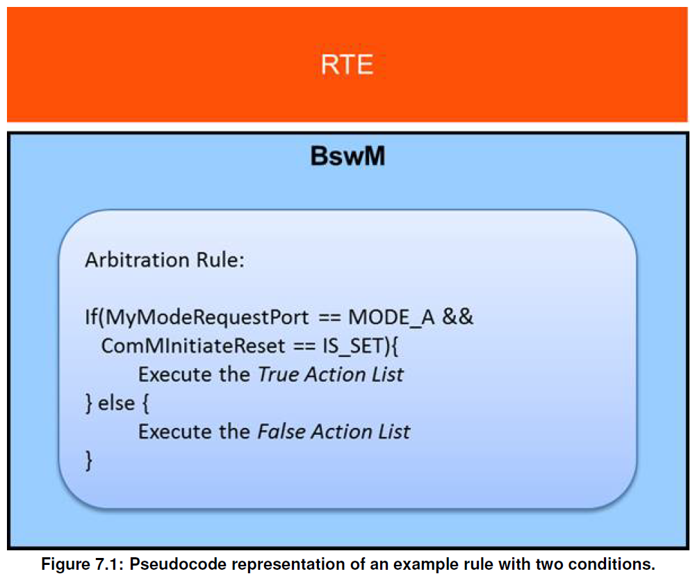
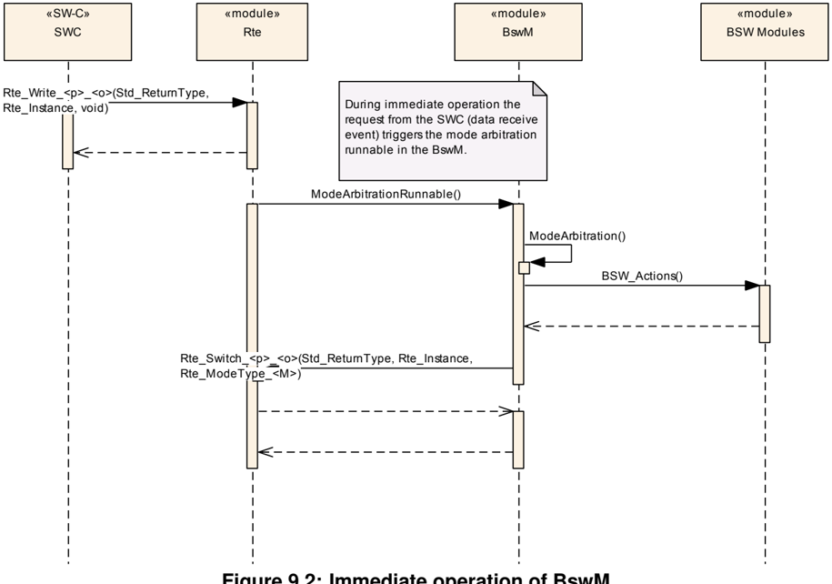
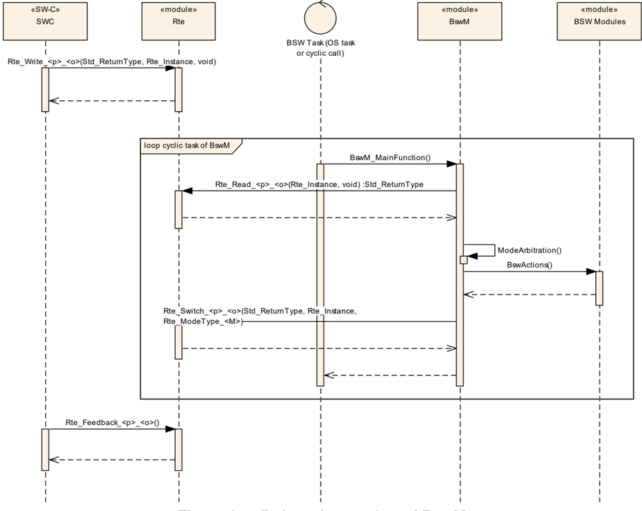
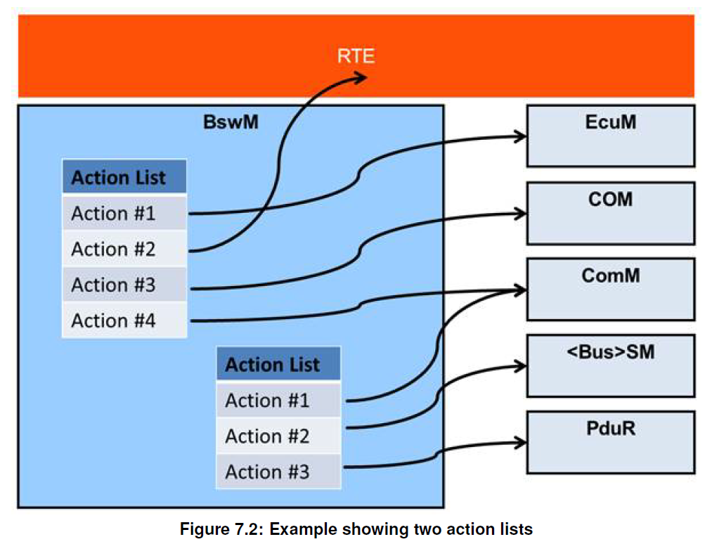
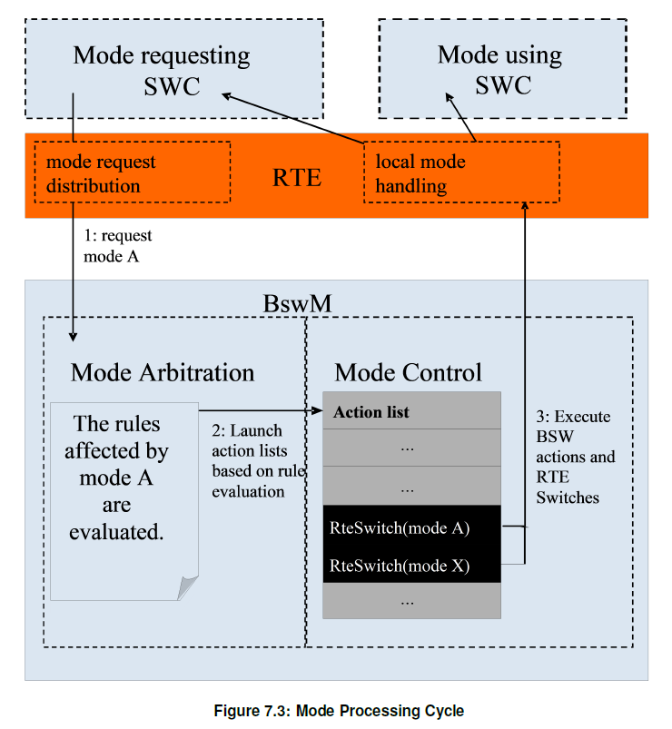
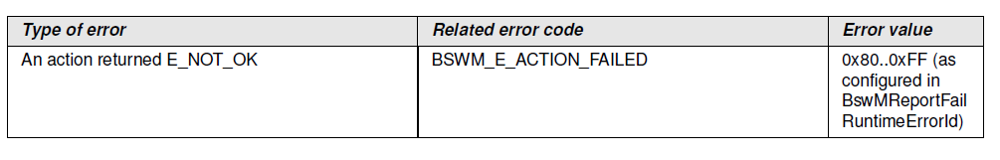
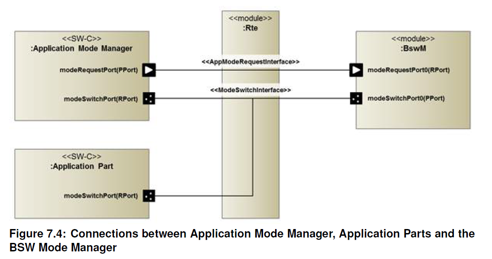
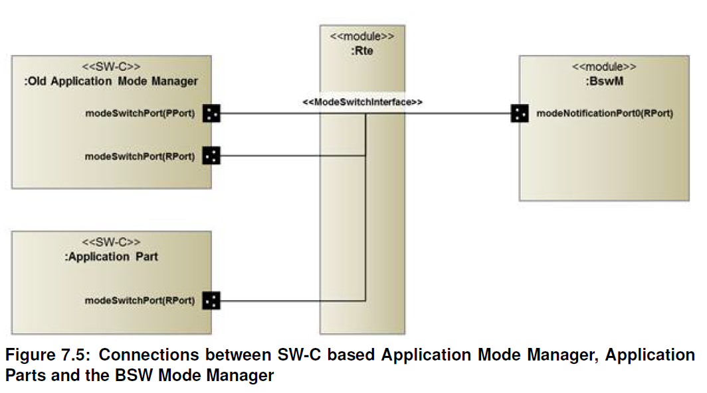
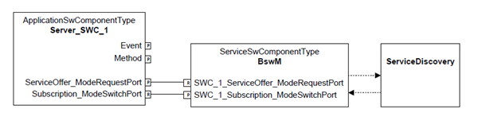
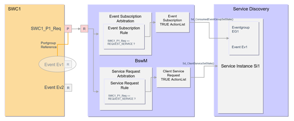

## 1. 简介和功能概述

本文档介绍了**AUTOSAR**基础软件模块**BSW**模式管理器（**BswM**）的功能、API 和配置。

**BSW**模式管理器是实现驻留在**BSW**中的部分车辆模式管理和应用程序模式管理概念的模块。它的职责是根据简单的规则对来自应用层**SW-C**或其他BSW模块的模式请求进行仲裁，并根据仲裁结果执行动作。

## 2. 缩略语

**BSW** 
> 基础软件（**Basic Software**）

**BswM**
> 基础软件模式管理器（**BSW Mode Manager**）

**BSWMD** 
> 基础软件模块说明（**Basic Software Module Description**）

**CDD** 
> 复杂驱动程序（**Complex Driver**）

**Dem** 
> 诊断事件管理器（**Diagnostic Event Manager**）

**Det** 
> 默认错误跟踪器（**Default Error Tracer**）

**ECU** 
> 电子控制单元（**Electronic Control Unit**）

**RTE**
> 运行时环境（**Real Time Environment**）

**SWC / SW-C**
> 软件组件（**Software Component**）

**SWCD**
> 软件组件说明（**Software Component Description**）

## 3. 相关文档

### 3.1. 输入文件及相关标准和规范

<a id="ref-1"></a>[1] General Specification of Basic Software Modules
> AUTOSAR_CP_SWS_BSWGeneral

<a id="ref-2"></a>[2] Guide to Mode Management
> AUTOSAR_CP_EXP_ModeManagementGuide

<a id="ref-3"></a>[3] General Requirements on Basic Software Modules
> AUTOSAR_CP_SRS_BSWGeneral

<a id="ref-4"></a>[4] Requirements on Mode Management
> AUTOSAR_CP_SRS_ModeManagement

<a id="ref-5"></a>[5] Specification of RTE Software
> AUTOSAR_CP_SWS_RTE

<a id="ref-6"></a>[6] Software Component Template
> AUTOSAR_CP_TPS_SoftwareComponentTemplate

### 3.2. 相关规范

因为AUTOSAR提供了基础软件模块的通用规范（参见相关文档[\[1\]](#ref-1)），它也适用于**BSW**模式管理器。所以文档[\[1\]](#ref-1)应被视为**BSW**模式管理器的附加和必需规范。

有关**BSW**模式管理器的配置和使用的信息可在辅助文档中找到：模式管理指南（**Guide to Mode Management**）参见相关文档[\[2\]](#ref-2)。

## 4. 约束和假设

### 4.1. 限制

在一个分区（**Partition**）内最多可以使用一个**BSW**模式管理器实例。

### 4.2. 汽车域的适用性

**BSW**模式管理器适用于所有汽车域。

## 5. 对其他模块的依赖

**BSW**模式管理器具有与**AUTOSAR**体系结构中的许多**BSW**模块的接口。然而，这些接口中的大多数都是可选的，并且根据每个**ECU**的需要使用。

本章中列出的依赖项旨在概述**BswM**和其他模块之间的一些可能的交互。此处列出的交互和模块不应被视为所有可能性的详尽列表。

### 5.1. RTE

**BswM**通过**RTE**接收来自**SW-C**的模式请求。模式切换通知也通过**RTE**传播到**SW-C**。

### 5.2. EcuM 灵活配置（EcuM Flex）

**EcuM Flex**可以向**BswM**指示其唤醒源的状态。当使用**ECU**模式处理时，**BswM**可以设置**EcuM Flex**的状态，并根据**RUN**请求协议接收某些模式的状态。

### 5.3. ComM

来自**ComM**的模式切换指示（**Mode Switch Indications**）经由**BswM**进一步传播到**SW-C**。

**BswM**可以通过**ComMUsers**向**ComM**请求通信模式。

### 5.4. COM

**COM**中I-PDU组（**I-PDU Group**）的处理由**BswM**执行。作为I-PDU组启动/停止的一部分，**BswM**可以将包含的信号值重置为其相应的初始化值。

同时**BswM**处理**COM**中信号截止期限监视（**deadline monitoring**）的启用和禁用。**BswM**也可以触发**I-PDU**的传输。

### 5.5. PduR

**BswM**可以启用和禁用**PDU Router**的**I-PDU**路由组的路由功能。

### 5.6. CanSM

来自**CanSM**的模式切换指示经由**BswM**进一步传播到**SW-C**。

### 5.7. LinSM

**BswM**协调**LinSM**中LIN调度表（**LIN Schedule Tables**）的切换，和**COM**中相应I-PDU组的启动和停止。

来自**LinSM**的模式切换指示经由**BswM**进一步传播到**SW-C**。

### 5.8. LinTP

LIN传输协议（**LIN Transport Protocol**）作为**LinIf**一部分的，会向**BswM**请求模式，以确保在**LinTp**操作期间，正确的LIN调度表（**LIN Schedule Table**）处于活动状态。

### 5.9. FrSM

来自**FrSM**的模式切换指示经由**BswM**进一步传播到**SW-C**。

**FlexRay**单槽模式（**Single Slot Mode**）的使用，由**BswM**的请求，**FrSM**控制。FlexRay软件栈的发送能力可以由**BswM**通过**FrSM**调用**FrSM_SetEcuPassive API**来控制。

### 5.10. EthSM

来自**EthSM**的模式切换指示经由**BswM**进一步传播到**SW-C**。

### 5.11. DCM

**DCM**模块会根据所接收到的诊断请求，向**BswM**执行相应的模式请求。

示例：**DCM**可以发送禁止正常通信（**Disable Normal Communication**）请求。在此模式下，**BswM**将关闭相应的**I-PDU**组和**NM PDU**。

### 5.12. J1939Dcm

**J1939Dcm**会向**BswM**报告通信状态变化，以便进一步把状态传播到**SW-C**。**BswM**可以通过**J1939Dcm_SetState**改变**J1939Dcm**的状态。

### 5.13. J1939Nm

**J1939Nm**可以通过[**BswM_J1939Nm_StateChangeNotification**](#7318-bswm_j1939nm_statechangenotification)提供状态指示（**state indication**）。

### 5.14. J1939Rm

**BswM**通过**J1939Rm_SetState**可以改变**J1939Rm**的状态。

### 5.15. NM 接口（NM Interface）

**BswM**将使用**Nm_EnableCommunication**和**Nm_DisableCommunication**来控制基于当前模式的**NM**通信。

示例：在禁用正常通信（**Disable Normal Communication**）模式下，**BswM**需要禁止相应网络管理通道上的网络管理通信。

**Nm**模块可以使用[**BswM_Nm_CarWakeUpIndication**](#7322-bswm_nm_carwakeupindication)来指示整车被唤醒。

### 5.16. NvM

**NvM**模块通过注册为NvM回调的集成代码（**integration code**）向**BswM**报告NvM数据块的状态。**BswM**具有使**NvM**在启动和关机期间读取和写入所有数据块的动作。

### 5.17. OS

**BswM**所需的操作系统功能是实现特定的。

### 5.18. Sd

**BswM**通过**Sd**导出的多个**API**（**several exported APIs**，示例参见章节[7.3 函数定义](#73-函数定义)）从**Sd**模块接收状态指示。这些来自**Sd**的状态指示，可以配置为**BswMModeRequestSources**。

### 5.19. 文件结构

**BswM**可以使用未在本规范中明确定义的**AUTOSAR BSW**模块中的接口。

## 6. 功能规格

**BSW**模式管理器的基本功能的操作，可以描述为两个不同的任务：

* 模式仲裁（**Mode Arbitration**）
* 模式控制（**Mode Control**）

模式仲裁部分对**SW-C**或其他**BSW**模块接收到的模式请求和模式指示进行基于规则的仲裁，从而启动模式的切换。

模式控制部分则通过执行包含其他**BSW**模块的模式切换操作的动作列表，来执行模式切换。

**BswM**需被视为一个模式管理框架模块，其中行为完全通过相关配置定义。

可能可以通过不同的方式来实现**BswM**，例如：基于配置生成完整的**BswM**，或者作为在运行时解析编码配置的规则解释器。但是AUTOSAR的标准并不打算指定**BSW**模式管理器的任何实现细节。 所以**AUTOSAR**标准文档中所有描述设计细节的任何示例都应视为解释性文本而不是需求。

### 6.1. 模式仲裁

**BswM**执行的模式仲裁简单且基于规则（**rule-based**）。用于模式仲裁的规则，可以通过**BSW**模式管理器模块的配置来指定。

因为这些规则由简单的布尔表达式组成，所以模式仲裁对运行时的影响很小。

为了知晓需执行哪些动作列表，**BswM**模块需要从先前的规则评估的模式仲裁结果检测出变化。此功能的如何完成，以及存储结果所需的内存结构如何，都是特定于实现的，在**AUTOSAR**标准文档中并不会进行描述定义。

#### 6.1.1. 仲裁规则

规则是由一组模式请求条件（**mode request conditions**）组成的逻辑表达式（**logical expression**）。

规则评估会在以下两个场景进行：

1. 当输入模式请求（**mode requests**）和模式指示（**mode indications**）改变时
2. 在**BswM**模块主函数的执行时。 
   
评估的结果（真或假）可用于决定相应模式控制动作列表（**mode control action list**）的执行。

#### 6.1.2. 模式条件和逻辑表达式

构成模式仲裁规则的逻辑表达式可以使用不同的运算符，包括：**AND**、**OR**、**XOR**、**NOT**和**NAND**。表达式中的每一项对应一个模式请求条件（**mode request condition**）。

如果模式条件（**mode condition**）关联了一个[**BswMModeRequestPort**](#9210-bswmmoderequestport)，则该条件会验证请求的模式（**requested mode**）或者指示的模式（**indicated mode**）是否**EQUAL**或者**NOT_EQUAL**于某个模式。

如果条件关联了一个[**BswMEventRequestPort**](#929-bswmeventrequestport)，则条件将验证请求端口是**SET**还是**CLEAR**了。

[**BswMEventRequestPort**](#929-bswmeventrequestport)事件请求与模式请求的不同，在于请求者不向**BswM**发送请求的模式/值，也就没有模式条件供**BswM**评估。而是**BswM**只能评估事件的接收情况。

当请求者发送/调用事件时，[**BswMEventRequestPort**](#929-bswmeventrequestport)将处于**SET**状态。**BswM**可以稍后通过执行[**BswMClearEventRequest**](#9253-bswmcleareventrequest)动作将[**BswMEventRequestPort**](#929-bswmeventrequestport)置于**CLEAR**状态。图7-1展示了具有两个条件的示例规则。规则和可用逻辑操作集被定义为**ECU**配置的一部分（在第[**9.2**](#92-容器与配置参数)章中描述）。



当**BswMConditionType**配置为**BSWM_EVENT_IS_SET**，且[**BswMModeCondition**](#925-bswmmodecondition)引用了[**BswMEventRequestPort**](#929-bswmeventrequestport)时：

* 如果[**BswMEventRequestPort**](#929-bswmeventrequestport)处于**SET**状态，则[**BswMModeCondition**](#925-bswmmodecondition)应评估为**TRUE**。
* 如果[**BswMEventRequestPort**](#929-bswmeventrequestport)处于**CLEAR**状态，则[**BswMModeCondition**](#925-bswmmodecondition)应评估为**FALSE**。

当BswMConditionType配置为**BSWM_EVENT_IS_CLEARED**，且[**BswMModeCondition**](#925-bswmmodecondition)引用了[**BswMEventRequestPort**](#929-bswmeventrequestport)时：

* 如果[**BswMEventRequestPort**](#929-bswmeventrequestport)处于**SET**状态，则[**BswMModeCondition**](#925-bswmmodecondition)应评估为**FALSE**。
* 如果[**BswMEventRequestPort**](#929-bswmeventrequestport)处于**CLEAR**状态，则[**BswMModeCondition**](#925-bswmmodecondition)应评估为**TRUE**。

当**BswM**在配置的[**BswMEventRequestPort**](#929-bswmeventrequestport)上接收到事件时，（例如：[**BswM_ComM_InitiateReset**](#735-bswm_comm_initiatereset)被**ComM**调用），[**BswMEventRequestPort**](#929-bswmeventrequestport)需被置于**SET**状态。

当在[**BswMEventRequestPort**](#929-bswmeventrequestport)上执行[**BswMClearEventRequest**](#9253-bswmcleareventrequest)动作，则[**BswMEventRequestPort**](#929-bswmeventrequestport)需被置于**CLEAR**状态。

#### 6.1.3. 模式仲裁的需求

如上所述，**BswM**接受模式请求和模式指示作为模式仲裁的输入。模式请求通常来自于应用程序**SW-C**，但也可能来自于其他**BSW**模块，例如：**DCM**。 
而模式指示总是由其他**BSW**模块发出，例如：不同的总线特定状态管理器和**EcuM**。在本文档中，通用术语模式仲裁请求（**mode arbitration
request**）即可对应于模式指示（**mode indication**），也可对应于模式请求（**mode request**）。

**BswM**需根据以下的输入，执行模式仲裁。

1. 传入的模式请求（**mode requests**）
2. 输入模式指示（**mode indications**）
3. 传入的模式切换通知（**mode switch notification**）
4. 事件请求（**event requests**）
5. 事件请求的清除（**clearing of event requests**）

**注意：**

所有模式仲裁请求（请求和指示）都是由**BswM**模块以相同的方式处理。它们是通过在[**BswMModeRequestSource**](#9214-bswmmoderequestsource)配置容器中，选择相应的模式条件类型（**mode condition type**）进行配置。

**BswM**也需支持使用所配置的规则执行模式仲裁。模式仲裁规则（**mode arbitration rules**）需支持通过模块的配置参数进行配置。

**BswM**禁止使用先前仲裁规则评估的结果作为逻辑表达式的输入。

**注意：**

禁止将规则评估的结果用作其他规则评估的输入。这主要是因为逻辑表达式可配置的输入项排除了先前规则评估的结果，从而在最大程度上满足了现有的**BswM**配置容器的结构。

作为评估**BswM**仲裁规则的结果而被调用的动作，只能在动作列表的上下文中被调用。

###### 6.1.3.1. 立即和延期操作

执行模式仲裁的处理有两种不同的方式:

1. 在模式请求/指示的上下文环境中立即执行，
2. 推迟到BswM的周期主函数中执行。

在调用者的上下文环境中执行立即（**immediate**）请求。系统集成者有责任确保动作列表（**action list**）的执行不会危及系统性能（**performance**）或一致性（**consistency**）。特别是，如果调用者正在（或可能）在中断的环境中运行（**(or may run)** in interrupt context），则有关在中断环境中使用系统函数的限制必须被考虑。

下图展示了立即操作和延迟操作之间的区别。

**立即操作：**



**延迟操作：**



模式仲裁规则可以包含立即和延迟模式仲裁请求的任意组合。

对于模式仲裁请求（**a mode arbitration request**），**BswM**模块可通过[**BswMModeRequestPort**](#9210-bswmmoderequestport)参数容器中的**BswMRequestProcessing**配置参数进行设定:

1. 当**BswM**模块需支持立即执行模式仲裁时，可将**BswMRequestProcessing**配置参数设置为**BSWM_IMMEDIATE**。
2. 当**BswM**模块需支持将模式仲裁推迟到BswM主函数执行时，可将**BswMRequestProcessing**配置参数设置为**BSWM_DEFERRED**。
   
只有使用特定的立即模式条件（**immediate mode condition**）的模式仲裁规则，才需要由**BswM**在该特定模式请求或者指示的上下文环境中进行评估。

对于事件的设置（**an event is set**)，**BswM**模块可通过[**BswMEventRequestPort**](#929-bswmeventrequestport)参数容器中的**BswMEventRequestProcessing**配置参数进行设定:

1. 当**BswM**模块需支持立即执行模式仲裁时，可将**BswMEventRequestProcessing**配置参数设置为**BSWM_IMMEDIATE**。
2. 当**BswM**模块需支持将模式仲裁推迟到BswM主函数执行时，可将**BswMEventRequestProcessing**配置参数设置为**BSWM_DEFERRED**。

使用至少一个延迟模式条件的所有规则，需在每次执行**BswM**主函数（**main function**）期间进行评估。

**BswM**需推迟在其主函数处理期间所收到的模式仲裁请求，直到主函数完成。任何此类推迟的立即请求（**IMMEDIATE request**）都应在**BswM**主函数退出之前直接被处理。任何此类推迟的请求（**DEFERRED request**）都应在下一个后续的**BswM**主函数中被处理。

**BswM**需推迟在处理**IMMEDIATE**请求期间收到的模式仲裁请求，直到此请求处理完成。任何此类推迟的立即请求（**IMMEDIATE request**）应在处理原始立即请求（**original IMMEDIATE request**）之后直接被处理。任何此类推迟的延迟请求（**DEFERRED request**）都应在下一个后续的**BswM**主函数中被处理。

**BswM**实现可以选择使用保护机制（**protection mechanisms**），例如：独占区（**Exclusive Area**），以保证动作的执行或者**BswM**主函数中的执行不会被任何其他任务（**any other task**，例如一个更高优先级的任务）中断。

**端口更新的术语说明：**

任何模式请求端口都有关联的值和状态。更新一个端口意味着改变它的值和状态。

**BswM**需在仲裁实际发生之前直接更新**IMMEDIATE**模式请求端口的值，而不是在模式请求端口被触发的时候。而当模式请求端口被触发时，**BswM**需更新**DEFERRED**模式请求端口的值。

#### 6.1.4. 初始化后的仲裁行为

**BswM**初始化后的模式仲裁行为，由配置容器[**BswMModeInitValue**](#9211-bswmmodeinitvalue)控制。该参数可以为配置中的每个[**BswMModeRequestPort**](#9210-bswmmoderequestport)进行单次的配置。

如果容器[**BswMModeInitValue**](#9211-bswmmodeinitvalue)不存在或者**ModeRequest**尚无初始值，则**BswM**应将相应的模式条件视为未定义，直到相应的模式仲裁请求第一次更新后，才将其用于模式仲裁。

**BswM**需仅对在其逻辑表达式中不包含任何未定义模式条件的规则进行仲裁。

每个[**BswMModeRequestPort**](#9210-bswmmoderequestport)初始化后的初始值可以由配置容器[**BswMModeInitValue**](#9211-bswmmodeinitvalue)控制。

在定义[**BswMModeInitValue**](#9211-bswmmodeinitvalue)的情况下，**BswM**应在**BswM**被初始化时，使用**BswMBswModeInitValue**或者[**BswMCompuScaleModeValue**](#9212-bswmcompuscalemodevalue)的值来初始化相应的[**BswMModeRequestSource**](#9214-bswmmoderequestsource)。对于单个的[**BswMModeInitValue**](#9211-bswmmodeinitvalue)，**BswM**需拒绝同时包含**BswMBswModeInitValue**和[**BswMCompuScaleModeValue**](#9212-bswmcompuscalemodevalue)的配置。该初始化值将用于仲裁规则，直到相应的模式仲裁请求已被更新，例如：每次调用[**BswM_RequestMode**](#7326-bswm_requestmode)都需更新**GenericRequest**模式。

**注意：**

**Rte**和**SchM**的模式总是有一个初始值。

在**BswM**初始化时，所有**BswMEventRequestPorts**都需被初始化为**CLEAR**的状态。

### 6.2. 模式控制

**BswM**的模式控制部分，会根据模式仲裁的结果执行所有必需的操作。这是通过使用动作列表（**Action Lists**）来完成的。动作列表是**BswM**在由模式仲裁触发时，所执行操作的有序列表。

动作列表中的动作（**action**）可以是以下的三种类型：

1. 调用其他**BSW**模块或者**RTE**模块。 预定义的动作可参考章节[6.2.4-可用动作](#624-可用动作)中所罗列的。
2. 链接要包含在执行中的其他动作列表。
3. 模式仲裁规则（**Mode arbitration rules**）。这些规则将在执行相应的动作列表时被评估。通过这种方式就获得了规则的层次结构（**a hierarchy of rules**）。

因为**BswM**不需要存储或响应对其所执行动作中任何**BSW**模块特定的返回值，因此，**BSW**中不同的状态管理器（**different state managers**）将它们当前的状态指示给**BswM**，用作模式仲裁的输入。

但是，如果错误（**E_NOT_OK**）被返回，**BswM**可以发出**DET**运行时错误，和/或取消当前执行的动作列表。



如上图7-2所示，**BswM**可能包含多个动作列表（**Action List**），一个动作列表（**Action List**）可以容纳多个动作（**Action**）。为了减少动作列表的总数，应可以级联动作列表（**it shall be possible to cascade them**）。

动作列表的元素可以是:
1. 一个具体动作（**a concrete action**）
2. 一个对另一个动作列表的引用（**a reference to another action list**）
3. 一个模式仲裁需要执行的规则（**a rule to be executed by the mode arbitration**）。
   
所以需要有一个标志连接到每个动作列表条目，说明它的类型：动作（**action**）/ 参考（**reference**）/ 规则（**rule**）。包含具体动作的列表与包含引用的列表、甚至混合列表的列表，它们的激活方式之间应没有区别（**there shall be no difference**）。

#### 6.2.1. 模式处理循环

下图7-3显示了模式请求的最小处理循环：

1. 模式请求者**SW-C**通过其发送端口（**Sender Port**）请求模式A。**RTE**分发请求，**BswM**通过接收端口接收（**Receiver Port**）到此请求。
2. **BswM**根据接收到的模式仲裁请求或在执行BswM主函数期间周期地评估这些规则。
3. 根据所选择的执行方式，执行相应的动作列表。具体细节可参见[章节6.2.3触发和条件动作列表](#623-触发和条件动作列表)。
4. 在执行动作列表时，**BswM**可以发出一个或多个对**RTE Switch API**[\[5\]](#ref-5)的调用，来通知受影响的**SW-C**仲裁结果。任何**SW-C**，尤其是模式请求者都可以注册以接收模式切换指示。

**注意：**

模式请求者只能从本地**BswM**接收模式切换指示。对于源自另一个**ECU**、但由本地代理**SW-C**（**local proxy SW-C**）代为发出的请求也同样适用。



#### 6.2.2. 模式控制需求

**BswM**应通过作为模式仲裁中规则评估结果而执行的动作列表来执行模式控制。

对于模式仲裁的每条规则，**BswM**应能够根据规则评估为**True**或者**False**执行不同的动作列表。

一个动作列表中可以包含一组**BswM**需顺序执行的动作，也可以包含了指向**BswM**应执行的其他动作列表的链接。

同时一个动作列表也可以包含指向**BswM**需在当前动作列表执行范围内所需评估的模式仲裁规则的链接。如果指定的动作列表中包含了模式仲裁规则，则由该评估产生的任何动作列表的执行都应由**BswM**在继续执行原动作列表之前执行。

如果使用了级联动作列表（**cascaded action lists**），即包含对其他规则或动作列表的引用，则动作列表结构可以包含多达七个层级。

**注意：**

此限制的目的是使**BswM**实现和生成工具的测试成为可能。此限制可以由生成工具进行检查。

与在模式仲裁请求上下文环境中评估的规则相关联的动作列表，需在模式仲裁触发时由**BswM**立即执行，而不是推迟到**BswM**主函数中执行。这样可以达到必要时对模式请求进行非常短的延迟（**short latencies**）。

一个顶级规则（**top-level rule**）是指并不嵌套在动作列表中的规则。一个顶级动作列表（**top-level action list**）是一种由顶级规则直接执行的动作列表，它不嵌套在另一个动作列表中。 

在模式仲裁期间，如果一个顶级动作列表被多个规则触发，这会导致在模式控制期间只有单个触发执行了该动作列表的。它仅适用于顶级动作列表，并不适用于嵌套规则和嵌套动作列表，原因在于它们在父动作列表中的顺序是由用户自定义的，并且应当被遵循（**and should be respected**）。

在模式控制期间，如果要执行多个顶级动作列表，则执行顺序应按照**BswMActionListPriority**的设置从最高值执行到最低值（**start with the highest BswMActionListPriority and continue to the lowest**）。在**BswMActionListPriority**相同的情况下，执行顺序是任意的。对于不是顶级动作列表的动作列表，需忽略**BswMActionListPriority**。

如果没有**BswMActionListPriority**的动作列表应被解释为**BswMActionListPriority**等于**0**。

**BswM**需拒绝[**BswMActionList**](#9286-bswmactionlist)包含具有相同值**BswMActionListItemIndexes**的**BswMActionListItems**的配置。

在执行[**BswMActionList**](#9286-bswmactionlist)时，**BswM**应从具有最低**BswMActionListItemIndex**值的[**BswMActionListItem**](#9287-bswmactionlistitem)开始。随后的**BswMActionListItems**应按其 **BswMActionListItemIndex**的递增顺序执行。

在动作列表中，配置的**BswMActionListItemIndexes**不一定需要是连续的或从零开始的。**BswM**将开始执行具有最低索引的动作列表项，并继续执行具有最高索引的动作列表项。如果索引有间隙，即索引不连续的情况，这些间隙将被简单地忽略。因为动作列表是有序列表，所以不允许在动作列表的上下文中配置相同数值的**BswMActionListItemIndexes**。

#### 6.2.3. 触发和条件动作列表

基于规则评估，动作列表有两种方式被执行：

1. **BSWM_CONDITION**：条件执行，即每次评估规则时被执行。
2. **BSWM_TRIGGER**：触发执行，即每次评估结果发生变化时才执行。 

可以使用[**BswMActionList**](#9286-bswmactionlist)配置容器中的**BswMActionListExecution**配置参数，对动作列表的执行方式的进行设定。

但是对于不被规则直接引用的嵌套动作列表，**BswMActionListExecution**参数（如：**BSWM_CONDITION**或者**BSWM_TRIGGER**）是没有任何意义，并且不会影响嵌套动作列表的执行方式。每当其父动作列表被执行时，不被规则直接引用的嵌套动作列表也会被相应地执行。

如果为触发执行配置了一个**True**的动作列表，则**BswM**仅在相应规则的评估从**False**变为**True**时才会执行此动作列表。如果为触发执行配置了一个**False**的动作列表，则**BswM**仅在相应规则的评估从**True**变为**False**时才会执行此动作列表。

如果为条件执行配置了一个**True**的动作列表，则**BswM**应在每次将相应规则评估为**True**时执行此动作列表。如果为条件执行配置了**False**的动作列表，则**BswM**应在每次将相应规则评估为**False**时执行此动作列表。

如果某个动作返回**E_NOT_OK**，并且相应的**BswMAbortOnFail**配置参数设置为**True**，则**BswM**需中止此动作列表的继续执行。

#### 6.2.4. 可用动作

**BswM**包含了部分预定义的动作集合，这些动作可以在动作列表中被使用。这样做的原因是为了简化**ECU**配置和**BswM**配置代码的生成。

**BswM**需要能够执行由配置容器[**BswMAvailableActions**](#9252-bswmavailableactions)定义的预定义动作。同时**BswM**应能够调用**AUTOSAR BSW**中的任何函数，即使它不存在[**BswMAvailableActions**](#9252-bswmavailableactions)配置定义的标准化动作中。

* [BswMClearEventRequest](#9253-bswmcleareventrequest)
* [BswMComMAllowCom](#9254-bswmcommallowcom)
* [BswMComMModeLimitation](#9255-bswmcommmodelimitation)
* [BswMComMModeSwitch](#9256-bswmcommmodeswitch)
* [BswMCoreHaltMode](#9257-bswmcorehaltmode)
* [BswMDeadlineMonitoringControl](#9258-bswmdeadlinemonitoringcontrol)
* [BswMEcuMDriverInitListBswM](#9259-bswmecumdriverinitlistbswm)
* [BswMEcuMGoDownHaltPoll](#9260-bswmecumgodownhaltpoll)
* [BswMEcuMSelectShutdownTarget](#9261-bswmecumselectshutdowntarget)
* [BswMEcuMStateSwitch](#9262-bswmecumstateswitch)
* [BswMEthIfStartAllPorts](#9263-bswmethifstartallports)
* [BswMEthIfSwitchPortGroupRequestMode](#9264-bswmethifswitchportgrouprequestmode)
* [BswMFrSMAllSlots](#9265-bswmfrsmallslots)
* BswMIdsMBlockStateChangeRequest
* [BswMJ1939DcmStateSwitch](#9266-bswmj1939dcmstateswitch)
* [BswMJ1939RmStateSwitch](#9267-bswmj1939rmstateswitch)
* [BswMLinScheduleSwitch](#9268-bswmlinscheduleswitch)
* [BswMNMControl](#9269-bswmnmcontrol)
* [BswMPduGroupSwitch](#9270-bswmpdugroupswitch)
* [BswMPduRouterControl](#9271-bswmpduroutercontrol)
* [BswMRteModeRequest](#9272-bswmrtemoderequest)
* [BswMRteStart](#9273-bswmrtestart)
* [BswMRteStop](#9274-bswmrtestop)
* [BswMRteSwitch](#9275-bswmrteswitch)
* [BswMSchMSwitch](#9276-bswmschmswitch)
* [BswMSdClientServiceModeRequest](#9277-bswmsdclientservicemoderequest)
* [BswMSdConsumedEventGroupModeRequest](#9278-bswmsdconsumedeventgroupmoderequest)
* [BswMSdServerServiceModeRequest](#9279-bswmsdserverservicemoderequest)
* [BswMSdServiceGroupSwitch](#9280-bswmsdservicegroupswitch)
* [BswMSetFirewallState](#9281-bswmsetfirewallstate)
* [BswMSwitchIPduMode](#9282-bswmswitchipdumode)
* [BswMTimerControl](#9283-bswmtimercontrol)
* [BswMTriggerIPduSend](#9284-bswmtriggeripdusend)
* [BswMUserCallout](#9285-bswmusercallout)

BswM也能够调用用户定义的函数（**user defined functions**），同时用户定义函数的参数及其数值需在**ECU**配置时定义，通过[**BswMUserCallout**](#9285-bswmusercallout)配置容器来定义。

#### 6.2.5. 初始化后模式控制的行为

**BswM**初始化后，模式控制的行为通过[**BswMRule**](#9248-bswmrule)配置容器内的**BswMRuleInitState**配置参数进行配置。它定义了在初始化后第一次评估规则后，决定执行哪个动作列表时，需要使用的先前评估结果（**previous evaluation result**）。在[**BswMActionList**](#9286-bswmactionlist)配置容器内的**BswMActionListExecution**配置参数也会影响初始化后的动作列表执行。

在初始化后第一次评估规则时，**BswM**需根据表7-1中的规定进行操作。

表7.1：**BswM**初始化后首次评估规则时的行为

| BswMRuleInitState | BswMActionListExecution | 规则评估为 true | 规则评估为 false |
|---|---|---|---|
| BSWM_UNDEFINED | BSWM_TRIGGER | 执行“true”操作列表 | 执行“false”操作列表 |
| BSWM_TRUE | BSWM_TRIGGER | 不执行任何操作 | 执行“false”操作列表 |
| BSWM_FALSE | BSWM_TRIGGER | 执行“true”操作列表 | 不执行任何操作 |
| BSWM_UNDEFINED | BSWM_CONDITION | 执行“true”操作列表 | 执行“false”操作列表 |
| BSWM_TRUE | BSWM_CONDITION | 执行“true”操作列表 | 执行“false”操作列表 |
| BSWM_FALSE | BSWM_CONDITION | 执行“true”操作列表 | 执行“false”操作列表 |

**注意：**

表格中的**true**和**false**的动作列表对于每条规则都是可选的。

### 6.3. 等待功能

有时需要延迟某个特定的操作（**specific actions**）或等待进一步的模式控制（**mode controls**）。出于这个原因，**BswM**添加了定时器处理（**Timer handling**）。

一个定时器总是由两部分构成：

1. 一个作为[**BswMModeRequestSource**](#9214-bswmmoderequestsource)的[**BswMTimer**](#9247-bswmtimer)。
2. 一个控制此[**BswMTimer**](#9247-bswmtimer)的相应动作（可参见[**BswMTimerControl**](#9283-bswmtimercontrol)配置参数）

[**BswMTimer**](#9247-bswmtimer)的值例如（**e.g.**）为：**BSWM_TIMER_STOPPED**、**BSWM_TIMER_STARTED**、**BSWM_TIMER_EXPIRED**。
   
定时器的操作只能在[**BswMTimerControl**](#9283-bswmtimercontrol)动作的上下文环境中控制。同时[**BswMTimer**](#9247-bswmtimer)的值可以被**BswM**中所配置的其他规则进行评估，并以此触发动作列表。没有外部接口（**external interface**）来控制或者操作此定时器。

每个[**BswMTimer**](#9247-bswmtimer)在初始化期间，都是停止状态，也就是说[**BswMTimer**](#9247-bswmtimer)的初始值需为**BSWM_TIMER_STOPPED**。

**BSWM_TIMER_START**的**BswMTimerAction**动作需使用相应配置在**BswMTimerValue**参数中的定时器值，重新加载引用的[**BswMTimer**](#9247-bswmtimer)（通过：**BswMTimerRef**），并将定时器的模式更改为**BSWM_TIMER_STARTED**。

注意：定时器只能通过 BswMTimerAction 动作重新加载（不可能自动重新加载）。

每个[**BswMTimer**](#9247-bswmtimer)处于**BSWM_TIMER_STARTED**模式时，需在[**BswM_MainFunction**](#751-bswm_mainfunction)中递减定时器的计数（需按[**BswM_MainFunction**](#751-bswm_mainfunction)的周期时间）。

**注意：**

[**BswMTimer**](#9247-bswmtimer)分辨率（**resolution**）需是[**BswM_MainFunction**](#751-bswm_mainfunction)周期时间的倍数。此外[**BswMTimer**](#9247-bswmtimer)的准确性取决于[**BswM_MainFunction**](#751-bswm_mainfunction)的准确性。

如果处于**BSWM_TIMER_STARTED**模式的[**BswMTimer**](#9247-bswmtimer)时间到期时，则[**BswMTimer**](#9247-bswmtimer)模式需更改为**BSWM_TIMER_EXPIRED**，接着[**BswMTimer**](#9247-bswmtimer)模式需在同一个[**BswM_MainFunction**](#751-bswm_mainfunction)的周期中进行仲裁。

**BSWM_TIMER_STOP**的**BswMTimerAction**动作需立即停止引用的[**BswMTimer**](#9247-bswmtimer)（通过：**BswMTimerRef**）并将其模式更改为**BSWM_TIMER_STOPPED**。

与[**BswMTimer**](#9247-bswmtimer)相关的**BswMRequestProcessing**（例如：**IMMEDIATE**、**DEFERRED**）配置会被**BswM**忽略。**BswM**会始终将[**BswMTimer**](#9247-bswmtimer)的处理视为**DEFERRED**，并在**BswM**主函数期间进行仲裁。

注意：
在**BSWM_TIMER_EXPIRED**模式下的[**BswMTimer**](#9247-bswmtimer)不会被**BswM**自动设置为**BSWM_TIMER_STOPPED**。为了将[**BswMTimer**](#9247-bswmtimer)从**BSWM_TIMER_EXPIRED**转换到另一种模式，用户需要配置一个动作（**Action**）。如果没有配置任何动作使[**BswMTimer**](#9247-bswmtimer)退出**BSWM_TIMER_EXPIRED**模式，那么[**BswMTimer**](#9247-bswmtimer)将在接下来的**BswM**主函数周期中继续被仲裁为**BSWM_TIMER_EXPIRED**。

### 6.4. 多分区支持

对于多个**BswM**实例的情况，每个**BswM**实例将根据自己的配置集生成自己单独的服务组件描述。集成商需要将这些单独的服务组件分配给相应的分区。

**BswM**存在于每个分区中，并具有特定于此分区的配置，即每个分区的[**BswMConfig**](#922-bswmconfig)都是单独实例的。包含的动作列表只在本地分区执行。

### 6.5. 错误分类

《基础软件模块通用规范》（**General Specification of Basic Software Modules**）的第7.2章"错误处理"详细描述了基础软件的错误处理。其中尤其定义了一个由五种错误类型组成的分类方案，这些错误类型可能出现在**BSW**模块中。

基于此，以下各小节规定了**BswM**模块中相应的特定错误。

#### 6.5.1. 开发错误

**BswM**模块中开发错误（**development errors**）的定义如下表所示：

| 错误类型 | 相关错误代码 | 错误值 |
| --- | --- | --- |
| 在初始化之前调用了服务 | **BSWM_E_UNINIT** | 0x01 |
| 传递了空指针作为参数 | **BSWM_E_NULL_POINTER** | 0x02 |
| 参数无效（未具体分类） | **BSWM_E_PARAM_INVALID** | 0x03 |
| 请求用户超出范围 | **BSWM_E_REQ_USER_OUT_OF_RANGE** | 0x04 |
| 请求的模式超出范围 | **BSWM_E_REQ_MODE_OUT_OF_RANGE** | 0x05 |
| 提供的配置不一致 | **BSWM_E_PARAM_CONFIG** | 0x06 |
| 参数指针无效 | **BSWM_E_PARAM_POINTER** | 0x07 |
| 无效的配置集选择 | **BSWM_E_INIT_FAILED** | 0x08 |

#### 6.5.2. 运行时错误



| 错误类型 | 相关错误代码 | 错误值 |
| --- | --- | --- |
| 某个动作返回**E_NOT_OK** | **BSWM_E_ACTION_FAILED** | 0x80..0xFF（由**BswMReportFailRuntimeErrorId**配置） |

当[**BswMActionListItem**](#9287-bswmactionlistitem)配置了**BswMReportFailRuntimeErrorId**，如果操作返回**E_NOT_OK**，则**BswM**需向**Det**报告**BSWM_E_ACTION_FAILED**运行时错误。**BSWM_E_ACTION_FAILED**运行时错误中报告的**ErrorId**由**BswMReportFailRuntimeErrorId**中配置的值给出。

由于动作的调用上下文取决于配置（例如：**DEFERRED**或**IMMEDIATE**），**BSWM_E_ACTION_FAILED**运行时错误中报告的**ApiId**未在本规范中定义，可能是特定于实现的。

**BSWM_E_ACTION_FAILED**运行时错误代表了一个**ErrorId**取值范围。该取值范围仅限于运行时错误类型表中给出的值。

**BswM**需拒绝**BswMReportFailRuntimeErrorId**不在运行时错误类型表中为**BSWM_E_ACTION_FAILED**给出的取值范围内的配置。

#### 6.5.3. 瞬态故障

无瞬态故障（**transient faults**）。

#### 6.5.4. 产品错误

无产品错误（**production errors**）。

#### 6.5.5. 扩展产品错误

无扩展产品错误（**extended production errors**）。

### 6.6. BswM接口和端口

本章节描述了BswM提供的**AUTOSAR**接口（**Interface**）和端口（**Port**）。

请注意，**RTE**两侧的端口都是必需的：

1. **BswM**服务的**SW-C**描述将定义**RTE**下方的端口。
2. 每个使用该服务的AUTOSAR的**SW-C**必须在其自己的**SW-C**描述中包含它的服务端口。 
   
这些端口需使用相同的接口，并且必须连接到BswM的端口上，以便**RTE**可以生成适当的**ID**和所需的符号。

当**SW-C**向**BswM**模块请求模式，**SW-C**需提供一个发送端口（**Sender Port**），此端口需定义为一个特殊的**SenderReceiverInterface**模式请求接口（**Mode Request Interface**），接口定义必须包含一个数据元素（**data element**）。 **BswM**模块中对应的接收器端口（**Receiver Port**）在章节[6.6.1](#661-模式请求端口)中描述。数据元素的类型需与对应模式的模式声明组（**Mode Declaration Group**）中的模式声明（**Mode Declarations**）类型相同，具有相同的数值。因为数据元素的**ImplementationDataType**需映射到**Mode Declaration Group**。

因为**SW-C**也可能需要知道**BswM**的仲裁结果，所以请求模式的**SW-C**也可以是一个模式用户（**a mode user**）。此类**SW-C**有一个模式切换端口（**Mode Switch Port**），模式切换端口被定义为一个模式切换接口（**Mode Switch Interface**）的**R-Port**，模式切换接口（**Mode Switch Interface**）也包含一个数据元素（**data element**）。这个数据元素的类型就是模式声明组（**Mode Declaration Group**）本身。

此外其他即使不请求模式但依赖于模式的**SW-C**也可以包含这样的模式切换端口。有关模式用户接口的详细说明，请参见章节[6.6.3 模式切换的通知](#663-模式切换的通知) 。

**注意：**

如果**BSW**模式管理器需要知道除了自身决策中请求的模式之外的当前模式，**BSW**模式管理器也需要一个模式切换的**R-Port**。

当**BSW**模式管理器切换相应模式时，**RTE**会发送模式通知。为此**BSW**模式管理器有一个模式切换端口的**P-Port**，**SW-C**可以连接到该端口。有关模式切换端口的详细说明，请参见章节[6.6.2 模式切换端口](#662-模式切换端口)

在请求**SW-C**的上下文环境中，定义了模式请求端口（**Mode Request Port**），包括发送方（**Sender**）和接收方（**Receiver**）。**Bsw**模式管理器的配置会参考了此端口的定义。

举例：一个**SW-C**定义了一个应用模式**AppModeType**，一个对应的**AppModeRequestType**和一个将这两种类型相互映射的**AppModeTypeMap**

```
ModeDeclarationGroup AppModeType {
    { APP_MODE_A, APP_MODE_B, APP_MODE_C }
    initialMode = APP_MODE_A;
};
```

```
ImplementationDataType AppModeRequestType {
    lowerLimit = 0;
    upperLimit = 2;
};
```

```
ModeRequestTypeMap AppModeTypeMap {
    modeGroup = AppModeType;
    implementationDataType = AppModeRequestType;
};
```

**SW-C**定义了下面的两个接口：

1. **AppModeRequestInterface**：**SW-C**作为发送者，接口为**SenderReceiverInterface**。
2. **AppModeInterface**：SW-C根据使用场景，可以是**P-Ports**和**R-Ports**，接口为**Mode Switch Interface**：

下图**7-4**显示了应用程序**SW-C**的端口如何连接到**BSW**模式管理器的服务端口。



命名为应用程序模式管理器（**Application Mode Manager**）的**SW-C**包含了两个端口：

1. 一个模式请求端口（**Mode Request Port**）的**P-Port**。
2. 一个模式切换（**Mode Switch**）的**R-Port**。（命名为**modeNotificationPort**，以区别于模式切换**P-Port**）。 

第一个模式请求端口是请求更改应用程序模式，而第二个模式切换端口是在**BswM**执行模式更改时用来接收通知。应用程序模式管理器的模式请求端口（**modeRequestPort0**）连接到相应的**BSW**模式管理器的模式请求端口。由于这是正常的发送方/接收方通信（**Sender/Receiver communication**），所以应用程序模式管理器可以连接到多个**BSW**模式管理器，即使在远程**ECU**上也是如此。

为了切换应用模式，**Bsw**模式管理器有一个模式切换端口（**modeSwitchPort_\{Name\}**），通过本地**RTE**实现。

当**RTE**执行模式切换时，它会通知所有通过模式切换**R-Ports**连接到提供端口的连接实体，包括：BSW模块（**BSW Modules**）或**SW-C**。以下示例展示了应用程序模式管理器（**Application Mode Manager**）、其他与模式相关的应用程序部分（**Application Part**）和**BSW**模式管理器自身（注意它的名称为**modeNotificationPort_\{Name\}**，但端口类型为模式切换端口）。所有这些连接也是本地的。

图7-5显示基于**SW-C**的应用程序模式管理器（在 AUTOSAR R3.1 和更早版本中使用）直接切换应用程序模式，而不向**BSW**模式管理器请求它。



它们直接将模式切换端口连接到本地**RTE**。这意味着应用程序模式需要在ECU本地，并且**BSW**模式管理器中的仲裁是不可能的。尽管如此，**BSW**模式管理器可以使用当前应用模式作为其规则的输入，因为它可以有一个模式切换**R-Port**（图中名为 **modeNotificationPort0**）用于该应用模式。

**注意：**

为了配置**BswM**，需要了解基于特定**ECU**需求的模式请求端口和需要及可用的**ECU**资源。所以**BswM**的SW-C描述（**SW-C description**）只能在**ECU**配置期间才能完成。

从现在开始，以下所有接口定义都被解释为包含在以下的**ARPackage**中:

```
ARPackage AUTOSAR_BswM/BswModuleDescription
```

**注意：**

本章节介绍的伪代码并不准确，但提供了如何定义相应模型元素的提示。

#### 6.6.1. 模式请求端口

**BSW**模式管理器必须声明一个接收器端口（**Receiver Port**），此端口接口定义在**SW-C**的上下文中定义：

```
RequirePort AppModeRequestInterface modeRequestPort_{ArbName}_{ReqName};
```

要读取当前请求的模式，**BSW**模式管理器实现必须调用：

```
Rte_Read_modeRequestPort_{ArbName}_{ReqName}_requestedMode(& <variable> );
```

#### 6.6.2. 模式切换端口

与模式请求一样，**BSW**模式管理器只引用模式切换对应的**SW-C**描述中定义的**Provide Ports**的接口。

对于上面的示例，模式切换的声明如下：

```
ProvidePort AppModeInterface modeSwitchPort_{ModConName}_{SwitchName};
```

配置参数**BswMModeSwitchInterfaceRef**引用此模式切换接口。

要切换当前活动模式，**BSW**模式管理器实现必须插入以下调用中的某一个调用到其动作列表中：

```
Rte_Switch_modeSwitchPort_{ModConName}_{SwitchName}_currentMode ( <new_mode> );
```

```
SchM_Switch_modeSwitchPort_{ModConName}_{SwitchName}_currentMode( <new_mode> );
```

#### 6.6.3. 模式切换的通知

除了模式请求之外，当前激活的模式也可以用作模式仲裁的输入。对于应用程序和车辆模式，**BSW**模式管理器需要注册为模式用户（**a mode user**）。然后它通过模式切换端口接收有关模式更改的通知。

对于上面的示例，模式通知的声明如下：

**注意：**

为了更容易区分**ModeSwitchPort**类型的**RequirePort**和**ProvidePort**，以下示例将**RequirePort**命名为模式通知端口。

```
RequirePort AppModeInterface modeNotificationPort_{ArbName}_{ModeName};
```

要读取当前活动模式，**BSW**模式管理器实现必须调用以下函数中的某一个函数：

```
Rte_Mode_modeNotificationPort_{ArbName}_{ModeName}_currentMode( &<variable> );
```

```
SchM_Mode_modeNotificationPort_{ArbName}_{ModeName}_currentMode( &<variable> );
```

如果配置了增强型**Rte_Mode**或**SchM_Mode**，则**BSW**模式管理器实现必须调用以下函数中的某一个函数：

```
Rte_Mode_modeNotificationPort_{ArbName}_{ModeName}_currentMode( &<variable>, &<previousmode>, &<nextmode> );
```

```
SchM_Mode_modeNotificationPort_{ArbName}_{ModeName}_currentMode( &<variable>, &<previosmode>, &<nextmode> );
```

#### 6.6.4. 组件类型和内部行为

**BSW**模式管理器是一个服务组件（**Service Component**），它为**ECU**本地的模式请求提供服务。**BSW**模式管理器的**ServiceComponentType**声明了上述所有端口和一些内部行为（**Internal Behavior**）。

```
ServiceComponentType BswM {
    ...
    InternalBehavior {
        ...
    };
};
```

内部行为（**Internal Behavior**）依赖于相关的模式请求端口的参数**BswMRequestProcessing**。 对于**BSWM_DEFERRED**，因为**BSWM**模式管理器在其[**BswM_MainFunction**](#751-bswm_mainfunction)中循环读取请求，所以**RTE**不会执行任何特殊操作。相比之下，对于**BSWM_IMMEDIATE**，因为**RTE**必须立即触发模式仲裁，所以**BSW**模式管理器需要注册一个触发模式仲裁的触发函数。对于上面的示例，模式请求的立即处理将需要在**BSW**模式管理器的内部行为中进行以下声明：

```
RunnableEntity ModeArbitrationRunnable {
    symbol = <mode_arbitration_function>;
    canBeInvokedConcurrently = TRUE;
};
```

```
DataReceiveEvent AppModeRequestEvent {
    port = modeRequestPort0;
    dataElement = requestedMode;
    startOnEvent = ModeArbitrationRunnable;
};
```

**注意：**

如要处理来自其他**ECU**的模式请求，需要另一种服务组件（**service component**）。在**VFB**级别上，它看起来像一个全局服务组件，但实际上它被实例化为驻留在每个**ECU**的**RTE**之上的一个服务组件。为了支持这一点，**SW-C**模板提供了**ServiceProxyComponentType**而不是普通的**ServiceComponentType**。

因为模式管理服务代理组件的规范是用户特定的，所以没有在本文档中进行描述。

### 6.7. 以太网交换机端口组交换

当前版本的**SWS BswM**支持以太网交换机端口组交换。基于当前请求的**PNC**，**BswM**将**PNC**请求映射到所配置的**EthIfSwitchPortGroup**并调用**EthIf_SwitchPortGroupRequestMode**。如果积累的链路状态已更改，则由**EthIf**模块指示**BswM**模块。积累的链接状态也可用于通知应用程序。这可用于覆盖 **EthIfSwitch**端口组的请求和当前积累的链路状态相互矛盾并且需要启动错误处理的错误场景。

**AUTOSAR_EXP_ModemanagementGuide**文档包含了有关以太网交换机端口组切换的**BswM**配置指南。

### 6.8. 服务发现控制

#### 6.8.1. 一般要求

除了请求和查询模式的通用方式之外，**BswM**还提供了一个标准化的接口，供应用层**SW-C**控制服务发现（**Service Discovery**）。



基于**SW-C**描述和**ECUC**的输入，应按照后续各章节的描述生成配置。

生成的输入是具有**ServerServiceOffer**、**ServerEventSubscriptionStatus**、**ClientEventSubscription**和**ClientEventSubscriptionStatus**的**RoleBasedDataAssignment**的端口，以及这些端口对应的**RepresentedPortGroups**。

有关如何对必要的端口及其关系进行建模的详细信息，请参阅软件组件模板（**Software Component Template**，参见相关文档[\[6\]](#ref-6)）中第13.6.5节"面向服务的用例"（**Service Oriented Use Cases**）。

配置工具需要完成以下步骤：

1. 分析**SW-C**描述，找出受影响的端口
2. 分析**ECUC**，推导出服务发现中相关的实体
3. 创建规则（**Rule**）和动作列表（**ActionList**），以实现由**BswM**提供的期望行为
4. 为来自服务发现模块的通知创建**BswMModeRequestSources**
5. 创建作为规则输入所需的**S/R**端口的**BswM**一侧
6. 创建用于向**SW-C**进行指示的所提供的模式切换（**ModeSwitch**）端口的**BswM**一侧
7. 基于明确定义的命名规则，在**BswM**、服务**SW-C**与应用**SW-C**之间连接端口

命名模式（**naming patterns**）用于简化**BswM**与**SW-C**之间端口的映射。这些命名模式的设计使得可以对（部分）名称进行匹配。通过尽可能地使用**SW-C**端口的名称，实现了接口的解耦，使**SW-C**无需感知底层的通信细节。

#### 6.8.2. 客户端服务/事件订阅请求

实现客户端功能的软件组件（**SW-C**）作为模式请求者（**mode requester**），暴露一个由**SenderReceiverInterface**类型化的**PPortPrototype**。通过这种方式，软件组件可以向**BswM**发送模式请求，以订阅（**subscribe**）和停止订阅（**stop subscribe**）特定的事件和方法。



图7-7展示了在使用（**SomeIP**）服务发现的情况下，构成事件订阅请求的实体链。其中灰色元素为配置的元素。通过评估引用了应用事件（此处的**Ev1**）的端口组引用，可以推导出对应的请求端口（**SWC_P1_Req**）。应用事件与对应**SD**事件（此处的**Eventgroup 1**中的**Ev1**）之间的关系通过**ECU**配置提供。

对于受根据**TPS_SWCT_03504**（软件组件作为客户端订阅事件和方法）的请求端口影响的每个服务实例的事件（组），应创建一个**BswM**规则（[**BswMRule**](#9248-bswmrule)）。该规则的短名称应为该服务实例目标事件（组）的短名称，并加上前缀**ESR_**。

**注意：** **SomeIP**服务发现仅支持事件组。因此，在使用**SomeIP**的情况下，该规则可能覆盖多个事件。

对于受根据**TPS_SWCT_03504**的请求端口影响的每个服务实例，应创建一个**BswM**规则。该规则的短名称应为该目标服务实例的短名称，并加上前缀**SRR_**。

**注意：** 服务请求规则会收集指向同一服务实例的所有请求端口。这样，只要请求了任何事件或方法，就会请求客户端服务。

客户端订阅**SenderReceiverInterface**应按照[7.7.5.1 S/R接口 ClientServiceRequest](#7751-sr接口-clientservicerequest)中定义的方式定义：其中{RuleName}为对应规则的名称，{PortName}为对应**SW-C**端口的短名称。

**注意：** {PortName}足以匹配对应的请求端口。

**注意：** 同一个接口同时用于请求事件和请求客户端服务。

对于根据**TPS_SWCT_03504**的每个请求端口，应按照[7.7.2.4 S/R端口 BswM_ClientServiceRequest](#7724-sr端口-bswm_clientservicerequest)创建一个对应的**RPortPrototype**。

属于同一事件（组）的所有请求端口应作为事件订阅规则的输入。

属于同一服务的所有请求端口应作为服务请求规则的输入。

**注意：** 可以从**EcuC**中推导出哪些端口属于同一可请求的实体（例如：**SomeIP-SD**情况下的事件组和/或客户端服务）。

事件订阅规则应按以下方式创建：**BswMRuleInitState** = **FALSE**。如果至少一个关联的请求端口评估为**REQUEST_SERVICE**，则该规则应评估为**TRUE**；如果所有请求端口都评估为**RELEASE_SERVICE**，则该规则应评估为**FALSE**。

客户端服务请求规则应按以下方式创建：**BswMRuleInitState** = **FALSE**。如果至少一个关联的请求端口评估为**REQUEST_SERVICE**，则该规则应评估为**TRUE**；如果所有请求端口都评估为**RELEASE_SERVICE**，则该规则应评估为**FALSE**。

应创建一个动作列表（**Action List**），用于请求包含相应事件/方法的客户端服务。

* 如果使用了（**SomeIP**）服务发现，则需通过**SD**模块的**Sd_ClientServiceSetState()**请求**SD_CLIENT_SERVICE_REQUESTED**。

该动作列表应作为客户端服务请求规则的**TRUE**动作列表。

应创建一个动作列表，用于释放包含相应事件的客户端服务的请求。

* 如果使用了（**SomeIP**）服务发现，则需通过**SD**模块的**Sd_ClientServiceSetState()**请求**SD_CLIENT_SERVICE_RELEASED**。

该动作列表应作为客户端服务请求规则的**FALSE**动作列表。

客户端服务的事件订阅**TRUE**动作列表应始终在该客户端服务的客户端服务请求**TRUE**动作列表之后执行。

**注意：** 如果事件组在其客户端服务被请求之前被请求，服务发现将不会请求该事件组。另一方面，释放客户端服务会隐式地释放所有关联的事件组。

应创建一个动作列表，用于请求订阅相应的事件。

* 如果使用了（**SomeIP**）服务发现，则需通过**SD**模块的**Sd_ConsumedEventGroupSetState()**请求**SD_CONSUMED_EVENTGROUP_REQUESTED**。

该动作列表应作为事件订阅规则的**TRUE**动作列表。

应创建一个动作列表，用于请求取消订阅相应的事件。

* 如果使用了（**SomeIP**）服务发现，则需通过**SD**模块的**Sd_ConsumedEventGroupSetState()**请求**SD_CONSUMED_EVENTGROUP_RELEASED**。

该动作列表应作为事件订阅规则的**FALSE**动作列表。

#### 6.8.3. 客户端服务/事件订阅状态通知

作为客户端且对事件和方法订阅状态感兴趣的软件组件，会暴露一个由**ModeSwitchInterface**类型化的**RPortPrototype**。通过这种方式，软件组件可以由**BswM**通知订阅是否已建立。

客户端服务订阅状态模式切换接口（**Mode Switch Interface**）应按照[7.7.4.1 模式切换接口 ClientServiceSubscriptionState](#7741-模式切换接口-clientservicesubscriptionstate)定义：其中{RuleName}为对应规则的名称，{SwcName_PortName}为对应**SW-C**端口的**SW-C**短名称和端口名称。初始模式应为**RELEASE_SERVICE**。

**注意：** 同一个接口既用于通知事件订阅，也用于指示客户端服务的可用性，具体取决于是否有事件受到影响（**depending on whether events are affected**）。

对于根据**TPS_SWCT_03505**（软件组件接收客户端事件和方法订阅状态变化的通知）被任何**RPortPrototype**引用的每个端口组，应创建一个**BswM**规则。其短名称应为**SANR_{端口组的短名称}**。

对于受服务可用性通知规则影响的每个已消费事件组（**Consumed Eventgroup**），应创建一个**[BswMModeRequestSource](#9214-bswmmoderequestsource).[BswMSdConsumedEventGroupCurrentState](#9241-bswmsdconsumedeventgroupcurrentstate)**，作为该规则的输入。

对于受服务可用性通知规则影响的每个客户端服务，应创建一个**[BswMModeRequestSource](#9214-bswmmoderequestsource).[BswMSdClientServiceCurrentState](#9240-bswmsdclientservicecurrentstate)**，作为该规则的输入。

对于根据**TPS_SWCT_03505**被任何**RPortPrototype**引用的每个端口组，应按以下方式创建一个**BswM**规则：**BswMRuleInitState** = **FALSE**。如果所有关联的模式请求源都评估为**SD_CLIENT_SERVICE_AVAILABLE**，且所有关联的模式请求源都评估为**SD_CONSUMED_EVENTGROUP_AVAILABLE**，则该规则应评估为**TRUE**；否则，该规则应评估为**FALSE**。

**注意：** 只有当与端口组关联的所有事件和所有服务都可用时，该端口组才可用。

对于根据**TPS_SWCT_03505**被任何**RPortPrototype**引用的每个端口组，应按照[7.7.2.6 模式切换端口 BswM_ClientServiceSubscriptionState](#7726-模式切换端口-bswm_clientservicesubscriptionstate)创建一个对应的**PPortPrototype**（客户端订阅通知端口）。

应创建一个动作列表，通过将客户端订阅通知**PPort**的当前模式设置为**REQUEST_SERVICE**，来执行对相应**SW-C**的通知。该动作列表应作为客户端事件订阅通知规则的**TRUE**动作列表。

应创建一个动作列表，通过将客户端订阅通知**PPort**的当前模式设置为**RELEASE_SERVICE**，来执行对相应**SW-C**的通知。该动作列表应作为客户端事件订阅通知规则的**FALSE**动作列表。

**注意：** 在典型场景中，受影响的是一个客户端服务中的1个事件（或者在只有方法的情况下仅为客户端服务本身）。然而，由于可以将任意数量的事件、方法甚至不同的服务（实例）分组到一个端口组中，因此只有在它们全部可用且已订阅时才会进行指示。

#### 6.8.4. 服务器服务提供请求

实现服务器功能的软件组件作为模式请求者（**mode requester**），暴露一个由**SenderReceiverInterface**类型化的**PPortPrototype**。通过这种方式，软件组件可以向**BswM**发送模式请求，以提供（**offer**）和停止提供（**stop offer**）该服务实例。在**BswM**一侧，使用由相同**SenderReceiverInterface**类型化的**RPortPrototype**来接收模式切换请求。

与客户端用例不同，服务器服务提供只允许由一个端口进行，也就是说，对于一个服务实例，仅支持一个端口。

**约束：** 对于服务实例的每个实例，根据**TPS_SWCT_03502**只允许一个端口。

服务器服务请求**SenderReceiverInterface**应按照[7.7.5.2 S/R接口 ServerServiceRequest](#7752-sr接口-serverservicerequest)定义：其中{RuleName}为对应规则的名称，{PortName}为服务器**SW-C**对应**SW-C**端口的短名称。

**注意：** {PortName}足以匹配对应的请求端口。

对于受根据**TPS_SWCT_03502**的请求端口影响的每个服务实例，应创建一个**BswM**规则。该规则的短名称应为目标服务的短名称，并加上前缀**SOR_**。

对于根据**TPS_SWCT_03502**的每个请求端口，应按照[7.7.2.5 S/R端口 BswM_ServerServiceRequest](#7725-sr端口-bswm_serverservicerequest)创建一个对应的**RPortPrototype**。

属于同一服务实例的请求端口应作为服务提供规则的输入。

**注意：** 由于上述约束，每个规则只会创建一个请求端口。

**注意：** 可以从**EcuC**中推导出哪些端口属于同一服务实例。

服务提供规则应按以下方式创建：**BswMRuleInitState** = **FALSE**。如果所有关联的请求端口都评估为**OFFER_SERVICE**，则该规则应评估为**TRUE**；如果至少一个请求端口评估为**STOPOFFER_SERVICE**，则该规则应评估为**FALSE**。

应创建一个动作列表，用于请求提供相应的服务实例。

* 如果使用了（**SomeIP**）服务发现，则需通过**SD**模块的**Sd_ServerServiceSetState()**请求**SD_SERVER_SERVICE_AVAILABLE**。

该动作列表应作为服务提供规则的**TRUE**动作列表。

应创建一个动作列表，用于请求停止提供相应的服务实例。

* 如果使用了（**SomeIP**）服务发现，则需通过**SD**模块的**Sd_ServerServiceSetState()**请求**SD_SERVER_SERVICE_DOWN**。

该动作列表应作为服务提供规则的**FALSE**动作列表。

#### 6.8.5. 服务器服务/事件订阅状态通知

如果没有任何订阅者订阅该服务器实例的事件，那么发送事件或字段通知的服务器实例可能无需生成和发送这些事件。

为了通知服务器实例是否有至少一个订阅者对其事件感兴趣，提供了一个**ModeSwitchInterface**用于接收订阅通知。

作为服务器且对服务实例事件订阅状态感兴趣的软件组件，会暴露一个由**ModeSwitchInterface**类型化的**RPortPrototype**。通过这种方式，软件组件可以由**BswM**通知订阅的变化。

服务器服务订阅状态模式切换接口应按照[7.7.4.2 模式切换接口 ServerServiceSubscriptionState](#7742-模式切换接口-serverservicesubscriptionstate)定义：其中{RuleName}为对应规则的名称，{SwcName_PortName}为对应**SW-C**端口的**SW-C**短名称和端口名称。初始模式应为**RELEASE_SERVICE**。

对于根据**TPS_SWCT_03503**（软件组件接收服务器事件订阅状态变化的通知）被任何**RPortPrototype**引用的每个端口组，应创建一个**BswM**规则。其短名称应为**SESNR_{端口组的短名称}**。

对于根据**TPS_SWCT_03503**的每个通知端口，应按照[7.7.2.7 模式切换端口 BswM_ServerServiceSubscriptionState](#7727-模式切换端口-bswm_serverservicesubscriptionstate)创建一个对应的**PPortPrototype**（服务器订阅通知端口）。

对于受服务器事件订阅通知规则影响的每个事件（组），应创建一个**[BswMModeRequestSource](#9214-bswmmoderequestsource).[BswMSdEventHandlerCurrentState](#9242-bswmsdeventhandlercurrentstate)**，作为该规则的输入。

如果属于服务器事件订阅通知规则的至少一个[**BswMModeRequestSource**](#9214-bswmmoderequestsource)指示**SD_EVENT_HANDLER_REQUESTED**，则对应的服务器订阅通知**PPort**的当前模式应为**REQUEST_SERVICE**；否则，其当前模式应为**RELEASE_SERVICE**。

#### 6.8.6. 配置期端口连接

接口实际类型的定义，特别是给定的命名约定，简化了端口的连接。这意味着工具可以对这些接口和名称进行分析，并基于端口名称自动连接端口。所需的属性在**SW-C**描述设计时通过**ServiceDependency**提供。

这适用于具有以下属性的端口：

* **RoleBasedDataAssignment**设置为**ClientEventSubscription**的**SenderReceiverInterface**
* **RoleBasedDataAssignment**设置为**ClientEventSubscriptionStatus**的**ModeSwitchInterface**
* **RoleBasedDataAssignment**设置为**ServerServiceOffer**的**SenderReceiverInterface**
* **RoleBasedDataAssignment**设置为**ClientEventSubscriptionStatus**的**ModeSwitchInterface**

**注意：** 上述第4项按原文翻译，与第2项相同；结合上下文，其应为**RoleBasedDataAssignment**设置为**ServerServiceSubscriptionStatus**的**ModeSwitchInterface**。

## 7. API规范

### 7.1. 导入的类型

**BSW**模式管理器应仅使用**SWS_BswM_00001**中列出的导入类型。

| 所属模块 | 头文件 | 导入的类型 |
|---|---|---|
| CanSM | CanSM.h | CanSM_BswMCurrentStateType |
| Com | Com.h | Com_IpduGroupIdType |
| ComM | ComM.h | ComM_InitStatusType |
| ComM | ComM.h | ComM_PncModeType |
| ComM | Rte_ComM_Type.h | ComM_InhibitionStatusType |
| ComM | Rte_ComM_Type.h | ComM_ModeType |
| ComM | Rte_ComM_Type.h | ComM_UserHandleType |
| ComStack_Types | ComStack_Types.h | NetworkHandleType |
| ComStack_Types | ComStack_Types.h | PNCHandleType |
| ComStack_Types | ComStack_Types.h | PduIdType |
| Dcm | Dcm.h | Dcm_CommunicationModeType |
| EcuM | EcuM.h | EcuM_RunStatusType |
| EcuM | EcuM.h | EcuM_StateType |
| EcuM | EcuM.h | EcuM_WakeupSourceType |
| EcuM | EcuM.h | EcuM_WakeupStatusType |
| EcuM | Rte_EcuM_Type.h | EcuM_UserType |
| Eth | Eth_GeneralTypes.h | Eth_ModeType |
| EthIf | EthIf.h | EthIf_SwitchPortGroupIdxType |
| EthSM | EthSM.h | EthSM_NetworkModeStateType |
| EthTrcv | Eth_GeneralTypes.h | EthTrcv_LinkStateType |
| FrSM | FrSM.h | FrSM_BswM_StateType |
| IdsM | IdsM_Filters_Types.h | IdsM_Filters_BlockStateType |
| J1939Dcm | J1939Dcm.h | J1939Dcm_StateType |
| J1939Rm | J1939Rm.h | J1939Rm_StateType |
| LinIf | LinIf.h | LinIf_SchHandleType |
| LinIf | LinIf.h | LinTp_Mode |
| LinSM | LinSM.h | LinSM_ModeType |
| Os | Os.h | CoreIdType |
| Nm | NmStack_types.h | Nm_StateType |
| NvM | NvM.h | NvM_MultiBlockRequestType |
| NvM | Rte_NvM_Type.h | NvM_BlockIdType |
| NvM | Rte_NvM_Type.h | NvM_RequestResultType |
| Os | Os.h | IdleModeType |
| Os | Os.h | StatusType |
| Sd | Sd.h | Sd_ClientServiceCurrentStateType |
| SoAd | SoAd.h | SoAd_SoConIdType |
| SoAd | SoAd.h | SoAd_SoConModeType |
| Std | Std_Types.h | Std_ReturnType |
| Std | Std_Types.h | Std_VersionInfoType |

### 7.2. 类型定义

本节中定义的以下数据类型应用于本规范中定义的函数。

#### 7.2.1. BswM_ConfigType

| 名称 | BswM_ConfigType |
|---|---|
| 类别 | 结构体（**Structure**） |
| 成员 | 类型：- |
| 成员 | 注释：该结构体的内容取决于所选的配置变体。 |
| 描述 | 该结构体包含**BSW**模式管理器的所有**post-build**可配置参数。指向此结构体的指针会传递给**BSW**模式管理器的初始化函数，用于配置。 |
| 可通过 | **BswM.h**获得 |

结构体**BswM_ConfigType**应包含**BSW**模式管理器的所有**post-build**可配置参数。该结构体的确切内容取决于所选的配置变体。

#### 7.2.2. BswM_ModeType

| 名称 | BswM_ModeType |
|---|---|
| 类别 | 类型（**Type**） |
| 派生自 | **uint16** |
| 范围 | 0-65535 |
| 描述 | 该类型标识可向**BswM**请求的模式 |
| 可通过 | **BswM.h**获得 |

#### 7.2.3. BswM_UserType

| 名称 | BswM_UserType |
|---|---|
| 类别 | 类型（**Type**） |
| 派生自 | **uint16** |
| 范围 | 0-65535 |
| 描述 | 该类型标识向**BswM**发出模式请求的**BswM**用户 |
| 可通过 | **BswM.h**获得 |

### 7.3. 函数定义

#### 7.3.1. BswM_BswMPartitionRestarted

**说明**: 如果包含**BswM**的分区已经被重新启动，函数则被**Restart Task**调用。

```C
void BswM_BswMPartitionRestarted (
    void
)
```

#### 7.3.2. BswM_CanSM_CurrentState

**说明**: 函数被**CanSM**模块调用，用于指示**CanSM**当前状态。

```C
void BswM_CanSM_CurrentState (
    NetworkHandleType Network,
    CanSM_BswMCurrentStateType CurrentState
)
```

如果 **BswMDevErrorDetect** 开关已启用，该例程应检查**BSW**模式管理器是否已初始化。发生错误时，**BswM** 应忽略状态指示（**state indication**），并以错误码 [**BSWM_E_UNINIT**](#651-开发错误) 向**默认错误跟踪器**（**Default Error Tracer**）报告错误。

如果 **BswMDevErrorDetect** 开关已启用，应检查参数 **CurrentState** 是否处于允许的范围内。发生错误时，**BswM** 应忽略状态指示（**state indication**），并以值 **[**BSWM_E_REQ_MODE_OUT_OF_RANGE**](#651-开发错误)** 向**默认错误跟踪器**（**Default Error Tracer**）报告错误。

#### 7.3.3. BswM_ComM_CurrentMode

**说明**: 函数被**ComM**模块调用，用于指示**ComM**通道的当前通信模式。

```C
void BswM_ComM_CurrentMode (
    NetworkHandleType Network,
    ComM_ModeType RequestedMode
)
```

如果 **BswMDevErrorDetect** 开关已启用，该例程应检查**BSW**模式管理器是否已初始化。发生错误时，**BswM** 应忽略模式请求（**mode request**），并以错误码 [**BSWM_E_UNINIT**](#651-开发错误) 向**默认错误跟踪器**（**Default Error Tracer**）报告错误。

如果 **BswMDevErrorDetect** 开关已启用，应检查参数 **RequestedMode** 是否处于允许的范围内。发生错误时，**BswM** 应忽略模式请求（**mode request**），并以值 **[**BSWM_E_REQ_MODE_OUT_OF_RANGE**](#651-开发错误)** 向**默认错误跟踪器**（**Default Error Tracer**）报告错误。

#### 7.3.4. BswM_ComM_CurrentPNCMode

**说明**: 函数被**ComM**模块调用，用于指示**PNC**的当前模式。

```C
void BswM_ComM_CurrentPNCMode (
    PNCHandleType PNC,
    ComM_PncModeType CurrentPncMode
)
```

如果 **BswMDevErrorDetect** 开关已启用，该例程应检查**BSW**模式管理器是否已初始化。发生错误时，**BswM** 应忽略模式请求（**mode request**），并以错误码 [**BSWM_E_UNINIT**](#651-开发错误) 向**默认错误跟踪器**（**Default Error Tracer**）报告错误。

如果 **BswMDevErrorDetect** 开关已启用，应检查参数 **CurrentPncMode** 是否处于允许的范围内。发生错误时，**BswM** 应忽略模式请求（**mode request**），并以值 **[**BSWM_E_REQ_MODE_OUT_OF_RANGE**](#651-开发错误)** 向**默认错误跟踪器**（**Default Error Tracer**）报告错误。

#### 7.3.5. BswM_ComM_InitiateReset

**说明**: 函数被**ComM**模块调用，用于发出关闭信号。

```C
void BswM_ComM_InitiateReset (
    void
)
```

#### 7.3.6. BswM_Dcm_ApplicationUpdated

**说明**: 函数被**DCM**模块调用，用于报告更新的应用程序。

```C
void BswM_Dcm_ApplicationUpdated (
    void
)
```

如果 **BswMDevErrorDetect** 开关已启用，该例程应检查**BSW**模式管理器是否已初始化。发生错误时，**BswM** 应忽略模式请求（**mode request**），并以错误码 [**BSWM_E_UNINIT**](#651-开发错误) 向**默认错误跟踪器**（**Default Error Tracer**）报告错误。

#### 7.3.7. BswM_Dcm_CommunicationMode_CurrentState

**说明**: 函数被**DCM**模块调用，用于通知**BswM**通信模式的当前状态。

```C
void BswM_Dcm_CommunicationMode_CurrentState (
    NetworkHandleType Network,
    Dcm_CommunicationModeType RequestedMode
)
```

此函数的行为应使用配置容器 [**BswMDcmComModeRequest**](#9221-bswmdcmcommoderequest) 进行配置，其中配置参数 **BswMDcmComMChannelRef** 与此函数的参数 **Network** 相关联。

如果 **BswMDevErrorDetect** 开关已启用，该例程应检查**BSW**模式管理器是否已初始化。发生错误时，**BswM** 应忽略模式请求（**mode request**），并以错误码 [**BSWM_E_UNINIT**](#651-开发错误) 向**默认错误跟踪器**（**Default Error Tracer**）报告错误。

如果 **BswMDevErrorDetect** 开关已启用，应检查参数 **RequestedMode** 是否处于允许的范围内。发生错误时，**BswM** 应忽略模式请求（**mode request**），并以值 **[**BSWM_E_REQ_MODE_OUT_OF_RANGE**](#651-开发错误)** 向**默认错误跟踪器**（**Default Error Tracer**）报告错误。

**CDD**实现提示：所有可能触发 **PDU** 发送的 **AUTOSAR** **BSW**模块都提供一个用于启用/禁用发送的 API。为了在相应的诊断请求中禁用整个通信，使用通信协议的**CDD**模块同样提供这样一个 API 是有意义的。这些函数可以在链接到此函数的已配置动作列表中被调用。

#### 7.3.8. BswM_Deinit

**说明**: 去初始化**BSW**模式管理器。

```C
void BswM_Deinit (
    void
)
```

在调用 **BswM_Deinit** 之后，即使发出了任何模式请求或调用了**BswM**主函数，**BswM** 也不应再执行任何模式处理。

#### 7.3.9. BswM_EcuM_CurrentState

**说明**: 函数被**EcuM**模块调用，用于指示当前的**ECU**操作模式。

```C
void BswM_EcuM_CurrentState (
    EcuM_StateType CurrentState
)
```

如果 **BswMDevErrorDetect** 开关已启用，该例程应检查**BSW**模式管理器是否已初始化。发生错误时，**BswM** 应忽略模式请求（**mode request**），并以错误码 [**BSWM_E_UNINIT**](#651-开发错误) 向**默认错误跟踪器**（**Default Error Tracer**）报告错误。

如果 **BswMDevErrorDetect** 开关已启用，应检查参数 **CurrentState** 是否处于允许的范围内。发生错误时，**BswM** 应忽略模式请求（**mode request**），并以值 **[**BSWM_E_REQ_MODE_OUT_OF_RANGE**](#651-开发错误)** 向**默认错误跟踪器**（**Default Error Tracer**）报告错误。

#### 7.3.10. BswM_EcuM_CurrentWakeup

**说明**: 函数被**EcuM**模块调用，用于指示唤醒源的当前状态。

```C
void BswM_EcuM_CurrentWakeup (
    EcuM_WakeupSourceType source,
    EcuM_WakeupStatusType state
)
```

如果 **BswMDevErrorDetect** 开关已启用，该例程应检查**BSW**模式管理器是否已初始化。发生错误时，**BswM** 应忽略模式请求（**mode request**），并以错误码 [**BSWM_E_UNINIT**](#651-开发错误) 向**默认错误跟踪器**（**Default Error Tracer**）报告错误。

如果 **BswMDevErrorDetect** 开关已启用，应检查参数 **state** 是否处于允许的范围内。发生错误时，**BswM** 应忽略模式请求（**mode request**），并以值 **[**BSWM_E_REQ_MODE_OUT_OF_RANGE**](#651-开发错误)** 向**默认错误跟踪器**（**Default Error Tracer**）报告错误。

#### 7.3.11. BswM_EcuM_RequestedState

**说明**: 函数被**EcuM**模块调用，用于通知运行请求协议（**Run Request Protocol**）的当前状态。

```C
void BswM_EcuM_RequestedState (
    EcuM_StateType State,
    EcuM_RunStatusType CurrentState
)
```

如果 **BswMDevErrorDetect** 开关已启用，该例程应检查**BSW**模式管理器是否已初始化。发生错误时，**BswM** 应忽略模式请求（**mode request**），并以错误码 [**BSWM_E_UNINIT**](#651-开发错误) 向**默认错误跟踪器**（**Default Error Tracer**）报告错误。

如果 **BswMDevErrorDetect** 开关已启用，应检查参数 **State** 是否处于允许的范围内。发生错误时，**BswM** 应忽略模式请求（**mode request**），并以值 **[**BSWM_E_REQ_MODE_OUT_OF_RANGE**](#651-开发错误)** 向**默认错误跟踪器**（**Default Error Tracer**）报告错误。

如果 **BswMDevErrorDetect** 开关已启用，应检查参数 **CurrentStatus** 是否处于允许的范围内。发生错误时，**BswM** 应忽略模式请求（**mode request**），并以值 **[**BSWM_E_REQ_MODE_OUT_OF_RANGE**](#651-开发错误)** 向**默认错误跟踪器**（**Default Error Tracer**）报告错误。

#### 7.3.12. BswM_EthIf_PortGroupLinkStateChg

**说明**: 函数被**EthIf**模块调用，用于指示某个以太网交换机端口组（**Ethernet switch port group**）的链路状态变化。

```C
void BswM_EthIf_PortGroupLinkStateChg (
    EthIf_SwitchPortGroupIdxType PortGroupIdx,
    EthTrcv_LinkStateType PortGroupState
)
```

如果 **BswMDevErrorDetect** 开关已启用，例程 **BswM_EthIf_PortGroupLinkStateChg** 应检查**BSW**模式管理器是否已初始化。如果**BswM**尚未初始化，**BswM** 应忽略该模式请求，并以错误码 [**BSWM_E_UNINIT**](#651-开发错误) 向**默认错误跟踪器**（**Default Error Tracer**）报告。

如果 **BswMDevErrorDetect** 开关已启用，**BswM_EthIf_PortGroupLinkStateChg** 的参数应被检查是否处于允许的范围内。发生错误时，**BswM** 应忽略该模式请求，并以值 [**BSWM_E_REQ_MODE_OUT_OF_RANGE**](#651-开发错误) 向**默认错误跟踪器**（**Default Error Tracer**）报告。

#### 7.3.13. BswM_EthSM_CurrentState

**说明**: 函数被**EthSM**模块调用，用于指示**EthSM**当前状态。

```C
void BswM_EthSM_CurrentState (
    NetworkHandleType Network,
    EthSM_NetworkModeStateType CurrentState
)
```

如果 **BswMDevErrorDetect** 开关已启用，该例程应检查**BSW**模式管理器是否已初始化。发生错误时，**BswM** 应忽略状态指示（**state indication**），并以错误码 [**BSWM_E_UNINIT**](#651-开发错误) 向**默认错误跟踪器**（**Default Error Tracer**）报告错误。

如果 **BswMDevErrorDetect** 开关已启用，应检查参数 **CurrentState** 是否处于允许的范围内。发生错误时，**BswM** 应忽略状态指示（**state indication**），并以值 **[**BSWM_E_REQ_MODE_OUT_OF_RANGE**](#651-开发错误)** 向**默认错误跟踪器**（**Default Error Tracer**）报告错误。

#### 7.3.14. BswM_FrSM_CurrentState

**说明**: 函数被**FrSM**模块调用，用于指示**FrSM**当前状态。

```C
void BswM_FrSM_CurrentState (
    NetworkHandleType Network,
    FrSM_BswM_StateType CurrentState
)
```

如果 **BswMDevErrorDetect** 开关已启用，该例程应检查**BSW**模式管理器是否已初始化。发生错误时，**BswM** 应忽略状态指示（**state indication**），并以错误码 [**BSWM_E_UNINIT**](#651-开发错误) 向**默认错误跟踪器**（**Default Error Tracer**）报告错误。

如果 **BswMDevErrorDetect** 开关已启用，应检查参数 **CurrentState** 是否处于允许的范围内。发生错误时，**BswM** 应忽略状态指示（**state indication**），并以值 **[**BSWM_E_REQ_MODE_OUT_OF_RANGE**](#651-开发错误)** 向**默认错误跟踪器**（**Default Error Tracer**）报告错误。

#### 7.3.15. BswM_GetVersionInfo

**说明**: 返回**BswM**模块的版本信息。

```C
void BswM_GetVersionInfo (
    Std_VersionInfoType* VersionInfo
)
```

#### 7.3.16. BswM_Init

**说明**: 初始化**BSW**模式管理器。

```C
void BswM_Init (
    const BswM_ConfigType * ConfigPtr
)
```

**BswM_Init** API 的可重入性被设置为"条件可重入（**Conditionally reentrant**）"，以支持 **BswM** 被实例化在多个分区中的实现（例如在单核系统中使用多个**BSW**分区，或在多核系统中）。

该例程初始化**BSW**模式管理器。此例程执行完毕后，**BSW**模式管理器即可对传入的模式请求进行仲裁。

该例程应初始化**BSW**模式管理器的所有模块全局变量。

**BswM_Init** 在可被调用之前，应仅要求**OS**和**SchM**已被初始化。

如果 **BswMDevErrorDetect** 开关已启用，应检查给定配置集的内容是否处于允许的边界内。如果检测到错误，则不应执行**BSW**模式管理器的初始化，并应以 [**BSWM_E_PARAM_CONFIG**](#651-开发错误) 向**默认错误跟踪器**（**Default Error Tracer**）报告错误。

#### 7.3.17. BswM_J1939DcmBroadcastStatus

**说明**: 此**API**告诉**BswM**可用网络的所需通信状态。该状态通常通过**COM I-PDU Group Switch**激活。

```C
void BswM_J1939DcmBroadcastStatus (
    uint16 NetworkMask
)
```

**BswM_J1939DcmBroadcastStatus** 的参数 **NetworkMask** 是一个位掩码，其位位置与由 **[BswMJ1939DcmBroadcastStatus](#9229-bswmj1939dcmbroadcaststatus).BswMJ1939DcmChannelRef** 参数所引用的 **ComMChannel.ComMChannelId** 相对应。对于规则处理，**BswM** 应使用 **NetworkMask** 中位于被引用的 **ComMChannel.ComMChannelId** 所配置位置上的位的值（0 或 1）。

#### 7.3.18. BswM_J1939Nm_StateChangeNotification

**说明**: J1939Nm状态更改后，通知当前的J1939Nm状态。

```C
void BswM_J1939Nm_StateChangeNotification (
    NetworkHandleType Network,
    uint8 Node,
    Nm_StateType NmState
)
```

#### 7.3.19. BswM_LinSM_CurrentSchedule

**说明**: 函数被**LinSM**模块调用，用于指示特定**LIN**通道的当前活动调度表。

```C
void BswM_LinSM_CurrentSchedule (
    NetworkHandleType Network,
    LinIf_SchHandleType CurrentSchedule
)
```

如果 **BswMDevErrorDetect** 开关已启用，该例程应检查**BSW**模式管理器是否已初始化。发生错误时，**BswM** 应忽略调度表指示（**schedule indication**），并以错误码 [**BSWM_E_UNINIT**](#651-开发错误) 向**默认错误跟踪器**（**Default Error Tracer**）报告错误。

#### 7.3.20. BswM_LinSM_CurrentState

**说明**: 函数被**LinSM**模块调用，用于指示**LinSM**当前状态。

```C
void BswM_LinSM_CurrentState (
    NetworkHandleType Network,
    LinSM_ModeType CurrentState
)
```

如果 **BswMDevErrorDetect** 开关已启用，该例程应检查**BSW**模式管理器是否已初始化。发生错误时，**BswM** 应忽略状态指示（**state indication**），并以错误码 [**BSWM_E_UNINIT**](#651-开发错误) 向**默认错误跟踪器**（**Default Error Tracer**）报告错误。

如果 **BswMDevErrorDetect** 开关已启用，应检查参数 **CurrentState** 是否处于允许的范围内。发生错误时，**BswM** 应忽略状态指示（**state indication**），并以值 **[**BSWM_E_REQ_MODE_OUT_OF_RANGE**](#651-开发错误)** 向**默认错误跟踪器**（**Default Error Tracer**）报告错误。

#### 7.3.21. BswM_LinTp_RequestMode

**说明**: 函数被**LinTP**模块调用，用于请求相应**LIN**通道的模式。与**LinTp_Mode**相关的**LIN**调度表需被使用。

```C
void BswM_LinTp_RequestMode (
    NetworkHandleType Network,
    LinTp_Mode LinTpRequestedMode
)
```

如果 **BswMDevErrorDetect** 开关已启用，该例程应检查**BSW**模式管理器是否已初始化。发生错误时，**BswM** 应忽略模式请求（**mode request**），并以错误码 [**BSWM_E_UNINIT**](#651-开发错误) 向**默认错误跟踪器**（**Default Error Tracer**）报告错误。

如果 **BswMDevErrorDetect** 开关已启用，应检查参数 **LinTpRequestedMode** 是否处于允许的范围内。发生错误时，**BswM** 应忽略模式请求（**mode request**），并以值 **[**BSWM_E_REQ_MODE_OUT_OF_RANGE**](#651-开发错误)** 向**默认错误跟踪器**（**Default Error Tracer**）报告错误。

#### 7.3.22. BswM_Nm_CarWakeUpIndication

**说明**: 函数被**Nm**模块调用，用于指示整车被唤醒。

```C
void BswM_Nm_CarWakeUpIndication (
    NetworkHandleType Network
)
```

#### 7.3.23. BswM_Nm_StateChangeNotification

**说明**: **Nm**状态更改后，当前**Nm**状态的通知。

```C
void BswM_Nm_StateChangeNotification (
    NetworkHandleType Network,
    Nm_StateType currentState
)
```

#### 7.3.24. BswM_NvM_CurrentBlockMode

**说明**: 函数被**NvM**模块调用，用于指示**NvM Block**的当前块模式（**block mode**）。

```C
void BswM_NvM_CurrentBlockMode (
    NvM_BlockIdType Block,
    NvM_RequestResultType CurrentBlockMode
)
```

如果 **BswMDevErrorDetect** 开关已启用，该例程应检查**BSW**模式管理器是否已初始化。发生错误时，**BswM** 应忽略块模式指示（**block mode indication**），并以错误码 [**BSWM_E_UNINIT**](#651-开发错误) 向**默认错误跟踪器**（**Default Error Tracer**）报告错误。

如果 **BswMDevErrorDetect** 开关已启用，应检查参数 **CurrentBlockMode** 是否处于允许的范围内。发生错误时，**BswM** 应忽略块模式指示（**block mode indication**），并以值 **[**BSWM_E_REQ_MODE_OUT_OF_RANGE**](#651-开发错误)** 向**默认错误跟踪器**（**Default Error Tracer**）报告错误。

#### 7.3.25. BswM_NvM_CurrentJobMode

**说明**: 函数被**NvM**模块调用，用于通知**BswM**多块作业（**multi block job**）的当前状态。

```C
void BswM_NvM_CurrentJobMode (
    NvM_MultiBlockRequestType MultiBlockRequest,
    NvM_RequestResultType CurrentJobMode
)
```

如果 **BswMDevErrorDetect** 开关已启用，该例程应检查**BSW**模式管理器是否已初始化。发生错误时，**BswM** 应忽略作业模式指示（**job mode indication**），并以错误码 [**BSWM_E_UNINIT**](#651-开发错误) 向**默认错误跟踪器**（**Default Error Tracer**）报告错误。

如果 **BswMDevErrorDetect** 开关已启用，应检查参数 **MultiBlockRequest** 是否处于允许的范围内。发生错误时，**BswM** 应忽略作业模式指示（**job mode indication**），并以值 **[**BSWM_E_REQ_MODE_OUT_OF_RANGE**](#651-开发错误)** 向**默认错误跟踪器**（**Default Error Tracer**）报告错误。

#### 7.3.26. BswM_RequestMode

**说明**: 对请求模式（**request mode**）的通用函数调用（**Generic function call**）。该功能只能由没有特定模式请求接口的其他的**BSW**模块使用。

```C
void BswM_RequestMode (
    BswM_UserType requesting_user,
    BswM_ModeType requested_mode
)
```

如果 **BswMDevErrorDetect** 开关已启用，该例程应检查**BSW**模式管理器是否已初始化。发生错误时，**BswM** 应忽略模式请求（**mode request**），并以错误码 [**BSWM_E_UNINIT**](#651-开发错误) 向**默认错误跟踪器**（**Default Error Tracer**）报告错误。

如果 **BswMDevErrorDetect** 开关已启用，应检查参数 **requested_mode** 是否处于允许的范围内。发生错误时，**BswM** 应忽略模式请求（**mode request**），并以值 **[**BSWM_E_REQ_MODE_OUT_OF_RANGE**](#651-开发错误)** 向**默认错误跟踪器**（**Default Error Tracer**）报告错误。

如果 **BswMDevErrorDetect** 开关已启用，应检查参数 **requesting_user** 是否处于允许的范围内。发生错误时，**BswM** 应忽略模式请求（**mode request**），并以值 **[**BSWM_E_REQ_USER_OUT_OF_RANGE**](#651-开发错误)** 向**默认错误跟踪器**（**Default Error Tracer**）报告错误。

#### 7.3.27. BswM_Sd_ClientServiceCurrentState

**说明**: 函数被**Sd**模块调用，用于指示客户端服务的当前状态（可用/关闭）。

```C
void BswM_Sd_ClientServiceCurrentState (
    uint16 SdClientServiceHandleId,
    Sd_ClientServiceCurrentStateType CurrentClientState
)
```

如果 **BswMDevErrorDetect** 开关已启用，该例程应检查**BSW**模式管理器是否已初始化。发生错误时，**BswM** 应忽略模式请求（**mode request**），并以错误码 [**BSWM_E_UNINIT**](#651-开发错误) 向**默认错误跟踪器**（**Default Error Tracer**）报告错误。

如果 **BswMDevErrorDetect** 开关已启用，应检查参数 **CurrentClientState** 是否处于允许的范围内。发生错误时，**BswM** 应忽略模式请求（**mode request**），并以值 **[**BSWM_E_REQ_MODE_OUT_OF_RANGE**](#651-开发错误)** 向**默认错误跟踪器**（**Default Error Tracer**）报告错误。

#### 7.3.28. BswM_Sd_ConsumedEventGroupCurrentState

**说明**: 函数被**Sd**模块调用，用于指示**Consumed Eventgroup**的当前状态（可用/关闭）。

```C
void BswM_Sd_ConsumedEventGroupCurrentState (
    uint16 SdConsumedEventGroupHandleId,
    Sd_ConsumedEventGroupCurrentStateType ConsumedEventGroupState
)
```

如果 **BswMDevErrorDetect** 开关已启用，该例程应检查**BSW**模式管理器是否已初始化。发生错误时，**BswM** 应忽略模式请求（**mode request**），并以错误码 [**BSWM_E_UNINIT**](#651-开发错误) 向**默认错误跟踪器**（**Default Error Tracer**）报告错误。

如果 **BswMDevErrorDetect** 开关已启用，应检查参数 **ConsumedEventGroupState** 是否处于允许的范围内。发生错误时，**BswM** 应忽略模式请求（**mode request**），并以值 **[**BSWM_E_REQ_MODE_OUT_OF_RANGE**](#651-开发错误)** 向**默认错误跟踪器**（**Default Error Tracer**）报告错误。

#### 7.3.29. BswM_Sd_EventHandlerCurrentState

**说明**: 函数被**Sd**模块调用，用于指示**EventHandler**的当前状态（已请求/已释放）。

```C
void BswM_Sd_EventHandlerCurrentState (
    uint16 SdEventHandlerHandleId,
    Sd_EventHandlerCurrentStateType EventHandlerStatus
)
```

如果 **BswMDevErrorDetect** 开关已启用，该例程应检查**BSW**模式管理器是否已初始化。发生错误时，**BswM** 应忽略模式请求（**mode request**），并以错误码 [**BSWM_E_UNINIT**](#651-开发错误) 向**默认错误跟踪器**（**Default Error Tracer**）报告错误。

如果 **BswMDevErrorDetect** 开关已启用，应检查参数 **EventHandlerStatus** 是否处于允许的范围内。发生错误时，**BswM** 应忽略模式请求（**mode request**），并以值 **[**BSWM_E_REQ_MODE_OUT_OF_RANGE**](#651-开发错误)** 向**默认错误跟踪器**（**Default Error Tracer**）报告错误。

#### 7.3.30. BswM_SoAd_SoConModeChg

**说明**: 函数被**SoAd**模块调用，用于通知套接字连接的状态变化。

```C
void BswM_SoAd_SoConModeChg (
    SoAd_SoConIdType SoConId,
    SoAd_SoConModeType State
)
```

### 7.4. 回调通知

**BswM**中没有回调通知（**call-back notifications**）。

### 7.5. 调度函数

这些函数由基础软件调度程序（**Basic Software Scheduler**）直接调用。以下函数应没有返回值且没有参数。所有函数均不可重入。

#### 7.5.1. BswM_MainFunction

**说明**: **BswM**的主函数。

```C
void BswM_MainFunction (
    void
)
```

### 7.6. 期望接口

本章列出从其他模块所需的所有接口。

本章定义了实现本模块核心功能所需的所有接口。

#### 7.6.1. 强制接口

| API 函数 | 头文件 | 描述 |
|---|---|---|
| 无强制接口。 | | |

#### 7.6.2. 可选接口

| API 函数 | 头文件 | 描述 |
|---|---|---|
| Com_DisableReceptionDM | Com.h | 禁用给定 I-PDU 组内各 I-PDU 的接收超时监控（**deadline monitoring**）。 |
| Com_EnableReceptionDM | Com.h | 启用给定 I-PDU 组内各 I-PDU 的接收超时监控。 |
| Com_IpduGroupStart | Com.h | 启动一个预配置的 I-PDU 组。例如，在调用 **Com_IpduGroupStart**() 之后，周期 I-PDU 将被周期性地发送。若 **Initialize** 为 **true**，则 I-PDU 组中的所有 I-PDU 应在该组启动之前被（重新）初始化，即它们的行为应如同 **COM** 启动之后一样，例如滤波器对象的旧值（**old_value**）和信号组的影子缓冲区（**shadow buffers**）必须被（重新）初始化。 |
| Com_IpduGroupStop | Com.h | 停止一个预配置的 I-PDU 组。例如，在调用 **Com_IpduGroupStop**() 之后，周期 I-PDU 将被停止发送。 |
| Com_SwitchIpduTxMode | Com.h | 服务 **Com_SwitchIpduTxMode** 将 **PduId** 所引用 I-PDU 的传输模式设置为 **Mode**。如果传输模式发生改变，新模式应立即生效（见 **SWS_Com_00239**）。如果所请求的传输模式对该 I-PDU 而言已经处于激活状态，则该调用没有任何效果。 |
| ComM_GetCurrentComMode | ComM.h | 查询当前通信模式的函数。**ComM** 应使用总线状态管理器（**Bus State Managers**）的相应接口来获取网络的当前通信模式（调用总线状态管理器 API：<Bus>SM_GetCurrentComMode(...)）。 |
| ComM_GetInhibitionStatus | ComM.h | 返回一个 **ComM** 通道的禁止状态（**inhibition status**）。 |
| ComM_GetMaxComMode | ComM.h | 查询对应用户所允许的最大通信模式的函数。 |
| ComM_GetRequestedComMode | ComM.h | 查询对应用户当前已请求的通信模式的函数。 |
| ComM_GetStatus | ComM.h | 返回 **AUTOSAR** 通信管理器的初始化状态。在调用 **ComM_DeInit**() 之后，**ComM** 的状态应为 **COMM_UNINIT**，并且需要重新调用 **ComM_Init**，以确保 **ComM** 将其内部状态机重启为默认值。 |
| ComM_GetVersionInfo | ComM.h | 该函数返回本模块的版本信息。 |
| ComM_LimitChannelToNoComMode | ComM.h | 更改通道的禁止状态，使其从 **COMM_NO_COMMUNICATION** 变为更高的通信模式。（另请参见 **ComM_LimitECUToNoComMode**，功能相同，但作用于所有通道） |
| ComM_LimitECUToNoComMode | ComM.h | 更改 **ECU**（即所有通道）的禁止状态，使其从 **COMM_NO_COMMUNICATION** 变为更高的通信模式。（另请参见 **ComM_LimitChannelToNoComMode**，功能相同，但作用于特定通道） |
| ComM_PreventWakeUp | ComM.h | 更改对应通道的 **COMM_NO_WAKEUP** 禁止状态。 |
| ComM_ReadInhibitCounter | ComM.h | 该函数返回被拒绝的 **COMM_FULL_COMMUNICATION** 用户请求的数量。 |
| ComM_RequestComMode | ComM.h | 由用户请求通信模式。注意：以下模式不是有效的用户请求，因为它们被用作内部模式：**COMM_SILENT_COMMUNICATION**（该模式用于关机时的同步）、**COMM_FULL_COMMUNICATION_WITH_WAKEUP_REQUEST**（该模式在 **ComM** 通道状态机内部使用，当所用硬件支持该特性（例如与 **OA TC10** 兼容的以太网硬件）时，用于触发下层在网络上请求唤醒）。以下模式是有效的用户请求：**COMM_NO_COMMUNICATION**、**COMM_FULL_COMMUNICATION**。由于 **ComM** 通信禁止，通信请求也可能被释放。 |
| ComM_ResetInhibitCounter | ComM.h | 该函数复位被禁止的 **COMM_FULL_COMMUNICATION** 请求计数器。 |
| ComM_SetECUGroupClassification | ComM.h | 更改 **ECU** 组分类（**ECU Group Classification**）状态（见第[9.2.2](#922-bswmconfig)章）。 |
| ControlIdle | Os.h | 该 API 允许调用者选择在 **OS** 空闲时间（例如没有激活的**任务**/**ISR**时）执行的空闲模式动作。它可用于实现节能。实际的空闲模式取决于硬件，未被标准化。每个内核的默认空闲模式为 **IDLE_NO_HALT**。 |
| Det_ReportError | Det.h | 报告开发错误的服务。 |
| EcuM_AL_DriverInitBswM_<x> | EcuM.h | 该回调应提供由**BSW**模式管理器调用的**BSW**模块初始化。 |
| EcuM_GoDownHaltPoll | EcuM.h | 根据先前选择的关机目标，指示**ECU**状态管理器模块进入睡眠、复位或关闭模式。 |
| EcuM_SetState | EcuM.h | 由**BswM**调用的函数，用于通知状态切换。 |
| EthIf_StartAllPorts | EthIf.h | 请求将所有已配置且受影响的 **EthSwt** 端口设置为 **ETH_MODE_ACTIVE**。 |
| EthIf_SwitchPortGroupRequestMode | EthIf.h | 为 **EthIfSwtPortGroup** 请求一个模式。该调用应通过为端口组所引用的所有 **EthSwtPort** 调用 **EthSwt_SetSwitchPortMode** 而转发给 **EthSwt**。 |
| FrSM_AllSlots | FrSM.h | 该 API 函数可用于离开 **KeySlot Only** 模式。 |
| FrSM_SetEcuPassive | FrSM.h | 该 API 函数可用于将 **ECU** 的所有 **FlexRay** 集群设置为只接收模式。 |
| Fw_SetFirewallState（草案） | Fw.h | **BswM** 调用该函数以指示 **ECU** 状态变化。标签：atp.Status=draft |
| IdsM_BswM_StateChanged | IdsM_Cbk.h | **BswM** 调用该回调函数以指示 **ECU** 状态变化。 |
| J1939Dcm_SetState | J1939Dcm.h | 将 **J1939Dcm** 的通信状态更改为离线或在线。 |
| J1939Rm_SetState | J1939Rm.h | 将 **J1939Rm** 的通信状态更改为离线（仅支持 **AC** 请求）或在线。 |
| LinSM_ScheduleRequest | LinSM.h | 上层请求更改一个 **LIN** 网络上的时调度表（**schedule table**）。 |
| Nm_DisableCommunication | Nm.h | 禁用 **NM** **PDU** 的发送能力。为此，当 **NmBusType** 未设置为 **NM_BUSNM_LOCALNM** 时，应调用 <Bus>Nm_DisableCommunication（例如，当通道配置为 **CAN** 时，会调用 **CanNm_DisableCommunication** 函数）。 |
| Nm_EnableCommunication | Nm.h | 启用 **NM** **PDU** 的发送能力。为此，当 **NmBusType** 未设置为 **NM_BUSNM_LOCALNM** 时，应调用 <Bus>Nm_EnableCommunication（例如，当通道配置为 **CAN** 时，会调用 **CanNm_EnableCommunication** 函数）。 |
| Sd_ServiceGroupStart | Sd.h | 启动一个预配置的 **SdServiceGroup**。例如，在调用 **Sd_ServiceGroupStart**() 之后，对于 **SdServiceGroup** 中尚未被请求的所有服务器服务，将向外发送 **OfferService** 条目。 |
| Sd_ServiceGroupStop | Sd.h | 停止一个预配置的 **SdServiceGroup**。例如，在调用 **Sd_ServiceGroupStop**() 之后，对于 **SdServiceGroup** 中未被另一个 **SdServiceGroup** 请求的所有服务器服务，将向外发送 **StopOfferService** 条目。 |

### 7.7. 服务接口

#### 7.7.1. 本章的范围

本章定义了基础软件模式管理器服务（**BswM**）的 **AUTOSAR** 接口。本节中的定义被解释为 **ECU** 的内部接口。

#### 7.7.2. 端口

###### 7.7.2.1. BswM_modeNotificationPort

| 名称 | modeNotificationPort_{ArbName}_{ModeName} |
|---|---|
| 类别 | 所需端口（**RequiredPort**） |
| 接口引用 | {ecuc(BswM/[BswMConfig](#922-bswmconfig)/[BswMArbitration](#923-bswmarbitration)/[BswMModeRequestPort](#9210-bswmmoderequestport)/[BswMModeRequestSource](#9214-bswmmoderequestsource)/[BswMSwcModeNotification](#9244-bswmswcmodenotification).BswMSwcModeNotificationModeDeclarationGroupPrototypeRef)}.parent |
| 描述 | - |
| 变体 | ArbName = {ecuc(BswM/[BswMConfig](#922-bswmconfig)/[BswMArbitration](#923-bswmarbitration).SHORT-NAME)}；ModeName = {ecuc(BswM/[BswMConfig](#922-bswmconfig)/[BswMArbitration](#923-bswmarbitration)/[BswMModeRequestPort](#9210-bswmmoderequestport)/[BswMModeRequestSource](#9214-bswmmoderequestsource)/[BswMSwcModeNotification](#9244-bswmswcmodenotification).SHORT-NAME)} |

如果 **BswMDevErrorDetect** 开关已启用，**BswM_modeNotificationPort** 应检查**BSW**模式管理器是否已初始化。发生错误时，**BswM** 应忽略该通知，并以错误码 [**BSWM_E_UNINIT**](#651-开发错误) 向**默认错误跟踪器**（**Default Error Tracer**）报告错误。

###### 7.7.2.2. BswM_modeRequestPort

| 名称 | modeRequestPort_{ArbName}_{ReqName} |
|---|---|
| 类别 | 所需端口（**RequiredPort**） |
| 接口引用 | {ecuc(BswM/[BswMConfig](#922-bswmconfig)/[BswMArbitration](#923-bswmarbitration)/[BswMModeRequestPort](#9210-bswmmoderequestport).[BswMModeRequestSource](#9214-bswmmoderequestsource).[BswMSwcModeRequest](#9245-bswmswcmoderequest).BswMSwcModeRequestVariableDataPrototypeRef)}.parent |
| 描述 | - |
| 变体 | ArbName = {ecuc(BswM/[BswMConfig](#922-bswmconfig)/[BswMArbitration](#923-bswmarbitration).SHORT-NAME)}；ReqName = {ecuc(BswM/[BswMConfig](#922-bswmconfig)/[BswMArbitration](#923-bswmarbitration)/[BswMModeRequestPort](#9210-bswmmoderequestport).SHORT-NAME)} |

###### 7.7.2.3. BswM_modeSwitchPort

| 名称 | modeSwitchPort_{ModConName}_{SwitchName} |
|---|---|
| 类别 | 提供端口（**ProvidedPort**） |
| 接口引用 | {ecuc(BswM/[BswMConfig](#922-bswmconfig)/[BswMModeControl](#9250-bswmmodecontrol)/[BswMSwitchPort](#9289-bswmswitchport).BswMModeSwitchInterfaceRef)} |
| 描述 | - |
| 变体 | {ecuc(BswM/[BswMConfig](#922-bswmconfig)/[BswMModeControl](#9250-bswmmodecontrol)/[BswMSwitchPort](#9289-bswmswitchport).BswMModeSwitchInterfaceRef} != NULL；ModConName = {ecuc(BswM/[BswMConfig](#922-bswmconfig)/[BswMModeControl](#9250-bswmmodecontrol).SHORT-NAME)}；SwitchName = {ecuc(BswM/[BswMConfig](#922-bswmconfig)/[BswMModeControl](#9250-bswmmodecontrol)/[BswMSwitchPort](#9289-bswmswitchport).SHORT-NAME)} |

###### 7.7.2.4. S/R端口 BswM_ClientServiceRequest

| 名称 | ClientServiceRequest_{ArbName}_{PortName}（草案） |
|---|---|
| 类别 | 所需端口（**RequiredPort**） |
| 接口 | ClientServiceRequest_{ArbName}_{PortName} |
| 描述 | 如 **SWS_BswM_00290** 所述的 **RPort** |
| 变体 | - |

###### 7.7.2.5. S/R端口 BswM_ServerServiceRequest

| 名称 | ServerServiceRequest_{ArbName}_{PortName} |
|---|---|
| 类别 | 所需端口（**RequiredPort**） |
| 接口 | ServerServiceRequest_{ArbName}_{PortName} |
| 描述 | 如 **SWS_BswM_00310** 所述的 **RPort** |
| 变体 | - |

###### 7.7.2.6. 模式切换端口 BswM_ClientServiceSubscriptionState

| 名称 | ClientServiceSubscriptionState_{RuleName}_{SwcName_PortName} |
|---|---|
| 类别 | 提供端口（**ProvidedPort**） |
| 接口 | ClientServiceSubscriptionState |
| 描述 | 指示给定 **SWC** 和端口所提供的客户端服务的订阅状态的模式切换端口 |
| 变体 | {RuleName}；{SwcName_PortName} |

###### 7.7.2.7. 模式切换端口 BswM_ServerServiceSubscriptionState

| 名称 | ServerServiceSubscriptionState_{RuleName}_{SwcName_PortName} |
|---|---|
| 类别 | 提供端口（**ProvidedPort**） |
| 接口 | ServerServiceSubscriptionState |
| 描述 | 指示给定 **SWC** 和端口所提供的服务器服务的订阅状态的模式切换端口 |
| 变体 | {RuleName}；{SwcName_PortName} |

#### 7.7.3. 模式声明组

###### 7.7.3.1. 模式声明组 MDG_ClientServiceSubscriptionState

| 名称 | MDG_ClientServiceSubscriptionState |
|---|---|
| 类别 | 模式声明组（**ModeDeclarationGroup**） |
| 分类 | **ALPHABETIC_ORDER** |
| 初始模式 | **RELEASE_SERVICE** |
| 转换值 | - |
| 模式 | **RELEASE_SERVICE** |
| 模式 | **REQUEST_SERVICE** |
| 描述 | - |

###### 7.7.3.2. 模式声明组 MDG_ServerServiceSubscriptionState

| 名称 | MDG_ServerServiceSubscriptionState |
|---|---|
| 类别 | 模式声明组（**ModeDeclarationGroup**） |
| 分类 | **ALPHABETIC_ORDER** |
| 初始模式 | **RELEASE_SERVICE** |
| 转换值 | - |
| 模式 | **RELEASE_SERVICE** |
| 模式 | **REQUEST_SERVICE** |
| 描述 | - |

#### 7.7.4. 模式切换接口

###### 7.7.4.1. 模式切换接口 ClientServiceSubscriptionState

| 名称 | ClientServiceSubscriptionState |
|---|---|
| 注释 | 模式 **MDG_ClientServiceSubscriptionState appMode** |
| IsService | **true** |
| 变体 | - |
| 模式组 | **MDG_ClientServiceSubscriptionState** |

###### 7.7.4.2. 模式切换接口 ServerServiceSubscriptionState

| 名称 | ServerServiceSubscriptionState |
|---|---|
| 注释 | 模式 **MDG_ServerServiceSubscriptionState appMode** |
| IsService | **true** |
| 变体 | - |
| 模式组 | **MDG_ServerServiceSubscriptionState** |

#### 7.7.5. S/R接口

###### 7.7.5.1. S/R接口 ClientServiceRequest

| 名称 | ClientServiceRequest_{ArbName}_{PortName}（草案） |
|---|---|
| 注释 | 用于请求服务/事件订阅的接口 |
| IsService | **true** |
| 变体 | {ArbName}_{PortName} |
| 数据元素 | **ClientServiceSetStateRequest** |
| 数据元素 | 类型：[**BswM_ClientModeRequestEnum**](#7761-bswm_clientmoderequestenum) |
| 数据元素 | 变体：- |

###### 7.7.5.2. S/R接口 ServerServiceRequest

| 名称 | ServerServiceRequest_{ArbName}_{PortName}（草案） |
|---|---|
| 注释 | 用于提供服务的接口 |
| IsService | **true** |
| 变体 | {ArbName}_{PortName} |
| 数据元素 | **ServerServiceSetStateRequest** |
| 数据元素 | 类型：[**BswM_OfferModeEnum**](#7762-bswm_offermodeenum) |
| 数据元素 | 变体：- |

#### 7.7.6. 枚举

###### 7.7.6.1. BswM_ClientModeRequestEnum

| 名称 | BswM_ClientModeRequestEnum（草案） |
|---|---|
| 类别 | 枚举（**Enumeration**） |
| 范围 | **RELEASE_SERVICE**：0x00，服务/订阅已释放；**REQUEST_SERVICE**：0x01，服务/订阅已请求/激活 |
| 描述 | 用于请求订阅以及查询订阅状态的枚举 |
| 变体 | - |
| 可通过 | **BswM.h**获得 |

###### 7.7.6.2. BswM_OfferModeEnum

| 名称 | BswM_OfferModeEnum（草案） |
|---|---|
| 类别 | 枚举（**Enumeration**） |
| 范围 | **STOPOFFER_SERVICE**：0x00，不提供服务；**OFFER_SERVICE**：0x01，提供服务 |
| 描述 | 用于提供服务的枚举。标签：atp.Status=draft |
| 变体 | - |
| 可通过 | **BswM.h**获得 |

### 7.8. API与请求端口的映射

下表描述了当某个 **API** 被调用时应触发哪个请求端口。此外，它还描述了哪些配置参数与相应 **API** 调用的参数相关联。

| API | 请求端口 | API / 配置参数对 |
|---|---|---|
| [BswM_BswMPartitionRestarted](#731-bswm_bswmpartitionrestarted) | [BswMPartitionRestarted](#9239-bswmpartitionrestarted) | - |
| [BswM_CanSM_CurrentState](#732-bswm_cansm_currentstate) | [BswMCanSMIndication](#9216-bswmcansmindication) | Network / BswMCanSMChannelRef |
| [BswM_ComM_CurrentMode](#733-bswm_comm_currentmode) | [BswMComMIndication](#9217-bswmcommindication) | Network / BswMComMChannelRef |
| [BswM_ComM_CurrentPNCMode](#734-bswm_comm_currentpncmode) | [BswMComMPncRequest](#9219-bswmcommpncrequest) | PNC / BswMComMPncRef |
| [BswM_ComM_InitiateReset](#735-bswm_comm_initiatereset) | [BswMComMInitiateReset](#9218-bswmcomminitiatereset) | - |
| [BswM_Dcm_ApplicationUpdated](#736-bswm_dcm_applicationupdated) | [BswMDcmApplicationUpdatedIndication](#9220-bswmdcmapplicationupdatedindication) | - |
| [BswM_Dcm_CommunicationMode_CurrentState](#737-bswm_dcm_communicationmode_currentstate) | [BswMDcmComModeRequest](#9221-bswmdcmcommoderequest) | Network / BswMDcmComMChannelRef |
| [BswM_EcuM_CurrentState](#739-bswm_ecum_currentstate) | [BswMEcuMIndication](#9222-bswmecumindication) | - |
| [BswM_EcuM_CurrentWakeup](#7310-bswm_ecum_currentwakeup) | [BswMEcuMWakeupSource](#9224-bswmecumwakeupsource) | source / BswMEcuMWakeupSrcRef |
| [BswM_EcuM_RequestedState](#7311-bswm_ecum_requestedstate) | [BswMEcuMRUNRequestIndication](#9223-bswmecumrunrequestindication) | State / BswMEcuMRUNRequestProtocolPort |
| [BswM_EthIf_PortGroupLinkStateChg](#7312-bswm_ethif_portgrouplinkstatechg) | [BswMEthIfPortGroupLinkStateChg](#9225-bswmethifportgrouplinkstatechg) | PortGroupIdx / BswMEthIfSwitchPortGroupRef |
| [BswM_EthSM_CurrentState](#7313-bswm_ethsm_currentstate) | [BswMEthSMIndication](#9226-bswmethsmindication) | Network / BswMEthSMChannelRef |
| [BswM_FrSM_CurrentState](#7314-bswm_frsm_currentstate) | [BswMFrSMIndication](#9227-bswmfrsmindication) | Network / BswMFrSMChannelRef |
| [BswM_J1939DcmBroadcastStatus](#7317-bswm_j1939dcmbroadcaststatus) | [BswMJ1939DcmBroadcastStatus](#9229-bswmj1939dcmbroadcaststatus) | NetworkMask / BswMJ1939DcmChannelRef |
| [BswM_J1939Nm_StateChangeNotification](#7318-bswm_j1939nm_statechangenotification) | [BswMJ1939NmIndication](#9230-bswmj1939nmindication) | Network / BswMJ1939NmChannelRef；Node / BswMJ1939NmNodeRef |
| [BswM_LinSM_CurrentSchedule](#7319-bswm_linsm_currentschedule) | [BswMLinScheduleIndication](#9232-bswmlinscheduleindication) | Network / BswMLinSMChannelRef |
| [BswM_LinSM_CurrentState](#7320-bswm_linsm_currentstate) | [BswMLinSMIndication](#9231-bswmlinsmindication) | Network / BswMLinSMChannelRef |
| [BswM_LinTp_RequestMode](#7321-bswm_lintp_requestmode) | [BswMLinTpModeRequest](#9233-bswmlintpmoderequest) | Network / BswMLinTpChannelRef |
| [BswM_Nm_CarWakeUpIndication](#7322-bswm_nm_carwakeupindication) | [BswMNmCarWakeUpIndication](#9235-bswmnmcarwakeupindication) | - |
| [BswM_Nm_StateChangeNotification](#7323-bswm_nm_statechangenotification) | [BswMNmStateChangeNotification](#9236-bswmnmstatechangenotification) | Network / BswMNmChannelRef |
| [BswM_NvM_CurrentBlockMode](#7324-bswm_nvm_currentblockmode) | [BswMNvMRequest](#9238-bswmnvmrequest) | Block / BswMNvMBlockRef |
| [BswM_NvM_CurrentJobMode](#7325-bswm_nvm_currentjobmode) | [BswMNvMJobModeIndication](#9237-bswmnvmjobmodeindication) | MultiBlockRequest / BswMNvmService |
| [BswM_RequestMode](#7326-bswm_requestmode) | [BswMGenericRequest](#9228-bswmgenericrequest) | requesting_user / BswMModeRequesterId |
| [BswM_Sd_ClientServiceCurrentState](#7327-bswm_sd_clientservicecurrentstate) | [BswMSdClientServiceCurrentState](#9240-bswmsdclientservicecurrentstate) | SdClientServiceHandleId / BswMSdClientMethodsRef |
| [BswM_Sd_ConsumedEventGroupCurrentState](#7328-bswm_sd_consumedeventgroupcurrentstate) | [BswMSdConsumedEventGroupCurrentState](#9241-bswmsdconsumedeventgroupcurrentstate) | SdConsumedEventGroupHandleId / BswMSdConsumedEventGroupRef |
| [BswM_Sd_EventHandlerCurrentState](#7329-bswm_sd_eventhandlercurrentstate) | [BswMSdEventHandlerCurrentState](#9242-bswmsdeventhandlercurrentstate) | SdEventHandlerHandleId / BswMSdEventHandlerRef |

表7.1：**API**与请求端口的映射：该表描述了当某个 **API** 被调用时应触发哪个请求端口。此外，它还描述了哪些配置参数与相应 **API** 调用的参数相关联。

## 8. 时序图

### 8.1. BswM 的推迟操作


图 9.1：BswM 的推迟操作

### 8.2. BswM 的立即操作


图 9.2：BswM 的立即操作

## 9. 配置规范

本章总体上定义配置参数及其分组到容器的方式。为便于理解本规范，9.1节介绍基础知识，并规定参数规范所用的模板（表格）。为确保内容易于理解，本规范保留该节。9.2节说明 **BswM** 模块的容器结构和配置参数；9.3节说明 **BswM** 模块发布的信息。

### 9.1. 如何阅读本章

详情请参见《基础软件模块通用规范》（SWS_BSWGeneral）第10.1章“配置规范简介”。

### 9.2. 容器与配置参数

以下各节汇总所有配置参数。参数的详细含义参见第6章和第7章。

**实现者注意：** 对于某些 **BswMModeRequestSource** 和 **BswMAvailableActions**，采用一种命名约定，将特定配置参数的枚举值映射到实现中使用的底层函数参数值。在此约定中，配置参数的枚举标签与映射后的函数参数枚举标签相同，但以 **BSWM_** 为前缀。例如，**BswMEthIfSwitchPortGroupRequestMode** 的 **BSWM_ETH_MODE_ACTIVE** 值对应相应类型中的 **ETH_MODE_ACTIVE** 值。

#### 9.2.1. BswM

| 字段 | 值 |
|---|---|
| 模块名称 | BswM |
| 描述 | BswM（基础软件模式管理器）模块的配置。 |
| Post-Build 变体支持 | true |
| 支持的配置变体 | VARIANT-LINK-TIME、VARIANT-POST-BUILD、VARIANT-PRE-COMPILE |

| 容器名称 | 多重性 | 作用域/依赖 |
|---|---|---|
| BswMConfig | 1..* | 此容器包含 AUTOSAR **BswM** 模块的配置参数和子容器。每个分区中都存在一个此容器。 |
| BswMGeneral | 1 | 基础软件模式管理器的通用配置参数。 |

#### 9.2.2. BswMConfig

| 字段 | 值 |
|---|---|
| 容器名称 | BswMConfig |
| 父容器 | BswM |
| 描述 | 此容器包含 AUTOSAR **BswM** 模块的配置参数和子容器。每个分区中都存在一个此容器。 |
| 配置参数 | 见下方参数表。 |

| 字段 | 值 |
|---|---|
| 参数名称 | BswMPartitionRef |
| 父容器 | BswMConfig |
| 描述 | 引用 **BswM** 运行所在的分区。 |
| 多重性 | 0..1 |
| 类型 | 对 EcucPartition 的引用 |
| Post-Build 变体多重性 | false |
| Post-Build 变体值 | false |
| 多重性配置类 | Pre-compile time：All Variants；Link time：-；Post-build time：- |
| 值配置类 | Pre-compile time：All Variants；Link time：-；Post-build time：- |
| 作用域/依赖 | scope: local |

| 容器名称 | 多重性 | 作用域/依赖 |
|---|---|---|
| BswMArbitration | 1 | 此容器包含所有与 **BswM** 模式仲裁功能相关的配置子容器和参数。 |
| BswMDataTypeMappingSets | 0..1 | DataTypeMappingSet 的引用集合。 |
| BswMModeControl | 1 | 此容器包含所有与 **BswM** 模式控制功能相关的配置子容器和参数。 |

#### 9.2.3. BswMArbitration

| 字段 | 值 |
|---|---|
| 容器名称 | BswMArbitration |
| 父容器 | BswMConfig |
| 描述 | 此容器包含所有与 **BswM** 模式仲裁功能相关的配置子容器和参数。 |
| 配置参数 | 见下方参数表。 |

| 容器名称 | 多重性 | 作用域/依赖 |
|---|---|---|
| BswMEventRequestPort | 0..* | 每个实例定义一个可发送至 **BswM** 的事件。基础软件模块可以通过调用相应的 **BswM** C API（例如 **BswM_ComM_InitiateReset()**）向 **BswM** 发送这些事件。 |
| BswMLogicalExpression | 0..* | 此容器描述用于模式仲裁的逻辑表达式。逻辑表达式由一组参数和一个逻辑运算符构成。每个参数可以是模式条件或子表达式，因此可以定义更复杂的逻辑表达式。每个逻辑表达式中的参数数量没有限制。请注意，表达式的求值顺序未定义。 |
| BswMModeCondition | 0..* | 此容器描述 **BswM** 模式条件，可单独构成规则，也可作为逻辑表达式的一部分。 |
| BswMModeRequestPort | 0..* | 每个实例定义一个模式请求接口，用于向 **BswM** 请求模式或指示模式。根据请求来自 **SW-C** 还是 **BSW** 模块，这些接口通过端口或普通 C 函数实现。模式请求包括：1. 来自 **SW-C** 的模式请求；2. 来自其他 **BSW** 模块（如 **DCM**）的模式请求；3. 来自 **RTE** 或其他 **BSW** 模块（如总线特定状态管理器）的状态/模式指示。**BswM** 对所有请求和指示的处理方式完全相同。 |
| BswMRule | 0..* | 每个实例描述一个 **BswM** 仲裁规则。规则由简单的模式条件或更复杂的逻辑表达式构成，并引用规则评估为 true 或 false 时应调用的动作列表。 |

#### 9.2.4. BswMLogicalExpression

| 字段 | 值 |
|---|---|
| 容器名称 | BswMLogicalExpression |
| 父容器 | BswMArbitration |
| 描述 | 此容器描述用于模式仲裁的逻辑表达式。逻辑表达式由一组参数和一个逻辑运算符构成。每个参数可以是模式条件或子表达式，因此可以定义更复杂的逻辑表达式。每个逻辑表达式中的参数数量没有限制。请注意，表达式的求值顺序未定义。 |
| Post-Build 变体多重性 | false |
| 多重性配置类 | Pre-compile time：X（VARIANT-PRE-COMPILE、VARIANT-LINK-TIME、VARIANT-POST-BUILD）；Link time：-；Post-build time：- |
| 配置参数 | 见下方参数表。 |

| 字段 | 值 |
|---|---|
| 参数名称 | BswMLogicalOperator |
| 父容器 | BswMLogicalExpression |
| 描述 | 此参数指定逻辑表达式使用的逻辑运算符。如果逻辑运算符不是 **BSWM_NOT**，且表达式只包含一个条件，则此参数不起作用。 |
| 多重性 | 0..1 |
| 类型 | EcucEnumerationParamDef |
| 范围 | BSWM_AND |
| 范围 | BSWM_NAND |
| 范围 | BSWM_NOT |
| 范围 | BSWM_OR |
| 范围 | BSWM_XOR |
| Post-Build 变体多重性 | false |
| Post-Build 变体值 | false |
| 多重性配置类 | Pre-compile time：X（VARIANT-PRE-COMPILE）；Link time：X（VARIANT-LINK-TIME、VARIANT-POST-BUILD）；Post-build time：- |
| 值配置类 | Pre-compile time：X（VARIANT-PRE-COMPILE）；Link time：X（VARIANT-LINK-TIME、VARIANT-POST-BUILD）；Post-build time：- |
| 作用域/依赖 | scope: local |

| 字段 | 值 |
|---|---|
| 参数名称 | BswMArgumentRef |
| 父容器 | BswMLogicalExpression |
| 描述 | 此引用可选择模式条件或子表达式。如果 **BswMLogicalExpression.BswMLogicalOperator** 等于 **BSWM_NAND**，则仅支持两个操作数；如果等于 **BSWM_NOT**，则仅支持一个操作数。 |
| 多重性 | 1..* |
| 类型 | 对 BswMLogicalExpression 或 BswMModeCondition 的选择引用 |
| Post-Build 变体多重性 | false |
| Post-Build 变体值 | false |
| 多重性配置类 | Pre-compile time：X（VARIANT-PRE-COMPILE）；Link time：X（VARIANT-LINK-TIME、VARIANT-POST-BUILD）；Post-build time：- |
| 值配置类 | Pre-compile time：X（VARIANT-PRE-COMPILE）；Link time：X（VARIANT-LINK-TIME、VARIANT-POST-BUILD）；Post-build time：- |
| 作用域/依赖 | scope: local |

无包含的容器。

**BswM** 应拒绝 **BswMLogicalOperator** 等于 **BSWM_NAND** 且 **BswMArgumentRef** 数量不是两个的配置。**BswM** 应拒绝 **BswMLogicalOperator** 等于 **BSWM_NOT** 且 **BswMArgumentRef** 数量不是一个的配置。

如果 **BswMLogicalOperator** 为 **BSWM_XOR**，当为 true 的参数数量为奇数时，逻辑表达式的结果应为 true；当为 true 的参数数量为偶数时，结果应为 false。

**BSWM_AND** 运算符在所有参数均为 true 时应求值为 true；至少一个参数为 false 时应求值为 false。

**BSWM_NAND** 运算符在所有参数均为 true 时应求值为 false；至少一个参数为 false 时应求值为 true。

**BSWM_OR** 运算符在所有参数均为 false 时应求值为 false；至少一个参数为 true 时应求值为 true。

**BSWM_NOT** 运算符应将 true 求值为 false，并将 false 求值为 true。

#### 9.2.5. BswMModeCondition

| 字段 | 值 |
|---|---|
| 容器名称 | BswMModeCondition |
| 父容器 | BswMArbitration |
| 描述 | 此容器描述 **BswM** 模式条件，可单独构成规则，也可作为逻辑表达式的一部分。 |
| Post-Build 变体多重性 | false |
| 多重性配置类 | Pre-compile time：X（VARIANT-PRE-COMPILE、VARIANT-LINK-TIME、VARIANT-POST-BUILD）；Link time：-；Post-build time：- |
| 配置参数 | 见下方参数表。 |

| 字段 | 值 |
|---|---|
| 参数名称 | BswMConditionType |
| 父容器 | BswMModeCondition |
| 描述 | 此参数指定评估模式条件时所进行的比较类型。对于 **BSWM_EQUALS** 和 **BSWM_EQUALS_NOT**，将 **BswMConditionMode** 引用的 **BswMModeRequestPort** 与 **BswMConditionValue** 中配置的值进行相等或不相等比较。对于 **BSWM_EVENT_IS_SET** 和 **BSWM_EVENT_IS_CLEARED**，检查 **BswMConditionMode** 引用的 **BswMEventRequestPort** 是否已设置或已清除（未设置）。 |
| 多重性 | 1 |
| 类型 | EcucEnumerationParamDef |
| 范围 | BSWM_EQUALS |
| 范围 | BSWM_EQUALS_NOT |
| 范围 | BSWM_EVENT_IS_CLEARED |
| 范围 | BSWM_EVENT_IS_SET |
| Post-Build 变体值 | false |
| 值配置类 | Pre-compile time：X（VARIANT-PRE-COMPILE）；Link time：X（VARIANT-LINK-TIME、VARIANT-POST-BUILD）；Post-build time：- |
| 作用域/依赖 | scope: local |

| 字段 | 值 |
|---|---|
| 参数名称 | BswMConditionMode |
| 父容器 | BswMModeCondition |
| 描述 | 此参数引用模式请求端口或事件请求端口。 |
| 多重性 | 1 |
| 类型 | 对 BswMEventRequestPort 或 BswMModeRequestPort 的选择引用 |
| Post-Build 变体值 | false |
| 值配置类 | Pre-compile time：X（VARIANT-PRE-COMPILE）；Link time：X（VARIANT-LINK-TIME、VARIANT-POST-BUILD）；Post-build time：- |
| 作用域/依赖 | scope: local |

| 容器名称 | 多重性 | 作用域/依赖 |
|---|---|---|
| BswMConditionValue | 0..1 | 此容器保存用于确定模式类型以及与模式请求比较的值所需的参数和引用。 |

**BswM** 应拒绝以下配置：将 **BswMConditionType** 设置为 **BSWM_EQUALS** 或 **BSWM_EQUALS_NOT**，同时 **BswMConditionMode** 引用 **BswMEventRequestPort**；或将 **BswMConditionType** 设置为 **BSWM_EVENT_IS_SET** 或 **BSWM_EVENT_IS_CLEARED**，同时 **BswMConditionMode** 引用 **BswMModeRequestPort**。

#### 9.2.6. BswMConditionValue

| 字段 | 值 |
|---|---|
| 选择容器名称 | BswMConditionValue |
| 父容器 | BswMModeCondition |
| 描述 | 此容器保存用于确定模式类型以及与模式请求比较的值所需的参数和引用。 |

| 容器名称 | 多重性 | 作用域/依赖 |
|---|---|---|
| BswMBswMode | 0..1 | 此容器定义 BSW 中某个模式的值。 |
| BswMCompuScaleModeValue | 0..1 | 此容器包含用于定义模式值的参数。 |
| BswMModeDeclaration | 0..1 | 当模式对应于模式请求或模式指示接口时，该模式由模式声明定义。模式声明定义在 SW-C 模板中，因此此处使用对相应模式声明的外部引用。 |

#### 9.2.7. BswMBswMode

| 字段 | 值 |
|---|---|
| 容器名称 | BswMBswMode |
| 父容器 | BswMConditionValue |
| 描述 | 此容器定义 BSW 中某个模式的值。 |
| 配置参数 | 见下方参数表。 |

| 字段 | 值 |
|---|---|
| 参数名称 | BswMBswRequestedMode |
| 父容器 | BswMBswMode |
| 描述 | 此参数以字符串形式保存 BSW 模块可以请求或指示的模式/状态的符号名称。 |
| 多重性 | 1 |
| 类型 | EcucStringParamDef |
| 默认值 | - |
| 正则表达式 | - |
| Post-Build 变体多重性 | false |
| Post-Build 变体值 | false |
| 多重性配置类 | Pre-compile time：X（All Variants）；Link time：-；Post-build time：- |
| 值配置类 | Pre-compile time：X（All Variants）；Link time：-；Post-build time：- |
| 作用域/依赖 | scope: local |

无包含的容器。

#### 9.2.8. BswMModeDeclaration

| 字段 | 值 |
|---|---|
| 容器名称 | BswMModeDeclaration |
| 父容器 | BswMConditionValue |
| 描述 | 当模式对应于模式请求或模式指示接口时，该模式由模式声明定义。模式声明定义在 SW-C 模板中，因此此处使用对相应模式声明的外部引用。 |
| 配置参数 | 见下方参数表。 |

| 字段 | 值 |
|---|---|
| 参数名称 | BswMModeValueRef |
| 父容器 | BswMModeDeclaration |
| 描述 | 对与此条件对应的模式请求所使用的模式声明的外部引用。 |
| 多重性 | 1 |
| 类型 | 对 MODE-DECLARATION 的外部引用 |
| Post-Build 变体值 | false |
| 值配置类 | Pre-compile time：X（VARIANT-PRE-COMPILE）；Link time：X（VARIANT-LINK-TIME、VARIANT-POST-BUILD）；Post-build time：- |
| 作用域/依赖 | scope: local |

无包含的容器。

#### 9.2.9. BswMEventRequestPort

| 字段 | 值 |
|---|---|
| 容器名称 | BswMEventRequestPort |
| 父容器 | BswMArbitration |
| 描述 | 此容器的每个实例定义一个可发送至 **BswM** 的事件。基础软件模块可以通过调用相应的 **BswM** C API（例如 **BswM_ComM_InitiateReset()**）向 **BswM** 发送这些事件。 |
| Post-Build 变体多重性 | false |
| 多重性配置类 | Pre-compile time：X（VARIANT-PRE-COMPILE、VARIANT-LINK-TIME、VARIANT-POST-BUILD）；Link time：-；Post-build time：- |
| 配置参数 | 见下方参数表。 |

| 字段 | 值 |
|---|---|
| 参数名称 | BswMEventRequestProcessing |
| 父容器 | BswMEventRequestPort |
| 描述 | 此参数定义收到事件请求后，是立即处理模式仲裁，还是延迟到 **BswM** 主函数执行时处理。 |
| 多重性 | 1 |
| 类型 | EcucEnumerationParamDef |
| 范围 | BSWM_DEFERRED |
| 范围 | BSWM_IMMEDIATE |
| Post-Build 变体值 | false |
| 值配置类 | Pre-compile time：X（VARIANT-PRE-COMPILE）；Link time：X（VARIANT-LINK-TIME、VARIANT-POST-BUILD）；Post-build time：- |
| 作用域/依赖 | scope: local |

| 容器名称 | 多重性 | 作用域/依赖 |
|---|---|---|
| BswMEventRequestSource | 1 | 此选择容器指定事件请求的来源。事件发送方可以是其他 **BSW** 模块，例如 **ComM**。 |

#### 9.2.10. BswMModeRequestPort

| 字段 | 值 |
|---|---|
| 容器名称 | BswMModeRequestPort |
| 父容器 | BswMArbitration |
| 描述 | 每个实例定义一个模式请求接口，用于向 **BswM** 请求模式或指示模式。根据请求来自 **SW-C** 还是 **BSW** 模块，这些接口通过端口或普通 C 函数实现。模式请求包括：1. 来自 **SW-C** 的模式请求；2. 来自其他 **BSW** 模块（如 **DCM**）的模式请求；3. 来自 **RTE** 或其他 **BSW** 模块（如总线特定状态管理器）的状态/模式指示。**BswM** 对所有请求和指示的处理方式完全相同。 |
| Post-Build 变体多重性 | false |
| 多重性配置类 | Pre-compile time：X（VARIANT-PRE-COMPILE、VARIANT-LINK-TIME、VARIANT-POST-BUILD）；Link time：-；Post-build time：- |
| 配置参数 | 见下方参数表。 |

| 字段 | 值 |
|---|---|
| 参数名称 | BswMRequestProcessing |
| 父容器 | BswMModeRequestPort |
| 描述 | 此参数定义收到模式请求后，是立即处理模式仲裁，还是延迟到 **BswM** 主函数执行时处理。 |
| 多重性 | 1 |
| 类型 | EcucEnumerationParamDef |
| 范围 | BSWM_DEFERRED |
| 范围 | BSWM_IMMEDIATE |
| Post-Build 变体值 | false |
| 值配置类 | Pre-compile time：X（VARIANT-PRE-COMPILE）；Link time：X（VARIANT-LINK-TIME、VARIANT-POST-BUILD）；Post-build time：- |
| 作用域/依赖 | scope: local |

| 容器名称 | 多重性 | 作用域/依赖 |
|---|---|---|
| BswMModeInitValue | 0..1 | 此容器定义 **BswM** 初始化后用于相应模式请求的初始模式值。可通过配置 BswMBswModeInitValue 或 BswMCompuScaleModeValue 来定义该值。此容器为可选。 |
| BswMModeRequestSource | 1 | 此选择容器指定模式请求或状态/模式指示的来源。模式请求方可以是 **SW-C**，也可以是其他 **BSW** 模块，例如总线特定状态管理器。 |

#### 9.2.11. BswMModeInitValue

| 字段 | 值 |
|---|---|
| 容器名称 | BswMModeInitValue |
| 父容器 | BswMModeRequestPort |
| 描述 | 此容器定义 **BswM** 初始化后用于相应模式请求的初始模式值。可通过配置 BswMBswModeInitValue 或 BswMCompuScaleModeValue 来定义该值。此容器为可选。 |
| 配置参数 | 见下方参数表。 |

| 字段 | 值 |
|---|---|
| 参数名称 | BswMBswModeInitValue |
| 父容器 | BswMModeInitValue |
| 描述 | 此参数定义 **BswM** 初始化后用于相应模式请求的初始模式值。 |
| 多重性 | 0..1 |
| 类型 | EcucStringParamDef |
| 默认值 | - |
| 正则表达式 | - |
| Post-Build 变体多重性 | false |
| Post-Build 变体值 | false |
| 多重性配置类 | Pre-compile time：X（All Variants）；Link time：-；Post-build time：- |
| 值配置类 | Pre-compile time：X（All Variants）；Link time：-；Post-build time：- |
| 作用域/依赖 | scope: local |

| 容器名称 | 多重性 | 作用域/依赖 |
|---|---|---|
| BswMCompuScaleModeValue | 0..1 | 此容器包含用于定义模式值的参数。 |

#### 9.2.12. BswMCompuScaleModeValue

| 字段 | 值 |
|---|---|
| 容器名称 | BswMCompuScaleModeValue |
| 父容器 | BswMConditionValue、BswMModeInitValue |
| 描述 | 此容器包含用于定义模式值的参数。 |
| 配置参数 | 见下方参数表。 |

| 字段 | 值 |
|---|---|
| 参数名称 | BswMCompuConstText |
| 父容器 | BswMCompuScaleModeValue |
| 描述 | 此参数的值应与所引用 CompuMethod（BswMCompuMethodRef）中定义的 CompuConst 的 VT 成员匹配。相应 CompuScale 的区间值将用作模式请求值。 |
| 多重性 | 1 |
| 类型 | EcucStringParamDef |
| 默认值 | - |
| 正则表达式 | - |
| Post-Build 变体值 | false |
| 值配置类 | Pre-compile time：X（All Variants）；Link time：-；Post-build time：- |
| 作用域/依赖 | scope: local |

| 字段 | 值 |
|---|---|
| 参数名称 | BswMCompuMethodRef |
| 父容器 | BswMCompuScaleModeValue |
| 描述 | 对用于模式请求的 CompuMethod 的外部引用。 |
| 多重性 | 1 |
| 类型 | 对 COMPU-METHOD 的外部引用 |
| Post-Build 变体值 | false |
| 值配置类 | Pre-compile time：X（All Variants）；Link time：-；Post-build time：- |
| 作用域/依赖 | scope: local |

无包含的容器。

所引用外部引用 **BswMCompuMethodRef** 的 **CompuMethod.category** 值必须为 **TEXTTABLE**。

#### 9.2.13. BswMEventRequestSource

| 字段 | 值 |
|---|---|
| 选择容器名称 | BswMEventRequestSource |
| 父容器 | BswMEventRequestPort |
| 描述 | 此选择容器指定事件请求的来源。事件发送方可以是其他 **BSW** 模块，例如 **ComM**。 |

| 容器名称 | 多重性 | 作用域/依赖 |
|---|---|---|
| BswMComMInitiateReset | 0..1 | 这是来自 **ComM** 的指示，用于通知关机。 |
| BswMDcmApplicationUpdatedIndication | 0..1 | 这是来自 **DCM** 的应用数据更新请求。此容器不包含参数，因为此类请求无需进一步配置。 |
| BswMModeSwitchErrorEvent | 0..1 | 当引用的 PPort 所在分区中的模式用户由 **RTE** 重启时，此通知用于报告错误。由于保存当前模式的 Mode Machine Instance 可能位于该已终止的分区中，因此必须将该分区丢失的情况通知模式管理器。 |
| BswMNmCarWakeUpIndication | 0..1 | 这是来自 **Nm** 的车辆唤醒指示。 |
| BswMPartitionRestarted | 0..1 | 当 **RTE** 重启包含 **BswM** 的分区时，此通知用于报告错误。模式用户可能位于另一个仍在运行的分区中，因此必须通知 **BswM**：其所在分区的启动并非正常启动，而是单个分区的重启。此信息可在规则中使用。该通知必须由相应分区的重启任务使用。 |
| BswMSwitchAckNotification | 0..1 | 这是模式转换已完成的通知。 |

#### 9.2.14. BswMModeRequestSource

| 字段 | 值 |
|---|---|
| 选择容器名称 | BswMModeRequestSource |
| 父容器 | BswMModeRequestPort |
| 描述 | 此选择容器指定模式请求或状态/模式指示的来源。模式请求方可以是 **SW-C**，也可以是其他 **BSW** 模块，例如总线特定状态管理器。 |

| 容器名称 | 多重性 | 作用域/依赖 |
|---|---|---|
| BswMBswModeNotification | 0..1 | 此模式请求源来自另一个 **BSW** 模块。 |
| BswMCanSMIndication | 0..1 | 这是对 **CAN** 状态管理器当前状态的指示。 |
| BswMComMIndication | 0..1 | 这是对通信管理器中某个通道当前通信模式的指示。 |
| BswMComMPncRequest | 0..1 | 这是对通信管理器中某个部分网络集群当前通信模式的请求。 |
| BswMDcmComModeRequest | 0..1 | 此模式请求源为诊断通信管理器。 |
| BswMEcuMIndication | 0..1 | 这是对 ECU 状态管理器当前运行模式的通知。此容器不包含参数，因为此类请求无需进一步配置。 |
| BswMEcuMRUNRequestIndication | 0..1 | 这是对 RUN 请求协议当前状态的指示。 |
| BswMEcuMWakeupSource | 0..1 | 这是对 ECU 状态管理器唤醒源当前状态的通知。 |
| BswMEthIfPortGroupLinkStateChg | 0..1 | 当以太网接口交换机端口组的链路状态发生变化时，这是来自 **EthIf** 的指示。 |
| BswMEthSMIndication | 0..1 | 这是对以太网状态管理器当前状态的指示。 |
| BswMFrSMIndication | 0..1 | 这是对 FlexRay 状态管理器当前状态的指示。 |
| BswMGenericRequest | 0..1 | 此模式请求来自标准化请求方列表之外的请求方，即不同的资源管理器。 |
| BswMJ1939DcmBroadcastStatus | 0..1 | 这是通过 DM13 触发的、按网络指定的期望广播状态通知。 |
| BswMJ1939NmIndication | 0..1 | 这是对 J1939 网络管理模块当前状态的指示。 |
| BswMLinSMIndication | 0..1 | 这是对 LIN 状态管理器当前状态的指示。 |
| BswMLinScheduleIndication | 0..1 | 这是对特定 LIN 接口当前激活的 LIN 调度表的指示。 |
| BswMLinTpModeRequest | 0..1 | 这是来自 **LinIf** 的 **LinTp** 模式请求，对应于 **BswM_LinTp_RequestMode** API 的调用。 |
| BswMNmStateChangeNotification | 0..1 | 这是 **Nm** 模块状态发生变化时发出的通知。 |
| BswMNvMJobModeIndication | 0..1 | 指示多块作业的当前状态。作业由 **BswMNvmService** 标识。此指示的可能值为 **NvM_RequestResultType** 的可能值。 |
| BswMNvMRequest | 0..1 | 通过此模式请求源，**NvM** 指示指定块的当前状态。可能值包括 **NVM_REQ_OK**、**NVM_REQ_NOT_OK**、**NVM_REQ_PENDING**、**NVM_REQ_INTEGRITY_FAILED**、**NVM_REQ_BLOCK_SKIPPED**、**NVM_REQ_NV_INVALIDATED**、**NVM_REQ_CANCELED**、**NVM_REQ_REDUNDANCY_FAILED** 和 **NVM_REQ_RESTORED_FROM_ROM**。 |
| BswMSdClientServiceCurrentState | 0..1 | **Service Discovery** 模块用于指示客户端服务的当前状态（可用/不可用）。 |
| BswMSdConsumedEventGroupCurrentState | 0..1 | **Service Discovery** 用于指示事件处理器的当前状态（已请求/已释放）。 |
| BswMSdEventHandlerCurrentState | 0..1 | **Service Discovery** 用于指示事件处理器的当前状态（已请求/已释放）。 |
| BswMSoAdSoConModeChg | 0..1 | 这是对 **SoAd** 当前状态的指示。 |
| BswMSwcModeNotification | 0..1 | 此模式切换通知与 **RTE** 切换接口相关联。 |
| BswMSwcModeRequest | 0..1 | 此模式请求源为软件组件。 |
| BswMTimer | 0..1 | 这是可用于时间相关规则的定时器。此模式请求端口可处于三种模式之一：**BSWM_TIMER_STOPPED**（初始状态，定时器已由动作停止）、**BSWM_TIMER_STARTED**（定时器已由动作启动）或 **BSWM_TIMER_EXPIRED**（定时器已到期）。 |

#### 9.2.15. BswMBswModeNotification

| 字段 | 值 |
|---|---|
| 容器名称 | BswMBswModeNotification |
| 父容器 | BswMModeRequestSource |
| 描述 | 此模式请求源来自另一个 **BSW** 模块。 |
| 配置参数 | 见下方参数表。 |

| 字段 | 值 |
|---|---|
| 参数名称 | BswMBswModeDeclarationGroupPrototypeRef |
| 父容器 | BswMBswModeNotification |
| 描述 | 对模式声明组原型的外部引用。 |
| 多重性 | 1 |
| 类型 | 对 MODE-DECLARATION-GROUP-PROTOTYPE 的外部引用 |
| Post-Build 变体值 | false |
| 值配置类 | Pre-compile time：X（VARIANT-PRE-COMPILE）；Link time：X（VARIANT-LINK-TIME、VARIANT-POST-BUILD）；Post-build time：- |
| 作用域/依赖 | scope: local |

无包含的容器。

#### 9.2.16. BswMCanSMIndication

| 字段 | 值 |
|---|---|
| 容器名称 | BswMCanSMIndication |
| 父容器 | BswMModeRequestSource |
| 描述 | 这是对 CAN 状态管理器当前状态的指示。 |
| 配置参数 | 见下方参数表。 |

| 字段 | 值 |
|---|---|
| 参数名称 | BswMCanSMChannelRef |
| 父容器 | BswMCanSMIndication |
| 描述 | 对应于此模式请求的 CAN 通道句柄的引用。 |
| 多重性 | 1 |
| 类型 | 对 ComMChannel 的符号名称引用 |
| Post-Build 变体值 | false |
| 值配置类 | Pre-compile time：X（VARIANT-PRE-COMPILE）；Link time：X（VARIANT-LINK-TIME、VARIANT-POST-BUILD）；Post-build time：- |
| 作用域/依赖 | scope: local |

无包含的容器。

#### 9.2.17. BswMComMIndication

| 字段 | 值 |
|---|---|
| 容器名称 | BswMComMIndication |
| 父容器 | BswMModeRequestSource |
| 描述 | 这是对通信管理器中某个通道当前通信模式的指示。 |
| 配置参数 | 见下方参数表。 |

| 字段 | 值 |
|---|---|
| 参数名称 | BswMComMChannelRef |
| 父容器 | BswMComMIndication |
| 描述 | 对应于此指示的通信管理器通道句柄的引用。 |
| 多重性 | 1 |
| 类型 | 对 ComMChannel 的符号名称引用 |
| Post-Build 变体值 | false |
| 值配置类 | Pre-compile time：X（VARIANT-PRE-COMPILE）；Link time：X（VARIANT-LINK-TIME、VARIANT-POST-BUILD）；Post-build time：- |
| 作用域/依赖 | scope: local |

无包含的容器。

#### 9.2.18. BswMComMInitiateReset

| 字段 | 值 |
|---|---|
| 容器名称 | BswMComMInitiateReset |
| 父容器 | BswMEventRequestSource |
| 描述 | 这是来自 **ComM** 的指示，用于通知关机。 |
| 配置参数 | 无配置参数。 |

无包含的容器。

#### 9.2.19. BswMComMPncRequest

| 字段 | 值 |
|---|---|
| 容器名称 | BswMComMPncRequest |
| 父容器 | BswMModeRequestSource |
| 描述 | 这是对通信管理器中某个部分网络集群当前通信模式的请求。 |
| 配置参数 | 见下方参数表。 |

| 字段 | 值 |
|---|---|
| 参数名称 | BswMComMPncRef |
| 父容器 | BswMComMPncRequest |
| 描述 | 对应于此请求的部分网络集群的通信管理器 PNC 句柄的引用。 |
| 多重性 | 1 |
| 类型 | 对 ComMPnc 的符号名称引用 |
| Post-Build 变体值 | false |
| 值配置类 | Pre-compile time：X（VARIANT-PRE-COMPILE）；Link time：X（VARIANT-LINK-TIME、VARIANT-POST-BUILD）；Post-build time：- |
| 作用域/依赖 | scope: local |

无包含的容器。

#### 9.2.20. BswMDcmApplicationUpdatedIndication

| 字段 | 值 |
|---|---|
| 容器名称 | BswMDcmApplicationUpdatedIndication |
| 父容器 | BswMEventRequestSource |
| 描述 | 这是来自 **DCM** 的应用数据更新请求。此容器不包含参数，因为此类请求无需进一步配置。 |
| 配置参数 | 无配置参数。 |

无包含的容器。

#### 9.2.21. BswMDcmComModeRequest

| 字段 | 值 |
|---|---|
| 容器名称 | BswMDcmComModeRequest |
| 父容器 | BswMModeRequestSource |
| 描述 | 此模式请求源为诊断通信管理器。 |
| 配置参数 | 见下方参数表。 |

| 字段 | 值 |
|---|---|
| 参数名称 | BswMDcmComMChannelRef |
| 父容器 | BswMDcmComModeRequest |
| 描述 | 从 DcmModeRequest 到该指示所对应 ComM 通道的引用。 |
| 多重性 | 1 |
| 类型 | 对 ComMChannel 的符号名称引用 |
| Post-Build 变体值 | false |
| 值配置类 | Pre-compile time：X（VARIANT-PRE-COMPILE）；Link time：X（VARIANT-LINK-TIME、VARIANT-POST-BUILD）；Post-build time：- |
| 作用域/依赖 | scope: local |

无包含的容器。

#### 9.2.22. BswMEcuMIndication

| 字段 | 值 |
|---|---|
| 容器名称 | BswMEcuMIndication |
| 父容器 | BswMModeRequestSource |
| 描述 | 这是对 ECU 状态管理器当前运行模式的通知。此容器不包含参数，因为此类请求无需进一步配置。 |
| 配置参数 | 无配置参数。 |

无包含的容器。

#### 9.2.23. BswMEcuMRUNRequestIndication

| 字段 | 值 |
|---|---|
| 容器名称 | BswMEcuMRUNRequestIndication |
| 父容器 | BswMModeRequestSource |
| 描述 | 这是对 RUN 请求协议当前状态的指示。 |
| 配置参数 | 见下方参数表。 |

| 字段 | 值 |
|---|---|
| 参数名称 | BswMEcuMRUNRequestProtocolPort |
| 父容器 | BswMEcuMRUNRequestIndication |
| 描述 | 标识与该模式请求相关的 ECU 状态。 |
| 多重性 | 1 |
| 类型 | EcucEnumerationParamDef |
| 范围 | BSWM_ECUM_STATE_POST_RUN：EcuM 的 POST_RUN 状态端口。 |
| 范围 | BSWM_ECUM_STATE_RUN：EcuM 的 RUN 状态端口。 |
| Post-Build 变体值 | false |
| 值配置类 | Pre-compile time：X（VARIANT-PRE-COMPILE）；Link time：X（VARIANT-LINK-TIME、VARIANT-POST-BUILD）；Post-build time：- |
| 作用域/依赖 | scope: local |

无包含的容器。

#### 9.2.24. BswMEcuMWakeupSource

| 字段 | 值 |
|---|---|
| 容器名称 | BswMEcuMWakeupSource |
| 父容器 | BswMModeRequestSource |
| 描述 | 这是对 ECU 状态管理器唤醒源当前状态的通知。 |
| 配置参数 | 见下方参数表。 |

| 字段 | 值 |
|---|---|
| 参数名称 | BswMEcuMWakeupSrcRef |
| 父容器 | BswMEcuMWakeupSource |
| 描述 | 对应于该指示的 ECU 状态管理器唤醒源的引用。 |
| 多重性 | 1 |
| 类型 | 对 EcuMWakeupSource 的符号名称引用 |
| Post-Build 变体值 | false |
| 值配置类 | Pre-compile time：X（VARIANT-PRE-COMPILE）；Link time：X（VARIANT-LINK-TIME、VARIANT-POST-BUILD）；Post-build time：- |
| 作用域/依赖 | scope: local |

无包含的容器。

#### 9.2.25. BswMEthIfPortGroupLinkStateChg

| 字段 | 值 |
|---|---|
| 容器名称 | BswMEthIfPortGroupLinkStateChg |
| 父容器 | BswMModeRequestSource |
| 描述 | 当以太网接口交换机端口组的链路状态发生变化时，这是来自 EthIf 的指示。 |
| 配置参数 | 见下方参数表。 |

| 字段 | 值 |
|---|---|
| 参数名称 | BswMEthIfSwitchPortGroupRef |
| 父容器 | BswMEthIfPortGroupLinkStateChg |
| 描述 | 对应于该指示的以太网接口交换机端口组的引用。 |
| 多重性 | 1 |
| 类型 | 对 EthIfSwitchPortGroup 的符号名称引用 |
| Post-Build 变体值 | true |
| 值配置类 | Pre-compile time：X（VARIANT-PRE-COMPILE）；Link time：X（VARIANT-LINK-TIME、VARIANT-POST-BUILD）；Post-build time：- |
| 作用域/依赖 | scope: local |

无包含的容器。

#### 9.2.26. BswMEthSMIndication

| 字段 | 值 |
|---|---|
| 容器名称 | BswMEthSMIndication |
| 父容器 | BswMModeRequestSource |
| 描述 | 这是对以太网状态管理器当前状态的指示。 |
| 配置参数 | 见下方参数表。 |

| 字段 | 值 |
|---|---|
| 参数名称 | BswMEthSMChannelRef |
| 父容器 | BswMEthSMIndication |
| 描述 | 对应于该模式请求的以太网通道句柄的引用。 |
| 多重性 | 1 |
| 类型 | 对 ComMChannel 的符号名称引用 |
| Post-Build 变体值 | false |
| 值配置类 | Pre-compile time：X（VARIANT-PRE-COMPILE）；Link time：X（VARIANT-LINK-TIME、VARIANT-POST-BUILD）；Post-build time：- |
| 作用域/依赖 | scope: local |

无包含的容器。

#### 9.2.27. BswMFrSMIndication

| 字段 | 值 |
|---|---|
| 容器名称 | BswMFrSMIndication |
| 父容器 | BswMModeRequestSource |
| 描述 | 这是对 FlexRay 状态管理器当前状态的指示。 |
| 配置参数 | 见下方参数表。 |

| 字段 | 值 |
|---|---|
| 参数名称 | BswMFrSMChannelRef |
| 父容器 | BswMFrSMIndication |
| 描述 | 对应于该模式请求的 FlexRay 集群句柄的引用。 |
| 多重性 | 1 |
| 类型 | 对 ComMChannel 的符号名称引用 |
| Post-Build 变体值 | false |
| 值配置类 | Pre-compile time：X（VARIANT-PRE-COMPILE）；Link time：X（VARIANT-LINK-TIME、VARIANT-POST-BUILD）；Post-build time：- |
| 作用域/依赖 | scope: local |

无包含的容器。

#### 9.2.28. BswMGenericRequest

| 字段 | 值 |
|---|---|
| 容器名称 | BswMGenericRequest |
| 父容器 | BswMModeRequestSource |
| 描述 | 此模式请求来自标准化模式请求方列表之外的请求方，即不同的资源管理器。 |
| 配置参数 | 见下方参数表。 |

| 字段 | 值 |
|---|---|
| 参数名称 | BswMModeRequesterId |
| 父容器 | BswMGenericRequest |
| 描述 | 此参数用于标识通用模式请求接口的不同用户。 |
| 多重性 | 1 |
| 类型 | EcucIntegerParamDef（为此参数生成符号名称） |
| 范围 | 0 .. 65535 |
| 默认值 | - |
| Post-Build 变体值 | false |
| 值配置类 | Pre-compile time：X（All Variants）；Link time：-；Post-build time：- |
| 作用域/依赖 | scope: local |

无包含的容器。

#### 9.2.29. BswMJ1939DcmBroadcastStatus

| 字段 | 值 |
|---|---|
| 容器名称 | BswMJ1939DcmBroadcastStatus |
| 父容器 | BswMModeRequestSource |
| 描述 | 这是通过 DM13 触发的、按网络指定的期望广播状态通知。 |
| 配置参数 | 见下方参数表。 |

| 字段 | 值 |
|---|---|
| 参数名称 | BswMJ1939DcmChannelRef |
| 父容器 | BswMJ1939DcmBroadcastStatus |
| 描述 | 受此模式请求影响的通信通道引用。 |
| 多重性 | 1 |
| 类型 | 对 ComMChannel 的符号名称引用 |
| Post-Build 变体值 | false |
| 值配置类 | Pre-compile time：X（VARIANT-PRE-COMPILE）；Link time：X（VARIANT-LINK-TIME、VARIANT-POST-BUILD）；Post-build time：- |
| 作用域/依赖 | scope: local |

无包含的容器。

由于 **BswM_J1939DcmBroadcastStatus** API 中的 **NetworkMask** 为 16 位，**BswM** 应拒绝 **BswMJ1939DcmChannelRef** 所引用的 **ComMChannel.ComMChannelId** 大于 15 的配置。

#### 9.2.30. BswMJ1939NmIndication

| 字段 | 值 |
|---|---|
| 容器名称 | BswMJ1939NmIndication |
| 父容器 | BswMModeRequestSource |
| 描述 | 这是对 J1939 网络管理模块当前状态的指示。 |
| 配置参数 | 见下方参数表。 |

| 字段 | 值 |
|---|---|
| 参数名称 | BswMJ1939NmChannelRef |
| 父容器 | BswMJ1939NmIndication |
| 描述 | 对应于该模式请求的 J1939Nm 通道句柄的引用。 |
| 多重性 | 1 |
| 类型 | 对 ComMChannel 的符号名称引用 |
| Post-Build 变体值 | false |
| 值配置类 | Pre-compile time：X（VARIANT-PRE-COMPILE）；Link time：X（VARIANT-LINK-TIME、VARIANT-POST-BUILD）；Post-build time：- |
| 作用域/依赖 | scope: local |

| 字段 | 值 |
|---|---|
| 参数名称 | BswMJ1939NmNodeRef |
| 父容器 | BswMJ1939NmIndication |
| 描述 | 对应于该模式请求的节点引用。 |
| 多重性 | 1 |
| 类型 | 对 J1939NmNode 的符号名称引用 |
| Post-Build 变体值 | false |
| 值配置类 | Pre-compile time：X（VARIANT-PRE-COMPILE）；Link time：X（VARIANT-LINK-TIME、VARIANT-POST-BUILD）；Post-build time：- |
| 作用域/依赖 | scope: local |

无包含的容器。

#### 9.2.31. BswMLinSMIndication

| 字段 | 值 |
|---|---|
| 容器名称 | BswMLinSMIndication |
| 父容器 | BswMModeRequestSource |
| 描述 | 这是对 LIN 状态管理器当前状态的指示。 |
| 配置参数 | 见下方参数表。 |

| 字段 | 值 |
|---|---|
| 参数名称 | BswMLinSMChannelRef |
| 父容器 | BswMLinSMIndication |
| 描述 | 对应于该模式请求的 LIN 通道句柄的引用。 |
| 多重性 | 1 |
| 类型 | 对 ComMChannel 的符号名称引用 |
| Post-Build 变体值 | false |
| 值配置类 | Pre-compile time：X（VARIANT-PRE-COMPILE）；Link time：X（VARIANT-LINK-TIME、VARIANT-POST-BUILD）；Post-build time：- |
| 作用域/依赖 | scope: local |

无包含的容器。

#### 9.2.32. BswMLinScheduleIndication

| 字段 | 值 |
|---|---|
| 容器名称 | BswMLinScheduleIndication |
| 父容器 | BswMModeRequestSource |
| 描述 | 这是对特定 LIN 接口当前激活的 LIN 调度表的指示。 |
| 配置参数 | 见下方参数表。 |

| 字段 | 值 |
|---|---|
| 参数名称 | BswMLinScheduleRef |
| 父容器 | BswMLinScheduleIndication |
| 描述 | 对应于该模式请求的 LIN 调度表句柄的引用。 |
| 多重性 | 1 |
| 类型 | 对 LinSMSchedule 的符号名称引用 |
| Post-Build 变体值 | true |
| 值配置类 | Pre-compile time：X（VARIANT-PRE-COMPILE）；Link time：X（VARIANT-LINK-TIME）；Post-build time：X（VARIANT-POST-BUILD） |
| 作用域/依赖 | scope: local |

| 字段 | 值 |
|---|---|
| 参数名称 | BswMLinSMChannelRef |
| 父容器 | BswMLinScheduleIndication |
| 描述 | 对应于该模式请求的 LIN 通道句柄的引用。 |
| 多重性 | 1 |
| 类型 | 对 ComMChannel 的符号名称引用 |
| Post-Build 变体值 | true |
| 值配置类 | Pre-compile time：X（VARIANT-PRE-COMPILE）；Link time：X（VARIANT-LINK-TIME）；Post-build time：X（VARIANT-POST-BUILD） |
| 作用域/依赖 | scope: local |

无包含的容器。

#### 9.2.33. BswMLinTpModeRequest

| 字段 | 值 |
|---|---|
| 容器名称 | BswMLinTpModeRequest |
| 父容器 | BswMModeRequestSource |
| 描述 | 这是来自 **LinIf** 的 **LinTp** 模式请求，对应于 **BswM_LinTp_RequestMode** API 的调用。 |
| 配置参数 | 见下方参数表。 |

| 字段 | 值 |
|---|---|
| 参数名称 | BswMLinTpChannelRef |
| 父容器 | BswMLinTpModeRequest |
| 描述 | 对应于该模式请求的 LIN 接口通道引用。 |
| 多重性 | 1 |
| 类型 | 对 ComMChannel 的符号名称引用 |
| Post-Build 变体值 | false |
| 值配置类 | Pre-compile time：X（VARIANT-PRE-COMPILE）；Link time：X（VARIANT-LINK-TIME、VARIANT-POST-BUILD）；Post-build time：- |
| 作用域/依赖 | scope: local |

无包含的容器。

#### 9.2.34. BswMModeSwitchErrorEvent

| 字段 | 值 |
|---|---|
| 容器名称 | BswMModeSwitchErrorEvent |
| 父容器 | BswMEventRequestSource |
| 描述 | 当引用的 PPort 所在分区中的模式用户由 **RTE** 重启时，此通知用于报告错误。由于保存当前模式的 Mode Machine Instance 可能位于该已终止的分区中，因此必须将该分区丢失的情况通知模式管理器。 |
| 配置参数 | 见下方参数表。 |

| 字段 | 值 |
|---|---|
| 参数名称 | BswMRteSwitchPortRef |
| 父容器 | BswMModeSwitchErrorEvent |
| 描述 | 对 BswMSwitchPort 的引用。 |
| 多重性 | 1 |
| 类型 | 对 BswMSwitchPort 的引用 |
| Post-Build 变体值 | false |
| 值配置类 | Pre-compile time：X（VARIANT-PRE-COMPILE）；Link time：X（VARIANT-LINK-TIME、VARIANT-POST-BUILD）；Post-build time：- |
| 作用域/依赖 | scope: local |

无包含的容器。

**BswMModeSwitchErrorEvent** 指定一个 **SwcModeManagerErrorEvent**，**BswM** 应在其 SWCD 中创建该事件。此 **SwcModeManagerErrorEvent.modeGroup** 所引用的 **ModeDeclarationGroupPrototype** 应与 **BswMRteSwitchPortRef** 在 **BswMModeSwitchErrorEvent** 中配置的 **BswMSwitchPort** 所引用 **ModeSwitchInterface** 使用的 **ModeDeclarationGroupPrototype** 相对应。**BswM** 应创建一个关联的可运行实体，以仲裁该 **SwcModeManagerErrorEvent**。

#### 9.2.35. BswMNmCarWakeUpIndication

| 字段 | 值 |
|---|---|
| 容器名称 | BswMNmCarWakeUpIndication |
| 父容器 | BswMEventRequestSource |
| 描述 | 这是来自 **Nm** 的车辆唤醒指示。 |
| 配置参数 | 见下方参数表。 |

| 字段 | 值 |
|---|---|
| 参数名称 | BswMNmChannelRef |
| 父容器 | BswMNmCarWakeUpIndication |
| 描述 | 对应于该指示的通道句柄的引用。 |
| 多重性 | 1 |
| 类型 | 对 ComMChannel 的符号名称引用 |
| Post-Build 变体值 | false |
| 值配置类 | Pre-compile time：X（VARIANT-PRE-COMPILE）；Link time：X（VARIANT-LINK-TIME、VARIANT-POST-BUILD）；Post-build time：- |
| 作用域/依赖 | scope: local |

无包含的容器。

#### 9.2.36. BswMNmStateChangeNotification

| 字段 | 值 |
|---|---|
| 容器名称 | BswMNmStateChangeNotification |
| 父容器 | BswMModeRequestSource |
| 描述 | 这是 **Nm** 模块状态发生变化时发出的通知。 |
| 配置参数 | 见下方参数表。 |

| 字段 | 值 |
|---|---|
| 参数名称 | BswMNmChannelRef |
| 父容器 | BswMNmStateChangeNotification |
| 描述 | 对应于该通知的通道句柄的引用。 |
| 多重性 | 1 |
| 类型 | 对 ComMChannel 的符号名称引用 |
| Post-Build 变体值 | false |
| 值配置类 | Pre-compile time：X（VARIANT-PRE-COMPILE）；Link time：X（VARIANT-LINK-TIME、VARIANT-POST-BUILD）；Post-build time：- |
| 作用域/依赖 | scope: local |

无包含的容器。

#### 9.2.37. BswMNvMJobModeIndication

| 字段 | 值 |
|---|---|
| 容器名称 | BswMNvMJobModeIndication |
| 父容器 | BswMModeRequestSource |
| 描述 | 指示多块作业的当前状态。作业通过 **BswMNvmService** 标识。此指示的可能值为 **NvM_RequestResultType** 的可能值。 |
| 配置参数 | 见下方参数表。 |

| 字段 | 值 |
|---|---|
| 参数名称 | BswMNvmService |
| 父容器 | BswMNvMJobModeIndication |
| 描述 | 标识与该模式请求相关的 NvM 作业。 |
| 多重性 | 1 |
| 类型 | EcucEnumerationParamDef |
| 范围 | NvmCancelWriteAll：对应多块服务 NvM_CancelWriteAll。 |
| 范围 | NvmFirstInitAll：对应多块服务 NvM_FirstInitAll。 |
| 范围 | NvmReadAll：对应多块服务 NvM_ReadAll。 |
| 范围 | NvmValidateAll：对应多块服务 NvM_ValidateAll。 |
| 范围 | NvmWriteAll：对应多块服务 NvM_WriteAll。 |
| Post-Build 变体值 | false |
| 值配置类 | Pre-compile time：X（VARIANT-PRE-COMPILE）；Link time：X（VARIANT-LINK-TIME、VARIANT-POST-BUILD）；Post-build time：- |
| 作用域/依赖 | scope: local |

无包含的容器。

#### 9.2.38. BswMNvMRequest

| 字段 | 值 |
|---|---|
| 容器名称 | BswMNvMRequest |
| 父容器 | BswMModeRequestSource |
| 描述 | 通过此模式请求源，**NvM** 指示指定块的当前状态。可能值包括 **NvM_RequestResultType** 的以下值：**NVM_REQ_OK**、**NVM_REQ_NOT_OK**、**NVM_REQ_PENDING**、**NVM_REQ_INTEGRITY_FAILED**、**NVM_REQ_BLOCK_SKIPPED**、**NVM_REQ_NV_INVALIDATED**、**NVM_REQ_CANCELED**、**NVM_REQ_REDUNDANCY_FAILED** 和 **NVM_REQ_RESTORED_FROM_ROM**。 |
| 配置参数 | 见下方参数表。 |

| 字段 | 值 |
|---|---|
| 参数名称 | BswMNvMBlockRef |
| 父容器 | BswMNvMRequest |
| 描述 | 对应于该请求的 NvM 块描述符的引用。 |
| 多重性 | 1 |
| 类型 | 对 NvMBlockDescriptor 的符号名称引用 |
| Post-Build 变体值 | false |
| 值配置类 | Pre-compile time：X（VARIANT-PRE-COMPILE）；Link time：X（VARIANT-LINK-TIME、VARIANT-POST-BUILD）；Post-build time：- |
| 作用域/依赖 | scope: local |

无包含的容器。

#### 9.2.39. BswMPartitionRestarted

| 字段 | 值 |
|---|---|
| 容器名称 | BswMPartitionRestarted |
| 父容器 | BswMEventRequestSource |
| 描述 | 当 **RTE** 重启包含 **BswM** 的分区时，此通知用于报告错误。模式用户可能位于另一个仍在运行的分区中，因此必须通知 **BswM**：其所在分区的启动并非正常启动，而是单个分区的重启。此信息可在规则中使用。该通知必须由相应分区的重启任务使用。 |
| 配置参数 | 无配置参数。 |

无包含的容器。

#### 9.2.40. BswMSdClientServiceCurrentState

| 字段 | 值 |
|---|---|
| 容器名称 | BswMSdClientServiceCurrentState |
| 父容器 | BswMModeRequestSource |
| 描述 | **Service Discovery** 模块用于指示客户端服务的当前状态（可用/不可用）。 |
| 配置参数 | 见下方参数表。 |

| 字段 | 值 |
|---|---|
| 参数名称 | BswMSdClientMethodsRef |
| 父容器 | BswMSdClientServiceCurrentState |
| 描述 | 对 **Sd** 模块中客户端服务的引用。 |
| 多重性 | 1 |
| 类型 | 对 SdClientService 的符号名称引用 |
| Post-Build 变体值 | false |
| 值配置类 | Pre-compile time：X（VARIANT-PRE-COMPILE）；Link time：X（VARIANT-LINK-TIME、VARIANT-POST-BUILD）；Post-build time：- |
| 作用域/依赖 | scope: local |

无包含的容器。

#### 9.2.41. BswMSdConsumedEventGroupCurrentState

| 字段 | 值 |
|---|---|
| 容器名称 | BswMSdConsumedEventGroupCurrentState |
| 父容器 | BswMModeRequestSource |
| 描述 | **Service Discovery** 用于指示事件处理器的当前状态（已请求/已释放）。 |
| 配置参数 | 见下方参数表。 |

| 字段 | 值 |
|---|---|
| 参数名称 | BswMSdConsumedEventGroupRef |
| 父容器 | BswMSdConsumedEventGroupCurrentState |
| 描述 | 对 **Sd** 模块客户端服务中定义的 eventGroup 的引用。 |
| 多重性 | 1 |
| 类型 | 对 SdConsumedEventGroup 的符号名称引用 |
| Post-Build 变体值 | false |
| 值配置类 | Pre-compile time：X（VARIANT-PRE-COMPILE）；Link time：X（VARIANT-LINK-TIME、VARIANT-POST-BUILD）；Post-build time：- |
| 作用域/依赖 | scope: local |

无包含的容器。

#### 9.2.42. BswMSdEventHandlerCurrentState

| 字段 | 值 |
|---|---|
| 容器名称 | BswMSdEventHandlerCurrentState |
| 父容器 | BswMModeRequestSource |
| 描述 | **Service Discovery** 用于指示事件处理器的当前状态（已请求/已释放）。 |
| 配置参数 | 见下方参数表。 |

| 字段 | 值 |
|---|---|
| 参数名称 | BswMSdEventHandlerRef |
| 父容器 | BswMSdEventHandlerCurrentState |
| 描述 | 对 **Sd** 模块服务器服务中定义的事件处理器的引用。 |
| 多重性 | 1 |
| 类型 | 对 SdEventHandler 的符号名称引用 |
| Post-Build 变体值 | false |
| 值配置类 | Pre-compile time：X（VARIANT-PRE-COMPILE）；Link time：X（VARIANT-LINK-TIME、VARIANT-POST-BUILD）；Post-build time：- |
| 作用域/依赖 | scope: local |

无包含的容器。

#### 9.2.43. BswMSoAdSoConModeChg

| 字段 | 值 |
|---|---|
| 容器名称 | BswMSoAdSoConModeChg |
| 父容器 | BswMModeRequestSource |
| 描述 | 这是对 **SoAd** 当前状态的指示。 |
| Post-Build 变体多重性 | false |
| 配置参数 | 见下方参数表。 |

| 字段 | 值 |
|---|---|
| 参数名称 | BswMSoAdSocketIdRef |
| 父容器 | BswMSoAdSoConModeChg |
| 描述 | 对应于该模式请求的 SoAd 套接字连接 ID 句柄的引用。 |
| 多重性 | 1 |
| 类型 | 对 SoAdSocketConnection 的符号名称引用 |
| Post-Build 变体值 | false |
| 值配置类 | Pre-compile time：X（VARIANT-PRE-COMPILE）；Link time：X（VARIANT-LINK-TIME、VARIANT-POST-BUILD）；Post-build time：- |
| 作用域/依赖 | scope: local |

无包含的容器。

#### 9.2.44. BswMSwcModeNotification

| 字段 | 值 |
|---|---|
| 容器名称 | BswMSwcModeNotification |
| 父容器 | BswMModeRequestSource |
| 描述 | 此模式切换通知与 RTE 切换接口相关联。 |
| 配置参数 | 见下方参数表。 |

| 字段 | 值 |
|---|---|
| 参数名称 | BswMSwcModeNotificationModeDeclarationGroupPrototypeRef |
| 父容器 | BswMSwcModeNotification |
| 描述 | 对 ModeDeclarationGroupPrototype 的外部引用。 |
| 多重性 | 1 |
| 类型 | 对 MODE-DECLARATION-GROUP-PROTOTYPE 的外部引用 |
| Post-Build 变体值 | false |
| 值配置类 | Pre-compile time：X（VARIANT-PRE-COMPILE）；Link time：X（VARIANT-LINK-TIME、VARIANT-POST-BUILD）；Post-build time：- |
| 作用域/依赖 | scope: local |

无包含的容器。

#### 9.2.45. BswMSwcModeRequest

| 字段 | 值 |
|---|---|
| 容器名称 | BswMSwcModeRequest |
| 父容器 | BswMModeRequestSource |
| 描述 | 此模式请求源为软件组件。 |
| 配置参数 | 见下方参数表。 |

| 字段 | 值 |
|---|---|
| 参数名称 | BswMSwcModeRequestVariableDataPrototypeRef |
| 父容器 | BswMSwcModeRequest |
| 描述 | 对 VariableDataPrototype 的引用。 |
| 多重性 | 1 |
| 类型 | 对 VARIABLE-DATA-PROTOTYPE 的外部引用 |
| Post-Build 变体值 | true |
| 值配置类 | Pre-compile time：X（VARIANT-PRE-COMPILE）；Link time：X（VARIANT-LINK-TIME）；Post-build time：X（VARIANT-POST-BUILD） |
| 作用域/依赖 | scope: local |

无包含的容器。

**BswM** 仅应接受如下配置：**BswMSwcModeRequest** 所引用的 **VariableDataPrototype** 属于 **SenderReceiverInterface**。

#### 9.2.46. BswMSwitchAckNotification

| 字段 | 值 |
|---|---|
| 容器名称 | BswMSwitchAckNotification |
| 父容器 | BswMEventRequestSource |
| 描述 | 这是模式转换已完成的通知。 |
| 配置参数 | 见下方参数表。 |

| 字段 | 值 |
|---|---|
| 参数名称 | BswMSwitchPortRef |
| 父容器 | BswMSwitchAckNotification |
| 描述 | 对将接收该通知的切换端口的引用。 |
| 多重性 | 1 |
| 类型 | 对 BswMSwitchPort 的引用 |
| Post-Build 变体值 | false |
| 值配置类 | Pre-compile time：X（VARIANT-PRE-COMPILE）；Link time：X（VARIANT-LINK-TIME、VARIANT-POST-BUILD）；Post-build time：- |
| 作用域/依赖 | scope: local |

无包含的容器。

如果引用的 **BswMSwitchPort** 配置了 **BswMModeSwitchInterfaceRef**，但未配置 **BswMSchMModeDeclarationGroupRef**，则此配置指定一个 **ModeSwitchedAckEvent**，**BswM** 应在其 SWCD 中创建该事件。**BswM** 应创建一个关联的可运行实体；该可运行实体/可调度实体的 C 定义应仲裁该 **ModeSwitchedAckEvent**。

如果引用的 **BswMSwitchPort** 配置了 **BswMSchMModeDeclarationGroupRef**，则此配置指定一个 **BswModeSwitchedAckEvent**，**BswM** 应在其 BSWMD 中创建该事件。**BswM** 应创建一个关联的可运行实体；该可运行实体/可调度实体的 C 定义应仲裁该 **BswModeSwitchedAckEvent**。

#### 9.2.47. BswMTimer

| 字段 | 值 |
|---|---|
| 容器名称 | BswMTimer |
| 父容器 | BswMModeRequestSource |
| 描述 | 此定时器可用于时间相关规则。根据定时器状态，此模式请求端口可处于三种模式之一：**BSWM_TIMER_STOPPED**（初始状态，定时器已由动作停止）、**BSWM_TIMER_STARTED**（定时器已由动作启动）或 **BSWM_TIMER_EXPIRED**（定时器已到期）。 |
| 配置参数 | 无配置参数。 |

无包含的容器。

#### 9.2.48. BswMRule

| 字段 | 值 |
|---|---|
| 容器名称 | BswMRule |
| 父容器 | BswMArbitration |
| 描述 | 每个实例描述一个 **BswM** 仲裁规则。规则由简单的模式条件或更复杂的逻辑表达式构成，并引用规则评估为 true 或 false 时应调用的动作列表。 |
| Post-Build 变体多重性 | true |
| 多重性配置类 | Pre-compile time：X（VARIANT-PRE-COMPILE）；Link time：X（VARIANT-LINK-TIME）；Post-build time：X（VARIANT-POST-BUILD） |
| 配置参数 | 见下方参数表。 |

| 字段 | 值 |
|---|---|
| 参数名称 | BswMNestedExecutionOnly |
| 父容器 | BswMRule |
| 描述 | 此参数定义相关规则是独立规则还是从属规则。**false**：独立规则，在每次适用时均进行评估，包括作为由自身 BswMModeRequestSource 驱动的独立规则，以及被其他规则引用时；**true**：从属规则，仅在被一个或多个动作列表引用时进行评估。 |
| 多重性 | 1 |
| 类型 | EcucBooleanParamDef |
| 默认值 | false |
| Post-Build 变体值 | false |
| 值配置类 | Pre-compile time：X（VARIANT-PRE-COMPILE）；Link time：X（VARIANT-LINK-TIME、VARIANT-POST-BUILD）；Post-build time：- |
| 作用域/依赖 | scope: local |

| 字段 | 值 |
|---|---|
| 参数名称 | BswMRuleInitState |
| 父容器 | BswMRule |
| 描述 | 此参数属于 **BswM** 的重置/初始化行为。仅当规则评估结果与上次评估相比发生变化时，才执行动作列表。此参数定义 **BswM** 初始化后使用的规则“先前评估结果”。若设置为 **BSWM_UNDEFINED**，则初始化后首次评估规则时，评估结果始终视为已变化；若设置为 **BSWM_TRUE**，则规则评估为 false 时，评估结果视为已变化；若设置为 **BSWM_FALSE**，则规则评估为 true 时，评估结果视为已变化。 |
| 多重性 | 1 |
| 类型 | EcucEnumerationParamDef |
| 范围 | BSWM_FALSE |
| 范围 | BSWM_TRUE |
| 范围 | BSWM_UNDEFINED |
| Post-Build 变体值 | false |
| 值配置类 | Pre-compile time：X（VARIANT-PRE-COMPILE）；Link time：X（VARIANT-LINK-TIME、VARIANT-POST-BUILD）；Post-build time：- |
| 作用域/依赖 | scope: local |

| 字段 | 值 |
|---|---|
| 参数名称 | BswMRuleExpressionRef |
| 父容器 | BswMRule |
| 描述 | 对每条规则进行评估时所使用的逻辑表达式的引用。 |
| 多重性 | 1 |
| 类型 | 对 BswMLogicalExpression 的引用 |
| Post-Build 变体值 | false |
| 值配置类 | Pre-compile time：X（VARIANT-PRE-COMPILE）；Link time：X（VARIANT-LINK-TIME、VARIANT-POST-BUILD）；Post-build time：- |
| 作用域/依赖 | scope: local |

| 字段 | 值 |
|---|---|
| 参数名称 | BswMRuleFalseActionList |
| 父容器 | BswMRule |
| 描述 | 规则评估为 false 时应执行的动作列表的引用。 |
| 多重性 | 0..1 |
| 类型 | 对 BswMActionList 的引用 |
| Post-Build 变体多重性 | true |
| Post-Build 变体值 | true |
| 多重性配置类 | Pre-compile time：X（VARIANT-PRE-COMPILE）；Link time：X（VARIANT-LINK-TIME）；Post-build time：X（VARIANT-POST-BUILD） |
| 值配置类 | Pre-compile time：X（VARIANT-PRE-COMPILE）；Link time：X（VARIANT-LINK-TIME）；Post-build time：X（VARIANT-POST-BUILD） |
| 作用域/依赖 | scope: local |

| 字段 | 值 |
|---|---|
| 参数名称 | BswMRuleTrueActionList |
| 父容器 | BswMRule |
| 描述 | 规则评估为 true 时应执行的动作列表的引用。 |
| 多重性 | 0..1 |
| 类型 | 对 BswMActionList 的引用 |
| Post-Build 变体多重性 | true |
| Post-Build 变体值 | true |
| 多重性配置类 | Pre-compile time：X（VARIANT-PRE-COMPILE）；Link time：X（VARIANT-LINK-TIME）；Post-build time：X（VARIANT-POST-BUILD） |
| 值配置类 | Pre-compile time：X（VARIANT-PRE-COMPILE）；Link time：X（VARIANT-LINK-TIME）；Post-build time：X（VARIANT-POST-BUILD） |
| 作用域/依赖 | scope: local |

无包含的容器。

#### 9.2.49. BswMDataTypeMappingSets

| 字段 | 值 |
|---|---|
| 容器名称 | BswMDataTypeMappingSets |
| 父容器 | BswMConfig |
| 描述 | DataTypeMappingSet 的引用集合。 |
| 配置参数 | 见下方参数表。 |

| 字段 | 值 |
|---|---|
| 参数名称 | BswMDataTypeMappingSetRef |
| 父容器 | BswMDataTypeMappingSets |
| 描述 | 对 DataTypeMappingSet 的引用。 |
| 多重性 | 1..* |
| 类型 | 对 DATA-TYPE-MAPPING-SET 的外部引用 |
| Post-Build 变体多重性 | false |
| Post-Build 变体值 | false |
| 多重性配置类 | Pre-compile time：X（VARIANT-PRE-COMPILE）；Link time：X（VARIANT-LINK-TIME、VARIANT-POST-BUILD）；Post-build time：- |
| 值配置类 | Pre-compile time：X（VARIANT-PRE-COMPILE）；Link time：X（VARIANT-LINK-TIME、VARIANT-POST-BUILD）；Post-build time：- |
| 作用域/依赖 | scope: local |

无包含的容器。

#### 9.2.50. BswMModeControl

| 字段 | 值 |
|---|---|
| 容器名称 | BswMModeControl |
| 父容器 | BswMConfig |
| 描述 | 此容器包含所有与 **BswM** 模式控制功能相关的配置子容器和参数。 |
| 配置参数 | 见下方参数表。 |

| 容器名称 | 多重性 | 作用域/依赖 |
|---|---|---|
| BswMAction | 0..* | 此类型的每个容器都定义一个动作。这些动作可以属于一个或多个动作列表。 |
| BswMActionList | 0..* | 此容器的每个实例定义一个基于 **BswM** 规则调用的动作列表。动作列表包含按编号排列、待处理的动作项列表，也可以包含其他动作列表。 |
| BswMRteModeRequestPort | 0..* | 此容器定义一个模式请求端口，**BswM** 可用它向充当模式管理器的 **SW-C** 发送模式请求。如果某个 **BswMRteModeRequest** 引用了此容器，**BswM** 应在其服务描述中创建相应的 PPort。 |
| BswMSwitchPort | 0..* | 表示由 **BswM** 生成的输出模式切换端口。如果配置了 **BswMModeSwitchInterfaceRef**，则在 SWCD 中生成 PPortPrototype；如果配置了 **BswMSchMModeDeclarationGroupRef**，则在 BSWMD 的 ProvidedModeGroups 中生成 ModeDeclarationGroupPrototype。如果两者都配置，则还会在 BSWMD 中生成 SwcBswSynchronizedModeGroupPrototype（参见《BSW 模块描述模板规范》（SWS）的第6.11章，以及《模式管理指南》（EXP））。 |

#### 9.2.51. BswMAction

| 字段 | 值 |
|---|---|
| 容器名称 | BswMAction |
| 父容器 | BswMModeControl |
| 描述 | 此类型的每个容器都定义一个动作。这些动作可以属于一个或多个动作列表。 |
| Post-Build 变体多重性 | false |
| 多重性配置类 | Pre-compile time：X（VARIANT-PRE-COMPILE、VARIANT-LINK-TIME、VARIANT-POST-BUILD）；Link time：-；Post-build time：- |
| 配置参数 | 见下方容器表。 |

| 容器名称 | 多重性 | 作用域/依赖 |
|---|---|---|
| BswMAvailableActions | 1 | 此选择容器包含动作列表中可用的动作。 |

#### 9.2.52. BswMAvailableActions

| 字段 | 值 |
|---|---|
| 选择容器名称 | BswMAvailableActions |
| 父容器 | BswMAction |
| 描述 | 此选择容器包含动作列表中可用的动作。 |

| 容器名称 | 多重性 | 作用域/依赖 |
|---|---|---|
| BswMClearEventRequest | 0..1 | 此容器包含对 BswMEventRequestPort 的引用；执行该动作时会清除此端口（即将其设置为 CLEAR 状态）。 |
| BswMComMAllowCom | 0..1 | 此容器包含允许或阻止 ComM 通道通信所需的全部参数。配置此动作时会调用 ComM_CommunicationAllowed。 |
| BswMComMModeLimitation | 0..1 | 此容器包含限制 ComM 通道通信模式所需的全部参数。配置此动作时会调用 ComM_LimitChannelToNoComMode。 |
| BswMComMModeSwitch | 0..1 | 此容器包含切换 ComM 用户通信模式所需的全部参数。配置此动作时会调用 ComM_RequestComMode。 |
| BswMCoreHaltMode | 0..1 | 此容器包含切换核心暂停激活状态所需的全部参数。 |
| BswMDeadlineMonitoringControl | 0..1 | 此容器包含启用或禁用 COM 中一个或多个 PDU 的期限监控所需的全部参数。 |
| BswMEcuMDriverInitListBswM | 0..1 | 此容器定义触发 EcuM 驱动初始化列表的动作。 |
| BswMEcuMGoDownHaltPoll | 0..1 | 此容器定义由 BswM 触发 EcuM_GoDownHaltPoll 的动作。 |
| BswMEcuMSelectShutdownTarget | 0..1 | 此容器定义关机目标。 |
| BswMEcuMStateSwitch | 0..1 | 此容器定义切换 ECU 状态管理器状态的动作。 |
| BswMEthIfStartAllPorts | 0..1 | 此容器定义由 BswM 调用 EthIf_StartAllPorts，从而启动所有受影响 EthSwtPort 的动作。 |
| BswMEthIfSwitchPortGroupRequestMode | 0..1 | 此容器包含为 EthIfSwtPortGroup 请求模式所需的全部参数。执行此动作时会调用 EthIf_SwitchPortGroupRequestMode API。 |
| BswMFrSMAllSlots | 0..1 | 此容器包含请求退出 FlexRay KeySlotOnlyMode 所需的参数。执行此动作时会调用 FrSM_AllSlots。 |
| BswMIdsMBlockStateChangeRequest | 0..1 | 此容器定义切换 IdsM BlockState 的动作。 |
| BswMJ1939DcmStateSwitch | 0..1 | 此容器包含为 J1939 网络节点切换 J1939 诊断通信管理器网络状态所需的全部参数。配置此动作时会调用 J1939Dcm_SetState。 |
| BswMJ1939RmStateSwitch | 0..1 | 此容器包含为 J1939 网络节点切换 J1939 请求管理器网络状态所需的全部参数。配置此动作时会调用 J1939Rm_SetState。 |
| BswMLinScheduleSwitch | 0..1 | 此容器包含切换 LIN 调度表所需的全部参数。配置此动作时会调用 LinSM_ScheduleRequest。`network` 参数的配置可通过 BswMLinScheduleRef 所引用容器的父容器 LinSMChannel 中的 LinSMComMNetworkHandleRef 引用获得。 |
| BswMNMControl | 0..1 | 此容器包含启用或禁用网络管理通信所需的全部参数。可由 DCM 请求禁用 NM 通信。配置此动作时会调用 Nm_EnableCommunication 或 Nm_DisableCommunication。 |
| BswMPduGroupSwitch | 0..1 | 此容器包含待启用和禁用的 PDU 组引用。 |
| BswMPduRouterControl | 0..1 | 此容器包含启用和禁用 PDU Router 路由路径组路由所需的全部参数。配置此动作时会调用 PduR_EnableRouting 或 PduR_DisableRouting。 |
| BswMRteModeRequest | 0..1 | 此容器定义由 BswM 向充当模式管理器的 SW-C 发送的模式请求。配置此动作时会调用 RTE_Write。 |
| BswMRteStart | 0..1 | 此容器定义由 BswM 调用 Rte_Start 的动作。 |
| BswMRteStop | 0..1 | 此容器定义由 BswM 调用 Rte_Stop 的动作。 |
| BswMRteSwitch | 0..1 | 此容器定义由 BswM 向需要接收模式切换通知的 SW-C 提供的模式切换指示。配置此动作时会调用 RTE_Switch。 |
| BswMSchMSwitch | 0..1 | 此容器定义由 BswM 向需要接收模式切换通知的 SW-C 提供的模式切换指示。配置此动作时会调用 SchM_Switch。 |
| BswMSdClientServiceModeRequest | 0..1 | 此容器包含选择 Sd 客户端服务所需的全部参数。配置此动作时会调用 Sd_ClientServiceSetState。 |
| BswMSdConsumedEventGroupModeRequest | 0..1 | 此容器包含选择 Sd 已消费事件组所需的全部参数。配置此动作时会调用 Sd_ConsumedEventGroupSetState。 |
| BswMSdServerServiceModeRequest | 0..1 | 此容器包含选择 Sd 服务器服务所需的全部参数。配置此动作时会调用 Sd_ServerServiceSetState。 |
| BswMSdServiceGroupSwitch | 0..1 | 此容器包含待启用和禁用的 SdServiceGroup 引用。 |
| BswMSetFirewallState | 0..1 | 此容器包含切换防火墙状态所需的参数。执行此动作时，BswM 会调用 Fw_SetFirewallState()。 |
| BswMSwitchIPduMode | 0..1 | 此容器包含选择由 COM 发送的 I-PDU 传输模式所需的全部参数。配置此动作时会调用 Com_SwitchIpduTxMode。 |
| BswMTimerControl | 0..1 | 此容器包含启动或停止定时器所需的全部参数。 |
| BswMTriggerIPduSend | 0..1 | 此容器包含触发 COM 发送 I-PDU 所需的全部参数。配置此动作时会调用 Com_TriggerIPDUSend。 |
| BswMUserCallout | 0..1 | 此容器包含调用用户定义函数所需的全部信息。 |

#### 9.2.53. BswMClearEventRequest

| 字段 | 值 |
|---|---|
| 容器名称 | BswMClearEventRequest |
| 父容器 | BswMAvailableActions |
| 描述 | 此容器包含对 BswMEventRequestPort 的引用；执行该动作时会清除此端口（即将其设置为 CLEAR 状态）。 |
| 配置参数 | 见下方参数表。 |

| 字段 | 值 |
|---|---|
| 参数名称 | BswMClearEventRequestPortRef |
| 父容器 | BswMClearEventRequest |
| 描述 | 此参数引用待清除的 BswMEventRequestPort。 |
| 多重性 | 1 |
| 类型 | 对 BswMEventRequestPort 的引用 |
| Post-Build 变体值 | false |
| 值配置类 | Pre-compile time：X（VARIANT-PRE-COMPILE）；Link time：X（VARIANT-LINK-TIME、VARIANT-POST-BUILD）；Post-build time：- |
| 作用域/依赖 | scope: local |

无包含的容器。

#### 9.2.54. BswMComMAllowCom

| 字段 | 值 |
|---|---|
| 容器名称 | BswMComMAllowCom |
| 父容器 | BswMAvailableActions |
| 描述 | 此容器包含允许或阻止 ComM 通道通信所需的全部参数。配置此动作时会调用 ComM_CommunicationAllowed。 |
| 配置参数 | 见下方参数表。 |

| 字段 | 值 |
|---|---|
| 参数名称 | BswMComAllowed |
| 父容器 | BswMComMAllowCom |
| 描述 | BswMComMAllowChannelRef 参数引用允许或阻止通信的通道。此参数对应 ComM_CommunicationAllowed() 函数的 Allowed 参数。 |
| 多重性 | 1 |
| 类型 | EcucBooleanParamDef |
| 默认值 | - |
| Post-Build 变体值 | false |
| 值配置类 | Pre-compile time：X（VARIANT-PRE-COMPILE）；Link time：X（VARIANT-LINK-TIME、VARIANT-POST-BUILD）；Post-build time：- |
| 作用域/依赖 | scope: local |

| 字段 | 值 |
|---|---|
| 参数名称 | BswMComMAllowChannelRef |
| 父容器 | BswMComMAllowCom |
| 描述 | 对允许或阻止通信的 ComM 通道的引用。此引用对应 ComM_CommunicationAllowed() 函数的 Channel 参数。 |
| 多重性 | 1 |
| 类型 | 对 ComMChannel 的符号名称引用 |
| Post-Build 变体值 | false |
| 值配置类 | Pre-compile time：X（VARIANT-PRE-COMPILE）；Link time：X（VARIANT-LINK-TIME、VARIANT-POST-BUILD）；Post-build time：- |
| 作用域/依赖 | scope: local |

无包含的容器。

#### 9.2.55. BswMComMModeLimitation

| 字段 | 值 |
|---|---|
| 容器名称 | BswMComMModeLimitation |
| 父容器 | BswMAvailableActions |
| 描述 | 此容器包含限制 ComM 通道通信模式所需的全部参数。配置此动作时会调用 ComM_LimitChannelToNoComMode。 |
| 配置参数 | 见下方参数表。 |

| 字段 | 值 |
|---|---|
| 参数名称 | BswMComMLimitMode |
| 父容器 | BswMComMModeLimitation |
| 描述 | ComM_LimitChannelToNoComMode() 函数使用此布尔参数将通道的通信模式限制为无通信模式。此参数对应函数的 Status 参数。 |
| 多重性 | 1 |
| 类型 | EcucBooleanParamDef |
| 默认值 | - |
| Post-Build 变体值 | false |
| 值配置类 | Pre-compile time：X（VARIANT-PRE-COMPILE）；Link time：X（VARIANT-LINK-TIME、VARIANT-POST-BUILD）；Post-build time：- |
| 作用域/依赖 | scope: local |

| 字段 | 值 |
|---|---|
| 参数名称 | BswMComMLimitChannelRef |
| 父容器 | BswMComMModeLimitation |
| 描述 | 对需要限制其通信模式的 ComM 通道的引用。此引用对应 ComM_LimitChannelToNoComMode() 函数的 Channel 参数。 |
| 多重性 | 1 |
| 类型 | 对 ComMChannel 的符号名称引用 |
| Post-Build 变体值 | false |
| 值配置类 | Pre-compile time：X（VARIANT-PRE-COMPILE）；Link time：X（VARIANT-LINK-TIME、VARIANT-POST-BUILD）；Post-build time：- |
| 作用域/依赖 | scope: local |

无包含的容器。

#### 9.2.56. BswMComMModeSwitch

| 字段 | 值 |
|---|---|
| 容器名称 | BswMComMModeSwitch |
| 父容器 | BswMAvailableActions |
| 描述 | 此容器包含切换 ComM 用户通信模式所需的全部参数。配置此动作时会调用 ComM_RequestComMode。 |
| 配置参数 | 见下方参数表。 |

| 字段 | 值 |
|---|---|
| 参数名称 | BswMComMRequestedMode |
| 父容器 | BswMComMModeSwitch |
| 描述 | 此参数指定请求的通信模式，对应 ComM_RequestComMode() 函数的 ComMode 参数。 |
| 多重性 | 1 |
| 类型 | EcucEnumerationParamDef |
| 范围 | BSWM_COMM_FULL_COMMUNICATION |
| 范围 | BSWM_COMM_NO_COMMUNICATION |
| Post-Build 变体值 | false |
| 值配置类 | Pre-compile time：X（VARIANT-PRE-COMPILE）；Link time：X（VARIANT-LINK-TIME、VARIANT-POST-BUILD）；Post-build time：- |
| 作用域/依赖 | scope: local |

| 字段 | 值 |
|---|---|
| 参数名称 | BswMComMUserRef |
| 父容器 | BswMComMModeSwitch |
| 描述 | 对需要请求通信模式的 ComM 用户的引用。此引用对应 ComM_RequestComMode() 函数的 User 参数。 |
| 多重性 | 1 |
| 类型 | 对 ComMUser 的符号名称引用 |
| Post-Build 变体值 | false |
| 值配置类 | Pre-compile time：X（VARIANT-PRE-COMPILE）；Link time：X（VARIANT-LINK-TIME、VARIANT-POST-BUILD）；Post-build time：- |
| 作用域/依赖 | scope: local |

无包含的容器。

#### 9.2.57. BswMCoreHaltMode

| 字段 | 值 |
|---|---|
| 容器名称 | BswMCoreHaltMode |
| 父容器 | BswMAvailableActions |
| 描述 | 此容器包含切换核心暂停激活状态所需的全部参数。 |
| 配置参数 | 见下方参数表。 |

| 字段 | 值 |
|---|---|
| 参数名称 | BswMCoreHaltActivationState |
| 父容器 | BswMCoreHaltMode |
| 描述 | 根据 OS 实现和 CPU 硬件提供不同选项。此参数涉及的 HALT 模式在 OS 实现中以名称（字符串）定义。不同实现可以实现不同的 HALT 模式，因此名称也可能不同。 |
| 多重性 | 1 |
| 类型 | EcucStringParamDef |
| 默认值 | - |
| 正则表达式 | - |
| Post-Build 变体值 | false |
| 值配置类 | Pre-compile time：X（All Variants）；Link time：-；Post-build time：- |
| 作用域/依赖 | scope: local |

| 字段 | 值 |
|---|---|
| 参数名称 | BswMTargetCoreRef |
| 父容器 | BswMCoreHaltMode |
| 描述 | 对需要影响其核心暂停过程的核心的引用。 |
| 多重性 | 1 |
| 类型 | 对 EcucCoreDefinition 的引用 |
| Post-Build 变体值 | false |
| 值配置类 | Pre-compile time：X（VARIANT-PRE-COMPILE）；Link time：X（VARIANT-LINK-TIME、VARIANT-POST-BUILD）；Post-build time：- |
| 作用域/依赖 | scope: local |

无包含的容器。

#### 9.2.58. BswMDeadlineMonitoringControl

| 字段 | 值 |
|---|---|
| 容器名称 | BswMDeadlineMonitoringControl |
| 父容器 | BswMAvailableActions |
| 描述 | 此容器包含启用或禁用 COM 中一个或多个 PDU 的期限监控所需的全部参数。 |
| 配置参数 | 见下方参数表。 |

| 字段 | 值 |
|---|---|
| 参数名称 | BswMDisabledDMPduGroupRef |
| 父容器 | BswMDeadlineMonitoringControl |
| 描述 | 对需要禁用期限监控的 PDU 组的引用。此引用对应 Com_DisableReceptionDM() 函数的 IpduGroupId 参数。 |
| 多重性 | 0..* |
| 类型 | 对 ComIPduGroup 的符号名称引用 |
| Post-Build 变体多重性 | true |
| Post-Build 变体值 | true |
| 多重性配置类 | Pre-compile time：X（VARIANT-PRE-COMPILE）；Link time：X（VARIANT-LINK-TIME）；Post-build time：X（VARIANT-POST-BUILD） |
| 值配置类 | Pre-compile time：X（VARIANT-PRE-COMPILE）；Link time：X（VARIANT-LINK-TIME）；Post-build time：X（VARIANT-POST-BUILD） |
| 作用域/依赖 | scope: local |

| 字段 | 值 |
|---|---|
| 参数名称 | BswMEnabledDMPduGroupRef |
| 父容器 | BswMDeadlineMonitoringControl |
| 描述 | 对需要启用期限监控的 PDU 组的引用。此引用对应 Com_EnableReceptionDM() 函数的 IpduGroupId 参数。 |
| 多重性 | 0..* |
| 类型 | 对 ComIPduGroup 的符号名称引用 |
| Post-Build 变体多重性 | true |
| Post-Build 变体值 | true |
| 多重性配置类 | Pre-compile time：X（VARIANT-PRE-COMPILE）；Link time：X（VARIANT-LINK-TIME）；Post-build time：X（VARIANT-POST-BUILD） |
| 值配置类 | Pre-compile time：X（VARIANT-PRE-COMPILE）；Link time：X（VARIANT-LINK-TIME）；Post-build time：X（VARIANT-POST-BUILD） |
| 作用域/依赖 | scope: local |

无包含的容器。

**BswM** 应拒绝同时配置 **BswMDisabledDMPduGroupRef** 和 **BswMEnabledDMPduGroupRef** 且两者引用同一 PDU 组的配置。

执行 **BswMDeadlineMonitoringControl** 动作时，**BswM** 应为每个 **BswMEnabledDMPduGroupRef** 调用 **Com_EnableReceptionDM**，并为每个 **BswMDisabledDMPduGroupRef** 调用 **Com_DisableReceptionDM**。这些 **Com** 调用的顺序未定义。

**注意：** 如果需要严格规定调用 **Com_EnableReceptionDM** 或 **Com_DisableReceptionDM** 的顺序，可以在有序动作列表中配置多个独立动作（每个 **BswMDeadlineMonitoringControl** 动作仅包含一个 **BswM*PduGroupRef**）。

#### 9.2.59. BswMEcuMDriverInitListBswM

| 字段 | 值 |
|---|---|
| 容器名称 | BswMEcuMDriverInitListBswM |
| 父容器 | BswMAvailableActions |
| 描述 | 此容器定义触发 EcuM 驱动初始化列表的动作。 |
| 配置参数 | 见下方参数表。 |

| 字段 | 值 |
|---|---|
| 参数名称 | BswMEcuMDriverInitListBswMRef |
| 父容器 | BswMEcuMDriverInitListBswM |
| 描述 | 对代表待触发驱动初始化列表的 EcuM EcuMDriverInitListBswM 容器的引用。 |
| 多重性 | 1 |
| 类型 | 对 EcuMDriverInitListBswM 的引用 |
| Post-Build 变体值 | false |
| 值配置类 | Pre-compile time：X（VARIANT-PRE-COMPILE）；Link time：X（VARIANT-LINK-TIME、VARIANT-POST-BUILD）；Post-build time：- |
| 作用域/依赖 | scope: local |

无包含的容器。

**EcuM（Flex）** 可配置驱动初始化列表（EcuMDriverInitListBswM），随后可由 **BswM** 调用。

执行 **BswMEcuMDriverInitListBswM** 动作时，**BswM** 应调用由 **EcuM** 提供的函数 `EcuM_AL_DriverInitBswM_<EcuMDriverInitListBswM.shortName>(void)`。

#### 9.2.60. BswMEcuMGoDownHaltPoll

| 字段 | 值 |
|---|---|
| 容器名称 | BswMEcuMGoDownHaltPoll |
| 父容器 | BswMAvailableActions |
| 描述 | 此容器定义由 **BswM** 触发 EcuM_GoDownHaltPoll 的动作。 |
| 配置参数 | 见下方参数表。 |

| 字段 | 值 |
|---|---|
| 参数名称 | BswMEcuMUserIdRef |
| 父容器 | BswMEcuMGoDownHaltPoll |
| 描述 | 对 EcuM UserId 的引用。 |
| 多重性 | 1 |
| 类型 | 对 EcuMFlexUserConfig 的符号名称引用 |
| Post-Build 变体值 | false |
| 值配置类 | Pre-compile time：X（VARIANT-PRE-COMPILE）；Link time：X（VARIANT-LINK-TIME、VARIANT-POST-BUILD）；Post-build time：- |
| 作用域/依赖 | scope: local |

无包含的容器。

#### 9.2.61. BswMEcuMSelectShutdownTarget

| 字段 | 值 |
|---|---|
| 容器名称 | BswMEcuMSelectShutdownTarget |
| 父容器 | BswMAvailableActions |
| 描述 | 此容器定义关机目标。 |
| 配置参数 | 见下方参数表。 |

| 字段 | 值 |
|---|---|
| 参数名称 | BswMEcuMShutdownTarget |
| 父容器 | BswMEcuMSelectShutdownTarget |
| 描述 | 此参数包含 **BswM** 在 **EcuM** 中选择的关机目标。 |
| 多重性 | 1 |
| 类型 | EcucEnumerationParamDef |
| 范围 | BSWM_ECUM_SHUTDOWN_TARGET_OFF |
| 范围 | BSWM_ECUM_SHUTDOWN_TARGET_RESET：如果配置为此值，则必须存在 BswMEcuMResetModeRef 参数，并且该参数必须有效引用一个 EcuM 复位模式。 |
| 范围 | BSWM_ECUM_SHUTDOWN_TARGET_SLEEP：如果配置为此值，则必须存在 BswMEcuMSleepModeRef 参数，并且该参数必须有效引用一个 EcuM 睡眠模式。 |
| Post-Build 变体值 | false |
| 值配置类 | Pre-compile time：X（VARIANT-PRE-COMPILE）；Link time：X（VARIANT-LINK-TIME、VARIANT-POST-BUILD）；Post-build time：- |
| 作用域/依赖 | scope: local |

| 字段 | 值 |
|---|---|
| 参数名称 | BswMEcuMResetModeRef |
| 父容器 | BswMEcuMSelectShutdownTarget |
| 描述 | 对复位模式的引用。 |
| 多重性 | 0..1 |
| 类型 | 对 EcuMResetMode 的符号名称引用 |
| Post-Build 变体多重性 | false |
| Post-Build 变体值 | false |
| 多重性配置类 | Pre-compile time：X（VARIANT-PRE-COMPILE）；Link time：X（VARIANT-LINK-TIME、VARIANT-POST-BUILD）；Post-build time：- |
| 值配置类 | Pre-compile time：X（VARIANT-PRE-COMPILE）；Link time：X（VARIANT-LINK-TIME、VARIANT-POST-BUILD）；Post-build time：- |
| 作用域/依赖 | scope: local |

| 字段 | 值 |
|---|---|
| 参数名称 | BswMEcuMSleepModeRef |
| 父容器 | BswMEcuMSelectShutdownTarget |
| 描述 | 对睡眠模式的引用。 |
| 多重性 | 0..1 |
| 类型 | 对 EcuMSleepMode 的符号名称引用 |
| Post-Build 变体多重性 | false |
| Post-Build 变体值 | false |
| 多重性配置类 | Pre-compile time：X（VARIANT-PRE-COMPILE）；Link time：X（VARIANT-LINK-TIME、VARIANT-POST-BUILD）；Post-build time：- |
| 值配置类 | Pre-compile time：X（VARIANT-PRE-COMPILE）；Link time：X（VARIANT-LINK-TIME、VARIANT-POST-BUILD）；Post-build time：- |
| 作用域/依赖 | scope: local |

无包含的容器。

#### 9.2.62. BswMEcuMStateSwitch

| 字段 | 值 |
|---|---|
| 容器名称 | BswMEcuMStateSwitch |
| 父容器 | BswMAvailableActions |
| 描述 | 此容器定义切换 ECU 状态管理器状态的动作。 |
| 配置参数 | 见下方参数表。 |

| 字段 | 值 |
|---|---|
| 参数名称 | BswMEcuMState |
| 父容器 | BswMEcuMStateSwitch |
| 描述 | 此参数对应 EcuM_SetState() 函数的 State 参数。 |
| 多重性 | 1 |
| 类型 | EcucEnumerationParamDef |
| 范围 | BSWM_ECUM_STATE_POST_RUN |
| 范围 | BSWM_ECUM_STATE_RUN |
| 范围 | BSWM_ECUM_STATE_SHUTDOWN |
| 范围 | BSWM_ECUM_STATE_SLEEP |
| 范围 | BSWM_ECUM_STATE_STARTUP |
| Post-Build 变体值 | false |
| 值配置类 | Pre-compile time：X（VARIANT-PRE-COMPILE）；Link time：X（VARIANT-LINK-TIME、VARIANT-POST-BUILD）；Post-build time：- |
| 作用域/依赖 | scope: local |

无包含的容器。

#### 9.2.63. BswMEthIfStartAllPorts

| 字段 | 值 |
|---|---|
| 容器名称 | BswMEthIfStartAllPorts |
| 父容器 | BswMAvailableActions |
| 描述 | 此容器定义由 **BswM** 调用 EthIf_StartAllPorts，从而启动所有受影响 EthSwtPort 的动作。 |
| 配置参数 | 无配置参数。 |

无包含的容器。

配置此动作时，**BswM** 执行该动作应调用 EthIf_StartAllPorts(void)。

#### 9.2.64. BswMEthIfSwitchPortGroupRequestMode

| 字段 | 值 |
|---|---|
| 容器名称 | BswMEthIfSwitchPortGroupRequestMode |
| 父容器 | BswMAvailableActions |
| 描述 | 此容器包含为 EthIfSwtPortGroup 请求模式所需的全部参数。执行此动作时会调用 EthIf_SwitchPortGroupRequestMode API。 |
| 配置参数 | 见下方参数表。 |

| 字段 | 值 |
|---|---|
| 参数名称 | BswMEthTrcvMode |
| 父容器 | BswMEthIfSwitchPortGroupRequestMode |
| 描述 | 此参数包含要请求的模式。 |
| 多重性 | 1 |
| 类型 | EcucEnumerationParamDef |
| 范围 | BSWM_ETH_MODE_ACTIVE：启用端口组。 |
| 范围 | BSWM_ETH_MODE_ACTIVE_WITH_WAKEUP_REQUEST：启用端口组并请求网络触发唤醒。 |
| 范围 | BSWM_ETH_MODE_DOWN：禁用端口组。 |
| Post-Build 变体值 | true |
| 值配置类 | Pre-compile time：X（VARIANT-PRE-COMPILE）；Link time：X（VARIANT-LINK-TIME、VARIANT-POST-BUILD）；Post-build time：- |
| 作用域/依赖 | scope: local |

| 字段 | 值 |
|---|---|
| 参数名称 | BswMEthIfSwitchPortGroupRef |
| 父容器 | BswMEthIfSwitchPortGroupRequestMode |
| 描述 | 对接收请求的以太网接口交换机端口组的引用。 |
| 多重性 | 1 |
| 类型 | 对 EthIfSwitchPortGroup 的符号名称引用 |
| Post-Build 变体值 | true |
| 值配置类 | Pre-compile time：X（VARIANT-PRE-COMPILE）；Link time：X（VARIANT-LINK-TIME、VARIANT-POST-BUILD）；Post-build time：- |
| 作用域/依赖 | scope: local |

无包含的容器。

#### 9.2.65. BswMFrSMAllSlots

| 字段 | 值 |
|---|---|
| 容器名称 | BswMFrSMAllSlots |
| 父容器 | BswMAvailableActions |
| 描述 | 此容器包含请求退出 FlexRay KeySlotOnlyMode 所需的全部参数。执行此动作时会调用 FrSM_AllSlots。 |
| 配置参数 | 见下方参数表。 |

| 字段 | 值 |
|---|---|
| 参数名称 | BswMFrSMAllSlotsNetworkHandleRef |
| 父容器 | BswMFrSMAllSlots |
| 描述 | 对 FlexRay 集群的引用，对应 FrSM_AllSlots() 函数的 NetworkHandle 参数。 |
| 多重性 | 1 |
| 类型 | 对 ComMChannel 的符号名称引用 |
| Post-Build 变体值 | false |
| 值配置类 | Pre-compile time：X（VARIANT-PRE-COMPILE）；Link time：X（VARIANT-LINK-TIME、VARIANT-POST-BUILD）；Post-build time：- |
| 作用域/依赖 | scope: local |

无包含的容器。

#### 9.2.66. BswMJ1939DcmStateSwitch

| 字段 | 值 |
|---|---|
| 容器名称 | BswMJ1939DcmStateSwitch |
| 父容器 | BswMAvailableActions |
| 描述 | 此容器包含为 J1939 网络节点切换 J1939 诊断通信管理器网络状态所需的全部参数。配置此动作时会调用 J1939Dcm_SetState。 |
| 配置参数 | 见下方参数表。 |

| 字段 | 值 |
|---|---|
| 参数名称 | BswMJ1939DcmRequestedState |
| 父容器 | BswMJ1939DcmStateSwitch |
| 描述 | 此参数描述 J1939 诊断通信管理器的通信状态，对应 J1939Dcm_SetState() 函数的 newState 参数。 |
| 多重性 | 1 |
| 类型 | EcucEnumerationParamDef |
| 范围 | BSWM_J1939DCM_STATE_OFFLINE |
| 范围 | BSWM_J1939DCM_STATE_ONLINE |
| Post-Build 变体值 | false |
| 值配置类 | Pre-compile time：X（VARIANT-PRE-COMPILE）；Link time：X（VARIANT-LINK-TIME、VARIANT-POST-BUILD）；Post-build time：- |
| 作用域/依赖 | scope: local |

| 字段 | 值 |
|---|---|
| 参数名称 | BswMJ1939DcmChannelRef |
| 父容器 | BswMJ1939DcmStateSwitch |
| 描述 | 此引用指向由 ComMChannel 定义的唯一通道，并提供 ComMChannelId 中的唯一通道索引值。此引用对应 J1939Dcm_SetState() 函数的 channel 参数。 |
| 多重性 | 1 |
| 类型 | 对 ComMChannel 的符号名称引用 |
| Post-Build 变体值 | false |
| 值配置类 | Pre-compile time：X（VARIANT-PRE-COMPILE）；Link time：X（VARIANT-LINK-TIME、VARIANT-POST-BUILD）；Post-build time：- |
| 作用域/依赖 | scope: local |

| 字段 | 值 |
|---|---|
| 参数名称 | BswMJ1939DcmNodeRef |
| 父容器 | BswMJ1939DcmStateSwitch |
| 描述 | 此引用指向 J1939NmNode，并提供唯一的 J1939Nm NodeId。此引用对应 J1939Dcm_SetState() 函数的 node 参数。 |
| 多重性 | 1 |
| 类型 | 对 J1939NmNode 的符号名称引用 |
| Post-Build 变体值 | false |
| 值配置类 | Pre-compile time：X（VARIANT-PRE-COMPILE）；Link time：X（VARIANT-LINK-TIME、VARIANT-POST-BUILD）；Post-build time：- |
| 作用域/依赖 | scope: local |

无包含的容器。

#### 9.2.67. BswMJ1939RmStateSwitch

| 字段 | 值 |
|---|---|
| 容器名称 | BswMJ1939RmStateSwitch |
| 父容器 | BswMAvailableActions |
| 描述 | 此容器包含为 J1939 网络节点切换 J1939 请求管理器网络状态所需的全部参数。配置此动作时会调用 J1939Rm_SetState。 |
| 配置参数 | 见下方参数表。 |

| 字段 | 值 |
|---|---|
| 参数名称 | BswMJ1939RmRequestedState |
| 父容器 | BswMJ1939RmStateSwitch |
| 描述 | 此参数描述 J1939 请求管理器的通信状态，对应 J1939Rm_SetState() 函数的 new state 参数。 |
| 多重性 | 1 |
| 类型 | EcucEnumerationParamDef |
| 范围 | BSWM_J1939RM_STATE_OFFLINE |
| 范围 | BSWM_J1939RM_STATE_ONLINE |
| Post-Build 变体值 | false |
| 值配置类 | Pre-compile time：X（VARIANT-PRE-COMPILE）；Link time：X（VARIANT-LINK-TIME、VARIANT-POST-BUILD）；Post-build time：- |
| 作用域/依赖 | scope: local |

| 字段 | 值 |
|---|---|
| 参数名称 | BswMJ1939RmChannelRef |
| 父容器 | BswMJ1939RmStateSwitch |
| 描述 | 此引用指向由 ComMChannel 定义的唯一通道，并提供 ComMChannelId 中的唯一通道索引值。此引用对应 J1939Rm_SetState() 函数的 channel 参数。 |
| 多重性 | 1 |
| 类型 | 对 ComMChannel 的符号名称引用 |
| Post-Build 变体值 | false |
| 值配置类 | Pre-compile time：X（VARIANT-PRE-COMPILE）；Link time：X（VARIANT-LINK-TIME、VARIANT-POST-BUILD）；Post-build time：- |
| 作用域/依赖 | scope: local |

| 字段 | 值 |
|---|---|
| 参数名称 | BswMJ1939RmNodeRef |
| 父容器 | BswMJ1939RmStateSwitch |
| 描述 | 此引用指向 J1939NmNode，并提供唯一的 J1939Nm NodeId。此引用对应 J1939Rm_SetState() 函数的 node 参数。 |
| 多重性 | 1 |
| 类型 | 对 J1939NmNode 的符号名称引用 |
| Post-Build 变体值 | false |
| 值配置类 | Pre-compile time：X（VARIANT-PRE-COMPILE）；Link time：X（VARIANT-LINK-TIME、VARIANT-POST-BUILD）；Post-build time：- |
| 作用域/依赖 | scope: local |

无包含的容器。

#### 9.2.68. BswMLinScheduleSwitch

| 字段 | 值 |
|---|---|
| 容器名称 | BswMLinScheduleSwitch |
| 父容器 | BswMAvailableActions |
| 描述 | 此容器包含切换 LIN 调度表所需的全部参数。配置此动作时会调用 LinSM_ScheduleRequest。“network”参数的配置可通过 BswMLinScheduleRef 所引用容器的父容器 LinSMChannel 中的 LinSMComMNetworkHandleRef 引用获得。 |
| 配置参数 | 见下方参数表。 |

| 字段 | 值 |
|---|---|
| 参数名称 | BswMLinScheduleRef |
| 父容器 | BswMLinScheduleSwitch |
| 描述 | 对 LIN 状态管理器应切换到的 LIN 调度表的引用。此引用对应 LinSM_ScheduleRequest() 函数的 schedule 参数。 |
| 多重性 | 1 |
| 类型 | 对 LinSMSchedule 的符号名称引用 |
| Post-Build 变体值 | true |
| 值配置类 | Pre-compile time：X（VARIANT-PRE-COMPILE）；Link time：X（VARIANT-LINK-TIME）；Post-build time：X（VARIANT-POST-BUILD） |
| 作用域/依赖 | scope: local |

无包含的容器。

#### 9.2.69. BswMNMControl

| 字段 | 值 |
|---|---|
| 容器名称 | BswMNMControl |
| 父容器 | BswMAvailableActions |
| 描述 | 此容器包含启用或禁用网络管理通信所需的全部参数。DCM 可以请求禁用 NM 通信。配置此动作时会调用 Nm_EnableCommunication 或 Nm_DisableCommunication。 |
| 配置参数 | 见下方参数表。 |

| 字段 | 值 |
|---|---|
| 参数名称 | BswMNMAction |
| 父容器 | BswMNMControl |
| 描述 | 此参数指定启用或禁用相应 NM 通道的通信。 |
| 多重性 | 1 |
| 类型 | EcucEnumerationParamDef |
| 范围 | BSWM_NM_DISABLE |
| 范围 | BSWM_NM_ENABLE |
| Post-Build 变体值 | false |
| 值配置类 | Pre-compile time：X（VARIANT-PRE-COMPILE）；Link time：X（VARIANT-LINK-TIME、VARIANT-POST-BUILD）；Post-build time：- |
| 作用域/依赖 | scope: local |

| 字段 | 值 |
|---|---|
| 参数名称 | BswMComMNetworkHandleRef |
| 父容器 | BswMNMControl |
| 描述 | 此引用指向由 ComMChannel 定义的唯一通道，并提供 ComMChannelId 中的唯一通道索引值。此引用对应 Nm_EnableCommunication 和 Nm_DisableCommunication 函数的 NetworkHandle 参数。 |
| 多重性 | 1 |
| 类型 | 对 ComMChannel 的符号名称引用 |
| Post-Build 变体值 | false |
| 值配置类 | Pre-compile time：X（VARIANT-PRE-COMPILE）；Link time：X（VARIANT-LINK-TIME、VARIANT-POST-BUILD）；Post-build time：- |
| 作用域/依赖 | scope: local |

无包含的容器。

#### 9.2.70. BswMPduGroupSwitch

| 字段 | 值 |
|---|---|
| 容器名称 | BswMPduGroupSwitch |
| 父容器 | BswMAvailableActions |
| 描述 | 此容器包含待启用和禁用的 PDU 组引用。 |
| 配置参数 | 见下方参数表。 |

| 字段 | 值 |
|---|---|
| 参数名称 | BswMPduGroupSwitchReinit |
| 父容器 | BswMPduGroupSwitch |
| 描述 | 此参数定义启动 PDU 组时，是否重新初始化 I-PDU 数据、所包含信号组的影子缓冲区等。此参数对应 Com_IpduGroupStart() 函数的 initialize 参数。 |
| 多重性 | 0..1 |
| 类型 | EcucBooleanParamDef |
| 默认值 | false |
| Post-Build 变体多重性 | true |
| Post-Build 变体值 | true |
| 多重性配置类 | Pre-compile time：X（VARIANT-PRE-COMPILE）；Link time：X（VARIANT-LINK-TIME）；Post-build time：X（VARIANT-POST-BUILD） |
| 值配置类 | Pre-compile time：X（VARIANT-PRE-COMPILE）；Link time：X（VARIANT-LINK-TIME）；Post-build time：X（VARIANT-POST-BUILD） |
| 作用域/依赖 | scope: local |

| 字段 | 值 |
|---|---|
| 参数名称 | BswMDisabledPduGroupRef |
| 父容器 | BswMPduGroupSwitch |
| 描述 | 对应禁用 PDU 组的引用。此引用对应 Com_IpduGroupStop() 函数的 IpduGroupId 参数。 |
| 多重性 | 0..* |
| 类型 | 对 ComIPduGroup 的符号名称引用 |
| Post-Build 变体多重性 | true |
| Post-Build 变体值 | true |
| 多重性配置类 | Pre-compile time：X（VARIANT-PRE-COMPILE）；Link time：X（VARIANT-LINK-TIME）；Post-build time：X（VARIANT-POST-BUILD） |
| 值配置类 | Pre-compile time：X（VARIANT-PRE-COMPILE）；Link time：X（VARIANT-LINK-TIME）；Post-build time：X（VARIANT-POST-BUILD） |
| 作用域/依赖 | scope: local |

| 字段 | 值 |
|---|---|
| 参数名称 | BswMEnabledPduGroupRef |
| 父容器 | BswMPduGroupSwitch |
| 描述 | 对应启用 PDU 组的引用。此引用对应 Com_IpduGroupStart() 函数的 IpduGroupId 参数。 |
| 多重性 | 0..* |
| 类型 | 对 ComIPduGroup 的符号名称引用 |
| Post-Build 变体多重性 | true |
| Post-Build 变体值 | true |
| 多重性配置类 | Pre-compile time：X（VARIANT-PRE-COMPILE）；Link time：X（VARIANT-LINK-TIME）；Post-build time：X（VARIANT-POST-BUILD） |
| 值配置类 | Pre-compile time：X（VARIANT-PRE-COMPILE）；Link time：X（VARIANT-LINK-TIME）；Post-build time：X（VARIANT-POST-BUILD） |
| 作用域/依赖 | scope: local |

无包含的容器。

**BswM** 应拒绝同时配置 **BswMDisabledPduGroupRef** 和 **BswMEnabledPduGroupRef** 且两者引用同一 PDU 组的配置。

执行 **BswMPduGroupSwitch** 动作时，**BswM** 应为每个 **BswMEnabledPduGroupRef** 调用 **Com_IpduGroupStart**，并为每个 **BswMDisabledPduGroupRef** 调用 **Com_IpduGroupStop**。这些 **Com** 调用的顺序未定义。

**注意：** 如果需要严格规定调用 **Com_IpduGroupStart** 或 **Com_IpduGroupStop** 的顺序，可以在有序动作列表中配置多个独立动作（每个 **BswMPduGroupSwitch** 动作仅包含一个 **BswM*PduGroupRef**）。

#### 9.2.71. BswMPduRouterControl

| 字段 | 值 |
|---|---|
| 容器名称 | BswMPduRouterControl |
| 父容器 | BswMAvailableActions |
| 描述 | 此容器包含启用和禁用 PDU Router 路由路径组路由所需的全部参数。配置此动作时会调用 PduR_EnableRouting 或 PduR_DisableRouting。 |
| 配置参数 | 见下方参数表。 |

| 字段 | 值 |
|---|---|
| 参数名称 | BswMPduRouterAction |
| 父容器 | BswMPduRouterControl |
| 描述 | 此参数指定启用还是禁用相应 PDU 的路由。 |
| 多重性 | 1 |
| 类型 | EcucEnumerationParamDef |
| 范围 | BSWM_PDUR_DISABLE |
| 范围 | BSWM_PDUR_ENABLE |
| Post-Build 变体值 | true |
| 值配置类 | Pre-compile time：X（VARIANT-PRE-COMPILE）；Link time：X（VARIANT-LINK-TIME）；Post-build time：X（VARIANT-POST-BUILD） |
| 作用域/依赖 | scope: local |

| 字段 | 值 |
|---|---|
| 参数名称 | BswMPduRouterDisableInitBuffer |
| 父容器 | BswMPduRouterControl |
| 描述 | 当 BswMPduRouterAction 设置为 **BSWM_PDUR_DISABLE** 且此参数设置为 true 时，调用 PduR_DisableRouting 时将 initialize 参数设为 true；否则设为 false。 |
| 多重性 | 0..1 |
| 类型 | EcucBooleanParamDef |
| 默认值 | - |
| Post-Build 变体多重性 | true |
| Post-Build 变体值 | true |
| 多重性配置类 | Pre-compile time：X（VARIANT-PRE-COMPILE）；Link time：X（VARIANT-LINK-TIME）；Post-build time：X（VARIANT-POST-BUILD） |
| 值配置类 | Pre-compile time：X（VARIANT-PRE-COMPILE）；Link time：X（VARIANT-LINK-TIME）；Post-build time：X（VARIANT-POST-BUILD） |
| 作用域/依赖 | scope: local |

| 字段 | 值 |
|---|---|
| 参数名称 | BswMPduRoutingPathGroupRef |
| 父容器 | BswMPduRouterControl |
| 描述 | 对需要在 PDU Router 中启用或禁用路由的 PDU 路由路径组的引用。此引用对应 PduR_EnableRouting() 和 PduR_DisableRouting() 函数的 id 参数。 |
| 多重性 | 1..* |
| 类型 | 对 PduRRoutingPathGroup 的符号名称引用 |
| Post-Build 变体多重性 | true |
| Post-Build 变体值 | true |
| 多重性配置类 | Pre-compile time：X（VARIANT-PRE-COMPILE）；Link time：X（VARIANT-LINK-TIME）；Post-build time：X（VARIANT-POST-BUILD） |
| 值配置类 | Pre-compile time：X（VARIANT-PRE-COMPILE）；Link time：X（VARIANT-LINK-TIME）；Post-build time：X（VARIANT-POST-BUILD） |
| 作用域/依赖 | scope: local |

无包含的容器。

#### 9.2.72. BswMRteModeRequest

| 字段 | 值 |
|---|---|
| 容器名称 | BswMRteModeRequest |
| 父容器 | BswMAvailableActions |
| 描述 | 此容器定义由 **BswM** 向充当模式管理器的 **SW-C** 发送的模式请求。配置此动作时会调用 RTE_Write。 |
| 配置参数 | 见下方参数表。 |

| 字段 | 值 |
|---|---|
| 参数名称 | BswMRequestedModeRef |
| 父容器 | BswMRteModeRequest |
| 描述 | 对用于该模式请求的模式声明的外部引用。 |
| 多重性 | 1 |
| 类型 | 对 MODE-DECLARATION 的外部引用 |
| Post-Build 变体值 | false |
| 值配置类 | Pre-compile time：X（VARIANT-PRE-COMPILE）；Link time：X（VARIANT-LINK-TIME、VARIANT-POST-BUILD）；Post-build time：- |
| 作用域/依赖 | scope: local |

| 字段 | 值 |
|---|---|
| 参数名称 | BswMRteModeRequestPortRef |
| 父容器 | BswMRteModeRequest |
| 描述 | 对 BswMRteModeRequestPort 的引用。 |
| 多重性 | 1 |
| 类型 | 对 BswMRteModeRequestPort 的引用 |
| Post-Build 变体值 | false |
| 值配置类 | Pre-compile time：X（VARIANT-PRE-COMPILE）；Link time：X（VARIANT-LINK-TIME、VARIANT-POST-BUILD）；Post-build time：- |
| 作用域/依赖 | scope: local |

无包含的容器。

#### 9.2.73. BswMRteStart

| 字段 | 值 |
|---|---|
| 容器名称 | BswMRteStart |
| 父容器 | BswMAvailableActions |
| 描述 | 此容器定义由 **BswM** 启动 RTE 的动作。 |
| 配置参数 | 无配置参数。 |

无包含的容器。

配置此动作时，执行该动作应由 **BswM** 调用 Rte_Start(void)。

#### 9.2.74. BswMRteStop

| 字段 | 值 |
|---|---|
| 容器名称 | BswMRteStop |
| 父容器 | BswMAvailableActions |
| 描述 | 此容器定义由 **BswM** 停止 RTE 的动作。 |
| 配置参数 | 无配置参数。 |

无包含的容器。

配置此动作时，执行该动作应由 **BswM** 调用 Rte_Stop(void)。

#### 9.2.75. BswMRteSwitch

| 字段 | 值 |
|---|---|
| 容器名称 | BswMRteSwitch |
| 父容器 | BswMAvailableActions |
| 描述 | 此容器定义由 **BswM** 向需要接收模式切换通知的 **SW-C** 提供的模式切换指示。配置此动作时会调用 RTE_Switch。 |
| 配置参数 | 见下方参数表。 |

| 字段 | 值 |
|---|---|
| 参数名称 | BswMRteSwitchPortRef |
| 父容器 | BswMRteSwitch |
| 描述 | 对 BswMSwitchPort 的引用。 |
| 多重性 | 1 |
| 类型 | 对 BswMSwitchPort 的引用 |
| Post-Build 变体值 | false |
| 值配置类 | Pre-compile time：X（VARIANT-PRE-COMPILE）；Link time：X（VARIANT-LINK-TIME、VARIANT-POST-BUILD）；Post-build time：- |
| 作用域/依赖 | scope: local |

| 字段 | 值 |
|---|---|
| 参数名称 | BswMSwitchedMode |
| 父容器 | BswMRteSwitch |
| 描述 | 此参数包含模式声明组中某个模式对应的整数值。 |
| 多重性 | 1 |
| 类型 | 对 MODE-DECLARATION 的外部引用 |
| Post-Build 变体值 | false |
| 值配置类 | Pre-compile time：X（VARIANT-PRE-COMPILE）；Link time：X（VARIANT-LINK-TIME、VARIANT-POST-BUILD）；Post-build time：- |
| 作用域/依赖 | scope: local |

无包含的容器。

#### 9.2.76. BswMSchMSwitch

| 字段 | 值 |
|---|---|
| 容器名称 | BswMSchMSwitch |
| 父容器 | BswMAvailableActions |
| 描述 | 此容器定义由 **BswM** 向需要接收模式切换通知的 **SW-C** 提供的模式切换指示。配置此动作时会调用 SchM_Switch。 |
| 配置参数 | 见下方参数表。 |

| 字段 | 值 |
|---|---|
| 参数名称 | BswMSchMSwitchedMode |
| 父容器 | BswMSchMSwitch |
| 描述 | 此参数包含模式声明组中某个模式对应的整数值。 |
| 多重性 | 1 |
| 类型 | 对 MODE-DECLARATION 的外部引用 |
| Post-Build 变体值 | false |
| 值配置类 | Pre-compile time：X（VARIANT-PRE-COMPILE）；Link time：X（VARIANT-LINK-TIME、VARIANT-POST-BUILD）；Post-build time：- |
| 作用域/依赖 | scope: local |

| 字段 | 值 |
|---|---|
| 参数名称 | BswMSchMSwitchPortRef |
| 父容器 | BswMSchMSwitch |
| 描述 | 对 BswMSwitchPort 的引用。 |
| 多重性 | 1 |
| 类型 | 对 BswMSwitchPort 的引用 |
| Post-Build 变体值 | false |
| 值配置类 | Pre-compile time：X（VARIANT-PRE-COMPILE）；Link time：X（VARIANT-LINK-TIME、VARIANT-POST-BUILD）；Post-build time：- |
| 作用域/依赖 | scope: local |

无包含的容器。

#### 9.2.77. BswMSdClientServiceModeRequest

| 字段 | 值 |
|---|---|
| 容器名称 | BswMSdClientServiceModeRequest |
| 父容器 | BswMAvailableActions |
| 描述 | 此容器包含选择 Sd 客户端服务所需的全部参数。配置此动作时会调用 Sd_ClientServiceSetState。 |
| 配置参数 | 见下方参数表。 |

| 字段 | 值 |
|---|---|
| 参数名称 | BswMSdClientServiceState |
| 父容器 | BswMSdClientServiceModeRequest |
| 描述 | 此参数指定相应客户端服务应释放还是请求。 |
| 多重性 | 1 |
| 类型 | EcucEnumerationParamDef |
| 范围 | BSWM_SD_CLIENT_SERVICE_RELEASED：应释放客户端服务。 |
| 范围 | BSWM_SD_CLIENT_SERVICE_REQUESTED：应请求客户端服务。 |
| Post-Build 变体值 | false |
| 值配置类 | Pre-compile time：X（VARIANT-PRE-COMPILE）；Link time：X（VARIANT-LINK-TIME、VARIANT-POST-BUILD）；Post-build time：- |
| 作用域/依赖 | scope: local |

| 字段 | 值 |
|---|---|
| 参数名称 | BswMSdClientMethodsRef |
| 父容器 | BswMSdClientServiceModeRequest |
| 描述 | 对 Sd 模块中客户端服务的引用。 |
| 多重性 | 1 |
| 类型 | 对 SdClientService 的符号名称引用 |
| Post-Build 变体值 | false |
| 值配置类 | Pre-compile time：X（VARIANT-PRE-COMPILE）；Link time：X（VARIANT-LINK-TIME、VARIANT-POST-BUILD）；Post-build time：- |
| 作用域/依赖 | scope: local |

无包含的容器。

#### 9.2.78. BswMSdConsumedEventGroupModeRequest

| 字段 | 值 |
|---|---|
| 容器名称 | BswMSdConsumedEventGroupModeRequest |
| 父容器 | BswMAvailableActions |
| 描述 | 此容器包含选择 Sd 已消费事件组所需的全部参数。配置此动作时会调用 Sd_ConsumedEventGroupSetState。 |
| 配置参数 | 见下方参数表。 |

| 字段 | 值 |
|---|---|
| 参数名称 | BswMSdConsumedEventGroupState |
| 父容器 | BswMSdConsumedEventGroupModeRequest |
| 描述 | 此参数指定相应已消费事件组应释放还是请求。 |
| 多重性 | 1 |
| 类型 | EcucEnumerationParamDef |
| 范围 | BSWM_SD_CONSUMED_EVENTGROUP_RELEASED：应释放事件组。 |
| 范围 | BSWM_SD_CONSUMED_EVENTGROUP_REQUESTED：应请求事件组。 |
| Post-Build 变体值 | false |
| 值配置类 | Pre-compile time：X（VARIANT-PRE-COMPILE）；Link time：X（VARIANT-LINK-TIME、VARIANT-POST-BUILD）；Post-build time：- |
| 作用域/依赖 | scope: local |

| 字段 | 值 |
|---|---|
| 参数名称 | BswMSdConsumedEventGroupRef |
| 父容器 | BswMSdConsumedEventGroupModeRequest |
| 描述 | 对 Sd 模块客户端服务中定义的 eventGroup 的引用。 |
| 多重性 | 1 |
| 类型 | 对 SdConsumedEventGroup 的符号名称引用 |
| Post-Build 变体值 | false |
| 值配置类 | Pre-compile time：X（VARIANT-PRE-COMPILE）；Link time：X（VARIANT-LINK-TIME、VARIANT-POST-BUILD）；Post-build time：- |
| 作用域/依赖 | scope: local |

无包含的容器。

#### 9.2.79. BswMSdServerServiceModeRequest

| 字段 | 值 |
|---|---|
| 容器名称 | BswMSdServerServiceModeRequest |
| 父容器 | BswMAvailableActions |
| 描述 | 此容器包含选择 Sd 服务器服务所需的全部参数。配置此动作时会调用 Sd_ServerServiceSetState。 |
| 配置参数 | 见下方参数表。 |

| 字段 | 值 |
|---|---|
| 参数名称 | BswMSdServerServiceState |
| 父容器 | BswMSdServerServiceModeRequest |
| 描述 | 此参数指定相应服务器服务应处于关闭还是可用状态。 |
| 多重性 | 1 |
| 类型 | EcucEnumerationParamDef |
| 范围 | BSWM_SD_SERVER_SERVICE_AVAILABLE：服务器服务应可用。 |
| 范围 | BSWM_SD_SERVER_SERVICE_DOWN：服务器服务应关闭。 |
| Post-Build 变体值 | false |
| 值配置类 | Pre-compile time：X（VARIANT-PRE-COMPILE）；Link time：X（VARIANT-LINK-TIME、VARIANT-POST-BUILD）；Post-build time：- |
| 作用域/依赖 | scope: local |

| 字段 | 值 |
|---|---|
| 参数名称 | BswMSdServerMethodsRef |
| 父容器 | BswMSdServerServiceModeRequest |
| 描述 | 对 Sd 模块中服务器服务的引用。 |
| 多重性 | 1 |
| 类型 | 对 SdServerService 的符号名称引用 |
| Post-Build 变体值 | false |
| 值配置类 | Pre-compile time：X（VARIANT-PRE-COMPILE）；Link time：X（VARIANT-LINK-TIME、VARIANT-POST-BUILD）；Post-build time：- |
| 作用域/依赖 | scope: local |

无包含的容器。

#### 9.2.80. BswMSdServiceGroupSwitch

| 字段 | 值 |
|---|---|
| 容器名称 | BswMSdServiceGroupSwitch |
| 父容器 | BswMAvailableActions |
| 描述 | 此容器包含待启用和禁用的 SdServiceGroup 引用。 |
| 配置参数 | 见下方参数表。 |

| 字段 | 值 |
|---|---|
| 参数名称 | BswMDisabledSdServiceGroupRef |
| 父容器 | BswMSdServiceGroupSwitch |
| 描述 | 对需要禁用的 SdServiceGroup 的引用。此引用对应 Sd_ServiceGroupStop() 函数的 ServiceGroupId 参数。 |
| 多重性 | 0..* |
| 类型 | 对 SdServiceGroup 的符号名称引用 |
| Post-Build 变体多重性 | true |
| Post-Build 变体值 | true |
| 多重性配置类 | Pre-compile time：X（VARIANT-PRE-COMPILE）；Link time：X（VARIANT-LINK-TIME）；Post-build time：X（VARIANT-POST-BUILD） |
| 值配置类 | Pre-compile time：X（VARIANT-PRE-COMPILE）；Link time：X（VARIANT-LINK-TIME）；Post-build time：X（VARIANT-POST-BUILD） |
| 作用域/依赖 | scope: local |

| 字段 | 值 |
|---|---|
| 参数名称 | BswMEnabledSdServiceGroupRef |
| 父容器 | BswMSdServiceGroupSwitch |
| 描述 | 对需要启用的 SdServiceGroup 的引用。此引用对应 Sd_ServiceGroupStart() 函数的 ServiceGroupId 参数。 |
| 多重性 | 0..* |
| 类型 | 对 SdServiceGroup 的符号名称引用 |
| Post-Build 变体多重性 | true |
| Post-Build 变体值 | true |
| 多重性配置类 | Pre-compile time：X（VARIANT-PRE-COMPILE）；Link time：X（VARIANT-LINK-TIME）；Post-build time：X（VARIANT-POST-BUILD） |
| 值配置类 | Pre-compile time：X（VARIANT-PRE-COMPILE）；Link time：X（VARIANT-LINK-TIME）；Post-build time：X（VARIANT-POST-BUILD） |
| 作用域/依赖 | scope: local |

无包含的容器。

**BswM** 应拒绝同时配置 **BswMDisabledSdServiceGroupRef** 和 **BswMEnabledSdServiceGroupRef** 且两者引用同一 SdServiceGroup 的配置。

执行 **BswMSdServiceGroupSwitch** 动作时，**BswM** 应为每个 **BswMEnabledSdServiceGroupRef** 调用 **Sd_ServiceGroupStart**，并为每个 **BswMDisabledSdServiceGroupRef** 调用 **Sd_ServiceGroupStop**。这些 **Sd** 调用的顺序未定义。

**注意：** 如果需要严格规定调用 **Sd_ServiceGroupStart** 或 **Sd_ServiceGroupStop** 的顺序，可以在有序动作列表中配置多个独立动作（每个 **BswMSdServiceGroupSwitch** 动作仅包含一个 **BswM*ServiceGroupRef**）。

#### 9.2.81. BswMSetFirewallState

| 字段 | 值 |
|---|---|
| 容器名称 | BswMSetFirewallState |
| 父容器 | BswMAvailableActions |
| 描述 | 此容器包含切换防火墙状态所需的参数。执行此动作时，**BswM** 会调用 Fw_SetFirewallState()。 |
| 配置参数 | 见下方参数表。 |

| 字段 | 值 |
|---|---|
| 参数名称 | BswMFirewallStateRef |
| 父容器 | BswMSetFirewallState |
| 描述 | 对将被激活的防火墙状态的引用。 |
| 多重性 | 1 |
| 类型 | 对 FirewallState 的符号名称引用 |
| Post-Build 变体值 | true |
| 值配置类 | Pre-compile time：X（VARIANT-PRE-COMPILE）；Link time：X（VARIANT-LINK-TIME）；Post-build time：X（VARIANT-POST-BUILD） |
| 作用域/依赖 | scope: local |

无包含的容器。

#### 9.2.82. BswMSwitchIPduMode

| 字段 | 值 |
|---|---|
| 容器名称 | BswMSwitchIPduMode |
| 父容器 | BswMAvailableActions |
| 描述 | 此容器包含选择由 COM 发送的 I-PDU 传输模式所需的全部参数。配置此动作时会调用 Com_SwitchIpduTxMode。 |
| 配置参数 | 见下方参数表。 |

| 字段 | 值 |
|---|---|
| 参数名称 | BswMSwitchIPduModeValue |
| 父容器 | BswMSwitchIPduMode |
| 描述 | 此参数定义本次调用所选的传输模式，对应 Com_SwitchIpduTxMode() 函数的 Mode 参数。 |
| 多重性 | 1 |
| 类型 | EcucBooleanParamDef |
| 默认值 | - |
| Post-Build 变体值 | true |
| 值配置类 | Pre-compile time：X（VARIANT-PRE-COMPILE）；Link time：X（VARIANT-LINK-TIME）；Post-build time：X（VARIANT-POST-BUILD） |
| 作用域/依赖 | scope: local |

| 字段 | 值 |
|---|---|
| 参数名称 | BswMSwitchIPduModeRef |
| 父容器 | BswMSwitchIPduMode |
| 描述 | 对需要设置传输模式的 I-PDU 的引用。此引用对应 Com_SwitchIpduTxMode() 函数的 PduId 参数。 |
| 多重性 | 1 |
| 类型 | 对 ComIPdu 的符号名称引用 |
| Post-Build 变体值 | true |
| 值配置类 | Pre-compile time：X（VARIANT-PRE-COMPILE）；Link time：X（VARIANT-LINK-TIME）；Post-build time：X（VARIANT-POST-BUILD） |
| 作用域/依赖 | scope: local |

无包含的容器。

#### 9.2.83. BswMTimerControl

| 字段 | 值 |
|---|---|
| 容器名称 | BswMTimerControl |
| 父容器 | BswMAvailableActions |
| 描述 | 此容器包含启动或停止定时器所需的全部参数。 |
| 配置参数 | 见下方参数表。 |

| 字段 | 值 |
|---|---|
| 参数名称 | BswMTimerAction |
| 父容器 | BswMTimerControl |
| 描述 | 指定定时器执行的动作。定时器可以启动或停止。 |
| 多重性 | 1 |
| 类型 | EcucEnumerationParamDef |
| 范围 | BSWM_TIMER_START |
| 范围 | BSWM_TIMER_STOP |
| 默认值 | BSWM_TIMER_START |
| Post-Build 变体值 | false |
| 值配置类 | Pre-compile time：X（VARIANT-PRE-COMPILE）；Link time：X（VARIANT-LINK-TIME、VARIANT-POST-BUILD）；Post-build time：- |
| 作用域/依赖 | scope: local |

| 字段 | 值 |
|---|---|
| 参数名称 | BswMTimerValue |
| 父容器 | BswMTimerControl |
| 描述 | 定时器启动时使用的定时器值，单位为秒。 |
| 多重性 | 0..1 |
| 类型 | EcucFloatParamDef |
| 范围 | ]0 .. INF[ |
| 默认值 | - |
| Post-Build 变体值 | false |
| 值配置类 | Pre-compile time：X（VARIANT-PRE-COMPILE）；Link time：X（VARIANT-LINK-TIME、VARIANT-POST-BUILD）；Post-build time：- |
| 作用域/依赖 | scope: local |

| 字段 | 值 |
|---|---|
| 参数名称 | BswMTimerRef |
| 父容器 | BswMTimerControl |
| 描述 | 指定执行定时器动作的定时器。 |
| 多重性 | 1 |
| 类型 | 对 BswMTimer 的引用 |
| Post-Build 变体值 | false |
| 值配置类 | Pre-compile time：X（VARIANT-PRE-COMPILE）；Link time：X（VARIANT-LINK-TIME、VARIANT-POST-BUILD）；Post-build time：- |
| 作用域/依赖 | scope: local |

无包含的容器。

#### 9.2.84. BswMTriggerIPduSend

| 字段 | 值 |
|---|---|
| 容器名称 | BswMTriggerIPduSend |
| 父容器 | BswMAvailableActions |
| 描述 | 此容器包含触发 COM 发送 I-PDU 所需的全部参数。配置此动作时会调用 Com_TriggerIPDUSend。 |
| 配置参数 | 见下方参数表。 |

| 字段 | 值 |
|---|---|
| 参数名称 | BswMTriggeredIPduRef |
| 父容器 | BswMTriggerIPduSend |
| 描述 | 对需要触发发送的 I-PDU 的引用。此引用对应 Com_TriggerIPDUSend() 函数的 PduId 参数。 |
| 多重性 | 1..* |
| 类型 | 对 ComIPdu 的符号名称引用 |
| Post-Build 变体多重性 | true |
| Post-Build 变体值 | true |
| 多重性配置类 | Pre-compile time：X（VARIANT-PRE-COMPILE）；Link time：X（VARIANT-LINK-TIME）；Post-build time：X（VARIANT-POST-BUILD） |
| 值配置类 | Pre-compile time：X（VARIANT-PRE-COMPILE）；Link time：X（VARIANT-LINK-TIME）；Post-build time：X（VARIANT-POST-BUILD） |
| 作用域/依赖 | scope: local |

无包含的容器。

#### 9.2.85. BswMUserCallout

| 字段 | 值 |
|---|---|
| 容器名称 | BswMUserCallout |
| 父容器 | BswMAvailableActions |
| 描述 | 此容器包含调用用户定义函数所需的全部信息。 |
| 配置参数 | 见下方参数表。 |

| 字段 | 值 |
|---|---|
| 参数名称 | BswMUserCalloutFunction |
| 父容器 | BswMUserCallout |
| 描述 | 此参数指定包含全部参数的完整函数调用。参数在配置时指定，运行时不能更改。调用返回的任何值都会被忽略。用法示例包括：初始化其他 BSW 模块的动作、调用 NvM_ReadAll() 的动作，以及调用 NvM_WriteAll() 的动作。 |
| 多重性 | 1 |
| 类型 | EcucStringParamDef |
| 默认值 | - |
| 正则表达式 | - |
| Post-Build 变体值 | false |
| 值配置类 | Pre-compile time：X（All Variants）；Link time：-；Post-build time：- |
| 作用域/依赖 | scope: local |

无包含的容器。

#### 9.2.86. BswMActionList

| 字段 | 值 |
|---|---|
| 容器名称 | BswMActionList |
| 父容器 | BswMModeControl |
| 描述 | 每个实例定义一个基于 **BswM** 规则调用的动作列表。动作列表包含按编号排列、待处理的动作项列表，也可以包含其他动作列表。 |
| Post-Build 变体多重性 | true |
| 多重性配置类 | Pre-compile time：X（VARIANT-PRE-COMPILE）；Link time：X（VARIANT-LINK-TIME）；Post-build time：X（VARIANT-POST-BUILD） |
| 配置参数 | 见下方参数表。 |

| 字段 | 值 |
|---|---|
| 参数名称 | BswMActionListExecution |
| 父容器 | BswMActionList |
| 描述 | 此参数控制相应动作列表是在每次规则评估时都执行，还是仅在评估结果发生变化时执行。当此动作列表在另一个动作列表中执行时，此参数不起作用。 |
| 多重性 | 1 |
| 类型 | EcucEnumerationParamDef |
| 范围 | BSWM_CONDITION：每次评估规则时都执行动作列表。 |
| 范围 | BSWM_TRIGGER：每当评估结果发生变化时执行动作列表。 |
| Post-Build 变体值 | false |
| 值配置类 | Pre-compile time：X（VARIANT-PRE-COMPILE）；Link time：X（VARIANT-LINK-TIME、VARIANT-POST-BUILD）；Post-build time：- |
| 作用域/依赖 | scope: local |

| 字段 | 值 |
|---|---|
| 参数名称 | BswMActionListPriority |
| 父容器 | BswMActionList |
| 描述 | 当一个模式控制周期内执行多个动作列表时，此参数控制它们的执行顺序。优先级最高的动作列表先执行。0 为最低优先级，255 为最高优先级。 |
| 多重性 | 0..1 |
| 类型 | EcucIntegerParamDef |
| 范围 | 0 .. 255 |
| 默认值 | 0 |
| Post-Build 变体值 | false |
| 值配置类 | Pre-compile time：X（VARIANT-PRE-COMPILE）；Link time：X（VARIANT-LINK-TIME、VARIANT-POST-BUILD）；Post-build time：- |
| 作用域/依赖 | scope: local |

| 容器名称 | 多重性 | 作用域/依赖 |
|---|---|---|
| BswMActionListItem | 1..* | 此容器定义动作列表中的一个动作项。 |

#### 9.2.87. BswMActionListItem

| 字段 | 值 |
|---|---|
| 容器名称 | BswMActionListItem |
| 父容器 | BswMActionList |
| 描述 | 此容器定义动作列表中的一个动作项。 |
| Post-Build 变体多重性 | true |
| 多重性配置类 | Pre-compile time：X（VARIANT-PRE-COMPILE）；Link time：X（VARIANT-LINK-TIME）；Post-build time：X（VARIANT-POST-BUILD） |
| 配置参数 | 见下方参数表。 |

| 字段 | 值 |
|---|---|
| 参数名称 | BswMAbortOnFail |
| 父容器 | BswMActionListItem |
| 描述 | 如果此动作返回 E_NOT_OK，此参数定义是否应中止动作列表的执行。仅当该动作可能返回 E_NOT_OK 时，此参数才适用。 |
| 多重性 | 1 |
| 类型 | EcucBooleanParamDef |
| 默认值 | false |
| Post-Build 变体值 | true |
| 值配置类 | Pre-compile time：X（VARIANT-PRE-COMPILE）；Link time：X（VARIANT-LINK-TIME）；Post-build time：X（VARIANT-POST-BUILD） |
| 作用域/依赖 | scope: local |

| 字段 | 值 |
|---|---|
| 参数名称 | BswMActionListItemIndex |
| 父容器 | BswMActionListItem |
| 描述 | 此参数定义动作在动作列表中的索引，用于确定动作的执行顺序。 |
| 多重性 | 1 |
| 类型 | EcucIntegerParamDef |
| 范围 | 0 .. 255 |
| 默认值 | - |
| Post-Build 变体值 | true |
| 值配置类 | Pre-compile time：X（VARIANT-PRE-COMPILE）；Link time：X（VARIANT-LINK-TIME）；Post-build time：X（VARIANT-POST-BUILD） |
| 作用域/依赖 | scope: local |

| 字段 | 值 |
|---|---|
| 参数名称 | BswMReportFailRuntimeErrorId |
| 父容器 | BswMActionListItem |
| 描述 | 如果配置此参数且该动作返回 E_NOT_OK，**BswM** 将报告一个 Det 运行时错误。所报告运行时错误中的 ErrorId 由此参数配置的值给出。 |
| 多重性 | 0..1 |
| 类型 | EcucIntegerParamDef |
| 范围 | 128 .. 255 |
| 默认值 | 128 |
| Post-Build 变体多重性 | true |
| Post-Build 变体值 | true |
| 多重性配置类 | Pre-compile time：X（VARIANT-PRE-COMPILE）；Link time：X（VARIANT-LINK-TIME）；Post-build time：X（VARIANT-POST-BUILD） |
| 值配置类 | Pre-compile time：X（VARIANT-PRE-COMPILE）；Link time：X（VARIANT-LINK-TIME）；Post-build time：X（VARIANT-POST-BUILD） |
| 作用域/依赖 | scope: local |

| 字段 | 值 |
|---|---|
| 参数名称 | BswMActionListItemRef |
| 父容器 | BswMActionListItem |
| 描述 | 动作项可以是原子动作，也可以是对另一个动作列表或规则的引用。 |
| 多重性 | 1 |
| 类型 | 对 BswMAction、BswMActionList 或 BswMRule 的选择引用 |
| Post-Build 变体值 | true |
| 值配置类 | Pre-compile time：X（VARIANT-PRE-COMPILE）；Link time：X（VARIANT-LINK-TIME）；Post-build time：X（VARIANT-POST-BUILD） |
| 作用域/依赖 | scope: local |

无包含的容器。

#### 9.2.88. BswMRteModeRequestPort

| 字段 | 值 |
|---|---|
| 容器名称 | BswMRteModeRequestPort |
| 父容器 | BswMModeControl |
| 描述 | 此容器定义一个模式请求端口，**BswM** 可用它向充当模式管理器的 **SW-C** 发送模式请求。如果某个 **BswMRteModeRequest** 引用了此容器，**BswM** 应在其服务描述中创建相应的 PPort。 |
| Post-Build 变体多重性 | false |
| 多重性配置类 | Pre-compile time：X（VARIANT-PRE-COMPILE、VARIANT-LINK-TIME、VARIANT-POST-BUILD）；Link time：-；Post-build time：- |
| 配置参数 | 见下方参数表。 |

| 字段 | 值 |
|---|---|
| 参数名称 | BswMRteModeRequestPortInterfaceRef |
| 父容器 | BswMRteModeRequestPort |
| 描述 | 对用于模式请求的 variable data prototype 的实例引用。 |
| 多重性 | 0..1 |
| 类型 | VARIABLE-DATA-PROTOTYPE 的实例引用；上下文：SW-COMPONENT-PROTOTYPE*PORT-PROTOTYPE |
| Post-Build 变体值 | false |
| 值配置类 | Pre-compile time：X（All Variants）；Link time：-；Post-build time：- |
| 作用域/依赖 | scope: local；依赖：BswMRteModeRequestVariableDataPrototypeSRRef == NULL |

| 字段 | 值 |
|---|---|
| 参数名称 | BswMRteModeRequestVariableDataPrototypeSRRef |
| 父容器 | BswMRteModeRequestPort |
| 描述 | 用于模式请求的 VariableDataPrototype 的外部引用。 |
| 多重性 | 0..1 |
| 类型 | 对 VARIABLE-DATA-PROTOTYPE 的外部引用 |
| Post-Build 变体值 | false |
| 值配置类 | Pre-compile time：X（All Variants）；Link time：-；Post-build time：- |
| 作用域/依赖 | scope: local；依赖：BswMRteModeRequestPortInterfaceRef == NULL |

无包含的容器。

#### 9.2.89. BswMSwitchPort

| 字段 | 值 |
|---|---|
| 容器名称 | BswMSwitchPort |
| 父容器 | BswMModeControl |
| 描述 | 表示由 **BswM** 生成的输出模式切换端口。如果配置了 BswMModeSwitchInterfaceRef，则在 SWCD 中生成 PPortPrototype；如果配置了 BswMSchMModeDeclarationGroupRef，则在 BSWMD 的 ProvidedModeGroups 中生成 ModeDeclarationGroupPrototype。如果两者都配置，则还会在 BSWMD 中生成 SwcBswSynchronizedModeGroupPrototype（参见《BSW 模块描述模板规范》（SWS）的第6.11章，以及《模式管理指南》（EXP））。 |
| Post-Build 变体多重性 | false |
| 多重性配置类 | Pre-compile time：X（VARIANT-PRE-COMPILE、VARIANT-LINK-TIME、VARIANT-POST-BUILD）；Link time：-；Post-build time：- |
| 配置参数 | 见下方参数表。 |

| 字段 | 值 |
|---|---|
| 参数名称 | BswMModeSwitchInterfaceRef |
| 父容器 | BswMSwitchPort |
| 描述 | 对 **BswM** 用于生成 PPortPrototype 的 ModeSwitchInterface 的引用。 |
| 多重性 | 0..1 |
| 类型 | 对 MODE-SWITCH-INTERFACE 的外部引用 |
| Post-Build 变体值 | false |
| 值配置类 | Pre-compile time：X（VARIANT-PRE-COMPILE）；Link time：X（VARIANT-LINK-TIME、VARIANT-POST-BUILD）；Post-build time：- |
| 作用域/依赖 | scope: local |

| 字段 | 值 |
|---|---|
| 参数名称 | BswMSchMModeDeclarationGroupRef |
| 父容器 | BswMSwitchPort |
| 描述 | 对 **BswM** 用于生成 ModeDeclarationGroupPrototype 的 ModeDeclarationGroup 的引用。 |
| 多重性 | 0..1 |
| 类型 | 对 MODE-DECLARATION-GROUP 的外部引用 |
| Post-Build 变体值 | false |
| 值配置类 | Pre-compile time：X（VARIANT-PRE-COMPILE）；Link time：X（VARIANT-LINK-TIME、VARIANT-POST-BUILD）；post-build time：- |
| 作用域/依赖 | scope: local |

无包含的容器。

如果任何 BswMRteSwitch 动作或 BswMModeSwitchErrorEvent 引用了 BswMSwitchPort，则必须配置 BswMModeSwitchInterfaceRef。如果任何 BswMSchMSwitch 动作引用了该 BswMSwitchPort，则必须配置 BswMSchMModeDeclarationGroupRef。至少必须配置其中一个引用。

#### 9.2.90. BswMGeneral

| 字段 | 值 |
|---|---|
| 容器名称 | BswMGeneral |
| 父容器 | BswM |
| 描述 | 基础软件模式管理器的通用配置参数。 |
| 配置参数 | 见下方参数表。 |

| 字段 | 值 |
|---|---|
| 参数名称 | BswMCanSMEnabled |
| 父容器 | BswMGeneral |
| 描述 | 启用或禁用与 CanSM 模块相关的 BswM API：**true**：启用；**false**：禁用。 |
| 多重性 | 1 |
| 类型 | EcucBooleanParamDef |
| 默认值 | false |
| Post-Build 变体值 | false |
| 值配置类 | Pre-compile time：X（All Variants）；Link time：-；Post-build time：- |
| 作用域/依赖 | scope: local |

| 字段 | 值 |
|---|---|
| 参数名称 | BswMComMEnabled |
| 父容器 | BswMGeneral |
| 描述 | 启用或禁用与 ComM 模块相关的 BswM API：**true**：启用；**false**：禁用。 |
| 多重性 | 1 |
| 类型 | EcucBooleanParamDef |
| 默认值 | false |
| Post-Build 变体值 | false |
| 值配置类 | Pre-compile time：X（All Variants）；Link time：-；Post-build time：- |
| 作用域/依赖 | scope: local |

| 字段 | 值 |
|---|---|
| 参数名称 | BswMDcmEnabled |
| 父容器 | BswMGeneral |
| 描述 | 启用或禁用与 Dcm 模块相关的 BswM API：**true**：启用；**false**：禁用。 |
| 多重性 | 1 |
| 类型 | EcucBooleanParamDef |
| 默认值 | false |
| Post-Build 变体值 | false |
| 值配置类 | Pre-compile time：X（All Variants）；Link time：-；Post-build time：- |
| 作用域/依赖 | scope: local |

| 字段 | 值 |
|---|---|
| 参数名称 | BswMDevErrorDetect |
| 父容器 | BswMGeneral |
| 描述 | 切换开发错误检测和通知的启用状态：**true**：启用检测和通知；**false**：禁用检测和通知。 |
| 多重性 | 1 |
| 类型 | EcucBooleanParamDef |
| 默认值 | false |
| Post-Build 变体值 | false |
| 值配置类 | Pre-compile time：X（All Variants）；Link time：-；Post-build time：- |
| 作用域/依赖 | scope: local |

| 字段 | 值 |
|---|---|
| 参数名称 | BswMEcuMEnabled |
| 父容器 | BswMGeneral |
| 描述 | 启用或禁用与 EcuM 模块相关的 BswM API：**true**：启用；**false**：禁用。 |
| 多重性 | 1 |
| 类型 | EcucBooleanParamDef |
| 默认值 | false |
| Post-Build 变体值 | false |
| 值配置类 | Pre-compile time：X（All Variants）；Link time：-；Post-build time：- |
| 作用域/依赖 | scope: local |

| 字段 | 值 |
|---|---|
| 参数名称 | BswMEthIfEnabled |
| 父容器 | BswMGeneral |
| 描述 | 启用或禁用与 EthIf 模块相关的 BswM API：**true**：启用；**false**：禁用。 |
| 多重性 | 1 |
| 类型 | EcucBooleanParamDef |
| 默认值 | false |
| Post-Build 变体值 | false |
| 值配置类 | Pre-compile time：X（All Variants）；Link time：-；Post-build time：- |
| 作用域/依赖 | scope: local |

| 字段 | 值 |
|---|---|
| 参数名称 | BswMEthSMEnabled |
| 父容器 | BswMGeneral |
| 描述 | 启用或禁用与 EthSM 模块相关的 BswM API：**true**：启用；**false**：禁用。 |
| 多重性 | 1 |
| 类型 | EcucBooleanParamDef |
| 默认值 | false |
| Post-Build 变体值 | false |
| 值配置类 | Pre-compile time：X（All Variants）；Link time：-；Post-build time：- |
| 作用域/依赖 | scope: local |

| 字段 | 值 |
|---|---|
| 参数名称 | BswMFrSMEnabled |
| 父容器 | BswMGeneral |
| 描述 | 启用或禁用与 FrSM 模块相关的 BswM API：**true**：启用；**false**：禁用。 |
| 多重性 | 1 |
| 类型 | EcucBooleanParamDef |
| 默认值 | false |
| Post-Build 变体值 | false |
| 值配置类 | Pre-compile time：X（All Variants）；Link time：-；Post-build time：- |
| 作用域/依赖 | scope: local |

| 字段 | 值 |
|---|---|
| 参数名称 | BswMGenericRequestEnabled |
| 父容器 | BswMGeneral |
| 描述 | 启用或禁用通用请求相关的 BswM API：**true**：启用；**false**：禁用。 |
| 多重性 | 1 |
| 类型 | EcucBooleanParamDef |
| 默认值 | false |
| Post-Build 变体值 | false |
| 值配置类 | Pre-compile time：X（All Variants）；Link time：-；Post-build time：- |
| 作用域/依赖 | scope: local |

| 字段 | 值 |
|---|---|
| 参数名称 | BswMJ1939DcmEnabled |
| 父容器 | BswMGeneral |
| 描述 | 启用或禁用与 J1939Dcm 模块相关的 BswM API：**true**：启用；**false**：禁用。 |
| 多重性 | 1 |
| 类型 | EcucBooleanParamDef |
| 默认值 | false |
| Post-Build 变体值 | false |
| 值配置类 | Pre-compile time：X（All Variants）；Link time：-；Post-build time：- |
| 作用域/依赖 | scope: local |

| 字段 | 值 |
|---|---|
| 参数名称 | BswMJ1939NmEnabled |
| 父容器 | BswMGeneral |
| 描述 | 启用或禁用与 J1939Nm 模块相关的 BswM API：**true**：启用；**false**：禁用。 |
| 多重性 | 1 |
| 类型 | EcucBooleanParamDef |
| 默认值 | false |
| Post-Build 变体值 | false |
| 值配置类 | Pre-compile time：X（All Variants）；Link time：-；Post-build time：- |
| 作用域/依赖 | scope: local |

| 字段 | 值 |
|---|---|
| 参数名称 | BswMLinSMEnabled |
| 父容器 | BswMGeneral |
| 描述 | 启用或禁用与 LinSM 模块相关的 BswM API：**true**：启用；**false**：禁用。 |
| 多重性 | 1 |
| 类型 | EcucBooleanParamDef |
| 默认值 | false |
| Post-Build 变体值 | false |
| 值配置类 | Pre-compile time：X（All Variants）；Link time：-；Post-build time：- |
| 作用域/依赖 | scope: local |

| 字段 | 值 |
|---|---|
| 参数名称 | BswMLinTPEnabled |
| 父容器 | BswMGeneral |
| 描述 | 启用或禁用与 LinTP 模块相关的 BswM API：**true**：启用；**false**：禁用。 |
| 多重性 | 1 |
| 类型 | EcucBooleanParamDef |
| 默认值 | false |
| Post-Build 变体值 | false |
| 值配置类 | Pre-compile time：X（All Variants）；Link time：-；Post-build time：- |
| 作用域/依赖 | scope: local |

| 字段 | 值 |
|---|---|
| 参数名称 | BswMMainFunctionPeriod |
| 父容器 | BswMGeneral |
| 描述 | BswM 周期性主函数的周期时间，单位为秒。 |
| 多重性 | 0..1 |
| 类型 | EcucFloatParamDef |
| 范围 | ]0 .. INF[ |
| 默认值 | - |
| Post-Build 变体多重性 | false |
| Post-Build 变体值 | false |
| 多重性配置类 | Pre-compile time：X（VARIANT-PRE-COMPILE）；Link time：X（VARIANT-LINK-TIME、VARIANT-POST-BUILD）；Post-build time：- |
| 值配置类 | Pre-compile time：X（VARIANT-PRE-COMPILE）；Link time：X（VARIANT-LINK-TIME、VARIANT-POST-BUILD）；Post-build time：- |
| 作用域/依赖 | scope: local |

| 字段 | 值 |
|---|---|
| 参数名称 | BswMNmEnabled |
| 父容器 | BswMGeneral |
| 描述 | 启用或禁用与 Nm 模块相关的 BswM API：**true**：启用；**false**：禁用。 |
| 多重性 | 1 |
| 类型 | EcucBooleanParamDef |
| 默认值 | false |
| Post-Build 变体值 | false |
| 值配置类 | Pre-compile time：X（All Variants）；Link time：-；Post-build time：- |
| 作用域/依赖 | scope: local |

| 字段 | 值 |
|---|---|
| 参数名称 | BswMNvMEnabled |
| 父容器 | BswMGeneral |
| 描述 | 启用或禁用与 NvM 模块相关的 BswM API：**true**：启用；**false**：禁用。 |
| 多重性 | 1 |
| 类型 | EcucBooleanParamDef |
| 默认值 | false |
| Post-Build 变体值 | false |
| 值配置类 | Pre-compile time：X（All Variants）；Link time：-；Post-build time：- |
| 作用域/依赖 | scope: local |

| 字段 | 值 |
|---|---|
| 参数名称 | BswMSdControlEnabled |
| 父容器 | BswMGeneral |
| 描述 | 启用或禁用面向应用程序的 Service Discovery 控制功能：**true**：启用；**false**：禁用。 |
| 多重性 | 1 |
| 类型 | EcucBooleanParamDef |
| 默认值 | false |
| Post-Build 变体值 | false |
| 值配置类 | Pre-compile time：X（All Variants）；Link time：-；Post-build time：- |
| 作用域/依赖 | scope: local |

| 字段 | 值 |
|---|---|
| 参数名称 | BswMSdEnabled |
| 父容器 | BswMGeneral |
| 描述 | 启用或禁用与 Sd 模块相关的 BswM API：**true**：启用；**false**：禁用。 |
| 多重性 | 1 |
| 类型 | EcucBooleanParamDef |
| 默认值 | false |
| Post-Build 变体值 | false |
| 值配置类 | Pre-compile time：X（All Variants）；Link time：-；Post-build time：- |
| 作用域/依赖 | scope: local |

| 字段 | 值 |
|---|---|
| 参数名称 | BswMVersionInfoApi |
| 父容器 | BswMGeneral |
| 描述 | 启用或禁用通过 BswM_GetVersionInfo() 服务读取版本信息的功能：**true**：启用；**false**：禁用。 |
| 多重性 | 1 |
| 类型 | EcucBooleanParamDef |
| 默认值 | false |
| Post-Build 变体值 | false |
| 值配置类 | Pre-compile time：X（All Variants）；Link time：-；Post-build time：- |
| 作用域/依赖 | scope: local |

| 容器名称 | 多重性 | 作用域/依赖 |
|---|---|---|
| BswMUserIncludeFiles | 0..1 | BswM 应包含的头文件名集合。 |

**BswM** 与其他基础软件模块之间私有头文件（例如 `BswM_ComM.h`）的可用性取决于配置参数 `BswM<BSWModule>Enabled`。如果该配置参数设置为 false，则 **BswM** 不得为相应的 BSW 模块提供私有头文件。

#### 9.2.91. BswMUserIncludeFiles

| 字段 | 值 |
|---|---|
| 容器名称 | BswMUserIncludeFiles |
| 父容器 | BswMGeneral |
| 描述 | BswM 应包含的头文件名集合。 |
| 配置参数 | 见下方参数表。 |

| 字段 | 值 |
|---|---|
| 参数名称 | BswMUserIncludeFile |
| 父容器 | BswMUserIncludeFiles |
| 描述 | BswM 应包含的头文件名。此参数值应按照 ISO C99 采用 h-char-sequence 或 q-char-sequence，且不得表示路径。 |
| 多重性 | 1..* |
| 类型 | EcucStringParamDef |
| 默认值 | - |
| 正则表达式 | - |
| Post-Build 变体多重性 | false |
| Post-Build 变体值 | false |
| 多重性配置类 | Pre-compile time：X；Link time：-；Post-build time：- |
| 值配置类 | Pre-compile time：X；Link time：-；Post-build time：- |
| 作用域/依赖 | scope: local |

无包含的容器。

### 9.3. 发布信息

详情请参见 SWS_BSWGeneral 第10.3章“发布信息”。

## B. AUTOSAR 可追溯项变更历史

### B.1. 本文档在 AUTOSAR R23-11 版本中的可追溯项历史

#### B.1.1. R23-11 新增规范条目

```text
SWS_BSWM_91006
SWS_BSWM_91007
SWS_BSWM_91008
SWS_BSWM_91009
SWS_BSWM_91010
SWS_BSWM_91011
SWS_BSWM_91012
SWS_BSWM_91013
SWS_BSWM_91014
SWS_BSWM_91015
SWS_BSWM_91016
SWS_BSWM_91018
SWS_BswM_00287
SWS_BswM_00288
SWS_BswM_00289
SWS_BswM_00290
SWS_BswM_00291
SWS_BswM_00292
SWS_BswM_00293
SWS_BswM_00294
SWS_BswM_00295
SWS_BswM_00296
SWS_BswM_00297
SWS_BswM_00298
SWS_BswM_00299
SWS_BswM_00300
SWS_BswM_00301
SWS_BswM_00302
SWS_BswM_00303
SWS_BswM_00304
SWS_BswM_00305
SWS_BswM_00306
SWS_BswM_00307
SWS_BswM_00308
SWS_BswM_00309
SWS_BswM_00310
SWS_BswM_00311
SWS_BswM_00312
SWS_BswM_00313
SWS_BswM_00314
SWS_BswM_00315
SWS_BswM_00316
SWS_BswM_00317
SWS_BswM_00318
SWS_BswM_00319
```

#### B.1.2. R23-11 变更的规范条目

```text
SWS_BswM_00008
```

#### B.1.3. R23-11 删除的规范条目

无。

#### B.1.4. R23-11 新增约束

```text
SWS_BswM_CONSTR_00007
```

#### B.1.5. R23-11 变更的约束

无。

#### B.1.6. R23-11 删除的约束

无。

<section id="wechat">

<h4>微信扫一扫，获取更多及时资讯</h4>


</section>
