## 1. 简介和功能概述

本规范描述 **AUTOSAR** 基础软件模块 **Firewall**（防火墙）的功能、**API** 和配置。

防火墙基于预定义的防火墙规则对网络流量进行过滤，以保护主机免受恶意报文的侵害。为此，防火墙支持无状态数据包检查、有状态数据包检查和深度数据包检查。此外，防火墙还提供在运行时调整防火墙规则配置的接口，例如适配不同的车辆状态，或支持入侵防御系统。

防火墙还支持直接部署在交换机上的场景：经典 **AUTOSAR** 协议栈可以部署在智能交换机（包含专用 **CPU**）上，此时防火墙模块可以在网络层面而非主机层面过滤报文。防火墙提供到交换机核心的接口，以利用交换机核心上硬件加速的网络数据包过滤，例如通过 **TCAM** 规则来实现。

## 2. 缩略语

以下术语表包含与 **Firewall** 模块相关、且未包含在 [\[1\]](#ref-1)（**AUTOSAR** 术语表）中的首字母缩略词和缩写。

### 2.1. 首字母缩略词（Acronyms）

**Firewall**
> 汽车**以太网**防火墙是一种网络安全设备，它监控传入和传出的网络流量，并允许或拒绝两个或多个电子控制单元（**ECU**）之间、或网络区域之间（例如车辆域（**ADAS**、信息娱乐、诊断等）、可信/非可信区域）的网络访问。

**Firewall Rule**
> 网络数据包的期望值模式，以及在网络数据包匹配该模式时所执行的相关联的动作（例如阻止或允许该网络数据包）。

**Firewall State**
> Firewall State 反映车辆当前的状态（例如行驶中、处于诊断会话中等），并且可以由用户应用设置。基于当前激活的 Firewall State，与当前车辆状态匹配的特定一组 Firewall Rule 处于激活状态。

**Allowlist**
> 在模式匹配的情况下允许网络数据包通过的 Firewall Rule 的集合。

**Blocklist**
> 在模式匹配的情况下阻止网络数据包的 Firewall Rule 的集合。

**OSI Layer**
> 按照 ISO/IEC 7498 中规定的 **ISO OSI** 模型的网络层。

### 2.2. 缩写（Abbreviations）

**BswM**
> 基础软件模式管理器（**Basic Software Mode Manager**）。

**DDS**
> 数据分发服务（**Data Distribution Service**）。

**DDS-RTPS**
> DDS 实时发布订阅协议（**DDS Real-Time Publish Subscribe Protocol**）。

**DoIP**
> 基于 **IP** 的诊断（**Diagnostics over IP**）。

**EthIf**
> 以太网接口（**Ethernet Interface**）。

**IDS**
> 入侵检测系统（**Intrusion Detection System**）。

**IdsM**
> **IDS** 管理器（**IDS Manager**）。

**IdsR**
> **IDS** 报告器（**IDS Reporter**）。

**IP**
> 互联网协议（**Internet Protocol**）。

**SEv**
> 安全事件（**Security Event**）。

**SOME/IP**
> 基于 **IP** 的面向服务中间件（**Service oriented Middleware over IP**）。

**TCAM**
> 三态内容寻址存储器（**Ternary content-addressable memory**）。

**TCP**
> 传输控制协议（**Transmission control protocol**）。

**UCM**
> 更新与配置管理（**Update & Configuration Management**）。

**UDP**
> 用户数据报协议（**User datagram protocol**）。

## 3. 相关文档

本文档提供 **Firewall** 模块的软件规范。以下文档补充本规范：

- **FO_RS_Firewall** [\[2\]](#ref-2)：**Foundation** 层面上 **AUTOSAR** 防火墙的需求规范。
- **CP_TPS_SystemTemplate** [\[3\]](#ref-3)：**Firewall** 配置的系统级描述。

### 3.1. 输入文件和相关标准与规范

<a id="ref-1"></a>- [1] Glossary AUTOSAR_FO_TR_Glossary
<a id="ref-2"></a>- [2] Requirements on Firewall AUTOSAR_FO_RS_Firewall
<a id="ref-3"></a>- [3] System Template AUTOSAR_CP_TPS_SystemTemplate
<a id="ref-4"></a>- [4] General Specification of Basic Software Modules AUTOSAR_CP_SWS_BSWGeneral
<a id="ref-5"></a>- [5] IEEE Standard for Ethernet https://ieeexplore.ieee.org/document/7428776
<a id="ref-6"></a>- [6] SOME/IP Protocol Specification AUTOSAR_FO_PRS_SOMEIPProtocol
<a id="ref-7"></a>- [7] SOME/IP Service Discovery Protocol Specification AUTOSAR_FO_PRS_SOMEIPServiceDiscoveryProtocol
<a id="ref-8"></a>- [8] DDS Interoperability Wire Protocol, Version 2.2 http://www.omg.org/spec/DDSI-RTPS/2.2
<a id="ref-9"></a>- [9] Road vehicles - Diagnostic communication over Internet Protocol (DoIP) - Part 2: Network and transport layer requirements and services (Release 2019-12) https://www.iso.org
<a id="ref-10"></a>- [10] Specification of Ethernet Switch Driver AUTOSAR_CP_SWS_EthernetSwitchDriver

### 3.2. 相关规范

**AUTOSAR** 提供了基础软件模块的通用规范 [\[4\]](#ref-4)（**SWS BSW General**），该规范同样适用于 **Firewall**。

因此，**SWS BSW General** 规范应被视为 **Firewall** 的附加且必需的规范。

## 4. 约束和假设

### 4.1. 限制

防火墙仅支持对入口（ingress）流量的过滤。源自应用层的出口（egress）流量无法由 **EthIf** 转发给防火墙。

### 4.2. 汽车域的适用性

对于特定汽车域的适用性没有限制。

## 5. 对其他模块的依赖

**Firewall** 与以下模块存在连接：

- **EthIf**：防火墙在 **EthIf** 层级上检查并过滤以太网网络数据包。因此，**EthIf** 将传入和传出的网络数据包传递给防火墙模块，并根据检查结果丢弃或允许它们通过。在部署于交换机上的情况下，防火墙还使用 **EthIf** 模块与以太网交换机驱动程序通信。
- **IdsM**：在网络数据包被阻止的情况下，**Firewall** 模块会向 **IdsM** 引发安全事件（**SEv**）。
- **BswM**：**BswM** 管理防火墙的状态（更多细节参见第 [6.4.3](#643-状态相关过滤) 节）。

## 6. 功能规格

### 6.1. 概述

**AUTOSAR** 基础软件模块 **Firewall** 作为一个额外的安全层，对网络流量进行检查并基于给定的规则集进行过滤。防火墙的一般行为可以描述如下：防火墙管理一个期望网络数据包模式的列表，其中每个模式都与相应的动作（例如允许或阻止该网络数据包）相关联。网络数据包模式与动作的组合称为 **FirewallRule**。对于每一个经过网络协议栈的网络数据包（入口和出口），防火墙都会将该网络数据包与模式列表进行比较。在模式匹配的情况下，防火墙执行与该模式相关联的动作。如果没有模式匹配（无匹配情况），防火墙执行默认动作。

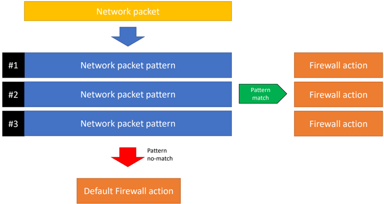

防火墙与 **EthIf**/**LsdPuR** 接口以接收网络数据包。检查之后，防火墙返回检查结果，**EthIf**/**LsdPuR** 根据该结果阻止或允许网络数据包。**FirewallRule** 通常是静态的，但防火墙提供了一种在运行时动态启用/禁用 **FirewallRule** 的机制：防火墙与 **BswM** 相连，**BswM** 切换 Firewall State，从而允许基于当前车辆状态（例如行驶、停车、处于诊断会话中）的动态防火墙行为。更多细节见第 [6.4.3](#643-状态相关过滤) 节。此外，防火墙还通过引发安全事件来支持入侵检测系统。防火墙在 **AUTOSAR** 协议栈中的集成因此可以表示如下：

防火墙还支持将 **AUTOSAR** 协议栈直接部署在智能交换机（包含专用可编程 **CPU**）上的场景。在这种情况下，可以采用防火墙直接在交换机上过滤网络流量，从而直接保护车内网络。该部署场景及其影响将在第 [6.5](#65-防火墙与交换机的交互) 节中详细描述。

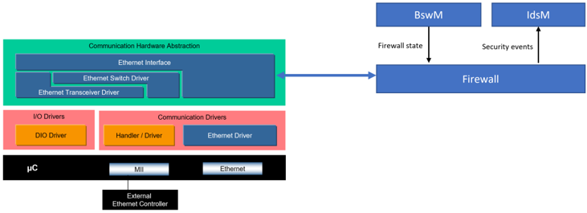

本章的结构如下：

- 第 [6.2](#62-模块处理) 节描述 **Firewall** 模块的处理
- 第 [6.3](#63-网络数据包检查) 节描述网络数据包检查，即 **FirewallRule** 的模式匹配部分
- 第 [6.4](#64-网络数据包过滤) 节描述防火墙的过滤方面，即在模式匹配的情况下执行哪些动作。本节还包含速率限制以及基于车辆状态的过滤的用例
- 第 [6.5](#65-防火墙与交换机的交互) 节描述防火墙在智能交换机上的部署场景
- 第 [6.6](#66-安全事件) 节描述防火墙引发的安全事件
- 第 [6.7](#67-错误分类) 节描述防火墙引发的错误

### 6.2. 模块处理

#### 6.2.1. 初始化

**Firewall** 模块通过 [**Fw_Init**](#731-fw_init) 进行初始化。除 [**Fw_GetVersionInfo**](#732-fw_getversioninfo) 和 [**Fw_Init**](#731-fw_init) 之外，**Firewall** 模块的 **API** 函数只能在模块被正确初始化之后调用。

**Firewall** 在模块初始化方面遵循 **CP_SWS_BSWGeneral** [\[4\]](#ref-4) 的规范，特别是其中的模块初始化要求。

#### 6.2.2. 与时序相关的功能

为了能够正确处理异步调用，**Firewall** 模块通过 [**Fw_MainFunction**](#751-fw_mainfunction) 周期性地触发。

### 6.3. 网络数据包检查

防火墙管理一个防火墙规则列表，这些规则由期望的网络数据包模式和模式匹配时要执行的动作组成。防火墙规则在 **AUTOSAR** 方法论中被建模为 **FirewallRule**。对于每一个经过网络协议栈的网络数据包，防火墙将该网络数据包与所有已配置的期望模式进行比较，并在模式匹配的情况下执行与该 **FirewallRule** 相关联的动作。**FirewallRule** 根据 **Metamodel** 配置进行排序，防火墙应按配置的顺序遍历 **FirewallRule**，直到出现第一个模式匹配。

在调用 [**Fw_InspectPacket**](#733-fw_inspectpacket) 时，防火墙应检查通过 **DataPtr** 接收到的网络数据包，并将其与 **FirewallRule** 中定义的期望模式的有序列表进行比较。在模式匹配的情况下，防火墙停止与期望模式的比较，并执行与匹配规则相关联的动作。

模式匹配时可能的动作在第 [6.4](#64-网络数据包过滤) 节中描述。

防火墙支持不同的过滤机制：

- 无状态过滤：检查字段值（例如报文字段）并与静态定义的值进行比较
- 有状态过滤：基于底层协议有状态特性的特定方面进行过滤（例如允许的状态转换、打开的连接数量）
- 深度数据包检查：对应用层协议（例如 **SOME/IP**、**DDS**、**DoIP**）进行检查。这还可以包括基于偏移量和期望值对网络数据包有效载荷的通用检查

防火墙对完整的网络数据包执行检查。因此，模式描述由针对不同协议的期望模式组成。这通过每个 **OSI** 层的单独配置部分（**FirewallDataLinkFilterConfig**、**FirewallNetworkLayerFilterConfig**、**FirewallTransportLayerFilterConfig** 等）建模，这些配置部分在 **AUTOSAR Metamodel** 中由 **FirewallRule** 聚合。

如果所有聚合的 **FirewallDataLinkFilterConfig**、**FirewallNetworkLayerFilterConfig**、**FirewallTransportLayerFilterConfig**、**FirewallSomeipProtocolFilterConfig**、**FirewallSomeipSdFilterConfig**、**FirewallDdsFilterConfig**、**FirewallDoipFilterConfig** 和 **FirewallPayloadBytePatternFilterConfig** 都为其各自协议生成了匹配，则该 **FirewallRule** 被视为匹配。

#### 6.3.1. 无状态数据包检查

对于无状态数据包检查，防火墙检查直至 **OSI** 第 4 层的网络协议报头，并将其与期望值进行比较。

防火墙应将每个 **FirewallRule** 的 **FirewallDataLinkFilterConfig** 中定义的期望值与网络数据包中的报文字段进行比较。如果所有值都匹配，则该 **FirewallDataLinkFilterConfig** 被视为匹配。否则该 **FirewallDataLinkFilterConfig** 被视为无匹配。

防火墙应将每个 **FirewallRule** 的 **FirewallNetworkLayerFilterConfig** 中定义的期望值与网络数据包中的报文字段进行比较。如果所有值都匹配，则该 **FirewallNetworkLayerFilterConfig** 被视为匹配。否则该 **FirewallNetworkLayerFilterConfig** 被视为无匹配。

防火墙应将每个 **FirewallRule** 的 **FirewallTransportLayerFilterConfig** 中定义的期望值与网络数据包中的报文字段进行比较。如果所有值都匹配，则该 **FirewallTransportLayerFilterConfig** 被视为匹配。否则该 **FirewallTransportLayerFilterConfig** 被视为无匹配。

防火墙应只检查在 **FirewallRule** 中配置的参数。**Metamodel** 中可用但未配置的参数应被忽略。

在某些情况下，不将期望模式限制为特定值，而是允许值处于特定范围内会很有用。范围可以通过子网（例如对于 **MAC** 和 **IP** 地址）或通过定义参数的最小值和最大值（例如对于端口）来定义。

如果 **FirewallDataLinkFilterConfig** 通过 **FirewallFilterMACSrcAddress**.**FirewallFilterMACAddressMask** 或 **FirewallFilterMACDestAddress**.**FirewallFilterMACAddressMask** 定义了一个子网，则网络数据包中落入该子网内的所有地址都被视为与该 **FirewallDataLinkFilterConfig** 匹配。

如果 **FirewallNetworkLayerIpv4FilterConfig** 通过 **FirewallFilterIPSrcAddress**.**FirewallFilterIPAddressMask** 或 **FirewallFilterIPDestAddress**.**FirewallFilterIPAddressMask** 定义了一个子网，则网络数据包中落入该子网内的所有地址都被视为与该 **FirewallNetworkLayerIpv4FilterConfig** 匹配。

如果 **FirewallNetworkLayerIpv6FilterConfig** 通过 **FirewallFilterIPSrcAddress**.**FirewallFilterIPAddressMask** 或 **FirewallFilterIPDestAddress**.**FirewallFilterIPAddressMask** 定义了一个子网，则网络数据包中落入该子网内的所有地址都被视为与该 **FirewallNetworkLayerIpv6FilterConfig** 匹配。

如果 **FirewallNetworkLayerIpv4FilterConfig** 通过 **FirewallFilterIPv4Ttl**.**FirewallIpv4TtlMin** 和 **FirewallFilterIPv4Ttl**.**FirewallIpv4TtlMax** 定义了一个范围，则网络数据包中落入该范围（包括最小值和最大值）内的所有值都被视为与该 **FirewallNetworkLayerIpv4FilterConfig** 匹配。

如果 **FirewallTransportLayerFilterConfig** 通过 **FirewallFilterSrcPort**.**FirewallFilterPortLowerValue** 和 **FirewallFilterSrcPort**.**FirewallFilterPortUpperValue**、或通过 **FirewallFilterDestPort**.**FirewallFilterPortLowerValue** 和 **FirewallFilterDestPort**.**FirewallFilterPortLowerValue** 定义了一个范围，则网络数据包中落入该范围（包括最小值和最大值）内的所有值都被视为与该 **FirewallTransportLayerFilterConfig** 匹配。

防火墙还应能够验证相应协议的校验和是否有效。

如果 **FirewallNetworkLayerIpv4FilterConfig**.**FirewallChecksumVerification**、**FirewallNetworkLayerIcmpConfig**.**FirewallChecksumVerification** 或 **FirewallTransportLayerTcpFilterConfig**.**FirewallChecksumVerification** 设置为 **true**，防火墙应检查相应协议的校验和字段在网络数据包中是否可用。如果校验和可用，则相应的 **FirewallNetworkLayerIpv4FilterConfig**、**FirewallNetworkLayerIcmpConfig** 或 **FirewallTransportLayerFilterConfig** 被视为匹配。

##### 6.3.1.1. 对未建模协议的检查

对于无状态数据包检查，防火墙原生支持已建模的协议 **Ethernet**、**IPv4**、**IPv6**、**ICMP**、**TCP** 和 **UDP**。可以通过两种机制添加其他协议：

**EtherType** 检查：许多协议已经可以在数据链路层通过 **EtherType**（如 **IEEE** 802.3 [\[5\]](#ref-5) 中所定义）来识别。因此，可以通过在 **FirewallRule** 中配置 **FirewallFilterEtherType** 由防火墙阻止这些协议。可以基于 **EtherType** 识别的协议示例见表 7.1。

表7.1：EtherType 示例（**EtherType examples**）

| EtherType | 协议 |
|---|---|
| 0x0806 | IPv4 上的地址解析协议（**ARP**） |
| 0x22EA | 流预留协议（**SRP**） |
| 0x22F0 | 音视频传输协议（**AVTP**） |
| 0x88F7 | **IEEE** 802.3 以太网上的精确时间协议（**PTP**） |
| 0xF1C1 | 冗余标签（**Redundancy Tag**，如 **IEEE** 802.1CB「帧复制与消除以实现可靠性」中所定义） |

基于字节模式的通用检查：防火墙支持基于给定偏移量处的期望字节值对网络数据包进行通用检查。该特性在第 [6.3.3.4](#6334-通用检查) 节中规定，它允许对防火墙内未建模的协议进行详细检查，以及对有效载荷数据的检查。

#### 6.3.2. 有状态数据包检查

在有状态数据包检查中，防火墙考虑 **TCP** 的有状态特性，并执行额外的检查以识别超时、限制打开连接的数量，并针对 **TCP** 状态机执行检查。

如果设置了 **FirewallTimeoutCheck** 参数，防火墙应存储相应通信对端的最新网络数据包的时间。如果最新网络数据包与当前网络数据包之间的时间小于 **FirewallTimeoutCheck** 的值，则该 **FirewallTransportLayerTcpFilterConfig** 被视为匹配。

如果设置了 **FirewallNumberOfParallelTcpSessions** 参数，防火墙应跟踪打开的 **TCP** 连接的数量。如果网络数据包想要打开新的 **TCP** 会话，并且包括新打开的 **TCP** 会话在内的打开 **TCP** 会话数量小于 **FirewallNumberOfParallelTcpSessions**，则该 **FirewallTransportLayerTcpFilterConfig** 被视为匹配。

如果 **FirewallStateManagementBasedOnTcpFlags** 参数设置为 **true**，防火墙应检查该网络数据包是否要执行 **RFC** 793 允许的 **TCP** 状态转换。如果该状态转换被允许，则该 **FirewallTransportLayerTcpFilterConfig** 被视为匹配。

#### 6.3.3. 深度数据包检查

防火墙还支持对应用层协议的检查，以对网络数据包执行深度数据包检查。为此，防火墙支持对以下协议的深度数据包检查：

- **SOME/IP**（包括 **SOME/IP-SD**）
- **DDS**
- **DoIP**
- 通用深度数据包检查

##### 6.3.3.1. SOME/IP

对于 **SOME/IP** [\[6\]](#ref-6)，检查聚焦于 **SOME/IP** 报头字段。报头字段还包括服务特定的信息，例如 **Service ID**、**Method ID** 等，因此对 **SOME/IP** 数据包的深度数据包检查可用于对单个服务执行访问控制。

一个 **TCP** 或 **UDP** 帧内可能传输多个 **SOME/IP** 报文。在防火墙元模型中，每个 **FirewallRule** 最多可以聚合一个 **SOME/IP** 报文。因此，如果网络数据包包含多个 **SOME/IP** 报文，防火墙必须针对网络数据包中的每个 **SOME/IP** 报文检查是否存在有效的 **FirewallRule**。

如果待检查的网络数据包包含一个或多个 **SOME/IP** 报文，防火墙应找出这样的 **FirewallRule** 子集：其中相应的 **FirewallDataLinkFilterConfig**、**FirewallNetworkLayerFilterConfig** 和 **FirewallTransportLayerFilterConfig** 已提供匹配，并且聚合了一个 **FirewallSomeipProtocolFilterConfig**。

对于该子集，防火墙应将其期望值与网络数据包中 **SOME/IP** 报文的 **SOME/IP** 报头字段进行比较。如果所有值都匹配，并且对于所有 **FirewallRule**，来自被引用的 **FirewallActionForMatchingRules** 的 **FirewallAction** 都相同，则相应的 **FirewallRule** 被视为匹配。

此外，防火墙支持长度验证，即检查 **TCP**/**UDP** 有效载荷长度是否与所有包含的 **SOME/IP** 报文的合计长度相符。

如果 **FirewallSomeipLengthVerification** 参数设置为 **true**，防火墙应将 **TCP**/**UDP** 有效载荷大小与所有包含的 **SOME/IP** 报文的累计长度进行比较。如果两个值匹配，则该 **FirewallSomeipProtocolFilterConfig** 被视为匹配。否则该 **FirewallSomeipProtocolFilterConfig** 被视为无匹配。

防火墙还支持对 **SOME/IP** 服务发现协议 [\[7\]](#ref-7) 的检查。与常规 **SOME/IP** 检查类似，也可以将多个 **SOME/IP-SD** 报文组合在一个网络数据包内。因此，防火墙实现了一种类似的逻辑来检查包含多个 **SOME/IP-SD** 报文的网络数据包。

如果待检查的网络数据包包含一个或多个 **SOME/IP-SD** 报文，防火墙应找出这样的 **FirewallRule** 子集：其中相应的 **FirewallDataLinkFilterConfig**、**FirewallNetworkLayerFilterConfig** 和 **FirewallTransportLayerFilterConfig** 已提供匹配，并且聚合了一个 **FirewallSomeipSdFilterConfig**。

对于该子集，防火墙应将其期望值与网络数据包中 **SOME/IP-SD** 报文的 **SOME/IP-SD** 报头字段进行比较。如果所有值都匹配，并且对于所有 **FirewallRule**，来自被引用的 **FirewallActionForMatchingRules** 的 **FirewallAction** 都相同，则相应的 **FirewallRule** 被视为匹配。

如果在 **FirewallRule** 中聚合了 **FirewallSomeipSdFilterConfig**，防火墙应将网络数据包中所有 **SOME/IP-SD** 报文的 **SOME/IP** 报头字段与 **PRS_SOMEIPServiceDiscoveryProtocol** [\[7\]](#ref-7) 中定义的默认值进行比较。如果所有值都匹配，则该 **FirewallSomeipSdFilterConfig** 被视为匹配。否则该 **FirewallSomeipSdFilterConfig** 被视为无匹配。

与较低层上的无状态网络数据包检查类似，也可以通过使用最小值和最大值来定义允许值的范围。在定义了此类范围的情况下，来自网络数据包的、落入该范围内的所有值都是匹配。

如果 **FirewallSomeipSdFilterConfig** 通过 **FirewallSomeipMinorVersion**.**FirewallMinorVersionMinValue** 和 **FirewallSomeipMinorVersion**.**FirewallMinorVersionMaxValue**、或通过 **FirewallSomeipMajorVersion**.**FirewallMajorVersionMinValue** 和 **FirewallSomeipMajorVersion**.**FirewallMajorVersionMaxValue** 定义了一个范围，则网络数据包中落入该范围（包括最小值和最大值）内的所有值都被视为与该 **FirewallSomeipSdFilterConfig** 匹配。

请注意，防火墙只能允许和阻止完整的网络数据包。如果一个 **TCP**/**UDP** 帧内传输了多个 **SOME/IP** 报文，而防火墙只需阻止其中一个 **SOME/IP** 报文，防火墙仍然会阻止包含其他 **SOME/IP** 报文在内的完整网络数据包。**SOME/IP-SD** 的行为也是如此：一个 **TCP**/**UDP** 帧内可以包含多个服务发现报文，防火墙将允许或阻止完整的网络数据包。

##### 6.3.3.2. DDS

**DDS** 报文的深度数据包检查基于 **DDS** 互操作线缆协议（**DDS-RTPS** [\[8\]](#ref-8)），该协议规定了 **DDS** 报文在网络数据包中的表示形式：**DDS-RTPS** 定义了一种数据包格式，它由一个 **RTPS** 报头和多个可以累积在一个 **RTPS** 报文中的 **RTPS** 子报文组成。此外，**DDS** 也允许在一个 **TCP** 或 **UDP** 数据包中包含多个 **RTPS** 报文。与 **SOME/IP** 类似，防火墙在一个 **FirewallRule** 中只允许配置单个 **RTPS** 报头和子报文，因此防火墙必须将网络数据包与所有已配置的 **RTPS** 规则进行比较。

如果待检查的网络数据包包含一个或多个 **DDSI-RTPS** 报文，防火墙应找出这样的 **FirewallRule** 子集：其中相应的 **FirewallDataLinkFilterConfig**、**FirewallNetworkLayerFilterConfig** 和 **FirewallTransportLayerFilterConfig** 已提供匹配，并且聚合了一个 **FirewallDdsFilterConfig**。

对于该子集，防火墙应将其期望值与网络数据包中 **DDS-RTPS** 报文和子报文的字段进行比较。如果所有值都匹配，并且对于所有 **FirewallRule**，来自被引用的 **FirewallActionForMatchingRules** 的 **FirewallAction** 都相同，则相应的 **FirewallRule** 被视为匹配。

##### 6.3.3.3. DoIP

防火墙支持对 **DoIP** 报文 [\[9\]](#ref-9) 的深度数据包检查，防火墙检查 **DoIP** 报头以及部分有效载荷（**DoIP** 源/目的地址、**UDS** 服务）。但是，防火墙不对 **UDS** 协议执行深度数据包检查，即在单个 **DID**、**RID** 等层级上的检查。尽管如此，这类检查仍然可以通过第 [6.3.3.4](#6334-通用检查) 节中描述的通用检查特性来实现。

防火墙应将每个 **FirewallRule** 的 **FirewallDoipFilterConfig** 中定义的期望值与网络数据包中的 **DoIP** 报头字段进行比较。如果所有值都匹配，则该 **FirewallDoipFilterConfig** 被视为匹配。否则该 **FirewallDoipFilterConfig** 被视为无匹配。

与较低层上的无状态网络数据包检查类似，也可以通过使用最小值和最大值来定义允许值的范围。在定义了此类范围的情况下，来自网络数据包的、落入该范围内的所有值都是匹配。

如果 **FirewallDoipFilterConfig** 通过 **FirewallDoipSrcAddress**.**FirewallDoipSrcAddressLowerValue** 和 **FirewallDoipSrcAddress**.**FirewallDoipSrcAddressUpperValue**、或通过 **FirewallDoipDestAddress**.**FirewallDoipDestAddressLowerValue** 和 **FirewallDoipDestAddress**.**FirewallDoipDestAddressUpperValue** 定义了一个范围，则网络数据包中落入该范围（包括最小值和最大值）内的所有值都被视为与该 **FirewallDoipFilterConfig** 匹配。

##### 6.3.3.4. 通用检查

防火墙允许对网络数据包进行通用检查（例如执行有效载荷检查，或检查防火墙原生不支持的协议）。为此，每个 **FirewallRule** 可以聚合多个 **FirewallPayloadBytePatternFilterConfig**，这些配置指定网络数据包中特定偏移量处的期望字节值。

防火墙应将每个 **FirewallRule** 的 **FirewallPayloadBytePatternFilterConfig** 中定义的期望值与网络数据包中指定偏移量处的值进行比较。如果所有值都匹配，则这些 **FirewallPayloadBytePatternFilterConfig** 被视为匹配。

### 6.4. 网络数据包过滤

在描述了基于模式匹配的、基于规则的网络数据包检查过程之后，本章规定防火墙所支持的相应过滤机制。第 [6.4.1](#641-允许列表与阻止列表) 节描述使用 **Allowlist** 和 **Blocklist** 的基于模式匹配的过滤方法，第 [6.4.2](#642-速率限制) 节规定防火墙的速率限制特性，第 [6.4.3](#643-状态相关过滤) 节概述基于可配置 Firewall State 的状态相关过滤机制。

#### 6.4.1. 允许列表与阻止列表

防火墙通常可以分为两类：**Allowlist**（允许列表）防火墙和 **Blocklist**（阻止列表）防火墙。在 **Allowlist** 防火墙中，规定（即定义模式）了所有允许通过防火墙的网络流量，所有没有匹配模式的网络数据包都被阻止。**Blocklist** 防火墙实现相反的方法：只有显式定义的网络数据包被阻止，而没有匹配模式的流量被允许通过防火墙。

在 **FirewallRule** 匹配的情况下要执行的动作由被引用的 **FirewallActionForMatchingRules** 中的 **FirewallAction** 参数定义。

如果一个 **FirewallRule** 匹配，且被引用的 **FirewallActionForMatchingRules** 中的 **FirewallAction** 设置为 allow，防火墙应将 **InspectionResultPtr** 设置为 **FW_ALLOW_NETWORK_PACKET** 并以 **E_OK** 返回 [**Fw_InspectPacket**](#733-fw_inspectpacket) 调用。

如果一个 **FirewallRule** 匹配，且被引用的 **FirewallActionForMatchingRules** 中的 **FirewallAction** 设置为 block，防火墙应将 **InspectionResultPtr** 设置为 **FW_BLOCK_NETWORK_PACKET** 并以 **E_OK** 返回 [**Fw_InspectPacket**](#733-fw_inspectpacket) 调用。

此外，还必须定义在没有任何 **FirewallRule** 生成匹配的情况下防火墙的行为方式：

如果没有 **FirewallRule** 与网络数据包匹配，防火墙应将 **InspectionResultPtr** 设置为 **FW_BLOCK_NETWORK_PACKET**（若 **FirewallDefaultAction** 设置为 block）或 **FW_ALLOW_NETWORK_PACKET**（若 **FirewallDefaultAction** 设置为 allow）。[**Fw_InspectPacket**](#733-fw_inspectpacket) 调用应以 **E_OK** 返回。

防火墙也允许混合的 Allow-/Blocklist 防火墙：可以定义在模式匹配时阻止网络数据包的 **FirewallRule**，与在模式匹配时允许网络数据包通过的 **FirewallRule** 并存。乍看之下这似乎是冗余的，因为不提供匹配的网络数据包已被防火墙的默认行为捕获，但这一设计有一个特定的原因：显式定义网络数据包模式允许使用模式匹配算法，而这又允许为这些网络数据包专门映射 **IDS** 安全事件。更多细节见第 [6.6](#66-安全事件) 节。

#### 6.4.2. 速率限制

防火墙支持基于模式匹配算法的速率限制，以识别偏离周期的周期性报文，这可能由中间人攻击或有故障的 **ECU** 引起。为实现这一点，防火墙实现了漏桶（leaky bucket）算法，某些产品的硬件侧也支持该算法。

如果为某个 **FirewallRule** 配置了 **FirewallBucketSize** 和 **FirewallRefillAmount** 参数，防火墙应通过漏桶算法跟踪模式匹配的次数，其中 **FirewallRefillAmount** 定义漏桶算法的递减速率，并且每出现一次模式匹配计数器加一。

在模式匹配的情况下，如果漏桶计数器大于 **FirewallBucketSize**，防火墙应将 **InspectionResultPtr** 设置为 **FW_BLOCK_NETWORK_PACKET** 并以 **E_OK** 返回 [**Fw_InspectPacket**](#733-fw_inspectpacket) 调用。

当防火墙状态按照状态相关过滤的规定进行切换时，防火墙应保留当前的漏桶计数器。

#### 6.4.3. 状态相关过滤

车内流量可能在很大程度上取决于车辆的状况（例如行驶、停车、处于诊断会话中等），这也使得期望的网络数据包随当前车辆状态的不同而不同。防火墙通过状态相关（state-dependent）来支持这一用例：**FirewallRule** 可以与特定的 Firewall State 相关联，这些状态由集成者按项目预先配置，并可由用户应用管理。在 **AUTOSAR** 元模型中，该特性通过聚合一组 **FirewallRule** 的 **FirewallStateDependentRules** 来实现。只有一个 **FirewallStateDependentRules** 可以处于激活状态，这意味着只有与该 **FirewallStateDependentRules** 相关联的 **FirewallRule** 处于激活状态。

只有当前处于激活状态的 **FirewallStateDependentRules** 所引用的 **FirewallRule** 才会被纳入网络数据包检查。未被当前激活的 **FirewallStateDependentRules** 引用的 **FirewallRule** 应被忽略。

对于无匹配情况，应使用当前激活的 **FirewallStateDependentRules** 中定义的 **FirewallDefaultAction**。

防火墙提供 [**Fw_SetFirewallState**](#734-fw_setfirewallstate) **API** 来切换当前激活的 **FirewallStateDependentRules**。该 **API** 由 **BswM** 调用。

如果通过 [**Fw_SetFirewallState**](#734-fw_setfirewallstate) 向防火墙报告了一个 Firewall State，则 **FirewallStateRef** 所引用的 **FirewallStateDependentRules** 应被视为激活状态。

如果尚未向防火墙报告任何 Firewall State，防火墙应将这样的 **FirewallStateDependentRules** 视为激活状态：其所引用的 Firewall State 同时也被 **FirewallInitialStateRef** 引用。

### 6.5. 防火墙与交换机的交互

防火墙不仅限于部署在端点/主机 **ECU** 上，在网关和交换机等中央网络实体上也很有意义。交换机通常带有一些基本的防火墙功能，这些功能往往基于 **TCAM** 规则。**TCAM** 规则允许执行无状态数据包检查，但不能用于有状态和深度数据包检查。当交换机包含一个专用 **CPU**（以软件方式运行防火墙，并执行 **TCAM** 规则无法实现的检查部分）时，后两类检查可以在交换机上实现。

从技术角度来看，这些所谓的智能交换机的**行为方式**与任何其他 **uC** 类似：它们拥有 **CPU**、内存，并通过以太网连接与交换机核心相连（另见图 7.3）。这使得也可以在交换机上直接运行 **AUTOSAR** 协议栈。交换机通常是资源非常受限的设备，因此可能只允许运行精简版的 **AUTOSAR**，但这仍然可以复用标准化的 **AUTOSAR** 模块、用于配置的 **AUTOSAR** 工具以及 **AUTOSAR** 防火墙模块，以扩展基于 **TCAM** 的基本防火墙功能。

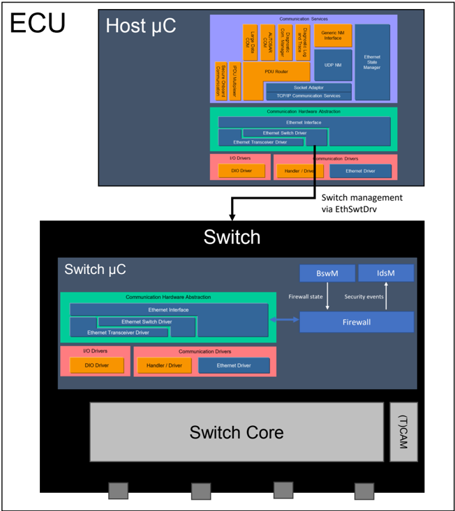

本章涵盖为直接部署在交换机上而显式引入的防火墙模块相关方面。重点是与交换机核心的交互以及其中可用的防火墙功能。交换机核心中的防火墙规则可以使用以太网交换机驱动程序 [\[10\]](#ref-10) 中规定的逐流（per-stream）过滤功能进行配置。因此，这里复用已有的术语，交换机核心上的各个防火墙规则通过 **AUTOSAR** 以太网交换机驱动程序 [\[10\]](#ref-10) 中定义的 **EthSwtStreamIdentification** 来寻址。

本章的其余部分以如下方式组织，分别单独处理各个过滤场景：

- 接收到一个网络数据包，由交换机核心完成检查并允许通过。不需要 **AUTOSAR** 防火墙的额外检查，因此该网络数据包完全在交换机核心内处理。在这种情况下，防火墙模块中不需要额外的功能。
- 接收到一个网络数据包并由交换机核心部分检查。防火墙模块需要额外的检查，因此网络数据包被传递给交换机 **CPU**。这种情况在第 [6.5.1](#651-由-autosar-防火墙模块进行的数据包检查) 节中描述。
- 网络数据包已经被交换机核心阻止。交换机 **CPU** 上的防火墙模块不需要额外的检查，但必须引发一个安全事件（**SEv**）。这种情况在第 [6.5.2](#652-被交换机核心阻止的网络数据包) 节中描述。
- **BswM** 更改防火墙的状态，即活动的防火墙规则发生更改。这也意味着交换机核心上的防火墙规则发生变化。这种情况在第 [6.5.3](#653-交换机核心中防火墙规则的管理) 节中描述。

#### 6.5.1. 由 AUTOSAR 防火墙模块进行的数据包检查

本节描述这样一种情况：交换机接收到一个网络数据包，它通过了交换机核心的检查，但交换机 **CPU** 上的防火墙模块需要进行额外的检查。考虑到网络数据包的部分内容已经被交换机核心检查过，防火墙模块的检查可以更快地完成。因此，防火墙只需遍历与允许该网络数据包通过的 **EthSwtStreamIdentification** 相关联的过滤规则兼容的所有规则。为此，防火墙模块通过参数 **StreamHandleIdxPtr** 接收交换机核心过滤规则的索引。

如果调用 [**Fw_InspectPacket**](#733-fw_inspectpacket) 时 **StreamHandleIdxPtr** 不是 **NULL** 指针，防火墙在检查网络数据包时应只考虑与存储在 **StreamHandleIdxPtr** 处的值兼容的 **FirewallRule**。

请注意，防火墙模块管理的 **FirewallRule** 与交换机核心过滤规则之间的映射并未显式建模。协议栈/工具供应商可以自行提供对该映射的支持，以实现交换机核心内过滤与交换机 **CPU** 上过滤的最高效组合。

**StreamHandleIdxPtr** 的内容按以下方式生成：交换机核心修改网络数据包报头，插入包含允许该网络数据包通过的过滤规则标识符的交换机供应商特定元数据。网络数据包由交换机 **CPU** 通过以太网协议栈接收，并传递给以太网交换机驱动程序以解析所添加的元数据并提取过滤规则标识符，随后将其提供给防火墙模块。该过程也显示在第 [8.1](#81-交换机核心过滤规则提取) 节的时序图中。

#### 6.5.2. 被交换机核心阻止的网络数据包

本节描述这样一种情况：交换机接收到一个网络数据包，它被交换机核心中的过滤规则阻止。该网络数据包无需由交换机 **CPU** 上的防火墙检查，但防火墙应为被阻止的网络数据包引发一个安全事件（**SEv**）。

为此，防火墙支持两种引发 **SEv** 的机制：

- 细粒度的 **SEv**，指示观察到模式不匹配的网络协议。该机制在第 [6.6](#66-安全事件) 节中详细概述，并且需要防火墙模块对网络数据包进行检查。
- 定期从交换机核心读出关于交换机防火墙规则应用的计数统计信息，并在计数器增加时引发一个 **SEv**。

两种方法在 **CPU** 负载、内存消耗、信息详细程度等方面各有优缺点。防火墙同时支持这两种方法，由项目决定采用哪种方法。以下各节详细描述这两种方法。

##### 6.5.2.1. 协议级别的 SEv

第 [6.6](#66-安全事件) 节规定了基于检查结果引发安全事件的机制。由于这些 **SEv** 非常细粒度，网络数据包需要由交换机 **CPU** 上的防火墙进行检查，以识别应引发的正确 **SEv**。因此，即使网络数据包已经被交换机核心阻止，仍需将其转发给交换机 **CPU** 以便防火进行检查。

然而，防火墙模块进行网络数据包检查的唯一目的是识别应引发的正确 **SEv**。交换机核心已经决定丢弃该网络数据包，这通常由交换机核心中的默认防火墙规则完成。因此，防火墙可以直接返回 [**Fw_InspectPacket**](#733-fw_inspectpacket) 调用以阻止该网络数据包。

如果调用 [**Fw_InspectPacket**](#733-fw_inspectpacket) 时 **StreamHandleIdxPtr** 包含交换机核心中的默认防火墙规则，防火墙应将 **InspectionResultPtr** 设置为 **FW_BLOCK_NETWORK_PACKET** 并直接返回 **E_OK**，而无需等待检查结果。

##### 6.5.2.2. 交换机防火墙规则计数统计 SEv

许多交换机支持针对交换机核心上防火墙规则的计数统计。为此，这些规则被捆绑在桶（bucket）中，桶对所有被引用规则的过滤规则匹配次数进行累计计数（见图 7.4）。桶在交换机层面配置，不属于 **Firewall** 规范的一部分。

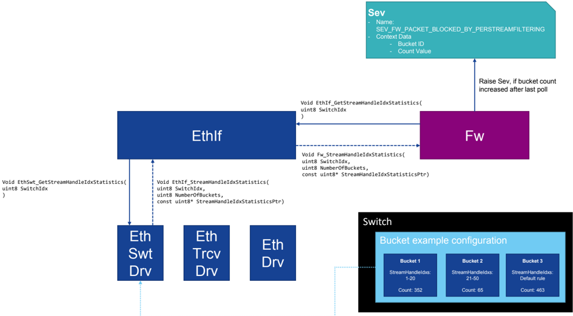

防火墙可以定期轮询这些桶的计数值，并在计数值发生变化（即至少有一个网络数据包被交换机阻止）时引发一个 **SEv**。该机制的时序图见第 [8.2](#82-交换机核心过滤规则计数统计) 节。

如果配置了容器 **FirewallSwitchBucketCounterStatistics**，防火墙应每隔 **FwSwitchBucketCounterPollingInterval** 秒为所有已配置的 **SwitchIdx** 调用 **EthIf_GetStreamHandleIdxStatistics**。

当 [**Fw_StreamHandleIdxStatistics**](#741-fw_streamhandleidxstatistics) 被调用时，防火墙应通过将 **StreamHandleIdxStatisticsPtr** 划分为 **NumberOfBuckets** 个 4 字节长度的片段来提取桶计数器值。防火墙应缓存每个 **SwitchIdx** 的计数值，直到通过 [**Fw_StreamHandleIdxStatistics**](#741-fw_streamhandleidxstatistics) 报告了更新后的计数值。

防火墙应将更新后的计数值与缓存的计数值进行比较。如果某个计数值增加了，防火墙应引发 **SEv** **SEV_FW_PACKET_BLOCKED_BY_PERSTREAMFILTERING**。如果多个计数值都增加了，防火墙应为每个增加的计数器引发一个 **SEv**。

如果没有可用的缓存计数值（例如因为 [**Fw_StreamHandleIdxStatistics**](#741-fw_streamhandleidxstatistics) 是第一次被调用），防火墙应假设计数值为零。

#### 6.5.3. 交换机核心中防火墙规则的管理

本节描述 **BswM** 更改防火墙状态、从而使活动的防火墙过滤规则集合发生变化的情况。这也对交换机核心中的防火墙规则产生影响，需要将它们与交换机 **CPU** 上的防火墙规则同步，以确保正确的网络数据包过滤。为此，防火墙支持在运行时（去）激活交换机核心上的单个规则。防火墙在运行时不更改实际的过滤规则；假定过滤规则集合是静态配置的，防火墙只将其打开/关闭。与交换机核心交互的时序图见第 [8.3](#83-交换机核心过滤规则管理) 节。

如果防火墙状态由 **BswM** 按照状态相关过滤的规定进行切换，防火墙模块应为所有适用的 **SwitchIdx** 和 **StreamHandleIdx** 调用 **EthIf_SetStreamHandleIdxConfiguration**，并使用 **StreamHandleIdxActivityStatus** 将它们的活动状态设置为活动防火墙状态所要求的值。

如果在 **FirewallSwitchRuleMgmtTimeout** 秒内未通过 [**Fw_StreamHandleIdxConfiguration**](#742-fw_streamhandleidxconfiguration) 收到响应，或者 **StreamHandleIdxActivityStatus** 与期望的值不匹配，防火墙应按照交换机核心规则设置的规定重试设置正确的活动状态。

在上述重试条件成立且开发错误报告已启用（见 **FwDevErrorDetect**）的情况下，防火墙应以错误码 [**FW_E_SWITCHRULEMGMT_FAILED**](#671-开发错误) 调用 **Det_ReportError**。

### 6.6. 安全事件

防火墙是入侵检测系统（**IDS**）的关键组成部分，因为它们监控完整的网络流量，因而能够识别车内网络中的攻击。**AUTOSAR** 在 **IdsM**（**IDS** 管理器）中规定了 **IDS** 的车载部分，**IdsM** 聚合并鉴定由 **IDS** 传感器引发的安全事件，并将其转发给已配置的接收器（sink），即持久性存储器或车辆中央 **IDS** 实例（在 **AUTOSAR** **IDS** 概念中为 **IdsR**）。

**Firewall** 充当 **IDS** 传感器，向 **IdsM** 引发安全事件（**SEv**），以此支持 **IDS**。为此，**Firewall** 规定了一组 **SEv**（见第 [6.6.1](#661-防火墙引发的-sev) 节）以及引发它们的条件（见第 [6.6.2](#662-引发-sev) 节）。

#### 6.6.1. 防火墙引发的 SEv

**IdsM** 规定 **SEv** 由一个唯一的 **SEv ID** 和相关联的上下文数据组成，上下文数据提供有关事件性质的更多细节。**IdsM** 通过让这些 **SEv** 经过过滤链来鉴定它们。在此过程中，**IdsM** 还可以聚合具有相同 **SEv ID** 的多个 **SEv**，此时只保留其中一个 **SEv** 的上下文数据。这种行为可能导致信息丢失，在设计 **Firewall** 引发的 **SEv** 时需要考虑这一点——这些 **SEv** 需要足够细粒度以尽可能限制信息丢失，同时在其规定中仍然保持精确和清晰。为此，**Firewall** 规定了一组聚焦于防火墙所检查的各个协议的 **SEv**：

防火墙（**CP**）的安全事件（**Security events for firewall (CP)**）

| 名称 | 说明 | ID |
|---|---|---|
| SEV_FW_PACKET_BLOCKED_DATALINKLAYER_MISMATCH | 网络数据包因数据链路层上的规则不匹配而被阻止。 | 77 |
| SEV_FW_PACKET_BLOCKED_IPV4_MISMATCH | 网络数据包因 **IPv4** 层上的规则不匹配而被阻止。 | 51 |
| SEV_FW_PACKET_BLOCKED_IPV6_MISMATCH | 网络数据包因 **IPv6** 层上的规则不匹配而被阻止。 | 52 |
| SEV_FW_PACKET_BLOCKED_ICMP_MISMATCH | 网络数据包因 **ICMP** 协议内的规则不匹配而被阻止。 | 53 |
| SEV_FW_PACKET_BLOCKED_TCP_MISMATCH | 网络数据包因 **TCP** 层上的规则不匹配而被阻止。 | 54 |
| SEV_FW_PACKET_BLOCKED_UDP_MISMATCH | 网络数据包因 **UDP** 层上的规则不匹配而被阻止。 | 55 |
| SEV_FW_PACKET_BLOCKED_SOMEIP_MISMATCH | 网络数据包因 **SOME/IP** 协议中的规则不匹配而被阻止。 | 56 |
| SEV_FW_PACKET_BLOCKED_SOMEIPSD_MISMATCH | 网络数据包因 **SOME/IP SD** 协议中的规则不匹配而被阻止。 | 57 |
| SEV_FW_PACKET_BLOCKED_DDS_MISMATCH | 网络数据包因 **DDS-RTPS** 协议中的规则不匹配而被阻止。 | 58 |
| SEV_FW_PACKET_BLOCKED_DOIP_MISMATCH | 网络数据包因 **DoIP** 协议中的规则不匹配而被阻止。 | 59 |
| SEV_FW_PACKET_BLOCKED_GENERIC_MISMATCH | 网络数据包因通用检查层级上的规则不匹配而被阻止。 | 60 |
| SEV_FW_PACKET_BLOCKED_TCP_MAXCONNECTIONS | 网络数据包因已达到打开 **TCP** 连接的最大数量而被阻止。 | 61 |
| SEV_FW_PACKET_BLOCKED_TCP_TIMEOUT | 网络数据包因 **TCP** 超时而被阻止。 | 62 |
| SEV_FW_PACKET_BLOCKED_TCP_STATETRANSITION | 网络数据包因无效的 **TCP** 状态转换而被阻止。 | 63 |
| SEV_FW_PACKET_BLOCKED_RATELIMIT | 网络数据包因已达到速率限制而被阻止。 | 64 |
| SEV_FW_PACKET_BLOCKED_BY_PERSTREAMFILTERING | 网络数据包因交换机中的逐流过滤而被阻止。 | 83 |

防火墙为这些 **SEv** 提供以下上下文数据：

表7.2：数据链路层 SEV（**Data link layer SEV**）

| SEv 组件 | 说明 |
|---|---|
| 名称 | SEV_FW_PACKET_BLOCKED_DATALINKLAYER_MISMATCH |
| 说明 | 网络数据包因数据链路层上的规则不匹配而被阻止 |
| SEv ID | 77 |
| 上下文数据 | • FirewallRule 短名称 • 完整的 **Ethernet** 报头 |

表7.3：IPv4 SEV（**IPv4 SEV**）

| SEv 组件 | 说明 |
|---|---|
| 名称 | SEV_FW_PACKET_BLOCKED_IPV4_MISMATCH |
| 说明 | 网络数据包因 **IPv4** 层上的规则不匹配而被阻止 |
| SEv ID | 51 |
| 上下文数据 | • FirewallRule 短名称 • 完整的 **IPv4** 报头 |

表7.4：IPv6 SEV（**IPv6 SEV**）

| SEv 组件 | 说明 |
|---|---|
| 名称 | SEV_FW_PACKET_BLOCKED_IPV6_MISMATCH |
| 说明 | 网络数据包因 **IPv6** 层上的规则不匹配而被阻止 |
| SEv ID | 52 |
| 上下文数据 | • FirewallRule 短名称 • 完整的 **IPv6** 报头 |

表7.5：ICMP SEV（**ICMP SEV**）

| SEv 组件 | 说明 |
|---|---|
| 名称 | SEV_FW_PACKET_BLOCKED_ICMP_MISMATCH |
| 说明 | 网络数据包因 **ICMP** 协议内的规则不匹配而被阻止 |
| SEv ID | 53 |
| 上下文数据 | • FirewallRule 短名称 • 完整的 **ICMP** 报头（type、code、checksum） |

表7.6：TCP SEV（**TCP SEV**）

| SEv 组件 | 说明 |
|---|---|
| 名称 | SEV_FW_PACKET_BLOCKED_TCP_MISMATCH |
| 说明 | 网络数据包因 **TCP** 层上的规则不匹配而被阻止 |
| SEv ID | 54 |
| 上下文数据 | • FirewallRule 短名称 • 完整的 **TCP** 报头 |

表7.7：UDP SEV（**UDP SEV**）

| SEv 组件 | 说明 |
|---|---|
| 名称 | SEV_FW_PACKET_BLOCKED_UDP_MISMATCH |
| 说明 | 网络数据包因 **UDP** 层上的规则不匹配而被阻止 |
| SEv ID | 55 |
| 上下文数据 | • FirewallRule 短名称 • 完整的 **UDP** 报头 |

表7.8：SOME/IP SEV（**SOME/IP SEV**）

| SEv 组件 | 说明 |
|---|---|
| 名称 | SEV_FW_PACKET_BLOCKED_SOMEIP_MISMATCH |
| 说明 | 网络数据包因 **SOME/IP** 协议中的规则不匹配而被阻止 |
| SEv ID | 56 |
| 上下文数据 | • FirewallRule 短名称 • 完整的 **SOME/IP** 报头 |

表7.9：SOME/IP SD SEV（**SOME/IP SD SEV**）

| SEv 组件 | 说明 |
|---|---|
| 名称 | SEV_FW_PACKET_BLOCKED_SOMEIPSD_MISMATCH |
| 说明 | 网络数据包因 **SOME/IP SD** 协议中的规则不匹配而被阻止 |
| SEv ID | 57 |
| 上下文数据 | • FirewallRule 短名称 • 完整的 **SOME/IP SD** 报头 |

表7.10：DDS SEV（**DDS SEV**）

| SEv 组件 | 说明 |
|---|---|
| 名称 | SEV_FW_PACKET_BLOCKED_DDS_MISMATCH |
| 说明 | 网络数据包因 **DDS-RTPS** 协议中的规则不匹配而被阻止 |
| SEv ID | 58 |
| 上下文数据 | • FirewallRule 短名称 • 完整的 **DDS-RTPS** 报头 |

表7.11：DoIP SEV（**DoIP SEV**）

| SEv 组件 | 说明 |
|---|---|
| 名称 | SEV_FW_PACKET_BLOCKED_DOIP_MISMATCH |
| 说明 | 网络数据包因 **DoIP** 协议中的规则不匹配而被阻止 |
| SEv ID | 59 |
| 上下文数据 | • FirewallRule 短名称 • 完整的 **DoIP** 报头 |

表7.12：通用 SEV（**Generic SEV**）

| SEv 组件 | 说明 |
|---|---|
| 名称 | SEV_FW_PACKET_BLOCKED_GENERIC_MISMATCH |
| 说明 | 网络数据包因通用检查层级上的规则不匹配而被阻止 |
| SEv ID | 60 |
| 上下文数据 | • FirewallRule 短名称 |

表7.13：TCP 最大连接数 SEV（**TCP Max Connections SEV**）

| SEv 组件 | 说明 |
|---|---|
| 名称 | SEV_FW_PACKET_BLOCKED_TCP_MAXCONNECTIONS |
| 说明 | 网络数据包因已达到打开 **TCP** 连接的最大数量而被阻止 |
| SEv ID | 61 |
| 上下文数据 | • FirewallRule 短名称 • 完整的 **TCP** 报头 |

表7.14：TCP 超时 SEV（**TCP Timeout SEV**）

| SEv 组件 | 说明 |
|---|---|
| 名称 | SEV_FW_PACKET_BLOCKED_TCP_TIMEOUT |
| 说明 | 网络数据包因 **TCP** 超时而被阻止 |
| SEv ID | 62 |
| 上下文数据 | • FirewallRule 短名称 • 完整的 **TCP** 报头 |

表7.15：TCP 状态机 SEV（**TCP state machine SEV**）

| SEv 组件 | 说明 |
|---|---|
| 名称 | SEV_FW_PACKET_BLOCKED_TCP_STATETRANSITION |
| 说明 | 网络数据包因无效的 **TCP** 状态转换而被阻止 |
| SEv ID | 63 |
| 上下文数据 | • FirewallRule 短名称 |

表7.16：速率限制 SEV（**Rate limit SEV**）

| SEv 组件 | 说明 |
|---|---|
| 名称 | SEV_FW_PACKET_BLOCKED_RATELIMIT |
| 说明 | 网络数据包因已达到速率限制而被阻止 |
| SEv ID | 64 |
| 上下文数据 | • FirewallRule 短名称 • 源 **MAC** 地址 |

表7.17：防火墙逐流过滤 SEV（**Firewall per-stream filtering SEV**）

| SEv 组件 | 说明 |
|---|---|
| 名称 | SEV_FW_PACKET_BLOCKED_BY_PERSTREAMFILTERING |
| 说明 | 网络数据包因交换机中的逐流过滤而被阻止 |
| SEv ID | 待定 |
| 上下文数据 | • 桶 ID • 计数值 |

#### 6.6.2. 引发 SEv

就一般的模式匹配过程而言，防火墙可以在两种情况下引发 **SEv**：要么网络数据包不匹配任何 **FirewallRule** 而执行默认动作，要么网络数据包匹配某个已定义的 **FirewallRule** 而执行相应的动作。在本版本中，**SEv** 仅在第一种情况下引发，即在没有 **FirewallRule** 匹配时。第二种情况将在后续版本中添加。在无匹配情况下，只有当防火墙配置为以阻止未指定网络数据包作为默认动作时，引发 **SEv** 才有意义。

在这种情况下，防火墙必须识别违规发生在哪个网络协议上，以引发相应的 **SEv**。为此，防火墙必须通过如下计算最小距离，识别与无匹配的网络数据包最契合的规则：

如果网络数据包被默认动作阻止，防火墙应识别与 **FirewallRule** 不匹配的网络协议。为此，防火墙应遍历所有 **FirewallRule**，并从最低的 **ISO OSI** 层开始向上逐层识别大多数协议字段与实际网络数据包数据匹配的规则。从最低 **ISO OSI** 层开始、第一个出现不匹配的 **ISO OSI** 层的协议，即应被视为与 **FirewallRule** 不匹配的网络协议。

以下示例说明了该机制：

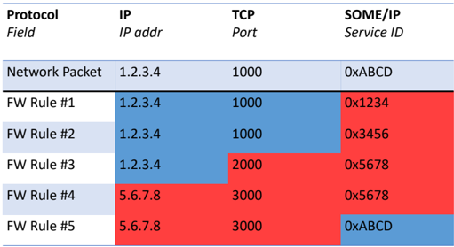

| 协议字段 | **IP** 地址 | **TCP** 端口 | **SOME/IP** Service ID |
|---|---|---|---|
| 网络数据包 | 1.2.3.4 | 1000 | 0xABCD |
| FW 规则 #1 | 1.2.3.4 | 1000 | 0x1234 |
| FW 规则 #2 | 1.2.3.4 | 1000 | 0x3456 |
| FW 规则 #3 | 1.2.3.4 | 2000 | 0x5678 |
| FW 规则 #4 | 5.6.7.8 | 3000 | 0x5678 |
| FW 规则 #5 | 5.6.7.8 | 3000 | 0xABCD |

传入的网络数据包与所有已定义的规则都不匹配，因此这里适用默认动作。该网络数据包与规则 1 和规则 2 的 **FirewallNetworkLayerIpv4FilterConfig** 及 **FirewallTransportLayerFilterConfig** 匹配，与规则 3 仅匹配 **FirewallNetworkLayerIpv4FilterConfig**，与规则 5 仅匹配 **FirewallSomeipProtocolFilterConfig**。规则 1 和规则 2 从最低网络层开始拥有最多的成功匹配的 **ISO OSI** 层（与之相对，例如规则 5 在 **SOME/IP** 层有匹配但在较低层没有匹配）。因此规则不匹配发生在 **SOME/IP** 层上，应为该协议引发一个 **SEv**。

如果已为 **Firewall** 模块启用安全事件报告（**FirwallEnableSecurityEventReporting** = **true**），相应的安全事件应通过 **CP_SWS_BSWGeneral** [\[4\]](#ref-4) 中定义的接口报告给 **IdsM**。

如果网络数据包被默认动作阻止，且与 **FirewallRule** 不匹配的网络协议是 **Ethernet**，防火墙应向 **IdsM** 引发 **SEv** **SEV_FW_PACKET_BLOCKED_DATALINKLAYER_MISMATCH**。

如果网络数据包被默认动作阻止，且与 **FirewallRule** 不匹配的网络协议是 **IPv4**，防火墙应向 **IdsM** 引发 **SEv** **SEV_FW_PACKET_BLOCKED_IPV4_MISMATCH**。

如果网络数据包被默认动作阻止，且与 **FirewallRule** 不匹配的网络协议是 **IPv6**，防火墙应向 **IdsM** 引发 **SEv** **SEV_FW_PACKET_BLOCKED_IPV6_MISMATCH**。

如果网络数据包被默认动作阻止，且与 **FirewallRule** 不匹配的网络协议是 **ICMP**，防火墙应向 **IdsM** 引发 **SEv** **SEV_FW_PACKET_BLOCKED_ICMP_MISMATCH**。

如果网络数据包被默认动作阻止，且与 **FirewallRule** 不匹配的网络协议是 **TCP**，防火墙应向 **IdsM** 引发 **SEv** **SEV_FW_PACKET_BLOCKED_TCP_MISMATCH**。

如果网络数据包被默认动作阻止，且与 **FirewallRule** 不匹配的网络协议是 **UDP**，防火墙应向 **IdsM** 引发 **SEv** **SEV_FW_PACKET_BLOCKED_UDP_MISMATCH**。

如果网络数据包被默认动作阻止，且与 **FirewallRule** 不匹配的网络协议是 **SOME/IP**，防火墙应向 **IdsM** 引发 **SEv** **SEV_FW_PACKET_BLOCKED_SOMEIP_MISMATCH**。

如果网络数据包被默认动作阻止，且与 **FirewallRule** 不匹配的网络协议是 **SOME/IP-SD**，防火墙应向 **IdsM** 引发 **SEv** **SEV_FW_PACKET_BLOCKED_SOMEIPSD_MISMATCH**。

如果网络数据包被默认动作阻止，且与 **FirewallRule** 不匹配的网络协议是 **DDS**，防火墙应向 **IdsM** 引发 **SEv** **SEV_FW_PACKET_BLOCKED_DDS_MISMATCH**。

如果网络数据包被默认动作阻止，且与 **FirewallRule** 不匹配的网络协议是 **DoIP**，防火墙应向 **IdsM** 引发 **SEv** **SEV_FW_PACKET_BLOCKED_DOIP_MISMATCH**。

如果网络数据包被默认动作阻止，且无法识别与 **FirewallRule** 不匹配的网络协议（例如因为使用 **FirewallPayloadBytePatternFilterConfig** 的有效载荷存在不匹配），防火墙应向 **IdsM** 引发 **SEv** **SEV_FW_PACKET_BLOCKED_GENERIC_MISMATCH**。

除模式不匹配之外，防火墙还应为因 **TCP** 有状态特性而被阻止的网络数据包引发 **SEv**。

如果网络数据包因已达到最大连接数而被阻止（见有状态数据包检查中并行 **TCP** 会话数量的规定），防火墙应向 **IdsM** 引发 **SEv** **SEV_FW_PACKET_BLOCKED_TCP_MAXCONNECTIONS**。

如果网络数据包因 **TCP** 超时过滤器而被阻止（见 **FirewallTimeoutCheck** 的规定），防火墙应向 **IdsM** 引发 **SEv** **SEV_FW_PACKET_BLOCKED_TCP_TIMEOUT**。

如果网络数据包因 **TCP** 状态转换过滤器而被阻止（见 **FirewallStateManagementBasedOnTcpFlags** 的规定），防火墙应向 **IdsM** 引发 **SEv** **SEV_FW_PACKET_BLOCKED_TCP_STATETRANSITION**。

最后，网络数据包也可能因速率限制特性（见第 [6.4.2](#642-速率限制) 节）而被丢弃。

如果网络数据包因速率限制特性（见漏桶计数器的规定）而被阻止，防火墙应向 **IdsM** 引发 **SEv** **SEV_FW_PACKET_BLOCKED_RATELIMIT**。

请注意，**SEv** **SEV_FW_PACKET_BLOCKED_BY_PERSTREAMFILTERING** 的触发条件在第 [6.5.2.2](#6522-交换机防火墙规则计数统计-sev) 节的计数器比较规定中描述。

### 6.7. 错误分类

文档 [\[4\]](#ref-4)「基础软件模块通用规范」中的「错误处理」一节详细描述了基础软件的错误处理。其中最重要的是，它构成了一个由五种错误类型组成的分类方案，这些错误类型可能出现在 **BSW** 模块中。

基于此基础，以下各节按相应的子节规定了具体的错误。

#### 6.7.1. 开发错误

**Fw** 模块开发错误的定义（**Definition of development errors in module Fw**）

| 错误类型 | 相关错误码 | 错误值 |
|---|---|---|
| 在 **Fw** 尚未完全初始化的情况下调用了 **API** 函数。 | FW_E_PARAM_UNINIT | 0x00 |
| 在模块已初始化的情况下调用了服务 [**Fw_Init**](#731-fw_init)。 | FW_E_ALREADY_INITIALIZED | 0x01 |
| 交换机核心防火墙规则的（去）激活失败。 | FW_E_SWITCHRULEMGMT_FAILED | 0x02 |

#### 6.7.2. 运行时错误

没有运行时错误。

#### 6.7.3. 瞬态故障

没有瞬态故障。

#### 6.7.4. 产品错误

没有产品错误。

#### 6.7.5. 扩展产品错误

没有扩展产品错误。

## 7. API规范

### 7.1. 导入的类型

本章列出了从以下文件包含的所有类型：

**Fw** 模块的导入数据类型定义（**Definition of imported datatypes of module Fw**）

| 模块 | 头文件 | 导入的类型 |
|---|---|---|
| Eth | Eth_GeneralTypes.h | Eth_DataType |
| Eth | Eth_GeneralTypes.h | Eth_FrameType |
| IdsM | IdsM_Types.h | IdsM_SecurityEventIdType |
| Std | Std_Types.h | Std_ReturnType |
| Std | Std_Types.h | Std_VersionInfoType |

### 7.2. 类型定义

#### 7.2.1. Fw_ConfigType

| 名称 | Fw_ConfigType |
|---|---|
| Kind | Structure |
| Elements | 实现特定。Type：- |
| 描述 | **Fw** 模块的配置数据结构 |
| Available via | Fw.h |

#### 7.2.2. Fw_InspectionResultType

| 名称 | Fw_InspectionResultType |
|---|---|
| Kind | Type |
| 派生自 | uint8 |
| 描述 | 防火墙模块可用的检查结果 |
| Available via | Fw_Types.h |

| 范围 | 值 | 描述 |
|---|---|---|
| FW_BLOCK_NETWORK_PACKET | 0x00 | 网络协议栈应阻止该网络数据包 |
| FW_ALLOW_NETWORK_PACKET | 0x01 | 网络协议栈应允许该网络数据包 |

### 7.3. 函数定义

#### 7.3.1. Fw_Init

**说明**: 初始化 **Fw** 模块的服务。它初始化所有变量并将模块状态设置为已初始化。服务 ID 0x00。同步调用，不可重入。参数 configPtr（in）：组件配置结构。可通过 **Fw.h** 获得。

```C
void Fw_Init ( const Fw_ConfigType* configPtr )
```

#### 7.3.2. Fw_GetVersionInfo

**说明**: 返回组件的版本信息、供应商 **ID** 和 **AUTOSAR** 模块 **ID**。服务 ID 0x01。同步调用，可重入。参数 versionInfo（out）：指向存储版本信息位置的指针，该参数不得为 **NULL**。可通过 **Fw.h** 获得。

```C
void Fw_GetVersionInfo ( const Std_VersionInfoType* versionInfo )
```

#### 7.3.3. Fw_InspectPacket

**说明**: 此函数根据预定义防火墙规则列表检查网络数据包，并在 **InspectionResultPtr** 中返回检查结果。服务 ID 0x3。同步调用，可重入。参数 CtrlIdx（in）：以太网接口上下文中物理以太网控制器的索引；FrameType（in）：接收到的以太网帧的帧类型；IsBroadcast（in）：指示广播帧的参数；PhysAddrPtr（in）：指向接收到的以太网帧的物理源地址（网络字节序的 **MAC** 地址）的指针；DataPtr（in）：指向接收到的以太网帧有效载荷的指针；LenByte（in）：接收帧中有效载荷的长度（字节）；StreamHandleIdxPtr（in）：指向与此网络数据包匹配的 StreamHandleIdx 的指针；InspectionResultPtr（out）：指向防火墙检查结果的指针。返回值：Std_ReturnType，E_OK：检查已成功执行；E_NOT_OK：无法成功执行网络数据包检查。可通过 **Fw.h** 获得。

```C
Std_ReturnType Fw_InspectPacket ( uint8 CtrlIdx, Eth_FrameType FrameType, boolean IsBroadcast, const uint8* PhysAddrPtr, const Eth_DataType* DataPtr, uint16 LenByte, uint8* StreamHandleIdxPtr, Fw_InspectionResultType* InspectionResultPtr )
```

#### 7.3.4. Fw_SetFirewallState

**说明**: 此函数由 **BswM** 调用，用于指示 **ECU** 状态变化。服务 ID 0x4。同步调用，可重入。参数 FirewallState（in）：防火墙应进入的状态。可通过 **Fw.h** 获得。

```C
void Fw_SetFirewallState ( uint16 FirewallState )
```

### 7.4. 回调通知

这是为其他模块提供的函数列表。

#### 7.4.1. Fw_StreamHandleIdxStatistics

**说明**: **EthIf** 成功从交换机获取桶计数器值后调用此函数。服务 ID 0x5。同步调用，可重入。参数 SwitchIdx（in）：以太网交换机驱动程序上下文中交换机的索引；NumberOfBuckets（in）：交换机中计数桶的数量；StreamHandleIdxStatisticsPtr（in）：指向桶计数器值的指针。可通过 **Fw_Cbk.h** 获得。

```C
void Fw_StreamHandleIdxStatistics ( uint8 SwitchIdx, uint8 NumberOfBuckets, const uint8* StreamHandleIdxStatisticsPtr )
```

#### 7.4.2. Fw_StreamHandleIdxConfiguration

**说明**: **EthIf** 成功设置交换机中的 StreamHandleIdx 后调用此函数。服务 ID 0x6。同步调用，可重入。参数 SwitchIdx（in）：以太网交换机驱动程序上下文中交换机的索引；StreamHandleIdxPtr（in）：指向为其返回当前状态的 StreamHandleIdx 的指针；StreamHandleIdxActivityStatus（in）：StreamHandleIdx 的活动状态（**true** = 活动，**false** = 非活动）。可通过 **Fw_Cbk.h** 获得。

```C
void Fw_StreamHandleIdxConfiguration ( uint8 SwitchIdx, uint8 StreamHandleIdxPtr, boolean StreamHandleIdxActivityStatus )
```

### 7.5. 调度函数

这些函数由基础软件调度器直接调用。以下函数应没有返回值和参数。所有函数均不可重入。

#### 7.5.1. Fw_MainFunction

**说明**: 此函数被周期性调用。它用于执行异步函数调用（例如对交换机驱动程序的调用）。服务 ID 0x02。同步调用，不可重入。可通过 **Fw.h** 获得。

```C
void Fw_MainFunction ( void )
```

### 7.6. 期望接口

本章列出从其他模块所需的所有接口。

#### 7.6.1. 强制接口

**注意：**本节定义了实现模块核心功能所需的所有接口。

**Fw** 模块强制接口的定义（**Definition of mandatory interfaces in module Fw**）

| API 函数 | 头文件 | 说明 |
|---|---|---|
| 没有强制接口。 | | |

#### 7.6.2. 可选接口

本节定义了实现模块可选功能所需的所有接口。

**Fw** 模块可选接口的定义（**Definition of optional interfaces in module Fw**）

| API 函数 | 头文件 | 说明 |
|---|---|---|
| Det_ReportError | Det.h | 报告开发错误的服务。 |
| EthIf_GetStreamHandleIdxStatistics | EthIf.h | **Firewall** 模块调用此函数以从交换机获取桶计数器统计信息。 |
| EthIf_SetStreamHandleIdxConfiguration | EthIf.h | **Firewall** 模块调用此函数以控制交换机中 StreamHandleIdx 的活动状态。 |
| IdsM_SetSecurityEvent | IdsM.h | 此 **API** 是向 **IdsM** 报告安全事件的应用接口。 |

#### 7.6.3. 可配置接口

在本节中，列出目标函数可以配置的所有接口。目标函数通常是回调函数。此类接口的名称不是固定的，因为它们是可配置的。

### 7.7. 服务接口

**Firewall** 不需要任何服务接口。

## 8. 时序图

### 8.1. 交换机核心过滤规则提取

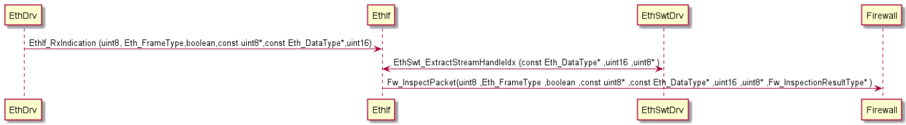

### 8.2. 交换机核心过滤规则计数统计

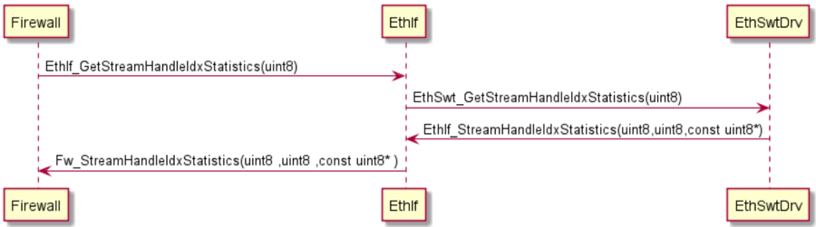

### 8.3. 交换机核心过滤规则管理

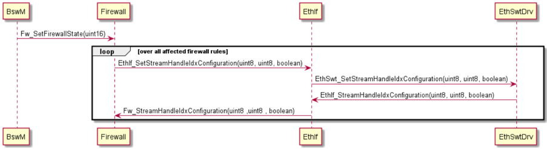

## 9. 配置规范

总体而言，本章定义配置参数及其到**容器**（container）的聚类组织。为支持本规范，第 9.1 章描述基础知识。它还规定了应用于参数规范的模板（表）。我们有意将第 9.1 章保留在规范中以保证可理解性。

第 9.2 章规定模块 **Firewall** 的结构（容器）和参数。

第 9.3 章规定模块 **Firewall** 的发布信息。

### 9.1. 如何阅读本章

详情请参阅 **SWS_BSWGeneral** 中的第 10.1 章「Introduction to configuration specification」（配置规范简介）。

### 9.2. 容器与配置参数

以下各节汇总所有配置参数。各参数的详细含义在第 6 章和第 7 章中描述。

#### 9.2.1. Firewall

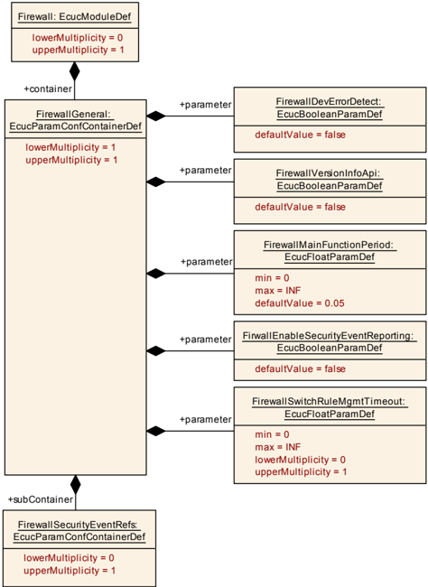

| SWS 条目 | [ECUC_Fw_00001] |
|---|---|
| 模块名称 | Firewall |
| 描述 | **Firewall** 模块的配置。 |
| Post-Build 变体支持 | true |
| 支持的配置变体 | VARIANT-LINK-TIME, VARIANT-POST-BUILD, VARIANT-PRE-COMPILE |

| 容器名称 | 多重性 | 作用域/依赖 |
|---|---|---|
| FirewallConfig | 1 | 定义各个数据包中控制信息的防火墙规则。 |
| FirewallGeneral | 1 | 包含模块的通用配置参数。 |
| FirewallRule | 1..* | 定义各个数据包中控制信息的防火墙规则。 |
| FirewallState | 1..* | 防火墙可被激活（通过 **FirewallStateRef**）的防火墙状态集合。 |
| FirewallStateDependentRules | 1..* | 定义在防火墙状态中的防火墙规则。 |
| FirewallSwitchBucketCounterStatistics | 0..* | 交换机桶计数器统计信息的轮询。 |

| SWS 条目 | [ECUC_Fw_00002] |
|---|---|
| 容器名称 | FirewallGeneral |
| 父容器 | Firewall |
| 描述 | 包含模块的通用配置参数。 |
| 配置参数 | 见下方参数表 |

| SWS 条目 | [ECUC_Fw_00003] |
|---|---|
| 参数名称 | FirewallDevErrorDetect |
| 父容器 | FirewallGeneral |
| 描述 | 开启或关闭开发错误检测与通知（**true**：启用检测与通知；**false**：禁用检测与通知）。 |
| 多重性 | 1 |
| 类型 | EcucBooleanParamDef |
| 默认值 | false |
| Post-Build 变体值 | false |
| 值配置类 | Pre-compile time：x（All Variants）；Link time：-；Post-build time：- |
| 作用域/依赖 | scope: local |

| SWS 条目 | [ECUC_Fw_00005] |
|---|---|
| 参数名称 | FirewallMainFunctionPeriod |
| 父容器 | FirewallGeneral |
| 描述 | 相应 **Firewall** 主函数实例的执行周期（单位：秒）。 |
| 多重性 | 1 |
| 类型 | EcucFloatParamDef |
| 范围 | ]0 .. INF[ |
| 默认值 | 0.05 |
| Post-Build 变体值 | false |
| 值配置类 | Pre-compile time：x（All Variants）；Link time：-；Post-build time：- |
| 作用域/依赖 | scope: local |

| SWS 条目 | [ECUC_Fw_00142] |
|---|---|
| 参数名称 | FirewallSwitchRuleMgmtTimeout |
| 父容器 | FirewallGeneral |
| 描述 | 等待交换机核心配置请求确认的超时时间。 |
| 多重性 | 0..1 |
| 类型 | EcucFloatParamDef |
| 范围 | ]0 .. INF[ |
| 默认值 | - |
| Post-Build 变体多重性 | false |
| Post-Build 变体值 | false |
| 多重性配置类 | Pre-compile time：x；Link time：-；Post-build time：- |
| 值配置类 | Pre-compile time：x；Link time：-；Post-build time：- |
| 作用域/依赖 | scope: ECU |

| SWS 条目 | [ECUC_Fw_00004] |
|---|---|
| 参数名称 | FirewallVersionInfoApi |
| 父容器 | FirewallGeneral |
| 描述 | 启用版本信息 **API** 支持的预处理器开关。 |
| 多重性 | 1 |
| 类型 | EcucBooleanParamDef |
| 默认值 | false |
| Post-Build 变体值 | false |
| 值配置类 | Pre-compile time：x（All Variants）；Link time：-；Post-build time：- |
| 作用域/依赖 | scope: local |

| SWS 条目 | [ECUC_Fw_00116] |
|---|---|
| 参数名称 | FirwallEnableSecurityEventReporting |
| 父容器 | FirewallGeneral |
| 描述 | 开关是否向 **IdsM** 报告安全事件（**true**：启用报告；**false**：禁用报告）。 |
| 多重性 | 1 |
| 类型 | EcucBooleanParamDef |
| 默认值 | false |
| Post-Build 变体值 | false |
| 值配置类 | Pre-compile time：x（All Variants）；Link time：-；Post-build time：- |
| 作用域/依赖 | scope: ECU |

| 容器名称 | 多重性 | 作用域/依赖 |
|---|---|---|
| FirewallSecurityEventRefs | 0..1 | 用于包含指向 IdsMEvent 元素的引用的容器，这些元素表示在发生相应安全相关事件时（且在 **FirewallEnableSecurityEventReporting** 设置为 true 的情况下）防火墙模块应向 **IdsM** 报告的安全事件。该容器中的标准化安全事件可以通过供应商特定的安全事件进行扩展。 |

#### 9.2.2. 与 BswM 的连接

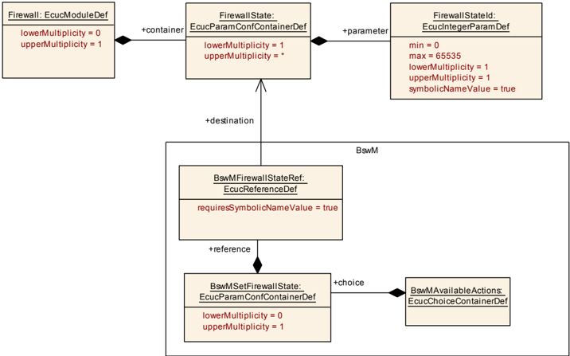

| SWS 条目 | [ECUC_Fw_00141] |
|---|---|
| 容器名称 | FirewallConfig |
| 父容器 | Firewall |
| 描述 | 定义各个数据包中控制信息的防火墙规则。 |
| 配置参数 | 见下方参数表 |

| SWS 条目 | [ECUC_Fw_00106] |
|---|---|
| 参数名称 | FirewallInitialStateRef |
| 父容器 | FirewallConfig |
| 描述 | 对定义为默认状态的 Firewall State 的引用。 |
| 多重性 | 1 |
| 类型 | Reference to FirewallState |
| Post-Build 变体多重性 | true |
| Post-Build 变体值 | true |
| 多重性配置类 | Pre-compile time：x（VARIANT-PRE-COMPILE）；Link time：x（VARIANT-LINK-TIME）；Post-build time：x（VARIANT-POST-BUILD） |
| 值配置类 | Pre-compile time：x（VARIANT-PRE-COMPILE）；Link time：x（VARIANT-LINK-TIME）；Post-build time：x（VARIANT-POST-BUILD） |
| 作用域/依赖 | scope: local |

无包含的容器。

| SWS 条目 | [ECUC_Fw_00107] |
|---|---|
| 容器名称 | FirewallState |
| 父容器 | Firewall |
| 描述 | 防火墙可被激活（通过 **FirewallStateRef**）的防火墙状态集合。 |
| Post-Build 变体多重性 | true |
| 多重性配置类 | Pre-compile time：x（VARIANT-PRE-COMPILE）；Link time：x（VARIANT-LINK-TIME）；Post-build time：x（VARIANT-POST-BUILD） |
| 配置参数 | 见下方参数表 |

| SWS 条目 | [ECUC_Fw_00108] |
|---|---|
| 参数名称 | FirewallStateId |
| 父容器 | FirewallState |
| 描述 | 标识 Firewall State 的参数。 |
| 多重性 | 1 |
| 类型 | EcucIntegerParamDef（为此参数生成符号名） |
| 范围 | 0 .. 65535 |
| 默认值 | - |
| 值配置类 | Pre-compile time：x（All Variants）；Link time：-；Post-build time：- |
| 作用域/依赖 | scope: local |

无包含的容器。

| SWS 条目 | [ECUC_Fw_00006] |
|---|---|
| 容器名称 | FirewallStateDependentRules |
| 父容器 | Firewall |
| 描述 | 定义在防火墙状态中的防火墙规则。 |
| Post-Build 变体多重性 | true |
| 多重性配置类 | Pre-compile time：x（VARIANT-PRE-COMPILE）；Link time：x（VARIANT-LINK-TIME）；Post-build time：x（VARIANT-POST-BUILD） |
| 配置参数 | 见下方参数表 |

| SWS 条目 | [ECUC_Fw_00007] |
|---|---|
| 参数名称 | FirewallDefaultAction |
| 父容器 | FirewallStateDependentRules |
| 描述 | 该属性定义一个默认动作（defaultAction）。 |
| 多重性 | 0..1 |
| 类型 | EcucEnumerationParamDef |
| 范围 | ALLOW、BLOCK |
| Post-Build 变体多重性 | true |
| Post-Build 变体值 | true |
| 多重性配置类 | Pre-compile time：x（VARIANT-PRE-COMPILE）；Link time：x（VARIANT-LINK-TIME）；Post-build time：x（VARIANT-POST-BUILD） |
| 值配置类 | Pre-compile time：x（VARIANT-PRE-COMPILE）；Link time：x（VARIANT-LINK-TIME）；Post-build time：x（VARIANT-POST-BUILD） |
| 作用域/依赖 | |

| SWS 条目 | [ECUC_Fw_00109] |
|---|---|
| 参数名称 | FirewallStateRef |
| 父容器 | FirewallStateDependentRules |
| 描述 | 对防火墙处于激活状态的防火墙状态的引用。如果其中一个被引用的 Firewall State 处于激活状态，则该防火墙规则也应被视为激活。 |
| 多重性 | 1..* |
| 类型 | Reference to FirewallState |
| Post-Build 变体多重性 | true |
| Post-Build 变体值 | true |
| 多重性配置类 | Pre-compile time：x（VARIANT-PRE-COMPILE）；Link time：x（VARIANT-LINK-TIME）；Post-build time：x（VARIANT-POST-BUILD） |
| 值配置类 | Pre-compile time：x（VARIANT-PRE-COMPILE）；Link time：x（VARIANT-LINK-TIME）；Post-build time：x（VARIANT-POST-BUILD） |
| 作用域/依赖 | scope: local |

| 容器名称 | 多重性 | 作用域/依赖 |
|---|---|---|
| FirewallActionForMatchingRules | 1..* | 如果被引用的模式匹配则执行的防火墙动作。 |

#### 9.2.3. 过滤规则

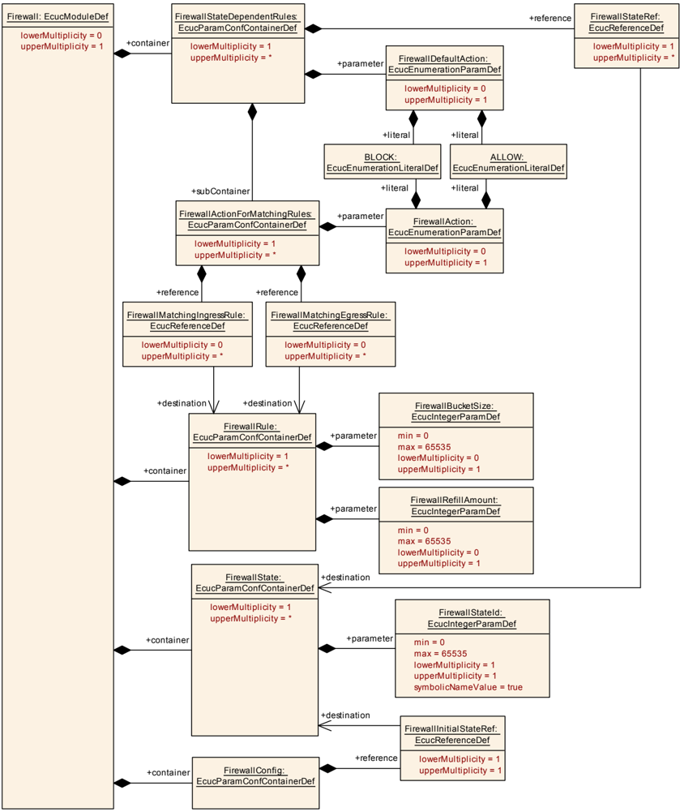

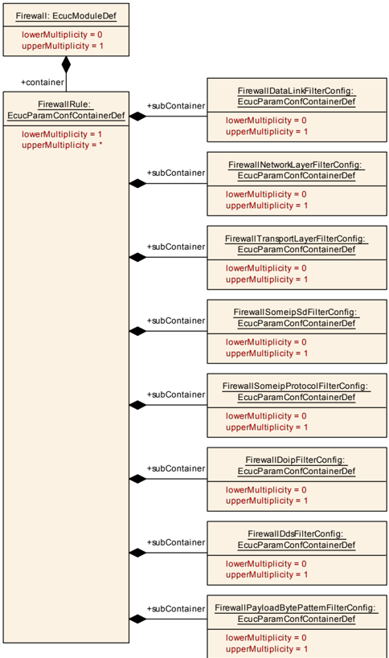

| SWS 条目 | [ECUC_Fw_00011] |
|---|---|
| 容器名称 | FirewallRule |
| 父容器 | Firewall |
| 描述 | 定义各个数据包中控制信息的防火墙规则。 |
| Post-Build 变体多重性 | true |
| 多重性配置类 | Pre-compile time：x（VARIANT-PRE-COMPILE）；Link time：x（VARIANT-LINK-TIME）；Post-build time：x（VARIANT-POST-BUILD） |
| 配置参数 | 见下方参数表 |

| SWS 条目 | [ECUC_Fw_00027] |
|---|---|
| 参数名称 | FirewallBucketSize |
| 父容器 | FirewallRule |
| 描述 | 该属性定义用于速率限制的队列容量（漏桶算法）。 |
| 多重性 | 0..1 |
| 类型 | EcucIntegerParamDef |
| 范围 | 0 .. 65535 |
| 默认值 | - |
| Post-Build 变体多重性 | true |
| Post-Build 变体值 | true |
| 多重性配置类 | Pre-compile time：x（VARIANT-PRE-COMPILE）；Link time：x（VARIANT-LINK-TIME）；Post-build time：x（VARIANT-POST-BUILD） |
| 值配置类 | Pre-compile time：x（All Variants）；Link time：-；Post-build time：- |
| 作用域/依赖 | scope: local |

| SWS 条目 | [ECUC_Fw_00026] |
|---|---|
| 参数名称 | FirewallRefillAmount |
| 父容器 | FirewallRule |
| 描述 | 该属性定义输出速率，即每秒离开队列的数据包数量（漏桶算法）。 |
| 多重性 | 0..1 |
| 类型 | EcucIntegerParamDef |
| 范围 | 0 .. 65535 |
| 默认值 | - |
| Post-Build 变体多重性 | true |
| Post-Build 变体值 | true |
| 多重性配置类 | Pre-compile time：x（VARIANT-PRE-COMPILE）；Link time：x（VARIANT-LINK-TIME）；Post-build time：x（VARIANT-POST-BUILD） |
| 值配置类 | Pre-compile time：x（VARIANT-PRE-COMPILE）；Link time：x（VARIANT-LINK-TIME）；Post-build time：x（VARIANT-POST-BUILD） |
| 作用域/依赖 | scope: local |

| 容器名称 | 多重性 | 作用域/依赖 |
|---|---|---|
| FirewallDataLinkFilterConfig | 0..1 | 数据链路层上过滤规则的配置。 |
| FirewallDdsFilterConfig | 0..1 | 针对 Dds 的过滤规则配置。 |
| FirewallDoipFilterConfig | 0..1 | 针对 DoIP 的过滤规则配置。 |
| FirewallNetworkLayerFilterConfig | 0..1 | 网络层上过滤规则的配置。 |
| FirewallPayloadBytePatternFilterConfig | 0..1 | 定义应匹配的报文各个字节的通用防火墙规则的配置。 |
| FirewallSomeipProtocolFilterConfig | 0..1 | **SOME/IP** 协议防火墙规则的配置。 |
| FirewallSomeipSdFilterConfig | 0..1 | **SOME/IP** Service Discovery 防火墙规则的配置。 |
| FirewallTransportLayerFilterConfig | 0..1 | 传输层层级上过滤规则的配置。 |

| SWS 条目 | [ECUC_Fw_00008] |
|---|---|
| 容器名称 | FirewallActionForMatchingRules |
| 父容器 | FirewallStateDependentRules |
| 描述 | 如果被引用的模式匹配则执行的防火墙动作。 |
| Post-Build 变体多重性 | true |
| 多重性配置类 | Pre-compile time：x（VARIANT-PRE-COMPILE）；Link time：x（VARIANT-LINK-TIME）；Post-build time：x（VARIANT-POST-BUILD） |
| 配置参数 | 见下方参数表 |

| SWS 条目 | [ECUC_Fw_00009] |
|---|---|
| 参数名称 | FirewallAction |
| 父容器 | FirewallActionForMatchingRules |
| 描述 | 如果 matchingRule 得到满足，防火墙执行的动作。 |
| 多重性 | 0..1 |
| 类型 | EcucEnumerationParamDef |
| 范围 | ALLOW、BLOCK |
| Post-Build 变体多重性 | true |
| Post-Build 变体值 | true |
| 多重性配置类 | Pre-compile time：x（VARIANT-PRE-COMPILE）；Link time：x（VARIANT-LINK-TIME）；Post-build time：x（VARIANT-POST-BUILD） |
| 值配置类 | Pre-compile time：x（VARIANT-PRE-COMPILE）；Link time：x（VARIANT-LINK-TIME）；Post-build time：x（VARIANT-POST-BUILD） |
| 作用域/依赖 | |

| SWS 条目 | [ECUC_Fw_00143] |
|---|---|
| 参数名称 | FirewallMatchingEgressRule |
| 父容器 | FirewallActionForMatchingRules |
| 描述 | 用于匹配出口网络流量的防火墙规则表达式。 |
| 多重性 | 0..* |
| 类型 | Reference to FirewallRule |
| Post-Build 变体多重性 | true |
| Post-Build 变体值 | true |
| 多重性配置类 | Pre-compile time：x（VARIANT-PRE-COMPILE）；Link time：x（VARIANT-LINK-TIME）；Post-build time：x（VARIANT-POST-BUILD） |
| 值配置类 | Pre-compile time：x（VARIANT-PRE-COMPILE）；Link time：x（VARIANT-LINK-TIME）；Post-build time：x（VARIANT-POST-BUILD） |
| 作用域/依赖 | |

| SWS 条目 | [ECUC_Fw_00010] |
|---|---|
| 参数名称 | FirewallMatchingIngressRule |
| 父容器 | FirewallActionForMatchingRules |
| 描述 | 用于匹配入口网络流量的防火墙规则表达式。 |
| 多重性 | 0..* |
| 类型 | Reference to FirewallRule |
| Post-Build 变体多重性 | true |
| Post-Build 变体值 | true |
| 多重性配置类 | Pre-compile time：x（VARIANT-PRE-COMPILE）；Link time：x（VARIANT-LINK-TIME）；Post-build time：x（VARIANT-POST-BUILD） |
| 值配置类 | Pre-compile time：x（VARIANT-PRE-COMPILE）；Link time：x（VARIANT-LINK-TIME）；Post-build time：x（VARIANT-POST-BUILD） |
| 作用域/依赖 | |

无包含的容器。

##### 9.2.3.1. 数据链路层配置

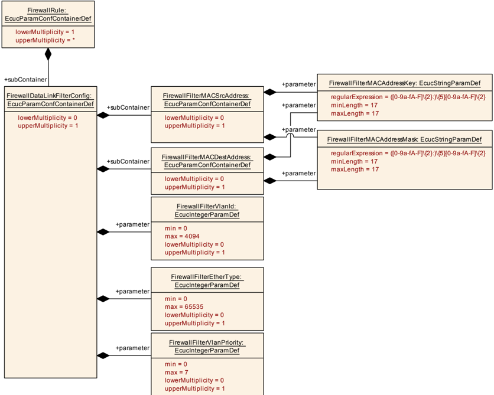

| SWS 条目 | [ECUC_Fw_00139] |
|---|---|
| 容器名称 | FirewallDataLinkFilterConfig |
| 父容器 | FirewallRule |
| 描述 | 数据链路层上过滤规则的配置。 |
| Post-Build 变体多重性 | true |
| 多重性配置类 | Pre-compile time：x（VARIANT-PRE-COMPILE）；Link time：x（VARIANT-LINK-TIME）；Post-build time：x（VARIANT-POST-BUILD） |
| 配置参数 | 见下方参数表 |

| SWS 条目 | [ECUC_Fw_00017] |
|---|---|
| 参数名称 | FirewallFilterEtherType |
| 父容器 | FirewallDataLinkFilterConfig |
| 描述 | 过滤器 Ether Type 的定义。 |
| 多重性 | 0..1 |
| 类型 | EcucIntegerParamDef |
| 范围 | 0 .. 65535 |
| 默认值 | - |
| Post-Build 变体多重性 | false |
| Post-Build 变体值 | false |
| 多重性配置类 | Pre-compile time：x（All Variants）；Link time：-；Post-build time：- |
| 值配置类 | Pre-compile time：x（All Variants）；Link time：-；Post-build time：- |
| 作用域/依赖 | scope: local |

| SWS 条目 | [ECUC_Fw_00016] |
|---|---|
| 参数名称 | FirewallFilterVlanId |
| 父容器 | FirewallDataLinkFilterConfig |
| 描述 | 过滤器 **VLAN ID** 的定义。 |
| 多重性 | 0..1 |
| 类型 | EcucIntegerParamDef |
| 范围 | 0 .. 4094 |
| 默认值 | - |
| Post-Build 变体多重性 | false |
| Post-Build 变体值 | false |
| 多重性配置类 | Pre-compile time：x；Link time：-；Post-build time：- |
| 值配置类 | Pre-compile time：x；Link time：-；Post-build time：- |
| 作用域/依赖 | scope: local |

| SWS 条目 | [ECUC_Fw_00018] |
|---|---|
| 参数名称 | FirewallFilterVlanPriority |
| 父容器 | FirewallDataLinkFilterConfig |
| 描述 | 过滤器 **VLAN** 优先级的定义。 |
| 多重性 | 0..1 |
| 类型 | EcucIntegerParamDef |
| 范围 | 0 .. 7 |
| 默认值 | - |
| Post-Build 变体多重性 | false |
| Post-Build 变体值 | false |
| 多重性配置类 | Pre-compile time：x（All Variants）；Link time：-；Post-build time：- |
| 值配置类 | Pre-compile time：x（All Variants）；Link time：-；Post-build time：- |
| 作用域/依赖 | scope: local |

| 容器名称 | 多重性 | 作用域/依赖 |
|---|---|---|
| FirewallFilterMACDestAddress | 0..1 | 一个 **MAC** 目的地址过滤器的配置。 |
| FirewallFilterMACSrcAddress | 0..1 | 一个 **MAC** 源地址过滤器的配置。 |

| SWS 条目 | [ECUC_Fw_00013] |
|---|---|
| 容器名称 | FirewallFilterMACDestAddress |
| 父容器 | FirewallDataLinkFilterConfig |
| 描述 | 一个 **MAC** 目的地址过滤器的配置。 |
| Post-Build 变体多重性 | true |
| 多重性配置类 | Pre-compile time：x（VARIANT-PRE-COMPILE）；Link time：x（VARIANT-LINK-TIME）；Post-build time：x（VARIANT-POST-BUILD） |
| 配置参数 | 见下方参数表 |

| SWS 条目 | [ECUC_Fw_00014] |
|---|---|
| 参数名称 | FirewallFilterMACAddressKey |
| 父容器 | FirewallFilterMACDestAddress |
| 描述 | 指定 48 位物理地址（**MAC** 地址）键值。 |
| 多重性 | 1 |
| 类型 | EcucStringParamDef |
| 默认值 | - |
| 长度 | 17-17 |
| 正则表达式 | ([0-9a-fA-F]\{2}:)\{5}[0-9a-fA-F]\{2} |
| Post-Build 变体值 | true |
| 值配置类 | Pre-compile time：x（VARIANT-PRE-COMPILE）；Link time：x（VARIANT-LINK-TIME）；Post-build time：x（VARIANT-POST-BUILD） |
| 作用域/依赖 | scope: local |

| SWS 条目 | [ECUC_Fw_00015] |
|---|---|
| 参数名称 | FirewallFilterMACAddressMask |
| 父容器 | FirewallFilterMACDestAddress |
| 描述 | 指定 48 位物理地址（**MAC** 地址）掩码值。 |
| 多重性 | 1 |
| 类型 | EcucStringParamDef |
| 默认值 | - |
| 长度 | 17-17 |
| 正则表达式 | ([0-9a-fA-F]\{2}:)\{5}[0-9a-fA-F]\{2} |
| Post-Build 变体值 | true |
| 值配置类 | Pre-compile time：x（VARIANT-PRE-COMPILE）；Link time：x（VARIANT-LINK-TIME）；Post-build time：x（VARIANT-POST-BUILD） |
| 作用域/依赖 | scope: local |

无包含的容器。

| SWS 条目 | [ECUC_Fw_00012] |
|---|---|
| 容器名称 | FirewallFilterMACSrcAddress |
| 父容器 | FirewallDataLinkFilterConfig |
| 描述 | 一个 **MAC** 源地址过滤器的配置。 |
| Post-Build 变体多重性 | true |
| 多重性配置类 | Pre-compile time：x（VARIANT-PRE-COMPILE）；Link time：x（VARIANT-LINK-TIME）；Post-build time：x（VARIANT-POST-BUILD） |
| 配置参数 | 见下方参数表 |

| SWS 条目 | [ECUC_Fw_00014] |
|---|---|
| 参数名称 | FirewallFilterMACAddressKey |
| 父容器 | FirewallFilterMACSrcAddress |
| 描述 | 指定 48 位物理地址（**MAC** 地址）键值。 |
| 多重性 | 1 |
| 类型 | EcucStringParamDef |
| 默认值 | - |
| 长度 | 17-17 |
| 正则表达式 | ([0-9a-fA-F]\{2}:)\{5}[0-9a-fA-F]\{2} |
| Post-Build 变体值 | true |
| 值配置类 | Pre-compile time：x（VARIANT-PRE-COMPILE）；Link time：x（VARIANT-LINK-TIME）；Post-build time：x（VARIANT-POST-BUILD） |
| 作用域/依赖 | scope: local |

| SWS 条目 | [ECUC_Fw_00015] |
|---|---|
| 参数名称 | FirewallFilterMACAddressMask |
| 父容器 | FirewallFilterMACSrcAddress |
| 描述 | 指定 48 位物理地址（**MAC** 地址）掩码值。 |
| 多重性 | 1 |
| 类型 | EcucStringParamDef |
| 默认值 | - |
| 长度 | 17-17 |
| 正则表达式 | ([0-9a-fA-F]\{2}:)\{5}[0-9a-fA-F]\{2} |
| Post-Build 变体值 | true |
| 值配置类 | Pre-compile time：x（VARIANT-PRE-COMPILE）；Link time：x（VARIANT-LINK-TIME）；Post-build time：x（VARIANT-POST-BUILD） |
| 作用域/依赖 | scope: local |

无包含的容器。

##### 9.2.3.2. IPv4 配置

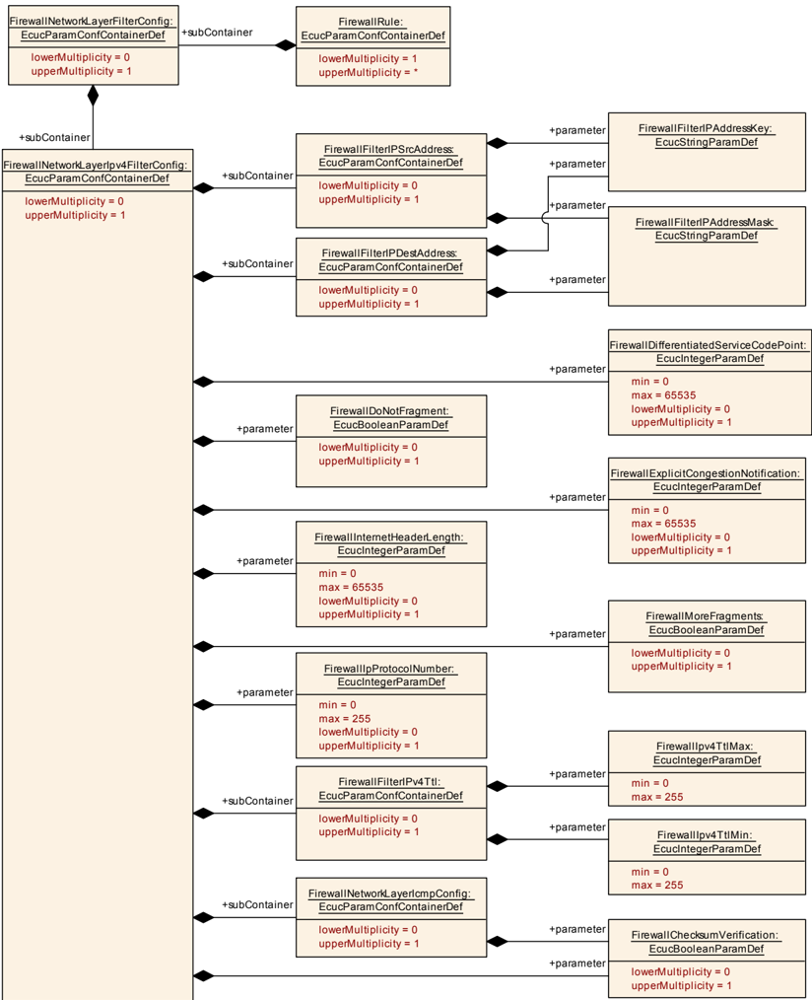

| SWS 条目 | [ECUC_Fw_00030] |
|---|---|
| 容器名称 | FirewallNetworkLayerFilterConfig |
| 父容器 | FirewallRule |
| 描述 | 网络层上过滤规则的配置。 |
| Post-Build 变体多重性 | true |
| 多重性配置类 | Pre-compile time：x（VARIANT-PRE-COMPILE）；Link time：x（VARIANT-LINK-TIME）；Post-build time：x（VARIANT-POST-BUILD） |
| 配置参数 | 见下方参数表 |

| 容器名称 | 多重性 | 作用域/依赖 |
|---|---|---|
| FirewallNetworkLayerIpv4FilterConfig | 0..1 | 网络层上针对 IPv6 的过滤规则配置。 |
| FirewallNetworkLayerIpv6FilterConfig | 0..1 | 网络层上过滤规则的配置。 |

| SWS 条目 | [ECUC_Fw_00140] |
|---|---|
| 容器名称 | FirewallNetworkLayerIpv4FilterConfig |
| 父容器 | FirewallNetworkLayerFilterConfig |
| 描述 | 网络层上针对 IPv6 的过滤规则配置。 |
| Post-Build 变体多重性 | true |
| 多重性配置类 | Pre-compile time：x（VARIANT-PRE-COMPILE）；Link time：x（VARIANT-LINK-TIME）；Post-build time：x（VARIANT-POST-BUILD） |
| 配置参数 | 见下方参数表 |

| SWS 条目 | [ECUC_Fw_00025] |
|---|---|
| 参数名称 | FirewallChecksumVerification |
| 父容器 | FirewallNetworkLayerIpv4FilterConfig |
| 描述 | 定义是否执行校验和验证。 |
| 多重性 | 0..1 |
| 类型 | EcucBooleanParamDef |
| 默认值 | - |
| Post-Build 变体多重性 | true |
| Post-Build 变体值 | true |
| 多重性配置类 | Pre-compile time：x（VARIANT-PRE-COMPILE）；Link time：x（VARIANT-LINK-TIME）；Post-build time：x（VARIANT-POST-BUILD） |
| 值配置类 | Pre-compile time：x（VARIANT-PRE-COMPILE）；Link time：x（VARIANT-LINK-TIME）；Post-build time：x（VARIANT-POST-BUILD） |
| 作用域/依赖 | scope: local |

| SWS 条目 | [ECUC_Fw_00040] |
|---|---|
| 参数名称 | FirewallDifferentiatedServiceCodePoint |
| 父容器 | FirewallNetworkLayerIpv4FilterConfig |
| 描述 | 匹配具有 **DSCP** 值的数据包的过滤器。 |
| 多重性 | 0..1 |
| 类型 | EcucIntegerParamDef |
| 范围 | 0 .. 65535 |
| 默认值 | - |
| Post-Build 变体多重性 | true |
| Post-Build 变体值 | true |
| 多重性配置类 | Pre-compile time：x（VARIANT-PRE-COMPILE）；Link time：x（VARIANT-LINK-TIME）；Post-build time：x（VARIANT-POST-BUILD） |
| 值配置类 | Pre-compile time：x（VARIANT-PRE-COMPILE）；Link time：x（VARIANT-LINK-TIME）；Post-build time：x（VARIANT-POST-BUILD） |
| 作用域/依赖 | scope: local |

| SWS 条目 | [ECUC_Fw_00041] |
|---|---|
| 参数名称 | FirewallDoNotFragment |
| 父容器 | FirewallNetworkLayerIpv4FilterConfig |
| 描述 | 匹配报头中设置了 doNotFragment 位的数据包的过滤器。 |
| 多重性 | 0..1 |
| 类型 | EcucBooleanParamDef |
| 默认值 | - |
| Post-Build 变体多重性 | true |
| Post-Build 变体值 | true |
| 多重性配置类 | Pre-compile time：x（VARIANT-PRE-COMPILE）；Link time：x（VARIANT-LINK-TIME）；Post-build time：x（VARIANT-POST-BUILD） |
| 值配置类 | Pre-compile time：x（VARIANT-PRE-COMPILE）；Link time：x（VARIANT-LINK-TIME）；Post-build time：x（VARIANT-POST-BUILD） |
| 作用域/依赖 | scope: local |

| SWS 条目 | [ECUC_Fw_00045] |
|---|---|
| 参数名称 | FirewallExplicitCongestionNotification |
| 父容器 | FirewallNetworkLayerIpv4FilterConfig |
| 描述 | 匹配具有 **ECN** 码点的数据包的过滤器。 |
| 多重性 | 0..1 |
| 类型 | EcucIntegerParamDef |
| 范围 | 0 .. 65535 |
| 默认值 | - |
| Post-Build 变体多重性 | true |
| Post-Build 变体值 | true |
| 多重性配置类 | Pre-compile time：x（VARIANT-PRE-COMPILE）；Link time：x（VARIANT-LINK-TIME）；Post-build time：x（VARIANT-POST-BUILD） |
| 值配置类 | Pre-compile time：x（VARIANT-PRE-COMPILE）；Link time：x（VARIANT-LINK-TIME）；Post-build time：x（VARIANT-POST-BUILD） |
| 作用域/依赖 | scope: local |

| SWS 条目 | [ECUC_Fw_00042] |
|---|---|
| 参数名称 | FirewallInternetHeaderLength |
| 父容器 | FirewallNetworkLayerIpv4FilterConfig |
| 描述 | 匹配具有最小 IPv4 报文头长度的数据包的过滤器。 |
| 多重性 | 0..1 |
| 类型 | EcucIntegerParamDef |
| 范围 | 0 .. 65535 |
| 默认值 | - |
| Post-Build 变体多重性 | true |
| Post-Build 变体值 | true |
| 多重性配置类 | Pre-compile time：x（VARIANT-PRE-COMPILE）；Link time：x（VARIANT-LINK-TIME）；Post-build time：x（VARIANT-POST-BUILD） |
| 值配置类 | Pre-compile time：x（VARIANT-PRE-COMPILE）；Link time：x（VARIANT-LINK-TIME）；Post-build time：x（VARIANT-POST-BUILD） |
| 作用域/依赖 | scope: local |

| SWS 条目 | [ECUC_Fw_00044] |
|---|---|
| 参数名称 | FirewallIpProtocolNumber |
| 父容器 | FirewallNetworkLayerIpv4FilterConfig |
| 描述 | 匹配具有 **IP** 协议号的数据包的过滤器。 |
| 多重性 | 0..1 |
| 类型 | EcucIntegerParamDef |
| 范围 | 0 .. 255 |
| 默认值 | - |
| Post-Build 变体多重性 | true |
| Post-Build 变体值 | true |
| 多重性配置类 | Pre-compile time：x（VARIANT-PRE-COMPILE）；Link time：x（VARIANT-LINK-TIME）；Post-build time：x（VARIANT-POST-BUILD） |
| 值配置类 | Pre-compile time：x（VARIANT-PRE-COMPILE）；Link time：x（VARIANT-LINK-TIME）；Post-build time：x（VARIANT-POST-BUILD） |
| 作用域/依赖 | scope: local |

| SWS 条目 | [ECUC_Fw_00043] |
|---|---|
| 参数名称 | FirewallMoreFragments |
| 父容器 | FirewallNetworkLayerIpv4FilterConfig |
| 描述 | 匹配报头中设置了 moreFragments 标志的数据包的过滤器。 |
| 多重性 | 0..1 |
| 类型 | EcucBooleanParamDef |
| 默认值 | - |
| Post-Build 变体多重性 | true |
| Post-Build 变体值 | true |
| 多重性配置类 | Pre-compile time：x（VARIANT-PRE-COMPILE）；Link time：x（VARIANT-LINK-TIME）；Post-build time：x（VARIANT-POST-BUILD） |
| 值配置类 | Pre-compile time：x（VARIANT-PRE-COMPILE）；Link time：x（VARIANT-LINK-TIME）；Post-build time：x（VARIANT-POST-BUILD） |
| 作用域/依赖 | scope: local |

| 容器名称 | 多重性 | 作用域/依赖 |
|---|---|---|
| FirewallFilterIPDestAddress | 0..1 | 一个 **IP** 目的地址过滤器的配置。 |
| FirewallFilterIPSrcAddress | 0..1 | 一个 **IP** 源地址过滤器的配置。 |
| FirewallFilterIPv4Ttl | 0..1 | 匹配具有 **TTL** 值（TimeToLive 定义数据在网络中的生存期）的数据包的过滤器。 |
| FirewallNetworkLayerIcmpConfig | 0..1 | 针对 **ICMP**（**Internet Control Message Protocol**，互联网控制报文协议）的过滤规则配置。 |

| SWS 条目 | [ECUC_Fw_00032] |
|---|---|
| 容器名称 | FirewallFilterIPDestAddress |
| 父容器 | FirewallNetworkLayerIpv4FilterConfig, FirewallNetworkLayerIpv6FilterConfig |
| 描述 | 一个 **IP** 目的地址过滤器的配置。 |
| Post-Build 变体多重性 | true |
| 多重性配置类 | Pre-compile time：x（VARIANT-PRE-COMPILE）；Link time：x（VARIANT-LINK-TIME）；Post-build time：x（VARIANT-POST-BUILD） |
| 配置参数 | 见下方参数表 |

| SWS 条目 | [ECUC_Fw_00033] |
|---|---|
| 参数名称 | FirewallFilterIPAddressKey |
| 父容器 | FirewallFilterIPDestAddress |
| 描述 | **IP** 地址键模式。 |
| 多重性 | 1 |
| 类型 | EcucStringParamDef |
| 默认值 | - |
| 正则表达式 | - |
| Post-Build 变体值 | true |
| 值配置类 | Pre-compile time：x（VARIANT-PRE-COMPILE）；Link time：x（VARIANT-LINK-TIME）；Post-build time：x（VARIANT-POST-BUILD） |
| 作用域/依赖 | scope: local |

| SWS 条目 | [ECUC_Fw_00034] |
|---|---|
| 参数名称 | FirewallFilterIPAddressMask |
| 父容器 | FirewallFilterIPDestAddress |
| 描述 | **IP** 地址掩码模式。 |
| 多重性 | 1 |
| 类型 | EcucStringParamDef |
| 默认值 | - |
| 正则表达式 | - |
| Post-Build 变体值 | true |
| 值配置类 | Pre-compile time：x（VARIANT-PRE-COMPILE）；Link time：x（VARIANT-LINK-TIME）；Post-build time：x（VARIANT-POST-BUILD） |
| 作用域/依赖 | scope: local |

无包含的容器。

| SWS 条目 | [ECUC_Fw_00031] |
|---|---|
| 容器名称 | FirewallFilterIPSrcAddress |
| 父容器 | FirewallNetworkLayerIpv4FilterConfig, FirewallNetworkLayerIpv6FilterConfig |
| 描述 | 一个 **IP** 源地址过滤器的配置。 |
| Post-Build 变体多重性 | true |
| 多重性配置类 | Pre-compile time：x（VARIANT-PRE-COMPILE）；Link time：x（VARIANT-LINK-TIME）；Post-build time：x（VARIANT-POST-BUILD） |
| 配置参数 | 见下方参数表 |

| SWS 条目 | [ECUC_Fw_00033] |
|---|---|
| 参数名称 | FirewallFilterIPAddressKey |
| 父容器 | FirewallFilterIPSrcAddress |
| 描述 | **IP** 地址键模式。 |
| 多重性 | 1 |
| 类型 | EcucStringParamDef |
| 默认值 | - |
| 正则表达式 | - |
| Post-Build 变体值 | true |
| 值配置类 | Pre-compile time：x（VARIANT-PRE-COMPILE）；Link time：x（VARIANT-LINK-TIME）；Post-build time：x（VARIANT-POST-BUILD） |
| 作用域/依赖 | scope: local |

| SWS 条目 | [ECUC_Fw_00034] |
|---|---|
| 参数名称 | FirewallFilterIPAddressMask |
| 父容器 | FirewallFilterIPSrcAddress |
| 描述 | **IP** 地址掩码模式。 |
| 多重性 | 1 |
| 类型 | EcucStringParamDef |
| 默认值 | - |
| 正则表达式 | - |
| Post-Build 变体值 | true |
| 值配置类 | Pre-compile time：x（VARIANT-PRE-COMPILE）；Link time：x（VARIANT-LINK-TIME）；Post-build time：x（VARIANT-POST-BUILD） |
| 作用域/依赖 | scope: local |

无包含的容器。

| SWS 条目 | [ECUC_Fw_00046] |
|---|---|
| 容器名称 | FirewallFilterIPv4Ttl |
| 父容器 | FirewallNetworkLayerIpv4FilterConfig |
| 描述 | 匹配具有 **TTL** 值（TimeToLive 定义数据在网络中的生存期）的数据包的过滤器。 |
| Post-Build 变体多重性 | true |
| 多重性配置类 | Pre-compile time：x（VARIANT-PRE-COMPILE）；Link time：x（VARIANT-LINK-TIME）；Post-build time：x（VARIANT-POST-BUILD） |
| 配置参数 | 见下方参数表 |

| SWS 条目 | [ECUC_Fw_00047] |
|---|---|
| 参数名称 | FirewallIpv4TtlMax |
| 父容器 | FirewallFilterIPv4Ttl |
| 描述 | 匹配具有最大 **TTL** 值的数据包的过滤器。 |
| 多重性 | 1 |
| 类型 | EcucIntegerParamDef |
| 范围 | 0 .. 255 |
| 默认值 | - |
| Post-Build 变体多重性 | true |
| Post-Build 变体值 | true |
| 多重性配置类 | Pre-compile time：x（VARIANT-PRE-COMPILE）；Link time：x（VARIANT-LINK-TIME）；Post-build time：x（VARIANT-POST-BUILD） |
| 值配置类 | Pre-compile time：x（VARIANT-PRE-COMPILE）；Link time：x（VARIANT-LINK-TIME）；Post-build time：x（VARIANT-POST-BUILD） |
| 作用域/依赖 | scope: local |

| SWS 条目 | [ECUC_Fw_00048] |
|---|---|
| 参数名称 | FirewallIpv4TtlMin |
| 父容器 | FirewallFilterIPv4Ttl |
| 描述 | 匹配具有最小 **TTL** 值的数据包的过滤器。 |
| 多重性 | 1 |
| 类型 | EcucIntegerParamDef |
| 范围 | 0 .. 255 |
| 默认值 | - |
| Post-Build 变体多重性 | true |
| Post-Build 变体值 | true |
| 多重性配置类 | Pre-compile time：x（VARIANT-PRE-COMPILE）；Link time：x（VARIANT-LINK-TIME）；Post-build time：x（VARIANT-POST-BUILD） |
| 值配置类 | Pre-compile time：x（VARIANT-PRE-COMPILE）；Link time：x（VARIANT-LINK-TIME）；Post-build time：x（VARIANT-POST-BUILD） |
| 作用域/依赖 | scope: local |

无包含的容器。

##### 9.2.3.3. IPv6 配置

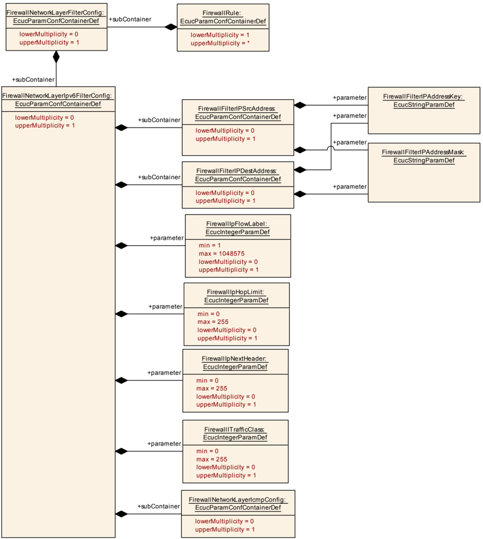

| SWS 条目 | [ECUC_Fw_00049] |
|---|---|
| 容器名称 | FirewallNetworkLayerIpv6FilterConfig |
| 父容器 | FirewallNetworkLayerFilterConfig |
| 描述 | 网络层上过滤规则的配置。 |
| Post-Build 变体多重性 | true |
| 多重性配置类 | Pre-compile time：x（VARIANT-PRE-COMPILE）；Link time：x（VARIANT-LINK-TIME）；Post-build time：x（VARIANT-POST-BUILD） |
| 配置参数 | 见下方参数表 |

| SWS 条目 | [ECUC_Fw_00051] |
|---|---|
| 参数名称 | FirewallIpFlowLabel |
| 父容器 | FirewallNetworkLayerIpv6FilterConfig |
| 描述 | 匹配具有已定义流标签的数据包的过滤器。 |
| 多重性 | 0..1 |
| 类型 | EcucIntegerParamDef |
| 范围 | 1 .. 1048575 |
| 默认值 | - |
| Post-Build 变体多重性 | true |
| Post-Build 变体值 | true |
| 多重性配置类 | Pre-compile time：x（VARIANT-PRE-COMPILE）；Link time：x（VARIANT-LINK-TIME）；Post-build time：x（VARIANT-POST-BUILD） |
| 值配置类 | Pre-compile time：x（VARIANT-PRE-COMPILE）；Link time：x（VARIANT-LINK-TIME）；Post-build time：x（VARIANT-POST-BUILD） |
| 作用域/依赖 | scope: local |

| SWS 条目 | [ECUC_Fw_00052] |
|---|---|
| 参数名称 | FirewallIpHopLimit |
| 父容器 | FirewallNetworkLayerIpv6FilterConfig |
| 描述 | 匹配具有最小跳数限制的数据包的过滤器。 |
| 多重性 | 0..1 |
| 类型 | EcucIntegerParamDef |
| 范围 | 0 .. 255 |
| 默认值 | - |
| Post-Build 变体多重性 | true |
| Post-Build 变体值 | true |
| 多重性配置类 | Pre-compile time：x（VARIANT-PRE-COMPILE）；Link time：x（VARIANT-LINK-TIME）；Post-build time：x（VARIANT-POST-BUILD） |
| 值配置类 | Pre-compile time：x（VARIANT-PRE-COMPILE）；Link time：x（VARIANT-LINK-TIME）；Post-build time：x（VARIANT-POST-BUILD） |
| 作用域/依赖 | scope: local |

| SWS 条目 | [ECUC_Fw_00055] |
|---|---|
| 参数名称 | FirewallIpNextHeader |
| 父容器 | FirewallNetworkLayerIpv6FilterConfig |
| 描述 | 匹配具有已定义扩展报头类型的数据包的过滤器。 |
| 多重性 | 0..1 |
| 类型 | EcucIntegerParamDef |
| 范围 | 0 .. 255 |
| 默认值 | - |
| Post-Build 变体多重性 | true |
| Post-Build 变体值 | true |
| 多重性配置类 | Pre-compile time：x（VARIANT-PRE-COMPILE）；Link time：x（VARIANT-LINK-TIME）；Post-build time：x（VARIANT-POST-BUILD） |
| 值配置类 | Pre-compile time：x（VARIANT-PRE-COMPILE）；Link time：x（VARIANT-LINK-TIME）；Post-build time：x（VARIANT-POST-BUILD） |
| 作用域/依赖 | scope: local |

| SWS 条目 | [ECUC_Fw_00056] |
|---|---|
| 参数名称 | FirewallITrafficClass |
| 父容器 | FirewallNetworkLayerIpv6FilterConfig |
| 描述 | 匹配具有已定义流量类别或优先级的数据包的过滤器。 |
| 多重性 | 0..1 |
| 类型 | EcucIntegerParamDef |
| 范围 | 0 .. 255 |
| 默认值 | - |
| Post-Build 变体多重性 | true |
| Post-Build 变体值 | true |
| 多重性配置类 | Pre-compile time：x（VARIANT-PRE-COMPILE）；Link time：x（VARIANT-LINK-TIME）；Post-build time：x（VARIANT-POST-BUILD） |
| 值配置类 | Pre-compile time：x（VARIANT-PRE-COMPILE）；Link time：x（VARIANT-LINK-TIME）；Post-build time：x（VARIANT-POST-BUILD） |
| 作用域/依赖 | scope: local |

| 容器名称 | 多重性 | 作用域/依赖 |
|---|---|---|
| FirewallFilterIPDestAddress | 0..1 | 一个 **IP** 目的地址过滤器的配置。 |
| FirewallFilterIPSrcAddress | 0..1 | 一个 **IP** 源地址过滤器的配置。 |
| FirewallNetworkLayerIcmpConfig | 0..1 | 针对 **ICMP**（**Internet Control Message Protocol**，互联网控制报文协议）的过滤规则配置。 |

##### 9.2.3.4. ICMP 配置

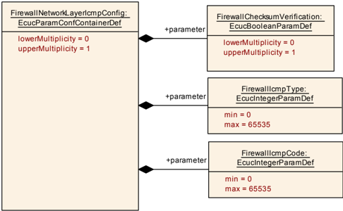

| SWS 条目 | [ECUC_Fw_00130] |
|---|---|
| 容器名称 | FirewallNetworkLayerIcmpConfig |
| 父容器 | FirewallNetworkLayerIpv4FilterConfig, FirewallNetworkLayerIpv6FilterConfig |
| 描述 | 针对 **ICMP**（**Internet Control Message Protocol**，互联网控制报文协议）的过滤规则配置。 |
| Post-Build 变体多重性 | true |
| 多重性配置类 | Pre-compile time：x（VARIANT-PRE-COMPILE）；Link time：x（VARIANT-LINK-TIME）；Post-build time：x（VARIANT-POST-BUILD） |
| 配置参数 | 见下方参数表 |

| SWS 条目 | [ECUC_Fw_00025] |
|---|---|
| 参数名称 | FirewallChecksumVerification |
| 父容器 | FirewallNetworkLayerIcmpConfig |
| 描述 | 定义是否执行校验和验证。 |
| 多重性 | 0..1 |
| 类型 | EcucBooleanParamDef |
| 默认值 | - |
| Post-Build 变体多重性 | true |
| Post-Build 变体值 | true |
| 多重性配置类 | Pre-compile time：x（VARIANT-PRE-COMPILE）；Link time：x（VARIANT-LINK-TIME）；Post-build time：x（VARIANT-POST-BUILD） |
| 值配置类 | Pre-compile time：x（VARIANT-PRE-COMPILE）；Link time：x（VARIANT-LINK-TIME）；Post-build time：x（VARIANT-POST-BUILD） |
| 作用域/依赖 | scope: local |

| SWS 条目 | [ECUC_Fw_00132] |
|---|---|
| 参数名称 | FirewallIcmpCode |
| 父容器 | FirewallNetworkLayerIcmpConfig |
| 描述 | 匹配具有 **Icmp** code 的数据包的过滤器。 |
| 多重性 | 1 |
| 类型 | EcucIntegerParamDef |
| 范围 | 0 .. 65535 |
| 默认值 | - |
| Post-Build 变体值 | true |
| 值配置类 | Pre-compile time：x（VARIANT-PRE-COMPILE）；Link time：x（VARIANT-LINK-TIME）；Post-build time：x（VARIANT-POST-BUILD） |
| 作用域/依赖 | scope: local |

| SWS 条目 | [ECUC_Fw_00131] |
|---|---|
| 参数名称 | FirewallIcmpType |
| 父容器 | FirewallNetworkLayerIcmpConfig |
| 描述 | 匹配具有 **Icmp** type 的数据包的过滤器。 |
| 多重性 | 1 |
| 类型 | EcucIntegerParamDef |
| 范围 | 0 .. 65535 |
| 默认值 | - |
| Post-Build 变体值 | true |
| 值配置类 | Pre-compile time：x（VARIANT-PRE-COMPILE）；Link time：x（VARIANT-LINK-TIME）；Post-build time：x（VARIANT-POST-BUILD） |
| 作用域/依赖 | scope: local |

无包含的容器。

##### 9.2.3.5. TCP 配置

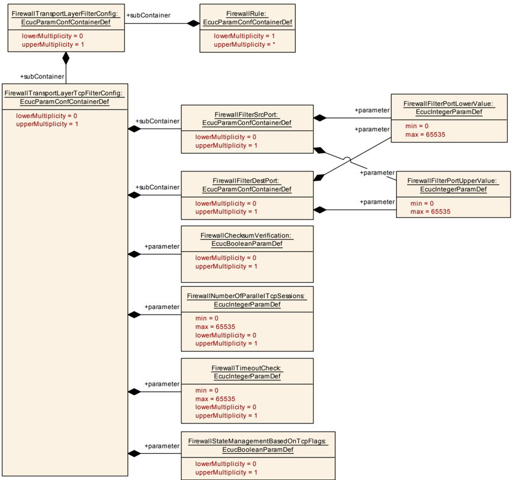

| SWS 条目 | [ECUC_Fw_00138] |
|---|---|
| 容器名称 | FirewallTransportLayerFilterConfig |
| 父容器 | FirewallRule |
| 描述 | 传输层层级上过滤规则的配置。 |
| Post-Build 变体多重性 | true |
| 多重性配置类 | Pre-compile time：x（VARIANT-PRE-COMPILE）；Link time：x（VARIANT-LINK-TIME）；Post-build time：x（VARIANT-POST-BUILD） |
| 配置参数 | 见下方参数表 |

| 容器名称 | 多重性 | 作用域/依赖 |
|---|---|---|
| FirewallTransportLayerTcpFilterConfig | 0..1 | 传输层层级上针对 **TCP** 的过滤规则配置。 |
| FirewallTransportLayerUdpFilterConfig | 0..1 | 传输层层级上针对 **UDP** 的过滤规则配置。 |

| SWS 条目 | [ECUC_Fw_00019] |
|---|---|
| 容器名称 | FirewallTransportLayerTcpFilterConfig |
| 父容器 | FirewallTransportLayerFilterConfig |
| 描述 | 传输层层级上针对 **TCP** 的过滤规则配置。 |
| Post-Build 变体多重性 | true |
| 多重性配置类 | Pre-compile time：x（VARIANT-PRE-COMPILE）；Link time：x（VARIANT-LINK-TIME）；Post-build time：x（VARIANT-POST-BUILD） |
| 配置参数 | 见下方参数表 |

| SWS 条目 | [ECUC_Fw_00025] |
|---|---|
| 参数名称 | FirewallChecksumVerification |
| 父容器 | FirewallTransportLayerTcpFilterConfig |
| 描述 | 定义是否执行校验和验证。 |
| 多重性 | 0..1 |
| 类型 | EcucBooleanParamDef |
| 默认值 | - |
| Post-Build 变体多重性 | true |
| Post-Build 变体值 | true |
| 多重性配置类 | Pre-compile time：x（VARIANT-PRE-COMPILE）；Link time：x（VARIANT-LINK-TIME）；Post-build time：x（VARIANT-POST-BUILD） |
| 值配置类 | Pre-compile time：x（VARIANT-PRE-COMPILE）；Link time：x（VARIANT-LINK-TIME）；Post-build time：x（VARIANT-POST-BUILD） |
| 作用域/依赖 | scope: local |

| SWS 条目 | [ECUC_Fw_00035] |
|---|---|
| 参数名称 | FirewallNumberOfParallelTcpSessions |
| 父容器 | FirewallTransportLayerTcpFilterConfig |
| 描述 | 该参数定义允许建立的最大 **TCP** 会话数量。 |
| 多重性 | 0..1 |
| 类型 | EcucIntegerParamDef |
| 范围 | 0 .. 65535 |
| 默认值 | - |
| Post-Build 变体多重性 | true |
| Post-Build 变体值 | true |
| 多重性配置类 | Pre-compile time：x（VARIANT-PRE-COMPILE）；Link time：x（VARIANT-LINK-TIME）；Post-build time：x（VARIANT-POST-BUILD） |
| 值配置类 | Pre-compile time：x（VARIANT-PRE-COMPILE）；Link time：x（VARIANT-LINK-TIME）；Post-build time：x（VARIANT-POST-BUILD） |
| 作用域/依赖 | scope: local |

| SWS 条目 | [ECUC_Fw_00037] |
|---|---|
| 参数名称 | FirewallStateManagementBasedOnTcpFlags |
| 父容器 | FirewallTransportLayerTcpFilterConfig |
| 描述 | 该属性定义状态管理（StateManagement）是否基于 **TCP** 标志。 |
| 多重性 | 0..1 |
| 类型 | EcucBooleanParamDef |
| 默认值 | - |
| Post-Build 变体多重性 | true |
| Post-Build 变体值 | true |
| 多重性配置类 | Pre-compile time：x（VARIANT-PRE-COMPILE）；Link time：x（VARIANT-LINK-TIME）；Post-build time：x（VARIANT-POST-BUILD） |
| 值配置类 | Pre-compile time：x（VARIANT-PRE-COMPILE）；Link time：x（VARIANT-LINK-TIME）；Post-build time：x（VARIANT-POST-BUILD） |
| 作用域/依赖 | scope: local |

| SWS 条目 | [ECUC_Fw_00036] |
|---|---|
| 参数名称 | FirewallTimeoutCheck |
| 父容器 | FirewallTransportLayerTcpFilterConfig |
| 描述 | 该参数定义 **TCP** 会话超时（单位：秒）。 |
| 多重性 | 0..1 |
| 类型 | EcucIntegerParamDef |
| 范围 | 0 .. 65535 |
| 默认值 | - |
| Post-Build 变体多重性 | true |
| Post-Build 变体值 | true |
| 多重性配置类 | Pre-compile time：x（VARIANT-PRE-COMPILE）；Link time：x（VARIANT-LINK-TIME）；Post-build time：x（VARIANT-POST-BUILD） |
| 值配置类 | Pre-compile time：x（VARIANT-PRE-COMPILE）；Link time：x（VARIANT-LINK-TIME）；Post-build time：x（VARIANT-POST-BUILD） |
| 作用域/依赖 | scope: local |

| 容器名称 | 多重性 | 作用域/依赖 |
|---|---|---|
| FirewallFilterDestPort | 0..1 | 一个目的端口过滤器的配置。 |
| FirewallFilterSrcPort | 0..1 | 一个源端口过滤器的配置。 |

| SWS 条目 | [ECUC_Fw_00022] |
|---|---|
| 容器名称 | FirewallFilterDestPort |
| 父容器 | FirewallTransportLayerTcpFilterConfig, FirewallTransportLayerUdpFilterConfig |
| 描述 | 一个目的端口过滤器的配置。 |
| Post-Build 变体多重性 | true |
| 多重性配置类 | Pre-compile time：x（VARIANT-PRE-COMPILE）；Link time：x（VARIANT-LINK-TIME）；Post-build time：x（VARIANT-POST-BUILD） |
| 配置参数 | 见下方参数表 |

| SWS 条目 | [ECUC_Fw_00028] |
|---|---|
| 参数名称 | FirewallFilterPortLowerValue |
| 父容器 | FirewallFilterDestPort |
| 描述 | 过滤器端口下限值的定义。 |
| 多重性 | 1 |
| 类型 | EcucIntegerParamDef |
| 范围 | 0 .. 65535 |
| 默认值 | - |
| Post-Build 变体值 | true |
| 值配置类 | Pre-compile time：x（VARIANT-PRE-COMPILE）；Link time：x（VARIANT-LINK-TIME）；Post-build time：x（VARIANT-POST-BUILD） |
| 作用域/依赖 | scope: local |

| SWS 条目 | [ECUC_Fw_00029] |
|---|---|
| 参数名称 | FirewallFilterPortUpperValue |
| 父容器 | FirewallFilterDestPort |
| 描述 | 过滤器端口上限值的定义。 |
| 多重性 | 1 |
| 类型 | EcucIntegerParamDef |
| 范围 | 0 .. 65535 |
| 默认值 | - |
| Post-Build 变体值 | true |
| 值配置类 | Pre-compile time：x（VARIANT-PRE-COMPILE）；Link time：x（VARIANT-LINK-TIME）；Post-build time：x（VARIANT-POST-BUILD） |
| 作用域/依赖 | scope: local |

无包含的容器。

| SWS 条目 | [ECUC_Fw_00020] |
|---|---|
| 容器名称 | FirewallFilterSrcPort |
| 父容器 | FirewallTransportLayerTcpFilterConfig, FirewallTransportLayerUdpFilterConfig |
| 描述 | 一个源端口过滤器的配置。 |
| Post-Build 变体多重性 | true |
| 多重性配置类 | Pre-compile time：x（VARIANT-PRE-COMPILE）；Link time：x（VARIANT-LINK-TIME）；Post-build time：x（VARIANT-POST-BUILD） |
| 配置参数 | 见下方参数表 |

| SWS 条目 | [ECUC_Fw_00028] |
|---|---|
| 参数名称 | FirewallFilterPortLowerValue |
| 父容器 | FirewallFilterSrcPort |
| 描述 | 过滤器端口下限值的定义。 |
| 多重性 | 1 |
| 类型 | EcucIntegerParamDef |
| 范围 | 0 .. 65535 |
| 默认值 | - |
| Post-Build 变体值 | true |
| 值配置类 | Pre-compile time：x（VARIANT-PRE-COMPILE）；Link time：x（VARIANT-LINK-TIME）；Post-build time：x（VARIANT-POST-BUILD） |
| 作用域/依赖 | scope: local |

| SWS 条目 | [ECUC_Fw_00029] |
|---|---|
| 参数名称 | FirewallFilterPortUpperValue |
| 父容器 | FirewallFilterSrcPort |
| 描述 | 过滤器端口上限值的定义。 |
| 多重性 | 1 |
| 类型 | EcucIntegerParamDef |
| 范围 | 0 .. 65535 |
| 默认值 | - |
| Post-Build 变体值 | true |
| 值配置类 | Pre-compile time：x（VARIANT-PRE-COMPILE）；Link time：x（VARIANT-LINK-TIME）；Post-build time：x（VARIANT-POST-BUILD） |
| 作用域/依赖 | scope: local |

无包含的容器。

##### 9.2.3.6. UDP 配置

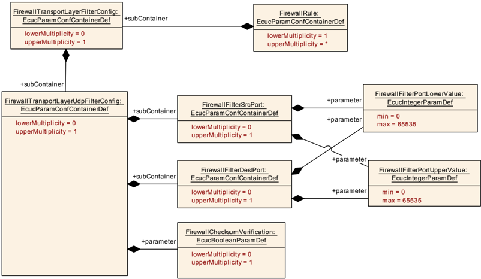

| SWS 条目 | [ECUC_Fw_00038] |
|---|---|
| 容器名称 | FirewallTransportLayerUdpFilterConfig |
| 父容器 | FirewallTransportLayerFilterConfig |
| 描述 | 传输层层级上针对 **UDP** 的过滤规则配置。 |
| Post-Build 变体多重性 | true |
| 多重性配置类 | Pre-compile time：x（VARIANT-PRE-COMPILE）；Link time：x（VARIANT-LINK-TIME）；Post-build time：x（VARIANT-POST-BUILD） |
| 配置参数 | 见下方参数表 |

| SWS 条目 | [ECUC_Fw_00025] |
|---|---|
| 参数名称 | FirewallChecksumVerification |
| 父容器 | FirewallTransportLayerUdpFilterConfig |
| 描述 | 定义是否执行校验和验证。 |
| 多重性 | 0..1 |
| 类型 | EcucBooleanParamDef |
| 默认值 | - |
| Post-Build 变体多重性 | true |
| Post-Build 变体值 | true |
| 多重性配置类 | Pre-compile time：x（VARIANT-PRE-COMPILE）；Link time：x（VARIANT-LINK-TIME）；Post-build time：x（VARIANT-POST-BUILD） |
| 值配置类 | Pre-compile time：x（VARIANT-PRE-COMPILE）；Link time：x（VARIANT-LINK-TIME）；Post-build time：x（VARIANT-POST-BUILD） |
| 作用域/依赖 | scope: local |

| 容器名称 | 多重性 | 作用域/依赖 |
|---|---|---|
| FirewallFilterDestPort | 0..1 | 一个目的端口过滤器的配置。 |
| FirewallFilterSrcPort | 0..1 | 一个源端口过滤器的配置。 |

##### 9.2.3.7. SOME/IP 配置

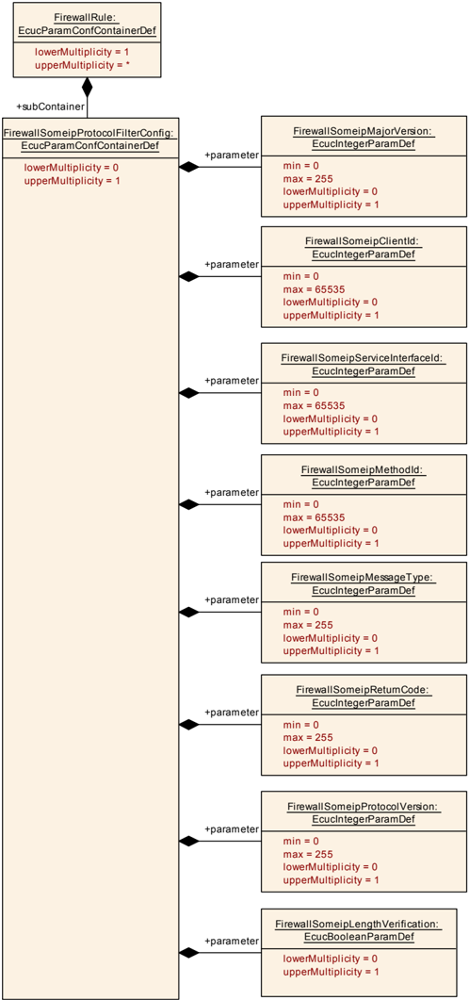

| SWS 条目 | [ECUC_Fw_00068] |
|---|---|
| 容器名称 | FirewallSomeipProtocolFilterConfig |
| 父容器 | FirewallRule |
| 描述 | **SOME/IP** 协议防火墙规则的配置。 |
| Post-Build 变体多重性 | true |
| 多重性配置类 | Pre-compile time：x（VARIANT-PRE-COMPILE）；Link time：x（VARIANT-LINK-TIME）；Post-build time：x（VARIANT-POST-BUILD） |
| 配置参数 | 见下方参数表 |

| SWS 条目 | [ECUC_Fw_00070] |
|---|---|
| 参数名称 | FirewallSomeipClientId |
| 父容器 | FirewallSomeipProtocolFilterConfig |
| 描述 | 对 **SOME/IP** 报头中 clientId 匹配的 **SOME/IP** 报文的过滤器。 |
| 多重性 | 0..1 |
| 类型 | EcucIntegerParamDef |
| 范围 | 0 .. 65535 |
| 默认值 | - |
| Post-Build 变体多重性 | true |
| Post-Build 变体值 | true |
| 多重性配置类 | Pre-compile time：x（VARIANT-PRE-COMPILE）；Link time：x（VARIANT-LINK-TIME）；Post-build time：x（VARIANT-POST-BUILD） |
| 值配置类 | Pre-compile time：x（VARIANT-PRE-COMPILE）；Link time：x（VARIANT-LINK-TIME）；Post-build time：x（VARIANT-POST-BUILD） |
| 作用域/依赖 | scope: local |

| SWS 条目 | [ECUC_Fw_00075] |
|---|---|
| 参数名称 | FirewallSomeipLengthVerification |
| 父容器 | FirewallSomeipProtocolFilterConfig |
| 描述 | 定义是否执行长度验证。 |
| 多重性 | 0..1 |
| 类型 | EcucBooleanParamDef |
| 默认值 | - |
| Post-Build 变体多重性 | true |
| Post-Build 变体值 | true |
| 多重性配置类 | Pre-compile time：x（VARIANT-PRE-COMPILE）；Link time：x（VARIANT-LINK-TIME）；Post-build time：x（VARIANT-POST-BUILD） |
| 值配置类 | Pre-compile time：x（VARIANT-PRE-COMPILE）；Link time：x（VARIANT-LINK-TIME）；Post-build time：x（VARIANT-POST-BUILD） |
| 作用域/依赖 | scope: local |

| SWS 条目 | [ECUC_Fw_00069] |
|---|---|
| 参数名称 | FirewallSomeipMajorVersion |
| 父容器 | FirewallSomeipProtocolFilterConfig |
| 描述 | 对 **SOME/IP** 报头中 majorVersion 匹配的 **SOME/IP** 报文的过滤器。 |
| 多重性 | 0..1 |
| 类型 | EcucIntegerParamDef |
| 范围 | 0 .. 255 |
| 默认值 | - |
| Post-Build 变体多重性 | true |
| Post-Build 变体值 | true |
| 多重性配置类 | Pre-compile time：x（VARIANT-PRE-COMPILE）；Link time：x（VARIANT-LINK-TIME）；Post-build time：x（VARIANT-POST-BUILD） |
| 值配置类 | Pre-compile time：x（VARIANT-PRE-COMPILE）；Link time：x（VARIANT-LINK-TIME）；Post-build time：x（VARIANT-POST-BUILD） |
| 作用域/依赖 | scope: local |

| SWS 条目 | [ECUC_Fw_00072] |
|---|---|
| 参数名称 | FirewallSomeipMessageType |
| 父容器 | FirewallSomeipProtocolFilterConfig |
| 描述 | 对 **SOME/IP** 报头中 message type 匹配的 **SOME/IP** 报文的过滤器。 |
| 多重性 | 0..1 |
| 类型 | EcucIntegerParamDef |
| 范围 | 0 .. 255 |
| 默认值 | - |
| Post-Build 变体多重性 | true |
| Post-Build 变体值 | true |
| 多重性配置类 | Pre-compile time：x（VARIANT-PRE-COMPILE）；Link time：x（VARIANT-LINK-TIME）；Post-build time：x（VARIANT-POST-BUILD） |
| 值配置类 | Pre-compile time：x（VARIANT-PRE-COMPILE）；Link time：x（VARIANT-LINK-TIME）；Post-build time：x（VARIANT-POST-BUILD） |
| 作用域/依赖 | scope: local |

| SWS 条目 | [ECUC_Fw_00071] |
|---|---|
| 参数名称 | FirewallSomeipMethodId |
| 父容器 | FirewallSomeipProtocolFilterConfig |
| 描述 | 对 **SOME/IP** 报头中 methodId 匹配的 **SOME/IP** 报文的过滤器。 |
| 多重性 | 0..1 |
| 类型 | EcucIntegerParamDef |
| 范围 | 0 .. 65535 |
| 默认值 | - |
| Post-Build 变体多重性 | true |
| Post-Build 变体值 | true |
| 多重性配置类 | Pre-compile time：x（VARIANT-PRE-COMPILE）；Link time：x（VARIANT-LINK-TIME）；Post-build time：x（VARIANT-POST-BUILD） |
| 值配置类 | Pre-compile time：x（VARIANT-PRE-COMPILE）；Link time：x（VARIANT-LINK-TIME）；Post-build time：x（VARIANT-POST-BUILD） |
| 作用域/依赖 | scope: local |

| SWS 条目 | [ECUC_Fw_00074] |
|---|---|
| 参数名称 | FirewallSomeipProtocolVersion |
| 父容器 | FirewallSomeipProtocolFilterConfig |
| 描述 | 对 **SOME/IP** 报头中 protocol version 匹配的 **SOME/IP** 报文的过滤器。 |
| 多重性 | 0..1 |
| 类型 | EcucIntegerParamDef |
| 范围 | 0 .. 255 |
| 默认值 | - |
| Post-Build 变体多重性 | true |
| Post-Build 变体值 | true |
| 多重性配置类 | Pre-compile time：x（VARIANT-PRE-COMPILE）；Link time：x（VARIANT-LINK-TIME）；Post-build time：x（VARIANT-POST-BUILD） |
| 值配置类 | Pre-compile time：x（VARIANT-PRE-COMPILE）；Link time：x（VARIANT-LINK-TIME）；Post-build time：x（VARIANT-POST-BUILD） |
| 作用域/依赖 | scope: local |

| SWS 条目 | [ECUC_Fw_00073] |
|---|---|
| 参数名称 | FirewallSomeipReturnCode |
| 父容器 | FirewallSomeipProtocolFilterConfig |
| 描述 | 对 **SOME/IP** 报头中 return code 匹配的 **SOME/IP** 报文的过滤器。 |
| 多重性 | 0..1 |
| 类型 | EcucIntegerParamDef |
| 范围 | 0 .. 255 |
| 默认值 | - |
| Post-Build 变体多重性 | true |
| Post-Build 变体值 | true |
| 多重性配置类 | Pre-compile time：x（VARIANT-PRE-COMPILE）；Link time：x（VARIANT-LINK-TIME）；Post-build time：x（VARIANT-POST-BUILD） |
| 值配置类 | Pre-compile time：x（VARIANT-PRE-COMPILE）；Link time：x（VARIANT-LINK-TIME）；Post-build time：x（VARIANT-POST-BUILD） |
| 作用域/依赖 | scope: local |

| SWS 条目 | [ECUC_Fw_00065] |
|---|---|
| 参数名称 | FirewallSomeipServiceInterfaceId |
| 父容器 | FirewallSomeipProtocolFilterConfig |
| 描述 | 对 **SOME/IP** 报头中 serviceInterfaceId 匹配的 **SOME/IP** 报文的过滤器。 |
| 多重性 | 0..1 |
| 类型 | EcucIntegerParamDef |
| 范围 | 0 .. 65535 |
| 默认值 | - |
| Post-Build 变体多重性 | true |
| Post-Build 变体值 | true |
| 多重性配置类 | Pre-compile time：x（VARIANT-PRE-COMPILE）；Link time：x（VARIANT-LINK-TIME）；Post-build time：x（VARIANT-POST-BUILD） |
| 值配置类 | Pre-compile time：x（VARIANT-PRE-COMPILE）；Link time：x（VARIANT-LINK-TIME）；Post-build time：x（VARIANT-POST-BUILD） |
| 作用域/依赖 | scope: local |

无包含的容器。

##### 9.2.3.8. SOME/IP-SD 配置

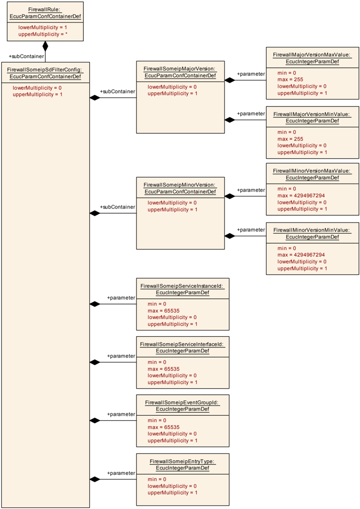

| SWS 条目 | [ECUC_Fw_00057] |
|---|---|
| 容器名称 | FirewallSomeipSdFilterConfig |
| 父容器 | FirewallRule |
| 描述 | **SOME/IP** Service Discovery 防火墙规则的配置。 |
| Post-Build 变体多重性 | true |
| 多重性配置类 | Pre-compile time：x（VARIANT-PRE-COMPILE）；Link time：x（VARIANT-LINK-TIME）；Post-build time：x（VARIANT-POST-BUILD） |
| 配置参数 | 见下方参数表 |

| SWS 条目 | [ECUC_Fw_00067] |
|---|---|
| 参数名称 | FirewallSomeipEntryType |
| 父容器 | FirewallSomeipSdFilterConfig |
| 描述 | 对 **SOME/IP** 报头中 entryType 匹配的 **SOME/IP SD** 报文的过滤器。 |
| 多重性 | 0..1 |
| 类型 | EcucIntegerParamDef |
| 范围 | 0 .. 18446744073709551615 |
| 默认值 | - |
| Post-Build 变体多重性 | true |
| Post-Build 变体值 | true |
| 多重性配置类 | Pre-compile time：x（VARIANT-PRE-COMPILE）；Link time：x（VARIANT-LINK-TIME）；Post-build time：x（VARIANT-POST-BUILD） |
| 值配置类 | Pre-compile time：x（VARIANT-PRE-COMPILE）；Link time：x（VARIANT-LINK-TIME）；Post-build time：x（VARIANT-POST-BUILD） |
| 作用域/依赖 | scope: local |

| SWS 条目 | [ECUC_Fw_00066] |
|---|---|
| 参数名称 | FirewallSomeipEventGroupId |
| 父容器 | FirewallSomeipSdFilterConfig |
| 描述 | 对 **SOME/IP** 报头中 eventGroupId 匹配的 **SOME/IP SD** 报文的过滤器。 |
| 多重性 | 0..1 |
| 类型 | EcucIntegerParamDef |
| 范围 | 0 .. 65535 |
| 默认值 | - |
| Post-Build 变体多重性 | true |
| Post-Build 变体值 | true |
| 多重性配置类 | Pre-compile time：x（VARIANT-PRE-COMPILE）；Link time：x（VARIANT-LINK-TIME）；Post-build time：x（VARIANT-POST-BUILD） |
| 值配置类 | Pre-compile time：x（VARIANT-PRE-COMPILE）；Link time：x（VARIANT-LINK-TIME）；Post-build time：x（VARIANT-POST-BUILD） |
| 作用域/依赖 | scope: local |

| SWS 条目 | [ECUC_Fw_00059] |
|---|---|
| 参数名称 | FirewallSomeipServiceInstanceId |
| 父容器 | FirewallSomeipSdFilterConfig |
| 描述 | 对 **SOME/IP** 报头中 serviceInstanceId 匹配的 **SOME/IP SD** 报文的过滤器。 |
| 多重性 | 0..1 |
| 类型 | EcucIntegerParamDef |
| 范围 | 0 .. 65535 |
| 默认值 | - |
| Post-Build 变体多重性 | true |
| Post-Build 变体值 | true |
| 多重性配置类 | Pre-compile time：x（VARIANT-PRE-COMPILE）；Link time：x（VARIANT-LINK-TIME）；Post-build time：x（VARIANT-POST-BUILD） |
| 值配置类 | Pre-compile time：x（VARIANT-PRE-COMPILE）；Link time：x（VARIANT-LINK-TIME）；Post-build time：x（VARIANT-POST-BUILD） |
| 作用域/依赖 | scope: local |

| SWS 条目 | [ECUC_Fw_00065] |
|---|---|
| 参数名称 | FirewallSomeipServiceInterfaceId |
| 父容器 | FirewallSomeipSdFilterConfig |
| 描述 | 对 **SOME/IP** 报头中 serviceInterfaceId 匹配的 **SOME/IP** 报文的过滤器。 |
| 多重性 | 0..1 |
| 类型 | EcucIntegerParamDef |
| 范围 | 0 .. 65535 |
| 默认值 | - |
| Post-Build 变体多重性 | true |
| Post-Build 变体值 | true |
| 多重性配置类 | Pre-compile time：x（VARIANT-PRE-COMPILE）；Link time：x（VARIANT-LINK-TIME）；Post-build time：x（VARIANT-POST-BUILD） |
| 值配置类 | Pre-compile time：x（VARIANT-PRE-COMPILE）；Link time：x（VARIANT-LINK-TIME）；Post-build time：x（VARIANT-POST-BUILD） |
| 作用域/依赖 | scope: local |

| 容器名称 | 多重性 | 作用域/依赖 |
|---|---|---|
| FirewallSomeipMajorVersion | 0..1 | 对 **SOME/IP** 报头中 MajorVersion 处于所配置的最大值和最小值之间的 **SOME/IP SD** 报文的过滤器。 |
| FirewallSomeipMinorVersion | 0..1 | 对 **SOME/IP** 报头中 MinorVersion 处于所配置的最大值和最小值之间的 **SOME/IP SD** 报文的过滤器。 |

| SWS 条目 | [ECUC_Fw_00058] |
|---|---|
| 容器名称 | FirewallSomeipMajorVersion |
| 父容器 | FirewallSomeipSdFilterConfig |
| 描述 | 对 **SOME/IP** 报头中 MajorVersion 处于所配置的最大值和最小值之间的 **SOME/IP SD** 报文的过滤器。 |
| Post-Build 变体多重性 | true |
| 多重性配置类 | Pre-compile time：x（VARIANT-PRE-COMPILE）；Link time：x（VARIANT-LINK-TIME）；Post-build time：x（VARIANT-POST-BUILD） |
| 配置参数 | 见下方参数表 |

| SWS 条目 | [ECUC_Fw_00060] |
|---|---|
| 参数名称 | FirewallMajorVersionMaxValue |
| 父容器 | FirewallSomeipMajorVersion |
| 描述 | 对 **SOME/IP** 报头中 MajorVersion 小于或等于该值的 **SOME/IP SD** 报文的过滤器。 |
| 多重性 | 0..1 |
| 类型 | EcucIntegerParamDef |
| 范围 | 0 .. 255 |
| 默认值 | - |
| Post-Build 变体多重性 | true |
| Post-Build 变体值 | true |
| 多重性配置类 | Pre-compile time：x（VARIANT-PRE-COMPILE）；Link time：x（VARIANT-LINK-TIME）；Post-build time：x（VARIANT-POST-BUILD） |
| 值配置类 | Pre-compile time：x（VARIANT-PRE-COMPILE）；Link time：x（VARIANT-LINK-TIME）；Post-build time：x（VARIANT-POST-BUILD） |
| 作用域/依赖 | scope: local |

| SWS 条目 | [ECUC_Fw_00061] |
|---|---|
| 参数名称 | FirewallMajorVersionMinValue |
| 父容器 | FirewallSomeipMajorVersion |
| 描述 | 对 **SOME/IP** 报头中 MajorVersion 大于或等于该值的 **SOME/IP SD** 报文的过滤器。 |
| 多重性 | 0..1 |
| 类型 | EcucIntegerParamDef |
| 范围 | 0 .. 255 |
| 默认值 | - |
| Post-Build 变体多重性 | true |
| Post-Build 变体值 | true |
| 多重性配置类 | Pre-compile time：x（VARIANT-PRE-COMPILE）；Link time：x（VARIANT-LINK-TIME）；Post-build time：x（VARIANT-POST-BUILD） |
| 值配置类 | Pre-compile time：x（VARIANT-PRE-COMPILE）；Link time：x（VARIANT-LINK-TIME）；Post-build time：x（VARIANT-POST-BUILD） |
| 作用域/依赖 | scope: local |

无包含的容器。

| SWS 条目 | [ECUC_Fw_00062] |
|---|---|
| 容器名称 | FirewallSomeipMinorVersion |
| 父容器 | FirewallSomeipSdFilterConfig |
| 描述 | 对 **SOME/IP** 报头中 MinorVersion 处于所配置的最大值和最小值之间的 **SOME/IP SD** 报文的过滤器。 |
| Post-Build 变体多重性 | true |
| 多重性配置类 | Pre-compile time：x（VARIANT-PRE-COMPILE）；Link time：x（VARIANT-LINK-TIME）；Post-build time：x（VARIANT-POST-BUILD） |
| 配置参数 | 见下方参数表 |

| SWS 条目 | [ECUC_Fw_00063] |
|---|---|
| 参数名称 | FirewallMinorVersionMaxValue |
| 父容器 | FirewallSomeipMinorVersion |
| 描述 | 对 **SOME/IP** 报头中 MinorVersion 小于或等于该值的 **SOME/IP SD** 报文的过滤器。 |
| 多重性 | 0..1 |
| 类型 | EcucIntegerParamDef |
| 范围 | 0 .. 4294967294 |
| 默认值 | - |
| Post-Build 变体多重性 | true |
| Post-Build 变体值 | true |
| 多重性配置类 | Pre-compile time：x（VARIANT-PRE-COMPILE）；Link time：x（VARIANT-LINK-TIME）；Post-build time：x（VARIANT-POST-BUILD） |
| 值配置类 | Pre-compile time：x（VARIANT-PRE-COMPILE）；Link time：x（VARIANT-LINK-TIME）；Post-build time：x（VARIANT-POST-BUILD） |
| 作用域/依赖 | scope: local |

| SWS 条目 | [ECUC_Fw_00064] |
|---|---|
| 参数名称 | FirewallMinorVersionMinValue |
| 父容器 | FirewallSomeipMinorVersion |
| 描述 | 对 **SOME/IP** 报头中 MinorVersion 大于或等于该值的 **SOME/IP SD** 报文的过滤器。 |
| 多重性 | 0..1 |
| 类型 | EcucIntegerParamDef |
| 范围 | 0 .. 4294967294 |
| 默认值 | - |
| Post-Build 变体多重性 | true |
| Post-Build 变体值 | true |
| 多重性配置类 | Pre-compile time：x（VARIANT-PRE-COMPILE）；Link time：x（VARIANT-LINK-TIME）；Post-build time：x（VARIANT-POST-BUILD） |
| 值配置类 | Pre-compile time：x（VARIANT-PRE-COMPILE）；Link time：x（VARIANT-LINK-TIME）；Post-build time：x（VARIANT-POST-BUILD） |
| 作用域/依赖 | scope: local |

无包含的容器。

##### 9.2.3.9. DDS 配置

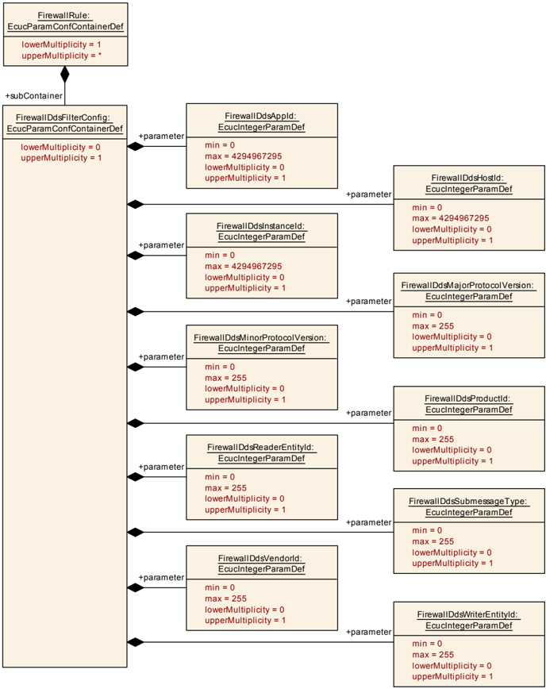

| SWS 条目 | [ECUC_Fw_00092] |
|---|---|
| 容器名称 | FirewallDdsFilterConfig |
| 父容器 | FirewallRule |
| 描述 | 针对 **Dds** 的过滤规则配置。 |
| Post-Build 变体多重性 | true |
| 多重性配置类 | Pre-compile time：x（VARIANT-PRE-COMPILE）；Link time：x（VARIANT-LINK-TIME）；Post-build time：x（VARIANT-POST-BUILD） |
| 配置参数 | 见下方参数表 |

| SWS 条目 | [ECUC_Fw_00093] |
|---|---|
| 参数名称 | FirewallDdsAppId |
| 父容器 | FirewallDdsFilterConfig |
| 描述 | 对 **DDSI-RTPS** 报头及 **INFO_DST** (0x0E) 子报文中 appId 匹配的 **DDSI-RTPS** 报文的过滤器。 |
| 多重性 | 0..1 |
| 类型 | EcucIntegerParamDef |
| 范围 | 0 .. 4294967295 |
| 默认值 | - |
| Post-Build 变体多重性 | true |
| Post-Build 变体值 | true |
| 多重性配置类 | Pre-compile time：x（VARIANT-PRE-COMPILE）；Link time：x（VARIANT-LINK-TIME）；Post-build time：x（VARIANT-POST-BUILD） |
| 值配置类 | Pre-compile time：x（VARIANT-PRE-COMPILE）；Link time：x（VARIANT-LINK-TIME）；Post-build time：x（VARIANT-POST-BUILD） |
| 作用域/依赖 | scope: local |

| SWS 条目 | [ECUC_Fw_00094] |
|---|---|
| 参数名称 | FirewallDdsHostId |
| 父容器 | FirewallDdsFilterConfig |
| 描述 | 对 **DDSI-RTPS** 报头及 **INFO_DST** (0x0E) 子报文中 hostId 匹配的 **DDSI-RTPS** 报文的过滤器。 |
| 多重性 | 0..1 |
| 类型 | EcucIntegerParamDef |
| 范围 | 0 .. 4294967295 |
| 默认值 | - |
| Post-Build 变体多重性 | true |
| Post-Build 变体值 | true |
| 多重性配置类 | Pre-compile time：x（VARIANT-PRE-COMPILE）；Link time：x（VARIANT-LINK-TIME）；Post-build time：x（VARIANT-POST-BUILD） |
| 值配置类 | Pre-compile time：x（VARIANT-PRE-COMPILE）；Link time：x（VARIANT-LINK-TIME）；Post-build time：x（VARIANT-POST-BUILD） |
| 作用域/依赖 | scope: local |

| SWS 条目 | [ECUC_Fw_00095] |
|---|---|
| 参数名称 | FirewallDdsInstanceId |
| 父容器 | FirewallDdsFilterConfig |
| 描述 | 对 **DDSI-RTPS** 报头及 **INFO_DST** (0x0E) 子报文中 instanceId 匹配的 **DDSI-RTPS** 报文的过滤器。 |
| 多重性 | 0..1 |
| 类型 | EcucIntegerParamDef |
| 范围 | 0 .. 4294967295 |
| 默认值 | - |
| Post-Build 变体多重性 | true |
| Post-Build 变体值 | true |
| 多重性配置类 | Pre-compile time：x（VARIANT-PRE-COMPILE）；Link time：x（VARIANT-LINK-TIME）；Post-build time：x（VARIANT-POST-BUILD） |
| 值配置类 | Pre-compile time：x（VARIANT-PRE-COMPILE）；Link time：x（VARIANT-LINK-TIME）；Post-build time：x（VARIANT-POST-BUILD） |
| 作用域/依赖 | scope: local |

| SWS 条目 | [ECUC_Fw_00096] |
|---|---|
| 参数名称 | FirewallDdsMajorProtocolVersion |
| 父容器 | FirewallDdsFilterConfig |
| 描述 | 对 **DDSI-RTPS** 报头中 majorProtocolVersion 匹配的 **DDSI-RTPS** 报文的过滤器。 |
| 多重性 | 0..1 |
| 类型 | EcucIntegerParamDef |
| 范围 | 0 .. 255 |
| 默认值 | - |
| Post-Build 变体多重性 | true |
| Post-Build 变体值 | true |
| 多重性配置类 | Pre-compile time：x（VARIANT-PRE-COMPILE）；Link time：x（VARIANT-LINK-TIME）；Post-build time：x（VARIANT-POST-BUILD） |
| 值配置类 | Pre-compile time：x（VARIANT-PRE-COMPILE）；Link time：x（VARIANT-LINK-TIME）；Post-build time：x（VARIANT-POST-BUILD） |
| 作用域/依赖 | scope: local |

| SWS 条目 | [ECUC_Fw_00097] |
|---|---|
| 参数名称 | FirewallDdsMinorProtocolVersion |
| 父容器 | FirewallDdsFilterConfig |
| 描述 | 对 **DDSI-RTPS** 报头中 minorProtocolVersion 匹配的 **DDSI-RTPS** 报文的过滤器。 |
| 多重性 | 0..1 |
| 类型 | EcucIntegerParamDef |
| 范围 | 0 .. 255 |
| 默认值 | - |
| Post-Build 变体多重性 | true |
| Post-Build 变体值 | true |
| 多重性配置类 | Pre-compile time：x（VARIANT-PRE-COMPILE）；Link time：x（VARIANT-LINK-TIME）；Post-build time：x（VARIANT-POST-BUILD） |
| 值配置类 | Pre-compile time：x（VARIANT-PRE-COMPILE）；Link time：x（VARIANT-LINK-TIME）；Post-build time：x（VARIANT-POST-BUILD） |
| 作用域/依赖 | scope: local |

| SWS 条目 | [ECUC_Fw_00098] |
|---|---|
| 参数名称 | FirewallDdsProductId |
| 父容器 | FirewallDdsFilterConfig |
| 描述 | 对 **DDSI-RTPS** 报头中 productId 匹配的 **DDSI-RTPS** 报文的过滤器。 |
| 多重性 | 0..1 |
| 类型 | EcucIntegerParamDef |
| 范围 | 0 .. 255 |
| 默认值 | - |
| Post-Build 变体多重性 | true |
| Post-Build 变体值 | true |
| 多重性配置类 | Pre-compile time：x（VARIANT-PRE-COMPILE）；Link time：x（VARIANT-LINK-TIME）；Post-build time：x（VARIANT-POST-BUILD） |
| 值配置类 | Pre-compile time：x（VARIANT-PRE-COMPILE）；Link time：x（VARIANT-LINK-TIME）；Post-build time：x（VARIANT-POST-BUILD） |
| 作用域/依赖 | scope: local |

| SWS 条目 | [ECUC_Fw_00099] |
|---|---|
| 参数名称 | FirewallDdsReaderEntityId |
| 父容器 | FirewallDdsFilterConfig |
| 描述 | 对 **DDSI-RTPS** 子报文中 readerEntityID 匹配的 **DDSI-RTPS** 报文的过滤器。 |
| 多重性 | 0..1 |
| 类型 | EcucIntegerParamDef |
| 范围 | 0 .. 255 |
| 默认值 | - |
| Post-Build 变体多重性 | true |
| Post-Build 变体值 | true |
| 多重性配置类 | Pre-compile time：x（VARIANT-PRE-COMPILE）；Link time：x（VARIANT-LINK-TIME）；Post-build time：x（VARIANT-POST-BUILD） |
| 值配置类 | Pre-compile time：x（VARIANT-PRE-COMPILE）；Link time：x（VARIANT-LINK-TIME）；Post-build time：x（VARIANT-POST-BUILD） |
| 作用域/依赖 | scope: local |

| SWS 条目 | [ECUC_Fw_00100] |
|---|---|
| 参数名称 | FirewallDdsSubmessageType |
| 父容器 | FirewallDdsFilterConfig |
| 描述 | 定义 **DDSI-RTPS** 报文中允许的子报文类型。 |
| 多重性 | 0..1 |
| 类型 | EcucIntegerParamDef |
| 范围 | 0 .. 255 |
| 默认值 | - |
| Post-Build 变体多重性 | true |
| Post-Build 变体值 | true |
| 多重性配置类 | Pre-compile time：x（VARIANT-PRE-COMPILE）；Link time：x（VARIANT-LINK-TIME）；Post-build time：x（VARIANT-POST-BUILD） |
| 值配置类 | Pre-compile time：x（VARIANT-PRE-COMPILE）；Link time：x（VARIANT-LINK-TIME）；Post-build time：x（VARIANT-POST-BUILD） |
| 作用域/依赖 | scope: local |

| SWS 条目 | [ECUC_Fw_00101] |
|---|---|
| 参数名称 | FirewallDdsVendorId |
| 父容器 | FirewallDdsFilterConfig |
| 描述 | 对 **DDSI-RTPS** 报头中 vendorId 匹配的 **DDSI-RTPS** 报文的过滤器。 |
| 多重性 | 0..1 |
| 类型 | EcucIntegerParamDef |
| 范围 | 0 .. 255 |
| 默认值 | - |
| Post-Build 变体多重性 | true |
| Post-Build 变体值 | true |
| 多重性配置类 | Pre-compile time：x（VARIANT-PRE-COMPILE）；Link time：x（VARIANT-LINK-TIME）；Post-build time：x（VARIANT-POST-BUILD） |
| 值配置类 | Pre-compile time：x（VARIANT-PRE-COMPILE）；Link time：x（VARIANT-LINK-TIME）；Post-build time：x（VARIANT-POST-BUILD） |
| 作用域/依赖 | scope: local |

| SWS 条目 | [ECUC_Fw_00102] |
|---|---|
| 参数名称 | FirewallDdsWriterEntityId |
| 父容器 | FirewallDdsFilterConfig |
| 描述 | 对 **DDSI-RTPS** 子报文中 writerEntityID 匹配的 **DDSI-RTPS** 报文的过滤器。 |
| 多重性 | 0..1 |
| 类型 | EcucIntegerParamDef |
| 范围 | 0 .. 255 |
| 默认值 | - |
| Post-Build 变体多重性 | true |
| Post-Build 变体值 | true |
| 多重性配置类 | Pre-compile time：x（VARIANT-PRE-COMPILE）；Link time：x（VARIANT-LINK-TIME）；Post-build time：x（VARIANT-POST-BUILD） |
| 值配置类 | Pre-compile time：x（VARIANT-PRE-COMPILE）；Link time：x（VARIANT-LINK-TIME）；Post-build time：x（VARIANT-POST-BUILD） |
| 作用域/依赖 | scope: local |

无包含的容器。

##### 9.2.3.10. DoIP 配置

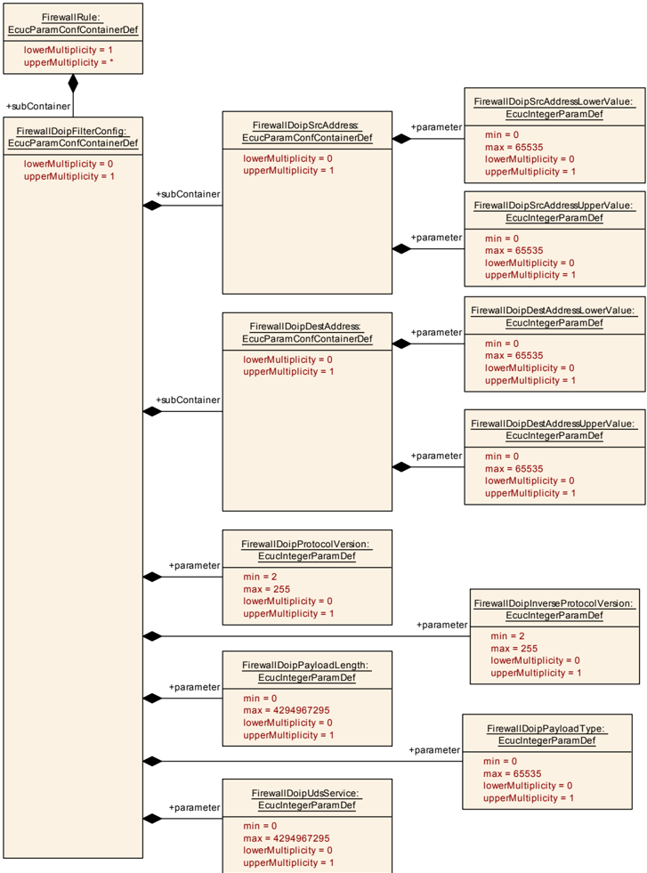

| SWS 条目 | [ECUC_Fw_00079] |
|---|---|
| 容器名称 | FirewallDoipFilterConfig |
| 父容器 | FirewallRule |
| 描述 | 针对 **DoIP** 的过滤规则配置。 |
| Post-Build 变体多重性 | true |
| 多重性配置类 | Pre-compile time：x（VARIANT-PRE-COMPILE）；Link time：x（VARIANT-LINK-TIME）；Post-build time：x（VARIANT-POST-BUILD） |
| 配置参数 | 见下方参数表 |

| SWS 条目 | [ECUC_Fw_00088] |
|---|---|
| 参数名称 | FirewallDoipInverseProtocolVersion |
| 父容器 | FirewallDoipFilterConfig |
| 描述 | 匹配 **DoIP** 报头中 inverseprotocolVersion 的 **DoIP** 报文的过滤器。 |
| 多重性 | 0..1 |
| 类型 | EcucIntegerParamDef |
| 范围 | 2 .. 255 |
| 默认值 | - |
| Post-Build 变体多重性 | true |
| Post-Build 变体值 | true |
| 多重性配置类 | Pre-compile time：x（VARIANT-PRE-COMPILE）；Link time：x（VARIANT-LINK-TIME）；Post-build time：x（VARIANT-POST-BUILD） |
| 值配置类 | Pre-compile time：x（VARIANT-PRE-COMPILE）；Link time：x（VARIANT-LINK-TIME）；Post-build time：x（VARIANT-POST-BUILD） |
| 作用域/依赖 | scope: local |

| SWS 条目 | [ECUC_Fw_00089] |
|---|---|
| 参数名称 | FirewallDoipPayloadLength |
| 父容器 | FirewallDoipFilterConfig |
| 描述 | 匹配 **DoIP** 报头中 payloadLength 的 **DoIP** 报文的过滤器。 |
| 多重性 | 0..1 |
| 类型 | EcucIntegerParamDef |
| 范围 | 0 .. 4294967295 |
| 默认值 | - |
| Post-Build 变体多重性 | true |
| Post-Build 变体值 | true |
| 多重性配置类 | Pre-compile time：x（VARIANT-PRE-COMPILE）；Link time：x（VARIANT-LINK-TIME）；Post-build time：x（VARIANT-POST-BUILD） |
| 值配置类 | Pre-compile time：x（VARIANT-PRE-COMPILE）；Link time：x（VARIANT-LINK-TIME）；Post-build time：x（VARIANT-POST-BUILD） |
| 作用域/依赖 | scope: local |

| SWS 条目 | [ECUC_Fw_00090] |
|---|---|
| 参数名称 | FirewallDoipPayloadType |
| 父容器 | FirewallDoipFilterConfig |
| 描述 | 匹配 **DoIP** 报头中 payloadType 的 **DoIP** 报文的过滤器。 |
| 多重性 | 0..1 |
| 类型 | EcucIntegerParamDef |
| 范围 | 0 .. 65535 |
| 默认值 | - |
| Post-Build 变体多重性 | true |
| Post-Build 变体值 | true |
| 多重性配置类 | Pre-compile time：x（VARIANT-PRE-COMPILE）；Link time：x（VARIANT-LINK-TIME）；Post-build time：x（VARIANT-POST-BUILD） |
| 值配置类 | Pre-compile time：x（VARIANT-PRE-COMPILE）；Link time：x（VARIANT-LINK-TIME）；Post-build time：x（VARIANT-POST-BUILD） |
| 作用域/依赖 | scope: local |

| SWS 条目 | [ECUC_Fw_00087] |
|---|---|
| 参数名称 | FirewallDoipProtocolVersion |
| 父容器 | FirewallDoipFilterConfig |
| 描述 | 匹配 **DoIP** 报头中 protocolVersion 的 **DoIP** 报文的过滤器。 |
| 多重性 | 0..1 |
| 类型 | EcucIntegerParamDef |
| 范围 | 2 .. 255 |
| 默认值 | - |
| Post-Build 变体多重性 | true |
| Post-Build 变体值 | true |
| 多重性配置类 | Pre-compile time：x（VARIANT-PRE-COMPILE）；Link time：x（VARIANT-LINK-TIME）；Post-build time：x（VARIANT-POST-BUILD） |
| 值配置类 | Pre-compile time：x（VARIANT-PRE-COMPILE）；Link time：x（VARIANT-LINK-TIME）；Post-build time：x（VARIANT-POST-BUILD） |
| 作用域/依赖 | scope: local |

| SWS 条目 | [ECUC_Fw_00091] |
|---|---|
| 参数名称 | FirewallDoipUdsService |
| 父容器 | FirewallDoipFilterConfig |
| 描述 | 匹配包含 udsService 的 **DoIP** 报文的过滤器。 |
| 多重性 | 0..1 |
| 类型 | EcucIntegerParamDef |
| 范围 | 0 .. 4294967295 |
| 默认值 | - |
| Post-Build 变体多重性 | true |
| Post-Build 变体值 | true |
| 多重性配置类 | Pre-compile time：x（VARIANT-PRE-COMPILE）；Link time：x（VARIANT-LINK-TIME）；Post-build time：x（VARIANT-POST-BUILD） |
| 值配置类 | Pre-compile time：x（VARIANT-PRE-COMPILE）；Link time：x（VARIANT-LINK-TIME）；Post-build time：x（VARIANT-POST-BUILD） |
| 作用域/依赖 | scope: local |

| 容器名称 | 多重性 | 作用域/依赖 |
|---|---|---|
| FirewallDoipDestAddress | 0..1 | 一个源端口过滤器的配置。 |
| FirewallDoipSrcAddress | 0..1 | 一个源端口过滤器的配置。 |

| SWS 条目 | [ECUC_Fw_00082] |
|---|---|
| 容器名称 | FirewallDoipDestAddress |
| 父容器 | FirewallDoipFilterConfig |
| 描述 | 一个源端口过滤器的配置。 |
| Post-Build 变体多重性 | true |
| 多重性配置类 | Pre-compile time：x（VARIANT-PRE-COMPILE）；Link time：x（VARIANT-LINK-TIME）；Post-build time：x（VARIANT-POST-BUILD） |
| 配置参数 | 见下方参数表 |

| SWS 条目 | [ECUC_Fw_00085] |
|---|---|
| 参数名称 | FirewallDoipDestAddressLowerValue |
| 父容器 | FirewallDoipDestAddress |
| 描述 | 匹配 destinationAddress 大于或等于 **FirwallDoipDestAddressLowerValue** 的 **DoIP** 报文的过滤器。 |
| 多重性 | 0..1 |
| 类型 | EcucIntegerParamDef |
| 范围 | 0 .. 65535 |
| 默认值 | - |
| Post-Build 变体多重性 | true |
| Post-Build 变体值 | true |
| 多重性配置类 | Pre-compile time：x（VARIANT-PRE-COMPILE）；Link time：x（VARIANT-LINK-TIME）；Post-build time：x（VARIANT-POST-BUILD） |
| 值配置类 | Pre-compile time：x（VARIANT-PRE-COMPILE）；Link time：x（VARIANT-LINK-TIME）；Post-build time：x（VARIANT-POST-BUILD） |
| 作用域/依赖 | scope: local |

| SWS 条目 | [ECUC_Fw_00086] |
|---|---|
| 参数名称 | FirewallDoipDestAddressUpperValue |
| 父容器 | FirewallDoipDestAddress |
| 描述 | 匹配 destinationAddress 小于或等于 **FirewallDoipDestAddressUpperValue** 的 **DoIP** 报文的过滤器。 |
| 多重性 | 0..1 |
| 类型 | EcucIntegerParamDef |
| 范围 | 0 .. 65535 |
| 默认值 | - |
| Post-Build 变体多重性 | true |
| Post-Build 变体值 | true |
| 多重性配置类 | Pre-compile time：x（VARIANT-PRE-COMPILE）；Link time：x（VARIANT-LINK-TIME）；Post-build time：x（VARIANT-POST-BUILD） |
| 值配置类 | Pre-compile time：x（VARIANT-PRE-COMPILE）；Link time：x（VARIANT-LINK-TIME）；Post-build time：x（VARIANT-POST-BUILD） |
| 作用域/依赖 | scope: local |

无包含的容器。

| SWS 条目 | [ECUC_Fw_00081] |
|---|---|
| 容器名称 | FirewallDoipSrcAddress |
| 父容器 | FirewallDoipFilterConfig |
| 描述 | 一个源端口过滤器的配置。 |
| Post-Build 变体多重性 | true |
| 多重性配置类 | Pre-compile time：x（VARIANT-PRE-COMPILE）；Link time：x（VARIANT-LINK-TIME）；Post-build time：x（VARIANT-POST-BUILD） |
| 配置参数 | 见下方参数表 |

| SWS 条目 | [ECUC_Fw_00083] |
|---|---|
| 参数名称 | FirewallDoipSrcAddressLowerValue |
| 父容器 | FirewallDoipSrcAddress |
| 描述 | 匹配 sourceAddress 大于或等于 **FirwallDoipDestAddressLowerValue** 的 **DoIP** 报文的过滤器。 |
| 多重性 | 0..1 |
| 类型 | EcucIntegerParamDef |
| 范围 | 0 .. 65535 |
| 默认值 | - |
| Post-Build 变体多重性 | true |
| Post-Build 变体值 | true |
| 多重性配置类 | Pre-compile time：x（VARIANT-PRE-COMPILE）；Link time：x（VARIANT-LINK-TIME）；Post-build time：x（VARIANT-POST-BUILD） |
| 值配置类 | Pre-compile time：x（VARIANT-PRE-COMPILE）；Link time：x（VARIANT-LINK-TIME）；Post-build time：x（VARIANT-POST-BUILD） |
| 作用域/依赖 | scope: local |

| SWS 条目 | [ECUC_Fw_00084] |
|---|---|
| 参数名称 | FirewallDoipSrcAddressUpperValue |
| 父容器 | FirewallDoipSrcAddress |
| 描述 | 过滤器端口上限值的定义。 |
| 多重性 | 0..1 |
| 类型 | EcucIntegerParamDef |
| 范围 | 0 .. 65535 |
| 默认值 | - |
| Post-Build 变体多重性 | true |
| Post-Build 变体值 | true |
| 多重性配置类 | Pre-compile time：x（VARIANT-PRE-COMPILE）；Link time：x（VARIANT-LINK-TIME）；Post-build time：x（VARIANT-POST-BUILD） |
| 值配置类 | Pre-compile time：x（VARIANT-PRE-COMPILE）；Link time：x（VARIANT-LINK-TIME）；Post-build time：x（VARIANT-POST-BUILD） |
| 作用域/依赖 | scope: local |

无包含的容器。

##### 9.2.3.11. 载荷字节模式配置

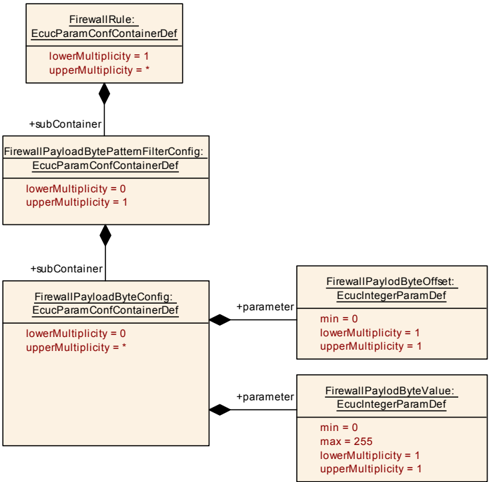

| SWS 条目 | [ECUC_Fw_00077] |
|---|---|
| 容器名称 | FirewallPayloadByteConfig |
| 父容器 | FirewallPayloadBytePatternFilterConfig |
| 描述 | 数据报中单个字节的配置。 |
| Post-Build 变体多重性 | true |
| 多重性配置类 | Pre-compile time：x（VARIANT-PRE-COMPILE）；Link time：x（VARIANT-LINK-TIME）；Post-build time：x（VARIANT-POST-BUILD） |
| 配置参数 | 见下方参数表 |

| SWS 条目 | [ECUC_Fw_00078] |
|---|---|
| 参数名称 | FirewallPaylodByteOffset |
| 父容器 | FirewallPayloadByteConfig |
| 描述 | 该参数定义数据报中的字节偏移量（以太网帧的起始字节，即偏移量 0 对应目的 **MAC** 地址的第一个字节）。 |
| 多重性 | 1 |
| 类型 | EcucIntegerParamDef |
| 范围 | 0 .. 18446744073709551615 |
| 默认值 | - |
| Post-Build 变体多重性 | false |
| Post-Build 变体值 | false |
| 多重性配置类 | Pre-compile time：x（All Variants）；Link time：-；Post-build time：- |
| 值配置类 | Pre-compile time：x（All Variants）；Link time：-；Post-build time：- |
| 作用域/依赖 | scope: local |

| SWS 条目 | [ECUC_Fw_00080] |
|---|---|
| 参数名称 | FirewallPaylodByteValue |
| 父容器 | FirewallPayloadByteConfig |
| 描述 | 该属性定义数据报中的 byteValue。 |
| 多重性 | 1 |
| 类型 | EcucIntegerParamDef |
| 范围 | 0 .. 255 |
| 默认值 | - |
| Post-Build 变体多重性 | false |
| Post-Build 变体值 | false |
| 多重性配置类 | Pre-compile time：x；Link time：-；Post-build time：- |
| 值配置类 | Pre-compile time：x；Link time：-；Post-build time：- |
| 作用域/依赖 | scope: local |

无包含的容器。

| SWS 条目 | [ECUC_Fw_00076] |
|---|---|
| 容器名称 | FirewallPayloadBytePatternFilterConfig |
| 父容器 | FirewallRule |
| 描述 | 定义应匹配的报文各个字节的通用防火墙规则的配置。 |
| Post-Build 变体多重性 | true |
| 多重性配置类 | Pre-compile time：x（VARIANT-PRE-COMPILE）；Link time：x（VARIANT-LINK-TIME）；Post-build time：x（VARIANT-POST-BUILD） |
| 配置参数 | 见下方参数表 |

| 容器名称 | 多重性 | 作用域/依赖 |
|---|---|---|
| FirewallPayloadByteConfig | 0..* | 数据报中单个字节的配置。 |

#### 9.2.4. 交换机桶计数机制

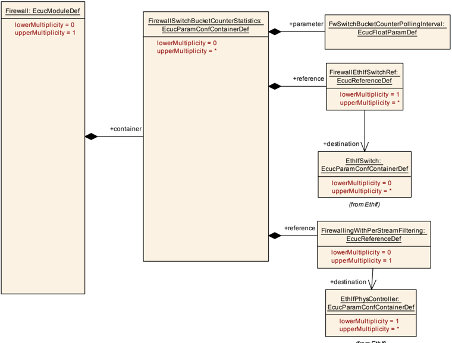

| SWS 条目 | [ECUC_Fw_00134] |
|---|---|
| 容器名称 | FirewallSwitchBucketCounterStatistics |
| 父容器 | Firewall |
| 描述 | 交换机桶计数器统计信息的轮询。 |
| Post-Build 变体多重性 | true |
| 多重性配置类 | Pre-compile time：x（VARIANT-PRE-COMPILE）；Link time：x（VARIANT-LINK-TIME）；Post-build time：x（VARIANT-POST-BUILD） |
| 配置参数 | 见下方参数表 |

| SWS 条目 | [ECUC_Fw_00135] |
|---|---|
| 参数名称 | FwSwitchBucketCounterPollingInterval |
| 父容器 | FirewallSwitchBucketCounterStatistics |
| 描述 | 交换机桶计数器轮询时间间隔的长度（单位：秒）。**注意：**应配置为 **IdsM** 主函数周期的倍数。 |
| 多重性 | 1 |
| 类型 | EcucFloatParamDef |
| 范围 | [-INF .. INF] |
| 默认值 | - |
| Post-Build 变体多重性 | false |
| Post-Build 变体值 | false |
| 多重性配置类 | Pre-compile time：x（All Variants）；Link time：-；Post-build time：- |
| 值配置类 | Pre-compile time：x（All Variants）；Link time：-；Post-build time：- |
| 作用域/依赖 | scope: local |

| SWS 条目 | [ECUC_Fw_00136] |
|---|---|
| 参数名称 | FirewallEthIfSwitchRef |
| 父容器 | FirewallSwitchBucketCounterStatistics |
| 描述 | 对桶计数器统计信息所适用的 **EthIfSwitch** 的引用。 |
| 多重性 | 1..* |
| 类型 | Reference to EthIfSwitch |
| Post-Build 变体多重性 | true |
| Post-Build 变体值 | true |
| 多重性配置类 | Pre-compile time：x（VARIANT-PRE-COMPILE）；Link time：x（VARIANT-LINK-TIME）；Post-build time：x（VARIANT-POST-BUILD） |
| 值配置类 | Pre-compile time：x（VARIANT-PRE-COMPILE）；Link time：x（VARIANT-LINK-TIME）；Post-build time：x（VARIANT-POST-BUILD） |
| 作用域/依赖 | scope: local |

| SWS 条目 | [ECUC_Fw_00137] |
|---|---|
| 参数名称 | FirewallingWithPerStreamFiltering |
| 父容器 | FirewallSwitchBucketCounterStatistics |
| 描述 | 对桶计数器统计信息所适用的 **EthIfSwitch** 的引用。 |
| 多重性 | 0..1 |
| 类型 | Reference to EthIfPhysController |
| Post-Build 变体多重性 | true |
| Post-Build 变体值 | true |
| 多重性配置类 | Pre-compile time：x（VARIANT-PRE-COMPILE）；Link time：x（VARIANT-LINK-TIME）；Post-build time：x（VARIANT-POST-BUILD） |
| 值配置类 | Pre-compile time：x（VARIANT-PRE-COMPILE）；Link time：x（VARIANT-LINK-TIME）；Post-build time：x（VARIANT-POST-BUILD） |
| 作用域/依赖 | scope: local |

无包含的容器。

#### 9.2.5. 安全事件

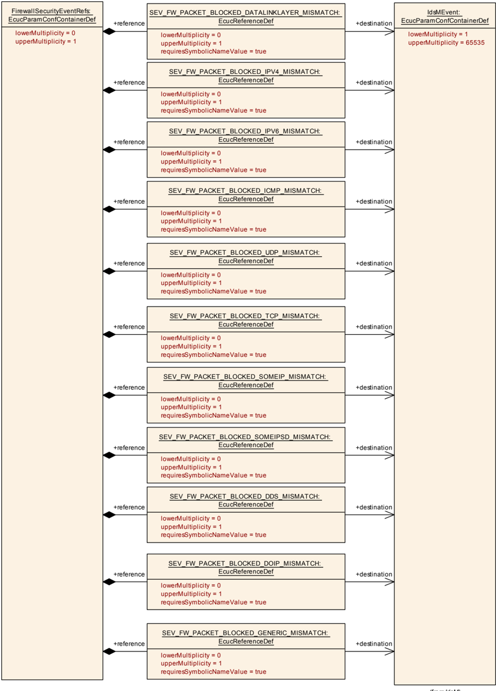

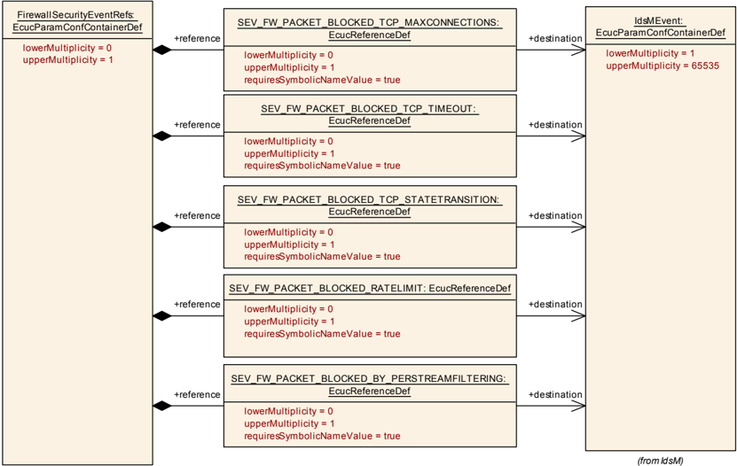

| SWS 条目 | [ECUC_Fw_00110] |
|---|---|
| 容器名称 | FirewallSecurityEventRefs |
| 父容器 | FirewallGeneral |
| 描述 | 用于包含指向 IdsMEvent 元素的引用的容器，这些元素表示在发生相应安全相关事件时（且在 **FirewallEnableSecurityEventReporting** 设置为 true 的情况下）防火墙模块应向 **IdsM** 报告的安全事件。该容器中的标准化安全事件可以通过供应商特定的安全事件进行扩展。 |
| Post-Build 变体多重性 | false |
| 多重性配置类 | Pre-compile time：x（All Variants）；Link time：-；Post-build time：- |
| 配置参数 | 见下方参数表 |

| SWS 条目 | [ECUC_Fw_00129] |
|---|---|
| 参数名称 | SEV_FW_PACKET_BLOCKED_BY_PERSTREAMFILTERING |
| 父容器 | FirewallSecurityEventRefs |
| 描述 | 网络数据包因交换机中的逐流过滤而被阻止。 |
| 多重性 | 0..1 |
| 类型 | Symbolic name reference to IdsMEvent |
| Post-Build 变体多重性 | false |
| Post-Build 变体值 | false |
| 多重性配置类 | Pre-compile time：x（All Variants）；Link time：-；Post-build time：- |
| 值配置类 | Pre-compile time：x（All Variants）；Link time：-；Post-build time：- |
| 作用域/依赖 | scope: local |

| SWS 条目 | [ECUC_Fw_00111] |
|---|---|
| 参数名称 | SEV_FW_PACKET_BLOCKED_DATALINKLAYER_MISMATCH |
| 父容器 | FirewallSecurityEventRefs |
| 描述 | 网络数据包因数据链路层上的规则不匹配而被阻止。 |
| 多重性 | 0..1 |
| 类型 | Symbolic name reference to IdsMEvent |
| Post-Build 变体多重性 | false |
| Post-Build 变体值 | false |
| 多重性配置类 | Pre-compile time：x；Link time：-；Post-build time：- |
| 值配置类 | Pre-compile time：x；Link time：-；Post-build time：- |
| 作用域/依赖 | scope: local |

| SWS 条目 | [ECUC_Fw_00123] |
|---|---|
| 参数名称 | SEV_FW_PACKET_BLOCKED_DDS_MISMATCH |
| 父容器 | FirewallSecurityEventRefs |
| 描述 | 网络数据包因 **DDS-RTPS** 协议中的规则不匹配而被阻止。 |
| 多重性 | 0..1 |
| 类型 | Symbolic name reference to IdsMEvent |
| Post-Build 变体多重性 | false |
| Post-Build 变体值 | false |
| 多重性配置类 | Pre-compile time：x（All Variants）；Link time：-；Post-build time：- |
| 值配置类 | Pre-compile time：x（All Variants）；Link time：-；Post-build time：- |
| 作用域/依赖 | scope: local |

| SWS 条目 | [ECUC_Fw_00133] |
|---|---|
| 参数名称 | SEV_FW_PACKET_BLOCKED_DOIP_MISMATCH |
| 父容器 | FirewallSecurityEventRefs |
| 描述 | 网络数据包因 **DoIP** 协议中的规则不匹配而被阻止。 |
| 多重性 | 0..1 |
| 类型 | Symbolic name reference to IdsMEvent |
| Post-Build 变体多重性 | false |
| Post-Build 变体值 | false |
| 多重性配置类 | Pre-compile time：x（All Variants）；Link time：-；Post-build time：- |
| 值配置类 | Pre-compile time：x（All Variants）；Link time：-；Post-build time：- |
| 作用域/依赖 | scope: local |

| SWS 条目 | [ECUC_Fw_00124] |
|---|---|
| 参数名称 | SEV_FW_PACKET_BLOCKED_GENERIC_MISMATCH |
| 父容器 | FirewallSecurityEventRefs |
| 描述 | 网络数据包因通用检查层级上的规则不匹配而被阻止。 |
| 多重性 | 0..1 |
| 类型 | Symbolic name reference to IdsMEvent |
| Post-Build 变体多重性 | false |
| Post-Build 变体值 | false |
| 多重性配置类 | Pre-compile time：x（All Variants）；Link time：-；Post-build time：- |
| 值配置类 | Pre-compile time：x（All Variants）；Link time：-；Post-build time：- |
| 作用域/依赖 | scope: local |

| SWS 条目 | [ECUC_Fw_00115] |
|---|---|
| 参数名称 | SEV_FW_PACKET_BLOCKED_ICMP_MISMATCH |
| 父容器 | FirewallSecurityEventRefs |
| 描述 | 网络数据包因 **ICMP** 协议内的规则不匹配而被阻止。 |
| 多重性 | 0..1 |
| 类型 | Symbolic name reference to IdsMEvent |
| Post-Build 变体多重性 | false |
| Post-Build 变体值 | false |
| 多重性配置类 | Pre-compile time：x；Link time：-；Post-build time：- |
| 值配置类 | Pre-compile time：x；Link time：-；Post-build time：- |
| 作用域/依赖 | scope: local |

| SWS 条目 | [ECUC_Fw_00114] |
|---|---|
| 参数名称 | SEV_FW_PACKET_BLOCKED_IPV4_MISMATCH |
| 父容器 | FirewallSecurityEventRefs |
| 描述 | 网络数据包因 **IPv4** 层上的规则不匹配而被阻止。 |
| 多重性 | 0..1 |
| 类型 | Symbolic name reference to IdsMEvent |
| Post-Build 变体多重性 | false |
| Post-Build 变体值 | false |
| 多重性配置类 | Pre-compile time：x；Link time：-；Post-build time：- |
| 值配置类 | Pre-compile time：x；Link time：-；Post-build time：- |
| 作用域/依赖 | scope: local |

| SWS 条目 | [ECUC_Fw_00117] |
|---|---|
| 参数名称 | SEV_FW_PACKET_BLOCKED_IPV6_MISMATCH |
| 父容器 | FirewallSecurityEventRefs |
| 描述 | 网络数据包因 **IPv6** 层上的规则不匹配而被阻止。 |
| 多重性 | 0..1 |
| 类型 | Symbolic name reference to IdsMEvent |
| Post-Build 变体多重性 | false |
| Post-Build 变体值 | false |
| 多重性配置类 | Pre-compile time：x（All Variants）；Link time：-；Post-build time：- |
| 值配置类 | Pre-compile time：x（All Variants）；Link time：-；Post-build time：- |
| 作用域/依赖 | scope: local |

| SWS 条目 | [ECUC_Fw_00128] |
|---|---|
| 参数名称 | SEV_FW_PACKET_BLOCKED_RATELIMIT |
| 父容器 | FirewallSecurityEventRefs |
| 描述 | 网络数据包因已达到速率限制而被阻止。 |
| 多重性 | 0..1 |
| 类型 | Symbolic name reference to IdsMEvent |
| Post-Build 变体多重性 | false |
| Post-Build 变体值 | false |
| 多重性配置类 | Pre-compile time：x（All Variants）；Link time：-；Post-build time：- |
| 值配置类 | Pre-compile time：x（All Variants）；Link time：-；Post-build time：- |
| 作用域/依赖 | scope: local |

| SWS 条目 | [ECUC_Fw_00121] |
|---|---|
| 参数名称 | SEV_FW_PACKET_BLOCKED_SOMEIP_MISMATCH |
| 父容器 | FirewallSecurityEventRefs |
| 描述 | 网络数据包因 **SOME/IP** 协议中的规则不匹配而被阻止。 |
| 多重性 | 0..1 |
| 类型 | Symbolic name reference to IdsMEvent |
| Post-Build 变体多重性 | false |
| Post-Build 变体值 | false |
| 多重性配置类 | Pre-compile time：x；Link time：-；Post-build time：- |
| 值配置类 | Pre-compile time：x；Link time：-；Post-build time：- |
| 作用域/依赖 | scope: local |

| SWS 条目 | [ECUC_Fw_00122] |
|---|---|
| 参数名称 | SEV_FW_PACKET_BLOCKED_SOMEIPSD_MISMATCH |
| 父容器 | FirewallSecurityEventRefs |
| 描述 | 网络数据包因 **SOME/IP SD** 协议中的规则不匹配而被阻止。 |
| 多重性 | 0..1 |
| 类型 | Symbolic name reference to IdsMEvent |
| Post-Build 变体多重性 | false |
| Post-Build 变体值 | false |
| 多重性配置类 | Pre-compile time：x（All Variants）；Link time：-；Post-build time：- |
| 值配置类 | Pre-compile time：x（All Variants）；Link time：-；Post-build time：- |
| 作用域/依赖 | scope: local |

| SWS 条目 | [ECUC_Fw_00125] |
|---|---|
| 参数名称 | SEV_FW_PACKET_BLOCKED_TCP_MAXCONNECTIONS |
| 父容器 | FirewallSecurityEventRefs |
| 描述 | 网络数据包因已达到打开 **TCP** 连接的最大数量而被阻止。 |
| 多重性 | 0..1 |
| 类型 | Symbolic name reference to IdsMEvent |
| Post-Build 变体多重性 | false |
| Post-Build 变体值 | false |
| 多重性配置类 | Pre-compile time：x（All Variants）；Link time：-；Post-build time：- |
| 值配置类 | Pre-compile time：x（All Variants）；Link time：-；Post-build time：- |
| 作用域/依赖 | scope: local |

| SWS 条目 | [ECUC_Fw_00120] |
|---|---|
| 参数名称 | SEV_FW_PACKET_BLOCKED_TCP_MISMATCH |
| 父容器 | FirewallSecurityEventRefs |
| 描述 | 网络数据包因 **TCP** 层上的规则不匹配而被阻止。 |
| 多重性 | 0..1 |
| 类型 | Symbolic name reference to IdsMEvent |
| Post-Build 变体多重性 | false |
| Post-Build 变体值 | false |
| 多重性配置类 | Pre-compile time：x（All Variants）；Link time：-；Post-build time：- |
| 值配置类 | Pre-compile time：x（All Variants）；Link time：-；Post-build time：- |
| 作用域/依赖 | scope: local |

| SWS 条目 | [ECUC_Fw_00126] |
|---|---|
| 参数名称 | SEV_FW_PACKET_BLOCKED_TCP_STATETRANSITION |
| 父容器 | FirewallSecurityEventRefs |
| 描述 | 网络数据包因无效的 **TCP** 状态转换而被阻止。 |
| 多重性 | 0..1 |
| 类型 | Symbolic name reference to IdsMEvent |
| Post-Build 变体多重性 | false |
| Post-Build 变体值 | false |
| 多重性配置类 | Pre-compile time：x；Link time：-；Post-build time：- |
| 值配置类 | Pre-compile time：x；Link time：-；Post-build time：- |
| 作用域/依赖 | scope: local |

| SWS 条目 | [ECUC_Fw_00127] |
|---|---|
| 参数名称 | SEV_FW_PACKET_BLOCKED_TCP_TIMEOUT |
| 父容器 | FirewallSecurityEventRefs |
| 描述 | 网络数据包因 **TCP** 超时而被阻止。 |
| 多重性 | 0..1 |
| 类型 | Symbolic name reference to IdsMEvent |
| Post-Build 变体多重性 | false |
| Post-Build 变体值 | false |
| 多重性配置类 | Pre-compile time：x；Link time：-；Post-build time：- |
| 值配置类 | Pre-compile time：x；Link time：-；Post-build time：- |
| 作用域/依赖 | scope: local |

| SWS 条目 | [ECUC_Fw_00119] |
|---|---|
| 参数名称 | SEV_FW_PACKET_BLOCKED_UDP_MISMATCH |
| 父容器 | FirewallSecurityEventRefs |
| 描述 | 网络数据包因 **UDP** 层上的规则不匹配而被阻止。 |
| 多重性 | 0..1 |
| 类型 | Symbolic name reference to IdsMEvent |
| Post-Build 变体多重性 | false |
| Post-Build 变体值 | false |
| 多重性配置类 | Pre-compile time：x（All Variants）；Link time：-；Post-build time：- |
| 值配置类 | Pre-compile time：x（All Variants）；Link time：-；Post-build time：- |
| 作用域/依赖 | scope: local |

无包含的容器。

### 9.3. 发布信息

详情请参阅 **SWS_BSWGeneral** 中的第 10.3 章「Published Information」（发布信息）。

## B. AUTOSAR 可追溯项变更历史

**注意：**本章中的列表还包括在后续版本中已从规范中移除的可追溯项。这些项不会作为超链接出现在文档中。

### B.1. 本文档根据 AUTOSAR Release 23-11 的约束和规范项历史

本文档在 R23-11 中新引入。

#### B.1.1. R23-11 中新增的规范项

```
[CP_SWS_Fw_30001] [CP_SWS_Fw_30002] [CP_SWS_Fw_30003] [CP_SWS_Fw_30004]
[CP_SWS_Fw_30005] [CP_SWS_Fw_30006] [CP_SWS_Fw_30007] [CP_SWS_Fw_30008]
[CP_SWS_Fw_30009] [CP_SWS_Fw_30010] [CP_SWS_Fw_30011] [CP_SWS_Fw_30012]
[CP_SWS_Fw_30013] [CP_SWS_Fw_30014] [CP_SWS_Fw_30015] [CP_SWS_Fw_30016]
[CP_SWS_Fw_30017] [CP_SWS_Fw_30018] [CP_SWS_Fw_30019] [CP_SWS_Fw_30020]
[CP_SWS_Fw_30021] [CP_SWS_Fw_30022] [CP_SWS_Fw_30023] [CP_SWS_Fw_30024]
[CP_SWS_Fw_30025] [CP_SWS_Fw_30026] [CP_SWS_Fw_40001] [CP_SWS_Fw_40002]
[CP_SWS_Fw_40003] [CP_SWS_Fw_40004] [CP_SWS_Fw_40005] [CP_SWS_Fw_40007]
[CP_SWS_Fw_40008] [CP_SWS_Fw_40009] [CP_SWS_Fw_40011] [CP_SWS_Fw_40012]
[CP_SWS_Fw_50001] [CP_SWS_Fw_50002] [CP_SWS_Fw_50003] [CP_SWS_Fw_50004]
[CP_SWS_Fw_50005] [CP_SWS_Fw_50006] [CP_SWS_Fw_50007] [CP_SWS_Fw_50008]
[CP_SWS_Fw_50009] [CP_SWS_Fw_60001] [CP_SWS_Fw_60002] [CP_SWS_Fw_60003]
[CP_SWS_Fw_60004] [CP_SWS_Fw_60005] [CP_SWS_Fw_60006] [CP_SWS_Fw_60007]
[CP_SWS_Fw_60008] [CP_SWS_Fw_60009] [CP_SWS_Fw_60010] [CP_SWS_Fw_60011]
[CP_SWS_Fw_60012] [CP_SWS_Fw_60013] [CP_SWS_Fw_60014] [CP_SWS_Fw_60015]
[CP_SWS_Fw_60016] [CP_SWS_Fw_60017] [CP_SWS_Fw_60018] [CP_SWS_Fw_60019]
[CP_SWS_Fw_60020] [CP_SWS_Fw_60021] [CP_SWS_Fw_60022] [CP_SWS_Fw_60023]
[CP_SWS_Fw_60024] [CP_SWS_Fw_60025] [CP_SWS_Fw_60026] [CP_SWS_Fw_60027]
[CP_SWS_Fw_60028] [CP_SWS_Fw_60029] [CP_SWS_Fw_60030] [CP_SWS_Fw_60031]
[CP_SWS_Fw_60032] [CP_SWS_Fw_60033] [CP_SWS_Fw_61000] [CP_SWS_Fw_91000]
[CP_SWS_Fw_91001] [CP_SWS_Fw_91002] [CP_SWS_Fw_91003] [CP_SWS_Fw_91004]
[CP_SWS_Fw_91005] [CP_SWS_Fw_91006] [CP_SWS_Fw_91007] [CP_SWS_Fw_91008]
[CP_SWS_Fw_91009] [CP_SWS_Fw_91010] [CP_SWS_Fw_91011] [CP_SWS_Fw_91012]
```

#### B.1.2. R23-11 中变更的规范项

无。

#### B.1.3. R23-11 中删除的规范项

无。
