## 1. 简介和功能概述

本规范描述 **AUTOSAR** 基础软件模块入侵检测系统管理器（**Intrusion Detection System Manager**，**IdsM**）的功能、**API** 和配置。

**IdsM** 是 **AUTOSAR** 入侵检测系统（**IDS**）的组成部分。

关于 **AUTOSAR** 所定义的分布式 **IDS** 各元素的概述与描述，请参阅 **IDS** 需求规范 [\[1\]](#ref-1)。

软件组件 **IdsM** 提供一个标准化的接口，用于接收车载安全事件（**SEv**）的通知。这些 **SEv** 可以由实现于基础软件模块（**BSW**）和应用软件组件（**SW-C**）中的安全传感器报告。

此外，**SEv** 还可以带有可选的上下文数据（例如事件类型和可疑数据）一起报告，这些数据对于在后端执行的安全取证来说可能是有用的信息。

除收集之外，**IdsM** 还具备根据可配置规则鉴定（qualify）**SEv** 的能力。**IdsM** 对已报告的 **SEv** 进行过滤和转换，得到合格的车载安全事件（**QSEv**）。这些 **QSEv** 由 **IdsM** 进一步处理以进行存储或转发。

根据整体安全概念，**QSEv** 可以通过安全事件存储器（**Sem**）持久化在 **ECU** 本地、向已配置的接收器（sink）传播，或二者兼有。可用的接收器是诊断事件管理器（**Dem**）模块和 **IDS** 报告器模块（**IdsR**），后者可以将 **QSEv** 数据传递给后端的安全运营中心（**SOC**）。

## 2. 缩略语

以下术语表包含与入侵检测系统管理器模块相关、且未包含在 **AUTOSAR_TR_Glossary** [\[2\]](#ref-2) 中的首字母缩略词和缩写。

**缩写 / 首字母缩略词（Abbreviation / Acronym）**

**API**
> 应用编程接口（**Application Programming Interface**）。

**BSW**
> 基础软件（**Basic Software**）。

**BswM**
> 基础软件模式管理器（**Basic Software Mode Manager**）。

**CDD**
> 复杂设备驱动（**Complex Device Driver**）。

**Classic Platform**
> **AUTOSAR** 经典平台（**AUTOSAR Classic Platform**）。

**Csm**
> 加密服务管理器（**Crypto Service Manager**）。

**Dcm**
> 诊断通信管理器（**Diagnostic Communication Manager**）。

**Dem**
> 诊断事件管理器模块（**Diagnostic Event Manager module**）。

**DET**
> 默认错误跟踪器（**Default Error Tracer**）。

**ECU**
> 电子控制单元（**Electronic Control Unit**）。

**ECUC**
> **ECU** 配置（**ECU configuration**）。

**ID**
> 标识符（**Identifier**）。

**IDS**
> 入侵检测系统（**Intrusion Detection System**）。

**IdsM**
> 入侵检测系统管理器（**Intrusion Detection System Manager**）。

**IdsR**
> 入侵检测系统报告器（**Intrusion Detection System Reporter**）。

**IF**
> 接口（**Interface**）。

**MCU**
> 微控制器单元（**Microcontroller Unit**）。

**NvM**
> 非易失性存储器（**Non-volatile memory**）。

**NVRAM**
> 非易失性随机访问存储器（**Non-volatile random access memory**）。

**OEM**
> 原始设备制造商（**Original Equipment Manufacturer**）。

**PDU**
> 协议数据单元（**Protocol Data Unit**）。

**PDU ID**
> **PDU** 标识符（**PDU Identifier**）。

**PduR**
> **PDU** 路由器（**PDU Router**）。

**QSEv**
> 合格安全事件（**Qualified Security Event**）。

**RTE**
> 运行时环境（**Runtime Environment**）。

**SecXT**
> 安全提取（**Security Extract**）。

**Sem**
> 安全事件存储器（**Security Event Memory**）。

**SEv**
> 车载安全事件（**On-board Security Event**）。

**StbM**
> 同步时基管理器（**Synchronized Time-Base Manager**）。

**SW-C**
> 软件组件（**Software Component**）。

**SOC**
> 安全运营中心（**Security Operation Center**）。

**TP**
> 传输协议（**Transport Protocol**）。

**术语（Terms）**

**Context Data Buffer**
> 具有可变大小、用于满足 **SEv** 上下文数据需求的缓冲区。

**Context Data**
> 与某个 **SEv** 相关的信息。它是可选数据，为安全事件提供更广泛的理解（例如被损坏的数据）。上下文数据的内容和编码由传感器外部定义，对 **IdsM** 模块来说是未知的。

**Event Buffer**
> 用于临时存储已报告的 **SEv ID** 的缓冲区。

**Filter**
> 安全事件的修饰器，可以丢弃或改变传入的 **SEv**。

**Filter Chain**
> 一个已配置的过滤器序列。

**IdsM block state**
> 由 **BswM** 通过 **IdsM_BswM_StateChanged** 报告的状态。这些状态用于暂停安全事件的收集。

**Intrusion Detection System Manager**
> 入侵检测系统管理器处理由安全传感器报告的安全事件。

**IdsR**
> **IdsR** 是一个 **OEM** 特定的自适应应用，可用于将 **QSEv** 进一步传播到 **SOC**。

**IdsM Qualified Event Buffers**
> 用于存储合格安全事件的缓冲区。

**IdsM Number Of Qualified Event Buffers**
> 用于合格安全事件的合格事件缓冲区的数量。

**Qualified Security Event (QSEv)**
> 已通过其对应过滤链并被发送到已配置接收器的事件。

**Security Event (SEv)**
> 车载安全事件是由 **BSW** 或 **SW-C** 向 **IdsM** 报告的安全事件类型的实例。它们是源自传感器的结构化数据，作为过滤器的基本输入和输出数据格式。这些向 **IdsM** 报告的事件指示正在进行的攻击，或以某种方式适合评估车辆的安全状态。这意味着事件可以在没有任何正在进行的攻击的正常运行期间发生。

**Security Event Type**
> 安全事件类型可以通过其安全事件类型 **ID** 来标识。安全事件类型的实例称为安全事件，它们共享相同的安全事件类型 **ID**。

**Sem**
> 安全事件存储器是 **Dem** 模块用户定义的存储器，与 **Dem** 的主存储器分离。

**Sensor**
> 向 **IdsM** 模块通知 **SEv** 的报告主体。它可以是一个 **BSW** 模块、一个专有的 **CDD** 或一个 **SW-C** 应用。

**Sink**
> **QSEv** 的目的地。根据配置，**QSEv** 可以被持久化、传播或二者兼有。

**Timestamp Provider**
> 提供时间戳的服务或软件组件，例如 **CP** 中的 **StbM**。

## 3. 相关文档

### 3.1. 相关规范

**AUTOSAR** 提供了基础软件模块的通用规范 [3]，该规范同样适用于入侵检测管理器。

因此，**SWS BSW General** 规范应被视为入侵检测管理器的附加且必需的规范。

本文档是 **AUTOSAR** **IDS** 规范的组成部分，仅涵盖 **Classic Platform** 特有的方面。有关 **IDS** 规范的其他方面，请参阅以下文档：

- **AUTOSAR_RS_Intrusion Detection System** [1]：规定 **IDS** 系统需求。
- **AUTOSAR_PRS_IntrusionDetectionSystem** [4]：规定安全事件传输的通信协议。
- **AUTOSAR_MOD_GeneralDefinitions** [5]：由 **AUTOSAR BSW** 报告的标准化安全事件。
- **AUTOSAR_TPS_SecurityExtractTemplate** [6]：规定安全提取（**Security Extract**）。

### 3.2. 输入文件和相关标准与规范

<a id="ref-1"></a>- [1] Requirements on Intrusion Detection System AUTOSAR_FO_RS_IntrusionDetectionSystem
<a id="ref-2"></a>- [2] Glossary AUTOSAR_FO_TR_Glossary
<a id="ref-3"></a>- [3] General Specification of Basic Software Modules AUTOSAR_CP_SWS_BSWGeneral
<a id="ref-4"></a>- [4] Specification of Intrusion Detection System Protocol AUTOSAR_FO_PRS_IntrusionDetectionSystem
<a id="ref-5"></a>- [5] Standardized M1 Models used for the Definition of AUTOSAR AUTOSAR_FO_MOD_GeneralDefinitions
<a id="ref-6"></a>- [6] Security Extract Template AUTOSAR_FO_TPS_SecurityExtractTemplate
<a id="ref-7"></a>- [7] General Requirements on Basic Software Modules AUTOSAR_CP_SRS_BSWGeneral

## 4. 约束和假设

入侵检测管理器不了解 **SEv** 中所报告上下文数据的含义；因此，它无法独立判定一个系统是否已被入侵。识别和威胁响应在 **IdsM** 的范围之外实现，例如在 **SOC** 中。

### 4.1. 假设

在 **IdsM** 概念的设计中做出了以下假设：

- 时间戳的精度：后端接收到的事件的时间戳可能在一定程度上不准确。然而，在大多数情况下，应当可以从后端接收到的事件中提取事件的先后顺序。在某些情况下，这可能无法实现，例如由于事件在不同 **ECU** 上并行发生，或由于时间同步固有的容差。
- **QSEv** 的唯一性：事件不需要被唯一地标识。两个事件可以包含相同的数据。
- 事件的丢弃：根据其报告频率和关键程度丢弃 **SEv** 是可以接受的，例如系统的一般性过载。
- 事件的语义：安全相关事件指示潜在的正在进行的攻击，或以某种方式适合评估车辆的安全状态。这意味着事件可以在没有任何攻击发生的正常运行期间出现。

### 4.2. 汽车域的适用性

**AUTOSAR** 入侵检测系统管理器是通用的，并提供灵活的配置。它独立于底层通信系统，在上述限制和假设的前提下，可适用于任何汽车域。

## 5. 对其他模块的依赖

**AUTOSAR** 入侵检测系统管理器包含模块 **BswM**、**Dcm**、**DET**、**Dem**、**NvM**、**PduR** 以及 **RTE** 的头文件。此外，它向基础软件模块和软件组件（传感器）提供通用接口，用于报告它们的 **SEv**。

图 5.1 展示了向 **AUTOSAR BSW** 中其他模块提供以及从其他模块要求的接口。

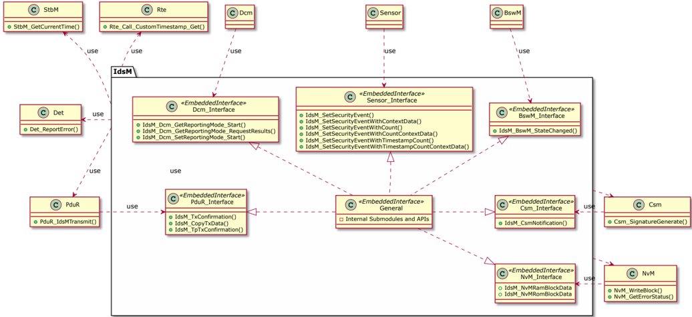

### 5.1. 模块接口

#### 5.1.1. 传感器模块

**IdsM** 提供通用的 **IdsM** 接口，根据配置附带附加信息地通知安全事件（**SEv**）。

标准 **API** 由基础软件模块和软件组件使用：

- 通知一个 **SEv**
- 通知一个带上下文数据的 **SEv**

智能传感器 **API** 由在需要传输事件计数和时间戳的情况下的软件组件使用。这些附加参数已经由智能传感器计算好。它们位于 **SW-C** 或 **Cdd** 中：

- 通知一个带计数器的 **SEv**
- 通知一个带计数器和上下文数据的 **SEv**
- 通知一个带时间戳和计数器的 **SEv**
- 通知一个带时间戳、计数器和上下文数据的 **SEv**

#### 5.1.2. 错误处理模块

**IdsM** 向默认错误跟踪器报告开发错误。

#### 5.1.3. 诊断访问

**Dcm** 模块能够修改事件报告级别的配置。

#### 5.1.4. 报告级别的持久化

**NvM** 模块持久化事件报告级别的配置值。

#### 5.1.5. IdsR 接收器

在事件被配置为发送到 **IdsR** 接收器的情况下使用 **PduR**；事件的发送与总线无关。

#### 5.1.6. Dem / Sem 接收器

在事件被配置为记录到 **Dem** / **Sem** 接收器的情况下使用 **Dem** 模块。

#### 5.1.7. BSW 调度器

**IdsM** 需要对其主调度函数的周期性调用，以评估和处理已报告的 **SEv**。

### 5.2. 文件结构

本节说明 **IdsM** 的文件结构。

#### 5.2.1. 代码文件结构

详情请参阅 [\[3\]](#ref-3)（**SWS BSW General**）中的第 5.1.6 节「Code file structure」（代码文件结构）。

#### 5.2.2. 头文件结构

除了 [\[3\]](#ref-3)（**SWS BSW General**）中第 5.1.7 节「Header file structure」（头文件结构）所定义的文件之外，入侵检测系统管理器模块还需要包含下面定义的文件。

如果启用了参数 **IdsMDevErrorDetect**，**IdsM** 模块应包含头文件 Det.h。

如果启用了参数 **IdsMSinkDem**，**IdsM** 模块应包含头文件 Dem.h。

如果启用了参数 **IdsMDiagnosticSupport**，**IdsM** 模块应包含头文件 Dcm.h。

如果配置了参数 **IdsMNvmBlockDescriptor**，**IdsM** 模块应包含头文件 NvM.h。

如果启用了参数 **IdsMSinkIdsR**，**IdsM** 模块应包含头文件 PduR.h。

## 6. 功能规格

### 6.1. 概述

入侵检测功能包括收集可能的安全事件、使用过滤规则处理它们，并将其转发到已配置的接收器。

本章规定 **Classic Platform** 的 **IdsM** 的功能行为。

图 7.1 展示了 **IdsM** 如何集成在 **AUTOSAR BSW** 安全协议栈中：

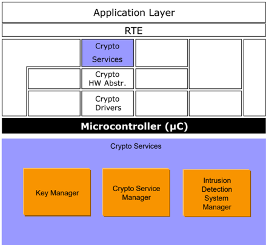

充当传感器并向 **IdsM** 报告 **SEv** 的模块有：

- **AUTOSAR** 基础软件模块（**BSW**）
- 专有复杂设备驱动（**CDD**）
- 应用软件组件（**SW-C**）

所收集的车载安全事件 **SEv** 由一系列称为「过滤链」（Filter Chain）的已配置规则处理为 **QSEv**，这些 **QSEv** 可以被发送到以下接收器：

- 入侵检测系统报告器（**IdsR**），使用 **PduR** 传输 **QSEv**。
- **Dem** / **Sem** 模块，用于 **QSEv** 记录的本地持久化。

可以通过使用 **Dcm** 模块的诊断功能重新配置特定的事件参数和过滤器限定条件。

可选地，**QSEv** 记录的完整性和机密性可以通过加密算法来保障。

图 7.2 展示了与上述模块的交互。模块 **CanIf**、**LinIf**、**EthIf**、**KeyM** 和 **SecOC** 作为 **BSW** 传感器示例给出。

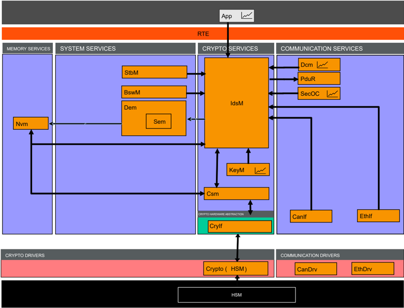

### 6.2. 模块处理

**IdsM** 的功能划分为以下功能子模块：

- 事件的接收
- 事件的缓冲
- **IdsM** 内部 **SEv**
- 事件的鉴定
- **QSEv** 的报告
- 事件的特定参数在 **NvM** 中的持久化
- 通过 **Dcm** 诊断读写事件的特定参数

图 7.3 展示了上面列出的功能子模块在协议栈中的位置，它们将在本章中详细描述。

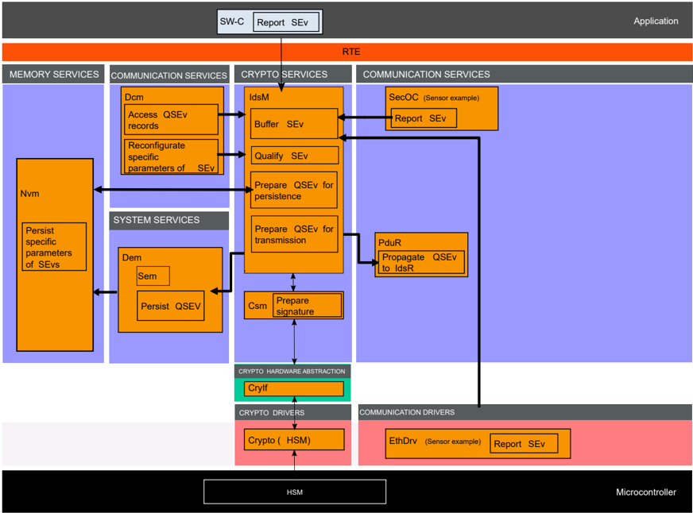

#### 6.2.1. 初始化

**IdsM** 模块通过 [**IdsM_Init**](#731-idsm_init) 进行初始化。除 [**IdsM_GetVersionInfo**](#732-idsm_getversioninfo) 和 [**IdsM_Init**](#731-idsm_init) 之外，**IdsM** 模块的 **API** 函数只能在模块被正确初始化之后调用。

对 [**IdsM_Init**](#731-idsm_init) 的调用会初始化所有内部变量，并将 **IdsM** 模块置于已初始化状态。

如果通过 **IdsMDevErrorDetect** 启用了开发错误报告，则在未初始化状态下调用 [**IdsM_Init**](#731-idsm_init) 或 [**IdsM_GetVersionInfo**](#732-idsm_getversioninfo) 之外的任何 **API** 时，**IdsM** 模块应以错误码 [**IDSM_E_UNINIT**](#6111-开发错误) 调用 **Det_ReportError**。

在已初始化状态下调用 [**IdsM_Init**](#731-idsm_init) 时，**IdsM** 模块不应重新初始化其内部变量。如果开发错误报告已启用（见 **IdsMDevErrorDetect**），它应以错误码 [**IDSM_E_ALREADY_INITIALIZED**](#6111-开发错误) 调用 **Det_ReportError**。

#### 6.2.2. 与时序相关的功能

为了能够异步处理安全事件及其过滤器，**IdsM** 模块通过 [**IdsM_MainFunction**](#733-idsm_mainfunction) 周期性地触发。

### 6.3. 事件的接收与缓冲

#### 6.3.1. 事件的接收

如果传感器通过 **IdsM** 服务 [**IdsM_SetSecurityEvent**](#735-idsm_setsecurityevent) 或 [**IdsM_SetSecurityEventWithContextData**](#736-idsm_setsecurityeventwithcontextdata)（分别对应不带和带上下文数据）报告安全事件，则会使用 **IdsM** 事件缓冲池中的一个事件缓冲区，并在 [**IdsM_MainFunction**](#733-idsm_mainfunction) 函数中异步处理。

如果存在上下文数据，则会使用一个大小合适的上下文数据缓冲区。如果当前没有可用的上下文缓冲区，则该事件将在不带上下文数据的情况下处理。

服务 [**IdsM_SetSecurityEvent**](#735-idsm_setsecurityevent) 和 [**IdsM_SetSecurityEventWithContextData**](#736-idsm_setsecurityeventwithcontextdata) 可以被任何传感器使用，与其来源无关。

**IdsM** 应能够在没有报告上下文数据时通过服务 [**IdsM_SetSecurityEvent**](#735-idsm_setsecurityevent) 接收 **SEv**。

**IdsM** 应能够在报告可选上下文数据时通过服务 [**IdsM_SetSecurityEventWithContextData**](#736-idsm_setsecurityeventwithcontextdata) 接收 **SEv**。

##### 6.3.1.1. 智能传感器

智能传感器向标准传感器提供附加信息。智能传感器可以是预先记录时间戳并为某个 **SEv** 类型计算计数器的 **SW-C** 或 **CDD**。本节中的服务可通过以下方式获得：

- 面向 **SW-C** 的服务接口（参见 [6.8.2.2](#6822-ids-服务接口选项) 节）。
- 面向 **CDD** 的直接 **C API** 调用。

**对带计数器的 SEv 的接收**

**IdsM** 应能够通过服务 [**IdsM_SetSecurityEventWithCount**](#737-idsm_setsecurityeventwithcount) 接收带有由智能传感器计算的计数器的 **SEv**。

**IdsM** 应能够通过服务 [**IdsM_SetSecurityEventWithCountContextData**](#738-idsm_setsecurityeventwithcountcontextdata) 接收带有由智能传感器计算的计数器、并附带 **SEv** 上下文数据的 **SEv**。

**对带计数器和时间戳的 SEv 的接收**

**IdsM** 应能够通过服务 [**IdsM_SetSecurityEventWithTimestampCount**](#739-idsm_setsecurityeventwithtimestampcount) 接收带有由智能传感器计算的时间戳和计数器的 **SEv**。

**IdsM** 应能够通过服务 [**IdsM_SetSecurityEventWithTimestampCountContextData**](#7310-idsm_setsecurityeventwithtimestampcountcontextdata) 接收带有由智能传感器计算的时间戳、计数器、并附带 **SEv** 上下文数据的 **SEv**。

对于报告带有时间戳但没有预先计算的计数器的 **SEv**，可以使用服务 [**IdsM_SetSecurityEventWithTimestampCountContextData**](#7310-idsm_setsecurityeventwithtimestampcountcontextdata) 和 [**IdsM_SetSecurityEventWithTimestampCount**](#739-idsm_setsecurityeventwithtimestampcount)，并将计数器值置为 1。

**上下文数据详情**

函数 [**IdsM_SetSecurityEventWithContextData**](#736-idsm_setsecurityeventwithcontextdata)、[**IdsM_SetSecurityEventWithCountContextData**](#738-idsm_setsecurityeventwithcountcontextdata) 和 [**IdsM_SetSecurityEventWithTimestampCountContextData**](#7310-idsm_setsecurityeventwithtimestampcountcontextdata) 应支持最大 1500 字节的上下文数据长度。

**注意：**为避免网络过载，建议上下文数据最大为 1500 字节，尤其是在 **CAN** 总线上传输时。

在某些情况下，此限制可能不足以传输传感器的全部信息，此时应评估是否有足够的资源以避免通信通道被淹没。

调用 [**IdsM_SetSecurityEventWithContextData**](#736-idsm_setsecurityeventwithcontextdata)、[**IdsM_SetSecurityEventWithCountContextData**](#738-idsm_setsecurityeventwithcountcontextdata) 和 [**IdsM_SetSecurityEventWithTimestampCountContextData**](#7310-idsm_setsecurityeventwithtimestampcountcontextdata) 的函数应提供指向字节数组的上下文数据指针，上下文数据在该数组中可用。**注意：IdsM** 不应依赖对可选上下文数据内部结构的了解。

#### 6.3.2. 安全事件定义

安全事件或安全事件实例 **SEv** 定义了由传感器报告的、**IdsM** 模块可以处理的原子单元。**IdsM** 接收来自 **BSW** 或 **CDD** 模块的传感器通知，或来自经由 **RTE** 的 **SW-C**。**IdsM** 模块使用 **EventId** 管理系统的 **SEv** 状态，并对各个结果执行所需的动作，例如过滤、存储、通过网络报告。安全事件定义表示要报告的事件的类型。该定义位于 **SecXT** 中，包含一个全局唯一标识符和报告模块的短名称。

**IdsM** 模块应以 **IdsMExternalEventId**、**IdsMSensorInstanceId**、**IdsMInternalEventId** 以及相关联的 **EventName** 表示每个 **SEv** 实例。这些参数的组合在由 **ECU** 配置所表示的每个 **IdsM** 实例中应是唯一的。

每个 **SEv** 应有一个 **IdsMInternalEventId**。该参数不应手动配置。**IdsM** 应在内部计算该参数的值，并将该值发布到该参数中。此 **ID** 用于 **SEv** 的内部处理。

使用 **IdsM API** 报告 **SEv** 的传感器不应依赖参数 **IdsMInternalEventId** 的值。相反，它们应使用相应 **SEv** 的符号常量（**SymbolicNameValue**）。

每个 **SEv** 应有一个外部事件 **ID** **IdsMExternalEventId**，它是由 **ECU** 配置所表示的每个安全事件类型的全局唯一 **ID**，并在 **SecXT** 中定义。

值为 0xFFFF 的 **IdsMExternalEventId** 应被视为无效。

所有传感器使用其对应的 [**IdsMEvent**](#9122-idsmevent) 容器的符号名称作为标识符来报告它们的 **SEv**。在生成动态代码时，符号名称被替换为数字（计算出的数字作为内部事件 **ID** 发布）。生成的符号名称表示外部事件 **ID** 和传感器实例 **ID** 的元组。此 **ID** 用于 **SEv** 的内部处理。

每个 **SEv** 应有一个传感器实例 **ID** **IdsMSensorInstanceId**。这是模块编号的表示，用于同一模块有多个实例向 **IdsM** 报告的情况。

外部事件 **ID** **IdsMExternalEventId** 和传感器实例 **ID** **IdsMSensorInstanceId** 的组合应使 **SEv** 在配置内可以被唯一地标识。该参数元组由 [**IdsMEvent**](#9122-idsmevent) 容器的符号名称值（**Symbolic Name Value**）表示。

使用 **IdsM** 服务的传感器应使用 [**IdsMEvent**](#9122-idsmevent) 容器的符号常量（**SymbolicNameValue**）报告 **SEv**。

**IdsM** 被设计为可处理多个 **SEv** 共享相同 **IdsMExternalEventId** 的情况，只要报告模块拥有唯一的传感器实例 **ID**。

每个 **SEv** 应配置一个 **IdsMSensorInstanceId**。如果在同一 **ECU** 中有多个相同传感器的实例报告具有相同事件定义 **ID** 的 **SEv**，则报告实体应通过配置参数 **IdsMSensorInstanceId** 被唯一地标识。如果配置中该模块只有一个实例，则实例 **ID** 的值默认应设置为 0。

#### 6.3.3. 缓冲区

**IdsM** 应具有可配置数量的事件缓冲区 **IdsMNumberOfEventBuffers**，其数量取决于所要处理的已配置 [**IdsMEvent**](#9122-idsmevent) 的数量。

缓冲区数量的建议值可按如下方式计算：

事件缓冲区数量 = 事件聚合过滤器实例数 + 并行处理事件数的上限

在接收到一个 **SEv** 时，**IdsM** 应将该事件存储在一个事件缓冲区中，直到它可以被进一步处理。事件缓冲区应在 [**IdsM_MainFunction**](#733-idsm_mainfunction) 服务中异步处理和过滤。

在找不到事件缓冲区的情况下，如果已配置 **IdsM** 内部 **SEv**「No Event Buffer Available」（无可用事件缓冲区），则应触发该内部 **SEv**。参见第 [6.4](#64-idsm-内部-sev) 节 **IdsM** 安全事件表中的 **SEV_IDSM_NO_EVENT_BUFFER_AVAILABLE**。

**IdsM** 应具有可配置数量的上下文数据缓冲区 **IdsMNumberOfContextDataBuffers**，并具有不同的可配置大小 **IdsMContextDataBufferSize**，以满足不同的传感器用例。

**原理：**根据所处理事件的类型，上下文数据的大小可能存在显著差异。这些大小必须进行适当配置，以有效利用内存资源。

在接收到一个带上下文数据的 **SEv** 时，**IdsM** 应将上下文数据存储在一个大小最合适的可用上下文数据缓冲区中。应搜索已配置的上下文数据缓冲池，以找到与所报告上下文数据大小相同的缓冲区，或找到下一个更大的缓冲区。这些缓冲区应在 [**IdsM_MainFunction**](#733-idsm_mainfunction) 服务中异步处理和过滤。

一旦找到了合适的上下文数据缓冲区，就应将其链接到相应的事件缓冲区以进行进一步处理。

在不存在与上下文数据大小相同或更大的合适上下文数据缓冲区的情况下，该事件应作为不带上下文数据的事件处理。因此，不应将任何上下文数据缓冲区链接到所处理的 **SEv**。

在找不到合适的上下文数据缓冲区的情况下，如果已配置 **IdsM** 内部 **SEv**「No Context Data Buffer Available」（无可用上下文数据缓冲区），则应触发该内部 **SEv**。参见第 [6.4](#64-idsm-内部-sev) 节 **IdsM** 安全事件表中的 **SEV_IDSM_EVENT_NO_CONTEXT_DATA_BUFFER_AVAILABLE**。

在接收到不带上下文数据的 **SEv** 时，**IdsM** 不应使用任何上下文数据缓冲区。因此，不会有上下文数据缓冲区链接到所处理的 **SEv**。

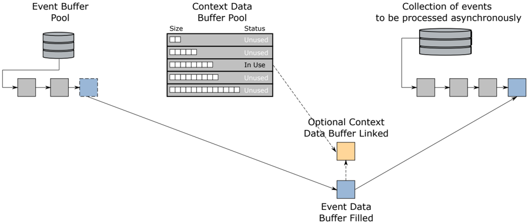

图 7.4 展示了当通过 **IdsM API** 设置安全事件时（如本章所述），事件缓冲区和上下文缓冲区的使用方式。在接收到一个 **SEv** 时，该事件被存储在事件缓冲池中的一个缓冲区内，其对应的上下文数据被存储在上下文数据缓冲池中大小最合适的缓冲区内。这两个缓冲区被链接在一起，并在 [**IdsM_MainFunction**](#733-idsm_mainfunction) 服务中异步处理。

#### 6.3.4. 上下文数据修饰器

应用应能够修改传入 **SEv** 的原始报告上下文数据的内容。

如果要修改上下文数据，可以配置一个「上下文数据修饰器调出（Context Data Modifier Callout）」函数与一个「上下文数据大小修饰器（Context Data Size Modifier）」的组合。

「上下文数据修饰器调出」函数用于修改上下文数据，「上下文数据大小修饰器」用于查找大小合适的上下文数据缓冲区。

如果配置了上下文数据修饰器，**IdsM** 应在相应的 **SEv** 被报告之后直接调用 [**IdsM_ContextDataModifierCallout_Name**](#7311-idsm_contextdatamodifiercallout_name)，只要其报告模式为 **DETAILED** 或 **DETAILED_BYPASSING_FILTERS**。

如果 **IdsM** 调用 [**IdsM_ContextDataModifierCallout_Name**](#7311-idsm_contextdatamodifiercallout_name)，则它应使用出参 **modifiedContextData** 提供的上下文数据作为该 **SEv** 的上下文数据。

**IdsM** 可以配置两种上下文数据修饰器：

- 特定修饰器 [**IdsMContextDataModifierCallout**](#9128-idsmcontextdatamodifiercallout)，只影响链接到它的 **SEv**。
- 全局修饰器 **IdsMGlobalContextDataModifierCalloutFct**，影响所有已配置的 **SEv**。

如果配置了 **IdsMContextDataModifierCalloutFct**，**SEv** 应为被引用的 **SEv** 调用已配置的调出函数。否则，如果配置了 **IdsMGlobalContextDataModifierCalloutFct**，**SEv** 应为所有 **SEv** 调用已配置的调出，但带有特定修饰器调出的 **SEv** 除外。

### 6.4. IdsM 内部 SEv

模块 **IdsM** 本身也可以用作安全事件传感器。

**IdsM** 模块报告的安全事件列于 **IdsM** 安全事件表中。

**IdsM（IDSM）的安全事件（**Security events for IDSM**）**

| 名称 | 说明 | ID |
|---|---|---|
| SEV_IDSM_NO_EVENT_BUFFER_AVAILABLE | 无法处理某个 **SEv**，因为没有更多可用于处理该事件的事件缓冲区。 | 46 |
| SEV_IDSM_NO_CONTEXT_DATA_BUFFER_AVAILABLE | 由于没有更多可用的上下文数据缓冲区，传入事件的上下文数据无法被存储。 | 47 |
| SEV_IDSM_TRAFFIC_LIMITATION_EXCEEDED | 当前流量超过了已配置的流量限制。 | 48 |
| SEV_IDSM_COMMUNICATION_ERROR | 通过 **PDU** 发送 **QSEv** 时发生错误。 | 49 |
| SEV_IDSM_NO_QUALIFIED_EVENT_BUFFER_AVAILABLE | 当 **QSEv** 因可用的 **QSEv** 缓冲区不足而必须被丢弃时引发的安全事件。 | 87 |

如果 **IdsM** 内部事件已配置，**IdsM** 应为这些 **SEv** 中的每一个提供自己的缓冲区。这些是专用缓冲区，独立于用于普通 **SEv** 的公共事件缓冲区。这些缓冲区中的每一个应存储单个 **SEv**。

**注意：**使用各自存储单个 **SEv** 的专用缓冲区，使 **IdsM** 即使在过载时也能向接收器报告功能失常。

**IdsM** 内部 **SEv** 不应被 **IdsM** 实例特定的过滤器过滤。过滤器类别见第 [6.5](#65-sev-的鉴定) 节。

**IdsM** 内部 **SEv** 可以被 **IdsM SEvID** 特定的过滤器过滤。过滤器类别见第 [6.5](#65-sev-的鉴定) 节。

### 6.5. SEv 的鉴定

原始安全事件可能由 **BSW** 以非常高的速率生成。然而，这些事件中只有一部分可能是 **OEM** 感兴趣的。通过对原始 **SEv** 进行预处理并丢弃所有不匹配过滤条件的事件，可以减少 **ECU** 和网络上的资源需求。

**IdsM** 应将 **SEv** 存储在事件缓冲区中，并在 [**IdsM_MainFunction**](#733-idsm_mainfunction) 服务中异步处理它们，以便将它们鉴定为 **QSEv**。

已报告安全事件的鉴定应通过将所处理的 **SEv** 针对一个可配置的过滤器序列（即过滤链）进行评估来进行。

一个 **SEv** 应包含用于将其鉴定为 **QSEv** 的过滤链的信息。

**注意：**

- 一个 **SEv** 可以没有与之关联的过滤链。
- 多个事件可以分配给一个过滤链。所有被分配的事件共享同一个过滤器的相同设置。但是，每个被分配的事件都有其自己的过滤器可变部分（例如计数器）。

如果过滤条件未被满足，每个过滤器应通过丢弃来拒绝所处理的 **SEv**。

否则，如果过滤器未丢弃某个 **SEv**，该过滤器应将当前处理的 **SEv** 转发给链中的下一个过滤器。

如果过滤器属于采样或聚合类型，过滤器应能够根据其算法修改 **SEv** 的计数器。

如果已配置过滤链中没有过滤器丢弃该 **SEv**，则它被视为合格安全事件（**QSEv**），并应存储在合格事件缓冲区（[**IdsMQualifiedEventBuffers**](#9121-idsmqualifiedeventbuffers)）中。

**注意：QSEv** 在 **IdsMQualifiedEventBuffer** 中缓冲的形式由实现决定，例如 **QSEv** 可以按照 **QSEv** 结构的规定打包并缓冲在 [**IdsMQualifiedEventBuffers**](#9121-idsmqualifiedeventbuffers) 中。

**IdsM** 应具有可配置数量的合格事件缓冲区（**IdsMNumberOfQualifiedEventBuffers**）。

在找不到合适的合格事件缓冲区的情况下，如果已配置，应触发 **IdsM** 内部 **SEv** **SEV_IDSM_NO_QUALIFIED_EVENT_BUFFER_AVAILABLE**。

合格事件缓冲区中的 **QSEv** 应根据 [**IdsMEvent**](#9122-idsmevent) 配置转发到相应的接收器。**注意：**在向接收器转发时应遵守第 [6.8](#68-sev-的报告与持久化) 节中关于 **SEv** 的需求。

### 6.6. 过滤链

过滤链使用 **SecXT** 模型进行配置。

**过滤链选择**：当 **SEv** 被报告时，**IdsM** 应应用映射到它的过滤链。

**过滤链评估**：**IdsM** 应在评估报告模式之后评估过滤链。

**可能的过滤器**：每个过滤链可以由以下过滤器组成：

- 阻止状态过滤器（BlockState Filter）
- 每第 N 个转发过滤器（Forward Every nth Filter）
- 事件聚合过滤器（Event Aggregation Filter）
- 事件阈值过滤器（Event Threshold Filter）
- 事件速率限制（Event Rate Limitation）
- 流量限制（Traffic Limitation）

**注意：**每个过滤器都可以通过在模型中将相应的 Filter 对象聚合到 SecurityFilterChain 对象上来激活。

**过滤链顺序**：**IdsM** 应按「阻止状态过滤器、每第 N 个转发过滤器、事件聚合过滤器、事件阈值过滤器」的顺序评估所有已激活的过滤器。

**SEv 的丢弃**：如果对一个过滤器的评估导致丢弃该 **SEv**，**IdsM** 不应再评估任何其他过滤器。

在成功评估已配置的过滤链之后，安全事件被定义为合格的（**QSEv**）。

组成过滤链的过滤器被归为以下类别：

- 阻止器（Blockers）
- 采样（Sampling）
- 聚合（Aggregation）
- 速率限制（Rate Limitation）

图 7.5 展示了过滤器的分类及其处理顺序。

- 实例特定过滤器（Instance Specific Filters）：全局过滤属于某个 **IdsM** 实例的所有 **SEv**：事件速率限制和流量限制。
- **SEvID** 特定过滤器（SEvID Specific Filters）：逐一过滤与其相关的每个 **SEv**：报告模式、阻止状态、每第 N 个转发、聚合和阈值。

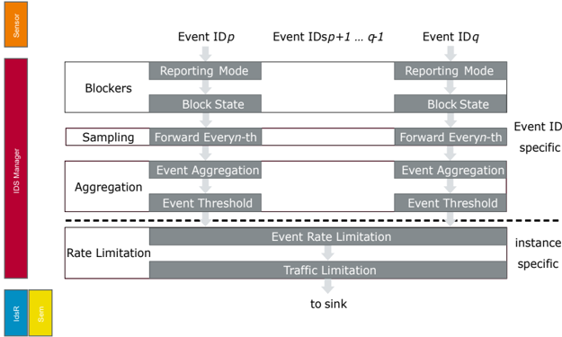

#### 6.6.1. 阻止过滤器

阻止过滤器丢弃不匹配过滤条件的、被处理的 **SEv**。这些是特定于 **SEv** 实例的过滤器。

##### 6.6.1.1. 报告模式过滤器

报告模式过滤器使得可以决定所转发的 **SEv** 的信息详细程度、绕过过滤链，或关闭某些 **SEv** 的处理。

**IdsM** 应为每个 **SEv ID** 实例提供一个报告模式过滤器。该过滤器对每个已配置的 **SEv** 都是强制性的。

报告模式过滤器不应是过滤链的一部分。它应直接链接到相应的 **SEv**。

**注意：**一个 **SEv** 不必被分配给过滤链。

**报告模式**：**IdsM** 应从 [**IdsMReportingModeFilter**](#9123-idsmreportingmodefilter) 确定每个已报告 **SEv** 的默认报告模式。

**报告模式选项**：

表7.1：报告模式过滤器取值（**Reporting Mode Filter Values**）

| 报告模式级别 | 相关行为 |
|---|---|
| OFF | **IdsM** 应丢弃该 **SEv**，不再进行进一步处理。 |
| BRIEF | 如果该 **SEv** 被报告时带有上下文数据，**IdsM** 应丢弃其上下文数据，不再进行进一步的处理、传输和存储。 |
| DETAILED | 如果该 **SEv** 被报告时带有上下文数据，**IdsM** 应保留其上下文数据，用于潜在的 **QSEv** 传输或持久化。 |
| BRIEF_BYPASSING_FILTERS | **IdsM** 应在不带上下文数据的情况下报告或持久化该 **SEv**，而不进一步应用任何过滤链。 |
| DETAILED_BYPASSING_FILTERS | **IdsM** 应在带上下文数据（如果由传感器提供）的情况下报告或持久化该 **SEv**，而不进一步应用任何过滤链。 |

**IdsM** 应根据该表依据其报告模式处理已报告的 **SEv**。

表 7.1 列出了报告模式过滤器 [**IdsMReportingModeFilter**](#9123-idsmreportingmodefilter) 的可能取值。根据为该 **SEv** 选择的字面值，事件将被不同地过滤，并且上下文数据将被丢弃或传递给链中的下一个过滤器。

请注意，「事件帧（Event Frame）」的结构在入侵检测系统协议规范 [\[4\]](#ref-4) 中描述。报告模式与配置特性「时间戳」和「签名」无关。

##### 6.6.1.2. 阻止状态过滤器

**IdsM** 应提供一个阻止状态过滤器。参见 [**IdsMBlockStateFilter**](#9111-idsmblockstatefilter)。

阻止状态过滤器应表示一个状态列表，在这些状态下 **SEv** 的收集应被阻止（即 **SEv** 应被丢弃）。

**IdsM** 应由 **BswM** 模块通过回调服务 [**IdsM_BswM_StateChanged**](#741-idsm_bswm_statechanged) 告知当前状态。当在主函数中异步处理阻止状态过滤器时，应使用该信息。

**阻止状态过滤器**：如果 **IdsM** 评估阻止状态过滤器时，当前阻止状态等于 [**IdsMBlockState**](#9126-idsmblockstate) 所引用状态之一，则 **IdsM** 应丢弃该 **SEv**。

如果当前状态不在列表中，阻止状态过滤器应将 **SEv** 转发给链中的下一个过滤器。如果这是链中的最后一个过滤器，则该过滤器将 **QSEv** 转发给接收器。

**注意：**过滤器中可以包含的可能状态在 [**IdsMBlockState**](#9126-idsmblockstate) 中描述。**BswM** 使用 **IdsM** 阻止状态标识符 **IdsMBlockStateID** 的符号名称，通过服务 [**IdsM_BswM_StateChanged**](#741-idsm_bswm_statechanged) 报告当前的 **IdsM** 状态。

**BswM** 通过持有指向 [**IdsMBlockState**](#9126-idsmblockstate) 的 **ECUC** 引用，了解配置中可用的 **IdsM** 状态。

#### 6.6.2. 采样过滤器

采样过滤器只转发所有传入安全事件中的特定事件。这些是特定于 **SEv** 实例的过滤器。

##### 6.6.2.1. 每第 N 个转发

**IdsM** 应提供「每第 N 个转发」过滤器。

**采样过滤器**：如果 **IdsM** 为某个 **SEv** 评估采样过滤器，**IdsM** 应丢弃所有 **SEv**，但每第 n 个除外，其中 n 在 **IdsMNthParameter** 中定义。**SEv** 的转发从第一个接收到的 **SEv** 开始，然后每第 n 个 **SEv** 被转发。

一个实现通常会维护一个计数器，当给定类型的 **SEv** 被采样过滤器评估时，该计数器递增。如果计数器等于 n，则该 **SEv** 不被丢弃，且计数器重置为 0。

**采样过滤器初始化**：**IdsM** 应为某个 **SEv** 初始化采样过滤器，使得第一个接收到的 **SEv** 被转发。示例：对于某事件类型 **IdsMNthParameter** 设置为 3，则 **IdsM** 将转发第 1、4、7、… 个 **SEv**（1 表示重置后报告的第一个 **SEv**）。

「每第 N 个转发」过滤器对 **SEv** 的转发应在**不修改** **SEv** 数据的情况下完成。例如计数器保持原始值。

如果 **IdsM** 通过函数 [**IdsM_SetSecurityEventWithCount**](#737-idsm_setsecurityeventwithcount) 或 [**IdsM_SetSecurityEventWithCountContextData**](#738-idsm_setsecurityeventwithcountcontextdata) 接收到一个计数大于 1 的 **SEv**，则该过滤器的聚合计数值可能大于已配置的阈值 n。在这种情况下，应转发包含可能超过已配置阈值 n 的聚合计数值的 **SEv**。

#### 6.6.3. 聚合过滤器

在已配置时间间隔内发生的、给定类型的所有 **SEv** 被聚合为一个 **SEv**，并附带一个额外的计数信息，指示该事件在该时间间隔内发生的频率。

##### 6.6.3.1. 事件聚合过滤器

**IdsM** 应提供一个聚合过滤器。

**事件聚合过滤器的配置**：参数 **IdsMEventAggregationTimeInterval** 应表示对给定类型的 **SEv** 进行聚合的时间间隔的时长。

聚合过滤器应转发一个带有在该间隔内处理的 **SEv** 计数器之和的 **SEv**。考虑针对特定 **SEv** 的聚合过滤器时间间隔的配置，其 **IdsMEventAggregationTimeInterval** 的值为 l<sub>j</sub>，该过滤器应统计在单个聚合时间间隔 l<sub>j</sub> 内接收到的、具有相同 **ID** j 的事件数量。

**间隔期间不转发事件**：在聚合间隔期间，聚合过滤器不应转发（即不向下一个过滤器转发）任何传入的 **SEv**。

在每个聚合间隔结束时，聚合过滤器应为每个安全事件类型实现以下逻辑：

**间隔结束：无事件**：如果在过去的聚合间隔内聚合过滤器未接收到相同事件类型的 **SEv**，则不采取任何动作。

**间隔结束：一个或多个事件**：如果在过去的聚合间隔内聚合过滤器接收到一个或多个相同事件类型的 **SEv**，则应向链中的下一个过滤器转发一个 **SEv**。

**间隔结束：计数**：如果该 **SEv** 被转发到过滤链中的下一个过滤器，则该 **SEv** 的 count 参数应等于聚合过滤器在过去时间间隔内处理的、给定事件类型的所有 **SEv** 的所有 count 参数之和。

**间隔结束：首个上下文数据**：如果该 **SEv** 被转发到过滤链中的下一个过滤器，且 **IdsMContextDataSourceSelector** 等于 **IDSM_FILTERS_CTX_USE_FIRST**，则上下文数据应等于在过去的聚合间隔内聚合过滤器接收到的、给定类型 **SEv** 的首个上下文数据。

**间隔结束：最后一个上下文数据**：如果该 **SEv** 被转发到过滤链中的下一个过滤器，且 **IdsMContextDataSourceSelector** 等于 **IDSM_FILTERS_CTX_USE_LAST**，则上下文数据应等于在过去的聚合间隔内聚合过滤器接收到的、给定类型 **SEv** 的最后一个上下文数据。

**间隔结束：时间戳**：如果该 **SEv** 被转发到过滤链中的下一个过滤器，则时间戳应取自上下文数据所来自的同一个 **SEv**（由 **IdsMContextDataSourceSelector** 配置）。

每个聚合过滤器的时间间隔 **IdsMEventAggregationTimeInterval** 应为主函数周期 **IdsMMainFunctionPeriod** 的倍数。

聚合过滤器时间间隔 **IdsMEventAggregationTimeInterval** 的计时应从主函数的第一次调用开始。

图 7.6 展示了聚合过滤器对 **EventId** 23（使用「最后一个上下文数据」来源）的行为示例：

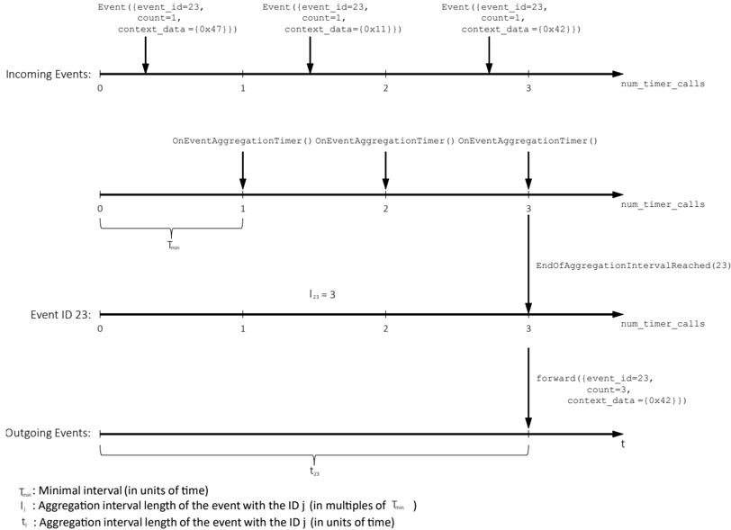

##### 6.6.3.2. 事件阈值过滤器

**IdsM** 应提供一个阈值过滤器。

**低于阈值时丢弃事件**：如果在当前阈值间隔内被事件阈值过滤器处理的、给定类型的所有 **SEv** 的 count 参数之和小于已配置参数 **IdsMEventThresholdNumber**，则阈值过滤器应丢弃该给定类型的 **SEv**。

**高于或等于阈值时转发事件**：如果在当前阈值间隔内被事件阈值过滤器处理的、给定类型的所有 **SEv** 的 count 参数之和等于或大于已配置参数 **IdsMEventThresholdNumber**，则阈值过滤器应转发该给定类型的 **SEv**。

考虑针对特定 **SEv** 的阈值过滤器配置：**IdsMEventThresholdTimeInterval** 为 l<sub>j</sub>，阈值数量 **IdsMEventThresholdNumber** 为 p，该过滤器应统计在单个聚合时间间隔 l<sub>j</sub> 内接收到的、具有相同 **ID** j 的传入 **SEv**，并丢弃前 p -1 个事件。所有后续传入的 **SEv**（等于或大于 p）应立即转发，直到间隔 l<sub>j</sub> 结束。

每次阈值间隔到期时，事件的计数器都应重置。

每个阈值过滤器已配置的时间间隔 **IdsMEventThresholdTimeInterval** 应为 **IdsMMainFunctionPeriod** 的倍数。

阈值过滤器时间间隔 **IdsMEventThresholdTimeInterval** 的计时应从主函数的第一次调用开始。

图 7.7 展示了聚合过滤器对 **EventId** 47（时间间隔等于 2、阈值数量等于 3）的行为示例：

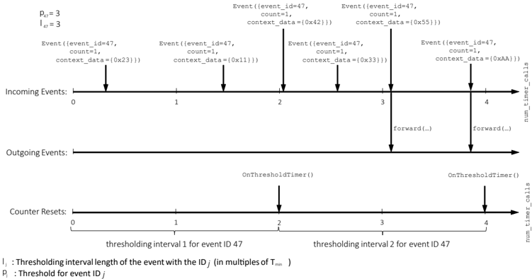

#### 6.6.4. 速率限制过滤器

速率限制过滤器建立转发事件的最大数量，以在向接收器报告时保护资源并避免系统或网络被淹没。这些是特定于某个 **IdsM** 实例的过滤器。

**速率与流量限制**：在向 **IdsR** 发送 **QSEv** 之前，**IdsM** 应应用可能导致该 **QSEv** 被从向 **IdsR** 的传输中丢弃的速率和流量限制。

##### 6.6.4.1. 事件速率限制

**IdsM** 应提供一个速率限制过滤器。该过滤器规定以 **SEv** 数量计的限制和以毫秒计的间隔。

**速率限制**：如果发送某个 **QSEv** 会导致在当前间隔（由 **IdsMRateLimitationTimeInterval** 规定）内传输的 **QSEv** 数量超过已配置的最大传输数量（**IdsMRateLimitationMaximumEvents**），**IdsM** 应将该 **QSEv** 从传输中丢弃。

事件速率限制过滤器的时间间隔 **IdsMRateLimitationTimeInterval** 应为主函数周期 **IdsMMainFunctionPeriod** 的倍数。

**注意：**该过滤器并非特定于单个 **SEv**，而是适用于由当前 **IdsM** 实例处理的所有事件。

##### 6.6.4.2. 流量限制

**IdsM** 应提供一个流量限制过滤器。该过滤器规定以字节计的限制和以毫秒计的间隔。

**流量限制**：如果发送某个 **QSEv** 会导致在当前间隔（由 **IdsMTrafficLimitationTimeInterval** 规定）内传输的字节数超过已配置的最大字节数（**IdsMTrafficLimitationMaximumBytes**），**IdsM** 应将该 **QSEv** 从传输中丢弃。

流量限制过滤器的时间间隔 **IdsMTrafficLimitationTimeInterval** 应为主函数周期 **IdsMMainFunctionPeriod** 的倍数。

当间隔 **IdsMTrafficLimitationTimeInterval** 到期时，**IdsM** 应将字节计数器重置为 0。

在一个时间段内试图发送的字节数超过最大传输字节数 **IdsMTrafficLimitationMaximumBytes** 的情况下，如果已配置，**IdsM** 应触发内部 **SEv IDSM_INTERNAL_EVENT_TRAFFIC_LIMITATION_EXCEEDED**。内部安全事件请参见 **IdsM** 安全事件表。

### 6.7. 时间戳

时间戳是可选的，可以以不同方式提供给 **IdsM**，并且应对所有 **QSEv** 进行全局配置。该特性使时间戳能够与 **SEv** 相关联。

时间戳可以由智能传感器提供，或者应从所选的时间戳来源获取。

时间戳的来源可以在以下两者之间选择：由应用记录的（自定义时间戳），或来自同步时基管理器（**StbM**）的内部 **AUTOSAR** 定时器。详细的时间戳信息见：入侵检测系统协议规范 [\[4\]](#ref-4)。

**IdsM** 应能够向 **QSEv** 添加一个额外的 **IDS** 报文时间戳字段。时间戳特性是可选的，应通过 **IdsMTimestampOption** 为所有 **QSEv** 全局激活和配置。

在 **SEv** 不包含时间戳的可选信息的情况下（传感器向 **IdsM** 报告 **SEv** 时未包含时间戳），**IdsM** 应从 **IdsMTimestampOption** 中配置的来源请求时间戳信息。

**IdsMTimestampOption** 中的选项 **None** 应禁用时间戳特性。

**IdsMTimestampOption** 中的选项 **AUTOSAR** 应启用时间戳特性，并规定时间戳的来源是 **AUTOSAR** **StbM** 模块，通过调用函数 **StbM_GetCurrentTime** 获得。关于 **IdsM** 与作为时间戳来源的 **StbM** 的交互，见第 [8.2](#82-时间戳时序图) 节。

所添加时间戳的格式在 [\[4\]](#ref-4) 中规定。

**IdsMTimestampOption** 中的选项 **Custom** 应启用时间戳特性，并规定时间戳的来源由应用软件提供。

如果 **IdsMTimestampOption** 中的选项 **Custom** 已启用，**IdsM** 应使用客户-服务器接口 [**IdsM_CustomTimestamp**](#774-idsm_customtimestamp) 的 **Get** 操作（应用应实现该操作），通过需求端口 **CustomTimestamp** 向 **SW-C** 请求时间戳。关于 **IdsM** 与作为时间戳来源的 **SW-C** 的交互，见第 [8.2](#82-时间戳时序图) 节。

**时间戳是可选的**：如果参数 **IdsMTimestampOption** 等于 **None**，**IdsM** 不应向 **QSEv** 添加时间戳。**IdsM** 应忽略通过事件报告接口的时间戳参数提供的时间戳。

**由协议栈提供的时间戳**：如果 **IdsMTimestampOption** 设置为 **AUTOSAR** 且该 **SEv** 被报告时不带时间戳参数，则 **IdsM** 应将来自 **StbM** 的时间戳添加到已存储和已传输的 **QSEv** 中。

**通过事件报告接口提供的时间戳**：如果时间戳特性已启用，且 **SEv** 通过服务 [**IdsM_SetSecurityEventWithTimestampCount**](#739-idsm_setsecurityeventwithtimestampcount) 或 [**IdsM_SetSecurityEventWithTimestampCountContextData**](#7310-idsm_setsecurityeventwithtimestampcountcontextdata) 带时间戳参数被报告，则 **IdsM** 应使用该提供的时间戳参数进行 **QSEv** 的传输或存储。

**未通过事件报告接口提供的时间戳**：如果时间戳特性已启用，且 **SEv** 通过服务 [**IdsM_SetSecurityEventWithTimestampCount**](#739-idsm_setsecurityeventwithtimestampcount) 或 [**IdsM_SetSecurityEventWithTimestampCountContextData**](#7310-idsm_setsecurityeventwithtimestampcountcontextdata) 被报告而不带时间戳参数，则 **IdsM** 应在 **QSEv** 的传输或存储之前，将协议报头中时间戳的选项位设置为 0。

**通过应用软件提供的时间戳**：如果 **IdsMTimestampOption** 设置为 **Custom**，且该 **SEv** 被报告时不带时间戳参数，则 **IdsM** 应通过 **TimestampProvider** 回调向应用请求时间戳，并将接收到的时间戳添加到 **QSEv** 中。

**时间戳参数的截断**：如果 **SEv** 被报告时带有时间戳参数，则 **IdsM** 应将该值截去最高 2 个有效位，即仅保留最低 62 个有效位以供进一步使用。

请注意，虽然 **TimestampProvider API** 已被规定，但 **TimestampProvider** 的集成和配置仍由协议栈供应商决定。

可能出现报告事件函数的调用顺序与所提供时间戳不匹配的情况，即较晚的调用包含较早的时间戳。这意味着被持久化和传输的事件可能包含不保证有序的时间戳。

### 6.8. SEv 的报告与持久化

一旦过滤链处理了传入的 **SEv**，处理过滤链所产生的事件即被视为 **QSEv**。

只有 **QSEv** 会被车载 **IDS** 进一步处理。这些 **QSEv** 可以被持久化在存储器中、发送到另一个 **ECU**，或根据配置二者兼有。**QSEv** 的目的地称为数据接收器（data sink）。

#### 6.8.1. QSEv 的结构

**QSEv 的结构（**QSEv Structure**）**

| **QSEv** 组件 | 说明 |
|---|---|
| 协议版本与报头。 | [\[4\]](#ref-4)（入侵检测系统协议规范）中描述的 **IdsM** 协议特定字段。 |
| **IdsM** 实例 **ID**。 | 指定事件 originating 自的 **IdsM** 实例。此 **IdsM ID** 对应于 origin **ECU**，因为每个 **ECU** 最多包含一个「**Classic Platform IdsM** 实例」。 |
| 传感器实例 **ID** | 在同一 **ECU** 内存在同一传感器的多个实例的情况下，标识传感器实例。 |
| 安全事件定义 **ID**（**SEv** 定义 **ID**） | 指定事件的类型。每个 **SEv** 类型都由一个唯一的 **ID** 标识。 |
| 计数（Count） | 表示导致当前事件的 **IdsM** 调用的次数。事件创建时，计数器应设置为 1。**注意：**事件聚合等过滤器可能将多个事件合并为一个。更多细节见聚合过滤器。 |
| 时间戳 | 可选。由智能传感器记录并转发给 **IdsM** 模块的 **SEv** 的发生时间。 |
| 上下文数据 | 包含额外的二进制数据，其语义对 **IDS** 是不透明的。这是一个可选字段，取决于相应 **SEv** 的配置和过滤。 |
| 签名 | 可选。包含该 **SEv** 的签名，对完整的 **IdsM** 报文计算。 |

这些 **QSEv** 应具有与发送目标接收器无关的已定义结构。**QSEv** 的组件列于此表中。

有关 **IdsM** 报文结构的更多细节，请参阅 [\[4\]](#ref-4)（入侵检测系统协议规范）。

**SEv** 的配置 [**IdsMEvent**](#9122-idsmevent) 应包含一个数据接收器列表，用于所产生的 **QSEv**。

#### 6.8.2. QSEv 的传播：IdsR 接收器

**IdsM** 应提供通过 **PduR** 模块将合格的车载安全事件 **QSEv** 转发到其他 **ECU** 的功能。

**注意：**向后端传输 **QSEv**（用于诸如车外分析的用例）由 **IdsM** 概念支持，但由另一个组件（**IdsR**）执行。有关可用于传输事件帧的不同报文格式，请参阅 [\[4\]](#ref-4)（入侵检测系统协议规范）。

**QSEv 传输**：**IdsM** 应能够对已配置的事件使用 **IdsR** 接收器。**IdsMSinkIdsR** 指示相应的 **QSEv** 应通过 **PduR** 以 **IDS** 报文的形式发送到通信网络。

##### 6.8.2.1. QSEv 的真实性：签名

**IdsM** 可以选择使用由 **Csm** 结合加密协议栈生成的加密签名来保护 **QSEv** 的真实性。它可用于确保真实性，并证明来自 **IdsM** 的已签名报文经由所有通信系统直至到达后端或 **SOC** 的完整性（端到端安全，**End2End-Security**）。

**对 QSEv 签名**：**IdsM** 应能够向每个 **QSEv** 附加以相同数据格式表示的加密签名。签名特性是可选的，应通过存在由 **IdsMCsmJobReference** 引用的已配置 **Csm** Job 而为所有 **QSEv** 全局激活或停用。

**IdsM** 的 **Csm Job** **IdsMSignatureLength** 应定义由加密服务计算的签名的字节长度。它应在签名特性激活时配置。

**IdsM** 的 **Csm Job** **IdsMCsmJobReference** 具有两种不同的签名处理类型：同步和异步。该处理在链接到 **Csm Job** 的 **Csm** Job Primitive 中配置，并决定 **IdsM** 对签名的内部处理。

为了通过 **Csm** Job **IdsMCsmJobReference** 生成签名，应通过调用 **Csm** 函数 **Csm_SignatureGenerate** 触发签名生成。

如果签名由同步的 **Csm** Job **IdsMCsmJobReference** 生成，则当函数 **Csm_SignatureGenerate** 返回时，签名应立即可用。

如果签名由异步的 **Csm** Job **IdsMCsmJobReference** 生成，**IdsM** 应通过 **Csm** 通知回调函数 **IdsMCsmCallbackNotification** 被 **Csm** 告知签名的生成。

请注意，回调函数 **IdsMCsmCallbackNotification** 应在 **Csm** 模块中配置为用于为 **IdsM** 配置的 **Csm Job** 的 **Csm** Job 原语回调。

由于签名用于所有 **QSEv**（即与其接收器配置无关），签名应在 **QSEv** 被分发到其已配置的接收器之前生成。

对哪些数据计算签名以及签名如何包含在 **IDS** 报文结构中，在 [\[4\]](#ref-4)（入侵检测系统协议规范）中规定。

##### 6.8.2.2. IDS 服务接口选项

来自 **SW-C** 或应用的传感器可以选择向 **IdsM** 传输附加信息。该选项可以在参数 **IdsMAdditionalParameterOption** 下针对每个 **SEv** 单独选择。可以在不携带附加信息、报告计数器、报告带时间戳的计数器之间进行选择。

由 **SW-C** 报告的 **SEv** 应定义用于传输上下文数据的最大字节数 **IdsMEventMaxContextDataSize**。

**注意：**为 **IdsM** 与 **RTE** 之间转发相应安全事件的上下文数据所用的字节数设置限制，有助于避免 **RTE** 所做的数据复制造成的资源浪费。通过该限制，被复制数据的大小可以调整到实际发送的或相近的字节数。

**无附加接口选项**：当 **IdsMAdditionalParameterOption** 中配置了选项 **None** 时，**SW-C** 服务端口接口不应提供除可选上下文数据之外的附加信息。

**附加接口选项：计数**：当 **IdsMAdditionalParameterOption** 中配置了选项 **Count** 时，**SW-C** 服务端口接口应通过参数 count 进行扩展。

**附加接口选项：计数和时间戳**：当 **IdsMAdditionalParameterOption** 中配置了选项 **CountTimestamp** 时，**SW-C** 服务端口接口应通过参数 count 和 timestamp 进行扩展。

##### 6.8.2.3. 传输协议

**IdsM** 应计算要传输数据的总大小。根据底层「BusPDU 长度」的大小，**IDS** 报文将以不同的协议类型发送：接口（**IF**）或传输协议（**TP**）。请注意，要传输数据的总大小包括所有强制和可选字段：

- **IDS** 报文
- - 时间戳（可选）
- - 上下文数据（可选）
- **IdsM** 报文签名（可选）

如果完整的 **IDS** 报文及其附加的 **IDS** 报文签名（如果可用）能够装入单个 BusPDU，**IdsM** 应通过接口 **PDU**（**IF-PDU**）发送其数据。配置于：[**IdsMIfTxPdu**](#9116-idsmiftxpdu)。

否则，如果数据不能装入单个 **IF-PDU** 帧，则应使用 **TP-PDU** 通过传输协议发送。配置于：**IdsMTpTxPdu**。

**接收服务**

**IdsM** 不从网络接收数据，因此它不需要实现接口和传输协议所需的接收服务。

**发送服务**

在 **IdsM** 处理完 **SEv** 之后，已通过过滤且配置了 **IdsMSinkIdsR** 的所得 **QSEv** 应使用服务 **PduR_IdsMTransmit** 传输。

在 [**IdsM_TpTxConfirmation**](#742-idsm_tptxconfirmation) 或 [**IdsM_TxConfirmation**](#743-idsm_txconfirmation) 被调用之前，**IdsM** 不应再次调用 **PduR_IdsMTransmit**。

**IdsM** 应通过 **PduR** 模块以服务 [**IdsM_TxConfirmation**](#743-idsm_txconfirmation) 接收 **IF** 上层 **Tx-Pdu** 完整传输的确认。

当使用传输协议（**TP**）传输分段 **PDU** 时，应提供以下序列：

**IdsM** 应能够通过服务 [**IdsM_CopyTxData**](#734-idsm_copytxdata) 传输分段 **PDU**。该函数将被多次调用，每次调用该函数应传输 **TxPDU** 的一个分段，直到它被完全发送。

**IdsM** 应通过 **PduR** 模块以服务 [**IdsM_TpTxConfirmation**](#742-idsm_tptxconfirmation) 接收分段 **PDU** 传输的确认。

#### 6.8.3. 事件的存储：Dem / Sem 接收器

**DEM** / **Sem** 接收器尚未被完整规定。

**IdsM** 应提供将车载 **QSEv** 及其相应的可选字段（上下文数据和时间戳）持久化到 **Dem** / **Sem** 中的功能。

**IdsM** 应能够对已配置的事件使用 **Dem** / **Sem** 接收器。**Sem** 接收器指示相应的 **QSEv** 应存储在 **Dem** 的用户自定义存储器 **Sem** 中。

存储在 **Dem** / **Sem** 中的数据是带有其强制和可选字段的完整 **IDS** 报文。

- **IDS** 报文
- - 时间戳（可选）
- - 上下文数据（可选）
- - 签名（可选）

### 6.9. 配置在 NvM 中的持久化

**SEv** 的「报告模式」[**IdsMReportingModeFilter**](#9123-idsmreportingmodefilter) 的值最初由集成者在集成阶段配置。但是，可以在运行时通过诊断服务修改其值。因此，在值被修改后将其持久化会很有用。

**IdsM** 应能够在 **NvM** 中持久化 **SEv** 的「报告模式」参数。

在「报告模式」值 [**IdsMReportingModeFilter**](#9123-idsmreportingmodefilter) 的修改已被诊断服务成功更改之后，应触发 **NvM** 块 **NvM_WriteBlock** 的写例程。「报告模式」值的修改在 [6.10.1](#6101-sev-的重新配置) 节中描述。

如果在 **NvM** 块中的持久化失败，**IdsM** 应将 **SEv** 的「报告模式」[**IdsMReportingModeFilter**](#9123-idsmreportingmodefilter) 回滚到诊断修改之前的值。

**IdsM** 应能够从 **NvM** 中读出由该 **IdsM** 实例处理的相应 **SEv** 的「报告模式」[**IdsMReportingModeFilter**](#9123-idsmreportingmodefilter)。

在 **SEv** 的「报告模式」[**IdsMReportingModeFilter**](#9123-idsmreportingmodefilter) 没有 **NvM** 值可用的情况下，应使用配置工具中提供的已配置值。

由 **IdsMNvmBlockDescriptor** 引用的 **NvM** 块描述符应是 **NvM_ReadAll** 期间处理的块。

**NvM_ReadAll** 通过 **NvM** 选项 **NvMSelectBlockForReadAll** 激活，它检查 **RAM** 数据是否无效（**CRC**），并从 **NvM** 恢复数据或加载默认值。

所支持的 **NvM RAM** 块名称应为 **IdsM_NvMRamBlockData**。

所支持的 **NvM ROM** 块名称应为 **IdsM_NvMRomBlockData**。

**注意：NvM** 应在 **IdsM** 初始化之前已经初始化。**ROM** 块是一个基本存储对象，在 **NV** 块为空或损坏的情况下提供默认数据。它应填充配置的默认值。

### 6.10. SEv 的诊断

诊断处理特性应是可选的。它应通过参数 **IdsMDiagnosticSupport** 激活或停用。

诊断处理特性包括：**SEv** 的重新配置和 **SEv** 参数的读取。

#### 6.10.1. SEv 的重新配置

**SEv** 的「报告模式」[**IdsMReportingModeFilter**](#9123-idsmreportingmodefilter) 应可在运行时通过 **Dcm** 的诊断服务修改。

由 **Dcm** 模块调用的服务 [**IdsM_Dcm_SetReportingMode_Start**](#746-idsm_dcm_setreportingmode_start) 应使 **IdsM** 能够修改特定 **SEv** 的报告模式 [**IdsMReportingModeFilter**](#9123-idsmreportingmodefilter)。该服务应触发例程执行以修改当前报告模式，并应包含要设置的新报告模式值。

请注意，在修改报告模式之后，如果 [6.9](#69-配置在-nvm-中的持久化) 节的特性处于活动状态，新模式将立即持久化到 **NvM** 中。

在 [**IdsM_Dcm_SetReportingMode_Start**](#746-idsm_dcm_setreportingmode_start) 中的报告模式参数无效的情况下，此 **IdsM** 服务应返回 **DCM_E_REQUESTOUTOFRANGE** 作为其 **Dcm** 否定响应，且函数应返回 **E_NOT_OK**。

在调用 [**IdsM_Dcm_SetReportingMode_Start**](#746-idsm_dcm_setreportingmode_start) 所用的安全事件定义 **Id** 无效的情况下，此 **IdsM** 服务应返回 **DCM_E_REQUESTOUTOFRANGE** 作为其 **Dcm** 否定响应，且函数应返回 **E_NOT_OK**。

在向 **NvM** 请求持久化新报告模式失败的情况下，此 **IdsM** 服务应返回 **DCM_E_GENERALPROGRAMMINGFAILURE** 作为其 **Dcm** 否定响应，且函数应返回 **E_NOT_OK**。

在向 **NvM** 请求持久化新报告模式失败的情况下，此 **IdsM** 服务应回滚到先前配置的报告模式。

#### 6.10.2. SEv 报告模式的读取

**SEv** 的「报告模式」[**IdsMReportingModeFilter**](#9123-idsmreportingmodefilter) 应可通过 **Dcm** 的诊断服务读取。

为了读出特定 **SEv** 的「报告模式」，应遵循以下诊断序列：

由 **Dcm** 模块调用的服务 [**IdsM_Dcm_GetReportingMode_Start**](#745-idsm_dcm_getreportingmode_start) 应触发 **IdsM** 的例程执行，以请求特定 **SEv** 的当前报告模式。

由 **Dcm** 模块调用的服务 [**IdsM_Dcm_GetReportingMode_RequestResults**](#744-idsm_dcm_getreportingmode_requestresults) 应允许 **IdsM** 通过结果指针提供所请求安全事件的例程结果和报告模式。

### 6.11. 错误分类

#### 6.11.1. 开发错误

**IdsM** 模块开发错误的定义（**Definition of development errors in module IdsM**）

| 错误类型 | 相关错误码 | 错误值 |
|---|---|---|
| 调用 **API** 函数时使用了无效的事件标识符。 | IDSM_E_PARAM_INVALID | 0x0A |
| 调用 **API** 函数时使用了 **NULL** 指针参数。 | IDSM_E_PARAM_POINTER | 0x0B |
| 调用 **API** 函数时使用了无效的数据大小参数。 | IDSM_E_PARAM_LENGTH | 0x0C |
| 在 **IdsM** 尚未完全初始化的情况下调用了 **API** 函数。 | IDSM_E_UNINIT | 0x0D |
| 在模块已初始化的情况下调用了服务 [**IdsM_Init**](#731-idsm_init)。 | IDSM_E_ALREADY_INITIALIZED | 0x0E |

#### 6.11.2. 运行时错误

**IdsM** 模块未定义运行时错误。

#### 6.11.3. 瞬态故障

**IdsM** 模块未定义瞬态故障。

#### 6.11.4. 产品错误

**IdsM** 模块未定义产品错误。

#### 6.11.5. 扩展产品错误

**IdsM** 模块未定义扩展产品错误。

### 6.12. 错误检测与通知

关于 **BSW** 模块的错误检测与通知的详细信息，请参阅 [\[3\]](#ref-3)（**SWS_BSWGeneral**）中的第 7.2 章「Error Handling」（错误处理）。

#### 6.12.1. API 参数检查

当 **NULL_PTR** 不被接受为服务或回调函数的参数时，**IdsM** 模块报告开发错误 [**IDSM_E_PARAM_POINTER**](#6111-开发错误)。确切的行为在 **SWS_BSWGeneral** 的 **API** 参数检查要求中规定。

在开发错误检测 **IdsMDevErrorDetect** 启用的情况下，**IdsM** 模块应对照已配置的安全事件检查函数 [**IdsM_SetSecurityEvent**](#735-idsm_setsecurityevent) 的参数 **securityEventId**，并在服务调用提供了未知事件 **ID** 时报告开发错误 [**IDSM_E_PARAM_INVALID**](#6111-开发错误)。未知事件是指未在 [**IdsMEvent**](#9122-idsmevent) 中配置的事件。

在开发错误检测 **IdsMDevErrorDetect** 启用的情况下，**IdsM** 模块应对照已配置的安全事件检查函数 [**IdsM_SetSecurityEventWithContextData**](#736-idsm_setsecurityeventwithcontextdata) 的参数 **securityEventId**，并在服务调用提供了未知事件 **ID** 时报告开发错误 [**IDSM_E_PARAM_INVALID**](#6111-开发错误)。未知事件是指未在 [**IdsMEvent**](#9122-idsmevent) 中配置的事件。

在开发错误检测 **IdsMDevErrorDetect** 启用的情况下，**IdsM** 模块应检查函数 [**IdsM_SetSecurityEventWithCount**](#737-idsm_setsecurityeventwithcount) 的参数 **securityEventId** 和 **count**。当服务调用提供了未知事件 **ID** 或传入的 count 等于 0 时，应报告开发错误 [**IDSM_E_PARAM_INVALID**](#6111-开发错误)。

在开发错误检测 **IdsMDevErrorDetect** 启用的情况下，**IdsM** 模块应检查函数 [**IdsM_SetSecurityEventWithCountContextData**](#738-idsm_setsecurityeventwithcountcontextdata) 的参数 **securityEventId** 和 **count**。当服务调用提供了未知事件 **ID** 或传入的 count 等于 0 时，应报告开发错误 [**IDSM_E_PARAM_INVALID**](#6111-开发错误)。

在开发错误检测 **IdsMDevErrorDetect** 启用的情况下，**IdsM** 模块应检查函数 [**IdsM_SetSecurityEventWithTimestampCount**](#739-idsm_setsecurityeventwithtimestampcount) 的参数 **securityEventId** 和 **count**。当服务调用提供了未知事件 **ID** 或传入的 count 等于 0 时，应报告开发错误 [**IDSM_E_PARAM_INVALID**](#6111-开发错误)。

在开发错误检测 **IdsMDevErrorDetect** 启用的情况下，**IdsM** 模块应检查函数 [**IdsM_SetSecurityEventWithTimestampCountContextData**](#7310-idsm_setsecurityeventwithtimestampcountcontextdata) 的参数 **securityEventId** 和 **count**。当服务调用提供了未知事件 **ID** 或传入的 count 等于 0 时，应报告开发错误 [**IDSM_E_PARAM_INVALID**](#6111-开发错误)。

在开发错误检测 **IdsMDevErrorDetect** 启用的情况下，**IdsM** 模块应检查函数 [**IdsM_SetSecurityEventWithContextData**](#736-idsm_setsecurityeventwithcontextdata) 的参数 **contextDataSize**，并在该参数的值超过已配置的最大上下文数据缓冲区大小时报告开发错误 [**IDSM_E_PARAM_LENGTH**](#6111-开发错误)。最大上下文数据缓冲区大小由已配置的最大的 **IdsMContextDataBufferSize** 决定。

在开发错误检测 **IdsMDevErrorDetect** 启用的情况下，**IdsM** 模块应检查函数 [**IdsM_SetSecurityEventWithCountContextData**](#738-idsm_setsecurityeventwithcountcontextdata) 的参数 **contextDataSize**，并在该参数的值超过已配置的最大上下文数据缓冲区大小时报告开发错误 [**IDSM_E_PARAM_LENGTH**](#6111-开发错误)。最大上下文数据缓冲区大小由已配置的最大的 **IdsMContextDataBufferSize** 决定。

在开发错误检测 **IdsMDevErrorDetect** 启用的情况下，**IdsM** 模块应检查函数 [**IdsM_SetSecurityEventWithTimestampCountContextData**](#7310-idsm_setsecurityeventwithtimestampcountcontextdata) 的参数 **contextDataSize**，并在该参数的值超过已配置的最大上下文数据缓冲区大小时报告开发错误 [**IDSM_E_PARAM_LENGTH**](#6111-开发错误)。最大上下文数据缓冲区大小由已配置的最大的 **IdsMContextDataBufferSize** 决定。

请注意，**API** 以已配置 **SEv** 的符号名称调用。

## 7. API规范

### 7.1. 导入的类型

本章列出了从以下文件包含的所有类型：

**IdsM** 模块的导入数据类型定义（**Definition of imported datatypes of module IdsM**）

| 模块 | 头文件 | 导入的类型 |
|---|---|---|
| ComStack_Types | ComStack_Types.h | BufReq_ReturnType |
| ComStack_Types | ComStack_Types.h | PduIdType |
| ComStack_Types | ComStack_Types.h | PduInfoType |
| ComStack_Types | ComStack_Types.h | PduLengthType |
| ComStack_Types | ComStack_Types.h | RetryInfoType |
| ComStack_Types | ComStack_Types.h | TpDataStateType |
| Dcm | Rte_Dcm_Type.h | Dcm_NegativeResponseCodeType |
| Dcm | Rte_Dcm_Type.h | Dcm_OpStatusType |
| StbM | Rte_StbM_Type.h | StbM_SynchronizedTimeBaseType |
| StbM | Rte_StbM_Type.h | StbM_TimeBaseStatusType |
| StbM | Rte_StbM_Type.h | StbM_TimeStampType |
| StbM | Rte_StbM_Type.h | StbM_TimeTupleType |
| StbM | Rte_StbM_Type.h | StbM_UserDataType |
| StbM | StbM.h | StbM_VirtualLocalTimeType |
| Std | Std_Types.h | Std_ReturnType |
| Std | Std_Types.h | Std_VersionInfoType |

### 7.2. 类型定义

#### 7.2.1. IdsM_ConfigType

| 名称 | IdsM_ConfigType |
|---|---|
| Kind | Structure |
| Elements | 实现特定。Type：- |
| 描述 | **IdsM** 模块的配置数据结构 |
| Available via | IdsM.h |

#### 7.2.2. IdsM_Filters_BlockStateType

| 名称 | IdsM_Filters_BlockStateType |
|---|---|
| Kind | Type |
| 派生自 | uint16 |
| 范围 | 0..65535 |
| 描述 | 用于「阻止状态」过滤器取值（位掩码）的数据类型 |
| Available via | IdsM_Filters_Types.h |

#### 7.2.3. IdsM_Filters_ReportingModeType

| 名称 | IdsM_Filters_ReportingModeType |
|---|---|
| Kind | Type |
| 派生自 | uint8 |
| 描述 | 报告模式过滤器使用的报告模式 |
| Available via | IdsM_Types.h |

| 范围 | 值 | 描述 |
|---|---|---|
| IDSM_REPORTING_MODE_OFF | 0x00 | 关闭：事件不被报告 |
| IDSM_REPORTING_MODE_BRIEF | 0x01 | 简要：事件不带上下文数据被报告 |
| IDSM_REPORTING_MODE_DETAILED | 0x02 | 详细：事件带上下文数据被报告 |
| IDSM_REPORTING_MODE_BRIEF_BYPASSING_FILTERS | 0x03 | 简要，绕过过滤器：事件不带上下文数据、不过滤地被报告 |
| IDSM_REPORTING_MODE_DETAILED_BYPASSING_FILTERS | 0x04 | 详细，绕过过滤器：事件带上下文数据、不过滤地被报告 |
| IDSM_REPORTING_MODE_INVALID | 0xFF | 无效的报告模式 |

#### 7.2.4. IdsM_TimestampType

| 名称 | IdsM_TimestampType |
|---|---|
| Kind | Type |
| 派生自 | uint64 |
| 描述 | **IdsM** 时间戳的数据类型 |
| Available via | IdsM_Types.h |

#### 7.2.5. IdsM_ExternalSecurityEventIdType

| 名称 | IdsM_ExternalSecurityEventIdType |
|---|---|
| Kind | Type |
| 派生自 | uint16 |
| 范围 | 0..65535 |
| 描述 | 用于外部 **IdsM** 安全事件 **ID** 的数据类型 |
| Available via | IdsM_Types.h |

### 7.3. 函数定义

#### 7.3.1. IdsM_Init

**说明**: 初始化 **IdsM** 模块的服务。它初始化所有变量并将模块状态设置为已初始化。服务 ID 0x00。同步调用，不可重入。参数 configPtr（in）：组件配置结构。可通过 **IdsM.h** 获得。

```C
void IdsM_Init ( const IdsM_ConfigType* configPtr )
```

#### 7.3.2. IdsM_GetVersionInfo

**说明**: 返回组件的版本信息、供应商 **ID** 和 **AUTOSAR** 模块 **ID**。服务 ID 0x01。同步调用，可重入。参数 versionInfo（out）：指向存储版本信息位置的指针，该参数不得为 **NULL**。可通过 **IdsM.h** 获得。

```C
void IdsM_GetVersionInfo ( Std_VersionInfoType* versionInfo )
```

#### 7.3.3. IdsM_MainFunction

**说明**: 此函数被周期性调用。它异步处理在 **API** 函数调用期间被排队的安全事件。服务 ID 0x02。同步调用，不可重入。可通过 **IdsM.h** 获得。

```C
void IdsM_MainFunction ( void )
```

#### 7.3.4. IdsM_CopyTxData

**说明**: 调用此函数以请求 **TP IdsM-UpperLayerTxPdu** 的传输数据。该函数可以被多次调用，每次调用此函数都会把下一个要发送的数据部分复制到 **TP** 缓冲区。服务 ID 0x43。同步调用，可重入。参数 id（in）：所传输 **I-PDU** 的标识；info（in）：提供目标缓冲区（**SduDataPtr**）和要复制的字节数（**SduLength**）。如果没有足够的传输数据可用，上层模块不复制数据并返回 **BUFREQ_E_BUSY**，下层模块可以重试该调用。**SduLength** 为 0 可用于指示重试参数中的状态变化，或查询上层模块中当前可用数据量。在这种情况下，**SduDataPtr** 可以为 **NULL_PTR**；retry（in）：该参数用于确认已传输的数据，或在传输问题发生后重传数据。如果 retry 参数为 **NULL_PTR**，表示传输数据在被复制后可以立即从缓冲区中移除。否则 retry 参数必须指向一个有效的 **RetryInfoType** 元素。如果 **TpDataState** 指示 **TP_CONFPENDING**，之前复制的数据必须保留在 **TP** 缓冲区中以用于错误恢复。**TP_DATACONF** 表示在此调用之前复制的所有数据已被确认，可以从 **TP** 缓冲区中移除。此 **API** 调用复制的数据被排除在外，将在之后被确认。**TP_DATARETRY** 表示此 **API** 调用应复制之前已复制的数据以从错误中恢复；availableDataPtr（out）：指示上层模块 **Tx** 缓冲区中剩余的可用字节数。**availableDataPtr** 可由支持动态有效载荷长度（例如 **FrIsoTp**）的 **TP** 模块用于确定后续 **CF** 的大小。返回值：BufReq_ReturnType，BUFREQ_OK：数据已按要求完整复制到传输缓冲区；BUFREQ_E_BUSY：由于所需的 **Tx** 数据量不可用，请求无法被满足，下层模块可以稍后重试此调用，未复制任何数据；BUFREQ_E_NOT_OK：数据未被复制，请求失败。可通过 **IdsM_Cbk.h** 获得。

```C
BufReq_ReturnType IdsM_CopyTxData ( PduIdType id, const PduInfoType* info, const RetryInfoType* retry, PduLengthType* availableDataPtr )
```

#### 7.3.5. IdsM_SetSecurityEvent

**说明**: 此 **API** 是向 **IdsM** 报告安全事件的应用接口。服务 ID 0x03。同步调用，不可重入。参数 securityEventId（in）：安全事件 **ID**。可通过 **IdsM.h** 获得。

```C
void IdsM_SetSecurityEvent ( IdsM_SecurityEventIdType securityEventId )
```

#### 7.3.6. IdsM_SetSecurityEventWithContextData

**说明**: 此 **API** 是向 **IdsM** 报告带上下文数据的安全事件的应用接口。服务 ID 0x04。同步调用，不可重入。参数 securityEventId（in）：安全事件 **ID**；contextData（in）：指向可选上下文数据的指针，如果没有上下文数据可用则使用 **NULL_PTR**；contextDataSize（in）：上下文数据的大小。可通过 **IdsM.h** 获得。

```C
void IdsM_SetSecurityEventWithContextData ( IdsM_SecurityEventIdType securityEventId, const uint8* contextData, uint16 contextDataSize )
```

#### 7.3.7. IdsM_SetSecurityEventWithCount

**说明**: 此 **API** 是供智能传感器向 **IdsM** 报告带计数值的安全事件的应用接口。服务 ID 0x05。同步调用，不可重入。参数 securityEventId（in）：安全事件 **ID**；count（in）：用作该安全事件起始值的计数值。可通过 **IdsM.h** 获得。

```C
void IdsM_SetSecurityEventWithCount ( IdsM_SecurityEventIdType securityEventId, uint16 count )
```

#### 7.3.8. IdsM_SetSecurityEventWithCountContextData

**说明**: 此 **API** 是供智能传感器向 **IdsM** 报告带计数值和上下文数据的安全事件的应用接口。服务 ID 0x06。同步调用，不可重入。参数 securityEventId（in）：安全事件 **ID**；count（in）：用作该安全事件起始值的计数值；contextData（in）：指向可选上下文数据的指针，如果没有上下文数据可用则使用 **NULL_PTR**；contextDataSize（in）：上下文数据的大小。可通过 **IdsM.h** 获得。

```C
void IdsM_SetSecurityEventWithCountContextData ( IdsM_SecurityEventIdType securityEventId, uint16 count, const uint8* contextData, uint16 contextDataSize )
```

#### 7.3.9. IdsM_SetSecurityEventWithTimestampCount

**说明**: 此 **API** 是供智能传感器向 **IdsM** 报告带时间戳和计数值的安全事件的应用接口。服务 ID 0x07。同步调用，不可重入。参数 securityEventId（in）：安全事件 **ID**；timestamp（in）：用作该安全事件时间参考的时间戳；count（in）：用作该安全事件起始值的计数值。可通过 **IdsM.h** 获得。

```C
void IdsM_SetSecurityEventWithTimestampCount ( IdsM_SecurityEventIdType securityEventId, IdsM_TimestampType timestamp, uint16 count )
```

#### 7.3.10. IdsM_SetSecurityEventWithTimestampCountContextData

**说明**: 此 **API** 是供智能传感器向 **IdsM** 报告带时间戳、计数值和上下文数据的安全事件的应用接口。服务 ID 0x08。同步调用，不可重入。参数 securityEventId（in）：安全事件 **ID**；timestamp（in）：用作该安全事件时间参考的时间戳；count（in）：用作该安全事件起始值的计数值；contextData（in）：指向可选上下文数据的指针，如果没有上下文数据可用则使用 **NULL_PTR**；contextDataSize（in）：上下文数据的大小。可通过 **IdsM.h** 获得。

```C
void IdsM_SetSecurityEventWithTimestampCountContextData ( IdsM_SecurityEventIdType securityEventId, IdsM_TimestampType timestamp, uint16 count, const uint8* contextData, uint16 contextDataSize )
```

#### 7.3.11. IdsM_ContextDataModifierCallout_Name

**说明**: 在此调出中，应用可以修改 **SEv** 的原始上下文数据。应用负责将所得的上下文数据复制到缓冲区「modifiedContextData」中。所得上下文数据的大小必须通过指针「modifiedContextDataSize」返回。同步调用，不可重入。参数 securityEventId（in）：安全事件 **ID**；contextData（in）：指向原始报告上下文数据的指针，如果没有上下文数据可用则为 **NULL_PTR**；contextDataSize（in）：原始报告上下文数据的大小；modifiedContextDataSize（inout）：in：作为输入参数，描述 modifiedContextData 的最大大小；out：函数被调用后，应用应设置上下文数据的实际新大小；modifiedContextData（out）：指向修改后上下文数据的输出缓冲区的指针。应用应在该缓冲区中设置新的上下文数据。返回值：无。

```C
void IdsM_ContextDataModifierCallout_Name ( uint16 securityEventId, const IdsM_{EventName}_ContextDataType* contextData, uint16 contextDataSize, uint16* modifiedContextDataSize, const IdsM_{EventName}_ContextDataType* modifiedContextData )
```

### 7.4. 回调通知

这是为其他模块提供的函数列表。

#### 7.4.1. IdsM_BswM_StateChanged

**说明**: 此回调函数由 **BswM** 调用，用于指示 **ECU** 状态变化。服务 ID 0x0F。同步调用，可重入。参数 state（in）：当前 **ECU** 状态。可通过 **IdsM_Cbk.h** 获得。

```C
void IdsM_BswM_StateChanged ( IdsM_Filters_BlockStateType state )
```

#### 7.4.2. IdsM_TpTxConfirmation

**说明**: 调用此函数以确认 **TP IdsM-UpperLayerTxPdu** 的成功传输，或报告传输期间发生的错误。服务 ID 0x48。同步调用，可重入。参数 id（in）：所传输 **I-PDU** 的标识；result（in）：**E_OK**：**PDU** 已被传输；**E_NOT_OK**：**PDU** 传输失败。可通过 **IdsM_Cbk.h** 获得。

```C
void IdsM_TpTxConfirmation ( PduIdType id, Std_ReturnType result )
```

#### 7.4.3. IdsM_TxConfirmation

**说明**: 调用此函数以确认 **IF IdsM-UpperLayerTxPdu** 的完整传输。服务 ID 0x40。同步调用，对不同 **PduId** 可重入，对同一 **PduId** 不可重入。参数 TxPduId（in）：已被传输的 **PDU** 的 **ID**；result（in）：**E_OK**：**PDU** 已被传输；**E_NOT_OK**：**PDU** 传输失败。可通过 **IdsM_Cbk.h** 获得。

```C
void IdsM_TxConfirmation ( PduIdType TxPduId, Std_ReturnType result )
```

#### 7.4.4. IdsM_Dcm_GetReportingMode_RequestResults

**说明**: 此函数是 **DCM** 向 **IdsM** 发出的请求，用于读取由函数 **[IdsM_Dcm_GetReportingMode_Start](#745-idsm_dcm_getreportingmode_start)()** 触发的例程结果。服务 ID 0x0D。同步调用，可重入。参数 OpStatus（in）：操作状态；Out_ReportingMode（out）：所请求安全事件的报告模式；ErrorCode（out）：失败时的否定响应码。返回值：Std_ReturnType，**E_OK**：操作已完成；**DCM_E_PENDING**：操作尚未完成；**E_NOT_OK**：操作已失败。应设置具体的 **NRC**，否则 **DCM** 发送 **NRC** 0x22。可通过 **IdsM_Cbk.h** 获得。

```C
Std_ReturnType IdsM_Dcm_GetReportingMode_RequestResults ( Dcm_OpStatusType OpStatus, uint8* Out_ReportingMode, Dcm_NegativeResponseCodeType* ErrorCode )
```

#### 7.4.5. IdsM_Dcm_GetReportingMode_Start

**说明**: 此函数是 **DCM** 向 **IdsM** 发出的请求，用于启动例程执行以请求特定安全事件 **ID** 的当前报告模式。服务 ID 0x0C。同步调用，可重入。参数 In_SecurityEventId（in）：应返回其报告模式的安全事件的外部 **ID**；In_SensorInstanceId（in）：该安全事件的传感器实例 **ID**；OpStatus（in）：操作状态；ErrorCode（out）：失败时的否定响应码。返回值：Std_ReturnType，**E_OK**：操作已完成；**E_NOT_OK**：操作已失败，应设置具体的 **NRC**，否则 **DCM** 发送 **NRC** 0x22；**DCM_E_PENDING**：操作尚未完成。可通过 **IdsM_Cbk.h** 获得。

```C
Std_ReturnType IdsM_Dcm_GetReportingMode_Start ( uint16 In_SecurityEventId, uint8 In_SensorInstanceId, Dcm_OpStatusType OpStatus, Dcm_NegativeResponseCodeType* ErrorCode )
```

#### 7.4.6. IdsM_Dcm_SetReportingMode_Start

**说明**: 此函数是 **DCM** 向 **IdsM** 发出的请求，用于启动例程执行以设置特定安全事件 **ID** 的报告模式。服务 ID 0x0E。同步调用，可重入。参数 In_SecurityEventId（in）：应修改其报告模式的安全事件的外部 **ID**；In_SensorInstanceId（in）：该安全事件的传感器实例 **ID**；In_ReportingMode（in）：应存储的报告模式；OpStatus（in）：操作状态；ErrorCode（out）：失败时的否定响应码。返回值：Std_ReturnType，**E_OK**：操作已完成；**DCM_E_PENDING**：操作尚未完成；**E_NOT_OK**：操作已失败，应设置具体的 **NRC**，否则 **DCM** 发送 **NRC** 0x22。可通过 **IdsM_Cbk.h** 获得。

```C
Std_ReturnType IdsM_Dcm_SetReportingMode_Start ( uint16 In_SecurityEventId, uint8 In_SensorInstanceId, uint8 In_ReportingMode, Dcm_OpStatusType OpStatus, Dcm_NegativeResponseCodeType* ErrorCode )
```

### 7.5. 调度函数

这些函数由基础软件调度器直接调用。以下函数应没有返回值和参数。所有函数均不可重入。

### 7.6. 期望接口

本章列出从其他模块所需的所有接口。

#### 7.6.1. 强制接口

**注意：**本节定义了实现模块核心功能所需的所有接口。

**IdsM** 模块强制接口的定义（**Definition of mandatory interfaces in module IdsM**）

| API 函数 | 头文件 | 说明 |
|---|---|---|
| 没有强制接口。 | | |

#### 7.6.2. 可选接口

本节定义了实现模块可选功能所需的所有接口。

**IdsM** 模块可选接口的定义（**Definition of optional interfaces in module IdsM**）

| API 函数 | 头文件 | 说明 |
|---|---|---|
| StbM_GetCurrentTime | StbM.h | 返回一个时间元组（本地时间、全局时间和时基状态）以及用户数据详情。**注意：**此 **API** 应在锁定中断的情况下 / 在独占区内调用，以防止中断（即避免在函数调用返回时时间戳已过时的风险）。 |

### 7.7. 服务接口

#### 7.7.1. 客户-服务器接口

#### 7.7.2. IdsM_IdsMService

客户-服务器接口 **IdsMService_{EventName}** 的定义（**Definition of ClientServerInterface IdsMService_{EventName}**）

| 名称 | IdsMService_{EventName} |
|---|---|
| Comment | 用于向 **IdsM** 报告安全事件的接口。根据事件的配置（即传递给 **IdsM** 的关于该事件的参数的数量和类型），应使用不同的操作。 |
| IsService | true |
| Variation | `({ecuc(IdsM/[IdsMConfiguration](#919-idsmconfiguration)/[IdsMEvent](#9122-idsmevent)/IdsMExternalEventId)} is in range 0x8000 - 0xFFFE)` `({ecuc(IdsM/[IdsMConfiguration](#919-idsmconfiguration)/[IdsMEvent](#9122-idsmevent)/[IdsMServiceInterfaceOptions](#9124-idsmserviceinterfaceoptions))} EXISTS` `IdsM/[IdsMConfiguration](#919-idsmconfiguration)/[IdsMEvent](#9122-idsmevent)/[IdsMServiceInterfaceOptions](#9124-idsmserviceinterfaceoptions)/IdsMAdditionalParameterOption == None` `EventName = {ecuc(IdsM/[IdsMConfiguration](#919-idsmconfiguration)/[IdsMEvent](#9122-idsmevent).SHORT-NAME)}` |
| Possible Errors | - |

| 操作 | SetSecurityEvent |
|---|---|
| Comment | 此函数应仅使用 SecurityEventId 向 **IdsM** 报告安全事件 |
| Mapped to API | [IdsM_SetSecurityEvent](#735-idsm_setsecurityevent) |
| Variation | `({ecuc(IdsM/[IdsMConfiguration](#919-idsmconfiguration)/[IdsMEvent](#9122-idsmevent)/[IdsMServiceInterfaceOptions](#9124-idsmserviceinterfaceoptions)/IdsMAdditionalParameterOption)} == None)` `({ecuc(IdsM/[IdsMConfiguration](#919-idsmconfiguration)/[IdsMEvent](#9122-idsmevent)/[IdsMServiceInterfaceOptions](#9124-idsmserviceinterfaceoptions)/IdsMEventMaxContextDataSize)} == 0)` |
| Possible Errors | - |

| 操作 | SetSecurityEventWithContextData |
|---|---|
| Comment | 此函数应报告带上下文数据的安全事件 |
| Mapped to API | [IdsM_SetSecurityEventWithContextData](#736-idsm_setsecurityeventwithcontextdata) |
| Variation | `({ecuc(IdsM/[IdsMConfiguration](#919-idsmconfiguration)/[IdsMEvent](#9122-idsmevent)/[IdsMServiceInterfaceOptions](#9124-idsmserviceinterfaceoptions)/IdsMAdditionalParameterOption)} == None)` `({ecuc(IdsM/[IdsMConfiguration](#919-idsmconfiguration)/[IdsMEvent](#9122-idsmevent)/[IdsMServiceInterfaceOptions](#9124-idsmserviceinterfaceoptions)/IdsMEventMaxContextDataSize)} > 0)` |
| 参数 contextData | Type：**IdsM_{EventName}_ContextDataType**；Direction：IN；Comment：指向可选上下文数据的指针，如果没有上下文数据可用则使用 **NULL_PTR**；Variation：`EventName = {ecuc(IdsM/[IdsMConfiguration](#919-idsmconfiguration)/[IdsMEvent](#9122-idsmevent).SHORT-NAME)}` |
| 参数 contextDataSize | Type：uint16；Direction：IN；Comment：上下文数据的大小，必须在 0..<已配置的最大上下文数据缓冲区大小> 范围内；Variation：- |
| Possible Errors | - |

#### 7.7.3. IdsM_SmartSensorService

客户-服务器接口 **IdsMSmartSensorService_{EventName}** 的定义（**Definition of ClientServerInterface IdsMSmartSensorService_{EventName}**）

| 名称 | IdsMSmartSensorService_{EventName} |
|---|---|
| Comment | 供智能传感器向 **IdsM** 报告安全事件的接口。根据事件的配置（即传递给 **IdsM** 的关于该事件的参数的数量和类型），应使用不同的操作。 |
| IsService | true |
| Variation | `({ecuc(IdsM/[IdsMConfiguration](#919-idsmconfiguration)/[IdsMEvent](#9122-idsmevent)/IdsMExternalEventId)} is in range 0x8000 - 0xFFFE)` `({ecuc(IdsM/[IdsMConfiguration](#919-idsmconfiguration)/[IdsMEvent](#9122-idsmevent)/[IdsMServiceInterfaceOptions](#9124-idsmserviceinterfaceoptions))} EXISTS` `IdsM/[IdsMConfiguration](#919-idsmconfiguration)/[IdsMEvent](#9122-idsmevent)/[IdsMServiceInterfaceOptions](#9124-idsmserviceinterfaceoptions)/IdsMAdditionalParameterOption != None` `EventName = {ecuc(IdsM/[IdsMConfiguration](#919-idsmconfiguration)/[IdsMEvent](#9122-idsmevent).SHORT-NAME)}` |
| Possible Errors | - |

| 操作 | SetSecurityEventWithCount |
|---|---|
| Comment | 智能传感器应使用此函数向 **IdsM** 报告带计数值的安全事件 |
| Mapped to API | [IdsM_SetSecurityEventWithCount](#737-idsm_setsecurityeventwithcount) |
| Variation | `({ecuc(IdsM/[IdsMConfiguration](#919-idsmconfiguration)/[IdsMEvent](#9122-idsmevent)/[IdsMServiceInterfaceOptions](#9124-idsmserviceinterfaceoptions)/IdsMAdditionalParameterOption)} == Count)` `({ecuc(IdsM/[IdsMConfiguration](#919-idsmconfiguration)/[IdsMEvent](#9122-idsmevent)/[IdsMServiceInterfaceOptions](#9124-idsmserviceinterfaceoptions)/IdsMEventMaxContextDataSize)} == 0)` |
| 参数 count | Type：uint16；Direction：IN；Comment：用作该安全事件起始值的计数值，必须在 1...65535 范围内；Variation：- |
| Possible Errors | - |

| 操作 | SetSecurityEventWithCountContextData |
|---|---|
| Comment | 智能传感器应使用此函数向 **IdsM** 报告带计数值和上下文数据的安全事件 |
| Mapped to API | [IdsM_SetSecurityEventWithCountContextData](#738-idsm_setsecurityeventwithcountcontextdata) |
| Variation | `({ecuc(IdsM/[IdsMConfiguration](#919-idsmconfiguration)/[IdsMEvent](#9122-idsmevent)/[IdsMServiceInterfaceOptions](#9124-idsmserviceinterfaceoptions)/IdsMAdditionalParameterOption)} == Count)` `({ecuc(IdsM/[IdsMConfiguration](#919-idsmconfiguration)/[IdsMEvent](#9122-idsmevent)/[IdsMServiceInterfaceOptions](#9124-idsmserviceinterfaceoptions)/IdsMEventMaxContextDataSize)} > 0)` |
| 参数 count | Type：uint16；Direction：IN；Comment：用作该安全事件起始值的计数值，必须在 1...65535 范围内；Variation：- |
| 参数 contextData | Type：**IdsM_{EventName}_ContextDataType**；Direction：IN；Comment：指向可选上下文数据的指针，如果没有上下文数据可用则使用 **NULL_PTR**；Variation：`EventName = {ecuc(IdsM/[IdsMConfiguration](#919-idsmconfiguration)/[IdsMEvent](#9122-idsmevent).SHORT-NAME)}` |
| 参数 contextDataSize | Type：uint16；Direction：IN；Comment：上下文数据的大小，必须在 0..<已配置的最大上下文数据缓冲区大小> 范围内；Variation：- |
| Possible Errors | - |

| 操作 | SetSecurityEventWithTimestampCount |
|---|---|
| Comment | 智能传感器应使用此函数向 **IdsM** 报告带时间戳和计数值的安全事件 |
| Mapped to API | [IdsM_SetSecurityEventWithTimestampCount](#739-idsm_setsecurityeventwithtimestampcount) |
| Variation | `({ecuc(IdsM/[IdsMConfiguration](#919-idsmconfiguration)/[IdsMEvent](#9122-idsmevent)/[IdsMServiceInterfaceOptions](#9124-idsmserviceinterfaceoptions)/IdsMAdditionalParameterOption)} == CountTimestamp)` `({ecuc(IdsM/[IdsMConfiguration](#919-idsmconfiguration)/[IdsMEvent](#9122-idsmevent)/[IdsMServiceInterfaceOptions](#9124-idsmserviceinterfaceoptions)/IdsMEventMaxContextDataSize)} == 0)` |
| 参数 timestamp | Type：uint64；Direction：IN；Comment：用作该安全事件时间参考的时间戳，必须在 0...(2^62 - 1) 范围内；Variation：- |
| 参数 count | Type：uint16；Direction：IN；Comment：用作该安全事件起始值的计数值，必须在 1...65535 范围内；Variation：- |
| Possible Errors | - |

| 操作 | SetSecurityEventWithTimestampCountContextData |
|---|---|
| Comment | 智能传感器应使用此函数报告带时间戳、计数值和上下文数据的安全事件 |
| Mapped to API | [IdsM_SetSecurityEventWithTimestampCountContextData](#7310-idsm_setsecurityeventwithtimestampcountcontextdata) |
| Variation | `({ecuc(IdsM/[IdsMConfiguration](#919-idsmconfiguration)/[IdsMEvent](#9122-idsmevent)/[IdsMServiceInterfaceOptions](#9124-idsmserviceinterfaceoptions)/IdsMAdditionalParameterOption)} == CountTimestamp)` `({ecuc(IdsM/[IdsMConfiguration](#919-idsmconfiguration)/[IdsMEvent](#9122-idsmevent)/[IdsMServiceInterfaceOptions](#9124-idsmserviceinterfaceoptions)/IdsMEventMaxContextDataSize)} > 0)` |
| 参数 timestamp | Type：uint64；Direction：IN；Comment：用作该安全事件时间参考的时间戳，必须在 0...(2^62 - 1) 范围内；Variation：- |
| 参数 count | Type：uint16；Direction：IN；Comment：用作该安全事件起始值的计数值，必须在 1...65535 范围内；Variation：- |
| 参数 contextData | Type：**IdsM_{EventName}_ContextDataType**；Direction：IN；Comment：指向可选上下文数据的指针，如果没有上下文数据可用则使用 **NULL_PTR**；Variation：`EventName = {ecuc(IdsM/[IdsMConfiguration](#919-idsmconfiguration)/[IdsMEvent](#9122-idsmevent).SHORT-NAME)}` |
| 参数 contextDataSize | Type：uint16；Direction：IN；Comment：上下文数据的大小，必须在 0..<已配置的最大上下文数据缓冲区大小> 范围内；Variation：- |
| Possible Errors | - |

#### 7.7.4. IdsM_CustomTimestamp

客户-服务器接口 **IdsM_CustomTimestamp** 的定义（**Definition of ClientServerInterface IdsM_CustomTimestamp**）

| 名称 | IdsM_CustomTimestamp |
|---|---|
| Comment | 用于从应用请求自定义时间戳的接口。 |
| IsService | true |
| Variation | `{ecuc(IdsM/[IdsMGeneral](#912-idsmgeneral)/[IdsMTimestamp](#917-idsmtimestamp)/IdsMTimestampOption)} == Custom` |
| Possible Errors | 0：操作成功；1：操作失败 |

| 操作 | Get |
|---|---|
| Comment | 此函数应从应用请求自定义时间戳 |
| Mapped to API | - |
| Variation | - |
| 参数 timestamp | Type：uint64；Direction：OUT；Comment：**IdsM** 从自定义时间来源请求的时间戳；Variation：- |
| Possible Errors | **E_OK**、**E_NOT_OK** |

#### 7.7.5. 实现数据类型

#### 7.7.6. IdsM_ContextDataType

实现数据类型 **IdsM_{EventName}_ContextDataType** 的定义（**Definition of ImplementationDataType IdsM_{EventName}_ContextDataType**）

| 名称 | IdsM_{EventName}_ContextDataType |
|---|---|
| Kind | Type |
| 派生自 | uint8 |
| 范围 | 0..255 |
| 描述 | 数据类型 |
| Variation | `EventName = {ecuc(IdsM/[IdsMConfiguration](#919-idsmconfiguration)/[IdsMEvent](#9122-idsmevent).SHORT-NAME)}` |
| Available via | IdsM_Types.h |

#### 7.7.7. IdsM_SecurityEventIdType

实现数据类型 **IdsM_SecurityEventIdType** 的定义（**Definition of ImplementationDataType IdsM_SecurityEventIdType**）

| 名称 | IdsM_SecurityEventIdType |
|---|---|
| Kind | Type |
| 派生自 | uint16 |
| 范围 | 0..65535 |
| 描述 | 用于 **IdsM** 本地（安全）事件 **ID** 的数据类型 |
| Variation | - |
| Available via | IdsM_Types.h |

#### 7.7.8. 端口

##### 7.7.8.1. 端口 IdsM_IdsMService

由模块 **IdsM** 提供的端口 **IdsMService_{EventName}** 的定义（**Definition of Port IdsMService_{EventName} provided by module IdsM**）

| 名称 | IdsMService_{EventName} |
|---|---|
| Kind | ProvidedPort；Interface：**IdsMService_{EventName}** |
| 描述 | - |
| 端口定义参数值 | Type：[**IdsM_SecurityEventIdType**](#777-idsm_securityeventidtype)；Value：- |
| Variation | `({ecuc(IdsM/[IdsMConfiguration](#919-idsmconfiguration)/[IdsMEvent](#9122-idsmevent)/IdsMExternalEventId)} is in range 0x8000 - 0xFFFE)` `({ecuc(IdsM/[IdsMConfiguration](#919-idsmconfiguration)/[IdsMEvent](#9122-idsmevent)/[IdsMServiceInterfaceOptions](#9124-idsmserviceinterfaceoptions))} EXISTS)` `({ecuc(IdsM/[IdsMConfiguration](#919-idsmconfiguration)/[IdsMEvent](#9122-idsmevent)/[IdsMServiceInterfaceOptions](#9124-idsmserviceinterfaceoptions)/IdsMAdditionalParameterOption)} = None)` `EventName = {ecuc(IdsM/[IdsMConfiguration](#919-idsmconfiguration)/[IdsMEvent](#9122-idsmevent).SHORT-NAME)}` |

##### 7.7.8.2. 端口 IdsM_IdsMSmartSensorService

由模块 **IdsM** 提供的端口 **IdsMSmartSensorService_{EventName}** 的定义（**Definition of Port IdsMSmartSensorService_{EventName} provided by module IdsM**）

| 名称 | IdsMSmartSensorService_{EventName} |
|---|---|
| Kind | ProvidedPort；Interface：**IdsMSmartSensorService_{EventName}** |
| 描述 | - |
| 端口定义参数值 | Type：[**IdsM_SecurityEventIdType**](#777-idsm_securityeventidtype)；Value：- |
| Variation | `({ecuc(IdsM/[IdsMConfiguration](#919-idsmconfiguration)/[IdsMEvent](#9122-idsmevent)/IdsMExternalEventId)} is in range 0x8000 - 0xFFFE)` `({ecuc(IdsM/[IdsMConfiguration](#919-idsmconfiguration)/[IdsMEvent](#9122-idsmevent)/[IdsMServiceInterfaceOptions](#9124-idsmserviceinterfaceoptions))} EXISTS)` `({ecuc(IdsM/[IdsMConfiguration](#919-idsmconfiguration)/[IdsMEvent](#9122-idsmevent)/[IdsMServiceInterfaceOptions](#9124-idsmserviceinterfaceoptions)/IdsMAdditionalParameterOption)} != None)` `EventName = {ecuc(IdsM/[IdsMConfiguration](#919-idsmconfiguration)/[IdsMEvent](#9122-idsmevent).SHORT-NAME)}` |

##### 7.7.8.3. 端口 IdsM_CustomTimestamp

由模块 **IdsM** 要求的端口 [**IdsM_CustomTimestamp**](#774-idsm_customtimestamp) 的定义（**Definition of Port [IdsM_CustomTimestamp](#774-idsm_customtimestamp) required by module IdsM**）

| 名称 | [IdsM_CustomTimestamp](#774-idsm_customtimestamp) |
|---|---|
| Kind | RequiredPort；Interface：[**IdsM_CustomTimestamp**](#774-idsm_customtimestamp) |
| 描述 | - |
| Variation | - |

## 8. 时序图

### 8.1. DEM / Sem 时序图建议

图 9.1 展示了 **IdsM** 与 **Dem** 接收器交互的时序图。

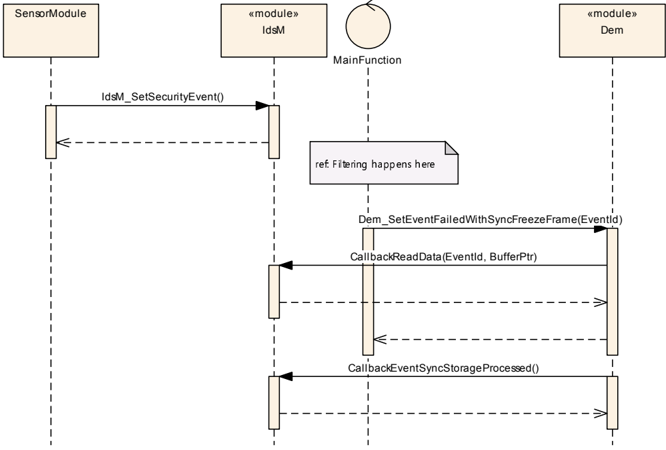

### 8.2. 时间戳时序图

图 9.2 展示了 **IdsM** 与 **StbM** 交互（**StbM** 作为 **AUTOSAR** 格式时间戳的时间戳来源）的时序图。

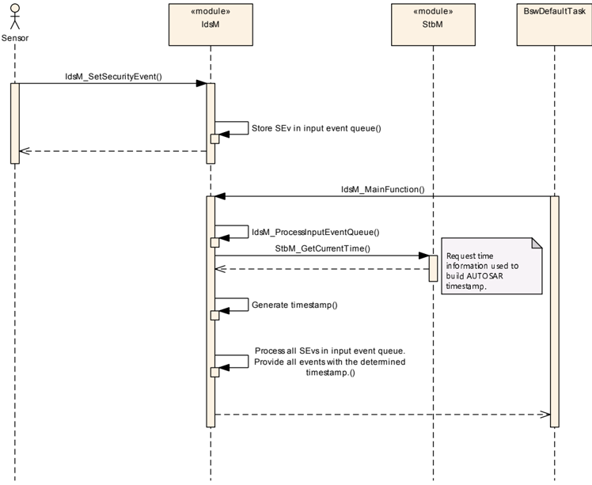

图 9.3 展示了 **IdsM** 与 **SW-C** 交互（**SW-C** 作为自定义格式时间戳的时间戳来源）的时序图。

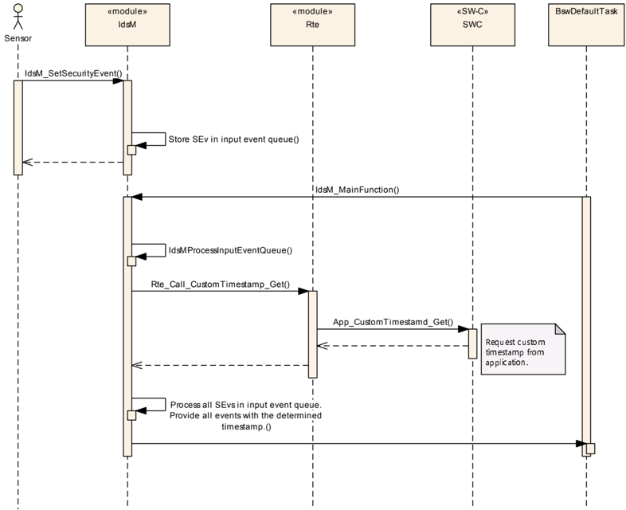

## 9. 配置规范

总体而言，本章定义配置参数及其到**容器**（container）的聚类组织。

第 9.1 章规定模块 **IdsM** 的结构（容器）和参数。

第 9.2 章列出对 **IdsM** 配置的约束。

第 9.3 章规定模块 **IdsM** 的发布信息。

### 9.1. 容器与配置参数

以下各节汇总所有配置参数。各参数的详细含义在第 6 章和第 7 章中描述。

#### 9.1.1. IdsM

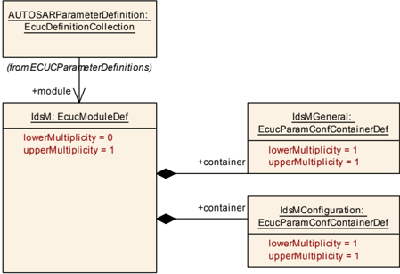

| SWS 条目 | [ECUC_IdsM_00001] |
|---|---|
| 模块名称 | IdsM |
| 描述 | **IdsM** 模块的配置。 |
| Post-Build 变体支持 | false |
| 支持的配置变体 | VARIANT-PRE-COMPILE |

| 容器名称 | 多重性 | 作用域/依赖 |
|---|---|---|
| IdsMConfiguration | 1 | 模块 **IdsM** 的配置参数。 |
| IdsMGeneral | 1 | **IdsM** 的通用配置参数。 |

#### 9.1.2. IdsMGeneral

| SWS 条目 | [ECUC_IdsM_00002] |
|---|---|
| 容器名称 | IdsMGeneral |
| 父容器 | IdsM |
| 描述 | **IdsM** 的通用配置参数。 |
| 配置参数 | 见下方参数表 |

| SWS 条目 | [ECUC_IdsM_00005] |
|---|---|
| 参数名称 | IdsMDevErrorDetect |
| 父容器 | IdsMGeneral |
| 描述 | 该参数启用/禁用开发错误检测与通知（**true**：启用开发错误检测；**false**：禁用开发错误检测）。**注意：**一般来说，建议在预测试阶段使用开发错误检测。由于运行时和 **ROM** 需求的增加，不建议在生产代码中启用开发错误检测。 |
| 多重性 | 1 |
| 类型 | EcucBooleanParamDef |
| 默认值 | - |
| Post-Build 变体值 | false |
| 值配置类 | Pre-compile time：x（All Variants）；Link time：-；Post-build time：- |
| 作用域/依赖 | scope: local |

| SWS 条目 | [ECUC_IdsM_00010] |
|---|---|
| 参数名称 | IdsMDiagnosticSupport |
| 父容器 | IdsMGeneral |
| 描述 | 启用或禁用 **Dcm API**，这些 **API** 用于通过诊断通信管理器读取和写入 **IdsM** 模块的某些值（**true**：启用 **Dcm API**；**false**：禁用 **Dcm API**）。 |
| 多重性 | 1 |
| 类型 | EcucBooleanParamDef |
| 默认值 | false |
| Post-Build 变体值 | false |
| 值配置类 | Pre-compile time：x（All Variants）；Link time：-；Post-build time：- |
| 作用域/依赖 | scope: local |

| SWS 条目 | [ECUC_IdsM_00007] |
|---|---|
| 参数名称 | IdsMInstanceId |
| 父容器 | IdsMGeneral |
| 描述 | 发送方 **IdsM** 实例的唯一标识符。此 **ID** 与 **SEv** 配置参数 **ExternalEventId** 和 **IdsMSensorInstanceId** 一起，有助于识别 **SEv** 的来源。**注意：**每个 **ECU** 只有一个（来自 **AUTOSAR Classic Platform** 的）**IdsM** 实例。 |
| 多重性 | 1 |
| 类型 | EcucIntegerParamDef |
| 范围 | 0 .. 1023 |
| 默认值 | - |
| Post-Build 变体值 | false |
| 值配置类 | Pre-compile time：x（All Variants）；Link time：-；Post-build time：- |
| 作用域/依赖 | scope: local |

| SWS 条目 | [ECUC_IdsM_00004] |
|---|---|
| 参数名称 | IdsMMainFunctionPeriod |
| 父容器 | IdsMGeneral |
| 描述 | 相邻两次 **IdsM** 主函数调用之间的周期（以秒为单位的浮点数）。 |
| 多重性 | 1 |
| 类型 | EcucFloatParamDef |
| 范围 | [0 .. INF] |
| 默认值 | 0.01 |
| Post-Build 变体值 | false |
| 值配置类 | Pre-compile time：x（All Variants）；Link time：-；Post-build time：- |
| 作用域/依赖 | scope: ECU |

| SWS 条目 | [ECUC_IdsM_00009] |
|---|---|
| 参数名称 | IdsMSignatureSupport |
| 父容器 | IdsMGeneral |
| 描述 | 该参数启用/禁用向网络发送带加密服务所计算签名的报文的功能。 |
| 多重性 | 1 |
| 类型 | EcucBooleanParamDef |
| 默认值 | false |
| Post-Build 变体值 | false |
| 值配置类 | Pre-compile time：x（All Variants）；Link time：-；Post-build time：- |
| 作用域/依赖 | scope: local |

| SWS 条目 | [ECUC_IdsM_00006] |
|---|---|
| 参数名称 | IdsMVersionInfoApi |
| 父容器 | IdsMGeneral |
| 描述 | 该参数启用/禁用函数 **IdsM_GetVersionInfo()** 以获取模块的主、次和补丁版本信息。 |
| 多重性 | 1 |
| 类型 | EcucBooleanParamDef |
| 默认值 | - |
| Post-Build 变体值 | false |
| 值配置类 | Pre-compile time：x（All Variants）；Link time：-；Post-build time：- |
| 作用域/依赖 | scope: local |

| SWS 条目 | [ECUC_IdsM_00013] |
|---|---|
| 参数名称 | IdsMNvmBlockDescriptor |
| 父容器 | IdsMGeneral |
| 描述 | 选择一个 **NvM** 块描述符引用，用于加载和存储 **IdsM** 模块的非易失性数据。所支持的 **NvM** 块名称为：**RAM**：IdsM_NvMRamBlockData；**ROM**：IdsM_NvMRomBlockData。 |
| 多重性 | 0..1 |
| 类型 | Reference to NvMBlockDescriptor |
| Post-Build 变体多重性 | false |
| Post-Build 变体值 | false |
| 多重性配置类 | Pre-compile time：x；Link time：-；Post-build time：- |
| 值配置类 | Pre-compile time：x；Link time：-；Post-build time：- |
| 作用域/依赖 | scope: local |

| 容器名称 | 多重性 | 作用域/依赖 |
|---|---|---|
| IdsMGlobalRateLimitationFilters | 0..1 | 面向所有 **SEv** 的全局速率限制过滤器。 |
| IdsMSecurityEventRefs | 0..1 | 用于包含指向 IdsMEvent 元素的引用的容器，这些元素表示在相应安全相关事件发生时 **IdsM** 模块应向自身报告的安全事件。 |
| IdsMSignature | 0..1 | 如果此容器存在，则所有合格安全事件都由加密服务签名。 |
| IdsMTimestamp | 0..1 | 如果此容器存在，则向所有合格安全事件添加一个时间戳字段。 |

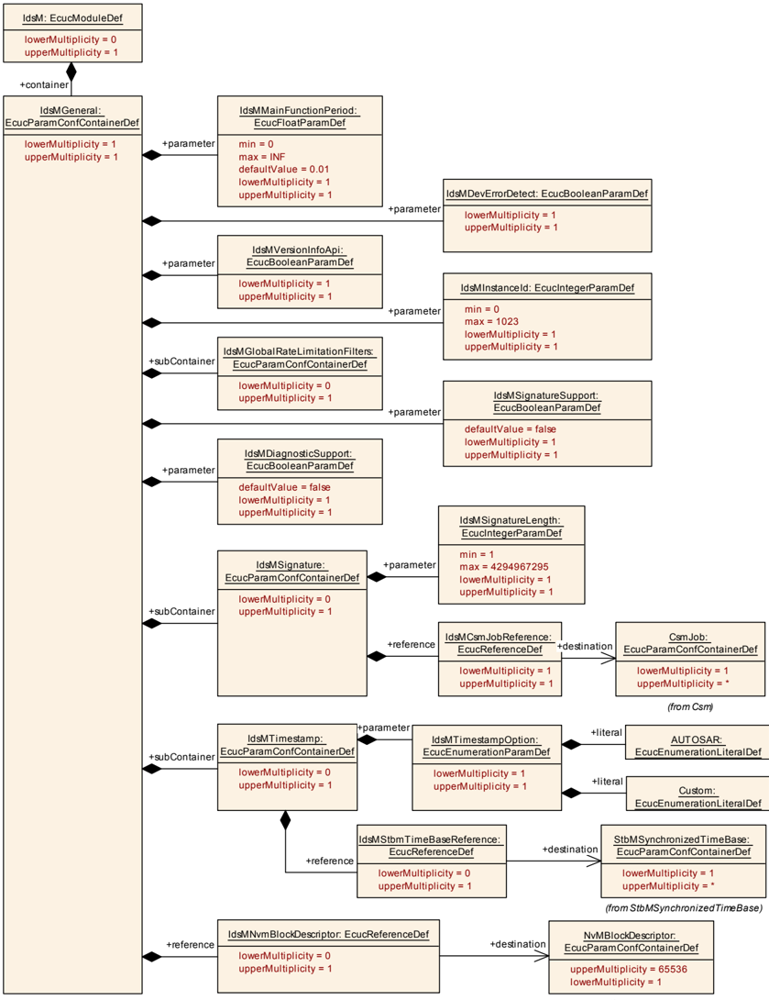

#### 9.1.3. IdsMGlobalRateLimitationFilter

| SWS 条目 | [ECUC_IdsM_00008] |
|---|---|
| 容器名称 | IdsMGlobalRateLimitationFilters |
| 父容器 | IdsMGeneral |
| 描述 | 面向所有 **SEv** 的全局速率限制过滤器。 |
| Post-Build 变体多重性 | false |
| 多重性配置类 | Pre-compile time：x（All Variants）；Link time：-；Post-build time：- |
| 配置参数 | 见下方参数表 |

| 容器名称 | 多重性 | 作用域/依赖 |
|---|---|---|
| IdsMFilterEventRateLimitation | 0..1 | 对于长度为「IdsMRateLimitationTimeInterval」的可配置时间间隔，该过滤器转发所有 **SEv**，直到达到限制「IdsMRateLimitationMaximumEvents」。该限制以传入 **SEv** 的数量度量。直到时间间隔结束，所有后续 **SEv** 都被丢弃。这有助于限制 **IdsM** 施加给 **IdsR** 等信息接收器的负载。该过滤器并非特定于单个 **SEv**，而是适用于由当前 **IdsM** 实例处理的所有 **SEv**。**注意：**每个可能的 **SEv** 都计为一个，无论其计数值如何。 |
| IdsMFilterTrafficLimitation | 0..1 | 流量限制过滤器转发所有传入的 **SEv**，直到达到限制「IdsMTrafficLimitationMaximumBytes」。该限制以传入的字节数度量。仅当在当前流量限制时间间隔内、直到当前 **SEv** 为止的所有传入 **SEv** 的累计大小小于或等于可配置的最大字节数「IdsMTrafficLimitationMaximumBytes」时，该过滤器才转发 **SEv**。流量限制时间间隔的长度可在「IdsMTrafficLimitationTimeInterval」中配置。该过滤器并非特定于单个 **SEv**，而是适用于由当前 **IdsM** 实例处理的所有 **SEv**。 |

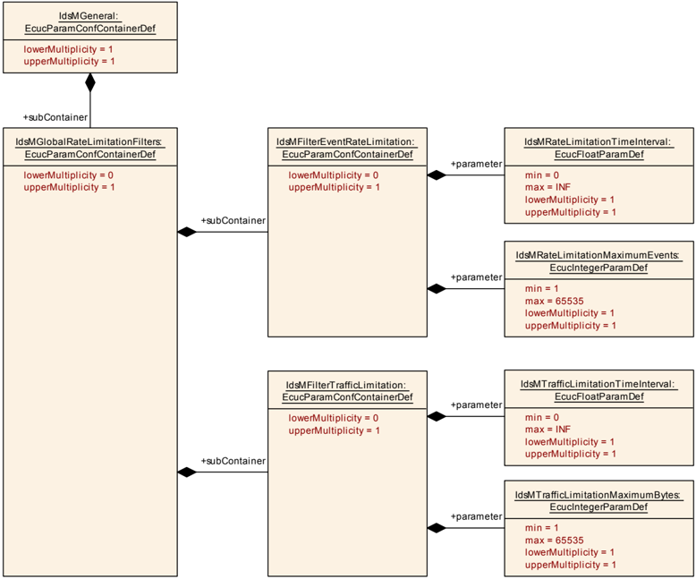

#### 9.1.4. IdsMSecurityEventRefs

| SWS 条目 | [ECUC_IdsM_00073] |
|---|---|
| 容器名称 | IdsMSecurityEventRefs |
| 父容器 | IdsMGeneral |
| 描述 | 用于包含指向 IdsMEvent 元素的引用的容器，这些元素表示在相应安全相关事件发生时 **IdsM** 模块应向自身报告的安全事件。 |
| Post-Build 变体多重性 | false |
| 多重性配置类 | Pre-compile time：x（All Variants）；Link time：-；Post-build time：- |
| 配置参数 | 见下方参数表 |

| SWS 条目 | [ECUC_IdsM_00077] |
|---|---|
| 参数名称 | SEV_IDSM_COMMUNICATION_ERROR |
| 父容器 | IdsMSecurityEventRefs |
| 描述 | 通过 **PDU** 发送 **QSEv** 时发生错误。 |
| 多重性 | 0..1 |
| 类型 | Symbolic name reference to IdsMEvent |
| Post-Build 变体多重性 | false |
| Post-Build 变体值 | false |
| 多重性配置类 | Pre-compile time：x；Link time：-；Post-build time：- |
| 值配置类 | Pre-compile time：x；Link time：-；Post-build time：- |
| 作用域/依赖 | scope: local |

| SWS 条目 | [ECUC_IdsM_00075] |
|---|---|
| 参数名称 | SEV_IDSM_NO_CONTEXT_DATA_BUFFER_AVAILABLE |
| 父容器 | IdsMSecurityEventRefs |
| 描述 | 由于没有更多可用的上下文数据缓冲区，传入事件的上下文数据无法被存储。 |
| 多重性 | 0..1 |
| 类型 | Symbolic name reference to IdsMEvent |
| Post-Build 变体多重性 | false |
| Post-Build 变体值 | false |
| 多重性配置类 | Pre-compile time：x；Link time：-；Post-build time：- |
| 值配置类 | Pre-compile time：x；Link time：-；Post-build time：- |
| 作用域/依赖 | scope: local |

| SWS 条目 | [ECUC_IdsM_00074] |
|---|---|
| 参数名称 | SEV_IDSM_NO_EVENT_BUFFER_AVAILABLE |
| 父容器 | IdsMSecurityEventRefs |
| 描述 | 无法处理某个 **SEv**，因为没有更多可用于处理该事件的事件缓冲区。 |
| 多重性 | 0..1 |
| 类型 | Symbolic name reference to IdsMEvent |
| Post-Build 变体多重性 | false |
| Post-Build 变体值 | false |
| 多重性配置类 | Pre-compile time：x（All Variants）；Link time：-；Post-build time：- |
| 值配置类 | Pre-compile time：x（All Variants）；Link time：-；Post-build time：- |
| 作用域/依赖 | scope: local |

| SWS 条目 | [ECUC_IdsM_00081] |
|---|---|
| 参数名称 | SEV_IDSM_NO_QUALIFIED_EVENT_BUFFER_AVAILABLE |
| 父容器 | IdsMSecurityEventRefs |
| 描述 | 当 **QSEv** 因可用的 **QSEv** 缓冲区不足而必须被丢弃时引发的安全事件。 |
| 多重性 | 0..1 |
| 类型 | Symbolic name reference to IdsMEvent |
| Post-Build 变体多重性 | false |
| Post-Build 变体值 | false |
| 多重性配置类 | Pre-compile time：x（All Variants）；Link time：-；Post-build time：- |
| 值配置类 | Pre-compile time：x（All Variants）；Link time：-；Post-build time：- |
| 作用域/依赖 | scope: local |

| SWS 条目 | [ECUC_IdsM_00076] |
|---|---|
| 参数名称 | SEV_IDSM_TRAFFIC_LIMITATION_EXCEEDED |
| 父容器 | IdsMSecurityEventRefs |
| 描述 | 当前流量超过了已配置的流量限制。 |
| 多重性 | 0..1 |
| 类型 | Symbolic name reference to IdsMEvent |
| Post-Build 变体多重性 | false |
| Post-Build 变体值 | false |
| 多重性配置类 | Pre-compile time：x；Link time：-；Post-build time：- |
| 值配置类 | Pre-compile time：x；Link time：-；Post-build time：- |
| 作用域/依赖 | scope: local |

无包含的容器。

#### 9.1.5. IdsMFilterEventRateLimitation

| SWS 条目 | [ECUC_IdsM_00053] |
|---|---|
| 容器名称 | IdsMFilterEventRateLimitation |
| 父容器 | IdsMGlobalRateLimitationFilters |
| 描述 | 对于长度为「IdsMRateLimitationTimeInterval」的可配置时间间隔，该过滤器转发所有 **SEv**，直到达到限制「IdsMRateLimitationMaximumEvents」。该限制以传入 **SEv** 的数量度量。直到时间间隔结束，所有后续 **SEv** 都被丢弃。这有助于限制 **IdsM** 施加给 **IdsR** 等信息接收器的负载。该过滤器并非特定于单个 **SEv**，而是适用于由当前 **IdsM** 实例处理的所有 **SEv**。**注意：**每个可能的 **SEv** 都计为一个，无论其计数值如何。 |
| Post-Build 变体多重性 | false |
| 多重性配置类 | Pre-compile time：x（All Variants）；Link time：-；Post-build time：- |
| 配置参数 | 见下方参数表 |

| SWS 条目 | [ECUC_IdsM_00055] |
|---|---|
| 参数名称 | IdsMRateLimitationMaximumEvents |
| 父容器 | IdsMFilterEventRateLimitation |
| 描述 | 该过滤器在单个速率限制时间间隔内传递的 **SEv** 的最大数量。 |
| 多重性 | 1 |
| 类型 | EcucIntegerParamDef |
| 范围 | 1 .. 65535 |
| 默认值 | - |
| Post-Build 变体值 | false |
| 值配置类 | Pre-compile time：x（All Variants）；Link time：-；Post-build time：- |
| 作用域/依赖 | scope: local |

| SWS 条目 | [ECUC_IdsM_00054] |
|---|---|
| 参数名称 | IdsMRateLimitationTimeInterval |
| 父容器 | IdsMFilterEventRateLimitation |
| 描述 | 事件速率限制过滤器的时间间隔长度（以秒为单位的浮点数）。**注意：**应配置为 **IdsM** 主函数周期的倍数。 |
| 多重性 | 1 |
| 类型 | EcucFloatParamDef |
| 范围 | [0 .. INF] |
| 默认值 | - |
| Post-Build 变体值 | false |
| 值配置类 | Pre-compile time：x（All Variants）；Link time：-；Post-build time：- |
| 作用域/依赖 | scope: local |

无包含的容器。

#### 9.1.6. IdsMFilterTrafficLimitation

| SWS 条目 | [ECUC_IdsM_00056] |
|---|---|
| 容器名称 | IdsMFilterTrafficLimitation |
| 父容器 | IdsMGlobalRateLimitationFilters |
| 描述 | 流量限制过滤器转发所有传入的 **SEv**，直到达到限制「IdsMTrafficLimitationMaximumBytes」。该限制以传入的字节数度量。仅当在当前流量限制时间间隔内、直到当前 **SEv** 为止的所有传入 **SEv** 的累计大小小于或等于可配置的最大字节数「IdsMTrafficLimitationMaximumBytes」时，该过滤器才转发 **SEv**。流量限制时间间隔的长度可在「IdsMTrafficLimitationTimeInterval」中配置。该过滤器并非特定于单个 **SEv**，而是适用于由当前 **IdsM** 实例处理的所有 **SEv**。 |
| Post-Build 变体多重性 | false |
| 多重性配置类 | Pre-compile time：x（All Variants）；Link time：-；Post-build time：- |
| 配置参数 | 见下方参数表 |

| SWS 条目 | [ECUC_IdsM_00058] |
|---|---|
| 参数名称 | IdsMTrafficLimitationMaximumBytes |
| 父容器 | IdsMFilterTrafficLimitation |
| 描述 | **IdsM** 在单个流量限制时间间隔内发送的最大字节数。 |
| 多重性 | 1 |
| 类型 | EcucIntegerParamDef |
| 范围 | 1 .. 65535 |
| 默认值 | - |
| Post-Build 变体值 | false |
| 值配置类 | Pre-compile time：x（All Variants）；Link time：-；Post-build time：- |
| 作用域/依赖 | scope: local |

| SWS 条目 | [ECUC_IdsM_00057] |
|---|---|
| 参数名称 | IdsMTrafficLimitationTimeInterval |
| 父容器 | IdsMFilterTrafficLimitation |
| 描述 | 流量限制时间间隔的长度（以秒为单位的浮点数）。**注意：**应配置为 **IdsM** 主函数周期的倍数。 |
| 多重性 | 1 |
| 类型 | EcucFloatParamDef |
| 范围 | [0 .. INF] |
| 默认值 | - |
| Post-Build 变体值 | false |
| 值配置类 | Pre-compile time：x（All Variants）；Link time：-；Post-build time：- |
| 作用域/依赖 | scope: local |

无包含的容器。

#### 9.1.7. IdsMTimestamp

| SWS 条目 | [ECUC_IdsM_00060] |
|---|---|
| 容器名称 | IdsMTimestamp |
| 父容器 | IdsMGeneral |
| 描述 | 如果此容器存在，则向所有合格安全事件添加一个时间戳字段。 |
| Post-Build 变体多重性 | false |
| 多重性配置类 | Pre-compile time：x（All Variants）；Link time：-；Post-build time：- |
| 配置参数 | 见下方参数表 |

| SWS 条目 | [ECUC_IdsM_00012] |
|---|---|
| 参数名称 | IdsMTimestampOption |
| 父容器 | IdsMTimestamp |
| 描述 | 该参数规定时间戳的 origin 是来自 **AUTOSAR** 协议栈还是来自应用（自定义时间戳）。 |
| 多重性 | 1 |
| 类型 | EcucEnumerationParamDef |
| 范围 | AUTOSAR、Custom |
| Post-Build 变体值 | false |
| 值配置类 | Pre-compile time：x（All Variants）；Link time：-；Post-build time：- |
| 作用域/依赖 | scope: local |

| SWS 条目 | [ECUC_IdsM_00014] |
|---|---|
| 参数名称 | IdsMStbmTimeBaseReference |
| 父容器 | IdsMTimestamp |
| 描述 | 当时间戳的 origin 为 **AUTOSAR** 时，该参数引用时间来源。 |
| 多重性 | 0..1 |
| 类型 | Reference to StbMSynchronizedTimeBase |
| Post-Build 变体多重性 | false |
| Post-Build 变体值 | false |
| 多重性配置类 | Pre-compile time：x；Link time：-；Post-build time：- |
| 值配置类 | Pre-compile time：x；Link time：-；Post-build time：- |
| 作用域/依赖 | scope: local |

无包含的容器。

#### 9.1.8. IdsMSignature

| SWS 条目 | [ECUC_IdsM_00059] |
|---|---|
| 容器名称 | IdsMSignature |
| 父容器 | IdsMGeneral |
| 描述 | 如果此容器存在，则所有合格安全事件都由加密服务签名。 |
| Post-Build 变体多重性 | false |
| 多重性配置类 | Pre-compile time：x（All Variants）；Link time：-；Post-build time：- |
| 配置参数 | 见下方参数表 |

| SWS 条目 | [ECUC_IdsM_00011] |
|---|---|
| 参数名称 | IdsMSignatureLength |
| 父容器 | IdsMSignature |
| 描述 | 该参数定义由加密服务计算的签名的字节长度。 |
| 多重性 | 1 |
| 类型 | EcucIntegerParamDef |
| 范围 | 1 .. 4294967295 |
| 默认值 | - |
| Post-Build 变体多重性 | false |
| Post-Build 变体值 | false |
| 多重性配置类 | Pre-compile time：x（All Variants）；Link time：-；Post-build time：- |
| 值配置类 | Pre-compile time：x（All Variants）；Link time：-；Post-build time：- |
| 作用域/依赖 | scope: local |

| SWS 条目 | [ECUC_IdsM_00015] |
|---|---|
| 参数名称 | IdsMCsmJobReference |
| 父容器 | IdsMSignature |
| 描述 | 该参数引用在合格安全事件必须被签名时用于生成签名的 **Csm** job。 |
| 多重性 | 1 |
| 类型 | Reference to CsmJob |
| Post-Build 变体多重性 | false |
| Post-Build 变体值 | false |
| 多重性配置类 | Pre-compile time：x；Link time：-；Post-build time：- |
| 值配置类 | Pre-compile time：x；Link time：-；Post-build time：- |
| 作用域/依赖 | scope: local |

无包含的容器。

#### 9.1.9. IdsMConfiguration

| SWS 条目 | [ECUC_IdsM_00003] |
|---|---|
| 容器名称 | IdsMConfiguration |
| 父容器 | IdsM |
| 描述 | 模块 **IdsM** 的配置参数。 |
| 配置参数 | 见下方参数表 |

| 容器名称 | 多重性 | 作用域/依赖 |
|---|---|---|
| IdsMBlockState | 0..16 | **IdsM** 阻止状态的配置，用于 **IdsMStateBlockFilter** 中以暂停安全事件的收集。活动状态由 **BswM** 通过 **IdsM_BswM_StateChanged()** 报告。 |
| IdsMBufferConfiguration | 1 | **IdsM** 所使用的事件缓冲区和上下文数据缓冲区的配置。 |
| IdsMContextDataModification | 0..1 | 上下文数据修饰器调出的配置。 |
| IdsMEvent | 1..65535 | 由传感器报告的 **IdsM** 事件单元及其参数的配置。 |
| IdsMFilterChain | 0..* | 过滤链是影响一个或多个 **SEv** 的过滤器的组合。过滤器接收一个 **SEv**，检查条件，然后例如：立即/稍后转发 **SEv**、丢弃 **SEv**、存储 **SEv**、修改 **SEv**。请注意，过滤器顺序定义如下：报告模式级别（每 **SEv ID**）、阻止状态（每 **SEv ID**）、每第 N 个转发（每 **SEv ID**）、事件聚合（每 **SEv ID**）、事件阈值（每 **SEv ID**）、事件速率限制（每 **IdsM** 实例）、流量限制（每 **IdsM** 实例）。 |
| IdsMPdus | 0..1 | 用于发送事件数据的 **PDU** 引用的配置。 |

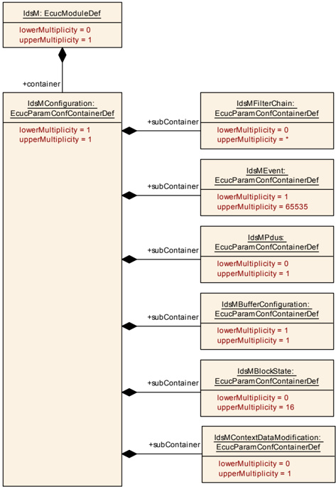

#### 9.1.10. IdsMFilterChain

| SWS 条目 | [ECUC_IdsM_00016] |
|---|---|
| 容器名称 | IdsMFilterChain |
| 父容器 | IdsMConfiguration |
| 描述 | 过滤链是影响一个或多个 **SEv** 的过滤器的组合。过滤器接收一个 **SEv**，检查条件，然后例如：立即/稍后转发 **SEv**、丢弃 **SEv**、存储 **SEv**、修改 **SEv**。请注意，过滤器顺序定义如下：报告模式级别（每 **SEv ID**）、阻止状态（每 **SEv ID**）、每第 N 个转发（每 **SEv ID**）、事件聚合（每 **SEv ID**）、事件阈值（每 **SEv ID**）、事件速率限制（每 **IdsM** 实例）、流量限制（每 **IdsM** 实例）。 |
| Post-Build 变体多重性 | false |
| 多重性配置类 | Pre-compile time：x（All Variants）；Link time：-；Post-build time：- |
| 配置参数 | 见下方参数表 |

| 容器名称 | 多重性 | 作用域/依赖 |
|---|---|---|
| IdsMBlockStateFilter | 0..1 | 如果 **BswM** 报告的当前状态在此状态过滤器列表中，该状态过滤器丢弃 **SEv**。 |
| IdsMEventAggregationFilter | 0..1 | 在单个聚合时间间隔内被该过滤器接收的、某事件 ID 的所有已接收事件不会立即转发。相反，根据「IdsMContextDataSourceSelector」的配置，仅将最后一个或第一个接收到的 **SEv** 存储在聚合缓冲区中。**SEv** 的计数字段被修改为包含当前聚合时间间隔内所有传入 **SEv** 的计数字段之和。在聚合时间间隔结束时，被缓冲的 **SEv** 被发出，聚合缓冲区被清空。如果直到聚合时间间隔结束都没有传入 **SEv**，则不会发送报文。 |
| IdsMEventThresholdFilter | 0..1 | 在每个时间间隔「IdsMEventThresholdTimeInterval」内，该过滤器丢弃前「IdsMEventThresholdNumber - 1」个 **SEv**，并立即转发所有其他传入 **SEv**，直到时间间隔结束。 |
| IdsMForwardEveryNthFilter | 0..1 | 在所有传入的 **SEV** 中，丢弃除每第 n 个之外的所有 **SEv**。后者将被不加修改地转发。 |

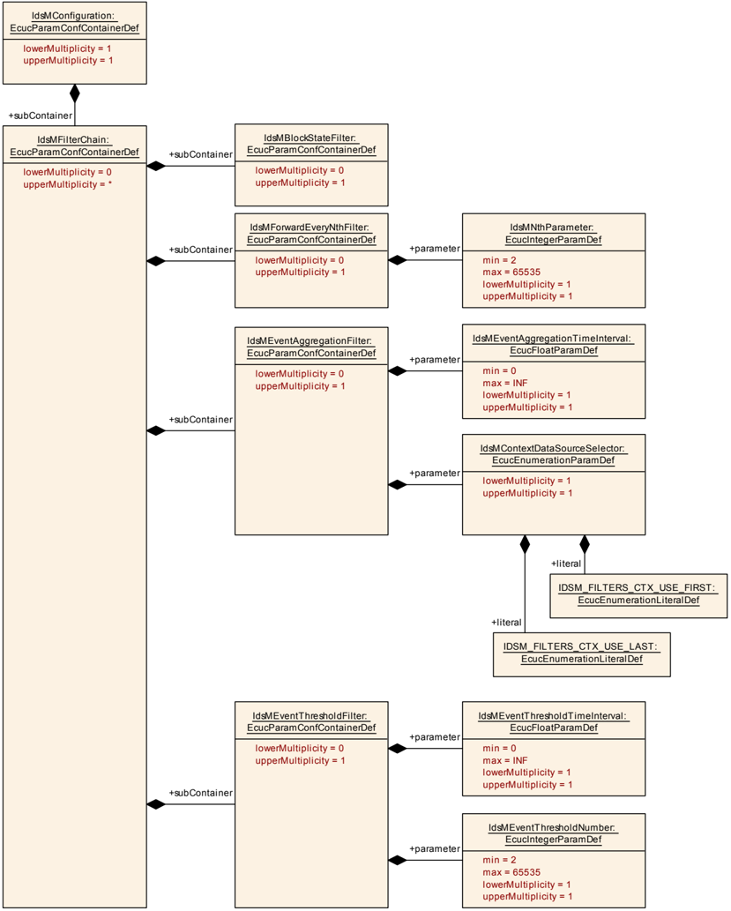

#### 9.1.11. IdsMBlockStateFilter

| SWS 条目 | [ECUC_IdsM_00021] |
|---|---|
| 容器名称 | IdsMBlockStateFilter |
| 父容器 | IdsMFilterChain |
| 描述 | 如果 **BswM** 报告的当前状态在此状态过滤器列表中，该状态过滤器丢弃 **SEv**。 |
| Post-Build 变体多重性 | false |
| 多重性配置类 | Pre-compile time：x（All Variants）；Link time：-；Post-build time：- |
| 配置参数 | 见下方参数表 |

| SWS 条目 | [ECUC_IdsM_00051] |
|---|---|
| 参数名称 | IdsMBlockStateReference |
| 父容器 | IdsMBlockStateFilter |
| 描述 | 在此状态期间 **SEv** 的收集将被暂停。 |
| 多重性 | 1..16 |
| 类型 | Reference to IdsMBlockState |
| Post-Build 变体多重性 | false |
| Post-Build 变体值 | false |
| 多重性配置类 | Pre-compile time：x；Link time：-；Post-build time：- |
| 值配置类 | Pre-compile time：x；Link time：-；Post-build time：- |
| 作用域/依赖 | scope: local |

无包含的容器。

#### 9.1.12. IdsMForwardEveryNthFilter

| SWS 条目 | [ECUC_IdsM_00022] |
|---|---|
| 容器名称 | IdsMForwardEveryNthFilter |
| 父容器 | IdsMFilterChain |
| 描述 | 在所有传入的 **SEV** 中，丢弃除每第 n 个之外的所有 **SEv**。后者将被不加修改地转发。 |
| Post-Build 变体多重性 | false |
| 多重性配置类 | Pre-compile time：x（All Variants）；Link time：-；Post-build time：- |
| 配置参数 | 见下方参数表 |

| SWS 条目 | [ECUC_IdsM_00023] |
|---|---|
| 参数名称 | IdsMNthParameter |
| 父容器 | IdsMForwardEveryNthFilter |
| 描述 | 对于配置了该过滤器的每个 **SEv ID**，该参数分配相应的 n。每 n 个 **SEv** 中只有 1 个将被转发。 |
| 多重性 | 1 |
| 类型 | EcucIntegerParamDef |
| 范围 | 2 .. 65535 |
| 默认值 | - |
| Post-Build 变体值 | false |
| 值配置类 | Pre-compile time：x（All Variants）；Link time：-；Post-build time：- |
| 作用域/依赖 | scope: local |

无包含的容器。

#### 9.1.13. IdsMEventAggregationFilter

| SWS 条目 | [ECUC_IdsM_00024] |
|---|---|
| 容器名称 | IdsMEventAggregationFilter |
| 父容器 | IdsMFilterChain |
| 描述 | 在单个聚合时间间隔内被该过滤器接收的、某事件 ID 的所有已接收事件不会立即转发。相反，根据「IdsMContextDataSourceSelector」的配置，仅将最后一个或第一个接收到的 **SEv** 存储在聚合缓冲区中。**SEv** 的计数字段被修改为包含当前聚合时间间隔内所有传入 **SEv** 的计数字段之和。在聚合时间间隔结束时，被缓冲的 **SEv** 被发出，聚合缓冲区被清空。如果直到聚合时间间隔结束都没有传入 **SEv**，则不会发送报文。 |
| Post-Build 变体多重性 | false |
| 多重性配置类 | Pre-compile time：x（All Variants）；Link time：-；Post-build time：- |
| 配置参数 | 见下方参数表 |

| SWS 条目 | [ECUC_IdsM_00026] |
|---|---|
| 参数名称 | IdsMContextDataSourceSelector |
| 父容器 | IdsMEventAggregationFilter |
| 描述 | 聚合过滤器所产生的 **SEv** 包含来自以下两个来源之一的上下文数据：IDSM_FILTERS_CTX_USE_FIRST = 首个接收到的 **SEv** 的 ContextData 用于所得的 **QSEv**；IDSM_FILTERS_CTX_USE_LAST = 最后一个接收到的 **SEv** 的 ContextData 用于所得的 **QSEv**。 |
| 多重性 | 1 |
| 类型 | EcucEnumerationParamDef |
| 范围 | IDSM_FILTERS_CTX_USE_FIRST、IDSM_FILTERS_CTX_USE_LAST |
| Post-Build 变体值 | false |
| 值配置类 | Pre-compile time：x（All Variants）；Link time：-；Post-build time：- |
| 作用域/依赖 | scope: local |

| SWS 条目 | [ECUC_IdsM_00025] |
|---|---|
| 参数名称 | IdsMEventAggregationTimeInterval |
| 父容器 | IdsMEventAggregationFilter |
| 描述 | 聚合时间间隔的长度（以秒为单位的浮点数）。**注意：**应配置为 **IdsM** 主函数周期的倍数。 |
| 多重性 | 1 |
| 类型 | EcucFloatParamDef |
| 范围 | [0 .. INF] |
| 默认值 | - |
| Post-Build 变体值 | false |
| 值配置类 | Pre-compile time：x（All Variants）；Link time：-；Post-build time：- |
| 作用域/依赖 | scope: local |

无包含的容器。

#### 9.1.14. IdsMEventThresholdFilter

| SWS 条目 | [ECUC_IdsM_00027] |
|---|---|
| 容器名称 | IdsMEventThresholdFilter |
| 父容器 | IdsMFilterChain |
| 描述 | 在每个时间间隔「IdsMEventThresholdTimeInterval」内，该过滤器丢弃前「IdsMEventThresholdNumber - 1」个 **SEv**，并立即转发所有其他传入 **SEv**，直到时间间隔结束。 |
| Post-Build 变体多重性 | false |
| 多重性配置类 | Pre-compile time：x（All Variants）；Link time：-；Post-build time：- |
| 配置参数 | 见下方参数表 |

| SWS 条目 | [ECUC_IdsM_00029] |
|---|---|
| 参数名称 | IdsMEventThresholdNumber |
| 父容器 | IdsMEventThresholdFilter |
| 描述 | 该参数为受该阈值过滤器影响的每个 **SEv ID** 分配阈值 p。所有第 p-1 个及之前的 **SEv** 被丢弃，等于或大于 p 的 **SEv** 被转发。 |
| 多重性 | 1 |
| 类型 | EcucIntegerParamDef |
| 范围 | 2 .. 65535 |
| 默认值 | - |
| Post-Build 变体值 | false |
| 值配置类 | Pre-compile time：x（All Variants）；Link time：-；Post-build time：- |
| 作用域/依赖 | scope: local |

| SWS 条目 | [ECUC_IdsM_00028] |
|---|---|
| 参数名称 | IdsMEventThresholdTimeInterval |
| 父容器 | IdsMEventThresholdFilter |
| 描述 | 阈值时间间隔的长度（以秒为单位的浮点数）。**注意：**应配置为 **IdsM** 主函数周期的倍数。 |
| 多重性 | 1 |
| 类型 | EcucFloatParamDef |
| 范围 | [0 .. INF] |
| 默认值 | - |
| Post-Build 变体值 | false |
| 值配置类 | Pre-compile time：x（All Variants）；Link time：-；Post-build time：- |
| 作用域/依赖 | scope: local |

无包含的容器。

#### 9.1.15. IdsMPdus

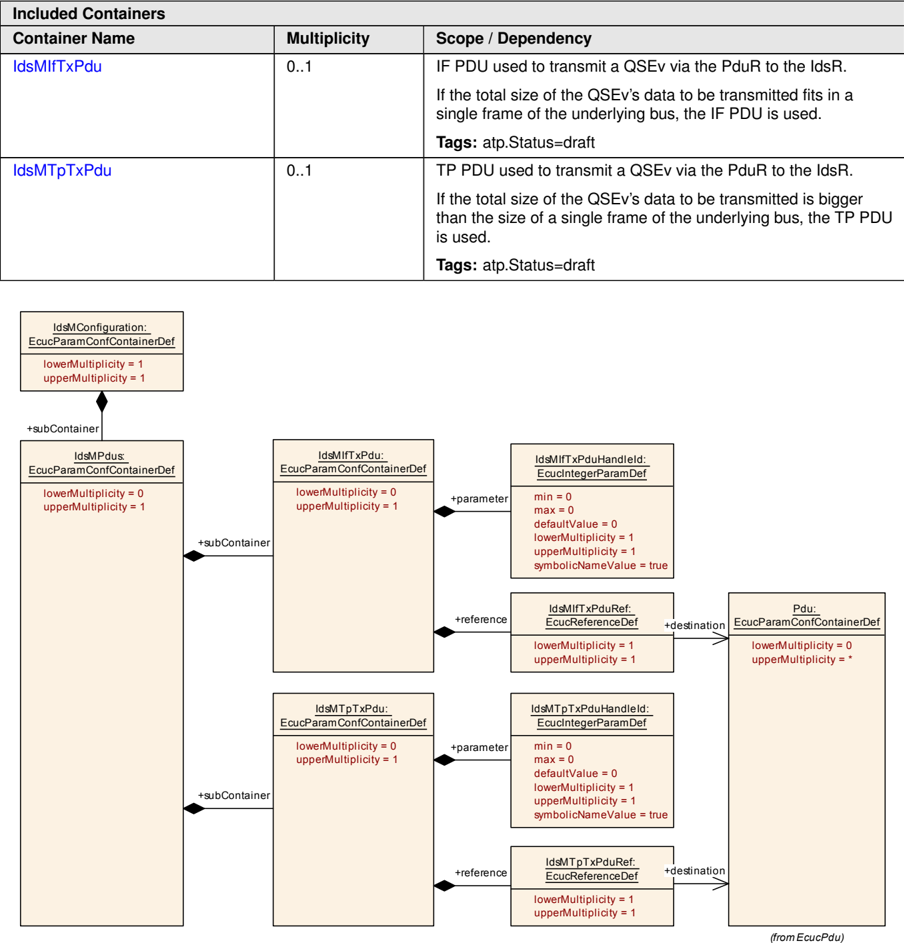

| SWS 条目 | [ECUC_IdsM_00018] |
|---|---|
| 容器名称 | IdsMPdus |
| 父容器 | IdsMConfiguration |
| 描述 | 用于发送事件数据的 **PDU** 引用的配置。 |
| Post-Build 变体多重性 | false |
| 多重性配置类 | Pre-compile time：x（All Variants）；Link time：-；Post-build time：- |
| 配置参数 | 见下方参数表 |

| 容器名称 | 多重性 | 作用域/依赖 |
|---|---|---|
| IdsMIfTxPdu | 0..1 | 用于通过 **PduR** 向 **IdsR** 传输 **QSEv** 的 **IF PDU**。如果待传输 **QSEv** 数据的总大小能够装入底层总线的单个帧中，则使用 **IF PDU**。 |
| IdsMTpTxPdu | 0..1 | 用于通过 **PduR** 向 **IdsR** 传输 **QSEv** 的 **TP PDU**。如果待传输 **QSEv** 数据的总大小大于底层总线单个帧的大小，则使用 **TP PDU**。 |

#### 9.1.16. IdsMIfTxPdu

| SWS 条目 | [ECUC_IdsM_00040] |
|---|---|
| 容器名称 | IdsMIfTxPdu |
| 父容器 | IdsMPdus |
| 描述 | 用于通过 **PduR** 向 **IdsR** 传输 **QSEv** 的 **IF PDU**。如果待传输 **QSEv** 数据的总大小能够装入底层总线的单个帧中，则使用 **IF PDU**。 |
| Post-Build 变体多重性 | false |
| 多重性配置类 | Pre-compile time：x（All Variants）；Link time：-；Post-build time：- |
| 配置参数 | 见下方参数表 |

| SWS 条目 | [ECUC_IdsM_00041] |
|---|---|
| 参数名称 | IdsMIfTxPduHandleId |
| 父容器 | IdsMIfTxPdu |
| 描述 | **IdsM** 不使用此参数，其内容将被忽略。此参数的存在是 **PduR** 所需要的。 |
| 多重性 | 1 |
| 类型 | EcucIntegerParamDef（为此参数生成符号名） |
| 范围 | 0 .. 0 |
| 默认值 | 0 |
| Post-Build 变体值 | false |
| 值配置类 | Pre-compile time：x（All Variants）；Link time：-；Post-build time：- |
| 作用域/依赖 | scope: ECU |

| SWS 条目 | [ECUC_IdsM_00042] |
|---|---|
| 参数名称 | IdsMIfTxPduRef |
| 父容器 | IdsMIfTxPdu |
| 描述 | 对用于传输 **QSEv** 的 **IF PDU** 的引用。 |
| 多重性 | 1 |
| 类型 | Reference to Pdu |
| Post-Build 变体值 | false |
| 值配置类 | Pre-compile time：x（All Variants）；Link time：-；Post-build time：- |
| 作用域/依赖 | scope: ECU |

无包含的容器。

#### 9.1.17. IdsMEventTpTxPdu

| SWS 条目 | [ECUC_IdsM_00043] |
|---|---|
| 容器名称 | IdsMTpTxPdu |
| 父容器 | IdsMPdus |
| 描述 | 用于通过 **PduR** 向 **IdsR** 传输 **QSEv** 的 **TP PDU**。如果待传输 **QSEv** 数据的总大小大于底层总线单个帧的大小，则使用 **TP PDU**。 |
| Post-Build 变体多重性 | false |
| 多重性配置类 | Pre-compile time：x（All Variants）；Link time：-；Post-build time：- |
| 配置参数 | 见下方参数表 |

| SWS 条目 | [ECUC_IdsM_00044] |
|---|---|
| 参数名称 | IdsMTpTxPduHandleId |
| 父容器 | IdsMTpTxPdu |
| 描述 | **IdsM** 不使用此参数，其内容将被忽略。此参数的存在是 **PduR** 所需要的。 |
| 多重性 | 1 |
| 类型 | EcucIntegerParamDef（为此参数生成符号名） |
| 范围 | 0 .. 0 |
| 默认值 | 0 |
| Post-Build 变体值 | false |
| 值配置类 | Pre-compile time：x（All Variants）；Link time：-；Post-build time：- |
| 作用域/依赖 | scope: ECU |

| SWS 条目 | [ECUC_IdsM_00045] |
|---|---|
| 参数名称 | IdsMTpTxPduRef |
| 父容器 | IdsMTpTxPdu |
| 描述 | 对用于传输 **QSEv** 的 **TP PDU** 的引用。 |
| 多重性 | 1 |
| 类型 | Reference to Pdu |
| Post-Build 变体值 | false |
| 值配置类 | Pre-compile time：x（All Variants）；Link time：-；Post-build time：- |
| 作用域/依赖 | scope: ECU |

无包含的容器。

#### 9.1.18. IdsMBufferConfiguration

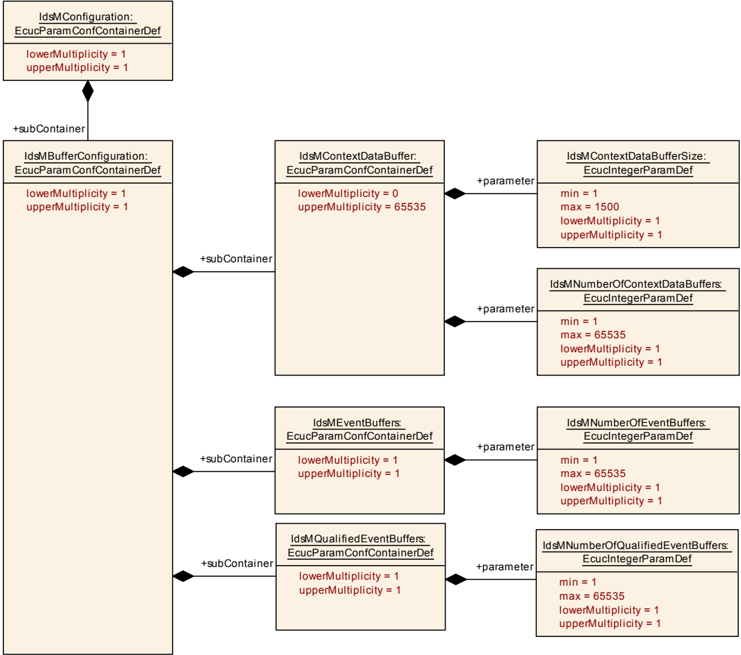

| SWS 条目 | [ECUC_IdsM_00019] |
|---|---|
| 容器名称 | IdsMBufferConfiguration |
| 父容器 | IdsMConfiguration |
| 描述 | **IdsM** 所使用的事件缓冲区和上下文数据缓冲区的配置。 |
| 配置参数 | 见下方参数表 |

| 容器名称 | 多重性 | 作用域/依赖 |
|---|---|---|
| IdsMContextDataBuffer | 0..65535 | 保留用于存储 **SEv** 上下文数据的缓冲区。根据所处理的 **SEv** 类型，上下文数据的大小可能存在显著差异。 |
| IdsMEventBuffers | 1 | 用于存储 **SEv** 的缓冲区。 |
| IdsMQualifiedEventBuffers | 1 | 用于存储 **QSEv** 的缓冲区。 |

#### 9.1.19. IdsMContextDataBuffer

| SWS 条目 | [ECUC_IdsM_00046] |
|---|---|
| 容器名称 | IdsMContextDataBuffer |
| 父容器 | IdsMBufferConfiguration |
| 描述 | 保留用于存储 **SEv** 上下文数据的缓冲区。根据所处理的 **SEv** 类型，上下文数据的大小可能存在显著差异。 |
| Post-Build 变体多重性 | false |
| 多重性配置类 | Pre-compile time：x（All Variants）；Link time：-；Post-build time：- |
| 配置参数 | 见下方参数表 |

| SWS 条目 | [ECUC_IdsM_00047] |
|---|---|
| 参数名称 | IdsMContextDataBufferSize |
| 父容器 | IdsMContextDataBuffer |
| 描述 | 上下文数据缓冲区的大小（字节）。建议根据已配置的 **SEv** 配置具有适当大小的缓冲区。 |
| 多重性 | 1 |
| 类型 | EcucIntegerParamDef |
| 范围 | 1 .. 1500 |
| 默认值 | - |
| Post-Build 变体值 | false |
| 值配置类 | Pre-compile time：x（All Variants）；Link time：-；Post-build time：- |
| 作用域/依赖 | scope: local |

| SWS 条目 | [ECUC_IdsM_00048] |
|---|---|
| 参数名称 | IdsMNumberOfContextDataBuffers |
| 父容器 | IdsMContextDataBuffer |
| 描述 | 具有在 **IdsMContextDataBufferSize** 中规定的缓冲区大小的缓冲区数量。建议根据已配置的 **SEv** 配置适当数量的缓冲区。 |
| 多重性 | 1 |
| 类型 | EcucIntegerParamDef |
| 范围 | 1 .. 65535 |
| 默认值 | - |
| Post-Build 变体值 | false |
| 值配置类 | Pre-compile time：x（All Variants）；Link time：-；Post-build time：- |
| 作用域/依赖 | scope: local |

无包含的容器。

#### 9.1.20. IdsMEventBuffers

| SWS 条目 | [ECUC_IdsM_00049] |
|---|---|
| 容器名称 | IdsMEventBuffers |
| 父容器 | IdsMBufferConfiguration |
| 描述 | 用于存储 **SEv** 的缓冲区。 |
| 配置参数 | 见下方参数表 |

| SWS 条目 | [ECUC_IdsM_00050] |
|---|---|
| 参数名称 | IdsMNumberOfEventBuffers |
| 父容器 | IdsMEventBuffers |
| 描述 | 用于存储 **SEv** 的事件缓冲区数量。建议的缓冲区数量可按如下方式计算：IdsMNumberOfBuffers = 聚合过滤器实例数 + 并行处理 **SEv** 数的上限。聚合过滤器实例数 = 使用包含聚合过滤器的过滤链的已配置 **SEv** 的数量。并行处理 **SEv** 数的上限 = 已配置 **SEv** 数量的 10%。 |
| 多重性 | 1 |
| 类型 | EcucIntegerParamDef |
| 范围 | 1 .. 65535 |
| 默认值 | - |
| Post-Build 变体值 | false |
| 值配置类 | Pre-compile time：x（All Variants）；Link time：-；Post-build time：- |
| 作用域/依赖 | scope: local |

无包含的容器。

#### 9.1.21. IdsMQualifiedEventBuffers

| SWS 条目 | [ECUC_IdsM_00078] |
|---|---|
| 容器名称 | IdsMQualifiedEventBuffers |
| 父容器 | IdsMBufferConfiguration |
| 描述 | 用于存储 **QSEv** 的缓冲区。 |
| 配置参数 | 见下方参数表 |

| SWS 条目 | [ECUC_IdsM_00080] |
|---|---|
| 参数名称 | IdsMNumberOfQualifiedEventBuffers |
| 父容器 | IdsMQualifiedEventBuffers |
| 描述 | 用于存储 **SEv** 的合格事件缓冲区数量。可以根据 **QSEv** 的生成速率和接收器成功消费它们的速率来确定 **QSEv** 缓冲区的数量，例如假设接收器 SinkIdsR 的最坏情况 **TxConfirmation** 延迟为「k」毫秒，如果每个「n」毫秒周期（n 远大于 k）内最多可以生成「m」个 **QSEv**，则 **IdsM** 至少需要「m」个 **IdsMNumberOfQualifiedEventBuffers** 以防止丢弃 **QSEv**。窗口「n」可以选择为任何远大于「k」且可估计 **QSEv** 峰值生成速率的间隔。因此 IdsMNumberOfQualifiedEventBuffers >= n/k。 |
| 多重性 | 1 |
| 类型 | EcucIntegerParamDef |
| 范围 | 1 .. 65535 |
| 默认值 | - |
| Post-Build 变体值 | false |
| 值配置类 | Pre-compile time：x（All Variants）；Link time：-；Post-build time：- |
| 作用域/依赖 | scope: local |

无包含的容器。

#### 9.1.22. IdsMEvent

| SWS 条目 | [ECUC_IdsM_00017] |
|---|---|
| 容器名称 | IdsMEvent |
| 父容器 | IdsMConfiguration |
| 描述 | 由传感器报告的 **IdsM** 事件单元及其参数的配置。 |
| Post-Build 变体多重性 | false |
| 多重性配置类 | Pre-compile time：x（All Variants）；Link time：-；Post-build time：- |
| 配置参数 | 见下方参数表 |

| SWS 条目 | [ECUC_IdsM_00032] |
|---|---|
| 参数名称 | IdsMExternalEventId |
| 父容器 | IdsMEvent |
| 描述 | 报告给接收器的外部安全事件 **ID**。根据引用的模块，有两种不同的取值范围：标准化 **SEv ID** 由 **AUTOSAR** 规范定义，此 **ID** 通常派生自 **SecXT**，标准 **ID** 范围为 0x0000 - 0x8000；通用用户事件 **ID** 由用户定义，用于 **SEv** 未由 **AUTOSAR** 规范定义的情况（例如来自 **SW-C** 或 **CDD**），通用 **ID** 范围为 0x8000 - 0xFFFE；0xFFFF 被视为无效 **ID**。 |
| 多重性 | 1 |
| 类型 | EcucIntegerParamDef |
| 范围 | 0 .. 65534 |
| 默认值 | - |
| Post-Build 变体值 | false |
| 值配置类 | Pre-compile time：x（All Variants）；Link time：-；Post-build time：- |
| 作用域/依赖 | scope: local |

| SWS 条目 | [ECUC_IdsM_00033] |
|---|---|
| 参数名称 | IdsMInternalEventId |
| 父容器 | IdsMEvent |
| 描述 | 由 **IdsM** 模块在内部用作标识符的连续编号。该编号在内部计算，不应手动配置。此参数仅用于发布该计算的结果。使用 **IdsM API** 的应用不应依赖此参数的值，而应使用符号名称值。 |
| 多重性 | 1 |
| 类型 | EcucIntegerParamDef（为此参数生成符号名） |
| 范围 | 0 .. 65535 |
| 默认值 | 65535 |
| Post-Build 变体值 | false |
| 值配置类 | Pre-compile time：x（All Variants）；Link time：-；Post-build time：- |
| 作用域/依赖 | scope: ECU |

| SWS 条目 | [ECUC_IdsM_00036] |
|---|---|
| 参数名称 | IdsMReportingModeFilter |
| 父容器 | IdsMEvent |
| 描述 | 报告模式过滤器定义报告的详细程度：**SEv** 应被丢弃、带上下文数据转发还是不带上下文数据转发。该参数确定 **SEv** 是：被丢弃（OFF）、不带上下文数据发送（BRIEF）、带上下文数据发送（DETAILED）、不带上下文数据发送并忽略过滤链的其余部分（BRIEF_BYPASSING_FILTERS）、带上下文数据发送并忽略过滤链的其余部分（DETAILED_BYPASSING_FILTERS）。 |
| 多重性 | 1 |
| 类型 | EcucEnumerationParamDef |
| 范围 | BRIEF、BRIEF_BYPASSING_FILTERS、DETAILED、DETAILED_BYPASSING_FILTERS、OFF |
| Post-Build 变体值 | false |
| 值配置类 | Pre-compile time：x（All Variants）；Link time：-；Post-build time：- |
| 作用域/依赖 | scope: local |

| SWS 条目 | [ECUC_IdsM_00031] |
|---|---|
| 参数名称 | IdsMSensorInstanceId |
| 父容器 | IdsMEvent |
| 描述 | 向 **IdsM** 报告安全事件的传感器的实例 **ID**。如果传感器只有一个实例，则默认 **ID** 为 0。 |
| 多重性 | 1 |
| 类型 | EcucIntegerParamDef |
| 范围 | 0 .. 65535 |
| 默认值 | 0 |
| Post-Build 变体值 | false |
| 值配置类 | Pre-compile time：x（All Variants）；Link time：-；Post-build time：- |
| 作用域/依赖 | scope: local |

| SWS 条目 | [ECUC_IdsM_00035] |
|---|---|
| 参数名称 | IdsMSinkDem |
| 父容器 | IdsMEvent |
| 描述 | 该 **QSEv** 将被发送到 **Dem** 模块的安全事件存储器（**Sem**）中，以在本地 **ECU** 上持久化。 |
| 多重性 | 1 |
| 类型 | EcucBooleanParamDef |
| 默认值 | false |
| Post-Build 变体值 | false |
| 值配置类 | Pre-compile time：x（All Variants）；Link time：-；Post-build time：- |
| 作用域/依赖 | scope: local |

| SWS 条目 | [ECUC_IdsM_00034] |
|---|---|
| 参数名称 | IdsMSinkIdsR |
| 父容器 | IdsMEvent |
| 描述 | 该 **QSEv** 将被发送到 **IDS** 报告器。 |
| 多重性 | 1 |
| 类型 | EcucBooleanParamDef |
| 默认值 | false |
| Post-Build 变体值 | false |
| 值配置类 | Pre-compile time：x（All Variants）；Link time：-；Post-build time：- |
| 作用域/依赖 | scope: local |

| SWS 条目 | [ECUC_IdsM_00030] |
|---|---|
| 参数名称 | IdsMFilterChainRef |
| 父容器 | IdsMEvent |
| 描述 | 对已配置 **IdsM** 过滤链的引用。 |
| 多重性 | 0..1 |
| 类型 | Reference to IdsMFilterChain |
| Post-Build 变体多重性 | false |
| Post-Build 变体值 | false |
| 多重性配置类 | Pre-compile time：x；Link time：-；Post-build time：- |
| 值配置类 | Pre-compile time：x；Link time：-；Post-build time：- |
| 作用域/依赖 | scope: local |

| 容器名称 | 多重性 | 作用域/依赖 |
|---|---|---|
| IdsMContextDataModifierOptions | 0..1 | **SEv** 的附加配置参数，使其能够修改传入的上下文数据。 |
| IdsMServiceInterfaceOptions | 0..1 | 当传感器为 **SW-C** 或应用时 **SEv** 的附加配置参数。 |

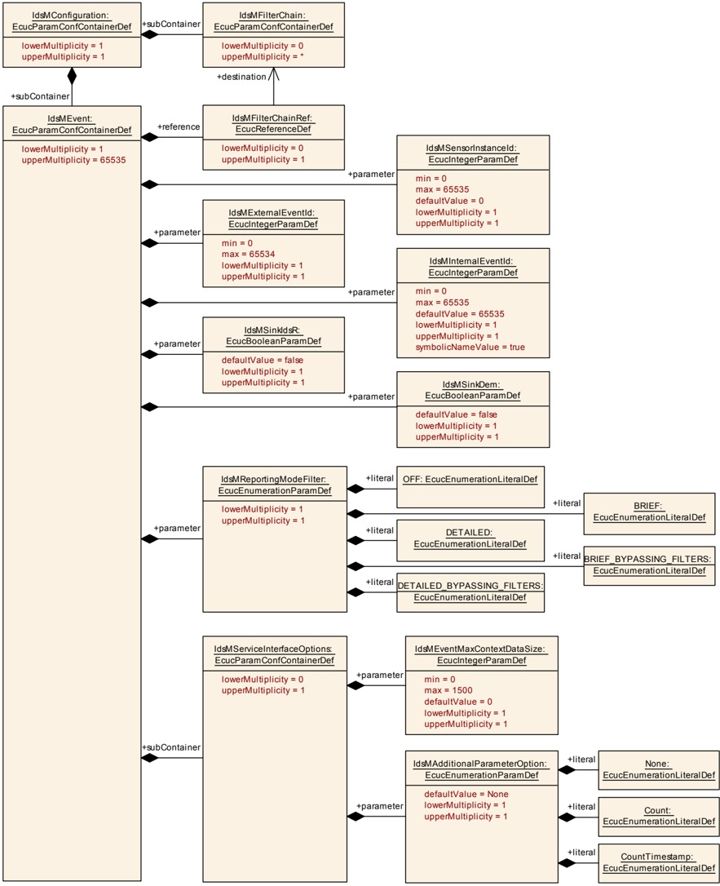

#### 9.1.23. IdsMReportingModeFilter

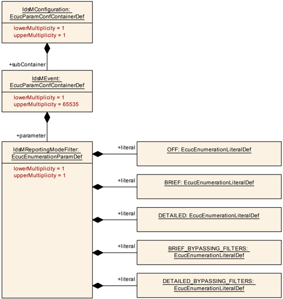

#### 9.1.24. IdsMServiceInterfaceOptions

| SWS 条目 | [ECUC_IdsM_00037] |
|---|---|
| 容器名称 | IdsMServiceInterfaceOptions |
| 父容器 | IdsMEvent |
| 描述 | 当传感器为 **SW-C** 或应用时 **SEv** 的附加配置参数。 |
| Post-Build 变体多重性 | false |
| 多重性配置类 | Pre-compile time：x（All Variants）；Link time：-；Post-build time：- |
| 配置参数 | 见下方参数表 |

| SWS 条目 | [ECUC_IdsM_00039] |
|---|---|
| 参数名称 | IdsMAdditionalParameterOption |
| 父容器 | IdsMServiceInterfaceOptions |
| 描述 | 除可选上下文数据之外，服务端口接口可以通过以下参数扩展：None：无扩展；Count：额外传递一个计数，该值用作相应 **SEv** 的初始化计数器；Count 和 Timestamp：除计数外还传递一个时间戳。**注意：**时间戳选项取决于 **IdsMTimeStampOption** 是否配置为启用时间戳。 |
| 多重性 | 1 |
| 类型 | EcucEnumerationParamDef |
| 范围 | Count、CountTimestamp、None |
| 默认值 | None |
| Post-Build 变体值 | false |
| 值配置类 | Pre-compile time：x（All Variants）；Link time：-；Post-build time：- |
| 作用域/依赖 | scope: local |

| SWS 条目 | [ECUC_IdsM_00038] |
|---|---|
| 参数名称 | IdsMEventMaxContextDataSize |
| 父容器 | IdsMServiceInterfaceOptions |
| 描述 | **IdsM** 和 **RTE** 在转发相应安全事件的上下文数据时使用的最大字节数。此参数仅用于 **SW-C** 用例。这是为上下文数据传输定义的最大字节数。如果这是基础软件模块的 **SEv**，则无需配置此参数，且它将被忽略。 |
| 多重性 | 1 |
| 类型 | EcucIntegerParamDef |
| 范围 | 0 .. 1500 |
| 默认值 | 0 |
| Post-Build 变体值 | false |
| 值配置类 | Pre-compile time：x（All Variants）；Link time：-；Post-build time：- |
| 作用域/依赖 | scope: local |

无包含的容器。

#### 9.1.25. IdsMContextDataModifierOptions

| SWS 条目 | [ECUC_IdsM_00061] |
|---|---|
| 容器名称 | IdsMContextDataModifierOptions |
| 父容器 | IdsMEvent |
| 描述 | **SEv** 的附加配置参数，使其能够修改传入的上下文数据。 |
| Post-Build 变体多重性 | false |
| 多重性配置类 | Pre-compile time：x（All Variants）；Link time：-；Post-build time：- |
| 配置参数 | 见下方参数表 |

| SWS 条目 | [ECUC_IdsM_00063] |
|---|---|
| 参数名称 | IdsMContextDataModifierCalloutRef |
| 父容器 | IdsMContextDataModifierOptions |
| 描述 | 对事件特定的上下文数据修饰器调出函数的引用。 |
| 多重性 | 1 |
| 类型 | Reference to IdsMContextDataModifierCallout |
| Post-Build 变体值 | false |
| 值配置类 | Pre-compile time：x（All Variants）；Link time：-；Post-build time：- |
| 作用域/依赖 | scope: local |

无包含的容器。

#### 9.1.26. IdsMBlockState

| SWS 条目 | [ECUC_IdsM_00020] |
|---|---|
| 容器名称 | IdsMBlockState |
| 父容器 | IdsMConfiguration |
| 描述 | **IdsM** 阻止状态的配置，用于 **IdsMStateBlockFilter** 中以暂停安全事件的收集。活动状态由 **BswM** 通过 **IdsM_BswM_StateChanged()** 报告。 |
| Post-Build 变体多重性 | false |
| 多重性配置类 | Pre-compile time：x（All Variants）；Link time：-；Post-build time：- |
| 配置参数 | 见下方参数表 |

| SWS 条目 | [ECUC_IdsM_00052] |
|---|---|
| 参数名称 | IdsMBlockStateID |
| 父容器 | IdsMBlockState |
| 描述 | 该值规定此阻止状态的标识符。 |
| 多重性 | 1 |
| 类型 | EcucIntegerParamDef（为此参数生成符号名） |
| 范围 | 0 .. 15 |
| 默认值 | - |
| Post-Build 变体值 | false |
| 值配置类 | Pre-compile time：x（All Variants）；Link time：-；Post-build time：- |
| 作用域/依赖 | scope: ECU |

无包含的容器。

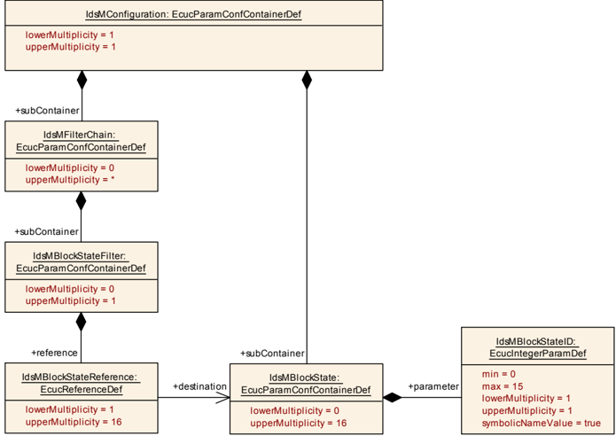

#### 9.1.27. IdsMContextDataModification

| SWS 条目 | [ECUC_IdsM_00064] |
|---|---|
| 容器名称 | IdsMContextDataModification |
| 父容器 | IdsMConfiguration |
| 描述 | 上下文数据修饰器调出的配置。 |
| Post-Build 变体多重性 | false |
| 多重性配置类 | Pre-compile time：x（All Variants）；Link time：-；Post-build time：- |
| 配置参数 | 见下方参数表 |

| SWS 条目 | [ECUC_IdsM_00072] |
|---|---|
| 参数名称 | IdsMGlobalContextDataHeaderFileIncludes |
| 父容器 | IdsMContextDataModification |
| 描述 | 包含上下文数据修饰器调出原型的可选头文件列表。 |
| 多重性 | 0..* |
| 类型 | EcucStringParamDef |
| 默认值 | - |
| 正则表达式 | - |
| Post-Build 变体多重性 | false |
| Post-Build 变体值 | false |
| 多重性配置类 | Pre-compile time：x；Link time：-；Post-build time：- |
| 值配置类 | Pre-compile time：x；Link time：-；Post-build time：- |
| 作用域/依赖 | scope: local |

| SWS 条目 | [ECUC_IdsM_00070] |
|---|---|
| 参数名称 | IdsMGlobalContextDataModifierCalloutFct |
| 父容器 | IdsMContextDataModification |
| 描述 | 全局上下文数据修饰器调出函数。该调出可以被事件特定的上下文数据修饰器调出覆盖。 |
| 多重性 | 0..1 |
| 类型 | EcucFunctionNameDef |
| 默认值 | - |
| 正则表达式 | - |
| Post-Build 变体多重性 | false |
| Post-Build 变体值 | false |
| 多重性配置类 | Pre-compile time：x；Link time：-；Post-build time：- |
| 值配置类 | Pre-compile time：x；Link time：-；Post-build time：- |
| 作用域/依赖 | scope: local |

| SWS 条目 | [ECUC_IdsM_00071] |
|---|---|
| 参数名称 | IdsMGlobalContextDataSizeModifier |
| 父容器 | IdsMContextDataModification |
| 描述 | 与全局上下文数据大小修饰器调出函数组合使用的全局上下文数据大小修饰器。 |
| 多重性 | 0..1 |
| 类型 | EcucIntegerParamDef |
| 范围 | -1499 .. 1499 |
| 默认值 | 0 |
| Post-Build 变体多重性 | false |
| Post-Build 变体值 | false |
| 多重性配置类 | Pre-compile time：x（All Variants）；Link time：-；Post-build time：- |
| 值配置类 | Pre-compile time：x（All Variants）；Link time：-；Post-build time：- |
| 作用域/依赖 | scope: local |

| 容器名称 | 多重性 | 作用域/依赖 |
|---|---|---|
| IdsMContextDataModifierCallout | 0..65535 | 事件特定的上下文数据修饰器调出的配置。 |

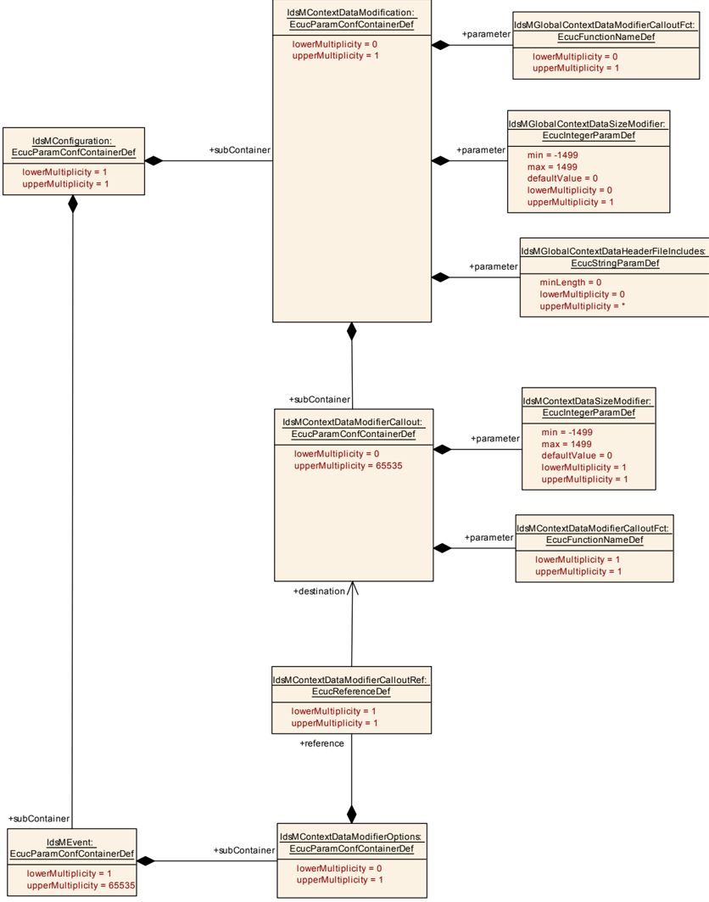

#### 9.1.28. IdsMContextDataModifierCallout

| SWS 条目 | [ECUC_IdsM_00065] |
|---|---|
| 容器名称 | IdsMContextDataModifierCallout |
| 父容器 | IdsMContextDataModification |
| 描述 | 事件特定的上下文数据修饰器调出的配置。 |
| Post-Build 变体多重性 | false |
| 多重性配置类 | Pre-compile time：x（All Variants）；Link time：-；Post-build time：- |
| 配置参数 | 见下方参数表 |

| SWS 条目 | [ECUC_IdsM_00067] |
|---|---|
| 参数名称 | IdsMContextDataModifierCalloutFct |
| 父容器 | IdsMContextDataModifierCallout |
| 描述 | 事件特定的上下文数据修饰器调出函数。如果配置了全局上下文数据修饰器调出，它可以被此事件特定的调出覆盖。 |
| 多重性 | 1 |
| 类型 | EcucFunctionNameDef |
| 默认值 | - |
| 正则表达式 | - |
| Post-Build 变体值 | false |
| 值配置类 | Pre-compile time：x（All Variants）；Link time：-；Post-build time：- |
| 作用域/依赖 | scope: local |

| SWS 条目 | [ECUC_IdsM_00066] |
|---|---|
| 参数名称 | IdsMContextDataSizeModifier |
| 父容器 | IdsMContextDataModifierCallout |
| 描述 | 与事件特定的上下文数据大小修饰器调出函数组合使用的事件特定上下文数据大小修饰器。 |
| 多重性 | 1 |
| 类型 | EcucIntegerParamDef |
| 范围 | -1499 .. 1499 |
| 默认值 | 0 |
| Post-Build 变体值 | false |
| 值配置类 | Pre-compile time：x（All Variants）；Link time：-；Post-build time：- |
| 作用域/依赖 | scope: local |

无包含的容器。

### 9.2. 配置约束

本节列出 **IdsM** 模块的配置约束。容器 **IdsMFilterChain** 的实例始终要求至少配置一个过滤器（**IdsMBlockStateFilter**、**IdsMForwardEveryNthFilter**、**IdsMEventAggregationFilter**、**IdsMEventThresholdFilter**）。

### 9.3. 发布信息

详情请参阅 [\[3\]](#ref-3)（**SWS BSW General**）中的第 10.3 章「Published Information」（发布信息）。

## A. AUTOSAR 可追溯项变更历史

**注意：**本章中的列表还包括在后续版本中已从规范中移除的可追溯项。这些项不会作为超链接出现在文档中。

### A.1. 本文档根据 AUTOSAR Release R23-11 的可追溯项历史

#### A.1.1. R23-11 中新增的规范项

表A.1：R23-11 中新增的规范项（**Added Specification Items in R23-11**）

| 编号 | 标题 |
|---|---|
| [SWS_IdsM_00907] | |
| [SWS_IdsM_00908] | |
| [SWS_IdsM_00909] | |
| [SWS_IdsM_00910] | |
| [SWS_IdsM_91032] | Definition of datatype IdsM_ExternalSecurityEventIdType |

#### A.1.2. R23-11 中变更的规范项

表A.2：R23-11 中变更的规范项（**Changed Specification Items in R23-11**）

| 编号 | 标题 |
|---|---|
| [SWS_IdsM_01110] | Truncation of timestamp parameter |
| [SWS_IdsM_91015] | Security events for IDSM |
| [SWS_IdsM_91024] | Definition of optional interfaces in module IdsM |

#### A.1.3. R23-11 中删除的规范项

无。

#### A.1.4. R23-11 中新增的约束

无。

#### A.1.5. R23-11 中变更的约束

无。

#### A.1.6. R23-11 中删除的约束

无。
