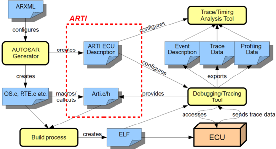
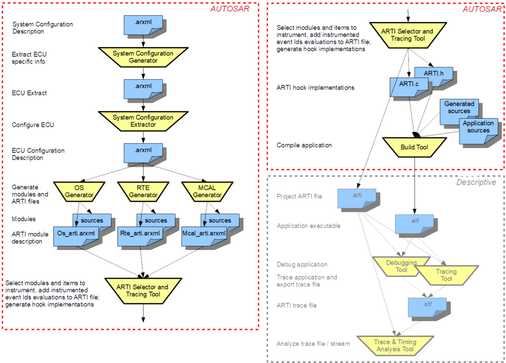
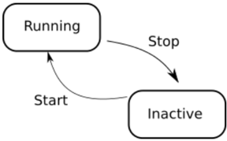
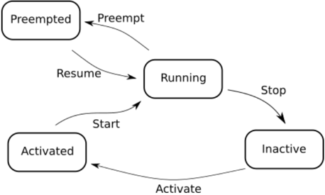
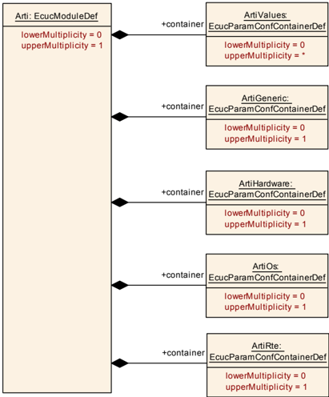
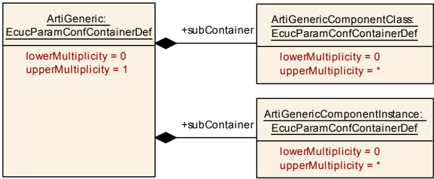
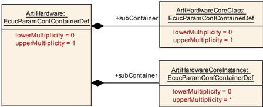
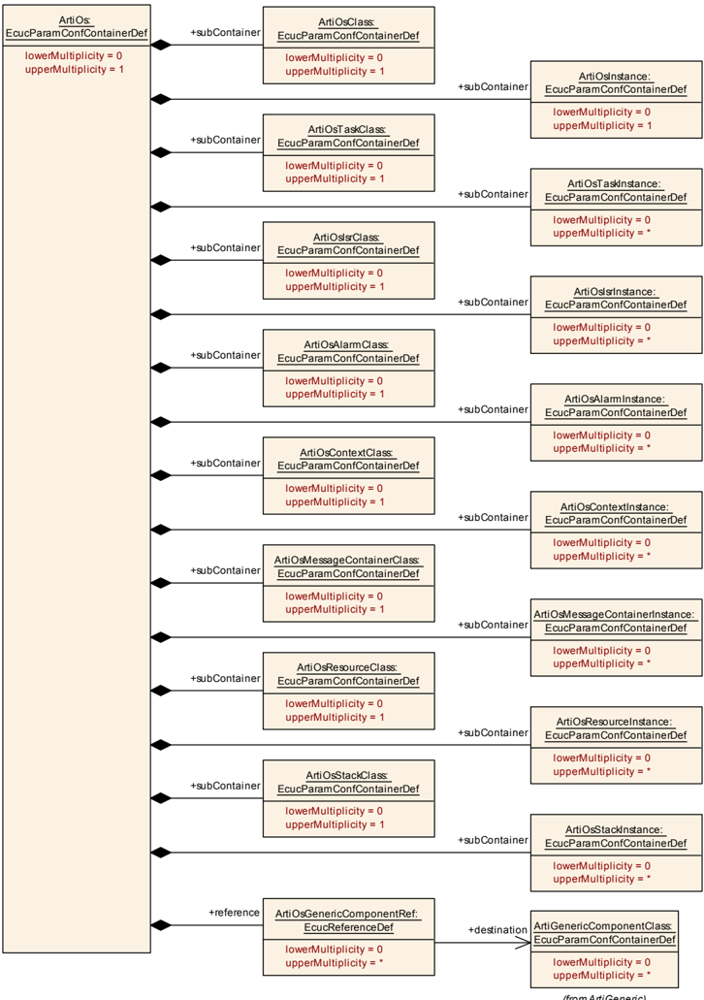
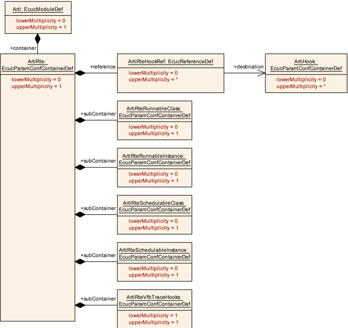
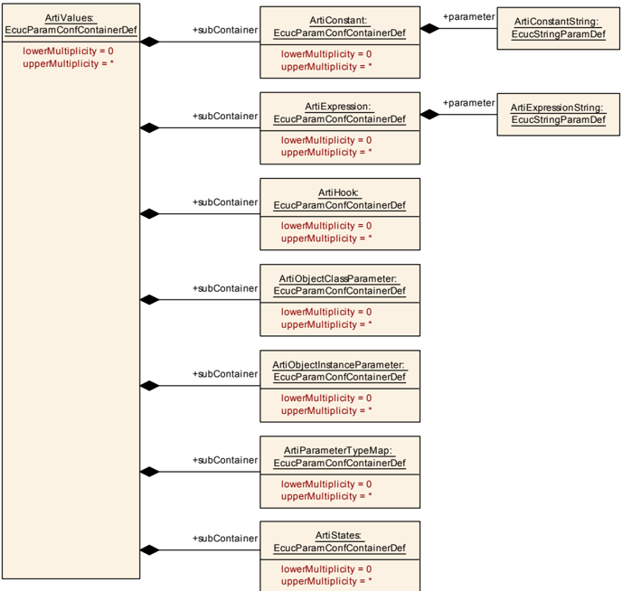

## 1. 简介和功能概述

本规范描述用于调试与追踪 **AUTOSAR** 模块的 **AUTOSAR** 运行时接口（**ARTI**，**AUTOSAR Run-Time Interface**）的功能、**API** 与配置。

**ARTI** 定义了构建工具与调试/追踪工具之间的接口。调试/追踪工具随后应把追踪信息转发给追踪/时序分析工具。该接口应简化并加速系统行为的调试、追踪与验证以及往返工程（**round-trip engineering**）。

调试与追踪使 **ECU** 软件的高效开发、集成、优化和验证成为可能。为了分析多个方面——尤其是时序方面——把调试与追踪数据关联到 **ECU** 的调度变得至关重要。这需要关于任务、中断和可运行实体的知识，换言之，需要对操作系统（**OS**）的感知（**OS awareness**）。

工具链的良好交互提供了从模型到硬件再返回的完整往返工程——覆盖多个软件层次和 **V** 模型的多个阶段。

**ARTI** 应尤其提供：

* 对"**OS** 感知"的支持，例如检查 **OS** 特定的任务、线程等
* 对分布式系统和多核的支持
* 对其他 **AUTOSAR** 模块的支持（例如 **CP** 中的 **RTE** 或 **AP** 中的 **ARA**）
* 对基于插桩（**instrumentation**）的追踪与测量方案的支持
* 对 **TIMEX** 的支持

各工具的数据流以及 **ARTI** 的接口描绘在图 1.1 中。



关于一些重要的定义，另请阅读 RS_FoundationDebugTraceProfile 的第 [1](#1-简介和功能概述) 章。

为实现这些特性，**ARTI** 采用了与以前的 **OSEK**-ORTI 类似的方法，并将其扩展到当前的需求。生成 **AUTOSAR** 模块（例如 **OS**、**RTE** 等）的工具必须用关于该模块的内部信息扩展 **ECU** 配置，并把扩展后的配置作为一个单独的文件（"**ARTI** 文件"）输出。其中的信息应允许对该模块的行为进行调试和追踪。附加工具将收集一个 **ECU** 的所有 **ARTI** 文件，并允许选择要追踪的特定条目、为特定的追踪通道（例如内部缓冲区、硬件追踪缓冲区等）创建追踪钩子文件。构建环境创建最终的应用程序，随后即可在 **ECU** 中使用。调试与追踪工具可以读入 **ARTI** 文件并且是"**AUTOSAR** 感知"的，为开发者提供额外的调试与追踪特性。这些工具可以导出追踪文件，后者又可用于追踪分析工具中进行扩展的时序分析、时间测量和优化运行。

使用标准化的工作流可以在必要时互换工具，并为每种方案使用最合适的工具，而无需改动工作流。

**ARTI** 文件的生成与使用的工作流描绘在图 1.2 中。**ARTI** 只应定义 **AUTOSAR** 应用构建过程内部的接口（即生成器的导出，以及 **AUTOSAR** 模块内部的钩子）。工具通信的接口是构建后的，不属于本规范的范围。



## 2. 缩略语

下面的术语表包含与 **ARTI** 模块相关的、[\[1, AUTOSAR 术语表\]](#ref-1)中未包含的缩略语和缩写。

**ORTI**
> "**OSEK Run Time Interface**"，一个 **OSEK** 规范（其版本 2.2），定义调试器如何访问 **OSEK OS** 的内部信息。

**Debugging（调试）**
> "调试"指把系统整体或部分地暂停，以便
> * 检查冻结状态下的系统内容
> * 在 **C** 或汇编代码中单步执行、设置断点、启动和停止

**Tracing（追踪）**
> "追踪"指在一定时间段内收集运行时信息
> * 或者作为纯软件方案，或者借助硬件辅助
> * 可以包括处理器指令追踪、**OS** 调度追踪和/或纯数据追踪
> * 包括用于后续时序分析的时间戳

**Timing Measurement（时序测量）**
> "时序测量"指捕获时序信息
> * 通过插桩，例如经由 Pre-/PostTaskHooks 或其他钩子或调出
> * 或通过专用的硬件支持，例如硬件性能计数器
> * 不停止执行

**Profiling（剖析）**
> "剖析"指获取时序参数/时序统计的过程
> * 针对函数、任务、可运行实体、模块等
> * 可能带有最小/最大/平均统计
> * 可能带有最坏情况分析
> * 可能由追踪数据、重复快照或时序测量计算得出

## 3. 相关文档

### 3.1. 输入文件和相关标准与规范

<a id="ref-1"></a>* [1] 术语表 AUTOSAR_FO_TR_Glossary
<a id="ref-2"></a>* [2] 操作系统规范 AUTOSAR_CP_SWS_OS
<a id="ref-3"></a>* [3] RTE 软件规范 AUTOSAR_CP_SWS_RTE

### 3.2. 相关规范

尚不适用。

## 4. 约束和假设

**ARTI** 概念预期从每个要被调试、追踪或剖析的模块（例如 **OS** 和 **RTE**）获得各自的 **ARTI** 模块描述。这使得可以把支持 **ARTI** 的模块与不支持 **ARTI** 的模块混合使用。但是，由于 **ARTI** 包含内部信息，模块的实现者必须提供 **ARTI** 文件。

### 4.1. 限制

**ARTI** 预期与编译器创建的调试信息一起工作。这意味着每个支持 **ARTI** 的模块都需要带调试信息编译，并且 **ARTI** 文件必须使用编译器创建的符号名。

**ARTI** 引入了新的钩子。为了使用它们，应把它们合并到模块的 **C** 代码中。它们既可以静态地放入其中，也可以按配置由生成器动态地放入其中。

追踪内部事件对时间非常敏感。**ARTI** 专注于对时序影响最小的方案（在某些情况下完全没有时序开销），但这取决于 **ECU** 和工具的硬件能力。**ARTI** 提供了一些示例，描述了依据可用的硬件和软件能力进行追踪的可能性（见附录 B）。

## 5. 对其他模块的依赖

**ARTI** 依赖于 **OS** 和 **RTE** 模块，后者为各自的目的精化 **ARTI** 描述和钩子。
## 6. 功能规格

**ARTI** 由以下功能元素组成：

* **ARTI** 模块描述
* **ARTI** 钩子实现

"**ARTI** 模块描述"预期以 **ARXML** 文件的形式输出。其他文件（如"project **ARTI** 文件"或"**ARTI** 追踪文件"）可以以另一种文件格式存储，而该格式超出 **AUTOSAR** 的范围，在别处定义。

**ARTI** 不是传统的创建代码并改变系统行为的软件模块。相反，**ARTI** 被显式设计为不影响整体系统行为。特别是 **ARTI** 模块描述的生成与导出预期不影响生成 **ARTI** 导出的模块；**ARTI** 应导出内部已经可获得的信息。导出的信息随后由进一步的调试与追踪工具进行后处理并使用。不过，可能有必要引入一些特殊的变量或函数才能生成所请求的信息。虽然这会对代码造成一些轻微影响，其意图仍然是不改变使用 **ARTI** 的模块的整体行为。对钩子而言也是如此：虽然钩子本身可能对代码库有一些轻微影响，且钩子实现（由消费 **ARTI** 的工具完成）可能对时序和程序流有一些影响，但 **ARTI** 的意图是尽可能少地改变模块行为——理想情况下完全不变。依据钩子实现的不同，行为可能有所不同。把对系统行为的影响降到最低是工具供应商的责任。

**ARTI** 的定义方式应使其适用于上路（**on the road**）运行。如果实现了 **ARTI** 钩子，这显然会带来关于钩子实现的高安全要求，因为例如某些 **ARTI** 钩子将在 **OS** 的上下文中执行。在多核上下文中必须特别小心。

如果钩子的实现无法保证安全执行，则 **ECU** 不得用于"上路"。"上路"在此指运行或失灵可能对人或财产造成危险的场合。

### 6.1. ARTI 模块描述

"**ARTI** 模块描述"是一个 **ARXML** 文件，包含关于特定模块（例如 **OS**、**RTE** 等）的详细信息。具体而言，它包含：

* 常量（**Constants**）

常量定义特定于该应用或环境的常量值。例如，**ECU** 中使用的 **CPU** 数量可以定义为一个常量。调试器使用常量来了解配置，或以便捷的方式显示该值。

常量由对象信息（见下文"对象信息"）引用，并且只在对象的上下文中才有意义。

一个常量由容器 `[ArtiConstant](#871-articonstant)` 表示（见 [8.7.1](#871-articonstant) 节）。

* 表达式（**Expressions**）

表达式定义调试器如何在目标上访问特定值以显示应用的当前状态。表达式类似于 **C** 表达式，但受限制以便可以静态求值。因此，表达式只允许访问全局变量，且只允许一元、二元和三元运算符。特别是，对局部变量的访问和对函数的调用是不允许的。表达式的完整语法规范见第 [10](#10-表达式语法) 章。

表达式由对象信息（见下文"对象信息"）引用，并用于定义其中参数值的求值。

一个表达式由容器 `[ArtiExpression](#872-artiexpression)` 表示（见 [8.7.2](#872-artiexpression) 节）。

* 钩子定义（**Hook definitions**）

钩子定义包含关于模块中存在哪些钩子及其形态的信息。这些钩子定义用于创建钩子实现，并追踪由该钩子定义的信息。

一个钩子定义由容器 `[ArtiHook](#873-artihook)` 表示（见 [8.7.3](#873-artihook) 节）。

* 对象信息（**Object information**）

模块内的对象（例如某个 `OsTask`）在 **ARTI** 模块描述中有自己的表示。对象信息包含对原始对象的引用，以及对该对象所使用的表达式和钩子的引用。特定种类的所有对象收集在一个容器中。对象在特定模块内的详细布局在相应的 **SWS** 中定义。

* 通用组件（**Generic components**）

**ARTI** 能够定义应在调试器中或追踪时显示的对象，即使这些对象不是标准的 **AUTOSAR** 对象（例如用户自定义的，或 **OS** 的附加特性如信号量）。见 [8.3](#83-arti-通用容器) 节。

### 6.2. ARTI 钩子实现

**ARTI** 钩子实现由消费 **ARTI** 描述文件的工具生成。它们主要由以下文件表示：

* `Arti.h`

该文件包含 `ARTI_TRACE` 宏实现。`ARTI_TRACE` 宏实现可以展开为模块相关的宏。

* `&lt;Mip&gt;_Arti.h` 该文件包含支持 **ARTI** 的模块中用于对特定事件进行插桩的所有模块相关宏。它也可以包含该宏的实现，或指向 `Arti.c` 中的一个实现。`&lt;Mip&gt;_Arti.h` 应在任何模块特定宏定义之前包含 `Arti.h`。

* `Arti.c`

该文件包含 **API**（见第 [7](#7-api规范) 章）的实现，以及每个宏的实际实现（如果它不为空、且未在 `&lt;Mip&gt;_Arti.h` 文件中实现）。

所有未激活的事件都将映射为空宏定义。所有激活的事件都将展开为插桩的实现。实际实现取决于追踪工具的硬件和软件能力。因此，宏如何实现取决于所使用的追踪工具。

**OS** 模块的示例：

**OS** 源代码将包含 `Os_Arti.h` 文件并使用 `ARTI_TRACE` 宏。

清单 7.1：示例：Os_Source.c

```c
#include "Os_Arti.h"
ARTI_TRACE(NOSUSP, GetTaskId(MyTask));
```

`Os_Arti.h` 文件（由工具供应商创建）将包含 `Arti.h` 并实现模块特定的宏。

清单 7.2：示例：Os_Arti.h

```c
#include "Arti.h"
extern volatile uint32_t arti_os_trace;
#define ARTI_TRACE_AR_CP_OS_TASK_OsTask_Activate(CoreId, TaskId) \
   arti_os_trace = (TaskId<<16) | (ARTI_VALID_OS_SIGNALING<<8) | \
   (ARTI_OSTASK_ACTIVATE<<8) | CoreId ;
```

`Arti.h` 文件（由工具供应商创建）将实现 `ARTI_TRACE` 宏并将其展开为模块特定的宏。

清单 7.3：示例：Arti.h

```c
#define ARTI_TRACE(_contextName, _className, _instanceName, \
   instanceParameter, _eventName, eventParameter) \
   ARTI_TRACE ## _ ## _className ## _ ## \
   _eventName((instanceParameter), (eventParameter))
```

`Arti.c` 文件将实现 **Arti API**（`[Arti_Init](#741-arti_init)()` 和 `[Arti_GetVersionInfo](#742-arti_getversioninfo)()`）以及实现追踪所需的任何其他代码。

清单 7.4：示例：Arti.c

```c
volatile uint32_t arti_os_trace;
void Arti_Init (void) {
   arti_os_trace = 0;
}
```

### 6.3. ARTI OS 实现

对 **OS** 的 **ARTI** 支持规定在[\[2, SWS OS, 第 7.16 章"ARTI Debug Information"\]](#ref-2)和[\[2, SWS OS, 第 7.17 章"ARTI Hook Macros"\]](#ref-2)中。它与[\[2, SWS OS, 第 12.8 章"Debug support"\]](#ref-2)中描述的应用说明相关。

### 6.4. ARTI RTE VFB 追踪客户端

**ARTI RTE VFB** 追踪客户端旨在把 **VFB** 追踪机制适配到 **ARTI** 追踪。**VFB** 追踪机制提供带参数的追踪钩子，而 **ARTI** 追踪聚焦于使用 `ARTI_TRACE` 宏的最小侵入追踪。

**ARTI** 基础软件模块实现 **VFB** 追踪的一个追踪客户端（见 AUTOSAR_SWS_RTE 第 5.11 章"VFB Tracing Reference"）。

它配置 **RTE** 为该追踪客户端生成钩子。这些钩子将映射到带专用 **ARTI** 追踪类别和事件的 `ARTI_TRACE` 宏。

该映射定义在 [7.7.2.5](#7725-arti-rte-vfb-追踪客户端) 节中。

限制：**ARTI** 只支持 **RTE VFB** 追踪客户端钩子的一个子集。因此，[RS_Arti_00041]"AUTOSAR 应支持记录来自标准化 **VFB** 追踪接口的事件"没有被完全满足和规定。**ARTI** 只支持：

* `Rte_Arti_Runnable_&lt;cts&gt;_&lt;reName&gt;_Start`
* `Rte_Arti_Runnable_&lt;cts&gt;_&lt;reName&gt;_Return`
* `Rte_Arti_&lt;api&gt;Hook_&lt;cts&gt;_&lt;ap&gt;_Start`
* `Rte_Arti_&lt;api&gt;Hook_&lt;cts&gt;_&lt;ap&gt;_Return`
* `SchM_Arti_Schedulable_&lt;bsnp&gt;_[&lt;vi&gt;_&lt;ai&gt;_]&lt;entityName&gt;_Start`
* `SchM_Arti_Schedulable_&lt;bsnp&gt;_[&lt;vi&gt;_&lt;ai&gt;_]&lt;entityName&gt;_Return`

#### 6.4.1. RTE VFB 追踪客户端配置

**RTE VFB** 追踪客户端配置分几步完成，其中 **RTE** 生成器与 **ARTI** 模块交互。配置参数在 **EcuC** 中交换。

1. **RTE** 配置在 **RTE** 配置之后提供 `/AUTOSAR/EcucDefs/Rte/RteSwComponentInstance`。
2. **ARTI** 创建一个名为"Arti"的自己的 **VFB** 追踪客户端，并使用它自己的 `/AUTOSAR/EcucDefs/Rte/RteGeneration/RteVfbTraceClient` 提供该追踪客户端的配置。在该容器中列出所有 `/AUTOSAR/EcucDefs/Rte/RteGeneration/RteVfbTraceClient/RteVfbTraceFunction`（见 AUTOSAR_SWS_RTE RteVfbTraceFunction），**ARTI** 模块为其请求生成钩子。这里 **ARTI** 填写该值，从而生成追踪某个钩子函数的"愿望清单"。例如：

   * 启用所有可调度实体钩子的追踪：`Rte_Arti_SchM`
   * 启用所有可运行实体钩子的追踪：`Rte_Arti_Runnable`
   * 启用某个组件的所有可运行实体钩子的追踪：`Rte_Arti_Runnable_MyComponentType`，其中 MyComponentType 取自 `/AUTOSAR/EcucDefs/Rte/RteSwComponentType`
   * 启用某个组件中某个可运行实体的可运行实体钩子的追踪：`Rte_Arti_Runnable_MyComponentType_MyRunnable`，其中 MyRunnable 取自 `/AUTOSAR/SoftwareTypes/ComponentTypes/&lt;ApplicationSwComponentType&gt;/&lt;SwcInternalBehavior&gt;/&lt;RunnableEntity&gt;`

   在 `RteVfbTraceClient` 容器内，添加一个 `RteVfbTraceHooksRef`，其 URI 指向 **ARTI** 追踪客户端的 `[ArtiRteVfbTraceHooks](#865-artirtevfbtracehooks)` 容器。
3. 基于该配置，**RTE** 生成器创建包含追踪钩子的源文件。生成的钩子是 `BSW-MODULE-ENTRY`，其 `FUNCTION-PROTOTYPE-EMITTER` 为"Arti"。
4. **ARTI** 生成器基于用于 **ARTI** 追踪客户端的 `BSW-MODULE-ENTRY` 创建最终的追踪客户端。它：

   * 生成用于把 **VFB** 追踪钩子映射到 `ARTI_TRACE` 宏的头文件。所有未使用的生成钩子都映射到 `(void)`。作为映射的一部分，**ARTI** 模块需要提供可运行实体到 RunnableId 的映射（见 [7.7.2.5](#7725-arti-rte-vfb-追踪客户端) 节，`idOf(&lt;reName&gt;)`）。
   * 用缺失的信息更新 **RTE** 的 **BSWMD**：
     * 把每个 arti 钩子作为函数（以 SW-ADDR-METHOD-REF CODE 标记）扩展到 **RTE** 的 `BswInternalBehavior` 中；
     * 用正确的 SW-SERVICE-IMPL-POLICY（`MACRO`、`INLINE` 或 `STANDARD`）扩展每个钩子的 `BSW-MODULE-ENTRY`；
     * 把实现这些钩子的 REQUIRED-ARTIFACTS 添加到 **BSWIMPLEMENTATION** 中；
     * 通过添加保存所有钩子的 EXECUTABLE-ENTITY-REFS 的 **ARTI MEMORYSECTION** 并为所需工件添加 SECTION-NAME-PREFIX 来规定 RESOURCE-CONSUMPTION。
5. 编译 **RTE**。

**示例 7.1**：

1. **RTE** 提供 `/AUTOSAR/EcucDefs/Rte/RteSwComponentInstance`

```xml
<ECUC-CONTAINER-VALUE UUID="cd307f8d-8496-421b-a9e8-571463b08250">
  <SHORT-NAME>ConsumerComponent</SHORT-NAME>
  <DEFINITION-REF DEST="ECUC-PARAM-CONF-CONTAINER-DEF">
    /AUTOSAR/EcucDefs/Rte/RteSwComponentInstance
  </DEFINITION-REF>
  ...
</ECUC-CONTAINER-VALUE>
```

2. **ARTI** 创建 **VFB** 追踪客户端

```xml
<ECUC-CONTAINER-VALUE UUID="6de0bb4e-c1ff-4c6c-ae19-3a0f536e7e9e">
  <SHORT-NAME>Arti</SHORT-NAME>
  <DEFINITION-REF DEST="ECUC-PARAM-CONF-CONTAINER-DEF">
    /AUTOSAR/EcucDefs/Rte/RteGeneration/RteVfbTraceClient
  </DEFINITION-REF>
  <PARAMETER-VALUES>
    <ECUC-TEXTUAL-PARAM-VALUE>
      <DEFINITION-REF DEST="ECUC-FUNCTION-NAME-DEF">
        /AUTOSAR/EcucDefs/Rte/RteGeneration/
        RteVfbTraceClient/RteVfbTraceFunction
      </DEFINITION-REF>
      <VALUE>Rte_Arti_Runnable_ConsumerComponent</VALUE>
    </ECUC-TEXTUAL-PARAM-VALUE>
    ...
  </PARAMETER-VALUES>
</ECUC-CONTAINER-VALUE>
```

3. 基于该配置，**RTE** 生成器创建源文件

```xml
<BSW-MODULE-ENTRY>
  <SHORT-NAME>
    Rte_Arti_Runnable_ConsumerComponent_RE2_Return
  </SHORT-NAME>
  <FUNCTION-PROTOTYPE-EMITTER> Arti </FUNCTION-PROTOTYPE-EMITTER>
  <CALL-TYPE> CALLBACK </CALL-TYPE>
</BSW-MODULE-ENTRY>
<BSW-MODULE-ENTRY>
  <SHORT-NAME>
    Rte_Arti_Runnable_ConsumerComponent_RE2_Start
  </SHORT-NAME>
  <FUNCTION-PROTOTYPE-EMITTER> Arti </FUNCTION-PROTOTYPE-EMITTER>
  <CALL-TYPE> CALLBACK </CALL-TYPE>
</BSW-MODULE-ENTRY>
```

4. **ARTI** 生成器用缺失的信息更新 **RTE** 的 **BSWMD**：

   用每个 arti 钩子扩展 **RTE** 的 `BswInternalBehavior`：

```xml
<BSW-CALLED-ENTITY>
  <SHORT-NAME>
    Rte_Arti_Runnable_ConsumerComponent_RE2_Start
  </SHORT-NAME>
  <MINIMUM-START-INTERVAL> 0.0 </MINIMUM-START-INTERVAL>
  <SW-ADDR-METHOD-REF DEST="SW-ADDR-METHOD">
    /AUTOSAR_MemMap/SwAddrMethods/CODE
  </SW-ADDR-METHOD-REF>
  <IMPLEMENTED-ENTRY-REF DEST="BSW-MODULE-ENTRY"
      BASE="Rte_BSWMD_BswModuleEntrys">
    Rte_Arti_Runnable_ConsumerComponent_RE2_Start
  </IMPLEMENTED-ENTRY-REF>
</BSW-CALLED-ENTITY>
<BSW-CALLED-ENTITY>
  <SHORT-NAME>
    Rte_Arti_Runnable_ConsumerComponent_RE2_Return
  </SHORT-NAME>
  <MINIMUM-START-INTERVAL> 0.0 </MINIMUM-START-INTERVAL>
  <IMPLEMENTED-ENTRY-REF DEST="BSW-MODULE-ENTRY"
      BASE="Rte_BSWMD_BswModuleEntrys">
    Rte_Arti_Runnable_ConsumerComponent_RE2_Return
  </IMPLEMENTED-ENTRY-REF>
</BSW-CALLED-ENTITY>
```

   扩展 `BSW-MODULE-ENTRY`：

```xml
<BSW-MODULE-ENTRY>
  <SHORT-NAME> Rte_Arti_Runnable_ConsumerComponent_RE2_Return </SHORT-NAME>
  <FUNCTION-PROTOTYPE-EMITTER> Arti </FUNCTION-PROTOTYPE-EMITTER>
  <CALL-TYPE> CALLBACK </CALL-TYPE>
  <SW-SERVICE-IMPL-POLICY> INLINE </SW-SERVICE-IMPL-POLICY>
</BSW-MODULE-ENTRY>
<BSW-MODULE-ENTRY>
  <SHORT-NAME> Rte_Arti_Runnable_ConsumerComponent_RE2_Start </SHORT-NAME>
  <FUNCTION-PROTOTYPE-EMITTER> Arti </FUNCTION-PROTOTYPE-EMITTER>
  <CALL-TYPE> CALLBACK </CALL-TYPE>
  <SW-SERVICE-IMPL-POLICY> INLINE </SW-SERVICE-IMPL-POLICY>
</BSW-MODULE-ENTRY>
```

   添加 REQUIRED-ARTIFACTS：

```xml
<BSW-IMPLEMENTATION>
  <SHORT-NAME> Rte </SHORT-NAME>
  <PROGRAMMING-LANGUAGE> C </PROGRAMMING-LANGUAGE>
  <REQUIRED-ARTIFACTS>
    <DEPENDENCY-ON-ARTIFACT>
      <SHORT-NAME> Rte_Hook_Arti.h </SHORT-NAME>
      <CATEGORY> MEMMAP </CATEGORY>
      <ARTIFACT-DESCRIPTOR>
        <SHORT-LABEL> Rte_Hook_Arti.h </SHORT-LABEL>
        <CATEGORY> SWHDR </CATEGORY>
      </ARTIFACT-DESCRIPTOR>
      <USAGES>
        <USAGE> COMPILE </USAGE>
      </USAGES>
    </DEPENDENCY-ON-ARTIFACT>
    ...
  </REQUIRED-ARTIFACTS>
  ...
</BSW-IMPLEMENTATION>
```

   规定 RESOURCE-CONSUMPTION：

```xml
<RESOURCE-CONSUMPTION>
  ...
  <MEMORY-SECTION>
    <SHORT-NAME> RTE_Arti_CODE </SHORT-NAME>
    <EXECUTABLE-ENTITY-REFS>
      <EXECUTABLE-ENTITY-REF DEST="BSW-CALLED-ENTITY"
          BASE="Rte_BSWMD_BswModuleDescriptions">
        Rte/RteInternalBehavior/
        Rte_Arti_Runnable_ConsumerComponent_RE2_Return
      </EXECUTABLE-ENTITY-REF>
      <EXECUTABLE-ENTITY-REF DEST="BSW-CALLED-ENTITY"
          BASE="Rte_BSWMD_BswModuleDescriptions">
        Rte/RteInternalBehavior/
        Rte_Arti_Runnable_ConsumerComponent_RE2_Start
      </EXECUTABLE-ENTITY-REF>
    </EXECUTABLE-ENTITY-REFS>
    <PREFIX-REF DEST="SECTION-NAME-PREFIX"
        BASE="Rte_BSWMD_BswImplementations">
      Rte/ResConsumption/RTE_Arti
    </PREFIX-REF>
    <SW-ADDRMETHOD-REF DEST="SW-ADDR-METHOD">
      /AUTOSAR_MemMap/SwAddrMethods/CODE
    </SW-ADDRMETHOD-REF>
    <SYMBOL> CODE </SYMBOL>
  </MEMORY-SECTION>
  ...
</RESOURCE-CONSUMPTION>
```

### 6.5. 错误分类

《基础软件模块通用规范》的 7.x 节"错误处理"详细描述了基础软件的错误处理。最重要的是，它构成了一个由五种错误类型组成的分类方案，这些错误类型可能出现在 **BSW** 模块中。

基于此基础，以下各节规定特定的错误，并安排在下面的相应小节中。

#### 6.5.1. 开发错误

**SWS_Arti_91002**（模块 Arti 开发错误的定义）：

| 错误类型 | 相关错误码 | 错误值 |
| --- | --- | --- |
| **ARTI** 模块初始化失败 | `ARTI_E_INIT_FAILED` | 0x01 |
| **API** 参数检查：无效指针 | `ARTI_E_PARAM_POINTER` | 0x02 |

#### 6.5.2. 运行时错误

没有运行时错误。

#### 6.5.3. 瞬态故障

没有瞬态故障。

#### 6.5.4. 生产错误

没有生产错误。

#### 6.5.5. 扩展的生产错误

没有扩展的生产错误。
## 7. API规范

### 7.1. 导入的类型

在本章中列出从以下模块包含的所有类型：

**SWS_Arti_91006**（模块 Arti 导入数据类型的定义）：

| 模块 | 头文件 | 导入的类型 |
| --- | --- | --- |
| Std | `Std_Types.h` | `Std_VersionInfoType` |

### 7.2. 类型定义

**ARTI** 不添加任何类型定义。

### 7.3. 符号定义

#### 7.3.1. ARTI_STOPWATCH_FLAT, ARTI_STOPWATCH_NESTED

**SWS_Arti_91000**（数据类型 ARTI_STOPWATCH_FLAT, ARTI_STOPWATCH_NESTED 的定义）：

| 名称 | ARTI_STOPWATCH_FLAT, ARTI_STOPWATCH_NESTED |
| --- | --- |
| 种类 | 枚举 |
| 取值范围 | `ARTI_STOPWATCH_FLAT`：0x00u——秒表忽略嵌套。<br>`ARTI_STOPWATCH_NESTED`：0x01u——秒表考虑嵌套。 |
| 描述 | 该值定义秒表的启动与停止事件如何被求值。符号 `ARTI_STOPWATCH_FLAT` 和 `ARTI_STOPWATCH_NESTED` 应按如下方式定义：`#define ARTI_STOPWATCH_FLAT 0x00u`、`#define ARTI_STOPWATCH_NESTED 0x01u` |
| 可用头文件 | `Arti.h` |

### 7.4. 函数定义

#### 7.4.1. Arti_Init

**SWS_Arti_91004**（**API** 函数 Arti_Init 的定义）：

**说明**：

| 服务名 | `Arti_Init` |
| --- | --- |
| 语法 | `void Arti_Init ( void )` |
| 服务 ID [hex] | 0x00 |
| 同步/异步 | 同步 |
| 可重入性 | 不可重入 |
| 输入参数 | 无 |
| 输入输出参数 | 无 |
| 输出参数 | 无 |
| 返回值 | 无 |
| 描述 | 初始化 **ARTI** 模块的服务 |
| 可用头文件 | `Arti.h` |

签名：

```c
void Arti_Init(void)
```

`Arti_Init` 的实现应由实现 **ARTI** 钩子的工具供应商提供。

**SWS_Arti_00009**：如果初始化失败，函数 `Arti_Init` 应引发错误 `[ARTI_E_INIT_FAILED](#651-开发错误)`。见 **SWS_Arti_91002**。

#### 7.4.2. Arti_GetVersionInfo

**SWS_Arti_91005**（**API** 函数 Arti_GetVersionInfo 的定义）：

**说明**：

| 服务名 | `Arti_GetVersionInfo` |
| --- | --- |
| 语法 | `void Arti_GetVersionInfo ( Std_VersionInfoType* VersionInfoPtr )` |
| 服务 ID [hex] | 0x01 |
| 同步/异步 | 同步 |
| 可重入性 | 可重入 |
| 输入参数 | 无 |
| 输入输出参数 | 无 |
| 输出参数 | `VersionInfoPtr`：指向存储本模块版本信息的位置的指针 |
| 返回值 | 无 |
| 描述 | 返回本模块的版本信息。 |
| 可用头文件 | `Arti.h` |

`Arti_GetVersionInfo` 的实现应由实现 **ARTI** 钩子的工具供应商提供。

**SWS_Arti_00010**：如果参数 `VersionInfoPtr` 是空指针，函数 `Arti_GetVersionInfo` 应引发错误 `[ARTI_E_PARAM_POINTER](#651-开发错误)`。见 **SWS_Arti_91002**。

### 7.5. 回调通知

**ARTI** 不提供任何回调通知。

### 7.6. 调度函数

**ARTI** 没有任何由基础软件调度器直接调用的函数。

### 7.7. 期望接口

在本章中列出从其他模块需要的所有接口。

#### 7.7.1. 强制接口

##### 7.7.1.1. ARTI 追踪宏

**SWS_Arti_00017**（**ARTI** 追踪宏参数）：**ARTI** 追踪宏应接受一组定义宏语义的参数。

**ARTI** 追踪宏被所有具有 **ARTI** 追踪能力的模块使用，因此基于 **ARTI** 的插桩可以在全局层级轻松禁用。

**SWS_Arti_00018**（**ARTI** 追踪宏格式（单事件））：如果要追踪的事件接受单个事件参数，则 **ARTI** 应使用单事件参数版本。

```
ARTI_TRACE(_contextName, _className, _instanceName, instanceParameter, _eventName, eventParameter)
```

如果规定了更多事件参数，则使用 [7.7.1.2](#7712-带多参数的-arti-追踪宏) 节中规定的多事件参数版本。

**注意：** 虽然 **MISRA-C** 规则可能建议不使用类函数宏，但这里有意规定使用宏以改善运行时行为。另见 [SRS_BSW_00330]。

**注意：** **ARTI** 追踪宏在宏调用中不应包含任何 **BSW** 模块 **API** 作为参数，因为宏展开不保证对 **API** 调用的正确求值。在 **ARTI** 宏的实现内，如果它调用 **BSW** 模块 **API**，则必须特别注意嵌套和可能的递归。

一些参数以记号（**token**，字面文本）而非符号标识符的形式传入。这允许宏定义把这些参数拼接成更具体、更高效的宏。在运行时把所有参数作为符号标识符传递并求值的代价非常高，尤其是在运行时消耗方面。

以下是通用 `ARTI_TRACE` 宏的一种可能实现：

```c
#define ARTI_TRACE( _contextName, _className, _instanceName, \
   instanceParameter, _eventName, eventParameter) \
   ARTI_TRACE ## _ ## _className ## _ ## _instanceName \
   ## _ ## _eventName ## _ ## _contextName \
   ( (instanceParameter), (eventParameter) )
```

这样的实现会为 `_contextName`、`_className`、`_instanceName` 和 `_eventName` 的所有可能组合生成一个钩子，并且只在运行时传递参数 `instanceParameter` 和 `eventParameter`。各参数的含义描述如下。

* `_contextName`：记号，字面文本，上下文的名称。以下之一：
  * `NOSUSP`——表示该钩子在一个中断被禁用的上下文中被调用
  * `SPRVSR`——表示被调用的钩子在此调用期间可能禁用中断。不得使用 **OS** 函数来禁用中断。禁用中断会影响运行时行为。
  * `USER`——表示被调用的钩子自身不能禁用中断。如果需要禁用中断，必须使用相应的 **OS** 函数。禁用中断会影响运行时行为。
* `_className`：记号，字面文本，宏类别的名称。类别可以是预定义类别（例如 `AR_CP_OS_TASK`）或用户自定义。预定义类别规定在相应 **BSW** 模块（例如 SWS_OS）的 **SWS** 中。
* `_instanceName`：一个实例的名称。
* `instanceParameter`：索引 [uint32] 0..4294967295，表示特定 `_className` 和 `_instanceName` 的实例的索引，索引应从 0 开始并按 `_instanceName` 连续编号。
* `_eventName`：记号，字面文本，为特定类别定义的事件名称（例如 `OsTask_Start`）。
* `eventParameter`：一个 [uint32] 0..4294967295 值，作为事件的参数（例如任务索引）。

所有应支持 **ARTI** 追踪的模块都应使用模块特定的参数添加对该宏的调用。

标记为"记号，字面文本"的参数不能是：

* **C** 宏
* 变量
* 常量
* 枚举

这些参数预期由 **C** 预处理器进行记号拼接（**token concatenation**），或者由追踪工具提供者（`&lt;Mip&gt;_Arti.h` 和 `Arti.h` 的提供者）选择依据追踪工具把这些记号映射到 `&lt;Mip&gt;_Arti.h` 中的符号。

**示例：**

`_className` 为 `AR_CP_OS_TASK` 的示例，其中 `_instanceParameter` 指定核 ID，`_eventParameter` 指定任务 ID：

* 1 个 **OS**、2 个核：**OS** 短名称为 `OsA`，该 **OS** 管理三个物理 **CPU** 核。

```c
ARTI_TRACE(NOSUSP, AR_CP_OS_TASK, OsA, 0, OsTask_Start, 0); /* OS OsA start of Task with index 0 on it's own Core 0 */
ARTI_TRACE(NOSUSP, AR_CP_OS_TASK, OsA, 1, OsTask_Start, 0); /* OS OsA start of Task with index 0 on it's own Core 1 */
```

* 2 个 **OS**、1 个物理核：**OS** 短名称为 `OsA` 和 `OsB`，两者运行在同一个物理 **CPU** 核上（例如虚拟机监控器）。

```c
ARTI_TRACE(NOSUSP, AR_CP_OS_TASK, OsA, 0, OsTask_Start, 0); /* OS OsA start of Task with index 0 on it's own Core 0 */
ARTI_TRACE(NOSUSP, AR_CP_OS_TASK, OsB, 0, OsTask_Start, 0); /* OS OsB start of Task with index 0 on it's own Core 0 */
```

* 2 个 **OS**、4 个核：**OS** 短名称为 `OsA` 和 `OsB`，每个 **OS** 管理两个物理 **CPU** 核。

```c
ARTI_TRACE(NOSUSP, AR_CP_OS_TASK, OsA, 0, OsTask_Start, 0); /* OS OsA start of Task with index 0 on it's own Core 0 */
ARTI_TRACE(NOSUSP, AR_CP_OS_TASK, OsA, 1, OsTask_Start, 0); /* OS OsA start of Task with index 0 on it's own Core 1 */
ARTI_TRACE(NOSUSP, AR_CP_OS_TASK, OsB, 0, OsTask_Start, 0); /* OS OsB start of Task with index 0 on it's own Core 0 */
ARTI_TRACE(NOSUSP, AR_CP_OS_TASK, OsB, 1, OsTask_Start, 0); /* OS OsB start of Task with index 0 on it's own Core 1 */
```

* 2 个 **OS**、各 2 个虚拟核、3 个物理核：**OS** 短名称为 `OsA` 和 `OsB`，每个 **OS** 管理两个虚拟 **CPU** 核（例如虚拟机监控器管理这三个物理 **CPU** 核）。

```c
ARTI_TRACE(NOSUSP, AR_CP_OS_TASK, OsA, 0, OsTask_Start, 0); /* OS OsA start of Task with index 0 on it's own Core 0 */
ARTI_TRACE(NOSUSP, AR_CP_OS_TASK, OsA, 1, OsTask_Start, 0); /* OS OsA start of Task with index 0 on it's own Core 1 */
ARTI_TRACE(NOSUSP, AR_CP_OS_TASK, OsB, 0, OsTask_Start, 0); /* OS OsB start of Task with index 0 on it's own Core 0 */
ARTI_TRACE(NOSUSP, AR_CP_OS_TASK, OsB, 1, OsTask_Start, 0); /* OS OsB start of Task with index 0 on it's own Core 1 */
```

* `AMODULE`——一个用户定义的类别，具有名为 AModule1 的单个实例。

```c
ARTI_TRACE(SPRVSR, AMODULE, AModule1, 0, Thing_Start, 123);
```

##### 7.7.1.2. 带多参数的 ARTI 追踪宏

如果一个事件接受多于一个参数，则 [7.7.1.1](#7711-arti-追踪宏) 节中的所有规定都适用，以下项除外。

**SWS_Arti_00019**（**ARTI** 追踪宏格式（多事件））：如果要追踪的事件接受多于一个参数，则 **ARTI** 应使用多事件参数版本。

```
ARTI_TRACE_N(_contextName, _className, _instanceName, instanceParameter, _eventName, numEventParameters, ...)
```

事件参数的含义描述如下。

`numEventParameters`：一个整数值，定义在事件参数列表中给出了多少个参数。

* `...`（省略号）：以逗号分隔的事件参数列表。事件参数通过引用相应的 `BswModuleEntry` 在 `[ArtiHook](#873-artihook)` 配置容器中规定（见 [8.7.3](#873-artihook) 节）。

该宏的布局允许宏定义把宏参数拼接成更具体、更高效的宏。以下是通用 `ARTI_TRACE_N` 宏的一种可能实现：

```c
#define ARTI_TRACE_N( _contextName, _className, _instanceName, \
   instanceParameter, _eventName, \
   _enventParameterCount, ...) \
   ARTI_TRACE_ ## _enventParameterCount( _contextName, _className, \
   _instanceName, instanceParameter, _eventName, \
   __VA_ARGS__ )
#define ARTI_TRACE_2( _contextName, _className, _instanceName, \
   instanceParameter, _eventName, \
   eventParameter1, eventParameter2) \
   ARTI_TRACE ## _ ## _className ## _ ## _instanceName \
   ## _ ## _eventName ## _2 (instanceParameter, \
   eventParameter1, eventParameter2)
```

使用上述宏展开的示例：

```c
#define ARTI_TRACE_AR_CP_RTE_API_SoAd_IfTransmit_Start_2 \
   ( coreId, portId, data ) \
   arti_rteapi_trace = (portId << 16) | (1 << 8) | coreId;
#define ARTI_TRACE_AR_CP_RTE_API_SoAd_IfTransmit_Return_2 \
   ( coreId, portId, data ) \
   arti_rteapi_trace = (portId << 16) | (2 << 8) | coreId;

void Rte_ReadHook_SoAd_Port1_IfTransmit_Start(int data) {
   ARTI_TRACE_N(USER, AR_CP_RTE_API, SoAd, coreId,
      IfTransmit_Start, 2, 1, data);
}
void Rte_ReadHook_SoAd_Port2_IfTransmit_Return(int data) {
   ARTI_TRACE_N(USER, AR_CP_RTE_API, SoAd, coreId,
      IfTransmit_Return, 2, 1, data);
}
```

#### 7.7.2. 可选接口

本节定义实现本模块可选功能所需的所有接口。

##### 7.7.2.1. ARTI 通用秒表

**SWS_Arti_00001**（定义 USER_STOPWATCH）：**ARTI** 应定义一个用于追踪一个启动事件与一个停止事件之间的任意区间的追踪类别，称为 `USER_STOPWATCH`。

秒表（**stopwatch**）可用于对应用中两个用户自定义点之间的时间进行计时。用户可以把 `USER_STOPWATCH` 类别的相应 `ARTI_TRACE` 宏调用放在代码的任何位置。通过使用不同的实例名称（`_instanceName`）支持任意数量的秒表。请注意，追踪工具提供者可能会对活动秒表的数量施加限制。

通用秒表提供扁平追踪（忽略循环出现的启动/停止事件和任务上下文）与嵌套追踪（考虑嵌套的启动/停止事件和任务上下文）两种方式。

**嵌套秒表（Nested Stopwatch）：**

如果 `instanceParameter` 设置为 `ARTI_STOPWATCH_NESTED`，则追踪秒表的追踪工具应考虑嵌套。应测量属于同一嵌套层级、且属于发出该事件的同一任务的 Start 与 Stop 事件之间的时间。

任务上下文应通过按 SWS_OS 的"ARTI Hook Macros"一章的规定追踪 **OS** 任务和 Cat2Isr 来推导。请注意，已启动的嵌套秒表不能在另一个任务中停止。

嵌套秒表的典型用例是函数追踪。

**扁平秒表（Flat Stopwatch）：**

如果 `instanceParameter` 设置为 `ARTI_STOPWATCH_FLAT`，则追踪工具应忽略嵌套。追踪工具至少应考虑给定序列中第一个 Start 事件与第一个 Stop 事件之间的时间，而不需要考虑嵌套的 Start 与 Stop 事件。例如：

1. Start
2. Start（忽略，已启动）
3. Stop
4. Stop（忽略，没有匹配的 START）
5. Start
6. Stop

只考虑加粗的事件，时间在 1 与 3 之间、以及 5 与 6 之间计算。

**注意：** 未定义秒表是否考虑核。秒表能否跨越核、还是绑定到特定核，取决于实现。

**SWS_Arti_00002**（宏 USER_STOPWATCH）：`USER_STOPWATCH` 类别的 **ARTI** 宏应编译为以下模板之一：

```
ARTI_TRACE(_contextName, _className, _instanceName, instanceParameter, _eventName, eventParameter);
ARTI_TRACE_N(_contextName, _className, _instanceName, instanceParameter, _eventName, numEventParameters, ...);
```

| 参数 | 类型 | 描述 |
| --- | --- | --- |
| `_contextName` | 记号，字面文本 | 见 [7.7.1.1](#7711-arti-追踪宏) 节 |
| `_className` | 记号，字面文本 | `USER_STOPWATCH` |
| `_instanceName` | 记号，字面文本 | 标识秒表实例的值 |
| `instanceParameter` | uint32 | 忽略嵌套时为 `ARTI_STOPWATCH_FLAT`；考虑嵌套时为 `ARTI_STOPWATCH_NESTED` |
| `_eventName` | 记号，字面文本 | 标识定时器事件的值，`Start` 或 `Stop` 之一 |
| `numEventParameter` | uint32 | 给出的事件参数数量 |
| `eventParameter` 或 "..." | —— | 任意事件参数 |

可以通过在 `[ArtiHook](#873-artihook)` 容器的 `ArtiHookAssociatedFunction` 和 `ArtiHookFileName` 属性中提供函数名与文件名，把一个通用秒表与一个 **C** 函数关联。

**示例 8.1**：

**扁平秒表**

```c
ARTI_TRACE(USER, USER_STOPWATCH, myStopwatch, ARTI_STOPWATCH_FLAT, Start, 0);
ARTI_TRACE(USER, USER_STOPWATCH, myStopwatch, ARTI_STOPWATCH_FLAT, Stop , 0);
```

**示例 8.2**：

**嵌套秒表**

```c
static int myFunction (int par1)
{
   int ret;
   ARTI_TRACE_N (USER, USER_STOPWATCH, myArbFunction1, ARTI_STOPWATCH_NESTED, Start, 1, par1);
   do_something_1();
   ARTI_TRACE_N (USER, USER_STOPWATCH, myArbStopWatch1, ARTI_STOPWATCH_NESTED, Start, 1, myVar);
   ret = do_something_2();
   ARTI_TRACE_N (USER, USER_STOPWATCH, myArbStopWatch1, ARTI_STOPWATCH_NESTED, Stop, 1, myVar);
   do_something_3();
   ARTI_TRACE_N (USER, USER_STOPWATCH, myArbFunction1, ARTI_STOPWATCH_NESTED, Stop, 1, ret);
   return ret;
}
```

##### 7.7.2.2. ARTI 通用数据流秒表

**SWS_Arti_00003**（定义 USER_DATAFLOW_STOPWATCH）：**ARTI** 应定义一个用于追踪一个启动事件与多个停止事件之间的任意区间、以提供对数据流洞察的追踪类别，称为 `USER_DATAFLOW_STOPWATCH`。

数据流秒表可用于对对给定变量的写访问与读访问之间的时间进行计时。用户可以把 `USER_DATAFLOW_STOPWATCH` 类别的相应 `ARTI_TRACE` 宏调用放在代码的任何位置。通过使用不同的实例名称（`_instanceName`）支持任意数量的数据流秒表。请注意，追踪工具提供者可能会对活动数据流秒表的数量施加限制。

追踪工具至少应考虑给定序列中最后一个 Write 事件、第一个 Read 与最后一个 Read 事件之间的时间，而不需要考虑嵌套的 Write 与 Read 事件。例如：

1. Write（忽略，它在 2 中被覆盖）
2. Write
3. Read
4. Write
5. Read（最小）
6. Read（忽略，如果只考虑最小与最大）
7. Read（最大）

只考虑加粗的事件，时间在 2 与 3 之间、以及 4 与 5/7 之间计算。4 与 5 之间的时间给出第二序列的最小数据年龄时间，同样，4 与 7 之间的时间给出第二序列的最大数据年龄时间。

**SWS_Arti_00004**（宏 USER_DATAFLOW_STOPWATCH）：`USER_DATAFLOW_STOPWATCH` 类别的 **ARTI** 宏应编译为以下模板：

`ARTI_TRACE(_contextName, _className, _instanceName, instanceParameter, _eventName, eventParameter);`

| 参数 | 类型 | 描述 |
| --- | --- | --- |
| `_contextName` | 记号，字面文本 | 见 [7.7.1.1](#7711-arti-追踪宏) 节 |
| `_className` | 记号，字面文本 | `USER_DATAFLOW_STOPWATCH` |
| `_instanceName` | 记号，字面文本 | 标识数据流秒表实例的值 |
| `instanceParameter` | uint32 | 未使用，应设置为 0 |
| `_eventName` | 记号，字面文本 | 标识定时器事件的值，`Write` 或 `Read` 之一 |
| `eventParameter` | uint32 | 未使用，应设置为 0 |

**示例 8.3**：

```c
ARTI_TRACE(USER, USER_DATAFLOW_STOPWATCH, myDataflowStopwatch, 0, Write , 0);
myVariable = 1;
...
uint32 temp = myVariable;
ARTI_TRACE(USER, USER_DATAFLOW_STOPWATCH, myDataFlowStopwatch, 0, Read, 0);
```

##### 7.7.2.3. ARTI 通用数据点

**SWS_Arti_00005**（定义 USER_DATAPOINT）：**ARTI** 应定义一个用于追踪任意值的追踪类别，称为 `USER_DATAPOINT`。

数据点（**datapoint**）提供了在代码中用户自定义位置记录不同值的可能性。用户可以把 `USER_DATAPOINT` 类别的相应 `ARTI_TRACE` 宏调用放在代码的任何位置。通过使用不同的实例名称（`_instanceName`）支持任意数量的数据点。请注意，追踪工具提供者可能会对活动数据点的数量施加限制。对于 **AUTOSAR** 定义的不同数据类型（见 AUTOSAR_SWS_PlatformTypes，例如 `UINT32`），存在预定义的事件名称（`_eventName`）；追踪工具可以使用该信息进行优化的存储和可视化。

**SWS_Arti_00006**（宏 USER_DATAPOINT）：`USER_DATAPOINT` 类别的 **ARTI** 宏应编译为以下模板：

```
ARTI_TRACE(_contextName, _className, _instanceName, instanceParameter, _eventName, eventParameter);
```

| 参数 | 类型 | 描述 |
| --- | --- | --- |
| `_contextName` | 记号，字面文本 | 见 [7.7.1.1](#7711-arti-追踪宏) 节 |
| `_className` | 记号，字面文本 | `USER_DATAPOINT` |
| `_instanceName` | 记号，字面文本 | 标识数据点实例的值 |
| `instanceParameter` | uint32 | 未使用，应设置为 0 |
| `_eventName` | 记号，字面文本 | 标识数据点类型的值。该类型是工具供应商如何解释 `eventParameter`（始终为 32 位宽）的提示。应为以下之一：`BOOLEAN`、`UINT8`、`UINT16`、`UINT32`、`SINT8`、`SINT16`、`SINT32`、`FLOAT32` |
| `eventParameter` | uint32 | 事件应记录的值（最多 32 位） |

**示例 8.4**：

```c
ARTI_TRACE(USER, USER_DATAPOINT, myDatapoint0, 0, UINT32, 2ul);
ARTI_TRACE(USER, USER_DATAPOINT, myDatapoint1, 0, SINT8, s8_Data);
```

##### 7.7.2.4. ARTI 类别 1 中断

**SWS_Arti_00007**（定义 AR_CP_ARTI_CAT1ISR）：**ARTI** 应定义一个用于追踪类别 1 中断的追踪类别，称为 `AR_CP_ARTI_CAT1ISR`。

**ARTI** 需要追踪类别 1 中断的所有状态及其所有状态转换。对于某些时序参数（例如中断挂起时间），简单的中断启动/停止是不够的。评估时序的工具需要通过从历史中计算转换来重构一个更复杂的状态图。为了与标准软件兼容，`AR_CP_ARTI_CAT1ISR` 引用这一状态模型，并预期工具需要对事件流进行后处理以获得所有相关信息。但是，如果某个 **OS** 实现可以提供更详细的状态图，则 **ARTI** 允许定义更多事件，这些事件不需要后处理，并且如果追踪被截断（追踪缓冲区有限）还允许更早的追踪同步。该状态图随后以类别 `AR_CP_ARTIEXT_CAT1ISR` 处理。如果可能，应优先使用第二个状态机。

**AR_CP_ARTI_CAT1ISR：**

类别 `AR_CP_ARTI_CAT1ISR` 包含允许追踪类别 1 中断的事件。

下面的状态图展示了状态与转换：

图 8.1：**ARTI CAT1ISR** 状态机



**ARTI** 用于类别 `AR_CP_ARTI_CAT1ISR` 的转换：

| 名称 | 转换 | 事件名称 |
| --- | --- | --- |
| Start | Inactive → Running | `OsCat1Isr_Start` |
| Stop | Running → Inactive | `OsCat1Isr_Stop` |

**AR_CP_ARTIEXT_CAT1ISR：**

类别 `AR_CP_ARTIEXT_CAT1ISR` 包含允许以增强状态模型追踪类别 1 中断的事件。

下面的状态图展示了 **ARTI** 所使用的状态机：

图 8.2：**ARTI EXT CAT1ISR** 状态机



**ARTI** 用于类别 `AR_CP_ARTIEXT_CAT1ISR` 的状态：

| ARTI | OS |
| --- | --- |
| Inactive | Inactive |
| Activated | Inactive |
| Running | Running |
| Preempted | Running |

**ARTI** 用于类别 `AR_CP_ARTIEXT_CAT1ISR` 的转换：

| 名称 | 转换 | 事件名称 |
| --- | --- | --- |
| Activate | Inactive → Activated | `OsCat1Isr_Activate` |
| Start | Activated → Running | `OsCat1Isr_Start` |
| Preempt | Running → Preempted | `OsCat1Isr_Preempt` |
| Resume | Preempted → Running | `OsCat1Isr_Resume` |
| Stop | Running → Inactive | `OsCat1Isr_Stop` |

**SWS_Arti_00008**（宏 AR_CP_ARTI_CAT1ISR）：`AR_CP_ARTI_CAT1ISR` 和 `AR_CP_ARTIEXT_CAT1ISR` 类别的 **ARTI** 宏应编译为以下模板：

```
ARTI_TRACE(_contextName, AR_CP_ARTI_CAT1ISR, <OS Short Name>, <Core Index>, <Event Name>, <Cat1Isr Index>)
ARTI_TRACE(_contextName, AR_CP_ARTIEXT_CAT1ISR, <OS Short Name>, <Core Index>, <Event Name>, <Cat1Isr Index>)
```

任何事件的 `&lt;Core Index&gt;` 都应表示相应 Cat1Isr 被调度到的核的索引。

`&lt;Event Name&gt;` 应遵循上面的转换表。

`&lt;Cat1Isr Index&gt;` 应是 Cat1Isr 的数字标识符。

##### 7.7.2.5. ARTI RTE VFB 追踪客户端

**SWS_Arti_00011**（生成 RTE VFB 追踪客户端）：**ARTI** 模块应生成一个 **RTE VFB** 追踪客户端，它实现可运行实体追踪事件[\[3, SWS RTE, 第 5.11.5.5 章\]](#ref-3)和 **BSW** 可调度实体追踪事件[\[3, SWS RTE, 第 5.11.5.6 章\]](#ref-3)。

**SWS_Arti_00012**（定义 AR_CP_RTE_RUNNABLE）：可运行实体追踪事件应映射到 **ARTI** 追踪类别 `AR_CP_RTE_RUNNABLE`。

**SWS_Arti_00020**（定义 AR_CP_RTE_API）：**RTE API** 追踪事件应映射到 **ARTI** 追踪类别 `AR_CP_RTE_API`。

**SWS_Arti_00013**（定义 AR_CP_SCHM_SCHEDULABLE）：**BSW** 可调度实体追踪事件应映射到 **ARTI** 追踪类别 `AR_CP_SCHM_SCHEDULABLE`。

**可运行实体追踪事件：AR_CP_RTE_RUNNABLE**

* `Rte_Arti_Runnable_&lt;cts&gt;_&lt;reName&gt;_Start`
* `Rte_Arti_Runnable_&lt;cts&gt;_&lt;reName&gt;_Return`

**RTE API 追踪事件：AR_CP_RTE_API**

* `Rte_Arti_&lt;api&gt;Hook_&lt;cts&gt;_&lt;ap&gt;_Start`
* `Rte_Arti_&lt;api&gt;Hook_&lt;cts&gt;_&lt;ap&gt;_Return`

**BSW 可调度实体追踪事件：AR_CP_SCHM_SCHEDULABLE**

* `SchM_Arti_Schedulable_&lt;bsnp&gt;_[&lt;vi&gt;_&lt;ai&gt;_]&lt;entityName&gt;_Start`
* `SchM_Arti_Schedulable_&lt;bsnp&gt;_[&lt;vi&gt;_&lt;ai&gt;_]&lt;entityName&gt;_Return`

###### 7.7.2.5.1. 追踪类别——AR_CP_RTE_RUNNABLE

**SWS_Arti_00014**（宏 AR_CP_RTE_RUNNABLE）：`AR_CP_RTE_RUNNABLE` 类别的 **ARTI** 宏应编译为以下模板：

**可运行实体调用**

```c
#define Rte_Arti_Runnable_<cts>_<reName>_Start( \
   [const_Rte_CDS_<cts>_ptr]) \
   ARTI_TRACE( _contextName, \
   AR_CP_RTE_RUNNABLE, \
   shortNameOf(<cts>), \
   [const_Rte_CDS_<cts>_ptr]|0, \
   RteRunnable_Start, idOf(<reName>) )
```

**可运行实体终止**

```c
#define Rte_Arti_Runnable_<cts>_<reName>_Return( \
   [const_Rte_CDS_<cts>_ptr]) \
   ARTI_TRACE( _contextName, \
   AR_CP_RTE_RUNNABLE, \
   shortNameOf(<cts>), \
   [const_Rte_CDS_<cts>_ptr]|0, \
   RteRunnable_Return, idOf(<reName>) )
```

* `&lt;cts&gt;`：指定 **RTE** 发出的组件类型。为每个组件类型创建映射。
* `&lt;reName&gt;` 是可运行实体的名称。为每个名称创建映射。
* `shortNameOf()` 是 **ARTI** 模块的一个提示：在 extract 中使用相关元素的短名称。
* `idOf()` 是 **ARTI** 模块的一个函数，用于从元素创建一个 32 位 ID。该映射也将存储在 `ArtiValues` 内的类型映射中，并由钩子描述引用。
* `[ ]` 是由 **RTE** 发出的可选参数。如果它们存在，则必须使用它们；如果不存在，则在 `ARTI_TRACE` 宏中它们将被替换为 0。

| 参数 | 类型 | 描述 |
| --- | --- | --- |
| `_contextName` | 记号，字面文本 | 见 [7.7.1.1](#7711-arti-追踪宏) 节；对可运行实体通常为 `USER` |
| `_className` | 记号，字面文本 | `AR_CP_RTE_RUNNABLE` |
| `_instanceName` | 记号，字面文本 | 是 `&lt;cts&gt;` 的短名称，即 `AtomicSwComponentType` 的组件类型符号 |
| `instanceParameter` | uint32 | 在多重实例化的情况下使用。此时使用 **RTE VFB** 追踪客户端规定的实例句柄。如果使用单实例化，该参数为 0 |
| `_eventName` | 记号，字面文本 | 标识可运行实体事件类型的值：`RteRunnable_Start`、`RteRunnable_Return` |
| `eventParameter` | uint32 | 表示 `&lt;reName&gt;` 的 ID，即由 **ARTI** 模块生成的可运行实体的 ID |

###### 7.7.2.5.2. 追踪类别——AR_CP_SCHM_SCHEDULABLE

**SWS_Arti_00015**（宏 AR_CP_SCHM_SCHEDULABLE）：`AR_CP_SCHM_SCHEDULABLE` 类别的 **ARTI** 宏应编译为以下模板：

**BSW 可调度实体调用**

```c
#define SchM_Arti_Schedulable_<bsnp>_[<vi>_<ai>_]<entityName>_Start() \
   ARTI_TRACE( _contextName, \
   AR_CP_SCHM_SCHEDULABLE, \
   <bsnp>, \
   idOf([<vi>_<ai>])|0, \
   SchMSchedulable_Start, \
   idOf(<entityName>) )
```

**BSW 可调度实体终止**

```c
#define SchM_Arti_Schedulable_<bsnp>_[<vi>_<ai>_]<entityName>_Return() \
   ARTI_TRACE( _contextName, \
   AR_CP_SCHM_SCHEDULABLE, \
   <bsnp>, \
   idOf([<vi>_<ai>])|0, \
   SchMSchedulable_Return, \
   idOf(<entityName>) )
```

**按 RTE 规范的定义：**

* `&lt;bsnp&gt;` 指定基础软件名称前缀（**Basic Software Name Prefix**）
* `&lt;vi&gt;` 是基础软件模块的供应商 ID（**Vendor ID**）
* `&lt;ai&gt;` 是基础软件模块的供应商 **API** 中缀（**Vendor API infix**）
* `&lt;entityName&gt;` 是 **BSW** 可调度实体或可调用实体的名称
* `idOf()` 是 **ARTI** 模块的一个函数，用于从元素创建一个 32 位 ID。该映射也将存储在 `ArtiValues` 内的类型映射中，并由钩子描述引用。
* `[ ]` 是由 **RTE** 发出的可选参数。如果它们存在，则必须使用它们；如果不存在，则在 `ARTI_TRACE` 宏中它们将被替换为 0。

| 参数 | 类型 | 描述 |
| --- | --- | --- |
| `_contextName` | 记号，字面文本 | 见 [7.7.1.1](#7711-arti-追踪宏) 节；对可调度实体通常为 `NOSUSP` |
| `_className` | 记号，字面文本 | `AR_CP_SCHM_SCHEDULABLE` |
| `_instanceName` | 记号，字面文本 | `&lt;bsnp&gt;`，即基础软件模块的 **BSW** 调度器名称前缀 |
| `instanceParameter` | uint32 | 在规定了 **BSW** 模块的 `vendorId` 和 `vendorApiInfix` 时使用。此时 **ARTI** 模块为所用的 `vendorId` 与 `vendorApiInfix` 对生成一个 ID。如果未给出 `vendorId` 和 `vendorApiInfix`，该参数为 0 |
| `_eventName` | 记号，字面文本 | 标识可调度实体事件类型的值：`SchmSchedulable_Start`、`SchmSchedulable_Return` |
| `eventParameter` | uint32 | 表示 `&lt;entityName&gt;` 的 ID，即由 **ARTI** 模块生成的可调度实体的 ID |

###### 7.7.2.5.3. 追踪类别——AR_CP_RTE_API

**SWS_Arti_00021**（宏 AR_CP_RTE_API）：`AR_CP_RTE_API` 类别的 **ARTI** 宏应编译为以下模板：

**RTE API 启动**

```c
#define Rte_Arti_<api>Hook_<cts>_<ap>_Start( \
   [const_Rte_CDS_<cts> * instance_ptr], param...) \
   ARTI_TRACE_N( USER, \
   AR_CP_RTE_API, \
   shortNameOf(<cts>), \
   <instance_ptr|0>, \
   <api>_Start, \
   numberOf( param... ) + 1, \
   idOf(<ap>), \
   <param...> )
```

**RTE API 返回**

```c
#define Rte_Arti_<api>Hook_<cts>_<ap>_Return( \
   [const_Rte_CDS_<cts> * instance_ptr], param...) \
   ARTI_TRACE_N( USER, \
   AR_CP_RTE_API, \
   shortNameOf(<cts>), \
   <instance_ptr|0>, \
   <api>_Return, \
   numberOf( param... ) + 1, \
   idOf(<ap>), \
   <param...> )
```

**按 RTE 规范的定义：**

* `&lt;api&gt;` 指定该钩子所关联的函数的名称。
* `&lt;cts&gt;` 指定 `AtomicSwComponentType` 的组件类型符号。
* `&lt;ap&gt;` 指定访问点名称（例如端口与数据元素或操作名称、独占区名称等）。
* `shortNameOf()` 是 **ARTI** 模块的一个提示：在 extract 中使用相关元素的短名称。
* `idOf()` 是 **ARTI** 模块的一个函数，用于从元素创建一个 32 位 ID。该映射也将存储在 `ArtiValues` 内的类型映射中，并由钩子描述引用。
* `numberOf( params... )` 是相关 **RTE** 追踪钩子的参数数量。该数量可以由被引用的 `BswModuleEntry.arguments` 确定。
* `[ ]` 是由 **RTE** 按 `BswModuleEntry.arguments` 的定义发出的参数。如果它们存在，则必须使用它们；如果不存在，则在 `ARTI_TRACE` 宏中它们将被替换为 0。

| 参数 | 类型 | 描述 |
| --- | --- | --- |
| `_contextName` | 记号，字面文本 | 见 [7.7.1.1](#7711-arti-追踪宏) 节；通常为 `USER` |
| `_className` | 记号，字面文本 | `AR_CP_RTE_API` |
| `_instanceName` | 记号，字面文本 | 是 `&lt;cts&gt;` 的短名称，即 `AtomicSwComponentType` 的组件类型符号 |
| `instanceParameter` | uint32 | 在多重实例化的情况下使用。此时使用 **RTE VFB** 追踪客户端规定的实例句柄。如果使用单实例化，该参数为 0 |
| `_eventName` | 记号，字面文本 | 标识 **API** 事件类型的值：`&lt;api&gt;_Start`、`&lt;api&gt;_Return` |
| `numEventParameter` | uint32 | 参数数量加一（用于访问端口的 ID） |
| `...`（省略号） | | 第一个参数是 `uint32`，表示由 **ARTI** 模块生成的访问端口的 ID。其余参数是相关 **RTE** 钩子的参数 |

###### 7.7.2.5.4. 追踪类别——AR_CP_VOID

**SWS_Arti_00016**（宏 AR_CP_VOID）：**ARTI** 应提供类别 `AR_CP_VOID` 的一个编译为空的宏。

`AR_CP_VOID` 用于映射 **ARTI** 未使用的 **VFB** 追踪钩子。以追踪类别 `AR_CP_VOID` 展开 `ARTI_TRACE` 应产生一个空语句，最终不产生任何代码。

| 参数 | 类型 | 描述 |
| --- | --- | --- |
| `_contextName` | 记号，字面文本 | 见 [7.7.1.1](#7711-arti-追踪宏) 节；对 `AR_CP_VOID` 应为 `USER` |
| `_className` | 记号，字面文本 | `AR_CP_VOID` |
| `_instanceName` | 记号，字面文本 | 未使用，设置为 `''` |
| `instanceParameter` | uint32 | 未使用，应设置为 0 |
| `_eventName` | 记号，字面文本 | 未使用，设置为 `''` |
| `eventParameter` | uint32 | 未使用，应设置为 0 |

##### 7.7.2.6. ARTI BSW 模块接口

**SWS_Arti_00022**（定义 AR_CP_BSW_API）：**ARTI** 应定义一个用于追踪 **BSW** 模块入口与出口的追踪类别，称为 `AR_CP_BSW_API`。

为了允许追踪 **BSW** 模块，应用 `ARTI_TRACE` 宏填充 **BSW** 模块的入口点和出口点。

**SWS_Arti_00023**（宏 AR_CP_BSW_API）：`AR_CP_BSW_API` 类别的 **ARTI** 宏应编译为以下模板：

```c
ARTI_TRACE_N( _contextName, \
   AR_CP_BSW_API, \
   <moduleImplementationPrefix>, \
   0, \
   Bsw_<Start|Return>, \
   numberOf( param... ) + 1, \
   idOf(<service>), \
   <param...> )
```

* `&lt;moduleImplementationPrefix&gt;` 表示一个模块，按 SWS_BSWGeneral 第 5.1.1 章（**SWS_BSW_00102**）的规定构成。
* `numberOf( params... )` 规定圆括号中跟随的参数数量。该数量可以由被引用的 `BswModuleEntry.arguments` 确定。
* `idOf(&lt;service&gt;)` 表示按该 **BSW** 模块函数定义所规定的服务 ID。
* `&lt;param...&gt;` 是传递给服务（in/inout）或由服务返回（return/out/inout）的参数的逗号分隔列表，按 `BswModuleEntry.arguments` 的定义。

| 参数 | 类型 | 描述 |
| --- | --- | --- |
| `_contextName` | 记号，字面文本 | 见 [7.7.1.1](#7711-arti-追踪宏) 节 |
| `_className` | 记号，字面文本 | `AR_CP_BSW_API` |
| `_instanceName` | 记号，字面文本 | 是被调用模块的模块实现前缀 |
| `instanceParameter` | uint32 | 保留。设置为 0 |
| `_eventName` | 记号，字面文本 | 标识 **API** 事件类型的值：`Bsw_Start`、`Bsw_Return` |
| `numEventParameter` | uint32 | 参数数量加一（用于服务的 ID） |
| `...`（省略号） | | 第一个参数是 `uint32`，表示该服务的 ID。其余参数是相关 **BSW** 钩子的参数 |

**例如：**

```c
Std_ReturnType SoAd_IfTransmit(PduIdType TxPduId, const PduInfoType* PduInfoPtr)
{
   Std_ReturnType ret = E_OK;
   ARTI_TRACE_N(USER, AR_CP_BSW_API, SoAd_42_ArbitraryApiInfix, 0, Bsw_Start, 3, 0x49, TxPduId, PduInfoPtr);
   // do SoAd_IfTransmit actions
   ARTI_TRACE_N(USER, AR_CP_BSW_API, SoAd_42_ArbitraryApiInfix, 0, Bsw_Return, 2, 0x49, ret);
   return ret;
}
```

**BSW** 模块必须提供一个定义 **BSW API** 的参数与返回值的 `BswModuleEntry` 描述。生成的 `[ArtiHook](#873-artihook)` 描述应引用该 `BswModuleEntry`。（见 [8.7.3](#873-artihook) 节"[ArtiHook](#873-artihook)"。）

#### 7.7.3. 可配置接口

**ARTI** 不定义可配置接口。

### 7.8. 服务接口

**ARTI** 不提供任何服务接口。
## 8. 配置规范

本章定义配置参数及其到容器中的聚集。

与 **OS** 模块相关的容器和参数规定在 SWS_OS 的"Containers and configuration parameters for ARTI"一章中。

### 8.1. 如何阅读本章

详细内容请参阅 SWS_BSWGeneral 的第 10.1 章"配置规范简介"。

### 8.2. ARTI 参数

图 10.1：Arti Ecuc 模块定义类图



| SWS 条目 | [ECUC_Arti_00001] |
| --- | --- |
| 模块名称 | Arti |
| 描述 | Arti 模块作为一个上级容器，收集与 **ARTI** 相关的所有信息和参数。 |
| 构建后变体支持 | true |
| 支持的配置变体 | VARIANT-LINK-TIME、VARIANT-POST-BUILD、VARIANT-PRE-COMPILE |

| 包含的容器 | 多重性 | 作用域/依赖 |
| --- | --- | --- |
| ArtiGeneric | 0..1 | ArtiGeneric 容器包含通用对象（即不属于标准 **AUTOSAR** 模块的对象）的定义。 |
| ArtiHardware | 0..1 | ArtiHardware 容器包含对 EcucHardware 模块的 **ARTI** 扩展。 |
| ArtiOs | 0..1 | ArtiOs 容器包含对 EcucDefs/Os 模块的 **ARTI** 扩展。 |
| ArtiRte | 0..1 | ArtiRte 容器包含由生成器 **RTE** 填充的所有 **ARTI** 参数。 |
| ArtiValues | 0..* | ArtiValues 容器收集由各生成器（**OS**、**RTE** 等）填充的所有 **ARTI** 参数值。 |

### 8.3. ARTI 通用容器

图 10.2：ArtiGeneric Ecuc 模块定义类图



| SWS 条目 | [ECUC_Arti_00042] |
| --- | --- |
| 容器名称 | ArtiGeneric |
| 父容器 | Arti |
| 描述 | ArtiGeneric 容器包含通用对象（即不属于标准 **AUTOSAR** 模块的对象）的定义。 |
| 构建后变体多重性 | false |
| 多重性配置类 | 预编译期：X——所有变体；链接期：-；构建后期：- |
| 配置参数 | （见下） |

| 包含的容器 | 多重性 | 作用域/依赖 |
| --- | --- | --- |
| ArtiGenericComponentClass | 0..* | 该类定义描述对象的布局（类似于 **C++** 中的"class"定义）。 |
| ArtiGenericComponentInstance | 0..* | 该实例定义描述一个特定的已实例化对象。 |

**示例 10.1**：

**ArtiGeneric 容器的示例值**

```xml
<AUTOSAR>
  <AR-PACKAGES>
    <AR-PACKAGE>
      <SHORT-NAME> Vendor1 </SHORT-NAME>
      <ELEMENTS>
        <ECUC-MODULE-CONFIGURATION-VALUES>
          <SHORT-NAME> Vendor1ArtiGeneric </SHORT-NAME>
          <DEFINITION-REF DEST="ECUC-MODULE-DEF"> /AUTOSAR/EcucDefs/Arti/ArtiGeneric </DEFINITION-REF>
          <ECUC-CONTAINER-VALUE>
            <SHORT-NAME> ArtiGenericComponentClass_AMODULE </SHORT-NAME>
            <DEFINITION-REF DEST="ECUC-PARAM-CONF-CONTAINER-DEF"> /AUTOSAR/EcucDefs/Arti/ArtiGeneric/ArtiGenericComponentClass </DEFINITION-REF>
            <...>
          </ECUC-CONTAINER-VALUE>
          <ECUC-CONTAINER-VALUE>
            <SHORT-NAME> ArtiGenericComponentClass_RteWiperSwc </SHORT-NAME>
            <DEFINITION-REF DEST="ECUC-PARAM-CONF-CONTAINER-DEF"> /AUTOSAR/EcucDefs/Arti/ArtiGeneric/ArtiGenericComponentClass </DEFINITION-REF>
            <...>
          </ECUC-CONTAINER-VALUE>
          <ECUC-CONTAINER-VALUE>
            <SHORT-NAME> ArtiGenericComponentClass_Vendor1Task </SHORT-NAME>
            <DEFINITION-REF DEST="ECUC-PARAM-CONF-CONTAINER-DEF"> /AUTOSAR/EcucDefs/Arti/ArtiGeneric/ArtiGenericComponentClass </DEFINITION-REF>
            <...>
          </ECUC-CONTAINER-VALUE>
          <ECUC-CONTAINER-VALUE>
            <SHORT-NAME> ArtiGenericComponentInstance_AModule1 </SHORT-NAME>
            <DEFINITION-REF DEST="ECUC-PARAM-CONF-CONTAINER-DEF"> /AUTOSAR/EcucDefs/Arti/ArtiGeneric/ArtiGenericComponentInstance </DEFINITION-REF>
            <...>
          </ECUC-CONTAINER-VALUE>
          <ECUC-CONTAINER-VALUE>
            <SHORT-NAME> ArtiGenericComponentInstance_TaskHighPriority </SHORT-NAME>
            <DEFINITION-REF DEST="ECUC-PARAM-CONF-CONTAINER-DEF"> /AUTOSAR/EcucDefs/Arti/ArtiGeneric/ArtiGenericComponentInstance </DEFINITION-REF>
            <...>
          </ECUC-CONTAINER-VALUE>
          <ECUC-CONTAINER-VALUE>
            <SHORT-NAME> ArtiGenericComponentInstance_Wiper </SHORT-NAME>
            <DEFINITION-REF DEST="ECUC-PARAM-CONF-CONTAINER-DEF"> /AUTOSAR/EcucDefs/Arti/ArtiGeneric/ArtiGenericComponentInstance </DEFINITION-REF>
            <...>
          </ECUC-CONTAINER-VALUE>
        </CONTAINERS>
      </ECUC-MODULE-CONFIGURATION-VALUES>
      <...>
```

#### 8.3.1. ArtiGenericComponentClass

| SWS 条目 | [ECUC_Arti_00043] |
| --- | --- |
| 容器名称 | ArtiGenericComponentClass |
| 父容器 | ArtiGeneric |
| 描述 | 该类定义描述对象的布局（类似于 **C++** 中的"class"定义）。 |
| 构建后变体多重性 | false |
| 多重性配置类 | 预编译期：X——所有变体；链接期：-；构建后期：- |
| 配置参数 | （见下） |

| SWS 条目 | [ECUC_Arti_00044] |
| --- | --- |
| 参数名称 | ArtiGenericComponentClassName |
| 父容器 | ArtiGenericComponentClass |
| 描述 | 类的名称。 |
| 多重性 | 1 |
| 类型 | EcucStringParamDef |
| 默认值 | - |
| 正则表达式 | - |
| 构建后变体值 | false |
| 值配置类 | 预编译期：X——所有变体；链接期：-；构建后期：- |
| 作用域/依赖 | scope: ECU |

| 包含的容器 | 多重性 | 作用域/依赖 |
| --- | --- | --- |
| ArtiGenericComponentClassParameter | 0..* | 类的参数定义。 |

| SWS 条目 | [ECUC_Arti_00045] |
| --- | --- |
| 容器名称 | ArtiGenericComponentClassParameter |
| 父容器 | ArtiGenericComponentClass |
| 描述 | 类的参数定义。 |
| 构建后变体多重性 | false |
| 多重性配置类 | 预编译期：X——所有变体；链接期：-；构建后期：- |
| 配置参数 | （见下） |

| SWS 条目 | [ECUC_Arti_00046] |
| --- | --- |
| 参数名称 | ArtiGenericComponentClassParameterName |
| 父容器 | ArtiGenericComponentClassParameter |
| 描述 | 参数的名称。 |
| 多重性 | 1 |
| 类型 | EcucStringParamDef |
| 默认值 | - |
| 正则表达式 | - |
| 构建后变体值 | false |
| 值配置类 | 预编译期：X——所有变体；链接期：-；构建后期：- |
| 作用域/依赖 | scope: ECU |

| SWS 条目 | [ECUC_Arti_00053] |
| --- | --- |
| 参数名称 | ArtiGenericComponentClassParameterTypeMapRef |
| 父容器 | ArtiGenericComponentClassParameter |
| 描述 | 引用一个参数类型，用于解释参数值。 |
| 多重性 | 0..1 |
| 类型 | Reference to ArtiParameterTypeMap |
| 构建后变体多重性 | false |
| 构建后变体值 | false |
| 多重性配置类 | 预编译期：所有变体；链接期：-；构建后期：- |
| 值配置类 | 预编译期：所有变体；链接期：-；构建后期：- |
| 作用域/依赖 | scope: ECU |

无包含的容器。

**示例 10.2**：

**ArtiGenericComponentClass 容器的示例值**

```xml
<ECUC-CONTAINER-VALUE>
  <SHORT-NAME> ArtiGenericComponentClass_AMODULE </SHORT-NAME>
  <DEFINITION-REF DEST="ECUC-PARAM-CONF-CONTAINER-DEF"> /AUTOSAR/EcucDefs/Arti/ArtiGeneric/ArtiGenericComponentClass </DEFINITION-REF>
  <PARAMETER-VALUES>
    <ECUC-TEXTUAL-PARAM-VALUE>
      <DEFINITION-REF DEST="ECUC-STRING-PARAM-DEF"> /AUTOSAR/EcucDefs/Arti/ArtiGeneric/ArtiGenericComponentClass/ArtiGenericComponentClassName </DEFINITION-REF>
      <VALUE> AMODULE </VALUE>
    </ECUC-TEXTUAL-PARAM-VALUE>
  </PARAMETER-VALUES>
  <SUB-CONTAINERS>
    <ECUC-CONTAINER-VALUE UUID="">
      <SHORT-NAME> AMODULE_RUNNINGTHING </SHORT-NAME>
      <DEFINITION-REF DEST="ECUC-PARAM-CONF-CONTAINER-DEF"> /AUTOSAR/EcucDefs/Arti/ArtiGeneric/ArtiGenericComponentClass/ArtiGenericComponentClassParameter </DEFINITION-REF>
      <PARAMETER-VALUES>
        <ECUC-TEXTUAL-PARAM-VALUE>
          <DEFINITION-REF DEST="ECUC-STRING-PARAM-DEF"> /AUTOSAR/EcucDefs/Arti/ArtiGeneric/ArtiGenericComponentClass/ArtiGenericComponentClassParameter/ArtiGenericComponentClassParameterDescription </DEFINITION-REF>
          <VALUE> Running Thing </VALUE>
        </ECUC-TEXTUAL-PARAM-VALUE>
        <ECUC-TEXTUAL-PARAM-VALUE>
          <DEFINITION-REF DEST="ECUC-STRING-PARAM-DEF"> /AUTOSAR/EcucDefs/Arti/ArtiGeneric/ArtiGenericComponentClass/ArtiGenericComponentClassParameter/ArtiGenericComponentClassParameterName </DEFINITION-REF>
          <VALUE> RUNNINGTHING </VALUE>
        </ECUC-TEXTUAL-PARAM-VALUE>
      </PARAMETER-VALUES>
      <REFERENCE-VALUES>
        <ECUC-REFERENCE-VALUE>
          <DEFINITION-REF DEST="ECUC-REFERENCE-DEF"> /AUTOSAR/EcucDefs/Arti/ArtiGeneric/ArtiGenericComponentClass/ArtiGenericComponentClassParameter/ArtiGenericComponentClassParameterTypeMapRef </DEFINITION-REF>
          <VALUE-REF DEST="ECUC-CONTAINER-VALUE"> /Vendor1/Vendor1Arti/ArtiParameterTypeMap_RunningThing </VALUE-REF>
        </ECUC-REFERENCE-VALUE>
      </REFERENCE-VALUES>
    </ECUC-CONTAINER-VALUE>
    <ECUC-CONTAINER-VALUE UUID="">
      <SHORT-NAME> AMOULE_THINGSTART </SHORT-NAME>
      <DEFINITION-REF DEST="ECUC-PARAM-CONF-CONTAINER-DEF"> /AUTOSAR/EcucDefs/Arti/ArtiGeneric/ArtiGenericComponentClass/ArtiGenericComponentClassParameter </DEFINITION-REF>
      <PARAMETER-VALUES>
        <ECUC-TEXTUAL-PARAM-VALUE>
          <DEFINITION-REF DEST="ECUC-STRING-PARAM-DEF"> /AUTOSAR/EcucDefs/Arti/ArtiGeneric/ArtiGenericComponentClass/ArtiGenericComponentClassParameter/ArtiGenericComponentClassParameterDescription </DEFINITION-REF>
          <VALUE> Thing start </VALUE>
        </ECUC-TEXTUAL-PARAM-VALUE>
        <ECUC-TEXTUAL-PARAM-VALUE>
          <DEFINITION-REF DEST="ECUC-STRING-PARAM-DEF"> /AUTOSAR/EcucDefs/Arti/ArtiGeneric/ArtiGenericComponentClass/ArtiGenericComponentClassParameter/ArtiGenericComponentClassParameterName </DEFINITION-REF>
          <VALUE> THING_START </VALUE>
        </ECUC-TEXTUAL-PARAM-VALUE>
      </PARAMETER-VALUES>
      <REFERENCE-VALUES>
        <ECUC-REFERENCE-VALUE>
          <DEFINITION-REF DEST="ECUC-REFERENCE-DEF"> /AUTOSAR/EcucDefs/Arti/ArtiGeneric/ArtiGenericComponentClass/ArtiGenericComponentClassParameter/ArtiGenericComponentClassParameterTypeMapRef </DEFINITION-REF>
          <VALUE-REF DEST="ECUC-CONTAINER-VALUE"> /Vendor1/Vendor1Arti/ArtiParameterTypeMap_ThingStart </VALUE-REF>
        </ECUC-REFERENCE-VALUE>
      </REFERENCE-VALUES>
    </ECUC-CONTAINER-VALUE>
  </SUB-CONTAINERS>
</ECUC-CONTAINER-VALUE>
```

#### 8.3.2. ArtiGenericComponentInstance

| SWS 条目 | [ECUC_Arti_00049] |
| --- | --- |
| 容器名称 | ArtiGenericComponentInstance |
| 父容器 | ArtiGeneric |
| 描述 | 该实例定义描述一个特定的已实例化对象。 |
| 构建后变体多重性 | false |
| 多重性配置类 | 预编译期：X——所有变体；链接期：-；构建后期：- |
| 配置参数 | （见下） |

| SWS 条目 | [ECUC_Arti_00050] |
| --- | --- |
| 参数名称 | ArtiGenericComponentInstanceName |
| 父容器 | ArtiGenericComponentInstance |
| 描述 | 实例的名称。 |
| 多重性 | 1 |
| 类型 | EcucStringParamDef |
| 默认值 | - |
| 正则表达式 | - |
| 构建后变体值 | false |
| 值配置类 | 预编译期：X——所有变体；链接期：-；构建后期：- |
| 作用域/依赖 | scope: ECU |

| SWS 条目 | [ECUC_Arti_00048] |
| --- | --- |
| 参数名称 | ArtiGenericComponentInstanceClassRef |
| 父容器 | ArtiGenericComponentInstance |
| 描述 | 引用一个 ArtiGenericClass，本对象是该类的实例。 |
| 多重性 | 1 |
| 类型 | Reference to ArtiGenericComponentClass |
| 构建后变体值 | false |
| 值配置类 | 预编译期：X——所有变体；链接期：-；构建后期：- |
| 作用域/依赖 | scope: ECU |

| 包含的容器 | 多重性 | 作用域/依赖 |
| --- | --- | --- |
| ArtiGenericComponentInstanceParameter | 0..* | 实例的参数定义。 |

| SWS 条目 | [ECUC_Arti_00051] |
| --- | --- |
| 容器名称 | ArtiGenericComponentInstanceParameter |
| 父容器 | ArtiGenericComponentInstance |
| 描述 | 实例的参数定义。 |
| 构建后变体多重性 | false |
| 多重性配置类 | 预编译期：X——所有变体；链接期：-；构建后期：- |
| 配置参数 | （见下） |

| SWS 条目 | [ECUC_Arti_00047] |
| --- | --- |
| 参数名称 | ArtiGenericComponentInstanceParameterClassParameterRef |
| 父容器 | ArtiGenericComponentInstanceParameter |
| 描述 | 引用定义本参数的一个 `ArtiGenericComponentClassParameter`。 |
| 多重性 | 0..* |
| 类型 | Reference to ArtiGenericComponentClassParameter |
| 构建后变体多重性 | false |
| 构建后变体值 | false |
| 多重性配置类 | 预编译期：所有变体；链接期：-；构建后期：- |
| 值配置类 | 预编译期：所有变体；链接期：-；构建后期：- |
| 作用域/依赖 | |

| SWS 条目 | [ECUC_Arti_00040] |
| --- | --- |
| 参数名称 | ArtiGenericComponentInstanceParameterConstantRef |
| 父容器 | ArtiGenericComponentInstanceParameter |
| 描述 | 引用一个表示本参数值的 `ArtiConstant`。 |
| 多重性 | 0..1 |
| 类型 | Reference to ArtiConstant |
| 构建后变体多重性 | false |
| 构建后变体值 | false |
| 多重性配置类 | 预编译期：X——所有变体；链接期：-；构建后期：- |
| 值配置类 | 预编译期：X——所有变体；链接期：-；构建后期：- |
| 作用域/依赖 | |

| SWS 条目 | [ECUC_Arti_00039] |
| --- | --- |
| 参数名称 | ArtiGenericComponentInstanceParameterExpressionRef |
| 父容器 | ArtiGenericComponentInstanceParameter |
| 描述 | 引用一个对本参数值求值的 `ArtiExpression`。 |
| 多重性 | 0..1 |
| 类型 | Reference to ArtiExpression |
| 构建后变体多重性 | false |
| 构建后变体值 | false |
| 多重性配置类 | 预编译期：所有变体；链接期：-；构建后期：- |
| 值配置类 | 预编译期：所有变体；链接期：-；构建后期：- |
| 作用域/依赖 | |

无包含的容器。

**示例 10.3**：

**ArtiGenericComponentInstance 容器的示例值**

```xml
<ECUC-CONTAINER-VALUE UUID="">
  <SHORT-NAME> ArtiGenericComponentInstance_AModule1 </SHORT-NAME>
  <DEFINITION-REF DEST="ECUC-PARAM-CONF-CONTAINER-DEF"> /AUTOSAR/EcucDefs/Arti/ArtiGeneric/ArtiGenericComponentInstance </DEFINITION-REF>
  <PARAMETER-VALUES>
    <ECUC-TEXTUAL-PARAM-VALUE>
      <DEFINITION-REF DEST="ECUC-STRING-PARAM-DEF"> /AUTOSAR/EcucDefs/Arti/ArtiGeneric/ArtiGenericComponentInstance/ArtiGenericComponentInstanceName </DEFINITION-REF>
      <VALUE> AModule1 </VALUE>
    </ECUC-TEXTUAL-PARAM-VALUE>
  </PARAMETER-VALUES>
  <REFERENCE-VALUES>
    <ECUC-REFERENCE-VALUE>
      <DEFINITION-REF DEST="ECUC-REFERENCE-DEF"> /AUTOSAR/EcucDefs/Arti/ArtiGeneric/ArtiGenericComponentInstance/ArtiGenericComponentInstanceClassRef </DEFINITION-REF>
      <VALUE-REF DEST="ECUC-CONTAINER-VALUE"> /Vendor1/Vendor1ArtiGeneric/ArtiGenericComponentClass_AMODULE </VALUE-REF>
    </ECUC-REFERENCE-VALUE>
  </REFERENCE-VALUES>
  <SUB-CONTAINERS>
    <ECUC-CONTAINER-VALUE>
      <SHORT-NAME> AModule1_RUNNINGTHING </SHORT-NAME>
      <DEFINITION-REF DEST="ECUC-PARAM-CONF-CONTAINER-DEF"> /AUTOSAR/EcucDefs/Arti/ArtiGeneric/ArtiGenericComponentInstance/ArtiGenericComponentInstanceParameter </DEFINITION-REF>
      <REFERENCE-VALUES>
        <ECUC-REFERENCE-VALUE>
          <DEFINITION-REF DEST="ECUC-REFERENCE-DEF"> /AUTOSAR/EcucDefs/Arti/ArtiGeneric/ArtiGenericComponentInstance/ArtiGenericComponentInstanceParameter/ArtiGenericComponentInstanceParameterExpressionRef </DEFINITION-REF>
          <VALUE-REF DEST="ECUC-CONTAINER-VALUE"> /Vendor1/Vendor1Arti/ArtiExpression_ArtiGeneric_AModule1_RunningThing </VALUE-REF>
        </ECUC-REFERENCE-VALUE>
        <ECUC-REFERENCE-VALUE>
          <DEFINITION-REF DEST="ECUC-REFERENCE-DEF"> /AUTOSAR/EcucDefs/Arti/ArtiGeneric/ArtiGenericComponentInstance/ArtiGenericComponentInstanceParameter/ArtiGenericComponentInstanceParameterClassParameterRef </DEFINITION-REF>
          <VALUE-REF DEST="ECUC-CONTAINER-VALUE"> /Vendor1/Vendor1ArtiGeneric/ArtiGenericComponentClass_AMODULE/AMODULE_RUNNINGTHING </VALUE-REF>
        </ECUC-REFERENCE-VALUE>
      </REFERENCE-VALUES>
    </ECUC-CONTAINER-VALUE>
  </SUB-CONTAINERS>
</ECUC-CONTAINER-VALUE>
```

### 8.4. ARTI 硬件容器

图 10.3：ArtiHardware Ecuc 模块定义类图



ArtiHardware 容器规定在 SWS_OS 中。

### 8.5. ARTI Os 容器

图 10.4：ArtiOs Ecuc 模块定义类图



（来自 ArtiGeneric）

ArtiOs 容器规定在 SWS_OS 中。

### 8.6. ARTI Rte 容器

图 10.5：ArtiRte Ecuc 模块定义类图



| SWS 条目 | [ECUC_Arti_00158] |
| --- | --- |
| 容器名称 | ArtiRte |
| 父容器 | Arti |
| 描述 | ArtiRte 容器包含由生成器 **RTE** 填充的所有 **ARTI** 参数。 |
| 构建后变体多重性 | false |
| 多重性配置类 | 预编译期：X——VARIANT-PRE-COMPILE；链接期：X——VARIANT-LINK-TIME；构建后期：- |
| 配置参数 | （见下） |

| SWS 条目 | [ECUC_Arti_00159] |
| --- | --- |
| 参数名称 | ArtiRteHookRef |
| 父容器 | ArtiRte |
| 描述 | 引用一个由 **RTE** 调用的 arti 钩子。 |
| 多重性 | 0..* |
| 类型 | Reference to ArtiHook |
| 构建后变体多重性 | false |
| 构建后变体值 | false |
| 多重性配置类 | 预编译期：X——VARIANT-PRE-COMPILE；链接期：X——VARIANT-LINK-TIME；构建后期：- |
| 值配置类 | 预编译期：X——VARIANT-PRE-COMPILE；链接期：X——VARIANT-LINK-TIME；构建后期：- |
| 作用域/依赖 | |

| 包含的容器 | 多重性 | 作用域/依赖 |
| --- | --- | --- |
| ArtiRteRunnableClass | 0..1 | 包含一个 ArtiRteRunnable 对象的布局。 |
| ArtiRteRunnableInstance | 0..1 | 表示一个 ArtiRteRunnable 对象的实例，扩展 **BswM** RunnableEntity。 |
| ArtiRteSchedulableClass | 0..1 | 包含一个 ArtiRteSchedulable 对象的布局。 |
| ArtiRteSchedulableInstance | 0..1 | 表示一个 ArtiRteSchedulable 对象的实例，扩展 **RTE** 可调度实体。 |
| ArtiRteVfbTraceHooks | 1 | 该容器定义一个父容器，所有追踪钩子容器都添加到其中。 |

#### 8.6.1. ArtiRteRunnableClass

| SWS 条目 | [ECUC_Arti_00160] |
| --- | --- |
| 容器名称 | ArtiRteRunnableClass |
| 父容器 | ArtiRte |
| 描述 | 包含一个 ArtiRteRunnable 对象的布局。 |
| 构建后变体多重性 | false |
| 多重性配置类 | 预编译期：X——VARIANT-PRE-COMPILE；链接期：X——VARIANT-LINK-TIME；构建后期：- |
| 配置参数 | （见下） |

| SWS 条目 | [ECUC_Arti_00164] |
| --- | --- |
| 参数名称 | ArtiRteRunnableClassGenericComponentClassRef |
| 父容器 | ArtiRteRunnableClass |
| 描述 | 引用一个扩展 ArtiRteRunnableClass 的 `ArtiGenericComponentClass`。 |
| 多重性 | 0..1 |
| 类型 | Reference to ArtiGenericComponentClass |
| 构建后变体多重性 | false |
| 构建后变体值 | false |
| 多重性配置类 | 预编译期：X——VARIANT-PRE-COMPILE；链接期：X——VARIANT-LINK-TIME；构建后期：- |
| 值配置类 | 预编译期：X——VARIANT-PRE-COMPILE；链接期：X——VARIANT-LINK-TIME；构建后期：- |
| 作用域/依赖 | |

| SWS 条目 | [ECUC_Arti_00165] |
| --- | --- |
| 参数名称 | ArtiRteRunnableIdRef |
| 父容器 | ArtiRteRunnableClass |
| 描述 | 引用在 ArtiRteRunnableEntityInstances 中声明属性 `ArtiRteRunnableIdRef` 的 `ArtiObjectClassParameter`。该属性规定 `idOf(reName)` 映射。 |
| 多重性 | 1 |
| 类型 | Reference to ArtiObjectClassParameter |
| 构建后变体值 | false |
| 值配置类 | 预编译期：X——VARIANT-PRE-COMPILE；链接期：X——VARIANT-LINK-TIME；构建后期：- |
| 作用域/依赖 | |

无包含的容器。

#### 8.6.2. ArtiRteRunnableInstance

| SWS 条目 | [ECUC_Arti_00161] |
| --- | --- |
| 容器名称 | ArtiRteRunnableInstance |
| 父容器 | ArtiRte |
| 描述 | 表示一个 ArtiRteRunnable 对象的实例，扩展 **BswM** RunnableEntity。 |
| 构建后变体多重性 | false |
| 多重性配置类 | 预编译期：X——VARIANT-PRE-COMPILE；链接期：X——VARIANT-LINK-TIME；构建后期：- |
| 配置参数 | （见下） |

| SWS 条目 | [ECUC_Arti_00166] |
| --- | --- |
| 参数名称 | ArtiRteRunnableInstanceSymbol |
| 父容器 | ArtiRteRunnableInstance |
| 描述 | 规定实现该可运行实体的符号/函数名。 |
| 多重性 | 0..1 |
| 类型 | EcucStringParamDef |
| 默认值 | - |
| 正则表达式 | - |
| 构建后变体多重性 | false |
| 构建后变体值 | false |
| 多重性配置类 | 预编译期：X——VARIANT-PRE-COMPILE；链接期：X——VARIANT-LINK-TIME；构建后期：- |
| 值配置类 | 预编译期：X——VARIANT-PRE-COMPILE；链接期：X——VARIANT-LINK-TIME；构建后期：- |
| 作用域/依赖 | scope: ECU |

| SWS 条目 | [ECUC_Arti_00167] |
| --- | --- |
| 参数名称 | ArtiRteRunnableInstanceBswRef |
| 父容器 | ArtiRteRunnableInstance |
| 描述 | 引用一个被扩展的 **RTE** 可运行实体。 |
| 多重性 | 0..1 |
| 类型 | Foreign reference to RUNNABLE-ENTITY |
| 构建后变体多重性 | false |
| 构建后变体值 | false |
| 多重性配置类 | 预编译期：X——VARIANT-PRE-COMPILE；链接期：X——VARIANT-LINK-TIME；构建后期：- |
| 值配置类 | 预编译期：X——VARIANT-PRE-COMPILE；链接期：X——VARIANT-LINK-TIME；构建后期：- |
| 作用域/依赖 | scope: local |

| SWS 条目 | [ECUC_Arti_00168] |
| --- | --- |
| 参数名称 | ArtiRteRunnableInstanceGenericComponentInstanceRef |
| 父容器 | ArtiRteRunnableInstance |
| 描述 | 引用一个扩展 ArtiRteRunnableInstance 的 `ArtiGenericComponentInstance`。 |
| 多重性 | 0..1 |
| 类型 | Reference to ArtiGenericComponentInstance |
| 构建后变体多重性 | false |
| 构建后变体值 | false |
| 多重性配置类 | 预编译期：X——VARIANT-PRE-COMPILE；链接期：X——VARIANT-LINK-TIME；构建后期：- |
| 值配置类 | 预编译期：X——VARIANT-PRE-COMPILE；链接期：X——VARIANT-LINK-TIME；构建后期：- |
| 作用域/依赖 | |

无包含的容器。

#### 8.6.3. ArtiRteSchedulableClass

| SWS 条目 | [ECUC_Arti_00162] |
| --- | --- |
| 容器名称 | ArtiRteSchedulableClass |
| 父容器 | ArtiRte |
| 描述 | 包含一个 ArtiRteSchedulable 对象的布局。 |
| 构建后变体多重性 | false |
| 多重性配置类 | 预编译期：X——VARIANT-PRE-COMPILE；链接期：X——VARIANT-LINK-TIME；构建后期：- |
| 配置参数 | （见下） |

| SWS 条目 | [ECUC_Arti_00169] |
| --- | --- |
| 参数名称 | ArtiRteSchedulableClassGenericComponentClassRef |
| 父容器 | ArtiRteSchedulableClass |
| 描述 | 引用一个扩展 ArtiRteSchedulableClass 的 `ArtiGenericComponentClass`。 |
| 多重性 | 0..1 |
| 类型 | Reference to ArtiGenericComponentClass |
| 构建后变体多重性 | false |
| 构建后变体值 | false |
| 多重性配置类 | 预编译期：X——VARIANT-PRE-COMPILE；链接期：X——VARIANT-LINK-TIME；构建后期：- |
| 值配置类 | 预编译期：X——VARIANT-PRE-COMPILE；链接期：X——VARIANT-LINK-TIME；构建后期：- |
| 作用域/依赖 | |

| SWS 条目 | [ECUC_Arti_00170] |
| --- | --- |
| 参数名称 | ArtiRteSchedulableIdRef |
| 父容器 | ArtiRteSchedulableClass |
| 描述 | 引用在 ArtiRteSchedulableInstances 中声明属性 `ArtiRteSchmEntityIdRef` 的 `ArtiObjectClassParameter`。该属性规定 `idOf(entityName)` 映射。 |
| 多重性 | 1 |
| 类型 | Reference to ArtiObjectClassParameter |
| 构建后变体值 | false |
| 值配置类 | 预编译期：X——VARIANT-PRE-COMPILE；链接期：X——VARIANT-LINK-TIME；构建后期：- |
| 作用域/依赖 | |

无包含的容器。
#### 8.6.4. ArtiRteSchedulableInstance

| SWS 条目 | [ECUC_Arti_00163] |
| --- | --- |
| 容器名称 | ArtiRteSchedulableInstance |
| 父容器 | ArtiRte |
| 描述 | 表示一个 ArtiRteSchedulable 对象的实例，扩展 **RTE** 可调度实体。 |
| 构建后变体多重性 | false |
| 多重性配置类 | 预编译期：X——VARIANT-PRE-COMPILE；链接期：X——VARIANT-LINK-TIME；构建后期：- |
| 配置参数 | （见下） |

| SWS 条目 | [ECUC_Arti_00171] |
| --- | --- |
| 参数名称 | ArtiRteSchedulableInstanceSymbol |
| 父容器 | ArtiRteSchedulableInstance |
| 描述 | 规定实现该可调度实体的符号/函数名。 |
| 多重性 | 0..1 |
| 类型 | EcucStringParamDef |
| 默认值 | - |
| 正则表达式 | - |
| 构建后变体多重性 | false |
| 构建后变体值 | false |
| 多重性配置类 | 预编译期：X——VARIANT-PRE-COMPILE；链接期：X——VARIANT-LINK-TIME；构建后期：- |
| 值配置类 | 预编译期：X——VARIANT-PRE-COMPILE；链接期：X——VARIANT-LINK-TIME；构建后期：- |
| 作用域/依赖 | scope: ECU |

| SWS 条目 | [ECUC_Arti_00172] |
| --- | --- |
| 参数名称 | ArtiRteSchedulableInstanceBswRef |
| 父容器 | ArtiRteSchedulableInstance |
| 描述 | 引用一个被扩展的 **RTE** 可调度实体。 |
| 多重性 | 0..1 |
| 类型 | Foreign reference to BSW-SCHEDULABLE-ENITIY |
| 构建后变体多重性 | false |
| 构建后变体值 | false |
| 多重性配置类 | 预编译期：X——VARIANT-PRE-COMPILE；链接期：X——VARIANT-LINK-TIME；构建后期：- |
| 值配置类 | 预编译期：X——VARIANT-PRE-COMPILE；链接期：X——VARIANT-LINK-TIME；构建后期：- |
| 作用域/依赖 | scope: local |

| SWS 条目 | [ECUC_Arti_00173] |
| --- | --- |
| 参数名称 | ArtiRteSchedulableInstanceGenericComponentInstanceRef |
| 父容器 | ArtiRteSchedulableInstance |
| 描述 | 引用一个扩展 ArtiRteSchedulableInstance 的 `ArtiGenericComponentInstance`。 |
| 多重性 | 0..1 |
| 类型 | Reference to ArtiGenericComponentInstance |
| 构建后变体多重性 | false |
| 构建后变体值 | false |
| 多重性配置类 | 预编译期：X——VARIANT-PRE-COMPILE；链接期：X——VARIANT-LINK-TIME；构建后期：- |
| 值配置类 | 预编译期：X——VARIANT-PRE-COMPILE；链接期：X——VARIANT-LINK-TIME；构建后期：- |
| 作用域/依赖 | |

无包含的容器。

#### 8.6.5. ArtiRteVfbTraceHooks

| SWS 条目 | [ECUC_Arti_00177] |
| --- | --- |
| 容器名称 | ArtiRteVfbTraceHooks |
| 父容器 | ArtiRte |
| 描述 | 该容器定义一个父容器，所有追踪钩子容器都添加到其中。 |
| 配置参数 | （见下） |

| 包含的容器 | 多重性 | 作用域/依赖 |
| --- | --- | --- |
| RteVfbTraceHook | 0..* | 该容器表示一个特定的 **VFB** 追踪钩子。其短名称等于钩子函数的 **C** 符号。 |

### 8.7. ARTI 值容器

图 10.6：ArtiValues Ecuc 模块定义类图



| SWS 条目 | [ECUC_Arti_00002] |
| --- | --- |
| 容器名称 | ArtiValues |
| 父容器 | Arti |
| 描述 | ArtiValues 容器收集由各生成器（**OS**、**RTE** 等）填充的所有 **ARTI** 参数值。 |
| 构建后变体多重性 | false |
| 多重性配置类 | 预编译期：X——所有变体；链接期：-；构建后期：- |
| 配置参数 | （见下） |

| 包含的容器 | 多重性 | 作用域/依赖 |
| --- | --- | --- |
| ArtiConstant | 0..* | 该容器保存一个常量值。 |
| ArtiExpression | 0..* | 该容器保存一个调试器可以求值的类 **C** 表达式。这与 **ORTI** 中已经完成的做法类似。 |
| ArtiHook | 0..* | 该容器表示模块中存在的一个 **ARTI** 钩子。 |
| ArtiObjectClassParameter | 0..* | 该容器表示 **Arti** 对象类定义的一个参数。 |
| ArtiObjectInstanceParameter | 0..* | 该容器表示一个 **Arti** 对象实例的参数。 |
| ArtiParameterTypeMap | 0..* | 键/值对的映射，用于把参数值映射到显示字符串和/或一个 **Arti** 或 **EcuC** 对象。 |
| ArtiStates | 0..* | 该容器包含 **EcuC** 使用的任务、ISR 等的所有状态。 |

**示例 10.4**：

**ArtiValues 容器的示例值**

```xml
<ECUC-MODULE-CONFIGURATION-VALUES>
  <SHORT-NAME> Vendor1Arti </SHORT-NAME>
  <DEFINITION-REF DEST="ECUC-MODULE-DEF"> /AUTOSAR/EcucDefs/Arti/ArtiValues </DEFINITION-REF>
  <CONTAINERS>
    <ECUC-CONTAINER-VALUE>
      <SHORT-NAME> ArtiConstant_ArtiSwc_WiperLocation_Front </SHORT-NAME>
      <DEFINITION-REF DEST="ECUC-PARAM-CONF-CONTAINER-DEF"> /AUTOSAR/EcucDefs/Arti/ArtiValues/ArtiConstant </DEFINITION-REF>
      <...>
    </ECUC-CONTAINER-VALUE>
    <ECUC-CONTAINER-VALUE>
      <SHORT-NAME> ArtiExpression_ArtiHwCore_CurrentTaskOnCore0 </SHORT-NAME>
      <DEFINITION-REF DEST="ECUC-PARAM-CONF-CONTAINER-DEF"> /AUTOSAR/EcucDefs/Arti/ArtiValues/ArtiExpression </DEFINITION-REF>
      <...>
    </ECUC-CONTAINER-VALUE>
    <ECUC-CONTAINER-VALUE>
      <SHORT-NAME> ArtiHook_ArtiOs_TaskStart </SHORT-NAME>
      <DEFINITION-REF DEST="ECUC-PARAM-CONF-CONTAINER-DEF"> /AUTOSAR/EcucDefs/Arti/ArtiValues/ArtiHook </DEFINITION-REF>
      <...>
    </ECUC-CONTAINER-VALUE>
    <ECUC-CONTAINER-VALUE>
      <SHORT-NAME> ArtiObjectClassParameter_ArtiHwCore_CurrentApplication </SHORT-NAME>
      <DEFINITION-REF DEST="ECUC-PARAM-CONF-CONTAINER-DEF"> /AUTOSAR/EcucDefs/Arti/ArtiValues/ArtiObjectClassParameter </DEFINITION-REF>
      <...>
    </ECUC-CONTAINER-VALUE>
    <ECUC-CONTAINER-VALUE>
      <SHORT-NAME> ArtiObjectInstanceParameter_CurrentApplicationOnCore0 </SHORT-NAME>
      <DEFINITION-REF DEST="ECUC-PARAM-CONF-CONTAINER-DEF"> /AUTOSAR/EcucDefs/Arti/ArtiValues/ArtiObjectInstanceParameter </DEFINITION-REF>
      <...>
    </ECUC-CONTAINER-VALUE>
    <ECUC-CONTAINER-VALUE>
      <SHORT-NAME> ArtiParameterTypeMap_Core </SHORT-NAME>
      <DEFINITION-REF DEST="ECUC-PARAM-CONF-CONTAINER-DEF"> /AUTOSAR/EcucDefs/Arti/ArtiValues/ArtiParameterTypeMap </DEFINITION-REF>
      <...>
    </ECUC-CONTAINER-VALUE>
  </CONTAINERS>
  <...>
```

#### 8.7.1. ArtiConstant

| SWS 条目 | [ECUC_Arti_00006] |
| --- | --- |
| 容器名称 | ArtiConstant |
| 父容器 | ArtiValues |
| 描述 | 该容器保存一个常量值。 |
| 构建后变体多重性 | false |
| 多重性配置类 | 预编译期：X——所有变体；链接期：-；构建后期：- |
| 配置参数 | （见下） |

| SWS 条目 | [ECUC_Arti_00008] |
| --- | --- |
| 参数名称 | ArtiConstantString |
| 父容器 | ArtiConstant |
| 描述 | 这是特定参数的常量值。 |
| 多重性 | 1 |
| 类型 | EcucStringParamDef |
| 默认值 | - |
| 正则表达式 | - |
| 构建后变体值 | false |
| 值配置类 | 预编译期：X——所有变体；链接期：-；构建后期：- |
| 作用域/依赖 | scope: ECU |

无包含的容器。

**示例 10.5**：

**ArtiConstant 容器的示例值**

```xml
<ECUC-CONTAINER-VALUE>
  <SHORT-NAME> ArtiConstant_ArtiSwc_WiperLocation_Front </SHORT-NAME>
  <DEFINITION-REF DEST="ECUC-PARAM-CONF-CONTAINER-DEF"> /AUTOSAR/EcucDefs/Arti/ArtiValues/ArtiConstant </DEFINITION-REF>
  <PARAMETER-VALUES>
    <ECUC-TEXTUAL-PARAM-VALUE>
      <DEFINITION-REF DEST="ECUC-STRING-PARAM-DEF"> /AUTOSAR/EcucDefs/Arti/ArtiValues/ArtiConstant/ArtiConstantString </DEFINITION-REF>
      <VALUE> Front </VALUE>
    </ECUC-TEXTUAL-PARAM-VALUE>
  </PARAMETER-VALUES>
</ECUC-CONTAINER-VALUE>
```

#### 8.7.2. ArtiExpression

| SWS 条目 | [ECUC_Arti_00009] |
| --- | --- |
| 容器名称 | ArtiExpression |
| 父容器 | ArtiValues |
| 描述 | 该容器保存一个调试器可以求值的类 **C** 表达式。这与 **ORTI** 中已经完成的做法类似。 |
| 构建后变体多重性 | false |
| 多重性配置类 | 预编译期：X——所有变体；链接期：-；构建后期：- |
| 配置参数 | （见下） |

| SWS 条目 | [ECUC_Arti_00011] |
| --- | --- |
| 参数名称 | ArtiExpressionString |
| 父容器 | ArtiExpression |
| 描述 | 该字符串表示一个调试器可以求值的类 **C** 表达式。 |
| 多重性 | 1 |
| 类型 | EcucStringParamDef |
| 默认值 | - |
| 正则表达式 | - |
| 构建后变体值 | true |
| 值配置类 | 预编译期：X——所有变体；链接期：-；构建后期：- |
| 作用域/依赖 | scope: ECU |

无包含的容器。

**示例 10.6**：

**ArtiExpression 容器的示例值**

```xml
<ECUC-CONTAINER-VALUE>
  <SHORT-NAME> ArtiExpression_ArtiHwCore_CurrentTaskOnCore0 </SHORT-NAME>
  <DEFINITION-REF DEST="ECUC-PARAM-CONF-CONTAINER-DEF"> /AUTOSAR/EcucDefs/Arti/ArtiValues/ArtiExpression </DEFINITION-REF>
  <PARAMETER-VALUES>
    <ECUC-TEXTUAL-PARAM-VALUE>
      <DEFINITION-REF DEST="ECUC-STRING-PARAM-DEF"> /AUTOSAR/EcucDefs/Arti/ArtiValues/ArtiExpression/ArtiExpressionString </DEFINITION-REF>
      <VALUE> Os_ControlledCoreInfo[0U].RunningTask </VALUE>
    </ECUC-TEXTUAL-PARAM-VALUE>
  </PARAMETER-VALUES>
</ECUC-CONTAINER-VALUE>
```

#### 8.7.3. ArtiHook

| SWS 条目 | [ECUC_Arti_00012] |
| --- | --- |
| 容器名称 | ArtiHook |
| 父容器 | ArtiValues |
| 描述 | 该容器表示模块中存在的一个 **ARTI** 钩子。 |
| 构建后变体多重性 | false |
| 多重性配置类 | 预编译期：X——所有变体；链接期：-；构建后期：- |
| 配置参数 | （见下） |

| SWS 条目 | [ECUC_Arti_00180] |
| --- | --- |
| 参数名称 | ArtiHookAssociatedFunction |
| 父容器 | ArtiHook |
| 描述 | 与该钩子关联的 **C** 函数的名称。 |
| 多重性 | 0..1 |
| 类型 | EcucFunctionNameDef |
| 默认值 | - |
| 正则表达式 | - |
| 构建后变体多重性 | false |
| 构建后变体值 | false |
| 多重性配置类 | 预编译期：X |
| 值配置类 | 预编译期：X |
| 作用域/依赖 | scope: local |

| SWS 条目 | [ECUC_Arti_00013] |
| --- | --- |
| 参数名称 | ArtiHookClass |
| 父容器 | ArtiHook |
| 描述 | （调度）宏类别的名称。类别可以是预定义类别之一或用户自定义。 |
| 多重性 | 1 |
| 类型 | EcucStringParamDef |
| 默认值 | - |
| 正则表达式 | - |
| 构建后变体值 | false |
| 值配置类 | 预编译期：X——所有变体；链接期：-；构建后期：- |
| 作用域/依赖 | scope: ECU |

| SWS 条目 | [ECUC_Arti_00014] |
| --- | --- |
| 参数名称 | ArtiHookContext |
| 父容器 | ArtiHook |
| 描述 | 执行上下文的名称。`NOSUSP`、`SPRVSR` 或 `USER` 之一。另见"**ARTI** 追踪宏"一章。 |
| 多重性 | 1 |
| 类型 | EcucStringParamDef |
| 默认值 | - |
| 正则表达式 | - |
| 构建后变体值 | false |
| 值配置类 | 预编译期：X——所有变体；链接期：-；构建后期：- |
| 作用域/依赖 | scope: ECU |

| SWS 条目 | [ECUC_Arti_00015] |
| --- | --- |
| 参数名称 | ArtiHookEventName |
| 父容器 | ArtiHook |
| 描述 | 为特定类别定义的事件名称，或通用类别的任意名称。 |
| 多重性 | 1 |
| 类型 | EcucStringParamDef |
| 默认值 | - |
| 正则表达式 | - |
| 构建后变体值 | false |
| 值配置类 | 预编译期：X——所有变体；链接期：-；构建后期：- |
| 作用域/依赖 | scope: ECU |

| SWS 条目 | [ECUC_Arti_00181] |
| --- | --- |
| 参数名称 | ArtiHookFileName |
| 父容器 | ArtiHook |
| 描述 | 实现该 ArtiHook 的文件名（可带路径）。 |
| 多重性 | 0..1 |
| 类型 | EcucStringParamDef |
| 默认值 | - |
| 正则表达式 | - |
| 构建后变体多重性 | false |
| 构建后变体值 | false |
| 多重性配置类 | 预编译期：X——所有变体 |
| 值配置类 | 预编译期：X——所有变体；链接期：-；构建后期：- |
| 作用域/依赖 | scope: ECU |

| SWS 条目 | [ECUC_Arti_00179] |
| --- | --- |
| 参数名称 | ArtiHookEntryRef |
| 父容器 | ArtiHook |
| 描述 | 对描述该钩子参数的 `BswModuleEntry` 的引用。 |
| 多重性 | 0..1 |
| 类型 | Foreign reference to BSW-MODULE-ENTRY |
| 构建后变体多重性 | false |
| 构建后变体值 | false |
| 多重性配置类 | 预编译期：所有变体；链接期：-；构建后期：- |
| 值配置类 | 预编译期：所有变体；链接期：-；构建后期：- |
| 作用域/依赖 | scope: local |

| SWS 条目 | [ECUC_Arti_00016] |
| --- | --- |
| 参数名称 | ArtiHookEventParameterTypeRef |
| 父容器 | ArtiHook |
| 描述 | 引用一个参数类型，用于解释钩子事件编号。 |
| 多重性 | 0..1 |
| 类型 | Reference to ArtiParameterTypeMap |
| 构建后变体多重性 | false |
| 构建后变体值 | false |
| 多重性配置类 | 预编译期：X——所有变体；链接期：-；构建后期：- |
| 值配置类 | 预编译期：X——所有变体；链接期：-；构建后期：- |
| 作用域/依赖 | scope: ECU |

| SWS 条目 | [ECUC_Arti_00017] |
| --- | --- |
| 参数名称 | ArtiHookInstance |
| 父容器 | ArtiHook |
| 描述 | （调度）类别的一个实例的名称。 |
| 多重性 | 1 |
| 类型 | EcucStringParamDef |
| 默认值 | - |
| 正则表达式 | - |
| 构建后变体值 | false |
| 值配置类 | 预编译期：X——所有变体；链接期：-；构建后期：- |
| 作用域/依赖 | scope: ECU |

| SWS 条目 | [ECUC_Arti_00018] |
| --- | --- |
| 参数名称 | ArtiHookInstanceParameterTypeRef |
| 父容器 | ArtiHook |
| 描述 | 引用一个参数类型，用于解释钩子实例编号。 |
| 多重性 | 0..1 |
| 类型 | Reference to ArtiParameterTypeMap |
| 构建后变体多重性 | false |
| 构建后变体值 | false |
| 多重性配置类 | 预编译期：所有变体；链接期：-；构建后期：- |
| 值配置类 | 预编译期：所有变体；链接期：-；构建后期：- |
| 作用域/依赖 | scope: ECU |

无包含的容器。

**示例 10.7**：

**ArtiHook 容器的示例值**

```xml
<ECUC-CONTAINER-VALUE>
  <SHORT-NAME> ArtiHook_ArtiOs_TaskStart </SHORT-NAME>
  <DEFINITION-REF DEST="ECUC-PARAM-CONF-CONTAINER-DEF"> /AUTOSAR/EcucDefs/Arti/ArtiValues/ArtiHook </DEFINITION-REF>
  <PARAMETER-VALUES>
    <ECUC-TEXTUAL-PARAM-VALUE>
      <DEFINITION-REF DEST="ECUC-STRING-PARAM-DEF"> /AUTOSAR/EcucDefs/Arti/ArtiValues/ArtiHook/ArtiHookClass </DEFINITION-REF>
      <VALUE> AR_CP_OS_TASK </VALUE>
    </ECUC-TEXTUAL-PARAM-VALUE>
    <ECUC-TEXTUAL-PARAM-VALUE>
      <DEFINITION-REF DEST="ECUC-STRING-PARAM-DEF"> /AUTOSAR/EcucDefs/Arti/ArtiValues/ArtiHook/ArtiHookContext </DEFINITION-REF>
      <VALUE> NOSUSP </VALUE>
    </ECUC-TEXTUAL-PARAM-VALUE>
    <ECUC-TEXTUAL-PARAM-VALUE>
      <DEFINITION-REF DEST="ECUC-STRING-PARAM-DEF"> /AUTOSAR/EcucDefs/Arti/ArtiValues/ArtiHook/ArtiHookEventName </DEFINITION-REF>
      <VALUE> OsTask_Start </VALUE>
    </ECUC-TEXTUAL-PARAM-VALUE>
    <ECUC-TEXTUAL-PARAM-VALUE>
      <DEFINITION-REF DEST="ECUC-STRING-PARAM-DEF"> /AUTOSAR/EcucDefs/Arti/ArtiValues/ArtiHook/ArtiHookInstance </DEFINITION-REF>
      <VALUE> Vendor1OsCore </VALUE>
    </ECUC-TEXTUAL-PARAM-VALUE>
  </PARAMETER-VALUES>
  <REFERENCE-VALUES>
    <ECUC-REFERENCE-VALUE>
      <DEFINITION-REF DEST="ECUC-REFERENCE-DEF"> /AUTOSAR/EcucDefs/Arti/ArtiValues/ArtiHook/ArtiHookEventParameterTypeRef </DEFINITION-REF>
      <VALUE-REF DEST="ECUC-CONTAINER-VALUE"> /Vendor1/Vendor1Arti/ArtiParameterTypeMap_TaskId </VALUE-REF>
    </ECUC-REFERENCE-VALUE>
    <ECUC-REFERENCE-VALUE>
      <DEFINITION-REF DEST="ECUC-REFERENCE-DEF"> /AUTOSAR/EcucDefs/Arti/ArtiValues/ArtiHook/ArtiHookInstanceParameterTypeRef </DEFINITION-REF>
      <VALUE-REF DEST="ECUC-CONTAINER-VALUE"> /Vendor1/Vendor1Arti/ArtiParameterTypeMap_Core </VALUE-REF>
    </ECUC-REFERENCE-VALUE>
  </REFERENCE-VALUES>
</ECUC-CONTAINER-VALUE>
```

#### 8.7.4. ArtiObjectClassParameter

| SWS 条目 | [ECUC_Arti_00020] |
| --- | --- |
| 容器名称 | ArtiObjectClassParameter |
| 父容器 | ArtiValues |
| 描述 | 该容器表示 **Arti** 对象类定义的一个参数。 |
| 构建后变体多重性 | false |
| 多重性配置类 | 预编译期：X——所有变体；链接期：-；构建后期：- |
| 配置参数 | （见下） |

| SWS 条目 | [ECUC_Arti_00028] |
| --- | --- |
| 参数名称 | ArtiObjectClassParameterTypeMapRef |
| 父容器 | ArtiObjectClassParameter |
| 描述 | 引用一个参数类型，用于解释实例参数值。 |
| 多重性 | 0..1 |
| 类型 | Reference to ArtiParameterTypeMap |
| 构建后变体多重性 | false |
| 构建后变体值 | false |
| 多重性配置类 | 预编译期：X——所有变体；链接期：-；构建后期：- |
| 值配置类 | 预编译期：X——所有变体；链接期：-；构建后期：- |
| 作用域/依赖 | scope: ECU |

无包含的容器。

**示例 10.8**：

**ArtiObjectClassParameter 容器的示例值**

```xml
<ECUC-CONTAINER-VALUE>
  <SHORT-NAME> ArtiObjectClassParameter_ArtiHwCore_CurrentTask </SHORT-NAME>
  <DEFINITION-REF DEST="ECUC-PARAM-CONF-CONTAINER-DEF"> /AUTOSAR/EcucDefs/Arti/ArtiValues/ArtiObjectClassParameter </DEFINITION-REF>
  <PARAMETER-VALUES>
    <ECUC-TEXTUAL-PARAM-VALUE>
      <DEFINITION-REF DEST="ECUC-STRING-PARAM-DEF"> /AUTOSAR/EcucDefs/Arti/ArtiValues/ArtiObjectClassParameter/ArtiObjectClassParameterDescription </DEFINITION-REF>
      <VALUE> Current Running AUTOSAR Task </VALUE>
    </ECUC-TEXTUAL-PARAM-VALUE>
  </PARAMETER-VALUES>
  <REFERENCE-VALUES>
    <ECUC-REFERENCE-VALUE>
      <DEFINITION-REF DEST="ECUC-REFERENCE-DEF"> /AUTOSAR/EcucDefs/Arti/ArtiValues/ArtiObjectClassParameter/ArtiObjectClassParameterTypeMapRef </DEFINITION-REF>
      <VALUE-REF DEST="ECUC-CONTAINER-VALUE"> /Vendor1/Vendor1Arti/ArtiParameterTypeMap_TaskExpr </VALUE-REF>
    </ECUC-REFERENCE-VALUE>
  </REFERENCE-VALUES>
</ECUC-CONTAINER-VALUE>
```

#### 8.7.5. ArtiObjectInstanceParameter

| SWS 条目 | [ECUC_Arti_00021] |
| --- | --- |
| 容器名称 | ArtiObjectInstanceParameter |
| 父容器 | ArtiValues |
| 描述 | 该容器表示一个 **Arti** 对象实例的参数。 |
| 构建后变体多重性 | false |
| 多重性配置类 | 预编译期：X——所有变体；链接期：-；构建后期：- |
| 配置参数 | （见下） |

| SWS 条目 | [ECUC_Arti_00007] |
| --- | --- |
| 参数名称 | ArtiObjectInstanceParameterConstantRef |
| 父容器 | ArtiObjectInstanceParameter |
| 描述 | 引用一个表示本参数值的常量。 |
| 多重性 | 0..1 |
| 类型 | Reference to ArtiConstant |
| 构建后变体多重性 | false |
| 构建后变体值 | false |
| 多重性配置类 | 预编译期：所有变体；链接期：-；构建后期：- |
| 值配置类 | 预编译期：所有变体；链接期：-；构建后期：- |
| 作用域/依赖 | scope: ECU |

| SWS 条目 | [ECUC_Arti_00010] |
| --- | --- |
| 参数名称 | ArtiObjectInstanceParameterExpressionRef |
| 父容器 | ArtiObjectInstanceParameter |
| 描述 | 引用一个对本参数值求值的表达式。 |
| 多重性 | 0..1 |
| 类型 | Reference to ArtiExpression |
| 构建后变体多重性 | false |
| 构建后变体值 | false |
| 多重性配置类 | 预编译期：所有变体；链接期：-；构建后期：- |
| 值配置类 | 预编译期：所有变体；链接期：-；构建后期：- |
| 作用域/依赖 | scope: ECU |

| SWS 条目 | [ECUC_Arti_00019] |
| --- | --- |
| 参数名称 | ArtiObjectInstanceParameterHookRef |
| 父容器 | ArtiObjectInstanceParameter |
| 描述 | 引用一个记录本参数的钩子。 |
| 多重性 | 0..1 |
| 类型 | Reference to ArtiHook |
| 构建后变体多重性 | false |
| 构建后变体值 | false |
| 多重性配置类 | 预编译期：X |
| 值配置类 | 预编译期：X |
| 作用域/依赖 | scope: ECU |

无包含的容器。

**示例 10.9**：

**ArtiObjectInstanceParameter 容器的示例值**

```xml
<ECUC-CONTAINER-VALUE>
  <SHORT-NAME> ArtiObjectInstanceParameter_CurrentTaskOnCore0 </SHORT-NAME>
  <DEFINITION-REF DEST="ECUC-PARAM-CONF-CONTAINER-DEF"> /AUTOSAR/EcucDefs/Arti/ArtiValues/ArtiObjectInstanceParameter </DEFINITION-REF>
  <REFERENCE-VALUES>
    <ECUC-REFERENCE-VALUE>
      <DEFINITION-REF DEST="ECUC-REFERENCE-DEF"> /AUTOSAR/EcucDefs/Arti/ArtiValues/ArtiObjectInstanceParameter/ArtiObjectInstanceParameterExpressionRef </DEFINITION-REF>
      <VALUE-REF DEST="ECUC-CONTAINER-VALUE"> /Vendor1/Vendor1Arti/ArtiExpression_ArtiHwCore_CurrentTaskOnCore0 </VALUE-REF>
    </ECUC-REFERENCE-VALUE>
  </REFERENCE-VALUES>
</ECUC-CONTAINER-VALUE>
```

#### 8.7.6. ArtiParameterTypeMap

| SWS 条目 | [ECUC_Arti_00022] |
| --- | --- |
| 容器名称 | ArtiParameterTypeMap |
| 父容器 | ArtiValues |
| 描述 | 键/值对的映射，用于把参数值映射到显示字符串和/或一个 **Arti** 或 **EcuC** 对象。 |
| 构建后变体多重性 | false |
| 多重性配置类 | 预编译期：X——所有变体；链接期：-；构建后期：- |
| 配置参数 | （见下） |

| 包含的容器 | 多重性 | 作用域/依赖 |
| --- | --- | --- |
| ArtiParameterTypeMapPair | 0..* | 把参数值映射到显示字符串和/或一个 **Arti** 或 **EcuC** 对象的键/值对。 |

| SWS 条目 | [ECUC_Arti_00023] |
| --- | --- |
| 容器名称 | ArtiParameterTypeMapPair |
| 父容器 | ArtiParameterTypeMap |
| 描述 | 把参数值映射到显示字符串和/或一个 **Arti** 或 **EcuC** 对象的键/值对。 |
| 构建后变体多重性 | false |
| 多重性配置类 | 预编译期：X——所有变体；链接期：-；构建后期：- |
| 配置参数 | （见下） |

| SWS 条目 | [ECUC_Arti_00024] |
| --- | --- |
| 参数名称 | ArtiParameterTypeMapPairInput |
| 父容器 | ArtiParameterTypeMapPair |
| 描述 | 由参数给出、待翻译的数值。与 ArtiHook 一起使用时，该参数是强制的（多重性 1），其值限于 0..65535 范围。该参数可用于映射 `ARTI_TRACE` 宏的 `instanceParameter` 和/或 `eventParameter` 给出的值。 |
| 多重性 | 0..1 |
| 类型 | EcucIntegerParamDef |
| 默认值 | - |
| 构建后变体多重性 | false |
| 构建后变体值 | false |
| 多重性配置类 | 预编译期：X |
| 值配置类 | 预编译期：X |
| 作用域/依赖 | scope: ECU |

| SWS 条目 | [ECUC_Arti_00026] |
| --- | --- |
| 参数名称 | ArtiParameterTypeMapPairOutput |
| 父容器 | ArtiParameterTypeMapPair |
| 描述 | 为 Input 值显示的字符串。 |
| 多重性 | 0..1 |
| 类型 | EcucStringParamDef |
| 默认值 | - |
| 正则表达式 | - |
| 构建后变体多重性 | false |
| 构建后变体值 | false |
| 多重性配置类 | 预编译期：X |
| 值配置类 | 预编译期：X |
| 作用域/依赖 | scope: ECU |

| SWS 条目 | [ECUC_Arti_00025] |
| --- | --- |
| 参数名称 | ArtiParameterTypeMapPairInputExpressionRef |
| 父容器 | ArtiParameterTypeMapPair |
| 描述 | 引用一个对要翻译的数值求值的表达式。 |
| 多重性 | 0..1 |
| 类型 | Reference to ArtiExpression |
| 构建后变体多重性 | false |
| 构建后变体值 | false |
| 多重性配置类 | 预编译期：所有变体；链接期：-；构建后期：- |
| 值配置类 | 预编译期：所有变体；链接期：-；构建后期：- |
| 作用域/依赖 | scope: ECU |

| SWS 条目 | [ECUC_Arti_00027] |
| --- | --- |
| 参数名称 | ArtiParameterTypeMapPairOutputRef |
| 父容器 | ArtiParameterTypeMapPair |
| 描述 | 选择引用 ArtiOsTaskInstance、ArtiOsIsrInstance、ArtiStatesTaskState、OsAppMode、ArtiOsContextInstance 或 ArtiOsStackInstance。 |
| 多重性 | 0..1 |
| 类型 | Choice reference to [ ArtiOsContextInstance, ArtiOsIsrInstance, ArtiOsStackInstance, ArtiOsTaskInstance, ArtiStatesTaskState, OsAppMode ] |
| 构建后变体多重性 | false |
| 构建后变体值 | false |
| 多重性配置类 | 预编译期：X |
| 值配置类 | 预编译期：X |
| 作用域/依赖 | scope: ECU |

无包含的容器。

**示例 10.10**：

**ArtiParameterTypeMap 容器的示例值**

```xml
<ECUC-CONTAINER-VALUE>
  <SHORT-NAME> ArtiParameterTypeMap_TaskId </SHORT-NAME>
  <DEFINITION-REF DEST="ECUC-PARAM-CONF-CONTAINER-DEF"> /AUTOSAR/EcucDefs/Arti/ArtiValues/ArtiParameterTypeMap </DEFINITION-REF>
  <SUB-CONTAINERS>
    <ECUC-CONTAINER-VALUE>
      <SHORT-NAME> TaskHighPrio </SHORT-NAME>
      <DEFINITION-REF DEST="ECUC-PARAM-CONF-CONTAINER-DEF"> /AUTOSAR/EcucDefs/Arti/ArtiValues/ArtiParameterTypeMap/ArtiParameterTypeMapPair </DEFINITION-REF>
      <PARAMETER-VALUES>
        <ECUC-TEXTUAL-PARAM-VALUE>
          <DEFINITION-REF DEST="ECUC-INTEGER-PARAM-DEF"> /AUTOSAR/EcucDefs/Arti/ArtiValues/ArtiParameterTypeMap/ArtiParameterTypeMapPair/ArtiParameterTypeMapPairInput </DEFINITION-REF>
          <VALUE> 1 </VALUE>
        </ECUC-TEXTUAL-PARAM-VALUE>
        <ECUC-TEXTUAL-PARAM-VALUE>
          <DEFINITION-REF DEST="ECUC-STRING-PARAM-DEF"> /AUTOSAR/EcucDefs/Arti/ArtiValues/ArtiParameterTypeMap/ArtiParameterTypeMapPair/ArtiParameterTypeMapPairOutput </DEFINITION-REF>
          <VALUE> HighPriority </VALUE>
        </ECUC-TEXTUAL-PARAM-VALUE>
      </PARAMETER-VALUES>
    </ECUC-CONTAINER-VALUE>
  </SUB-CONTAINERS>
</ECUC-CONTAINER-VALUE>
<ECUC-CONTAINER-VALUE>
  <SHORT-NAME> ArtiParameterTypeMap_OsAppMode </SHORT-NAME>
  <DEFINITION-REF DEST="ECUC-PARAM-CONF-CONTAINER-DEF"> /AUTOSAR/EcucDefs/Arti/ArtiValues/ArtiParameterTypeMap </DEFINITION-REF>
  <SUB-CONTAINERS>
    <ECUC-CONTAINER-VALUE>
      <SHORT-NAME> AppModeDefault </SHORT-NAME>
      <DEFINITION-REF DEST="ECUC-PARAM-CONF-CONTAINER-DEF"> /AUTOSAR/EcucDefs/Arti/ArtiValues/ArtiParameterTypeMap/ArtiParameterTypeMapPair </DEFINITION-REF>
      <PARAMETER-VALUES>
        <ECUC-TEXTUAL-PARAM-VALUE>
          <DEFINITION-REF DEST="ECUC-INTEGER-PARAM-DEF"> /AUTOSAR/EcucDefs/Arti/ArtiValues/ArtiParameterTypeMap/ArtiParameterTypeMapPair/ArtiParameterTypeMapPairInput </DEFINITION-REF>
          <VALUE> 1 </VALUE>
        </ECUC-TEXTUAL-PARAM-VALUE>
        <ECUC-TEXTUAL-PARAM-VALUE>
          <DEFINITION-REF DEST="ECUC-STRING-PARAM-DEF"> /AUTOSAR/EcucDefs/Arti/ArtiValues/ArtiParameterTypeMap/ArtiParameterTypeMapPair/ArtiParameterTypeMapPairOutput </DEFINITION-REF>
          <VALUE> OSDEFAULTAPPMODE </VALUE>
        </ECUC-TEXTUAL-PARAM-VALUE>
      </PARAMETER-VALUES>
    </ECUC-CONTAINER-VALUE>
    <ECUC-CONTAINER-VALUE>
      <SHORT-NAME> AppModeNone </SHORT-NAME>
      <DEFINITION-REF DEST="ECUC-PARAM-CONF-CONTAINER-DEF"> /AUTOSAR/EcucDefs/Arti/ArtiValues/ArtiParameterTypeMap/ArtiParameterTypeMapPair </DEFINITION-REF>
      <PARAMETER-VALUES>
        <ECUC-TEXTUAL-PARAM-VALUE>
          <DEFINITION-REF DEST="ECUC-INTEGER-PARAM-DEF"> /AUTOSAR/EcucDefs/Arti/ArtiValues/ArtiParameterTypeMap/ArtiParameterTypeMapPair/ArtiParameterTypeMapPairInput </DEFINITION-REF>
          <VALUE> 0 </VALUE>
        </ECUC-TEXTUAL-PARAM-VALUE>
        <ECUC-TEXTUAL-PARAM-VALUE>
          <DEFINITION-REF DEST="ECUC-STRING-PARAM-DEF"> /AUTOSAR/EcucDefs/Arti/ArtiValues/ArtiParameterTypeMap/ArtiParameterTypeMapPair/ArtiParameterTypeMapPairOutput </DEFINITION-REF>
          <VALUE> OS_APPMODE_NONE </VALUE>
        </ECUC-TEXTUAL-PARAM-VALUE>
      </PARAMETER-VALUES>
    </ECUC-CONTAINER-VALUE>
  </SUB-CONTAINERS>
</ECUC-CONTAINER-VALUE>
<ECUC-CONTAINER-VALUE>
  <SHORT-NAME> ArtiParameterTypeMap_TaskExpr </SHORT-NAME>
  <DEFINITION-REF DEST="ECUC-PARAM-CONF-CONTAINER-DEF"> /AUTOSAR/EcucDefs/Arti/ArtiValues/ArtiParameterTypeMap </DEFINITION-REF>
  <SUB-CONTAINERS>
    <ECUC-CONTAINER-VALUE>
      <SHORT-NAME> Task_1 </SHORT-NAME>
      <DEFINITION-REF DEST="ECUC-PARAM-CONF-CONTAINER-DEF"> /AUTOSAR/EcucDefs/Arti/ArtiValues/ArtiParameterTypeMap/ArtiParameterTypeMapPair </DEFINITION-REF>
      <PARAMETER-VALUES>
        <ECUC-TEXTUAL-PARAM-VALUE>
          <DEFINITION-REF DEST="ECUC-INTEGER-PARAM-DEF"> /AUTOSAR/EcucDefs/Arti/ArtiValues/ArtiParameterTypeMap/ArtiParameterTypeMapPair/ArtiParameterTypeMapPairInput </DEFINITION-REF>
          <VALUE> &Task_1 </VALUE>
        </ECUC-TEXTUAL-PARAM-VALUE>
        <ECUC-TEXTUAL-PARAM-VALUE>
          <DEFINITION-REF DEST="ECUC-STRING-PARAM-DEF"> /AUTOSAR/EcucDefs/Arti/ArtiValues/ArtiParameterTypeMap/ArtiParameterTypeMapPair/ArtiParameterTypeMapPairOutput </DEFINITION-REF>
          <VALUE> Task_1 </VALUE>
        </ECUC-TEXTUAL-PARAM-VALUE>
      </PARAMETER-VALUES>
    </ECUC-CONTAINER-VALUE>
  </SUB-CONTAINERS>
</ECUC-CONTAINER-VALUE>
```

#### 8.7.7. ArtiStates

| SWS 条目 | [ECUC_Arti_00029] |
| --- | --- |
| 容器名称 | ArtiStates |
| 父容器 | ArtiValues |
| 描述 | 该容器包含 **EcuC** 使用的任务、ISR 等的所有状态。 |
| 构建后变体多重性 | false |
| 多重性配置类 | 链接期：-；构建后期：- |
| 配置参数 | （见下） |

| SWS 条目 | [ECUC_Arti_00032] |
| --- | --- |
| 参数名称 | ArtiStatesTaskEnhanced |
| 父容器 | ArtiStates |
| 描述 | 如果 **OS** 提供一个"增强的"状态模型（"READY"拆分为"Activated"、"Preempted"、"Released"），则设置为 true。 |
| 多重性 | 1 |
| 类型 | EcucBooleanParamDef |
| 默认值 | - |
| 构建后变体值 | false |
| 值配置类 | 预编译期：X——所有变体；链接期：-；构建后期：- |
| 作用域/依赖 | scope: local |

| 包含的容器 | 多重性 | 作用域/依赖 |
| --- | --- | --- |
| ArtiStatesTaskState | 0..* | **OS** 使用的每个状态都必须作为一个 ArtiStatesTaskState 参数列出，并带有一个状态选项。 |

| SWS 条目 | [ECUC_Arti_00030] |
| --- | --- |
| 容器名称 | ArtiStatesTaskState |
| 父容器 | ArtiStates |
| 描述 | **OS** 使用的每个状态都必须作为一个 ArtiStatesTaskState 参数列出，并带有一个状态选项。 |
| 构建后变体多重性 | false |
| 多重性配置类 | 预编译期：X——所有变体；链接期：-；构建后期：- |
| 配置参数 | （见下） |

| SWS 条目 | [ECUC_Arti_00033] |
| --- | --- |
| 参数名称 | ArtiStatesTaskStateEnum |
| 父容器 | ArtiStatesTaskState |
| 描述 | ArtiStatesTaskState 的状态选项。 |
| 多重性 | 1 |
| 类型 | EcucEnumerationParamDef |
| 取值范围 | `ArtiTaskStateActivated`：activated；`ArtiTaskStatePreempted`：preempted；`ArtiTaskStateReady`：ready；`ArtiTaskStateReleased`：released；`ArtiTaskStateRunning`：running；`ArtiTaskStateSuspended`：suspended；`ArtiTaskStateWaiting`：waiting |
| 构建后变体值 | false |
| 值配置类 | 预编译期：X——所有变体；链接期：-；构建后期：- |
| 作用域/依赖 | scope: local |

无包含的容器。

### 8.8. 发布信息

详细内容请参阅 SWS_BSWGeneral 的第 10.3 章"发布信息"。
## 9. 示例

本章提供的示例演示如何把 **ARTI** 应用到一个操作系统上。它还展示了通用 `ARTI_TRACE` 宏如何映射到不同的追踪实现。在该示例中，第一个追踪实现由 VENDOR_A 提供，第二个由 VENDOR_B 提供。

示例的 **C** 代码可以编译但不具备功能。该操作系统被精简为三个函数：`SuspendAllInterrupts`、`ResumeAllInterrupts` 和 `StartOS`。应用代码定义了 main 函数和两个任务：`Task_Cylinder0` 和 `Task_Cylinder1`。

第 9.1 节给出演示 **ARTI** 插桩的全部 **C** 代码，第 9.2 节包含相应的 **ARXML** 代码。

### 9.1. ARTI 插桩

#### 9.1.1. ARTI 工具绑定（Arti.h）

清单 B.1：示例：Arti.h

```c
#ifndef _ARTI_H_
#define _ARTI_H_

#include <stdint.h>

#if defined VENDOR_A
/* ARTI Trace Macro */
# define ARTI_TRACE(_contextName, _className, _instanceName, instanceParameter, _eventName, event_value) \
   (void)TraceImpl ## _ ## _className ## _ ## _eventName ## _ ## _instanceName ## _ ## _contextName( (instanceParameter), ( event_value) )

#elif defined VENDOR_B
/* ARTI Trace Macro */
# define ARTI_TRACE(_contextName, _className, _instanceName, instanceParameter, _eventName, event_value) \
   (void)TraceImpl ## _ ## _className ## _ ## _contextName( ( _instanceName), (instanceParameter), (_eventName), ( event_value) )

#else
# define ARTI_TRACE(_contextName, _className, _instanceName, instanceParameter, _eventName, event_value) (void)0
#endif


#endif /* _ARTI_H_ */
```

清单 B.2：示例：Os_Arti.h

```c
#ifndef _OS_ARTI_H_
#define _OS_ARTI_H_
#include "stdint.h"
#include "Arti.h"

#if defined VENDOR_A

/* Prototypes for AR_CP_OS_TASK */
void TraceImpl_AR_CP_OS_TASK_OsTask_Start_OS_SHORT_NAME_SPRVSR(uint32_t instanceParameter, uint32_t event_value);
void TraceImpl_AR_CP_OS_TASK_OsTask_Stop_OS_SHORT_NAME_SPRVSR(uint32_t instanceParameter, uint32_t event_value);

void TraceImpl_AR_CP_OS_TASK_OsTask_Start_OS_SHORT_NAME_USER(uint32_t instanceParameter, uint32_t event_value);
void TraceImpl_AR_CP_OS_TASK_OsTask_Stop_OS_SHORT_NAME_USER(uint32_t instanceParameter, uint32_t event_value);

void TraceImpl_AR_CP_OS_TASK_OsTask_Start_OS_SHORT_NAME_NOSUSP(uint32_t instanceParameter, uint32_t event_value);
void TraceImpl_AR_CP_OS_TASK_OsTask_Stop_OS_SHORT_NAME_NOSUSP(uint32_t instanceParameter, uint32_t event_value);

#elif defined VENDOR_B

/* Prototypes for AR_CP_OS_TASK */
void TraceImpl_AR_CP_OS_TASK_SPRVSR(uint32_t instanceName, uint32_t instanceParameter, uint32_t eventName, uint32_t event_value);
void TraceImpl_AR_CP_OS_TASK_USER(uint32_t instanceName, uint32_t instanceParameter, uint32_t eventName, uint32_t event_value);
void TraceImpl_AR_CP_OS_TASK_NOSUSP(uint32_t instanceName, uint32_t instanceParameter, uint32_t eventName, uint32_t event_value);

#endif

#endif /* _OS_ARTI_H_ */
```

清单 B.3：示例：Arti.c

```c
#include <stdint.h>

#include "Os.h"
#include "Arti.h"
#include "Os_Arti.h"

/* Stubs for intrinsics */
#define __disable() ((void)(0))
#define __enable() ((void)(0))

#if defined VENDOR_A

void TraceImpl_AR_CP_OS_TASK_OsTask_Start_OS_SHORT_NAME_SPRVSR(uint32_t instanceParameter, uint32_t event_value)
{
   __disable();
   TraceImpl_AR_CP_OS_TASK_OsTask_Start_OS_SHORT_NAME_NOSUSP( instanceParameter, event_value);
   __enable();
}

void TraceImpl_AR_CP_OS_TASK_OsTask_Stop_OS_SHORT_NAME_SPRVSR(uint32_t instanceParameter, uint32_t event_value)
{
   __disable();
   TraceImpl_AR_CP_OS_TASK_OsTask_Stop_OS_SHORT_NAME_NOSUSP( instanceParameter, event_value);
   __enable();
}

void TraceImpl_AR_CP_OS_TASK_OsTask_Start_OS_SHORT_NAME_USER(uint32_t instanceParameter, uint32_t event_value)
{
   SuspendAllInterrupts();
   TraceImpl_AR_CP_OS_TASK_OsTask_Start_OS_SHORT_NAME_NOSUSP( instanceParameter, event_value);
   ResumeAllInterrupts();
}

void TraceImpl_AR_CP_OS_TASK_OsTask_Stop_OS_SHORT_NAME_USER(uint32_t instanceParameter, uint32_t event_value)
{
   SuspendAllInterrupts();
   TraceImpl_AR_CP_OS_TASK_OsTask_Stop_OS_SHORT_NAME_NOSUSP( instanceParameter, event_value);
   ResumeAllInterrupts();
}

void TraceImpl_AR_CP_OS_TASK_OsTask_Start_OS_SHORT_NAME_NOSUSP(uint32_t instanceParameter, uint32_t event_value)
{
   (void)instanceParameter; // avoid warning "unused parameter"
   (void)event_value;       // avoid warning "unused parameter"

   // actual tracing code goes here
}

void TraceImpl_AR_CP_OS_TASK_OsTask_Stop_OS_SHORT_NAME_NOSUSP(uint32_t instanceParameter, uint32_t event_value)
{
   (void)instanceParameter; // avoid warning "unused parameter"
   (void)event_value;       // avoid warning "unused parameter"

   // actual tracing code goes here
}

#elif defined VENDOR_B

void TraceImpl_AR_CP_OS_TASK_SPRVSR(uint32_t instanceName, uint32_t instanceParameter, uint32_t eventName, uint32_t event_value)
{
   __disable();
   TraceImpl_AR_CP_OS_TASK_NOSUSP(instanceName, instanceParameter, eventName, event_value);
   __enable();
}

void TraceImpl_AR_CP_OS_TASK_USER(uint32_t instanceName, uint32_t instanceParameter, uint32_t eventName, uint32_t event_value)
{
   SuspendAllInterrupts();
   TraceImpl_AR_CP_OS_TASK_NOSUSP(instanceName, instanceParameter, eventName, event_value);
   ResumeAllInterrupts();
}

void TraceImpl_AR_CP_OS_TASK_NOSUSP(uint32_t instanceName, uint32_t instanceParameter, uint32_t eventName, uint32_t event_value)
{
   (void)instanceName;      // avoid warning "unused parameter"
   (void)instanceParameter; // avoid warning "unused parameter"
   (void)eventName;         // avoid warning "unused parameter"
   (void)event_value;       // avoid warning "unused parameter"

   // actual tracing code goes here
}


#else

#endif
```

#### 9.1.2. ARTI OS 插桩

清单 B.4：示例：OS 插桩头文件

```c
#ifndef _OS_H_
#define _OS_H_

#define TASK(_taskname) void OS_TASK ## _ ## _taskname(void)

void SuspendAllInterrupts(void);
void ResumeAllInterrupts(void);

void StartOS(void);

#endif
```

清单 B.5：示例：OS 插桩源文件

```c
void SuspendAllInterrupts(void)
{
   // ...
}

void ResumeAllInterrupts(void)
{
   // ...
}

void StartOS(void)
{
   const int myCoreId = 0;
   const int OS_TASK_Task_Cylinder0_ID = 2;

   // for testing the ARTI interface, we call the task UserTask1 here directly (rather than implementing an OS)
   ARTI_TRACE(NOSUSP, AR_CP_OS_TASK, OS_SHORT_NAME, myCoreId, OsTask_Start, OS_TASK_Task_Cylinder0_ID);
   OS_TASK_Task_Cylinder0();
   ARTI_TRACE(NOSUSP, AR_CP_OS_TASK, OS_SHORT_NAME, myCoreId, OsTask_Stop, OS_TASK_Task_Cylinder0_ID);
}
```

#### 9.1.3. ARTI 用户代码

清单 B.6：示例：用户代码头文件

```c
#ifndef _USER_MAIN_H_
#define _USER_MAIN_H_

#include "os.h"
extern TASK(Task_Cylinder0);
extern TASK(Task_Cylinder1);

#endif
```

清单 B.7：示例：用户代码源文件

```c
#include <stdlib.h>

#include "os.h"

TASK(Task_Cylinder0)
{
   // inject
}

TASK(Task_Cylinder1)
{
   // inject
}

int main(void)
{
   StartOS();

   exit(EXIT_SUCCESS);

   return -1;
}
```

### 9.2. 插桩的 ARXML 表示

**示例 B.1**：

OsTask_Start 的 ArtiHook 容器示例值

```xml
<ECUC-CONTAINER-VALUE>
  <SHORT-NAME> ArtiHook_ArtiOs_TaskStart </SHORT-NAME>
  <DEFINITION-REF DEST="ECUC-PARAM-CONF-CONTAINER-DEF"> /AUTOSAR/EcucDefs/Arti/ArtiValues/ArtiHook </DEFINITION-REF>
  <PARAMETER-VALUES>
    <ECUC-TEXTUAL-PARAM-VALUE>
      <DEFINITION-REF DEST="ECUC-STRING-PARAM-DEF"> /AUTOSAR/EcucDefs/Arti/ArtiValues/ArtiHook/ArtiHookClass </DEFINITION-REF>
      <VALUE> AR_CP_OS_TASK </VALUE>
    </ECUC-TEXTUAL-PARAM-VALUE>
    <ECUC-TEXTUAL-PARAM-VALUE>
      <DEFINITION-REF DEST="ECUC-STRING-PARAM-DEF"> /AUTOSAR/EcucDefs/Arti/ArtiValues/ArtiHook/ArtiHookEventName </DEFINITION-REF>
      <VALUE> OsTask_Start </VALUE>
    </ECUC-TEXTUAL-PARAM-VALUE>
    <ECUC-TEXTUAL-PARAM-VALUE>
      <DEFINITION-REF DEST="ECUC-STRING-PARAM-DEF"> /AUTOSAR/EcucDefs/Arti/ArtiValues/ArtiHook/ArtiHookInstance </DEFINITION-REF>
      <VALUE> OS_SHORT_NAME </VALUE>
    </ECUC-TEXTUAL-PARAM-VALUE>
  </PARAMETER-VALUES>
  <REFERENCE-VALUES>
    <ECUC-REFERENCE-VALUE>
      <DEFINITION-REF DEST="ECUC-REFERENCE-DEF"> /AUTOSAR/EcucDefs/Arti/ArtiValues/ArtiHook/ArtiHookEventParameterTypeRef </DEFINITION-REF>
      <VALUE-REF DEST="ECUC-CONTAINER-VALUE"> /Vendor1/Vendor1Arti/ArtiParameterTypeMap_TaskCylinderId </VALUE-REF>
    </ECUC-REFERENCE-VALUE>
    <ECUC-REFERENCE-VALUE>
      <DEFINITION-REF DEST="ECUC-REFERENCE-DEF"> /AUTOSAR/EcucDefs/Arti/ArtiValues/ArtiHook/ArtiHookInstanceParameterTypeRef </DEFINITION-REF>
      <VALUE-REF DEST="ECUC-CONTAINER-VALUE"> /Vendor1/Vendor1Arti/ArtiParameterTypeMap_Core </VALUE-REF>
    </ECUC-REFERENCE-VALUE>
  </REFERENCE-VALUES>
</ECUC-CONTAINER-VALUE>
```

**示例 B.2**：

使用钩子的 ArtiOsInstance 容器示例值

```xml
<ECUC-CONTAINER-VALUE>
  <SHORT-NAME> ArtiOsInstance_Conf </SHORT-NAME>
  <DEFINITION-REF DEST="ECUC-PARAM-CONF-CONTAINER-DEF"> /AUTOSAR/EcucDefs/Arti/ArtiOs/ArtiOsInstance </DEFINITION-REF>
  <REFERENCE-VALUES>
    <ECUC-REFERENCE-VALUE>
      <DEFINITION-REF DEST="ECUC-REFERENCE-DEF"> /AUTOSAR/EcucDefs/Arti/ArtiOs/ArtiOsInstance/ArtiOsInstanceEcucRef </DEFINITION-REF>
      <VALUE-REF DEST="ECUC-CONTAINER-VALUE"> /Vendor1/Vendor1EcucOs/Vendor1Os </VALUE-REF>
    </ECUC-REFERENCE-VALUE>
    <ECUC-REFERENCE-VALUE>
      <DEFINITION-REF DEST="ECUC-REFERENCE-DEF"> /AUTOSAR/EcucDefs/Arti/ArtiOs/ArtiOsInstance/ArtiOsInstanceHookRef </DEFINITION-REF>
      <VALUE-REF DEST="ECUC-CONTAINER-VALUE"> /Vendor1/Vendor1Arti/ArtiHook_ArtiOs_TaskStart </VALUE-REF>
    </ECUC-REFERENCE-VALUE>
    <ECUC-REFERENCE-VALUE>
      <DEFINITION-REF DEST="ECUC-REFERENCE-DEF"> /AUTOSAR/EcucDefs/Arti/ArtiOs/ArtiOsInstance/ArtiOsInstanceHookRef </DEFINITION-REF>
      <VALUE-REF DEST="ECUC-CONTAINER-VALUE"> /Vendor1/Vendor1Arti/ArtiHook_ArtiOs_TaskStop </VALUE-REF>
    </ECUC-REFERENCE-VALUE>
  </REFERENCE-VALUES>
</ECUC-CONTAINER-VALUE>
```

**示例 B.3**：

任意使用的 ArtiHook 容器示例值

```xml
<ECUC-CONTAINER-VALUE>
  <SHORT-NAME> ArtiHook_IgnitionControl_Cyl0_IgnitionStart </SHORT-NAME>
  <DEFINITION-REF DEST="ECUC-PARAM-CONF-CONTAINER-DEF"> /AUTOSAR/EcucDefs/Arti/ArtiValues/ArtiHook </DEFINITION-REF>
  <PARAMETER-VALUES>
    <ECUC-TEXTUAL-PARAM-VALUE>
      <DEFINITION-REF DEST="ECUC-STRING-PARAM-DEF"> /AUTOSAR/EcucDefs/Arti/ArtiValues/ArtiHook/ArtiHookClass </DEFINITION-REF>
      <VALUE> Ignition_Control </VALUE>
    </ECUC-TEXTUAL-PARAM-VALUE>
    <ECUC-TEXTUAL-PARAM-VALUE>
      <DEFINITION-REF DEST="ECUC-STRING-PARAM-DEF"> /AUTOSAR/EcucDefs/Arti/ArtiValues/ArtiHook/ArtiHookEventName </DEFINITION-REF>
      <VALUE> IgnitionStart </VALUE>
    </ECUC-TEXTUAL-PARAM-VALUE>
    <ECUC-TEXTUAL-PARAM-VALUE>
      <DEFINITION-REF DEST="ECUC-STRING-PARAM-DEF"> /AUTOSAR/EcucDefs/Arti/ArtiValues/ArtiHook/ArtiHookInstance </DEFINITION-REF>
      <VALUE> Cylinder0 </VALUE>
    </ECUC-TEXTUAL-PARAM-VALUE>
  </PARAMETER-VALUES>
</ECUC-CONTAINER-VALUE>
```

**示例 B.4**：

带保存钩子的参数的 ArtiGenericComponentClass 容器示例值

```xml
<ECUC-CONTAINER-VALUE>
  <SHORT-NAME> ArtiGenericComponentClass_IgnitionControl </SHORT-NAME>
  <DEFINITION-REF DEST="ECUC-PARAM-CONF-CONTAINER-DEF"> /AUTOSAR/EcucDefs/Arti/ArtiGeneric/ArtiGenericComponentClass </DEFINITION-REF>
  <PARAMETER-VALUES>
    <ECUC-TEXTUAL-PARAM-VALUE>
      <DEFINITION-REF DEST="ECUC-STRING-PARAM-DEF"> /AUTOSAR/EcucDefs/Arti/ArtiGeneric/ArtiGenericComponentClass/ArtiGenericComponentClassName </DEFINITION-REF>
      <VALUE> ADIFFERENT </VALUE>
    </ECUC-TEXTUAL-PARAM-VALUE>
  </PARAMETER-VALUES>
  <SUB-CONTAINERS>
    <ECUC-CONTAINER-VALUE UUID="">
      <SHORT-NAME> IgnitionStart </SHORT-NAME>
      <DEFINITION-REF DEST="ECUC-PARAM-CONF-CONTAINER-DEF"> /AUTOSAR/EcucDefs/Arti/ArtiGeneric/ArtiGenericComponentClass/ArtiGenericComponentClassParameter </DEFINITION-REF>
      <PARAMETER-VALUES>
        <ECUC-TEXTUAL-PARAM-VALUE>
          <DEFINITION-REF DEST="ECUC-STRING-PARAM-DEF"> /AUTOSAR/EcucDefs/Arti/ArtiGeneric/ArtiGenericComponentClass/ArtiGenericComponentClassParameter/ArtiGenericComponentClassParameterDescription </DEFINITION-REF>
          <VALUE> Ignition Start </VALUE>
        </ECUC-TEXTUAL-PARAM-VALUE>
        <ECUC-TEXTUAL-PARAM-VALUE>
          <DEFINITION-REF DEST="ECUC-STRING-PARAM-DEF"> /AUTOSAR/EcucDefs/Arti/ArtiGeneric/ArtiGenericComponentClass/ArtiGenericComponentClassParameter/ArtiGenericComponentClassParameterName </DEFINITION-REF>
          <VALUE> IGNITION_START </VALUE>
        </ECUC-TEXTUAL-PARAM-VALUE>
      </PARAMETER-VALUES>
    </ECUC-CONTAINER-VALUE>
    <ECUC-CONTAINER-VALUE UUID="">
      <SHORT-NAME> IgnitionStop </SHORT-NAME>
      <DEFINITION-REF DEST="ECUC-PARAM-CONF-CONTAINER-DEF"> /AUTOSAR/EcucDefs/Arti/ArtiGeneric/ArtiGenericComponentClass/ArtiGenericComponentClassParameter </DEFINITION-REF>
      <PARAMETER-VALUES>
        <ECUC-TEXTUAL-PARAM-VALUE>
          <DEFINITION-REF DEST="ECUC-STRING-PARAM-DEF"> /AUTOSAR/EcucDefs/Arti/ArtiGeneric/ArtiGenericComponentClass/ArtiGenericComponentClassParameter/ArtiGenericComponentClassParameterDescription </DEFINITION-REF>
          <VALUE> Ignition Stop </VALUE>
        </ECUC-TEXTUAL-PARAM-VALUE>
        <ECUC-TEXTUAL-PARAM-VALUE>
          <DEFINITION-REF DEST="ECUC-STRING-PARAM-DEF"> /AUTOSAR/EcucDefs/Arti/ArtiGeneric/ArtiGenericComponentClass/ArtiGenericComponentClassParameter/ArtiGenericComponentClassParameterName </DEFINITION-REF>
          <VALUE> IGNITION_STOP </VALUE>
        </ECUC-TEXTUAL-PARAM-VALUE>
      </PARAMETER-VALUES>
    </ECUC-CONTAINER-VALUE>
  </SUB-CONTAINERS>
</ECUC-CONTAINER-VALUE>
```

**示例 B.5**：

使用钩子的 ArtiGenericComponentInstance 容器示例值

```xml
<ECUC-CONTAINER-VALUE>
  <SHORT-NAME> ArtiGenericComponentInstance_IgnitionCyl0 </SHORT-NAME>
  <DEFINITION-REF DEST="ECUC-PARAM-CONF-CONTAINER-DEF"> /AUTOSAR/EcucDefs/Arti/ArtiGeneric/ArtiGenericComponentInstance </DEFINITION-REF>
  <PARAMETER-VALUES>
    <ECUC-TEXTUAL-PARAM-VALUE>
      <DEFINITION-REF DEST="ECUC-STRING-PARAM-DEF"> /AUTOSAR/EcucDefs/Arti/ArtiGeneric/ArtiGenericComponentInstance/ArtiGenericComponentInstanceName </DEFINITION-REF>
      <VALUE> Ignition Cylinder 0 </VALUE>
    </ECUC-TEXTUAL-PARAM-VALUE>
  </PARAMETER-VALUES>
  <REFERENCE-VALUES>
    <ECUC-REFERENCE-VALUE>
      <DEFINITION-REF DEST="ECUC-REFERENCE-DEF"> /AUTOSAR/EcucDefs/Arti/ArtiGeneric/ArtiGenericComponentInstance/ArtiGenericComponentInstanceClassRef </DEFINITION-REF>
      <VALUE-REF DEST="ECUC-CONTAINER-VALUE"> /Vendor1/Vendor1ArtiGeneric/ArtiGenericComponentClass_IgnitionControl </VALUE-REF>
    </ECUC-REFERENCE-VALUE>
  </REFERENCE-VALUES>
  <SUB-CONTAINERS>
    <ECUC-CONTAINER-VALUE>
      <SHORT-NAME> IgnitionCyl0Start </SHORT-NAME>
      <DEFINITION-REF DEST="ECUC-PARAM-CONF-CONTAINER-DEF"> /AUTOSAR/EcucDefs/Arti/ArtiGeneric/ArtiGenericComponentInstance/ArtiGenericComponentInstanceParameter </DEFINITION-REF>
      <REFERENCE-VALUES>
        <ECUC-REFERENCE-VALUE>
          <DEFINITION-REF DEST="ECUC-REFERENCE-DEF"> /AUTOSAR/EcucDefs/Arti/ArtiGeneric/ArtiGenericComponentInstance/ArtiGenericComponentInstanceParameter/ArtiGenericComponentInstanceParameterClassParameterRef </DEFINITION-REF>
          <VALUE-REF DEST="ECUC-CONTAINER-VALUE"> /Vendor1/Vendor1ArtiGeneric/ArtiGenericComponentClass_IgnitionControl/IgnitionStart </VALUE-REF>
        </ECUC-REFERENCE-VALUE>
        <ECUC-REFERENCE-VALUE>
          <DEFINITION-REF DEST="ECUC-REFERENCE-DEF"> /AUTOSAR/EcucDefs/Arti/ArtiGeneric/ArtiGenericComponentInstance/ArtiGenericComponentInstanceParameter/ArtiGenericComponentInstanceParameterHookRef </DEFINITION-REF>
          <VALUE-REF DEST="ECUC-CONTAINER-VALUE"> /Vendor1/Vendor1Arti/ArtiHook_IgnitionControl_Cyl0_IgnitionStart </VALUE-REF>
        </ECUC-REFERENCE-VALUE>
      </REFERENCE-VALUES>
    </ECUC-CONTAINER-VALUE>
    <ECUC-CONTAINER-VALUE>
      <SHORT-NAME> IgnitionCyl0Stop </SHORT-NAME>
      <DEFINITION-REF DEST="ECUC-PARAM-CONF-CONTAINER-DEF"> /AUTOSAR/EcucDefs/Arti/ArtiGeneric/ArtiGenericComponentInstance/ArtiGenericComponentInstanceParameter </DEFINITION-REF>
      <REFERENCE-VALUES>
        <ECUC-REFERENCE-VALUE>
          <DEFINITION-REF DEST="ECUC-REFERENCE-DEF"> /AUTOSAR/EcucDefs/Arti/ArtiGeneric/ArtiGenericComponentInstance/ArtiGenericComponentInstanceParameter/ArtiGenericComponentInstanceParameterClassParameterRef </DEFINITION-REF>
          <VALUE-REF DEST="ECUC-CONTAINER-VALUE"> /Vendor1/Vendor1ArtiGeneric/ArtiGenericComponentClass_IgnitionControl/IgnitionStop </VALUE-REF>
        </ECUC-REFERENCE-VALUE>
        <ECUC-REFERENCE-VALUE>
          <DEFINITION-REF DEST="ECUC-REFERENCE-DEF"> /AUTOSAR/EcucDefs/Arti/ArtiGeneric/ArtiGenericComponentInstance/ArtiGenericComponentInstanceParameter/ArtiGenericComponentInstanceParameterHookRef </DEFINITION-REF>
          <VALUE-REF DEST="ECUC-CONTAINER-VALUE"> /Vendor1/Vendor1Arti/ArtiHook_IgnitionControl_Cyl0_IgnitionStop </VALUE-REF>
        </ECUC-REFERENCE-VALUE>
      </REFERENCE-VALUES>
    </ECUC-CONTAINER-VALUE>
  </SUB-CONTAINERS>
</ECUC-CONTAINER-VALUE>
```

## 10. 表达式语法

本节使用扩展巴科斯-诺尔范式（**Extended Backus-Naur Form**）描述表达式的文法。

```ebnf
expression = logical_OR_expression { '?' expression ':' expression } ;
logical_OR_expression = logical_AND_expression { '||' logical_AND_expression } ;
logical_AND_expression = inclusive_OR_expression { '&&' inclusive_OR_expression } ;
inclusive_OR_expression = exclusive_OR_expression { '|' exclusive_OR_expression } ;
exclusive_OR_expression = AND_expression { '^' AND_expression } ;
AND_expression = equality_expression { '&' equality_expression } ;
equality_expression = relational_expression { ( '==' | '!=' ) relational_expression } ;
relational_expression = shift_expression { ( '<' | '>' | '<=' | '>=' ) shift_expression } ;
shift_expression = additive_expression { ( '<<' | '>>' ) additive_expression } ;
additive_expression = multiplicative_expression { ( '+' | '-' ) multiplicative_expression } ;
multiplicative_expression = cast_expression { ( '*' | '/' | '%' ) cast_expression } ;
cast_expression = { '(' type_name ')' } unary_expression ;
unary_expression = postfix_expression | unary_operator cast_expression | 'sizeof' unary_expression | 'sizeof' '(' type_name ')' ;
unary_operator = '&' | '*' | '+' | '-' | '~' | '!' ;
postfix_expression = primary_expression { '[' expression ']' | ( '.' | '->' ) appl_identifier } ;
primary_expression = appl_identifier | constant | '(' expression ')' ;
constant = integer_constant | character_constant | floating_constant | enumeration_constant ;
type_name = type_specifier { type_specifier } [ '*' ] ;
type_specifier = 'void' | 'char' | 'short' | 'int' | 'long' | 'float' | 'double' | 'signed' | 'unsigned' | type_def_name ;
type_def_name = appl_identifier;
```

**其中：**

| 项 | 描述 |
| --- | --- |
| `integer_constant` | 表示一个整数，十进制、十六进制和八进制记法遵循标准 **C** 约定。 |
| `character_constant` | 遵循 **C** 对字符的定义，包括对所有标准转义序列（如 `'\n'`、`'\t'` 等）的支持。 |
| `floating_constant` | 遵循 **C** 对浮点数的定义。 |
| `enumeration_constant` | 遵循 **C** 对"enum"常量的定义。 |
| `appl_identifier` | 表示任意 **C** 标识符，并代表应用符号。这些符号依赖于从应用的调试信息中检索到的符号信息，并且必须具有"外部链接"（**external linkage**）作用域（例如全局 **C** 变量）。符号值只有在应用执行完其初始化阶段之后才有效（通常这是到达应用入口点（**C** 中为 `main()`）之前的系统启动代码）。对该约束的唯一例外是使用一元取址运算符（`&`）时。 |

**进一步的规则：**

* 终结符之间的空白（空格、TAB）被忽略。
* 所有关键字和标识符区分大小写。

## B. AUTOSAR 可追溯项变更历史

### B.1. 依据 AUTOSAR R22-11 版本的本文档可追溯项历史

#### B.1.1. R22-11 中新增的规格项

表 D.1：R22-11 中新增的规格项

| 编号 | 标题 |
| --- | --- |
| [SWS_Arti_00011] | Generate RTE VFB Trace Client |
| [SWS_Arti_00012] | Define AR_CP_RTE_RUNNABLE |
| [SWS_Arti_00013] | Define AR_CP_SCHM_SCHEDULABLE |
| [SWS_Arti_00014] | Macro AR_CP_RTE_RUNNABLE |
| [SWS_Arti_00015] | Macro AR_CP_SCHM_SCHEDULABLE |
| [SWS_Arti_00016] | Macro AR_CP_VOID |
| [SWS_Arti_00017] | ARTI Tracing Macro Parameters |
| [SWS_Arti_00018] | ARTI Tracing Macro Format (single event) |
| [SWS_Arti_00019] | ARTI Tracing Macro Format (multiple events) |
| [SWS_Arti_00020] | Define AR_CP_RTE_API |
| [SWS_Arti_00021] | Macro AR_CP_RTE_API |
| [SWS_Arti_00022] | Define AR_CP_BSW_API |
| [SWS_Arti_00023] | Macro AR_CP_BSW_API |

#### B.1.2. R22-11 中变更的规格项

表 D.2：R22-11 中变更的规格项

| 编号 | 标题 |
| --- | --- |
| [SWS_Arti_00009] | |
| [SWS_Arti_00010] | |
| [SWS_Arti_91002] | |
| [SWS_Arti_91004] | |
| [SWS_Arti_91005] | |

#### B.1.3. R22-11 中删除的规格项

无

### B.2. 依据 AUTOSAR R23-11 版本的本文档可追溯项历史

#### B.2.1. R23-11 中新增的规格项

表 D.3：R23-11 中新增的规格项

| 编号 | 标题 |
| --- | --- |
| [SWS_Arti_91000] | Definition of datatype ARTI_STOPWATCH_FLAT, ARTI_STOPWATCH_NESTED |
| [SWS_Arti_91006] | Definition of imported datatypes of module Arti |

#### B.2.2. R23-11 中变更的规格项

表 D.4：R23-11 中变更的规格项

| 编号 | 标题 |
| --- | --- |
| [SWS_Arti_00002] | Macro USER_STOPWATCH |

#### B.2.3. R23-11 中删除的规格项

无
