## 1. 简介和功能概述

通信管理器模块（**COM Manager**，**ComM**）是基础软件（**BSW**）的一个组件。它是一个资源管理器，封装了对底层通信服务的控制。**ComM** 模块控制的是与通信相关的基础软件模块，而不是软件组件或可运行实体。**ComM** 模块收集来自通信请求方（见第 [2](#2-缩略语和定义) 章中术语「User」的定义）的总线通信访问请求，并协调这些总线通信访问请求。

**ComM** 模块的目的在于：

* 简化用户对总线通信栈的使用，其中包括简化的网络管理处理。
* 协调总线上多个独立软件组件对总线通信栈（允许信号的发送与接收）可用性的共享。

**注释：** 用户不应当了解任何硬件知识（例如在哪个通道上通信）。用户只需请求一种「通信模式」（Communication Mode），**ComM** 模块即会打开/关闭相应通道的通信能力。

* 提供 API 以禁止信号发送，防止 ECU（主动）唤醒通信总线。

**注释：** 在 **CAN** 上每条消息都会唤醒总线；在 **FlexRay** 上只能通过所谓的唤醒模式（wake-up pattern）唤醒总线。

* 通过为每个通道实现一个通道状态机，控制 ECU 的多个通信总线通道。

**注释：** **ComM** 模块向相应的总线状态管理器模块请求一种通信模式。实际的总线状态由相应的总线状态管理器模块控制。

* 提供将一直保持总线唤醒的 ECU 强制置于「无通信」（No Communication）模式的可能性（详见 [6.4.1.2](#6412-限制为-comm_no_communication-模式) 小节）。
* 通过为所请求的通信模式分配所有必需的资源，简化资源管理。

**注释：** 例如当用户请求「完全通信」（Full Communication）模式时检查是否允许通信，并在通信期间防止 ECU 关机。

此外，**PNC** 扩展使用户能够请求并保持唤醒网络中一组逻辑上的 ECU 集群，即所谓的「局部网络集群」（partial network cluster）。「PNC 网关」允许将这些（逻辑）网络集群跨越不同的、层次化组织的物理总线与网络。

## 2. 缩略语和定义

以下术语表包含与通信管理器模块相关、且未包含在 [\[1\]](#ref-1) 中的缩略语和缩写。

### 2.1. 缩略语

表 2.1：本文档范围内使用的缩略语和缩写（**Acronyms and abbreviations used in the scope of this Document**）

**BSW**
> 基础软件（**Basic Software**）

**BswM**
> 基础软件模式管理器（**Basic Software Mode Manager**）

**ComM**
> 通信管理器（**Communication Manager**）

**DCM**
> 诊断通信管理器（**Diagnostic Communication Manager**）

**Det**
> 默认错误追踪器（**Default Error Tracer**）

**EcuM**
> ECU 状态管理器模块（**ECU State Manager module**）

**I-PDU**
> 信息协议数据单元（**Information Protocol Data Unit**）

**NM**
> 网络管理（**Network Management**）

**PDU**
> 协议数据单元（**Protocol Data Unit**）

**SW-C**
> 软件组件（**Software Component**）

**VMM**
> 车辆消息矩阵（**Vehicle Message Matrix**）

**OA TC10**
> Open Alliance TC10 规范（见 [\[2\]](#ref-2)）

**IRA**
> 内部请求阵列（**Internal Request Array**）。这是一个位向量，包含每个通道聚合后的内部 PNC 请求（另见 [7.6.2](#762-可选接口) 章「Nm_UpdateIRA」）

**EIRA**
> 外部与内部请求阵列（**External and Internal Request Array**）。这是一个位向量，包含聚合后的外部与内部 PNC 请求

**ERA**
> 外部请求阵列（**External Request Array**）。这是一个位向量，包含聚合后的外部 PNC 请求。每个设置了 ComMPncGatewayType 的 [ComMChannel](#925-commchannel) 都有一个对应的 ERA

**ERAn**
> **ComM** 中可用的全部外部请求阵列，即「n」个设置了 ComMPncGatewayType 的 [ComMChannel](#925-commchannel) 会在 **ComM** 中产生「n」个外部请求阵列

### 2.2. 定义

表 2.2：本文档范围内使用的定义（**Definitions used in the scope of this Document**）

**DCM_ActiveDiagnostic 指示**
> **DCM** 模块指示一个激活的诊断会话。诊断用途下 **DCM** 需要「完全通信」= COMM_FULL_COMMUNICATION

**主动唤醒（Active wake-up）**
> 由本 ECU 引起的唤醒，例如由传感器引起。

**应用信号调度（Application signal scheduling）**
> 依据 **VMM** 发送应用信号。**CAN** 应用信号的调度由通信模块执行，**LIN** 应用 I-PDU（包含信号的 PDU）的调度由 **LIN** 接口执行，**FlexRay** 应用 PDU 的调度由 **FlexRay** 接口模块执行。

**总线睡眠（Bus sleep）**
> 通信总线上无需任何活动（例如 **CAN** 总线睡眠）。

**总线通信消息（Bus communication messages）**
> 总线通信消息是在通信总线上发送的全部消息，可以是诊断消息或应用消息。

**COM 抑制状态（COM Inhibition status）**
> 定义是否允许完全通信、静默通信或唤醒。

**通信通道（Communication Channel）**
> 用于将信息从发送方（或发送器）传递到接收方的介质。

**通信模式（Communication Mode）**
> 决定允许何种通信的模式：「完全通信」= COMM_FULL_COMMUNICATION；「无通信」= COMM_NO_COMMUNICATION；「静默通信」= COMM_SILENT_COMMUNICATION。**注意：** 用户不能请求 COMM_SILENT_COMMUNICATION。它是关机时用于同步网络的内部模式

**诊断 PDU 调度（Diagnostic PDU scheduling）**
> 发送诊断 PDU。**CAN** 诊断 PDU 的调度由诊断模块执行，**LIN** 诊断 PDU 的调度由诊断模块与 **LIN** 接口执行，**FlexRay** 诊断 PDU 的调度由诊断模块与 **FlexRay** 接口模块执行。

**ECU 关机（ECU shut down）**
> 见 ECU 状态管理器规范 [\[3\]](#ref-3)。

**扇出（Fan-out）**
> 同一消息/指示被发送到多个目的地/接收方

**独立软件组件（Independent software component）**
> 单独开发的软件组件，执行一组连贯的功能，与 ECU 上其他软件应用之间只保留最少数量的接口。例如可以是基础软件组件或应用软件组件。

**被动唤醒（Passive wake-up）**
> 由另一个 ECU 引起、并（例如通过总线或唤醒线）传播到当前关注的 ECU 的唤醒。

**系统用户（System User）**
> 一种管理功能（一个在 **ComM** 内部上下文中生成的特定「用户」），用于发起默认请求以及覆盖用户请求。

**用户（User）**
> ECU 状态管理器模块与通信管理器模块的请求方概念。用户可以是 **BswM**、一个可运行实体、一个 SW-C 或一组 SW-C，它们作为一个整体与 ECU 状态管理器模块及通信管理器模块交互。

**用户请求（User Request）**
> 用户可以向 **ComM** 请求不同的通信模式

**被管理通道（Managed channel）**
> 由 ECUC 参数 ComMManageReference 从另一个通道独占引用的 ComM 通道。

**管理通道（Managing channel）**
> 通过 ECUC 参数 ComMManageReference 引用 1..n 个其他通道的 ComM 通道。

## 3. 相关文档

### 3.1. 输入文件和相关标准与规范

<a id="ref-1"></a>- [1] 术语表 AUTOSAR\_FO\_TR\_Glossary
<a id="ref-2"></a>- [2] OPEN Sleep/Wake-up Specification for Automotive Ethernet http://www.opensig.org/Automotive-Ethernet-Specifications/
<a id="ref-3"></a>- [3] ECU 状态管理器规范 AUTOSAR\_CP\_SWS\_ECUStateManager
<a id="ref-4"></a>- [4] 基础软件模块描述模板需求 AUTOSAR\_CP\_RS\_BSWModuleDescriptionTemplate
<a id="ref-5"></a>- [5] 基础软件模块清单 AUTOSAR\_CP\_TR\_BSWModuleList
<a id="ref-6"></a>- [6] 分层软件架构 AUTOSAR\_CP\_EXP\_LayeredSoftwareArchitecture
<a id="ref-7"></a>- [7] LIN 接口规范 AUTOSAR\_CP\_SWS\_LINInterface
<a id="ref-8"></a>- [8] CAN 收发器驱动规范 AUTOSAR\_CP\_SWS\_CANTransceiverDriver
<a id="ref-9"></a>- [9] CAN 接口规范 AUTOSAR\_CP\_SWS\_CANInterface
<a id="ref-10"></a>- [10] FlexRay 收发器驱动规范 AUTOSAR\_CP\_SWS\_FlexRayTransceiverDriver
<a id="ref-11"></a>- [11] PDU 路由器规范 AUTOSAR\_CP\_SWS\_PDURouter
<a id="ref-12"></a>- [12] I-PDU 复用器规范 AUTOSAR\_CP\_SWS\_IPDUMultiplexer
<a id="ref-13"></a>- [13] 基础软件模块描述模板 AUTOSAR\_CP\_TPS\_BSWModuleDescriptionTemplate
<a id="ref-14"></a>- [14] 基础软件模块通用规范 AUTOSAR\_CP\_SWS\_BSWGeneral
<a id="ref-15"></a>- [15] RTE 软件规范 AUTOSAR\_CP\_SWS\_RTE
<a id="ref-16"></a>- [16] 默认错误追踪器规范 AUTOSAR\_CP\_SWS\_DefaultErrorTracer
<a id="ref-17"></a>- [17] 基础软件模块通用需求 AUTOSAR\_CP\_SRS\_BSWGeneral
<a id="ref-18"></a>- [18] 模式管理需求 AUTOSAR\_CP\_SRS\_ModeManagement
<a id="ref-19"></a>- [19] 模式管理指南 AUTOSAR\_CP\_EXP\_ModeManagementGuide
<a id="ref-20"></a>- [20] 系统模板 AUTOSAR\_CP\_TPS\_SystemTemplate
<a id="ref-21"></a>- [21] BSW 分布指南 AUTOSAR\_CP\_EXP\_BSWDistributionGuide
<a id="ref-22"></a>- [22] NVRAM 管理器规范 AUTOSAR\_CP\_SWS\_NVRAMManager
<a id="ref-23"></a>- [23] LIN 状态管理器规范 AUTOSAR\_CP\_SWS\_LINStateManager
<a id="ref-24"></a>- [24] CAN 状态管理器规范 AUTOSAR\_CP\_SWS\_CANStateManager
<a id="ref-25"></a>- [25] FlexRay 状态管理器规范 AUTOSAR\_CP\_SWS\_FlexRayStateManager
<a id="ref-26"></a>- [26] Ethernet 状态管理器规范 AUTOSAR\_CP\_SWS\_EthernetStateManager
<a id="ref-27"></a>- [27] 网络管理接口规范 AUTOSAR\_CP\_SWS\_NetworkManagementInterface
<a id="ref-28"></a>- [28] 诊断通信管理器规范 AUTOSAR\_CP\_SWS\_DiagnosticCommunicationManager
<a id="ref-29"></a>- [29] 基础软件模式管理器规范 AUTOSAR\_CP\_SWS\_BSWModeManager

### 3.2. 相关规范

AUTOSAR 提供了一份基础软件模块通用规范 [\[14\]](#ref-14)，它同样适用于 **Communication Manager**。

因此，规范 **SWS BSW General** 应被视为 **Communication Manager** 的附加且必需的规范。

## 4. 约束和假设

### 4.1. 限制

无限制。

### 4.2. 汽车域的适用性

无限制。

## 5. 对其他模块的依赖

图 5.1 给出了展示通信管理器模块及其与其他模块依赖关系的上下文视图：

图 5.1：通信管理器模块上下文视图（**Communication Manager Module context view**）

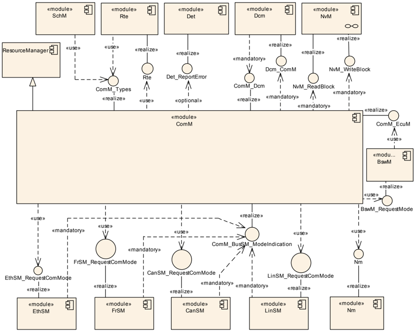

通信管理器模块向总线状态管理器模块请求用户所要求的通信能力。

### 5.1. 文件结构

### 5.2. AUTOSAR 运行时环境（RTE）

每个用户都可以请求一种通信模式。**RTE** 将用户请求传播给 **ComM** 模块，并将来自 **ComM** 的通信模式指示传播给用户（详细内容参见 [\[15\]](#ref-15)）。

### 5.3. ECU 状态管理器（EcuM）

**EcuM** 负责校验唤醒事件，并在唤醒被校验通过后向 **ComM** 发送指示。

通信允许与 ECU 关机由 **EcuM** 与 **BswM** 共同处理（详细内容参见 [\[3\]](#ref-3)）。

### 5.4. 基础软件模式管理器（BswM）

**BswM** 实现模式仲裁（Mode Arbitration）与模式控制（Mode Control）两项功能，以支持应用模式管理与车辆模式管理的应用。

如果在 **BswM** 的动作列表中配置了传播，**BswM** 会将用户请求传播给 **ComM** 模块，从而能够经由 **BswM** 请求 **ComM** 模式。

如果 `Com_IpduGroupControl` 的调用被配置在动作列表中，**BswM** 控制 AUTOSAR 通信模块（**COM**）中的 PDU 组。

**ComM** 应向 **BswM** 指示全部通道主状态变化与全部 PNC 状态变化。

如果使用 EcuM-Flex，**BswM** 会向 **ComM** 指示是否允许通信。

### 5.5. NVRAM 管理器

**ComM** 模块使用 **NVRAM** 管理器来存储和读取非易失性数据。NVRAM 数据初始值的详细内容参见第 [9](#9-配置规范) 章。

**注释：** **NVRAM** 管理器必须在 ECU 上电或复位之后进行初始化。它必须在 **ComM** 之前初始化，因为 **ComM** 初始化时假定 **NVRAM** 已可使用、并且可以读回非易失性配置数据。**ComM** 去初始化时会把非易失性数据写入 **NVRAM**。

### 5.6. 诊断通信管理器（DCM）

**DCM** 执行诊断 PDU 的调度。当需要执行诊断时，**DCM** 通过「DCM_ActiveDiagnostic」指示请求通信模式 COMM_FULL_COMMUNICATION，从而充当一个用户。**DCM** 不提供启动/停止发送与接收的 API，但保证通信能力符合 **ComM** 模块的通信模式。

### 5.7. LIN 状态管理器

**LIN** 状态管理器控制 **LIN** 总线的实际状态，该状态对应 **ComM** 模块的一种通信模式。**ComM** 模块向 **LIN** 状态管理器请求通信模式，**LIN** 状态管理器将该通信模式映射为总线状态。

### 5.8. CAN 状态管理器

**CAN** 状态管理器控制 **CAN** 总线的实际状态，该状态对应 **ComM** 模块的一种通信模式。**ComM** 模块向 **CAN** 状态管理器请求通信模式，**CAN** 状态管理器将该通信模式映射为总线状态。

### 5.9. FlexRay 状态管理器

**FlexRay** 状态管理器控制 **FlexRay** 总线的实际状态，该状态对应 **ComM** 模块的一种通信模式。**ComM** 模块向 **FlexRay** 状态管理器请求通信模式，**FlexRay** 状态管理器将该通信模式映射为总线状态。

### 5.10. Ethernet 状态管理器

**Ethernet** 状态管理器控制 **Ethernet** 总线的实际状态，该状态对应 **ComM** 模块的一种通信模式。**ComM** 模块向 **Ethernet** 状态管理器请求通信模式，**Ethernet** 状态管理器将该通信模式映射为总线状态。

### 5.11. 网络管理（NM）

**ComM** 模块使用 **NM** 在整个网络范围内同步通信能力的控制（同步启动与关机）。此外，关于 **PNC** 的状态信息通过专用 API 在 **ComM** 与 **Nm** 之间交换。

### 5.12. 默认错误追踪器（DET）

**DET**（见 [\[16\]](#ref-16)）提供上报开发错误、运行时错误与瞬态错误的服务（见 6.9 节）。

## 6. 功能规格

通信管理器（**ComM**）模块为用户简化资源管理，用户可以是可运行实体、SW-C、**BswM**（例如经由 **BswM** 的 SW-C 请求）或 **DCM**（诊断用途所需的通信）。

**ComM** 应提供三种不同的通信模式。最高的通信模式应为 COMM_FULL_COMMUNICATION。最低的通信模式应为 COMM_NO_COMMUNICATION。

对于用户而言，只应能请求 COMM_NO_COMMUNICATION 与 COMM_FULL_COMMUNICATION 这两种通信模式（见 `[ComM_RequestComMode](#735-comm_requestcommode)()`，[SWS_ComM_00110]）。

[SWS_ComM_00151] 的依据（Rationale）：

* 通信模式 COMM_SILENT_COMMUNICATION 与各子模式/子状态只是为了与 AUTOSAR **NM** 同步才需要。
* 通信模式 COMM_FULL_COMMUNICATION_WITH_WAKEUP_REQUEST 只是为了请求下层在网络上触发一次唤醒（例如符合 [\[2, OA TC10\]](#ref-2) 的 Ethernet 硬件）才需要。用户不能请求该模式。

通信模式 COMM_SILENT_COMMUNICATION 只应用于网络同步。

**注意：** 自 2.0 版起移除了请求 COMM_SILENT_COMMUNICATION 模式的可能性。

**注释：**

* **ComM** 模块允许查询某个特定用户所请求的通信模式（见 `[ComM_GetRequestedComMode](#737-comm_getrequestedcommode)()`，[SWS_ComM_00079]）。
* 若用户被分配到某通道，**ComM** 模块允许查询该通道实际的通信模式（见 `[ComM_GetCurrentComMode](#738-comm_getcurrentcommode)()`，[SWS_ComM_00083]）。
* 若用户被分配到某个 **PNC**，**ComM** 模块允许查询当前的 PNC 模式（见 `[ComM_GetCurrentPNCComMode](#739-comm_getcurrentpnccommode)()`，[SWS_ComM_91002]）。

在 COMM_FULL_COMMUNICATION 模式下，**ComM** 模块应允许在受影响的物理通道上发送与接收。

在 COMM_NO_COMMUNICATION 模式下，**ComM** 模块应阻止在受影响的物理通道上发送与接收。

如果多个独立用户请求中的至少一个要求更高的通信模式（见 [SWS_ComM_00867] 与 [SWS_ComM_00868]），**ComM** 模块应将该更高的通信模式设置为目标通信模式。

[SWS_ComM_00686] 的依据：**ComM** 依据「最高者获胜」策略协调多个独立用户请求：COMM_FULL_COMMUNICATION 通信模式优先于 COMM_NO_COMMUNICATION。

**ComM** 模块不得将用户请求排队。同一用户的最新用户请求应覆盖旧的用户请求，即使该请求尚未完成。

如果配置参数 ComMNmVariant= FULL | LIGHT | NONE（[ECUC_ComM_00568]），则 DCM_ActiveDiagnostic 指示应被视为针对指定通信通道的 COMM_FULL_COMMUNICATION 请求（见 `[ComM_DCM_ActiveDiagnostic](#7421-comm_dcm_activediagnostic)(channel)`，[SWS_ComM_00873]）。

[SWS_ComM_00866] 的依据：若诊断需要更多通道，**DCM** 需要为每个通道指示 DCM_ActiveDiagnostic。

每个通信通道应有一个通信模式目标状态（依据 [SWS_ComM_00686] 求值）。该目标模式可以暂时不同于由相应总线状态管理器模块控制的实际模式。

**注释：** 由相应总线状态管理器模块进行的模式切换需要时间，且模式抑制可能处于激活状态。

**ComM** 模块应将 `[ComM_GetCurrentComMode](#738-comm_getcurrentcommode)()`（见 [SWS_ComM_00083]）的调用传播到用户所配置通道对应的总线状态管理器模块（另见 [SWS_ComM_00176] 与 [SWS_ComM_00798]）。

[SWS_ComM_00084] 的依据：状态请求必须传播到相应的总线状态管理器模块，因为 **ComM** 模块并不控制实际的总线状态。

**注释：** 「普通 SW-C」不会使用该特性，因为它们不了解通道。该特性对特权 SW-C 是必需的，这些 SW-C（必须）了解系统拓扑，例如系统诊断功能。

**ComM** 模块应为所有受支持的通道将「某通道是否允许通信」的状态存储在各自独立的 CommunicationAllowed 布尔标志中。**ComM** 初始化后的默认值应为不允许通信，即 CommunicationAllowed 置为 FALSE。

[SWS_ComM_00884] 中通信允许或不允许的状态变化应通过 `[ComM_CommunicationAllowed](#7441-comm_communicationallowed)(&lt;channel&gt;, TRUE|FALSE)`（[SWS_ComM_00871]）指示提供给 **ComM**。

### 6.1. 局部网络集群管理

**ComM** 为用户提供唤醒并保持唤醒所谓「局部网络集群」（**PNC**）的选项。**PNC** 是一组（逻辑上的）ECU，它们必须同时处于激活状态以实现某种分布式功能。如果使用了支持 PNC 的网关，一个 **PNC** 可以跨越整个网络（网络层次结构中不同拓扑层级上的不同总线）。没有 **PN** 功能时，**NM** 消息只能唤醒并保持唤醒整个总线。

#### 6.1.1. 概述

**ComM** 为每个局部网络集群（**PNC**）实现一个状态机，以表示该 **PNC** 的通信模式。

每个 **PNC** 拥有自己的状态。状态的定义与 **ComM** 的通道状态相关，以便简单映射。

**ComM** 用户用于请求和释放 **PNC**。

系统通道上各节点的全部 **PNC** 状态通过所谓的 PNC 位向量在一条网络管理消息（**NM** 消息）中交换。

关于局部网络集群功能的更多信息见《模式管理指南》[\[19\]](#ref-19)。

#### 6.1.2. 局部网络集群管理功能

只有当参数 ComMPncSupport 置为 TRUE 时才存在 **PNC** 功能（见 [ECUC_ComM_00839]）。

**PNC** 功能的启用与停用应可通过参数 ComMPncEnabled 进行构建后（post-build）配置（见 [ECUC_ComM_00878]）。

**注释：** **ComM** 模块通过调用 `BswM_ComM_CurrentPncMode()` 向 **BswM** 通知 **PNC** 状态机的每一次状态变化（参见 [SWS_ComM_00908]）。

在 **ComM** 与 **Nm** 之间交换 **PNC** 状态信息时应使用位向量。这样的位向量称为「PNC 位向量」，最多包含 504 位。

**注释：** PNC 位向量在专用 API 中以 `uint8` 数组引用的形式提供给 **ComM**。PNC 位向量中的每一位表示某个特定 **PNC** 的状态，该位称为「PNC 位」。

与某个 ComMPncId 对应的 PNC 位所在的 byteIndex 与 bitIndex 应按如下方式确定：

* byteIndex = (ComMPncId div 8) - &lt;PNC 向量偏移&gt;
* bitIndex = (ComMPncId mod 8)

**提示：** 相应通道的 PNC 位向量长度可以从网络管理模块的配置中获取。

**注释：** [SWS_ComM_00825] 只定义 byteIndex 与 bitIndex 的计算方式，而不规定应如何实现。

**ComM** 通过回调函数 `[ComM_Nm_UpdateEIRA](#7419-comm_nm_updateeira)(&lt;内部与外部 PNC 请求的 PNC 位向量&gt;)` 接收内部与外部 PNC 请求的聚合状态。

如果 `[ComM_Nm_UpdateEIRA](#7419-comm_nm_updateeira)(&lt;EIRA 的 PNC 位向量&gt;)` 被调用，**ComM** 应按照在 NmIf 中配置的 PNC 位向量长度，将给定 PNC 位向量的内容传输到 **ComM** 的 EIRA。

[SWS_ComM_01060] 的注释：假定每个 **PNC** 实现一个用于 EIRA PNC 位向量的缓冲区。该缓冲区的长度应为与该 **PNC** 引用的通道相关联的已配置 PNC 位向量的最大长度。例如，若某个 **PNC** 引用 [ComMChannel](#925-commchannel) A 与 [ComMChannel](#925-commchannel) B，而这两个通道配置的 PNC 位向量长度不同（ChannelA-PncBitVectorLength = 10 字节，ChannelB-PncBitVectorLength = 20），则应为该 **PNC** 提供一个 PNC 位向量长度为 20 字节的 EIRA 缓冲区。

**ComM** 通过回调函数 `[ComM_Nm_UpdateERA](#74110-comm_nm_updateera)(&lt;通道&gt;, &lt;外部 PNC 请求的 PNC 位向量&gt;)` 按通道接收外部 PNC 请求的聚合状态。

如果配置参数 ComMPncGatewayEnabled（见 [ECUC_ComM_00887]）置为 TRUE，`[ComM_Nm_UpdateERA](#74110-comm_nm_updateera)(&lt;channel&gt;, &lt;ERA 的 PNC 位向量&gt;)` 被调用且给定通道设置了参数 ComMPncGatewayType，则 **ComM** 应按照给定通道及在 NmIf 中配置的 PNC 位向量长度，将给定 PNC 位向量的内容传输到 **ComM** 的 ERA。

**注意：**

* **ComM** 将 **Nm** 提供的 EIRA PNC 位向量传输到一个内部 EIRA 中（见 [SWS_ComM_01060]），并将每个 ERA PNC 位向量传输到每个 [ComMChannel](#925-commchannel) 的一个 ERA 中（见 [SWS_ComM_01061]）。
* 传输 PNC 位向量的内容意味着：若 PNC 位向量中相应的 PNC 位置 '1'，则将 **ComM** 内部 EIRA/ERA 中的 PNC 位置 '1'；若 PNC 位向量中相应的 PNC 位置 '0'，则将内部 EIRA/ERA 中的 PNC 位置 '0'。

**ComM** 模块应能够将某个特定 **PNC** 的状态（PNC 状态机的结果）分发到所分配的 ComM 通道上。为此，**ComM** 应通过调用 API `Nm_UpdateIRA(&lt;channel&gt;, &lt;聚合内部 PNC 请求的 PNC 位向量&gt;)`，将每个通信通道（例如总线或网络）聚合后的内部 PNC 请求状态作为 PNC 位向量转发。IRA PNC 位向量表示内部 PNC 请求的状态。

**注意：**

* PNC 位的含义定义于 [SWS_ComM_00825]。
* 内部 PNC 请求基于 **ComM** 用户的 PNC 请求，和/或因 PNC 网关处理而产生的 PNC 请求。

#### 6.1.3. ComM PNC 状态机

如果通过配置参数 ComMPncEnabled 置为 TRUE 使能了 **PNC** 功能（见 [ECUC_ComM_00878]），所有与 PNC 变化相关的动作应在与通道相关的动作（通道相关动作见 [6.3](#63-comm-用户与-pnc-的关系) 章）之前执行。

对于每个局部网络集群，只应实现一个 PNC 状态机（即每个 **PNC** 一个 PNC 状态机，与 [ComMChannel](#925-commchannel) 的数量无关）。

**ComM** 模块应支持最多 504 个 PNC 状态机。

PNC 状态机应由两个主状态 COMM_PNC_FULL_COMMUNICATION 与 COMM_PNC_NO_COMMUNICATION 组成。

PNC 主状态 COMM_PNC_FULL_COMMUNICATION 应由子状态 COMM_PNC_PREPARE_SLEEP、COMM_PNC_READY_SLEEP 与 COMM_PNC_REQUESTED 组成。

每次状态变化（列于 [ComM_PncModeType](#722-comm_pncmodetype) 中），不包括从 PowerOff 进入主状态 COMM_PNC_NO_COMMUNICATION，都应通过 API 调用 `BswM_ComM_CurrentPncMode()` 并传入所进入的 PNC 状态来通知。

由调用 `[ComM_RequestComMode](#735-comm_requestcommode)()` 触发的 **ComM** 中 PNC 状态机的状态转换，应仅在 `ComM_MainFunction_&lt;Channel.ShortName&gt;` 中执行。

**注释：** 每次 **PNC** 激活都会触发 PNC 位向量的 n 次发送，因此若不去抖将会增加总线负载。

触发器「[ComMUser](#924-commuser)」表示通过调用 API `[ComM_RequestComMode](#735-comm_requestcommode)()` 通知某个 [ComMUser](#924-commuser) 的通信请求。

在映射到一个或多个 **PNC** 的通道的 `ComM_MainFunction_&lt;Channel.ShortName&gt;` 中，所请求的状态应按以下顺序处理：

1. 映射到该通道一个或多个 **PNC** 的 ComM 用户的 ComM 用户请求
2. 映射到该通道的 ComM 用户的 ComM 用户请求
3. ERA（若配置开关 ComMPncGatewayEnabled 置为 TRUE）
4. EIRA

**注释：** 请求在受其影响通道的主函数中处理。

关于「允许通信」与模式抑制，源自 PNC 状态机的请求应被视为相应通道的用户请求来对待。

图 7.1：PNC 状态机（**PNC State Machine**）

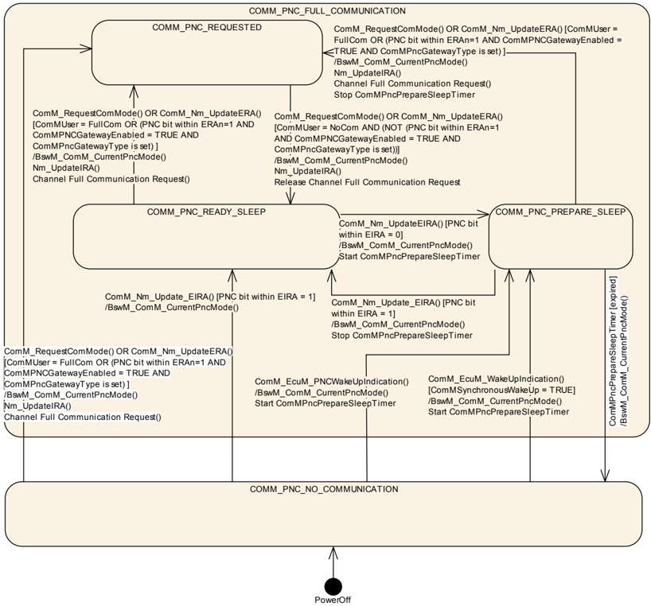

##### 6.1.3.1. PNC 主状态 COMM_PNC_NO_COMMUNICATION 中的行为

从断电（power off）开始，PNC 主状态 COMM_PNC_NO_COMMUNICATION 应为默认的 PNC 状态。

只要 **PNC** 既未被 ECU 内部请求也未被外部请求，主状态 COMM_PNC_NO_COMMUNICATION 就是目标状态。

如果在 PNC 状态 COMM_PNC_NO_COMMUNICATION 中调用了 API `[ComM_EcuM_WakeUpIndication](#7431-comm_ecum_wakeupindication)()`、配置开关 ComMSynchronousWakeUp 置为 TRUE（见 [ECUC_ComM_00695]），且对于通过 ComMChannelPerPnc（见 [ECUC_ComM_00880]）引用至少一个 [ComMChannel](#925-commchannel) 的所有 **PNC**，应离开 PNC 主状态 COMM_PNC_NO_COMMUNICATION 并进入 PNC 子状态 COMM_PNC_PREPARE_SLEEP。

如果在 PNC 状态 COMM_PNC_NO_COMMUNICATION 中调用了 API `[ComM_EcuM_WakeUpIndication](#7431-comm_ecum_wakeupindication)()`，且配置开关 ComMSynchronousWakeUp 置为 FALSE，则 PNC 主状态 COMM_PNC_NO_COMMUNICATION 应保持为当前状态。

**注释：** 异步唤醒的情况下，PNC 状态应保持 COMM_PNC_NO_COMMUNICATION，直到收到该 **PNC** 的请求（EIRA 中的 PNC 位置 '1'）。

如果在 PNC 状态 COMM_PNC_NO_COMMUNICATION 中调用了 API `[ComM_EcuM_PNCWakeUpIndication](#7432-comm_ecum_pncwakeupindication)(&lt;PNC&gt;)`（见 [SWS_ComM_91001]），且被指示的 **PNC** 通过 ComMChannelPerPnc（见 [ECUC_ComM_00880]）引用至少一个 [ComMChannel](#925-commchannel)，则应离开 PNC 主状态 COMM_PNC_NO_COMMUNICATION 并进入 PNC 子状态 COMM_PNC_PREPARE_SLEEP。

当在 PNC 主状态 COMM_PNC_NO_COMMUNICATION 中，分配给该 **PNC** 的至少一个 [ComMUser](#924-commuser) 请求「完全通信」时，应离开该状态并进入主状态 COMM_PNC_FULL_COMMUNICATION 的子状态 COMM_PNC_REQUESTED。

当在主状态 COMM_PNC_NO_COMMUNICATION 中，EIRA 里代表该 **PNC** 的至少一个 PNC 位变为 '1'，且该 **PNC** 通过 ComMChannelPerPnc（见 [ECUC_ComM_00880]）引用至少一个 [ComMChannel](#925-commchannel) 时，应离开主状态 COMM_PNC_NO_COMMUNICATION 并进入 COMM_PNC_READY_SLEEP。

###### 6.1.3.1.1. PNC 网关相关需求

当在主状态 COMM_PNC_NO_COMMUNICATION 中，ERAn 里代表该 **PNC** 的至少一个 PNC 位变为 '1' 时，在以下条件下应离开主状态 COMM_PNC_NO_COMMUNICATION 并进入子状态 COMM_PNC_REQUESTED：

* 参数 ComMPncGatewayEnabled（见 [ECUC_ComM_00887]）置为 TRUE；
* 该 **PNC** 通过 ComMChannelPerPnc（见 [ECUC_ComM_00880]）引用至少一个通道，且所有被引用通道都设置了 ComMPncGatewayType。

**注意：** 无论引用的类型是 ComMChannelPerPnc 还是 ComMChannelPerTxOnlyPnc，该 **PNC** 引用的全部通道都应设置 GW 类型。

##### 6.1.3.2. 从 PowerOff 进入 PNC 主状态 COMM_PNC_NO_COMMUNICATION

**注意：** 接通电源后，主状态 COMM_PNC_NO_COMMUNICATION 从 PowerOff 进入（见 [SWS_ComM_00926]）。

##### 6.1.3.3. PNC 主状态 COMM_PNC_FULL_COMMUNICATION 中的行为

只要某个特定 **PNC** 处于状态 COMM_PNC_FULL_COMMUNICATION，该 **PNC** 通过 ComMChannelPerPnc（见 [ECUC_ComM_00880]）引用的所有 [ComMChannel](#925-commchannel) 都应处于 COMM_FULL_COMMUNICATION。

##### 6.1.3.4. 进入 PNC 子状态 COMM_PNC_REQUESTED

当从 COMM_PNC_NO_COM 或 COMM_PNC_PREPARE_SLEEP 进入 PNC 子状态 COMM_PNC_REQUESTED、该 **PNC** 通过 ComMChannelPerPnc（见 [ECUC_ComM_00880]）引用至少一个 [ComMChannel](#925-commchannel) 且该 **PNC** 的 ComMPncWakeupSleepRequestEnabled 置为 TRUE 时，应以 COMM_PNC_REQUESTED_WITH_WAKEUP_REQUEST（而不是 COMM_PNC_REQUESTED）调用 `BswM_ComM_CurrentPNCMode`。

**注意：** 以 COMM_PNC_REQUESTED_WITH_WAKEUP_REQUEST 通知 **BswM** 用于 Ethernet 交换机端口切换，以在使用兼容 OA TC10（见 [\[2\]](#ref-2)）的 Ethernet 硬件的网络上触发唤醒。

当进入 PNC 子状态 COMM_PNC_REQUESTED 时，在以下任一条件下，**ComM** 模块应将 IRA 中代表该 **PNC** 的 PNC 位置 '1'，并通过调用 `Nm_UpdateIRA(&lt;channel&gt;, &lt;IRA&gt;)` 将聚合的内部 PNC 请求转发到引用该 **PNC** 的每个通道：

* ComMPncGatewayEnabled 置为 FALSE；
* 该 **PNC** 引用的任何 [ComMChannel](#925-commchannel) 上都未设置 ComMPncGatewayType。

每当从其他状态进入子状态 COMM_PNC_REQUESTED 时，对于通过参数 ComMChannelPerPnc（见 [ECUC_ComM_00880]）被该 **PNC** 引用、且 ComMWakeupSleepRequestEnabled 置为 FALSE 或不可用的所有已配置 ComM 通道，**ComM** 应请求 COMM_FULL_COMMUNICATION，即使该通道已被请求。

每当从 COMM_PNC_NO_COM 或 COMM_PNC_PREPARE_SLEEP 进入子状态 COMM_PNC_REQUESTED 时，对于通过参数 ComMChannelPerPnc（见 [ECUC_ComM_00880]）被该 **PNC** 引用、且 ComMWakeupSleepRequestEnabled 置为 TRUE 的所有已配置 ComM 通道，**ComM** 应请求 COMM_FULL_COMMUNICATION_WITH_WAKEUP_REQUEST，即使该通道已被请求。

每当从 COMM_PNC_READY_SLEEP 进入子状态 COMM_PNC_REQUESTED 时，对于通过参数 ComMChannelPerPnc（见 [ECUC_ComM_00880]）被该 **PNC** 引用、且 ComMWakeupSleepRequestEnabled 置为 TRUE 的所有已配置 ComM 通道，**ComM** 应请求 COMM_FULL_COMMUNICATION，即使该通道已被请求。

[SWS_ComM_01071] 的注释：从 COMM_PNC_READY_SLEEP 进入时不应导致网络上的唤醒，因为该 **PNC** 已被另一个 ECU 远程请求。

###### 6.1.3.4.1. PNC 网关相关需求

当进入 PNC 子状态 COMM_PNC_REQUESTED 且 ComMPncGatewayEnabled 置为 TRUE 时，**ComM** 应将 IRA 中代表该 **PNC** 的 PNC 位在所有 ComMPncGatewayType 置为 COMM_GATEWAY_TYPE_ACTIVE 的被引用 [ComMChannel](#925-commchannel) 上置 '1'，并通过调用 `Nm_UpdateIRA(&lt;channel&gt;, &lt;IRA&gt;)` 将聚合的内部 PNC 请求相应转发到这些 [ComMChannel](#925-commchannel)。

##### 6.1.3.5. PNC 子状态 COMM_PNC_REQUESTED 中的行为

当分配给该 **PNC** 的所有 [ComMUser](#924-commuser) 请求「无通信」、且 ComMPncGatewayEnabled 置为 FALSE 或该 **PNC** 引用的所有通道上都未设置 ComMPncGatewayType 时，应离开子状态 COMM_PNC_REQUESTED 并进入子状态 COMM_PNC_READY_SLEEP。

**注意：** 只要分配给该 **PNC** 的至少一个 [ComMUser](#924-commuser) 请求「完全通信」，COMM_PNC_REQUESTED 就会是当前的 PNC 状态。请参阅下述需求。

在子状态 COMM_PNC_REQUESTED 中，当 ComMPncGatewayEnabled 置为 FALSE 且分配给某个特定 **PNC** 的至少一个 [ComMUser](#924-commuser) 请求「完全通信」时，**ComM** 应为通过 ComMChannelPerTxOnlyPnc 被该 **PNC** 引用的那些 [ComMChannel](#925-commchannel) 请求 COMM_FULL_COMMUNICATION。

在子状态 COMM_PNC_REQUESTED 中，当 ComMPncGatewayEnabled 置为 FALSE 且分配给某个特定 **PNC** 的所有 [ComMUser](#924-commuser) 请求「无通信」时，**ComM** 应为通过 ComMChannelPerTxOnlyPnc 被该 **PNC** 引用的那些 [ComMChannel](#925-commchannel) 请求 COMM_NO_COMMUNICATION。

###### 6.1.3.5.1. PNC 网关相关需求

在以下条件下应离开子状态 COMM_PNC_REQUESTED 并进入子状态 COMM_PNC_READY_SLEEP：

* 分配给该 **PNC** 的所有 [ComMUser](#924-commuser) 请求「无通信」；
* 参数 ComMPncGatewayEnabled 置为 TRUE；
* 该 **PNC** 通过 ComMChannelPerPnc（见 [ECUC_ComM_00880]）引用了至少一个 [ComMChannel](#925-commchannel)；
* 该 **PNC** 引用的所有 [ComMChannel](#925-commchannel) 都设置了 ComMPncGatewayType 参数；
* ERAn 中代表该 **PNC** 的 PNC 位等于 '0'。

在以下条件下应离开子状态 COMM_PNC_REQUESTED 并进入子状态 COMM_PNC_READY_SLEEP：

* 分配给该 **PNC** 的所有 [ComMUser](#924-commuser) 请求「无通信」；
* 参数 ComMPncGatewayEnabled 置为 TRUE；
* 该 **PNC** 引用的所有 [ComMChannel](#925-commchannel) 都未设置 ComMPncGatewayType 参数。

在子状态 COMM_PNC_REQUESTED 中，当 ComMPncGatewayEnabled 置为 TRUE 且分配给某个特定 **PNC** 的至少一个 [ComMUser](#924-commuser) 请求「完全通信」时，**ComM** 应将 IRA 中代表该特定 **PNC** 的 PNC 位在那些 [ComMChannel](#925-commchannel) 上置 '1'——这些通道

* 的 ComMPncGatewayType 参数置为 COMM_GATEWAY_TYPE_PASSIVE，并且
* 通过 ComMChannelPerPnc 或 ComMChannelPerTxOnlyPnc 被该 **PNC** 引用，

并通过调用 `Nm_UpdateIRA(&lt;channel&gt;, &lt;IRA&gt;)` 转发更新后的 IRA。

在子状态 COMM_PNC_REQUESTED 中，当 ComMPncGatewayEnabled 置为 TRUE 且在至少一个 ERA 中代表某个特定 **PNC** 的 PNC 位等于 '1'、其对应的 [ComMChannel](#925-commchannel) 的 ComMPncGatewayType 参数置为 COMM_GATEWAY_TYPE_ACTIVE 时，**ComM** 应将 IRA 中代表该特定 **PNC** 的 PNC 位在那些 [ComMChannel](#925-commchannel) 上置 '1'——这些通道

* 的 ComMPncGatewayType 参数置为 COMM_GATEWAY_TYPE_PASSIVE，并且
* 通过 ComMChannelPerPnc 或 ComMChannelPerTxOnlyPnc 被该 **PNC** 引用，

并通过调用 `Nm_UpdateIRA(&lt;channel&gt;, &lt;IRA&gt;)` 转发更新后的 IRA。

在子状态 COMM_PNC_REQUESTED 中，当 ComMPncGatewayEnabled 置为 TRUE 且分配给某个特定 **PNC** 的至少一个 [ComMUser](#924-commuser) 请求「完全通信」时，**ComM** 应为通过 ComMChannelPerTxOnlyPnc 被该 **PNC** 引用的那些 [ComMChannel](#925-commchannel) 请求 COMM_FULL_COMMUNICATION。

在子状态 COMM_PNC_REQUESTED 中，当 ComMPncGatewayEnabled 置为 TRUE 时，若

* 分配给某个特定 **PNC** 的所有 [ComMUser](#924-commuser) 请求「无通信」，并且
* 在至少一个 ERA 中代表该特定 **PNC** 的 PNC 位等于 '0'、其对应的 [ComMChannel](#925-commchannel) 的 ComMPncGatewayType 参数置为 COMM_GATEWAY_TYPE_ACTIVE，

则 **ComM** 应将 IRA 中代表该特定 **PNC** 的 PNC 位在那些 [ComMChannel](#925-commchannel) 上置 '0'——这些通道

* 的 ComMPncGatewayType 参数置为 COMM_GATEWAY_TYPE_PASSIVE，并且
* 通过 ComMChannelPerPnc 或 ComMChannelPerTxOnlyPnc 被该 **PNC** 引用，

并通过调用 `Nm_UpdateIRA(&lt;channel&gt;, &lt;IRA&gt;)` 转发更新后的 IRA。

在子状态 COMM_PNC_REQUESTED 中，当 ComMPncGatewayEnabled 置为 TRUE 时，若

* 分配给某个特定 **PNC** 的所有 [ComMUser](#924-commuser) 请求「无通信」，并且
* 该 **PNC** 引用的 [ComMChannel](#925-commchannel) 未设置 ComMPncGatewayType 参数，

则 **ComM** 应将 IRA 中代表该特定 **PNC** 的 PNC 位在该 **PNC** 引用的所有 [ComMChannel](#925-commchannel) 上置 '0'，并通过调用 `Nm_UpdateIRA(&lt;channel&gt;, &lt;IRA&gt;)` 转发更新后的 IRA。

在子状态 COMM_PNC_REQUESTED 中，当 ComMPncGatewayEnabled 置为 TRUE 且分配给某个特定 **PNC** 的所有 [ComMUser](#924-commuser) 请求「无通信」时，**ComM** 应为通过 ComMChannelPerTxOnlyPnc 被该 **PNC** 引用的那些 [ComMChannel](#925-commchannel) 请求 COMM_NO_COMMUNICATION。

当在子状态 COMM_PNC_REQUESTED 中通过调用 `[ComM_Nm_ForwardSynchronizedPncShutdown](#7418-comm_nm_forwardsynchronizedpncshutdown)(&lt;channel&gt;, &lt;PNC 位向量&gt;)` 指示了一个转发同步 PNC 关机的请求，且以下全部条件成立时：

* 分配给该 **PNC** 的所有 **ComM** 用户请求「无通信」（No Com）；
* 在该 **PNC** 通过 ComMChannelPerPnc（见 [ECUC_ComM_00880]）引用的所有通道的 ERAn 中，相应的 PNC 位全部置 '0'，且通道属性 ComMPncGatewayType 置为 COMM_GATEWAY_TYPE_ACTIVE；
* `[ComM_Nm_ForwardSynchronizedPncShutdown](#7418-comm_nm_forwardsynchronizedpncshutdown)` 调用所指示的通道被分配给该 **PNC**，且该 **PNC** 被指示关机（给定 PNC 位向量中的 PNC 位置 '1'）；
* 被指示的通道的 ComMPncGatewayType 置为 COMM_GATEWAY_TYPE_PASSIVE，且该通道通过 ComMChannelPerPnc（见 [ECUC_ComM_00880]）被引用；
* ComMSynchronizedPncShutdownEnabled 置为 TRUE，

则 **ComM** 模块应执行以下动作：

* **ComM** 应将该 **PNC** 的 ERA 位在该 **PNC** 通过 ComMChannelPerPnc（见 [ECUC_ComM_00880]）引用的所有通道的 ERA 中置 '0'，其中通道属性 ComMPncGatewayType 置为 COMM_GATEWAY_TYPE_PASSIVE；
* **ComM** 应对每个 &lt;channel&gt; 调用 `Nm_RequestSynchronizedPncShutdown(&lt;channel&gt;, &lt;PncId&gt;)`，&lt;PncId&gt; 为当前处理的 **PNC** 的 PncId，其中 ComMPncGatewayType 置为 COMM_GATEWAY_TYPE_ACTIVE 且该通道通过 ComMChannelPerPnc（见 [ECUC_ComM_00880]）被引用；
* 应离开子状态 COMM_PNC_REQUESTED 并进入子状态 COMM_PNC_READY_SLEEP。

[SWS_ComM_01082] 的注释：

* 每当中间 PNC 协调器（至少有一个 [ComMChannel](#925-commchannel) 的 ComMPncGatewayType 置为 COMM_GATEWAY_TYPE_PASSIVE 的 PNC 协调器）从顶层 PNC 协调器收到一条作为 PN 关机消息的 **Nm** 帧时，**ComM** 应立即释放该 **PNC**，转发该 PN 关机消息的 PNC 位向量，并在那些被分配给受影响 **PNC** 且 ComMPncGatewayType 置为 COMM_GATEWAY_TYPE_ACTIVE 的 [ComMChannel](#925-commchannel) 上请求同步 PNC 关机（请求发送一条 PN 关机消息）。
* **ComM** 必须确保收到作为 PN 关机消息的 **Nm** 帧后的处理流程尽快执行，以最小化同步 PNC 关机的延迟。
* 如果某个本地用户已指示请求受影响的 **PNC**，或者经由 ComMPncGatewayType 置为 COMM_GATEWAY_TYPE_ACTIVE 的 ComM 通道收到了 PNC 请求，则不执行同步 PNC 关机的转发。本地或远程请求的 PNC 请求始终优先于同步 PNC 关机请求。
* 仅当被指示的 **PNC**（PNC 位向量中给定的）处于 COMM_PNC_REQUESTED 时，才执行同步 PNC 关机处理。

如果通过调用 `[ComM_Nm_ForwardSynchronizedPncShutdown](#7418-comm_nm_forwardsynchronizedpncshutdown)(&lt;channel&gt;)` 为该 **PNC** 指示了一个转发同步 PNC 关机的请求，该 **PNC** 有资格被释放，但转发同步 PNC 请求的前提条件不满足（见 [SWS_ComM_01082]），则 **ComM** 模块应拒绝执行同步 PNC 关机的转发；并且如果 ComMPncNmRequest 置为 TRUE，**ComM** 应通过调用 `Nm_NetworkRequest` 为分配给该 **PNC** 的所有 [ComMChannel](#925-commchannel) 再次请求网络，即使受影响通道的当前状态已经是「完全通信」。

如果 ComMSynchronizedPncShutdownEnabled 置为 TRUE，且该 **PNC** 分配的所有 ComM 通道的 ComMPncGatewayType 都置为 COMM_GATEWAY_TYPE_ACTIVE，则在以下条件下应调用 API `Nm_RequestSynchronizedPncShutdown(&lt;channel&gt;, &lt;PncId&gt;)`，其中 &lt;channel&gt; 表示当前处理的 [ComMChannel](#925-commchannel)，&lt;PncId&gt; 为该 **PNC** 的 ComMPncId：

* ERAn 中相应的 PNC 位等于「0」；
* 分配给该 **PNC** 的所有 [ComMUser](#924-commuser) 请求「无通信」；
* 该通道通过 ComMChannelPerPnc（见 [ECUC_ComM_00880]）被该 **PNC** 引用。

[SWS_ComM_01083] 的注释：每当一个 **PNC** 被释放、配置了同步 PNC 关机、且该 ECU 作为该 **PNC** 的顶层 PNC 协调器时，必须在受影响的 [ComMChannel](#925-commchannel) 上发送一条 PN 关机消息。因此 **ComM** 通过对该 **PNC** 分配到的每个 [ComMChannel](#925-commchannel) 调用 `Nm_RequestSynchronizedPncShutdown`，将检测到 **PNC** 释放所得的 PNC 位向量转发给 NmIf。NmIf 将该调用转发给受影响的 &lt;Bus&gt;Nm。PN 关机消息在 &lt;Bus&gt;Nm_MainFunction 中发送。

在子状态 COMM_PNC_REQUESTED 中，如果 ComM0PncVectorAvoidance 置为 TRUE，且通过 ComMChannelPerPnc（见 [ECUC_ComM_00880]）引用的某个 [ComMChannel](#925-commchannel) 所计算的 IRA 中的所有 PNC 位都置 '0'，**ComM** 模块应释放该 [ComMChannel](#925-commchannel)。一旦 IRA 中至少有一位再次变为 '1'，**ComM** 模块应再次请求该 [ComMChannel](#925-commchannel)。

[SWS_ComM_01084] 的注释：只要某个 **PNC** 被远程请求（即分配给该 **PNC** 的 ERAn 中至少有一个 PNC 位等于 '1'）且配置开关 ComMPncGatewayEnabled 置为 TRUE，COMM_PNC_REQUESTED 就会是当前的 PNC 状态。

##### 6.1.3.6. 进入 PNC 子状态 COMM_PNC_READY_SLEEP

当从 COMM_PNC_REQUESTED 进入 PNC 子状态 COMM_PNC_READY_SLEEP 时，IRA 中代表该 **PNC** 的 PNC 位应置 '0'，并通过调用 `Nm_UpdateIRA(&lt;channel&gt;, &lt;IRA&gt;)` 将聚合的内部 PNC 请求转发到该 **PNC** 引用的每个通道。

当从 COMM_PNC_REQUESTED 进入 PNC 子状态 COMM_PNC_READY_SLEEP 时，**ComM** 应释放该 **PNC** 通过 ComMChannelPerPnc（见 [ECUC_ComM_00880]）引用的所有已配置 ComM 通道的 COMM_FULL_COMMUNICATION 请求。

##### 6.1.3.7. PNC 子状态 COMM_PNC_READY_SLEEP 中的行为

只要该 **PNC** 被请求（即 EIRA 中代表该 **PNC** 的 PNC 位等于 '1'）且没有分配给该 **PNC** 的 [ComMUser](#924-commuser) 请求「完全通信」，COMM_PNC_READY_SLEEP 将是当前状态。

如果 **PNC** 被释放（即 EIRA 中代表该 **PNC** 的 PNC 位等于 '0'），应离开子状态 COMM_PNC_READY_SLEEP 并进入子状态 COMM_PNC_PREPARE_SLEEP。

如果分配给该 **PNC** 的至少一个 [ComMUser](#924-commuser) 请求「完全通信」，应离开子状态 COMM_PNC_READY_SLEEP 并进入子状态 COMM_PNC_REQUESTED。

###### 6.1.3.7.1. PNC 网关相关需求

当在子状态 COMM_PNC_READY_SLEEP 中，ERAn 里代表该 **PNC** 的至少一个 PNC 位变为 '1' 时，在以下条件下应离开子状态 COMM_PNC_READY_SLEEP 并进入子状态 COMM_PNC_REQUESTED：

* 参数 ComMPncGatewayEnabled（见 [ECUC_ComM_00887]）置为 TRUE；
* 该 **PNC** 通过 ComMChannelPerPnc（见 [ECUC_ComM_00880]）引用至少一个通道，且被引用的通道设置了 ComMPncGatewayType。

##### 6.1.3.8. 进入 PNC 子状态 COMM_PNC_PREPARE_SLEEP

如果进入子状态 COMM_PNC_PREPARE_SLEEP，定时器 ComMPncPrepareSleepTimer（见 [ECUC_ComM_00841]）应以配置的初始值启动。

##### 6.1.3.9. PNC 子状态 COMM_PNC_PREPARE_SLEEP 中的行为

只要定时器 ComMPncPrepareSleepTimer（见 [ECUC_ComM_00841]）在运行、且 [ComMUser](#924-commuser)、EIRA 或 ERAn 没有变化，COMM_PNC_PREPARE_SLEEP 将是当前状态。

当定时器 ComMPncPrepareSleepTimer（见 [ECUC_ComM_00841]）到期时，应离开 PNC 子状态 COMM_PNC_PREPARE_SLEEP 并进入 PNC 主状态 COMM_PNC_NO_COMMUNICATION。

当在 COMM_PNC_PREPARE_SLEEP 中，分配给该 **PNC** 的至少一个 [ComMUser](#924-commuser) 请求「完全通信」时，应离开 COMM_PNC_PREPARE_SLEEP 状态。定时器 ComMPncPrepareSleepTimer 应停止，并进入子状态 COMM_PNC_REQUESTED。

当在 COMM_PNC_PREPARE_SLEEP 中，EIRA 里代表该 **PNC** 的 PNC 位变为 '1'，且该 **PNC** 通过 ComMChannelPerPnc（见 [ECUC_ComM_00880]）引用至少一个通道时，应离开子状态 COMM_PNC_PREPARE_SLEEP。定时器 ComMPncPrepareSleepTimer 应停止，并进入子状态 COMM_PNC_READY_SLEEP。

###### 6.1.3.9.1. PNC 网关相关需求

当在子状态 COMM_PNC_PREPARE_SLEEP 中，ERAn 里代表该 **PNC** 的至少一个 PNC 位变为 '1' 时，在以下条件下应离开子状态 COMM_PNC_PREPARE_SLEEP、进入 COMM_PNC_REQUESTED 并停止定时器 ComMPncPrepareSleepTimer：

* 参数 ComMPncGatewayEnabled（见 [ECUC_ComM_00887]）置为 TRUE；
* 该 **PNC** 通过 ComMChannelPerPnc（见 [ECUC_ComM_00880]）引用至少一个通道，且被引用的通道设置了 ComMPncGatewayType。

#### 6.1.4. PNC 网关

PNC 网关特性用于跨越总线/通信通道边界延伸（逻辑上的）局部网络集群，把 PNC 请求从一个总线/网络「网关转发」到其他总线/网络。（因此，要存在一个 PNC 网关，它需要连接到多个物理通道。）

为此，PNC 网关配置为每个 **PNC** 包含为了到达该 **PNC** 全部成员所需哪些物理通道的信息（PNC 到通道的映射，见图 7.2）。

PNC 网关从其多个主动通道（称为「主动」是因为必要时它主动保持它们唤醒）收集 PNC 请求并进行聚合。PNC 网关将聚合后的 PNC 状态在网络中发送到其所有主动通道，这使得所有节点对全局 PNC 请求状态的视图与网关一致。

如果该 PNC 网关不是网络层次结构中最顶层的 PNC 网关，PNC 网关还会把所有下级节点的聚合 PNC 请求状态加上自己的内部请求状态，发送给其上级 PNC 协调器，后者通过所谓的「被动」通道连接（称为「被动」是因为它与主动相对）。

上级 PNC 协调器聚合下级协调器的 PNC 请求状态，因此顶层协调器知道网络中所有激活的 PNC 请求，并将该信息发送给下级节点。

下级 PNC 协调器把在被动通道上收到的 PNC 请求信息转发到其主动通道，以将顶层协调器对 PNC 请求状态的整体视图分发到逻辑层次结构中的全部叶节点，使系统中每个节点对 PNC 请求状态保持一致。

图 7.2：PNC 到通道的映射（**PNC-to-channel-mapping**）

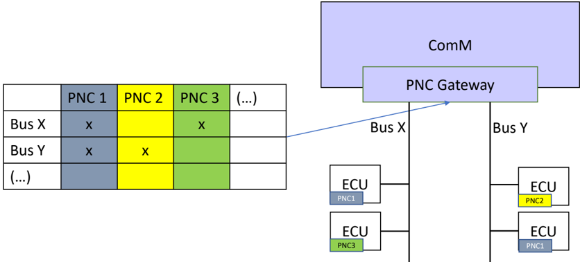

PNC 网关绝不能把经由其被动通道收到的信息聚合后再发回去，否则会造成「幻影 PNC 请求」的无穷镜像循环。

PNC 到通道的映射由配置静态提供。此外，可选的动态 PNC 到通道映射特性（见 [6.1.5](#615-动态-pnc-到通道的映射可选) 节）可用于在运行时扩展 PNC 到通道的映射。

请注意，当 PNC 网关处于激活状态时，即使某个 **PNC** 只分配给一个通道，当来自该 **PNC** 未分配到的另一通道的请求到来时，也可能发生协调。这是有意为之，因为另一个通道上可能只有 PNC 请求方，而它并不希望被该 **PNC** 保持唤醒。

##### 6.1.4.1. 对分配到多个通道的非协调 PNC 的支持

**注释：** 当一个局部网络被分配到多个 [ComMChannel](#925-commchannel) 时，该 **PNC** 要么在所有受影响的 [ComMChannel](#925-commchannel) 上协调，要么完全不协调（见 [\[20, System Template\]](#ref-20) [constr_5094]）。

**注意：** 如果若干 **PNC** 被分配到不同的 [ComMChannel](#925-commchannel)，而这些 [ComMChannel](#925-commchannel) 未被某个 PNC 网关协调，那么网络拓扑与通信设计必须确保受影响的 [ComMChannel](#925-commchannel) 在同一时间点被请求和释放。如果使用了 **PNC**，应用不应关心 [ComMChannel](#925-commchannel) 的状态；而且对于该用例，**ComM** 也不会操心 [ComMChannel](#925-commchannel) 的状态，因为这些 [ComMChannel](#925-commchannel) 的 PNC 协调并未执行。换言之，如果一个 **PNC** 被（被动）请求，那么所有被引用的 [ComMChannel](#925-commchannel) 也应被（被动）请求，因为应用期望分配给该 **PNC** 的所有 [ComMChannel](#925-commchannel) 都处于 COMM_FULL_COMMUNICATION。

图 7.3 给出了一个具有非协调 [ComMChannel](#925-commchannel) 的 PNC 网关（Node2）的示例。

图 7.3：具有非协调 [ComMChannel](#925-commchannel) 的 PNC 网关示例（见 Node2）（**Example for a PNC gateway with not coordinated ComMChannels (see Node2)**）

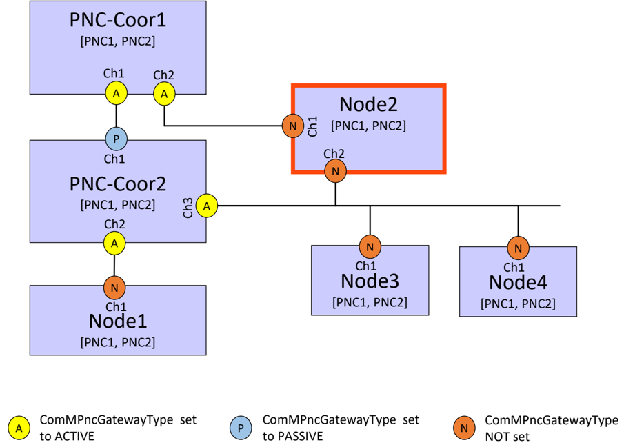

##### 6.1.4.2. 主动 PNC 网关

**注意：** 即使配置参数 ComMPncGatewayEnabled（见 [ECUC_ComM_00887]）为 TRUE 且某个 [ComMChannel](#925-commchannel) 的参数 ComMPncGatewayType 置为 COMM_GATEWAY_TYPE_ACTIVE（见 [ECUC_ComM_00842]），主动 PNC 网关的行为仍如图 7.1「PNC 状态机」所示。

**注释：** 系统通道上的主动 PNC 网关应是该系统通道上最后一个释放 **PNC** 的节点。

**注释：** 若某个 **PNC** 的 PNC 位在所有 ERAn 中都等于零，则除了该 PNC 网关之外没有其他节点请求该 **PNC**。

##### 6.1.4.3. 被动 PNC 网关

**注释：** 被动协调的通道只有在连接到多个 PNC 网关时才存在。如果 **ComM** 的 PNC 网关功能被使能（ComMPncGatewayEnabled 置为 TRUE），映射到该 PNC 网关的 ComM 通道可以被设置为主动或被动类型（COMM_GATEWAY_TYPE_ACTIVE 或 COMM_GATEWAY_TYPE_PASSIVE）。如果一个 ComM 通道被映射到两个不同的 PNC 网关，则只有一个网关主动协调该通道，另一个被动协调。也就是说，一个 PNC 网关总是至少映射到一个主动类型的 ComM 通道，并且可能映射到一个或若干被动类型的 ComM 通道。

**注释：** 如果本地 **ComM** 用户请求该 **PNC**，或者源自被动 PNC 网关主动协调的系统通道的 ERA 中至少有一个 PNC 位不为 0，则 PNC 网关请求该 **PNC**。

[SWS_ComM_01079] 与 [SWS_ComM_01080] 的注释：PNC 网关为被动协调通道计算待发送的 ERA Tx PNC 位向量中的 PNC 位值的方式，与为主动协调通道计算 ERA 中的 PNC 位值的方式相同，但按照 [SWS_ComM_01079] 与 [SWS_ComM_01080] 的规则将该 **PNC** 的位置 '0'。

##### 6.1.4.4. 同步 PNC 关机

**PN** 拓扑总是反映一个层次化拓扑，其中所谓的顶层 PNC 协调器位于最高层。在下级层级上可以存在多个所谓的中间 PNC 协调器和 PNC 叶节点。

图 7.4：反映层次结构的局部网络（PN）拓扑示例（**Example for a partial network (PN) topology that reflect the hierarchy**）

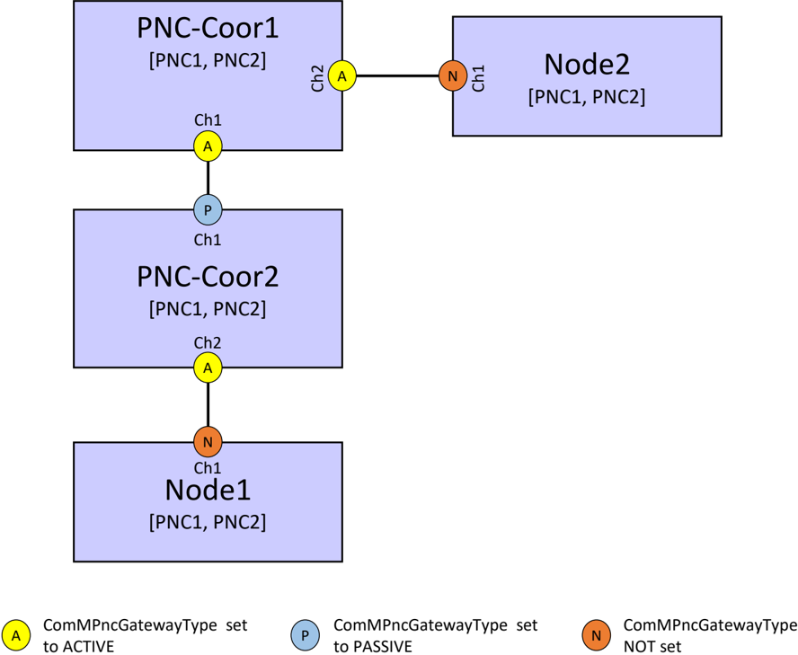

图 5 中 PNC-Coor1 作为顶层 PNC 协调器，PNC-Coor2 作为中间 PNC 协调器，Node1 与 Node2 作为位于 **PN** 拓扑最低层的 PNC 叶节点。例如，若 Node1 请求 PNC1，则该 PNC 请求跨越 **PN** 传播到顶层 PNC 协调器。顶层 PNC 协调器「接管」该 PNC 请求，并确保 PNC 请求在 **PN** 中分发。因此顶层 PNC 协调器在通道 1（PNC-Coor1.Ch1）上镜像回该 PNC 请求，并将 PNC 请求转发到通道 2（PNC-Coor2.Ch2）。再例如，若 Node1 释放 PNC1 且网络中没有其他 ECU 请求 PNC1，则 Node1 仍会从顶层 PNC 协调器收到 PNC1 被请求的 **Nm** 帧。PNC 叶节点的释放不会立即从 PNC 叶节点跨越 **PN** 拓扑转发到顶层 PNC 协调器。**PNC** 的释放在每个 **PN** 拓扑层级上被 PN 复位时间延迟。如果顶层 PNC 协调器检测到某个特定 **PNC** 的 PN 复位定时器到期，则 **PN** 中没有其他 ECU 请求该 **PNC**。顶层 PNC 协调器再次复位被释放 **PNC** 的 PN 复位定时器，并发送一条所谓的 PN 关机消息，以确保从顶层 PNC 协调器到 PNC 叶节点的所有 **PN** 层级上 **PNC** 的近乎同步的关机。中间 PNC 协调器收到 PN 关机消息后立即反应。因此中间 PNC 协调器释放被指示的 **PNC**，再次复位 PN 复位定时器，并在所有主动协调且被分配给受影响 **PNC** 的 [ComMChannel](#925-commchannel) 上转发该 PN 关机消息。这样，从顶层 PNC 协调器到 PNC 叶节点的所有 **PN** 层级上被释放 **PNC** 的全部 PNC 状态机都会几乎同时进入 COMM_PNC_READY_SLEEP 并复位相应的 PN 复位定时器。这将导致同步的 PNC 关机，从而避免应用层的超时。

另请参阅时序图图 9.5、图 9.6 与图 9.7，它们描绘了以顶层 PNC 协调器与中间 PNC 协调器的角色处理同步 PNC 关机的过程。

**注意：**

* 对于配置为单向 PNC 处理的 [ComMChannel](#925-commchannel)（见 [6.1.6.2](#6162-单向-pnc-处理) 节），不执行同步 PNC 关机。
* 对于通过参数 ComMChannelPerTxOnlyPnc（见 [6.1.6.3](#6163-仅发送-pnc-处理) 节）引用 [ComMChannel](#925-commchannel) 的 **PNC**，不执行同步 PNC 关机。

##### 6.1.4.5. 对多个顶层 PNC 协调器的支持

根据 [6.1.4.4](#6144-同步-pnc-关机) 节，**PN** 拓扑总是至少有一个顶层 PNC 协调器。若某特定 **PNC** 分配到的所有 [ComMChannel](#925-commchannel) 都将 ComMPncGatewayType 置为 COMM_GATEWAY_TYPE_ACTIVE，则该 **PNC** 的顶层 PNC 协调器即被指定（见 [SWS_ComM_01083]）。因此，不同的 **PNC** 可以有不同的顶层 PNC 协调器。但对于同一个 **PNC**，只支持一个顶层协调器。对这样的 **PN** 拓扑建模必须确保 **PNC** 之间的严格分离。图 6 给出了一个支持多个顶层 PNC 协调器的 **PN** 拓扑。

图 7.5：顶层 PNC 协调器（**top-level PNC coordinators**）

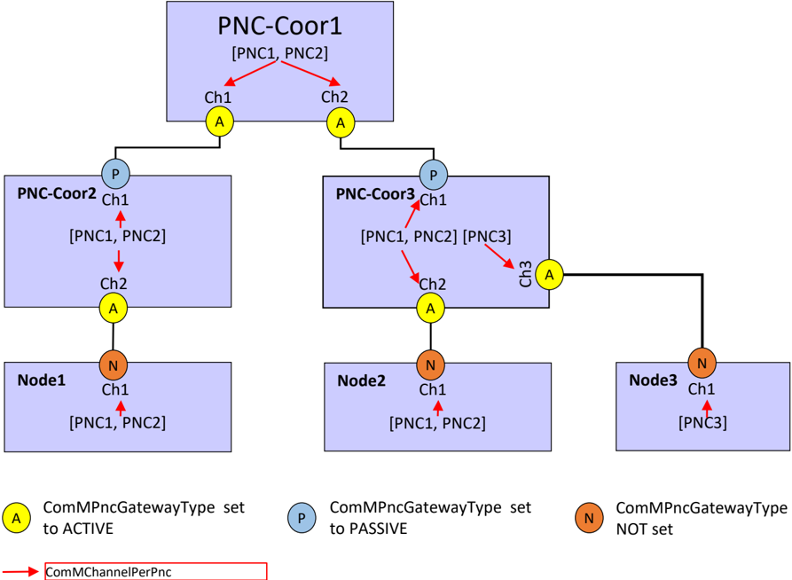

在图 6 中，PNC-Coor1 充当 PNC1 与 PNC2 的顶层 PNC 协调器，PNC-Coor3 充当 PNC3 的顶层 PNC 协调器。因此，若同步 PNC 关机被使能，则 PNC-Coor1 负责为 PNC1 与 PNC2 发起同步 PNC 关机，PNC-Coor3 负责为 PNC3 发起同步 PNC 关机。

**注意：** 网络拓扑与通信设计必须确保一个有效且受支持的 **PN** 拓扑。

#### 6.1.5. 动态 PNC 到通道的映射（可选）

该特性增加了在运行时更新 PNC 网关的 PNC 到通道映射的可能性。该更新通过所有参与节点的基于请求-响应的学习过程完成。当在 **Nm** PDU 中请求局部网络学习时，所有参与节点会在相应通道上应答其当前 PNC 成员关系，PNC 网关随后相应地更新当前的 PNC 到通道映射。

如果某个 **PNC** 使用 ComMChannelPerTxOnlyPnc 引用了至少一个通道，则 ComMDynamicPncToChannelMappingSupport 应置为 FALSE。否则该配置无效。配置工具应将此类配置判定为无效（错误）。

如果在 ComMDynamicPncToChannelMappingEnabled 置为 TRUE 的通道上调用了函数 `[ComM_Nm_PncLearningBitIndication](#7417-comm_nm_pnclearningbitindication)`，或当 **ComM** 在某个通道上调用 `Nm_PnLearningRequest` 时，**ComM** 应将相应通道的 PNC 学习阶段置为激活。

如果 ComMDynamicPncToChannelMappingEnabled 置为 TRUE 且函数 `[ComM_Nm_RepeatMessageLeftIndication](#7416-comm_nm_repeatmessageleftindication)` 已被调用，**ComM** 应将相应通道的 PNC 学习阶段置为未激活。

如果 ComMPncGatewayEnabled 置为 TRUE 且已为某个通道调用函数 `[ComM_Nm_PncLearningBitIndication](#7417-comm_nm_pnclearningbitindication)`，则应执行以下动作之一：

* 当为 ComMPncGatewayType 置为 COMM_GATEWAY_TYPE_ACTIVE 的通道调用 `[ComM_Nm_PncLearningBitIndication](#7417-comm_nm_pnclearningbitindication)` 时，**ComM** 应通过在所有其他已协调（主动或被动）且 ComMDynamicPncToChannelMappingEnabled 置为 TRUE 的 ComM 通道上调用 `Nm_PnLearningRequest` 来转发学习请求；
* 当为 ComMPncGatewayType 置为 COMM_GATEWAY_TYPE_PASSIVE 的通道调用 `[ComM_Nm_PncLearningBitIndication](#7417-comm_nm_pnclearningbitindication)` 时，**ComM** 应通过在 ComMPncGatewayType 置为 COMM_GATEWAY_TYPE_ACTIVE 且 ComMDynamicPncToChannelMappingEnabled 置为 TRUE 的 ComM 通道上调用 `Nm_PnLearningRequest` 来转发学习请求。

依据：局部网络学习位需要转发到网络中的所有节点，但不需要被镜像回来，即使网络拓扑包含环路时也是如此。

如果 ComMPncGatewayEnabled 与 ComMPncDynamicMappingSupport 都置为 TRUE 且 PNC 学习阶段处于激活状态，**ComM** 应在 ComMDynamicPncToChannelMappingEnabled 置为 TRUE 的通道上转发收到的 ERA Rx 信息。**ComM** 应按照以下规则，在所有其他 ComMDynamicPncToChannelMappingEnabled 置为 TRUE 的通道的所有受影响 ERAn 中设置受影响的 PNC 位：

* 在 ComMPncGatewayType 置为 COMM_GATEWAY_TYPE_ACTIVE 的通道上收到的 Rx ERA 应转发到所有其他已协调通道（主动或被动）；
* 在 ComMPncGatewayType 置为 COMM_GATEWAY_TYPE_PASSIVE 的通道上收到的 Rx ERA 应转发到所有 ComMPncGatewayType 置为 COMM_GATEWAY_TYPE_ACTIVE 的其他通道。

##### 6.1.5.1. 更新 PNC 到通道的映射

PNC 网关需要具备在运行时更新其 PNC 到通道映射的能力。

如果 ComMPncGatewayEnabled 置为 TRUE、PNC 学习阶段处于激活状态，且在 ComMDynamicPncToChannelMappingEnabled 置为 TRUE 的通道上 ERA 中的某个 PNC 位置「1」，则 **ComM** 应为相应通道上的每个 [ComMPnc](#928-commpnc) 将 PNC 到通道映射置 1——前提是该 **PNC** 在 ERA 中该通道的相应 PNC 位已被置「1」。

##### 6.1.5.2. PNC 成员关系转发

在 PNC 学习阶段，每个参与节点都必须发送其当前的 PNC 成员关系。PNC 网关另外还需要转发从其他通道收到的 PNC 成员关系。

如果 ComMPncGatewayEnabled 置为 FALSE 且 PNC 学习阶段处于激活状态，**ComM** 应以当前 PNC 成员关系的值设置 IRA 中的相应 PNC 位，并对所有 ComMDynamicPncToChannelMappingEnabled 置为 TRUE 的 ComM 通道调用 `Nm_UpdateIRA(&lt;channel&gt;, &lt;IRA&gt;)`。

如果 ComMPncGatewayEnabled 置为 TRUE 且 PNC 学习阶段处于激活状态，**ComM** 应对所有 ComMDynamicPncToChannelMappingEnabled 置为 TRUE 的 ComM 通道调用 `Nm_UpdateIRA(&lt;channel&gt;, &lt;IRA&gt;)`，其 IRA 以当前 PNC 成员关系的值、并按照 [SWS_ComM_01090] 合并了需要转发的 PNC 信息。

#### 6.1.6. 局部网络配置提示

局部网络配置必须考虑相应 NM 通道在 **NM** 中的相应 PN 过滤掩码的配置。如果使用 SystemDescriptionExtract 来配置 **BSW** 栈、且建模的局部网络在该 SystemDescriptionExtract 中可用，则每个 NM 通道的 PN 过滤掩码会自动派生。是否在派生之后手动修改 PN 过滤掩码取决于集成过程与集成约束。集成过程与特定约束不由 AUTOSAR 规定，以保持灵活性。

以下各章描述了在 PNC 网关与非 PNC 网关的正确 PNC 处理中需要考虑的受支持用例。

##### 6.1.6.1. 双向 PNC 处理

这意味着 PNC 请求总是在两个方向上传输。PNC 请求的处理对于发送与接收是对称的：

* PNC 网关转发收到的（外部）PNC 请求并将其镜像回去；
* 非 PNC 网关对收到的 PNC 请求做出反应，并按照 PNC 分配发送 PNC 请求。

因此，**ComM** 在那些特定 **PNC** 通过参数 ComMChannelPerPnc（见 [ECUC_ComM_00880]）引用相应 [ComMChannel](#925-commchannel) 的 [ComMChannel](#925-commchannel) 上发送并处理收到的该 **PNC** 的 PNC 请求。PNC 位向量中收到的 **PNC** 相对于 [ComMChannel](#925-commchannel) 分配的正确性，必须通过在 NmIf 中为每个 NM 通道正确配置 PN 过滤掩码来保证。

**注意：** **ComM** 不检查收到的 **PNC** 相对于 [ComMChannel](#925-commchannel) 分配的正确性：

* 对于 EIRA 更新，**ComM** 无从检查 PNC 请求是在哪个 [ComMChannel](#925-commchannel) 上收到的，因为 NmIf 不转发 [ComMChannel](#925-commchannel) 信息。
* 对于 ERA 更新，虽然可以进行检查，但 AUTOSAR 决定免除 **ComM** 的这一职责。

在两种情况下（PNC 网关用例与非 PNC 网关），NM 通道的 PN 过滤掩码都必须放行通过 ComMChannelPerPnc 引用相应 [ComMChannel](#925-commchannel) 的所有 **PNC**。

##### 6.1.6.2. 单向 PNC 处理

这意味着 PNC 请求只在一个方向上传输。PNC 请求的处理对于发送与接收是非对称的：

* PNC 网关转发收到的（外部）PNC 请求，但不将其镜像回收到该 PNC 请求的 [ComMChannel](#925-commchannel)；
* 非 PNC 网关在未分配该 **PNC** 的 [ComMChannel](#925-commchannel) 上为若干 **PNC** 发送 PNC 请求。

对于 PNC 网关，NM 通道的 PN 过滤掩码必须放行允许在某个 [ComMChannel](#925-commchannel) 上收到的所有 **PNC**，且这些 **PNC** 不通过 ComMChannelPerPnc 引用该 [ComMChannel](#925-commchannel)（不存在 PNC-通道关系）。此外，必须为相应 NM 通道使能 PNC ERA 处理。对于在不存在 PNC-通道关系的 [ComMChannel](#925-commchannel) 上收到的 PNC 请求，只执行 PNC 请求的转发，而不在接收 [ComMChannel](#925-commchannel) 上镜像。对于在存在 PNC-通道关系的 [ComMChannel](#925-commchannel) 上收到的 PNC 请求，则执行双向 PNC 处理。

PNC 网关的单向 PNC 处理可用于例如某网络需要某个 **PNC** 的信息、但无需提供任何信息回去的场景。

对于非 PNC 网关，NM 通道的 PN 过滤掩码必须拒绝所有被认为只在某个 [ComMChannel](#925-commchannel) 上发送的 **PNC**。这些 [ComMChannel](#925-commchannel) 收到的 PNC 请求不应被处理，因此不应到达 **ComM**。

非 PNC 网关的单向 PNC 处理可用于例如某个 ECU 需要唤醒某个功能或使其保持活动、而自身不属于该功能的场景。

##### 6.1.6.3. 仅发送 PNC 处理

这意味着因 PNC 协调产生的内部 PNC 请求（即由收到的 PNC 请求（ERA 中的 PNC 位置位）外部触发）会被传输发送。此时只更新内部请求阵列（IRA），而不请求相应的 [ComMChannel](#925-commchannel)。若有本地 [ComMUser](#924-commuser) 请求引用该 **PNC**，则会导致 [ComMChannel](#925-commchannel) 请求。这可以通过恰当的配置实现，即让某个 **PNC** 通过 ComMChannelPerTxOnlyPnc 引用一个 [ComMChannel](#925-commchannel)。

期望的运行时行为：

* 如果某个 **PNC** 通过 ComMChannelPerTxOnlyPnc（见 [ECUC_ComM_00900]）引用了一个 [ComMChannel](#925-commchannel)（例如 ComMChannel_A），同时通过 ComMChannelPerPnc（见 [ECUC_ComM_00880]）引用至少一个其他 [ComMChannel](#925-commchannel)（例如 ComMChannel_B），且该 **PNC** 被收到的 PNC 请求（ERA 中的 PNC 位置位）外部请求，则相应的 PNC 状态机转换到 COMM_PNC_REQUESTED，所有被引用 [ComMChannel](#925-commchannel) 的 IRA 都被更新，ComMChannel_B 的通道状态机被请求，而 ComMChannel_A 的通道状态机不被请求。
* 如果某个 **PNC** 只通过 ComMChannelPerTxOnlyPnc（见 [ECUC_ComM_00900]）引用若干 [ComMChannel](#925-commchannel)，该 **PNC** 被收到的 PNC 请求（ERA 中的 PNC 位置位）外部请求，且没有本地用户请求该 **PNC**，则相应的 PNC 状态机与相应的 [ComMChannel](#925-commchannel) 均不受影响：PNC 状态机保持 COMM_PNC_NO_COMMUNICATION，因此这些 [ComMChannel](#925-commchannel) 的 IRA 不被更新；被引用的 [ComMChannel](#925-commchannel) 状态机不被请求。
* 如果某个 **PNC** 通过 ComMChannelPerTxOnlyPnc（见 [ECUC_ComM_00900]）引用一个 [ComMChannel](#925-commchannel)，且该 **PNC** 被某个 [ComMUser](#924-commuser) 本地请求，则相应的 PNC 状态机转换到 COMM_PNC_REQUESTED，该 [ComMChannel](#925-commchannel) 的 IRA 被更新，且被引用的 [ComMChannel](#925-commchannel) 状态机以 COMM_FULL_COMMUNICATION 被请求。
* 如果某个 **PNC** 通过 ComMChannelPerTxOnlyPnc（见 [ECUC_ComM_00900]）引用一个 [ComMChannel](#925-commchannel)，该 **PNC** 既被本地 [ComMUser](#924-commuser) 请求、又额外被收到的 PNC 请求（ERA 中的 PNC 位置位）外部请求，则相应的 PNC 状态机转换到 COMM_PNC_REQUESTED，该 [ComMChannel](#925-commchannel) 的 IRA 被更新，且被引用的 [ComMChannel](#925-commchannel) 状态机以 COMM_FULL_COMMUNICATION 被请求。若该本地 [ComMUser](#924-commuser) 释放对该 **PNC** 的请求，则该 [ComMChannel](#925-commchannel) 会被释放，但只要该 **PNC** 仍被外部请求，该 [ComMChannel](#925-commchannel) 的 IRA 中相应的 PNC 位仍保持置 '1'。
* 如果某个 **PNC** 通过 ComMChannelPerTxOnlyPnc（见 [ECUC_ComM_00900]）引用一个 [ComMChannel](#925-commchannel)，该 [ComMChannel](#925-commchannel) 未被任何其他 **PNC** 通过 ComMChannelPerPnc 引用，且检测到一次唤醒，则该 PNC 状态机将保持在 COMM_PNC_NO_COMMUNICATION。（请参阅 [SWS_ComM_01063]、[SWS_ComM_01064]、[SWS_ComM_01065]、[SWS_ComM_01066]）

仅发送 PNC 处理可用于例如非 PNC 网关只请求若干 **PNC** 而不额外请求 **NM** 的场景。

仅发送 PNC 处理还可用于例如 PNC 网关在一个通道（通道 A）上接收单向 PNC 请求（PNC1），并在另一个通道（通道 B）上转发该 PNC 请求而不请求 **NM**。在通道 B 上，PNC1 被配置为双向 PNC 处理，因此收到的 PNC1 请求会被转发回通道 A，同时考虑请求受影响的 [ComMChannel](#925-commchannel) 及相应的 **NM**。

**注意：** 引用 ComMChannelPerTxOnlyPnc 无法从 SystemDescriptionExtract 派生。从 **PNC** 到 ComM 通道的 ComMChannelPerTxOnlyPnc 引用只能在集成阶段手动添加。

### 6.2. ComM 通道状态机

如果可选的 **PNC** 功能被使能（见 [ECUC_ComM_00839]），所有 **PNC** 动作应在与通道相关的动作执行之前完成。

如果参数 ComMPncNmRequest 置为 TRUE（见 [ECUC_ComM_00886]），当由于 PNC 状态机变化到 COMM_PNC_REQUESTED（见 [SWS_ComM_01068]）而请求「完全通信」时，即使当前状态已经是「完全通信」，也应调用 API `Nm_NetworkRequest()`。

依据：这是让 **NM** 立即 n 次发送 NM 消息（n = 可配置）的触发器，以确保唤醒与 PNC 收发器的同步。

**ComM** 应为每个通信通道独立实现一个通道状态机。

[SWS_ComM_00051] 的注释：通道状态机如图 7.6 所示，通道状态机转换的需求总览列于表 7.1。

[SWS_ComM_00051] 的依据：各通道所需的通信能力可能不同，因此控制必须是独立的。

[SWS_ComM_00051] 的用例：在一个带 **CAN** 与 **LIN** 通道的 ECU 上，只有 **LIN** 需要完全通信以请求例如传感器数值，而 **CAN** 保持不活动。

图 7.6：ComM 通道状态机（**ComM channel state machine**）

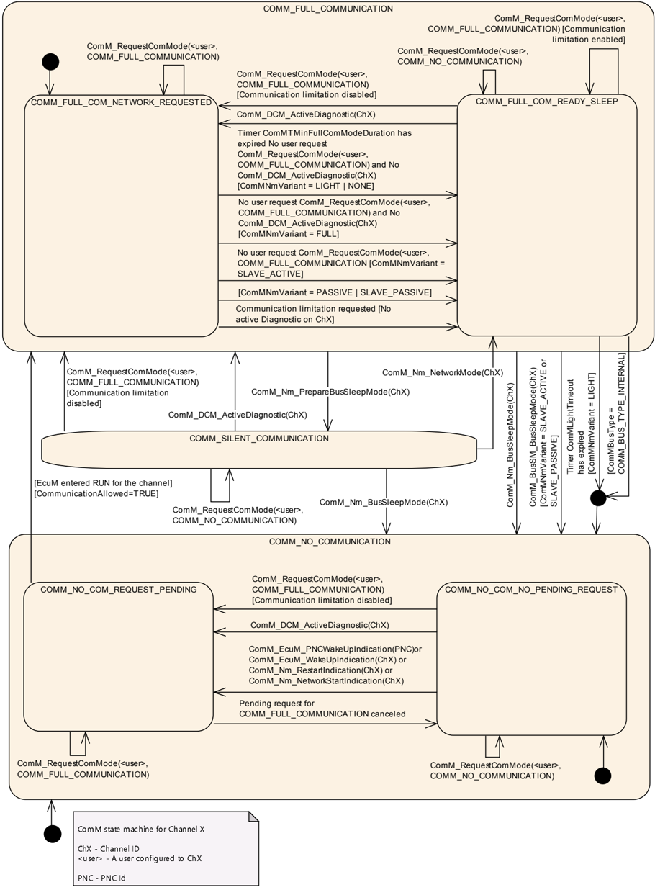

表 7.1：通道状态机及其转换的详细说明链接（**Link to detailed explanation of the channel state machine resp. transition**）

| 状态 | 小节 / 需求 |
| --- | --- |
| COMM_NO_COMMUNICATION | 小节 6.2.2。进入状态：[SWS_ComM_00898]、[SWS_ComM_00313]、[SWS_ComM_00073]、[SWS_ComM_00288]。子状态 COMM_NO_COM_NO_PENDING_REQUEST 中：[SWS_ComM_00875]、[SWS_ComM_00876]、[SWS_ComM_00893]、[SWS_ComM_00894]、[SWS_ComM_00694]、[SWS_ComM_01014]、[SWS_ComM_01015]。子状态 COMM_NO_COM_REQUEST_PENDING 中：[SWS_ComM_00895]、[SWS_ComM_00897] |
| COMM_SILENT_COMMUNICATION | 小节 6.2.3。进入状态：[SWS_ComM_00071]。状态中：[SWS_ComM_00877]、[SWS_ComM_00878]、[SWS_ComM_00295]、[SWS_ComM_00296] |
| COMM_FULL_COMMUNICATION | 小节 6.2.4。进入状态：[SWS_ComM_00069]。状态中：[SWS_ComM_00637]、[SWS_ComM_00826]。子小节 [6.2.4.1](#6241-comm_full_com_network_requested-子状态) 子状态 COMM_FULL_COM_NETWORK_REQUESTED：[SWS_ComM_00869]、[SWS_ComM_00870]、[SWS_ComM_00665]、[SWS_ComM_00888]、[SWS_ComM_00889]、[SWS_ComM_00890]。子小节 [6.2.4.2](#6242-comm_full_com_ready_sleep-子状态) 子状态 COMM_FULL_COM_READY_SLEEP。进入子状态：[SWS_ComM_00133]。子状态中：[SWS_ComM_00610]、[SWS_ComM_00671] |
| 转换 | 需求 |
| COMM_NO_COMMUNICATION → COMM_FULL_COMMUNICATION | [SWS_ComM_00893]、[SWS_ComM_00894]、[SWS_ComM_00694]、[SWS_ComM_00875]、[SWS_ComM_00876]、[SWS_ComM_01014]、[SWS_ComM_01015] |
| COMM_FULL_COM_NETWORK_REQUESTED → COMM_FULL_COM_READY_SLEEP | [SWS_ComM_00665] |
| COMM_FULL_COM_READY_SLEEP → COMM_FULL_COM_NETWORK_REQUESTED | [SWS_ComM_00882]、[SWS_ComM_00883] |
| COMM_FULL_COMMUNICATION → COMM_SILENT_COMMUNICATION | [SWS_ComM_00826] |
| COMM_FULL_COM_READY_SLEEP → COMM_NO_COMMUNICATION | [SWS_ComM_00610]、[SWS_ComM_00671] |
| COMM_FULL_COMMUNICATION → COMM_NO_COMMUNICATION | [SWS_ComM_00637] |
| COMM_SILENT_COMMUNICATION → COMM_FULL_COMMUNICATION | [SWS_ComM_00877]、[SWS_ComM_00878] |
| COMM_SILENT_COMMUNICATION → COMM_FULL_COM_READY_SLEEP | [SWS_ComM_00296] |
| COMM_SILENT_COMMUNICATION → COMM_NO_COMMUNICATION | [SWS_ComM_00295] |

**ComM** 通道状态机应由与通信模式对应的三个主状态组成：COMM_NO_COMMUNICATION、COMM_SILENT_COMMUNICATION 与 COMM_FULL_COMMUNICATION。

COMM_FULL_COMMUNICATION 状态应有两个子状态 COMM_FULL_COM_NETWORK_REQUESTED 与 COMM_FULL_COM_READY_SLEEP。

COMM_NO_COMMUNICATION 状态应有两个子状态 COMM_NO_COM_REQUEST_PENDING 与 COMM_NO_COM_NO_PENDING_REQUEST。

[SWS_ComM_00879] 与 [SWS_ComM_00880] 的依据：COMM_FULL_COM_READY_SLEEP 与 COMM_SILENT_COMMUNICATION 是在总线上同步通信关机所必需的。如果只有一个 ECU 关闭通信，其他 ECU 会因为该 ECU 停止发送应用信号而存储错误。

**注释：** 主状态表示每个通道通信能力的抽象状态，这是用户所关心的。子状态表示中间状态，执行一些活动以支持与外部伙伴及管理协议（例如 **NM**）的同步转换。

每个 ComM 通道状态机的默认状态应为 COMM_NO_COMMUNICATION。

每个 ComM 通道状态机应只在子状态 COMM_NO_COM_REQUEST_PENDING 中求值其相应的通信状态标志 CommunicationAllowed（依据 [SWS_ComM_00884]）。

[SWS_ComM_00896] 的依据：如果通道不在子状态 COMM_NO_COM_REQUEST_PENDING 中，`[ComM_CommunicationAllowed](#7441-comm_communicationallowed)(&lt;channel&gt;,FALSE)`（[SWS_ComM_00871]）指示没有可见效果，即 **ComM** 通道状态机在处于例如 COMM_FULL_COMMUNICATION 等其他状态时，不会立即改变到状态 COMM_NO_COMMUNICATION。

[SWS_ComM_00896] 的注释：假定在 ECU 被唤醒且所有潜在的校验检查完成之后，才会通过 `[ComM_CommunicationAllowed](#7441-comm_communicationallowed)()` 将 CommunicationAllowed 置为 TRUE，以确保经由相应通道的正确通信。因此不存在从 COMM_NO_COM_REQUEST_PENDING 到 COMM_NO_COM_NO_PENDING_REQUEST 的转换，因为 CommunicationAllowed 已经置为 TRUE，或者将在 ECU 的唤醒处理中通过 `[ComM_CommunicationAllowed](#7441-comm_communicationallowed)()` 置为 TRUE。

主状态变化（见 [SWS_ComM_00879]）应通过相应的通知向用户指示。例外：初始化后的默认状态，见 [SWS_ComM_00313]。

[SWS_ComM_00472] 的注释：如果有多个用户与相应的通道状态机相关，**ComM** 模块必须向所有用户执行扇出（Fan-out）。

[SWS_ComM_00472] 的注释：关于通知的更多细节见 6.10 小节与 6.10.2 小节。

**ComM** 通道状态机的内部功能应对用户不可见。用户既不需要、也不应获得关于 **ComM** 通道状态机内部机制与规则（例如「最高者获胜」策略）的任何信息。

表 7.2 给出了相应模式下所请求通信能力的总览。

表 7.2：相应模式下允许的通信能力（**Granted communication capabilities in the corresponding modes**）

| 通信模式 | 消息发送 | 消息接收 | NM（ComMNmVariant = FULL） | 唤醒/重启能力 |
| --- | --- | --- | --- | --- |
| COMM_FULL_COMMUNICATION | 开 | 开 | 请求总线通信 | N/A |
| COMM_FULL_COMMUNICATION_WITH_WAKEUP_REQUEST | 开 | 开 | 请求总线通信 | 请求下层在网络上触发唤醒 |
| COMM_SILENT_COMMUNICATION | 关 | 开 | 释放总线通信 | 用户/诊断请求；网络指示 |
| COMM_NO_COMMUNICATION | 关 | 关 | 释放总线通信 | 用户/诊断请求；被动唤醒 |

对通信模式 COMM_FULL_COMMUNICATION_WITH_WAKEUP_REQUEST 的请求，在 **ComM** 通道状态机内应作为对 COMM_FULL_COMMUNICATION 的请求处理。ComM 通道状态机转换及状态内行为的偏差将被显式规定。

6.1.1–[6.1.3](#613-comm-pnc-状态机) 节的注释：

* 每个 ComM 通道状态机负责处理一个带有已连接总线状态管理器的通道/网络（「相应的」= 该 ComM 通道状态机所负责的通道/网络）。
* **ComM** 模块包含一个或若干个 ComM 通道状态机。ComM 通道状态机直接与其连接的总线状态管理器通信，其他接口由 **ComM** 模块处理。

#### 6.2.1. ComM 被管理通道与管理通道

一个 ComM 通道可以引用其他 ComM 通道。该引用可通过设置 ComMManageReference（见 [ECUC_ComM_00893]）进行配置。ComMManageReference 的源 ComM 通道称为「管理通道」（managing channel），目标 ComM 通道称为「被管理通道」（managed channel）。一个管理通道可以引用 0..n 个被管理通道。一个被管理通道只能被一个管理通道独占引用。

这用于支持以下用例：管理通道处理与 **NM** 模块的交互，而被管理通道没有 **NM**。

**注意：** 管理通道必须考虑以下限制：

* 管理通道的 ComMNmVariant 置为 FULL（见 [ECUC_ComM_00568]）。

**注意：** 被管理通道必须考虑以下限制：

* 被管理通道的 ComMNmVariant 置为 LIGHT，因为管理通道负责与 NmChannel 的交互（见 [ECUC_ComM_00568]）；
* 被管理通道的 ComMPncGatewayType 既不置为 COMM_GATEWAY_TYPE_ACTIVE 也不置为 COMM_GATEWAY_TYPE_PASSIVE（见 [ECUC_ComM_00842]）。

#### 6.2.2. COMM_NO_COMMUNICATION 状态中的行为

进入状态 COMM_NO_COMMUNICATION 时，**ComM** 通道状态机应转到子状态 COMM_NO_COM_NO_PENDING_REQUEST。

初始化后默认进入状态 COMM_NO_COMMUNICATION 时，**ComM** 模块不应通过 **RTE** 或 **BswM** 向用户指示该模式变化。

[SWS_ComM_00313] 的依据：此时 **RTE** 尚未初始化。

进入状态 COMM_NO_COMMUNICATION 时，**ComM** 通道状态机应关闭发送与接收能力。这应通过 **ComM** 通道状态机向总线状态管理器模块请求相应的通信模式来完成（&lt;Bus&gt;SM_RequestComMode(network:=&lt;通道状态机的网络&gt;, mode:= COMM_NO_COMMUNICATION)，见 [SWS_ComM_00829]）。

[SWS_ComM_00073] 的依据：COMM_NO_COMMUNICATION 模式禁止相应通道的总线通信 PDU 发送与接收。

进入状态 COMM_NO_COMMUNICATION 且配置参数 ComMNmVariant= FULL（见 [ECUC_ComM_00568]）时，**ComM** 模块应向网络管理模块请求释放网络，`Nm_NetworkRelease()`。

**注意：** 如果 **ComM** 之前为该通道请求过 **NM**（`Nm_NetworkRequest` 或 `Nm_PassiveStartup`）且尚未释放，则需要 `Nm_NetworkRelease`。

[SWS_ComM_00073]、[SWS_ComM_00288]、[SWS_ComM_00875] 与 [SWS_ComM_00876] 的依据：**FlexRay** 关机不能被中断，以避免局部网络。

**注释：** 在状态 COMM_NO_COMMUNICATION 中，**ComM** 通道状态机不得向总线状态管理器模块为所配置的通道请求总线通信。

上述注释的用例：ECU 在不参与总线通信的情况下本地执行控制功能。

**注释：** 通信模式对一个通道而言是本地的，因此 ECU 仍可经由其他通道通信。

##### 6.2.2.1. COMM_NO_COM_NO_PENDING_REQUEST 子状态

在子状态 COMM_NO_COM_NO_PENDING_REQUEST 中且用户请求 COMM_FULL_COMMUNICATION、通信抑制未启用时，**ComM** 通道状态机应立即切换到子状态 COMM_NO_COM_REQUEST_PENDING。

[SWS_ComM_00875] 的注释：关于通信抑制的更多细节见 6.4.1 小节。

在子状态 COMM_NO_COM_NO_PENDING_REQUEST 中，配置参数 ComMNmVariant= FULL | LIGHT | NONE（见 [ECUC_ComM_00568]）且 **DCM** 指示 `[ComM_DCM_ActiveDiagnostic](#7421-comm_dcm_activediagnostic)`（见 [SWS_ComM_00873]）时，**ComM** 通道状态机应立即切换到子状态 COMM_NO_COM_REQUEST_PENDING。

[SWS_ComM_00876] 的依据：在激活的诊断会话期间，潜在的通信抑制（见 6.4.1 小节）应临时失效（见 [SWS_ComM_00182]）。

[SWS_ComM_00876] 的注释：对于诊断激活，假定诊断测试仪保持总线唤醒，因此被管理通道不需要特殊处理。

如果在子状态 COMM_NO_COM_NO_PENDING_REQUEST 中调用了 `[ComM_EcuM_WakeUpIndication](#7431-comm_ecum_wakeupindication)`、配置参数 ComMSynchronousWakeUp 置为 FALSE（见 [ECUC_ComM_00695]），**ComM** 模块应将所请求的 ComM 通道状态机（相应通道）切换到子状态 COMM_NO_COM_REQUEST_PENDING。如果被指示的 ComM 通道是被管理通道，则引用它的管理通道（见 [ECUC_ComM_00893]）的 ComM 通道状态机也应切换到子状态 COMM_NO_COM_REQUEST_PENDING。

在子状态 COMM_NO_COM_NO_PENDING_REQUEST 中且 **NM** 模块指示一次重启 `[ComM_Nm_RestartIndication](#7415-comm_nm_restartindication)()` [SWS_ComM_00792] 时，**ComM** 通道状态机应立即切换到子状态 COMM_NO_COM_REQUEST_PENDING。

[SWS_ComM_00893] 与 [SWS_ComM_00894] 的依据：必须保证总线唤醒后通信尽快启动。

**注释：** **ComM** 通道状态机在进入 COMM_FULL_COMMUNICATION 状态后立即切换到子状态 COMM_FULL_COM_NETWORK_REQUESTED。如果没有用户请求 COMM_FULL_COMMUNICATION 模式，AUTOSAR **NM** 或 **ComM** 模块针对 ComMTMinFullComModeDuration（[ECUC_ComM_00557]）的定时器会阻止在 COMM_NO_COMMUNICATION 与 COMM_FULL_COMMUNICATION 之间来回切换，以克服系统在可能出现的用户请求之前的初始化/启动时间。

如果在子状态 COMM_NO_COM_NO_PENDING_REQUEST 中调用了 `[ComM_EcuM_WakeUpIndication](#7431-comm_ecum_wakeupindication)`、配置参数 ComMSynchronousWakeUp 置为 TRUE（见 [ECUC_ComM_00695]），**ComM** 模块应将所有 ComM 通道状态机（相应通道）切换到子状态 COMM_NO_COM_REQUEST_PENDING。

如果在子状态 COMM_NO_COM_NO_PENDING_REQUEST 中调用了 `[ComM_EcuM_PNCWakeUpIndication](#7432-comm_ecum_pncwakeupindication)(&lt;PNC&gt;)`（见 [SWS_ComM_91001]）、配置参数 ComMSynchronousWakeUp 置为 FALSE（见 [ECUC_ComM_00695]）且 ComMPncSupport 置为 TRUE（见 [ECUC_ComM_00839]），**ComM** 模块应将给定 **PNC** 通过 ComMChannelPerPnc（见 [ECUC_ComM_00880]）引用的那些 ComM 通道状态机（相应通道）切换到子状态 COMM_NO_COM_REQUEST_PENDING。

[SWS_ComM_01014] 的注释：

* 这包括被指示的被管理通道所引用的管理通道的 ComM 通道状态机，因为 [ComMPnc](#928-commpnc) 总是引用两种类型（见 [\[20\]](#ref-20) [constr_3484]）。
* 对于通过 ComMChannelPerTxOnlyPnc 引用的通道，若 ComMSynchronousWakeUp 置为 FALSE 且配置了 PNC 相关唤醒（调用 `EcuM_ComM_PNCWakeupIndication()`），则始终需要一个引用该通道的 EcuMWakeupSource，以确保正确的 [ComMChannel](#925-commchannel) 处理。该通道上的唤醒会使通道进入确定的状态，但由于该 **PNC** 通过 ComMChannelPerTxOnlyPnc 引用该通道，**PNC** 将保持在 COMM_PNC_NO_COMMUNICATION。

如果在子状态 COMM_NO_COM_NO_PENDING_REQUEST 中调用了 `[ComM_EcuM_PNCWakeUpIndication](#7432-comm_ecum_pncwakeupindication)(&lt;PNC&gt;)`（见 [SWS_ComM_91001]）、配置参数 ComMSynchronousWakeUp 置为 TRUE（见 [ECUC_ComM_00695]）且 ComMPncSupport 置为 TRUE（见 [ECUC_ComM_00839]），**ComM** 模块应将所有 ComM 通道状态机（相应通道）切换到子状态 COMM_NO_COM_REQUEST_PENDING。

##### 6.2.2.2. COMM_NO_COM_REQUEST_PENDING 子状态

在子状态 COMM_NO_COM_REQUEST_PENDING 中，**ComM** 通道状态机应求值其相应的 CommunicationAllowed 标志（依据 [SWS_ComM_00884] 与 [SWS_ComM_00885] 存储与设置）。若求值结果为 CommunicationAllowed 置为 TRUE，**ComM** 通道状态机应立即切换到状态 COMM_FULL_COMMUNICATION。

在子状态 COMM_NO_COM_REQUEST_PENDING 中且不再存在对 COMM_FULL_COMMUNICATION 的有效待决请求时，**ComM** 通道状态机应切换回默认子状态 COMM_NO_COM_NO_PENDING_REQUEST。

[SWS_ComM_00897] 的依据：这使得在因某种原因始终不允许通信的情况下，能够切换回默认子状态。例如转换到 COMM_NO_COM_REQUEST_PENDING 由用户请求 `[ComM_RequestComMode](#735-comm_requestcommode)(&lt;user&gt;, COMM_FULL_COMMUNICATION)`（见 [SWS_ComM_00871]）或 **DCM** 指示 `[ComM_DCM_ActiveDiagnostic](#7421-comm_dcm_activediagnostic)(&lt;channel&gt;)`（见 [SWS_ComM_00873]）触发，但现在被 `[ComM_RequestComMode](#735-comm_requestcommode)(&lt;user&gt;, COMM_NO_COMMUNICATION)`（见 [SWS_ComM_00871]）或 **DCM** 的 `[ComM_DCM_InactiveDiagnostic](#7422-comm_dcm_inactivediagnostic)(&lt;channel&gt;)`（见 [SWS_ComM_00874]）取消。

#### 6.2.3. COMM_SILENT_COMMUNICATION 状态中的行为

进入状态 COMM_SILENT_COMMUNICATION 时，**ComM** 通道状态机应关闭发送能力（并保持接收能力开启）。这应通过 **ComM** 通道状态机向总线状态管理器模块请求相应的通信模式来完成（&lt;Bus&gt;SM_RequestComMode(network:=&lt;通道状态机的网络&gt;, mode:= COMM_SILENT_COMMUNICATION)，见 [SWS_ComM_00829]）。

[SWS_ComM_00071] 的依据：COMM_SILENT_COMMUNICATION 模式允许接收总线通信 PDU，但禁止发送总线通信 PDU。

**注释：** 尽管接收能力已开启，也可能什么也收不到（例如在 bus off 期间）。

用例：借助 **NM** 模块进行关机协调（准备总线睡眠状态）。

在状态 COMM_SILENT_COMMUNICATION 中、用户请求 COMM_FULL_COMMUNICATION 且通信抑制未启用时，**ComM** 通道状态机应切换到状态 COMM_FULL_COMMUNICATION。

[SWS_ComM_00877] 的注释：关于通信抑制的更多细节见 6.4.1 小节。

在状态 COMM_SILENT_COMMUNICATION 中、配置参数 ComMNmVariant= FULL | LIGHT | NONE（[ECUC_ComM_00568]）且 **DCM** 指示 `[ComM_DCM_ActiveDiagnostic](#7421-comm_dcm_activediagnostic)`（[SWS_ComM_00873]）时，**ComM** 通道状态机应切换到状态 COMM_FULL_COMMUNICATION。

[SWS_ComM_00878] 的依据：在激活的诊断会话期间，潜在的通信抑制（见 6.4.1 小节）应临时失效，见 [SWS_ComM_00182]。

在状态 COMM_SILENT_COMMUNICATION 中且网络管理器模块指示 `[ComM_Nm_BusSleepMode](#7414-comm_nm_bussleepmode)()`（[SWS_ComM_00392]）时，**ComM** 通道状态机应切换到状态 COMM_NO_COMMUNICATION。

在状态 COMM_SILENT_COMMUNICATION 中且网络管理器模块指示 `[ComM_Nm_NetworkMode](#7412-comm_nm_networkmode)()`（[SWS_ComM_00390]）时，**ComM** 通道状态机应切换到状态 COMM_FULL_COMMUNICATION 与子状态 COMM_FULL_COM_READY_SLEEP。

#### 6.2.4. COMM_FULL_COMMUNICATION 状态中的行为

进入状态 COMM_FULL_COMMUNICATION 时，**ComM** 通道状态机应转到子状态 COMM_FULL_COM_NETWORK_REQUESTED——除非转换中指定了特定子状态。

[SWS_ComM_00899] 的依据：从 COMM_SILENT_COMMUNICATION 切换时，若转换中指定，**ComM** 通道状态机可以直接切换到子状态 COMM_FULL_COM_READY_SLEEP，见 [SWS_ComM_00296]。

进入状态 COMM_FULL_COMMUNICATION 时，**ComM** 通道状态机应开启发送与接收能力。这应通过 **ComM** 通道状态机向总线状态管理器模块请求相应的通信模式来完成：

* 如果请求的通信模式为 COMM_FULL_COMMUNICATION，则应调用 &lt;Bus&gt;SM_RequestComMode(network:=&lt;通道状态机的网络&gt;, mode:= COMM_FULL_COMMUNICATION)
* 如果请求的通信模式为 COMM_FULL_COMMUNICATION_WITH_WAKEUP_REQUEST 且该 ComM 通道的 ComMWakeupSleepRequestEnabled 置为 TRUE，则应调用 &lt;Bus&gt;SM_RequestComMode(network:=&lt;通道状态机的网络&gt;, mode:= COMM_FULL_COMMUNICATION_WITH_WAKEUP_REQUEST)
* 如果请求的通信模式为 COMM_FULL_COMMUNICATION_WITH_WAKEUP_REQUEST 且该 ComM 通道的 ComMWakeupSleepRequestEnabled 置为 FALSE 或不可用，则应调用 &lt;Bus&gt;SM_RequestComMode(network:=&lt;通道状态机的网络&gt;, mode:= COMM_FULL_COMMUNICATION)

[SWS_ComM_00069] 的依据：COMM_FULL_COMMUNICATION 或 COMM_FULL_COMMUNICATION_WITH_WAKEUP_REQUEST 模式允许相应通道的总线通信 PDU 发送与接收。

每当某个 ComM 通道以 COMM_FULL_COMMUNICATION_WITH_WAKEUP_REQUEST 被请求、且该 ComM 通道的 ComMWakeupSleepRequestEnabled 置为 TRUE 时，**ComM** 应通过调用 &lt;Bus&gt;SM_RequestComMode（COMM_FULL_COMMUNICATION_WITH_WAKEUP_REQUEST）请求该 ComM 通道的相应网络，即使该 ComM 通道已处于状态 COMM_FULL_COMMUNICATION。若该 ComM 通道的 ComMWakeupSleepRequestEnabled 置为 FALSE 或不可用，**ComM** 应忽略该请求。

**注意：** 重新触发 &lt;Bus&gt;SM 状态机用于在网络上触发唤醒——前提是所用硬件支持该功能（例如兼容 OA TC10（见 [\[2\]](#ref-2)）的 Ethernet 硬件）。

在状态 COMM_FULL_COMMUNICATION 中且网络管理器模块指示 `[ComM_Nm_BusSleepMode](#7414-comm_nm_bussleepmode)()`（[SWS_ComM_00392]）时，**ComM** 通道状态机应切换到状态 COMM_NO_COMMUNICATION。

[SWS_ComM_00637] 的依据：用户可能「太晚」请求保持总线唤醒（**NM** 无法发送保持总线唤醒的投票，因为集群已同意关机）。

在状态 COMM_FULL_COMMUNICATION 中、配置参数 ComMNmVariant= SLAVE_ACTIVE | SLAVE_PASSIVE 且总线状态管理器模块指示 `ComM_BusSm_BusSleepMode()`（见 [SWS_ComM_91000]）时，**ComM** 通道状态机应切换到状态 COMM_NO_COMMUNICATION。

在 COMM_FULL_COMMUNICATION 中、配置参数 ComMNmVariant= FULL | PASSIVE（[ECUC_ComM_00568]）且网络管理器模块指示 `[ComM_Nm_PrepareBusSleepMode](#7413-comm_nm_preparebussleepmode)()`（[SWS_ComM_00391]）时，**ComM** 状态机应切换到状态 COMM_SILENT_COMMUNICATION。

[SWS_ComM_00826] 的依据：在通过 `Nm_NetworkRelease()` 释放激活请求之前不可能收到 `[ComM_Nm_PrepareBusSleepMode](#7413-comm_nm_preparebussleepmode)()`，且 PASSIVE 通道不能被主动唤醒，因此可以安全地假设该转换始终有效。

##### 6.2.4.1. COMM_FULL_COM_NETWORK_REQUESTED 子状态

进入子状态 COMM_FULL_COM_NETWORK_REQUESTED 且配置参数 ComMNmVariant= LIGHT | NONE（[ECUC_ComM_00568]）时，应启动针对 ComMTMinFullComModeDuration（[ECUC_ComM_00557]）的定时器。

从 COMM_NO_COM_REQUEST_PENDING 进入子状态 COMM_FULL_COM_NETWORK_REQUESTED、且 **EcuM** 模块已通过 `[ComM_EcuM_WakeUpIndication](#7431-comm_ecum_wakeupindication)(&lt;channel&gt;)`（见 [SWS_ComM_00275]）或 `[ComM_EcuM_PNCWakeUpIndication](#7432-comm_ecum_pncwakeupindication)(&lt;PNC&gt;)`（见 [SWS_ComM_91001]）指示了唤醒时，**ComM** 模块应向网络管理请求 `Nm_PassiveStartup(&lt;channel&gt;)`。如果被指示的 ComM 通道是被管理通道，**ComM** 模块应向网络管理请求 `Nm_PassiveStartup(&lt;引用它的管理通道&gt;)`（见 [ECUC_ComM_00893]）。

如果被指示的 ComM 通道是被管理通道，**ComM** 模块应向网络管理请求 `Nm_PassiveStartup(&lt;引用它的管理通道&gt;)`（见 [ECUC_ComM_00893]）。

进入子状态 COMM_FULL_COM_NETWORK_REQUESTED 且 **Nm** 模块已指示一次重启 `[ComM_Nm_RestartIndication](#7415-comm_nm_restartindication)(&lt;channel&gt;)`（[SWS_ComM_00792]）时，**ComM** 模块应向网络管理请求 `Nm_PassiveStartup(&lt;channel&gt;)`。

进入子状态 COMM_FULL_COM_NETWORK_REQUESTED 且 **Nm** 模块已指示一次网络启动 `[ComM_Nm_NetworkStartIndication](#7411-comm_nm_networkstartindication)(&lt;channel&gt;)`（[SWS_ComM_00383]）时，**ComM** 模块应向网络管理请求 `Nm_PassiveStartup(&lt;channel&gt;)`。

[SWS_ComM_00903] 的注释：这不是到 COMM_FULL_COMMUNICATION 的「正常」转换，**ComM** 将 `[ComM_Nm_NetworkStartIndication](#7411-comm_nm_networkstartindication)()` 作为「竞态条件」错误处理（见 [6.7.1](#671-网络启动指示) 小节）。

从其他状态或子状态进入子状态 COMM_FULL_COM_NETWORK_REQUESTED、配置参数 ComMNmVariant= FULL（[ECUC_ComM_00568]）且某个用户已请求 `[ComM_RequestComMode](#735-comm_requestcommode)(&lt;user&gt;, COMM_FULL_COMMUNICATION)`（[SWS_ComM_00110]）时，**ComM** 模块应向网络管理为相应的 NM 通道请求 `Nm_NetworkRequest(&lt;channel&gt;)`。

**注意：** 此外，依据 [SWS_ComM_00980] 也可能调用 `Nm_NetworkRequest`。

进入子状态 COMM_FULL_COM_NETWORK_REQUESTED、配置参数 ComMNmVariant= FULL（[ECUC_ComM_00568]）且 **DCM** 已指示 `[ComM_DCM_ActiveDiagnostic](#7421-comm_dcm_activediagnostic)(&lt;channel&gt;)`（[SWS_ComM_00873]）时，**ComM** 模块应向网络管理为相应的 NM 通道请求 `Nm_NetworkRequest(&lt;channel&gt;)`。

在子状态 COMM_FULL_COM_NETWORK_REQUESTED 中、配置参数 ComMNmVariant= LIGHT | NONE（[ECUC_ComM_00568]）、针对 ComMTMinFullComModeDuration（[ECUC_ComM_00557]）的定时器已到期、没有用户请求 `[ComM_RequestComMode](#735-comm_requestcommode)(&lt;user&gt;, COMM_FULL_COMMUNICATION)` 且 **DCM** 未指示 `[ComM_DCM_ActiveDiagnostic](#7421-comm_dcm_activediagnostic)(&lt;channel&gt;)`（[SWS_ComM_00873]）时，**ComM** 通道状态机应切换到子状态 COMM_FULL_COM_READY_SLEEP。

[SWS_ComM_00889] 的依据：只要针对 ComMTMinFullComModeDuration 的定时器未到期，就应保持该子状态以防止来回切换。

在子状态 COMM_FULL_COM_NETWORK_REQUESTED 中、配置参数 ComMNmVariant= FULL（见 [ECUC_ComM_00568]）、没有用户请求 `[ComM_RequestComMode](#735-comm_requestcommode)(&lt;user&gt;, COMM_FULL_COMMUNICATION)` 且 **DCM** 未指示 `[ComM_DCM_ActiveDiagnostic](#7421-comm_dcm_activediagnostic)(&lt;channel&gt;)`（见 [SWS_ComM_00873]）时，**ComM** 通道状态机应切换到子状态 COMM_FULL_COM_READY_SLEEP。

[SWS_ComM_00888] 的依据：使用 AUTOSAR **NM** 时不需要定时器。这避免了冗余功能，因为 AUTOSAR **NM** 也保证该功能。

在子状态 COMM_FULL_COM_NETWORK_REQUESTED 中、配置参数 ComMNmVariant= SLAVE_ACTIVE（[ECUC_ComM_00568]）且没有用户请求 `[ComM_RequestComMode](#735-comm_requestcommode)(&lt;user&gt;, COMM_FULL_COMMUNICATION)` 时，**ComM** 通道状态机应切换到子状态 COMM_FULL_COM_READY_SLEEP。

在子状态 COMM_FULL_COM_NETWORK_REQUESTED 中且配置参数 ComMNmVariant= PASSIVE | SLAVE_PASSIVE（[ECUC_ComM_00568]）时，**ComM** 通道状态机应切换到子状态 COMM_FULL_COM_READY_SLEEP。

在子状态 COMM_FULL_COM_NETWORK_REQUESTED 中、**DCM** 未指示 `[ComM_DCM_ActiveDiagnostic](#7421-comm_dcm_activediagnostic)(&lt;channel&gt;)`（见 [SWS_ComM_00873]）且请求了通信抑制（见 [REF] 节）时，**ComM** 通道状态机应立即切换到子状态 COMM_FULL_COM_READY_SLEEP 并取消针对 ComMTMinFullComModeDuration 的定时器。

##### 6.2.4.2. COMM_FULL_COM_READY_SLEEP 子状态

进入子状态 COMM_FULL_COM_READY_SLEEP 且配置参数 ComMNmVariant= FULL（见 [ECUC_ComM_00568]）时，**ComM** 模块应向网络管理为相应的 NM 通道请求 `Nm_NetworkRelease()`。

进入子状态 COMM_FULL_COM_READY_SLEEP 且配置参数 ComMNmVariant= LIGHT（见 [ECUC_ComM_00568]）时，应启动针对 ComMNmLightTimeout（见 [ECUC_ComM_00606]）的定时器。

在子状态 COMM_FULL_COM_READY_SLEEP 中、配置参数 ComMNmVariant= LIGHT（见 [ECUC_ComM_00568]）、该 [ComMChannel](#925-commchannel) 没有 PNC 关系（ComMPncSupport 置为 FALSE 或该 [ComMChannel](#925-commchannel) 未被某个 **PNC** 引用）且针对 ComMNmLightTimeout（见 [ECUC_ComM_00606]）的定时器已到期时，**ComM** 通道状态机应切换到状态 COMM_NO_COMMUNICATION。

在子状态 COMM_FULL_COM_READY_SLEEP 中、配置参数 ComMNmVariant= LIGHT（见 [ECUC_ComM_00568]）、该 [ComMChannel](#925-commchannel) 被某个 **PNC** 引用且针对 ComMNmLightTimeout（见 [ECUC_ComM_00606]）的定时器已到期时，**ComM** 通道状态机应在所有引用它的 **PNC** 都处于 COMM_PNC_NO_COMMUNICATION 后立即切换到状态 COMM_NO_COMMUNICATION。

**注意：** [SWS_ComM_01095] 防止一个 [ComMChannel](#925-commchannel) 转换到 COMM_NO_COMMUNICATION——当该 [ComMChannel](#925-commchannel) 充当被管理通道的角色、被至少一个 **PNC** 引用且该 **PNC** 被动请求（**PNC** 处于 COMM_PNC_READY_SLEEP）时。

在子状态 COMM_FULL_COM_READY_SLEEP 中、配置参数 ComMNmVariant= LIGHT（见 [ECUC_ComM_00568]）、该 [ComMChannel](#925-commchannel) 充当被管理通道的角色并被某个充当管理通道角色的 [ComMChannel](#925-commchannel) 引用、但未被任何 **PNC** 引用、且针对 ComMNmLightTimeout（见 [ECUC_ComM_00606]）的定时器已到期时，**ComM** 通道状态机应在引用它的 [ComMChannel](#925-commchannel)（管理通道）转换到 COMM_PNC_NO_COMMUNICATION 后立即切换到状态 COMM_NO_COMMUNICATION。

**注意：** [SWS_ComM_01096] 防止一个 [ComMChannel](#925-commchannel) 转换到 COMM_NO_COMMUNICATION——当该 [ComMChannel](#925-commchannel) 充当被管理通道的角色、被某个不引用任何 **PNC** 的管理通道角色 [ComMChannel](#925-commchannel) 引用、且该 [ComMChannel](#925-commchannel) 被动请求（ComM 通道状态机处于 COMM_FULL_COM_READY_SLEEP）时。

在子状态 COMM_FULL_COM_READY_SLEEP 中且配置参数 ComMBusType= COMM_BUS_TYPE_INTERNAL（[ECUC_ComM_00567]）时，**ComM** 通道状态机应立即切换到状态 COMM_NO_COMMUNICATION。

在子状态 COMM_FULL_COM_READY_SLEEP 中、存在用户请求 COMM_FULL_COMMUNICATION 且通信抑制未启用（见 [REF] 节）时，**ComM** 通道状态机应立即切换到子状态 COMM_FULL_COM_NETWORK_REQUESTED。

在子状态 COMM_FULL_COM_READY_SLEEP 中、配置参数 ComMNmVariant= FULL | LIGHT | NONE（[ECUC_ComM_00568]）且 **DCM** 指示 `[ComM_DCM_ActiveDiagnostic](#7421-comm_dcm_activediagnostic)`（[SWS_ComM_00873]）时，**ComM** 通道状态机应切换到子状态 COMM_FULL_COM_NETWORK_REQUESTED。

[SWS_ComM_00883] 的依据：在激活的诊断会话期间，潜在的通信抑制（见 [REF] 节）应临时失效，见 [SWS_ComM_00182]。

在子状态 COMM_FULL_COM_READY_SLEEP 中、配置参数 ComMNmVariant= LIGHT（[ECUC_ComM_00568]）、由于依据 [SWS_ComM_00882] 或 [SWS_ComM_00883] 的 COMM_FULL_COMMUNICATION 请求而切换到子状态 COMM_FULL_COM_NETWORK_REQUESTED 时，应取消针对 ComMNmLightTimeout（[ECUC_ComM_00606]）的定时器。

### 6.3. ComM 用户与 PNC 的关系

图 7.7：用户与局部网络及通道的映射用例（**User to Partial network and channel Mapping Use Cases**）

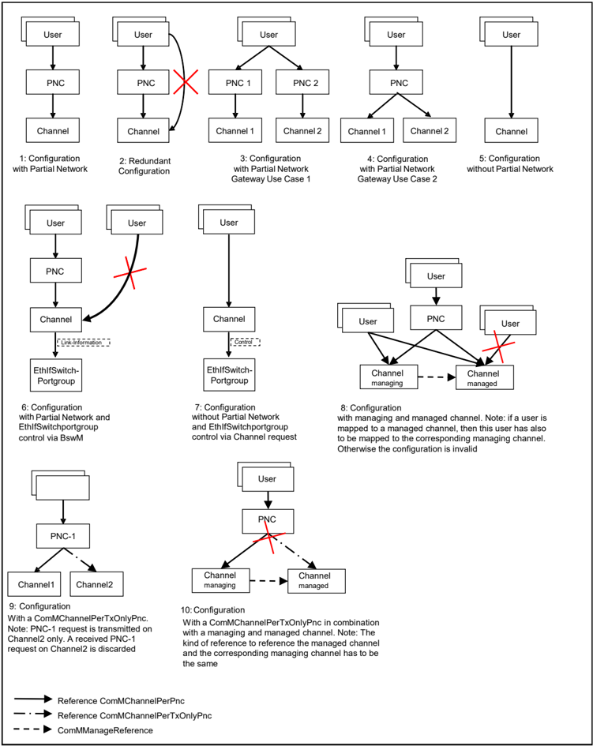

局部网络的 &lt;Bus&gt;Nm 过滤器配置不得对 **ComM** 用户到 **PNC** 的分配施加任何限制。

**注释：** &lt;Bus&gt;NM 过滤器配置应独立于 **ComM** 的 PNC 配置。

依据：这使得可以在不是 **PNC** 成员的情况下唤醒某个 **PNC**，例如某节点只触发一个 **PNC** 的唤醒，但该节点不被该 **PNC** 保持唤醒、而由其他节点保持该 **PNC** 唤醒。

应可以通过参数 [ComMUserPerChannel](#927-commuserperchannel) 将可配置数量的 [ComMUser](#924-commuser) 映射到一个或多个 ComM 通道。

**注释：**

1. 出于向后兼容的考虑，将 **ComM** 用户映射到系统通道的既有方式仍应可用（即配置容器保持不变）。
2. 在多通道系统中，每个用户可以被分配到一个或多个通道。如果该用户请求一种模式，分配给该用户的所有通道都应切换到相应的模式。所有其他通道不受影响。

应可以通过参数 ComMUserPerPnc（见 [ECUC_ComM_00876]）将可配置数量的 [ComMUser](#924-commuser) 映射到一个或多个 **PNC**。

应可以通过参数 ComMChannelPerPnc（见 [ECUC_ComM_00880]）或 ComMChannelPerTxOnlyPnc（见 [ECUC_ComM_00900]）将可配置数量的 **PNC** 映射到可配置数量的 ComM 通道。该映射应对所有 [ComMChannel](#925-commchannel) 与以下 ComMNmVariant 组合可行：

* ComMVariant= FULL；
* ComMVariant= LIGHT——前提是该 [ComMChannel](#925-commchannel) 充当被管理 [ComMChannel](#925-commchannel) 的角色，且相应的管理 [ComMChannel](#925-commchannel) 也被映射到该 **PNC**。

[SWS_ComM_01094] 的注释：关于被管理与管理 ComM 通道的更多细节见 6.2.1 小节。

不得将某个 [ComMUser](#924-commuser) 同时映射到一个 **PNC** 以及一个已被该 **PNC** 引用的 ComM 通道。

[SWS_ComM_00996] 的依据：避免冗余配置，因为该通道已被该 **PNC** 隐式引用。

[SWS_ComM_00996] 的注释：更多细节见图 7.7「用例 2」。

被某个 **PNC** 引用的 ComM 通道不得再被任何 [ComMUser](#924-commuser) 引用——前提是该 **PNC** 引用了至少一个 EthIfSwitchPortGroup。配置工具应将此类配置判定为无效（错误）。该约束只对控制 Ethernet 交换机的主机 ECU 有效。在所有其他用例中，[ComMChannel](#925-commchannel) 可以同时被 **PNC** 与 [ComMUser](#924-commuser) 引用。

[SWS_ComM_CONSTR_00001] 的依据：如果将 **PN** 与 EthIfSwitchPortGroup（在 EcuInstance.ethSwitchPortGroupDerivation 置为 TRUE 时从 SystemDescriptionExtract 派生）结合使用，则 EthIfSwitchPortGroup 通过 `EthIf_SwitchPortGroupRequestMode` API 切换，而不是通过通道请求切换。

[SWS_ComM_CONSTR_00001] 的注释：更多细节见图 7.7「用例 6」。

如果某个 **ComM** 用户引用一个被管理通道，则该 **ComM** 用户还必须引用相应的管理通道。否则该配置无效。如果某个用户引用了被管理通道却没有引用相应的管理通道，配置工具应将该配置判定为无效（错误）。

ComMNmVariant = SLAVE_PASSIVE 的 ComM 通道不得被任何 [ComMUser](#924-commuser) 或 **PNC** 引用。配置工具应将此类配置判定为无效（错误）。

依据：ComMNmVariant = SLAVE_PASSIVE 的 ComM 通道应始终跟随其通信主节点的通信请求，不允许请求相应的主节点唤醒通信通道。

如果某个 **PNC** 引用一个 ComM 通道，则该 **PNC** 引用该 ComM 通道的方式要么是 ComMChannelPerPnc、要么是 ComMChannelPerTxOnlyPnc，不得两者并用。否则该配置无效。配置工具应将此类配置判定为无效（错误）。

从 **PNC** 到被管理通道及其相应管理通道的引用种类（ComMChannelPerPnc 或 ComMChannelPerTxOnlyPnc）必须一致。否则该配置无效。配置工具应将此类配置判定为无效（错误）。

### 6.4. 扩展功能

本章描述的扩展功能应可在运行时按特性单独配置（例如使能唤醒抑制但停用无通信限制）。

[SWS_ComM_00470] 的依据：在运行期间需要能够改变抑制/限制策略，以应对变化的条件。

用例：经由诊断改变唤醒抑制。

**注释：** 可通过参数 ComMEcuGroupClassification（见 [ECUC_ComM_00563]）配置。

#### 6.4.1. 通信抑制

**注意：**

* 模式抑制的目的是限制通信能力。详细内容见 [6.4.1.1](#6411-总线唤醒抑制) 与 [6.4.1.2](#6412-限制为-comm_no_communication-模式) 小节。
* 以下参数与通信抑制相关，并与下述 API 存在关系：
* ComMNoCom：模式抑制的「请求位」（限制为 NoCom），只有在 ComMEcuGroupClassification 使能该功能时才能由 `[ComM_LimitChannelToNoComMode](#7316-comm_limitchanneltonocommode)()` 与 `[ComM_LimitECUToNoComMode](#7317-comm_limitecutonocommode)()` 控制（见 [ECUC_ComM_00563]、[SWS_ComM_00163]、[SWS_ComM_00124]）。
* ComMNoWakeup：模式抑制的「请求位」（唤醒抑制），只有在 ComMEcuGroupClassification 使能该功能时才能由 `[ComM_PreventWakeUp](#7315-comm_preventwakeup)()` 控制（见 [ECUC_ComM_00563]、[SWS_ComM_00156]）。
* ComMEcuGroupClassification：模式抑制行为的「掩码位」，可由 `[ComM_SetECUGroupClassification](#7320-comm_setecugroupclassification)()` 控制，不受 ComMNoCom 与 ComMNoWakeup 的值影响。

**ComM** 模块应提供请求与释放相应模式抑制的接口。

**注释：** **ComM** 模块不关心是谁请求了模式抑制，但它不是一个「普通」SW-C，而是一个特权 SW-C 或 OEM 特定的 **BSW**。

应可以为每个通道（通道状态机）独立地启用与停用模式抑制。**ComM** 模块自身不得使用该功能。

**ComM** 模块应存储用户请求的状态。

**注释：** [SWS_ComM_00839] 描述了激活模式限制期间的期望行为。

在激活的模式抑制期间某个用户释放请求时，**ComM** 模块应存储用户请求的更新状态。

[SWS_ComM_00840] 的依据：抑制被停用时，用户请求应被授予。

**注释：** 来自不同用户的激活用户请求的数量。[SWS_ComM_00840] 描述了激活模式限制期间的期望行为。

在激活的诊断会话期间，通信抑制应临时失效。

[SWS_ComM_00182] 的依据：在激活的诊断会话期间 ECU 不得进入睡眠。

**注释：** **DCM** 通过 `[ComM_DCM_ActiveDiagnostic](#7421-comm_dcm_activediagnostic)(&lt;channel&gt;)`（[SWS_ComM_00873]）指示诊断会话的开始，通过 `[ComM_DCM_InactiveDiagnostic](#7422-comm_dcm_inactivediagnostic)(&lt;channel&gt;)`（[SWS_ComM_00874]）指示诊断会话的结束。

##### 6.4.1.1. 总线唤醒抑制

信息：在 **ComM** 模块的语境下，总线唤醒抑制意味着 **ComM** 模块应采取措施，避免因启动通信而唤醒其他 ECU。

依据：应避免因通信唤醒其他 ECU，因为假定 ECU 唤醒总线是出于错误原因（例如传感器损坏）。

用例：在主动唤醒线的信号路径上检测到一个错误，且该不可靠的唤醒源不应再能唤醒整个系统。控制错误反应的某个 SW-C可以设置相关通信通道的唤醒抑制状态，这些通信通道通常作为该事件的后果而收到来自 SW-C 的通信请求。这会破坏基于不可靠唤醒事件的系统级通信转发。或者在应用特定的系统控制场景下，存在某个 SW-C，它应在例如运输模式等条件下关闭系统范围内经由通信的唤醒转发。

总线唤醒抑制应通过忽略用户请求来执行。

**注释：** 忽略用户请求意味着接受请求，但因模式抑制而不执行。一旦模式抑制被关闭，「最高者获胜」策略将立即生效（见 [SWS_ComM_00839] 与 [SWS_ComM_00840]）。

如果相应通道的 ComM 抑制状态中 ComMNoWakeup 置为 TRUE（见 [ECUC_ComM_00569]），且该通道的当前状态为 COMM_NO_COMMUNICATION 或 COMM_SILENT_COMMUNICATION，则应抑制用户的通信请求（COMM_FULL_COMMUNICATION）。

[SWS_ComM_00218] 的依据：如果抑制状态已设置但通信通道已经处于激活状态，抑制不应生效。

如果当前通信状态为 COMM_FULL_COMMUNICATION，抑制不应生效。

[SWS_ComM_00219] 的依据：如果当前通信状态为 COMM_FULL_COMMUNICATION，总线已经唤醒。

**ComM** 模块绝不应抑制「被动唤醒」能力。

[SWS_ComM_00066] 的依据：必须始终能够对 **EcuM** 模块指示的总线唤醒做出反应。

**注释：** 在 COMM_NO_COMMUNICATION 模式下接收被关闭，但唤醒能力是开启的。

ComMNoWakeup 状态必须非易失性地存储。

[SWS_ComM_00157] 的依据：该信息必须在启动期间、通信激活（进入「完全通信」模式）之前可用。更改或查询只能在启动后通信激活时进行（通常决定抑制是否激活的「主节点」不在同一 ECU 上）。

如果某个用户释放请求，用户请求的状态也应被更新。

##### 6.4.1.2. 限制为 COMM_NO_COMMUNICATION 模式

如果当前状态为 COMM_FULL_COM_NETWORK_REQUESTED，且已为相应通道请求了到 COMM_NO_COMMUNICATION 的模式限制，**ComM** 模块应切换到 COMM_FULL_COM_READY_SLEEP 状态以发起关机——尽管存在任何针对 COMM_FULL_COMMUNICATION 的用户请求。

[SWS_ComM_00303] 的依据：需要强制进入 COMM_NO_COMMUNICATION 模式来关闭那些保持总线唤醒的软件组件。

[SWS_ComM_00303] 的注释：限制为 COMM_NO_COMMUNICATION 只在通道被主动请求时执行。此时所有当前针对完全通信的用户请求、甚至新的请求都会被忽略（另见 [SWS_ComM_00215]）。如果某个 ComM 通道因被动唤醒而被远程保持唤醒，则不执行无通信限制。

当 `[ComM_LimitChannelToNoComMode](#7316-comm_limitchanneltonocommode)()` 被调用时，**ComM** 模块应更新相应通道的抑制状态（限制为 COMM_NO_COMMUNICATION）。

**注意：** 因请求限制为 COMM_NO_COMMUNICATION 而更新抑制状态必须始终执行，与当前状态无关。

如果 ComMResetAfterForcingNoComm 置为 TRUE（见 [ECUC_ComM_00558]），且当 **ComM** 在因到 COMM_NO_COMMUNICATION 的模式限制请求而强制从 COMM_FULL_COM_NETWORK_REQUESTED 状态转换到 COMM_FULL_COM_READY_SLEEP 之后进入 COMM_NO_COMMUNICATION（见 [SWS_ComM_00303]），**ComM** 应调用 `BswM_ComM_InitiateReset()`。

**注意：** 调用 `BswM_ComM_InitiateReset()` 是 ECU 复位的触发器，该复位必须尽快执行——取决于进一步需要的动作（例如存储所有 NvM 块）。

依据：假定故障用户不会在不重新初始化的情况下释放其「完全通信」请求。保持「完全通信」请求激活会导致网络关机与网络启动之间来回切换。

用例：假定一个故障 ECU 保持总线唤醒。作为后果，「网络主节点」决定强制所有 ECU 进入睡眠。

当已请求到 COMM_NO_COMMUNICATION 的模式限制时，**ComM** 模块应忽略针对相应通道的所有带 COMM_FULL_COMMUNICATION 的用户请求。

在属于相应用户的全部通道进入 COMM_NO_COMMUNICATION 模式后，**ComM** 模块应清除该用户请求。

[SWS_ComM_00582] 的依据：存储的（故障）用户请求——假定它们使总线保持唤醒——必须被清除。

描述：**ComM** 模块应在初始化期间从 ComMNoCom（见 [ECUC_ComM_00571]）重新加载 ComM 抑制状态的默认值。

**注释：** 每个通道的当前 ComMNoCom 状态不应持久存储。[SWS_ComM_00582] 描述了执行模式限制之后的期望行为。

### 6.5. 总线通信管理

**ComM** 模块应使用总线状态管理器模块的相应接口来控制通信能力。

如果配置参数 ComMBusType = COMM_BUS_TYPE_INTERNAL（[ECUC_ComM_00567]），**ComM** 模块应省略控制通信能力的调用。

[SWS_ComM_00664] 的依据：内部通信没有相应的总线接口。

### 6.6. 网络管理依赖

**ComM** 模块应支持关机同步变体（用 ComMNmVariant 配置，见 [ECUC_ComM_00568]）LIGHT、SLAVE_ACTIVE、SLAVE_PASSIVE、PASSIVE 与 FULL。

[SWS_ComM_00599] 的注释：只有变体 FULL 与 PASSIVE 能保证网络中所有节点之间的同步关机。请注意，由于在所有网络都准备睡眠之前 NmIf 不能启动已协调网络的同步关机，**ComM** 向 NmIf 发出的、在此类已协调总线上释放网络通信的请求会被考虑，但不总是被直接执行。NmIf 仍会以 `E_OK` 应答，但在所有已协调的网络都准备好睡眠之前，网络不会被释放。

[SWS_ComM_00599] 的注释：更多细节见表 7.3。

表 7.3：通信管理器模块支持的网络管理变体（**Network management variants supported by the Communication Manager Module**）

| NM 变体 | 保持总线唤醒能力 | 关机同步 |
| --- | --- | --- |
| NONE |  | **ComM** 不进行关机同步。通过切断 ECU 电源关机。 |
| SLAVE_ACTIVE | 否（但相应的主节点可以基于从节点的唤醒请求触发唤醒。例如 **LIN** 主节点的 **LIN** 状态管理器重启唤醒重复） | 由其主节点同步（例如 **LIN** 主节点） |
| SLAVE_PASSIVE | 否（从节点始终跟随相应主节点的通信请求。从节点没有可能在相应通信通道上请求唤醒） | 由其主节点同步（例如 ComMBusType 置为 COMM_BUS_TYPE_ETH、且所用 Ethernet 硬件兼容 OA TC10（见 [\[2\]](#ref-2)）的 ComM 通道） |
| LIGHT |  | **ComM** 借助超时进行关机同步（用 ComMNmLightTimeout 配置，[ECUC_ComM_00606]） |
| PASSIVE | 不允许 ECU 保持总线唤醒 | **ComM** 借助 AUTOSAR **NM** 进行关机同步。 |
| FULL | 允许 ECU 保持总线唤醒。 | **ComM** 借助 AUTOSAR **NM** 进行关机同步。 |

**注释：** LIGHT 变体无法实现同步关机，因此 ECU 可能因为来自较晚关机节点的消息而不断重启（「来回切换」）。

如果配置参数 ComMNmVariant = LIGHT | SLAVE_ACTIVE | SLAVE_PASSIVE | NONE（见 [ECUC_ComM_00568]），**ComM** 模块应省略对 **NM** 服务的调用。

[SWS_ComM_00602] 的依据：如果没有可用的 **NM**，则 NM 服务不可用。

如果配置参数 ComMNmVariant= LIGHT | SLAVE_ACTIVE | SLAVE_PASSIVE | NONE（见 [ECUC_ComM_00568]），**ComM** 模块应省略从 **NM** 调用 `Nm_NetworkRequest()`。

[SWS_ComM_00667] 的依据：服务 `Nm_NetworkRequest()` 不可用。

### 6.7. 总线错误管理

#### 6.7.1. 网络启动指示

如果 **NM** 指示 `[ComM_Nm_NetworkStartIndication](#7411-comm_nm_networkstartindication)(&lt;通道 X&gt;)` 且 CommunicationAllowed 标志置为 TRUE，**ComM** 模块应将通道 X 切换到 COMM_FULL_COMMUNICATION。

[SWS_ComM_00583] 的用例：某个节点在「准备总线睡眠」状态下发送 NM 消息，但由于「竞态条件」其他节点已处于「总线睡眠」状态。

### 6.8. 测试支持需求

#### 6.8.1. 被抑制的完全通信请求计数器

**ComM** 模块应为所有被拒绝的 COMM_FULL_COMMUNICATION 模式请求提供一个抑制计数器。它应统计因系统抑制了通信模式而无法满足的用户请求。

[SWS_ComM_00138] 的依据：该计数器用于检测与无动机通信总线唤醒相关的潜在软件问题。

所有被拒绝的 COMM_FULL_COMMUNICATION 模式请求的抑制计数器（[SWS_ComM_00138]）应存储在非易失性存储器中。

所有被拒绝的 COMM_FULL_COMMUNICATION 模式请求的抑制计数器（[SWS_ComM_00138]）的取值范围应为 0 到 65535。

所有被拒绝的 COMM_FULL_COMMUNICATION 模式请求的抑制计数器（[SWS_ComM_00138]）在达到最大计数值后应停止递增。

应可以通过 **ComM** 模块的 API 调用读取并复位所有被拒绝的 COMM_FULL_COMMUNICATION 模式请求的抑制计数器（[SWS_ComM_00138]）的值。

[SWS_ComM_00143] 的用例：应可以通过诊断服务读取并复位该计数器的当前状态。

### 6.9. 错误分类

文档 [\[14\]](#ref-14)《基础软件模块通用规范》的「错误处理」一节详细描述了基础软件的错误处理。其中最重要的是一个由五种错误类型构成的分类体系，这些错误可能发生在 **BSW** 模块中。

在此基础上，以下各节在相应的小节中规定具体的错误。

#### 6.9.1. 开发错误

表 7.4：模块 ComM 的开发错误定义（**Definiton of development errors in module ComM**）

| 错误类型 | 相关错误码 | 错误值 |
| --- | --- | --- |
| 未进行模块初始化就使用 API 服务 | COMM_E_UNINIT | 0x1 |
| 以错误的参数使用 API 服务 | COMM_E_WRONG_PARAMETERS | 0x2 |
| 以空指针使用 API 服务 | COMM_E_PARAM_POINTER | 0x3 |
| 初始化失败 | COMM_E_INIT_FAILED | 0x4 |

如果 **ComM** 未初始化，除 `[ComM_Init](#731-comm_init)()`（见 [SWS_ComM_00146]）、`[ComM_GetVersionInfo](#7321-comm_getversioninfo)()`（见 [SWS_ComM_00370]）与 `[ComM_GetStatus](#733-comm_getstatus)()`（见 [SWS_ComM_00242]）之外的所有 **ComM** 模块 API 服务应：

* 不执行其正常操作；
* 且在具有标准返回类型时返回 `E_NOT_OK`。

如果通过 ComMDevErrorDetect（见 [ECUC_ComM_00555]）使能了开发错误检测：函数应检查服务 `[ComM_Init](#731-comm_init)` 之前是否已被调用。若检查失败，函数应引发开发错误 COMM_E_UNINIT。

#### 6.9.2. 运行时错误

表 7.5：模块 ComM 的运行时错误定义（**Definiton of runtime errors in module ComM**）

| 错误类型 | 相关错误码 | 错误值 |
| --- | --- | --- |
| 从 NVRAM 读取数据失败 | COMM_E_READ_NV_FAILED | 0x01 |

#### 6.9.3. 瞬态故障

没有瞬态故障。

#### 6.9.4. 产出错误

没有产出错误。

#### 6.9.5. 扩展产出错误

没有扩展产出错误。

### 6.10. 通信管理器模块服务

本节定义通信管理器模块服务（**ComM**）的 AUTOSAR 接口。

#### 6.10.1. 架构

通信管理器模块服务的整体架构如图 7.8 所示：

图 7.8：通信管理器模块的 ARPackage（**ARPackage of the Communication Manager Module**）

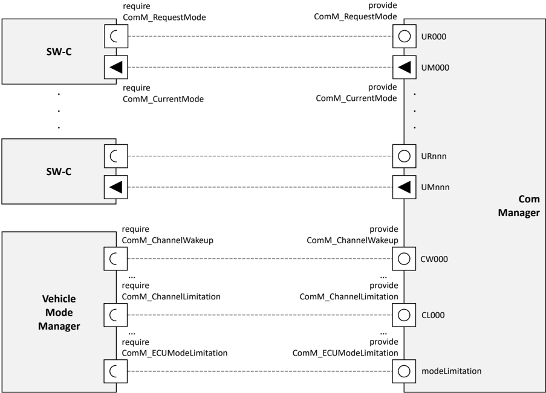

#### 6.10.2. 用例

##### 6.10.2.1. SW-C 完全不关心 ComM 模块

一个不关心通信管理器模块的 SW-C 不会要求通信管理器模块 ARPackage 中定义的任何接口。

##### 6.10.2.2. SW-C 只关心其通信系统的状态

在该用例中，某个 SW-C 想知道它拥有哪些通信能力（用通信模式「无」「静默」或「完全」表达——见 [ComM_ModeType](#7742-comm_modetype)）。该 SW-C 通过定义一个要求接口 `[ComM_GetCurrentComMode](#738-comm_getcurrentcommode)` 的端口来获知这一点。依据可用的通信能力，该 SW-C 可以规定其某些可运行实体是否应执行。通信管理器模块必须正确配置（例如使用该 SW-C 用于其逻辑通信的物理通道），使其拥有一个向该 SW-C 提供当前通信模式信息的端口。

图 7.9：SW-C 向通信管理器模块请求状态变化（**SW-C requests state changes to the Communication Manager Module**）

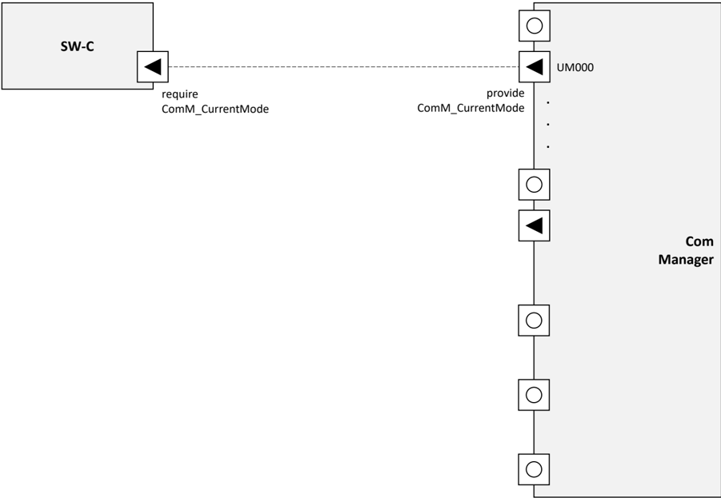

##### 6.10.2.3. SW-C 显式地想影响其通信状态

图 7.10：SW-C 要求通信管理器模块内的状态变化并读取当前通信状态（**SW-C requires state changes within the Communication Manager Module and reads out current communication state**）

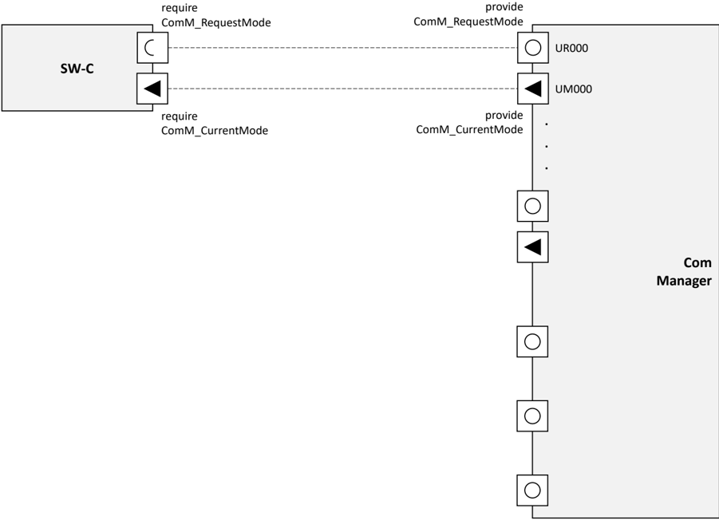

在该用例中，SW-C 想显式地影响它所需要的物理通道的通信状态。SW-C 通过一个特定端口表明这一点。通过该端口，SW-C 可以请求通信管理器模块的模式「无通信」或「完全通信」。通信管理器模块会使用这些调用来向相应的总线状态管理器模块请求相应的通信模式。

通信管理器模块应提供一个 AUTOSAR 端口，以允许通过调用 `[ComM_RequestComMode](#735-comm_requestcommode)` 请求一种通信模式（见 [SWS_ComM_00110]）。

对于使用 **RTE**「直接 API」的 SW-C，该 SW-C 例如可以这样做：

```
1 MySW-C_Runnable_Init(self) 2 { 3 // SW-C wants to send and receive data 4 e = Rte_Call_comRequest_RequestComMode(COMM_FULL_COMMUNICATION); 5 if (e == RTE_E_OK) 6 { 7 // successfully requested the Com Manager Module to move to
8 // full communication mode 9 } 10 else 11 { 12 // an error occurred when 13 // interacting with the Com Manager module 14 if (e == E_MODE_LIMITATION) 15 { 16 // a current ComMMode limitation forbids going into 17 // that mode; 18 // let's ask what the maximal allowed ComMMode is 19 Rte_Call_comRequest_GetMaxComMode(&max); 20 if (max==COMM_NO_COMMUNICATION) 21 { 22 ... 23 }; 24 } 25 else 26 { 27 // a more serious error occurred ... 28 }; 29 }; 30 ... 31 }; 32 MySW-C_Runnable_Loop(self) 33 { 34 if (status == ready_to_sleep) 35 { 36 //no need to send; ready for shutdown communication 37 Rte_Call_comRequest_RequestComMode(COMM_NO_COMMUNICATION); 38 ... 39 }; 40 };
```

**注释：** 请注意，这些 API 不要求 SW-C 了解它所需的通道。

##### 6.10.2.4. SW-C 想直接与物理通道交互并激活 ECU 模式限制

SW-C 应向 **BswM** 请求模式。**BswM** 将处理与 **ComM** 的直接通信。

图 7.11：BswM 与 ComM 模块之间的交互（**Interaction between BswM and the ComM module**）

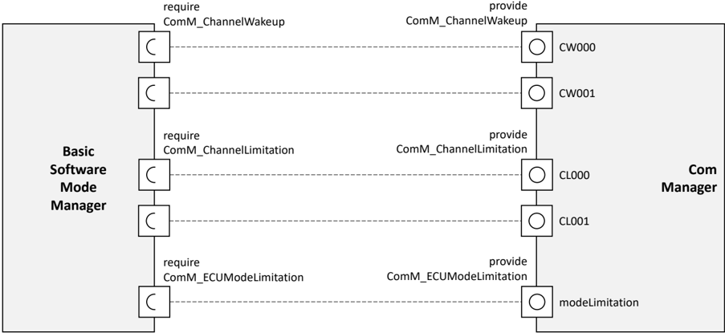

#### 6.10.3. 端口与端口接口的规定

本节规定经由 **RTE** 操作通信管理器模块功能所需的端口接口。

##### 6.10.3.1. 接口使用的类型

见 [7.7.4](#774-实现数据类型) 节「实现数据类型」。

##### 6.10.3.2. 用户请求的端口与端口接口

###### 6.10.3.2.1. 通用方法

想把本地 ECU 的通信管理器模块显式引导到某个状态的 SW-C 要求客户端-服务器接口 `[ComM_UserRequest](#7724-comm_userrequest)`。通过该接口，SW-C 可以把与该组件相关的所有通信通道的期望状态设置为「无通信」或「完全通信」。为了使 SW-C 的代码独立于用于向通信管理器模块标识用户的句柄值，这些句柄不会从 SW-C 传递给通信管理器模块。它们被建模为通信管理器模块一侧提供端口（Provide Port）的「端口定义的实参值」。因此，这些句柄不会作为实参出现在客户端-服务器接口 `[ComM_UserRequest](#7724-comm_userrequest)` 的操作中。这一方法的另一个后果是：通信管理器模块为每个用户拥有一个单独的端口。

###### 6.10.3.2.2. 数据类型

该接口不需要任何数据类型。

###### 6.10.3.2.3. 端口接口 ComM_UserRequest

见 [7.7.2.4](#7724-comm_userrequest) 节「[ComM_UserRequest](#7724-comm_userrequest)」。

##### 6.10.3.3. 通信管理器模块当前模式的端口与端口接口

###### 6.10.3.3.1. 通用方法

通信管理器模块应有一个提供模式切换接口（ModeSwitchInterface）`[ComM_CurrentMode](#7731-comm_currentmode)` 的 AUTOSAR 端口。

通信管理器模块应为每个已配置用户拥有一个单独的、提供模式切换接口 `[ComM_CurrentMode](#7731-comm_currentmode)` 的端口，SW-C 连接到该端口。

想获知其当前通信管理器模块模式的 SW-C 要求模式切换接口 `[ComM_CurrentMode](#7731-comm_currentmode)`。

###### 6.10.3.3.2. 端口接口 ComM_CurrentMode

见 [7.7.3.1](#7731-comm_currentmode) 节「[ComM_CurrentMode](#7731-comm_currentmode)」。

##### 6.10.3.4. 当前请求 COMM_FULL_COMMUNICATION 的 ComM 用户的端口与端口接口

###### 6.10.3.4.1. 通用方法

通信管理器模块可以配置为（可选，见 [ECUC_ComM_00787]）为每个已配置的 ComM 通道拥有一个单独的、提供发送方-接收方接口 `[ComM_CurrentChannelRequest](#7711-comm_currentchannelrequest)` 的端口。

[SWS_ComM_00734] 的依据：想获知哪些用户当前正在请求 COMM_FULL_COMMUNICATION 的 SW-C 要求发送方-接收方接口「[ComM_CurrentChannelRequest](#7711-comm_currentchannelrequest)」。

每当某个通道当前正在请求 COMM_FULL_COMMUNICATION 的 ComM 用户集合发生变化时，通信管理器模块应更新数据元素 fullComRequestors。只有当通信管理器模块接受该 ComM 用户的通信请求时，该变化才应更新数据元素。

**注意：** 因激活的 ModeLimitation 而被接受但未被处理的请求同样会导致数据元素的更新。

###### 6.10.3.4.2. 数据类型

见 [7.7.4.4](#7744-comm_userhandlearraytype_channel_name) 节「ComM_UserHandleArrayType」。

###### 6.10.3.4.3. 端口接口 ComM_CurrentChannelRequest

见 [7.7.1.1](#7711-comm_currentchannelrequest) 节「[ComM_CurrentChannelRequest](#7711-comm_currentchannelrequest)」。

##### 6.10.3.5. ECU 模式限制的端口与端口接口

###### 6.10.3.5.1. 通用方法

通信管理器模块可以配置为拥有一个提供客户端-服务器接口 `[ComM_ECUModeLimitation](#7723-comm_ecumodelimitation)` 的 AUTOSAR 端口。

充当「模式管理器」角色的 SW-C 可以使用该接口改变整个 ECU 的行为。

###### 6.10.3.5.2. 端口接口 ComM_ECUModeLimitation

见 [7.7.2.3](#7723-comm_ecumodelimitation) 节「[ComM_ECUModeLimitation](#7723-comm_ecumodelimitation)」。

##### 6.10.3.6. 通道唤醒的端口与端口接口

###### 6.10.3.6.1. 通用方法

通信管理器模块可以配置为拥有一个提供客户端-服务器接口 `[ComM_ChannelWakeup](#7722-comm_channelwakeup)` 的 AUTOSAR 端口。

充当「模式管理器」角色的 SW-C 可以使用该接口，将通信管理器模块配置为采取措施避免因启动通信而唤醒其他 ECU。为了使 SW-C 的代码独立于用于向通信管理器模块标识特定句柄的句柄值，这些句柄不会从 SW-C 传递给通信管理器模块。它们被建模为通信管理器模块一侧提供端口的「端口定义的实参值」。因此，这些句柄不会作为实参出现在客户端-服务器接口 `[ComM_ChannelWakeup](#7722-comm_channelwakeup)` 的操作中。这一方法的另一个后果是：通信管理器模块为每个通道拥有单独的端口。

###### 6.10.3.6.2. 端口接口 ComM_ChannelWakeup

见 [7.7.2.2](#7722-comm_channelwakeup) 节「[ComM_ChannelWakeup](#7722-comm_channelwakeup)」。

##### 6.10.3.7. 通道限制接口的端口与端口接口

###### 6.10.3.7.1. 通用方法

通信管理器模块可以配置为拥有一个提供客户端-服务器接口 `[ComM_ChannelLimitation](#7721-comm_channellimitation)` 的 AUTOSAR 端口。

充当「模式管理器」角色的 SW-C 可以使用该接口，将通信管理器模块配置为抑制给定通道的通信模式。为了使 SW-C 的代码独立于用于向通信管理器模块标识特定句柄的句柄值，这些句柄不会从 SW-C 传递给通信管理器模块。它们被建模为通信管理器模块一侧提供端口的「端口定义的实参值」。因此，这些句柄不会作为实参出现在客户端-服务器接口 `[ComM_ChannelLimitation](#7721-comm_channellimitation)` 的操作中。这一方法的另一个后果是：通信管理器模块为每个通道拥有单独的端口。

###### 6.10.3.7.2. 端口接口 ComM_ChannelLimitation

见 [7.7.2.1](#7721-comm_channellimitation) 节「[ComM_ChannelLimitation](#7721-comm_channellimitation)」。

##### 6.10.3.8. 通信管理器模块服务的定义

本节为通信管理器模块服务的定义提供指导。**RTE** 的两侧都有端口。此处对通信管理器模块服务的描述定义 **RTE** 下方的端口。每个使用该服务的 SW-C 必须在自己的 SW-C 描述中包含「服务端口」，这些服务端口将连接到 COM 管理器模块的端口，以便生成 **RTE**。

**注释：** 请注意，这些定义只能在 ECU 配置期间补全（因为它取决于通信管理器模块的某些配置参数——它们决定通信管理器模块服务提供的端口数量）。另请注意，SW-C 的实现不依赖这些定义。

```
1 /* This is the definition of the Communication Manager Module as a service. 2 This is the 'outside-view' of the Communication Manager Module */ 3 Service ComM 4 { 5 // port present if ComMModeLimitationEnabled (see ECUC_ComM_00560) 6 ProvidePort ComM_ECUModeLimitation modeLimitation; 7 // port present for each channel 8 // if ComMModeLimitationEnabled (see ECUC_ComM_00560); 9 // there are NC channels; 10 ProvidePort ComM_ChannelLimitation CL000; 11 ... 12 ProvidePort ComM_ChannelLimitation CL<NC-1>; 13 // port present for each channel 14 // if COMM_WAKEUP_INHIBITION_ENABLED (see ECUC_ComM_00559) 15 ProvidePort ComM_ChannelWakeup CW000; 16 ... 17 ProvidePort ComM_ChannelWakeup CW<NC-1>; 18 // For each user the Communication Manager Module provides 2 ports. 19 // To facilitate configuration, the index of this user shall 20 // correspond to the index in the array COMM_USER_LIST used for the 21 // configuration of the Communication Manager Module. 22 // The number of users must correspond to the size of this array. 23 ProvidePort ComM_UserRequest UR000; // (see 7.10.3.2.2) 24 ProvidePort ComM_CurrentMode UM000; 25 ProvidePort ComM_UserRequest UR001; //(see 7.10.3.2.2) 26 ProvidePort ComM_CurrentMode UM001; 27 ... 28 ProvidePort ComM_UserRequest UR<COMM_USER_LIST.size-1>; 29 ProvidePort ComM_CurrentMode UM<COMM_USER_LIST.size-1>; 30 // port present for each channel if configured 31 // (see ECUC_ComM_00787) 32 // there are NC channels; 33 ProvidePort ComM_CurrentChannelRequest CR000; 34 ... 35 ProvidePort ComM_CurrentChannelRequest CR<NC-1>; 36 };
```

#### 6.10.4. 可运行实体与入口点

##### 6.10.4.1. 内部行为

这是通信管理器模块的内部描述。这一详细描述只用于本地 **RTE** 的配置。

```
1 InternalBehavior of the Communication Manager Module 2 { 3 // Runnable entities of the Communication Manager Module 4 RunnableEntity LimitECUToNoComMode 5 symbol "ComM_LimitECUToNoComMode" /* see SWS_ComM_00124*/ 6 canbeInvokedConcurrently = FALSE 7 RunnableEntity ReadInhibitCounter 8 symbol "ComM_ReadInhibitCounter" /* see SWS_ComM_00224 */ 9 canbeInvokedConcurrently = FALSE 10 RunnableEntity ResetInhibitCounter 11 symbol "ComM_ResetInhibitCounter" /* see SWS_ComM_00108 */ 12 canbeInvokedConcurrently = FALSE 13 RunnableEntity SetECUGroupClassification 14 symbol "ComM_SetECUGroupClassification" /* see SWS_ComM_00552 */ 15 canbeInvokedConcurrently = FALSE 16 RunnableEntity LimitChannelToNoComMode 17 symbol "ComM_LimitChannelToNoComMode" /* see SWS_ComM_00163 */ 18 canbeInvokedConcurrently = FALSE 19 RunnableEntity GetInhibitionStatus 20 symbol "ComM_GetInhibitionStatus" /*see SWS_ComM_00619 */ 21 canbeInvokedConcurrently = FALSE 22 RunnableEntity PreventWakeup 23 symbol "ComM_PreventWakeup" 24 canbeInvokedConcurrently = FALSE 25 RunnableEntity RequestComMode 26 symbol "ComM_RequestComMode" /* see SWS_ComM_00110 */ 27 canbeInvokedConcurrently = TRUE 28 RunnableEntity GetMaxComMode 29 symbol "ComM_GetMaxComMode" /* see SWS_ComM_00085 */ 30 canbeInvokedConcurrently = TRUE 31 RunnableEntity GetRequestedComMode 32 symbol "ComM_GetRequestedComMode" 33 canbeInvokedConcurrently = TRUE 34 RunnableEntity GetCurrentComMode 35 symbol "ComM_GetCurrentComMode" /*see SWS_ComM_00083 */ 36 canbeInvokedConcurrently = TRUE 37 // the following applies if ComMModeLimitationEnabled 38 // (see ECUC_ComM_00560) 39 modeLimitation.LimitECUToNoComMode -> LimitECUToNoComMode 40 modeLimitation.ReadInhibitCounter -> ReadInhibitCounter 41 modeLimitation.ResetInhibitCounter -> ResetInhibitCounter 42 modeLimitation.SetECUGroupClassification -> SetECUGroupClassification 43 // per-channel behaviour only present 44 // if ComMModeLimitationEnabled (see ECUC_ComM_00560) 45 // there are NC channels 46 // To facilitate configuration, the names of the channels correspond 47 // to the index of the channel in the "Channel" container used to 48 // configure the Communication Manager Module 49 CL000.LimitChannelToNoComMode -> LimitChannelToNoComMode 50 CL000.GetInhibitionStatus -> GetInhibitionStatus 51 PortArgument {port=CL000, 52 value.type=NetworkHandleType, 53 value.value=Channel[0].COMM_CHANNEL_ID} 54 ... 55 CLnnn.LimitChannelToNoComMode -> LimitChannelToNoComMode 56 CLnnn.GetInhibitionStatus -> GetInhibitionStatus 57 PortArgument {port=CLnnn, 58 value.type=NetworkHandleType, 59 value.value=Channel[nnn].COMM_CHANNEL_ID} 60 // per-channel behaviour only present 61 // if COMM_WAKEUP_INHIBITION_ENABLED (see ECUC_ComM_00559) 62 CW000.preventWakeUp -> PreventWakeUp 63 PortArgument {port=CW000, 64 value.type=NetworkHandleType, 65 value.value=Channel[0].COMM_CHANNEL_ID} 66 ... 67 CWnnn.preventWakeUp -> PreventWakeUp 68 PortArgument {port=CWnnn, 69 value.type=NetworkHandleType, 70 value.value=Channel[nnn].COMM_CHANNEL_ID} 71 // per-user behaviour 72 // Note that the port-argument value must be consistent with the 73 // value in the configuration COMM_USER_LIST 74 // Note that the exact data-type of the UserHandleType must of course 75 // be defined BEFORE RTE_configuration, but does NOT affect the 76 // API seen by the SW-Cs that use the service 77 UR000.RequestComMode -> RequestComMode 78 UR000.GetMaxComMode -> GetMaxComMode 79 UR000.GetRequestedComMode -> GetRequestedComMode 80 UR000.GetCurrentComMode -> GetCurrentComMode 81 PortArgument {port=UR000, 82 value.type= ComM_UserhandleType, 83 value.value=COMM_USER_LIST[0]} 84 ... 85 URnnn.RequestComMode -> RequestComMode 86 URnnn.GetMaxComMode -> GetMaxComMode 87 URnnn.GetRequestedComMode -> GetRequestedComMode 88 URnnn.GetCurrentComMode -> GetCurrentComMode 89 PortArgument {port=URnnn, 90 value.type= ComM_UserhandleType, 91 value.value=COMM_USER_LIST[n]} 92 };
```

**注释：**

「modeLimitation.LimitECUToNoComMode -> LimitECUToNoComMode」旨在定义一个 OperationInvokedEvent，把操作原型链接到应当被执行的可运行实体。

##### 6.10.4.2. 通信管理器模块要包含的头文件

**RTE** 像对待任何普通 SW-C 一样对待通信管理器模块。**RTE** 将能够基于通信管理器模块的内部行为描述生成一个头文件，其中包含例如可供通信管理器模块使用的 API 的定义（如 `Rte_Ports_CurrentMode_P`）。这意味着通信管理器模块的实现必须包含这个生成的头文件。

### 6.11. 多核分布

**ComM** 作为处理不同网络类型的核心模块，在 Com-Stack 分布于多个分区的情况下，其交互会跨越分区，因此应提供所需的多核特性，以保证干净的架构，并使依赖网络的集群免于多分区（多核）附加物。

**ComM** 模块应采用适当的机制，允许从其主函数所在分区之外的其他分区调用其 API，例如通过提供一个 **ComM** 卫星（satellite）。

**ComM** 应只在与相应 &lt;Bus&gt;SM 模块被分配到的分区内与 &lt;Bus&gt;SM 交互（即调用 &lt;Bus&gt;SM API）。

**ComM** 应只在 **Dcm** 模块被分配到的分区内与 **Dcm** 交互（即调用 **Dcm** API）。

**注意：** 尽管基础软件分布在多个分区上，**ComM** 与 **Nm** 主节点应驻留在同一分区，以保持两个模块之间的模式接口简单（更多信息见 [\[21\]](#ref-21)（《BSW 分布指南》）中的主节点/卫星方法一章）。

### 6.12. 非功能性需求

应可以将以源代码或目标代码形式交付的 **ComM** 模块集成到 AUTOSAR 栈中。

依据：

* 允许知识产权保护并保证测试覆盖率：目标代码；
* 允许在系统生成时（由集成者）实现高效率与可配置性：源代码。

### 6.13. 安全事件

本模块不上报安全事件。

## 7. API规范

### 7.1. 导入的类型

#### 7.1.1. 标准类型

本章列出从以下模块包含的全部类型：

表 7.6：模块 ComM 的导入数据类型定义（**Definition of imported datatypes of module ComM**）

| 模块 | 头文件 | 导入的类型 |
| --- | --- | --- |
| ComStack_Types | ComStack_Types.h | NetworkHandleType |
| ComStack_Types | ComStack_Types.h | PNCHandleType |
| NvM | Rte_NvM_Type.h | NvM_BlockIdType |
| NvM | Rte_NvM_Type.h | NvM_RequestResultType |
| Std | Std_Types.h | Std_ReturnType |
| Std | Std_Types.h | Std_VersionInfoType |

**ComM** API 使用以下 `Std_ReturnType` 扩展：

表 7.7：模块 ComM 的 Std_ReturnType 扩展定义（**Definition of Std_ReturnType-extension for module ComM**）

| 取值 | 名称 | 值 | 说明 |
| --- | --- | --- | --- |
| 取值 | COMM_E_MODE_LIMITATION | 2 | 函数调用已成功，但由于模式抑制而无法授予模式。 |
|  | COMM_E_MULTIPLE_PNC_ASSIGNED | 3 | 由于多个 **PNC** 被分配给受影响的用户，函数无法提供该 **PNC** 的当前模式。 |
|  | COMM_E_NO_PNC_ASSIGNED | 4 | 由于没有 **PNC** 被分配给受影响的用户，函数无法提供该 **PNC** 的当前模式。 |
|  | COMM_E_LEARNING_ACTIVE | 5 | 函数调用已成功，但由于 PNC 学习阶段处于激活状态而无法执行该功能。 |
| 说明 | - | - | - |
| 可用性 | ComM.h | ComM.h | ComM.h |

### 7.2. 类型定义

本规范中定义的函数应使用以下数据类型。

#### 7.2.1. ComM_InitStatusType

表 7.8：数据类型 ComM_InitStatusType 的定义（**Definition of datatype ComM_InitStatusType**）

| 属性 | 值 |
| --- | --- |
| 名称 | ComM_InitStatusType |
| 类别 | 枚举（Enumeration） |
| 说明 | **ComM** 的初始化状态。 |
| 可用性 | ComM.h |

| 取值 | 值 | 说明 |
| --- | --- | --- |
| COMM_UNINIT | 0x00 | COM 管理器未初始化或不可用。这应是复位后的默认值。该状态的值应为 0。 |
| COMM_INIT | 0x01 | COM 管理器已初始化且可用。 |

#### 7.2.2. ComM_PncModeType

表 7.9：数据类型 ComM_PncModeType 的定义（**Definition of datatype ComM_PncModeType**）

| 属性 | 值 |
| --- | --- |
| 名称 | ComM_PncModeType |
| 类别 | 枚举（Enumeration） |
| 说明 | **PNC** 的当前模式。 |
| 可用性 | ComM.h |

| 取值 | 值 | 说明 |
| --- | --- | --- |
| COMM_PNC_REQUESTED | 0x00 | **PNC** 被本地 ComM 用户请求 |
| COMM_PNC_READY_SLEEP | 0x01 | **PNC** 被远程 ComM 用户请求 |
| COMM_PNC_PREPARE_SLEEP | 0x02 | **PNC** 处于激活状态且无截止期监控 |
| COMM_PNC_NO_COMMUNICATION | 0x03 | **PNC** 不通信 |
| COMM_PNC_REQUESTED_WITH_WAKEUP_REQUEST | 0x04 | **PNC** 被本地 ComM 用户请求。该模式用于向 **BswM** 指示：激活的 PNC 请求还应触发所用通信硬件的唤醒——前提是硬件支持并已配置（例如用于结合兼容 OA TC10 的 Ethernet 硬件的 Ethernet 交换机端口切换）。 |

#### 7.2.3. ComM_StateType

表 7.10：数据类型 ComM_StateType 的定义（**Definition of datatype ComM_StateType**）

| 属性 | 值 |
| --- | --- |
| 名称 | ComM_StateType |
| 类别 | 类型（Type） |
| 派生自 | uint8 |
| 说明 | **ComM** 状态机的状态与子状态。ComM 状态与通信模式的对应关系：COMM_NO_COM*：通信模式 =「无通信」；COMM_FULL_COM*：通信模式 =「完全通信」；COMM_SILENT_COM：通信模式 =「静默通信」。 |
| 可用性 | ComM.h |

| 取值 | 值 | 说明 |
| --- | --- | --- |
| COMM_NO_COM_NO_PENDING_REQUEST | 0 | - |
| COMM_NO_COM_REQUEST_PENDING | 1 | - |
| COMM_FULL_COM_NETWORK_REQUESTED | 2 | - |
| COMM_FULL_COM_READY_SLEEP | 3 | - |
| COMM_SILENT_COM | 4 | - |

#### 7.2.4. ComM_ConfigType

表 7.11：数据类型 ComM_ConfigType 的定义（**Definition of datatype ComM_ConfigType**）

| 属性 | 值 |
| --- | --- |
| 名称 | ComM_ConfigType |
| 类别 | 结构体（Structure） |
| 元素 | 由实现定义 |
|  | 类型：- |
|  | 注释：初始化数据结构的内容由实现定义 |
| 说明 | 该类型包含实现特定的构建后（post build）配置结构。 |
| 可用性 | ComM.h |

### 7.3. 函数定义

以下是为上层模块提供的函数清单。

**注意：** 本章的全部函数都要求先进行初始化（`[ComM_Init](#731-comm_init)`），以下函数除外：

* [ComM_Init](#731-comm_init)
* [ComM_GetVersionInfo](#7321-comm_getversioninfo)

#### 7.3.1. ComM_Init

**说明**:

```C
void ComM_Init ( const ComM_ConfigType* ConfigPtr )
```

| 属性 | 值 |
| --- | --- |
| 服务 ID [hex] | 0x01 |
| 同步/异步 | 同步（Synchronous） |
| 可重入性 | 不可重入（Non Reentrant） |
| 参数（输入） | ConfigPtr：指向构建后配置数据的指针 |
| 参数（输入/输出） | 无 |
| 参数（输出） | 无 |
| 返回值 | 无 |
| 说明 | 初始化 AUTOSAR 通信管理器并重启内部状态机。 |
| 可用性 | ComM.h |

`ComM_Init()` 的注意事项：必须先初始化 **NVRAM** 管理器模块，才有可能「直接」访问 **ComM** 模块的参数。

在 `ComM_Init()` 中，**ComM** 应以从非易失性存储器（NVRAM）读出的值读取 [SWS_ComM_00103] 规定的非易失性参数。如果没有可用的参数（例如 NvM 块读取失败），**ComM** 应使用默认值进行初始化。

用于初始化抑制计数器的默认值应为 0。

用于初始化 PNC 到通道映射的默认值应是一个二维数组，其中包含 PNC 网关的 **PNC** 到通道的静态配置映射。

用于初始化 PNC 成员关系的默认值应是一个保存该节点静态配置 **PNC** 的 PNC 位向量。

[SWS_ComM_01100] 的注释：ComMEcuGroupClassification 与抑制状态的默认值依据 [SWS_ComM_00103] 引用的配置参数使用。

如果从非易失性存储器（NVRAM）读取数据失败，**ComM** 应向 **DET** 上报运行时错误 [COMM_E_READ_NV_FAILED](#692-运行时错误)。

[SWS_ComM_01101] 的注释：如果 **ComM** 上报 [COMM_E_READ_NV_FAILED](#692-运行时错误)，应用可以对该错误场景做出反应，例如通过调用 `[ComM_UpdatePncMembership](#7314-comm_updatepncmembership)` 更新 PNC 成员关系，或通过调用 `[ComM_UpdatePncToChannelMapping](#7311-comm_updatepnctochannelmapping)` 更新 PNC 到通道映射。

#### 7.3.2. ComM_DeInit

**说明**:

```C
void ComM_DeInit ( void )
```

| 属性 | 值 |
| --- | --- |
| 服务 ID [hex] | 0x02 |
| 同步/异步 | 同步（Synchronous） |
| 可重入性 | 不可重入（Non Reentrant） |
| 参数（输入） | 无 |
| 参数（输入/输出） | 无 |
| 参数（输出） | 无 |
| 返回值 | 无 |
| 说明 | 该 API 去初始化 AUTOSAR 通信管理器。 |
| 可用性 | ComM.h |

`ComM_DeInit()` 中的去初始化只在 **ComM** 模块控制的全部通道都处于 COMM_NO_COMMUNICATION 模式时才应执行。

[SWS_ComM_00794] 的依据：由于 `ComM_DeInit()` API 无法返回错误消息，必须确保在调用 `ComM_DeInit()` 之前所有通道都处于 COMM_NO_COMMUNICATION 模式与 COMM_NO_COM_NO_PENDING_REQUEST 子状态。

在 `ComM_DeInit` 中，**ComM** 应把 [SWS_ComM_00103] 规定的非易失性参数存储到 NVRAM。

#### 7.3.3. ComM_GetStatus

**说明**:

```C
Std_ReturnType ComM_GetStatus ( ComM_InitStatusType* Status )
```

| 属性 | 值 |
| --- | --- |
| 服务 ID [hex] | 0x03 |
| 同步/异步 | 同步（Synchronous） |
| 可重入性 | 不可重入（Non Reentrant） |
| 参数（输入） | 无 |
| 参数（输入/输出） | 无 |
| 参数（输出） | Status：COMM_UNINIT：**ComM** 未初始化或不可用。启动后或调用 `[ComM_DeInit](#732-comm_deinit)()` 之后的默认值。COMM_INIT：**ComM** 已初始化且可用。 |
| 返回值 | Std_ReturnType：`E_OK`：成功返回初始化状态；`E_NOT_OK`：返回初始化状态失败 |
| 说明 | 返回 AUTOSAR 通信管理器的初始化状态。调用 `[ComM_DeInit](#732-comm_deinit)()` 之后 **ComM** 应具有状态 COMM_UNINIT，需要再次调用 `[ComM_Init](#731-comm_init)` 以确保 **ComM** 将内部状态机重启到默认值。 |
| 可用性 | ComM.h |

#### 7.3.4. ComM_GetInhibitionStatus

**说明**:

```C
Std_ReturnType ComM_GetInhibitionStatus ( NetworkHandleType Channel, ComM_InhibitionStatusType* Status )
```

| 属性 | 值 |
| --- | --- |
| 服务 ID [hex] | 0x04 |
| 同步/异步 | 同步（Synchronous） |
| 可重入性 | 不可重入（Non Reentrant） |
| 参数（输入） | Channel：见 NetworkHandleType |
| 参数（输入/输出） | 无 |
| 参数（输出） | Status：见 [ComM_InhibitionStatusType](#7741-comm_inhibitionstatustype) |
| 返回值 | Std_ReturnType：`E_OK`：成功返回抑制状态；`E_NOT_OK`：返回抑制状态失败 |
| 说明 | 返回一个 ComM 通道的抑制状态。 |
| 可用性 | ComM.h |

#### 7.3.5. ComM_RequestComMode

**说明**:

```C
Std_ReturnType ComM_RequestComMode ( ComM_UserHandleType User, ComM_ModeType ComMode )
```

| 属性 | 值 |
| --- | --- |
| 服务 ID [hex] | 0x05 |
| 同步/异步 | 同步（Synchronous） |
| 可重入性 | 可重入（Reentrant） |
| 参数（输入） | User：请求模式的用户的句柄 |
| 参数（输入） | ComMode：COMM_FULL_COMMUNICATION、COMM_NO_COMMUNICATION |
| 参数（输入/输出） | 无 |
| 参数（输出） | 无 |
| 返回值 | Std_ReturnType：`E_OK`：成功切换到新模式；`E_NOT_OK`：切换到新模式失败；COMM_E_MODE_LIMITATION：由于模式抑制而无法授予模式。 |
| 说明 | 由用户请求一种通信模式。**注意：** 以下模式不是有效的用户请求，因为它们被用作内部模式：COMM_SILENT_COMMUNICATION（该模式用于关机时的同步）；COMM_FULL_COMMUNICATION_WITH_WAKEUP_REQUEST（该模式在 **ComM** 通道状态机内部使用，用于在所用硬件支持该特性时触发下层请求网络唤醒（例如兼容 OA TC10 的 Ethernet 硬件））。以下模式是有效的用户请求：COMM_NO_COMMUNICATION、COMM_FULL_COMMUNICATION。通信请求也可以因模式抑制而被接受但不执行。 |
| 可用性 | ComM.h |

`ComM_RequestComMode` 的配置：用户与通道的关系。一个用户被静态映射到一个或多个通道。

#### 7.3.6. ComM_GetMaxComMode

**说明**:

```C
Std_ReturnType ComM_GetMaxComMode ( ComM_UserHandleType User, ComM_ModeType* ComMode )
```

| 属性 | 值 |
| --- | --- |
| 服务 ID [hex] | 0x06 |
| 同步/异步 | 同步（Synchronous） |
| 可重入性 | 可重入（Reentrant） |
| 参数（输入） | User：请求模式的用户的句柄 |
| 参数（输入/输出） | 无 |
| 参数（输出） | ComMode：见 [ComM_ModeType](#7742-comm_modetype) |
| 返回值 | Std_ReturnType：`E_OK`：成功返回最大允许通信模式；`E_NOT_OK`：返回最大允许通信模式失败 |
| 说明 | 查询相应用户最大允许通信模式的函数。 |
| 可用性 | ComM.h |

用例：该函数提供了请求最大可能模式的可能性（例如用户想检查是否可以获得「完全通信」模式，或者是否存在限制/抑制）。这对诊断/调试是必需的。

如果多于一个通道链接到一个用户请求、且这些通道的最大允许模式不同，则函数 `ComM_GetMaxComMode` 应返回最低的模式（见 [SWS_ComM_00867] 与 [SWS_ComM_00868]）。

`ComM_GetMaxComMode` 的配置：用户与通道的关系。一个用户被静态映射到一个或多个通道。

#### 7.3.7. ComM_GetRequestedComMode

**说明**:

```C
Std_ReturnType ComM_GetRequestedComMode ( ComM_UserHandleType User, ComM_ModeType* ComMode )
```

| 属性 | 值 |
| --- | --- |
| 服务 ID [hex] | 0x07 |
| 同步/异步 | 同步（Synchronous） |
| 可重入性 | 可重入（Reentrant） |
| 参数（输入） | User：请求模式的用户的句柄 |
| 参数（输入/输出） | 无 |
| 参数（输出） | ComMode：所请求模式的名称 |
| 返回值 | Std_ReturnType：`E_OK`：成功返回所请求的通信模式；`E_NOT_OK`：返回所请求的通信模式失败 |
| 说明 | 查询相应用户当前所请求通信模式的函数。 |
| 可用性 | ComM.h |

[SWS_ComM_00079] 的依据：所请求的用户「通信模式」必须易失性地存储在通信管理器模块自身内，以避免用户冗余地存储状态信息。

**注释：** 如果通信管理器模块没有该服务，每个用户都得自己存储该状态——同一数据的冗余且可能不一致的存储。

**注意：** 一个用户被静态映射到一个或多个通道。用户与通道的关系由配置体现（见 [ECUC_ComM_00658]）。

#### 7.3.8. ComM_GetCurrentComMode

**说明**:

```C
Std_ReturnType ComM_GetCurrentComMode ( ComM_UserHandleType User, ComM_ModeType* ComMode )
```

| 属性 | 值 |
| --- | --- |
| 服务 ID [hex] | 0x08 |
| 同步/异步 | 同步（Synchronous） |
| 可重入性 | 可重入（Reentrant） |
| 参数（输入） | User：请求模式的用户的句柄 |
| 参数（输入/输出） | 无 |
| 参数（输出） | ComMode：见 [ComM_ModeType](#7742-comm_modetype) |
| 返回值 | Std_ReturnType：`E_OK`：成功从总线状态管理器返回通信模式；`E_NOT_OK`：从总线状态管理器返回通信模式失败 |
| 说明 | 查询当前通信模式的函数。**ComM** 应使用总线状态管理器的相应接口获取网络的当前通信模式（调用总线状态管理器 API：&lt;Bus&gt;SM_GetCurrentComMode(...)）。 |
| 可用性 | ComM.h |

如果多于一个通道链接到一个用户请求、且这些通道的模式不同，函数 `ComM_GetCurrentComMode` 应返回最低的模式（见 [SWS_ComM_00867] 与 [SWS_ComM_00868]）。

`ComM_GetCurrentComMode` 的配置：用户与通道的关系。一个用户被静态映射到一个或多个通道。

#### 7.3.9. ComM_GetCurrentPNCComMode

**说明**:

```C
Std_ReturnType ComM_GetCurrentPNCComMode ( ComM_UserHandleType User, ComM_ModeType* ComMode )
```

| 属性 | 值 |
| --- | --- |
| 服务 ID [hex] | 0x6a |
| 同步/异步 | 同步（Synchronous） |
| 可重入性 | 可重入（Reentrant） |
| 参数（输入） | User：请求模式的用户的句柄 |
| 参数（输入/输出） | 无 |
| 参数（输出） | ComMode：见 [ComM_ModeType](#7742-comm_modetype) |
| 返回值 | Std_ReturnType：`E_OK`：成功返回给定 [ComMUser](#924-commuser) 引用的 **PNC** 的状态；`E_NOT_OK`：返回给定 [ComMUser](#924-commuser) 引用的 **PNC** 状态失败；COMM_E_MULTIPLE_PNC_ASSIGNED：由于多个 **PNC** 被分配给受影响的用户，函数无法提供该 **PNC** 的当前模式；COMM_E_NO_PNC_ASSIGNED：由于没有 **PNC** 被分配给受影响的用户，函数无法提供该 **PNC** 的当前模式 |
| 说明 | 该函数返回受影响用户被分配到的相应 **PNC** 的当前通信模式。 |
| 可用性 | ComM.h |

如果多于一个 **PNC** 被分配给受影响的用户，函数 `ComM_GetCurrentPNCComMode` 应返回 COMM_E_MULTIPLE_PNC_ASSIGNED 作为 `ComMode`。

[SWS_ComM_01022] 的注释：对于多个 **PNC**，无法返回一致的通信模式，因为这些 **PNC** 可能具有不同的通信模式。

如果没有 **PNC** 被分配给受影响的用户，函数 `ComM_GetCurrentPNCComMode` 应返回 COMM_E_NO_PNC_ASSIGNED 作为 `ComMode`。

如果 [SWS_ComM_01022] 与 [SWS_ComM_01023] 均不适用，函数应查询该用户被分配到的相应 PNC 状态机的当前通信模式。若相应的 PNC 状态机处于主状态 COMM_PNC_FULL_COMMUNICATION，则函数应返回 COMM_FULL_COMMUNICATION 作为 `ComMode`；若相应的 PNC 状态机处于主状态 COMM_PNC_NO_COMMUNCATION，则函数应返回 COMM_NO_COMMUNICATION 作为 `ComMode`。

**注意：** 服务接口 [ComM_UserRequest](#7724-comm_userrequest) 除其他能力外，还提供查询通道当前模式与查询 **PNC** 当前模式的可能性。由于该服务接口以 [ComM_ModeType](#7742-comm_modetype) 作为返回值类型，**ComM** PNC 状态机的主状态必须映射到 **ComM** 通道状态机的主状态。

`ComM_GetCurrentPNCComMode` 的配置：用户与 **PNC** 的关系。一个用户被静态映射到一个或多个 **PNC**。

#### 7.3.10. ComM_GetPncToChannelMapping

**说明**:

```C
Std_ReturnType ComM_GetPncToChannelMapping ( uint8* MappingTable, uint8* ChannelCnt, uint8* PNCBitVectorLength )
```

| 属性 | 值 |
| --- | --- |
| 服务 ID [hex] | 0x68 |
| 同步/异步 | 同步（Synchronous） |
| 可重入性 | 不可重入（Non Reentrant） |
| 参数（输入） | 无 |
| 参数（输入/输出） | 无 |
| 参数（输出） | MappingTable：指向 `uint8` 数组的指针，为每个通道存储一个表示 **PNC** 到该通道映射的 PNC 位向量 |
| 参数（输出） | ChannelCnt：指向 MappingTable 中传递的物理通道数量的指针 |
| 参数（输出） | PNCBitVectorLength：指向 PNC 位向量字节长度的指针，其中每一位代表一个 **PNC** |
| 返回值 | Std_ReturnType：`E_OK`：成功获取 PNC 到通道映射条目；`E_NOT_OK`：获取 PNC 到通道映射条目失败；COMM_E_LEARNING_ACTIVE：由于 PNC 学习阶段处于激活状态而无法执行该功能。 |
| 说明 | 该函数返回 ECU 的 PNC 到通道映射的当前配置。 |
| 可用性 | ComM.h |

函数 `ComM_GetPncToChannelMapping` 只应在 ComMPncGatewayEnabled 与 ComMDynamicPncToChannelMappingSupport 都置为 TRUE 时可用。

如果 ComMDynamicPncToChannelMappingEnabled 在至少一个通道上置为 TRUE 且 PNC 学习阶段处于激活状态，则函数 `ComM_GetPncToChannelMapping` 应以 COMM_E_LEARNING_ACTIVE 返回。

如果 ComMDynamicPncToChannelMappingEnabled 在至少一个通道上置为 TRUE 且 PNC 学习阶段未激活，则函数 `ComM_GetPncToChannelMapping` 应在 MappingTable 中以二维数组的形式提供当前的 PNC 到通道映射：第一维按其在 **ComM** 中的派生顺序处理所有设置了 ComMPncGatewayType 的 ComM 通道，第二维按 ComMPncId 给出的顺序处理所有已配置的 [ComMPnc](#928-commpnc)。**ComM** 还应相应地设置参数 ChannelCnt 与 PNCBitVectorLength，并以 `E_OK` 返回。

**注意：** 只有当通道与 **PNC** 的数量及其顺序已知时，应用或测试仪才能正确解释该 MappingTable 的内容。

#### 7.3.11. ComM_UpdatePncToChannelMapping

**说明**:

```C
Std_ReturnType ComM_UpdatePncToChannelMapping ( const uint8* MappingTable, uint8 channelCnt, uint8 PNCBitVectorLength )
```

| 属性 | 值 |
| --- | --- |
| 服务 ID [hex] | 0x62 |
| 同步/异步 | 同步（Synchronous） |
| 可重入性 | 不可重入（Non Reentrant） |
| 参数（输入） | MappingTable：指向 `uint8` 数组的指针，为每个通道存储一个表示 **PNC** 到该通道映射的 PNC 位向量 |
| 参数（输入） | channelCnt：MappingTable 中传递的物理通道数量 |
| 参数（输入） | PNCBitVectorLength：PNC 位向量的字节长度，其中每一位代表一个 **PNC** |
| 参数（输入/输出） | 无 |
| 参数（输出） | 无 |
| 返回值 | Std_ReturnType：`E_OK`：成功设置 PNC 到通道映射条目；`E_NOT_OK`：设置 PNC 到通道映射条目失败；COMM_E_LEARNING_ACTIVE：由于 PNC 学习阶段处于激活状态而无法执行该功能。 |
| 说明 | 该函数可用于设置 ECU 的 PNC 到通道映射中的条目。 |
| 可用性 | ComM.h |

函数 `ComM_UpdatePncToChannelMapping` 只应在 ComMPncGatewayEnabled 与 ComMDynamicPncToChannelMappingSupport 都置为 TRUE 时可用。

如果 ComMDynamicPncToChannelMappingEnabled 在至少一个通道上置为 TRUE 且函数 `ComM_UpdatePncToChannelMapping` 被调用，**ComM** 应检查 ChannelCnt 是否与设置了 ComMPncGatewayType 的 ComM 通道数量一致、PNCBitVectorLength 是否与 PNC 位向量长度一致。若某个参数不一致且 ComMDevErrorDetect 置为 TRUE，**ComM** 应调用 `Det_ReportError` 并使用 [COMM_E_WRONG_PARAMETERS](#691-开发错误)。若某个参数不一致，**ComM** 应以 `E_NOT_OK` 返回。

如果 ComMDynamicPncToChannelMappingEnabled 在至少一个通道上置为 TRUE、传递的参数匹配（见 [SWS_ComM_01038]）且 PNC 学习阶段处于激活状态，则函数 `ComM_UpdatePncToChannelMapping` 应以 COMM_E_LEARNING_ACTIVE 返回。

如果 ComMDynamicPncToChannelMappingEnabled 在至少一个通道上置为 TRUE、传递的参数匹配（见 [SWS_ComM_01038]）且 PNC 学习阶段未激活，则函数 `ComM_UpdatePncToChannelMapping` 应为所有 **PNC** 将提供的信息与其当前的 PNC 到通道映射合并——MappingTable 应被解释为二维数组：第一维按其在 **ComM** 中的派生顺序处理所有设置了 ComMPncGatewayType 的 ComM 通道，第二维按 ComMPncId 给出的顺序处理所有已配置的 [ComMPnc](#928-commpnc)。此外它应以 `E_OK` 返回。

#### 7.3.12. ComM_ResetPncToChannelMapping

**说明**:

```C
Std_ReturnType ComM_ResetPncToChannelMapping ( void )
```

| 属性 | 值 |
| --- | --- |
| 服务 ID [hex] | 0x63 |
| 同步/异步 | 同步（Synchronous） |
| 可重入性 | 不可重入（Non Reentrant） |
| 参数（输入） | 无 |
| 参数（输入/输出） | 无 |
| 参数（输出） | 无 |
| 返回值 | Std_ReturnType：`E_OK`：成功将 PNC 到通道映射复位为默认值；`E_NOT_OK`：将 PNC 到通道映射复位为默认值失败；COMM_E_LEARNING_ACTIVE：由于 PNC 学习阶段处于激活状态而无法执行该功能。 |
| 说明 | 该函数将 ECU 的 PNC 到通道映射中的动态条目复位为默认值。 |
| 可用性 | ComM.h |

函数 `ComM_ResetPncToChannelMapping` 只应在 ComMPncGatewayEnabled 与 ComMDynamicPncToChannelMappingSupport 都置为 TRUE 时可用。

如果 ComMDynamicPncToChannelMappingEnabled 在至少一个通道上置为 TRUE 且 PNC 学习阶段处于激活状态，则函数 `ComM_ResetPncToChannelMapping` 应以 COMM_E_LEARNING_ACTIVE 返回。

如果 ComMDynamicPncToChannelMappingEnabled 在至少一个通道上置为 TRUE 且 PNC 学习阶段未激活，则函数 `ComM_ResetPncToChannelMapping` 应将 PNC 到通道映射设置为原始配置的默认值（即静态条目），并以 `E_OK` 返回。

#### 7.3.13. ComM_PnLearningRequest

**说明**:

```C
Std_ReturnType ComM_PnLearningRequest ( void )
```

| 属性 | 值 |
| --- | --- |
| 服务 ID [hex] | 0x64 |
| 同步/异步 | 异步（Asynchronous） |
| 可重入性 | 不可重入（Non Reentrant） |
| 参数（输入） | 无 |
| 参数（输入/输出） | 无 |
| 参数（输出） | 无 |
| 返回值 | Std_ReturnType：`E_OK`：成功启动 PNC 学习算法；`E_NOT_OK`：无法启动 PNC 学习算法；COMM_E_LEARNING_ACTIVE：由于 PNC 学习阶段处于激活状态而无法执行该功能。 |
| 说明 | 触发 **NM** 返回 NM 重复消息状态，并发送局部网络学习位（使接收节点应答）与重复消息请求位（使接收节点返回 NM 重复消息状态）。该函数用于可选的动态 PNC 到通道映射特性。 |
| 可用性 | ComM.h |

函数 `ComM_PnLearningRequest` 只应在 ComMDynamicPncToChannelMappingSupport 置为 TRUE 时可用。

如果 ComMDynamicPncToChannelMappingSupport 在至少一个通道上置为 TRUE 且 PNC 学习阶段处于激活状态，则函数 `ComM_PnLearningRequest` 应以 COMM_E_LEARNING_ACTIVE 返回。

如果调用了 `ComM_PnLearningRequest`、PNC 学习阶段未激活、且至少有一个 [ComMChannel](#925-commchannel) 处于 COMM_FULL_COMMUNICATION 以外的状态，则函数 `ComM_PnLearningRequest` 应以 `E_NOT_OK` 返回。

**注意：** 调用 `ComM_PnLearningRequest` 时，所有相关的通信通道必须已经处于 COMM_FULL_COMMUNICATION 状态。这可以通过调用 `[ComM_DCM_ActiveDiagnostic](#7421-comm_dcm_activediagnostic)()` 请求激活的诊断会话来实现。学习阶段可以由诊断测试仪触发。

如果 ComMDynamicPncToChannelMappingSupport 在至少一个通道上置为 TRUE 且 PNC 学习阶段未激活，则函数 `ComM_PnLearningRequest` 应在所有 ComMDynamicPncToChannelMappingEnabled 置为 TRUE 的通道上调用 API `Nm_PnLearningRequest`，并以 `E_OK` 返回。

#### 7.3.14. ComM_UpdatePncMembership

**说明**:

```C
Std_ReturnType ComM_UpdatePncMembership ( boolean Control, const uint8* PncMembership )
```

| 属性 | 值 |
| --- | --- |
| 服务 ID [hex] | 0x65 |
| 同步/异步 | 同步（Synchronous） |
| 可重入性 | 不可重入（Non Reentrant） |
| 参数（输入） | Control：布尔参数：0 = 清除 PncBitMask 中的相应位；1 = 置位 PncBitMask 中的相应位 |
| 参数（输入） | PncMembership：具有 &lt;PNC 向量长度&gt; 个元素的 `uint8` 数组，保存该节点当前的 PNC 成员关系 |
| 参数（输入/输出） | 无 |
| 参数（输出） | 无 |
| 返回值 | Std_ReturnType：`E_OK`：ComM_PncMembership 更新成功；`E_NOT_OK`：更新 PNC 成员关系时发生错误；COMM_E_LEARNING_ACTIVE：由于 PNC 学习阶段处于激活状态而无法执行该功能。 |
| 说明 | 该函数由 SWC 用于更新在 PNC 学习期间发送的 PNC 成员关系。该函数用于可选的动态 PNC 到通道映射特性。 |
| 可用性 | ComM.h |

函数 `ComM_UpdatePncMembership` 只应在 ComMDynamicPncToChannelMappingSupport 置为 TRUE 时可用。

如果 ComMDynamicPncToChannelMappingSupport 在至少一个通道上置为 TRUE 且 PNC 学习阶段处于激活状态，则函数 `ComM_UpdatePncMembership` 应以 COMM_E_LEARNING_ACTIVE 返回。

如果 ComMDynamicPncToChannelMappingEnabled 在至少一个通道上置为 TRUE 且 PNC 学习阶段未激活，则函数 `ComM_UpdatePncMembership` 应执行以下动作：

* 当 Control = 0 时，当前 PNC 成员关系应与参数 PncMembership 进行逻辑与（AND）运算（这只会清除 PncBitMask 中的位）；
* 当 Control = 1 时，当前 PNC 成员关系应与参数 PncMembership 进行逻辑或（OR）运算（这只会置位 PncBitMask 中的位）；
* 以 `E_OK` 返回。

#### 7.3.15. ComM_PreventWakeUp

**说明**:

```C
Std_ReturnType ComM_PreventWakeUp ( NetworkHandleType Channel, boolean Status )
```

| 属性 | 值 |
| --- | --- |
| 服务 ID [hex] | 0x09 |
| 同步/异步 | 同步（Synchronous） |
| 可重入性 | 不可重入（Non Reentrant） |
| 参数（输入） | Channel：见 NetworkHandleType |
| 参数（输入） | Status：FALSE：唤醒抑制已关闭；TRUE：唤醒抑制已开启 |
| 参数（输入/输出） | 无 |
| 参数（输出） | 无 |
| 返回值 | Std_ReturnType：`E_OK`：成功改变该通道的唤醒状态；`E_NOT_OK`：改变该通道的唤醒状态失败，例如 ComMEcuGroupClassification 停用了该功能（见 ECUC_ComM_00563） |
| 说明 | 改变相应通道的抑制状态 COMM_NO_WAKEUP。 |
| 可用性 | ComM.h |

`ComM_PreventWakeUp` 的配置：可通过 ComMWakeupInhibitionEnabled 配置（见 [ECUC_ComM_00559]）。

#### 7.3.16. ComM_LimitChannelToNoComMode

**说明**:

```C
Std_ReturnType ComM_LimitChannelToNoComMode ( NetworkHandleType Channel, boolean Status )
```

| 属性 | 值 |
| --- | --- |
| 服务 ID [hex] | 0x0b |
| 同步/异步 | 同步（Synchronous） |
| 可重入性 | 不可重入（Non Reentrant） |
| 参数（输入） | Channel：见 NetworkHandleType |
| 参数（输入） | Status：FALSE：限制通道为 COMM_NO_COMMUNICATION 未启用；TRUE：限制通道为 COMM_NO_COMMUNICATION 已启用 |
| 参数（输入/输出） | 无 |
| 参数（输出） | 无 |
| 返回值 | Std_ReturnType：`E_OK`：成功改变该通道的抑制状态；`E_NOT_OK`：改变该通道的抑制状态失败，例如 ComMEcuGroupClassification 停用了该功能（见 ECUC_ComM_00563） |
| 说明 | 改变该通道从 COMM_NO_COMMUNICATION 切换到更高通信模式的抑制状态。（另见 [ComM_LimitECUToNoComMode](#7317-comm_limitecutonocommode)——相同功能，但针对所有通道） |
| 可用性 | ComM.h |

`ComM_LimitChannelToNoComMode` 的配置：可通过 ComMModeLimitationEnabled（见 [ECUC_ComM_00560]）与 ComMResetAfterForcingNoComm（见 [ECUC_ComM_00558]）配置。

#### 7.3.17. ComM_LimitECUToNoComMode

**说明**:

```C
Std_ReturnType ComM_LimitECUToNoComMode ( boolean Status )
```

| 属性 | 值 |
| --- | --- |
| 服务 ID [hex] | 0x0c |
| 同步/异步 | 同步（Synchronous） |
| 可重入性 | 不可重入（Non Reentrant） |
| 参数（输入） | Status：FALSE：限制 ECU 为 COMM_NO_COMMUNICATION 未启用；TRUE：限制 ECU 为 COMM_NO_COMMUNICATION 已启用 |
| 参数（输入/输出） | 无 |
| 参数（输出） | 无 |
| 返回值 | Std_ReturnType：`E_OK`：成功改变该 ECU 的抑制状态；`E_NOT_OK`：改变该 ECU 的抑制状态失败，例如 ComMEcuGroupClassification 停用了该功能（见 ECUC_ComM_00563） |
| 说明 | 改变该 ECU（= 所有通道）从 COMM_NO_COMMUNICATION 切换到更高通信模式的抑制状态。（另见 [ComM_LimitChannelToNoComMode](#7316-comm_limitchanneltonocommode)——相同功能，但针对特定通道） |
| 可用性 | ComM.h |

`ComM_LimitECUToNoComMode` 的配置：可通过 ComMModeLimitationEnabled（见 [ECUC_ComM_00560]）与 ComMResetAfterForcingNoComm（见 [ECUC_ComM_00558]）配置。

#### 7.3.18. ComM_ReadInhibitCounter

**说明**:

```C
Std_ReturnType ComM_ReadInhibitCounter ( uint16* CounterValue )
```

| 属性 | 值 |
| --- | --- |
| 服务 ID [hex] | 0x0d |
| 同步/异步 | 同步（Synchronous） |
| 可重入性 | 不可重入（Non Reentrant） |
| 参数（输入） | 无 |
| 参数（输入/输出） | 无 |
| 参数（输出） | CounterValue：被拒绝的 COMM_FULL_COMMUNICATION 用户请求的数量。 |
| 返回值 | Std_ReturnType：`E_OK`：成功返回抑制计数器；`E_NOT_OK`：返回抑制计数器失败 |
| 说明 | 该函数返回被拒绝的 COMM_FULL_COMMUNICATION 用户请求的数量。 |
| 可用性 | ComM.h |

`ComM_ReadInhibitCounter` 的配置：可通过 ComMModeLimitationEnabled（见 [ECUC_ComM_00560]）配置。只有当 ComMModeLimitationEnabled（见 [ECUC_ComM_00560]）已启用且已配置 ComMGlobalNvMBlockDescriptor 时，该函数才可用。

#### 7.3.19. ComM_ResetInhibitCounter

**说明**:

```C
Std_ReturnType ComM_ResetInhibitCounter ( void )
```

| 属性 | 值 |
| --- | --- |
| 服务 ID [hex] | 0x0e |
| 同步/异步 | 同步（Synchronous） |
| 可重入性 | 不可重入（Non Reentrant） |
| 参数（输入） | 无 |
| 参数（输入/输出） | 无 |
| 参数（输出） | 无 |
| 返回值 | Std_ReturnType：`E_OK`：成功复位被抑制的 COMM_FULL_COMMUNICATION 请求计数器；`E_NOT_OK`：复位被抑制的 COMM_FULL_COMMUNICATION 请求计数器失败 |
| 说明 | 该函数复位被抑制的 COMM_FULL_COMMUNICATION 请求计数器。 |
| 可用性 | ComM.h |

`ComM_ResetInhibitCounter` 的配置：可通过 ComMModeLimitationEnabled（见 [ECUC_ComM_00560]）配置。只有当 ComMModeLimitationEnabled（见 [ECUC_ComM_00560]）已启用且已配置 ComMGlobalNvMBlockDescriptor 时，该函数才可用。

#### 7.3.20. ComM_SetECUGroupClassification

**说明**:

```C
Std_ReturnType ComM_SetECUGroupClassification ( ComM_InhibitionStatusType Status )
```

| 属性 | 值 |
| --- | --- |
| 服务 ID [hex] | 0x0f |
| 同步/异步 | 同步（Synchronous） |
| 可重入性 | 不可重入（Non Reentrant） |
| 参数（输入） | Status：见 [ComM_InhibitionStatusType](#7741-comm_inhibitionstatustype) |
| 参数（输入/输出） | 无 |
| 参数（输出） | 无 |
| 返回值 | Std_ReturnType：`E_OK`：成功改变 ECU 组分类状态；`E_NOT_OK`：改变 ECU 组分类状态失败 |
| 说明 | 改变 ECU 组分类状态（见 9.1.2 节）。 |
| 可用性 | ComM.h |

#### 7.3.21. ComM_GetVersionInfo

**说明**:

```C
void ComM_GetVersionInfo ( Std_VersionInfoType* Versioninfo )
```

| 属性 | 值 |
| --- | --- |
| 服务 ID [hex] | 0x10 |
| 同步/异步 | 同步（Synchronous） |
| 可重入性 | 可重入（Reentrant） |
| 参数（输入） | 无 |
| 参数（输入/输出） | 无 |
| 参数（输出） | Versioninfo：见 Std_VersionInfoType |
| 返回值 | 无 |
| 说明 | 该函数返回本模块的版本信息。 |
| 可用性 | ComM.h |

### 7.4. 回调通知

全部提供的指示函数都应在预编译期实现。

**注意：** 本章的全部函数都要求 **ComM** 模块已被正确初始化。

#### 7.4.1. AUTOSAR 网络管理接口

##### 7.4.1.1. ComM_Nm_NetworkStartIndication

**说明**:

```C
void ComM_Nm_NetworkStartIndication ( NetworkHandleType Channel )
```

| 属性 | 值 |
| --- | --- |
| 服务 ID [hex] | 0x15 |
| 同步/异步 | 异步（Asynchronous） |
| 可重入性 | 可重入（Reentrant） |
| 参数（输入） | Channel：见 NetworkHandleType |
| 参数（输入/输出） | 无 |
| 参数（输出） | 无 |
| 返回值 | 无 |
| 说明 | 指示在总线睡眠模式下收到一条 NM 消息，这表明网络中某些节点已进入网络模式。 |
| 可用性 | ComM_Nm.h |

##### 7.4.1.2. ComM_Nm_NetworkMode

**说明**:

```C
void ComM_Nm_NetworkMode ( NetworkHandleType Channel )
```

| 属性 | 值 |
| --- | --- |
| 服务 ID [hex] | 0x18 |
| 同步/异步 | 异步（Asynchronous） |
| 可重入性 | 可重入（Reentrant） |
| 参数（输入） | Channel：通道 |
| 参数（输入/输出） | 无 |
| 参数（输出） | 无 |
| 返回值 | 无 |
| 说明 | 通知网络管理已进入网络模式。 |
| 可用性 | ComM_Nm.h |

##### 7.4.1.3. ComM_Nm_PrepareBusSleepMode

**说明**:

```C
void ComM_Nm_PrepareBusSleepMode ( NetworkHandleType Channel )
```

| 属性 | 值 |
| --- | --- |
| 服务 ID [hex] | 0x19 |
| 同步/异步 | 异步（Asynchronous） |
| 可重入性 | 可重入（Reentrant）（但对同一 NM 通道不可重入） |
| 参数（输入） | Channel：通道 |
| 参数（输入/输出） | 无 |
| 参数（输出） | 无 |
| 返回值 | 无 |
| 说明 | 通知网络管理已进入准备总线睡眠模式。 |
| 可用性 | ComM_Nm.h |

##### 7.4.1.4. ComM_Nm_BusSleepMode

**说明**:

```C
void ComM_Nm_BusSleepMode ( NetworkHandleType Channel )
```

| 属性 | 值 |
| --- | --- |
| 服务 ID [hex] | 0x1a |
| 同步/异步 | 异步（Asynchronous） |
| 可重入性 | 可重入（Reentrant） |
| 参数（输入） | Channel：通道 |
| 参数（输入/输出） | 无 |
| 参数（输出） | 无 |
| 返回值 | 无 |
| 说明 | 通知网络管理已进入总线睡眠模式。该回调函数应执行硬件与收发器到总线睡眠模式的转换。 |
| 可用性 | ComM_Nm.h |

##### 7.4.1.5. ComM_Nm_RestartIndication

**说明**:

```C
void ComM_Nm_RestartIndication ( NetworkHandleType Channel )
```

| 属性 | 值 |
| --- | --- |
| 服务 ID [hex] | 0x1b |
| 同步/异步 | 异步（Asynchronous） |
| 可重入性 | 可重入（Reentrant） |
| 参数（输入） | Channel：通道 |
| 参数（输入/输出） | 无 |
| 参数（输出） | 无 |
| 返回值 | 无 |
| 说明 | 如果 NmIf 已开始关闭已协调的总线、且并非所有已协调总线都指示了总线睡眠状态、且在至少一条已协调总线上 **NM** 被重启，则 NM 接口应以已指示总线睡眠状态的通道的 nmNetworkHandle 调用回调函数 `ComM_Nm_RestartIndication`。 |
| 可用性 | ComM_Nm.h |

##### 7.4.1.6. ComM_Nm_RepeatMessageLeftIndication

**说明**:

```C
void ComM_Nm_RepeatMessageLeftIndication ( NetworkHandleType Channel )
```

| 属性 | 值 |
| --- | --- |
| 服务 ID [hex] | 0x66 |
| 同步/异步 | 异步（Asynchronous） |
| 可重入性 | 可重入（Reentrant） |
| 参数（输入） | Channel：见 NetworkHandleType |
| 参数（输入/输出） | 无 |
| 参数（输出） | 无 |
| 返回值 | 无 |
| 说明 | 通知所有 &lt;Bus&gt;Nm 的状态已离开 RepeatMessage。该接口被可选的动态 PNC 到通道映射特性用于指示学习阶段结束。 |
| 可用性 | ComM_Nm.h |

##### 7.4.1.7. ComM_Nm_PncLearningBitIndication

**说明**:

```C
void ComM_Nm_PncLearningBitIndication ( NetworkHandleType Channel )
```

| 属性 | 值 |
| --- | --- |
| 服务 ID [hex] | 0x69 |
| 同步/异步 | 异步（Asynchronous） |
| 可重入性 | 可重入（Reentrant） |
| 参数（输入） | Channel：见 NetworkHandleType |
| 参数（输入/输出） | 无 |
| 参数（输出） | 无 |
| 返回值 | 无 |
| 说明 | 指示收到了一条设置了 PNC 学习位的 NM 消息的服务。 |
| 可用性 | ComM_Nm.h |

##### 7.4.1.8. ComM_Nm_ForwardSynchronizedPncShutdown

**说明**:

```C
void ComM_Nm_ForwardSynchronizedPncShutdown ( NetworkHandleType Channel, const uint8* PncBitVectorPtr )
```

| 属性 | 值 |
| --- | --- |
| 服务 ID [hex] | 0x6b |
| 同步/异步 | 同步（Synchronous） |
| 可重入性 | 可重入（Reentrant） |
| 参数（输入） | Channel：通道 |
| 参数（输入） | PncBitVectorPtr：指向 PNC 位向量的指针，其中所有被指示同步 PNC 关机的 **PNC** 位都置「1」 |
| 参数（输入/输出） | 无 |
| 参数（输出） | 无 |
| 返回值 | 无 |
| 说明 | 如果充当中间 PNC 协调器角色的 ECU 经由某个 &lt;Bus&gt;Nm 收到一条 PN 关机消息，则应立即通过 `ComM_Nm_ForwardSynchronizedPncShutdown` 指示 **ComM**，转发由 PncBitVectorPtr 给出的受影响 **PNC** 的同步 PNC 关机请求。因此 **ComM** 会立即释放受影响的 PNC 状态机，并把 PNC 位向量分别转发到受影响的 ComM 通道及相应的 NM 通道。**注意：** 这支持从顶层 PNC 协调器到下级 PNC 节点跨越 **PN** 拓扑的近乎同步的 PNC 关机。 |
| 可用性 | ComM_Nm.h |

##### 7.4.1.9. ComM_Nm_UpdateEIRA

**说明**:

```C
void ComM_Nm_UpdateEIRA ( const uint8* PncBitVectorPtr )
```

| 属性 | 值 |
| --- | --- |
| 服务 ID [hex] | 0x6c |
| 同步/异步 | 同步（Synchronous） |
| 可重入性 | 可重入（Reentrant） |
| 参数（输入） | PncBitVectorPtr：指向 PNC 位向量的指针，其中包含当前聚合的内部与外部 PNC 请求（EIRA） |
| 参数（输入/输出） | 无 |
| 参数（输出） | 无 |
| 返回值 | 无 |
| 说明 | 由 **Nm** 调用、指示当前聚合的外部/内部 PNC 请求的函数。 |
| 可用性 | ComM_Nm.h |

##### 7.4.1.10. ComM_Nm_UpdateERA

**说明**:

```C
void ComM_Nm_UpdateERA ( NetworkHandleType Channel, const uint8* PncBitVectorPtr )
```

| 属性 | 值 |
| --- | --- |
| 服务 ID [hex] | 0x6d |
| 同步/异步 | 同步（Synchronous） |
| 可重入性 | 可重入（Reentrant） |
| 参数（输入） | Channel：通道 |
| 参数（输入） | PncBitVectorPtr：PNC 位向量，包含在给定通道上收到的当前外部 PNC 请求（ERA） |
| 参数（输入/输出） | 无 |
| 参数（输出） | 无 |
| 返回值 | 无 |
| 说明 | 由 **Nm** 调用、按通道指示当前外部 PNC 请求的函数。 |
| 可用性 | ComM_Nm.h |

#### 7.4.2. AUTOSAR 诊断通信管理器接口

##### 7.4.2.1. ComM_DCM_ActiveDiagnostic

**说明**:

```C
void ComM_DCM_ActiveDiagnostic ( NetworkHandleType Channel )
```

| 属性 | 值 |
| --- | --- |
| 服务 ID [hex] | 0x1f |
| 同步/异步 | 同步（Synchronous） |
| 可重入性 | 可重入（Reentrant） |
| 参数（输入） | Channel：诊断通信所需的通道 |
| 参数（输入/输出） | 无 |
| 参数（输出） | 无 |
| 返回值 | 无 |
| 说明 | 由 **DCM** 进行的激活诊断指示。 |
| 可用性 | ComM_Dcm.h |

##### 7.4.2.2. ComM_DCM_InactiveDiagnostic

**说明**:

```C
void ComM_DCM_InactiveDiagnostic ( NetworkHandleType Channel )
```

| 属性 | 值 |
| --- | --- |
| 服务 ID [hex] | 0x20 |
| 同步/异步 | 同步（Synchronous） |
| 可重入性 | 可重入（Reentrant） |
| 参数（输入） | Channel：不再需要用于诊断通信的通道 |
| 参数（输入/输出） | 无 |
| 参数（输出） | 无 |
| 返回值 | 无 |
| 说明 | 由 **DCM** 进行的非激活诊断指示。 |
| 可用性 | ComM_Dcm.h |

#### 7.4.3. AUTOSAR ECU 状态管理器接口

##### 7.4.3.1. ComM_EcuM_WakeUpIndication

**说明**:

```C
void ComM_EcuM_WakeUpIndication ( NetworkHandleType Channel )
```

| 属性 | 值 |
| --- | --- |
| 服务 ID [hex] | 0x2a |
| 同步/异步 | 同步（Synchronous） |
| 可重入性 | 可重入（Reentrant） |
| 参数（输入） | Channel：通道 |
| 参数（输入/输出） | 无 |
| 参数（输出） | 无 |
| 返回值 | 无 |
| 说明 | 相应通道上唤醒的通知。 |
| 可用性 | ComM_EcuM.h |

##### 7.4.3.2. ComM_EcuM_PNCWakeUpIndication

**说明**:

```C
void ComM_EcuM_PNCWakeUpIndication ( PNCHandleType PNCid )
```

| 属性 | 值 |
| --- | --- |
| 服务 ID [hex] | 0x37 |
| 同步/异步 | 同步（Synchronous） |
| 可重入性 | 可重入（Reentrant） |
| 参数（输入） | PNCid：**PNC** 标识 |
| 参数（输入/输出） | 无 |
| 参数（输出） | 无 |
| 返回值 | 无 |
| 说明 | 相应局部网络集群上唤醒的通知。 |
| 可用性 | ComM_EcuM.h |

#### 7.4.4. AUTOSAR ECU 状态管理器与基础软件模式管理器接口

##### 7.4.4.1. ComM_CommunicationAllowed

**说明**:

```C
void ComM_CommunicationAllowed ( NetworkHandleType Channel, boolean Allowed )
```

| 属性 | 值 |
| --- | --- |
| 服务 ID [hex] | 0x35 |
| 同步/异步 | 异步（Asynchronous） |
| 可重入性 | 不可重入（Non Reentrant） |
| 参数（输入） | Channel：通道 |
| 参数（输入） | Allowed：TRUE：允许通信；FALSE：不允许通信 |
| 参数（输入/输出） | 无 |
| 参数（输出） | 无 |
| 返回值 | 无 |
| 说明 | **EcuM** 或 **BswM** 应在允许通信时向 **ComM** 指示。若使用 EcuM/Flex：由 **BswM** 指示。 |
| 可用性 | ComM_BswM.h |

#### 7.4.5. 总线状态管理器接口

##### 7.4.5.1. ComM_BusSM_ModeIndication

**说明**:

```C
void ComM_BusSM_ModeIndication ( NetworkHandleType Channel, ComM_ModeType ComMode )
```

| 属性 | 值 |
| --- | --- |
| 服务 ID [hex] | 0x33 |
| 同步/异步 | 异步（Asynchronous） |
| 可重入性 | 可重入（Reentrant） |
| 参数（输入） | Channel：见 NetworkHandleType |
| 参数（输入） | ComMode：见 [ComM_ModeType](#7742-comm_modetype) |
| 参数（输入/输出） | 无 |
| 参数（输出） | 无 |
| 返回值 | 无 |
| 说明 | 由相应总线状态管理器进行的实际总线模式指示。**ComM** 应借助 **RTE** 与 **BswM** 把被指示的状态传播给用户。 |
| 可用性 | ComM.h |

##### 7.4.5.2. ComM_BusSM_BusSleepMode

**说明**:

```C
void ComM_BusSM_BusSleepMode ( NetworkHandleType Channel )
```

| 属性 | 值 |
| --- | --- |
| 服务 ID [hex] | 0x34 |
| 同步/异步 | 同步（Synchronous） |
| 可重入性 | 可重入（Reentrant） |
| 参数（输入） | Channel：通道的标识 |
| 参数（输入/输出） | 无 |
| 参数（输出） | 无 |
| 返回值 | 无 |
| 说明 | 相应总线状态管理器对实际总线模式为总线睡眠的通知。只适用于 ComMNmVariant 置为 SLAVE_ACTIVE 或 SLAVE_PASSIVE 的 ComM 通道。例如 **LIN** 从节点（ComMNMVariant = SLAVE_ACTIVE），或以兼容 OA TC10 的 Ethernet 硬件充当被动通信从节点的 Ethernet 通道（ComMNMVariant = SLAVE_PASSIVE 且 EthTrcvActAsSlavePassiveEnabled 置为 TRUE）。 |
| 可用性 | ComM.h |

### 7.5. 调度函数

这些函数由基础软件调度器直接调用。以下函数应没有返回值也没有参数。全部函数应不可重入。

#### 7.5.1. ComM_MainFunction_&lt;ComMChannel.ShortName&gt;

**说明**:

```C
void ComM_MainFunction_<ComMChannel.ShortName> ( void )
```

| 属性 | 值 |
| --- | --- |
| 服务 ID [hex] | 0x60 |
| 说明 | 该函数应执行并非由例如来自 **RTE** 的调用直接发起的 AUTOSAR ComM 活动的处理。**ComM** 的每个通道应有一个专用的主函数。前提条件：**ComM** 应已初始化。 |
| 可用性 | SchM_ComM.h |

Channel.ShortName 应用于配置 `ComM_MainFunction_&lt;[ComMChannel](#925-commchannel).ShortName&gt;`（见 9.1.2 节）。

**注意：** [ComMChannel](#925-commchannel).ShortName 是将由 `ComM_MainFunction_&lt;[ComMChannel](#925-commchannel).ShortName&gt;` 函数管理的 [ComMChannel](#925-commchannel) 容器的短名。

### 7.6. 期望接口

本章展示从其他模块要求的全部接口。所需接口的总览见图 5.1。

#### 7.6.1. 必需接口

本节定义实现模块核心功能所要求的全部接口。

表 7.12：模块 ComM 的必需接口定义（**Definition of mandatory interfaces in module ComM**）

| API 函数 | 头文件 | 说明 |
| --- | --- | --- |
| &lt;Bus&gt;SM_GetCurrentComMode | &lt;Bus&gt;SM.h | 从 &lt;Bus&gt; 状态管理器查询实际通信模式的函数。 |
| &lt;Bus&gt;SM_RequestComMode | &lt;Bus&gt;SM.h | 向 &lt;Bus&gt; 状态管理器请求一种通信模式的函数。 |
| BswM_ComM_CurrentMode | BswM_ComM.h | 由 **ComM** 调用、指示某个 ComM 通道当前通信模式的函数。 |
| Dcm_ComM_FullComModeEntered | Dcm_ComM.h | 该调用向 **Dcm** 模块通知 **ComM** 模式变化为 COMM_FULL_COMMUNICATION。 |
| Dcm_ComM_NoComModeEntered | Dcm_ComM.h | 该调用向 **Dcm** 模块通知 **ComM** 模式变化为 COMM_NO_COMMUNICATION。 |
| Dcm_ComM_SilentComModeEntered | Dcm_ComM.h | 该调用向 **Dcm** 模块通知 **ComM** 模式变化为 COMM_SILENT_COMMUNICATION。 |
| Nm_NetworkRelease | Nm.h | 在 NmBusType 未置为 NM_BUSNM_LOCALNM 的情况下，该函数调用 &lt;Bus&gt;Nm_NetworkRelease 这一总线特定函数（例如若通道配置为 **CAN**，则调用 CanNm_NetworkRelease 函数）。 |
| Nm_NetworkRequest | Nm.h | 在 NmBusType 未置为 NM_BUSNM_LOCALNM 的情况下，该函数调用 &lt;Bus&gt;Nm_NetworkRequest（例如若通道配置为 **CAN**，则调用 CanNm_NetworkRequest 函数）。 |
| Nm_PassiveStartUp | Nm.h | 在 NmBusType 未置为 NM_BUSNM_LOCALNM 的情况下，该函数调用 &lt;Bus&gt;Nm_PassiveStartUp 函数（例如对 NM_BUSNM_CANNM 调用 CanNm_PassiveStartUp 函数）。 |
| NvM_GetErrorStatus | NvM.h | 读取块相关的错误/状态信息的服务。 |
| NvM_ReadBlock | NvM.h | 把 NV 块的数据复制到其对应 RAM 块的服务。 |
| NvM_RestorePRAMBlockDefaults | NvM.h | 把默认数据恢复到其对应永久 RAM 块的服务。 |
| NvM_WriteBlock | NvM.h | 把 RAM 块的数据复制到其对应 NV 块的服务。 |

##### 7.6.1.1. AUTOSAR NVRAM 管理器模块

**ComM** 模块应使用 **NVRAM** 管理器模块的相应标准化服务（见 [SWS_ComM_00828]）来存储和读取非易失性配置数据 ComMNoWakeup（见 ECUC_ComM_00569）、ComMEcuGroupClassification（见 ECUC_ComM_00563）、抑制状态（见 [SWS_ComM_00157]）、抑制计数器（见 [SWS_ComM_00140]）、PNC 到通道映射（见 [SWS_ComM_01040]）与 PNC 成员关系（见 [SWS_ComM_01049]）。

**注释：** 关于何时读取与存储配置数据，见 [SWS_ComM_00864] 与 [SWS_ComM_00865]。

详细内容参见 AUTOSAR **NVRAM** 管理器模块规范 [\[22\]](#ref-22)。

##### 7.6.1.2. AUTOSAR 总线状态管理器

如果参数 ComMBusType 相应地为 COMM_BUS_TYPE_CAN、COMM_BUS_TYPE_LIN、COMM_BUS_TYPE_FR 或 COMM_BUS_TYPE_ETH，状态管理器 API 的前缀（「&lt;Bus&gt;SM」）应为 CanSM、LinSM、FrSM、EthSM。

如果 ComMBusType = COMM_BUS_TYPE_CDD，API 前缀（「&lt;Bus&gt;SM」）应在参数 ComMCDDBusPrefix 中配置。

必要时，通信管理器模块应使用状态管理器的 &lt;Bus&gt;SM_GetCurrentComMode() 来查询当前的通信模式。

通信管理器模块应使用状态管理器的 &lt;BusSm&gt;_RequestComMode() 来请求一种特定的通信模式。

何时需要请求特定的通信模式，取决于通道状态机每个实例的当前状态（见上文）。

总线状态管理器模块功能的详细内容参见其规范 [\[23\]](#ref-23)、[\[24\]](#ref-24)、[\[25\]](#ref-25)、[\[26\]](#ref-26)。

**注释：** 只要使用不同的通道与控制器编号，这些 API 就可以可重入地调用。

##### 7.6.1.3. AUTOSAR 网络管理接口

**ComM** 模块应使用相应的函数来同步网络管理的总线启动与关机（见 [SWS_ComM_00828]）。

详细内容参见 AUTOSAR NM 接口规范 [\[27\]](#ref-27)。

##### 7.6.1.4. AUTOSAR 诊断通信管理器模块

**ComM** 模块应使用 **DCM** 提供的相应函数（见 [SWS_ComM_00828]）来控制 **DCM** 模块的通信能力。

**注释：** **DCM** 不提供启动/停止发送与接收的函数。**DCM** 确保按照被指示的通信管理器模块状态来控制通信。

详细内容参见 AUTOSAR **DCM** 规范 [\[28\]](#ref-28)。

##### 7.6.1.5. 由 RTE 提供给 ComM、面向 SW-C 的 AUTOSAR RTE 接口

**ComM** 模块应使用 **RTE** 提供的相应函数向用户指示模式。每个用户应有一个指示。与多于一个用户相关的模式指示的扇出应由通信管理器模块完成。

如果多于一个通道链接到一个用户请求、且这些通道的模式不同，**ComM** 模块应向用户指示最低的模式。

用户的序列应从用户 0 到用户 N，模式端口的名称应为 UM000、UM001、… UM&lt;N&gt;。

SWS_ComM_00662 的依据：应可以基于端口的 API 也可以直接寻址特定用户。

**注释：** 在端口数组内，端口按字母顺序命名。

**ComM** 模块应向连接了 SW-C 的每个单独用户显式指示模式变化。**ComM** 模块应通过端口「UMnnn」调用 **RTE** 上的正确 API 来完成这一点。

**注释：** 每个连接了 SW-C 的已配置用户有一个这样的端口。对于 SW-C 不使用的用户（例如因 ECUC_ComM_00840 创建的用户），不会创建模式端口。

实现提示：**ComM** 模块的实现可以使用任何常规的 **RTE** 机制向用户通报模式变化。鉴于通信管理器模块的特定可配置性，使用 **RTE**「间接 API」似乎最为合适。其工作方式如下（细节请查阅 **RTE** 规范）。

通信管理器模块的实现可以在运行时使用「Rte_Ports」API 获取一个「UMnnn」端口的数组：

/* 返回提供接口 [ComM_CurrentMode](#7731-comm_currentmode) 的全部端口的数组。由于所选的特定命名约定，该端口数组中的第 n 个元素将引用端口 UM&lt;nnn&gt;。例如 userModePorts[\[1\]](#ref-1) 是端口 UM001 的句柄 */

userModePorts = Rte_Ports_ComM_CurrentMode_P();

此类 userModePorts 的数量可以通过调用 `Rte_NPorts_ComM_CurrentMode_P()` 获得。该值对应 COMM_USER_LIST 数组的大小。

要通报用户 n 处于新模式，通信管理器模块应执行：userModePorts[n].Switch_currentMode(newMode)

详细内容参见 AUTOSAR **RTE** 规范 [\[15\]](#ref-15) 与 AUTOSAR 服务模式管理规范 [\[19\]](#ref-19)。

##### 7.6.1.6. 基础软件模式管理器（BswM）

**ComM** 模块应使用 **BswM** 提供的相应函数上报通信管理器模块通道的状态（见 [SWS_ComM_00828]）。

详细内容参见 AUTOSAR 基础软件模式管理器模块 [\[29\]](#ref-29)。

#### 7.6.2. 可选接口

本节定义实现模块可选功能所要求的全部接口。

表 7.13：模块 ComM 的可选接口定义（**Definition of optional interfaces in module ComM**）

| API 函数 | 头文件 | 说明 |
| --- | --- | --- |
| BswM_ComM_CurrentPNCMode | BswM_ComM.h | 由 **ComM** 调用、指示 **PNC** 当前模式的函数。 |
| BswM_ComM_InitiateReset | BswM_ComM.h | 由 **ComM** 调用、发出关机信号的函数。 |
| Det_ReportError | Det.h | 上报开发错误的服务。 |
| Det_ReportRuntimeError | Det.h | 上报运行时错误的服务。如果配置了 callout，则应调用该 callout。 |
| Nm_PnLearningRequest | Nm.h | 为接下来在总线上发送的 NM 消息置位重复消息请求位与局部网络学习位。为此应调用 &lt;Bus&gt;Nm_PnLearningRequest（例如若通道配置为 **CAN**，则调用 CanNm_PnLearningRequest 函数）。这将强制所有节点进入 PNC 学习阶段并重新进入重复消息状态。可选的动态 PNC 到通道映射特性需要这一功能。 |
| Nm_RequestSynchronizedPncShutdown | Nm.h | 该函数按给定 NM 通道存储由 PncId 给出的特定 **PNC** 的同步 PNC 关机请求。同步 PNC 关机过程的处理主要在 Nm_Mainfunction 的上下文中完成。只有当 NmStandardBusType 未置为 NM_BUSNM_LOCALNM 时该函数调用才有效——因为需要像 CanNm 这样的 &lt;Bus&gt;Nm 来发送 PNC 关机请求。 |
| Nm_UpdateIRA | Nm.h | 由 **ComM** 进行的内部 PNC 请求指示。用于聚合内部 PNC 请求。 |

#### 7.6.3. 可配置接口

无。

### 7.7. 服务接口

#### 7.7.1. 发送方-接收方接口

##### 7.7.1.1. ComM_CurrentChannelRequest

表 7.14：发送方-接收方接口 ComM_CurrentChannelRequest_{channel_name} 的定义（**Definition of SenderReceiverInterface ComM_CurrentChannelRequest_{channel_name}**）

| 属性 | 值 |
| --- | --- |
| 名称 | ComM_CurrentChannelRequest_{channel_name} |
| 注释 | 当前对该通道持有 FULL_COM 请求的 ComMUserIdentifier 数组。属性 fullComRequestors.handleArray 的大小为 NUM_COMM_USER_PER_CHANNEL。 |
| IsService | true |
| 变体 | {ecuc(ComM/[ComMConfigSet](#923-commconfigset)/[ComMChannel](#925-commchannel)/ComMFullCommRequestNotificationEnabled)} == true，channel_name = {ecuc(ComM/[ComMConfigSet](#923-commconfigset)/[ComMChannel](#925-commchannel).SHORT-NAME)} |
| 数据元素 | fullComRequestors |
| 类型 | ComM_UserHandleArrayType_{channel_name} |
| 变体 | channel_name = {ecuc(ComM/[ComMConfigSet](#923-commconfigset)/[ComMChannel](#925-commchannel).SHORT-NAME)} |

#### 7.7.2. 客户端-服务器接口

##### 7.7.2.1. ComM_ChannelLimitation

表 7.15：客户端-服务器接口 ComM_ChannelLimitation 的定义（**Definition of ClientServerInterface ComM_ChannelLimitation**）

| 属性 | 值 |
| --- | --- |
| 名称 | ComM_ChannelLimitation |
| 注释 | 充当「模式管理器」角色的 SW-C 可以使用该接口，将通信管理器模块配置为抑制给定通道的通信模式。 |
| IsService | true |
| 变体 | {ecuc(ComM/[ComMGeneral](#922-commgeneral).ComMModeLimitationEnabled)} == true |
| 可能的错误 | 0：操作成功；1：操作失败 |

操作 `GetInhibitionStatus`：

| 属性 | 值 |
| --- | --- |
| 操作 | GetInhibitionStatus |
| 注释 | 返回一个通道的抑制状态 |
| 映射到 API | [ComM_GetInhibitionStatus](#734-comm_getinhibitionstatus) |
| 变体 | - |
| 可能的错误 | E_OK、E_NOT_OK |

| 参数 | 类型 | 方向 | 注释 | 变体 |
| --- | --- | --- | --- | --- |
| Status | [ComM_InhibitionStatusType](#7741-comm_inhibitionstatustype) | OUT | - | - |

操作 `LimitChannelToNoComMode`：

| 属性 | 值 |
| --- | --- |
| 操作 | LimitChannelToNoComMode |
| 注释 | 改变该通道从 COMM_NO_COMMUNICATION 切换到更高通信模式的抑制状态。（另见 [ComM_LimitECUToNoComMode](#7317-comm_limitecutonocommode)——相同功能，但针对所有通道） |
| 映射到 API | [ComM_LimitChannelToNoComMode](#7316-comm_limitchanneltonocommode) |
| 变体 | - |
| 可能的错误 | E_OK、E_NOT_OK |

| 参数 | 类型 | 方向 | 注释 | 变体 |
| --- | --- | --- | --- | --- |
| Status | boolean | IN | FALSE：限制通道为 COMM_NO_COMMUNICATION 未启用；TRUE：限制通道为 COMM_NO_COMMUNICATION 已启用 | - |

##### 7.7.2.2. ComM_ChannelWakeup

表 7.16：客户端-服务器接口 ComM_ChannelWakeup 的定义（**Definition of ClientServerInterface ComM_ChannelWakeup**）

| 属性 | 值 |
| --- | --- |
| 名称 | ComM_ChannelWakeup |
| 注释 | 充当「模式管理器」角色的 SW-C 可以使用该接口，将通信管理器模块配置为采取措施避免因启动通信而唤醒其他 ECU。 |
| IsService | true |
| 变体 | {ecuc(ComM/[ComMGeneral](#922-commgeneral).ComMWakeupInhibitionEnabled)} == true |
| 可能的错误 | 0：操作成功；1：操作失败 |

操作 `GetInhibitionStatus`：

| 属性 | 值 |
| --- | --- |
| 操作 | GetInhibitionStatus |
| 注释 | 返回一个通道的抑制状态 |
| 映射到 API | [ComM_GetInhibitionStatus](#734-comm_getinhibitionstatus) |
| 变体 | - |
| 可能的错误 | E_OK、E_NOT_OK |

| 参数 | 类型 | 方向 | 注释 | 变体 |
| --- | --- | --- | --- | --- |
| Status | [ComM_InhibitionStatusType](#7741-comm_inhibitionstatustype) | OUT | - | - |

操作 `PreventWakeUp`：

| 属性 | 值 |
| --- | --- |
| 操作 | PreventWakeUp |
| 注释 | 改变相应通道的抑制状态 COMM_NO_WAKEUP。 |
| 映射到 API | [ComM_PreventWakeUp](#7315-comm_preventwakeup) |
| 变体 | - |
| 可能的错误 | E_OK、E_NOT_OK |

| 参数 | 类型 | 方向 | 注释 | 变体 |
| --- | --- | --- | --- | --- |
| Status | boolean | IN | - | - |

##### 7.7.2.3. ComM_ECUModeLimitation

表 7.17：客户端-服务器接口 ComM_ECUModeLimitation 的定义（**Definition of ClientServerInterface ComM_ECUModeLimitation**）

| 属性 | 值 |
| --- | --- |
| 名称 | ComM_ECUModeLimitation |
| 注释 | 充当「模式管理器」角色的 SW-C 可以使用该接口改变整个 ECU 的行为。 |
| IsService | true |
| 变体 | {ecuc(ComM/[ComMGeneral](#922-commgeneral).ComMModeLimitationEnabled)} == true |
| 可能的错误 | 0：E_OK：操作成功；1：E_NOT_OK：操作失败 |

操作 `LimitECUToNoComMode`：

| 属性 | 值 |
| --- | --- |
| 操作 | LimitECUToNoComMode |
| 注释 | 改变该 ECU（= 所有通道）从 COMM_NO_COMMUNICATION 切换到更高通信模式的抑制状态。（另见 [ComM_LimitChannelToNoComMode](#7316-comm_limitchanneltonocommode)——相同功能，但针对特定通道） |
| 映射到 API | [ComM_LimitECUToNoComMode](#7317-comm_limitecutonocommode) |
| 变体 | - |
| 可能的错误 | E_OK、E_NOT_OK |

| 参数 | 类型 | 方向 | 注释 | 变体 |
| --- | --- | --- | --- | --- |
| Status | boolean | IN | FALSE：限制 ECU 为 COMM_NO_COMMUNICATION 未启用；TRUE：限制 ECU 为 COMM_NO_COMMUNICATION 已启用 | - |

操作 `ReadInhibitCounter`：

| 属性 | 值 |
| --- | --- |
| 操作 | ReadInhibitCounter |
| 注释 | 返回「被抑制的完全通信请求计数器」的值 |
| 映射到 API | [ComM_ReadInhibitCounter](#7318-comm_readinhibitcounter) |
| 变体 | {ecuc(ComM/[ComMGeneral](#922-commgeneral).ComMGlobalNvMBlockDescriptor)} != NULL |
| 可能的错误 | E_OK、E_NOT_OK |

| 参数 | 类型 | 方向 | 注释 | 变体 |
| --- | --- | --- | --- | --- |
| CounterValue | uint16 | OUT | - | - |

操作 `ResetInhibitCounter`：

| 属性 | 值 |
| --- | --- |
| 操作 | ResetInhibitCounter |
| 注释 | 复位「被抑制的完全通信请求计数器」 |
| 映射到 API | [ComM_ResetInhibitCounter](#7319-comm_resetinhibitcounter) |
| 变体 | {ecuc(ComM/[ComMGeneral](#922-commgeneral).ComMGlobalNvMBlockDescriptor)} != NULL |
| 可能的错误 | E_OK、E_NOT_OK |

操作 `SetECUGroupClassification`：

| 属性 | 值 |
| --- | --- |
| 操作 | SetECUGroupClassification |
| 注释 | 改变 ECU 组分类状态 |
| 映射到 API | [ComM_SetECUGroupClassification](#7320-comm_setecugroupclassification) |
| 变体 | - |
| 可能的错误 | E_OK、E_NOT_OK |

| 参数 | 类型 | 方向 | 注释 | 变体 |
| --- | --- | --- | --- | --- |
| Status | [ComM_InhibitionStatusType](#7741-comm_inhibitionstatustype) | IN | - | - |

##### 7.7.2.4. ComM_UserRequest

表 7.18：客户端-服务器接口 ComM_UserRequest 的定义（**Definition of ClientServerInterface ComM_UserRequest**）

| 属性 | 值 |
| --- | --- |
| 名称 | ComM_UserRequest |
| 注释 | 想把本地 ECU 的通信管理器模块显式引导到某个状态的 SW-C 要求客户端-服务器接口 `ComM_UserRequest`。通过该接口，SW-C 可以把与该组件相关的所有通信通道（若该用户被映射到一个或多个通道）或所有 **PNC**（若该用户被映射到一个或多个 **PNC**）的期望状态设置为「无通信」或「完全通信」。 |
| IsService | true |
| 变体 | - |
| 可能的错误 | 0：E_OK：操作成功；1：E_NOT_OK：操作失败；2：E_MODE_LIMITATION：由于 [ComMMode](#7761-commmode) 抑制而无法授予 [ComMMode](#7761-commmode)；3：E_MULTIPLE_PNC_ASSIGNED：由于多个 **PNC** 被分配给受影响的 [ComMUser](#924-commuser)，操作不可行；4：E_NO_PNC_ASSIGNED：由于没有 **PNC** 被分配给受影响的 [ComMUser](#924-commuser)，操作不可行 |

操作 `GetCurrentComMode`：

| 属性 | 值 |
| --- | --- |
| 操作 | GetCurrentComMode |
| 注释 | 为 SW-C 返回当前的通信管理器模块模式——把当前的通信管理器模块通道模式返回给 SW-C。请注意：返回的是通道模式，即使受影响的用户被分配到了某个 **PNC**（见 [ComM_GetCurrentComMode](#738-comm_getcurrentcommode)）。 |
| 映射到 API | [ComM_GetCurrentComMode](#738-comm_getcurrentcommode) |
| 变体 | - |
| 可能的错误 | E_OK、E_NOT_OK |

| 参数 | 类型 | 方向 | 注释 | 变体 |
| --- | --- | --- | --- | --- |
| ComMode | [ComM_ModeType](#7742-comm_modetype) | OUT | - | - |

操作 `GetCurrentPNCComMode`：

| 属性 | 值 |
| --- | --- |
| 操作 | GetCurrentPNCComMode |
| 注释 | 把当前的通信管理器模块 PNC 模式返回给 SW-C。请注意：PNC 模式以 [ComM_ModeType](#7742-comm_modetype) 返回（COMM_NO_COMMUNICATION == COMM_PNC_NO_COMMUNICATION，COMM_FULL_COMMUNICATION == COMM_PNC_FULL_COMMUNICATION）。若受影响的 ComM 用户被映射到多个 **PNC**，该操作应返回 E_MULTIPLE_PNC_ASSIGNED；若受影响的 ComM 用户未映射到任何 **PNC**，该操作应返回 E_NO_PNC_ASSIGNED。 |
| 映射到 API | [ComM_GetCurrentPNCComMode](#739-comm_getcurrentpnccommode) |
| 变体 | - |
| 可能的错误 | E_OK、E_NOT_OK、E_MULTIPLE_PNC_ASSIGNED |

| 参数 | 类型 | 方向 | 注释 | 变体 |
| --- | --- | --- | --- | --- |
| ComMode | [ComM_ModeType](#7742-comm_modetype) | OUT | - | - |

操作 `GetMaxComMode`：

| 属性 | 值 |
| --- | --- |
| 操作 | GetMaxComMode |
| 注释 | 为 SW-C 返回当前的通信管理器模块模式 |
| 映射到 API | [ComM_GetMaxComMode](#736-comm_getmaxcommode) |
| 变体 | - |
| 可能的错误 | E_OK、E_NOT_OK |

| 参数 | 类型 | 方向 | 注释 | 变体 |
| --- | --- | --- | --- | --- |
| ComMode | [ComM_ModeType](#7742-comm_modetype) | OUT | - | - |

操作 `GetRequestedComMode`：

| 属性 | 值 |
| --- | --- |
| 操作 | GetRequestedComMode |
| 注释 | 返回该 SW-C 最后请求的通信管理器模块模式 |
| 映射到 API | [ComM_RequestComMode](#735-comm_requestcommode) |
| 变体 | - |
| 可能的错误 | E_OK、E_NOT_OK |

| 参数 | 类型 | 方向 | 注释 | 变体 |
| --- | --- | --- | --- | --- |
| ComMode | [ComM_ModeType](#7742-comm_modetype) | OUT | - | - |

操作 `RequestComMode`：

| 属性 | 值 |
| --- | --- |
| 操作 | RequestComMode |
| 注释 | SW-C 请求其所需的全部通信通道处于所提供的通信管理器模块模式 |
| 映射到 API | [ComM_GetRequestedComMode](#737-comm_getrequestedcommode) |
| 变体 | - |
| 可能的错误 | E_OK、E_NOT_OK、E_MODE_LIMITATION |

| 参数 | 类型 | 方向 | 注释 | 变体 |
| --- | --- | --- | --- | --- |
| ComMode | [ComM_ModeType](#7742-comm_modetype) | IN | - | - |

##### 7.7.2.5. ComM_PncToChannelMapping

表 7.19：客户端-服务器接口 ComM_PncToChannelMapping 的定义（**Definition of ClientServerInterface ComM_PncToChannelMapping**）

| 属性 | 值 |
| --- | --- |
| 名称 | ComM_PncToChannelMapping |
| 注释 | 用于获取、更新或清除 PNC 到通道映射的客户端-服务器接口 |
| IsService | true |
| 变体 | {ecuc(ComM/[ComMGeneral](#922-commgeneral)/ComMDynamicPncToChannelMappingSupport)} == true |
| 可能的错误 | 0：E_OK：操作成功；1：E_NOT_OK：操作失败；5：E_LEARNING_ACTIVE：由于 PNC 学习阶段处于激活状态，操作不可行 |

操作 `GetPncToChannelMapping`：

| 属性 | 值 |
| --- | --- |
| 操作 | GetPncToChannelMapping |
| 注释 | 返回当前的 PNC 到通道映射 |
| 映射到 API | [ComM_GetPncToChannelMapping](#7310-comm_getpnctochannelmapping) |
| 变体 | - |
| 可能的错误 | E_OK、E_NOT_OK |

| 参数 | 类型 | 方向 | 注释 | 变体 |
| --- | --- | --- | --- | --- |
| MappingTable | uint8* | OUT | 指向 `uint8` 数组的指针，为每个通道存储一个表示 **PNC** 到该通道映射的 PNC 位向量 | - |
| ChannelCnt | uint8 | OUT | MappingTable 中传递的物理通道数量 | - |
| PNCBitVectorLength | uint8 | OUT | PNC 位向量的字节长度，其中每一位代表一个 **PNC** | - |

操作 `ResetPncToChannelMapping`：

| 属性 | 值 |
| --- | --- |
| 操作 | ResetPncToChannelMapping |
| 注释 | 把当前的 PNC 到通道映射复位为其静态配置的默认值 |
| 映射到 API | [ComM_ResetPncToChannelMapping](#7312-comm_resetpnctochannelmapping) |
| 变体 | - |
| 可能的错误 | E_OK、E_NOT_OK、E_LEARNING_ACTIVE |

操作 `UpdatePncToChannelMapping`：

| 属性 | 值 |
| --- | --- |
| 操作 | UpdatePncToChannelMapping |
| 注释 | 更新当前的 PNC 到通道映射 |
| 映射到 API | [ComM_UpdatePncToChannelMapping](#7311-comm_updatepnctochannelmapping) |
| 变体 | - |
| 可能的错误 | E_OK、E_NOT_OK、E_LEARNING_ACTIVE |

| 参数 | 类型 | 方向 | 注释 | 变体 |
| --- | --- | --- | --- | --- |
| MappingTable | const uint8* | IN | 指向 `uint8` 数组的指针，为每个通道存储一个表示 **PNC** 到该通道映射的 PNC 位向量 | - |
| channelCnt | uint8 | IN | MappingTable 中传递的物理通道数量 | - |
| PNCBitVectorLength | uint8 | IN | PNC 位向量的字节长度，其中每一位代表一个 **PNC** | - |

##### 7.7.2.6. ComM_DynamicPncToChannelMapping

表 7.20：客户端-服务器接口 ComM_DynamicPncToChannelMapping 的定义（**Definition of ClientServerInterface ComM_DynamicPncToChannelMapping**）

| 属性 | 值 |
| --- | --- |
| 名称 | ComM_DynamicPncToChannelMapping |
| 注释 | SW-C 可以使用该接口在运行时更新 PNC 成员关系，并通过发送设置了局部网络学习位与重复消息请求位的 NM 消息来触发一次学习请求。 |
| IsService | true |
| 变体 | {ecuc(ComM/[ComMGeneral](#922-commgeneral)/ComMDynamicPncToChannelMappingSupport)} == true |
| 可能的错误 | 0：E_OK：操作成功；1：E_NOT_OK：操作失败；5：E_LEARNING_ACTIVE：由于 PNC 学习阶段处于激活状态，操作不可行 |

操作 `[ComM_PnLearningRequest](#7313-comm_pnlearningrequest)`：

| 属性 | 值 |
| --- | --- |
| 操作 | [ComM_PnLearningRequest](#7313-comm_pnlearningrequest) |
| 注释 | 触发一次学习请求 |
| 映射到 API | [ComM_PnLearningRequest](#7313-comm_pnlearningrequest) |
| 变体 | - |
| 可能的错误 | E_OK、E_NOT_OK、E_LEARNING_ACTIVE |

操作 `[ComM_UpdatePncMembership](#7314-comm_updatepncmembership)`：

| 属性 | 值 |
| --- | --- |
| 操作 | [ComM_UpdatePncMembership](#7314-comm_updatepncmembership) |
| 注释 | 由 SWC 用于更新在 PNC 学习期间发送的 PNC 成员关系 |
| 映射到 API | [ComM_UpdatePncMembership](#7314-comm_updatepncmembership) |
| 变体 | - |
| 可能的错误 | E_OK、E_NOT_OK、E_LEARNING_ACTIVE |

| 参数 | 类型 | 方向 | 注释 | 变体 |
| --- | --- | --- | --- | --- |
| Control | boolean | IN | - | - |
| PncMembership | const uint8* | IN | 具有 &lt;PNC 向量长度&gt; 个元素的 `uint8` 数组，保存该节点当前的 PNC 成员关系。 | - |

#### 7.7.3. 模式切换接口

##### 7.7.3.1. ComM_CurrentMode

表 7.21：模式切换接口 ComM_CurrentMode 的定义（**Definition of ModeSwitchInterface ComM_CurrentMode**）

| 属性 | 值 |
| --- | --- |
| 名称 | ComM_CurrentMode |
| 注释 | 想获知其当前通信管理器模块模式的 SW-C 要求模式切换接口 `ComM_CurrentMode`。 |
| IsService | true |
| 变体 | - |
| 模式组 | currentMode：[ComMMode](#7761-commmode) |

#### 7.7.4. 实现数据类型

##### 7.7.4.1. ComM_InhibitionStatusType

表 7.22：实现数据类型 ComM_InhibitionStatusType 的定义（**Definition of ImplementationDataType ComM_InhibitionStatusType**）

| 属性 | 值 |
| --- | --- |
| 名称 | ComM_InhibitionStatusType |
| 类别 | 位域（Bitfield） |
| 派生自 | uint8 |
| 说明 | 定义模式抑制是否处于激活状态。**ComM** 的抑制状态。例如 status=00000011 → 唤醒抑制与到 COMM_NO_COMMUNICATION 模式的限制均处于激活状态。 |
| 变体 | - |
| 可用性 | Rte_ComM_Type.h |

| 位 | 名称 | 掩码 | 说明 |
| --- | --- | --- | --- |
| bit | WakeupInhibitionActive | 0x01 | 位 0（LSB）：唤醒抑制激活 |
| bit | LimitedToNoCom | 0x02 | 位 1：限制为 COMM_NO_COMMUNICATION 模式 |

##### 7.7.4.2. ComM_ModeType

表 7.23：实现数据类型 ComM_ModeType 的定义（**Definition of ImplementationDataType ComM_ModeType**）

| 属性 | 值 |
| --- | --- |
| 名称 | ComM_ModeType |
| 类别 | 类型（Type） |
| 派生自 | uint8 |
| 说明 | 通信管理器的当前模式（状态机的主状态）。 |
| 变体 | - |
| 可用性 | Rte_ComM_Type.h |

| 取值 | 值 | 说明 |
| --- | --- | --- |
| COMM_NO_COMMUNICATION | 0 | **ComM** 状态机处于「无通信」模式。所配置的通道应不具备发送或接收能力。 |
| COMM_SILENT_COMMUNICATION | 1 | **ComM** 状态机处于「静默通信」模式。所配置的通道只应具备接收能力，不具备发送能力。 |
| COMM_FULL_COMMUNICATION | 2 | **ComM** 状态机处于「完全通信」模式。所配置的通道应同时具备发送与接收能力。 |
| COMM_FULL_COMMUNICATION_WITH_WAKEUP_REQUEST | 3 | **ComM** 状态机处于「完全通信」模式。所配置的通道应具备面向下层的发送与接收能力（例如兼容 OA TC10 的 Ethernet 硬件）。这只在 **ComM** 通道状态机内部使用。 |

##### 7.7.4.3. ComM_UserHandleType

表 7.24：实现数据类型 ComM_UserHandleType 的定义（**Definition of ImplementationDataType ComM_UserHandleType**）

| 属性 | 值 |
| --- | --- |
| 名称 | ComM_UserHandleType |
| 类别 | 类型（Type） |
| 派生自 | uint16 |
| 说明 | 用于标识用户的句柄。对于每个用户，必须在系统生成时定义一个唯一的值。最大用户数为 65535。合法的用户 ID 在 0..65534 范围内；用户 ID 65535 为保留值，其符号表示应为 COMM_NOT_USED_USER_ID。 |
| 变体 | - |
| 可用性 | Rte_ComM_Type.h |

##### 7.7.4.4. ComM_UserHandleArrayType_{channel_name}

表 7.25：实现数据类型 ComM_UserHandleArrayType_{channel_name} 的定义（**Definition of ImplementationDataType ComM_UserHandleArrayType_{channel_name}**）

| 属性 | 值 |
| --- | --- |
| 名称 | ComM_UserHandleArrayType_{channel_name} |
| 类别 | 结构体（Structure） |
| 元素 | numberOfRequesters（类型：uint8；注释：-）；handleArray（类型：ComM_UserHandleSubArrayType_{channel_name}；注释：-） |
| 说明 | numberOfRequesters 包含「handleArray」成员中有效用户句柄条目的数量。如果没有用户保持该通道被请求，则为零 {LOWER-LIMIT=0, UPPER-LIMIT=MAX_CHANNEL_REQUESTER}。 |
| 变体 | channel_name = {ecuc(ComM/[ComMConfigSet](#923-commconfigset)/[ComMChannel](#925-commchannel).SHORT-NAME)} |
| 可用性 | Rte_ComM_Type.h |

##### 7.7.4.5. ComM_UserHandleSubArrayType_{channel_name}

表 7.26：实现数据类型 ComM_UserHandleSubArrayType_{channel_name} 的定义（**Definition of ImplementationDataType ComM_UserHandleSubArrayType_{channel_name}**）

| 属性 | 值 |
| --- | --- |
| 名称 | ComM_UserHandleSubArrayType_{channel_name} |
| 类别 | 数组（Array） |
| 元素类型 | [ComM_UserHandleType](#7743-comm_userhandletype) |
| 大小 | COUNT{ecuc(ComM/[ComMConfigSet](#923-commconfigset)/[ComMChannel](#925-commchannel)/[ComMUserPerChannel](#927-commuserperchannel))} 个元素 |
| 说明 | 该元素包含保持该通道被请求的用户（若有）的用户句柄，从其首个条目开始。数组的大小 MAX_CHANNEL_REQUESTERS 是请求一个通道的用户数量的最大值。 |
| 变体 | channel_name = {ecuc(ComM/[ComMConfigSet](#923-commconfigset)/[ComMChannel](#925-commchannel).SHORT-NAME)} |
| 可用性 | Rte_ComM_Type.h |

#### 7.7.5. 端口

##### 7.7.5.1. ComM_CL

表 7.27：模块 ComM 提供的端口 CL_{channel_name} 的定义（**Definition of Port CL_{channel_name} provided by module ComM**）

| 属性 | 值 |
| --- | --- |
| 名称 | CL_{channel_name} |
| 类别 | ProvidedPort / 接口：[ComM_ChannelLimitation](#7721-comm_channellimitation) |
| 说明 | - |
| 端口定义的实参值 | 类型：NetworkHandleType；值：{ecuc(ComM/[ComMConfigSet](#923-commconfigset)/[ComMChannel](#925-commchannel)/ComMChannelId.value)} |
| 变体 | {ecuc(ComM/[ComMGeneral](#922-commgeneral).ComMModeLimitationEnabled)} == true，channel_name = {ecuc(ComM/[ComMConfigSet](#923-commconfigset)/[ComMChannel](#925-commchannel))} |

##### 7.7.5.2. ComM_CR

表 7.28：模块 ComM 提供的端口 CR_{channel_name} 的定义（**Definition of Port CR_{channel_name} provided by module ComM**）

| 属性 | 值 |
| --- | --- |
| 名称 | CR_{channel_name} |
| 类别 | ProvidedPort / 接口：ComM_CurrentChannelRequest_{channel_name} |
| 说明 | - |
| 变体 | {ecuc(ComM/[ComMConfigSet](#923-commconfigset)/[ComMChannel](#925-commchannel)/ComMFullCommRequestNotificationEnabled)} == true，channel_name = {ecuc(ComM/[ComMConfigSet](#923-commconfigset)/[ComMChannel](#925-commchannel).SHORT-NAME)} |

##### 7.7.5.3. ComM_CW

表 7.29：模块 ComM 提供的端口 CW_{channel_name} 的定义（**Definition of Port CW_{channel_name} provided by module ComM**）

| 属性 | 值 |
| --- | --- |
| 名称 | CW_{channel_name} |
| 类别 | ProvidedPort / 接口：[ComM_ChannelWakeup](#7722-comm_channelwakeup) |
| 说明 | - |
| 端口定义的实参值 | 类型：NetworkHandleType；值：{ecuc(ComM/[ComMConfigSet](#923-commconfigset)/[ComMChannel](#925-commchannel)/ComMChannelId.value)} |
| 变体 | {ecuc(ComM/[ComMGeneral](#922-commgeneral).ComMWakeupInhibitionEnabled)} == true，channel_name = {ecuc(ComM/[ComMConfigSet](#923-commconfigset)/[ComMChannel](#925-commchannel))} |

##### 7.7.5.4. ComM_modeLimitation

表 7.30：模块 ComM 提供的端口 modeLimitation 的定义（**Definition of Port modeLimitation provided by module ComM**）

| 属性 | 值 |
| --- | --- |
| 名称 | modeLimitation |
| 类别 | ProvidedPort / 接口：[ComM_ECUModeLimitation](#7723-comm_ecumodelimitation) |
| 说明 | - |
| 变体 | {ecuc(ComM/[ComMGeneral](#922-commgeneral).ComMModeLimitationEnabled)} == true |

##### 7.7.5.5. ComM_UM

表 7.31：模块 ComM 提供的端口 UM_{user_name} 的定义（**Definition of Port UM_{user_name} provided by module ComM**）

| 属性 | 值 |
| --- | --- |
| 名称 | UM_{user_name} |
| 类别 | ProvidedPort / 接口：[ComM_CurrentMode](#7731-comm_currentmode) |
| 说明 | - |
| 变体 | user_name = {ecuc(ComM/[ComMConfigSet](#923-commconfigset)/[ComMUser](#924-commuser).SHORT-NAME)} |

##### 7.7.5.6. ComM_UR

表 7.32：模块 ComM 提供的端口 UR_{user_name} 的定义（**Definition of Port UR_{user_name} provided by module ComM**）

| 属性 | 值 |
| --- | --- |
| 名称 | UR_{user_name} |
| 类别 | ProvidedPort / 接口：[ComM_UserRequest](#7724-comm_userrequest) |
| 说明 | - |
| 端口定义的实参值 | 类型：[ComM_UserHandleType](#7743-comm_userhandletype)；值：{ecuc(ComM/[ComMConfigSet](#923-commconfigset)/[ComMUser](#924-commuser)/ComMUserIdentifier.value)} |
| 变体 | user_name = {ecuc(ComM/[ComMConfigSet](#923-commconfigset)/[ComMUser](#924-commuser).SHORT-NAME)} |

##### 7.7.5.7. ComM_PncToChannelMapping

表 7.33：模块 ComM 提供的端口 PncToChannelMapping 的定义（**Definition of Port PncToChannelMapping provided by module ComM**）

| 属性 | 值 |
| --- | --- |
| 名称 | PncToChannelMapping |
| 类别 | ProvidedPort / 接口：[ComM_PncToChannelMapping](#7725-comm_pnctochannelmapping) |
| 说明 | - |
| 变体 | {ecuc(ComM/[ComMGeneral](#922-commgeneral)/ComMDynamicPncToChannelMappingSupport)} == true |

##### 7.7.5.8. ComM_DynamicPncToChannelMapping

表 7.34：模块 ComM 提供的端口 [ComM_DynamicPncToChannelMapping](#7726-comm_dynamicpnctochannelmapping) 的定义（**Definition of Port [ComM_DynamicPncToChannelMapping](#7726-comm_dynamicpnctochannelmapping) provided by module ComM**）

| 属性 | 值 |
| --- | --- |
| 名称 | [ComM_DynamicPncToChannelMapping](#7726-comm_dynamicpnctochannelmapping) |
| 类别 | ProvidedPort / 接口：[ComM_DynamicPncToChannelMapping](#7726-comm_dynamicpnctochannelmapping) |
| 说明 | - |
| 变体 | {ecuc(ComM/[ComMGeneral](#922-commgeneral)/ComMDynamicPncToChannelMappingSupport)} == true |

#### 7.7.6. 模式声明组

##### 7.7.6.1. ComMMode

表 7.35：模式声明组 ComMMode 的定义（**Definition of ModeDeclarationGroup ComMMode**）

| 属性 | 值 |
| --- | --- |
| 名称 | ComMMode |
| 类别 | 模式声明组（ModeDeclarationGroup） |
| 类别（Category） | ALPHABETIC_ORDER |
| 初始模式 | COMM_NO_COMMUNICATION |
| 转换时的值 | - |
| 模式 | COMM_FULL_COMMUNICATION、COMM_NO_COMMUNICATION、COMM_SILENT_COMMUNICATION |
| 说明 | - |

## 8. 时序图

### 8.1. 发送与接收的启动（CAN）

图 9.1 展示了在 **CAN** 上启动发送与接收的时序。该行为对 **LIN**、**FlexRay** 与 **Ethernet** 是等同的，只是 API 名称不同。

图 9.1：CAN 上发送与接收的启动（**Starting transmission and reception on CAN**）

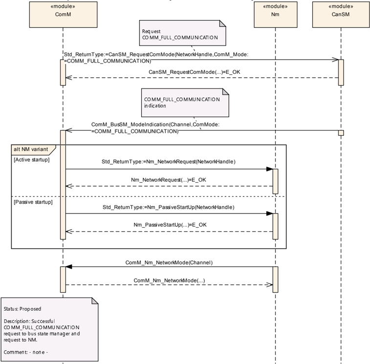

### 8.2. 被动唤醒（CAN）

图 9.2 展示了由 ECU 状态管理器模块或（对 **CAN** 通道而言）**Nm** 模块指示唤醒后的行为。该行为对 **LIN**、**FlexRay** 与 **Ethernet** 是等同的，只是 API 名称不同。

图 9.2：对 ECU 状态管理器模块所指示唤醒的反应（**Reaction on a wake-up indicated by the ECU State Manager module**）

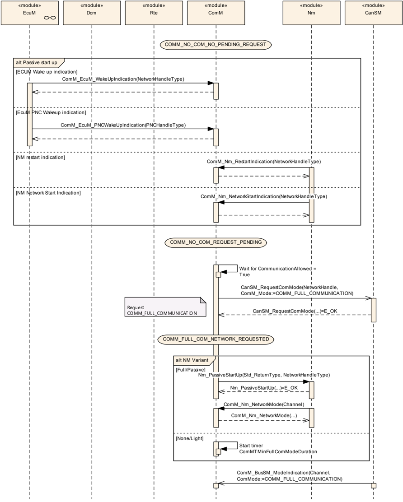

### 8.3. 网络关机（CAN）

图 9.3 展示了关闭 **CAN** 网络的几种可能性。它既可以由最后一个用户释放其 COMM_FULL_COMMUNICATION 请求发起，也可以通过调用 `[ComM_LimitChannelToNoComMode](#7316-comm_limitchanneltonocommode)`（见 [SWS_ComM_00163]）发起。该行为对 **LIN**、**FlexRay** 与 **Ethernet** 是等同的，只是 API 名称不同。

图 9.3：网络关机（CAN）（**Network shutdown (CAN)**）

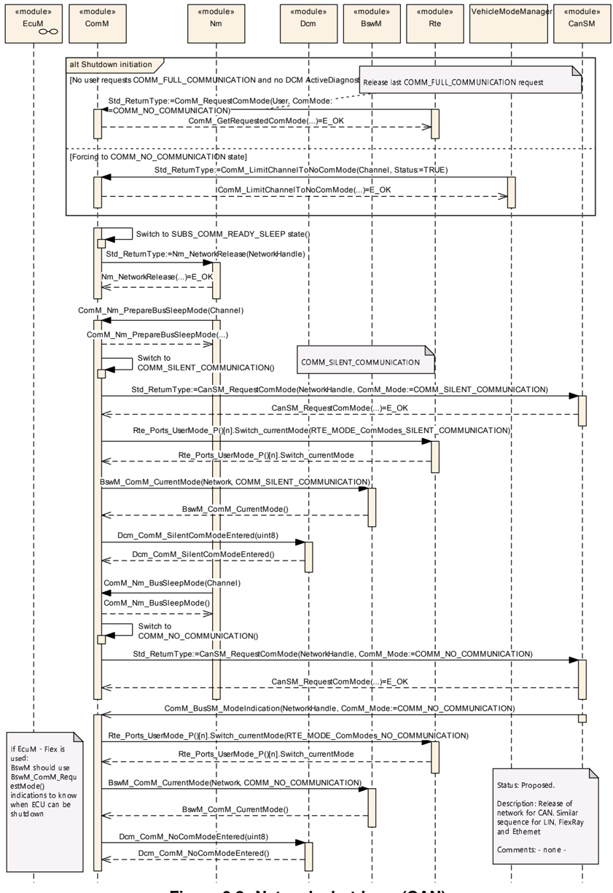

### 8.4. 通信请求

图 9.4 展示了在 **CAN** 上启动 COMM_FULL_COMMUNICATION 的几种可能性。它既可以由某个用户请求 COMM_FULL_COMMUNICATION 发起，也可以由 **DCM** 指示 `[ComM_DCM_ActiveDiagnostic](#7421-comm_dcm_activediagnostic)`（见 [SWS_ComM_00873]）发起。该行为对 **LIN**、**FlexRay** 与 **Ethernet** 是等同的，只是 API 名称不同。

图 9.4：请求通信（**Request Communication**）

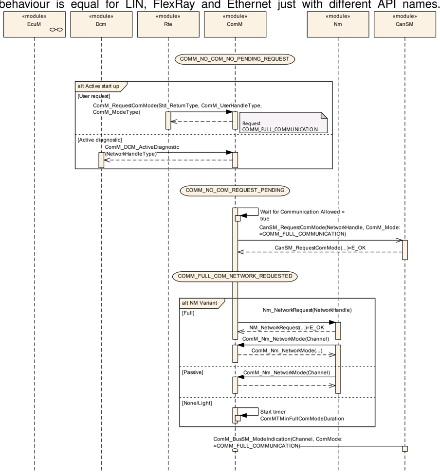

### 8.5. 同步 PNC 关机

**注意：** 这些时序图展示的是期望的行为，而非实现。图 9.6 与图 9.7 展示了当充当中间 PNC 协调器角色的 ECU 收到一条 PN 关机消息时，转发所收到的同步 PNC 关机的请求。

图 9.5 展示了当充当顶层 PNC 协调器角色的 ECU 检测到某个 **PNC** 被释放时，同步 PNC 关机的请求。

图 9.5：以顶层 PNC 协调器（TLPC）角色请求同步 PNC 关机（**Request for a synchronized PNC shutdown in the role of a top-level PNC coordinator (TLPC)**）

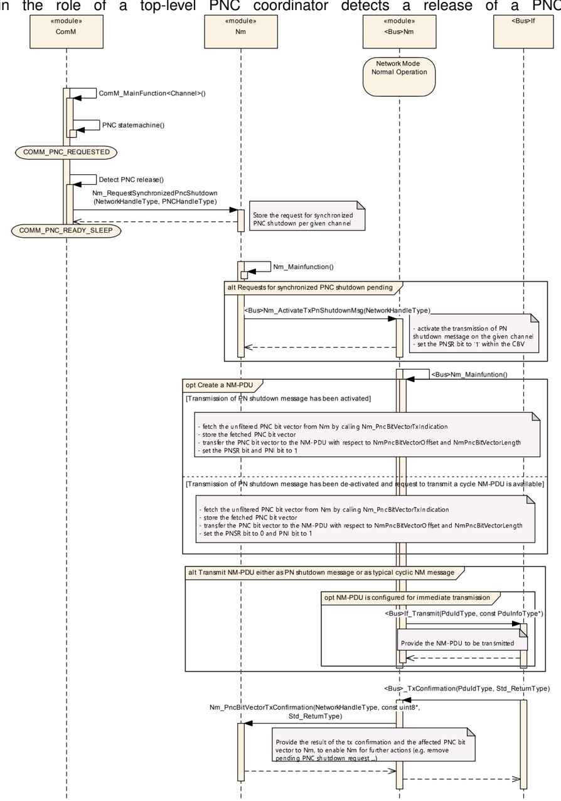

图 9.6：以中间 PNC 协调器角色转发同步 PNC 关机的请求（第 1 部分）（**Request to forward a synchronized PNC shutdown in the role of an intermediate PNC coordinator (part 1)**）

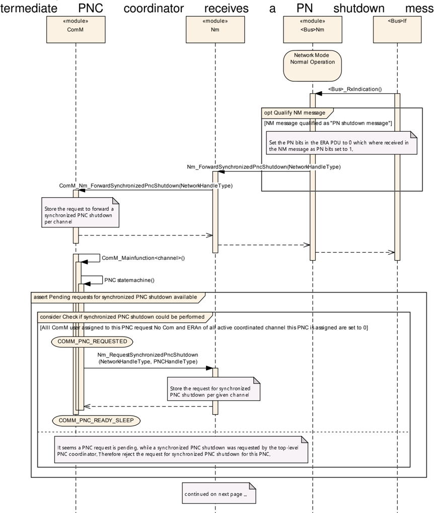

图 9.7：以中间 PNC 协调器角色转发同步 PNC 关机的请求（第 2 部分）（**Request to forward a synchronized PNC shutdown in the role of an intermediate PNC coordinator (part 2)**）

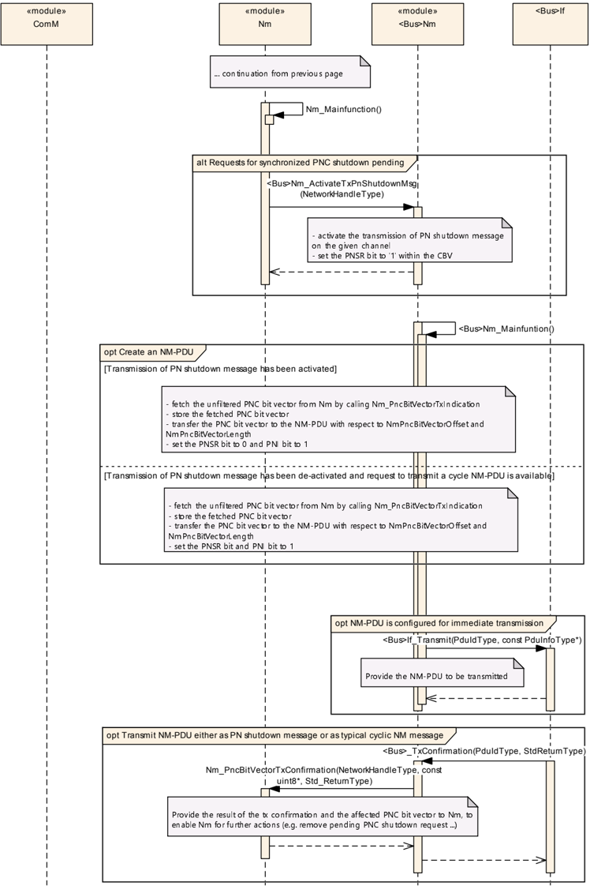

## 9. 配置规范

一般而言，本章定义配置参数及其到容器中的聚合。为支持本规范，9.1 章描述基础知识。

9.2 章规定模块 Communication Manager 的结构（容器）与参数。

9.3 章规定模块 Communication Manager 的发布信息。

### 9.1. 如何阅读本章

详细内容参见 [\[14\]](#ref-14) 的 10.1 章「配置规范导论」（Introduction to configuration specification）。

### 9.2. 容器与配置参数

以下各章汇总全部配置参数。参数的详细含义在第 6 章与第 7 章中描述。

**ComM** 模块的预编译期与链接期配置参数应被静态校验（最迟在链接期）其正确性。

**ComM** 模块的配置应支持为每个通道配置总线类型。

[SWS_ComM_00322] 的依据：控制通信栈的接口取决于总线类型。

**ComM** 模块应严格分离配置与实现。

[SWS_ComM_00464] 的依据：简单而清晰的配置。

#### 9.2.1. ComM

| 属性 | 值 |
| --- | --- |
| 模块名称 | ComM |
| 描述 | ComM（通信管理器）模块的配置。 |
| Post-Build 变体支持 | true |
| 支持的配置变体 | VARIANT-POST-BUILD、VARIANT-PRE-COMPILE |

图 10.1：ComM 配置（**Configuration ComM**）

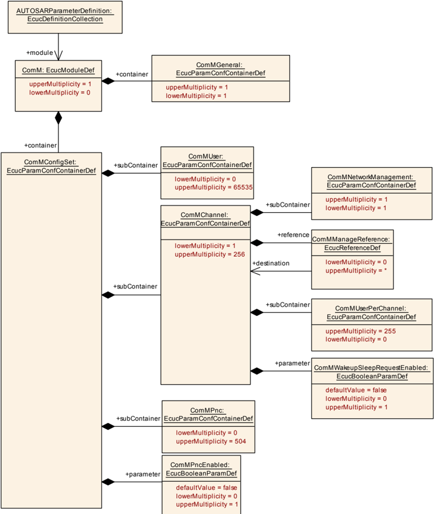

| 容器名称 | 多重性 | 作用域/依赖 |
| --- | --- | --- |
| ComMConfigSet | 1 | 该容器包含 AUTOSAR ComM 模块的配置参数与子容器。 |
| ComMGeneral | 1 | 通信管理器的通用配置参数。 |

#### 9.2.2. ComMGeneral

| 属性 | 值 |
| --- | --- |
| 容器名称 | ComMGeneral |
| 父容器 | ComM |
| 描述 | 通信管理器的通用配置参数。 |

参数 ComM0PncVectorAvoidance 的定义：

| 属性 | 值 |
| --- | --- |
| 参数名称 | ComM0PncVectorAvoidance |
| 父容器 | ComMGeneral |
| 描述 | 在 ComMPncGatewayEnabled 使能的情况下，该参数避免发送 0-PNC 向量。 |
| 多重性 | 0..1 |
| 类型 | EcucBooleanParamDef |
| 默认值 | false |
| Post-Build 变体值 | false |
| 值配置类 | Pre-compile time：X（All Variants）；Link time：-；Post-build time：- |
| 作用域/依赖 | scope: local |

参数 ComMDevErrorDetect 的定义：

| 属性 | 值 |
| --- | --- |
| 参数名称 | ComMDevErrorDetect |
| 父容器 | ComMGeneral |
| 描述 | 开启或关闭开发错误检测与通知。**true**：启用检测和通知；**false**：禁用检测和通知。 |
| 多重性 | 1 |
| 类型 | EcucBooleanParamDef |
| 默认值 | false |
| Post-Build 变体值 | false |
| 值配置类 | Pre-compile time：X（All Variants）；Link time：-；Post-build time：- |
| 作用域/依赖 | scope: local |

参数 ComMDirectUserMapping 的定义：

| 属性 | 值 |
| --- | --- |
| 参数名称 | ComMDirectUserMapping |
| 父容器 | ComMGeneral |
| 描述 | 若该参数置为 true，配置工具应为每个 ComMPnc 自动创建一个 ComMUser，并为每个 ComMChannel 自动创建一个 ComMUser。生成的 ComMUser 的 shortName 应遵循以下命名约定：PNCUser_ComMPncId（例如 PNCUser_13）、ChannelUser_ComMChannelId（例如 ChannelUser_25）。限制：因该配置参数而创建的 ComMUser 不得被 SWC 使用（仅供 **BswM** 使用）。 |
| 多重性 | 0..1 |
| 类型 | EcucBooleanParamDef |
| 默认值 | false |
| Post-Build 变体多重性 | false |
| Post-Build 变体值 | false |
| 多重性配置类 | Pre-compile time：X（All Variants）；Link time：-；Post-build time：- |
| 值配置类 | Pre-compile time：X（All Variants）；Link time：-；Post-build time：- |
| 作用域/依赖 | scope: local |

参数 ComMDynamicPncToChannelMappingSupport 的定义：

| 属性 | 值 |
| --- | --- |
| 参数名称 | ComMDynamicPncToChannelMappingSupport |
| 父容器 | ComMGeneral |
| 描述 | 用于使能动态 PNC 到通道映射处理的预编译期开关。**false**：动态 PNC 到通道映射已禁用；**true**：动态 PNC 到通道映射已启用。 |
| 多重性 | 1 |
| 类型 | EcucBooleanParamDef |
| 默认值 | false |
| Post-Build 变体值 | false |
| 值配置类 | Pre-compile time：X（All Variants）；Link time：-；Post-build time：- |
| 作用域/依赖 | scope: ECU |

参数 ComMEcuGroupClassification 的定义：

| 属性 | 值 |
| --- | --- |
| 参数名称 | ComMEcuGroupClassification |
| 父容器 | ComMGeneral |
| 描述 | 定义模式抑制是否影响 ECU。示例：000：不能激活任何模式抑制；001：可以启用唤醒抑制。 |
| 多重性 | 1 |
| 类型 | EcucIntegerParamDef |
| 取值范围 | 0 .. 255 |
| 默认值 | 3 |
| Post-Build 变体值 | false |
| 值配置类 | Pre-compile time：X（All Variants）；Link time：-；Post-build time：- |
| 作用域/依赖 | scope: local；依赖：应非易失性地存储（复位期间值必须保留），至少在唤醒抑制被启用/允许时如此。可在运行时用 `ComM_SetECUGroupClassification()` 修改，因此默认值只应设置一次（首次 ECU 初始化）。 |

参数 ComMModeLimitationEnabled 的定义：

| 属性 | 值 |
| --- | --- |
| 参数名称 | ComMModeLimitationEnabled |
| 父容器 | ComMGeneral |
| 描述 | 若模式限制功能应被启用则为 true。**true**：已启用；**false**：已禁用。 |
| 多重性 | 1 |
| 类型 | EcucBooleanParamDef |
| 默认值 | false |
| Post-Build 变体值 | false |
| 值配置类 | Pre-compile time：X（All Variants）；Link time：-；Post-build time：- |
| 作用域/依赖 | scope: local |

参数 ComMPncGatewayEnabled 的定义：

| 属性 | 值 |
| --- | --- |
| 参数名称 | ComMPncGatewayEnabled |
| 父容器 | ComMGeneral |
| 描述 | 启用或停用局部网络网关支持。**false**：局部网络网关已禁用；**true**：局部网络网关已启用。 |
| 多重性 | 0..1 |
| 类型 | EcucBooleanParamDef |
| 默认值 | false |
| Post-Build 变体多重性 | false |
| Post-Build 变体值 | false |
| 多重性配置类 | Pre-compile time：X；Link time：-；Post-build time：- |
| 值配置类 | Pre-compile time：X；Link time：-；Post-build time：- |
| 作用域/依赖 | scope: local |

参数 ComMPncPrepareSleepTimer 的定义：

| 属性 | 值 |
| --- | --- |
| 参数名称 | ComMPncPrepareSleepTimer |
| 父容器 | ComMGeneral |
| 描述 | PNC 状态机在 COMM_PNC_PREPARE_SLEEP 中应等待的时间（秒）。 |
| 多重性 | 0..1 |
| 类型 | EcucFloatParamDef |
| 取值范围 | [0 .. 63] |
| 默认值 | - |
| Post-Build 变体多重性 | false |
| Post-Build 变体值 | false |
| 多重性配置类 | Pre-compile time：X（All Variants）；Link time：-；Post-build time：- |
| 值配置类 | Pre-compile time：X（All Variants）；Link time：-；Post-build time：- |
| 作用域/依赖 | scope: local；依赖：CanNm：(NmPnResetTime + ComMPncPrepareSleepTimer) < CanNm TimeoutTime；FrNm：(NmPnResetTime + ComMPncPrepareSleepTimer) < ((FrNmReadySleepCnt + 1) * FrNmRepetitionCycle * 「一个 FlexRay 周期的时长」)；UdpNm：(NmPnResetTime + ComMPncPrepareSleepTimer) < UdpNmTimeoutTime |

参数 ComMPncSupport 的定义：

| 属性 | 值 |
| --- | --- |
| 参数名称 | ComMPncSupport |
| 父容器 | ComMGeneral |
| 描述 | 启用或停用局部网络支持。**false**：局部网络已禁用；**true**：局部网络已启用。 |
| 多重性 | 1 |
| 类型 | EcucBooleanParamDef |
| 默认值 | false |
| Post-Build 变体值 | false |
| 值配置类 | Pre-compile time：X（All Variants）；Link time：-；Post-build time：- |
| 作用域/依赖 | scope: local |

参数 ComMResetAfterForcingNoComm 的定义：

| 属性 | 值 |
| --- | --- |
| 参数名称 | ComMResetAfterForcingNoComm |
| 父容器 | ComMGeneral |
| 描述 | 在因激活的到「无通信」模式的模式限制而进入「无通信」模式后，**ComM** 应执行一次复位。**true**：已启用；**false**：已禁用。 |
| 多重性 | 1 |
| 类型 | EcucBooleanParamDef |
| 默认值 | false |
| Post-Build 变体值 | false |
| 值配置类 | Pre-compile time：X（All Variants）；Link time：-；Post-build time：- |
| 作用域/依赖 | scope: local |

参数 ComMSynchronizedPncShutdownEnabled 的定义：

| 属性 | 值 |
| --- | --- |
| 参数名称 | ComMSynchronizedPncShutdownEnabled |
| 父容器 | ComMGeneral |
| 描述 | 启用或停用同步 PNC 关机支持。**FALSE**：同步 PNC 关机已禁用；**TRUE**：同步 PNC 关机已启用。**注意：** 这只对在 PNC 网络中充当顶层 PNC 协调器或中间 PNC 角色的 ECU 有可能。 |
| 多重性 | 0..1 |
| 类型 | EcucBooleanParamDef |
| 默认值 | false |
| Post-Build 变体多重性 | false |
| Post-Build 变体值 | false |
| 多重性配置类 | Pre-compile time：X（All Variants）；Link time：-；Post-build time：- |
| 值配置类 | Pre-compile time：X（All Variants）；Link time：-；Post-build time：- |
| 作用域/依赖 | scope: local；依赖：只有当 ComMPncGatewayEnabled 已设置时，该参数才能置为 TRUE。 |

参数 ComMSynchronousWakeUp 的定义：

| 属性 | 值 |
| --- | --- |
| 参数名称 | ComMSynchronousWakeUp |
| 父容器 | ComMGeneral |
| 描述 | 若为 true，一个通道的唤醒应导致所有通道的唤醒。**true**：已启用；**false**：已禁用。 |
| 多重性 | 1 |
| 类型 | EcucBooleanParamDef |
| 默认值 | true |
| Post-Build 变体值 | false |
| 值配置类 | Pre-compile time：X（All Variants）；Link time：-；Post-build time：- |
| 作用域/依赖 | scope: local |

参数 ComMTMinFullComModeDuration 的定义：

| 属性 | 值 |
| --- | --- |
| 参数名称 | ComMTMinFullComModeDuration |
| 父容器 | ComMGeneral |
| 描述 | 在 COMM_FULL_COMMUNICATION 的子状态 COMM_FULL_COM_NETWORK_REQUESTED 中度过的最短时间（秒）。 |
| 多重性 | 1 |
| 类型 | EcucFloatParamDef |
| 取值范围 | [0.001 .. 65] |
| 默认值 | 5 |
| Post-Build 变体值 | false |
| 值配置类 | Pre-compile time：X（All Variants）；Link time：-；Post-build time：- |
| 作用域/依赖 | scope: local |

参数 ComMVersionInfoApi 的定义：

| 属性 | 值 |
| --- | --- |
| 参数名称 | ComMVersionInfoApi |
| 父容器 | ComMGeneral |
| 描述 | 开启通过服务 `ComM_GetVersionInfo()` 读取版本信息的可能性。**true**：已启用；**false**：已禁用。 |
| 多重性 | 1 |
| 类型 | EcucBooleanParamDef |
| 默认值 | false |
| Post-Build 变体值 | false |
| 值配置类 | Pre-compile time：X（All Variants）；Link time：-；Post-build time：- |
| 作用域/依赖 | scope: local |

参数 ComMWakeupInhibitionEnabled 的定义：

| 属性 | 值 |
| --- | --- |
| 参数名称 | ComMWakeupInhibitionEnabled |
| 父容器 | ComMGeneral |
| 描述 | 若唤醒抑制功能已启用则为 true。**true**：已启用；**false**：已禁用。 |
| 多重性 | 1 |
| 类型 | EcucBooleanParamDef |
| 默认值 | false |
| Post-Build 变体值 | false |
| 值配置类 | Pre-compile time：X（All Variants）；Link time：-；Post-build time：- |
| 作用域/依赖 | scope: local |

参数 ComMGlobalNvMBlockDescriptor 的定义：

| 属性 | 值 |
| --- | --- |
| 参数名称 | ComMGlobalNvMBlockDescriptor |
| 父容器 | ComMGeneral |
| 描述 | 对包含非易失性数据的 NVRAM 块的引用。若未配置该参数，则表示完全不使用 NVRAM。 |
| 多重性 | 0..1 |
| 类型 | 对 NvMBlockDescriptor 的符号名引用（Symbolic name reference to NvMBlockDescriptor） |
| Post-Build 变体多重性 | false |
| Post-Build 变体值 | false |
| 多重性配置类 | Pre-compile time：X；Link time：-；Post-build time：- |
| 值配置类 | Pre-compile time：X；Link time：-；Post-build time：- |
| 作用域/依赖 | scope: ECU；依赖：从 NvM 配置派生 |

无包含的容器（No Included Containers）。

图 10.2：ComMGeneral 配置（**Configuration ComMGeneral**）

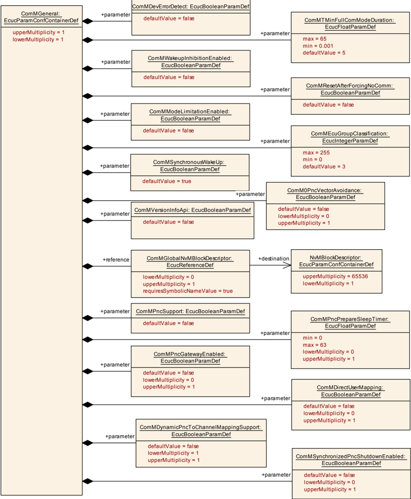

#### 9.2.3. ComMConfigSet

| 属性 | 值 |
| --- | --- |
| 容器名称 | ComMConfigSet |
| 父容器 | ComM |
| 描述 | 该容器包含 AUTOSAR ComM 模块的配置参数与子容器。 |

参数 ComMPncEnabled 的定义：

| 属性 | 值 |
| --- | --- |
| 参数名称 | ComMPncEnabled |
| 父容器 | ComMConfigSet |
| 描述 | 定义在该配置集中局部网络是否被启用。**true**：已启用；**false**：已禁用。 |
| 多重性 | 0..1 |
| 类型 | EcucBooleanParamDef |
| 默认值 | false |
| Post-Build 变体多重性 | true |
| Post-Build 变体值 | true |
| 多重性配置类 | Pre-compile time：X（VARIANT-PRE-COMPILE）；Link time：-；Post-build time：X（VARIANT-POST-BUILD） |
| 值配置类 | Pre-compile time：X（VARIANT-PRE-COMPILE）；Link time：-；Post-build time：X（VARIANT-POST-BUILD） |
| 作用域/依赖 | scope: ECU；依赖：ComMPncSupport |

| 容器名称 | 多重性 | 作用域/依赖 |
| --- | --- | --- |
| ComMChannel | 1..256 | 该容器包含总线通道的配置（参数）。通道参数应在整个通信栈内保持一致。 |
| ComMPnc | 0..504 | 该容器包含局部网络集群（**PNC**）的配置。 |
| ComMUser | 0..65535 | 该容器包含在系统中指代被指定请求通信模式的用户所需的标识符列表。 |

#### 9.2.4. ComMUser

| 属性 | 值 |
| --- | --- |
| 容器名称 | ComMUser |
| 父容器 | ComMConfigSet |
| 描述 | 该容器包含在系统中指代被指定请求通信模式的用户所需的标识符列表。 |

参数 ComMUserIdentifier 的定义：

| 属性 | 值 |
| --- | --- |
| 参数名称 | ComMUserIdentifier |
| 父容器 | ComMUser |
| 描述 | 用于在系统中指代被指定请求通信模式的用户的标识符。ImplementationType：ComM_UserHandleType。 |
| 多重性 | 1 |
| 类型 | EcucIntegerParamDef（为该参数生成的符号名） |
| 取值范围 | 0 .. 65534 |
| 默认值 | - |
| Post-Build 变体值 | false |
| 值配置类 | Pre-compile time：X（All Variants）；Link time：-；Post-build time：- |
| 作用域/依赖 | scope: local；依赖：EcuMUser：用户的概念与 ECU 状态管理器规范中请求方（requestor）的概念非常相似。这两个参数应在配置过程中保持一致。 |

参数 ComMUserEcucPartitionRef 的定义：

| 属性 | 值 |
| --- | --- |
| 参数名称 | ComMUserEcucPartitionRef |
| 父容器 | ComMUser |
| 描述 | 表示请求者在哪个「EcucPartition」中执行。当该分区停止时，**ComM** 中的通信请求应被取消，以避免因已停止的分区导致总线保持唤醒的情况。 |
| 多重性 | 0..1 |
| 类型 | 对 EcucPartition 的引用（Reference to EcucPartition） |
| Post-Build 变体多重性 | false |
| Post-Build 变体值 | false |
| 多重性配置类 | Pre-compile time：X；Link time：-；Post-build time：- |
| 值配置类 | Pre-compile time：X；Link time：-；Post-build time：- |
| 作用域/依赖 | scope: ECU |

无包含的容器（No Included Containers）。

图 10.3：ComMUser 配置（**Configuration ComMUser**）

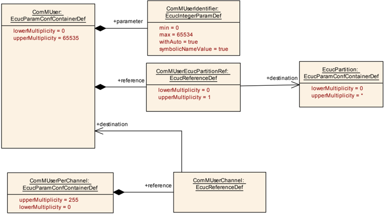

#### 9.2.5. ComMChannel

| 属性 | 值 |
| --- | --- |
| 容器名称 | ComMChannel |
| 父容器 | ComMConfigSet |
| 描述 | 该容器包含总线通道的配置（参数）。通道参数应在整个通信栈内保持一致。 |

参数 ComMBusType 的定义：

| 属性 | 值 |
| --- | --- |
| 参数名称 | ComMBusType |
| 父容器 | ComMChannel |
| 描述 | 标识通道的总线类型。 |
| 多重性 | 1 |
| 类型 | EcucEnumerationParamDef |
| Post-Build 变体值 | false |
| 值配置类 | Pre-compile time：X（All Variants）；Link time：-；Post-build time：- |
| 作用域/依赖 | scope: ECU |

| 取值 | 说明 |
| --- | --- |
| COMM_BUS_TYPE_CAN | - |
| COMM_BUS_TYPE_CDD | - |
| COMM_BUS_TYPE_ETH | - |
| COMM_BUS_TYPE_FR | - |
| COMM_BUS_TYPE_INTERNAL | - |
| COMM_BUS_TYPE_LIN | - |

参数 ComMCDDBusPrefix 的定义：

| 属性 | 值 |
| --- | --- |
| 参数名称 | ComMCDDBusPrefix |
| 父容器 | ComMChannel |
| 描述 | 用于调用 **CDD** API 的前缀。 |
| 多重性 | 0..1 |
| 类型 | EcucStringParamDef |
| 默认值 | - |
| 正则表达式 | - |
| Post-Build 变体多重性 | false |
| Post-Build 变体值 | false |
| 多重性配置类 | Pre-compile time：X；Link time：-；Post-build time：- |
| 值配置类 | Pre-compile time：X；Link time：-；Post-build time：- |
| 作用域/依赖 | scope: local；依赖：只在 ComMBusType 等于 COMM_BUS_TYPE_CDD 时适用。 |

参数 ComMChannelId 的定义：

| 属性 | 值 |
| --- | --- |
| 参数名称 | ComMChannelId |
| 父容器 | ComMChannel |
| 描述 | 相应通道的通道标识编号。 |
| 多重性 | 1 |
| 类型 | EcucIntegerParamDef（为该参数生成的符号名） |
| 取值范围 | 0 .. 255 |
| 默认值 | - |
| Post-Build 变体值 | false |
| 值配置类 | Pre-compile time：X（All Variants）；Link time：-；Post-build time：- |
| 作用域/依赖 | scope: ECU；依赖：应与网络管理及总线接口的通道 ID 保持一致。 |

参数 ComMDynamicPncToChannelMappingEnabled 的定义：

| 属性 | 值 |
| --- | --- |
| 参数名称 | ComMDynamicPncToChannelMappingEnabled |
| 父容器 | ComMChannel |
| 描述 | 用于使能动态 PNC 到通道映射特性的通道专属参数。**false**：动态 PNC 到通道映射已禁用；**true**：动态 PNC 到通道映射已启用。 |
| 多重性 | 0..1 |
| 类型 | EcucBooleanParamDef |
| 默认值 | false |
| Post-Build 变体多重性 | false |
| Post-Build 变体值 | false |
| 多重性配置类 | Pre-compile time：X（VARIANT-PRE-COMPILE）；Link time：X（VARIANT-POST-BUILD）；Post-build time：- |
| 值配置类 | Pre-compile time：X（VARIANT-PRE-COMPILE）；Link time：X（VARIANT-POST-BUILD）；Post-build time：- |
| 作用域/依赖 | scope: local；依赖：只有当 ComMDynamicPncToChannelMappingSupport 为 TRUE 且该 ComMChannel 的 ComMNmVariant 置为 FULL 时才能为 TRUE。 |

参数 ComMFullCommRequestNotificationEnabled 的定义：

| 属性 | 值 |
| --- | --- |
| 参数名称 | ComMFullCommRequestNotificationEnabled |
| 父容器 | ComMChannel |
| 描述 | 定义是否为该通道提供接口 ComM_CurrentChannelRequest 的可选发送方-接收方端口。true 表示已启用，false 表示已禁用。 |
| 多重性 | 1 |
| 类型 | EcucBooleanParamDef |
| 默认值 | false |
| Post-Build 变体值 | false |
| 值配置类 | Pre-compile time：X（All Variants）；Link time：-；Post-build time：- |
| 作用域/依赖 | scope: local；依赖：应非易失性地存储（复位期间值必须保留）。 |

参数 ComMMainFunctionPeriod 的定义：

| 属性 | 值 |
| --- | --- |
| 参数名称 | ComMMainFunctionPeriod |
| 父容器 | ComMChannel |
| 描述 | 规定触发 MainFunction 的周期（秒）。**注释：** **ComM** 的调度应至少与通信栈一样快，且长于 100ms 的调度对通信没有意义。 |
| 多重性 | 1 |
| 类型 | EcucFloatParamDef |
| 取值范围 | ]0 .. INF[ |
| 默认值 | 0.02 |
| Post-Build 变体值 | false |
| 值配置类 | Pre-compile time：X（All Variants）；Link time：-；Post-build time：- |
| 作用域/依赖 | scope: ECU |

参数 ComMNoCom 的定义：

| 属性 | 值 |
| --- | --- |
| 参数名称 | ComMNoCom |
| 父容器 | ComMChannel |
| 描述 | 不允许把 ComM 通道的状态改变为 COMM_SILENT_COMMUNICATION 或 COMM_FULL_COMMUNICATION。**true**：已启用——不允许切换到上述通信模式；**false**：已禁用——允许切换到上述通信模式。应可以在运行时用 **ComM** API 修改该参数。ECU/所有通道：`ComM_LimitECUToNoComMode()`；单独通道：`ComM_LimitChannelToNoComMode()`。 |
| 多重性 | 1 |
| 类型 | EcucBooleanParamDef |
| 默认值 | false |
| Post-Build 变体值 | false |
| 值配置类 | Pre-compile time：X（All Variants）；Link time：-；Post-build time：- |
| 作用域/依赖 | scope: local |

参数 ComMNoWakeup 的定义：

| 属性 | 值 |
| --- | --- |
| 参数名称 | ComMNoWakeup |
| 父容器 | ComMChannel |
| 描述 | 定义 ECU 是否不允许唤醒该通道。**true**：已启用（不允许唤醒）；**false**：已禁用。这是一个运行时变量的默认/初始值，可在运行时用 `ComM_PreventWakeUp()` 修改。 |
| 多重性 | 1 |
| 类型 | EcucBooleanParamDef |
| 默认值 | false |
| Post-Build 变体值 | false |
| 值配置类 | Pre-compile time：X（All Variants）；Link time：-；Post-build time：- |
| 作用域/依赖 | scope: local；依赖：应非易失性地存储（复位期间值必须保留）。 |

参数 ComMNoWakeUpInhibitionNvmStorage 的定义：

| 属性 | 值 |
| --- | --- |
| 参数名称 | ComMNoWakeUpInhibitionNvmStorage |
| 父容器 | ComMChannel |
| 描述 | 若该参数置为「true」，该通道的 NoWakeUp 抑制状态应以某种实现特定的方式存储在 ComMGlobalNvmBlockDescriptor 指向的块中。 |
| 多重性 | 1 |
| 类型 | EcucBooleanParamDef |
| 默认值 | - |
| Post-Build 变体值 | false |
| 值配置类 | Pre-compile time：X（All Variants）；Link time：-；Post-build time：- |
| 作用域/依赖 | scope: local；依赖：若该参数置为 true，则必须在（既有的，即多重性为 1 的）ComMGlobalNvmBlockDescriptor 中给出一个指向足够大的 Nvm 块的有效 Nvm 块引用。 |

参数 ComMPncGatewayType 的定义：

| 属性 | 值 |
| --- | --- |
| 参数名称 | ComMPncGatewayType |
| 父容器 | ComMChannel |
| 描述 | 标识一个 ComMChannel 的局部网络网关行为。 |
| 多重性 | 0..1 |
| 类型 | EcucEnumerationParamDef |
| 默认值 | COMM_GATEWAY_TYPE_ACTIVE |
| Post-Build 变体多重性 | false |
| Post-Build 变体值 | false |
| 多重性配置类 | Pre-compile time：X（All Variants）；Link time：-；Post-build time：- |
| 值配置类 | Pre-compile time：X（All Variants）；Link time：-；Post-build time：- |
| 作用域/依赖 | scope: ECU；依赖：该参数不得用于被管理通道（既不应置为 COMM_GATEWAY_TYPE_ACTIVE 也不应置为 COMM_GATEWAY_TYPE_PASSIVE）。 |

| 取值 | 说明 |
| --- | --- |
| COMM_GATEWAY_TYPE_ACTIVE | - |
| COMM_GATEWAY_TYPE_PASSIVE | - |

参数 ComMWakeupSleepRequestEnabled 的定义：

| 属性 | 值 |
| --- | --- |
| 参数名称 | ComMWakeupSleepRequestEnabled |
| 父容器 | ComMChannel |
| 描述 | 用于相应硬件在网络上支持唤醒和/或睡眠请求能力的通信通道，例如兼容 OA TC10 的 Ethernet PHY。 |
| 多重性 | 0..1 |
| 类型 | EcucBooleanParamDef |
| 默认值 | false |
| Post-Build 变体多重性 | false |
| Post-Build 变体值 | false |
| 多重性配置类 | Pre-compile time：X（All Variants）；Link time：-；Post-build time：- |
| 值配置类 | Pre-compile time：X（All Variants）；Link time：-；Post-build time：- |
| 作用域/依赖 | scope: local；依赖：只在 ComMBusType 等于 COMM_BUS_TYPE_ETH 且所用 Ethernet 硬件（例如 PHY、Ethernet 交换机）兼容 OA TC10 规范时适用。 |

参数 ComMChannelPartitionRef 的定义：

| 属性 | 值 |
| --- | --- |
| 参数名称 | ComMChannelPartitionRef |
| 父容器 | ComMChannel |
| 描述 | 对相应 ComMChannel 所分配到的 EcucPartition 的引用。 |
| 多重性 | 0..1 |
| 类型 | 对 EcucPartition 的引用（Reference to EcucPartition） |
| Post-Build 变体多重性 | false |
| Post-Build 变体值 | false |
| 多重性配置类 | Pre-compile time：X（All Variants）；Link time：-；Post-build time：- |
| 值配置类 | Pre-compile time：X（All Variants）；Link time：-；Post-build time：- |
| 作用域/依赖 | scope: local |

参数 ComMManageReference 的定义：

| 属性 | 值 |
| --- | --- |
| 参数名称 | ComMManageReference |
| 父容器 | ComMChannel |
| 描述 | 表示充当管理通道角色的 ComMChannel 与充当被管理通道角色的 ComMChannel 之间的引用。 |
| 多重性 | 0..* |
| 类型 | 对 ComMChannel 的引用（Reference to ComMChannel） |
| Post-Build 变体多重性 | false |
| Post-Build 变体值 | false |
| 多重性配置类 | Pre-compile time：X（All Variants）；Link time：-；Post-build time：- |
| 值配置类 | Pre-compile time：X（All Variants）；Link time：-；Post-build time：- |
| 作用域/依赖 | scope: local |

| 容器名称 | 多重性 | 作用域/依赖 |
| --- | --- | --- |
| ComMNetworkManagement | 1 | 该容器包含网络管理的配置参数。 |
| ComMUserPerChannel | 0..255 | 该容器包含在系统中指代链接到某通道的用户所需的标识符列表。 |

配置参数 ComMNoCom（见 [ECUC_ComM_00571]）在 ComMModeLimitationEnabled = FALSE = 已禁用（见 [ECUC_ComM_00560]）的情况下无需求值，因此在该情况下可以移除它以缩减/优化配置。

图 10.4：ComMChannel 配置（**Configuration ComMChannel**）

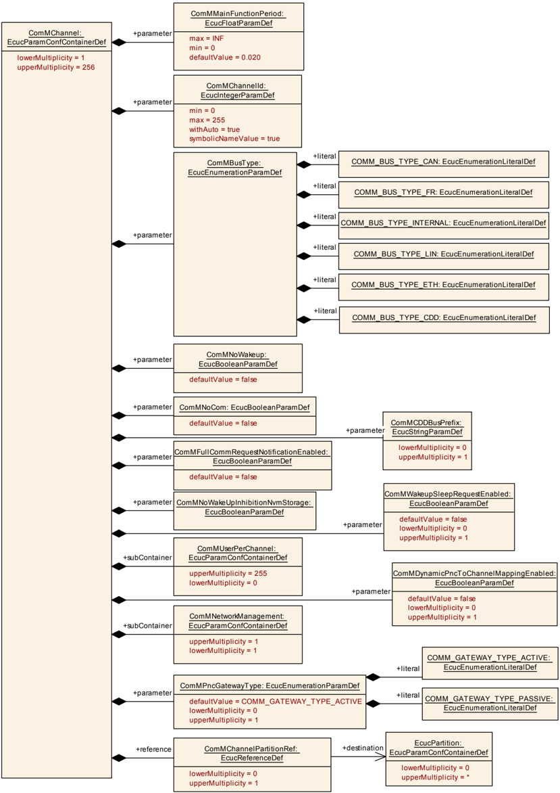

#### 9.2.6. ComMNetworkManagement

| 属性 | 值 |
| --- | --- |
| 容器名称 | ComMNetworkManagement |
| 父容器 | ComMChannel |
| 描述 | 该容器包含网络管理的配置参数。 |

参数 ComMNmLightTimeout 的定义：

| 属性 | 值 |
| --- | --- |
| 参数名称 | ComMNmLightTimeout |
| 父容器 | ComMNetworkManagement |
| 描述 | 定义离开 COMM_FULL_COMMUNICATION 的子状态 COMM_FULL_COM_READY_SLEEP 之后的超时（秒）。取值范围应大于 0.0 且小于或等于 255.0。 |
| 多重性 | 0..1 |
| 类型 | EcucFloatParamDef |
| 取值范围 | [0 .. 255] |
| 默认值 | 10 |
| Post-Build 变体多重性 | false |
| Post-Build 变体值 | false |
| 多重性配置类 | Pre-compile time：X（All Variants）；Link time：-；Post-build time：- |
| 值配置类 | Pre-compile time：X（All Variants）；Link time：-；Post-build time：- |
| 作用域/依赖 | scope: local；依赖：只在 ComMNmVariant 配置为 ComMLight 时使用。 |

参数 ComMNmVariant 的定义：

| 属性 | 值 |
| --- | --- |
| 参数名称 | ComMNmVariant |
| 父容器 | ComMNetworkManagement |
| 描述 | 定义网络管理的功能。应与 **NM** 配置保持一致。 |
| 多重性 | 1 |
| 类型 | EcucEnumerationParamDef |
| 默认值 | FULL |
| Post-Build 变体值 | false |
| 值配置类 | Pre-compile time：X（All Variants）；Link time：-；Post-build time：- |
| 作用域/依赖 | scope: local；依赖：若 ComMBusType = COMM_BUS_TYPE_INTERNAL，ComMNmVariant 应为 NONE。被管理通道的 ComMNmVariant 应为 LIGHT。管理通道的 ComMNmVariant 应为 FULL。 |

| 取值 | 说明 |
| --- | --- |
| FULL | AUTOSAR **NM** 可用（默认）。 |
| LIGHT | 没有 AUTOSAR **NM** 可用，但具备关闭通道的功能。 |
| NONE | 没有 **NM** 可用。 |
| PASSIVE | 以被动模式运行的 AUTOSAR **NM** 可用。 |
| SLAVE_ACTIVE | 没有 **NM** 可用。例如用于 **LIN** 从节点。 |
| SLAVE_PASSIVE | 没有 **NM** 可用。例如用于带兼容 OA TC10 硬件的 Ethernet 通信通道。 |

参数 ComMPncNmRequest 的定义：

| 属性 | 值 |
| --- | --- |
| 参数名称 | ComMPncNmRequest |
| 父容器 | ComMNetworkManagement |
| 描述 | 若该参数等于 true，则在以下任一条件下应通过调用 `Nm_NetworkRequest` 再次请求 **Nm**：每当由于 PNC 状态机变化到 COMM_PNC_REQUESTED 而请求完全通信时；如果某个 **PNC** 的关机与同一 **PNC** 的 PNC 请求同时发生。 |
| 多重性 | 1 |
| 类型 | EcucBooleanParamDef |
| 默认值 | false |
| Post-Build 变体值 | false |
| 值配置类 | Pre-compile time：X（All Variants）；Link time：-；Post-build time：- |
| 作用域/依赖 | scope: local；依赖：只有当 ComMNmVariant 为 FULL 时，才能把 ComMPncNmRequest 置为 TRUE。 |

无包含的容器（No Included Containers）。

图 10.5：ComMNetworkManagement 配置（**Configuration ComMNetworkManagement**）

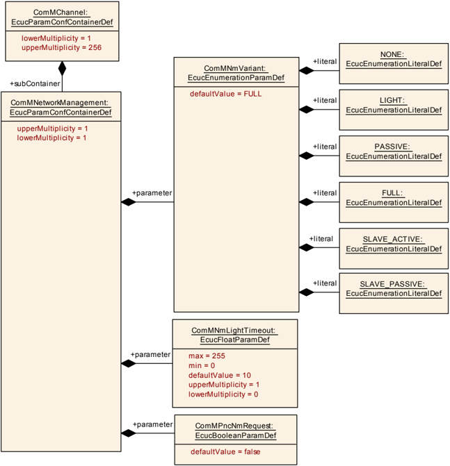

#### 9.2.7. ComMUserPerChannel

| 属性 | 值 |
| --- | --- |
| 容器名称 | ComMUserPerChannel |
| 父容器 | ComMChannel |
| 描述 | 该容器包含在系统中指代链接到某通道的用户所需的标识符列表。 |

参数 ComMUserChannel 的定义：

| 属性 | 值 |
| --- | --- |
| 参数名称 | ComMUserChannel |
| 父容器 | ComMUserPerChannel |
| 描述 | 对与该通道用户对应的 ComMUser 的引用。 |
| 多重性 | 1 |
| 类型 | 对 ComMUser 的引用（Reference to ComMUser） |
| Post-Build 变体值 | false |
| 值配置类 | Pre-compile time：X（All Variants）；Link time：-；Post-build time：- |
| 作用域/依赖 | scope: local |

无包含的容器（No Included Containers）。

图 10.6：ComMUserPerChannel 与 ComUserPerPNC 配置（**Configuration ComMUserPerChannel and ComUserPerPNC**）

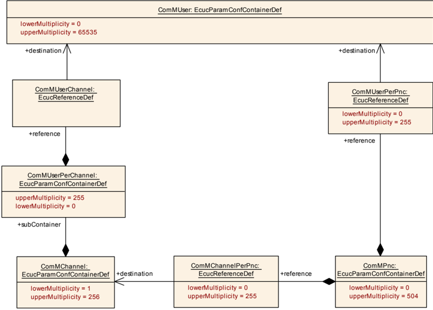

#### 9.2.8. ComMPnc

| 属性 | 值 |
| --- | --- |
| 容器名称 | ComMPnc |
| 父容器 | ComMConfigSet |
| 描述 | 该容器包含局部网络集群（**PNC**）的配置。 |

参数 ComMPncId 的定义：

| 属性 | 值 |
| --- | --- |
| 参数名称 | ComMPncId |
| 父容器 | ComMPnc |
| 描述 | 局部网络（Partial network）。 |
| 多重性 | 1 |
| 类型 | EcucIntegerParamDef |
| 取值范围 | 8 .. 511 |
| 默认值 | - |
| Post-Build 变体值 | false |
| 值配置类 | Pre-compile time：X（All Variants）；Link time：-；Post-build time：- |
| 作用域/依赖 | scope: ECU |

参数 ComMPncWakeupSleepRequestEnabled 的定义：

| 属性 | 值 |
| --- | --- |
| 参数名称 | ComMPncWakeupSleepRequestEnabled |
| 父容器 | ComMPnc |
| 描述 | 用于被请求的 **PNC** 应向 **BswM** 上报激活通信请求的场景。**BswM** 把激活的通信请求转发到下层通信通道——所用硬件在网络上支持唤醒和/或睡眠请求能力，例如兼容 OA TC10 的 Ethernet PHY。例如用于 Ethernet 交换机端口组切换。 |
| 多重性 | 0..1 |
| 类型 | EcucBooleanParamDef |
| 默认值 | false |
| Post-Build 变体多重性 | false |
| Post-Build 变体值 | false |
| 多重性配置类 | Pre-compile time：X（All Variants）；Link time：-；Post-build time：- |
| 值配置类 | Pre-compile time：X（All Variants）；Link time：-；Post-build time：- |
| 作用域/依赖 | scope: local |

参数 ComMChannelPerPnc 的定义：

| 属性 | 值 |
| --- | --- |
| 参数名称 | ComMChannelPerPnc |
| 父容器 | ComMPnc |
| 描述 | 对该 **PNC** 所需的 ComMChannel 的引用。ImplementationType：NetworkHandleType。 |
| 多重性 | 0..255 |
| 类型 | 对 ComMChannel 的引用（Reference to ComMChannel） |
| Post-Build 变体多重性 | true |
| Post-Build 变体值 | true |
| 多重性配置类 | Pre-compile time：X（VARIANT-PRE-COMPILE）；Link time：-；Post-build time：X（VARIANT-POST-BUILD） |
| 值配置类 | Pre-compile time：X（VARIANT-PRE-COMPILE）；Link time：-；Post-build time：X（VARIANT-POST-BUILD） |
| 作用域/依赖 | scope: local |

参数 ComMChannelPerTxOnlyPnc 的定义：

| 属性 | 值 |
| --- | --- |
| 参数名称 | ComMChannelPerTxOnlyPnc |
| 父容器 | ComMPnc |
| 描述 | 对该 **PNC** 所需的 ComMChannel 的引用。该 **PNC** 被视为只在该通道上作为内部 PNC 请求发送。ImplementationType：NetworkHandleType。 |
| 多重性 | 0..255 |
| 类型 | 对 ComMChannel 的引用（Reference to ComMChannel） |
| Post-Build 变体多重性 | true |
| Post-Build 变体值 | true |
| 多重性配置类 | Pre-compile time：X（VARIANT-PRE-COMPILE）；Link time：-；Post-build time：X（VARIANT-POST-BUILD） |
| 值配置类 | Pre-compile time：X（VARIANT-PRE-COMPILE）；Link time：-；Post-build time：X（VARIANT-POST-BUILD） |
| 作用域/依赖 | scope: local |

参数 ComMPncEthIfSwitchPortGroupRef 的定义：

| 属性 | 值 |
| --- | --- |
| 参数名称 | ComMPncEthIfSwitchPortGroupRef |
| 父容器 | ComMPnc |
| 描述 | 对与该 **PNC** 对应的 PortGroup 的引用。**注意：** 这仅用于文档目的。 |
| 多重性 | 0..255 |
| 类型 | 对 EthIfSwitchPortGroup 的符号名引用（Symbolic name reference to EthIfSwitchPortGroup） |
| Post-Build 变体多重性 | true |
| Post-Build 变体值 | true |
| 多重性配置类 | Pre-compile time：X（VARIANT-PRE-COMPILE）；Link time：X（VARIANT-POST-BUILD）；Post-build time：- |
| 值配置类 | Pre-compile time：X（VARIANT-PRE-COMPILE）；Link time：X（VARIANT-POST-BUILD）；Post-build time：- |
| 作用域/依赖 | scope: ECU |

参数 ComMUserPerPnc 的定义：

| 属性 | 值 |
| --- | --- |
| 参数名称 | ComMUserPerPnc |
| 父容器 | ComMPnc |
| 描述 | 对与该 **PNC** 对应的 ComMUser 的引用。ImplementationType：COMM_UserHandleType。 |
| 多重性 | 0..255 |
| 类型 | 对 ComMUser 的引用（Reference to ComMUser） |
| Post-Build 变体多重性 | true |
| Post-Build 变体值 | true |
| 多重性配置类 | Pre-compile time：X（VARIANT-PRE-COMPILE）；Link time：-；Post-build time：X（VARIANT-POST-BUILD） |
| 值配置类 | Pre-compile time：X（VARIANT-PRE-COMPILE）；Link time：-；Post-build time：X（VARIANT-POST-BUILD） |
| 作用域/依赖 | scope: local |

无包含的容器（No Included Containers）。

图 10.7：ComMPnc 配置（**Configuration ComMPnc**）

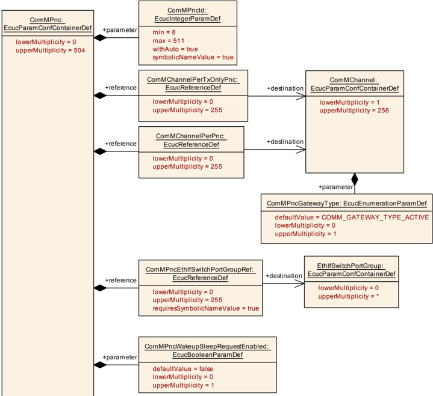

### 9.3. 发布信息

模块头文件与源文件中的版本信息应被校验并保持一致（例如通过用预处理器宏比较模块头文件与源文件中的版本信息）。

scope: local
