## 1. 简介和功能概述

本规范描述模块 **Hardware Test Management start up and shutdown**（硬件测试管理启动和关闭，**HTMSS**）的概念、接口和配置。

HTMSS 模块是 AUTOSAR 标准化基础软件架构服务层的一个基础软件模块。HTMSS 模块应提供供应用 SWC 使用的测试状态/结果（获取测试结果 `Mcu_GetResetReason`）。

本模块的目的是提供一个基础设施，用于在 AUTOSAR 标准软件平台内集成/转换微控制器制造商特定的启动和关闭测试（例如 BIST）的测试结果/状态。

本模块的基本功能包括：从 **MSTP** 收集测试结果/状态、配置 MSTP 测试、启动测试执行、向 EcuM 模块和应用 SWC 提供 MSTP 测试状态以评估系统行为的测试结果。

HTMSS 模块在 AUTOSAR BSW 服务层级别上集成。下图展示了 HTMSS 模块在 AUTOSAR 软件平台中的功能集成。

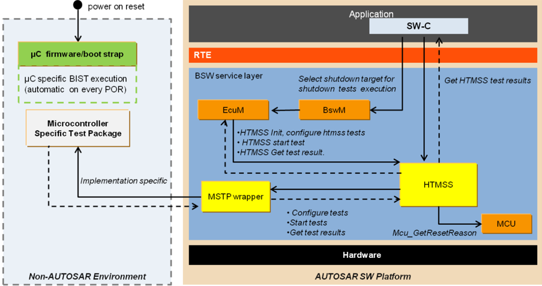

**注意：** MSTP 包装器（**MSTP wrapper**）是供 AR 标准化模块 HTMSS 访问 MSTP 模块的中间模块。MSTP 包装器可以手动实现，也可以使用 AUTOSAR 方法论/流程生成/配置。

HTMSS 模块的预集成需求是：

* 应能够在开发中的器件上运行微控制器特定测试包（**Microcontroller Specific Test Package**，**MSTP**）的启动和关闭测试
* 测试结果/状态可供 HTMSS 模块访问
* 应能够经由 HTMSS 模块配置 MSTP 启动和关闭测试

HTMSS 模块在标准 AUTOSAR 软件执行平台的不同阶段中的角色如下图所示。

**注意：** 出为实现安全相关 ECU 的安全目标，可以考虑将 HTMSS 概念集成到 AUTOSAR 架构中，但这并不总是强制性的。

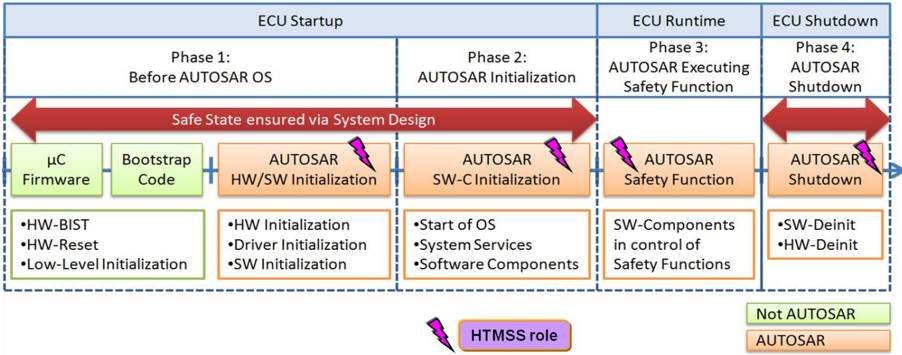

**注意：** 下面描述的 HTMSS 阶段用于解释 HTMSS 模块在典型 AUTOSAR ECU 软件执行环境中的功能。这些阶段不得与 EcuM 中定义的阶段混淆。

* HTMSS 阶段 1：

AUTOSAR OS 之前——该阶段以 MCU 复位为起点、到调用 `StartOS()` 函数为止。在此状态下，执行各种类型测试的可能性很多。MCU 外设和 AUTOSAR 起初尚未初始化，这为执行破坏性测试、MCU 内置测试、故障注入测试等提供了潜在机会。该阶段还用于经由复位逻辑评估在关闭阶段期间由测试获得的结果。

在 EcuM_Init() 进行 AUTOSAR HW/SW 初始化期间，可以在 AUTOSAR 上下文内执行进一步的诊断测试。而非破坏性测试可以在 EcuM 内执行。

HTMSS 将在阶段 2 结束时完全可用，因为它需要 AUTOSAR 的完整部分作为系统服务来执行。

* HTMSS 阶段 2：

AUTOSAR OS 和 SW-C 初始化——该阶段以使用函数调用 `StartOS()` 启动 AUTOSAR OS 为起点，直到包括应用软件组件在内的完整 AUTOSAR 初始化完成。

在此阶段，HTMSS 可以提供诊断测试结果，供安全 SWC 消费以作进一步决策。

* HTMSS 阶段 3：

AUTOSAR 执行安全功能——在此阶段，系统已启动预期功能，安全功能是其一部分。该阶段适合容纳监控机制以及一些内置诊断机制，它们可能是单点或潜在故障贡献者——ECC 故障检测机制、ADC 运行能力等。HTMSS 概念尚不支持运行时测试（**Runtime Tests**，这是另一组测试），因此在阶段 3 期间 HTMSS 只能提供先前执行的启动和关闭测试的测试结果。

* HTMSS 阶段 4：

AUTOSAR 关闭。该阶段提供了执行这样一些测试的可能性：它们不适合在其他任何阶段执行（例如执行时间过长），并且能够通过 MCU 复位传递其结果。结果可以在后续的 MCU 启动期间评估。

## 2. 缩略语

**ADC**
> 模数转换器（**Analog to Digital converter**）。

**BIST**
> 内置自测试（**Built In Self Test**）。

**BSW**
> 基础软件（**Basic Software**）。

**DET**
> 默认错误追踪器（**Default error tracer**）。

**ECU**
> 电子控制单元（**Electronic Control Unit**）。

**ECUM**
> ECU 状态管理器（**Electronic Control Unit Manager**）。

**HTMSS**
> 硬件测试管理启动和关闭（**Hardware Test Management startup shutdown**）。

**MCU**
> 微控制器单元（**Micro Controller Unit**）。

**MSTP**
> 微控制器特定测试包（**Microcontroller Specific Test Package**）。

**RTE**
> 运行时环境（**Run Time Environment**）。

## 3. 相关文档

### 3.1. 输入文件

<a id="ref-1"></a>- [1] 基础软件模块清单 AUTOSAR\_BasicSoftwareModules.pdf
<a id="ref-2"></a>- [2] AUTOSAR 分层软件架构 AUTOSAR\_CP\_EXP\_LayeredSoftwareArchitecture.pdf
<a id="ref-3"></a>- [3] AUTOSAR 基础软件模块通用规范 AUTOSAR\_CP\_SWS\_BSWGeneral.pdf
<a id="ref-4"></a>- [4] 内存映射规范 AUTOSAR\_CP\_SWS\_MemoryMapping.pdf
<a id="ref-5"></a>- [5] RTE 规范 AUTOSAR\_CP\_SWS\_RTE.pdf
<a id="ref-6"></a>- [6] ECU 状态管理器规范 AUTOSAR\_CP\_SWS\_ECUStateManager.pdf
<a id="ref-7"></a>- [7] HTMSS 需求 AUTOSAR\_CP\_SRS\_HTMSS.pdf
<a id="ref-8"></a>- [8] HTMSS 技术报告 AUTOSAR\_CP\_TR\_HWTestManagementIntegrationGuide.pdf

### 3.2. 相关标准与规范

- [5] IEC 7498-1 The Basic Model, IEC Norm, 1994

### 3.3. 相关规范

AUTOSAR 提供了一份基础软件通用规范（**SWS BSW General**）[\[3\]](#ref-3)，它同样适用于 HTMSS 模块。

因此，规范 **SWS BSW General** [\[3\]](#ref-3) 应被视为 AUTOSAR HTMSS 模块的附加且必需的规范。

## 4. 约束和假设

本文档适用于 AUTOSAR 4.3.0 版本。

### 4.1. 限制

本模块的使用是可选的，仅在需要所提供功能的情况下使用。

为了针对特定解决方案集成所需范围的测试能力，要求所有受影响的模块都需要实现与 HTMSS 的接口。

示例：来自半导体制造商的 MSTP（微控制器特定测试包）模块是在 AUTOSAR 软件平台中集成 HTMSS 模块的必备模块。

启动/关闭测试配置由系统集成者决定，并基于 MSTP 测试配置的能力和特性。

HTMSS 模块应经由包装器实现（在本规范中命名为 MSTP 包装器）与假定的测试模块（MSTP）交互，采用 AR 方法论/流程。

测试结果在 NV 内存中的存储以及 DEM 错误报告需求不在 HTMSS 模块的范围之内。集成者应根据需要在相应的应用 SWC 层面管理这些需求。

### 4.2. 汽车域的适用性

每个 ECU 的设计目标是在给定系统架构的上下文中提供预定义的功能。因此，ECU 无故障运行至关重要，这反过来可以通过对预期故障的简单监控，在故障出现之前加以避免或检测到。检查 ECU 可运行性的一种策略是执行破坏性测试（在 ECU 启动和关闭期间），检查给定的逻辑和条件，并保留结果以供进一步分析。HTMSS 模块表明了处理 ECU 上此类测试结果并按需提供其状态的需求。

## 5. 对其他模块的依赖

HTMSS 与 AUTOSAR 架构中的一些 BSW 模块和应用 SWC 有接口。此外，HTMSS 与 AUTOSAR 架构之外的微控制器特定测试包（**MSTP**）有接口。不过，与 MSTP 的交互取决于实现。

### 5.1. ECU 状态管理器（EcuM）

ECU 状态管理器应访问 HTMSS 服务以启动测试，并从被测器件收集测试结果/状态。

ECUM 启动阶段和关闭阶段在 AUTOSAR 软件平台中包含了 HTMSS 模块的主要功能。

### 5.2. 应用 SWC

应用软件组件应收集 HTMSS 测试结果（经由 RTE）用于评估，进而确定软件行为。此外，如有需要，测试结果应存储在非易失性内存中以供后续使用。

### 5.3. AUTOSAR 运行时环境（RTE）

通过 RTE 数据交换，测试结果/状态在 HTMSS 模块和应用软件层之间共享。

### 5.4. 与 MSTP 的依赖

HTMSS 可以访问 MSTP 模块（可能是非 AR 软件模块，同步和/或异步），以在 AUTOSAR 软件平台内管理以下功能/特性：

* 配置在 HTMSS 模块中配置的启动和关闭测试
* 在 ECUM 启动和关闭阶段期间触发 MSTP 测试
* 收集测试结果并提供给应用软件使用

**注意：**

HTMSS 模块应通过包装器模块/源代码（在本规范中命名为 MSTP 包装器）与 MSTP 模块交互，该包装器使用 AUTOSAR 方法论和流程配置/生成。

### 5.5. MCU

HTMSS 从 MCU 驱动接收复位原因（例如由关闭测试执行引起的复位）。

### 5.6. 默认错误追踪器（DET）

如果启用了 DET，HTMSS 模块将把检测到的开发错误通知默认错误追踪器。

### 5.7. 文件结构

#### 5.7.1. 代码文件结构

代码文件结构应包含一个或多个源文件 `HTMSS_&lt;xxx&gt;.c`，其中包含 HTMSS 代码的全部部分。

## 6. 功能规格

### 6.1. 一般行为

HTMSS 的基本功能可以划分为以下主要组别：

* HTMSS 模块的初始化
* 基于 HTMSS 配置 MSTP 测试（启动/关闭）
* 用于启动 MSTP 测试（启动和关闭）的接口
* 向其他 AUTOSAR 模块（包括应用 SWC）提供 MSTP 测试状态

**注意：** HTMSS 不应添加任何与 MSTP 测试对应的测试功能。测试的实现和执行不在 HTMSS 的范围之内。

### 6.2. 硬件测试管理

#### 6.2.1. 背景与理由

总体目标是在基于标准 AUTOSAR 平台构建的安全相关系统中，通过硬件测试执行提供微控制器运行的故障状态。

该概念应提供一个设施来执行并记录一组预定义的测试。此外，它还应支持在所用微控制器的上下文中的硬件监控活动，获取测试结果并将其传播给 AUTOSAR 环境中的利益相关软件组件。

HTMSS 模块的目标是标准化可在 AUTOSAR 环境之外执行微控制器特定的启动/关闭测试的可访问接口，然后在 AUTOSAR 软件执行上下文内收集并评估测试结果。

#### 6.2.2. 需求

HTMSS 应能够在所请求的硬件上读取微控制器特定的启动和关闭测试结果/状态。

**注意：**

评估 HTMSS 提供的启动和关闭测试结果（即失败的情况）并进而定义软件反应是用户/集成者的责任。错误钩子（启动和关闭）应评估测试结果。

**提示：** 集成者可能已根据系统/安全目标中的关键性/相关性对处理测试结果的测试进行了优先级排序。在发生严重错误的情况下，集成者应决定返回复位状态或关闭状态。

编译期配置参数应静态检查（至少在编译期间）其正确性。

在一个配置中，每个模块用于测试的测试应多于一个。这些测试可以并行执行。

**注意：** 处理上述需求的配置参数应在 **HTMSSConfigSet**（[**9.1.3**](#913-httmssconfigset) 章）中调整。

应可以在给定的硬件上测试单个硬件资源（例如经由模块/通道 ID 选择）。

配置参数的实现请参见 [**9.1.3**](#913-httmssconfigset) 章 HTMSSConfigSet。

**提示：** 微控制器可能包含 ADC 外设的两个硬件单元。应支持单独测试/获取每个 ADC 单元的测试结果。**注意：** 无法保证未使用的硬件资源中的错误不会传播或影响微控制器的其余部分。因此，可能需要执行完整的硬件测试，并且应根据 ECU 的安全要求适当地考虑测试结果。

#### 6.2.3. HTMSS 模块的状态

表6.1：HTMSS 模块的状态

| 状态 | 描述 |
| --- | --- |
| `HTMSS_UINIT` | HTMSS 模块未初始化（模块初始化之前的默认值） |
| `HTMSS_INIT` | HTMSS 模块已初始化 |
| `HTMSS_BUSY` | HTMSS 所请求的测试未完成/进行中/已发起 |
| `HTMSS_IDLE` | HTMSS 所请求的测试已完成/没有挂起的测试在运行 |

### 6.3. 错误分类

#### 6.3.1. 开发错误

表6.2：开发错误

| 错误类型 | 相关错误代码 | 错误值 |
| --- | --- | --- |
| 在初始化之前调用了服务 | `HTMSS_E_NOT_INIT` | 0x01 |
| 传递了空指针作为参数 | `HTMSS_E_NULL_POINTER` | 0x02 |
| 参数无效（未具体化） | `HTMSS_E_PARAM_INVALID` | 0x03 |
| 在测试请求运行期间调用函数 | `HTMSS_E_BUSY` | 0x04 |

#### 6.3.2. 运行时错误

没有运行时错误。

#### 6.3.3. 瞬态故障

没有瞬态故障。

#### 6.3.4. 产出错误

没有产出错误。

#### 6.3.5. 扩展产出错误

没有扩展产出错误。

## 7. API规范

### 7.1. 导入的类型

在本章中，列出从以下文件包含的所有类型：

HTMSS 应只使用其他模块的以下导入类型：

| 模块 | 头文件 | 导入的类型 |
| --- | --- | --- |
| Mcu | Mcu.h | `Mcu_ResetType` |
| Std | Std_Types.h | `Std_ReturnType` |
| Std | Std_Types.h | `Std_VersionInfoType` |

### 7.2. 类型定义

以下数据类型应用于本规范中定义的函数。

#### 7.2.1. HTMSS_TestCfgType

| 名称 | HTMSS_TestCfgType |
| --- | --- |
| Kind | Structure |
| Elements | 实现特定。Type：-- |
| Description | HTMSS 模块的配置数据结构 |
| Available via | HTMSS.h |

#### 7.2.2. HTMSS_TestStatusType

| 名称 | HTMSS_TestStatusType |
| --- | --- |
| Kind | Enumeration |
| Range | `HTMSS_STATUS_OK`：--：测试状态通过；`HTMSS_STATUS_NOK`：--：测试状态失败；`HTMSS_STATUS_INVALID`：--：测试状态无效；`HTMSS_STATUS_UNINIT`：--：测试状态未初始化 |
| Description | HTMSS_TestStatusType 描述测试的状态。 |
| Available via | HTMSS.h |

#### 7.2.3. HTMSS_TestGroupType

| 名称 | HTMSS_TestGroupType |
| --- | --- |
| Kind | Enumeration |
| Range | `HTMSS_STARTUP`：--：仅在启动时执行的测试；`HTMSS_SHUTDOWN`：--：仅在关闭时执行的测试；`HTMSS_STARTUP_SHUTDOWN`：--：在启动和关闭时执行的测试 |
| Description | HTMSS_TestGroupType 描述测试组类型。 |
| Variation | -- |
| Available via | HTMSS.h |

#### 7.2.4. HTMSS_TestResultType

| 名称 | HTMSS_TestResultType |
| --- | --- |
| Kind | Structure |
| Elements | `TestResult`：Type：`uint8`；Comment：测试结果（例如通过、失败、无效） |
| Elements | `TestSignature`：Type：`uint8`；Comment：被测资源的标识符 |
| Description | 它描述当前的测试结果。 |
| Variation | -- |
| Available via | HTMSS.h |

### 7.3. 函数定义

以下各节规定 HTMSS 模块提供的 API 函数。

#### 7.3.1. HTMSS_Init

**说明**：初始化 HTMSS 模块。服务 ID `0x01`。同步。不可重入。参数 (in)：`ConfigPtr`——指向 Variant PB 中配置集的指针（Variant PC 需要 `NULL_PTR`）。参数 (inout)：None。参数 (out)：None。返回值：None。经由 `HTMSS.h` 可用。

```C
void HTMSS_Init ( const HTMSS_TestCfgType* ConfigPtr );
```

在 Variant PB 的情况下：函数 `HTMSS_Init` 应按照 `ConfigPtr` 引用的配置集初始化 HTMSS 模块。

在 Variant PC 的情况下：函数 `HTMSS_Init` 应按照编译期配置集初始化 HTMSS。

服务 `HTMSS_Init()` 应初始化 HTMSS 的全局变量和数据结构，包括标志和缓冲区。

函数 `HTMSS_Init()` 应初始化 MSTP 模块并配置 MSTP 测试。

在该函数被调用之前 HTMSS 不可用。

函数 `HTMSS_Init()` 应通过调用 MCU 驱动的 `Mcu_GetResetReason()` 确定最后一次复位原因。

如果最后一次复位原因不是 `MCU_HWTEST_RESET`，函数 `HTMSS_Init()` 应配置 MSTP 测试（启动和关闭两者）。

函数 `HTMSS_Init()` 应单独配置启动和关闭测试。

**提示：** 与 MSTP 模块的接口和测试配置取决于实现。可能存在为在启动和关闭两个槽位中执行而配置相同类型测试的情况。[**HTMSS_TestGroupType**](#723-htmss_testgrouptype)（参见 [**7.2.3**](#723-htmss_testgrouptype) 章）可用于此上下文。

如果由于任何原因 MSTP 测试的配置失败，函数 `HTMSS_Init()` 应将 HTMSS 状态设置为 `HTMSS_UNINIT`。

如果为 HTMSS 启用了 DET：函数 HTMSS_Init 应检查指针的有效性。发生错误时，HTMSS_Init 应引发开发错误 `[HTMSS_E_NULL_POINTER](#631-开发错误)`。

#### 7.3.2. HTMSS_StartTest

**说明**：启动已配置的 MSTP 测试。服务 ID `0x03`。同步。不可重入。参数 (in)：`GrpId`——测试组类型（例如启动或关闭）。参数 (inout)：None。参数 (out)：None。返回值：`Std_ReturnType`——函数执行的标准返回值。经由 `HTMSS.h` 可用。

```C
Std_ReturnType HTMSS_StartTest ( HTMSS_TestGroupType GrpId );
```

函数 `HTMSS_StartTest` 应在所请求的硬件上触发 MSTP 测试操作。如果成功，应返回 `E_OK`。

如果 MSTP 状态确认测试触发成功，函数 `HTMSS_StartTest` 应将 HTMSS 状态设置为 `HTMSS_BUSY`。

函数 `HTMSS_StartTest` 应处理被测器件的启动和关闭测试请求。

**提示：** HTMSS 与 MSTP 模块之间的接口取决于实现。因为半导体制造商可能为该器件定义与 MSTP 模块交互的方法。

如果为 HTMSS 启用了 DET：函数 HTMSS_StartTest 应检查初始化的有效性。失败时 HTMSS_StartTest 应引发开发错误 `[HTMSS_E_NOT_INIT](#631-开发错误)` 并返回 `E_NOT_OK`。

如果为 HTMSS 启用了 DET：函数 HTMSS_StartTest 应检查输入参数的有效性。发生错误时，HTMSS_StartTest 应引发开发错误 `[HTMSS_E_PARAM_INVALID](#631-开发错误)` 并返回 `E_NOT_OK`。

如果为 HTMSS 启用了 DET：当在启动请求已经就位（即不在 `HTMSS_IDLE` 状态）时被调用，函数 HTMSS_StartTest 应引发开发错误 `[HTMSS_E_BUSY](#631-开发错误)` 并返回 `E_NOT_OK`。

#### 7.3.3. HTMSS_GetTestStatus

**说明**：返回所请求测试的当前测试状态。服务 ID `0x4`。同步。不可重入。参数 (in)：`GrpId`——测试组类型（例如启动或关闭）。参数 (inout)：None。参数 (out)：`RequestTestResultPtr`——存储请求结果的指针。返回值：`[HTMSS_TestStatusType](#722-htmss_teststatustype)`——。经由 `HTMSS.h` 可用。

```C
HTMSS_TestStatusType HTMSS_GetTestStatus ( HTMSS_TestGroupType GrpId, HTMSS_TestResultType* RequestTestResultPtr );
```

如果 OUT 参数不是 `NULL_PTR`，函数 `HTMSS_GetTestStatus` 应从 MSTP 收集测试状态，将读取的数据存储在出参 `RequestTestResultPtr` 中，并返回带有测试状态结果的 [**HTMSS_TestStatusType**](#722-htmss_teststatustype)。

如果 OUT 参数为 `NULL_PTR`，函数 `HTMSS_GetTestStatus` 不得更新 OUT 参数，但应返回带有测试状态结果的 [**HTMSS_TestStatusType**](#722-htmss_teststatustype)。

如果 MSTP 提供的状态确认测试已完成，函数 `HTMSS_GetTestStatus` 应将 HTMSS 状态设置为 `HTMSS_IDLE`。

函数 `HTMSS_GetTestStatus` 应根据输入参数 GrpId 提供启动和关闭测试状态。

**提示：** 集成者/用户应确保在调用此 API 函数之前，有效的测试状态是现成可用的。

**注意：** 读取/收集所请求测试状态的方法/机制是制造商特定的指南，取决于实现以及 MSTP 接口和微控制器。

如果为 HTMSS 启用了 DET，函数 HTMSS_GetTestStatus 应检查初始化的有效性。失败时 HTMSS_GetTestStatus 应引发开发错误 `[HTMSS_E_NOT_INIT](#631-开发错误)` 并返回 `HTMSS_STATUS_UNINIT`。

如果为 HTMSS 启用了 DET：函数 HTMSS_GetTestStatus 应检查输入参数的有效性。发生错误时，HTMSS_GetTestStatus 应引发开发错误 `[HTMSS_E_PARAM_INVALID](#631-开发错误)` 并返回 `HTMSS_STATUS_INVALID`。

#### 7.3.4. HTMSS_GetVersionInfo

**说明**：。服务 ID `0x06`。同步。不可重入。参数 (in)：None。参数 (inout)：None。参数 (out)：`versioninfo`——指向存储本模块版本信息位置的指针。返回值：None。经由 `HTMSS.h` 可用。

```C
void HTMSS_GetVersionInfo ( Std_VersionInfoType* versioninfo );
```

### 7.4. 回调通知

无回调通知。

### 7.5. 调度函数

无调度函数。

### 7.6. 期望接口

在本章中，列出从其他模块所需的所有接口。

#### 7.6.1. 强制接口

本章定义实现模块核心功能所需的所有接口。

| API 函数 | 头文件 | 描述 |
| --- | --- | --- |
| `Mcu_GetResetReason` | Mcu.h | 该服务（如果受支持）从硬件读取复位类型。 |

#### 7.6.2. 可选接口

本章定义实现模块可选功能所需的所有接口。

| API 函数 | 头文件 | 描述 |
| --- | --- | --- |
| `Det_ReportError` | Det.h | 报告开发错误的服务。 |

#### 7.6.3. 可配置接口

没有可配置接口。

### 7.7. 服务接口

本章以 SWC 模板的形式正式规定相应的 AUTOSAR 服务。此处描述的接口用于在应用软件和 HTMSS 模块之间生成 RTE。

#### 7.7.1. 客户端-服务器接口 GetTestStatus

表7.1：GetTestStatus 接口（**GetTestStatus**）

| 属性 | 值 |
| --- | --- |
| 名称 | GetTestStatus |
| Comment | -- |
| IsService | true |
| Variation | -- |
| 可能错误 | 0：`HTMSS_STATUS_OK`：测试状态通过；0：`HTMSS_STATUS_NOK`：测试状态失败；0：`HTMSS_STATUS_UNINIT`：测试状态未初始化；0：`HTMSS_STATUS_INVALID`：测试状态无效 |

操作 GetTestStatus：

| 属性 | 值 |
| --- | --- |
| 操作 | GetTestStatus |
| 说明 | 返回所请求测试的当前测试状态 |
| 映射到 API | `[HTMSS_GetTestStatus](#733-htmss_getteststatus)` |
| Variation | -- |
| 参数 | `GrpId`——Type：`[HTMSS_TestGroupType](#723-htmss_testgrouptype)`；Direction：IN；Comment：测试组类型（例如启动或关闭）；Variation：-- |
| 参数 | `RequestTestResultPtr`——Type：`[HTMSS_TestResultType](#724-htmss_testresulttype)`；Direction：OUT；Comment：提供测试结果及测试签名的指针；Variation：-- |
| 可能错误 | `HTMSS_STATUS_OK`、`HTMSS_STATUS_NOK`、`HTMSS_STATUS_INVALID` |

| 属性 | 值 |
| --- | --- |
| 名称 | GetTestStatus |
| Kind | RequiredPort；Interface：GetTestStatus |
| Description | -- |
| Variation | -- |

### 7.8. 调出定义

调出（**Callouts**）是必须在 ECU 集成期间添加到 HTMSS 模块的代码片段。大多数调出的内容是手写代码。HTMSS 模块配置工具为某些调出生成默认实现，由集成者手动编辑。在概念上，这些调出属于 ECU 集成代码。

**注意：** 错误钩子是一种集成代码，用于在任何测试失败的情况下控制 ECU 的处理。这对开发中的系统而言可能是严重错误，因此集成者可以对测试失败做出反应（例如复位、停机、安全状态）。

#### 7.8.1. HTMSS_StartupTestErrorHook

**说明**：如果 HTMSS 提供的启动测试结果存在失败，ECU 状态管理器将调用该错误钩子。在这种情况下，集成者必须根据系统要求控制 CPU 的处理，即复位、安全状态等。服务 ID `0x7`。同步。不可重入。参数 (in)：None。参数 (inout)：None。参数 (out)：None。返回值：None。经由 … 可用：（空——源表格此单元格为空）。

```C
void HTMSS_StartupTestErrorHook ( void );
```

#### 7.8.2. HTMSS_ShutdownTestErrorHook

**说明**：如果 HTMSS 提供的关闭测试结果存在失败，ECU 状态管理器将调用该错误钩子。在这种情况下，集成者必须根据系统要求控制 CPU 的处理，即复位、安全状态等。服务 ID `0x8`。同步。不可重入。参数 (in)：None。参数 (inout)：None。参数 (out)：None。返回值：None。经由 `HTMSS.h` 可用。

```C
void HTMSS_ShutdownTestErrorHook ( void );
```

## 8. 时序图

### 8.1. HTMSS 初始化的时序图示例

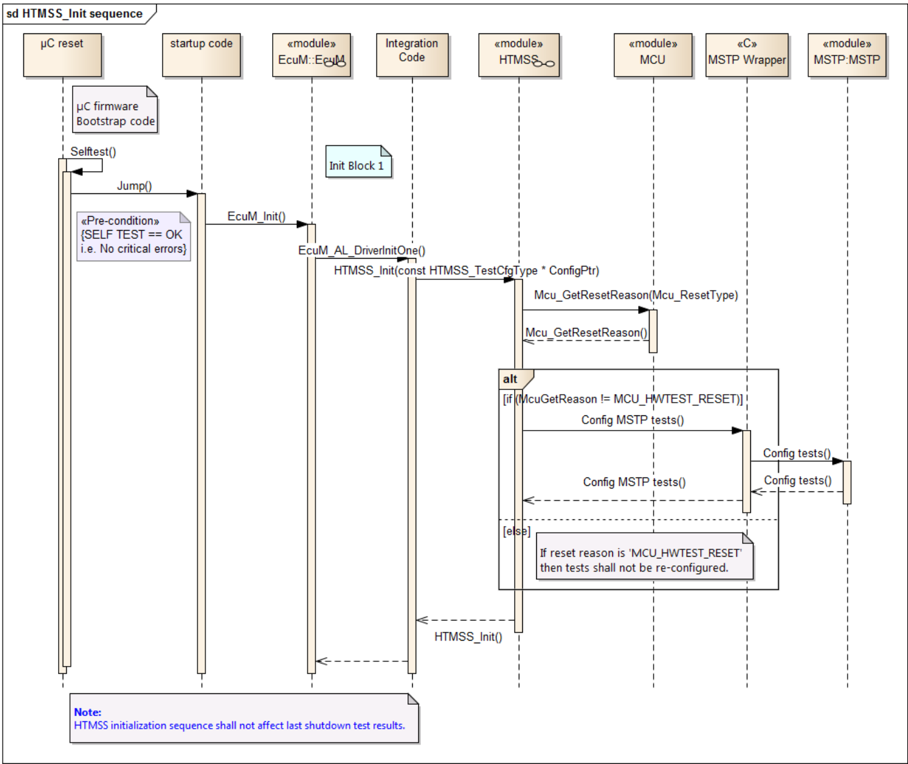

### 8.2. 启动测试执行的时序图示例

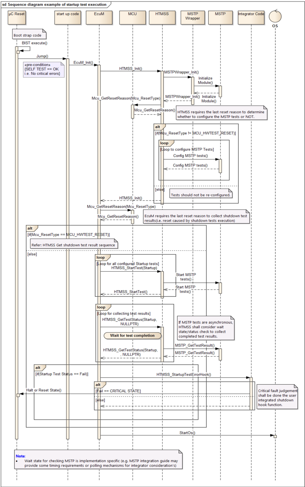

### 8.3. 关闭测试执行的时序图示例

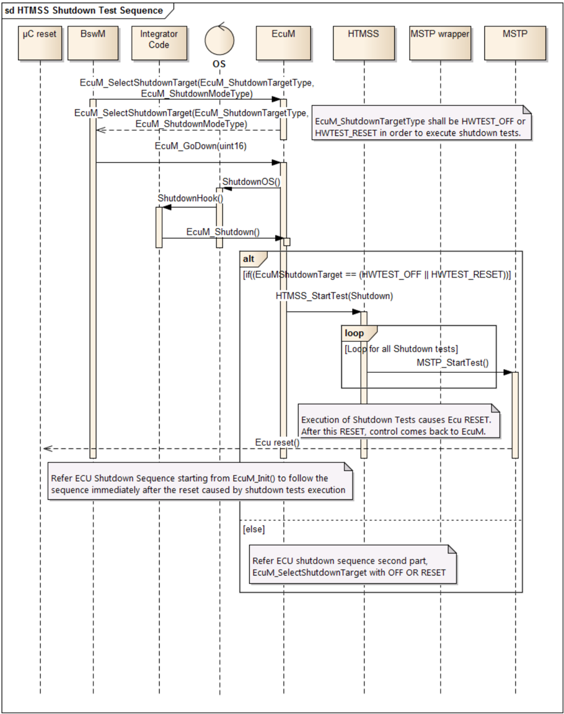

### 8.4. 在 MSTP 模块引发的 ECU 复位之后立即处理最后一次关闭测试结果的时序图示例

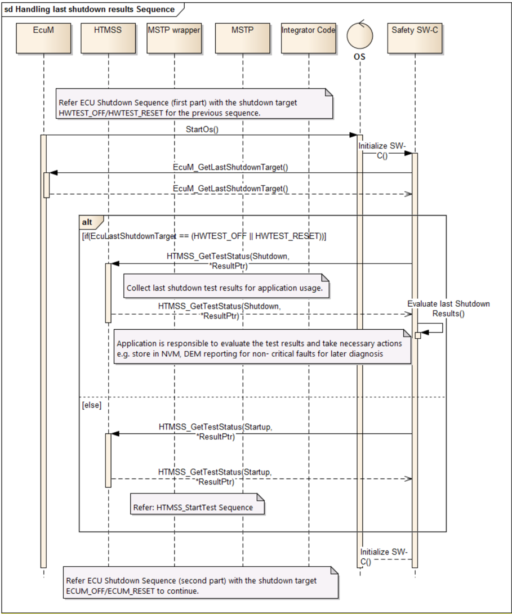

### 8.5. 收集关闭测试结果的时序图示例

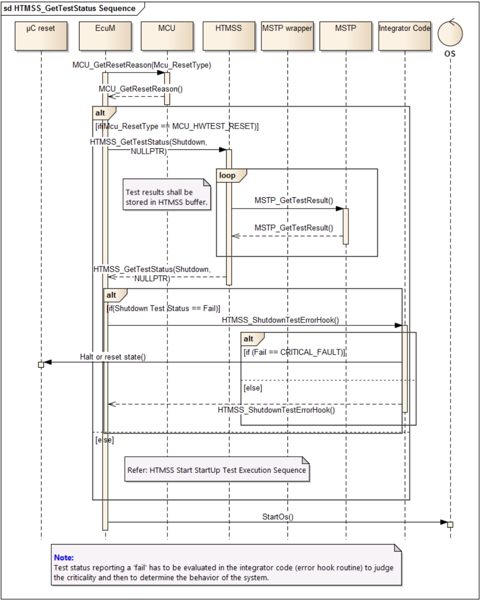

### 8.6. HTMSS 集成到系统中时 ECU 关闭的时序图示例

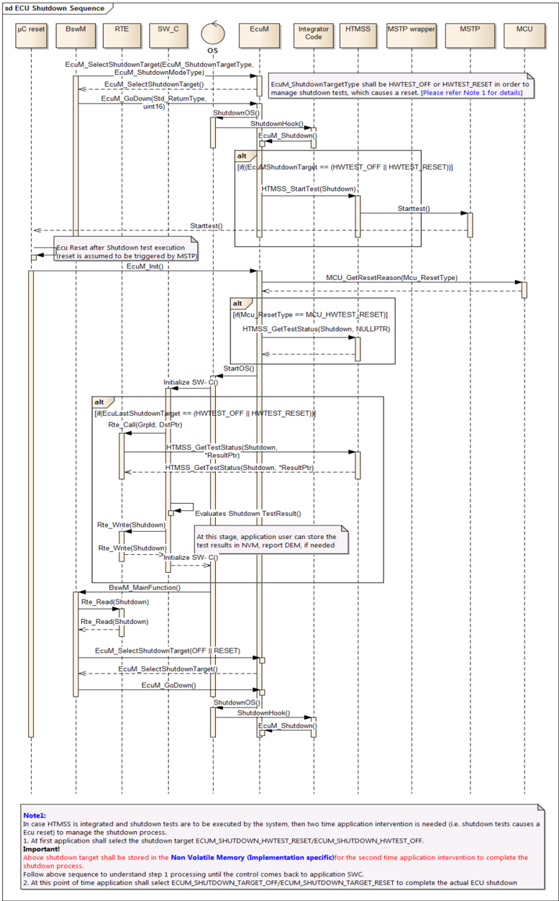

### 8.7. 应用 SWC 收集测试结果的时序图示例

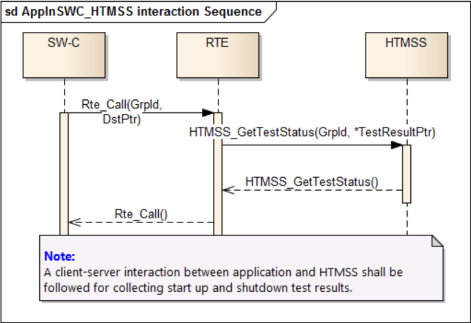

## 9. 配置规范

以下各章汇总所有配置参数。参数的详细含义在下面的章节中描述。

### 9.1. 容器与配置参数

以下各章汇总所有配置参数。不过，本章的内容旨在作为参考目的的示例提供。实际实现由规范使用者决定。

#### 9.1.1. HTTMS

| 属性 | 值 |
| --- | --- |
| SWS 条目 | [ECUC_HTTMS_00001] |
| 模块名称 | HTTMS |
| 描述 | 硬件测试管理启动和关闭（HTMSS）模块的配置。 |
| Post-Build 变体支持 | false |
| 支持的配置变体 | VARIANT-PRE-COMPILE |

| 容器名称 | 多重性 | 作用域/依赖 |
| --- | --- | --- |
| HTTMSSConfigSet | 1..* | 这是包含 HTMSS 模块的配置参数和子容器的基础容器。 |
| HTTMSSGeneral | 1 | 该容器保存 HTMSS 模块的通用参数。 |

图 10.1：配置总览

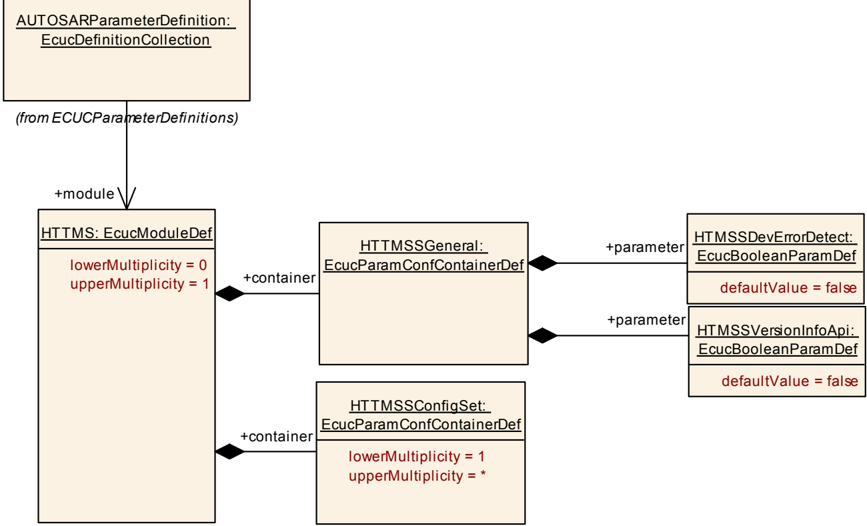

#### 9.1.2. HTTMSSGeneral

| 属性 | 值 |
| --- | --- |
| SWS 条目 | [ECUC_HTTMS_00619] |
| 容器名称 | HTTMSSGeneral |
| 父容器 | HTTMS |
| 描述 | 该容器保存 HTMSS 模块的通用参数。 |

参数 HTMSSDevErrorDetect 的定义：

| 属性 | 值 |
| --- | --- |
| SWS 条目 | [ECUC_HTTMS_00002] |
| 参数名称 | HTMSSDevErrorDetect |
| 父容器 | HTTMSSGeneral |
| 描述 | 启用 DET 的开关。 |
| 多重性 | 1 |
| 类型 | EcucBooleanParamDef |
| 默认值 | false |
| Post-Build 变体值 | false |
| 值配置类 | Pre-compile time：X（All Variants）；Link time：--；Post-build time：-- |
| 作用域/依赖 | scope: local |

参数 HTMSSVersionInfoApi 的定义：

| 属性 | 值 |
| --- | --- |
| SWS 条目 | [ECUC_HTTMS_00003] |
| 参数名称 | HTMSSVersionInfoApi |
| 父容器 | HTTMSSGeneral |
| 描述 | 激活/停用版本信息 API。 |
| 多重性 | 1 |
| 类型 | EcucBooleanParamDef |
| 默认值 | false |
| Post-Build 变体值 | false |
| 值配置类 | Pre-compile time：X（All Variants）；Link time：--；Post-build time：-- |
| 作用域/依赖 | scope: local |

无包含的容器。

#### 9.1.3. HTTMSSConfigSet

| 属性 | 值 |
| --- | --- |
| SWS 条目 | [ECUC_HTTMS_00012] |
| 容器名称 | HTTMSSConfigSet |
| 父容器 | HTTMS |
| 描述 | 这是包含 HTMSS 模块的配置参数和子容器的基础容器。 |

无包含的容器。

`HTMSS_ConfigSet` 示例类图：


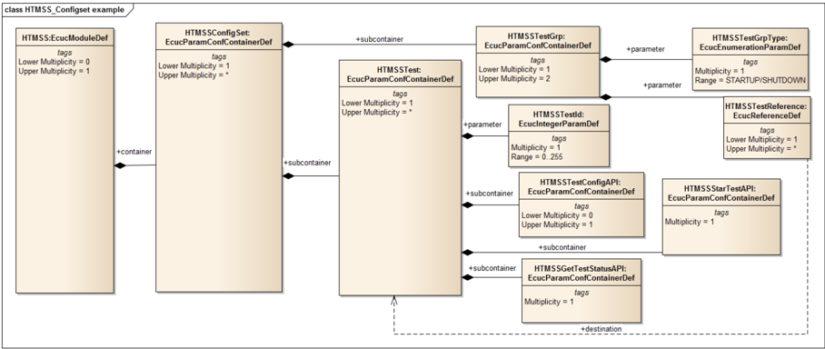

### 9.2. 发布信息

细节请参阅 **SWS_BSWGeneral** 的第 10.3 章「发布信息」。
