## 已知限制

* 并非所有 VFB 通信特性都受支持。
* 并非所有 BSW 服务都规定了代理模块（**Proxy Modules**）。
* 未定义运行时分离。

其他限制在文档 [\[1\]](#ref-1) 中说明。

## 1. 简介和功能概述

本规范描述 AUTOSAR 基础软件模块 **Software Cluster Connection**（软件集群连接）的功能、API 和配置。

## 2. 缩略语和缩写

以下术语表包含与软件集群连接需求相关、但未包含在 AUTOSAR 术语表 [\[2\]](#ref-2) 中的缩略语和缩写。

**SwCluC**
> 软件集群连接（**Software Cluster Connection**）

**Software Cluster**
> 软件集群（**Software Cluster**）将所有与在机器上部署软件相关的 AUTOSAR 工件归为一组。完整定义见文档 [\[2\]](#ref-2)。

**Software Cluster Connection**
> 软件集群连接是提供以下特性的 BSW 模块：• 连接部署在同一机器上的二进制对象（**Binary Objects**） • 通过所谓的代理模块（**Proxy Modules**）替换应用软件集群中本地不可用、但其接口为集成软件所必需的 BSW 模块 • 与 RTE 一起通过 RTE 实现插件（**RTE Implementation Plug-In**）实现软件集群之间的 VFB 通信特性。

**machine**
> 机器（**machine**）由一组计算资源（如微控制器内核、内存或外设（例如通信）设备）组成，并具有执行软件应用的能力。在 AUTOSAR 经典平台中，机器可以用 `EcuInstance` 来表示，但请注意该语义目前仍在澄清中。更多信息见文档 [\[2\]](#ref-2)。

**binary-identical**
> 逐位（Bit for Bit）相同。

**Binary Object**
> 二进制对象（**Binary Object**）是一组文件，其中包含二进制可执行代码和数据。这些二进制可执行代码和数据在编程到目标 ECU 上之前不会再被修改。

**Binary Manifest**
> 二进制清单（**Binary Manifest**）是软件集群的二进制对象的良定义接口，提供资源的元信息以及用于访问此类资源的信息（即所谓的句柄（handles））。

**Application Software Cluster**
> 应用软件集群（**Application Software Cluster**）是主要包含软件组件、仅包含选定的 BSW 模块（例如服务模块、转换器等）的软件集群。

**Host Software Cluster**
> 宿主软件集群（**Host Software Cluster**）是包含 BSW 主要部分（尤其是微控制器相关的下层 BSW 模块，例如 OS 和 MCAL）的唯一软件集群。

**Substitution Software Cluster**
> 替代软件集群（**Substitution Software Cluster**）是出于缺陷修复目的可以覆盖其他软件集群所提供资源的唯一软件集群。

**Proxy Module**
> 代理模块（**Proxy Module**）替换应用软件集群中的 BSW 模块。代理模块本身分为高层代理模块（**High Proxy Module**）和低层代理模块（**Low Proxy Module**）。高层代理模块为更高层或同层的模块提供专用接口，并提供通过二进制清单将其连接到宿主软件集群中低层代理模块的功能。

**High Proxy Module**
> 高层代理模块（**High Proxy Module**）是驻留在应用软件集群中的代理模块部分。

**Low Proxy Module**
> 低层代理模块（**Low Proxy Module**）是驻留在宿主软件集群中的代理模块部分。

**Os Proxy**
> Os 代理模块（**Os Proxy**）是 Os 的代理模块。

**Os High Proxy**
> Os 高层代理（**Os High Proxy**）是在应用软件集群中实现 Os API 的代理模块类型。

**Os Low Proxy**
> Os 低层代理（**Os Low Proxy**）是在宿主软件集群中实现 Os 抽象的代理模块类型。

**NvM Proxy**
> NvM 代理模块（**NvM Proxy**）是 NvM 的代理模块。

**NvM High Proxy**
> NvM 高层代理（**NvM High Proxy**）是替换应用软件集群中 NVRAM 管理器的代理模块类型。

**NvM Low Proxy**
> NvM 低层代理（**NvM Low Proxy**）是将 NvM 高层代理模块连接到宿主软件集群中 NVRAM 管理器的代理模块类型。

**LdCom Proxy**
> LdCom 代理模块（**LdCom Proxy**）是 LdCom 的代理模块。

**LdCom High Proxy**
> LdCom 高层代理（**LdCom High Proxy**）是在应用软件集群中实现默认 LdCom（回调）API 的代理模块类型。

**LdCom Low Proxy**
> LdCom 低层代理（**LdCom Low Proxy**）是将 LdCom 高层代理模块连接到宿主软件集群中 LdCom 的代理模块类型。

**Com Proxy**
> Com 代理模块（**Com Proxy**）是 Com 的代理模块。

**Com High Proxy**
> Com 高层代理（**Com High Proxy**）是在应用软件集群中实现默认 Com（回调）API 的代理模块类型。

**Com Low Proxy**
> Com 低层代理（**Com Low Proxy**）是将 Com 高层代理模块连接到宿主软件集群中 Com 的代理模块类型。

**Dcm Proxy**
> Dcm 代理模块（**Dcm Proxy**）是 Dcm 的代理模块。

**Dcm High Proxy**
> Dcm 高层代理（**Dcm High Proxy**）是替换应用软件集群中 Dcm 的代理模块类型。

**Dcm Low Proxy**
> Dcm 低层代理（**Dcm Low Proxy**）是将 Dcm 高层代理模块连接到宿主软件集群中 Dcm 的代理模块类型。

**Dem Proxy**
> Dem 代理模块（**Dem Proxy**）是 Dem 的代理模块。

**Dem High Proxy**
> Dem 高层代理（**Dem High Proxy**）是替换应用软件集群中 Dem 的代理模块类型。

**Dem Low Proxy**
> Dem 低层代理（**Dem Low Proxy**）是将 Dem 高层代理模块连接到宿主软件集群中 Dem 的代理模块类型。

**FiM Proxy**
> FiM 代理模块（**FiM Proxy**）是 FiM 的代理模块。

**FiM High Proxy**
> FiM 高层代理（**FiM High Proxy**）是替换应用软件集群中 FiM 的代理模块类型。

**FiM Low Proxy**
> FiM 低层代理（**FiM Low Proxy**）是将 FiM 高层代理模块连接到宿主软件集群中 FiM 的代理模块类型。

**Cross Cluster Communication**
> 跨集群通信（**Cross Cluster Communication**）实现软件集群之间的 VFB 通信。

**Software Cluster Connector**
> 软件集群连接器（**Software Cluster Connector**）读取未连接的二进制清单的信息，并计算可修改的二进制清单部分。

**RTE Implementation Plug-In**
> RTE 实现插件（**RTE Implementation Plug-In**）是整个 RTE 实现的一部分，它不由 RTE 生成器提供，而是来自额外的来源（例如插件生成器或手动实现的源代码）。

**RTE Implementation Plug-In Service**
> RTE 实现插件服务（**RTE Implementation Plug-In Service**）是进入 RTE 实现插件的单个入口点，为 RTE 实现低层服务。例如对特定缓冲区的访问。

**Local Software Cluster Communication Plug-In**
> 本地软件集群通信插件（**Local Software Cluster Communication Plug-In**）是一种 RTE 实现插件，它处理软件集群内部的本地通信。如果存在针对相应通信图（**Communication Graph**）的 **DataMapping**，则还包括转换器处理。

**Cross Software Cluster Communication Plug-In**
> 跨软件集群通信插件（**Cross Software Cluster Communication Plug-In**）是一种 RTE 实现插件，它处理与其他软件集群的通信。如果配置了 ECU 内转换，则还包括转换器处理。

**Communication Graph**
> 通信图（**Communication Graph**）是相互连接的端口原型（**PortPrototype**）中实例化的、指向端口接口（**PortInterface**）元素的所有抽象访问点（**AbstractAccessPoint**）的总和；或者是相互连接的 **BswModuleDescription** 中 **BswModuleEntity** 对接口元素的所有访问的总和。

**Data Communication Graph**
> 数据通信图（**Data Communication Graph**）是相互连接的端口原型中实例化的、指向可变数据原型（**VariableDataPrototype**）的所有可变访问（**VariableAccess**）的总和；或者是内部行为（**InternalBehavior**）中对可变数据原型的所有可变访问的总和；或者是相互连接的 **BswModuleDescription** 中对可变数据原型的所有基础软件可变访问（**BswVariableAccess**）的总和。

**Parameter Communication Graph**
> 参数通信图（**Parameter Communication Graph**）是相互连接的端口原型中实例化的、指向参数数据原型（**ParameterDataPrototype**）的所有参数访问（**ParameterAccess**）的总和；或者是内部行为中对参数数据原型的所有参数访问的总和。

**Client Server Communication Graph**
> 客户端服务器通信图（**Client Server Communication Graph**）是相互连接的端口原型中实例化的、指向操作（operation）的所有服务器调用点（**ServerCallPoint**）的总和，包括关联的服务器可运行实体。

**client**
> 客户端（**client**）定义为一个软件组件实例的一个需求端口原型（**RPortPrototype**）中的一个客户端服务器操作（**ClientServerOperation**）。对于客户端的定义，服务器调用点的数量或可运行实体对服务器调用点的访问均不相关。如果软件组件实例为同一端口接口的客户端服务器操作的多个端口原型定义了服务器调用点，则它可以作为多个客户端出现在同一服务器上。

**server**
> 服务器（**server**）定义为目标为操作调用事件（**OperationInvokedEvent**）的可运行实体。调用序列化在可运行实体的激活上进行。

**server runnable**
> 服务器可运行实体（**server runnable**）是由操作调用事件触发的服务器。它具有介于可运行实体和函数调用之间的混合行为。在某些情况下，RTE 可以将客户端服务器通信实现为简单的函数调用。

**Trigger Communication Graph**
> 触发通信图（**Trigger Communication Graph**）是相互连接的端口原型中实例化的、指向触发器（**Trigger**）的所有外部触发点（**ExternalTriggeringPoint**）的总和，包括关联的被触发可运行实体。

**Mode Communication Graph**
> 模式通信图（**Mode Communication Graph**）是相互连接的端口原型中实例化的、指向模式声明组原型（**ModeDeclarationGroupPrototype**）的所有模式访问点（**ModeAccessPoint**）和模式切换点（**ModeSwitchPoint**）的总和；或者是相互连接的 **BswModuleDescription** 中指向模式声明组原型的所有受管模式组（**managedModeGroup**）和访问模式组（**accessedModeGroup**）的总和。

**mode manager**
> 进入和离开模式由模式管理器（**mode manager**）发起。模式管理器或者是提供由模式切换接口（**ModeSwitchInterface**）类型化的 P 端口的软件组件，或者是在其 **BswModuleDescription** 中以 **providedModeGroup** 角色定义模式声明组原型的 BSW 模块。

**mode switch notification**
> 模式切换通知（**mode switch notification**）是从模式管理器到模式用户的模式切换的通信，使用模式切换接口或 **providedModeGroup** 和 **requiredModeGroup** 模式声明组原型。

**mode switch port**
> 模式切换端口（**mode switch port**）是用于接收（或发送）模式切换通知的端口。为此，模式切换端口由模式切换接口类型化。

**mode user**
> 依赖于模式的 AUTOSAR 软件组件或 AUTOSAR 基础软件模块称为模式用户（**mode user**）。这种依赖可以通过 **SwcModeSwitchEvent** / **BswModeSwitchEvent**、用于提供/需求模式切换端口的模式访问点、或用于 **providedModeGroup** / **requiredModeGroup** 模式声明组原型的访问模式组发生。

**on-entry ExecutableEntity**
> 由 **ModeActivationKind** 为 'entry' 的 **SwcModeSwitchEvent** 触发的可运行实体（**RunnableEntity**）；或由 **ModeActivationKind** 为 'entry' 的 **BswModeSwitchEvent** 触发的基础软件可调度实体（**BswSchedulableEntity**）。

**on-exit ExecutableEntity**
> 由 **ModeActivationKind** 为 'exit' 的 **SwcModeSwitchEvent** 触发的可运行实体；或由 **ModeActivationKind** 为 'exit' 的 **BswModeSwitchEvent** 触发的基础软件可调度实体。

**on-transition ExecutableEntity**
> 由 **ModeActivationKind** 为 'transition' 的 **SwcModeSwitchEvent** 触发的可运行实体；或由 **ModeActivationKind** 为 'transition' 的 **BswModeSwitchEvent** 触发的基础软件可调度实体。

**trigger port**
> 触发端口（**trigger port**）是由触发接口（**TriggerInterface**）类型化的端口原型（**PortPrototype**）。

**trigger sink**
> 触发接收器（**trigger sink**）依赖可运行实体或基础软件可调度实体的激活——当某个特定触发器被触发时。触发接收器具有专用的需求触发端口（**require trigger port**）和/或 **requiredTrigger** 触发器以与触发源（**trigger source**）通信。

**trigger source**
> 触发源（**trigger source**）管理特定触发器，并在触发器被触发时通知 RTE 或基础软件调度器。触发源具有专用的提供触发端口（**provide trigger port**）和/或 **releasedTrigger** 触发器以与触发接收器（**trigger sink**）通信。

**triggered BswSchedulableEntity**
> 被触发的 **BswSchedulableEntity**（**triggered BswSchedulableEntity**）是至少由一个 **BswExternalTriggerOccurredEvent** 或 **BswInternalTriggerOccurredEvent** 触发的基础软件可调度实体。在特定情况下，触发事件通信或基础软件可调度实体间触发由基础软件调度器实现为触发可执行实体（**ExecutableEntity**）对被触发可执行实体的直接或受信任的函数调用。

**triggered ExecutableEntity**
> 被触发的可执行实体（**triggered ExecutableEntity**）是至少由一个 **ExternalTriggerOccurredEvent** / **InternalTriggerOccurredEvent** 触发的可运行实体；或至少由一个 **BswExternalTriggerOccurredEvent** / **BswInternalTriggerOccurredEvent** 触发的基础软件可调度实体。在特定情况下，触发事件通信或可运行实体间触发由 RTE 或基础软件调度器实现为触发可执行实体对被触发可执行实体的直接或受信任的函数调用。

**triggered runnable**
> 被触发的可运行实体（**triggered runnable**）是至少由一个 **ExternalTriggerOccurredEvent** 或 **InternalTriggerOccurredEvent** 触发的可运行实体。在特定情况下，触发事件通信或可运行实体间触发由 RTE 实现为由触发可运行实体对被触发可运行实体的直接或受信任的函数调用。

## 3. 相关文档

### 3.1. 输入文件和相关标准与规范

<a id="ref-1"></a>- [1] 软件集群设计与集成指南说明 AUTOSAR\_CP\_EXP\_SwClusterDesignAndIntegrationGuideline
<a id="ref-2"></a>- [2] 术语表 AUTOSAR\_FO\_TR\_Glossary
<a id="ref-3"></a>- [3] 基础软件模块通用规范 AUTOSAR\_CP\_SWS\_BSWGeneral
<a id="ref-4"></a>- [4] RTE 软件规范 AUTOSAR\_CP\_SWS\_RTE
<a id="ref-5"></a>- [5] 操作系统规范 AUTOSAR\_CP\_SWS\_OS
<a id="ref-6"></a>- [6] NVRAM 管理器规范 AUTOSAR\_CP\_SWS\_NVRAMManager
<a id="ref-7"></a>- [7] 通信栈类型规范 AUTOSAR\_CP\_SWS\_CommunicationStackTypes
<a id="ref-8"></a>- [8] 大数据 COM 规范 AUTOSAR\_CP\_SWS\_LargeDataCOM
<a id="ref-9"></a>- [9] 通信规范 AUTOSAR\_CP\_SWS\_COM
<a id="ref-10"></a>- [10] 诊断通信管理器规范 AUTOSAR\_CP\_SWS\_DiagnosticCommunicationManager
<a id="ref-11"></a>- [11] 诊断事件管理器规范 AUTOSAR\_CP\_SWS\_DiagnosticEventManager
<a id="ref-12"></a>- [12] 功能抑制管理器规范 AUTOSAR\_CP\_SWS\_FunctionInhibitionManager
<a id="ref-13"></a>- [13] 软件集群连接模块需求 AUTOSAR\_CP\_SRS\_SoftwareClusterConnection
<a id="ref-14"></a>- [14] 基础软件模块通用需求 AUTOSAR\_CP\_SRS\_BSWGeneral
<a id="ref-15"></a>- [15] 系统模板 AUTOSAR\_CP\_TPS\_SystemTemplate
<a id="ref-16"></a>- [16] CRC 例程规范 AUTOSAR\_CP\_SWS\_CRCLibrary
<a id="ref-17"></a>- [17] 内存映射规范 AUTOSAR\_CP\_SWS\_MemoryMapping
<a id="ref-18"></a>- [18] ECU 配置规范 AUTOSAR\_CP\_TPS\_ECUConfiguration
<a id="ref-19"></a>- [19] 软件组件模板 AUTOSAR\_CP\_TPS\_SoftwareComponentTemplate
<a id="ref-20"></a>- [20] 看门狗管理器规范 AUTOSAR\_CP\_SWS\_WatchdogManager
<a id="ref-21"></a>- [21] 经典平台平台类型规范 AUTOSAR\_CP\_SWS\_PlatformTypes
<a id="ref-22"></a>- [22] 标准类型规范 AUTOSAR\_CP\_SWS\_StandardTypes
<a id="ref-23"></a>- [23] ISO 17356-3:Road vehicles - Open interface for embedded automotive applications - Part 3:OSEK/VDX Operating [System](#9132-system) (OS)

### 3.2. 相关规范

AUTOSAR 提供了一份基础软件模块通用规范 [\[3\]](#ref-3)，它同样适用于 **Software Cluster Connection**。

因此，规范 **SWS BSW General** 应被视为 **Software Cluster Connection** 的附加且必需的规范。

## 4. 约束和假设

### 4.1. 限制

当前规范仅支持数量有限的 BSW 模块。此外，对于受支持的 BSW 模块，应用软件集群可用的功能和 API 只是整体功能的一个子集。另外，可用的 VFB 通信特性也受到限制。

### 4.2. 汽车域的适用性

本规范专注于集中软件功能的较大 ECU，即所谓的域控制器（**domain controller**）或区域控制器（**zone controller**）。它假设映射到不同软件集群的软件组件在接口和时域方面耦合相当松散。打算主要实现控制循环软件的软件组件——通常由时间驱动，但也可能对有限数量的偶发事件作出反应。更多信息见文档 [\[1\]](#ref-1)。

## 5. 对其他模块的依赖

### 5.1. 二进制清单

#### 5.1.1. 头文件结构

**Software Cluster Connection** 的二进制清单应提供头文件 `SwCluC_BManif.h`。

头文件 `SwCluC_BManif.h` 应包含在容器 **SwCluCBManifProvideResourceEntryGroup** 和 **SwCluCBManifRequireResourceEntryGroup** 中配置的所有 `SwCluCBManifHeaderIncludes`。

### 5.2. 跨集群通信

Software Cluster Connection 的跨集群通信依赖于 RTE [\[4\]](#ref-4)。

### 5.3. 代理模块

**SwCluC** 模块在代理模块（**Proxy Modules**）方面对其子功能有以下依赖：

每个低层代理模块依赖于其特定的 BSW 模块：

* Os 低层代理依赖于 OS [\[5\]](#ref-5)
* NvM 低层代理依赖于 NvM [\[6\]](#ref-6)
* LdCom 高层代理依赖于通信栈类型 [\[7\]](#ref-7)
* LdCom 低层代理依赖于 LdCom [\[8\]](#ref-8) 和通信栈类型 [\[7\]](#ref-7)
* Com 低层代理依赖于 Com [\[9\]](#ref-9)
* Dcm 低层代理依赖于 Dcm [\[10\]](#ref-10)
* Dem 低层代理依赖于 Dem [\[11\]](#ref-11)
* FiM 低层代理依赖于 FiM [\[12\]](#ref-12)

## 6. 功能规格

### 6.1. 二进制清单

#### 6.1.1. 概述

借助软件集群（**Software Clusters**）的概念，AUTOSAR 经典平台架构的整体软件可以拆分为更小的单元。在这种集群化的 AUTOSAR 经典平台架构中，资源（**resource**）用于描述任何满足以下条件的能力：

* 运行软件集群中的软件所需要的能力
并且（AND）
* 由一个软件集群提供给另一个软件集群的能力

另请参阅文档 [\[15\]](#ref-15) 及其对 `[CpSoftwareClusterResource](#946-cpsoftwareclusterresource)` 的描述。

每个软件集群都是一个独立的构建单元，集群特定构建过程的结果就是二进制对象（**Binary Objects**）。二进制清单（**Binary Manifests**）提供了连接部署在同一机器（**machine**）上的二进制对象的方法。因此，二进制清单是软件集群的二进制对象的良定义接口。

二进制清单提供访问软件集群内部资源、以及连接软件集群的提供资源与需求资源所需的任何信息。此处的资源可以是运行软件所需的任何东西，例如软件集群的发送方-接收方接口（**sender receiver interface**）或 NV 块。这类资源的一个明显属性是它由软件集群提供还是需求。

二进制清单具有以下核心特性：

* 二进制清单在软件集群的构建期间创建，因为它必须存储可能与构建相关的信息（例如数据和函数地址、使用 BSW API 的 ID 值、属性值、哈希值）。
* 二进制清单提供面向软件集群实现的 C 接口。这支持软件集群连接的其他功能块从二进制清单的表实现中抽象出来。需要使用二进制清单的 CDD 的实现也可以访问该 C 接口。
* 二进制清单定义了面向软件集群构建工具的 ECU-C 接口。这支持软件集群连接的其他功能块对二进制清单的抽象使用，以及 CDD 对二进制清单的使用。
* 二进制清单格式可以由目标机器（**target machine**）轻松解释。注意：与其他领域的概念（例如 Java、Android）相比，本规范的目标并不是提供文本形式的清单（XML、JSON）。
* 每个资源使用一个唯一的标识符进行连接过程。这些标识符是显式分配的，因为哈希编号不适合此用途。
* 二进制清单应具有守护（guarding）信息，以确保只有兼容的接口才会被连接。这些守护值由对某些接口属性的哈希构成（见 [**6.3.2.2**](#6322-跨集群通信与二进制清单) 和 [**6.5**](#65-标准化服务资源) 章）。

#### 6.1.2. 二进制清单的逻辑结构

图 7.1 概述了某个虚构示例资源所需的二进制清单的概念元素。

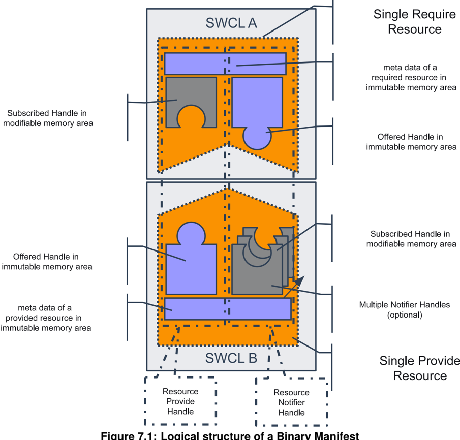

二进制清单提供了连接软件集群的需求资源和提供资源的能力。每个资源都由一组元数据限定，例如：

* 资源的唯一标识符
* 资源的类型（例如发送方-接收方通信或 NV 块的连接）
* 资源是由本软件集群需求还是提供
* 对于需求资源，它对软件集群的运行是否为强制性的
* 守护信息（例如哈希值），以确保只有兼容的资源才会被连接
* 存储的句柄（**handles**）数量，以及这些句柄在相应表中的位置

每种类型的资源都由句柄的数量、它们在连接中的用途以及它们在二进制清单中的排列顺序来限定。句柄保存着请求资源的软件集群在提供资源的软件集群中访问该资源所需的信息。

单个句柄可以是：

* 数据指针
* 函数指针
* 值

在某些情况下，资源的连接可能需要双向交换句柄。相应地，二进制清单在逻辑层面区分两种类型的句柄：

* **Provide Handle**（提供句柄）：将句柄从资源提供方发布给资源请求方
* **Notifier Handle**（通知句柄）：将句柄从资源请求方发布给资源提供方

**Provide Handle** 的一个例子是应用软件集群为调用某个 AUTOSAR 服务而传播的 API 函数。

**Notifier Handle** 的一个例子是来自已连接 AUTOSAR 服务的回调通知。

此外，即使资源提供方使用了 **Notifier Handles**，也支持它连接到多个资源请求方。但在这种情况下，需要为每个潜在的资源请求方预留一组自己的 **Notifier Handles**。因此，一个 **Notifier Handle Set**（通知句柄集）保存着一个资源请求方的所有 **Notifier Handles**。

二进制清单由以下部分组成：

* **Binary Manifest Header**（二进制清单头）。它是中央入口点，提供管理数据并引用清单的其他部分。
* **Interface Descriptor Table**（接口描述符表）。它为每个资源条目（**Resource Entry**，需求或提供的接口）包含一行元信息——唯一 ID、运行时操作资源的属性、关于接口特征和语义的哈希值。
* **Offered Interface**（提供接口）。它包含向其他集群提供的所有句柄——如上所述，或者是因为资源是提供的，或者是因为需求资源在另一个方向上也需要句柄。
* **Subscribed Interface**（订阅接口）。反之，它包含本软件集群持有的、由其他软件集群提供的所有句柄。
* 校验和与标记（**Immutable Tables Checksum**、**Subscribed Interface Validity Marker**）

二进制清单的某些部分在构建软件集群时是固定的（称为不可变的，immutable），而其他部分则必须在连接过程中更改（称为可修改的，modifiable）：

* 不可变的：
  * **Binary Manifest Header**
  * **Interface Descriptor Table**
  * 提供的句柄
  * 订阅句柄的默认值，以支持未连接状态下的运行

* 可修改的：

为了建立连接，该内存区域必须存储来自其他 SWCL 的句柄。此外，可能还存储一些信息，用于标识资源是否已连接（仅可见默认值）以及连接到哪个 SWCL。

#### 6.1.3. 逻辑结构与配置结构之间的映射

图 7.1 所示的逻辑结构同样体现在二进制清单的配置结构中。

连接一种资源类型相关的句柄集合定义在 **SwCluCBManifResourceType** 中。资源类型（**Resource Type**）由一组定义的 **Provide Handles** 和 **Notifier Handles** 刻画，它们具有特定的类型和良定义的顺序。

句柄可以可选地存在。这对在所有功能配置中并不总是需要完整句柄集合的资源很有用。例如，发送方-接收方通信可以带或不带 **sendIndication** 工作。由于编号空间有限，总是为每种句柄配置消耗一个新的资源类型 ID（`SwCluCBManifResourceId`）并不合适！但是资源提供方（**Resource Provider**）和资源请求方（**Resource Requester**）必须对可选性条件有一致的理解，并且双方都必须看到匹配的配置，才能为特定的 `[CpSoftwareClusterResource](#946-cpsoftwareclusterresource)` 确定相同的句柄配置。

这是启用软件集群之间连接的前提条件。

可选句柄总是添加在非可选句柄之后！

此外，强烈建议将导致不同句柄配置的配置值也纳入守护值的计算。

本软件集群的每个需求或提供资源都对应二进制清单中的一个资源条目（**Resource Entry**）。

一个资源条目恰好对应 **Interface Descriptor Table** 中的一行，加上 **Offered Interface** 和/或 **Subscribed Interface** 中的一个或多个句柄。根据资源是需求的还是提供的，**Provide Handles** 和 **Notifier Handles** 要么在软件集群中实现，要么预期由另一个软件集群设置。另请参阅表 7.1。

因此，配置为提供资源条目（**Provide Resource Entrys**）和需求资源条目（**Require Resource Entrys**）提供了两种不同的定义，即 **SwCluCBManifProvideResourceEntry** 和 **SwCluCBManifRequireResourceEntry**。

从二进制清单用户的角度来看，一个重要的用例是通过索引遍历同构的资源条目。为此，配置提供了将相同资源类型的资源条目分组为资源条目组（**Resource Entry Groups**）的能力。提供资源条目组（**Provide Resource Entry Group**）是一组提供资源条目，表示为 **SwCluCBManifProvideResourceEntryGroup**。相应地，需求资源条目组（**Require Resource Entry Group**）是一组需求资源条目，表示为 **SwCluCBManifRequireResourceEntryGroup**。

在本节和上一节中，针对二进制清单内的三个不同逻辑层引入了三对术语：

1. 提供和需求资源
2. **Provide Handles** 和 **Notifier Handles**
3. 提供的（offered）和订阅的（subscribed）句柄

单个连接（提供资源与需求资源之间，1）由一个或多个逻辑通道（提供句柄与通知句柄，2）组成，这些逻辑通道在二进制清单中实现（提供的与订阅的句柄，3）。

一个类比可能有助于澄清这些术语。

考虑一台通过电缆连接到电视的卫星接收器，电缆内部包含许多导线。卫星接收器提供「视频」，电视请求它（提供和需求资源）。为了在提供方和需求方之间建立单个连接，需要多条独立的数据流（提供句柄和通知句柄）。一些数据流将视频和音频信号从提供方传输到请求方，而另一些则以相反的方向传输遥控信号。电视和卫星接收器都有一个带多个引脚的连接器（提供句柄和通知句柄）。

对于「左音频声道」（**Provide Handle**），使用某个特定的引脚。在该引脚上，卫星接收器发送信号（一个提供的句柄实现了该 **Provide Handle**），电视从同一引脚读取信号（一个订阅的句柄实现了该 **Provide Handle**）。对于「遥控信号」（**Notifier Handle**）引脚，电视发送信号（提供的句柄实现了 **Notifier Handles**），而卫星接收器读取信号（订阅的句柄实现了 **Notifier Handles**）。

这三个层的可能组合见表 7.1。

#### 6.1.4. 二进制清单的实现结构

通常在 AUTOSAR 中，BSW 模块的实现并不是标准化的。但二进制清单的各种数据表实现了面向软件集群连接器算法的接口。因此，本文档对这些表的实现布局和语义进行了标准化。此外，第 [**6.1.5**](#615-连接软件集群) 章定义了此类连接器算法的一组抽象需求。

图 7.2 概述了二进制清单的各个表及其主要关系。

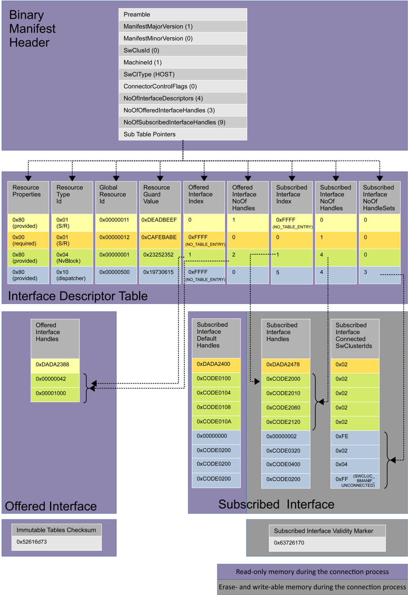

##### 6.1.4.1. 实现概述

每个软件集群的二进制清单都有一个中央入口点，称为 **Binary Manifest Header**（二进制清单头）。它包含软件集群的 AUTOSAR 标准化元数据，以及指向二进制清单各个子表（及其列，如下所述）的指针。它在 [**6.1.4.3**](#6143-二进制清单头) 章中规定。

**Interface Descriptor Table** 中的每一行存储单个资源的属性，例如全局资源 ID。为了避免将多个元素放入一个结构时可能出现的对齐间隙和填充字节，该表不存储为此类结构的数组，而是将各个属性组织在独立的数组中。**Interface Descriptor Table** 的各个数组必须具有完全相同的元素数量和相同的顺序。换句话说，这些数组可以看作 **Interface Descriptor Table** 的列，相同的索引表示表中的一行。每一行描述一个资源。它在 [**6.1.4.4**](#6144-接口描述符表) 章中规定。

这些资源中的每一个现在都可以在提供和/或订阅句柄表中使用指定数量的句柄。关联句柄的指示通过接口表的起始索引和接口表中的句柄数量完成。由于提供的句柄和订阅的句柄的数量和位置可能不同，因此为提供句柄表和订阅句柄表分别存在一个独立的「索引」和独立的「句柄数量」。索引中的特殊值 `NO_TABLE_ENTRY` 表示该表中不存在句柄。在这种情况下，句柄数量设置为零。

例如，在图 7.2 中，ID 为 `0x11` 的资源（标记为黄色）在索引 0 处有 1 个提供的句柄，没有订阅的句柄（由 `NO_TABLE_ENTRY` 指示）。ID 为 `0x1` 的资源（标记为绿色）在提供的表中有两个句柄（从索引 1 开始），在订阅的表中有四个句柄（同样从索引 1 开始）。

**Offered Interface** 由一个数组组成——**Offered Interface Handle Column**——用于存储为连接过程提供的固定句柄（例如，对于发送端口，即本软件集群提供的端口相关数据缓冲区的地址）。它在 [**6.1.4.5**](#6145-提供接口表) 章中规定。

**Subscribed Interface** 由三个数组组成：

* **Subscribed Interface Default Handle Column** 为订阅句柄提供默认值，在连接过程在另一个软件集群中没有连接伙伴的情况下使用。
* **Subscribed Interface Handle Column** 保存由连接过程修改的句柄。这些值在连接过程中取自另一个软件集群的 **Offered Interface Handle Column**。
* **Subscribed Interface Connected SwClusterId Column** 保存句柄值所来自的软件集群 ID。

它在 [**6.1.4.6**](#6146-订阅接口表) 章中规定。

请注意，**Subscribed Interface Handle Column** 和 **Subscribed Interface Connected SwClusterId Column** 需要位于连接过程中可以擦除和重写的内存区域。相反，**Subscribed Interface Default Handle Column**（与所有其他二进制清单表一样）需要位于连接过程中只读的内存区域。这种拆分确保连接过程可以在任何时间点重新启动——即使 **Subscribed Interface Handle Column** 和 **Subscribed Interface Connected SwClusterId Column** 已经擦除且尚未重写。

##### 6.1.4.2. 多通知集介绍

为了支持需要向请求方单独通知的 1:n 连接，二进制清单支持存储多个通知句柄集（**Notifier Handle Sets**）。在这种情况下，`SubscribedInterfaceNoOfHandleSets` 字段描述可以连接多少个其他软件集群的句柄集。请注意，值 0 表示仅支持单个连接。1..n 表示可能存在多个连接。如果选择了后者，则第一个句柄条目用于存储已连接软件集群的实际数量——类似于动态长度数组。通过这种处理，即使最多只支持一个连接，也可以为二进制清单用户保留 `MULTIPLE_NOTIFIER_SETS` 语义。

也可以连接每次连接需要多个句柄的接口。每次连接的句柄数量不存储在二进制清单中，但如果需要，可以计算为 ( `SubscribedInterfaceNoOfHandles` -1) / `SubscribedInterfaceNoOfHandleSets`。

以图 7.2 为例，ID 为 `0x500` 的资源（标记为蓝色）有 3 个句柄集（`SubscribedInterfaceNoOfHandleSets` 列中的条目设置为 3）。因此最多可以建立三个到该资源的连接。在本例中，三个句柄集各由一个句柄组成，并且由于还有一行用于元信息，`SubscribedInterfaceNoOfHandles` 设置为 3*1 + 1 = 4。

如上所述，已建立的连接数量存储在第一个句柄条目中。在本例中，该条目设置为 `0x2`，因此使用了两个连接，还有一个未使用。`SubscribedInterfaceConnectedClusterIds` 中的值 `0xFE` 还指示该行不包含句柄。接下来的两行分别显示句柄的目标地址和集群 ID。由于最后一个连接当前未使用，最后一行的句柄值设置为默认值，`SubscribedInterfaceConnectedClusterIds` 设置为 `SWCLUC_BMANIF_UNCONNECTED`（`0xFF`）。

关于多个通知句柄集的更深入信息见 [**6.1.5.4**](#6154-多通知集) 章。作为该章的一部分，表 7.2 还给出了一个包含四个句柄集（每个句柄集由两个句柄组成）的示例。

##### 6.1.4.3. 二进制清单头

**Software Cluster Connection** 的二进制清单应恰好提供一个 **Binary Manifest Header** 实例：

```C
const SwCluC_BManif_HeaderType SwCluC_BManif_Header = { <initialization> };
```

头文件 `SwCluC_BManif.h` 应导出 **Binary Manifest Header** 的声明：

```C
extern const SwCluC_BManif_HeaderType SwCluC_BManif_Header;
```

**Binary Manifest Header** 的元素 `Preamble` 应设置为值 `0x41524350464C4558`。

**注意：** `Preamble` 的用途是作为二进制清单在内存中开始位置的明显标记。此外，该值的选取使得在以字节流或从二进制对象文件读取二进制清单时能够检测出字节序和字序。

**Binary Manifest Header** 的元素 `ManifestMajorVersion` 应设置为值 `0x01`。

**Binary Manifest Header** 的元素 `ManifestMinorVersion` 应设置为值 `0x01`。

**Binary Manifest Header** 的元素 `SwClusterId` 应设置为所选 **SwCluCDefinition** 的配置参数 `SwCluCSoftwareClusterId` 的值。

**Binary Manifest Header** 的元素 `MachineId` 应设置为所选 **SwCluCDefinition** 的配置参数 `SwCluCMachineId` 的值。

**Binary Manifest Header** 的元素 `SwClusterType` 应按照所选 **SwCluCDefinition** 的配置参数 `SwCluCSoftwareClusterType` 的值并按以下编码设置：

* `HOST_SW_CLUSTER`：`0x00`
* `APPLICATION_SW_CLUSTER`：`0x01`
* `SUBSTITUTION_SW_CLUSTER`：`0xFF`

如果 **SwCluCBManifOnBoardConnectorControl** 设置为 `DISABLE_ON_ECU_CONNECTOR`，则应设置 **Binary Manifest Header** 元素 `ConnectorControlFlags` 中的位 `SWCLUC_BMANIF_DISABLE_ON_ECU_CONNECTION`。否则不设置该位（值为 0）。

**注意：** 并未规定是否可以以更改后的地址重新烧写一个集群、系统如何检测到这一点以及在这种情况下系统会如何表现。这在未来版本的本规范中可能会发生变化。

**Binary Manifest Header** 的元素 `NoOfInterfaceDescriptors` 应设置为配置中 **SwCluCBManifProvideResourceEntry** 容器数量 + **SwCluCBManifRequireResourceEntry** 容器数量。

**Binary Manifest Header** 的元素 `NoOfOfferedInterfaceHandles` 应设置为提供句柄的数量。

**Binary Manifest Header** 的元素 `NoOfSubscribedInterfaceHandles` 应设置为 **Subscribed Interface** 中句柄的数量。

**Binary Manifest Header** 的元素 `ImmutableTablesChecksumPtr` 应引用 **Immutable Tables Checksum**。

**Binary Manifest Header** 的元素 `SubscribedInterfaceValidityMarkerPtr` 应引用 **Subscribed Interface Validity Marker**。

当 **SwCluCBManifDescriptorTreatment** 设置为 `EMBED_DESCRIPTORS` 时，**Binary Manifest Header** 的元素：

* `ResourcePropertiesDescriptorColumnPtr`
* `ResourceTypeDescriptorColumnPtr`
* `GlobalResourceIdDescriptorColumnPtr`
* `ResourceGuardValueDescriptorColumnPtr`
* `OfferedInterfaceIndexDescriptorColumnPtr`
* `OfferedInterfaceNoOfHandlesDescriptorColumnPtr`
* `SubscribedInterfaceIndexDescriptorColumnPtr`
* `SubscribedInterfaceNoOfHandlesDescriptorColumnPtr`
* `SubscribedInterfaceNoOfHandleSetsDescriptorColumnPtr`
* `OfferedInterfaceHandleColumnPtr`
* `SubscribedInterfaceHandleDefaultColumnPtr`
* `SubscribedInterfaceHandleColumnPtr`
* `SubscribedInterfaceConnectedSwClusterIdColumnPtr`

应引用 **Interface Descriptor Table** 的相应数组。否则这些元素初始化为 `NULL_PTR`。

各元素的顺序由数据类型 `[SwCluC_BManif_HeaderType](#72112-swcluc_bmanif_headertype)` 给出。

##### 6.1.4.4. 接口描述符表

如果 **SwCluCBManifDescriptorTreatment** 设置为 `EMBED_DESCRIPTORS`，则 **Software Cluster Connection** 的二进制清单应恰好提供一个 **Interface Descriptor Table** 实例，它由以下列数组组成：

```C
/* descriptor table column for resource properties */
const SwCluC_BManif_ResourcePropertiesType SwCluC_BManif_ResourcePropertiesDescriptorColumn[SWCLUC_BMANIF_NO_OF_DESCRIPTORS] = { <initialization> };

/* descriptor table column for resource type Ids */
const SwCluC_BManif_ResourceTypeIdType SwCluC_BManif_ResourceTypeIdDescriptorColumn[SWCLUC_BMANIF_NO_OF_DESCRIPTORS] = { <initialization> };

/* descriptor table column for global resource Ids */
const SwCluC_BManif_GlobalResourceIdType SwCluC_BManif_GlobalResourceIdDescriptorColumn[SWCLUC_BMANIF_NO_OF_DESCRIPTORS] = { <initialization> };

/* descriptor table column for guard values */
const SwCluC_BManif_ResourceGuardValueType SwCluC_BManif_ResourceGuardValueDescriptorColumn[SWCLUC_BMANIF_NO_OF_DESCRIPTORS] = { <initialization> };

/* descriptor table column for offered interface table index */
const SwCluC_BManif_TableIndexType SwCluC_BManif_OfferedInterfaceIndexDescriptorColumn[SWCLUC_BMANIF_NO_OF_DESCRIPTORS] = { <initialization> };

/* descriptor table column for number of handles in offered interface table*/
const SwCluC_BManif_HandleIndexType SwCluC_BManif_OfferedInterfaceNoOfHandlesDescriptorColumn[SWCLUC_BMANIF_NO_OF_DESCRIPTORS] = { <initialization> };

/* descriptor table column for subscribed interface table index */
const SwCluC_BManif_TableIndexType SwCluC_BManif_SubscribedInterfaceIndexDescriptorColumn[SWCLUC_BMANIF_NO_OF_DESCRIPTORS] = { <initialization> };

/* descriptor table column for number of handles in subscribed interface table*/
const SwCluC_BManif_HandleIndexType SwCluC_BManif_SubscribedInterfaceNoOfHandlesDescriptorColumn[SWCLUC_BMANIF_NO_OF_DESCRIPTORS] = { <initialization> };

/* descriptor table column for number of handle sets in subscribed interface table*/
const SwCluC_BManif_HandleIndexType SwCluC_BManif_SubscribedInterfaceNoOfHandleSetsDescriptorColumn[SWCLUC_BMANIF_NO_OF_DESCRIPTORS] = { <initialization> };
```

对于软件集群配置中的每个 **SwCluCBManifProvideResourceEntry** 和 **SwCluCBManifRequireResourceEntry**，**Software Cluster Connection** 的二进制清单应在 **Interface Descriptor Table** 中提供一行。

**注意：** 这意味着 **Interface Descriptor Table** 中的每个数组每行获得一个元素。在下面的需求中，术语「X 列的元素」指 **Interface Descriptor Table** 中某一行某一列的一个单元格。以此方式规定 **Interface Descriptor Table** 每个单元格的内容。

**Interface Descriptor Table** 中的各行应按资源类型 ID 升序排序，资源类型 ID 相同的行应再按全局资源 ID 升序排序。

如果该行属于 **SwCluCBManifProvideResourceEntry**，则应设置「resource properties」列元素中的位 `SWCLUC_BMANIF_PROVIDED_RESOURCE`。否则不得设置位 `SWCLUC_BMANIF_PROVIDED_RESOURCE`。

如果该行属于 **SwCluCBManifIsMandatory** 为 true 的 **SwCluCBManifRequireResourceEntry**，则应设置「resource properties」列元素中的位 `SWCLUC_BMANIF_MANDATORY_RESOURCE`。否则不得设置位 `SWCLUC_BMANIF_MANDATORY_RESOURCE`。

请注意，对于 **SwCluCBManifProvideResourceEntry**，`SWCLUC_BMANIF_MANDATORY_RESOURCE` 位始终为 0。

「resource properties」列元素中的保留位 5..0 应设置为 0。

「resource type Id」列的元素应设置为适用的 **SwCluCBManifResourceType** 的 `SwCluCBManifResourceId`。

**注意：** 适用的 **SwCluCBManifResourceType** 由所属的 **SwCluCBManifProvideResourceEntryGroup** / **SwCluCBManifRequireResourceEntryGroup** 引用。

「global resource Id」列的元素应设置为通过 `SwCluCBManifResourceRef` 给出的、被引用的 `[CpSoftwareClusterResource](#946-cpsoftwareclusterresource)` 的属性值 `globalResourceId`。如果引用 `SwCluCBManifResourceRef` 未设置，「global resource Id」列的元素应设置为 0。

「guard value」列的元素应设置为配置中 **SwCluCBManifProvideResourceEntry** / **SwCluCBManifRequireResourceEntry** 容器的 `SwCluCBManifResourceGuardValue`。

「offered interface table index」列的元素应设置为 **Offered Interface** 中为本资源分配第一个提供句柄处的索引。如果资源没有提供句柄，该值设置为 `NO_TABLE_ENTRY`。

「number of handles in offered interface table」列的元素应设置为本资源的提供句柄数量。如果资源没有提供句柄，该值设置为 0。

「subscribed interface table index」列的元素应设置为 **Subscribed Interface** 中为本资源分配第一个订阅句柄处的索引。如果资源没有订阅句柄，该值设置为 `NO_TABLE_ENTRY`。

「number of handles in subscribed interface table」列的元素应设置为本资源的订阅句柄数量。如果资源没有订阅句柄，该值设置为 0。

「number of handle sets in subscribed interface table」列的元素：如果适用的 **SwCluCBManifResourceType** 已将 `SwCluCBManifMultipleNotifierSupport` 设置为 `MULTIPLE_NOTIFIER_SETS`，则应设置为 `SwCluCBManifMaxNumberOfNotifierSets`；否则该值设置为 0。

根据资源是由软件集群提供还是需求，**Provide Handles** 和 **Notifier Handles** 需要放入 **Offered Interface** 或 **Subscribed Interface**。表 7.1 定义了为 **SwCluCBManifProvideResourceEntry** / **SwCluCBManifRequireResourceEntry** 在 **Offered Interface** 或 **Subscribed Interface** 中创建的句柄数量。

表7.1：随资源方向而定的提供与订阅句柄数量（**Number of offered and subscribed handles, depending on the resource direction**）

| | Provide Handle | Notifier Handle |
| --- | --- | --- |
| Provided Resource（`SINGLE_NOTIFIER_SET`） | 每个定义的 **SwCluCBManifProvideHandle** 在 **Offered Interface** 中一个句柄。句柄按给定顺序用 **SwCluCBManifProvideSymbols** 初始化。 | 每个定义的 **SwCluCBManifNotifierHandle** 在 **Subscribed Interface** 中一个句柄。句柄按给定顺序用 **SwCluCBManifDefaultNotifierSymbols** 初始化。Software Cluster Id 设置为 `SWCLUC_BMANIF_UNCONNECTED`。 |
| Provided Resource（`MULTIPLE_NOTIFIER_SETS`） | 每个定义的 **SwCluCBManifProvideHandle** 在 **Offered Interface** 中一个句柄。句柄按给定顺序用 **SwCluCBManifProvideSymbols** 初始化。 | 每个定义的 **SwCluCBManifNotifierHandle** 在 **Subscribed Interface** 中一个句柄乘以 **SwCluCBManifMaxNumberOfNotifierSets** 再加一。第一个句柄初始化为 0。其余句柄按给定顺序用连续的 **SwCluCBManifDefaultNotifierSymbols** 集初始化。Software Cluster Id 设置为 `SWCLUC_BMANIF_UNCONNECTED`。 |
| Required Resource | 每个定义的 **SwCluCBManifProvideHandle** 在 **Subscribed Interface** 中一个句柄。句柄按给定顺序用 **SwCluCBManifDefaultProvideSymbols** 初始化。 | 每个定义的 **SwCluCBManifNotifierHandle** 在 **Offered Interface** 中一个句柄。句柄按给定顺序用 **SwCluCBManifNotifierSymbols** 初始化。 |

##### 6.1.4.5. 提供接口表

**Software Cluster Connection** 的二进制清单应恰好提供一个 **Offered Interface Handle Column** 实例：

```C
const SwCluC_BManif_HandleType SwCluC_BManif_OfferedInterfaceHandleColumn[SWCLUC_BMANIF_NO_OF_OFFERED_HANDLES] = { <initialization> };
```

**Software Cluster Connection** 的二进制清单应按照表 7.1 的规定分配并初始化 **Offered Interface** 中句柄的数量。

##### 6.1.4.6. 订阅接口表

**Software Cluster Connection** 的二进制清单应恰好提供一个 **Subscribed Interface Default Handle Column** 实例：

```C
const SwCluC_BManif_HandleType SwCluC_BManif_SubscribedInterfaceDefaultHandleColumn[SWCLUC_BMANIF_NO_OF_SUBSCRIBED_HANDLES] = { <initialization> };
```

**Software Cluster Connection** 的二进制清单应按照表 7.1 的规定分配并初始化 **Subscribed Interface Default Handle Column** 中句柄的数量。

**Software Cluster Connection** 的二进制清单应恰好提供一个 **Subscribed Interface Handle Column** 实例：

```C
const SwCluC_BManif_HandleType SwCluC_BManif_SubscribedInterfaceHandleColumn[SWCLUC_BMANIF_NO_OF_SUBSCRIBED_HANDLES] = { <initialization> };
```

**Software Cluster Connection** 的二进制清单应按照表 7.1 的规定分配并初始化 **Subscribed Interface Handle Column** 中句柄的数量。

**Software Cluster Connection** 的二进制清单应恰好提供一个 **Subscribed Interface Connected SwClusterId Column** 实例：

```C
const SwCluC_BManif_SwClusterIdType SwCluC_BManif_SubscribedInterfaceConnectedSwClusterIdColumn[SWCLUC_BMANIF_NO_OF_SUBSCRIBED_HANDLES] = { <initialization> };
```

**Software Cluster Connection** 的二进制清单应按照表 7.1 的规定分配并初始化 **Subscribed Interface Connected SwClusterId Column** 中句柄的数量。

##### 6.1.4.7. 管理数据

###### 6.1.4.7.1. 不可变表校验和

不可变表校验和（**Immutable Tables Checksum**）是对二进制清单中所有不被软件集群连接步骤更改的常量构建的。这包括：

* **Binary Manifest Header**
* **Interface Descriptor Table** 的所有数组
* **Offered Interface** 的所有数组
* **Subscribed Interface Default Handle Column**

校验和作为软件构建的一部分创建。

**Software Cluster Connection** 的二进制清单应恰好提供一个 **Immutable Tables Checksum** 实例：

```C
const uint32 SwCluC_BManif_ImmutableTablesChecksum = <initialization>;
```

**Immutable Tables Checksum** 应设置为配置参数 `SwCluCBManifImmutableTablesChecksum` 的值。

**Immutable Tables Checksum** 应按照文档 [\[16\]](#ref-16) 中所述的 32 位 Ethernet CRC 计算（CRC32），以内存地址升序对不可变内存区域（包含预留内存空间）的二进制内存表示进行计算。

###### 6.1.4.7.2. 订阅接口有效性标记

订阅接口有效性标记（**Subscribed Interface Validity Marker**）指示在软件集群连接步骤之后所有订阅表均已写入。它需要在软件集群连接步骤之后设置为有效值。无效/有效值不是标准化的，因为这些值需要根据存储二进制清单的 flash 技术来选择。

**Software Cluster Connection** 的二进制清单应恰好提供一个 **Subscribed Interface Validity Marker** 实例：

```C
const uint32 SwCluC_BManif_SubscribedInterfaceValidityMarker = <initialization>;
```

初始时 **Subscribed Interface Validity Marker** 应设置为配置参数 `SwCluCBManifSubscribedInterfaceValidityMarker` 的值。

连接过程完成之后，**Subscribed Interface Validity Marker** 应设置为值 `0xFFA5A500`。

##### 6.1.4.8. 内存映射

**Software Cluster Connection** 的二进制清单应按照文档 [\[17\]](#ref-17) 中的 [SWS_MemMap_00040] 使用 `&lt;feature&gt;` = **BMANIF**。

**Software Cluster Connection** 的二进制清单应将 **Binary Manifest Header** 映射到名为 `CONST_IMMUTABLE_HEADER[{safety}]_32` 的常量、32 位对齐的内存段。可选的名称部分 `[{safety}]` 应按照 [SWS_SwCluC_00097] 设置。

**示例 7.1**

```C
#define SWCLUC_BMANIF_START_SEC_CONST_IMMUTABLE_HEADER_ASIL_D_32
#include "SwCluC_MemMap.h"

const SwCluC_BManif_HeaderType SwCluC_BManif_Header = ...;

#define SWCLUC_BMANIF_STOP_SEC_CONST_IMMUTABLE_HEADER_ASIL_D_32
#include "SwCluC_MemMap.h"
```

**Software Cluster Connection** 的二进制清单应将所有表的不可变列映射到名为 `CONST_IMMUTABLE_COLUMNS[{safety}]_32` 的常量、32 位对齐的内存段。可选的名称部分 `[{safety}]` 应按照 [SWS_SwCluC_00097] 设置。不可变列是：

* **Interface Descriptor Table** 的所有列
* **Offered Interface Handle Column**
* **Subscribed Interface Default Handle Column**

**示例 7.2**

```C
#define SWCLUC_BMANIF_START_SEC_CONST_IMMUTABLE_COLUMNS_ASIL_D_32
#include "SwCluC_MemMap.h"

const SwCluC_BManif_ResourcePropertiesType SwCluC_BManif_ResourcePropertiesDescriptorColumn[SWCLUC_BMANIF_NO_OF_DESCRIPTORS] = ...;

...

const SwCluC_BManif_HandleType SwCluC_BManif_SubscribedInterfaceDefaultHandleColumn[SWCLUC_BMANIF_NO_OF_SUBSCRIBED_HANDLES] = ...;

#define SWCLUC_BMANIF_STOP_SEC_CONST_IMMUTABLE_COLUMNS_ASIL_D_32
#include "SwCluC_MemMap.h"
```

**Software Cluster Connection** 的二进制清单应将可修改列映射到名为 `CONST_MODIFIABLE_COLUMNS[{safety}]_32` 的常量、32 位对齐的内存段。可选的名称部分 `[{safety}]` 应按照 [SWS_SwCluC_00097] 设置。可修改列是：

* **Subscribed Interface Handle Column**
* **Subscribed Interface Connected SwClusterId Column**

**示例 7.3**

```C
#define SWCLUC_BMANIF_START_SEC_CONST_MODIFIABLE_COLUMNS_ASIL_D_32
#include "SwCluC_MemMap.h"

const SwCluC_BManif_HandleType SwCluC_BManif_SubscribedInterfaceHandleColumn[SWCLUC_BMANIF_NO_OF_SUBSCRIBED_HANDLES] = ...;

const SwCluC_BManif_SwClusterIdType SwCluC_BManif_SubscribedInterfaceConnectedSwClusterIdColumn[SWCLUC_BMANIF_NO_OF_SUBSCRIBED_HANDLES] = ...;

#define SWCLUC_BMANIF_STOP_SEC_CONST_MODIFIABLE_COLUMNS_ASIL_D_32
#include "SwCluC_MemMap.h"
```

**Software Cluster Connection** 的二进制清单应将 **Immutable Tables Checksum** 映射到名为 `CONST_IMMUTABLE_TABLES_CHECKSUM[{safety}]_32` 的常量、32 位对齐的内存段。可选的名称部分 `[{safety}]` 应按照 [SWS_SwCluC_00097] 设置。

**理由：** 内存中的校验和处理可能需要固定的位置。

**示例 7.4**

```C
#define SWCLUC_BMANIF_START_SEC_CONST_IMMUTABLE_TABLES_CHECKSUM_ASIL_D_32
#include "SwCluC_MemMap.h"

const uint32 SwCluC_BManif_ImmutableTablesChecksum = ...;

#define SWCLUC_BMANIF_STOP_SEC_CONST_IMMUTABLE_TABLES_CHECKSUM_ASIL_D_32
#include "SwCluC_MemMap.h"
```

**Software Cluster Connection** 的二进制清单应将 **Subscribed Interface Validity Marker** 映射到名为 `CONST_SUBSCRIBED_INTERFACE_VALIDITY_MARKER[{safety}]_32` 的常量、32 位对齐的内存段。可选的名称部分 `[{safety}]` 应按照 [SWS_SwCluC_00097] 设置。

**理由：** 内存中的有效性处理可能需要固定的位置。

**示例 7.5**

```C
#define SWCLUC_BMANIF_START_SEC_CONST_SUBSCRIBED_TABLES_MARKER_ASIL_D_32
#include "SwCluC_MemMap.h"

const uint32 SwCluC_BManif_SubscribedInterfaceValidityMarker = ...;

#define SWCLUC_BMANIF_STOP_SEC_CONST_SUBSCRIBED_TABLES_MARKER_ASIL_D_32
#include "SwCluC_MemMap.h"
```

名称部分 `{safety}` 应包含安全完整性等级，至多为字符串 `QM`、`ASIL_A`、`ASIL_B`、`ASIL_C`、`ASIL_D` 之一。对于 QM，可以省略完整的名称部分 `[{safety}]`。

**请注意：** 名称部分 `{safety}` 是供应商特定的，根据产品支持的最高安全完整性等级设置。

另见文档 [\[17\]](#ref-17) 中的 [SWS_MemMap_00037]。

### 6.1.5. 连接软件集群

#### 6.1.5.1. 概述

AUTOSAR 方法论支持两种不同的方法来连接不同软件集群的二进制对象：

* 在各个未连接的二进制对象被编程到目标 ECU 上之后连接软件集群，此处称为板载（**On-board**）。
* 在二进制对象被编程到目标 ECU 上之前、在目标机器之外连接软件集群，此处称为板外（**Off-board**）。

在板载情况下，板载软件集群连接器（**On-board Software Cluster Connector**）是在重新编程阶段于目标 ECU 上执行的软件。在重新编程一个或多个未连接的二进制对象之后，软件集群连接器将连接结果存储到二进制清单 **Subscribed Interface** 的可修改区域中。

**请注意：** 二进制清单的设计假定连接阶段可能在任何时间点被中止（例如断电），并且应支持连接阶段的重启或恢复。

在板外情况下，板外软件集群连接器（**Off-board Software Cluster Connector**）是一个工具，用于读取二进制对象的文件，并将连接结果存储在文件中。在重新编程 ECU 时，使用已经连接好的二进制对象。这种板外过程还支持一种变体，即将 **Interface Descriptor Table** 中包含的元数据存储在二进制对象之外，其好处是不占用存放这些元数据的 ROM。

本节给出的大多数需求保持通用，可应用于板载和板外两种情况。如果需求特定于某一种情况，则在需求中予以指明。由于 AUTOSAR 不标准化 flash boot loader 的架构，因此不再为板载软件集群连接器标准化其他接口。

关于机器（**machines**）的一些一般性说明：

基于二进制清单的软件集群之间的直接连接只在本地（同一机器上）建立。在同一微控制器上跨「虚拟」机器连接软件集群是不可能的，因为这会破坏虚拟机之间的分离。

#### 6.1.5.2. 连接资源

如果满足以下所有条件，软件集群连接器应将需求资源与提供资源连接起来：

* 提供资源的软件集群的机器 ID 与请求资源的软件集群的机器 ID 相同
* 提供资源与需求资源的全局资源 ID 相等
* 全局资源 ID 不为 0
* 提供资源与需求资源的资源类型 ID 相等
* 提供资源与需求资源的守护值相等
* 提供资源与需求资源的 **Provide Handles** 数量相等
* 提供资源与需求资源的 **Notifier Handles** 数量相等
* 如果存在 **Notifier Handles**，则提供资源为需求资源提供一个可用的 **Notifier Handle Sets**

**注意：** 全局资源 ID = 0 被保留用于指示缺少有效 ID。软件集群连接器应只在全局资源 ID != 0 时进行连接。

#### 6.1.5.3. 替代软件集群的处理

替代软件集群（**Substitution Software Cluster**）的用途是出于开发目的临时覆盖某个软件集群的输出。例如，如果软件集群 A 的发送方-接收方信号「Y」没有正确的功能行为，可以添加一个替代软件集群，它提供一个固定版本的发送方-接收方信号「Y」。该固定版本的发送方-接收方信号「Y」以相同的全局资源 ID 提供。在这种情况下，所有需求发送方-接收方信号「Y」的软件集群都将连接到替代软件集群而不是原来的提供软件集群。如果替代软件集群还需求发送方-接收方信号「Y」，则它会连接到原来的提供软件集群。借助该原理，可以以信号的原始版本作为覆盖版本的基础。

替代软件集群的使用仅用于开发目的，在量产系统中不受支持。它旨在作为开发期间快速解决问题的手段（例如，当需要修改由第三方提供的信号时）。在一台机器上最多支持一个替代软件集群，以避免对有效资源提供方产生歧义。

在一台机器上最多应存在一个替代软件集群。

如果资源由替代软件集群提供，软件集群连接器应将所有需求该资源的软件集群（替代软件集群自身除外）连接到替代软件集群的资源。即使另一个软件集群也提供该资源，也会发生这种情况。不过，[SWS_SwCluC_00043] 中定义的匹配准则仍然适用。

如果资源由替代软件集群需求，软件集群连接器应将该需求资源只连接到非替代软件集群的软件集群的提供资源。不过，[SWS_SwCluC_00043] 中定义的匹配准则仍然适用。

#### 6.1.5.4. 多通知集

**注意：** 提供资源可以可选地具有处理多个通知集的能力。在这种情况下，**Interface Descriptor Table** 中句柄集的数量指示软件集群连接器最多可以注册多少个句柄集。**Subscribed Interface Handle Column** 中的第一个句柄提供实际已注册的通知句柄集（**Notifier Handle Sets**）数量。**Subscribed Interface Handle Column** 中的后续句柄按连续顺序存储 N 组句柄。软件集群连接器写入的不同句柄集的顺序由软件集群 ID 确定。

如果提供资源支持多个通知句柄集，软件集群连接器应按相应需求资源的软件集群 ID 升序对通知句柄集进行排序，并将它们从第二个句柄开始放入提供软件集群的 **Subscribed Interface Handle Column** 中。

如果提供资源支持多个通知句柄集，软件集群连接器应将实际使用的通知句柄集数量作为第一个条目写入 **Subscribed Interface Handle Column**。

**注意：** 实际使用的通知句柄集数量等于实际连接的需求资源数量，因为每个资源占用一个通知句柄集。

如果提供资源支持多个通知句柄集，软件集群连接器应将值 `0xFE` 作为第一个条目写入 **Subscribed Interface Connected SwClusterId Column**。

**注意：** 值 `0xFE` 指示 **Subscribed Interface Handle Column** 中的相应单元格保存着实际使用的通知集数量。

如果提供资源支持多个通知句柄集，而连接的需求资源较少，软件集群连接器应用提供资源的软件集群的 **Subscribed Interface Default Handle Column** 中的默认值填充 **Subscribed Interface Handle Column** 中的其余句柄。

表 7.2 中的示例展示了一个最多提供 4 个通知句柄集的资源提供方的连接。资源类型使用两个通知句柄。提供资源连接到两个不同的软件集群，其余两个通知句柄集用默认值填充。

表7.2：多通知集连接示例（**Example of multiple notifier set connection**）

| Subscribed Interface Handle Column | Subscribed Interface Connected SwClusterId Column | 备注 |
| --- | --- | --- |
| 2 | `0xFE` | 实际使用的通知集数量，**Subscribed Interface Connected SwClusterId Column** 中的条目设置为 0 |
| `0xABCDABCD` | 2 | 软件集群 2 中需求资源的第一个句柄 |
| `0xABC04711` | 2 | 软件集群 2 中需求资源的第二个句柄 |
| `0xDADA0010` | 5 | 软件集群 5 中需求资源的第一个句柄 |
| `0xDADA0020` | 5 | 软件集群 5 中需求资源的第二个句柄 |
| `0xC0CAC01A` | `0xFF` | 资源提供方的第一个默认句柄，**Subscribed Interface Connected SwClusterId Column** 中的条目设置为 `SWCLUC_BMANIF_UNCONNECTED` |
| `0xADD511FE` | `0xFF` | 资源提供方的第二个默认句柄，**Subscribed Interface Connected SwClusterId Column** 中的条目设置为 `SWCLUC_BMANIF_UNCONNECTED` |
| `0xC0CAC01A` | `0xFF` | 资源提供方的第一个默认句柄，**Subscribed Interface Connected SwClusterId Column** 中的条目设置为 `SWCLUC_BMANIF_UNCONNECTED` |
| `0xADD511FE` | `0xFF` | 资源提供方的第二个默认句柄，**Subscribed Interface Connected SwClusterId Column** 中的条目设置为 `SWCLUC_BMANIF_UNCONNECTED` |

#### 6.1.5.5. 未连接的资源

软件集群连接器应将 **Subscribed Interface Default Handle Column** 的条目复制到 **Subscribed Interface Handle Column**，并将 **Subscribed Interface Connected SwClusterId Column** 中的相关条目设置为 `SWCLUC_BMANIF_UNCONNECTED`，适用于：

* 未应用任何连接的所有需求资源的所有 **Provide Handles**
并且（AND）
* 未应用任何连接的所有提供资源的所有 **Notifier Handles**

#### 6.1.5.6. 板载软件集群连接的禁用

一般而言，ECU 可能配备了板载软件集群连接器，但不应使用该连接器，或者只应在特定的机器上使用它。

这样做的一个原因是某种配置：一台机器上的软件需要对整台机器的软件进行认证，而另一台机器上的软件可以按集群更新。

例如，这样的配置在同一微控制器上使用两台机器，此处称为机器 A（**Machine A**）和机器 B（**Machine B**）。

机器 A 需要一种只针对整台机器上的软件授予的认证。尽管如此，该软件仍由多方借助软件集群的手段开发。软件集群仍然需要连接，这是在认证完成之前用板外软件集群连接器完成的。

对于机器 B，此限制不适用。这里应使用板载软件集群连接器来执行一些现场部分更新，这需要一个可工作的板载软件集群连接器。由于整个微控制器的 flash-boot-loader 仍必须工作，因此板载软件集群连接器对机器 A 是禁用的，以保护它免受针对机器 B 的板载软件集群连接器运行造成的意外更改。

如果宿主软件集群（**Host Software Cluster**）的 **Binary Manifest Header** 的 `ConnectorControlFlags` 中设置了位 `SWCLUC_BMANIF_DISABLE_ON_ECU_CONNECTION`，则不执行该机器的板载软件集群连接。

#### 6.1.5.7. 软件集群连接期间的错误

在某些情况下，二进制清单内的信息可能与集群连接器不兼容、不完整或不一致。例如，读取一个在结构上与软件集群连接器的实现不兼容的二进制清单可能导致完全未定义的结果。本节列出了导致连接过程中止的一组条件。

中止后系统的行为目前未规定。建议实现恢复机制。

软件集群连接器应检测 **Binary Manifest Header** 中给出的 `ManifestMajorVersion` 和 `ManifestMinorVersion` 编号是否与软件集群连接器的实现兼容。如果出现任何不兼容的版本号，则应中止该特定机器的连接过程。

如果软件集群 ID 在同一机器上不唯一，则 **Subscribed Interface Connected SwClusterId Column** 无法无歧义地设置：

软件集群连接器应检测属于同一机器的所有软件集群的软件集群 ID 是否不唯一。在这种情况下，应中止该特定机器的连接过程。

如果某个软件集群需求一个其他软件集群都不提供的强制性资源，则该软件集群的运行是不可能的。

软件集群连接器应检测对于某个软件集群，是否存在任何强制性需求资源未被任何其他软件集群提供。在这种情况下，应中止该特定软件集群的连接过程。

一般而言，一个资源只应被提供一次。唯一的例外是替代软件集群的第二次提供，它覆盖另一个软件集群的提供。

软件集群连接器应检测对于某台机器，是否存在一个具有相同资源类型 ID 和相同全局资源 ID 的资源被软件集群提供两次，而这些软件集群中没有一个是替代软件集群。在这种情况下，应中止该特定机器的连接过程。

如果资源不支持多个通知集但使用了通知句柄，软件集群连接器应检测对于某台机器，是否存在一个具有相同资源类型 ID 和相同全局资源 ID 的资源被需求超过一次。在这种情况下，应中止该特定机器的连接过程。

如果资源支持多个通知集，软件集群连接器应检测对于某台机器，是否存在一个具有相同资源类型 ID 和相同全局资源 ID 的资源被需求的次数多于可用的通知集数量。在这种情况下，应中止该特定机器的连接过程。

### 6.1.6. 软件集群二进制清单描述符

软件集群二进制清单描述符（**Software Cluster Binary Manifest Descriptor**）在二进制对象中描述二进制清单。这对板外连接是强制性的，但同时也支持板载连接，因为它使得可以在目标 ECU 之外应用检查。

**Software Cluster Connection** 的二进制清单应提供一个 `[CpSoftwareClusterBinaryManifestDescriptor](#944-cpsoftwareclusterbinarymanifestdescriptor)` 实例，它保存生成的二进制清单的描述。这包括：

* 指向给定 `[CpSoftwareCluster](#943-cpsoftwarecluster)` 的 `cpSoftwareCluster` 引用
* 给定 `[CpSoftwareCluster](#943-cpsoftwarecluster)` 的 `softwareClusterId`
* 用于 `IMMUTABLE_TABLES_CHECKSUM` 和 `SUBSCRIBED_INTERFACE_VALIDITY_MARKER` 的 `metaDataFields`
* 每个提供资源条目（**Provide Resource Entry**）一个 `provideResources`
* 每个需求资源条目（**Require Resource Entry**）一个 `requireResources`
* 每个资源类型（**Resource Type**）一个 `resourceDefinitions`

### 6.1.7. 错误分类

在源代码层面，二进制清单的实现是一组可通过一组 C 宏访问的常量表。这些宏又必须能够作为静态 C 初始化器。由于常量表在运行时不能更改，任何实现运行时检测的错误代码都是无用的。因此，以下各节不定义错误代码，并标记为不适用。

#### 6.1.7.1. 开发错误

开发错误不适用于 **Software Cluster Connection** 的二进制清单。

#### 6.1.7.2. 运行时错误

运行时错误不适用于 **Software Cluster Connection** 的二进制清单。

#### 6.1.7.3. 瞬态故障

瞬态故障不适用于 **Software Cluster Connection** 的二进制清单。

#### 6.1.7.4. 产出错误

产出错误不适用于 **Software Cluster Connection** 的二进制清单。

#### 6.1.7.5. 扩展产出错误

扩展产出错误不适用于 **Software Cluster Connection** 的二进制清单。

### 6.2. 软件集群基础配置检查

软件集群基础配置检查（**Software Cluster Base Configuration Check**）提供一种基本机制，以避免将存在严重配置不兼容的应用软件集群连接到宿主软件集群。该机制利用二进制清单的守护值和强制性特性。在两个参数 `SwCluCAutoBaseConfigDescriptor` 和 `SwCluCUserBaseConfigDescriptor` 中收集的配置信息用于计算强制性连接的守护值。

如果宿主软件集群和应用软件集群的配置存在偏差，连接将失败。在这种情况下，整个应用软件集群保持未连接状态，并在连接过程中被跳过（视为不存在）。另请参阅 [SWS_SwCluC_00050]。

哪些配置设置自动收集到 `SwCluCAutoBaseConfigDescriptor` 中取决于实现。但强烈建议只考虑那些功能上关键的 ECU/机器范围设置，以避免频繁的不兼容。例如，影响 EAIB 兼容性的编译器设置，如填充字节的使用、栈的使用、机器寄存器的使用。

在宿主软件集群中，Software Cluster Connection 的软件集群基础配置检查应为每个已配置的 **SwCluCBaseConfigurationCheck** 创建一个提供资源条目，并将其添加到二进制清单中。

在应用软件集群中，Software Cluster Connection 的软件集群基础配置检查应为每个已配置的 **SwCluCBaseConfigurationCheck** 创建一个强制性需求资源条目，并将它们添加到二进制清单中。

[SWS_SwCluC_00075] 和 [SWS_SwCluC_00076] 的资源条目的 `SwCluCBManifResourceGuardValue` 应根据 `SwCluCAutoBaseConfigDescriptor` 和 `SwCluCUserBaseConfigDescriptor` 中给定的多行字符串计算得出。

### 6.3. 跨集群通信

#### 6.3.1. 概述

跨集群通信（**Cross Cluster Communication**）实现软件集群之间的 VFB 通信。为此，跨集群通信实现一个跨软件集群通信插件（**Cross Software Cluster Communication Plug-In**），如文档 [\[4\]](#ref-4) 所规定。

由于软件集群的预期分离（例如良好分离的构建单元、独立的时序），某些 VFB 通信特性要么变得非常低效，要么会破坏预期的分离。因此，本规范选择了此类系统预期中最常用的一组 VFB 特性的子集，如文档 [\[1\]](#ref-1) 中所述。

简要而言，这些特性是：

* 1:n last-is-best 发送方-接收方通信
* n:1 排队发送方-接收方通信
* n:1 客户端服务器通信——仅异步服务器调用
* 1:n 模式切换通信
* 1:n 参数通信
* 端口接口映射（**PortInterfaceMappings**）的有限适用性，见 [**6.3.2.2**](#6322-跨集群通信与二进制清单)
* **DataReceivedEvents** 为轮询方式
* **AsynchronousServerCallReturnsEvents** 为轮询方式
* 跨集群通信调用的 **OperationInvokedEvents** 为轮询方式

在设计跨集群通信的实现时，必须考虑这种预期的分离。由于每个软件集群都是独立构建的，因此对其他软件集群的了解是有限的。本跨集群通信的目标也不是通过交换软件集群内部的详细设计和配置信息来破坏软件集群独立开发的目标。

相反，代码设计模式必须应对对通信对端了解有限的情况。

由于对通信伙伴了解有限，代码的执行在分区系统中可能失败。

应用软件集群的跨集群通信的实现不得执行属于任何其他软件集群的代码，宿主软件集群提供的特殊入口点除外（例如用于实现事件传递）。

因此，跨集群通信不支持 **SynchronousServerCallPoints**。另请参阅文档 [\[4\]](#ref-4) 中的 [SWS_Rte_72023]。

此外，在分区系统内，无法保证 RAM 对每个软件集群或软件集群的任何给定分区都是可写的。

应用软件集群的跨集群通信的实现只有在写入不跨越分区（**Partition**）边界的情况下，才允许写入其他软件集群的内存。为确定这一点，应用软件集群需要确定 `[CpSoftwareClusterResource](#946-cpsoftwareclusterresource)` 是否被分配到同一个分区。

**请注意：** 可能需要将某些通信模式限制为分区内通信，例如为了达到特定的性能。但这会降低软件集群设计和集成的整体灵活性，因此应仅在少数例外情况下这样做。

#### 6.3.2. 一般需求

##### 6.3.2.1. 跨软件集群通信插件

Software Cluster Connection 的跨集群通信应按照文档 [\[4\]](#ref-4) 实现一个跨软件集群通信插件（**Cross Software Cluster Communication Plug-In**）。

[SWS_SwCluC_03000] 意味着：

Software Cluster Connection 的供应商特定模块定义（**Vendor Specific Module Definition**，见文档 [\[18\]](#ref-18)）应提供容器 `RteRipsPluginProps` 的定义，作为容器 **SwCluCXcc** 的子容器，其 `shortName` 为 `RteRipsPluginProps`。

请注意，与 `RteRipsPluginProps` 容器相关的 `[EcucContainerValue](#960-ecuccontainervalue)` 的 `shortName` 可以自由选择。此名称将用于根据 [SWS_Rte_70034] 确定 RTE 实现插件服务（**RTE Implementation Plug-In Services**）中的名称部分 `&lt;PlugIn&gt;`。

SwCluC 模块的 `[EcucModuleConfigurationValues](#963-ecucmoduleconfigurationvalues)` 应将 `RteRipsPluginCommunicationScope` 设置为 `RTE_RIPS_CROSS_SW_CLUSTER_COM`。

**注意：** 可以在一个软件集群中使用多个跨软件集群通信插件，但实践中很少这样做。

此外，Software Cluster Connection 的跨集群通信必须根据给定的输入配置提供所有 RTE 实现插件服务（**RTE Implementation Plug-In Services**）。

如果满足以下条件，Software Cluster Connection 的跨集群通信应为通信图（**Communication Graph**）实现 RTE 实现插件功能：

* 一个 [**FlatInstanceDescriptor**](#969-flatinstancedescriptor) 引用该通信图
并且（AND）
* `rtePluginProps.associatedCrossSwClusterComRtePlugin` 引用本跨集群通信实现的 `RteRipsPluginProps` 容器。

##### 6.3.2.2. 跨集群通信与二进制清单

Software Cluster Connection 的跨集群通信应将每个关联的通信图（**Communication Graph**）的一个资源条目（**Resource Entry**）放入二进制清单中。

资源条目的 `SwCluCBManifResourceRef` 应引用由 [**PortElementToCommunicationResourceMapping**](#9107-portelementtocommunicationresourcemapping) 映射到该通信图的 `[CpSoftwareClusterCommunicationResource](#945-cpsoftwareclustercommunicationresource)`。

资源条目的 `SwCluCBManifResourceGuardValue` 应根据以下属性计算得出：

* 数据范围（**data range**）
* 分辨率（**resolution**）
* 物理含义（**physical meaning**）
* 编码（**encoding**）
* 内存中的结构（**structure in memory**）

在将数值属性用于 `SwCluCBManifResourceGuardValue` 计算之前，Software Cluster Connection 的跨集群通信应将其规范化，使按照 [TPS_GST_02501] 兼容的数值产生相同的守护值。

**注意：** [SWS_SwCluC_03033] 应确保计算出的守护值结果与给定属性的数字格式（例如十进制、二进制、八进制和十六进制）无关。例如，值 1、1.0、0x000001 在语义上是等价的，并且必须产生相同的守护值贡献。

此外，下面关于守护值计算的需求在某些情况下为可选存在的属性定义了默认值。这确保了在提供方和请求方两侧产生相同的守护值，即使一侧显式表达了默认值而另一侧省略了它。

只有在特殊情况下，AUTOSAR 模型元素的 `shortName` 才具有显式语义。因此，除非显式规定，`shortNames` 与守护值无关。

在以下需求中规定的、与守护值相关的属性列表保证：如果这些条件适用，不同的 Software Cluster Connection 实现将同一组需求和提供端口视为兼容：

* **PortInterfaces** 中的元素按照文档 [\[19\]](#ref-19) 是兼容的，且不使用端口接口映射（**PortInterfaceMappings**）
* 或者，如果应用端口接口映射，它不会导致：
  * 数据缩放（**Data Scaling**）
  或（NOR）
  * [**SubElementMapping**](#9123-subelementmapping) 的使用
  或（NOR）
  * [**ClientServerOperationMapping**](#932-clientserveroperationmapping) 的使用
  或（NOR）
  * [**ClientServerApplicationErrorMapping**](#928-clientserverapplicationerrormapping) 的使用
  或（NOR）
  * [**ModeDeclarationMappingSet**](#987-modedeclarationmappingset) 的使用

**请注意：**

如果下面关于守护值计算的需求将引用列为属性，则计算必须考虑被引用模型元素的属性。完全限定的 `shortName`（构成引用）不属于守护值。例如，属性 `requiredInterface` 是对 [**PortInterface**](#9108-portinterface) 的引用。在这种情况下，被引用的 [**PortInterface**](#9108-portinterface) 的相关属性才是相关的，而不是完全限定的 `shortName`（例如 `/Example/PortInterfaces/MySRInterface`）。

###### 6.3.2.2.1. 数据通信图的守护值计算

对于数据通信图（**Data Communication Graph**），跨集群通信应将以下属性用于 `SwCluCBManifResourceGuardValue` 计算：

* `[PPortPrototype](#999-pportprototype).providedInterface`
* `[RPortPrototype](#9113-rportprototype).requiredInterface`
* `[CpSoftwareClusterCommunicationResource](#945-cpsoftwareclustercommunicationresource).communicationResourceProps.sendIndication`
  * 对于 [**SenderReceiverInterface**](#9120-senderreceiverinterface)：
    * `[VariableDataPrototype](#9138-variabledataprototype).type`
    * `[VariableDataPrototype](#9138-variabledataprototype).swDataDefProps`
    * `[SenderReceiverInterface](#9120-senderreceiverinterface).invalidationPolicy.handleInvalid`（如果该 [**VariableDataPrototype**](#9138-variabledataprototype) 存在此属性，否则适用 dontInvalidate）
  * 对于 [**ParameterInterface**](#9103-parameterinterface)：
    * `[ParameterDataPrototype](#9102-parameterdataprototype).type`
    * `[ParameterDataPrototype](#9102-parameterdataprototype).swDataDefProps`

此外，`[VariableDataPrototype](#9138-variabledataprototype)` / `[ParameterDataPrototype](#9102-parameterdataprototype).type` 的属性按照 [SWS_SwCluC_03035] 和 [SWS_SwCluC_03036] 适用。

###### 6.3.2.2.2. 客户端服务器通信图的守护值计算

对于客户端服务器通信图（**Client Server Communication Graph**），跨集群通信应将以下属性用于 `SwCluCBManifResourceGuardValue` 计算：

* `[PPortPrototype](#999-pportprototype).providedInterface`
* `[RPortPrototype](#9113-rportprototype).requiredInterface`
  * `ClientServerOperations.arguments` {ordered}
    * `ArgumentDataPrototypes.type`
    * `ArgumentDataPrototypes.direction`
  * `ClientServerOperations.possibleError.errorCode`（如果存在，否则适用一个 errorCode = 0）

此外，`ArgumentDataPrototypes.type` 的属性按照 [SWS_SwCluC_03035] 和 [SWS_SwCluC_03036] 适用。

###### 6.3.2.2.3. 模式通信图的守护值计算

对于模式通信图（**Mode Communication Graph**），跨集群通信应将以下属性用于 `SwCluCBManifResourceGuardValue` 计算：

* `[PPortPrototype](#999-pportprototype).providedInterface`
* `[RPortPrototype](#9113-rportprototype).requiredInterface`
* `ModeDeclarationGroupPrototypes.type`
* `ModeDeclarationGroups.category`
* `ModeDeclarationGroups.initialMode`
* `ModeDeclarationGroups.modeDeclarations`
* `ModeDeclarationGroups.onTransitionValue`（当 `[ModeDeclarationGroup](#985-modedeclarationgroup).category == EXPLICIT_ORDER` 时）
* `ModeDeclarationGroups.modeUserErrorBehavior`（如果存在）
* `ModeDeclarationGroups.modeManagerErrorBehavior`（如果存在）
* `ModeDeclarationGroups.modeTransitions`（如果存在）——对每个模式声明（[**ModeDeclaration**](#984-modedeclaration)）适用以下属性：
  * `ModeDeclarations.shortName`
  * `ModeDeclarations.value`（当 `[ModeDeclarationGroup](#985-modedeclarationgroup).category == EXPLICIT_ORDER` 时）

对每个模式错误行为（[**ModeErrorBehavior**](#988-modeerrorbehavior)）适用以下属性：

* `ModeErrorBehaviors.errorReactionPolicy`
* `ModeErrorBehaviors.defaultMode`（如果存在）

对每个模式切换（[**ModeTransition**](#991-modetransition)）适用以下属性：

* `ModeTransitions.exitedMode`
* `ModeTransitions.enteredMode`

###### 6.3.2.2.4. 触发通信图的守护值计算

对于触发通信图（**[Trigger](#9134-trigger) Communication Graph**），跨集群通信应将以下属性用于 `SwCluCBManifResourceGuardValue` 计算：

* `[PPortPrototype](#999-pportprototype).providedInterface`
* `[RPortPrototype](#9113-rportprototype).requiredInterface`
* `Triggers.swImplPolicy`（如果存在，否则适用 standard）

###### 6.3.2.2.5. 数据原型的守护值计算

对于被引用的应用数据类型（[**ApplicationDataType**](#95-applicationdatatype)），跨集群通信应将以下属性用于 `SwCluCBManifResourceGuardValue` 计算：

* 当 `AutosarDataPrototypes.type` 指向 [**ApplicationPrimitiveDataType**](#97-applicationprimitivedatatype) 时：
  * `ApplicationPrimitiveDataTypes.category`
  * `ApplicationPrimitiveDataTypes.swDataDefProps`
* 当 `AutosarDataPrototypes.type` 指向 [**ApplicationArrayDataType**](#92-applicationarraydatatype) 时：
  * `ApplicationArrayDataTypes.dynamicArraySizeProfile`（如果存在）
  * `ApplicationArrayDataTypes.element`
    * `ApplicationArrayElements.type`
    * `ApplicationArrayElements.arraySizeSemantics`（如果存在，否则适用 fixedSize）
    * `ApplicationArrayElements.arraySizeHandling`（如果存在）
    * `ApplicationArrayElements.maxNumberOfElements`
* 当 `AutosarDataPrototypes.type` 指向 [**ApplicationRecordDataType**](#98-applicationrecorddatatype) 时：
  * `ApplicationRecordDataTypes.elements` {ordered}
    * `ApplicationRecordElements.type`
    * `ApplicationRecordElements.isOptional`（如果存在，否则适用 false）

此外，被映射的实现数据类型（[**ImplementationDataType**](#974-implementationdatatype)）的属性按照 [SWS_SwCluC_03036] 适用，`[SwDataDefProps](#9127-swdatadefprops)` 的属性按照 [SWS_SwCluC_03037] 适用。

对于被引用或被映射的 [**ImplementationDataType**](#974-implementationdatatype)，跨集群通信应将以下属性用于 `SwCluCBManifResourceGuardValue` 计算：

* 当 `AutosarDataPrototypes.type` 指向类别为 `TYPE_REFERENCE` 的 [**ImplementationDataType**](#974-implementationdatatype)，或按照 [SWS_SwCluC_03035] 的 [**ApplicationDataType**](#95-applicationdatatype) 被映射到类别为 `TYPE_REFERENCE` 的 [**ImplementationDataType**](#974-implementationdatatype) 时：
  * `ImplementationDataTypes.swDataDefProps`
* 当 `AutosarDataPrototypes.type` 指向类别为 `VALUE` 的 [**ImplementationDataType**](#974-implementationdatatype)，或按照 [SWS_SwCluC_03035] 的 [**ApplicationDataType**](#95-applicationdatatype) 被映射到类别为 `VALUE` 的 [**ImplementationDataType**](#974-implementationdatatype) 时：
  * `ImplementationDataTypes.swDataDefProps`
* 当 `AutosarDataPrototypes.type` 指向类别为 `ARRAY` 的 [**ImplementationDataType**](#974-implementationdatatype)，或按照 [SWS_SwCluC_03035] 的 [**ApplicationDataType**](#95-applicationdatatype) 被映射到类别为 `ARRAY` 的 [**ImplementationDataType**](#974-implementationdatatype) 时：
  * `ImplementationDataTypes.dynamicArraySizeProfile`（如果存在）
  * `ImplementationDataTypes.swDataDefProps`
  * `ImplementationDataTypes.subElements`
    * `ImplementationDataTypeElements.arraySizeSemantics`（如果存在，否则适用 fixedSize）
    * `ImplementationDataTypeElements.arraySizeHandling`（如果存在）
    * `ImplementationDataTypeElements.swDataDefProps`
* 当 `AutosarDataPrototypes.type` 指向类别为 `STRUCTURE` 的 [**ImplementationDataType**](#974-implementationdatatype)，或按照 [SWS_SwCluC_03035] 的 [**ApplicationDataType**](#95-applicationdatatype) 被映射到类别为 `STRUCTURE` 的 [**ImplementationDataType**](#974-implementationdatatype) 时：
  * `ImplementationDataTypes.swDataDefProps`
  * `ImplementationDataTypes.isStructWithOptionalElement`（如果存在，否则适用 false）
  * `ImplementationDataTypes.subElements` {ordered}
    * `ImplementationDataTypeElements.arraySizeSemantics`（如果存在，否则适用 fixedSize）
    * `ImplementationDataTypeElements.arraySizeHandling`（如果存在）
    * `ImplementationDataTypeElements.swDataDefProps`

此外，`[SwDataDefProps](#9127-swdatadefprops)` 的属性按照 [SWS_SwCluC_03037] 适用。

对于给定的 `[SwDataDefProps](#9127-swdatadefprops)`，跨集群通信应将以下属性用于 `SwCluCBManifResourceGuardValue` 计算：

* `[SwDataDefProps](#9127-swdatadefprops).additionalNativeTypeQualifier`（如果存在）
* `[SwDataDefProps](#9127-swdatadefprops).swImplPolicy`（如果存在，否则适用 standard）
* `[SwDataDefProps](#9127-swdatadefprops).invalidValue`（如果存在）
* `[SwDataDefProps](#9127-swdatadefprops).unit`（如果存在，否则适用 `CompuMethods.unit`）
* `[SwDataDefProps](#9127-swdatadefprops).dataConstr`（如果存在）
* `[SwDataDefProps](#9127-swdatadefprops).compuMethod`（如果存在）
* `[SwDataDefProps](#9127-swdatadefprops).swTextProps`（如果存在）
* `[SwDataDefProps](#9127-swdatadefprops).baseType`（如果存在）
* `[SwDataDefProps](#9127-swdatadefprops).swValueBlockSize`（如果存在）
* `[SwDataDefProps](#9127-swdatadefprops).swValueBlockSizeMult`（如果存在）
* `[SwDataDefProps](#9127-swdatadefprops).valueAxisDataType`（如果存在）
* `[SwDataDefProps](#9127-swdatadefprops).implementationDataType`（如果存在）

此处适用文档 [\[19\]](#ref-19) 中 [constr_1015] 规定的 `[SwDataDefProps](#9127-swdatadefprops)` 属性的优先级。只考虑优先级最高的 `[SwDataDefProps](#9127-swdatadefprops)` 属性。

此外，[**Unit**](#9136-unit)、[**CompuMethod**](#937-compumethod)、[**DataConstr**](#951-dataconstr) 和 [**BaseType**](#917-basetype) 的属性按照 [SWS_SwCluC_03038]、[SWS_SwCluC_03039]、[SWS_SwCluC_03042]、[SWS_SwCluC_03043] 和 [SWS_SwCluC_03044] 适用。

对于给定的 [**Unit**](#9136-unit)，跨集群通信应将以下属性用于 `SwCluCBManifResourceGuardValue` 计算：

* `Units.factorSiToUnit`（如果存在，否则适用 1）
* `Units.offsetSiToUnit`（如果存在，否则适用 0）
* `Units.physicalDimension`（如果存在，否则适用 [SWS_SwCluC_03041]）

此外，[**PhysicalDimension**](#9106-physicaldimension) 的属性按照 [SWS_SwCluC_03040] 和 [SWS_SwCluC_03041] 适用。

如果守护值计算中没有给定 [**Unit**](#9136-unit)，跨集群通信应使用以下属性值：

* `Units.factorSiToUnit` = 1
* `Units.offsetSiToUnit` = 0
* `Units.physicalDimension` 按照 [SWS_SwCluC_03041]

此外，[**PhysicalDimension**](#9106-physicaldimension) 的属性按照 [SWS_SwCluC_03041] 适用。

对于给定的 [**PhysicalDimension**](#9106-physicaldimension)，跨集群通信应将以下属性用于 `SwCluCBManifResourceGuardValue` 计算：

* `PhysicalDimensions.shortName`
* `PhysicalDimensions.currentExp`（如果存在，否则适用 0）
* `PhysicalDimensions.lengthExp`（如果存在，否则适用 0）
* `PhysicalDimensions.luminousIntensityExp`（如果存在，否则适用 0）
* `PhysicalDimensions.massExp`（如果存在，否则适用 0）
* `PhysicalDimensions.molarAmountExp`（如果存在，否则适用 0）
* `PhysicalDimensions.temperatureExp`（如果存在，否则适用 0）
* `PhysicalDimensions.timeExp`（如果存在，否则适用 0）

如果没有给定 [**PhysicalDimension**](#9106-physicaldimension)，跨集群通信应将以下属性值用于 `SwCluCBManifResourceGuardValue` 计算：

* `PhysicalDimensions.shortName` = NoDimension
* `PhysicalDimensions.currentExp` = 0
* `PhysicalDimensions.lengthExp` = 0
* `PhysicalDimensions.luminousIntensityExp` = 0
* `PhysicalDimensions.massExp` = 0
* `PhysicalDimensions.molarAmountExp` = 0
* `PhysicalDimensions.temperatureExp` = 0
* `PhysicalDimensions.timeExp` = 0

守护值计算必须考虑 [**CompuMethod**](#937-compumethod) 与不同 `category` 的预期兼容性，如文档 [\[19\]](#ref-19) 中 [constr_1176] 和 [constr_1192] 所定义。关于 **CompuMethods** 属性的存在性，另请参阅 [constr_1375]。尽管如此，为了提高提供方与请求方之间的兼容性，并非所有属性都被纳入守护值。

对于给定的 [**CompuMethod**](#937-compumethod)，跨集群通信应将以下属性用于 `SwCluCBManifResourceGuardValue` 计算：

* `CompuMethods.unit`
* 当 `CompuMethods.category` 为 `IDENTICAL` 时：
  * 按类别为 `LINEAR` 的 [**CompuMethod**](#937-compumethod) 处理，其中 `CompuMethods.compuPhysToInternal.compuScale` 给出转换：

    ```text
    int = (N0 + N1∗phys)/D0    if N0 ∼ 0 && N1 ∼ 1 && D0 ∼ 0
    ```
* 当 `CompuMethods.category` 为 `LINEAR` 时：
  * `CompuMethods.compuPhysToInternal.compuScale`
  或（OR）
  * `CompuMethods.compuInternalToPhys.compuScale`，其中 `compuInternalToPhys` 系数被转换为等价的 `compuPhysToInternal` 系数。
    * `[CompuScales](#942-compuscales).compuNumerator.vs` {ordered}
    * `[CompuScales](#942-compuscales).compuDenominator.v`
* 当 `CompuMethods.category` 为 `SCALE_LINEAR` 时：
  * `CompuMethods.compuPhysToInternal.compuScales`
  * `CompuMethods.compuPhysToInternal.compuDefaultValue`（如果存在）
  或（OR）
  * `CompuMethods.compuInternalToPhys.compuScales`
  * `CompuMethods.compuInternalToPhys.compuDefaultValue`（如果存在）
    * `[CompuScales](#942-compuscales).upperLimit`
    * `[CompuScales](#942-compuscales).lowerLimit`
    * `[CompuScales](#942-compuscales).compuNumerator.vs` {ordered}
    * `[CompuScales](#942-compuscales).compuDenominator.v`
* 当 `CompuMethods.category` 为 `RAT_FUNC` 且具有 2 个 compuNumerator 系数和 1 个 compuDenominator 系数时：
  * 该情况按类别为 `LINEAR` 的 [**CompuMethod**](#937-compumethod) 处理。
* 当 `CompuMethods.category` 为 `RAT_FUNC` 且不匹配 `LINEAR` 情况时：
  * `CompuMethods.compuPhysToInternal.compuScale`
  * `CompuMethods.compuPhysToInternal.compuDefaultValue`（如果存在）
  并且（AND）
  * `CompuMethods.compuInternalToPhys.compuScale`
  * `CompuMethods.compuInternalToPhys.compuDefaultValue`（如果存在）
    * `[CompuScales](#942-compuscales).upperLimit`
    * `[CompuScales](#942-compuscales).lowerLimit`
    * `[CompuScales](#942-compuscales).compuInverseValue.vf`（如果存在）
    * `[CompuScales](#942-compuscales).compuNumerator.vs` {ordered}
    * `[CompuScales](#942-compuscales).compuDenominator.v` {ordered}
* 当 `CompuMethods.category` 为 `SCALE_RAT_FUNC` 时：
  * `CompuMethods.compuPhysToInternal.compuScales`
  * `CompuMethods.compuPhysToInternal.compuDefaultValue`（如果存在）
  并且（AND）
  * `CompuMethods.compuInternalToPhys.compuScales`
  * `CompuMethods.compuInternalToPhys.compuDefaultValue`（如果存在）
    * `[CompuScales](#942-compuscales).upperLimit`
    * `[CompuScales](#942-compuscales).lowerLimit`
    * `[CompuScales](#942-compuscales).compuInverseValue.vf`（如果存在）
    * `[CompuScales](#942-compuscales).compuNumerator.vs` {ordered}
    * `[CompuScales](#942-compuscales).compuDenominator.v` {ordered}
* 当 `CompuMethods.category` 为 `TEXTTABLE` 时：
  * `CompuMethods.compuInternalToPhys.compuScales`
  * `CompuMethods.compuInternalToPhys.compuDefaultValue`（如果存在）
    * `[CompuScales](#942-compuscales).upperLimit`
    * `[CompuScales](#942-compuscales).lowerLimit`
    * `[CompuScales](#942-compuscales).compuInverseValue.vf`（如果存在）
    * `[CompuScales](#942-compuscales).compuConst.vt`
* 当 `CompuMethods.category` 为 `BITFIELD_TEXTTABLE` 时：
  * `CompuMethods.compuInternalToPhys.compuScales`
  * `CompuMethods.compuInternalToPhys.compuDefaultValue`（如果存在）
    * `[CompuScales](#942-compuscales).upperLimit`
    * `[CompuScales](#942-compuscales).lowerLimit`
    * `[CompuScales](#942-compuscales).mask`
    * `[CompuScales](#942-compuscales).compuInverseValue.vf`（如果存在）
    * `[CompuScales](#942-compuscales).compuConst.vt`
* 当 `CompuMethods.category` 为 `SCALE_LINEAR_AND_TEXTTABLE` 时：
  * `CompuMethods.compuInternalToPhys.compuScales`
  * `CompuMethods.compuInternalToPhys.compuDefaultValue`（如果存在）
    * `[CompuScales](#942-compuscales).upperLimit`
    * `[CompuScales](#942-compuscales).lowerLimit`
    * `[CompuScales](#942-compuscales).mask`
    * `[CompuScales](#942-compuscales).compuInverseValue.vf`（如果存在）
    * `[CompuScales](#942-compuscales).compuConst.vt`（如果存在）
    * `[CompuScales](#942-compuscales).compuNumerator.vs` {ordered}（如果存在）
    * `[CompuScales](#942-compuscales).compuDenominator.v`（如果存在）
* 当 `CompuMethods.category` 为 `SCALE_RATIONAL_AND_TEXTTABLE` 时：
  * `CompuMethods.compuPhysToInternal.compuScales`
  * `CompuMethods.compuPhysToInternal.compuDefaultValue`（如果存在）
  并且（AND）
  * `CompuMethods.compuInternalToPhys.compuScales`
  * `CompuMethods.compuInternalToPhys.compuDefaultValue`（如果存在）
    * `[CompuScales](#942-compuscales).upperLimit`
    * `[CompuScales](#942-compuscales).lowerLimit`
    * `[CompuScales](#942-compuscales).mask`
    * `[CompuScales](#942-compuscales).compuInverseValue.vf`（如果存在）
    * `[CompuScales](#942-compuscales).compuConst.vt`（如果存在）
    * `[CompuScales](#942-compuscales).compuNumerator.vs` {ordered}（如果存在）
    * `[CompuScales](#942-compuscales).compuDenominator.v` {ordered}（如果存在）
* 当 `CompuMethods.category` 为 `TAB_NOINTP` 时：
  * `CompuMethods.compuInternalToPhys.compuScales`
  * `CompuMethods.compuInternalToPhys.compuDefaultValue`（如果存在）
    * `[CompuScales](#942-compuscales).upperLimit`
    * `[CompuScales](#942-compuscales).lowerLimit`
    * `[CompuScales](#942-compuscales).compuInverseValue.vf`（如果存在）
    * `[CompuScales](#942-compuscales).compuConst.vt`（如果存在）

此外，[**Unit**](#9136-unit) 的属性按照 [SWS_SwCluC_03038] 和 [SWS_SwCluC_03039] 适用。

对于给定的 [**DataConstr**](#951-dataconstr)，跨集群通信应将以下属性用于 `SwCluCBManifResourceGuardValue` 计算：

* `DataConstrs.dataConstrRules.physConstrs.upperLimit`（如果存在）
* `DataConstrs.dataConstrRules.physConstrs.lowerLimit`（如果存在）
* `DataConstrs.dataConstrRules.physConstrs.monotony`（如果存在）
* `DataConstrs.dataConstrRules.physConstrs.maxGradient`（如果存在）
* `DataConstrs.dataConstrRules.physConstrs.maxDiff`（如果存在）
* `DataConstrs.dataConstrRules.internalConstrs.upperLimit`（如果存在，否则基于 baseTypeEncoding 和 baseTypeSize 采用技术上界）
* `DataConstrs.dataConstrRules.internalConstrs.lowerLimit`（如果存在，否则基于 baseTypeEncoding 和 baseTypeSize 采用技术下界）
* `DataConstrs.dataConstrRules.internalConstrs.monotony`（如果存在，否则适用 noMonotony）
* `DataConstrs.dataConstrRules.internalConstrs.maxGradient`（如果存在）
* `DataConstrs.dataConstrRules.internalConstrs.maxDiff`（如果存在）

对于给定的 [**SwBaseType**](#9124-swbasetype)，跨集群通信应将以下属性用于 `SwCluCBManifResourceGuardValue` 计算：

* `SwBaseTypes.baseTypeEncoding`
* `SwBaseTypes.baseTypeSize`
* `SwBaseTypes.byteOrder`
* `SwBaseTypes.nativeDeclaration`
* `SwBaseTypes.memAlignment`（如果存在，否则适用 0）

##### 6.3.2.3. 跨集群通信基础套接字

一般而言，应用软件集群之间的通信可能需要来自宿主软件集群的一些基础设施。例如，在应用软件集群之间传递活动或事件。通常，这种事件传递需要一些关于整体环境的知识，而这些知识在应用软件集群中是不可用的。例如，在应用软件集群中，只了解已定义分区（及相关的 `EcucPartitions` 加 `OsApplications`）的一个子集。

如果跨集群通信的实现需要来自宿主软件集群的一些基础设施，则应使用 **SwCluCXccBaseSocket** 配置的方式链接到资源池。

Software Cluster Connection 的跨集群通信应将每个关联的 **SwCluCXccBaseSocket** 的一个资源条目（**Resource Entry**）放入二进制清单中。

##### 6.3.2.4. 跨集群通信与 McSupport 数据

Software Cluster Connection 的跨集群通信应在其基础软件模块描述（**Basic Software Module Description**）中提供 MC-Support（测量与标定，Measurement and Calibration）描述作为其一部分。

[**McSupportData**](#982-mcsupportdata) 元素作为 [SWS_SwCluC_03071] 的一部分，其子结构应是自包含的，即无需交付 ECU 的全部上游描述（包括 ECU Extract、软件组件描述、基础软件模块描述、ECU 配置值描述等），即可在以后生成最终的「A2L」文件。这意味着跨集群通信生成器必须将所需的信息从上游描述复制到 [**McSupportData**](#982-mcsupportdata) 元素中。

对于每个 `[McDataInstance](#981-mcdatainstance)`，在解析 SW 组件模板 [\[19\]](#ref-19) 中「数据定义的属性」章定义的优先级规则之后，跨集群通信生成器应以角色 `resultingProperties` 导出有效的 `[SwDataDefProps](#9127-swdatadefprops)`（包括所有被引用和聚合的子元素，例如 [**CompuMethod**](#937-compumethod) 或 [**SwRecordLayout**](#9129-swrecordlayout)）。由于 `compuMethod` 和 `dataConstr` 具有 C 和 AI 的细化性质，因此在 `[McDataInstance](#981-mcdatainstance)` 的有效 `[SwDataDefProps](#9127-swdatadefprops)` 中不考虑 [**ImplementationDataType**](#974-implementationdatatype) 属性 `compuMethod` 和 `dataConstr`。

当满足以下条件时，跨集群通信生成器应在 [**McSupportData**](#982-mcsupportdata) 中导出一个条目，描述按照 [SWS_SwCluC_03120] 的默认数据实例，角色为 `mcParameterInstance`，具有以下属性：

* `swCalibrationAccess` 设置为 readWrite
* 有效的 `[SwDataDefProps](#9127-swdatadefprops)` 按照 [SWS_SwCluC_03073]
* 数组元素或结构元素的 `McDataInstances.subElements`（如适用）
* `symbol` 设置为用于默认数据实例的 C 符号名

如果：

* 参数 `SwCluCXccSwCluCXccDefaultDataHandling` 设置为 `DEFAULTS_AS_CONSTANTS`
并且（AND）
* 相关 [**VariableDataPrototype**](#9138-variabledataprototype) 按照 [SWS_SwCluC_03073] 的有效 `swCalibrationAccess` 设置为 readOnly 或 readWrite

当满足以下条件时，跨集群通信生成器应在 [**McSupportData**](#982-mcsupportdata) 中导出一个条目，描述按照 [SWS_SwCluC_03120] 的默认数据实例，角色为 `mcParameterInstance`，具有以下属性：

* `swCalibrationAccess` 设置为 readOnly
* 有效的 `[SwDataDefProps](#9127-swdatadefprops)` 按照 [SWS_SwCluC_03073]
* 数组元素或结构元素的 `McDataInstances.subElements`（如适用）
* `symbol` 设置为用于默认数据实例的 C 符号名

如果：

* 参数 `SwCluCXccSwCluCXccDefaultDataHandling` 设置为 `DEFAULTS_AS_CONSTANTS`
并且（AND）
* 相关 [**VariableDataPrototype**](#9138-variabledataprototype) 按照 [SWS_SwCluC_03073] 的有效 `[SwDataDefProps](#9127-swdatadefprops)` 设置为 readOnly 或 readWrite

跨集群通信生成器应在 [**McSupportData**](#982-mcsupportdata) 中导出一个条目，描述按照 [SWS_SwCluC_03006] 的默认参数实例，角色为 `mcParameterInstance`，具有以下属性：

* `swCalibrationAccess` 设置为 readWrite
* 有效的 `[SwDataDefProps](#9127-swdatadefprops)` 按照 [SWS_SwCluC_03073]
* 数组元素或结构元素的 `McDataInstances.subElements`（如适用）
* `symbol` 设置为用于默认参数实例的 C 符号名

如果 ECU Extract 的 `rootSoftwareComposition` 的 `[CompositionSwComponentType](#933-compositionswcomponenttype)` 的委托 P 端口原型（**delegation [PPortPrototype](#999-pportprototype)**）中 [**VariableDataPrototype**](#9138-variabledataprototype) 实例的 `swCalibrationAccess` 设置为 readOnly 或 readWrite，则跨集群通信生成器应在 [**McSupportData**](#982-mcsupportdata) 中导出一个条目，描述按照 [SWS_SwCluC_03101] 的数据实例，角色为 `mcVariableInstance`，具有以下属性：

* 有效的 `[SwDataDefProps](#9127-swdatadefprops)`（包含 `swCalibrationAccess`）按照 [SWS_SwCluC_03073]
* 数组元素或结构元素的 `McDataInstances.subElements`（如适用）
* `symbol` 设置为用于数据实例的 C 符号名
* 如适用，`flatMapEntry` 引用 [**VariableDataPrototype**](#9138-variabledataprototype) 的相应 [**FlatInstanceDescriptor**](#969-flatinstancedescriptor) 元素

#### 6.3.3. 发送方-接收方通信

##### 6.3.3.1. 对 VFB 通信特性的限制

如果存在具有 last-is-the-best 语义的「N:1」发送方-接收方通信，Software Cluster Connection 的跨集群通信应拒绝该配置。

如果存在具有事件语义（排队通信）的「1:N」发送方-接收方通信，Software Cluster Connection 的跨集群通信应拒绝该配置。

跨集群通信的实现应支持在不修改宿主软件集群的情况下添加应用软件集群之间的数据通信图（**Data Communication Graphs**）。

##### 6.3.3.2. 数据一致性

如果数据通信图（**Data Communication Graph**）的属性 `[DataComProps](#949-datacomprops).dataConsistencyPolicy` 设置为 `consistencyMechanismRequired`，则在可能发生数据不一致的情况下，Software Cluster Connection 的跨集群通信应使用适当的机制来保证数据一致性。

请注意，这种一致性机制最好用无锁（lock free）模式实现，因为在集群化的 ECU 软件中，信号量的优化几乎不可能实现。

如果数据通信图的属性 `[DataComProps](#949-datacomprops).dataConsistencyPolicy` 设置为 `noConsistencyMechanism`，Software Cluster Connection 的跨集群通信不应使用任何保证数据一致性的机制。

**理由：** 如果在系统层面保证该数据通信图上的数据交换不会导致任何数据不一致，则可以设置 `noConsistencyMechanism`。这样，Software Cluster Connection 无需使用额外的数据一致性机制。

##### 6.3.3.3. 发送

Software Cluster Connection 的跨集群通信应为每个分配的数据通信图（**Data Communication Graph**）提供一个数据实例：

* 其中被引用的 [**VariableDataPrototype**](#9138-variabledataprototype) 由 ECU Extract 的 `rootSoftwareComposition` 的 `[CompositionSwComponentType](#933-compositionswcomponenttype)` 的委托 P 端口原型（**delegation [PPortPrototype](#999-pportprototype)**）拥有
并且（AND）
* 其中隐式通信适用于该 [**VariableDataPrototype**](#9138-variabledataprototype)
或（OR）
* 其中显式非排队通信适用于该 [**VariableDataPrototype**](#9138-variabledataprototype)

按照 [SWS_SwCluC_03101] 创建的数据实例应按照文档 [\[17\]](#ref-17) 映射到 VAR 内存段。

Software Cluster Connection 的跨集群通信应使按照 [SWS_SwCluC_03101] 创建的数据实例可以通过二进制清单中的资源条目（**Resource Entry**）被其他软件集群访问。

当适用隐式或显式非排队通信时，`[Rte_Rips_Write](#111218-rte_rips_write)` 应更新按照 [SWS_SwCluC_03101] 创建的数据实例，并返回 `RTE_E_OK`。

Software Cluster Connection 的跨集群通信应为每个分配的数据通信图提供一个资源条目（**Resource Entry**）：

* 其中被引用的 [**VariableDataPrototype**](#9138-variabledataprototype) 由 ECU Extract 的 `rootSoftwareComposition` 的 `[CompositionSwComponentType](#933-compositionswcomponenttype)` 的委托 P 端口原型拥有
并且（AND）
* 其中显式排队通信适用于该 [**VariableDataPrototype**](#9138-variabledataprototype)

此资源条目应用于将相关 `[Rte_Rips_Write](#111218-rte_rips_write)` 服务的访问链接到接收软件集群上的相应队列实例。

当适用显式排队通信且按照 [SWS_SwCluC_03142] 创建的资源条目未连接时，`[Rte_Rips_Write](#111218-rte_rips_write)` 应丢弃写访问，并返回 `RTE_E_OK`。

当适用显式排队通信且按照 [SWS_SwCluC_03142] 创建的资源条目已连接时，`[Rte_Rips_Write](#111218-rte_rips_write)` 应检查队列状态（见 [SWS_SwCluC_03135]），以确定数据是否可以入队。

当适用显式排队通信、按照 [SWS_SwCluC_03142] 创建的资源条目已连接且队列未满时，`[Rte_Rips_Write](#111218-rte_rips_write)` 应将数据入队并返回 `RTE_E_OK`（见 [SWS_SwCluC_03135]）。

当适用显式排队通信、按照 [SWS_SwCluC_03142] 创建的资源条目已连接但队列已满时，`[Rte_Rips_Write](#111218-rte_rips_write)` 应丢弃写访问并返回 `RTE_E_LIMIT`（见 [SWS_SwCluC_03135]）。

当适用隐式或显式非排队通信且数据通信图的属性 `sendIndication` 设置为 `anySendOperation` 时，对 `[Rte_Rips_Write](#111218-rte_rips_write)` 的调用应指示相关数据实例发生了一次发送操作。

这种发送操作指示可在接收软件集群处用于确定更新标志或数据接收事件触发器。

请注意，规范行为支持对这些发送指示进行轮询，因此可以避免主动传递这些事件。

`sendIndication` 属性的值仅与非排队通信（last-is-the-best）相关，因为接收方侧的队列实现无论如何都提供了检测入队操作的可能性。

按照 [SWS_SwCluC_03101] 创建的数据实例应根据 ECU Extract 的 `rootSoftwareComposition` 的 `[CompositionSwComponentType](#933-compositionswcomponenttype)` 的 P 端口原型中的 `[NonqueuedSenderComSpec](#994-nonqueuedsendercomspec).initValue` 进行初始化。

如果在适用显式非排队通信的数据通信图上启用了确认（acknowledgment），且按照 [SWS_SwCluC_03103] 创建的资源未连接，则 `[Rte_Rips_Feedback](#11124-rte_rips_feedback)` API 应返回 `RTE_E_UNCONNECTED`。

如果在适用显式非排队通信的数据通信图上启用了确认，且按照 [SWS_SwCluC_03103] 创建的资源已连接，则 `[Rte_Rips_Feedback](#11124-rte_rips_feedback)` API 应返回 `RTE_E_TRANSMIT_ACK`。

如果在适用显式排队通信的数据通信图上启用了确认，且按照 [SWS_SwCluC_03142] 创建的资源未连接，则 `[Rte_Rips_Feedback](#11124-rte_rips_feedback)` API 应返回 `RTE_E_UNCONNECTED`。

如果在适用显式排队通信的数据通信图上启用了确认，且按照 [SWS_SwCluC_03142] 创建的资源已连接且数据可以入队，则 `[Rte_Rips_Feedback](#11124-rte_rips_feedback)` API 应返回 `RTE_E_TRANSMIT_ACK`。

##### 6.3.3.4. 接收

Software Cluster Connection 的跨集群通信应为每个分配的数据通信图提供一个默认数据实例：

* 其中被引用的 [**VariableDataPrototype**](#9138-variabledataprototype) 由 ECU Extract 的 `rootSoftwareComposition` 的 `[CompositionSwComponentType](#933-compositionswcomponenttype)` 的委托 R 端口原型（**delegation [RPortPrototype](#9113-rportprototype)**）拥有
并且（AND）
* 其中隐式通信适用于该 [**VariableDataPrototype**](#9138-variabledataprototype)
或（OR）
* 其中显式非排队通信适用于该 [**VariableDataPrototype**](#9138-variabledataprototype)

Software Cluster Connection 的跨集群通信应为每个分配的数据通信图提供一个队列数据实例（队列大小对应规定的队列长度）：

* 其中被引用的 [**VariableDataPrototype**](#9138-variabledataprototype) 由 ECU Extract 的 `rootSoftwareComposition` 的 `[CompositionSwComponentType](#933-compositionswcomponenttype)` 的委托 R 端口原型拥有
并且（AND）
* 其中显式排队通信适用于该 [**VariableDataPrototype**](#9138-variabledataprototype)

Software Cluster Connection 的跨集群通信应根据 `[QueuedReceiverComSpec](#9111-queuedreceivercomspec)` 的 `queueLength` 属性确定队列大小。

当 [SWS_SwCluC_03133] 适用时，Software Cluster Connection 的跨集群通信应提供一个数据实例，表示队列中可能的条目数。

如果参数 `SwCluCXccSwCluCXccDefaultDataHandling` 设置为 `DEFAULTS_AS_CONSTANTS`，按照 [SWS_SwCluC_03120] 创建的默认数据实例应按照文档 [\[17\]](#ref-17) 映射到 CONST 内存段。

如果参数 `SwCluCXccSwCluCXccDefaultDataHandling` 设置为 `DEFAULTS_AS_CALPRMS`，按照 [SWS_SwCluC_03120] 创建的默认数据实例应按照文档 [\[17\]](#ref-17) 映射到 CALPRM 内存段。

另请注意，[**6.3.2.4**](#6324-跨集群通信与-mcsupport-数据) 章与由 Software Cluster Connection 实例化的标定参数相关。

按照 [SWS_SwCluC_03120]、[SWS_SwCluC_03133] 和 [SWS_SwCluC_03135] 创建的数据实例应按照文档 [\[17\]](#ref-17) 映射到 VAR 内存段。

按照 [SWS_SwCluC_03120] 创建的默认数据实例应根据 ECU Extract 的 `rootSoftwareComposition` 的 `[CompositionSwComponentType](#933-compositionswcomponenttype)` 的 R 端口原型中的 `[NonqueuedReceiverComSpec](#993-nonqueuedreceivercomspec).initValue` 进行初始化。

Software Cluster Connection 的跨集群通信应将按照 [SWS_SwCluC_03120] 创建的默认数据实例用作二进制清单中相应资源条目的默认句柄。

Software Cluster Connection 的跨集群通信应使按照 [SWS_SwCluC_03133] 创建的数据实例可以通过二进制清单中的资源条目被其他软件集群访问。

当通过 `dataReceivePointByArguments` 的显式非排队通信适用，且按照 [SWS_SwCluC_03126] 创建的资源条目未连接时，`[Rte_Rips_Read](#11128-rte_rips_read)` 应将按照 [SWS_SwCluC_03120] 创建的默认数据实例的值复制到 OUT 参数 &lt;data&gt; 的位置，并应返回 `RTE_E_UNCONNECTED`。

当通过 `dataReceivePointByValues` 的显式非排队通信适用，且按照 [SWS_SwCluC_03126] 创建的资源条目未连接时，`[Rte_Rips_DRead](#11122-rte_rips_dread)` 应返回按照 [SWS_SwCluC_03120] 创建的默认数据实例的值。

当通过 `dataReceivePointByArguments` 的显式非排队通信适用，且按照 [SWS_SwCluC_03126] 创建的资源条目已连接时，`[Rte_Rips_Read](#11128-rte_rips_read)` 应将提供方的相应数据实例的值复制到 OUT 参数 &lt;data&gt; 的位置，并应返回 `RTE_E_OK`。

当适用显式排队通信且按照 [SWS_SwCluC_03136] 创建的资源未连接时，`[Rte_Rips_Read](#11128-rte_rips_read)` 应丢弃读访问，并返回 `RTE_E_UNCONNECTED`。

当适用显式排队通信且按照 [SWS_SwCluC_03136] 创建的资源条目已连接但队列中没有可用条目时，`[Rte_Rips_Read](#11128-rte_rips_read)` 应丢弃读访问，并返回 `RTE_E_NO_DATA`。

当适用显式排队通信且按照 [SWS_SwCluC_03136] 创建的资源条目已连接时，`[Rte_Rips_Read](#11128-rte_rips_read)` 应将相应数据实例的第一个可用条目的值复制到 OUT 参数 &lt;data&gt; 的位置，并返回 `RTE_E_OK`。

当 [SWS_SwCluC_03139] 适用时，`[Rte_Rips_Read](#11128-rte_rips_read)` 应从相应队列中将数据出队。

如果适用显式非排队通信，且二进制清单中按照 [SWS_SwCluC_03126] 创建的资源条目未连接，则 `[Rte_Rips_DataIsUpdated](#11121-rte_rips_dataisupdated)` 应返回 `FALSE`。

如果适用显式非排队通信，且二进制清单中按照 [SWS_SwCluC_03126] 创建的资源条目已连接，并且自上次执行相应的 `[Rte_Rips_Read](#11128-rte_rips_read)` 服务以来发送方已更新数据，则 `[Rte_Rips_DataIsUpdated](#11121-rte_rips_dataisupdated)` 应返回 `TRUE`。

`[Rte_Rips_DataIsUpdated](#11121-rte_rips_dataisupdated)` 应返回 `TRUE`，如果：

* 适用显式非排队通信
并且（AND）
* 二进制清单中按照 [SWS_SwCluC_03126] 创建的资源条目已连接
并且（AND）
* 在先前调用与该读取软件组件相关的 `Rte_Read` 或 `Rte_DRead` 之后，已指示发生了一次发送操作。

`[Rte_Rips_DataIsUpdated_EventActivation](#11123-rte_rips_dataisupdated_eventactivation)` 应返回 `TRUE`，如果：

* 二进制清单中按照 [SWS_SwCluC_03126] 或 [SWS_SwCluC_03136] 创建的资源条目已连接
并且（AND）
  * 在先前调用该 `[Rte_Rips_DataIsUpdated_EventActivation](#11123-rte_rips_dataisupdated_eventactivation)` 实例之后，已指示发生了一次发送操作
  或（OR）
  * 在先前调用该 `[Rte_Rips_DataIsUpdated_EventActivation](#11123-rte_rips_dataisupdated_eventactivation)` 实例之后，发生了一次入队操作

#### 6.3.4. NvData 通信

##### 6.3.4.1. 对 VFB 通信特性的限制

请注意，Software Cluster Connection 的跨集群通信不支持 NvData 通信。这意味着通信图不能既涉及 **NvBlockSwComponent** 又被映射到跨软件集群通信插件（**Cross Software Cluster Communication Plug-In**）。

该用例可以通过一个软件组件使用常规的发送方-接收方通信将 **NvBlockSwComponent** 的数据复制到软件集群的接口来实现。

Software Cluster Connection 的跨集群通信不得进行这样的配置：使一个涉及 **NvBlockSwComponent** 的数据通信图（**Data Communication Graph**）按照 [SWS_SwCluC_03002] 关联到跨集群通信。

#### 6.3.5. 客户端服务器通信

##### 6.3.5.1. 概述

如果有多个客户端调用同一个客户端服务器操作（[**ClientServerOperation**](#930-clientserveroperation)），Software Cluster Connection 的跨集群通信应确保 [**ClientServerOperation**](#930-clientserveroperation) 的结果被分发到正确的客户端。

跨集群通信应支持多个客户端在服务器上调用相同的 [**ClientServerOperation**](#930-clientserveroperation)（「N:1」通信，其中 N ≥ 1）。

##### 6.3.5.2. 超时

Software Cluster Connection 的跨集群通信应确保对客户端-服务器通信执行超时监视。

Software Cluster Connection 的跨集群通信应在关联的 `[SwCluC_Xcc_MainFunction](#7521-swcluc_xcc_mainfunction)` 中实现客户端的超时监视。

当发生超时后，Software Cluster Connection 的跨集群通信应丢弃对该请求的任何后续响应。

请注意，如果发生超时，相关的 `[Rte_Rips_ReturnResult](#11129-rte_rips_returnresult)` 返回 `RTE_E_TIMEOUT`（[SWS_SwCluC_03169]），并且 IN/OUT 和 OUT 参数的缓冲区不会被修改（[SWS_Rte_89023]、[SWS_Rte_01114]）。

Software Cluster Connection 的跨集群通信应拒绝这样的配置：将 `[ServerCallPoint](#9121-servercallpoint).timeout` 值 > 0 的客户端关联到一个 `[SwCluC_Xcc_MainFunction](#7521-swcluc_xcc_mainfunction)`，而该 `[ServerCallPoint](#9121-servercallpoint).timeout` 值不是 `SwCluCXccMainFunction.SwCluCXccMainTimeBase` 值的整数倍。

Software Cluster Connection 的跨集群通信应将通过相关 **SwCluCXccMainFunction** 容器的 `SwCluCXccClientInstanceRef` 显式映射的所有客户端关联到特定的 `[SwCluC_Xcc_MainFunction](#7521-swcluc_xcc_mainfunction)`。

Software Cluster Connection 的跨集群通信应将未被 `SwCluCXccClientInstanceRef` 显式引用的所有客户端与拥有该客户端的 [**SwComponentPrototype**](#9126-swcomponentprototype) 所映射到的 `[EcucPartition](#1011-ecucpartition)` 的默认 `[SwCluC_Xcc_MainFunction](#7521-swcluc_xcc_mainfunction)` 相关联。

Software Cluster Connection 的跨集群通信应拒绝这样的配置：在分配的客户端服务器通信图（**Client Server Communication Graph**）中存在 `[ServerCallPoint](#9121-servercallpoint).timeout` 值 > 0 的客户端，但该客户端未关联到 `[SwCluC_Xcc_MainFunction](#7521-swcluc_xcc_mainfunction)`。

[**SwComponentPrototype**](#9126-swcomponentprototype) 的客户端只应关联到 [**SwComponentPrototype**](#9126-swcomponentprototype) 所映射到的相同 `[EcucPartition](#1011-ecucpartition)` 所属的 `[SwCluC_Xcc_MainFunction](#7521-swcluc_xcc_mainfunction)`。

##### 6.3.5.3. 主函数的调度

当 `SwCluCXccScheduleIntegration` 设置为 `SERVICE_SOFTWARE_COMPONENT` 时，Software Cluster Connection 的跨集群通信应为 Xcc 的每个已配置的 `[EcucPartition](#1011-ecucpartition)` 创建一个分区特定的服务软件组件（**Service Software Component**），名称为 `SwCluC_Xcc_&lt;[EcucPartition](#1011-ecucpartition) shortName&gt;`。

当 `SwCluCXccScheduleIntegration` 设置为 `SERVICE_SOFTWARE_COMPONENT` 时，Software Cluster Connection 的跨集群通信应按照 [SWS_SwCluC_03094] 在分区特定的服务软件组件中为每个已配置的 **SwCluCXccMainFunction** 容器创建一个可运行实体（[**RunnableEntity**](#9118-runnableentity)）。

`[EcucPartition](#1011-ecucpartition)` 由参数 `SwCluCXccMainPartitionRef` 确定。[**RunnableEntity**](#9118-runnableentity) 的属性应设置如下：

* `symbol` 按照 [SWS_SwCluC_91002] 设置为 `[SwCluC_Xcc_MainFunction](#7521-swcluc_xcc_mainfunction)` 的名称
* `canBeInvokedConcurrently` 设置为 false

当 `SwCluCXccScheduleIntegration` 设置为 `SERVICE_SOFTWARE_COMPONENT` 时，Software Cluster Connection 的跨集群通信应按照 [SWS_SwCluC_03094] 在分区特定的服务软件组件中为每个已配置的 **SwCluCXccMainFunction** 容器创建一个 [**TimingEvent**](#9133-timingevent)。

[**TimingEvent**](#9133-timingevent) 的属性应设置如下：

* `startOnEvent` 按照 [SWS_SwCluC_03095] 设置为该 [**RunnableEntity**](#9118-runnableentity)
* `period` 值根据 `SwCluCXccMainTimeBase` 参数设置

**注意：** [**TimingEvent**](#9133-timingevent) 的 `shortName` 是供应商特定的。

**注意：** 按照 [SWS_BSW_00001]，SwCluC 模块必须提供包含 [**BswModuleDescription**](#923-bswmoduledescription) 的 BSW 模块描述。本规范不重复这一一般性需求，但它是后续关于描述性元素需求的基础。

当 `SwCluCXccScheduleIntegration` 设置为 `BASIC_SW_MODULE` 时，Software Cluster Connection 的跨集群通信应在其 [**BswModuleDescription**](#923-bswmoduledescription) 中为每个已配置的 **SwCluCXccMainFunction** 容器创建一个基础软件可调度实体（[**BswSchedulableEntity**](#925-bswschedulableentity)）。

[**BswSchedulableEntity**](#925-bswschedulableentity) 的属性应设置如下：

* `shortName` 按照 [SWS_SwCluC_91002] 设置为 `[SwCluC_Xcc_MainFunction](#7521-swcluc_xcc_mainfunction)` 的名称
* `reentrancyLevel` 设置为 false

当 `SwCluCXccScheduleIntegration` 设置为 `BASIC_SW_MODULE` 时，Software Cluster Connection 的跨集群通信应在其 [**BswModuleDescription**](#923-bswmoduledescription) 中为每个已配置的 **SwCluCXccMainFunction** 容器创建一个 [**BswTimingEvent**](#926-bswtimingevent)。

[**BswTimingEvent**](#926-bswtimingevent) 的属性应设置如下：

* `startsOnEvent` 按照 [SWS_SwCluC_03097] 设置为该 [**BswSchedulableEntity**](#925-bswschedulableentity)
* `period` 值根据 `SwCluCXccMainTimeBase` 参数设置

**注意：** [**BswTimingEvent**](#926-bswtimingevent) 的 `shortName` 是供应商特定的。

##### 6.3.5.4. 缓冲

Software Cluster Connection 中客户端侧的跨集群通信应为分配的客户端服务器通信图（**Client Server Communication Graph**）的每个客户端提供一个请求缓冲区（**request buffer**）。

**注意：** 请求缓冲区的结构取决于实现，但跨集群通信至少必须存储 IN 参数和 IN/OUT 参数、事务句柄（**transaction handle**）以及通信的状态码。

Software Cluster Connection 中服务器侧的跨集群通信应为每个分配的客户端服务器通信图提供一个具有规定队列长度的请求队列（见 [SWS_SwCluC_03154]），其中被引用的 [**ClientServerOperation**](#930-clientserveroperation) 由 ECU Extract 的 `rootSoftwareComposition` 的 `[CompositionSwComponentType](#933-compositionswcomponenttype)` 的委托 P 端口原型拥有。

**注意：** 队列的结构取决于实现，但跨集群通信至少必须存储 IN/OUT 和 OUT 参数、事务句柄以及通信的状态码。

Software Cluster Connection 中服务器侧的跨集群通信应为每个分配的客户端服务器通信图提供 N 个响应缓冲区（**response buffers**，其中 N 对应按照 [SWS_SwCluC_03154] 规定的队列长度），其中被引用的 [**ClientServerOperation**](#930-clientserveroperation) 由 ECU Extract 的 `rootSoftwareComposition` 的 `[CompositionSwComponentType](#933-compositionswcomponenttype)` 的委托 P 端口原型拥有。

**注意：** 响应缓冲区的结构取决于实现，但跨集群通信至少必须存储 IN/OUT 和 OUT 参数、事务句柄以及通信的状态码。

Software Cluster Connection 中服务器侧的跨集群通信应根据以下优先级规则（最高优先级在前）确定队列长度：

1. ECU-C 参数 `RteServerQueueLength` 的值
2. `[ServerComSpec](#9122-servercomspec)` 的 `queueLength` 属性的值

**注意：** 队列长度可以在软件集群设计时用属性 `[ClientServerOperationComProps](#931-clientserveroperationcomprops).queueLength` 预定义。但集成者有责任在集群配置中考虑该值。

Software Cluster Connection 中服务器侧的跨集群通信应在先进先出（first-in-first-out）队列中处理请求。

Software Cluster Connection 的跨集群通信应使按照 [SWS_SwCluC_03150] 创建的请求缓冲区实例可以通过二进制清单中的资源条目（**Resource Entry**）被实现服务器的软件集群访问。

Software Cluster Connection 的跨集群通信应使按照 [SWS_SwCluC_03152] 创建的每个请求队列实例可以通过二进制清单中的资源条目被软件集群访问。

Software Cluster Connection 的跨集群通信应使按照 [SWS_SwCluC_03153] 创建的每个响应缓冲区实例可以通过二进制清单中的资源条目被软件集群访问。

##### 6.3.5.5. 响应到请求的映射

跨集群通信负责将响应映射到对应的请求。请求到响应的映射问题被拆分为：

* 将响应映射到软件集群中正确的客户端。
* 将响应映射到软件集群中一个客户端内的正确请求。

请求-响应映射的一般方法是使用事务句柄（**transaction handles**）。

Software Cluster Connection 的跨集群通信应使用包含三个无符号整数类型部分的事务句柄：

* 软件集群标识符（**Software Cluster Identifier**）
* 客户端标识符（**Client Identifier**）
* 客户端序列计数器（**Client Sequence Counter**）

Software Cluster Connection 的跨集群通信应使用事务句柄来标识在集群之间传递的客户端-服务器事务。

Software Cluster Connection 中服务器侧的跨集群通信应将请求的事务句柄不加修改地连同响应一起返回。

Software Cluster Connection 的跨集群通信应允许在任何时刻每个客户端和服务器操作只有一个请求。

##### 6.3.5.6. 客户端侧

在满足以下条件时，Software Cluster Connection 的跨集群通信应将客户端视为已连接：

* 请求队列在二进制清单中的相应资源（见 [SWS_SwCluC_03158]）
并且（AND）
* 响应缓冲区在二进制清单中的相应资源（见 [SWS_SwCluC_03159]）

已连接。

**注意：** 这意味着如果只有请求队列或响应缓冲区之一与另一个软件集群中的服务器建立连接，则该客户端被视为未连接。

如果按照 [SWS_SwCluC_03086] 客户端未连接，`[Rte_Rips_Invoke](#11125-rte_rips_invoke)` 应立即返回 `RTE_E_UNCONNECTED`。

如果按照 [SWS_SwCluC_03086] 客户端已连接，`[Rte_Rips_Invoke](#11125-rte_rips_invoke)` 应复制 IN 和 IN/OUT 参数，通过状态标志通知服务器，并返回 `RTE_E_OK`。

如果按照 [SWS_SwCluC_03086] 客户端已连接，`[Rte_Rips_Invoke](#11125-rte_rips_invoke)` 应返回 `RTE_E_LIMIT`，直到服务器的结果成功传递给客户端且未发生超时。IN 和 IN/OUT 参数不得被 `[Rte_Rips_Invoke](#11125-rte_rips_invoke)` 修改。

如果按照 [SWS_SwCluC_03086] 客户端未连接，`[Rte_Rips_ReturnResult](#11129-rte_rips_returnresult)` 应立即返回 `RTE_E_UNCONNECTED`。

如果按照 [SWS_SwCluC_03086] 客户端已连接，`[Rte_Rips_ReturnResult](#11129-rte_rips_returnresult)` 应返回 `RTE_E_NO_DATA`，直到服务器的结果成功传递给客户端且未发生超时。

如果按照 [SWS_SwCluC_03086] 客户端已连接且服务器的结果未在规定的超时时间内可用，`[Rte_Rips_ReturnResult](#11129-rte_rips_returnresult)` 应返回 `RTE_E_TIMEOUT`。

如果按照 [SWS_SwCluC_03086] 客户端已连接且存在 [**AsynchronousServerCallReturnsEvent**](#913-asynchronousservercallreturnsevent)，`[Rte_Rips_InvocationHandler](#11126-rte_rips_invocationhandler)` 应轮询相应的响应队列状态，以确定服务器的结果是否可用。

如果按照 [SWS_SwCluC_03086] 客户端已连接且存在 [**AsynchronousServerCallReturnsEvent**](#913-asynchronousservercallreturnsevent)，`[Rte_Rips_InvocationHandler](#11126-rte_rips_invocationhandler)` 应调用相应的 ACSR 可运行实体（**ACSR Runnable**）。

##### 6.3.5.7. 服务器侧

如果二进制清单中表示请求队列的相应资源（见 [SWS_SwCluC_03158]）已连接，`[Rte_Rips_InvocationHandler](#11126-rte_rips_invocationhandler)` 应轮询相应的请求队列状态，以确定是否存在挂起的请求。

一次 `[Rte_Rips_InvocationHandler](#11126-rte_rips_invocationhandler)` 调用应将挂起的服务器调用请求出队，直到：

* 请求队列没有更多挂起的请求
或（OR）
* 它已执行的 server 调用次数达到按照 [SWS_SwCluC_03402] 的配置「最大服务器调用次数」所给出的数量。

Software Cluster Connection 的跨集群通信应从应用于服务器可运行实体的 [**OperationInvokedEvent**](#997-operationinvokedevent) 的 `[RteEventToTaskMapping](#1021-rteeventtotaskmapping)` 的参数 `RteServerNumberOfRequestProcessing` 中确定服务器可运行实体的「最大服务器调用次数」值。

如果满足以下条件：

* 表示请求队列的二进制清单中的相应资源（见 [SWS_SwCluC_03158]）
并且（AND）
* 表示响应缓冲区的二进制清单中的相应资源（见 [SWS_SwCluC_03159]）

已连接，则 `[Rte_Rips_InvocationHandler](#11126-rte_rips_invocationhandler)` 应使用请求和响应缓冲区的 IN、IN/OUT 和 OUT 参数调用相应的服务器可运行实体。

如果二进制清单中表示请求队列的相应资源（见 [SWS_SwCluC_03158]）已连接，`[Rte_Rips_InvocationHandler](#11126-rte_rips_invocationhandler)` 应在成功调用服务器之后将服务器队列出队。

如果二进制清单中表示请求队列的相应资源（见 [SWS_SwCluC_03158]）已连接（见 [SWS_SwCluC_03086]），`[Rte_Rips_InvocationHandler](#11126-rte_rips_invocationhandler)` 应相应地设置响应缓冲区（见 [SWS_SwCluC_03159]）的状态，以通知客户端该请求已被处理。

Software Cluster Connection 的跨集群通信应在客户端侧忽略带有无效事务句柄的服务器响应。

例如，服务器响应的事务句柄不匹配任何正在进行的客户端请求。

#### 6.3.6. 模式通信

##### 6.3.6.1. 一般原则

AUTOSAR 中的模式切换通信是数据语义（模式值）和事件语义（模式之间的切换）的混合体。它还通过模式切换事件和模式禁用依赖对可执行实体（**ExecutableEntities**）的执行产生潜在影响。此外，模式之间的切换遵循严格的顺序，如文档 [\[4\]](#ref-4) 所述。

将这种通信模式引入集群化的软件架构，需要一种技术方案，在软件集群内部软件组件的局部视图与跨多个软件集群的 ECU 级行为之间取得平衡。

对于软件集群通信，适用以下原则：

* 提供模式的软件集群拥有主导模式机实例（**mode machine instance**），包括模式队列。
* 宿主软件集群提供模式切换任务，用于在该模式能够执行可运行实体的每个分区上执行模式切换。
* 宿主软件集群协调模式切换通知在软件集群之间的传递。
* 宿主软件集群协调各软件集群各自模式切换的完成汇合，并通知提供模式的软件集群。
* 尽管如此，模式切换本身在每个软件集群的 RTE 中本地执行。这导致 on-exit 可执行实体、on-transition 可执行实体和 on-entry 可执行实体之间的顺序只在软件集群内部本地保持。
* 面向 RTE 的接口只在良定义的 OS 任务上下文中调用。

发送方-接收方通信可以只在应用软件集群之间实现，而不影响宿主软件集群。相反，在应用软件集群之间添加新的模式切换通信，还会额外影响宿主软件集群。

##### 6.3.6.2. 提供模式的软件集群

提供模式的软件集群拥有主导模式机实例（**mode machine instance**），包括其模式队列。因此，关于模式机当前切换到的下一个模式的信息由该软件集群提供。在本规范中，该模式值称为「当前切换中值（current on-transition value）」。

图 7.3 阐述了模式切换由应用软件集群发起时的原理性序列。

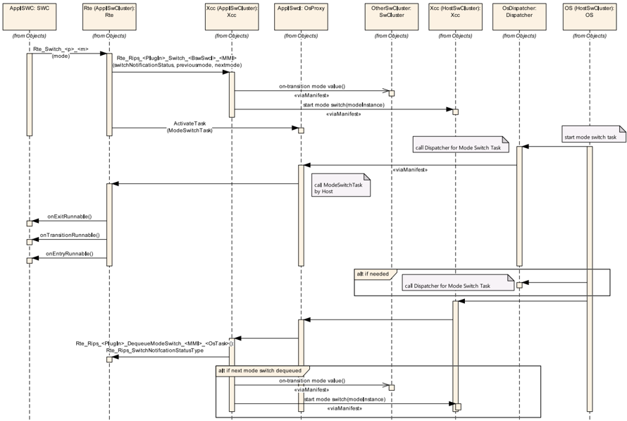

* 模式管理器（**mode manager**）软件组件调用 `Rte_Switch` API 进行模式切换通知。
* 跨集群通信通过 `[Rte_Rips_Switch](#111215-rte_rips_switch)` 服务的调用获得通知。
* 如果模式队列为空，此 `[Rte_Rips_Switch](#111215-rte_rips_switch)` 可用于确定第一个切换中值。
* 应用软件集群中的跨集群通信通知宿主软件集群中的跨集群通信一次模式切换开始。该通知是跨集群通信的内部接口，不是标准化的。
* 在宿主上模式切换开始后，相应的模式切换任务被调度（可能在多个分区上）。这又通过调度器（**Dispatchers**）调度集群本地的代理模式切换任务。
* 可能地，其他代理模式切换任务在其之前和之后被调度。因此，RTE 不能在其模式切换任务的上下文中就出队下一个模式。
* 在宿主软件集群中的跨集群通信确定某个模式切换任务已运行结束后，它使用跨集群通信通知应用软件集群中的 RTE 出队下一个模式。

图 7.4 阐述了模式切换由宿主软件集群发起时的原理性序列。

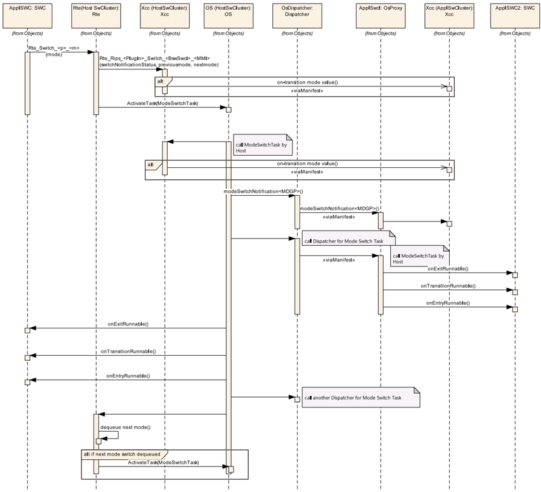

* 模式管理器软件组件调用 `Rte_Switch` API 进行模式切换通知。
* 跨集群通信通过 `[Rte_Rips_Switch](#111215-rte_rips_switch)` 服务的调用获得通知。
* 如果模式队列为空，此 `[Rte_Rips_Switch](#111215-rte_rips_switch)` 可用于确定第一个切换中值。或者，这也可以在第一个调度器（**Dispatchers**）被调度之前的模式切换任务中进行。
* 在宿主上模式切换开始后，相应的模式切换任务被调度（可能在多个分区上）。这又通过调度器调度集群本地的代理模式切换任务。
* 与图 7.3 中的场景相反，RTE 可以在其模式切换任务的上下文中就出队下一个模式。

这两个原理性序列导出了在软件集群提供模式时对跨集群通信的以下需求。

跨集群通信应在按照 [SWS_Rte_02665] 的模式切换开始之前，向其他软件集群发出当前的切换中值信号。

**注意：** 该功能可以在模式队列为空时在 `[Rte_Rips_Switch](#111215-rte_rips_switch)` 服务内部实现。否则，这可以在最后一个模式切换任务终止前不久完成，或者当第一个模式切换任务已经针对下一个切换开始时完成。发出当前切换中值信号的接口是跨集群通信的内部接口，不是标准化的。

跨集群通信应在提供模式的软件集群处添加一个提供资源条目（**Provided Resource Entry**），并在需求该模式的每个软件集群处，在二进制清单中添加一个相应的需求资源条目（**Require Resource Entry**）。

[SWS_SwCluC_03057] 确保集群化 ECU 中缺失的模式管理器（**mode manager**）会被检测出来，即使实现可能还依赖于相应的调度器（**Dispatchers**）。

宿主软件集群的跨集群通信应为需要由应用软件集群提供的每个模式实现一个模式管理器（**mode manager**）。

借助该模式管理器，可以调度用于模式切换通知的相应调度器（**Dispatchers**），以及用于软件集群本地代理模式切换任务的调度器。

为了简化 [SWS_SwCluC_03023] 的实现，应用软件集群提供的所有模式都应由宿主软件集群消费。

对于应用软件集群提供的每个模式，宿主软件集群的 ECU Extract 应在 `rootSoftwareComposition` 的 `[CompositionSwComponentType](#933-compositionswcomponenttype)` 处拥有一个需求模式切换端口。

宿主软件集群的跨集群通信应通过相关的模式管理器（**mode manager**）将应用软件集群发出的当前切换中值信号入队（[SWS_SwCluC_03023]）。

**注意：** 在宿主软件集群提供模式的情况下，RTE 已经实现了主导模式机实例。

当模式切换任务开始时，宿主软件集群的跨集群通信应通知应用软件集群。

**注意：** 该通知被应用软件集群用于调度模式切换通知可运行实体，该可运行实体将模式切换通知入队到集群本地的 RTE 中。

当所有模式切换任务运行结束时，宿主软件集群的跨集群通信应通知应用软件集群的跨集群通信。

当应用软件集群提供模式时，当该 RTE 已知的模式切换任务运行结束时，应用软件集群的跨集群通信通过 `[Rte_Rips_DequeueModeSwitch](#111216-rte_rips_dequeuemodeswitch)` 通知 RTE。跨集群通信必须保证最后一次 `[Rte_Rips_DequeueModeSwitch](#111216-rte_rips_dequeuemodeswitch)` 调用不会在整个集群系统中最后一个 on-entry 可执行实体终止之前完成。

请注意 [SWS_Rte_70123]，它为 RTE 保证了一定的执行上下文。

跨集群通信应在每个配置了模式切换任务的 `[EcucPartition](#1011-ecucpartition)` 上提供一个复杂驱动软件组件（**Complex Driver Software Component**）。该组件后文称为模式代理组件（**mode proxy component**）。

跨集群通信应提供可运行实体（**RunnableEntities**）来检测与跨软件集群模式通信相关的任何模式切换任务的开始和结束。

**请注意：** [SWS_SwCluC_03030] 的可运行实体可能需要额外的模式访问点（**ModeAccessPoints**）以及合适的 RTE 事件（**RTEEvents**）。可以使用 `[OsTaskExecutionEvent](#998-ostaskexecutionevent)` 和少量运行时逻辑来确定正在进行的模式切换，或者使用一组 **SwcModeSwitchEvents**（它们在特定模式机实例的任何切换上激活该可运行实体）。

##### 6.3.6.3. 需求模式的宿主软件集群

如 [**6.3.6.2**](#6362-提供模式的软件集群) 章所述，宿主软件集群已经知道跨软件集群传递的现有模式。因此，它在技术上已经接收应用软件集群提供的模式。如果宿主软件集群拥有也需求该模式的软件组件，则应将它们连接到其已经存在的模式管理器。

如果宿主软件集群需求该模式，跨集群通信应提供模式代理组件（**mode proxy component**）的提供模式切换端口与需求该模式的软件组件处的需求模式切换端口之间的组装连接器（**AssemblySwConnectors**）。

##### 6.3.6.4. 需求模式的应用软件集群

对于每个需求模式，应用软件集群为模式切换通知定义 OS 任务（**OsTasks**）加上调度器（**dispatchers**）。

当宿主软件集群通知模式切换时，跨集群通信使用与模式切换端口相关的常规 `Rte_Switch` API，将实际的切换中模式值写入应用软件集群的 RTE。

**注意：** 应用软件集群中的 RTE 仍应调用 **ActivateTask**（**ActivateTasks**）来触发模式切换任务。如果需要，宿主软件集群仍可使用该调用来触发宿主软件集群中的模式切换任务执行。

为此，跨集群通信在配置了模式切换通知的每个分区的每个模式上定义一个带 `[OsTaskExecutionEvent](#998-ostaskexecutionevent)` 的可运行实体（[**RunnableEntity**](#9118-runnableentity)）。当执行模式切换时，宿主软件集群调度模式切换任务，后者又调度应用软件集群中的「代理」模式切换任务。

图 7.5：应用软件集群中模式切换的执行

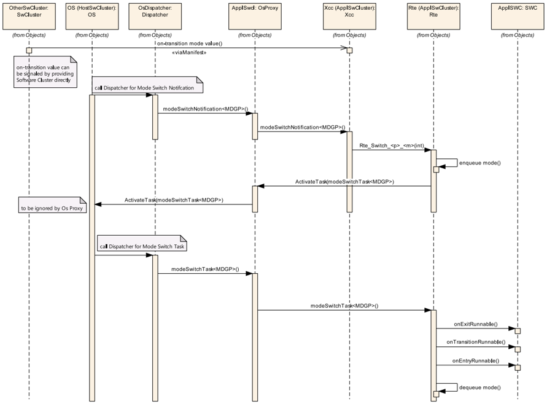

跨集群通信应在需要提供模式切换端口的每个 `[EcucPartition](#1011-ecucpartition)` 上提供一个复杂驱动软件组件（**Complex Driver Software Component**）。该组件后文称为模式代理组件（**mode proxy component**）。

跨集群通信应在需要提供模式切换端口的每个模式代理组件上提供一个提供模式切换端口。

跨集群通信应提供提供模式切换端口与需求该模式的软件组件处的需求模式切换端口之间的组装连接器（**AssemblySwConnectors**）。

跨集群通信应在配置了模式切换通知的每个分区的每个模式上提供一个带 `[OsTaskExecutionEvent](#998-ostaskexecutionevent)` 的模式切换通知可运行实体。该可运行实体（[**RunnableEntity**](#9118-runnableentity)）应定义一个模式切换点（[**ModeSwitchPoint**](#990-modeswitchpoint)）。

当模式切换通知可运行实体执行时，它应通过 `Rte_Switch` 将实际的切换中值写入 RTE。

对于应用软件集群需求其模式切换通知的 [**ModeDeclarationGroupPrototype**](#986-modedeclarationgroupprototype) 的每个 `[EcucPartition](#1011-ecucpartition)`，应配置一个带相关 **SwCluCOsProxyOsTask** 和 **SwCluCOsProxyOsTaskDispatcher** 的 OS 任务（[**OsTask**](#1039-ostask)）。

对于配置了模式切换通知的每个需求的 [**ModeDeclarationGroupPrototype**](#986-modedeclarationgroupprototype) 和 `[EcucPartition](#1011-ecucpartition)`，应配置一个带相关 **SwCluCOsProxyOsTask** 和 **SwCluCOsProxyOsTaskDispatcher** 的 OS 任务（[**OsTask**](#1039-ostask)）。

##### 6.3.6.5. 初始化

[**6.3.6.2**](#6362-提供模式的软件集群) 和 [**6.3.6.4**](#6364-需求模式的应用软件集群) 章中描述的方法导致在提供或需求模式的每个软件集群中都存在本地模式机实例（**mode machine instances**）。

但这也意味着模式机实例的初始化是错时执行的，没有跨集群通信的显式同步。

当集群系统启动时，必须遵循以下过程！

* 跨集群通信（**Cross Cluster Communications**）的初始化
* 在应用软件集群和宿主软件集群中执行所有 `Rte_Init_&lt;InitContainer&gt;` 函数。该步骤已经导致由 `initialMode` 触发并映射到 `[RteInitializationRunnableBatch](#1022-rteinitializationrunnablebatch)` 容器的 on-entry 可执行实体（**ExecutableEntities**）的执行。
* 在应用软件集群中执行所有 `[Rte_Start](#11112-rte_start)`。该步骤执行由 `initialMode` 触发的其余 on-entry 可执行实体。如果 RTE 实现触发模式切换任务以推进到 `initialMode` 的切换，它也会在此处发生。
* 在宿主软件集群中执行 `[Rte_Start](#11112-rte_start)`。该步骤执行宿主软件集群中由 `initialMode` 触发的其余 on-entry 可执行实体。如果 RTE 实现触发模式切换任务以推进到 `initialMode` 的切换，模式切换任务现在将被执行。

#### 6.3.7. 触发通信

##### 6.3.7.1. 一般原则

AUTOSAR 中的触发通信是纯粹的事件语义，用于请求执行被触发的可执行实体（**triggered ExecutableEntities**）。

将这种通信模式引入集群化的软件架构，重点在于在应用软件集群和宿主软件集群中实现触发源（**trigger sources**）的用例。尽管如此，对被触发可执行实体执行的控制是在宿主软件集群中实现的，以保证跨多个软件集群的 ECU 级行为。

对于软件集群通信（**Software Cluster Communication**），适用以下原则：

* 提供触发的应用软件集群将触发的发生传递给宿主软件集群。
* 宿主软件集群提供任务，用于在需要的每个分区上执行被触发的可执行实体。
* 如果从动态角度看需要对触发器排队，则在宿主软件集群的 RTE 中配置并实现排队。
* 尽管如此，触发本身在每个软件集群内部的 RTE 中本地执行。这导致被触发可执行实体之间的顺序只在应用软件集群的单个代理 OS 任务（**proxy OS Task**）内部本地保持。
* 面向 RTE 的接口只在良定义的 OS 任务上下文中调用。

在应用软件集群之间添加新的触发通信，还会额外影响宿主软件集群。

##### 6.3.7.2. 提供触发器的软件集群

图 7.6 阐述了触发器由应用软件集群发出时的原理性序列。

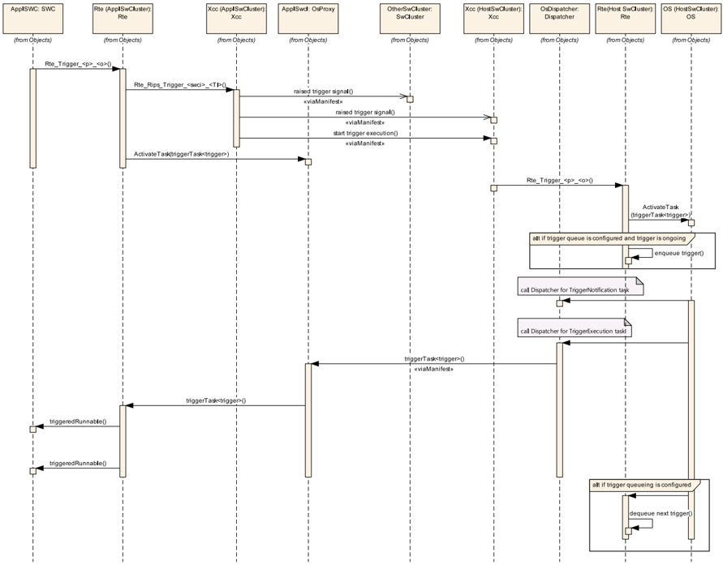

* 触发源（**trigger source**）调用 `Rte_Trigger` API 发出触发器。
* 跨集群通信通过 `[Rte_Rips_Trigger](#111217-rte_rips_trigger)` 服务的调用获得通知。
* 应用软件集群中的跨集群通信通知宿主软件集群中的跨集群通信触发器已发出。该通知是跨集群通信的内部接口，不是标准化的。
* 在宿主软件集群中，跨集群通信通过 `Rte_Trigger` API 在 RTE 中发出触发器。在配置了触发队列的情况下，这会将触发器入队。
* 在宿主软件集群上触发执行开始后，相应的任务被调度（可能在多个分区上）。这又通过调度器（**Dispatchers**）调度应用软件集群本地的代理任务。
* 在配置了触发队列的情况下，出队操作在最后一个被触发的可执行实体终止之后执行。

图 7.7 阐述了触发器由宿主软件集群发出时的原理性序列。

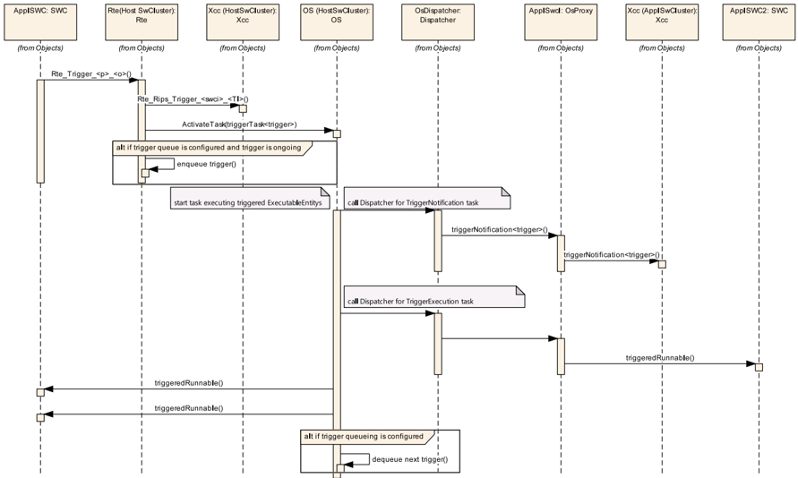

* 触发源调用 `Rte_Trigger` API 发出触发器。
* 跨集群通信通过 `[Rte_Rips_Trigger](#111217-rte_rips_trigger)` 服务的调用获得通知。
* RTE 激活用于执行被触发可执行实体的任务。如果配置了队列且触发执行已经在进行中，宿主软件集群中的 RTE 将触发器入队。
* 在宿主软件集群上触发执行开始后，相应的任务被调度（可能在多个分区上）。这又通过调度器调度应用软件集群本地的代理任务。
* 在配置了触发队列的情况下，出队操作在最后一个被触发的可执行实体终止之后执行。

这两个原理性序列导出了在软件集群提供模式时对跨集群通信的以下需求。

跨集群通信应向其他软件集群发出触发器已发出的信号。

**注意：** 该功能可以在 `[Rte_Rips_Trigger](#111217-rte_rips_trigger)` 服务内部实现。在功能上，是否已经通过到宿主软件集群的连接满足了 [SWS_SwCluC_03055]，取决于实现。

跨集群通信应在提供触发器的软件集群处添加一个提供资源条目（**Provided Resource Entry**），并在需求触发器的软件集群处，在二进制清单中添加一个相应的需求资源条目（**Require Resource Entry**）。

[SWS_SwCluC_03056] 确保集群化 ECU 中缺失的触发源（**trigger source**）会被检测出来，即使实现可能依赖于相应的调度器（**Dispatchers**）。

宿主软件集群的跨集群通信应为需要由应用软件集群提供的每个触发器实现一个触发源（**trigger source**）。

借助该触发源，可以调度用于触发通知的相应调度器（**Dispatchers**），以及用于软件集群本地触发执行任务的调度器。

为了简化 [SWS_SwCluC_03058] 的实现，应用软件集群提供的所有触发器都应由宿主软件集群消费。

宿主软件集群的 ECU Extract 应为应用软件集群提供的每个触发器，在 `rootSoftwareComposition` 的 `[CompositionSwComponentType](#933-compositionswcomponenttype)` 处拥有一个需求触发端口（**required trigger port**）。

宿主软件集群的跨集群通信应通过相关的触发源（**trigger source**）发出应用软件集群所发信号通知的触发器（[SWS_SwCluC_03058]）。

**注意：** 在宿主软件集群提供触发器的情况下，触发源已经是属于宿主软件集群、与 RTE 或 SchM 直接交互的软件组件或 BSW 模块的一部分。

当触发任务的执行开始时，宿主软件集群的跨集群通信应通知应用软件集群。

**注意：** 该通知被应用软件集群用于调度触发通知可运行实体，该可运行实体在集群本地 RTE 上发出触发器。

跨集群通信应在按照 [SWS_SwCluC_03058] 配置了触发源的每个 `[EcucPartition](#1011-ecucpartition)` 上提供一个复杂驱动软件组件（**Complex Driver Software Component**）。该组件后文称为触发代理组件（**trigger proxy component**）。

##### 6.3.7.3. 需求触发器的宿主软件集群

如 [**6.3.7.2**](#6372-提供触发器的软件集群) 章所述，宿主软件集群已经知道跨软件集群传递的现有触发器。因此，它在技术上已经接收应用软件集群发出的触发器。如果宿主软件集群拥有也需求该触发器的软件组件，则应按照 [SWS_SwCluC_03058] 将它们连接到其已经存在的触发源（**trigger source**）。

如果宿主软件集群需求该触发器，跨集群通信应提供触发代理组件（**trigger proxy component**）的提供触发端口与需求该触发器的软件组件处的需求触发端口之间的组装连接器（**AssemblySwConnectors**）。

##### 6.3.7.4. 需求触发器的应用软件集群

对于每个需求触发器，应用软件集群为触发通知定义 OS 任务（**OsTasks**）加上调度器（**dispatchers**）。

当宿主软件集群执行触发器时，跨集群通信使用与触发端口（**trigger port**）相关的常规 `Rte_Trigger` API，在应用软件集群的 RTE 上发出触发器。

**注意：** 应用软件集群中的 RTE 仍应调用 **ActivateTask**（**ActivateTasks**），以触发用于执行被触发可执行实体的任务。如果需要，宿主软件集群仍可使用该调用来触发宿主软件集群中的任务执行。

为此，跨集群通信在配置了触发通知的每个分区上为每个触发器定义一个带 `[OsTaskExecutionEvent](#998-ostaskexecutionevent)` 的可运行实体（[**RunnableEntity**](#9118-runnableentity)）。当执行触发器时，宿主软件集群调度任务，后者又调度应用软件集群中的「代理」任务。

图 7.8：应用软件集群中触发器的执行

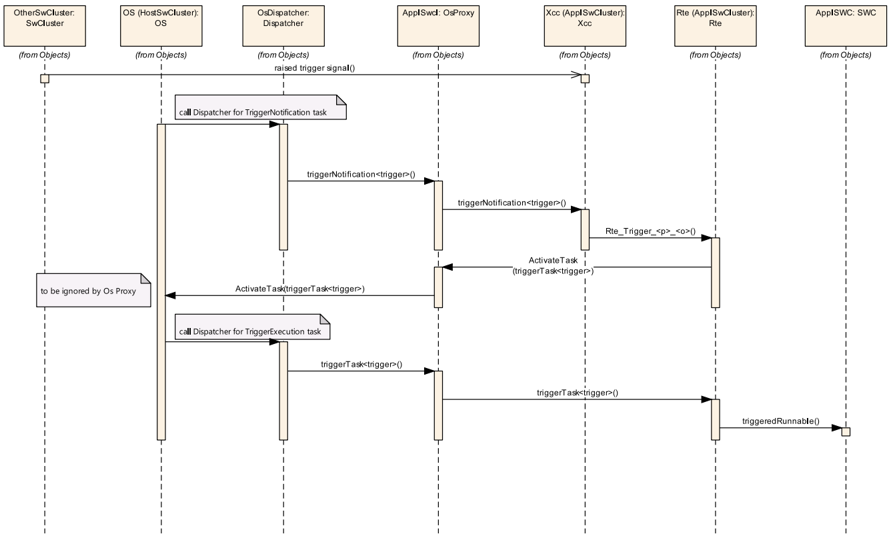

跨集群通信应在需要提供触发端口的每个 `[EcucPartition](#1011-ecucpartition)` 上提供一个复杂驱动软件组件（**Complex Driver Software Component**）。该组件后文称为触发代理组件（**trigger proxy component**）。

跨集群通信应在每个触发代理组件上提供一个提供触发端口（**provided trigger port**）。

跨集群通信应提供提供触发端口（**provided trigger ports**）与需求该触发器的软件组件处的需求触发端口（**required trigger ports**）之间的组装连接器（**AssemblySwConnectors**）。

跨集群通信应在配置了触发通知的每个分区的每个触发器上提供一个带 `[OsTaskExecutionEvent](#998-ostaskexecutionevent)` 的触发通知可运行实体。该可运行实体（[**RunnableEntity**](#9118-runnableentity)）应定义一个外部触发点（[**ExternalTriggeringPoint**](#968-externaltriggeringpoint)）。

当触发通知可运行实体执行时，它应通过 `Rte_Trigger` 向 RTE 发出触发器。

对于应用软件集群需求其触发通知的触发器的每个 `[EcucPartition](#1011-ecucpartition)`，应配置一个带相关 **SwCluCOsProxyOsTask** 和 **SwCluCOsProxyOsTaskDispatcher** 的 OS 任务（[**OsTask**](#1039-ostask)）。

对于每个需求触发器以及需要执行被触发可执行实体的每个 `[EcucPartition](#1011-ecucpartition)`，应至少配置一个带相关 **SwCluCOsProxyOsTask** 和 **SwCluCOsProxyOsTaskDispatcher** 的 OS 任务（[**OsTask**](#1039-ostask)）。

#### 6.3.8. 参数通信

Software Cluster Connection 的跨集群通信应为每个分配的参数通信图（**Parameter Communication Graph**）提供一个常量默认参数实例，该参数通信图不包含 P 端口原型（[**PPortPrototype**](#999-pportprototype)）。

默认值实例应按照文档 [\[17\]](#ref-17) 映射到 CALPRM 内存段。

另请注意 [**6.3.2.4**](#6324-跨集群通信与-mcsupport-数据) 章，它与由 Software Cluster Connection 实例化的标定参数相关。

默认值实例应根据 ECU Extract 的 `rootSoftwareComposition` 的 `[CompositionSwComponentType](#933-compositionswcomponenttype)` 的 R 端口原型中的 `[ParameterRequireComSpec](#9104-parameterrequirecomspec).initValue` 进行初始化。

如果二进制清单中的相应资源已连接，`[Rte_Rips_Prm](#11127-rte_rips_prm)` 应返回已连接参数的值。

如果二进制清单中的相应资源未连接，`[Rte_Rips_Prm](#11127-rte_rips_prm)` 应返回 [SWS_SwCluC_03006] 的默认参数实例的值。

**注意：** 按照 [SWS_SwCluC_03009] 和 [SWS_SwCluC_03010] 的 `[Rte_Rips_Prm](#11127-rte_rips_prm)` 函数的行为，可以通过在二进制清单中引用默认参数实例作为默认句柄来实现。

对于每个包含 P 端口原型（[**PPortPrototype**](#999-pportprototype)）的分配参数通信图（**Parameter Communication Graph**），Software Cluster Connection 的跨集群通信应使按照 [SWS_Rte_80130] 的参数实例（**parameter instance**）可以通过二进制清单中的资源条目（**Resource Entry**）被其他软件集群访问。

#### 6.3.9. 错误分类

Software Cluster Connection 的跨集群通信与 RTE 一起实现了软件集群的运行时环境（**Run-Time Environment**）。检查 API 参数的常规开发错误已被 RTE 的开发错误检测覆盖。此外，通信基础设施错误既不作为产出错误（**Production Errors**）也不作为扩展产出错误（**Extended Production Errors**）报告。因此，以下各节不定义错误代码，并标记为不适用。

###### 6.3.9.1. 开发错误

开发错误不适用于 Software Cluster Connection 的跨集群通信。

###### 6.3.9.2. 运行时错误

运行时错误不适用于 Software Cluster Connection 的跨集群通信。

###### 6.3.9.3. 瞬态故障

瞬态故障不适用于 Software Cluster Connection 的跨集群通信。

###### 6.3.9.4. 产出错误

产出错误不适用于 Software Cluster Connection 的跨集群通信。

###### 6.3.9.5. 扩展产出错误

扩展产出错误不适用于 Software Cluster Connection 的跨集群通信。

#### 6.3.10. Xcc 的初始化

请注意，跨集群通信为每个软件集群提供两个初始化函数。这使得每个软件集群可以先初始化其打算供其他软件集群读取的内存，然后再执行依赖于这些待读内存的初始化。为确保正确的初始化行为，必须在调用 `[SwCluC_Xcc_Init2](#7322-swcluc_xcc_init2)` 函数之前调用所有 `[SwCluC_Xcc_Init1](#7321-swcluc_xcc_init1)`。

机器上任何软件集群的所有 `[SwCluC_Xcc_Init1](#7321-swcluc_xcc_init1)` 函数都应在同一机器上任何软件集群的 `[SwCluC_Xcc_Init2](#7322-swcluc_xcc_init2)` 函数调用之前调用。

### 6.4. 代理模块

#### 6.4.1. 概述

由于应用软件集群并不包含所有 BSW 模块（极端情况下不含任何 BSW 模块），那些缺失的 API 以及 EcuC 配置元素都需要被替换。

在 AUTOSAR 分层软件架构中，BSW 模块之间的依赖可以概括如下：

更高层的 BSW 模块使用更低层 BSW 模块的 API。在相反方向上，低层 BSW 模块可以调用高层 BSW 模块的回调函数。对于 AUTOSAR 接口（**AUTOSAR Interfaces**），需要额外的软件组件描述来启用 RTE 生成。如果这些 BSW 模块之间的接口是可配置的，ECU 配置会提供符号名（**Symbolic Name**）值和 ID 值的信息。

当然，AUTOSAR 分层软件架构也存在水平依赖。在这种情况下，将上一段旋转 90 度即可。

必须指出的是，不同的 BSW 模块直接使用彼此的 C 接口，没有抽象（不像 RTE 在 SWC 之间提供的那样）。这反过来又导致强实现依赖，例如固定的头文件名和 C 函数名。

由于经典平台架构的实际实现和集成现在被拆分为软件集群，缺失的 BSW 模块——存在接口的那些——需要被替换。图 7.9 以水平接口依赖为例阐述了代理模块（**proxy module**）方法。

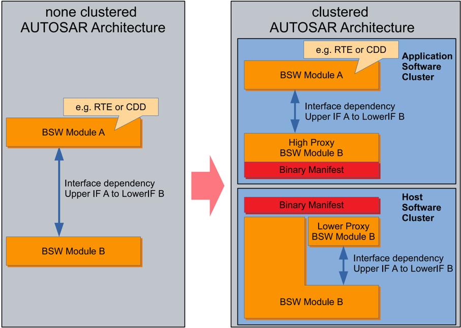

低层 BSW 模块（模块 B）面向高层 BSW 模块（模块 A）的 C 接口由软件集群 SWCL 1 中的高层代理模块 B（**High Proxy Module B**）提供。模块 B 的 C 接口、ECU-C 和组件描述在与原始模块 B 相同的命名空间 / ARPackage 结构中提供。对于模块 B 的使用者（在本例中为模块 A），用高层代理模块 B 替换模块 B 是透明的。通常，提供的 API 函数几乎不带逻辑，只是将调用重定向到被替换的模块。

在宿主软件集群中，低层代理模块（**Low Proxy Module**）充当其他软件集群中所有「用户模块」的替代者。它实现通常在模块 B 中配置的回调函数。

高层代理模块和低层代理模块通过二进制清单（**Binary Manifest**）的方式连接。因此，高层和低层代理模块的函数可能包含处理该二进制清单链接以及链接缺失情况的功能。例如，返回合理的错误代码，甚至提供一些替代值。

此外，高层代理模块可以实现本地化配置决策的功能。例如，为了支持 NV 块在集成步骤中 SWCL 本地的增长，可以调整本地使用的 NV 块大小。当然，只有当真实 NvM 中配置的大小足够大时才可能。

借助该方法，应用软件集群内的 SWC 和 BSW 模块通过代理调用宿主软件集群内部的公共 BSW。这样做时必须考虑 ECU 软件的分区，如 [**6.4.2.2**](#6422-分区) 章所述。

本节规定一般的代理模块（**Proxy Module**）模式。此外，特定代理模块的需求见 [**6.4.3**](#643-特定代理模块需求) 章。AUTOSAR 可能会在未来版本中标准化其他代理模块。

#### 6.4.2. 抽象代理模块模式

本节提供与代理模块（**Proxy Module**）实现相关的一些通用设计原则和公共需求。

基本上，高层代理模块提供一种门面（facade），它隐藏访问真实 BSW 模块的软件集群连接特定机制。在 AUTOSAR 架构中，这样的门面必须隐藏对以下内容的依赖：

* 标准化接口（**Standardized Interfaces**）
* 标准化 AUTOSAR 接口（**Standardized AUTOSAR Interfaces**）以及
* ECU 配置（**ECU Configuration**）

除了向应用软件集群中的 BSW 模块使用者提供接口这一基本需求之外，代理模块还应实现抽象功能。这些抽象功能将高层代理模块中所需的配置与宿主软件集群的 BSW 模块中完成的配置解耦。是否引入抽象功能是一个个案决策。一方面，它们可能需要相应 BSW 模块的功能支持，或者可能导致功能限制。另一方面，这类抽象是有益的，因为在某些情况下，它们可用于避免在应用软件集群发生更改后重新配置宿主软件集群。

请注意，以下需求对 OS 代理（**OS Proxy**）只有有限的适用性，因为 OS API 已经被设计为可从所有分区调用。

##### 6.4.2.1. 一般代理功能

代理模块应支持：访问宿主软件集群的 BSW 服务 API 所需的 ID 值可以更改，而无需重新配置或重新构建使用该 BSW 服务的应用软件集群。

##### 6.4.2.2. 分区

分区（**Partitions**）由宿主软件集群和应用软件集群共享。这也适用于相关的 **OsApplications** 和 **OsTasks** 的属性。因此，应用软件集群与宿主软件集群之间没有严格分离。出于性能原因，可以将宿主软件集群的同一个分区与许多应用软件集群共享。如果应用软件集群共享同一个分区，它们彼此之间也没有严格分离。相反，如果软件集群有多个分区（例如在不同安全等级上），这些分区彼此分离。

当需要跨分区函数调用时，通常需要与操作系统进行一些紧密交互——特别是在不同安全等级的情况下。然而，操作系统在应用软件集群内部不可直接使用。此外，需要考虑跨分区传递同步函数调用可能会对软件的调度行为产生影响。因此，最好在宿主软件集群中完成——或者更好——通过在相关 BSW 模块中实现主卫星模式（**master satellite pattern**）来避免这一点。

由此得出：

分区内对宿主软件集群中 BSW 模块的这种直接函数调用很容易实现，开销很小。如果某个特定分区（包括安全分区）需要某个 BSW 服务，宿主软件集群应在该分区中提供服务接口。如果这不可能，则应在宿主软件集群中实现相应的转换。为支持这一点，代理模块（**Proxy Modules**）必须为其接口授予分区写访问权限。

图 7.10 阐述了该方法。AUTOSAR 接口在每个分区中通过专用的服务软件组件（**Service Software Component**）提供。相关的标准化 AUTOSAR 接口（**Standardized AUTOSAR Interface**）恰好在一个分区中提供，即支持该 BSW 模块集成的分区。

来自应用软件组件的调用垂直穿过分区，向下传递到 BSW 模块或其卫星（绿色箭头）。

如果这样的卫星不可用，低层代理模块（**Low Proxy Module**）可以实现跨分区调用（例如通过 SchM，红色箭头）。

高层代理（**High Proxy**）应为每个已配置的 `[EcucPartition](#1011-ecucpartition)` 提供一次适用的标准化 AUTOSAR 接口（**Standardized AUTOSAR Interfaces**）。这样，在 `SwCluCNativeBswApi` 设置为 true 的 `[EcucPartition](#1011-ecucpartition)` 处，API 以原始 Mip 提供。对于所有其他 BSW API 实例，Mip 被替换为 `&lt;Mip&gt;_&lt;shortName of [EcucPartition](#1011-ecucpartition)&gt;`。

高层代理（**High Proxy**）应为每个已配置的 `[EcucPartition](#1011-ecucpartition)` 创建一个分区特定的服务软件组件（**Service Software Component**），名称为 `&lt;Mip&gt;_&lt;[EcucPartition](#1011-ecucpartition) shortName&gt;`。

高层代理（**High Proxy**）应将属于特定 `[CpSoftwareClusterServiceResource](#948-cpsoftwareclusterserviceresource)` 的端口（**Ports**）提供在使用该端口的 [**SwComponentPrototype**](#9126-swcomponentprototype) 所映射到的分区特定服务软件组件处。

##### 6.4.2.3. 未连接的服务资源

高层代理（**High Proxy**）应为服务资源实现一种「合理」的行为，以防到资源提供方的连接不存在。无论如何，函数的 OUT 参数应返回一个「中性」值，或者可以假定在复位后得到的值。功能行为应类似于复位之后、进一步活动发生之前的状态。

**注意：** 要判定什么是「合理」的，需要对服务资源有功能层面的理解。因此，[SWS_SwCluC_02004] 只能给出一些粗略的期望。

##### 6.4.2.4. ECU 配置原则

为了解决 ECU 配置依赖，代理模块（**Proxy Module**）实现应定义一个供应商特定模块定义（**Vendor Specific Module Definition**）[\[18\]](#ref-18)，其中使用 ECU 配置容器和参数来配置面向被替换 BSW 模块的使用者的接口。

通常，这些是配置标准化 AUTOSAR 接口（**Standardized AUTOSAR Interfaces**）的变化（例如存在性）的容器和参数，或与符号名值（**symbolic name values**）相关的参数。

此外，这些容器需要与软件集群资源池有关系，以便管理不同软件集群提供者之间的配置需求交换。而且，`[CpSoftwareClusterServiceResource](#948-cpsoftwareclusterserviceresource)` 元素定义了 `globalResourceId`，二进制清单中的资源条目需要它。

代理模块（**Proxy Module**）实现应定义一个 `[EcucContainerDef](#959-ecuccontainerdef)`，它定义以下两者之间的映射：

* 在被替换 BSW 模块的 StMD 中标识模块用户通道的 `EcucContainerDefs`
并且（AND）
* 在软件集群资源池中代表该用户通道的 `[CpSoftwareClusterServiceResource](#948-cpsoftwareclusterserviceresource)`。`[EcucForeignReferenceDef](#962-ecucforeignreferencedef)` 应命名为 `SwCluCResourceRef`。

请注意，[SWS_SwCluC_02006] 的这个 `[EcucContainerDef](#959-ecuccontainerdef)` 也可用于添加额外的参数，以控制高层代理（**High Proxy**）与低层代理（**Low Proxy**）之间的连接行为。示例见：**SwCluCNvMProxyNvBlock**。

代理模块（**Proxy Module**）实现应为每个不同的代理模块定义一个名为 `SwCluCProxyGeneration&lt;Mip&gt;` 的 `[EcucEnumerationParamDef](#961-ecucenumerationparamdef)`，具有以下文字（**literals**）：

* `PROXY_DISABLED`，禁用相应的代理模块代码和 AUTOSAR 模型生成
* `HIGH_PROXY`，启用相应的高层代理模块代码和 AUTOSAR 模型生成
* `LOW_PROXY`，启用相应的低层代理模块代码和 AUTOSAR 模型生成

##### 6.4.2.5. 代理模块与二进制清单

将自身的资源条目（**Resource Entrys**）放入相应软件集群的二进制清单（**Binary Manifest**）是代理模块（**Proxy Module**）实现的责任。这包括服务用户特定的通道（例如针对特定 NV 块），或一些通用链接——通常命名为基础套接字（**base socket**）——用于在低层代理和高层代理之间链接一些通用基础设施（例如 BSW API 集合）。

Software Cluster Connection 的代理模块（**Proxy Module**）实现应为每个关联的 `[CpSoftwareClusterServiceResource](#948-cpsoftwareclusterserviceresource)` 将一个资源条目（**Resource Entry**）放入二进制清单。

#### 6.4.3. 特定代理模块需求

##### 6.4.3.1. OS 代理

###### 6.4.3.1.1. 启用 OS 代理生成

只有当配置参数 `SwCluCProxyGenerationOs` 设置为 `HIGH_PROXY` 时，才创建 OS 高层代理代码及相关的 AUTOSAR 模型描述。

只有当配置参数 `SwCluCProxyGenerationOs` 设置为 `LOW_PROXY` 时，才创建 OS 低层代理代码及相关的 AUTOSAR 模型描述。

###### 6.4.3.1.2. 一般 OS 代理功能

###### 6.4.3.1.3. 概述

图 7.11：Os 代理概述

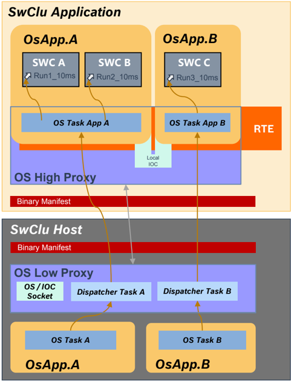

如 [**6.1.1**](#611-概述) 和 [**6.4.1**](#641-概述) 章所述，软件集群的概念还必须提供一种方法，将 AUTOSAR Os 的某些部分划分为更小的单元（Os 的参考文档见文档 [\[5\]](#ref-5)）。基本上，软件集群的可运行实体应在目标机器（**target machine**）上执行。由于系统被划分为机器相关部分（宿主软件集群，**Host Software Cluster**）和若干机器无关部分（应用软件集群，**Application Software Clusters**），需要一个中间接口层。该层将使用代理概念来实现。

应用软件集群包含 OS 实现中补全运行时环境（**RTE**）所需部分的代理。这称为 Os 高层代理（**Os High Proxy**）。

宿主软件集群将实现 AUTOSAR Os 以及机器的整体配置。Os 低层代理（**Os Low Proxy**）通过二进制清单使该 AUTOSAR Os 可被 Os 高层代理访问。两者通过二进制清单中保存的信息链接在一起，从而实现软件集群之间的 API 交换。

Os 高层代理支持的 OS 特性（例如任务、资源、自旋锁）使用 Os `[EcucModuleDef](#964-ecucmoduledef)` 的 `[EcucModuleConfigurationValues](#963-ecucmoduleconfigurationvalues)` 配置，带有相应的 [**OsTask**](#1039-ostask)、[**OsResource**](#1035-osresource)、[**OsSpinlock**](#1038-osspinlock) 等容器。在应用软件集群和宿主软件集群中，**SwCluCOsProxyOsTask**、**SwCluCOsProxyOsResource**、**SwCluCOsProxyOsSpinlock** 等容器的配置将 OS 配置容器映射到 `CpSoftwareClusterServiceResources`，各自定义 `globalResourceId` 和 `isMandatory` 属性，它们与二进制清单中相应的资源条目相关。

Os 低层代理为每个应用软件集群提供一个 Os 和 IOC 套接字（**Os- and IOC-socket**）。它还提供一个调度器，负责调用应用软件集群的每个 Os 任务。Os 和 IOC 套接字向应用软件集群提供基本钩子（**hooks**）。这些钩子用于例如本地 Os 和 IOC 通道的基本初始化、转发自旋锁等通用 API，或进行上下文切换。调度器控制并调用来自应用软件集群的 Os 任务。例如，这可以实现为可运行实体，它们根据二进制清单中找到的条目间接调用 Os 高层代理任务。

宿主软件集群提供 Os 应用的实现，以及 Os 低层代理中对它们的抽象。应用软件集群内部的 Os 应用上下文与宿主软件集群中相应的 Os 应用相匹配。Os 高层代理任务在与低层代理任务相同的上下文中执行，并具有相同的优先级、信任和访问级别。

如前所述，Os 低层代理与 Os 高层代理之间需要建立连接。它将使用 [**6.1.5.2**](#6152-连接资源) 章（连接资源）中描述的机制建立。本章定义了 Os 服务资源的元类：`CpSoftwareClusterServiceResources`。运行应用软件集群所必需的是 Os 和 IOC 套接字以及 OsProxyTasks 的资源。这些资源是系统资源池（`[CpSoftwareClusterResourcePool](#947-cpsoftwareclusterresourcepool)`）的一部分，其中包含它们相关属性的描述和唯一的 ResourceID（`[CpSoftwareClusterResource](#946-cpsoftwareclusterresource).globalResourceId`）。只有当这些资源配置的所有属性在连接过程中都匹配时，才能建立有效连接。

为了实现健壮的系统并避免错误行为，建议将 Os 服务资源标记为强制性的（**mandatory**）。

详细需求见下文。

###### 6.4.3.1.4. 一般需求

Os 代理（**Os Proxy**）应支持在宿主软件集群的上下文中执行来自应用软件集群的 OS 任务。

中断（**Interrupts**）的约束：应用软件集群不支持中断，因为它无法访问硬件或外设。

Os 代理（**Os Proxy**）应支持一种套接字机制，将多个应用软件集群挂接到宿主软件集群。

例如，这可用于支持应用软件集群本地的 IOC 通信路径。

Os 高层代理（**Os High Proxy**）接口应使用 Os `[EcucModuleDef](#964-ecucmoduledef)` 中定义的参数及相应容器来描述。

Os 代理（**Os Proxy**）接口应配置为服务资源，使用 **SwCluCOsProxy** 容器中定义的参数。

###### 6.4.3.1.5. OS 高层代理

Os 高层代理（**Os High Proxy**）应提供头文件 `Os.h` 和 `Os_Cfg.h`。

Os 高层代理（**Os High Proxy**）应提供一个代理 Os 任务（**proxy [OsTask](#1039-ostask)**），在设计应用软件集群期间可以将来自应用软件集群的事件映射到该任务。

Os 高层代理（**Os High Proxy**）应支持用 `TASK()` 宏实现该代理 [OsTask](#1039-ostask) 的任务体。

Os 高层代理（**Os High Proxy**）应提供应用软件集群所需的一组 OS API：

* `ActivateTask`
* `ChainTask`
* `TerminateTask`
* `Schedule`

如果为特定的 [OsTask](#1039-ostask) 设置了 `SwCluCOsProxyOsTask.SwCluCOsProxyTaskActivation.PASS_TASK_ACTIVATION`，则为该 OS 任务调用的 API `ActivateTask` 应在宿主软件集群中触发任务激活。

如果为特定的 [OsTask](#1039-ostask) 设置了 `SwCluCOsProxyOsTask.SwCluCOsProxyTaskActivation.OMIT_TASK_ACTIVATION`，则为该 OS 任务调用的 API `ActivateTask` 无效果地返回。

在应用软件集群中，Os 高层代理（**Os High Proxy**）应提供一个实现为宏且必须包含 return 语句的 `ChainTask` API。

**请注意：** OS 任务链接只能在宿主软件集群的 OS 实现中处理。

**ChainTask 的约束：** 在应用软件集群中，`ChainTask` API 只应在「OS 任务」函数体的末尾调用。

在应用软件集群中，Os 高层代理（**Os High Proxy**）应提供一个实现为宏且必须包含 return 语句的 `TerminateTask` API。

**请注意：** 真正的 OS 任务终止只能在宿主软件集群的 OS 实现中处理。

**TerminateTask 的约束：** 在应用软件集群中，`TerminateTask` API 只应在「OS 任务」函数体的末尾调用。

**理由：**

在开发应用软件集群时，Os 高层代理（**Os High Proxy**）没有能力调用「真实的」Os 来基于对 `ChainTask`、`ActivateTask` 或 `TerminateTask` 的调用激活或终止任务。但这并不意味着应用集群代码中不能存在对这些函数的调用。它只是意味着 SwCluC 模块实现必须在 Os 高层代理中包含这些函数的「stub」表示，当在一个尚未集成到包含宿主软件集群的最终系统中的应用集群内调用它们时，这些 stub 不产生任何效果。

然而，鉴于应用集群最终会与宿主集群集成在一起，应用集群中的代码必须遵循一些规则，以确保它们对任务管理 API 的使用不会与基于集群的配置中循环执行的预期用例相冲突。

**注意：** 约束 [SWS_SwCluC_CONSTR_02282] 和 [SWS_SwCluC_CONSTR_02283] 限制了 **ChainTask** 和 **TerminateTask** 在应用软件集群中的使用，但没有这样的约束限制 `ActivateTask` 的使用。

在集群化的软件架构中，ECU 的动态行为由宿主软件集群控制。因此，宿主软件集群负责控制 OS 任务（**OS Tasks**）的激活。

尽管如此，可能存在按应用软件集群的需求偶发激活 OS 任务（**OS Tasks**）的用例。为此，Os 高层代理（**Os High Proxy**）提供了 `ActivateTask` API，它在 [SWS_SwCluC_02213] 的情况下功能完备。与 `TerminateTask` 和 `ChainTask` 相反，`ActivateTask` API 的使用不绑定到任务体。在应用软件集群中使用 `ActivateTask` API 需要与 ECU 的整体动态调度概念仔细协调！

Os 高层代理（**Os High Proxy**）应为资源提供默认句柄，以防应用软件集群与宿主软件集群之间无法成功建立连接。默认实现应为中性行为，返回值 `E_OK`，以支持来自 OS 的「标准状态」。

关于宿主软件集群中如何处理缺失连接的说明见 [**6.4.3.1.6**](#64316-os-低层代理) 章「Os 低层代理」。

Os 高层代理（**Os High Proxy**）应为应用软件集群所需的每个 [OsTask](#1039-ostask) 拥有一个服务资源 **SwCluCOsProxyOsTask**。应为该资源在二进制清单中创建一个条目，以便能够将该任务链接到其在宿主软件集群中的 Os 低层代理实现。由于 [OsTask](#1039-ostask) 的内容由 RTE 创建，因此应使用该 API 并将其注册为服务资源。建议该资源标记为强制性标志（`SwCluCBManifIsMandatory`）。

Os 高层代理（**Os High Proxy**）应包含一个必需的服务资源 **SwCluCOsProxyOsTaskDispatcher**。代理 Os 任务（**Proxy-[OsTask](#1039-ostask)**）应在该上下文中被调用。应为该资源在二进制清单中创建一个条目，以便能够将其链接到宿主软件集群中的 Os 低层代理调度器。建议该资源标记为强制性标志（`SwCluCBManifIsMandatory`）。

Os 高层代理（**Os High Proxy**）应包含一个必需的服务资源 **SwCluCOsProxyFunctionDispatcher**。该函数调度器用于在宿主软件集群的上下文中调用函数。应为该资源在二进制清单中创建一个条目，以便能够将其链接到宿主软件集群中的 Os 低层代理调度器。

例如，在宿主软件集群的专用上下文中调用应用软件集群本地的 BSW 模块 Init 函数。

Os 高层代理（**Os High Proxy**）应包含一个必需的服务资源 **SwCluCOsProxyOsBaseSocket**。它收集链接到宿主软件集群所需的所有钩子（**hooks**）。它还包含应用软件集群本地 Os 特定的 StartOs、初始化和关闭函数。如果存在本地 IOC，它还应覆盖本地 IOC。建议该资源标记为强制性标志（`SwCluCBManifIsMandatory`）。

**请注意：** 这是高度供应商特定的。

由于应用软件集群可以包含多个 OS 应用（**OS Applications**），Os 高层代理（**Os High Proxy**）应能够为 OS 应用之间的集群内部通信路径提供本地 IOC 实现。到宿主软件集群的链接应作为 **SwCluCOsProxyOsBaseSocket** 服务资源的一部分建立。

Os 高层代理（**Os High Proxy**）应需要一个服务资源 **SwCluCOsProxyOsApplication**，它在应用软件集群中使用，并且需要与宿主软件集群匹配。

该服务资源代表应用软件集群本地 OS 应用的实际配置，包括其参数和链接的本地 OS 对象。

Os 高层代理（**Os High Proxy**）应需要一个服务资源 **SwCluCOsProxyOsResource**，它在应用软件集群中使用，并且需要与宿主软件集群匹配。

Os 高层代理（**Os High Proxy**）应需要一个服务资源 **SwCluCOsProxyOsSpinlock**，它在应用软件集群中使用，并且需要与宿主软件集群匹配。

Os 高层代理（**Os High Proxy**）应为应用软件集群提供以下 API：

* `GetResource`
* `ReleaseResource`
* `SuspendOSInterrupts`
* `ResumeOSInterrupts`
* `GetSpinlock`
* `ReleaseSpinlock`
* `GetApplicationID`
* `GetCoreID`
* `CallTrustedFunction`

这些 API 各自对应 Os 低层代理中的一个服务资源。二进制清单中将有一个条目来需求这些服务资源，它们在此描述：**SwCluCOsProxy**。

如果启用配置参数 `SwCluCOsProxyIdTranslationEnabled`，Os 高层代理（**Os High Proxy**）应支持将宿主软件集群中配置的 ID（`CoreId`、`OsApplicationId`）转换为应用软件集群特定的本地 ID。

**理由：** 这是为了避免在只向应用软件集群提供宿主软件集群 OS 配置的一个子集的用例中，为获取宿主软件集群中配置的正确 ID 而需要更大的查找表。

如果启用配置参数 `SwCluCOsProxyIdTranslationEnabled`，则以下 OS API 为应用软件集群报告的 ID：

* `GetApplicationID`
* `GetCoreID`

应对应于应用软件集群特定的本地 ID。（见 [SWS_SwCluC_02279]）

**宿主软件集群与应用软件集群之间一致的 ID 配置：** 当参数 `SwCluCOsProxyIdTranslationEnabled` 设置为 false 时，相应应用软件集群中内核 ID 和应用 ID 值的配置应与宿主软件集群中配置的 ID 值完全相同。

Os 高层代理（**Os High Proxy**）不应为应用软件集群支持以下 API：

* `StartScheduleTable`
* `StopScheduleTable`
* `DisableAllInterrupts`
* `EnableAllInterrupts`
* `SuspendAllInterrupts`
* `ResumeAllInterrupts`

完整应用软件集群的 Os 高层代理（**Os High Proxy**）配置应使用此处定义的一组 ECUC 参数来规定：**SwCluCOsProxy**。

###### 6.4.3.1.6. OS 低层代理

Os 低层代理（**Os Low Proxy**）只应由宿主软件集群提供。

完整宿主软件集群的 Os 低层代理（**Os Low Proxy**）配置应使用此处定义的一组 ECUC 参数来规定：**SwCluCOsProxy**。Os 低层代理的配置应从宿主软件集群中为 Os 实现的配置派生。

Os 低层代理（**Os Low Proxy**）应为应用软件集群的 Os 高层代理（**Os High Proxys**）提供一个套接字（**socket**）。应为每个应用软件集群提供相应的服务资源 **SwCluCOsProxyOsBaseSocket** 和配置。

Os 低层代理（**Os Low Proxy**）应为每个 **SwCluCOsProxyOsBaseSocket** 提供一个 `[SwCluC_OsProxy_Init](#7331-swcluc_osproxy_init)` API，用于初始化应用软件集群的 Os 高层代理（**Os High Proxy**）。这应是服务资源 **SwCluCOsProxyOsBaseSocket** 的一个元素。

例如，可以为每个应用软件集群提供一个 Init 回调，并在宿主软件集群的初始化阶段由 Os 低层代理调用。

Os 低层代理（**Os Low Proxy**）应提供一个 API 来启动应用软件集群的 Os 高层代理（**Os High Proxy**）。这应是服务资源 **SwCluCOsProxyOsBaseSocket** 的一个元素。

例如，可以为每个应用软件集群提供一个 Startup 钩子。

Os 低层代理（**Os Low Proxy**）应提供一个 API 来关闭应用软件集群的 Os 高层代理（**Os High Proxy**）。这应是服务资源 **SwCluCOsProxyOsBaseSocket** 的一个元素。

例如，可以为每个应用软件集群提供一个 shutdown 钩子。

Os 低层代理（**Os Low Proxy**）应能够提供一个 API 来连接来自应用软件集群 Os 高层代理的 IOC。这应是服务资源 **SwCluCOsProxyOsBaseSocket** 的一个元素。

例如，可以为每个应用软件集群提供一个 IOC-Init 回调，并在建立连接后由 Os 低层代理调用。

**调度器（Dispatchers）**

Os 低层代理（**Os Low Proxy**）应为宿主软件集群中提供的每个任务调度器拥有一个服务资源 **SwCluCOsProxyOsTaskDispatcher**。应为该资源在二进制清单中创建一个条目，以便能够将该任务调度器链接到其在应用软件集群中的 Os 高层代理实现。

请注意 [**6.4.3.1.3**](#64313-概述) 章「Os 代理概述」。

示例：宿主软件集群拥有 Os 的完整配置，并准备好承载多个应用软件集群及其本地 RTE，以便能够执行应用软件集群软件组件的可运行实体。此预配置将在 [OsTask](#1039-ostask) 中保留位置，例如可运行实体的事件。代替执行可运行实体，将执行所谓的调度器（**dispatcher**）。该调度器充当应用软件集群任务容器的链接，随后将执行该任务特定部分的所有映射可运行实体。

当二进制清单中的 ResourceID 匹配时，软件集群之间的连接得以建立。这对任务调度器和任务本身的服务资源都是必要的。建议在任务调度器的实现中检查它们的连接状态。

Os 低层代理（**Os Low Proxy**）应为系统应准备好的每个应用软件集群任务配置提供服务资源 **SwCluCOsProxyOsTask**。应为该资源在二进制清单中创建一个条目，以便能够将其链接到宿主软件集群中的 Os 高层代理任务。

请注意，**SwCluCOsProxyOsTask** 容器具有对 [**OsTask**](#1039-ostask) 容器的引用。宿主软件集群和应用软件集群都应使用该引用来获取与守护值计算相关的 [OsTask](#1039-ostask) 配置。因此，确保了宿主软件集群和应用软件集群的 [OsTask](#1039-ostask) 配置是兼容的。另见 [SWS_SwCluC_90004]。

Os 低层代理（**Os Low Proxy**）应为宿主软件集群中提供的每个函数调度器拥有一个服务资源 **SwCluCOsProxyFunctionDispatcher**。应为该资源在二进制清单中创建一个条目，以便能够将该函数调度器链接到其在应用软件集群中的 Os 高层代理实现。

示例：宿主软件集群拥有 BSW 的完整配置。为了正确初始化所有模块，可能需要调用应用软件集群。例如，在那里初始化本地 RAM 区域。由于该函数或可运行实体可能不被 RTE 识别为软件组件的可运行实体，因此可以通过 Os 代理函数调度器调用该函数。可以在宿主软件集群中配置该调度器，使其从 EcuM 或 Ini-Task 调用。每个调度器在二进制清单中提供自己的服务资源。如果成功建立了到另一个软件集群的链接，则可以从宿主软件集群向应用软件集群执行调用。

**宿主软件集群中调度器的调度**

Os 低层代理（**Os Low Proxy**）应为调度器在每个已配置的 `[EcucPartition](#1011-ecucpartition)` 上创建一个分区特定的服务软件组件（**Service Software Component**），名称为 `SwCluC_Dispatcher_&lt;[EcucPartition](#1011-ecucpartition) shortName&gt;`。

Os 低层代理（**Os Low Proxy**）应按照 [SWS_SwCluC_02272] 在分区特定的服务软件组件中为每个已配置的 **SwCluCOsProxyOsTaskDispatcher** 容器创建一个可运行实体（[**RunnableEntity**](#9118-runnableentity)）。

`[EcucPartition](#1011-ecucpartition)` 由参数 `SwCluCOsProxyEcucPartitionRef` 确定（如果已配置），或者由相关 [OsTask](#1039-ostask) 所属的 `[EcucPartition](#1011-ecucpartition)` 确定。可运行实体（[**RunnableEntity**](#9118-runnableentity)）的属性应设置如下：

* `minimumStartInterval` 设置为参数值 `SwCluCOsProxyMinimumStartInterval`
* `symbol` 设置为用于实现 [SWS_SwCluC_02270] 的任务调度器 C 函数的名称
* `canBeInvokedConcurrently` 设置为 false

Os 低层代理（**Os Low Proxy**）应按照 [SWS_SwCluC_02272] 在分区特定的服务软件组件中为每个已配置的 **SwCluCOsProxyDispatcherInitEvent** 容器创建一个 [**InitEvent**](#976-initevent)。[**InitEvent**](#976-initevent) 的属性应设置如下：

* `shortName` 按照容器的 `shortName` 设置
* `startOnEvent` 按照 [SWS_SwCluC_02273] 设置为与所属 **SwCluCOsProxyOsTaskDispatcher** 容器相关的可运行实体

Os 低层代理（**Os Low Proxy**）应按照 [SWS_SwCluC_02272] 在分区特定的服务软件组件中为每个已配置的 **SwCluCOsProxyDispatcherBackgroundEvent** 容器创建一个 [**BackgroundEvent**](#916-backgroundevent)。[**BackgroundEvent**](#916-backgroundevent) 的属性应设置如下：

* `shortName` 按照容器的 `shortName` 设置
* `startOnEvent` 按照 [SWS_SwCluC_02273] 设置为与所属 **SwCluCOsProxyOsTaskDispatcher** 容器相关的可运行实体
* 按照各个 `SwCluCOsProxyDisabledModeInstanceRefs` 创建 `disabledModes`，其中对于每个不同的 P 端口原型（[**PPortPrototype**](#999-pportprototype)），按照 [SWS_SwCluC_02272] 在所属服务软件组件处创建一个 R 端口原型（[**RPortPrototype**](#9113-rportprototype)）并用作 `contextPort`。

Os 低层代理（**Os Low Proxy**）应按照 [SWS_SwCluC_02272] 在分区特定的服务软件组件中为每个已配置的 **SwCluCOsProxyDispatcherTimingEvent** 容器创建一个 [**TimingEvent**](#9133-timingevent)。[**TimingEvent**](#9133-timingevent) 的属性应设置如下：

* `shortName` 按照容器的 `shortName` 设置
* `startOnEvent` 按照 [SWS_SwCluC_02273] 设置为与所属 **SwCluCOsProxyOsTaskDispatcher** 容器相关的可运行实体
* `period` 值根据 `SwCluCOsProxyTimingEventPeriod` 参数设置
* 按照各个 `SwCluCOsProxyDisabledModeInstanceRefs` 创建 `disabledModes`，其中对于每个不同的 P 端口原型，按照 [SWS_SwCluC_02272] 在所属服务软件组件处创建一个 R 端口原型并用作 `contextPort`。

Os 低层代理（**Os Low Proxy**）应按照 [SWS_SwCluC_02272] 在分区特定的服务软件组件中为每个已配置的 **SwCluCOsProxyDispatcherModeSwitchEvent** 容器创建一个 [**SwcModeSwitchEvent**](#9130-swcmodeswitchevent)。[**SwcModeSwitchEvent**](#9130-swcmodeswitchevent) 的属性应设置如下：

* `shortName` 按照容器的 `shortName` 设置
* `startOnEvent` 按照 [SWS_SwCluC_02273] 设置为与所属 **SwCluCOsProxyOsTaskDispatcher** 容器相关的可运行实体
* `activation` 值根据 `SwCluCOsProxyDispatcherActivation` 参数设置
* 按照各个 `SwCluCOsProxyModeInstanceRefs` 创建 `modes`，其中对于每个不同的 P 端口原型，按照 [SWS_SwCluC_02272] 在所属服务软件组件处创建一个 R 端口原型并用作 `contextPort`。
* 按照各个 `SwCluCOsProxyDisabledModeInstanceRefs` 创建 `disabledModes`，其中对于每个不同的 P 端口原型，按照 [SWS_SwCluC_02272] 在所属服务软件组件处创建一个 R 端口原型并用作 `contextPort`。

Os 低层代理（**Os Low Proxy**）应按照 [SWS_SwCluC_02272] 在分区特定的服务软件组件中为每个已配置的 **SwCluCOsProxyDispatcherExternalTriggerOccurredEvent** 容器创建一个 [**ExternalTriggerOccurredEvent**](#967-externaltriggeroccurredevent)。[**ExternalTriggerOccurredEvent**](#967-externaltriggeroccurredevent) 的属性应设置如下：

* `shortName` 按照容器的 `shortName` 设置
* `startOnEvent` 按照 [SWS_SwCluC_02273] 设置为与所属 **SwCluCOsProxyOsTaskDispatcher** 容器相关的可运行实体
* `trigger` 根据 `SwCluCOsProxyTriggerInstanceRef` 设置，其中对于每个不同的 P 端口原型，按照 [SWS_SwCluC_02272] 在所属服务软件组件处创建一个 R 端口原型并用作 `contextRPort`。
* 按照各个 `SwCluCOsProxyDisabledModeInstanceRefs` 创建 `disabledModes`，其中对于每个不同的 P 端口原型，按照 [SWS_SwCluC_02272] 在所属服务软件组件处创建一个 R 端口原型并用作 `contextPort`。

[**OsApplication**](#1032-osapplication)

Os 低层代理（**Os Low Proxy**）应为宿主软件集群中配置并准备好供应用软件集群使用的每个 [**OsApplication**](#1032-osapplication) 提供一个服务资源 **SwCluCOsProxyOsApplication**。

[**OsResource**](#1035-osresource)

Os 低层代理（**Os Low Proxy**）应为应用软件集群中使用的每个 [**OsResource**](#1035-osresource) 提供一个服务资源 **SwCluCOsProxyOsResource**。

[**OsSpinlock**](#1038-osspinlock)

Os 低层代理（**Os Low Proxy**）应为应用软件集群中使用的每个 [**OsSpinlock**](#1038-osspinlock) 提供一个服务资源 **SwCluCOsProxyOsSpinlock**。

**OS API**

Os 低层代理（**Os Low Proxy**）应为以下 API 提供基本服务实现，以供应用软件集群使用并与之连接：

* `GetResource`
* `ReleaseResource`
* `SuspendOSInterrupts`
* `ResumeOSInterrupts`
* `ReleaseResource`
* `GetSpinlock`
* `ReleaseSpinlock`
* `GetApplicationID`
* `Schedule`
* `CallTrustedFunction`
* `GetCoreID`

这些 API 应从 **SwCluCOsProxy** 中以相应的服务资源提供。

**未连接的服务资源**

Os 低层代理（**Os Low Proxy**）应为资源提供默认句柄，以防应用软件集群与宿主软件集群之间无法成功建立连接。

例如，如果缺少某个应用软件集群，宿主中的任务调度器将调用一个空函数。

**请注意：** 集群化系统的一个特性是各部分应可独立构建。另一个特性是某些部分可以缺失。因此，非本地 API 需要「默认 stub」。但在缺少 Os 接口的情况下，应用软件集群无法成功运行。建议使用适当的机制来检测这种情况。为了实现健壮的系统，宿主软件集群在这种状态下仍在运行。

##### 6.4.3.2. NvM 代理

规定的 NvM 代理（**NvM Proxy**）具有以下基本设计原则。

在应用软件集群中，NvM 高层代理（**NvM High Proxy**）支持的 NV 块使用 NvM `[EcucModuleDef](#964-ecucmoduledef)` 的 `[EcucModuleConfigurationValues](#963-ecucmoduleconfigurationvalues)` 配置，带有相应的 **NvMBlockDescriptors** 容器。在应用软件集群和宿主软件集群中，**SwCluCNvMProxyNvBlock** 容器的配置将 **NvMBlockDescriptors** 映射到 `CpSoftwareClusterServiceResources`，各自定义 `globalResourceId` 和 `isMandatory` 属性，它们与二进制清单中相应的资源条目相关。

NvM 高层代理（**NvM High Proxy**）与 NvM 低层代理（**NvM Low Proxy**）之间的连接使用文档 [\[6\]](#ref-6) 中规定的显式同步（**explicit synchronization**）。显式同步的优点是宿主软件集群中的 NVRAM 管理器不必知道应用软件集群的 RAM 块（**RAM Blocks**）和 ROM 块（**ROM blocks**）的地址。此外，函数接口可用于引入额外的功能，例如 NV 块长度调整（[SWS_SwCluC_02105]）。另一方面，该设计原则不能支持临时 RAM 块（**temporary RAM blocks**），因为宿主软件集群中的 NvM 配置可能持有与应用软件集群中的 NvM 配置不同的大小。

NvM 高层代理（**NvM High Proxy**）应拒绝临时 RAM 块（**temporary RAM blocks**）的配置。

**注意：** 这意味着 NvM 高层代理只支持配置了永久 RAM 块或显式同步回调的 NVRAM 块。

此外，宿主软件集群不应与存储在应用软件集群 NV 块（**NV Blocks**）中的内容有功能依赖。而且，即使相关的 NV 块未连接到宿主软件集群，NvM 高层代理（**NvM High Proxy**）也应能够初始化 RAM 块。这需要存在 ROM 块默认值。

NvM 高层代理（**NvM High Proxy**）应拒绝这样的配置：未通过参数 `NvMRomBlockDataAddress` 或参数 `[NvMBlockDescriptor](#1041-nvmblockdescriptor).[NvMInitBlockCallback](#1042-nvminitblockcallback)` 配置 ROM 块。

NvM 高层代理（**NvM High Proxy**）应拒绝这样的配置：`NvMNvBlockLength` 给出的 NV 块长度大于宿主软件集群中通过 `SwCluCNvMProxyNvBlockMaxLength` 预见的最大大小。

请注意，`SwCluCNvMProxyNvBlockMaxLength` 也是守护值的一部分，因此受到保护而不被单方面更改。

###### 6.4.3.2.1. 启用 NvM 代理生成

只有当配置参数 `SwCluCProxyGenerationNvM` 设置为 `HIGH_PROXY` 时，才创建 NvM 高层代理代码及相关的 AUTOSAR 模型描述。

只有当配置参数 `SwCluCProxyGenerationNvM` 设置为 `LOW_PROXY` 时，才创建 NvM 低层代理代码及相关的 AUTOSAR 模型描述。

###### 6.4.3.2.2. 一般 NvM 代理功能

NvM 代理（**NvM Proxy**）应支持宿主软件集群中 NvM 的 BlockIds 可以更改，而无需重新配置或重新构建使用这些 NV 块的应用软件集群。

NvM 代理（**NvM Proxy**）应支持应用软件集群中使用的 NV 块长度 <= 宿主软件集群 NvM 中配置的 NV 块长度。当应用软件集群中的 NV 块长度更小时，NV 块用默认值填充。单个字节的默认填充值由配置参数 `SwCluCNvMProxyNvBlockFillValue` 定义。

NvM 代理（**NvM Proxy**）应支持应用软件集群中使用的 NV 块长度可以更改（在 0 <= NvM 中配置的 NV 块长度范围内），而无需重新配置或重新构建宿主软件集群。

如果已在 NvM 高层代理（**NvM High Proxy**）中配置，NvM 代理（**NvM Proxy**）应在调用 NvM 低层代理（**NvM Low Proxy**）的相应实例时调用 `[NvM_SingleBlockCallbackFunction](#11316-nvm_singleblockcallbackfunction)` 或 **JobFinished** 操作。

如果已在 NvM 高层代理（**NvM High Proxy**）中配置，NvM 代理（**NvM Proxy**）应在调用 NvM 低层代理（**NvM Low Proxy**）的相应实例时调用 `[NvM_InitBlockCallbackFunction](#11317-nvm_initblockcallbackfunction)` 或 **InitBlock** 操作。

如果已在 NvM 高层代理（**NvM High Proxy**）中配置，NvM 代理（**NvM Proxy**）应在调用 NvM 低层代理（**NvM Low Proxy**）的相应实例时调用 `[NvM_ReadRamBlockFromNvm](#11318-nvm_readramblockfromnvm)` 函数或 **ReadRamBlockFromNvM** 操作。

如果已在 NvM 高层代理（**NvM High Proxy**）中配置，NvM 代理（**NvM Proxy**）应在调用 NvM 低层代理（**NvM Low Proxy**）的相应实例时调用 `[NvM_WriteRamBlockToNvm](#11319-nvm_writeramblocktonvm)` 函数或 **WriteRamBlockToNvM** 操作。

###### 6.4.3.2.3. 配置 ID 检查

在非集群化的 AUTOSAR ECU 中，当通过 `NvMDynamicConfiguration` 设置为 TRUE 启用配置 ID 检查时，该检查集中实现在 NVRAM 管理器中。

如果检测到配置 ID 不匹配，对于配置了 `NvMResistantToChangedSw == FALSE` 的 NVRAM 块，无论所分配的 RAM 或 NV 块是否有效，都会加载默认数据。该特性确保在 NVRAM 内存布局发生更改（即块被添加或删除，或其大小或类型被更改）的情况下对 NV 块进行初始化。

在采用可独立重新编程的软件集群的 AUTOSAR ECU 中，公共配置 ID 的缺点是会产生意外的重新编程依赖。如果一个软件集群引起了 NVRAM 内存布局更改，则所有其他软件集群的非抗变更 SW 的 NV 块也需要被设置为默认值。此外，这样的配置 ID 更改只能通过宿主软件集群的更新发起。

为了能够按应用软件集群检查 NVRAM 内存布局的更改，NvM 高层代理（**NvM High Proxy**）支持每个应用软件集群使用单独的配置 ID。

由于 NvM 高层代理不能直接干预 `[NvM_ReadAll](#11320-nvm_readall)` 的执行，它必须在由 `[NvM_ReadAll](#11320-nvm_readall)` 触发的多块请求的执行所触发的 `[NvM_ReadRamBlockFromNvm](#11318-nvm_readramblockfromnvm)` 的执行中实现其配置 ID 检查。该配置 ID 检查仅在 NvM 代理初始化之后直到 `[NvM_ReadAll](#11320-nvm_readall)` 多块请求成功结束期间有效。

NvM 代理通过 BswM 调用 `[SwCluC_NvMProxy_MultiBlockReadAllJobFinished](#7333-swcluc_nvmproxy_multiblockreadalljobfinished)`（经由适当配置的动作列表）获知 `[NvM_ReadAll](#11320-nvm_readall)` 成功结束。

NvM 代理初始化与 `[SwCluC_NvMProxy_MultiBlockReadAllJobFinished](#7333-swcluc_nvmproxy_multiblockreadalljobfinished)` 调用之间的时间跨度称为 NvM 启动阶段（**NvM startup phase**）。

为确保 SwCluC 中 NvM 代理的正常工作行为，宿主软件集群的 NVRAM 管理器必须将应用软件集群的所有 NvBlocks 视为 `NvMResistantToChangedSw == TRUE`。该行为可以通过 NVRAM 管理器的适当配置来确保。

**应用软件集群的 NvBlocks 在宿主软件集群中被 NvM 视为「抗变更 SW」：** 对于属于应用软件集群的任何 NVRAM 块（SwCluC 的 NvM 低层代理作为块用户出现），参数 `NvMResistantToChangedSw` 应在宿主软件集群中设置为 TRUE。

**注意：** 这包括用于存储特定应用软件集群配置 ID 的 NVRAM 块。此外，宿主软件集群中的 NvBlocks 的配置必须确保应用软件集群的配置 ID 块在该应用软件集群的常规 NvBlocks 之前恢复。由于 NvM 在 `[NvM_ReadAll](#11320-nvm_readall)` 作业期间按块 ID 保证 NvM 块的处理顺序（[SWS_NvM_00244]）。这使得 NvM 高层代理能够在恢复常规 NvBlocks 之前处理其配置块 ID 处理。

**宿主软件集群中应用软件集群配置 ID 块的块 ID：** 在宿主软件集群的 NvM 模块中，应用软件集群的配置 ID 块应以低于同一应用软件集群所有其他 NvBlocks 的块 ID 进行配置。

请注意，应用软件集群的 NvBlock 配置的块 ID 在 NvM 高层代理中的配置与宿主软件集群的 NvM 中的配置可以不同。

块 ID 编号在从应用软件集群到宿主软件集群的 API 调用期间被转换。

因此，宿主软件集群中块 ID 的有效配置可以如图 7.12 所示的示例。

图 7.12：应用软件集群使用的 NvBlocks 配置示例

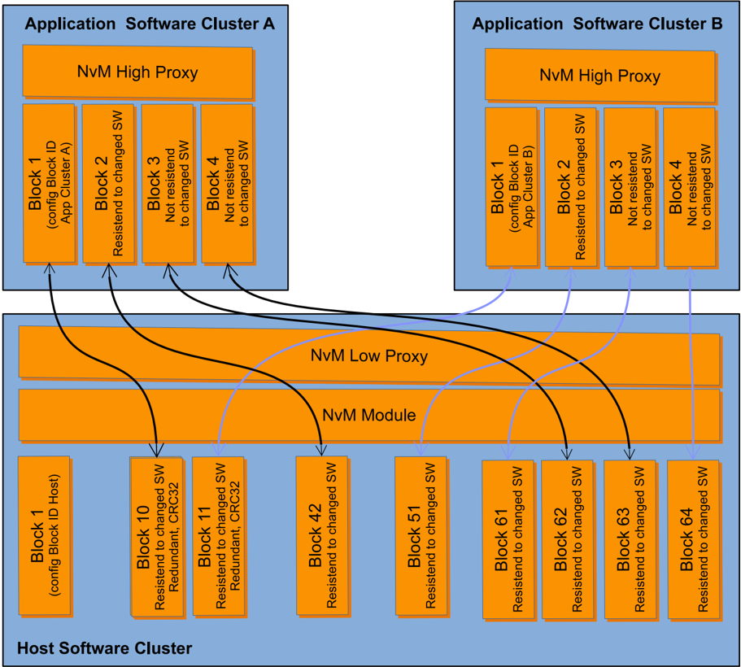

特定应用软件集群的 NvM 高层代理（**NvM High Proxy**）应在该应用软件集群中参数 `NvMDynamicConfiguration` 设置为 TRUE 时启用配置 ID 检查（**configuration ID check**）。

**注意：** 参数 `NvMDynamicConfiguration` 在相应应用软件集群的 NvM 模块配置中设置。

与宿主软件集群中 NvM 模块的配置一样，块 ID 1 在每个应用软件集群中为配置 ID 块保留。该配置 ID 块包含存储的 NVRAM 配置 ID（**NVRAM configuration ID**）。

**配置 ID 块始终使用块 ID 1：** 在 NvM 高层代理（**NvM High Proxy**）的配置中，块 ID 为 1 的 NVRAM 块应为配置 ID 块保留，以包含存储的 NVRAM 配置 ID。

特定应用软件集群的 NvM 高层代理（**NvM High Proxy**）应将配置 ID 块实现为带 CRC32 的冗余类型。

**宿主软件集群中应用软件集群配置 ID 块的 NvBlock 配置：** 在宿主软件集群的 NvM 模块中，应用软件集群的配置 ID 块应配置为 `NvMBlockManagementType == NVM_BLOCK_REDUNDANT` 且 `NvMBlockCrcType == NVM_CRC32`。

配置 ID 块的函数 `[NvM_WriteBlock](#11314-nvm_writeblock)` 的作业应将编译的 NVRAM 配置 ID 写入该应用软件集群的存储的 NVRAM 配置 ID（在配置 ID 块中）。

配置 ID 块的函数 `[NvM_WritePRAMBlock](#11315-nvm_writepramblock)` 的作业应将编译的 NVRAM 配置 ID 写入该应用软件集群的存储的 NVRAM 配置 ID（在配置 ID 块中）。

配置 ID 块的 `[NvM_ReadRamBlockFromNvm](#11318-nvm_readramblockfromnvm)` 调用应通过比较该应用软件集群的存储的 NVRAM 配置 ID 与该应用软件集群的编译的 NVRAM 配置 ID 来验证配置 ID。

如果 NvM 模块由于相应的 NV 块为空或已失效而无法读取应用软件集群的配置 ID 块，NvM 模块将为该配置 ID 块调用相应的 `[NvM_InitBlockCallbackFunction](#11317-nvm_initblockcallbackfunction)`。

配置 ID 块的 `[NvM_ReadRamBlockFromNvm](#11318-nvm_readramblockfromnvm)` 调用应将配置 ID 检查的结果视为配置 ID 不匹配。

**注意：** 配置 ID 块的后续更新和验证在 [SWS_SwCluC_02157] 中处理。

配置 ID 块的函数 `[NvM_GetErrorStatus](#1134-nvm_geterrorstatus)` 的作业在配置 ID 不匹配的情况下报告 `NVM_REQ_NOT_OK`。

**注意：** 这确保了与 [SWS_NvM_00306] 兼容的行为。

配置 ID 块的函数 `[NvM_GetErrorStatus](#1134-nvm_geterrorstatus)` 的作业在该应用软件集群的配置 ID 块从 NvRam 恢复有效之前报告 `NVM_REQ_NV_INVALIDATED`。

**注意：** 这确保了与 [SWS_NvM_00672] 兼容的行为。

函数 `[NvM_ReadRamBlockFromNvm](#11318-nvm_readramblockfromnvm)` 应获取 ROM 块默认值并将其复制到应用，如果：

* 配置 ID 检查已启用（`NvMDynamicConfiguration` 设置为 TRUE）
并且（AND）
* 检测到配置 ID 不匹配
并且（AND）
* 应用软件集群中相关的 NvBlock 的 `NvMResistantToChangedSw` 设置为 FALSE
并且（AND）
* NvM 代理处于 NvM 启动阶段（**NvM startup phase**）

在所有其他情况下，函数 `[NvM_ReadRamBlockFromNvm](#11318-nvm_readramblockfromnvm)` 应执行从 NvM 到应用的正常数据复制功能。

函数 `[SwCluC_NvMProxy_MultiBlockReadAllJobFinished](#7333-swcluc_nvmproxy_multiblockreadalljobfinished)` 应按照新的（编译的）配置 ID 更新配置 ID 块，并在发生配置 ID 不匹配且 `NvMDynamicConfiguration == TRUE` 时验证相应的 NVRAM 块。

**注意：** 验证带配置 ID 的 NVRAM 块会触发 CRC 重算，并使它能够在下一次 `[NvM_WriteAll](#11321-nvm_writeall)` 期间被写入。

###### 6.4.3.2.4. NvM 高层代理

NvM 高层代理（**NvM High Proxy**）应提供头文件 `NvM.h`。

NvM 高层代理（**NvM High Proxy**）应为应用软件集群中的 NvM 用户提供 NvBlocks 的符号名值（**symbolic name values**）。

NvM 高层代理（**NvM High Proxy**）应为应用软件集群中的 NvM 用户提供单块请求的函数：

* `[NvM_SetDataIndex](#11312-nvm_setdataindex)`
* `[NvM_GetDataIndex](#1133-nvm_getdataindex)`
* `[NvM_SetBlockProtection](#11311-nvm_setblockprotection)`
* `[NvM_GetErrorStatus](#1134-nvm_geterrorstatus)`
* `[NvM_SetRamBlockStatus](#11313-nvm_setramblockstatus)`
* `[NvM_SetBlockLockStatus](#11310-nvm_setblocklockstatus)`
* `[NvM_CancelJobs](#1131-nvm_canceljobs)`
* `[NvM_ReadBlock](#1136-nvm_readblock)`
* `[NvM_WriteBlock](#11314-nvm_writeblock)`
* `[NvM_RestoreBlockDefaults](#1138-nvm_restoreblockdefaults)`
* `[NvM_EraseNvBlock](#1132-nvm_erasenvblock)`
* `[NvM_InvalidateNvBlock](#1135-nvm_invalidatenvblock)`
* `[NvM_ReadPRAMBlock](#1137-nvm_readpramblock)`
* `[NvM_WritePRAMBlock](#11315-nvm_writepramblock)`
* `[NvM_RestorePRAMBlockDefaults](#1139-nvm_restorepramblockdefaults)`

NvM 高层代理（**NvM High Proxy**）应按照 [SWS_SwCluC_02103] 为每个已配置的 **SwCluCNvMBaseSocket** 提供一次单块请求的函数。这样，在 `SwCluCNativeBswApi` 设置为 true 的 `[EcucPartition](#1011-ecucpartition)` 处，API 以原始 Mip `NvM` 提供。对于所有其他 **SwCluCNvMBaseSocket** 实例，Mip `NvM` 被替换为 `NvM_&lt;shortName of [EcucPartition](#1011-ecucpartition)&gt;`。

NvM 高层代理（**NvM High Proxy**）的函数：

* `[NvM_ReadBlock](#1136-nvm_readblock)`
* `[NvM_WriteBlock](#11314-nvm_writeblock)`
* `[NvM_RestoreBlockDefaults](#1138-nvm_restoreblockdefaults)`

应只接受指向 RAM 数据块的指针设置为 `NULL_PTR` 的单块请求。否则返回 `E_NOT_OK`，并且该请求被丢弃。

例如，函数 `[NvM_GetErrorStatus](#1134-nvm_geterrorstatus)` 可以提供为：

```C
/* EcucPartition "Core0_QM", SwCluCNativeBswApi == true */
Std_ReturnType NvM_GetErrorStatus (
  NvM_BlockIdType BlockId,
  NvM_RequestResultType * RequestResultPtr
)
...

/* EcucPartition "Core1_QM", SwCluCNativeBswApi == false */
Std_ReturnType NvM_Core1_QM_GetErrorStatus (
  NvM_BlockIdType BlockId,
  NvM_RequestResultType * RequestResultPtr
)
...
```

**注意：** `SwCluCNativeBswApi` 在应用软件集群配置中最多只能为一个 **SwCluCNvMBaseSocket** 容器设置为 true。

**回调函数（Callback Functions）**

NvM 高层代理（**NvM High Proxy**）应支持 `[NvM_SingleBlockCallbackFunction](#11316-nvm_singleblockcallbackfunction)` 的可选配置，按照 [ECUC_NvM_00562]、[ECUC_NvM_00506] 和 [ECUC_NvM_00559]。

NvM 高层代理（**NvM High Proxy**）应支持用于 [**NvMNotifyJobFinished**](#1227-nvmnotifyjobfinished) 通知的 `NvM_PNJF_{Block}` 端口的可选配置。

NvM 高层代理（**NvM High Proxy**）应支持 `[NvM_InitBlockCallbackFunction](#11317-nvm_initblockcallbackfunction)` 的可选配置，按照 [ECUC_NvM_00561]、[ECUC_NvM_00116] 和 [ECUC_NvM_00559]。

NvM 高层代理（**NvM High Proxy**）应支持用于 [**NvMNotifyInitBlock**](#1228-nvmnotifyinitblock) 通知的 `NvM_PNIB_{Block}` 端口的可选配置。

NvM 高层代理（**NvM High Proxy**）应支持 `[NvM_ReadRamBlockFromNvm](#11318-nvm_readramblockfromnvm)` 的可选配置，按照 [ECUC_NvM_00521]。

NvM 高层代理（**NvM High Proxy**）应支持 `[NvM_WriteRamBlockToNvm](#11319-nvm_writeramblocktonvm)` 的可选配置，按照 [ECUC_NvM_00520]。

NvM 高层代理（**NvM High Proxy**）应支持用于 [**NvMMirror**](#1229-nvmmirror) 通知的 `NvM_PM_{Block}` 端口的可选配置。

**多分区（Multiple Partitions）**

NvM 高层代理（**NvM High Proxy**）应为每个已配置的 `[EcucPartition](#1011-ecucpartition)` 创建一个分区特定的服务软件组件（**Service Software Component**），名称为 `NvM_&lt;[EcucPartition](#1011-ecucpartition) shortName&gt;`。

NvM 高层代理（**NvM High Proxy**）应将属于特定 NV 块的端口：

* `NvM_PS_{Block}`
* `NvM_PAdmin_{Block}`
* `NvM_PNIB_{Block}`
* `NvM_PNJF_{Block}`
* `NvM_PM_{Block}`

提供在使用该端口的 [**SwComponentPrototype**](#9126-swcomponentprototype) 所映射到的分区特定服务软件组件处。

**未连接块的处理（Handling of unconnected blocks）**

如果在 NvM 高层代理（**NvM High Proxy**）中配置的 NV 块未连接到任何 NvM 低层代理，NvM 高层代理应用 `NvMRomBlockDataAddress` 和/或 `[NvMInitBlockCallback](#1042-nvminitblockcallback)` 给出的默认值初始化 Nv RAM 块。

如果在 NvM 高层代理（**NvM High Proxy**）中配置的 NV 块未连接到任何 NvM 低层代理，NvM 高层代理的函数 `[NvM_GetErrorStatus](#1134-nvm_geterrorstatus)` 仍应返回 `E_OK`，并且请求结果设置为 `NVM_REQ_RESTORED_FROM_ROM`。

如果在 NvM 高层代理（**NvM High Proxy**）中配置的 NV 块未连接到任何 NvM 低层代理，NvM 高层代理的以下函数：

* `[NvM_SetDataIndex](#11312-nvm_setdataindex)`
* `[NvM_GetDataIndex](#1133-nvm_getdataindex)`
* `[NvM_SetBlockProtection](#11311-nvm_setblockprotection)`
* `[NvM_SetRamBlockStatus](#11313-nvm_setramblockstatus)`
* `[NvM_SetBlockLockStatus](#11310-nvm_setblocklockstatus)`
* `[NvM_CancelJobs](#1131-nvm_canceljobs)`
* `[NvM_ReadBlock](#1136-nvm_readblock)`
* `[NvM_WriteBlock](#11314-nvm_writeblock)`
* `[NvM_RestoreBlockDefaults](#1138-nvm_restoreblockdefaults)`
* `[NvM_EraseNvBlock](#1132-nvm_erasenvblock)`
* `[NvM_InvalidateNvBlock](#1135-nvm_invalidatenvblock)`
* `[NvM_ReadPRAMBlock](#1137-nvm_readpramblock)`
* `[NvM_WritePRAMBlock](#11315-nvm_writepramblock)`
* `[NvM_RestorePRAMBlockDefaults](#1139-nvm_restorepramblockdefaults)`

应返回 `E_NOT_OK`。

###### 6.4.3.2.5. NvM 低层代理

如图 7.10 所示，NvM 低层代理（**NvM Low Proxy**）应能够在应用软件集群中不发生分区切换的情况下调用宿主软件集群中 BSW 模块的 API。只有当 BSW 模块在该分区上不提供卫星（**satellite**）时，才需要这种分区切换。BSW 模块在专用 `EcucPartitions` 上的可用性是宿主软件集群的属性。

NvM 低层代理（**NvM Low Proxy**）应按照 [SWS_SwCluC_02103] 在 **SwCluCNvMBaseSocket** 配置的 `SwCluCNvMBaseSocket.SwCluCProxyEcucPartitionRef` 所配置的 `[EcucPartition](#1011-ecucpartition)` 处为每个已配置的 **SwCluCNvMBaseSocket** 提供一次单块请求的入口函数。

如果已设置 `SwCluCNvMProxyUsedSatelliteRef`，则在调用 NVM API 之前应进行分区切换。

NvM 低层代理（**NvM Low Proxy**）应为 NvM 低层代理中每个已配置的 NV 块（**SwCluCNvMProxyNvBlock**）提供一个 `[NvM_SingleBlockCallbackFunction](#11316-nvm_singleblockcallbackfunction)` 实例。

NvM 低层代理（**NvM Low Proxy**）应为 NvM 低层代理中每个已配置的 NV 块（**SwCluCNvMProxyNvBlock**）提供一个 `[NvM_InitBlockCallbackFunction](#11317-nvm_initblockcallbackfunction)` 实例。

NvM 低层代理（**NvM Low Proxy**）应为 NvM 低层代理中每个已配置的 NV 块（**SwCluCNvMProxyNvBlock**）提供一个 `[NvM_ReadRamBlockFromNvm](#11318-nvm_readramblockfromnvm)` 实例。

NvM 低层代理（**NvM Low Proxy**）应为 NvM 低层代理中每个已配置的 NV 块（**SwCluCNvMProxyNvBlock**）提供一个 `[NvM_WriteRamBlockToNvm](#11319-nvm_writeramblocktonvm)` 实例。

与从应用软件集群调用 BSW 模块的 API 相反，如果 BSW 模块在该分区上不提供卫星，则被调用的回调通知需要在调用最终进入应用软件集群之前在宿主软件集群中进行分区切换。

按照 [SWS_SwCluC_02111]、[SWS_SwCluC_02127]、[SWS_SwCluC_02128] 和 [SWS_SwCluC_02129] 的回调实例在以下位置提供：

* 在 `SwCluCNvMProxyNvBlock.SwCluCNvMProxyNvBlockEcucPartitionRef` 引用的 `[EcucPartition](#1011-ecucpartition)` 处（如果该 `[EcucPartition](#1011-ecucpartition)` 处直接有可用的 **SwCluCNvMBaseSocket**）
或（OR）
* 在 `SwCluCNvMBaseSocket` 经由 `SwCluCNvMProxyUsedSatelliteRef` 引用的、位于 `SwCluCNvMProxyNvBlock.SwCluCNvMProxyNvBlockEcucPartitionRef` 给定的 `[EcucPartition](#1011-ecucpartition)` 上的 **SwCluCNvMBaseSocket** 的 `[EcucPartition](#1011-ecucpartition)` 处。在这种情况下，在调用高层代理中的回调之前应进行分区切换。

如果在 NvM 低层代理（**NvM Low Proxy**）中配置的 NV 块未连接到任何 NvM 高层代理，NvM 低层代理实现应确保 NV 块的内容不被 NvM 低层代理修改。

**注意：** 在这种情况下，Dcm 的访问仍可能更改 NV 块内容。

NvM 低层代理（**NvM Low Proxy**）实现应描述经由从 `[CpSoftwareClusterServiceResource](#948-cpsoftwareclusterserviceresource).resourceNeeds` 派生的 [**NvBlockNeeds**](#995-nvblockneeds) 提供给 NvM 高层代理（**NvM High Proxies**）的 NV 块。

**注意：** [SWS_SwCluC_02142] 确保 NVRAM 管理器的自动配置。

NvM 低层代理（**NvM Low Proxy**）应为每个 **SwCluCNvMBaseSocket** 提供一个 `[SwCluC_NvMProxy_Init](#7332-swcluc_nvmproxy_init)` API，用于初始化应用软件集群的 NvM 高层代理（**NvM High Proxy**）。这应是服务资源 **SwCluCNvMBaseSocket** 的一个元素。

###### 6.4.3.2.6. 错误检测

如果为 NvM 高层代理（**NvM High Proxy**）启用了开发错误检测，以下 API：

* `[NvM_SetDataIndex](#11312-nvm_setdataindex)`
* `[NvM_GetDataIndex](#1133-nvm_getdataindex)`
* `[NvM_SetBlockProtection](#11311-nvm_setblockprotection)`
* `[NvM_GetErrorStatus](#1134-nvm_geterrorstatus)`
* `[NvM_SetRamBlockStatus](#11313-nvm_setramblockstatus)`
* `[NvM_SetBlockLockStatus](#11310-nvm_setblocklockstatus)`
* `[NvM_CancelJobs](#1131-nvm_canceljobs)`
* `[NvM_ReadBlock](#1136-nvm_readblock)`
* `[NvM_WriteBlock](#11314-nvm_writeblock)`
* `[NvM_RestoreBlockDefaults](#1138-nvm_restoreblockdefaults)`
* `[NvM_EraseNvBlock](#1132-nvm_erasenvblock)`
* `[NvM_InvalidateNvBlock](#1135-nvm_invalidatenvblock)`
* `[NvM_ReadPRAMBlock](#1137-nvm_readpramblock)`
* `[NvM_WritePRAMBlock](#11315-nvm_writepramblock)`
* `[NvM_RestorePRAMBlockDefaults](#1139-nvm_restorepramblockdefaults)`

应在 NVM 高层代理尚未初始化时报告 DET 错误 `[NVM_E_UNINIT](#644-错误分类)`。

如果为 NvM 高层代理（**NvM High Proxy**）启用了开发错误检测，以下 API：

* `[NvM_SetDataIndex](#11312-nvm_setdataindex)`
* `[NvM_GetDataIndex](#1133-nvm_getdataindex)`
* `[NvM_SetBlockProtection](#11311-nvm_setblockprotection)`
* `[NvM_GetErrorStatus](#1134-nvm_geterrorstatus)`
* `[NvM_SetRamBlockStatus](#11313-nvm_setramblockstatus)`
* `[NvM_SetBlockLockStatus](#11310-nvm_setblocklockstatus)`
* `[NvM_CancelJobs](#1131-nvm_canceljobs)`
* `[NvM_ReadBlock](#1136-nvm_readblock)`
* `[NvM_WriteBlock](#11314-nvm_writeblock)`
* `[NvM_RestoreBlockDefaults](#1138-nvm_restoreblockdefaults)`
* `[NvM_EraseNvBlock](#1132-nvm_erasenvblock)`
* `[NvM_InvalidateNvBlock](#1135-nvm_invalidatenvblock)`
* `[NvM_ReadPRAMBlock](#1137-nvm_readpramblock)`
* `[NvM_WritePRAMBlock](#11315-nvm_writepramblock)`
* `[NvM_RestorePRAMBlockDefaults](#1139-nvm_restorepramblockdefaults)`

应在传入的 BlockId 超出 NvM 高层代理中配置的 BlockIds 范围时报告 DET 错误 `[NVM_E_PARAM_BLOCK_ID](#644-错误分类)`。

如果为 NvM 高层代理（**NvM High Proxy**）启用了开发错误检测，以下 API：

* `[NvM_ReadBlock](#1136-nvm_readblock)`
* `[NvM_WriteBlock](#11314-nvm_writeblock)`
* `[NvM_RestoreBlockDefaults](#1138-nvm_restoreblockdefaults)`

应在传入不同于 `NULL_PTR` 的 RAM 块地址时报告 DET 错误 `NVM_E_PARAM_ADDRESS`。

##### 6.4.3.3. Com 代理

###### 6.4.3.3.1. 启用 Com 代理生成

只有当配置参数 `SwCluCProxyGenerationCom` 设置为 `HIGH_PROXY` 时，才创建 Com 高层代理代码及相关的 AUTOSAR 模型描述。

只有当配置参数 `SwCluCProxyGenerationCom` 设置为 `LOW_PROXY` 时，才创建 Com 低层代理代码及相关的 AUTOSAR 模型描述。

###### 6.4.3.3.2. 一般 Com 代理功能

###### 6.4.3.3.3. 概述

规定的 Com 代理（**Com Proxy**）具有以下基本设计原则。

图 7.13：Com 代理概述

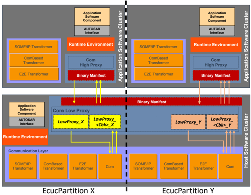

应用软件集群为补全其功能所需的 Com 实现部分提供代理。这称为 Com 高层代理（**Com High Proxy**）。

宿主软件集群包含 Com 功能的真实实现，并通过相应的 Com 低层代理（**Com Low Proxy**）使其对 Com 高层代理可用。Com 高层代理和 Com 低层代理基于二进制清单（**Binary Manifest**）中可用的信息链接在一起，从而支持从应用软件集群到宿主软件集群（以及相反方向）执行 Com（回调）函数。

Com 代理作为 [**ComUserModule**](#1086-comusermodule) 由一个或多个 **ComUserModuleCnf** 表示。在 Com 代理：

* 需要直接访问发起 **ComSignals** 和/或 **ComSignalGroups** 的发送/接收请求的 Com API
* 提供 **ComSignals** 和/或 **ComSignalGroups** 的发送/接收通知回调

的每个 `[EcucPartition](#1011-ecucpartition)` 中都需要一个 **ComUserModuleCnf**。

实际上，**ComUserModuleCnf** 将 Com 中一组固定的通知回调链接到 Com 代理中的特定 `[EcucPartition](#1011-ecucpartition)`。因此，Com 代理必须将每个 **ComUserSignal** / **ComUserSignalGroup** 经由 `ComUserSystemTemplateSystemSignalRef` / `ComUserSystemTemplateSignalGroupRef` 映射到 [**ComSignal**](#1085-comsignal) 或 [**ComSignalGroup**](#1088-comsignalgroup)。

Com 模块应在 Com 代理中配置的 `[EcucPartition](#1011-ecucpartition)` 上提供其用于相关 **ComSignals** 和/或 **ComSignalGroups** 的发送/接收请求的 API。

作为 [**ComUserModule**](#1086-comusermodule) 的 Com 代理应为应用软件集群中的 RTE 提供兼容的配置结构和内容。它从 Com 派生其 **ComSignals** 和/或 **ComSignalGroups** 的配置。对于 `[EcucPartition](#1011-ecucpartition)` 分配，Com 代理创建虚拟主函数（Rx/Tx）并将相应的 **ComIPdus** 映射到它们。这些主函数只存在于配置中，没有实现。

即使 Com 用户的概念为支持包括通知在内的多用户访问提供了很大的灵活性，也必须考虑一些限制。

一般而言，如果写者之间没有协调，多个写者可能导致竞态条件。此外，`[Com_SendSignal](#1141-com_sendsignal)`（针对组信号）和 `[Com_SendSignalGroup](#1143-com_sendsignalgroup)` 调用的规定顺序在多个写者抢占的情况下会导致数据不一致的风险。

由于这种跨不同软件集群的协调很难实现，适用以下限制：

发送的信号或信号组最多应提供给一个应用软件集群。

尽管如此，多个应用软件集群读取一个信号或信号组是可能的。

###### 6.4.3.3.4. 一般需求

Com 代理（**Com Proxy**）应支持宿主软件集群 Com 中配置的 **ComSignals** 的 `ComHandleId` 可以更改，而无需重新配置或重新构建使用这些 **ComSignals** 的应用软件集群。

Com 代理（**Com Proxy**）应支持宿主软件集群 Com 中配置的 **ComSignalGroups** 或 **ComGroupSignals** 的 `ComHandleId` 可以更改，而无需重新配置或重新构建使用这些 **ComSignalGroups** 的应用软件集群。

Com 代理（**Com Proxy**）应支持应用软件集群的 Com 用户中配置的 **ComUserSignals** 或 **ComUserSignalGroups** 的 `ComUserCbkHandleId` 可以更改，而无需重新配置或重新构建宿主软件集群。

Com 代理（**Com Proxy**）应支持在宿主软件集群的上下文中从应用软件集群调用 Com API。

Com 代理（**Com Proxy**）应支持在应用软件集群的上下文中从宿主软件集群调用 Com 回调。

如果 &lt;[ComUser_CbkRxAck](#11419-comuser_cbkrxack)&gt; 通知回调在 Com 高层代理中配置（经由 `ComUserCallbackName`（见 [ECUC_Com_10036]），其中相应的 `ComUserCallbackType`（见 [ECUC_Com_10034]）设置为 `COM_RX_ACK`），则当调用 Com 低层代理的关联 `[SwCluC_ComProxy_CbkRxAck](#74311-swcluc_comproxy_cbkrxack)` 实例时，应调用配置的 &lt;[ComUser_CbkRxAck](#11419-comuser_cbkrxack)&gt; 回调。

如果无效（invalid）&lt;[ComUser_CbkInv](#11420-comuser_cbkinv)&gt; 通知回调在 Com 高层代理中配置（经由 `ComUserCallbackName`（见 [ECUC_Com_10036]），其中相应的 `ComUserCallbackType`（见 [ECUC_Com_10034]）设置为 `COM_RX_INV`），则当调用 Com 低层代理的关联 `[SwCluC_ComProxy_CbkInv](#74312-swcluc_comproxy_cbkinv)` 实例时，应调用配置的 &lt;[ComUser_CbkInv](#11420-comuser_cbkinv)&gt; 回调。

如果 &lt;[ComUser_CbkRxTOut](#11421-comuser_cbkrxtout)&gt; 通知回调在 Com 高层代理中配置（经由 `ComUserCallbackName`（见 [ECUC_Com_10036]），其中相应的 `ComUserCallbackType`（见 [ECUC_Com_10034]）设置为 `COM_RX_TOUT`），则当调用 Com 低层代理的关联 `[SwCluC_ComProxy_CbkRxTOut](#74313-swcluc_comproxy_cbkrxtout)` 实例时，应调用配置的 &lt;[ComUser_CbkRxTOut](#11421-comuser_cbkrxtout)&gt; 回调。

如果 &lt;[ComUser_CbkTxAck](#11422-comuser_cbktxack)&gt; 通知回调在 Com 高层代理中配置（经由 `ComUserCallbackName`（见 [ECUC_Com_10036]），其中相应的 `ComUserCallbackType`（见 [ECUC_Com_10034]）设置为 `COM_TX_ACK`），则当调用 Com 低层代理的关联实例时，应调用配置的 &lt;[ComUser_CbkTxAck](#11422-comuser_cbktxack)&gt; 回调。

如果 &lt;[ComUser_CbkTxErr](#11423-comuser_cbktxerr)&gt; 通知回调在 Com 高层代理中配置（经由 `ComUserCallbackName`（见 [ECUC_Com_10036]），其中相应的 `ComUserCallbackType`（见 [ECUC_Com_10034]）设置为 `COM_TX_ERR`），则当调用 Com 低层代理的关联 `[SwCluC_ComProxy_CbkTxErr](#74315-swcluc_comproxy_cbktxerr)` 实例时，应调用配置的 &lt;[ComUser_CbkTxErr](#11423-comuser_cbktxerr)&gt; 回调。

如果 &lt;[ComUser_CbkTxTOut](#11424-comuser_cbktxtout)&gt; 超时通知回调在 Com 高层代理中配置（经由 `ComUserCallbackName`（见 [ECUC_Com_10036]），其中相应的 `ComUserCallbackType`（见 [ECUC_Com_10034]）设置为 `COM_TX_TOUT`），则当调用 Com 低层代理的关联 `[SwCluC_ComProxy_CbkTxTOut](#74316-swcluc_comproxy_cbktxtout)` 实例时，应调用配置的 &lt;[ComUser_CbkTxTOut](#11424-comuser_cbktxtout)&gt; 回调。

###### 6.4.3.3.5. Com 高层代理

Com 高层代理（**Com High Proxy**）应提供头文件 `Com.h`。

Com 高层代理（**Com High Proxy**）应为应用软件集群中的 Com 用户提供 **ComSignals** 的符号名值。

Com 高层代理（**Com High Proxy**）应为应用软件集群中的 Com 用户提供 **ComSignalGroups** 或 **ComGroupSignals** 的符号名值。

Com 高层代理（**Com High Proxy**）应提供应用软件集群中的 Com 用户所需的、用于 **ComSignals** 和 **ComSignalGroups** 发送请求的函数：

* `[Com_SendSignal](#1141-com_sendsignal)`
* `[Com_SendDynSignal](#1142-com_senddynsignal)`
* `[Com_SendSignalGroup](#1143-com_sendsignalgroup)`
* `[Com_SendSignalGroupArray](#1144-com_sendsignalgrouparray)`
* `[Com_SendSignalWithMetaData](#1145-com_sendsignalwithmetadata)`
* `[Com_SendDynSignalWithMetaData](#1146-com_senddynsignalwithmetadata)`
* `[Com_SendSignalGroupWithMetaData](#1147-com_sendsignalgroupwithmetadata)`
* `[Com_SendSignalGroupArrayWithMetaData](#1148-com_sendsignalgrouparraywithmetadata)`

Com 高层代理（**Com High Proxy**）应提供应用软件集群中的 Com 用户所需的、用于 [**ComSignal**](#1085-comsignal) 和 [**ComSignalGroup**](#1088-comsignalgroup) 接收请求的函数：

* `[Com_ReceiveSignal](#1149-com_receivesignal)`
* `[Com_ReceiveDynSignal](#11410-com_receivedynsignal)`
* `[Com_ReceiveSignalGroup](#11411-com_receivesignalgroup)`
* `[Com_ReceiveSignalGroupArray](#11412-com_receivesignalgrouparray)`
* `[Com_ReceiveSignalWithMetaData](#11413-com_receivesignalwithmetadata)`
* `[Com_ReceiveDynSignalWithMetaData](#11414-com_receivedynsignalwithmetadata)`
* `[Com_ReceiveSignalGroupWithMetaData](#11415-com_receivesignalgroupwithmetadata)`
* `[Com_ReceiveSignalGroupArrayWithMetaData](#11416-com_receivesignalgrouparraywithmetadata)`

Com 高层代理（**Com High Proxy**）提供的函数 `[Com_ReceiveSignalGroup](#11411-com_receivesignalgroup)` 应：

* 调用 `[Com_ReceiveSignalGroupArray](#11412-com_receivesignalgrouparray)` API 以 uint8 数组表示形式获取数据，
并且（AND）
* 对 uint8 数组执行转换以输出原始数据，该数据将传递给应用软件集群中的 RTE。

Com 高层代理（**Com High Proxy**）提供的函数 `[Com_ReceiveSignalGroupWithMetaData](#11415-com_receivesignalgroupwithmetadata)` 应：

* 调用 `[Com_ReceiveSignalGroupArrayWithMetaData](#11416-com_receivesignalgrouparraywithmetadata)` API 以 uint8 数组表示形式获取数据，
并且（AND）
* 对 uint8 数组执行转换以输出原始数据，该数据将传递给应用软件集群中的 RTE。

Com 高层代理（**Com High Proxy**）应提供应用软件集群中的 Com 用户所需的、用于 [**ComSignal**](#1085-comsignal) 和 [**ComSignalGroup**](#1088-comsignalgroup) 失效请求的函数：

* `[Com_InvalidateSignal](#11417-com_invalidatesignal)`
* `[Com_InvalidateSignalGroup](#11418-com_invalidatesignalgroup)`

如果 Com 高层代理未连接到 Com 低层代理（**Com Low Proxy**），Com 高层代理的关于 **ComSignals** 和 **ComSignalGroups** 发送请求的函数：

* `[Com_SendSignal](#1141-com_sendsignal)`
* `[Com_SendDynSignal](#1142-com_senddynsignal)`
* `[Com_SendSignalGroup](#1143-com_sendsignalgroup)`
* `[Com_SendSignalGroupArray](#1144-com_sendsignalgrouparray)`
* `[Com_SendSignalWithMetaData](#1145-com_sendsignalwithmetadata)`
* `[Com_SendDynSignalWithMetaData](#1146-com_senddynsignalwithmetadata)`
* `[Com_SendSignalGroupWithMetaData](#1147-com_sendsignalgroupwithmetadata)`
* `[Com_SendSignalGroupArrayWithMetaData](#1148-com_sendsignalgrouparraywithmetadata)`

应返回 `COM_SERVICE_NOT_AVAILABLE`。

如果 Com 高层代理未连接到 Com 低层代理（**Com Low Proxy**），Com 高层代理的关于 **ComSignals** 和 **ComSignalGroups** 接收请求的函数：

* `[Com_ReceiveSignal](#1149-com_receivesignal)`
* `[Com_ReceiveDynSignal](#11410-com_receivedynsignal)`
* `[Com_ReceiveSignalGroup](#11411-com_receivesignalgroup)`
* `[Com_ReceiveSignalGroupArray](#11412-com_receivesignalgrouparray)`
* `[Com_ReceiveSignalWithMetaData](#11413-com_receivesignalwithmetadata)`
* `[Com_ReceiveDynSignalWithMetaData](#11414-com_receivedynsignalwithmetadata)`
* `[Com_ReceiveSignalGroupWithMetaData](#11415-com_receivesignalgroupwithmetadata)`
* `[Com_ReceiveSignalGroupArrayWithMetaData](#11416-com_receivesignalgrouparraywithmetadata)`
* `[Com_ReceiveSignalWithMetaData](#11413-com_receivesignalwithmetadata)`
* `[Com_ReceiveDynSignalWithMetaData](#11414-com_receivedynsignalwithmetadata)`

应返回 `COM_SERVICE_NOT_AVAILABLE`。

如果 Com 高层代理未连接到 Com 低层代理（**Com Low Proxy**），Com 高层代理的关于 **ComSignals** 和 **ComSignalGroups** 失效请求的函数：

* `[Com_InvalidateSignal](#11417-com_invalidatesignal)`
* `[Com_InvalidateSignalGroup](#11418-com_invalidatesignalgroup)`

应返回 `COM_SERVICE_NOT_AVAILABLE`。

Com 高层代理（**Com High Proxy**）应按照 [SWS_SwCluC_02609] 为每个已配置的 **SwCluCComProxyBaseSocket** 提供一次信号（组）的发送请求函数。在 `SwCluCNativeBswApi` 设置为 true 的 `[EcucPartition](#1011-ecucpartition)` 处。对于所有其他 **SwCluCComProxyBaseSocket** 实例，Mip `Com` 被替换为 `Com_&lt;[EcucPartition](#1011-ecucpartition).ShortName&gt;`。

Com 高层代理（**Com High Proxy**）应按照 [SWS_SwCluC_02610] 为每个已配置的 **SwCluCComProxyBaseSocket** 提供一次信号（组）的接收请求函数。在 `SwCluCNativeBswApi` 设置为 true 的 `[EcucPartition](#1011-ecucpartition)` 处，API 以原始 Mip `Com` 提供。对于所有其他 **SwCluCComProxyBaseSocket** 实例，Mip `Com` 被替换为 `Com_&lt;[EcucPartition](#1011-ecucpartition).ShortName&gt;`。

Com 高层代理（**Com High Proxy**）应按照 [SWS_SwCluC_02611] 为每个已配置的 **SwCluCComProxyBaseSocket** 提供一次信号（组）的失效请求函数。在 `SwCluCNativeBswApi` 设置为 true 的 `[EcucPartition](#1011-ecucpartition)` 处，API 以原始 Mip `Com` 提供。对于所有其他 **SwCluCComProxyBaseSocket** 实例，Mip `Com` 被替换为 `Com_&lt;[EcucPartition](#1011-ecucpartition).ShortName&gt;`。

**回调函数（Callback Functions）**

Com 高层代理（**Com High Proxy**）应支持可选的 &lt;[ComUser_CbkRxAck](#11419-comuser_cbkrxack)&gt; 通知回调，它经由 `ComUserCallbackName`（见 [ECUC_Com_10036]）参数配置，其中 `ComUserCallbackType`（见 [ECUC_Com_10034]）设置为 `COM_RX_ACK`。

Com 高层代理（**Com High Proxy**）应支持可选的无效（invalid）&lt;[ComUser_CbkInv](#11420-comuser_cbkinv)&gt; 通知回调，它经由 `ComUserCallbackName`（见 [ECUC_Com_10036]）配置，其中 `ComUserCallbackType`（见 [ECUC_Com_10034]）设置为 `COM_RX_INV`。

Com 高层代理（**Com High Proxy**）应支持可选的 &lt;[ComUser_CbkRxTOut](#11421-comuser_cbkrxtout)&gt; 超时通知回调，它经由 `ComUserCallbackName`（见 [ECUC_Com_10036]）配置，其中 `ComUserCallbackType`（见 [ECUC_Com_10034]）设置为 `COM_RX_TOUT`。

Com 高层代理（**Com High Proxy**）应支持可选的 &lt;[ComUser_CbkTxAck](#11422-comuser_cbktxack)&gt; 通知回调，它经由 `ComUserCallbackName`（见 [ECUC_Com_10036]）配置，其中 `ComUserCallbackType`（见 [ECUC_Com_10034]）设置为 `COM_TX_ACK`。

Com 高层代理（**Com High Proxy**）应支持可选的 &lt;[ComUser_CbkTxErr](#11423-comuser_cbktxerr)&gt; 错误通知回调，它经由 `ComUserCallbackName`（见 [ECUC_Com_10036]）配置，其中 `ComUserCallbackType`（见 [ECUC_Com_10034]）设置为 `COM_TX_ERR`。

Com 高层代理（**Com High Proxy**）应支持可选的 &lt;[ComUser_CbkTxTOut](#11424-comuser_cbktxtout)&gt; 超时通知回调，它经由 `ComUserCallbackName`（见 [ECUC_Com_10036]）配置，其中 `ComUserCallbackType`（见 [ECUC_Com_10034]）设置为 `COM_TX_TOUT`。

Com 高层代理（**Com High Proxy**）应为每个 **SwCluCComProxyBaseSocket** 在二进制清单中创建一个必需的资源条目。

请注意，应用软件集群的回调：

* &lt;[ComUser_CbkRxAck](#11419-comuser_cbkrxack)&gt;
* &lt;[ComUser_CbkInv](#11420-comuser_cbkinv)&gt;
* &lt;[ComUser_CbkRxTOut](#11421-comuser_cbkrxtout)&gt;
* &lt;[ComUser_CbkTxAck](#11422-comuser_cbktxack)&gt;
* &lt;[ComUser_CbkTxErr](#11423-comuser_cbktxerr)&gt;
* &lt;[ComUser_CbkTxTOut](#11424-comuser_cbktxtout)&gt;

通过 Com 基础套接字（**Com base socket**）连接到宿主软件集群。见 [SWS_SwCluC_02661]。

在应用软件集群中，Com 中的信号或信号组与相关 Com 基础套接字之间的关系是间接给定的，经由 **SwCluCComProxyBaseSocket.SwCluCProxyEcucPartitionRef** 以及 **[ComMainFunctionRx](#1082-commainfunctionrx).ComMainRxPartitionRef** 和 **[ComMainFunctionTx](#1081-commainfunctiontx).ComMainTxPartitionRef** 的公共 `[EcucPartition](#1011-ecucpartition)(s)`。这些关系在图 7.14 中阐明。

不为此目的定义专用 EcuC 配置结构的原因是假定使用相同的工具为应用软件集群和宿主软件集群派生 Com 配置。

图 7.14：信号或信号组及其经由 [EcucPartition](#1011-ecucpartition) 与 Com 基础套接字的关系

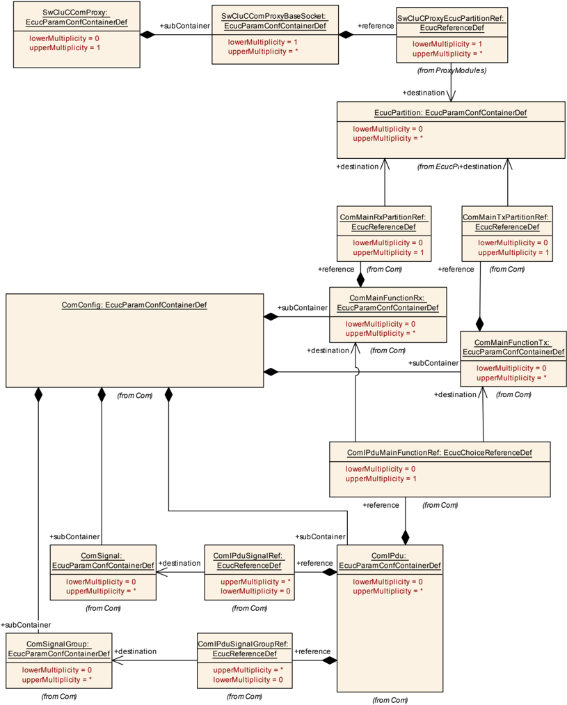

Com 高层代理（**Com High Proxy**）应为 Com 中配置的每个 [**ComSignal**](#1085-comsignal) 和 [**ComSignalGroup**](#1088-comsignalgroup) 在二进制清单中创建一个必需的资源条目。其中 `[ComMainFunctionRx](#1082-commainfunctionrx).ComMainRxPartitionRef` 和 `[ComMainFunctionTx](#1081-commainfunctiontx).ComMainTxPartitionRef` 用于表示 `[EcucPartition](#1011-ecucpartition)`。

###### 6.4.3.3.6. Com 低层代理

Com 低层代理（**Com Low Proxy**）应提供头文件 `SwCluC_ComProxy_Cbk.h`。

参数 `ComUserHeaderInclude` 应配置为 `SwCluC_ComProxy_Cbk.h`。

Com 低层代理（**Com Low Proxy**）应在其 **ComUserModuleCnf** 容器中提供已配置的 **ComUserSignals** 和 **ComUserSignalGroups** 的 `ComUserCbkHandleId` 值，按照其内部实现需求（例如用于寻址 Com 低层代理的数据结构）。

Com 低层代理（**Com Low Proxy**）应按照 [SWS_SwCluC_02609]、[SWS_SwCluC_02610] 和 [SWS_SwCluC_02611] 在 **SwCluCComProxyBaseSocket.SwCluCProxyEcucPartitionRef** 配置的 `[EcucPartition](#1011-ecucpartition)` 处，为每个已配置的 **SwCluCComProxyBaseSocket** 提供一次 **[ComSignal](#1085-comsignal)(Group)s** 的发送、接收和失效请求入口函数。

如果已设置 `SwCluCComProxyUsedSatelliteRef`，则在调用 Com API 之前应进行分区切换。

Com 低层代理（**Com Low Proxy**）的实现可以为 Com 高层代理提供一些基本基础设施以使其可运行。这样的通用基础设施服务（包括对 COM API 或回调的访问）可以通过 Com 基础套接字（**Com base socket**）在应用软件集群和宿主软件集群之间链接。

Com 低层代理（**Com Low Proxy**）应为每个 **SwCluCComProxyBaseSocket** 提供一个 `[SwCluC_ComProxy_Init](#7335-swcluc_comproxy_init)` API，用于初始化应用软件集群的 Com 高层代理（**Com High Proxy**）。

Com 低层代理（**Com Low Proxy**）应为所有 `[SwCluC_ComProxy_CbkRxAck](#74311-swcluc_comproxy_cbkrxack)` 通知回调提供实例，这些回调经由 `ComUserCallbackName`（见 [ECUC_Com_10036]）参数配置，`ComUserCallbackType`（见 [ECUC_Com_10034]）设置为 `COM_RX_ACK`。

`ComUserCallbackType`（见 [ECUC_Com_10034]）设置为 `COM_RX_ACK` 的每个通知回调都应配置为 `SwCluC_ComProxy_&lt;BS&gt;_CbkRxAck`，其中 &lt;BS&gt; 是 **SwCluCComProxyBaseSocket** 容器的 `shortName`。

Com 低层代理（**Com Low Proxy**）应为所有 `[SwCluC_ComProxy_CbkInv](#74312-swcluc_comproxy_cbkinv)` 通知回调提供实例，这些回调在每个 **[ComSignal](#1085-comsignal)(Group)** 上经由 `ComUserCallbackName`（见 [ECUC_Com_10036]）参数配置，`ComUserCallbackType`（见 [ECUC_Com_10034]）设置为 `COM_RX_INV`。

`ComUserCallbackType`（见 [ECUC_Com_10034]）设置为 `COM_RX_INV` 的每个通知回调都应配置为 `SwCluC_ComProxy_&lt;BS&gt;_CbkInv`，其中 &lt;BS&gt; 是 **SwCluCComProxyBaseSocket** 容器的 `shortName`。

Com 低层代理（**Com Low Proxy**）应为所有 `[SwCluC_ComProxy_CbkRxTOut](#74313-swcluc_comproxy_cbkrxtout)` 超时通知回调提供实例，这些回调在每个 **[ComSignal](#1085-comsignal)(Group)** 上经由 `ComUserCallbackName`（见 [ECUC_Com_10036]）配置，`ComUserCallbackType`（见 [ECUC_Com_10034]）设置为 `COM_RX_TOUT`。

`ComUserCallbackType`（见 [ECUC_Com_10034]）设置为 `COM_RX_TOUT` 的每个通知回调都应配置为 `SwCluC_ComProxy_&lt;BS&gt;_CbkRxTOut`，其中 &lt;BS&gt; 是 **SwCluCComProxyBaseSocket** 容器的 `shortName`。

Com 低层代理（**Com Low Proxy**）应为所有 `[SwCluC_ComProxy_CbkTxAck](#74314-swcluc_comproxy_cbktxack)` 通知回调提供实例，这些回调在每个 **[ComSignal](#1085-comsignal)(Group)** 上经由 `ComUserCallbackName`（见 [ECUC_Com_10036]）配置，`ComUserCallbackType`（见 [ECUC_Com_10034]）设置为 `COM_TX_ACK`。

`ComUserCallbackType`（见 [ECUC_Com_10034]）设置为 `COM_TX_ACK` 的每个通知回调都应配置为 `SwCluC_ComProxy_&lt;BS&gt;_CbkTxAck`，其中 &lt;BS&gt; 是 **SwCluCComProxyBaseSocket** 容器的 `shortName`。

Com 低层代理（**Com Low Proxy**）应为所有 `[SwCluC_ComProxy_CbkTxErr](#74315-swcluc_comproxy_cbktxerr)` 通知回调提供实例，这些回调在每个 **[ComSignal](#1085-comsignal)(Group)** 上经由 `ComUserCallbackName`（见 [ECUC_Com_10036]）配置，`ComUserCallbackType`（见 [ECUC_Com_10034]）设置为 `COM_TX_ERR`。

`ComUserCallbackType`（见 [ECUC_Com_10034]）设置为 `COM_TX_ERR` 的每个通知回调都应配置为 `SwCluC_ComProxy_&lt;BS&gt;_CbkTxErr`，其中 &lt;BS&gt; 是 **SwCluCComProxyBaseSocket** 容器的 `shortName`。

Com 低层代理（**Com Low Proxy**）应为所有 `[SwCluC_ComProxy_CbkTxTOut](#74316-swcluc_comproxy_cbktxtout)` 通知回调提供实例，这些回调在每个 **[ComSignal](#1085-comsignal)(Group)** 上经由 `ComUserCallbackName`（见 [ECUC_Com_10036]）配置，`ComUserCallbackType`（见 [ECUC_Com_10034]）设置为 `COM_TX_TOUT`。

`ComUserCallbackType`（见 [ECUC_Com_10034]）设置为 `COM_TX_TOUT` 的每个通知回调都应配置为 `SwCluC_ComProxy_&lt;BS&gt;_CbkTxTOut`，其中 &lt;BS&gt; 是 **SwCluCComProxyBaseSocket** 容器的 `shortName`。

按照 [SWS_SwCluC_02626]、[SWS_SwCluC_02627]、[SWS_SwCluC_02628]、[SWS_SwCluC_02629]、[SWS_SwCluC_02630]、[SWS_SwCluC_02631] 和 [SWS_SwCluC_02632] 的通知回调实例在以下位置提供：

* 在 **SwCluCComProxyBaseSocket** 经由 `SwCluCComProxyUsedSatelliteRef` 引用的 **SwCluCComProxyBaseSocket** 的 `[EcucPartition](#1011-ecucpartition)` 处。在这种情况下，在调用高层代理中的回调之前应进行分区切换。

Com 低层代理（**Com Low Proxy**）应为每个 **SwCluCComProxyBaseSocket** 在二进制清单中创建一个提供的资源条目。

Com 基础套接字（**Com base socket**）应实现相关回调函数的连接：

* `[SwCluC_ComProxy_CbkRxAck](#74311-swcluc_comproxy_cbkrxack)`
* `[SwCluC_ComProxy_CbkInv](#74312-swcluc_comproxy_cbkinv)`
* `[SwCluC_ComProxy_CbkRxTOut](#74313-swcluc_comproxy_cbkrxtout)`
* `[SwCluC_ComProxy_CbkTxAck](#74314-swcluc_comproxy_cbktxack)`
* `[SwCluC_ComProxy_CbkTxErr](#74315-swcluc_comproxy_cbktxerr)`
* `[SwCluC_ComProxy_CbkTxTOut](#74316-swcluc_comproxy_cbktxtout)`

如果 Com 低层代理（**Com Low Proxy**）未连接到 Com 高层代理（**Com High Proxy**），Com 低层代理的回调函数：

* `[SwCluC_ComProxy_CbkRxAck](#74311-swcluc_comproxy_cbkrxack)`
* `[SwCluC_ComProxy_CbkInv](#74312-swcluc_comproxy_cbkinv)`
* `[SwCluC_ComProxy_CbkRxTOut](#74313-swcluc_comproxy_cbkrxtout)`
* `[SwCluC_ComProxy_CbkTxAck](#74314-swcluc_comproxy_cbktxack)`
* `[SwCluC_ComProxy_CbkTxErr](#74315-swcluc_comproxy_cbktxerr)`
* `[SwCluC_ComProxy_CbkTxTOut](#74316-swcluc_comproxy_cbktxtout)`

应无效果地返回。

在概念上，Com 代理为一组特定的 `EcucPartitions` 提供信号（**Signals**）和信号组（**Signal Groups**）及其相应的通知。在最简单的情况下，这是一个单一的 `[EcucPartition](#1011-ecucpartition)`，Com 模块也在其中处理底层的 **ComIPdus**。如果 Com 用户和 Com API 对 `[EcucPartition](#1011-ecucpartition)` 不敏感，Com 代理可以为多个 `[EcucPartition](#1011-ecucpartition)` 提供相同的信号和信号组及其相应的通知。尽管如此，Com 代理可以为 Com API 访问和通知切换分区。但请注意，如果将其用于大量信号或信号组，可能会对性能产生严重影响。

在宿主软件集群中，带有相应通知的信号和信号组集合通过 **SwCluCComProxyBaseSocket.ComUserModuleCnf** 配置。对于这些信号和信号组，二进制清单中的相关条目由 Com 低层代理创建。

Com 低层代理（**Com Low Proxy**）应为 **SwCluCComProxyBaseSocket.ComUserModuleCnf** 中配置的每个 **ComUserSignal** 和 **ComUserSignalGroup** 在二进制清单中创建一个提供的资源条目。

###### 6.4.3.3.7. 错误检测

如果为 Com 高层代理（**Com High Proxy**）启用了开发错误检测，以下 API：

* `[Com_SendSignal](#1141-com_sendsignal)`
* `[Com_SendDynSignal](#1142-com_senddynsignal)`
* `[Com_SendSignalGroup](#1143-com_sendsignalgroup)`
* `[Com_SendSignalGroupArray](#1144-com_sendsignalgrouparray)`
* `[Com_SendSignalWithMetaData](#1145-com_sendsignalwithmetadata)`
* `[Com_SendDynSignalWithMetaData](#1146-com_senddynsignalwithmetadata)`
* `[Com_SendSignalGroupWithMetaData](#1147-com_sendsignalgroupwithmetadata)`
* `[Com_SendSignalGroupArrayWithMetaData](#1148-com_sendsignalgrouparraywithmetadata)`
* `[Com_ReceiveSignal](#1149-com_receivesignal)`
* `[Com_ReceiveDynSignal](#11410-com_receivedynsignal)`
* `[Com_ReceiveSignalGroup](#11411-com_receivesignalgroup)`
* `[Com_ReceiveSignalGroupArray](#11412-com_receivesignalgrouparray)`
* `[Com_ReceiveSignalWithMetaData](#11413-com_receivesignalwithmetadata)`
* `[Com_ReceiveDynSignalWithMetaData](#11414-com_receivedynsignalwithmetadata)`
* `[Com_ReceiveSignalGroupWithMetaData](#11415-com_receivesignalgroupwithmetadata)`
* `[Com_ReceiveSignalGroupArrayWithMetaData](#11416-com_receivesignalgrouparraywithmetadata)`
* `[Com_ReceiveSignalWithMetaData](#11413-com_receivesignalwithmetadata)`
* `[Com_ReceiveDynSignalWithMetaData](#11414-com_receivedynsignalwithmetadata)`
* `[Com_InvalidateSignal](#11417-com_invalidatesignal)`
* `[Com_InvalidateSignalGroup](#11418-com_invalidatesignalgroup)`

应在 Com 高层代理未初始化的情况下报告 DET 错误 `[COM_E_UNINIT](#644-错误分类)`。

如果为 Com 高层代理（**Com High Proxy**）启用了开发错误检测，以下 API：

* `[Com_SendSignal](#1141-com_sendsignal)`
* `[Com_SendDynSignal](#1142-com_senddynsignal)`
* `[Com_SendSignalGroup](#1143-com_sendsignalgroup)`
* `[Com_SendSignalGroupArray](#1144-com_sendsignalgrouparray)`
* `[Com_SendSignalWithMetaData](#1145-com_sendsignalwithmetadata)`
* `[Com_SendDynSignalWithMetaData](#1146-com_senddynsignalwithmetadata)`
* `[Com_SendSignalGroupWithMetaData](#1147-com_sendsignalgroupwithmetadata)`
* `[Com_SendSignalGroupArrayWithMetaData](#1148-com_sendsignalgrouparraywithmetadata)`
* `[Com_ReceiveSignal](#1149-com_receivesignal)`
* `[Com_ReceiveDynSignal](#11410-com_receivedynsignal)`
* `[Com_ReceiveSignalGroup](#11411-com_receivesignalgroup)`
* `[Com_ReceiveSignalGroupArray](#11412-com_receivesignalgrouparray)`
* `[Com_ReceiveSignalWithMetaData](#11413-com_receivesignalwithmetadata)`
* `[Com_ReceiveDynSignalWithMetaData](#11414-com_receivedynsignalwithmetadata)`
* `[Com_ReceiveSignalGroupWithMetaData](#11415-com_receivesignalgroupwithmetadata)`
* `[Com_ReceiveSignalGroupArrayWithMetaData](#11416-com_receivesignalgrouparraywithmetadata)`
* `[Com_ReceiveSignalWithMetaData](#11413-com_receivesignalwithmetadata)`
* `[Com_ReceiveDynSignalWithMetaData](#11414-com_receivedynsignalwithmetadata)`
* `[Com_InvalidateSignal](#11417-com_invalidatesignal)`
* `[Com_InvalidateSignalGroup](#11418-com_invalidatesignalgroup)`

应在以 `NULL_PTR` 调用时报告 DET 错误 `[COM_E_PARAM_POINTER](#644-错误分类)`。

如果为 Com 高层代理（**Com High Proxy**）启用了开发错误检测，以下 API：

* `[Com_SendSignal](#1141-com_sendsignal)`
* `[Com_SendDynSignal](#1142-com_senddynsignal)`
* `[Com_SendSignalGroup](#1143-com_sendsignalgroup)`
* `[Com_SendSignalGroupArray](#1144-com_sendsignalgrouparray)`
* `[Com_SendSignalWithMetaData](#1145-com_sendsignalwithmetadata)`
* `[Com_SendDynSignalWithMetaData](#1146-com_senddynsignalwithmetadata)`
* `[Com_SendSignalGroupWithMetaData](#1147-com_sendsignalgroupwithmetadata)`
* `[Com_SendSignalGroupArrayWithMetaData](#1148-com_sendsignalgrouparraywithmetadata)`
* `[Com_ReceiveSignal](#1149-com_receivesignal)`
* `[Com_ReceiveDynSignal](#11410-com_receivedynsignal)`
* `[Com_ReceiveSignalGroup](#11411-com_receivesignalgroup)`
* `[Com_ReceiveSignalGroupArray](#11412-com_receivesignalgrouparray)`
* `[Com_ReceiveSignalWithMetaData](#11413-com_receivesignalwithmetadata)`
* `[Com_ReceiveDynSignalWithMetaData](#11414-com_receivedynsignalwithmetadata)`
* `[Com_ReceiveSignalGroupWithMetaData](#11415-com_receivesignalgroupwithmetadata)`
* `[Com_ReceiveSignalGroupArrayWithMetaData](#11416-com_receivesignalgrouparraywithmetadata)`
* `[Com_ReceiveSignalWithMetaData](#11413-com_receivesignalwithmetadata)`
* `[Com_ReceiveDynSignalWithMetaData](#11414-com_receivedynsignalwithmetadata)`
* `[Com_InvalidateSignal](#11417-com_invalidatesignal)`
* `[Com_InvalidateSignalGroup](#11418-com_invalidatesignalgroup)`

应在以错误的参数调用时报告 DET 错误 `[COM_E_PARAM](#644-错误分类)`。

##### 6.4.3.4. LdCom 代理

###### 6.4.3.4.1. 启用 LdCom 代理生成

只有当配置参数 `SwCluCProxyGenerationLdCom` 设置为 `HIGH_PROXY` 时，才创建 LdCom 高层代理代码及相关的 AUTOSAR 模型描述。

只有当配置参数 `SwCluCProxyGenerationLdCom` 设置为 `LOW_PROXY` 时，才创建 LdCom 低层代理代码及相关的 AUTOSAR 模型描述。

###### 6.4.3.4.2. 一般 LdCom 代理功能

###### 6.4.3.4.3. 概述

借助软件集群（**Software Clusters**）的概念（它支持将 AUTOSAR 经典平台架构的软件拆分为更小的单元），应用软件集群为补全其功能所需的 LdCom 实现部分提供代理。这称为 LdCom 高层代理（**LdCom High Proxy**）。

宿主软件集群包含 LdCom 功能的真实实现，并通过相应的 LdCom 低层代理（**LdCom Low Proxy**）使其对 LdCom 高层代理可用。LdCom 高层代理和 LdCom 低层代理基于二进制清单（**Binary Manifest**）中可用的信息链接在一起，从而支持从应用软件集群到宿主软件集群（以及相反方向）执行 LdCom（回调）函数。

图 7.15：LdCom 代理概述

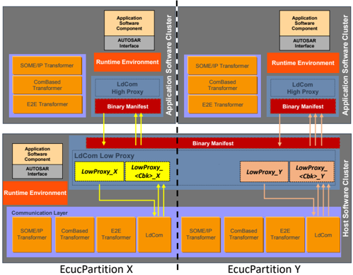

LdCom 模块现在可以有任意数量的用户，LdCom 低层代理是其中之一。因此，它依赖 URI 引用（**URI References**）的使用（见 [\[18\]](#ref-18)，「URI Reference」节）在模型中与其相应的用户链接。

为了保证 LdCom 模块与 LdCom 代理（**LdCom Proxy**）配置之间的兼容性，所需的参数和容器由 [**LdComUserUriDefSet**](#1094-ldcomuseruridefset) 定义。这意味着作为 LdCom 用户的 LdCom 代理应配置 **LdComUserModuleCnf** 容器（包括其子容器），其中保存它发送和接收（经由专用的通知回调）的 **LdComIPdus** 的配置。

LdCom 代理的配置有两种可选方式：

**ECUC 分区特定的 LdCom 代理回调**

这里，作为 [**LdComUserModule**](#1093-ldcomusermodule) 的 LdCom 代理为发生 LdCom（通知回调）调用的每个已配置分区提供专用实例。但这要求它提供多个主函数，每个主函数绑定到相关的 `[EcucPartition](#1011-ecucpartition)`。已配置的通知回调只在一个 `[EcucPartition](#1011-ecucpartition)` 的上下文中被调用。

**ECUC 分区无关的 LdCom 代理回调**

这里，LdCom 代理提供分区无关的通知回调实例，因此必须提供一组公共的通知回调，它们在不同 `EcucPartitions` 的上下文中被调用。此外，对于不同 `[EcucPartition](#1011-ecucpartition)` 上的不同 **LdComIPdus**，它应确保通知回调的可重入实现。

作为 [**LdComUserModule**](#1093-ldcomusermodule) 的 LdCom 代理由一个或多个 **SwCluCLdComProxyBaseSockets** 表示，通过专用的 **LdComUserModuleCnf** 配置。在 LdCom 代理：

* 需要直接访问发起发送请求的 LdCom API
* 提供关于发送和接收的通知回调

的每个 `[EcucPartition](#1011-ecucpartition)` 中都需要一个 **SwCluCLdComProxyBaseSocket**。

实际上，**SwCluCLdComProxyBaseSocket** 将 LdCom 中一组固定的通知回调链接到 LdCom 代理中的特定 `[EcucPartition](#1011-ecucpartition)`。因此，LdCom 代理必须将每个 **LdComUserIPdu** 经由 `LdComUserSystemTemplateSignalRef` 映射到一个 [**LdComIPdu**](#1092-ldcomipdu)。

LdCom 应在 LdCom 代理中配置的 `[EcucPartition](#1011-ecucpartition)` 上提供其用于相关 **LdComIPdus** 发送请求的 API。即使 LdCom 用户的概念为支持包括通知在内的多用户访问提供了很大的灵活性，也需要考虑一些限制。一般而言，如果写者之间没有协调，多个写者可能导致竞态条件。此外，&lt;[LdComUser_LdComCbkTriggerTransmit](#1152-ldcomuser_ldcomcbktriggertransmit)&gt; 的行为不支持同一个 [**LdComIPdu**](#1092-ldcomipdu) 的多个被通知用户。由于这种跨不同软件集群的协调很难实现，适用以下限制：

发送的 [**LdComIPdu**](#1092-ldcomipdu) 最多应提供给一个应用软件集群。

此外，LdCom 代理不支持经由传输协议 API 发送或接收的 **LdComIPdus** 的扇出（**fan out**）。

经由传输协议 API 发送或接收的 **LdComIPdus** 最多应提供给一个应用软件集群。

请注意，PduR 支持到上层的 TP 连接扇出。

###### 6.4.3.4.4. 一般需求

LdCom 代理（**LdCom Proxy**）应支持宿主软件集群的 LdCom 的 **[LdComIPdu](#1092-ldcomipdu) Ids** 可以更改，而无需重新配置或重新构建使用这些 **LdComIPdus** 的应用软件集群。

LdCom 代理（**LdCom Proxy**）应支持应用软件集群的 LdCom 用户中配置的 **LdComUserIPdus** 的 `LdComUserCbkHandleId` 可以更改，而无需重新配置或重新构建宿主软件集群。

LdCom 代理（**LdCom Proxy**）应支持在宿主软件集群的上下文中从应用软件集群调用 LdCom API。

LdCom 代理（**LdCom Proxy**）应支持在应用软件集群的上下文中从宿主软件集群调用 LdCom 回调 API。

如果 &lt;[LdComUser_LdComCbkRxIndication](#1153-ldcomuser_ldcomcbkrxindication)&gt; 通知回调在 LdCom 高层代理中配置（经由 `LdComUserCallbackName`（见 [ECUC_LdCom_00023]）参数，其中 `LdComUserCallbackType`（见 [ECUC_LdCom_00025]）设置为 `LDCOM_RX_INDICATION`），则当调用来自 LdCom 低层代理的关联 `[SwCluC_LdComProxy_LdComCbkRxIndication](#74323-swcluc_ldcomproxy_ldcomcbkrxindication)` 实例时，应调用所有已配置的 &lt;[LdComUser_LdComCbkRxIndication](#1153-ldcomuser_ldcomcbkrxindication)&gt; 回调。

如果 &lt;[LdComUser_LdComCbkTxConfirmation](#1154-ldcomuser_ldcomcbktxconfirmation)&gt; 通知回调在 LdCom 高层代理中配置（经由 `LdComUserCallbackName`（见 [ECUC_LdCom_00023]）参数，其中 `LdComUserCallbackType`（见 [ECUC_LdCom_00025]）设置为 `LDCOM_TX_CONFIRMATION`），则当调用来自 LdCom 低层代理的关联 `[SwCluC_LdComProxy_LdComCbkTxConfirmation](#74327-swcluc_ldcomproxy_ldcomcbktxconfirmation)` 实例时，应调用已配置的 &lt;[LdComUser_LdComCbkTxConfirmation](#1154-ldcomuser_ldcomcbktxconfirmation)&gt; 回调。

如果 &lt;[LdComUser_LdComCbkTriggerTransmit](#1152-ldcomuser_ldcomcbktriggertransmit)&gt; 通知回调在 LdCom 高层代理中配置（经由 `LdComUserCallbackName`（见 [ECUC_LdCom_00023]）参数，其中 `LdComUserCallbackType`（见 [ECUC_LdCom_00025]）设置为 `LDCOM_TX_TRIGGER_TRANSMIT`），则当调用来自 LdCom 低层代理的关联 `[SwCluC_LdComProxy_LdComCbkTriggerTransmit](#74326-swcluc_ldcomproxy_ldcomcbktriggertransmit)` 实例时，应调用已配置的 &lt;[LdComUser_LdComCbkTriggerTransmit](#1152-ldcomuser_ldcomcbktriggertransmit)&gt; 回调。

如果 &lt;[LdComUser_LdComCbkCopyRxData](#1155-ldcomuser_ldcomcbkcopyrxdata)&gt; 通知回调在 LdCom 高层代理中配置（经由 `LdComUserCallbackName`（见 [ECUC_LdCom_00023]）参数，其中 `LdComUserCallbackType`（见 [ECUC_LdCom_00025]）设置为 `LDCOM_TP_COPY_RX_DATA`），则当调用来自 LdCom 低层代理的关联 `[SwCluC_LdComProxy_LdComCbkCopyRxData](#74321-swcluc_ldcomproxy_ldcomcbkcopyrxdata)` 实例时，应调用已配置的 &lt;[LdComUser_LdComCbkCopyRxData](#1155-ldcomuser_ldcomcbkcopyrxdata)&gt; 回调。

如果 &lt;[LdComUser_LdComCbkStartOfReception](#1156-ldcomuser_ldcomcbkstartofreception)&gt; 通知回调在 LdCom 高层代理中配置（经由 `LdComUserCallbackName`（见 [ECUC_LdCom_00023]）参数，其中 `LdComUserCallbackType`（见 [ECUC_LdCom_00025]）设置为 `LDCOM_RX_START_OF_RECEPTION`），则当调用来自 LdCom 低层代理的关联 `[SwCluC_LdComProxy_LdComCbkStartOfReception](#74324-swcluc_ldcomproxy_ldcomcbkstartofreception)` 实例时，应调用已配置的 &lt;[LdComUser_LdComCbkStartOfReception](#1156-ldcomuser_ldcomcbkstartofreception)&gt; 回调。

如果 &lt;[LdComUser_LdComCbkTpRxIndication](#1157-ldcomuser_ldcomcbktprxindication)&gt; 通知回调在 LdCom 高层代理中配置（经由 `LdComUserCallbackName`（见 [ECUC_LdCom_00023]）参数，其中 `LdComUserCallbackType`（见 [ECUC_LdCom_00025]）设置为 `LDCOM_TP_RX_INDICATION`），则当调用来自 LdCom 低层代理的关联 `[SwCluC_LdComProxy_LdComCbkTpRxIndication](#74325-swcluc_ldcomproxy_ldcomcbktprxindication)` 实例时，应调用已配置的 &lt;[LdComUser_LdComCbkTpRxIndication](#1157-ldcomuser_ldcomcbktprxindication)&gt; 回调。

如果 &lt;[LdComUser_LdComCbkTpTxConfirmation](#1158-ldcomuser_ldcomcbktptxconfirmation)&gt; 通知回调在 LdCom 高层代理中配置（经由 `LdComUserCallbackName`（见 [ECUC_LdCom_00023]）参数，其中 `LdComUserCallbackType`（见 [ECUC_LdCom_00025]）设置为 `LDCOM_TP_TX_CONFIRMATION`），则当调用来自 LdCom 低层代理的关联 `[SwCluC_LdComProxy_LdComCbkTpTxConfirmation](#74328-swcluc_ldcomproxy_ldcomcbktptxconfirmation)` 实例时，应调用已配置的 &lt;[LdComUser_LdComCbkTpTxConfirmation](#1158-ldcomuser_ldcomcbktptxconfirmation)&gt; 回调。

如果 &lt;[LdComUser_LdComCbkCopyTxData](#1159-ldcomuser_ldcomcbkcopytxdata)&gt; 通知回调在 LdCom 高层代理中配置（经由 `LdComUserCallbackName`（见 [ECUC_LdCom_00023]）参数，其中 `LdComUserCallbackType`（见 [ECUC_LdCom_00025]）设置为 `LDCOM_TP_COPY_TX_DATA`），则当调用来自 LdCom 低层代理的关联 `[SwCluC_LdComProxy_LdComCbkCopyTxData](#74322-swcluc_ldcomproxy_ldcomcbkcopytxdata)` 实例时，应调用已配置的 &lt;[LdComUser_LdComCbkCopyTxData](#1159-ldcomuser_ldcomcbkcopytxdata)&gt; 回调。

###### 6.4.3.4.5. LdCom 高层代理

LdCom 高层代理（**LdCom High Proxy**）应提供头文件 `LdCom.h`。

LdCom 高层代理（**LdCom High Proxy**）应为应用软件集群中的 LdCom 用户提供 **[LdComIPdu](#1092-ldcomipdu) IDs** 的符号名值。

LdCom 高层代理（**LdCom High Proxy**）应提供应用软件集群所需的、关于 [**LdComIPdu**](#1092-ldcomipdu) 发送请求的函数：

* `[LdCom_Transmit](#1151-ldcom_transmit)`

如果 LdCom 高层代理未连接到 LdCom 低层代理（**LdCom Low Proxy**），LdCom 高层代理的函数：

* `[LdCom_Transmit](#1151-ldcom_transmit)`

应返回 `E_NOT_OK`。

LdCom 高层代理（**LdCom High Proxy**）应按照 [SWS_SwCluC_02506] 为每个已配置的 **SwCluCLdComProxyBaseSocket** 提供一次信号发送请求的函数。在 `SwCluCNativeBswApi` 设置为 true 的 `[EcucPartition](#1011-ecucpartition)` 处，API 以原始 Mip `LdCom` 提供。对于所有其他 **SwCluCLdComProxyBaseSocket** 实例，Mip `LdCom` 被替换为 `LdCom_&lt;[EcucPartition](#1011-ecucpartition).ShortName&gt;`。

**回调函数（Callback Functions）**

LdCom 高层代理（**LdCom High Proxy**）应支持 &lt;[LdComUser_LdComCbkRxIndication](#1153-ldcomuser_ldcomcbkrxindication)&gt; 通知回调，它经由 `LdComUserCallbackName`（见 [ECUC_LdCom_00023]）参数配置，其中 `LdComUserCallbackType`（见 [ECUC_LdCom_00025]）设置为 `LDCOM_RX_INDICATION`。

LdCom 高层代理（**LdCom High Proxy**）应支持可选的 &lt;[LdComUser_LdComCbkTxConfirmation](#1154-ldcomuser_ldcomcbktxconfirmation)&gt; 通知回调，它经由 `LdComUserCallbackName`（见 [ECUC_LdCom_00023]）参数配置，其中 `LdComUserCallbackType`（见 [ECUC_LdCom_00025]）设置为 `LDCOM_TX_CONFIRMATION`。

请注意，只能用 &lt;[LdComUser_LdComCbkTxConfirmation](#1154-ldcomuser_ldcomcbktxconfirmation)&gt; 通知单个 LdCom 用户。

LdCom 高层代理（**LdCom High Proxy**）应支持可选的 &lt;[LdComUser_LdComCbkTriggerTransmit](#1152-ldcomuser_ldcomcbktriggertransmit)&gt; 通知回调，它经由 `LdComUserCallbackName`（见 [ECUC_LdCom_00023]）参数配置，其中 `LdComUserCallbackType`（见 [ECUC_LdCom_00025]）设置为 `LDCOM_TX_TRIGGER_TRANSMIT`。

请注意，只能用 &lt;[LdComUser_LdComCbkTriggerTransmit](#1152-ldcomuser_ldcomcbktriggertransmit)&gt; 通知单个 LdCom 用户。

LdCom 高层代理（**LdCom High Proxy**）应支持 &lt;[LdComUser_LdComCbkCopyRxData](#1155-ldcomuser_ldcomcbkcopyrxdata)&gt; 通知回调，它经由 `LdComUserCallbackName`（见 [ECUC_LdCom_00023]）参数配置，其中 `LdComUserCallbackType`（见 [ECUC_LdCom_00025]）设置为 `LDCOM_TP_COPY_RX_DATA`。

请注意，只能用 &lt;[LdComUser_LdComCbkCopyRxData](#1155-ldcomuser_ldcomcbkcopyrxdata)&gt; 通知单个 LdCom 用户。

LdCom 高层代理（**LdCom High Proxy**）应支持 &lt;[LdComUser_LdComCbkStartOfReception](#1156-ldcomuser_ldcomcbkstartofreception)&gt; 通知回调，它经由 `LdComUserCallbackName`（见 [ECUC_LdCom_00023]）参数配置，其中 `LdComUserCallbackType`（见 [ECUC_LdCom_00025]）设置为 `LDCOM_RX_START_OF_RECEPTION`。

请注意，只能用 &lt;[LdComUser_LdComCbkStartOfReception](#1156-ldcomuser_ldcomcbkstartofreception)&gt; 通知单个 LdCom 用户。

LdCom 高层代理（**LdCom High Proxy**）应支持 &lt;[LdComUser_LdComCbkTpRxIndication](#1157-ldcomuser_ldcomcbktprxindication)&gt; 通知回调，它经由 `LdComUserCallbackName`（见 [ECUC_LdCom_00023]）参数配置，其中 `LdComUserCallbackType`（见 [ECUC_LdCom_00025]）设置为 `LDCOM_TP_RX_INDICATION`。

请注意，只能用 &lt;[LdComUser_LdComCbkTpRxIndication](#1157-ldcomuser_ldcomcbktprxindication)&gt; 通知单个 LdCom 用户。

LdCom 高层代理（**LdCom High Proxy**）应支持 &lt;[LdComUser_LdComCbkTpTxConfirmation](#1158-ldcomuser_ldcomcbktptxconfirmation)&gt; 通知回调，它经由 `LdComUserCallbackName`（见 [ECUC_LdCom_00023]）参数配置，其中 `LdComUserCallbackType`（见 [ECUC_LdCom_00025]）设置为 `LDCOM_TP_TX_CONFIRMATION`。

请注意，只能用 &lt;[LdComUser_LdComCbkTpTxConfirmation](#1158-ldcomuser_ldcomcbktptxconfirmation)&gt; 通知单个 LdCom 用户。

LdCom 高层代理（**LdCom High Proxy**）应支持 &lt;[LdComUser_LdComCbkCopyTxData](#1159-ldcomuser_ldcomcbkcopytxdata)&gt; 通知回调，它经由 `LdComUserCallbackName`（见 [ECUC_LdCom_00023]）参数配置，其中 `LdComUserCallbackType`（见 [ECUC_LdCom_00025]）设置为 `LDCOM_TP_COPY_TX_DATA`。

请注意，只能用 &lt;[LdComUser_LdComCbkCopyTxData](#1159-ldcomuser_ldcomcbkcopytxdata)&gt; 通知单个 LdCom 用户。

LdCom 高层代理（**LdCom High Proxy**）应为每个 **SwCluCLdComProxyBaseSocket** 在二进制清单中创建一个必需的资源条目。

请注意，应用软件集群的回调：

* &lt;[LdComUser_LdComCbkStartOfReception](#1156-ldcomuser_ldcomcbkstartofreception)&gt;
* &lt;[LdComUser_LdComCbkCopyRxData](#1155-ldcomuser_ldcomcbkcopyrxdata)&gt;
* &lt;[LdComUser_LdComCbkCopyTxData](#1159-ldcomuser_ldcomcbkcopytxdata)&gt;
* &lt;[LdComUser_LdComCbkTriggerTransmit](#1152-ldcomuser_ldcomcbktriggertransmit)&gt;
* &lt;[LdComUser_LdComCbkRxIndication](#1153-ldcomuser_ldcomcbkrxindication)&gt;
* &lt;[LdComUser_LdComCbkTpRxIndication](#1157-ldcomuser_ldcomcbktprxindication)&gt;
* &lt;[LdComUser_LdComCbkTxConfirmation](#1154-ldcomuser_ldcomcbktxconfirmation)&gt;
* &lt;[LdComUser_LdComCbkTpTxConfirmation](#1158-ldcomuser_ldcomcbktptxconfirmation)&gt;

通过 LdCom 基础套接字（**LdCom base socket**）连接到宿主软件集群。见 [SWS_SwCluC_02550]。

在应用软件集群中，**LdComUserIPdu** 与相关基础套接字（**Base Socket**）之间的关系是间接给定的，经由 **SwCluCLdComProxyBaseSocket.SwCluCProxyEcucPartitionRef** 的公共 `[EcucPartition](#1011-ecucpartition)(s)` 以及 [**LdComIPdu**](#1092-ldcomipdu) 所引用 [Pdu](#1012-pdu) 的 `[EcucPartition](#1011-ecucpartition)`。其中 [Pdu](#1012-pdu) 的 `[EcucPartition](#1011-ecucpartition)` 由 `[Pdu](#1012-pdu).EcucPduDefaultPartitionRef` 或 `[Pdu](#1012-pdu).[EcucPduDedicatedPartition](#1013-ecucpdudedicatedpartition).EcucPduDedicatedPartitionRef` 给出（`[EcucPduDedicatedPartition](#1013-ecucpdudedicatedpartition)` 适用于 LdCom 配置）。这些关系在图 7.16 中阐明。不为此目的定义专用 EcuC 配置结构的原因是假定使用相同的工具为应用软件集群和宿主软件集群派生 LdCom 配置。

图 7.16：LdComIPdus 及其经由 [EcucPartition](#1011-ecucpartition) 与 LdCom 基础套接字的关系

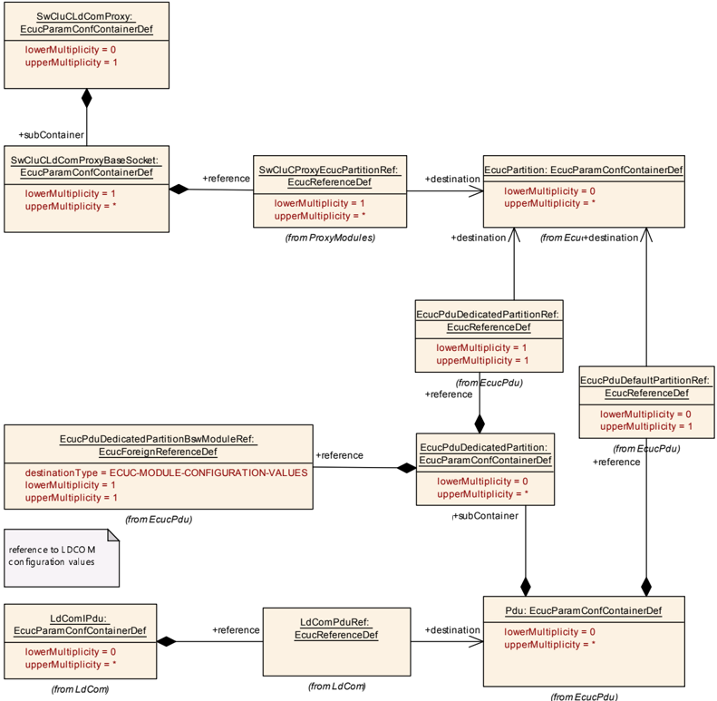

LdCom 高层代理（**LdCom High Proxy**）应为 LdCom 中配置的每个 [**LdComIPdu**](#1092-ldcomipdu) 在二进制清单中创建一个必需的资源条目。

其中经由 `[Pdu](#1012-pdu).EcucPduDefaultPartitionRef` 或 `[Pdu](#1012-pdu).[EcucPduDedicatedPartition](#1013-ecucpdudedicatedpartition).EcucPduDedicatedPartitionRef` 给出的 [**LdComIPdu**](#1092-ldcomipdu) 的 [Pdu](#1012-pdu) 的 `[EcucPartition](#1011-ecucpartition)` 用于表示 `[EcucPartition](#1011-ecucpartition)`。

###### 6.4.3.4.6. LdCom 低层代理

LdCom 低层代理（**LdCom Low Proxy**）应提供头文件 `SwCluC_LdComProxy_Cbk.h`。

参数 `LdComUserHeaderInclude` 应配置为 `SwCluC_LdComProxy_Cbk.h`。

LdCom 低层代理（**LdCom Low Proxy**）应在其 **LdComUserModuleCnf** 容器中提供已配置的 **LdComUserIPdus** 的 `LdComUserCbkHandleId` 值，按照其内部实现需求（例如用于寻址 LdCom 低层代理的数据结构）。

LdCom 低层代理（**LdCom Low Proxy**）的实现可以为 LdCom 高层代理提供一些基本基础设施以使其可运行。这样的通用基础设施服务（包括对 LdCom API 或回调的访问）可以通过 LdCom 基础套接字（**LdCom base socket**）在应用软件集群和宿主软件集群之间链接。

LdCom 低层代理（**LdCom Low Proxy**）应按照 [SWS_SwCluC_02506] 在 **SwCluCLdComProxyBaseSocket.SwCluCProxyEcucPartitionRef** 配置的 `[EcucPartition](#1011-ecucpartition)` 处，为每个已配置的 **SwCluCLdComProxyBaseSocket** 提供一次发送请求的入口函数。

LdCom 低层代理（**LdCom Low Proxy**）应为每个 **SwCluCLdComProxyBaseSocket** 提供一个 `[SwCluC_LdComProxy_Init](#7334-swcluc_ldcomproxy_init)` API，用于初始化应用软件集群的 LdCom 高层代理（**LdCom High Proxy**）。

LdCom 低层代理（**LdCom Low Proxy**）应为所有 `[SwCluC_LdComProxy_LdComCbkRxIndication](#74323-swcluc_ldcomproxy_ldcomcbkrxindication)` 通知回调提供实例，这些回调经由 `LdComUserCallbackName`（见 [ECUC_LdCom_00023]）参数配置，`LdComUserCallbackType`（见 [ECUC_LdCom_00025]）设置为 `LDCOM_RX_INDICATION`。

`LdComUserCallbackType`（见 [ECUC_LdCom_00025]）设置为 `LDCOM_RX_INDICATION` 的每个 `[SwCluC_LdComProxy_LdComCbkRxIndication](#74323-swcluc_ldcomproxy_ldcomcbkrxindication)` 通知回调都应配置为 `SwCluC_LdComProxy_&lt;BS&gt;_LdComCbkRxIndication`，其中 &lt;BS&gt; 是 **SwCluCLdComProxyBaseSocket** 容器的 `shortName`。

LdCom 低层代理（**LdCom Low Proxy**）应为所有 **LdComCbkTxConfirmation** 通知回调提供实例，这些回调经由 `LdComUserCallbackName`（见 [ECUC_LdCom_00023]）参数配置，`LdComUserCallbackType`（见 [ECUC_LdCom_00025]）设置为 `LDCOM_TX_CONFIRMATION`。

`LdComUserCallbackType`（见 [ECUC_LdCom_00025]）设置为 `LDCOM_TX_CONFIRMATION` 的每个 `[SwCluC_LdComProxy_LdComCbkTxConfirmation](#74327-swcluc_ldcomproxy_ldcomcbktxconfirmation)` 通知回调都应配置为 `SwCluC_LdComProxy_&lt;BS&gt;_LdComCbkTxConfirmation`，其中 &lt;BS&gt; 是 **SwCluCLdComProxyBaseSocket** 容器的 `shortName`。

LdCom 低层代理（**LdCom Low Proxy**）应为所有 **LdComCbkTriggerTransmit** 通知回调提供实例，这些回调经由 `LdComUserCallbackName`（见 [ECUC_LdCom_00023]）参数配置，`LdComUserCallbackType`（见 [ECUC_LdCom_00025]）设置为 `LDCOM_TX_TRIGGER_TRANSMIT`。

`LdComUserCallbackType`（见 [ECUC_LdCom_00025]）设置为 `LDCOM_TX_TRIGGER_TRANSMIT` 的每个 `[SwCluC_LdComProxy_LdComCbkTriggerTransmit](#74326-swcluc_ldcomproxy_ldcomcbktriggertransmit)` 通知回调都应配置为 `SwCluC_LdComProxy_&lt;BS&gt;_LdComCbkTriggerTransmit`，其中 &lt;BS&gt; 是 **SwCluCLdComProxyBaseSocket** 容器的 `shortName`。

LdCom 低层代理（**LdCom Low Proxy**）应为所有 **LdComCbkCopyRxData** 通知回调提供实例，这些回调经由 `LdComUserCallbackName`（见 [ECUC_LdCom_00023]）参数配置，`LdComUserCallbackType`（见 [ECUC_LdCom_00025]）设置为 `LDCOM_TP_COPY_RX_DATA`。

`LdComUserCallbackType`（见 [ECUC_LdCom_00025]）设置为 `LDCOM_TP_COPY_RX_DATA` 的每个 `[SwCluC_LdComProxy_LdComCbkCopyRxData](#74321-swcluc_ldcomproxy_ldcomcbkcopyrxdata)` 通知回调都应配置为 `SwCluC_LdComProxy_&lt;BS&gt;_LdComCbkCopyRxData`，其中 &lt;BS&gt; 是 **SwCluCLdComProxyBaseSocket** 容器的 `shortName`。

LdCom 低层代理（**LdCom Low Proxy**）应为所有 **LdComCbkStartOfReception** 通知回调提供实例，这些回调经由 `LdComUserCallbackName`（见 [ECUC_LdCom_00023]）参数配置，`LdComUserCallbackType`（见 [ECUC_LdCom_00025]）设置为 `LDCOM_RX_START_OF_RECEPTION`。

`LdComUserCallbackType`（见 [ECUC_LdCom_00025]）设置为 `LDCOM_TP_COPY_RX_DATA` 的每个 `[SwCluC_LdComProxy_LdComCbkStartOfReception](#74324-swcluc_ldcomproxy_ldcomcbkstartofreception)` 通知回调都应配置为 `SwCluC_LdComProxy_&lt;BS&gt;_LdComCbkCopyRxData`，其中 &lt;BS&gt; 是 **SwCluCLdComProxyBaseSocket** 容器的 `shortName`。

LdCom 低层代理（**LdCom Low Proxy**）应为所有 **LdComCbkTpRxIndication** 通知回调提供实例，这些回调经由 `LdComUserCallbackName`（见 [ECUC_LdCom_00023]）参数配置，`LdComUserCallbackType`（见 [ECUC_LdCom_00025]）设置为 `LDCOM_TP_RX_INDICATION`。

`LdComUserCallbackType`（见 [ECUC_LdCom_00025]）设置为 `LDCOM_TP_RX_INDICATION` 的每个 `[SwCluC_LdComProxy_LdComCbkTpRxIndication](#74325-swcluc_ldcomproxy_ldcomcbktprxindication)` 通知回调都应配置为 `SwCluC_LdComProxy_&lt;BS&gt;_LdComCbkTpRxIndication`，其中 &lt;BS&gt; 是 **SwCluCLdComProxyBaseSocket** 容器的 `shortName`。

LdCom 低层代理（**LdCom Low Proxy**）应为所有 **LdComCbkTpTxConfirmation** 通知回调提供实例，这些回调经由 `LdComUserCallbackName`（见 [ECUC_LdCom_00023]）参数配置，`LdComUserCallbackType`（见 [ECUC_LdCom_00025]）设置为 `LDCOM_TP_TX_CONFIRMATION`。

`LdComUserCallbackType`（见 [ECUC_LdCom_00025]）设置为 `LDCOM_TP_TX_CONFIRMATION` 的每个 `[SwCluC_LdComProxy_LdComCbkTpTxConfirmation](#74328-swcluc_ldcomproxy_ldcomcbktptxconfirmation)` 通知回调都应配置为 `SwCluC_LdComProxy_&lt;BS&gt;_LdComCbkTpTxConfirmation`，其中 &lt;BS&gt; 是 **SwCluCLdComProxyBaseSocket** 容器的 `shortName`。

LdCom 低层代理（**LdCom Low Proxy**）应为所有 `[SwCluC_LdComProxy_LdComCbkCopyTxData](#74322-swcluc_ldcomproxy_ldcomcbkcopytxdata)` 通知回调提供实例，这些回调经由 `LdComUserCallbackName`（见 [ECUC_LdCom_00023]）参数配置，`LdComUserCallbackType`（见 [ECUC_LdCom_00025]）设置为 `LDCOM_TP_COPY_TX_DATA`。

`LdComUserCallbackType`（见 [ECUC_LdCom_00025]）设置为 `LDCOM_TP_COPY_TX_DATA` 的每个 `[SwCluC_LdComProxy_LdComCbkCopyTxData](#74322-swcluc_ldcomproxy_ldcomcbkcopytxdata)` 通知回调都应配置为 `SwCluC_LdComProxy_&lt;BS&gt;_LdComCbkCopyTxData`，其中 &lt;BS&gt; 是 **SwCluCLdComProxyBaseSocket** 容器的 `shortName`。

按照 [SWS_SwCluC_02520]、[SWS_SwCluC_02521]、[SWS_SwCluC_02522]、[SWS_SwCluC_02523]、[SWS_SwCluC_02524]、[SWS_SwCluC_02525]、[SWS_SwCluC_02526]、[SWS_SwCluC_02527] 和 [SWS_SwCluC_02528] 的通知回调实例在以下位置提供：

* 在 **SwCluCLdComProxyBaseSocket** 经由 `SwCluCLdComProxyUsedSatelliteRef` 引用的 **SwCluCLdComProxyBaseSocket** 的 `[EcucPartition](#1011-ecucpartition)` 处。

LdCom 低层代理（**LdCom Low Proxy**）应为每个 **SwCluCLdComProxyBaseSocket** 在二进制清单中创建一个提供的资源条目。

LdCom 基础套接字（**LdCom base socket**）应实现相关回调函数的连接：

* `[SwCluC_LdComProxy_LdComCbkStartOfReception](#74324-swcluc_ldcomproxy_ldcomcbkstartofreception)`
* `[SwCluC_LdComProxy_LdComCbkCopyRxData](#74321-swcluc_ldcomproxy_ldcomcbkcopyrxdata)`
* `[SwCluC_LdComProxy_LdComCbkCopyTxData](#74322-swcluc_ldcomproxy_ldcomcbkcopytxdata)`
* `[SwCluC_LdComProxy_LdComCbkTriggerTransmit](#74326-swcluc_ldcomproxy_ldcomcbktriggertransmit)`
* `[SwCluC_LdComProxy_LdComCbkRxIndication](#74323-swcluc_ldcomproxy_ldcomcbkrxindication)`
* `[SwCluC_LdComProxy_LdComCbkTpRxIndication](#74325-swcluc_ldcomproxy_ldcomcbktprxindication)`
* `[SwCluC_LdComProxy_LdComCbkTxConfirmation](#74327-swcluc_ldcomproxy_ldcomcbktxconfirmation)`
* `[SwCluC_LdComProxy_LdComCbkTpTxConfirmation](#74328-swcluc_ldcomproxy_ldcomcbktptxconfirmation)`

如果 LdCom 低层代理（**LdCom Low Proxy**）未连接到 LdCom 高层代理（**LdCom High Proxy**），LdCom 低层代理的通知回调函数：

* `[SwCluC_LdComProxy_LdComCbkStartOfReception](#74324-swcluc_ldcomproxy_ldcomcbkstartofreception)`
* `[SwCluC_LdComProxy_LdComCbkCopyRxData](#74321-swcluc_ldcomproxy_ldcomcbkcopyrxdata)`
* `[SwCluC_LdComProxy_LdComCbkCopyTxData](#74322-swcluc_ldcomproxy_ldcomcbkcopytxdata)`

应返回 `BUFREQ_E_NOT_OK`。

如果 LdCom 低层代理（**LdCom Low Proxy**）未连接到 LdCom 高层代理（**LdCom High Proxy**），LdCom 低层代理的通知回调函数：

* `[SwCluC_LdComProxy_LdComCbkTriggerTransmit](#74326-swcluc_ldcomproxy_ldcomcbktriggertransmit)`

应返回 `E_NOT_OK`。

如果 LdCom 低层代理（**LdCom Low Proxy**）未连接到 LdCom 高层代理（**LdCom High Proxy**），LdCom 低层代理的通知回调函数：

* `[SwCluC_LdComProxy_LdComCbkRxIndication](#74323-swcluc_ldcomproxy_ldcomcbkrxindication)`
* `[SwCluC_LdComProxy_LdComCbkTpRxIndication](#74325-swcluc_ldcomproxy_ldcomcbktprxindication)`
* `[SwCluC_LdComProxy_LdComCbkTxConfirmation](#74327-swcluc_ldcomproxy_ldcomcbktxconfirmation)`
* `[SwCluC_LdComProxy_LdComCbkTpTxConfirmation](#74328-swcluc_ldcomproxy_ldcomcbktptxconfirmation)`

应无效果地返回。

在概念上，LdCom 代理（**LdCom Proxy**）为一组特定的 `EcucPartitions` 提供 **LdComIPdus** 及其相应的通知。在最简单的情况下，这是一个单一的 `[EcucPartition](#1011-ecucpartition)`，LdCom 模块也在其中处理底层的 **LdComIPdus**。如果 LdCom 用户和 LdCom API 对 `[EcucPartition](#1011-ecucpartition)` 不敏感，LdCom 代理在多个 `EcucPartitions` 上提供相同的 [**LdComIPdu**](#1092-ldcomipdu)。尽管如此，LdCom 代理可以切换分区。但请注意，如果将其用于大量 **LdComIPdus**，可能会对性能产生严重影响。

在宿主软件集群中，带有相应通知的 **LdComIPdus** 集合通过 **SwCluCLdComProxyBaseSocket.LdComUserModuleCnf** 配置。对于这些 **LdComIPdus**，二进制清单中的相关条目由 LdCom 低层代理创建。

LdCom 低层代理（**LdCom Low Proxy**）应为 **SwCluCLdComProxyBaseSocket.LdComUserModuleCnf** 中配置的每个 **LdComUserIPdu** 在二进制清单中创建一个提供的资源条目。

###### 6.4.3.4.7. 错误检测

如果为 LdCom 高层代理（**LdCom High Proxy**）启用了开发错误检测，API：

* `[LdCom_Transmit](#1151-ldcom_transmit)`

应在 LdCom 高层代理未初始化的情况下报告 DET 错误 `[LDCOM_E_UNINIT](#644-错误分类)`。

如果为 LdCom 高层代理（**LdCom High Proxy**）启用了开发错误检测，API：

* `[LdCom_Transmit](#1151-ldcom_transmit)`

应在以 `NULL_PTR` 调用时报告 DET 错误 `[LDCOM_E_PARAM_POINTER](#644-错误分类)`。

##### 6.4.3.5. Dcm 代理

规定的 Dcm 代理（**Dcm Proxy**）具有以下基本设计原则：

对于访问 ECU 应用数据的诊断服务，Dcm 需要到软件组件的接口，以读取或写入数据值或控制特定功能。这些接口需要由实现 ECU 常规功能的软件组件提供。因此，Dcm 代理提供将这些接口路由到应用软件集群的功能。协议、会话和认证处理保留在宿主软件集群的 Dcm 中。子服务是否可用（包括其属性，例如数据大小或所需的诊断会话）的配置仍位于 Dcm 中。

对于某些诊断服务，Dcm 在接口到软件组件的具体实现方式方面提供了广泛的可配置性。例如，对诊断数据的访问可以用同步访问的客户端服务器接口、异步访问的客户端服务器接口或发送方-接收方接口完成。此外，还有其他子选项。

为了避免从宿主软件集群到应用软件集群中详细接口决策的配置依赖，Dcm 代理使用更通用的接口连接到 Dcm。接口特化的配置在应用软件集群中完成。

一般而言，本规范指的是 Dcm 的标准化 AUTOSAR 接口（**Standardized AUTOSAR Interfaces**）。

###### 6.4.3.5.1. 启用 Dcm 代理生成

只有当配置参数 `SwCluCProxyGenerationDcm` 设置为 `HIGH_PROXY` 时，才创建 Dcm 高层代理代码及相关的 AUTOSAR 模型描述。

只有当配置参数 `SwCluCProxyGenerationDcm` 设置为 `LOW_PROXY` 时，才创建 Dcm 低层代理代码及相关的 AUTOSAR 模型描述。

###### 6.4.3.5.2. Dcm 高层代理

Dcm 高层代理（**Dcm High Proxy**）应提供头文件 `Dcm.h`。

**多分区（Multiple Partitions）**

Dcm 高层代理（**Dcm High Proxy**）应为每个已配置的 `[EcucPartition](#1011-ecucpartition)` 创建一个分区特定的服务软件组件（**Service Software Component**），名称为 `Dcm_&lt;[EcucPartition](#1011-ecucpartition) shortName&gt;`。

Dcm 高层代理（**Dcm High Proxy**）应在代理通道给定的 `[EcucPartition](#1011-ecucpartition)` 处，在分区特定的服务软件组件中提供属于特定接口连接的端口（**Ports**），经由以下方式配置：

* `SwCluCDcmProxyDiagnosticData.SwCluCProxyEcucPartitionRef`
或（OR）
* `SwCluCDcmProxyRoutineControl.SwCluCProxyEcucPartitionRef`
或（OR）
* `SwCluCDcmProxyServiceRequestNotification.SwCluCProxyEcucPartitionRef`

**二进制清单（Binary Manifest）**

Dcm 高层代理（**Dcm High Proxy**）的实现可能需要来自 Dcm 低层代理的一些基本基础设施以使其可运行。这样的通用基础设施服务可以通过 Dcm 基础套接字（**Dcm base socket**）在应用软件集群和宿主软件集群之间链接。

Dcm 高层代理（**Dcm High Proxy**）应为每个 **SwCluCDcmProxyBaseSocket** 在二进制清单中创建一个必需的资源条目。

###### 6.4.3.5.2.1. 诊断数据代理

诊断数据代理（**Diagnostic Data proxy**）提供对应用软件集群中诊断数据的访问，这些数据可由诊断服务经由宿主软件集群中的 Dcm 访问。

表7.3：诊断数据代理的诊断服务（**Diagnostic Services for diagnostic data proxy**）

| Service ID | 服务名 |
| --- | --- |
| UDS 0x22 | ReadDataByIdentifier |
| UDS 0x24 | ReadScalingDataByIdentifier |
| UDS 0x2E | WriteDataByIdentifier |
| UDS 0x2F | InputOutputControlByIdentifier |
| OBD $01 | Request Current Powertrain Diagnostic Data |
| OBD $09 | Request Vehicle Information |

此外，诊断数据代理也被 Dem 用于访问诊断数据以进行冻结帧（**freeze frame**）捕获。

**DataServices_{Data} 端口**

**DataServices_{Data}** 端口用于访问单个诊断数据元素。

Dcm 高层代理（**Dcm High Proxy**）应支持 **DataServices_{Data}** R 端口原型（**RPortPrototypes**）的配置，用于同步 **[ClientServerInterface](#929-clientserverinterface) DataServices_{Data}**，针对经由 `SwCluCDcmProxyDataRef` 引用 [**DcmDspData**](#1053-dcmdspdata) 或 [**DcmDspPidService01**](#1055-dcmdsppidservice01) 的 **SwCluCDcmProxyDiagnosticData**。

**注意：** 在相应的 Dcm 配置中，`DcmDspDataUsePort` 通常设置为 `USE_DATA_SYNCH_CLIENT_SERVER`。

Dcm 高层代理（**Dcm High Proxy**）应支持 **DataServices_{Data}** R 端口原型（**RPortPrototypes**）的配置，用于不带参数 **ErrorCode** 的异步 **[ClientServerInterface](#929-clientserverinterface) DataServices_{Data}**。

**注意：** 在相应的 Dcm 配置中，`DcmDspDataUsePort` 通常设置为 `USE_DATA_ASYNCH_CLIENT_SERVER`。

Dcm 高层代理（**Dcm High Proxy**）应支持 **DataServices_{Data}** R 端口原型（**RPortPrototypes**）的配置，用于带参数 **ErrorCode** 的异步 **[ClientServerInterface](#929-clientserverinterface) DataServices_{Data}**。

**注意：** 在相应的 Dcm 配置中，`DcmDspDataUsePort` 通常设置为 `USE_DATA_ASYNCH_CLIENT_SERVER_ERROR`。

如果与 **DataServices_{Data}** 端口原型（**PortPrototypes**）相关的 **SwCluCDcmProxyDiagnosticData** 通道已连接，则当在 Dcm 低层代理中调用相应的 Xxx_ API 时，Dcm 代理（**Dcm Proxy**）应调用：

* [**ReadData**](#11611-readdata) 操作（当在 Dcm 低层代理中调用相应的 `Xxx_ReadData` API 时），
或（OR）
* [**WriteData**](#11612-writedata) 操作（当在 Dcm 低层代理中调用相应的 `Xxx_WriteData` API 时），
或（OR）
* [**ReadDataLength**](#11614-readdatalength) 操作（当在 Dcm 低层代理中调用相应的 `Xxx_ReadDataLength` API 时），
或（OR）
* [**ConditionCheckRead**](#11613-conditioncheckread) 操作（当在 Dcm 低层代理中调用相应的 `Xxx_ConditionCheckRead` API 时），或（OR）
* [**GetScalingInformation**](#11615-getscalinginformation) 操作（当在 Dcm 低层代理中调用相应的 `Xxx_GetScalingInformation` API 时），或（OR）
* [**ReturnControlToECU**](#11616-returncontroltoecu) 操作（当在 Dcm 低层代理中调用相应的 `Xxx_ReturnControlToECU` API 时），
或（OR）
* [**ResetToDefault**](#11617-resettodefault) 操作（当在 Dcm 低层代理中调用相应的 `Xxx_ResetToDefault` API 时），
或（OR）
* [**FreezeCurrentState**](#11618-freezecurrentstate) 操作（当在 Dcm 低层代理中调用相应的 `Xxx_FreezeCurrentState` API 时），
或（OR）
* [**ShortTermAdjustment**](#11619-shorttermadjustment) 操作（当在 Dcm 低层代理中调用相应的 `Xxx_ShortTermAdjustment` API 时）。

在这种情况下，IN 参数（**Data**（如适用）、**OpStatus**（如适用）、**controlMask**（如适用）和 **ControlStateInfo**（如适用））被传递给客户端，OUT 参数（**Data**（如适用）、**ScalingInfo**（如适用）、**ErrorCode**（如适用））和应用错误被传回 Dcm 低层代理的调用者。

如果 **DataServices_{Data}** [**ClientServerInterface**](#929-clientserverinterface) 中的操作（**operations**）没有配置 **controlMask** 参数，则在丢弃该值时不检查传入的 `controlMaskLength`。

如果 **DataServices_{Data}** [**ClientServerInterface**](#929-clientserverinterface) 中的操作（**operations**）没有配置 **ErrorCode** 参数，则在调用者返回 `E_OK` 的情况下，默认值 `DCM_POS_RESP` 作为 **ErrorCode** 传回 Dcm 低层代理的调用者。

如果 **DataServices_{Data}** R 端口原型（[**RPortPrototype**](#9113-rportprototype)）未连接，则应用错误 `E_NOT_OK` 和 **ErrorCode** `DCM_E_REQUESTOUTOFRANGE` 传回 Dcm 低层代理的调用者。

如果 Dcm 低层代理调用者传入的 **DataLength**、**ScalingInfoLength** 或 `controlMaskLength`（如适用，见 [SWS_SwCluC_02305]）与应用软件集群中 Dcm 配置的已配置数据大小不匹配，则应用错误 `E_NOT_OK` 和 **ErrorCode** `DCM_E_REQUESTOUTOFRANGE` 传回 Dcm 低层代理的调用者。在这种情况下不应传输任何数据（**data**）、缩放信息（**scalingInfo**）或控制掩码（**controlMask**）值。

**请注意：** 如果应用软件集群中为该诊断数据元素配置了动态长度，则无法检查 **DataLength**。

**经由发送方-接收方 / NvData 接口的 DataServices_{Data}**

Dcm 高层代理（**Dcm High Proxy**）应支持 **DataServices_{Data}** R 端口原型（**RPortPrototypes**）的配置，用于 [**SenderReceiverInterface**](#9120-senderreceiverinterface) / **[NvDataInterface](#996-nvdatainterface) DataServices_{Data}**。

**注意：** 在相应的 Dcm 配置中，`DcmDspDataUsePort` 通常设置为 `USE_DATA_SENDER_RECEIVER` 或 `USE_DATA_SENDER_RECEIVER_AS_SERVICE`，并且相关参数 `[DcmDspDidRead](#1056-dcmdspdidread)` 不存在，`[DcmDspDidWrite](#1057-dcmdspdidwrite)` 不存在。

Dcm 高层代理（**Dcm High Proxy**）应支持 **DataServices_{Data}** P 端口原型（**PPortPrototypes**）的配置，用于 [**SenderReceiverInterface**](#9120-senderreceiverinterface) / **[NvDataInterface](#996-nvdatainterface) DataServices_{Data}**。

**注意：** 在相应的 Dcm 配置中，`DcmDspDataUsePort` 通常设置为 `USE_DATA_SENDER_RECEIVER` 或 `USE_DATA_SENDER_RECEIVER_AS_SERVICE`，并且相关参数 `[DcmDspDidRead](#1056-dcmdspdidread)` 不存在，`[DcmDspDidWrite](#1057-dcmdspdidwrite)` 存在。

Dcm 高层代理（**Dcm High Proxy**）应支持 **DataServices_{Data}** PR 端口原型（**PRPortPrototypes**）的配置，用于 [**SenderReceiverInterface**](#9120-senderreceiverinterface) / **[NvDataInterface](#996-nvdatainterface) DataServices_{Data}**。

**注意：** 在相应的 Dcm 配置中，`DcmDspDataUsePort` 通常设置为 `USE_DATA_SENDER_RECEIVER` 或 `USE_DATA_SENDER_RECEIVER_AS_SERVICE`，并且相关参数 `[DcmDspDidRead](#1056-dcmdspdidread)` 存在，`[DcmDspDidWrite](#1057-dcmdspdidwrite)` 不存在。

如果与 **DataServices_{Data}** 端口原型（**PortPrototypes**）相关的 **SwCluCDcmProxyDiagnosticData** 通道已连接，则当在 Dcm 低层代理中调用相应的 Xxx_ API 时，Dcm 代理（**Dcm Proxy**）应：

* 读取 **dataElement** / **nvData**（当在 Dcm 低层代理中调用相应的 `Xxx_ReadData` API 时），
或（OR）
* 写入 **dataElement** / **nvData**（当在 Dcm 低层代理中调用相应的 `Xxx_WriteData` API 时）。

在这种情况下，IN 参数 **Data**（如适用）被发送给接收方，OUT 参数 **Data**（如适用）被传回 Dcm 低层代理的调用者。

如果配置了 **DataServices_{Data}** [**SenderReceiverInterface**](#9120-senderreceiverinterface) / [**NvDataInterface**](#996-nvdatainterface)，则对于任何已连接的 R 端口原型（[**RPortPrototype**](#9113-rportprototype)）和任何已连接或未连接的 P 端口原型（[**PPortPrototype**](#999-pportprototype)）或 PR 端口原型（[**PRPortPrototype**](#9100-prportprototype)），默认值 `DCM_POS_RESP` 作为 **ErrorCode** 传回 Dcm 低层代理的调用者。

如果 **DataServices_{Data}** R 端口原型、P 端口原型或 PR 端口原型未连接，则返回值 `E_NOT_OK` 和 **ErrorCode** `DCM_E_REQUESTOUTOFRANGE` 传回 Dcm 低层代理的调用者。

如果 Dcm 低层代理调用者传入的 **DataLength** 与应用软件集群中 Dcm 配置的已配置数据大小不匹配，则返回值 `E_NOT_OK` 和 **ErrorCode** `DCM_E_REQUESTOUTOFRANGE` 传回 Dcm 低层代理的调用者。在这种情况下不应传输任何数据。

**DataServices_{DID} 端口**

**DataServices_{DID}** 端口用于访问属于某个 DID 的整个数据。

Dcm 高层代理（**Dcm High Proxy**）应支持 **DataServices_{DID}** R 端口原型（**RPortPrototypes**）的配置，用于 **[SenderReceiverInterface](#9120-senderreceiverinterface) DataServices_{DID}**。

**注意：** 在相应的 Dcm 配置中，`DcmDspDidUsePort` 通常设置为 `USE_ATOMIC_SENDER_RECEIVER_INTERFACE` 或 `USE_ATOMIC_SENDER_RECEIVER_INTERFACE_AS_SERVICE`，并且相关参数 `[DcmDspDidRead](#1056-dcmdspdidread)` 存在，`[DcmDspDidWrite](#1057-dcmdspdidwrite)` 不存在或 `[DcmDspDidControl](#1058-dcmdspdidcontrol)` 存在。

Dcm 高层代理（**Dcm High Proxy**）应支持 **DataServices_{DID}** P 端口原型（**PPortPrototypes**）的配置，用于 **[SenderReceiverInterface](#9120-senderreceiverinterface) DataServices_{DID}**。

**注意：** 在相应的 Dcm 配置中，`DcmDspDidUsePort` 通常设置为 `USE_ATOMIC_SENDER_RECEIVER_INTERFACE` 或 `USE_ATOMIC_SENDER_RECEIVER_INTERFACE_AS_SERVICE`，并且相关参数 `[DcmDspDidRead](#1056-dcmdspdidread)` 不存在，`[DcmDspDidWrite](#1057-dcmdspdidwrite)` 存在或 `[DcmDspDidControl](#1058-dcmdspdidcontrol)` 存在。

Dcm 高层代理（**Dcm High Proxy**）应支持 **DataServices_{DID}** PR 端口原型（**PRPortPrototypes**）的配置，用于 **[SenderReceiverInterface](#9120-senderreceiverinterface) DataServices_{DID}**。

**注意：** 在相应的 Dcm 配置中，`DcmDspDidUsePort` 通常设置为 `USE_ATOMIC_SENDER_RECEIVER_INTERFACE`、`USE_ATOMIC_SENDER_RECEIVER_INTERFACE_AS_SERVICE` 或 `USE_ATOMIC_NV_DATA_INTERFACE`，并且相关参数 `[DcmDspDidRead](#1056-dcmdspdidread)` 存在，`[DcmDspDidWrite](#1057-dcmdspdidwrite)` 存在或 `[DcmDspDidControl](#1058-dcmdspdidcontrol)` 存在。

如果与 **DataServices_{DID}** 端口原型（**PortPrototypes**）相关的 **SwCluCDcmProxyDiagnosticData** 通道已连接，则当在 Dcm 低层代理中调用相应的 Xxx_ API 时，Dcm 代理（**Dcm Proxy**）应：

* 读取 **dataElement**（当在 Dcm 低层代理中调用相应的 `Xxx_ReadData` API 时），
或（OR）
* 写入 **dataElement**（当在 Dcm 低层代理中调用相应的 `Xxx_WriteData` API 时）。

在这种情况下，IN 参数 **Data**（如适用）被发送给接收方，OUT 参数 **Data**（如适用）被传回 Dcm 低层代理的调用者。

如果配置了 **DataServices_{DID}** [**SenderReceiverInterface**](#9120-senderreceiverinterface)，则对于任何已连接的 R 端口原型和任何已连接或未连接的 P 端口原型或 PR 端口原型，默认值 `DCM_POS_RESP` 作为 **ErrorCode** 传回 Dcm 低层代理的调用者。

如果 **DataServices_{DID}** R 端口原型未连接，则返回值 `E_NOT_OK` 和 **ErrorCode** `DCM_E_REQUESTOUTOFRANGE` 传回 Dcm 低层代理的调用者。

如果 Dcm 低层代理调用者传入的 **DataLength** 与应用软件集群中 Dcm 配置的已配置数据大小不匹配，则返回值 `E_NOT_OK` 和 **ErrorCode** `DCM_E_REQUESTOUTOFRANGE` 传回 Dcm 低层代理的调用者。在这种情况下不应传输任何数据。

**IOControlRequest_{DID} 和 IOControlResponse_{DID} 端口**

**IOControlRequest_{DID}** 和 **IOControlResponse_{DID}** 发送方-接收方端口用于服务 0x2F——**InputOutputControlByIdentifier**，作为 **DataServices_{Data}** 客户端-服务器端口的替代。

Dcm 高层代理（**Dcm High Proxy**）应支持 **IOControlRequest_{DID}** R 端口原型（**RPortPrototypes**）的配置，用于 **[SenderReceiverInterface](#9120-senderreceiverinterface) IOControlRequest_{DID}**。

Dcm 高层代理（**Dcm High Proxy**）应支持 **IOControlResponse_{DID}** R 端口原型（**RPortPrototypes**）的配置，用于 **[SenderReceiverInterface](#9120-senderreceiverinterface) IOControlResponse_{DID}**。

**注意：** 在相应的 Dcm 配置中，`DcmDspDidUsePort` 通常设置为 `USE_ATOMIC_SENDER_RECEIVER_INTERFACE` 或 `USE_ATOMIC_SENDER_RECEIVER_INTERFACE_AS_SERVICE`，并且相关容器 [**DcmDspDid**](#1051-dcmdspdid) 存在。

如果与 **IOControlRequest_{DID}** 和 **IOControlResponse_{DID}** 发送方-接收方端口相关的 **SwCluCDcmProxyDiagnosticData** 通道已连接，则 Dcm 代理（**Dcm Proxy**）应：

* 按照 [SWS_Dcm_01435]、[SWS_Dcm_00682]、[SWS_Dcm_01436]、[SWS_Dcm_01437]、[SWS_Dcm_01438]、[SWS_Dcm_01275]、[SWS_Dcm_01277] 计算 **underControl**、**IOOperationRequest** 和 **controlState** 数据元素，
并且（AND）
* 按照 [SWS_Dcm_01439]、[SWS_Dcm_01440] 和 [SWS_Dcm_01441] 返回 **IOOperationResponse**（当在 Dcm 低层代理中调用相应的 `Xxx_ReadData`、`Xxx_WriteData`、`Xxx_ReturnControlToECU`、`Xxx_ResetToDefault`、`Xxx_FreezeCurrentState` 或 `Xxx_ShortTermAdjustment` API 时）。

**二进制清单（Binary Manifest）**

Dcm 高层代理（**Dcm High Proxy**）应为每个诊断数据代理（经由 **SwCluCDcmProxyDiagnosticData** 容器配置）在二进制清单中创建一个提供的资源条目。

###### 6.4.3.5.2.2. 例程控制代理

例程控制代理（**Routine Control proxy**）提供对应用软件集群中例程控制服务的访问，这些服务可由 UDS 诊断服务 0x31 **RoutineControl** 经由宿主软件集群中的 Dcm 访问。

**RoutineServices_{RoutineName} 端口**

Dcm 高层代理（**Dcm High Proxy**）应支持 **RoutineServices_{RoutineName}** R 端口原型（**RPortPrototypes**）的配置，用于 **[ClientServerInterface](#929-clientserverinterface) RoutineServices_{RoutineName}**。

如果与 **RoutineServices_{RoutineName}** R 端口原型相关的 **SwCluCDcmProxyRoutineControl** 通道已连接，则当在 Dcm 低层代理中调用相应的 Xxx_ API 时，Dcm 代理（**Dcm Proxy**）应调用：

* **Start** 操作（当在 Dcm 低层代理中调用相应的 `Xxx_Start` API 时），
或（OR）
* **StartConfirmation** 操作（当在 Dcm 低层代理中调用相应的 `Xxx_StartConfirmation` API 时），
或（OR）
* **Stop** 操作（当在 Dcm 低层代理中调用相应的 `Xxx_Stop` API 时），
或（OR）
* **StopConfirmation** 操作（当在 Dcm 低层代理中调用相应的 `Xxx_StopConfirmation` API 时），
或（OR）
* **RequestResults** 操作（当在 Dcm 低层代理中调用相应的 `Xxx_RequestResults` API 时），
或（OR）
* **RequestResultsConfirmation** 操作（当在 Dcm 低层代理中调用相应的 `Xxx_RequestResultsConfirmation` API 时）。

在这种情况下，INOUT 参数（**dataInOut**（如适用））用于将各个 dataIn 信号传输给客户端，并将各个 dataOut 信号作为联合数组传回 Dcm 低层代理的调用者。**ClientServerInterfaces** 中操作（**operations**）的配置按照应用软件集群的 Dcm 配置。此外，IN 参数 **OpStatus**（如适用）和 **ConfirmationStatus**（如适用）被传递给客户端，OUT 参数 **ErrorCode**（如适用）和应用错误被传回 Dcm 低层代理的调用者。

如果 **RoutineServices_{RoutineName}** R 端口原型未连接，则返回值 `E_NOT_OK` 和 **ErrorCode** `DCM_E_REQUESTOUTOFRANGE`（如适用）传回 Dcm 低层代理的调用者。

如果 Dcm 低层代理调用者传入的 **DataLength** 与应用软件集群中 Dcm 配置的已配置数据大小不匹配，则返回值 `E_NOT_OK` 和 **ErrorCode** `DCM_E_REQUESTOUTOFRANGE` 传回 Dcm 低层代理的调用者。在这种情况下不应传输任何数据。

**请注意：** 如果应用软件集群中为该例程控制配置了动态长度信号，则无法检查 **DataLength**。

**二进制清单（Binary Manifest）**

Dcm 高层代理（**Dcm High Proxy**）应为每个例程控制代理（经由 **SwCluCDcmProxyRoutineControl** 容器配置）在二进制清单中创建一个提供的资源条目。

###### 6.4.3.5.2.3. 服务请求通知代理

服务请求通知代理（**Service Request Notification proxy**）提供对服务请求制造商通知（**service request manufacturer notification**）和服务请求供应商通知（**service request supplier notification**）的访问。

**ServiceRequestManufacturerNotification_{Name} 端口**

Dcm 高层代理（**Dcm High Proxy**）应支持 **ServiceRequestManufacturerNotification_{Name}** R 端口原型（**RPortPrototypes**）的配置，用于 **[ClientServerInterface](#929-clientserverinterface) ServiceRequestManufacturerNotification_{Name}**。

**ServiceRequestSupplierNotification_{Name} 端口**

Dcm 高层代理（**Dcm High Proxy**）应支持 **ServiceRequestSupplierNotification_{Name}** R 端口原型（**RPortPrototypes**）的配置，用于 **[ClientServerInterface](#929-clientserverinterface) ServiceRequestSupplierNotification_{Name}**。

如果与 **ServiceRequestManufacturerNotification_{Name}** 或 **ServiceRequestSupplierNotification_{Name}** R 端口原型相关的 **SwCluCDcmProxyServiceRequestNotification** 通道已连接，则当在 Dcm 低层代理中调用相应的 Xxx_ API 时，Dcm 代理（**Dcm Proxy**）应调用：

* **Confirmation** 操作（当在 Dcm 低层代理中调用相应的 `Xxx_Confirmation` API 时），或（OR）
* **Indication** 操作（当在 Dcm 低层代理中调用相应的 `Xxx_Indication` API 时）。

在这种情况下，IN 参数 [**SID**（如适用）、**ReqType**（如适用）、**ConnectionId**（如适用）、**ConfirmationStatus**（如适用）、**ProtocolType**（如适用）、**TesterSourceAddress**（如适用）、**RequestData**（如适用）、**DataSize**（如适用）] 被传递给客户端，OUT 参数 [**ErrorCode**（如适用）] 和应用错误被传回 Dcm 低层代理的调用者。

如果 **ServiceRequestManufacturerNotification_{Name}** 或 **ServiceRequestSupplierNotification_{Name}** R 端口原型未连接，则返回值 `E_NOT_OK` 和 **ErrorCode** `DCM_E_REQUESTOUTOFRANGE`（如适用）传回 Dcm 低层代理的调用者。

**二进制清单（Binary Manifest）**

Dcm 高层代理（**Dcm High Proxy**）应为每个服务请求通知代理（经由 **SwCluCDcmProxyServiceRequestNotification** 容器配置）在二进制清单中创建一个提供的资源条目。

###### 6.4.3.5.3. Dcm 低层代理

###### 6.4.3.5.3.1. 诊断数据代理

[**ReadData**](#11611-readdata)

如果启用了诊断数据元素读取访问，Dcm 低层代理（**Dcm Low Proxy**）应为 Dcm 低层代理中每个已配置的 **SwCluCDcmProxyDiagnosticData** 容器提供一个 `Xxx_ReadData` 函数实例。

`Xxx_ReadData` 函数应命名为 `SwCluC_DcmProxy_ReadData_&lt;DDSN&gt;`，其中 &lt;DDSN&gt; 是 **SwCluCDcmProxyRoutineControl** 容器的 `shortName`。

**SwCluCDcmProxyDiagnosticData** 的诊断数据元素读取访问在以下情况下启用：

* `SwCluCDcmProxyDataRef` 引用 [**DcmDspData**](#1053-dcmdspdata)，并且相应的 [**DcmDspDid**](#1051-dcmdspdid) 在其相关的 [**DcmDspDidInfo**](#1052-dcmdspdidinfo) 中配置了 [**DcmDspDidRead**](#1056-dcmdspdidread)
或（OR）
* `SwCluCDcmProxyDataRef` 引用 [**DcmDspDid**](#1051-dcmdspdid)，该 [**DcmDspDid**](#1051-dcmdspdid) 在其相关的 [**DcmDspDidInfo**](#1052-dcmdspdidinfo) 中配置了 [**DcmDspDidRead**](#1056-dcmdspdidread)

或（OR）

* `SwCluCDcmProxyDataRef` 引用 [**DcmDspPidService01**](#1055-dcmdsppidservice01) 或（OR）
* `SwCluCDcmProxyDataRef` 引用 [**DemDataElementClass**](#1062-demdataelementclass)

如果相应的诊断数据代理未连接到 Dcm 高层代理中的实例，Dcm 低层代理（**Dcm Low Proxy**）的 `Xxx_ReadData` 函数应返回 `E_NOT_OK` 和 **ErrorCode** `DCM_E_REQUESTOUTOFRANGE`。在这种情况下不返回任何数据。

[**WriteData**](#11612-writedata)

如果启用了诊断数据元素写入访问，Dcm 低层代理（**Dcm Low Proxy**）应为 Dcm 低层代理中每个已配置的 **SwCluCDcmProxyDiagnosticData** 容器提供一个 `Xxx_WriteData` 函数实例。

`Xxx_WriteData` 函数应命名为 `SwCluC_DcmProxy_WriteData_&lt;DDSN&gt;`，其中 &lt;DDSN&gt; 是 **SwCluCDcmProxyRoutineControl** 容器的 `shortName`。

**SwCluCDcmProxyDiagnosticData** 的诊断数据元素写入访问在以下情况下启用：

* `SwCluCDcmProxyDataRef` 引用 [**DcmDspData**](#1053-dcmdspdata)，并且相应的 [**DcmDspDid**](#1051-dcmdspdid) 在其相关的 [**DcmDspDidInfo**](#1052-dcmdspdidinfo) 中配置了 [**DcmDspDidWrite**](#1057-dcmdspdidwrite)，或（OR）
* `SwCluCDcmProxyDataRef` 引用 [**DcmDspDid**](#1051-dcmdspdid)，该 [**DcmDspDid**](#1051-dcmdspdid) 在其相关的 [**DcmDspDidInfo**](#1052-dcmdspdidinfo) 中配置了 [**DcmDspDidWrite**](#1057-dcmdspdidwrite)

如果相应的诊断数据代理未连接到 Dcm 高层代理中的实例，Dcm 低层代理（**Dcm Low Proxy**）的 `Xxx_WriteData` 函数应返回 `E_NOT_OK` 和 **ErrorCode** `DCM_E_REQUESTOUTOFRANGE`。

[**ReadDataLength**](#11614-readdatalength)

如果启用了诊断数据元素读取数据长度访问，Dcm 低层代理（**Dcm Low Proxy**）应为 Dcm 低层代理中每个已配置的 **SwCluCDcmProxyDiagnosticData** 容器提供一个 `Xxx_ReadDataLength` 函数实例。

`Xxx_ReadDataLength` 函数应命名为 `SwCluC_DcmProxy_ReadDataLength_&lt;DDSN&gt;`，其中 &lt;DDSN&gt; 是 **SwCluCDcmProxyRoutineControl** 容器的 `shortName`。

**SwCluCDcmProxyDiagnosticData** 的诊断数据元素读取数据长度访问在以下情况下启用：

* `SwCluCDcmProxyDataRef` 引用 [**DcmDspData**](#1053-dcmdspdata)，并且相应的 [**DcmDspDid**](#1051-dcmdspdid) 在其相关的 [**DcmDspDidInfo**](#1052-dcmdspdidinfo) 中配置了 [**DcmDspDidRead**](#1056-dcmdspdidread)
并且（AND）
* `DcmDspDataType` 设置为 `UINT8_DYN`。

如果相应的诊断数据代理未连接到 Dcm 高层代理中的实例，Dcm 低层代理（**Dcm Low Proxy**）的 `Xxx_ReadDataLength` 函数应返回 `E_NOT_OK`。

[**ConditionCheckRead**](#11613-conditioncheckread)

如果启用了诊断数据元素条件检查读取访问，Dcm 低层代理（**Dcm Low Proxy**）应为 Dcm 低层代理中每个已配置的 **SwCluCDcmProxyDiagnosticData** 容器提供一个 `Xxx_ConditionCheckRead` 函数实例。

`Xxx_ConditionCheckRead` 函数应命名为 `SwCluC_DcmProxy_ConditionCheckRead_&lt;DDSN&gt;`，其中 &lt;DDSN&gt; 是 **SwCluCDcmProxyRoutineControl** 容器的 `shortName`。

**SwCluCDcmProxyDiagnosticData** 的诊断数据元素条件检查读取访问在以下情况下启用：

* `SwCluCDcmProxyDataRef` 引用 [**DcmDspData**](#1053-dcmdspdata)，并且相应的 [**DcmDspDid**](#1051-dcmdspdid) 在其相关的 [**DcmDspDidInfo**](#1052-dcmdspdidinfo) 中配置了 [**DcmDspDidRead**](#1056-dcmdspdidread)，并且（AND）
* 参数 `DcmDspDataConditionCheckReadFncUsed` 设置为 true。

如果相应的诊断数据代理未连接到 Dcm 高层代理中的实例，Dcm 低层代理（**Dcm Low Proxy**）的 `Xxx_ConditionCheckRead` 函数应返回 `E_NOT_OK`。

[**GetScalingInformation**](#11615-getscalinginformation)

如果启用了诊断数据元素缩放信息访问，Dcm 低层代理（**Dcm Low Proxy**）应为 Dcm 低层代理中每个已配置的 **SwCluCDcmProxyDiagnosticData** 容器提供一个 `Xxx_GetScalingInformation` 函数实例。

`Xxx_GetScalingInformation` 函数应命名为 `SwCluC_DcmProxy_GetScalingInformation_&lt;DDSN&gt;`，其中 &lt;DDSN&gt; 是 **SwCluCDcmProxyRoutineControl** 容器的 `shortName`。

**SwCluCDcmProxyDiagnosticData** 的诊断数据元素缩放信息访问在以下情况下启用：

* `SwCluCDcmProxyDataRef` 引用 [**DcmDspData**](#1053-dcmdspdata)
并且（AND）
* 相应的 `DcmDspDataScalingInfoSize` 在其相关的 [**DcmDspDataInfo**](#1054-dcmdspdatainfo) 中配置。

如果相应的诊断数据代理未连接到 Dcm 高层代理中的实例，Dcm 低层代理（**Dcm Low Proxy**）的 `Xxx_GetScalingInformation` 函数应返回 `E_NOT_OK`。

[**ReturnControlToECU**](#11616-returncontroltoecu)

如果启用了诊断数据元素的控制权交还 ECU，Dcm 低层代理（**Dcm Low Proxy**）应为 Dcm 低层代理中每个已配置的 **SwCluCDcmProxyDiagnosticData** 容器提供一个 `Xxx_ReturnControlToECU` 函数实例。

`Xxx_ReturnControlToECU` 函数应命名为 `SwCluC_DcmProxy_ReturnControlToECU_&lt;DDSN&gt;`，其中 &lt;DDSN&gt; 是 **SwCluCDcmProxyRoutineControl** 容器的 `shortName`。

**SwCluCDcmProxyDiagnosticData** 的诊断数据元素控制权交还 ECU 在以下情况下启用：

* `SwCluCDcmProxyDataRef` 引用 [**DcmDspData**](#1053-dcmdspdata)
并且（AND）
* 相应的 [**DcmDspDid**](#1051-dcmdspdid) 在其相关的 [**DcmDspDidInfo**](#1052-dcmdspdidinfo) 中配置了 [**DcmDspDidControl**](#1058-dcmdspdidcontrol)
并且（AND）
* 参数 `DcmDspDidFreezeCurrentState` 设置为 true。

如果相应的诊断数据代理未连接到 Dcm 高层代理中的实例，Dcm 低层代理（**Dcm Low Proxy**）的 `Xxx_ReturnControlToECU` 函数应返回 `E_NOT_OK`。

[**ResetToDefault**](#11617-resettodefault)

如果启用了诊断数据元素恢复默认值，Dcm 低层代理（**Dcm Low Proxy**）应为 Dcm 低层代理中每个已配置的 **SwCluCDcmProxyDiagnosticData** 容器提供一个 `Xxx_ResetToDefault` 函数实例。

`Xxx_ResetToDefault` 函数应命名为 `SwCluC_DcmProxy_ResetToDefault_&lt;DDSN&gt;`，其中 &lt;DDSN&gt; 是 **SwCluCDcmProxyRoutineControl** 容器的 `shortName`。

**SwCluCDcmProxyDiagnosticData** 的诊断数据元素恢复默认值在以下情况下启用：

* `SwCluCDcmProxyDataRef` 引用 [**DcmDspData**](#1053-dcmdspdata)
并且（AND）
* 相应的 [**DcmDspDid**](#1051-dcmdspdid) 在其相关的 [**DcmDspDidInfo**](#1052-dcmdspdidinfo) 中配置了 [**DcmDspDidControl**](#1058-dcmdspdidcontrol)，并且（AND）
* 参数 `DcmDspDidResetToDefault` 设置为 true。

如果相应的诊断数据代理未连接到 Dcm 高层代理中的实例，Dcm 低层代理（**Dcm Low Proxy**）的 `Xxx_ResetToDefault` 函数应返回 `E_NOT_OK`。

[**FreezeCurrentState**](#11618-freezecurrentstate)

如果启用了诊断数据元素冻结当前状态，Dcm 低层代理（**Dcm Low Proxy**）应为 Dcm 低层代理中每个已配置的 **SwCluCDcmProxyDiagnosticData** 容器提供一个 `Xxx_FreezeCurrentState` 函数实例。

`Xxx_FreezeCurrentState` 函数应命名为 `SwCluC_DcmProxy_FreezeCurrentState_&lt;DDSN&gt;`，其中 &lt;DDSN&gt; 是 **SwCluCDcmProxyRoutineControl** 容器的 `shortName`。

**SwCluCDcmProxyDiagnosticData** 的诊断数据元素冻结当前状态在以下情况下启用：

* `SwCluCDcmProxyDataRef` 引用 [**DcmDspData**](#1053-dcmdspdata)
并且（AND）
* 相应的 [**DcmDspDid**](#1051-dcmdspdid) 在其相关的 [**DcmDspDidInfo**](#1052-dcmdspdidinfo) 中配置了 [**DcmDspDidControl**](#1058-dcmdspdidcontrol)
并且（AND）
* 参数 `DcmDspDidFreezeCurrentState` 设置为 true。

如果相应的诊断数据代理未连接到 Dcm 高层代理中的实例，Dcm 低层代理（**Dcm Low Proxy**）的 `Xxx_FreezeCurrentState` 函数应返回 `E_NOT_OK`。

[**ShortTermAdjustment**](#11619-shorttermadjustment)

如果启用了诊断数据元素短期调整，Dcm 低层代理（**Dcm Low Proxy**）应为 Dcm 低层代理中每个已配置的 **SwCluCDcmProxyDiagnosticData** 容器提供一个 `Xxx_ShortTermAdjustment` 函数实例。

`Xxx_ShortTermAdjustment` 函数应命名为 `SwCluC_DcmProxy_ShortTermAdjustment_&lt;DDSN&gt;`，其中 &lt;DDSN&gt; 是 **SwCluCDcmProxyRoutineControl** 容器的 `shortName`。

**SwCluCDcmProxyDiagnosticData** 的诊断数据元素短期调整在以下情况下启用：

* `SwCluCDcmProxyDataRef` 引用 [**DcmDspData**](#1053-dcmdspdata)
并且（AND）
* 相应的 [**DcmDspDid**](#1051-dcmdspdid) 在其相关的 [**DcmDspDidInfo**](#1052-dcmdspdidinfo) 中配置了 [**DcmDspDidControl**](#1058-dcmdspdidcontrol)
并且（AND）
* 参数 `DcmDspDidShortTermAdjustment` 设置为 true。

如果相应的诊断数据代理未连接到 Dcm 高层代理中的实例，Dcm 低层代理（**Dcm Low Proxy**）的 `Xxx_ShortTermAdjustment` 函数应返回 `E_NOT_OK`。

**二进制清单（Binary Manifest）**

Dcm 低层代理（**Dcm Low Proxy**）应为每个诊断数据代理（经由 **SwCluCDcmProxyDiagnosticData** 容器配置）在二进制清单中创建一个必需的资源条目。

###### 6.4.3.5.3.2. 例程控制代理

**Start 操作**

Dcm 低层代理（**Dcm Low Proxy**）应为 Dcm 低层代理中每个已配置的 **SwCluCDcmProxyRoutineControl** 容器提供一个 `Xxx_Start` 函数实例。

`Xxx_Start` 函数应命名为 `SwCluC_DcmProxy_Start_&lt;RCSN&gt;`，其中 &lt;RCSN&gt; 是 **SwCluCDcmProxyRoutineControl** 容器的 `shortName`。

如果相应的例程控制代理未连接到 Dcm 高层代理中的实例，Dcm 低层代理（**Dcm Low Proxy**）的 `Xxx_Start` 函数应返回 `E_NOT_OK` 和 **ErrorCode** `DCM_E_REQUESTOUTOFRANGE`。

**StartConfirmation 操作**

Dcm 低层代理（**Dcm Low Proxy**）应为 Dcm 低层代理中每个已配置的 **SwCluCDcmProxyRoutineControl** 容器提供一个 `Xxx_StartConfirmation` 函数实例。

`Xxx_StartConfirmation` 函数应命名为 `SwCluC_DcmProxy_StartConfirmation_&lt;RCSN&gt;`，其中 &lt;RCSN&gt; 是 **SwCluCDcmProxyRoutineControl** 容器的 `shortName`。

如果相应的例程控制代理未连接到 Dcm 高层代理中的实例，Dcm 低层代理（**Dcm Low Proxy**）的 `Xxx_StartConfirmation` 函数应返回 `E_NOT_OK`。

**Stop 操作**

Dcm 低层代理（**Dcm Low Proxy**）应为 Dcm 低层代理中每个已配置的 **SwCluCDcmProxyRoutineControl** 容器提供一个 `Xxx_Stop` 函数实例。

`Xxx_Stop` 函数应命名为 `SwCluC_DcmProxy_Stop_&lt;RCSN&gt;`，其中 &lt;RCSN&gt; 是 **SwCluCDcmProxyRoutineControl** 容器的 `shortName`。

如果相应的例程控制代理未连接到 Dcm 高层代理中的实例，Dcm 低层代理（**Dcm Low Proxy**）的 `Xxx_Stop` 函数应返回 `E_NOT_OK` 和 **ErrorCode** `DCM_E_REQUESTOUTOFRANGE`。

**StopConfirmation 操作**

Dcm 低层代理（**Dcm Low Proxy**）应为 Dcm 低层代理中每个已配置的 **SwCluCDcmProxyRoutineControl** 容器提供一个 `Xxx_StopConfirmation` 函数实例。

`Xxx_StopConfirmation` 函数应命名为 `SwCluC_DcmProxy_StopConfirmation_&lt;RCSN&gt;`，其中 &lt;RCSN&gt; 是 **SwCluCDcmProxyRoutineControl** 容器的 `shortName`。

如果相应的例程控制代理未连接到 Dcm 高层代理中的实例，Dcm 低层代理（**Dcm Low Proxy**）的 `Xxx_StopConfirmation` 函数应返回 `E_NOT_OK`。

**RequestResults 操作**

Dcm 低层代理（**Dcm Low Proxy**）应为 Dcm 低层代理中每个已配置的 **SwCluCDcmProxyRoutineControl** 容器提供一个 `Xxx_RequestResults` 函数实例。

`Xxx_RequestResults` 函数应命名为 `SwCluC_DcmProxy_RequestResults_&lt;RCSN&gt;`，其中 &lt;RCSN&gt; 是 **SwCluCDcmProxyRoutineControl** 容器的 `shortName`。

如果相应的例程控制代理未连接到 Dcm 高层代理中的实例，Dcm 低层代理（**Dcm Low Proxy**）的 `Xxx_RequestResults` 函数应返回 `E_NOT_OK` 和 **ErrorCode** `DCM_E_REQUESTOUTOFRANGE`。

**RequestResultsConfirmation 操作**

Dcm 低层代理（**Dcm Low Proxy**）应为 Dcm 低层代理中每个已配置的 **SwCluCDcmProxyRoutineControl** 容器提供一个 `Xxx_RequestResultsConfirmation` 函数实例。

`Xxx_RequestResultsConfirmation` 函数应命名为 `SwCluC_DcmProxy_RequestResultsConfirmation_&lt;RCSN&gt;`，其中 &lt;RCSN&gt; 是 **SwCluCDcmProxyRoutineControl** 容器的 `shortName`。

如果相应的例程控制代理未连接到 Dcm 高层代理中的实例，Dcm 低层代理（**Dcm Low Proxy**）的 `Xxx_RequestResultsConfirmation` 函数应返回 `E_NOT_OK`。

**二进制清单（Binary Manifest）**

Dcm 低层代理（**Dcm Low Proxy**）应为每个例程控制代理（经由 **SwCluCDcmProxyRoutineControl** 容器配置）在二进制清单中创建一个必需的资源条目。

###### 6.4.3.5.3.3. 服务请求通知代理

**Indication 操作**

Dcm 低层代理（**Dcm Low Proxy**）应为 Dcm 低层代理中每个已配置的 **SwCluCDcmProxyServiceRequestNotification** 容器提供一个 `Xxx_Indication` 函数实例。

`Xxx_Indication` 函数应命名为 `SwCluC_DcmProxy_Indication_&lt;SRNSN&gt;`，其中 &lt;SRNSN&gt; 是 **SwCluCDcmProxyServiceRequestNotification** 容器的 `shortName`。

如果相应的例程控制代理未连接到 Dcm 高层代理中的实例，Dcm 低层代理（**Dcm Low Proxy**）的 `Xxx_Indication` 函数应返回 `E_NOT_OK` 和 **ErrorCode** `DCM_E_REQUESTOUTOFRANGE`。

**Confirmation 操作**

Dcm 低层代理（**Dcm Low Proxy**）应为 Dcm 低层代理中每个已配置的 **SwCluCDcmProxyServiceRequestNotification** 容器提供一个 `Xxx_Confirmation` 函数实例。

`Xxx_Confirmation` 函数应命名为 `SwCluC_DcmProxy_Confirmation_&lt;SRNSN&gt;`，其中 &lt;SRNSN&gt; 是 **SwCluCDcmProxyServiceRequestNotification** 容器的 `shortName`。

如果相应的例程控制代理未连接到 Dcm 高层代理中的实例，Dcm 低层代理（**Dcm Low Proxy**）的 `Xxx_Confirmation` 函数应返回 `E_NOT_OK` 和 **ErrorCode** `DCM_E_REQUESTOUTOFRANGE`。

**二进制清单（Binary Manifest）**

Dcm 低层代理（**Dcm Low Proxy**）应为每个服务请求通知代理（经由 **SwCluCDcmProxyServiceRequestNotification** 容器配置）在二进制清单中创建一个必需的资源条目。

###### 6.4.3.5.3.4. 多分区

如果 Dcm 模块在该分区上不提供卫星，则被调用的接口函数需要在调用最终进入应用软件集群之前在宿主软件集群中进行分区切换。该分区切换可以在低层代理中借助 SchM 或平台专有的调出（**callouts**）实现。

Dcm 低层代理（**Dcm Low Proxy**）应为每个 **SwCluCDcmProxyBaseSocket** 提供一个 `[SwCluC_DcmProxy_Init](#7336-swcluc_dcmproxy_init)` API，用于初始化应用软件集群的 Dcm 高层代理（**Dcm High Proxy**）。这应是服务资源 **SwCluCDcmProxyBaseSocket** 的一个元素。

按照 [SWS_SwCluC_02350]、[SWS_SwCluC_02353]、[SWS_SwCluC_02356]、[SWS_SwCluC_02359]、[SWS_SwCluC_02362]、[SWS_SwCluC_02365]、[SWS_SwCluC_02368]、[SWS_SwCluC_02371]、[SWS_SwCluC_02374]、[SWS_SwCluC_02400]、[SWS_SwCluC_02403]、[SWS_SwCluC_02406]、[SWS_SwCluC_02409]、[SWS_SwCluC_02412]、[SWS_SwCluC_02415] 的诊断数据代理、例程控制代理和服务请求通知代理的接口函数实例在以下位置之一提供：

* 在以下引用的 `[EcucPartition](#1011-ecucpartition)` 处：
  * `SwCluCDcmProxyDiagnosticData.SwCluCProxyEcucPartitionRef` 或（OR）
  * `SwCluCDcmProxyRoutineControl.SwCluCProxyEcucPartitionRef` 或（OR）
  * `SwCluCDcmProxyServiceRequestNotification.SwCluCProxyEcucPartitionRef`

或（OR）

* 如果直接有可用的 **SwCluCDcmProxyBaseSocket**，在其 `[EcucPartition](#1011-ecucpartition)` 处，或（OR）
* 在 **SwCluCDcmProxyBaseSocket** 经由 `SwCluCDcmProxyUsedSatelliteRef` 引用的、适用于上述请求的 `[EcucPartition](#1011-ecucpartition)` 的 **SwCluCDcmProxyBaseSocket** 的 `[EcucPartition](#1011-ecucpartition)` 处。在这种情况下，在调用高层代理中的回调之前应进行分区切换。

**二进制清单（Binary Manifest）**

Dcm 低层代理（**Dcm Low Proxy**）的实现可以为 Dcm 高层代理提供一些基本基础设施以使其可运行。这样的通用基础设施服务可以通过 Dcm 基础套接字（**Dcm base socket**）在应用软件集群和宿主软件集群之间链接。

Dcm 低层代理（**Dcm Low Proxy**）应为每个 **SwCluCDcmProxyBaseSocket** 在二进制清单中创建一个提供的资源条目。

##### 6.4.3.6. Dem 代理

规定的 Dem 代理（**Dem Proxy**）具有以下基本设计原则：

简而言之，Dem 的核心业务是诊断事件（**Diagnostic Events**）和事件存储器的管理，事件存储器用于存储故障并捕获带有环境数据的相关冻结帧（**freeze frames**）。这主要需要报告和查询状态诊断事件的接口，以及读取冻结帧环境数据的接口。Dem 代理提供了实现所谓诊断事件代理（**diagnostic event proxies**）的能力，使应用软件集群中报告诊断事件的诊断监视器（**Diagnostic Monitors**）能够访问宿主软件集群中的 Dem。与诊断监视器（**Diagnostic Monitors**）无关的 API 和 AUTOSAR 服务接口可能不受 Dem 代理支持。冻结帧相关的数据（按照诊断标准）也可以通过 Dcm 经由 DID 访问。因此，必须使用 Dcm 代理的诊断数据代理功能。

##### 6.4.3.6.1. 启用 Dem 代理生成

只有当配置参数 `SwCluCProxyGenerationDem` 设置为 `HIGH_PROXY` 时，才创建 Dem 高层代理代码及相关的 AUTOSAR 模型描述。

只有当配置参数 `SwCluCProxyGenerationDem` 设置为 `LOW_PROXY` 时，才创建 Dem 低层代理代码及相关的 AUTOSAR 模型描述。

##### 6.4.3.6.2. Dem 高层代理

###### 6.4.3.6.2.1. Dem 高层代理 C-API

Dem 高层代理（**Dem High Proxy**）应提供头文件 `Dem.h`。

Dem 高层代理（**Dem High Proxy**）应为应用软件集群中的诊断监视器（**Diagnostic Monitors**）提供 **DemEventIds** 的符号名值。

Dem 高层代理（**Dem High Proxy**）应在应用软件集群中为报告诊断事件（**Diagnostic Events**）的诊断监视器（**Diagnostic Monitors**）提供以下函数：

* `[Dem_ClearPrestoredFreezeFrame](#1171-dem_clearprestoredfreezeframe)`
* `[Dem_PrestoreFreezeFrame](#1172-dem_prestorefreezeframe)`
* `[Dem_ResetEventDebounceStatus](#1173-dem_reseteventdebouncestatus)`
* `[Dem_ResetEventStatus](#1174-dem_reseteventstatus)`
* `[Dem_SetEventDisabled](#1175-dem_seteventdisabled)`
* `[Dem_SetEventStatus](#1176-dem_seteventstatus)`

Dem 高层代理（**Dem High Proxy**）应在应用软件集群中为报告带监视数据的诊断事件（**Diagnostic Events**）的诊断监视器提供函数 `[Dem_SetEventStatusWithMonitorData](#11715-dem_seteventstatuswithmonitordata)`。

Dem 高层代理（**Dem High Proxy**）应在应用软件集群中为报告诊断事件（**Diagnostic Events**）的诊断监视器提供函数 `[Dem_SetWIRStatus](#11716-dem_setwirstatus)`。

Dem 高层代理（**Dem High Proxy**）应在应用软件集群中为诊断事件（**Diagnostic Events**）的诊断信息（**Diagnostic Info**）提供以下函数：

* `[Dem_GetDTCOfEvent](#1177-dem_getdtcofevent)`
* `[Dem_GetDebouncingOfEvent](#1178-dem_getdebouncingofevent)`
* `[Dem_GetEventAvailable](#1179-dem_geteventavailable)`
* `[Dem_GetEventExtendedDataRecordEx](#11710-dem_geteventextendeddatarecordex)`
* `[Dem_GetEventFreezeFrameDataEx](#11711-dem_geteventfreezeframedataex)`
* `[Dem_GetEventUdsStatus](#11712-dem_geteventudsstatus)`
* `[Dem_GetFaultDetectionCounter](#11713-dem_getfaultdetectioncounter)`
* `[Dem_GetMonitorStatus](#11714-dem_getmonitorstatus)`

如果为 Dem 高层代理（**Dem High Proxy**）启用了开发错误检测，以下 API：

* `[Dem_ClearPrestoredFreezeFrame](#1171-dem_clearprestoredfreezeframe)`
* `[Dem_PrestoreFreezeFrame](#1172-dem_prestorefreezeframe)`
* `[Dem_ResetEventDebounceStatus](#1173-dem_reseteventdebouncestatus)`
* `[Dem_ResetEventStatus](#1174-dem_reseteventstatus)`
* `[Dem_SetEventDisabled](#1175-dem_seteventdisabled)`
* `[Dem_SetEventStatus](#1176-dem_seteventstatus)`
* `[Dem_GetDTCOfEvent](#1177-dem_getdtcofevent)`
* `[Dem_GetDebouncingOfEvent](#1178-dem_getdebouncingofevent)`
* `[Dem_GetEventAvailable](#1179-dem_geteventavailable)`
* `[Dem_GetEventExtendedDataRecordEx](#11710-dem_geteventextendeddatarecordex)`
* `[Dem_GetEventFreezeFrameDataEx](#11711-dem_geteventfreezeframedataex)`
* `[Dem_GetEventUdsStatus](#11712-dem_geteventudsstatus)`
* `[Dem_GetFaultDetectionCounter](#11713-dem_getfaultdetectioncounter)`
* `[Dem_GetMonitorStatus](#11714-dem_getmonitorstatus)`
* `[Dem_SetEventStatusWithMonitorData](#11715-dem_seteventstatuswithmonitordata)`
* `[Dem_SetWIRStatus](#11716-dem_setwirstatus)`

应在 Dem 高层代理尚未初始化时报告 DET 错误 `[DEM_E_UNINIT](#644-错误分类)`。

###### 6.4.3.6.2.2. 回调函数

Dem 高层代理（**Dem High Proxy**）应支持 `&lt;Module&gt;_DemGetFaultDetectionCounter&lt;ForEvent&gt;` 回调的可选配置，按照 [ECUC_Dem_00630] 和 [ECUC_Dem_00631]。

Dem 高层代理（**Dem High Proxy**）应支持 `&lt;Module&gt;_DemInitMonitorFor&lt;EventName&gt;` 回调的可选配置，按照 [ECUC_Dem_00632] 和 [ECUC_Dem_00601]。

Dem 高层代理（**Dem High Proxy**）应支持 `&lt;Module&gt;_DemTriggerOnMonitorStatus` 回调的可选配置，按照 [ECUC_Dem_00936] 和 [ECUC_Dem_00937]。

Dem 高层代理（**Dem High Proxy**）应支持 `&lt;Module&gt;_DemClearEventAllowed&lt;ForCondition&gt;` 回调的可选配置，按照 [ECUC_Dem_00607] 和 [ECUC_Dem_00609]。

Dem 高层代理（**Dem High Proxy**）应支持 `&lt;Module&gt;_DemTriggerOnEventData` 回调的可选配置，按照 [ECUC_Dem_00606] 和 [ECUC_Dem_00608]。

Dem 高层代理（**Dem High Proxy**）应支持 `&lt;Module&gt;_DemTriggerOnEventUdsStatus` 回调的可选配置，按照 [ECUC_Dem_00628] 和 [ECUC_Dem_00629]。

###### 6.4.3.6.2.3. 服务端口

Dem 高层代理（**Dem High Proxy**）应将属于特定诊断事件（**Diagnostic Event**）的端口：

* `Event_{Name}`
* `EventStatus_{Name}`

提供在使用该端口的 [**SwComponentPrototype**](#9126-swcomponentprototype) 所映射到的分区特定服务软件组件处。

Dem 高层代理（**Dem High Proxy**）应为 `DemEventReportingType` 设置为 `STANDARD_REPORTING_WITH_MONITOR_DATA` 的每个特定诊断事件提供 `DiagnosticMonitor_MonitorData_{Name}` 端口，位置在使用该端口的 [**SwComponentPrototype**](#9126-swcomponentprototype) 所映射到的分区特定服务软件组件处。

Dem 高层代理（**Dem High Proxy**）应为每个特定诊断事件提供 `EventStatus_{Name}` 端口，位置在使用该端口的 [**SwComponentPrototype**](#9126-swcomponentprototype) 所映射到的分区特定服务软件组件处。

Dem 高层代理（**Dem High Proxy**）应为配置了 `DemCallbackClearEventAllowed` 的每个特定诊断事件提供 `CB-ClrEvt_{Name}` 端口，位置在使用该端口的 [**SwComponentPrototype**](#9126-swcomponentprototype) 所映射到的分区特定服务软件组件处。

Dem 高层代理（**Dem High Proxy**）应为配置了 `DemCallbackGetFDC` 的每个特定诊断事件提供 `CB-FaultDetectCtr_{Name}` 端口，位置在使用该端口的 [**SwComponentPrototype**](#9126-swcomponentprototype) 所映射到的分区特定服务软件组件处。

**注意：** 这仅在 `DemDebounceAlgorithmClass` 设置为 **DebounceMonitorInternal** 时适用。

Dem 高层代理（**Dem High Proxy**）应为配置了 `DemCallbackInitMForE` 的每个特定诊断事件提供 `CBInitEvt_{Name}` 端口，位置在使用该端口的 [**SwComponentPrototype**](#9126-swcomponentprototype) 所映射到的分区特定服务软件组件处。

Dem 高层代理（**Dem High Proxy**）应为配置了 `DemCallbackEventDataChanged` 的每个特定诊断事件提供 `CB-DataEvt_{Name}` 端口，位置在使用该端口的 [**SwComponentPrototype**](#9126-swcomponentprototype) 所映射到的分区特定服务软件组件处。

Dem 高层代理（**Dem High Proxy**）应为配置了 `DemCallbackEventUdsStatusChanged` 的每个特定诊断事件提供 `CBEventUdsStatusChanged_{EventName}_{CallbackName}` 端口，位置在使用该端口的 [**SwComponentPrototype**](#9126-swcomponentprototype) 所映射到的分区特定服务软件组件处。

Dem 高层代理（**Dem High Proxy**）应为配置了 `DemCallbackMonitorStatusChanged` 的每个特定诊断事件提供 `CBMonitorStatusChanged_{EventName}_{CallbackName}` 端口，位置在使用该端口的 [**SwComponentPrototype**](#9126-swcomponentprototype) 所映射到的分区特定服务软件组件处。

**多分区（Multiple Partitions）**

Dem 高层代理（**Dem High Proxy**）应为每个已配置的 `[EcucPartition](#1011-ecucpartition)` 创建一个分区特定的服务软件组件（**Service Software Component**），名称为 `Dem_&lt;[EcucPartition](#1011-ecucpartition) shortName&gt;`。

Dem 高层代理（**Dem High Proxy**）应将属于特定接口连接的端口提供在使用该端口的 [**SwComponentPrototype**](#9126-swcomponentprototype) 所映射到的分区特定服务软件组件处。

###### 6.4.3.6.2.4. 二进制清单

Dem 高层代理（**Dem High Proxy**）的实现可能需要来自 Dem 低层代理的一些基本基础设施以使其可运行。这样的通用基础设施服务可以通过 Dem 基础套接字（**Dem base socket**）在应用软件集群和宿主软件集群之间链接。

Dem 高层代理（**Dem High Proxy**）应为每个 **SwCluCDemProxyBaseSocket** 在二进制清单中创建一个必需的资源条目。

Dem 高层代理（**Dem High Proxy**）应为每个诊断事件代理（经由 **SwCluCDemProxyDiagnosticEvent** 容器配置）在二进制清单中创建一个必需的资源条目。

###### 6.4.3.6.2.5. 未连接诊断事件的处理

如果 Dem 高层代理中配置的诊断事件（**Diagnostic Event**）未连接到任何 Dem 低层代理（**Dem Low Proxy**），Dem 高层代理的以下函数 / 操作：

* `[Dem_ClearPrestoredFreezeFrame](#1171-dem_clearprestoredfreezeframe)` / **ClearPrestoredFreezeFrame**
* `[Dem_PrestoreFreezeFrame](#1172-dem_prestorefreezeframe)` / **PrestoreFreezeFrame**
* `[Dem_ResetEventDebounceStatus](#1173-dem_reseteventdebouncestatus)` / **ResetEventDebounceStatus**
* `[Dem_ResetEventStatus](#1174-dem_reseteventstatus)` / **ResetEventStatus**
* `[Dem_SetEventDisabled](#1175-dem_seteventdisabled)` / **SetEventDisabled**
* `[Dem_SetEventStatus](#1176-dem_seteventstatus)` / **SetEventStatus**
* `[Dem_SetEventStatusWithMonitorData](#11715-dem_seteventstatuswithmonitordata)` / **SetEventStatusWithMonitorData**
* `[Dem_SetWIRStatus](#11716-dem_setwirstatus)` / **SetWIRStatus**

应返回 `E_NOT_OK`。

如果 Dem 高层代理中配置的诊断事件未连接到任何 Dem 低层代理，则在调用 `[Dem_GetDTCOfEvent](#1177-dem_getdtcofevent)` / **GetDTCOfEvent** 时，Dem 高层代理应返回 `DEM_E_NO_DTC_AVAILABLE`，且 **DTCOfEvent** 参数的值为 0。

如果 Dem 高层代理中配置的诊断事件未连接到任何 Dem 低层代理，则在调用 `[Dem_GetDebouncingOfEvent](#1178-dem_getdebouncingofevent)` / **GetDebouncingOfEvent** 时，Dem 高层代理应返回 `E_NOT_OK`，且 **DebouncingState** 参数的值为 0。

如果 Dem 高层代理中配置的诊断事件未连接到任何 Dem 低层代理，则在调用 `[Dem_GetEventAvailable](#1179-dem_geteventavailable)` / **GetEventAvailable** 时，Dem 高层代理应返回 `E_NOT_OK`，且 **AvailableStatus** 参数的值为 `FALSE`。

如果 Dem 高层代理中配置的诊断事件未连接到任何 Dem 低层代理，则在调用 `[Dem_GetEventExtendedDataRecordEx](#11710-dem_geteventextendeddatarecordex)` / **GetEventExtendedDataRecordEx** 时，Dem 高层代理应返回 `E_NOT_OK`，且 **Bufsize** 参数的值为 0。**Bufsize** 参数保持不变。

如果 Dem 高层代理中配置的诊断事件未连接到任何 Dem 低层代理，则在调用 `[Dem_GetEventFreezeFrameDataEx](#11711-dem_geteventfreezeframedataex)` / **GetEventFreezeFrameDataEx** 时，Dem 高层代理应返回 `E_NOT_OK`，且 **Bufsize** 参数的值为 0。**Bufsize** 参数保持不变。

如果 Dem 高层代理中配置的诊断事件未连接到任何 Dem 低层代理，则在调用 `[Dem_GetEventUdsStatus](#11712-dem_geteventudsstatus)` / **GetEventUdsStatus** 时，Dem 高层代理应返回 `E_NOT_OK`，且 **UDSStatusByte** 参数的值为 0。

如果 Dem 高层代理中配置的诊断事件未连接到任何 Dem 低层代理，则在调用 `[Dem_GetFaultDetectionCounter](#11713-dem_getfaultdetectioncounter)` / **GetFaultDetectionCounter** 时，Dem 高层代理应返回 `E_NOT_OK`，且 **FaultDetectionCounter** 参数的值为 0。

如果 Dem 高层代理中配置的诊断事件未连接到任何 Dem 低层代理，则在调用 `[Dem_GetMonitorStatus](#11714-dem_getmonitorstatus)` / **GetMonitorStatus** 时，Dem 高层代理应返回 `E_NOT_OK`，且 **MonitorStatus** 参数的值为 0。

##### 6.4.3.6.3. Dem 低层代理

如图 7.10 所示，Dem 低层代理（**Dem Low Proxy**）应能够在应用软件集群中不发生分区切换的情况下调用宿主软件集群中 BSW 模块的 API。只有当 BSW 模块在该分区上不提供卫星（**satellite**）时，才需要这种分区切换。BSW 模块在专用 `EcucPartitions` 上的可用性是宿主软件集群的属性。

Dem 低层代理（**Dem Low Proxy**）应按照 [SWS_SwCluC_02702] 和 [SWS_SwCluC_02702] 在 **SwCluCDemProxyBaseSocket.SwCluCProxyEcucPartitionRef** 配置的 `[EcucPartition](#1011-ecucpartition)` 处，为每个已配置的 **SwCluCDemProxyBaseSocket** 提供一次诊断事件报告和信息的入口函数。

如果已设置 `SwCluCDemProxyUsedSatelliteRef`，则在调用 Dem API 之前应进行分区切换。

Dem 低层代理（**Dem Low Proxy**）应为每个 **SwCluCDemProxyBaseSocket** 提供一个 `[SwCluC_DemProxy_Init](#7337-swcluc_demproxy_init)` API，用于初始化应用软件集群的 Dem 高层代理（**Dem High Proxy**）。这应是服务资源 **SwCluCDemProxyBaseSocket** 的一个元素。

Dem 低层代理（**Dem Low Proxy**）应在 Dem 低层代理中为每个已配置的诊断事件（**SwCluCDemProxyDiagnosticEvent**）提供一个 `&lt;Module&gt;_DemGetFaultDetectionCounter&lt;ForEvent&gt;` 实例，前提是 `DemDebounceAlgorithmClass` 设置为 **DebounceMonitorInternal**。

Dem 低层代理（**Dem Low Proxy**）应在 Dem 低层代理中为每个已配置的诊断事件（**SwCluCDemProxyDiagnosticEvent**）提供一个 `&lt;Module&gt;_DemInitMonitorFor&lt;EventName&gt;` 实例。

Dem 低层代理（**Dem Low Proxy**）应在 Dem 低层代理中为每个已配置的诊断事件（**SwCluCDemProxyDiagnosticEvent**）提供一个 `&lt;Module&gt;_DemTriggerOnMonitorStatus` 实例。

Dem 低层代理（**Dem Low Proxy**）应在 Dem 低层代理中为每个已配置的诊断事件（**SwCluCDemProxyDiagnosticEvent**）提供一个 `&lt;Module&gt;_DemClearEventAllowed&lt;ForCondition&gt;` 实例。

Dem 低层代理（**Dem Low Proxy**）实现应描述经由从 `[CpSoftwareClusterServiceResource](#948-cpsoftwareclusterserviceresource).resourceNeeds` 派生的 [**DiagnosticEventNeeds**](#957-diagnosticeventneeds) 和 [**DiagnosticEventInfoNeeds**](#956-diagnosticeventinfoneeds) 提供给 Dem 高层代理（**Dem High Proxies**）的诊断事件（**Diagnostic Events**）。

**注意：** [SWS_SwCluC_02733] 确保诊断事件管理器（**Diagnostic Event Manager**）的部分自动配置。

###### 6.4.3.6.3.1. 二进制清单

Dem 低层代理（**Dem Low Proxy**）的实现可以为 Dem 高层代理提供一些基本基础设施以使其可运行。这样的通用基础设施服务可以通过 Dem 基础套接字（**Dem base socket**）在应用软件集群和宿主软件集群之间链接。

Dem 低层代理（**Dem Low Proxy**）应为每个 **SwCluCDemProxyBaseSocket** 在二进制清单中创建一个提供的资源条目。

Dem 低层代理（**Dem Low Proxy**）应为每个诊断事件代理（经由 **SwCluCDemProxyDiagnosticEvent** 容器配置）在二进制清单中创建一个提供的资源条目。

###### 6.4.3.6.3.2. 未连接诊断事件的处理

如果 Dem 低层代理中配置的诊断事件（**Diagnostic Event**）未连接到任何 Dem 高层代理（**Dem High Proxy**），Dem 高层代理的回调函数：

* `&lt;Module&gt;_DemGetFaultDetectionCounter&lt;ForEvent&gt;`
* `&lt;Module&gt;_DemClearEventAllowed&lt;ForCondition&gt;`

应返回 `E_NOT_OK`。

**注意：** [SWS_SwCluC_02734] 中的回调函数表明：在诊断事件未连接的情况下，对诊断监视器的调用已失败。

如果 Dem 低层代理中配置的诊断事件未连接到任何 Dem 高层代理，Dem 高层代理的回调函数：

* `&lt;Module&gt;_DemInitMonitorFor&lt;EventName&gt;`
* `&lt;Module&gt;_DemTriggerOnMonitorStatus`

应返回 `E_OK`。

**注意：** [SWS_SwCluC_02735] 中的回调函数不支持不同于 `E_OK` 的错误代码。

##### 6.4.3.7. FiM 代理

FiM 代理（**FiM Proxy**）提供了实现所谓诊断功能抑制代理（**diagnostic function inhibition proxies**）的能力，使应用软件集群中的软件能够访问宿主软件集群中的 FiM，以获取功能权限（**function permissions**）或设置功能可用性（**function availability**）。

规定的 FiM 代理（**FiM Proxy**）具有以下基本设计原则：

在应用软件集群中，FiM 高层代理（**FiM High Proxy**）支持的功能抑制（**Function Inhibitions**）使用 FiM `[EcucModuleDef](#964-ecucmoduledef)` 的 `[EcucModuleConfigurationValues](#963-ecucmoduleconfigurationvalues)` 配置，带有相应的 **FiMFIDs** 容器。在应用软件集群和宿主软件集群中，**SwCluCFiMProxyFID** 容器的配置将 **FiMFIDs** 映射到 `CpSoftwareClusterServiceResources`，各自定义 `globalResourceId` 和 `isMandatory` 属性，它们与二进制清单中相应的资源条目相关。

FiM 高层代理（**FiM High Proxy**）与 FiM 低层代理（**FiM Low Proxy**）之间的连接使用二进制清单。最后，FiM 低层代理在 FiM 模块支持的分区中调用宿主软件集群中的 FiM API。

功能抑制（**Function Inhibition**）与诊断事件和 FID 之间关系的配置位于宿主软件集群中。为了在不重新构建宿主软件集群的情况下调整预期的抑制，FiM 模块在很大程度上提供了 Post-Build 可配置性。

##### 6.4.3.7.1. 启用 FiM 代理生成

只有当配置参数 `SwCluCProxyGenerationFiM` 设置为 `HIGH_PROXY` 时，才创建 FiM 高层代理代码及相关的 AUTOSAR 模型描述。

只有当配置参数 `SwCluCProxyGenerationFiM` 设置为 `LOW_PROXY` 时，才创建 FiM 低层代理代码及相关的 AUTOSAR 模型描述。

##### 6.4.3.7.2. FiM 高层代理

###### 6.4.3.7.2.1. FiM 高层代理 C-API

FiM 高层代理（**FiM High Proxy**）应提供头文件 `FiM.h`。

FiM 高层代理（**FiM High Proxy**）应为应用软件集群中的 FiM 用户提供 **FiMFIDs** 的符号名值。

FiM 高层代理（**FiM High Proxy**）应为应用软件集群中的 FiM 用户提供功能抑制（**Function Inhibitions**）的函数：

* `[FiM_GetFunctionPermission](#1181-fim_getfunctionpermission)`
* `[FiM_SetFunctionAvailable](#1182-fim_setfunctionavailable)`

如果为 FiM 高层代理（**FiM High Proxy**）启用了开发错误检测，以下 API：

* `[FiM_GetFunctionPermission](#1181-fim_getfunctionpermission)`
* `[FiM_SetFunctionAvailable](#1182-fim_setfunctionavailable)`

应在 FiM 高层代理尚未初始化时报告 DET 错误 `[FIM_E_UNINIT](#644-错误分类)`。

如果为 FiM 高层代理（**FiM High Proxy**）启用了开发错误检测，以下 API：

* `[FiM_GetFunctionPermission](#1181-fim_getfunctionpermission)`
* `[FiM_SetFunctionAvailable](#1182-fim_setfunctionavailable)`

应在以错误的 FID 值调用函数时报告 DET 错误 `[FIM_E_FID_OUT_OF_RANGE](#644-错误分类)`。

###### 6.4.3.7.2.2. 服务端口

FiM 高层代理（**FiM High Proxy**）应将属于特定功能抑制（**Function Inhibition**）的端口：

* `Func_{Name}`
* `Control_{Name}`

提供在使用该端口的 [**SwComponentPrototype**](#9126-swcomponentprototype) 所映射到的分区特定服务软件组件处。

**多分区（Multiple Partitions）**

FiM 高层代理（**FiM High Proxy**）应为每个已配置的 `[EcucPartition](#1011-ecucpartition)` 创建一个分区特定的服务软件组件（**Service Software Component**），名称为 `FiM_&lt;[EcucPartition](#1011-ecucpartition) shortName&gt;`。

###### 6.4.3.7.2.3. 未连接功能抑制的处理

如果 FiM 高层代理中配置的功能抑制（**Function Inhibition**）未连接到任何 FiM 低层代理（**FiM Low Proxy**），则在调用 `[FiM_GetFunctionPermission](#1181-fim_getfunctionpermission)` / **GetFunctionPermission** 时，FiM 高层代理应返回 `E_NOT_OK`，且 **Permission** 的值为 `FALSE`。

如果 FiM 高层代理中配置的功能抑制未连接到任何 FiM 低层代理，则在调用 `[FiM_SetFunctionAvailable](#1182-fim_setfunctionavailable)` / **SetFunctionAvailable** 时，FiM 高层代理应返回 `E_NOT_OK`。

###### 6.4.3.7.2.4. 二进制清单

FiM 高层代理（**FiM High Proxy**）的实现可能需要来自 FiM 低层代理的一些基本基础设施以使其可运行。这样的通用基础设施服务可以通过 FiM 基础套接字（**FiM base socket**）在应用软件集群和宿主软件集群之间链接。

FiM 高层代理（**FiM High Proxy**）应为每个 **SwCluCFiMProxyBaseSocket** 在二进制清单中创建一个必需的资源条目。

FiM 高层代理（**FiM High Proxy**）应为每个诊断功能抑制代理（经由 **SwCluCFiMProxyFID** 容器配置）在二进制清单中创建一个必需的资源条目。

##### 6.4.3.7.3. FiM 低层代理

如图 7.10 所示，FiM 低层代理（**FiM Low Proxy**）应能够在应用软件集群中不发生分区切换的情况下调用宿主软件集群中 BSW 模块的 API。只有当 BSW 模块在该分区上不提供卫星（**satellite**）时，才需要这种分区切换。BSW 模块在专用 `EcucPartitions` 上的可用性是宿主软件集群的属性。

FiM 低层代理（**FiM Low Proxy**）实现应描述经由从 `[CpSoftwareClusterServiceResource](#948-cpsoftwareclusterserviceresource).resourceNeeds` 派生的 [**FunctionInhibitionNeeds**](#971-functioninhibitionneeds) 提供给 FiM 高层代理（**FiM High Proxies**）的功能抑制（**Function Inhibitions**）。

FiM 低层代理（**FiM Low Proxy**）实现应描述经由从 `[CpSoftwareClusterServiceResource](#948-cpsoftwareclusterserviceresource).resourceNeeds` 派生的 [**FunctionInhibitionAvailabilityNeeds**](#970-functioninhibitionavailabilityneeds) 提供给 FiM 高层代理的功能抑制的控制功能（**control functions**）。

**注意：** [SWS_SwCluC_03205] 和 [SWS_SwCluC_03206] 确保 FiM 管理器（**FiM Manager**）的部分自动配置。

FiM 低层代理（**FiM Low Proxy**）应为每个 **SwCluCFiMProxyBaseSocket** 提供一个 `[SwCluC_FiMProxy_Init](#7338-swcluc_fimproxy_init)` API，用于初始化应用软件集群的 FiM 高层代理（**FiM High Proxy**）。这应是服务资源 **SwCluCFiMProxyBaseSocket** 的一个元素。

###### 6.4.3.7.3.1. 二进制清单

FiM 低层代理（**FiM Low Proxy**）的实现可以为 FiM 高层代理提供一些基本基础设施以使其可运行。这样的通用基础设施服务可以通过 FiM 基础套接字（**FiM base socket**）在应用软件集群和宿主软件集群之间链接。

FiM 低层代理（**FiM Low Proxy**）应为每个 **SwCluCFiMProxyBaseSocket** 在二进制清单中创建一个提供的资源条目。

FiM 低层代理（**FiM Low Proxy**）应为每个诊断功能抑制代理（经由 **SwCluCFiMProxyFID** 容器配置）在二进制清单中创建一个提供的资源条目。

#### 6.4.4. 错误分类

###### 6.4.4.1. 开发错误

为 SwCluC NvM 代理定义的开发错误类型列在 [SWS_SwCluC_02140] 中。

表7.4：SwCluC NvM 代理的开发错误类型（**Development Error Types for SwCluC NvM Proxy**）

| 错误类型 | 相关错误代码 | 值 [hex] |
| --- | --- | --- |
| 以错误的参数调用 API 服务 | `[NVM_E_PARAM_BLOCK_ID](#644-错误分类)` | 0x0A |
| 以错误的参数指针调用 API | `[NVM_E_PARAM_POINTER](#644-错误分类)` | 0x0F |
| 在 NvM 代理尚未初始化时调用 API | `[NVM_E_UNINIT](#644-错误分类)` | 0x14 |

为 SwCluC Com 代理定义的开发错误类型列在 [SWS_SwCluC_02650] 中。

表7.5：SwCluC Com 代理的开发错误类型（**Development Error Types for SwCluC Com Proxy**）

| 错误类型 | 相关错误代码 | 值 [hex] |
| --- | --- | --- |
| 以错误的参数调用 API 服务 | `[COM_E_PARAM](#644-错误分类)` | 0x01 |
| 以 NULL 指针调用 API 服务 | `[COM_E_PARAM_POINTER](#644-错误分类)` | 0x03 |
| 在 Com 低层代理初始化 Com 高层代理模块之前调用任何 API 服务时的错误代码 | `[COM_E_UNINIT](#644-错误分类)` | 0x02 |

为 SwCluC LdCom 代理定义的开发错误类型列在 [SWS_SwCluC_02545] 中。

表7.6：SwCluC LdCom 代理的开发错误类型（**Development Error Types for SwCluC LdCom Proxy**）

| 错误类型 | 相关错误代码 | 值 [hex] |
| --- | --- | --- |
| 在 LdCom 低层代理初始化 LdCom 高层代理模块之前调用任何 API 服务时的错误代码 | `[LDCOM_E_UNINIT](#644-错误分类)` | 0x02 |
| 以 NULL 指针调用 API 服务。发生此错误时，API 服务应立即返回而不做任何进一步的动作，但报告此开发错误除外 | `[LDCOM_E_PARAM_POINTER](#644-错误分类)` | 0x03 |
| 以错误的 Signal-ID（LdCom IPdu ID）调用 API 服务 | `[LDCOM_E_INVALID_SIGNAL_ID](#644-错误分类)` | 0x05 |

为 SwCluC Dcm 代理定义的开发错误类型列在 [SWS_SwCluC_02426] 中。

表7.7：SwCluC Dcm 代理的开发错误类型（**Development Error Types for SwCluC Dcm Proxy**）

| 错误类型 | 相关错误代码 | 值 [hex] |
| --- | --- | --- |
| 在 Dcm 低层代理初始化 Dcm 高层代理模块之前调用任何 API 服务时的错误代码 | `[DCM_E_UNINIT](#644-错误分类)` | 0x05 |

为 SwCluC Dem 代理定义的开发错误类型列在 [SWS_SwCluC_02750] 中。

表7.8：SwCluC Dem 代理的开发错误类型（**Development Error Types for SwCluC Dem Proxy**）

| 错误类型 | 相关错误代码 | 值 [hex] |
| --- | --- | --- |
| 以 NULL 指针调用 API 函数 | `[DEM_E_PARAM_POINTER](#644-错误分类)` | 0x11 |
| 以错误的参数值调用 API 函数 | `[DEM_E_PARAM_DATA](#644-错误分类)` | 0x12 |
| 以错误的长度参数值调用 API 函数 | `[DEM_E_PARAM_LENGTH](#644-错误分类)` | 0x13 |
| 在 Dem 低层代理初始化 Dem 高层代理模块之前调用任何 API 服务时的错误代码 | `[DEM_E_UNINIT](#644-错误分类)` | 0x20 |

为 SwCluC FiM 代理定义的开发错误类型列在 [SWS_SwCluC_03216] 中。

表7.9：SwCluC FiM 代理的开发错误类型（**Development Error Types for SwCluC FiM Proxy**）

| 错误类型 | 相关错误代码 | 值 [hex] |
| --- | --- | --- |
| 在 FiM 低层代理初始化 FiM 高层代理模块之前调用任何 API 服务时的错误代码 | `[FIM_E_UNINIT](#644-错误分类)` | 0x01 |
| 以错误的 FID 调用 `[FiM_GetFunctionPermission](#1181-fim_getfunctionpermission)` 或 `[FiM_SetFunctionAvailable](#1182-fim_setfunctionavailable)` | `[FIM_E_FID_OUT_OF_RANGE](#644-错误分类)` | 0x02 |

###### 6.4.4.2. 运行时错误

运行时错误不适用于 Software Cluster Connection 的跨集群通信。

###### 6.4.4.3. 瞬态故障

瞬态故障不适用于 Software Cluster Connection 的跨集群通信。

###### 6.4.4.4. 产出错误

产出错误不适用于 Software Cluster Connection 的跨集群通信。

###### 6.4.4.5. 扩展产出错误

扩展产出错误不适用于 Software Cluster Connection 的跨集群通信。

### 6.5. 标准化服务资源

本节列出了带有已定义 `category` 和适用的 `resourceNeeds` 的 `[CpSoftwareClusterServiceResource](#948-cpsoftwareclusterserviceresource)` 的标准化定义。

表 7.10 定义了本节中 `[CpSoftwareClusterServiceResource](#948-cpsoftwareclusterserviceresource)` 各表的含义。

表7.10：如何阅读标准化服务资源表（**How to read Standardized Service Resource tables**）

| 列 | 说明 |
| --- | --- |
| Category | `[CpSoftwareClusterServiceResource](#948-cpsoftwareclusterserviceresource)` 的 `category`，经由 `resourceNeeds` 引用引用相关的 `EcucContainerValues`。 |
| Context and Container / Parameter | 指向标准化定义的路径 |
| Mult. | 描述当容器（**Container**）、参数（**Parameter**）或引用（**Reference**）用于描述 `[CpSoftwareClusterServiceResource](#948-cpsoftwareclusterserviceresource).resourceNeeds` 时适用的多重性。该多重性可以偏离标准化模块定义的多重性 |
| Description / Restrictions | 描述当容器、参数或引用用于描述 `[CpSoftwareClusterServiceResource](#948-cpsoftwareclusterserviceresource).resourceNeeds` 时适用的多重性 |
| Guard Value relevant | 定义在计算资源条目（**Resource Entry**）的守护值（**Guard Value**）时如何处理该容器、参数或引用。适用以下标准定义列表： |
| Guard Value relevant | No：容器、参数或引用仅用于提供信息或表达可选满足的配置请求，不影响计算出的守护值 |
| Guard Value relevant | Value：参数的值被纳入守护值计算 |

| Choice | 适用于所提到的容器是选择容器（**choice container**）的子容器的情况。所选类型的选择容器是守护值计算的一部分 |
| --- | --- |
| from ref | 从被引用的容器中获取属性。相关的容器、参数或引用将在此表中额外给出 |

#### 6.5.1. 软件集群基础配置检查

对于为软件集群基础配置检查（**Software Cluster Base Configuration Check**）定义的 `[CpSoftwareClusterServiceResource](#948-cpsoftwareclusterserviceresource)`，适用 [SWS_SwCluC_90000]。

表7.11：SWCLUSTER_RES_BASE_CNF

| Category | Context | Container / Parameter | Mult. | Description / Restrictions | Guard Value relevant |
| --- | --- | --- | --- | --- | --- |
| SWCLUSTER_RES_BASE_CNF | | | | | no standardized resourceNeeds |

#### 6.5.2. 跨集群通信

对于为跨集群通信基础套接字（**Cross Cluster Communication Base Socket**，见 [**6.3.2.3**](#6323-跨集群通信基础套接字) 章）定义的 `[CpSoftwareClusterServiceResource](#948-cpsoftwareclusterserviceresource)`，适用 [SWS_SwCluC_90008]。

表7.12：SWCLUSTER_RES_XCC_BASE_SOCKET

| Category | Context | Container / Parameter | Mult. | Description / Restrictions | Guard Value relevant |
| --- | --- | --- | --- | --- | --- |
| SWCLUSTER_RES_XCC_BASE_SOCKET | | | | | no standardized resourceNeeds |

#### 6.5.3. OS 代理

对于为 Os 基础套接字（**Os Base Socket**，见 [**6.4.3.1.3**](#64313-概述) 章）定义的 `[CpSoftwareClusterServiceResource](#948-cpsoftwareclusterserviceresource)`，适用 [SWS_SwCluC_90002]。

表7.13：SWCLUSTER_RES_OS_BASE_SOCKET

| Category | Context | Container / Parameter | Mult. | Description / Restrictions | Guard Value relevant |
| --- | --- | --- | --- | --- | --- |
| SWCLUSTER_RES_OS_BASE_SOCKET | | | | | no standardized resourceNeeds |

对于为 [**OsApplication**](#1032-osapplication)（见 [**6.4.3.1.5**](#64315-os-高层代理) 章）定义的 `[CpSoftwareClusterServiceResource](#948-cpsoftwareclusterserviceresource)`，适用 [SWS_SwCluC_90003]。

表7.14：SWCLUSTER_RES_OS_APPLICATION

| Category | Context | Container / Parameter | Mult. | Description / Restrictions | Guard Value relevant |
| --- | --- | --- | --- | --- | --- |
| SWCLUSTER_RES_OS_APPLICATION | | | | | no standardized resourceNeeds |

对于为 [**OsTask**](#1039-ostask)（见 [**6.4.3.1.5**](#64315-os-高层代理) 章）定义的 `[CpSoftwareClusterServiceResource](#948-cpsoftwareclusterserviceresource)`，适用 [SWS_SwCluC_90004]。

表7.15：SWCLUSTER_RES_OS_TASK

| Category | Context | Container / Parameter | Mult. | Description / Restrictions | Guard Value relevant |
| --- | --- | --- | --- | --- | --- |
| SWCLUSTER_RES_OS_TASK | Os/[OsTask](#1039-ostask) | OsTaskActivation | 1 | | Value |
| SWCLUSTER_RES_OS_TASK | Os/[OsTask](#1039-ostask) | OsTaskPriority | 1 | | Value |
| SWCLUSTER_RES_OS_TASK | Os/[OsTask](#1039-ostask) | OsTaskSchedule | 1 | | Value |

对于为 [**OsResource**](#1035-osresource)（见 [**6.4.3.1.5**](#64315-os-高层代理) 章）定义的 `[CpSoftwareClusterServiceResource](#948-cpsoftwareclusterserviceresource)`，适用 [SWS_SwCluC_90005]。

表7.16：SWCLUSTER_RES_OS_RESOURCE

| Category | Context | Container / Parameter | Mult. | Description / Restrictions | Guard Value relevant |
| --- | --- | --- | --- | --- | --- |
| SWCLUSTER_RES_OS_RESOURCE | | | | | no standardized resourceNeeds |

对于为 [**OsSpinlock**](#1038-osspinlock)（见 [**6.4.3.1.5**](#64315-os-高层代理) 章）定义的 `[CpSoftwareClusterServiceResource](#948-cpsoftwareclusterserviceresource)`，适用 [SWS_SwCluC_90006]。

表7.17：SWCLUSTER_RES_OS_SPINLOCK

| Category | Context | Container / Parameter | Mult. | Description / Restrictions | Guard Value relevant |
| --- | --- | --- | --- | --- | --- |
| SWCLUSTER_RES_OS_SPINLOCK | | | | | no standardized resourceNeeds |

对于为任务调度器（**task dispatcher**，见 [**6.4.3.1.5**](#64315-os-高层代理) 章）定义的 `[CpSoftwareClusterServiceResource](#948-cpsoftwareclusterserviceresource)`，适用 [SWS_SwCluC_90007]。

表7.18：SWCLUSTER_RES_OS_TASK_DISPATCHER

| Category | Context | Container / Parameter | Mult. | Description / Restrictions | Guard Value relevant |
| --- | --- | --- | --- | --- | --- |
| SWCLUSTER_RES_OS_TASK_DISPATCHER | Os/[OsTask](#1039-ostask) | OsTaskPriority | 1 | | Value |
| SWCLUSTER_RES_OS_TASK_DISPATCHER | Os/[OsTask](#1039-ostask) | OsTaskSchedule | 1 | | Value |

对于为函数调度器（**function dispatcher**，见 [**6.4.3.1.5**](#64315-os-高层代理) 章）定义的 `[CpSoftwareClusterServiceResource](#948-cpsoftwareclusterserviceresource)`，适用 [SWS_SwCluC_90008]。

表7.19：SWCLUSTER_RES_OS_FNC_DISPATCHER

| Category | Context | Container / Parameter | Mult. | Description / Restrictions | Guard Value relevant |
| --- | --- | --- | --- | --- | --- |
| SWCLUSTER_RES_OS_FNC_DISPATCHER | | | | | no standardized resourceNeeds |

#### 6.5.4. NvM 代理

对于为 NvM 基础套接字（**NvM Base Socket**，见 [**6.4.3.2.5**](#64325-nvm-低层代理) 章）定义的 `[CpSoftwareClusterServiceResource](#948-cpsoftwareclusterserviceresource)`，适用 [SWS_SwCluC_90010]。

表7.20：SWCLUSTER_RES_NVM_BASE_SOCKET

| Category | Context | Container / Parameter | Mult. | Description / Restrictions | Guard Value relevant |
| --- | --- | --- | --- | --- | --- |
| SWCLUSTER_RES_NVM_BASE_SOCKET | | | | | no standardized resourceNeeds |

对于为 NV 块（**Nv Block**，见 [**6.4.3.2**](#6432-nvm-代理) 章）定义的 `[CpSoftwareClusterServiceResource](#948-cpsoftwareclusterserviceresource)`，适用 [SWS_SwCluC_90001]。

表7.21：SWCLUSTER_RES_NV_BLOCK

| Category | Context | Container / Parameter | Mult. | Description / Restrictions | Guard Value relevant |
| --- | --- | --- | --- | --- | --- |
| SWCLUSTER_RES_NV_BLOCK | NvM/[NvMBlockDescriptor](#1041-nvmblockdescriptor) | NvMBlockManagementType | 1 | | Value |
| SWCLUSTER_RES_NV_BLOCK | NvM/[NvMBlockDescriptor](#1041-nvmblockdescriptor) | NvMBlockUseAutoValidation | 1 | | Value |
| SWCLUSTER_RES_NV_BLOCK | NvM/[NvMBlockDescriptor](#1041-nvmblockdescriptor) | NvMBlockUseCrc | 1 | | Value |
| SWCLUSTER_RES_NV_BLOCK | NvM/[NvMBlockDescriptor](#1041-nvmblockdescriptor) | NvMBlockUseSetRamBlockStatus | 1 | | Value |
| SWCLUSTER_RES_NV_BLOCK | NvM/[NvMBlockDescriptor](#1041-nvmblockdescriptor) | NvMBlockWriteProt | 1 | | Value |
| SWCLUSTER_RES_NV_BLOCK | NvM/[NvMBlockDescriptor](#1041-nvmblockdescriptor) | NvMCalcRamBlockCrc | 1 | | Value |
| SWCLUSTER_RES_NV_BLOCK | NvM/[NvMBlockDescriptor](#1041-nvmblockdescriptor) | NvMResistantToChangedSw | 1 | | Value |
| SWCLUSTER_RES_NV_BLOCK | NvM/[NvMBlockDescriptor](#1041-nvmblockdescriptor) | NvMRomBlockNum | 1 | | Value |
| SWCLUSTER_RES_NV_BLOCK | NvM/[NvMBlockDescriptor](#1041-nvmblockdescriptor) | NvMSelectBlockForReadAll | 1 | | Value |
| SWCLUSTER_RES_NV_BLOCK | NvM/[NvMBlockDescriptor](#1041-nvmblockdescriptor) | NvMSelectBlockForWriteAll | 1 | | Value |
| SWCLUSTER_RES_NV_BLOCK | NvM/[NvMBlockDescriptor](#1041-nvmblockdescriptor) | NvMWriteBlockOnce | 1 | | Value |
| SWCLUSTER_RES_NV_BLOCK | NvM/[NvMCommon](#1044-nvmcommon) | NvMSetRamBlockStatusApi | 1 | | Value |
| SWCLUSTER_RES_NV_BLOCK | SwCluC/SwCluCProxies/SwCluCNvMProxy/SwCluCNvMProxyNvBlock | SwCluCNvMProxyNvBlockMaxLength | 1 | | Value |

#### 6.5.5. Com 代理

对于为 Com 基础套接字（**Com base socket**）定义的 `[CpSoftwareClusterServiceResource](#948-cpsoftwareclusterserviceresource)`，适用 [SWS_SwCluC_90011]。

表7.22：SWCLUSTER_RES_COM_BASE_SOCKET

| Category | Context | Container / Parameter | Mult. | Description / Restrictions | Guard Value relevant |
| --- | --- | --- | --- | --- | --- |
| SWCLUSTER_RES_COM_BASE_SOCKET | | | | | no standardized resourceNeeds |

#### 6.5.6. LdCom 代理

对于为 LdCom 基础套接字（**LdCom base socket**）定义的 `[CpSoftwareClusterServiceResource](#948-cpsoftwareclusterserviceresource)`，适用 [SWS_SwCluC_90012]。

表7.23：SWCLUSTER_RES_LDCOM_BASE_SOCKET

| Category | Context | Container / Parameter | Mult. | Description / Restrictions | Guard Value relevant |
| --- | --- | --- | --- | --- | --- |
| SWCLUSTER_RES_LDCOM_BASE_SOCKET | | | | | no standardized resourceNeeds |

#### 6.5.7. Dcm 代理

对于为 Dcm 基础套接字（**Dcm base socket**）定义的 `[CpSoftwareClusterServiceResource](#948-cpsoftwareclusterserviceresource)`，适用 [SWS_SwCluC_90013]。

表7.24：SWCLUSTER_RES_DCM_BASE_SOCKET

| Category | Context | Container / Parameter | Mult. | Description / Restrictions | Guard Value relevant |
| --- | --- | --- | --- | --- | --- |
| SWCLUSTER_RES_DCM_BASE_SOCKET | | | | | no standardized resourceNeeds |

对于为诊断数据代理（**diagnostic data proxy**）定义的 `[CpSoftwareClusterServiceResource](#948-cpsoftwareclusterserviceresource)`，适用 [SWS_SwCluC_90014]。

表7.25：SWCLUSTER_RES_DCM_DIAGNOSTIC_DATA

| Category | Context | Container / Parameter | Mult. | Description / Restrictions | Guard Value relevant |
| --- | --- | --- | --- | --- | --- |
| SWCLUSTER_RES_DCM_DIAGNOSTIC_DATA | | | | | no standardized resourceNeeds |

对于为例程控制代理（**routine control proxy**）定义的 `[CpSoftwareClusterServiceResource](#948-cpsoftwareclusterserviceresource)`，适用 [SWS_SwCluC_90015]。

表7.26：SWCLUSTER_RES_DCM_ROUTINE_CONTROL

| Category | Context | Container / Parameter | Mult. | Description / Restrictions | Guard Value relevant |
| --- | --- | --- | --- | --- | --- |
| SWCLUSTER_RES_DCM_ROUTINE_CONTROL | | | | | no standardized resourceNeeds |

对于为服务请求通知代理（**service request notification proxy**）定义的 `[CpSoftwareClusterServiceResource](#948-cpsoftwareclusterserviceresource)`，适用 [SWS_SwCluC_90016]。

表7.27：SWCLUSTER_RES_DCM_SERVICE_REQUEST_NOTIFICATION

| Category | Context | Container / Parameter | Mult. | Description / Restrictions | Guard Value relevant |
| --- | --- | --- | --- | --- | --- |
| SWCLUSTER_RES_DCM_SERVICE_REQUEST_NOTIFICATION | | | | | no standardized resourceNeeds |

#### 6.5.8. Dem 代理

对于为 Dem 基础套接字（**Dem base socket**）定义的 `[CpSoftwareClusterServiceResource](#948-cpsoftwareclusterserviceresource)`，适用 [SWS_SwCluC_90017]。

表7.28：SWCLUSTER_RES_DEM_BASE_SOCKET

| Category | Context | Container / Parameter | Mult. | Description / Restrictions | Guard Value relevant |
| --- | --- | --- | --- | --- | --- |
| SWCLUSTER_RES_DEM_BASE_SOCKET | | | | | no standardized resourceNeeds |

对于为诊断事件代理（**diagnostic event proxy**）定义的 `[CpSoftwareClusterServiceResource](#948-cpsoftwareclusterserviceresource)`，适用 [SWS_SwCluC_90018]。

表7.29：SWCLUSTER_RES_DEM_DIAGNOSTIC_EVENT

| Category | Context | Container / Parameter | Mult. | Description / Restrictions | Guard Value relevant |
| --- | --- | --- | --- | --- | --- |
| SWCLUSTER_RES_DEM_DIAGNOSTIC_EVENT | Dem/DemConfigSet/[DemEventParameter](#1061-demeventparameter) | DemDebounceAlgorithmClass | 1 | 不含参数的去抖（**debouncing**）选择 | Choice |
| SWCLUSTER_RES_DEM_DIAGNOSTIC_EVENT | Dem/DemConfigSet/[DemEventParameter](#1061-demeventparameter) | DemEventReportingType | 1 | | Value |

#### 6.5.9. FiM 代理

对于为 FiM 基础套接字（**FiM base socket**）定义的 `[CpSoftwareClusterServiceResource](#948-cpsoftwareclusterserviceresource)`，适用 [SWS_SwCluC_90019]。

表7.30：SWCLUSTER_RES_FIM_BASE_SOCKET

| Category | Context | Container / Parameter | Mult. | Description / Restrictions | Guard Value relevant |
| --- | --- | --- | --- | --- | --- |
| SWCLUSTER_RES_FIM_BASE_SOCKET | | | | | no standardized resourceNeeds |

对于为诊断功能抑制代理（**diagnostic function inhibition proxy**）定义的 `[CpSoftwareClusterServiceResource](#948-cpsoftwareclusterserviceresource)`，适用 [SWS_SwCluC_90020]。

表7.31：SWCLUSTER_RES_FIM_FID

| Category | Context | Container / Parameter | Mult. | Description / Restrictions | Guard Value relevant |
| --- | --- | --- | --- | --- | --- |
| SWCLUSTER_RES_FIM_FID | | | | | no standardized resourceNeeds |

#### 6.5.10. WdgM

对于为 WdgM 基础套接字（**WdgM base socket**）定义的 `[CpSoftwareClusterServiceResource](#948-cpsoftwareclusterserviceresource)`，适用 [SWS_SwCluC_90021]。

表7.32：SWCLUSTER_RES_WDGM_BASE_SOCKET

| Category | Context | Container / Parameter | Mult. | Description / Restrictions | Guard Value relevant |
| --- | --- | --- | --- | --- | --- |
| SWCLUSTER_RES_WDGM_BASE_SOCKET | | | | | no standardized resourceNeeds |

请注意文档 [\[20\]](#ref-20) 中 [**WdgMBaseSocket**](#10102-wdgmbasesocket) 的定义。

对于为跨集群切换代理（**cross cluster transition proxy**）定义的 `[CpSoftwareClusterServiceResource](#948-cpsoftwareclusterserviceresource)`，适用 [SWS_SwCluC_90022]。

表7.33：SWCLUSTER_RES_WDGM_TRANSITION

| Category | Context | Container / Parameter | Mult. | Description / Restrictions | Guard Value relevant |
| --- | --- | --- | --- | --- | --- |
| SWCLUSTER_RES_WDGM_TRANSITION | | | | | no standardized resourceNeeds |

请注意文档 [\[20\]](#ref-20) 中 [**WdgMTransitionProxy**](#10101-wdgmtransitionproxy) 的定义。

### 6.6. 公共函数

本节描述 SwCluC 模块的公共功能。

#### 6.6.1. 版本信息

如果通过参数 `versioninfo` 向函数 `[SwCluC_GetVersionInfo](#7341-swcluc_getversioninfo)` 传入 NULL 指针，并且为 SwCluC 模块启用了开发错误检测，则该函数应报告 DET 错误 `[SWCLUC_E_PARAM_POINTER](#662-错误分类)`。

#### 6.6.2. 错误分类

###### 6.6.2.1. 开发错误

为 SwCluC 模块定义的一般开发错误类型列在 [SWS_SwCluC_09001] 中。

表7.34：SwCluC 模块中的开发错误定义（**Definiton of development errors in module SwCluC**）

| 错误类型 | 相关错误代码 | 错误值 |
| --- | --- | --- |
| 以错误的参数指针调用 API 时的错误代码 | `[SWCLUC_E_PARAM_POINTER](#662-错误分类)` | 0x01 |

## 7. API规范

### 7.1. 导入的类型

在本章中列出从以下文件包含的所有类型。

**SwCluC** 导入数据类型的定义：

| 模块 | 头文件 | 导入的类型 |
| --- | --- | --- |
| ComStack_Types | ComStack_Types.h | `BufReq_ReturnType` |
| ComStack_Types | ComStack_Types.h | `CbkHandleIdType` (draft) |
| ComStack_Types | ComStack_Types.h | `PduInfoType` |
| ComStack_Types | ComStack_Types.h | `PduLengthType` |
| ComStack_Types | ComStack_Types.h | `RetryInfoType` |
| ComStack_Types | ComStack_Types.h | `TpDataStateType` |
| Std | Std_Types.h | `Std_ReturnType` |
| Std | Std_Types.h | `Std_VersionInfoType` |

请注意，Software Cluster Connection 还使用了平台类型（**Platform Types**，如文档 [\[21\]](#ref-21) 所定义）和标准类型（**Standard Types**，如文档 [\[22\]](#ref-22) 所定义）。

### 7.2. 类型定义

#### 7.2.1. 二进制清单

##### 7.2.1.1. SwCluC_BManif_SwClusterIdType

| 名称 | SwCluC_BManif_SwClusterIdType |
| --- | --- |
| Kind | Type |
| Derived from | uint8 |
| Description | 软件集群的 ID 值的类型 |
| Available via | SwCluC_BManif.h |

##### 7.2.1.2. SwCluC_BManif_MachineIdType

| 名称 | SwCluC_BManif_MachineIdType |
| --- | --- |
| Kind | Type |
| Derived from | uint8 |
| Description | 资源的全局 ID 值的类型 |
| Available via | SwCluC_BManif.h |

##### 7.2.1.3. SwCluC_BManif_ConCtrlType

| 名称 | SwCluC_BManif_ConCtrlType |
| --- | --- |
| Kind | Type |
| Derived from | uint16 |
| Range | `SWCLUC_BMANIF_DISABLE_ON_ECU_CONNECTION`：`0x8000`：在此机器上禁用 ECU 上软件集群的连接。 |
| Description | 对连接过程的控制标志进行编码的类型。位 0..14 保留。 |
| Available via | SwCluC_BManif.h |

##### 7.2.1.4. SwCluC_BManif_ResourcePropertiesType

| 名称 | SwCluC_BManif_ResourcePropertiesType |
| --- | --- |
| Kind | Bitfield |
| Derived from | uint8 |
| Elements | Kind：bit；Name：`SWCLUC_BMANIF_PROVIDED_RESOURCE`；Mask：`0x80`；Description：该资源由软件集群提供 |
| Elements | Kind：bit；Name：`SWCLUC_BMANIF_MANDATORY_RESOURCE`；Mask：`0x40`；Description：该需求资源是强制性的 |
| Description | 对资源的属性进行编码的类型。位 0..5 保留。在没有任何位被设置的情况下，值 0 是有效的。 |
| Available via | SwCluC_BManif.h |

##### 7.2.1.5. SwCluC_BManif_ResourceTypeIdType

| 名称 | SwCluC_BManif_ResourceTypeIdType |
| --- | --- |
| Kind | Type |
| Derived from | uint8 |
| Description | 对资源的类型进行编码的类型 |
| Available via | SwCluC_BManif.h |

##### 7.2.1.6. SwCluC_BManif_GlobalResourceIdType

| 名称 | SwCluC_BManif_GlobalResourceIdType |
| --- | --- |
| Kind | Type |
| Derived from | uint32 |
| Description | 资源的全局 ID 值的类型 |
| Available via | SwCluC_BManif.h |

##### 7.2.1.7. SwCluC_BManif_ResourceGuardValueType

| 名称 | SwCluC_BManif_ResourceGuardValueType |
| --- | --- |
| Kind | Type |
| Derived from | uint32 |
| Description | 资源的守护值的类型 |
| Available via | SwCluC_BManif.h |

##### 7.2.1.8. SwCluC_BManif_TableIndexType

| 名称 | SwCluC_BManif_TableIndexType |
| --- | --- |
| Kind | Type |
| Derived from | uint16 |
| Description | 用于寻址不可变和可修改接口表的索引类型 |
| Available via | SwCluC_BManif.h |

##### 7.2.1.9. SwCluC_BManif_HandleIndexType

| 名称 | SwCluC_BManif_HandleIndexType |
| --- | --- |
| Kind | Type |
| Derived from | uint8 |
| Description | 用于在不可变和可修改接口表中寻址一组句柄的索引类型 |
| Available via | SwCluC_BManif.h |

##### 7.2.1.10. SwCluC_BManif_VoidFncPtrType

| 名称 | SwCluC_BManif_VoidFncPtrType |
| --- | --- |
| Kind | Function Pointer |
| Syntax | `int (*SwCluC_BManif_VoidFncPtrType) ( void )` |
| Parameters (in) | None |
| Parameters (inout) | None |
| Parameters (out) | None |
| Return value | int / - |
| Description | 按照 C 默认函数类型的通用函数指针类型 |
| Available via | SwCluC_BManif.h |

##### 7.2.1.11. SwCluC_BManif_HandleType

| 名称 | SwCluC_BManif_HandleType |
| --- | --- |
| Kind | Union |
| Elements | `dptr`：Type：`void*`；Comment：作为指向变量的指针的句柄 |
| Elements | `val`：Type：`uint32`；Comment：作为值的句柄 |
| Elements | `fptr`：Type：`[SwCluC_BManif_VoidFncPtrType](#72110-swcluc_bmanif_voidfncptrtype)`；Comment：作为指向函数的指针的句柄 |
| Description | 接口表中句柄的类型。 |
| Available via | SwCluC_BManif.h |

##### 7.2.1.12. SwCluC_BManif_HeaderType

| 名称 | SwCluC_BManif_HeaderType |
| --- | --- |
| Kind | Structure |
| Elements | `Preamble`：Type：`uint64`；Comment：清单头开始的魔数（magic pattern） |
| Elements | `ManifestMajorVersion`：Type：`uint8`；Comment：二进制清单布局的版本 |
| Elements | `ManifestMinorVersion`：Type：`uint8`；Comment：二进制清单布局的版本 |
| Elements | `SwClusterId`：Type：`[SwCluC_BManif_SwClusterIdType](#7211-swcluc_bmanif_swclusteridtype)`；Comment：软件集群 ID |
| Elements | `MachineId`：Type：`[SwCluC_BManif_MachineIdType](#7212-swcluc_bmanif_machineidtype)`；Comment：机器 ID |
| Elements | `SwClusterType`：Type：`uint8`；Comment：软件集群的种类 |
| Elements | `Reserved1`：Type：`uint8`；Comment：保留 |
| Elements | `Reserved2`：Type：`uint8`；Comment：保留 |
| Elements | `Reserved3`：Type：`uint8`；Comment：保留 |
| Elements | `ConnectorControlFlags`：Type：`[SwCluC_BManif_ConCtrlType](#7213-swcluc_bmanif_conctrltype)`；Comment：软件集群连接器的控制标志 |
| Elements | `NoOfInterfaceDescriptors`：Type：`uint16`；Comment：接口描述符（**Interface Descriptors**）的数量 |
| Elements | `NoOfOfferedInterfaceHandles`：Type：`uint16`；Comment：提供接口（**Offered Interface**）中句柄的数量 |
| Elements | `NoOfSubscribedInterfaceHandles`：Type：`uint16`；Comment：订阅接口（**Subscribed Interface**）中句柄的数量 |
| Elements | `ImmutableTablesChecksumPtr`：Type：`const uint32*`；Comment：指向关于不可变描述符和接口表的校验和的指针 |
| Elements | `SubscribedInterfaceValidityMarkerPtr`：Type：`const uint32*`；Comment：指向有效性标记的指针，指示所有订阅表是否已写入 |
| Elements | `ResourcePropertiesDescriptorColumnPtr`：Type：`const [SwCluC_BManif_ResourcePropertiesType](#7214-swcluc_bmanif_resourcepropertiestype)*`；Comment：指向资源属性的描述符列的指针 |
| Elements | `ResourceTypeDescriptorColumnPtr`：Type：`const [SwCluC_BManif_ResourceTypeIdType](#7215-swcluc_bmanif_resourcetypeidtype)*`；Comment：指向资源类型 ID 的描述符列的指针 |
| Elements | `GlobalResourceIdDescriptorColumnPtr`：Type：`const [SwCluC_BManif_GlobalResourceIdType](#7216-swcluc_bmanif_globalresourceidtype)*`；Comment：指向全局资源 ID 的描述符列的指针 |
| Elements | `ResourceGuardValueDescriptorColumnPtr`：Type：`const [SwCluC_BManif_ResourceGuardValueType](#7217-swcluc_bmanif_resourceguardvaluetype)*`；Comment：指向守护值的描述符列的指针 |
| Elements | `OfferedInterfaceIndexDescriptorColumnPtr`：Type：`const [SwCluC_BManif_TableIndexType](#7218-swcluc_bmanif_tableindextype)*`；Comment：指向提供接口列索引的描述符列的指针 |
| Elements | `OfferedInterfaceNoOfHandlesDescriptorColumnPtr`：Type：`const [SwCluC_BManif_HandleIndexType](#7219-swcluc_bmanif_handleindextype)*`；Comment：指向提供接口列中句柄数量的描述符列的指针 |
| Elements | `SubscribedInterfaceIndexDescriptorColumnPtr`：Type：`const [SwCluC_BManif_TableIndexType](#7218-swcluc_bmanif_tableindextype)*`；Comment：指向订阅接口列索引的描述符列的指针 |
| Elements | `SubscribedInterfaceNoOfHandlesDescriptorColumnPtr`：Type：`const [SwCluC_BManif_HandleIndexType](#7219-swcluc_bmanif_handleindextype)*`；Comment：指向订阅接口列中句柄数量的描述符列的指针 |
| Elements | `SubscribedInterfaceNoOfHandleSetsDescriptorColumnPtr`：Type：`const [SwCluC_BManif_HandleIndexType](#7219-swcluc_bmanif_handleindextype)*`；Comment：指向订阅接口列中句柄集数量的描述符列的指针 |
| Elements | `OfferedInterfaceHandleColumnPtr`：Type：`const [SwCluC_BManif_HandleType](#72111-swcluc_bmanif_handletype)*`；Comment：指向提供句柄的接口列的指针 |
| Elements | `SubscribedInterfaceDefaultHandleColumnPtr`：Type：`const [SwCluC_BManif_HandleType](#72111-swcluc_bmanif_handletype)*`；Comment：指向订阅句柄默认接口列的指针 |
| Elements | `SubscribedInterfaceHandleColumnPtr`：Type：`const [SwCluC_BManif_HandleType](#72111-swcluc_bmanif_handletype)*`；Comment：指向订阅句柄的接口列的指针 |
| Elements | `SubscribedInterfaceConnectedSwClusterIdColumnPtr`：Type：`const [SwCluC_BManif_SwClusterIdType](#7211-swcluc_bmanif_swclusteridtype)*`；Comment：指向已连接集群 ID 值的接口列的指针 |
| Description | - |
| Available via | SwCluC_BManif.h |

#### 7.2.2. 跨集群通信

跨集群通信实现文档 [\[4\]](#ref-4) 中规定的跨软件集群通信插件（**Cross Software Cluster Communication Plug-In**）的类型。

#### 7.2.3. 代理模块

代理模块（**Proxy Modules**）部分实现相应 AUTOSAR BSW 模块的类型。这些类型列在附录 D 中。

### 7.3. 函数定义

#### 7.3.1. 二进制清单

##### 7.3.1.1. API 原则

为二进制清单访问定义的函数没有一个使用 `Std_ReturnType` 来提供运行时错误。由于二进制清单本身由一组需要位于 Flash ROM 中的 const 变量实现，因此可以排除由二进制清单临时不可用引起的所有故障情形。相反，需要考虑的是二进制清单被非常频繁地使用，因为它需要访问来自其他软件集群（包括宿主软件集群）的任何资源。

###### 7.3.1.1.1. 命名访问与索引句柄访问

二进制清单的 API 基本上提供两种不同的访问方式。

函数 [SWS_SwCluC_10020]、[SWS_SwCluC_10021] 和 [SWS_SwCluC_10032] 提供对资源条目组（**Resource Entry Group**）中资源条目（**Resource Entry**）句柄的完整命名访问。如果使用它的实现需要对特定通道的命名访问，这种访问方式很有用。例如，NvM 的回调是按 NvBlock 特定实现的。在这样的 NvBlock 特定回调中，可以通过名称轻松访问调用高层代理所需的句柄。

相反，函数 [SWS_SwCluC_10022]、[SWS_SwCluC_10023] 和 [SWS_SwCluC_10033] 提供对资源条目组中资源条目句柄的访问，其中资源条目通过索引寻址。如果使用它的实现需要基于索引的通道访问，这种访问方式很有用。通常，高层代理的服务 API 通过 ID 值选择通道。例如，NV 块通过 BlockId 参数选择。由于资源条目组中资源条目的顺序是可配置的，代理实现可以确保「通道 ID」与 resIndex 值匹配。因此，传入的「通道 ID」值无需进一步转换即可用于在二进制清单中获取相关句柄。

###### 7.3.1.1.2. 实现方面

当 Software Cluster Connection 或 CDD 的实现使用二进制清单时，并不预期 `[SwCluC_BManif_GetHandle](#7312-swcluc_bmanif_gethandle)`、`[SwCluC_BManif_GetConSwClusterId](#7314-swcluc_bmanif_getconswclusterid)` 和 `[SwCluC_BManif_GetNoOfHandleSets](#7316-swcluc_bmanif_getnoofhandlesets)` API 的使用会导致真正的函数调用。从二进制清单的实现角度来看，这永远不应成为必需，因为对句柄或软件集群 ID 的访问是对基本常量变量的访问。

函数 `[SwCluC_BManif_GetHandle](#7312-swcluc_bmanif_gethandle)`、`[SwCluC_BManif_GetConSwClusterId](#7314-swcluc_bmanif_getconswclusterid)` 和 `[SwCluC_BManif_GetNoOfHandleSets](#7316-swcluc_bmanif_getnoofhandlesets)`（按照 [SWS_SwCluC_10020]、[SWS_SwCluC_10021]、[SWS_SwCluC_10022]、[SWS_SwCluC_10023]、[SWS_SwCluC_10032] 和 [SWS_SwCluC_10033]）各自应实现为类 C 函数的宏（**C-function-like macro**）。

`&lt;Resource Entry Group&gt;` 是 **SwCluCBManifProvideResourceEntryGroup** 或 **SwCluCBManifRequireResourceEntryGroup** 的 `shortName`。

`&lt;Resource Entry&gt;` 是 **SwCluCBManifProvideResourceEntry** 或 **SwCluCBManifRequireResourceEntry** 的 `shortName`。

`&lt;Handle&gt;` 是 **SwCluCBManifProvideResourceEntryGroup** 或 **SwCluCBManifRequireResourceEntryGroup** 所引用的 **SwCluCBManifResourceType** 的 **SwCluCBManifProvideHandle** 或 **SwCluCBManifNotifierHandle** 的 `shortName`。

`&lt;handleType&gt;` 是以下之一：

* 被引用的 [**ImplementationDataType**](#974-implementationdatatype)，如果为 Provide Handle 或 Notifier Handle 定义了 `SwCluCBManifHandleImpleTypeRef`。或（OR）
* `uint32`，如果未定义 `SwCluCBManifHandleImpleTypeRef` 且 `SwCluCBManifNativeHandleType` 设置为 `VALUE` 或（OR）
* `void *`，如果未定义 `SwCluCBManifHandleImpleTypeRef` 且 `SwCluCBManifNativeHandleType` 设置为 `DATA_REFERENCE` 或（OR）
* `[SwCluC_BManif_VoidFncPtrType](#72110-swcluc_bmanif_voidfncptrtype)`，如果未定义 `SwCluCBManifHandleImpleTypeRef` 且 `SwCluCBManifNativeHandleType` 设置为 `FUNCTION_REFERENCE`

在 **SwCluCBManifResourceType** 的一组 **SwCluCBManifProvideHandles** 中，如果任何前导的 **SwCluCBManifProvideHandle** 已将 `SwCluCBManifIsOptional` 设置为 true，则不允许将其后的 `SwCluCBManifIsOptional` 设置为 false。

在 **SwCluCBManifResourceType** 的一组 **SwCluCBManifNotifierHandles** 中，如果任何前导的 **SwCluCBManifNotifierHandle** 已将 `SwCluCBManifIsOptional` 设置为 true，则不允许将其后的 `SwCluCBManifIsOptional` 设置为 false。

**理由：** 带有可选句柄的资源类型必须将可选句柄定义在非可选句柄之后。

在 **SwCluCBManifResourceType** 的一组 **SwCluCBManifProvideHandles** 中最多应存在一个可选句柄。

在 **SwCluCBManifResourceType** 的一组 **SwCluCBManifNotifierHandles** 中最多应存在一个可选句柄。

**理由：** 如果存在多个可选句柄，则填充的句柄与资源类型中声明的句柄之间的映射会变得有歧义。如果实现需要在更细粒度的层面上改变交换句柄的数量，可以将它们放入可选句柄之后的实现特定结构中。但具有典型最高优化需求的小型配置仍然可以在没有双重间接的情况下工作。

##### 7.3.1.2. SwCluC_BManif_GetHandle

**说明**：返回资源条目组（**Resource Entry Group**）中资源条目（**Resource Entry**）的句柄。服务 ID `0x10`。同步。可重入。参数 (in)：`notifierSetIndex`——通知集索引的可选参数，范围 0.. `SWCLUC_BMANIF_MAX_NO_OF_NOTIFIER_SETS_&lt;Resource Entry Group&gt;_&lt;Resource Entry&gt;` -1。如果提供资源的通知句柄支持多个通知集，则该参数存在。参数 (inout)：None。参数 (out)：None。返回值：`&lt;handleType&gt;`——二进制清单中为该句柄存储的指针或值。经由 `SwCluC_BManif.h` 可用。

```C
<handleType> SwCluC_BManif_GetHandle_<ResourceEntryGroup>_<ResourceEntry>_<Handle> ( SwCluC_BManif_HandleIndexType notifierSetIndex );
```

按照 [SWS_SwCluC_10020] 的函数 `SwCluC_BManif_GetHandle` 应为 **SwCluCBManifProvideResourceEntryGroup** 和 **SwCluCBManifRequireResourceEntryGroup** 中每个 **SwCluCBManifProvideResourceEntry** 和 **SwCluCBManifRequireResourceEntry** 定义的每个 **SwCluCBManifProvideHandle** 和 **SwCluCBManifNotifierHandle** 存在。

##### 7.3.1.3. SwCluC_BManif_GetHandle

**说明**：返回资源条目组中资源条目的句柄。服务 ID `0x11`。同步。可重入。参数 (in)：`resIndex`——资源条目组中资源条目的索引，范围 0.. `SWCLUC_BMANIF_NO_OF_ENTRIES_&lt;Resource Entry Group&gt;` -1；`notifierSetIndex`——通知集索引的可选参数，范围 0.. `SWCLUC_BMANIF_MAX_NO_OF_NOTIFIER_SETS_&lt;Resource Entry Group&gt;_&lt;Resource Entry&gt;` -1。如果提供资源的通知句柄支持多个通知集，则该参数存在。参数 (inout)：None。参数 (out)：None。返回值：`&lt;handleType&gt;`。经由 `SwCluC_BManif.h` 可用。

```C
<handleType> SwCluC_BManif_GetHandle_<ResourceEntryGroup>_<Handle> ( SwCluC_BManif_TableIndexType resIndex, SwCluC_BManif_HandleIndexType notifierSetIndex );
```

按照 [SWS_SwCluC_10022] 的函数 `[SwCluC_BManif_GetHandle](#7312-swcluc_bmanif_gethandle)` 应为每个 **SwCluCBManifProvideResourceEntryGroup** 和 **SwCluCBManifRequireResourceEntryGroup** 定义的每个 **SwCluCBManifProvideHandle** 和 **SwCluCBManifNotifierHandle** 存在。

##### 7.3.1.4. SwCluC_BManif_GetConSwClusterId

**说明**：返回提供资源条目（**Provide Resource Entry**）的通知句柄或需求资源条目（**Require Resource Entry**）的提供句柄的已连接软件集群的 ID。服务 ID `0x12`。同步。可重入。参数 (in)：`notifierSetIndex`——通知集索引的可选参数，范围 0.. `SWCLUC_BMANIF_MAX_NO_OF_NOTIFIER_SETS_&lt;Resource Entry Group&gt;_&lt;Resource Entry&gt;` -1。如果提供资源的通知句柄支持多个通知集，则该参数存在。参数 (inout)：None。参数 (out)：None。返回值：`[SwCluC_BManif_SwClusterIdType](#7211-swcluc_bmanif_swclusteridtype)`——已连接软件集群的 ID。经由 `SwCluC_BManif.h` 可用。

```C
SwCluC_BManif_SwClusterIdType SwCluC_BManif_GetConSwClusterId_<ResourceEntryGroup>_<ResourceEntry>_<Handle> ( SwCluC_BManif_HandleIndexType notifierSetIndex );
```

按照 [SWS_SwCluC_10021] 的函数 `SwCluC_BManif_GetConSwClusterId` 应存在：

* 针对 **SwCluCBManifProvideResourceEntryGroup** 中每个 **SwCluCBManifProvideResourceEntry** 定义的每个 **SwCluCBManifNotifierHandle**
并且（AND）
* 针对 **SwCluCBManifRequireResourceEntryGroup** 中每个 **SwCluCBManifRequireResourceEntry** 定义的每个 **SwCluCBManifProvideHandle**。

##### 7.3.1.5. SwCluC_BManif_GetConSwClusterId

**说明**：返回提供资源条目的通知句柄或需求资源条目的提供句柄的已连接软件集群的 ID。服务 ID `0x13`。同步。可重入。参数 (in)：`resIndex`——资源条目组中资源条目的索引，范围 0.. `SWCLUC_BMANIF_NO_OF_ENTRIES_&lt;Resource Entry Group&gt;` -1；`notifierSetIndex`——通知集索引的可选参数，范围 0.. `SWCLUC_BMANIF_MAX_NO_OF_NOTIFIER_SETS_&lt;Resource Entry Group&gt;_&lt;Resource Entry&gt;` -1。如果提供资源的通知句柄支持多个通知集，则该参数存在。参数 (inout)：None。参数 (out)：None。返回值：`[SwCluC_BManif_SwClusterIdType](#7211-swcluc_bmanif_swclusteridtype)`——已连接软件集群的 ID。经由 `SwCluC_BManif.h` 可用。

```C
SwCluC_BManif_SwClusterIdType SwCluC_BManif_GetConSwClusterId_<ResourceEntryGroup>_<Handle> ( SwCluC_BManif_TableIndexType resIndex, SwCluC_BManif_HandleIndexType notifierSetIndex );
```

按照 [SWS_SwCluC_10023] 的函数 `[SwCluC_BManif_GetConSwClusterId](#7314-swcluc_bmanif_getconswclusterid)` 应存在：

* 针对 **SwCluCBManifProvideResourceEntryGroup** 定义的每个 **SwCluCBManifNotifierHandle**
并且（AND）
* 针对 **SwCluCBManifRequireResourceEntryGroup** 定义的每个 **SwCluCBManifProvideHandle**。

##### 7.3.1.6. SwCluC_BManif_GetNoOfHandleSets

**说明**：返回实际使用（从而已连接）的句柄集数量。服务 ID `0x14`。同步。可重入。参数 (in)：None。参数 (inout)：None。参数 (out)：None。返回值：`[SwCluC_BManif_HandleIndexType](#7219-swcluc_bmanif_handleindextype)`——实际使用（从而已连接）的句柄集数量。经由 `SwCluC_BManif.h` 可用。

```C
SwCluC_BManif_HandleIndexType SwCluC_BManif_GetNoOfHandleSets_<Resource Entry Group>_<Resource Entry> ( void );
```

按照 [SWS_SwCluC_10032] 的函数 `SwCluC_BManif_GetNoOfHandleSets` 应为 **SwCluCBManifProvideResourceEntryGroup** 中参数 `SwCluCBManifMultipleNotifierSupport` 设置为 `MULTIPLE_NOTIFIER_SETS` 的每个 **SwCluCBManifProvideResourceEntry** 存在。

##### 7.3.1.7. SwCluC_BManif_GetNoOfHandleSets

**说明**：返回实际使用（从而已连接）的句柄集数量。服务 ID `0x15`。同步。可重入。参数 (in)：`resIndex`——资源条目组中资源条目的索引，范围 0.. `SWCLUC_BMANIF_NO_OF_ENTRIES_&lt;Resource Entry Group&gt;` -1。参数 (inout)：None。参数 (out)：None。返回值：`[SwCluC_BManif_HandleIndexType](#7219-swcluc_bmanif_handleindextype)`——实际使用（从而已连接）的句柄集数量。经由 `SwCluC_BManif.h` 可用。

```C
SwCluC_BManif_HandleIndexType SwCluC_BManif_GetNoOfHandleSets_<Resource Entry Group> ( SwCluC_BManif_TableIndexType resIndex );
```

按照 [SWS_SwCluC_10033] 的函数 `[SwCluC_BManif_GetNoOfHandleSets](#7316-swcluc_bmanif_getnoofhandlesets)` 应为参数 `SwCluCBManifMultipleNotifierSupport` 设置为 `MULTIPLE_NOTIFIER_SETS` 的每个 **SwCluCBManifProvideResourceEntryGroup** 存在。

##### 7.3.1.8. SwCluC_BManif_GetValidityMarker

**说明**：返回订阅接口有效性标记（**Subscribed Interface Validity Marker**）的值。服务 ID `0x16`。同步。可重入。参数 (in)：None。参数 (inout)：None。参数 (out)：None。返回值：`uint32`——订阅接口有效性标记的值。经由 `SwCluC_BManif.h` 可用。

```C
uint32 SwCluC_BManif_GetValidityMarker ( void );
```

##### 7.3.1.9. SWCLUC_BMANIF_NO_OF_ENTRIES

符号名：`SWCLUC_BMANIF_NO_OF_ENTRIES_&lt;Resource Entry Group&gt;`。值：相应资源条目组中资源条目（**Resource Entrys**）的数量。注释：n.a.

按照 [SWS_SwCluC_01000] 的定义 `SWCLUC_BMANIF_NO_OF_ENTRIES` 应为每个 **SwCluCBManifProvideResourceEntryGroup** 存在。

##### 7.3.1.10. SWCLUC_BMANIF_NO_OF_NOTIFIER_SETS

符号名：`SWCLUC_BMANIF_MAX_NO_OF_NOTIFIER_SETS_&lt;Resource Entry Group&gt;_&lt;Resource Entry&gt;`。值：相应提供资源条目（**Provide Resource Entry**）的最大通知集数量。注释：n.a.

按照 [SWS_SwCluC_01002] 的定义 `SWCLUC_BMANIF_NO_OF_NOTIFIER_SETS` 应为 **SwCluCBManifProvideResourceEntryGroup** 中参数 `SwCluCBManifMultipleNotifierSupport` 设置为 `MULTIPLE_NOTIFIER_SETS` 的每个 **SwCluCBManifProvideResourceEntry** 存在。

#### 7.3.2. 跨集群通信

除本节列出的接口外，跨集群通信还实现文档 [\[4\]](#ref-4) 中规定的跨软件集群通信插件（**Cross Software Cluster Communication Plug-In**）的接口。

##### 7.3.2.1. SwCluC_Xcc_Init1

**说明**：`SwCluC_Xcc_Init` 旨在分配并初始化 Software Cluster Connection 使用的系统资源。它初始化可能需要被其他软件集群读取的接口内存，但不允许对任何其他软件集群的内存进行任何读取访问。服务 ID `0x20`。同步。不可重入。参数 (in)：None。参数 (inout)：None。参数 (out)：None。返回值：None。经由 `SwCluC.h` 可用。

```C
void SwCluC_Xcc_Init1 ( void );
```

##### 7.3.2.2. SwCluC_Xcc_Init2

**说明**：`SwCluC_Xcc_Init2` 旨在分配并初始化 Software Cluster Connection 使用的系统资源。它可以执行需要读取其他软件集群接口内存的初始化。服务 ID `0x21`。同步。不可重入。参数 (in)：None。参数 (inout)：None。参数 (out)：None。返回值：None。经由 `SwCluC.h` 可用。

```C
void SwCluC_Xcc_Init2 ( void );
```

#### 7.3.3. 代理模块

代理模块（**Proxy Modules**）部分实现相应 AUTOSAR BSW 模块的接口。这些接口列在附录 D 中。

此外还提供以下函数：

##### 7.3.3.1. SwCluC_OsProxy_Init

**说明**：`SwCluC_OsProxy_Init` 旨在分配并初始化链接到此特定套接字（**socket**）的 Os 代理（**Os Proxy**）所使用的系统资源。服务 ID `0x30`。同步。不可重入。参数 (in)：None。参数 (inout)：None。参数 (out)：None。返回值：None。经由 `SwCluC.h` 可用。

```C
void SwCluC_OsProxy_Init_<SwCluCOsProxyOsBaseSocket> ( void );
```

名称部分 &lt;SwCluCOsProxyOsBaseSocket&gt; 是 **SwCluCOsProxyOsBaseSocket** 的 `shortName`。

##### 7.3.3.2. SwCluC_NvMProxy_Init

**说明**：`SwCluC_NvMProxy_Init` 旨在分配并初始化链接到此特定套接字的 NvM 代理（**NvMProxy**）所使用的系统资源。服务 ID `0x31`。同步。不可重入。参数 (in)：None。参数 (inout)：None。参数 (out)：None。返回值：None。经由 `SwCluC.h` 可用。

```C
void SwCluC_NvMProxy_Init_<SwCluCNvMBaseSocket> ( void );
```

名称部分 &lt;SwCluCNvMBaseSocket&gt; 是 **SwCluCNvMBaseSocket** 的 `shortName`。

##### 7.3.3.3. SwCluC_NvMProxy_MultiBlockReadAllJobFinished

**说明**：此函数向 SwCluC 的 NvM 代理（**NvM proxy**）通知 `[NvM_ReadAll](#11320-nvm_readall)` 作业的结束。服务 ID `0x47`。异步。不可重入。参数 (in)：None。参数 (inout)：None。参数 (out)：None。返回值：None。经由 `SwCluC.h` 可用。

```C
void SwCluC_NvMProxy_MultiBlockReadAllJobFinished ( void );
```

##### 7.3.3.4. SwCluC_LdComProxy_Init

**说明**：`SwCluC_LdComProxy_Init` 旨在分配并初始化链接到此特定套接字的 LdCom 代理（**LdComProxy**）所使用的系统资源。服务 ID `0x32`。同步。不可重入。参数 (in)：None。参数 (inout)：None。参数 (out)：None。返回值：None。经由 `SwCluC.h` 可用。

```C
void SwCluC_LdComProxy_Init_<SwCluCLdComBaseSocket> ( void );
```

名称部分 &lt;SwCluCLdComProxyBaseSocket&gt; 是 **SwCluCLdComProxyBaseSocket** 的 `shortName`。

##### 7.3.3.5. SwCluC_ComProxy_Init

**说明**：`SwCluC_ComProxy_Init` 旨在分配并初始化链接到此特定套接字的 Com 代理（**ComProxy**）所使用的系统资源。服务 ID `0x33`。同步。不可重入。参数 (in)：None。参数 (inout)：None。参数 (out)：None。返回值：None。经由 `SwCluC.h` 可用。

```C
void SwCluC_ComProxy_Init_<SwCluCComBaseSocket> ( void );
```

名称部分 &lt;SwCluCComProxyBaseSocket&gt; 是 **SwCluCComProxyBaseSocket** 的 `shortName`。

##### 7.3.3.6. SwCluC_DcmProxy_Init

**说明**：`SwCluC_DcmProxy_Init` 旨在分配并初始化链接到此特定套接字的 Dcm 代理（**Dcm Proxy**）所使用的系统资源。服务 ID `0x34`。同步。不可重入。参数 (in)：None。参数 (inout)：None。参数 (out)：None。返回值：None。经由 `SwCluC.h` 可用。

```C
void SwCluC_DcmProxy_Init_<SwCluCDcmBaseSocket> ( void );
```

名称部分 &lt;SwCluCDcmProxyBaseSocket&gt; 是 **SwCluCDcmProxyBaseSocket** 的 `shortName`。

##### 7.3.3.7. SwCluC_DemProxy_Init

**说明**：`SwCluC_DemProxy_Init` 旨在分配并初始化链接到此特定套接字的 Dem 代理（**Dem Proxy**）所使用的系统资源。服务 ID `0x35`。同步。不可重入。参数 (in)：None。参数 (inout)：None。参数 (out)：None。返回值：None。经由 `SwCluC.h` 可用。

```C
void SwCluC_DemProxy_Init_<SwCluCDemBaseSocket> ( void );
```

名称部分 &lt;SwCluCDemProxyBaseSocket&gt; 是 **SwCluCDemProxyBaseSocket** 的 `shortName`。

##### 7.3.3.8. SwCluC_FiMProxy_Init

**说明**：`SwCluC_FiMProxy_Init` 旨在分配并初始化链接到此特定套接字的 FiM 代理（**FiM Proxy**）所使用的系统资源。服务 ID `0x36`。同步。不可重入。参数 (in)：None。参数 (inout)：None。参数 (out)：None。返回值：None。经由 `SwCluC.h` 可用。

```C
void SwCluC_FiMProxy_Init_<SwCluCFiMBaseSocket> ( void );
```

名称部分 &lt;SwCluCFiMProxyBaseSocket&gt; 是 **SwCluCFiMProxyBaseSocket** 的 `shortName`。

#### 7.3.4. 公共函数

本节描述对整个 SwCluC 模块通用的接口。

##### 7.3.4.1. SwCluC_GetVersionInfo

**说明**：获取 SwCluC 模块版本信息的服务。服务 ID `0x45`。异步。不可重入。参数 (in)：None。参数 (inout)：None。参数 (out)：`versioninfo`——指向存储本模块版本信息位置的指针。返回值：None。经由 `SwCluC.h` 可用。

```C
void SwCluC_GetVersionInfo ( Std_VersionInfoType* versioninfo );
```

#### 7.4. 回调通知

这是为其他模块提供的函数列表。

##### 7.4.1. 二进制清单

二进制清单没有回调通知。

##### 7.4.2. 跨集群通信

跨集群通信实现文档 [\[4\]](#ref-4) 中规定的跨软件集群通信插件（**Cross Software Cluster Communication Plug-In**）的接口。

##### 7.4.3. 代理模块

代理模块（**Proxy Modules**）部分实现相应 AUTOSAR BSW 模块的回调通知。这些回调通知列在附录 D 中。

##### 7.4.3.1. Com 代理

###### 7.4.3.1.1. SwCluC_ComProxy_CbkRxAck

**说明**：此回调函数指示基本数据项/事件的信号已准备好接收。它是 &lt;[ComUser_CbkRxAck](#11419-comuser_cbkrxack)&gt; 回调的一个实现。服务 ID `0x37`。同步。不可重入。参数 (in)：`ComUserCbkHandleId`——Com 用户回调句柄 ID。参数 (inout)：None。参数 (out)：None。返回值：None。经由 `SwCluC_ComProxy_Cbk.h` 可用。

```C
void SwCluC_ComProxy_<BS>_CbkRxAck ( CbkHandleIdType ComUserCbkHandleId );
```

###### 7.4.3.1.2. SwCluC_ComProxy_CbkInv

**说明**：此回调函数指示 COM 已接收一个信号并将其解析为「无效（invalid）」。它是 &lt;[ComUser_CbkInv](#11420-comuser_cbkinv)&gt; 回调的一个实现。服务 ID `0x38`。同步。不可重入。参数 (in)：`ComUserCbkHandleId`——Com 用户回调句柄 ID。参数 (inout)：None。参数 (out)：None。返回值：None。经由 `SwCluC_ComProxy_Cbk.h` 可用。

```C
void SwCluC_ComProxy_<BS>_CbkInv ( CbkHandleIdType ComUserCbkHandleId );
```

###### 7.4.3.1.3. SwCluC_ComProxy_CbkRxTOut

**说明**：此回调函数指示在最后一次成功接收数据项/事件的信号之后，存活超时（**aliveTimeout**）已到期（数据元素过期）。它是 &lt;[ComUser_CbkRxTOut](#11421-comuser_cbkrxtout)&gt; 回调的一个实现。服务 ID `0x39`。同步。不可重入。参数 (in)：`ComUserCbkHandleId`——Com 用户回调句柄 ID。参数 (inout)：None。参数 (out)：None。返回值：None。经由 `SwCluC_ComProxy_Cbk.h` 可用。

```C
void SwCluC_ComProxy_<BS>_CbkRxTOut ( CbkHandleIdType ComUserCbkHandleId );
```

###### 7.4.3.1.4. SwCluC_ComProxy_CbkTxAck

**说明**：此回调函数指示数据项/事件的信号已由 COM 交给 PDU 路由器。它是 &lt;[ComUser_CbkTxAck](#11422-comuser_cbktxack)&gt; 回调的一个实现。服务 ID `0x3a`。同步。不可重入。参数 (in)：`ComUserCbkHandleId`——Com 用户回调句柄 ID。参数 (inout)：None。参数 (out)：None。返回值：None。经由 `SwCluC_ComProxy_Cbk.h` 可用。

```C
void SwCluC_ComProxy_<BS>_CbkTxAck ( CbkHandleIdType ComUserCbkHandleId );
```

###### 7.4.3.1.5. SwCluC_ComProxy_CbkTxErr

**说明**：此回调函数指示数据项/事件的信号在由 COM 交给 PDU 路由器时发生错误。它是 &lt;[ComUser_CbkTxErr](#11423-comuser_cbktxerr)&gt; 回调的一个实现。服务 ID `0x3b`。同步。不可重入。参数 (in)：`ComUserCbkHandleId`——Com 用户回调句柄 ID。参数 (inout)：None。参数 (out)：None。返回值：None。经由 `SwCluC_ComProxy_Cbk.h` 可用。

```C
void SwCluC_ComProxy_<BS>_CbkTxErr ( CbkHandleIdType ComUserCbkHandleId );
```

###### 7.4.3.1.6. SwCluC_ComProxy_CbkTxTOut

**说明**：此回调函数指示发送数据项/事件的信号的 **TransmissionAcknowledgementRequest** 超时已到期。它是 &lt;[ComUser_CbkTxTOut](#11424-comuser_cbktxtout)&gt; 回调的一个实现。服务 ID `0x3c`。同步。不可重入。参数 (in)：`ComUserCbkHandleId`——Com 用户回调句柄 ID。参数 (inout)：None。参数 (out)：None。返回值：None。经由 `SwCluC_ComProxy_Cbk.h` 可用。

```C
void SwCluC_ComProxy_<BS>_CbkTxTOut ( CbkHandleIdType ComUserCbkHandleId );
```

##### 7.4.3.2. LdCom 代理

###### 7.4.3.2.1. SwCluC_LdComProxy_LdComCbkCopyRxData

**说明**：调用此函数以向上层提供 I-PDU 段（N-PDU）的接收数据。每次调用此函数提供 I-PDU 数据的下一部分。剩余数据的大小写入 bufferSizePtr 指示的位置。服务 ID `0x3d`。同步。对相同 LdComUserCbkHandleId 不可重入，否则可重入。参数 (in)：`LdComUserCbkHandleId`——与接收到的 I-PDU 对应的 LdCom 用户回调句柄 ID；`info`——提供源缓冲区（SduDataPtr）和要复制的字节数（SduLength）。SduLength 为 0 可用于查询上层模块当前可用缓冲区的数量。在这种情况下，SduDataPtr 可以为 NULL_PTR。参数 (inout)：None。参数 (out)：`bufferSizePtr`——数据复制后可用的接收缓冲区。返回值：`BufReq_ReturnType`——`BUFREQ_OK`：数据复制成功；`BUFREQ_E_NOT_OK`：由于发生错误，数据未被复制。经由 `SwCluC_LdComProxy_Cbk.h` 可用。

```C
BufReq_ReturnType SwCluC_LdComProxy_<BS>_LdComCbkCopyRxData ( CbkHandleIdType LdComUserCbkHandleId, const PduInfoType* info, PduLengthType* bufferSizePtr );
```

###### 7.4.3.2.2. SwCluC_LdComProxy_LdComCbkCopyTxData

**说明**：调用此函数以获取 I-PDU 段（N-PDU）的发送数据。每次调用此函数提供 I-PDU 数据的下一部分，除非 retry-&gt;TpDataState 为 TP_DATARETRY。在这种情况下，函数从 retry-&gt;TxTpDataCnt 指示的相对于当前位置的偏移处重新开始复制数据。剩余数据的大小写入 availableDataPtr 指示的位置。服务 ID `0x3e`。同步。对相同 LdComUserCbkHandleId 不可重入，否则可重入。参数 (in)：`LdComUserCbkHandleId`——与传输的 I-PDU 对应的 LdCom 用户回调句柄 ID；`info`——提供目标缓冲区（SduDataPtr）和要复制的字节数（SduLength）。如果没有足够的发送数据可用，上层模块不复制任何数据并返回 BUFREQ_E_BUSY。低层模块可以重试该调用。SduLength 为 0 可用于指示 retry 参数中的状态变化，或查询上层模块当前可用数据的数量。在这种情况下，SduDataPtr 可以为 NULL_PTR；`retry`——不由 LdCom 及其上层处理。参数 (inout)：None。参数 (out)：`availableDataPtr`——指示上层模块 Tx 缓冲区中剩余的可用字节数。availableDataPtr 可被支持动态载荷长度的 TP 模块（例如 FrIsoTp）用于确定后续 CF 的大小。返回值：`BufReq_ReturnType`——`BUFREQ_OK`：数据已按要求完全复制到发送缓冲区；`BUFREQ_E_BUSY`：由于所需数量的 Tx 数据不可用，请求无法满足。低层模块可以在稍后重试此调用。没有复制任何数据；`BUFREQ_E_NOT_OK`：数据未被复制。请求失败。经由 `SwCluC_LdComProxy_Cbk.h` 可用。

```C
BufReq_ReturnType SwCluC_LdComProxy_<BS>_LdComCbkCopyTxData ( CbkHandleIdType LdComUserCbkHandleId, const PduInfoType* info, const RetryInfoType* retry, PduLengthType* availableDataPtr );
```

###### 7.4.3.2.3. SwCluC_LdComProxy_LdComCbkRxIndication

**说明**：来自低层通信接口模块的已接收 PDU 的指示。服务 ID `0x3f`。同步。对相同 LdComUserCbkHandleId 不可重入，否则可重入。参数 (in)：`LdComUserCbkHandleId`——与接收到的 PDU 对应的 LdCom 用户回调句柄 ID；`PduInfoPtr`——包含接收到的 PDU 的长度（SduLength）、指向包含该 PDU 的缓冲区（SduDataPtr）的指针，以及与此 PDU 相关的元数据（**MetaData**）。参数 (inout)：None。参数 (out)：None。返回值：None。经由 `SwCluC_LdComProxy_Cbk.h` 可用。

```C
void SwCluC_LdComProxy_<BS>_LdComCbkRxIndication ( CbkHandleIdType LdComUserCbkHandleId, const PduInfoType* PduInfoPtr );
```

###### 7.4.3.2.4. SwCluC_LdComProxy_LdComCbkStartOfReception

**说明**：在开始接收 N-SDU 时调用此函数。N-SDU 可能被分片为多个 N-PDU（FF 及其后的一个或多个 CF），也可能由单个 N-PDU（SF）组成。当以等于 0 的 TpSduLength 调用时，该服务应提供当前可用的最大缓冲区大小。服务 ID `0x40`。同步。对相同 LdComUserCbkHandleId 不可重入，否则可重入。参数 (in)：`LdComUserCbkHandleId`——与 I-PDU 对应的 LdCom 用户回调句柄 ID；`info`——指向 PduInfoType 结构的指针，包含传输协议 I-PDU 接收的第一帧或单帧的载荷数据（不含协议信息）和载荷长度，以及与此 PDU 相关的元数据。如果第一帧/单帧数据和元数据均不可用，此参数设置为 NULL_PTR；`TpSduLength`——要接收的 N-SDU 的总长度。参数 (inout)：None。参数 (out)：`bufferSizePtr`——接收模块中可用的接收缓冲区。该参数将用于在传输协议模块中计算块大小（**Block Size**，BS）。返回值：`BufReq_ReturnType`——`BUFREQ_OK`：连接已被接受。bufferSizePtr 指示可用的接收缓冲区；接收继续。如果没有所请求大小的缓冲区可用，bufferSizePtr 应指示接收缓冲区大小为 0；`BUFREQ_E_NOT_OK`：连接已被拒绝；接收中止。bufferSizePtr 保持不变；`BUFREQ_E_OVFL`：无法提供所需长度的缓冲区；接收中止。bufferSizePtr 保持不变。经由 `SwCluC_LdComProxy_Cbk.h` 可用。

```C
BufReq_ReturnType SwCluC_LdComProxy_<BS>_LdComCbkStartOfReception ( CbkHandleIdType LdComUserCbkHandleId, const PduInfoType* info, PduLengthType TpSduLength, PduLengthType* bufferSizePtr );
```

###### 7.4.3.2.5. SwCluC_LdComProxy_LdComCbkTpRxIndication

**说明**：在经由 TP API 接收到 I-PDU 之后调用，结果指示传输是否成功。服务 ID `0x41`。同步。对相同 LdComUserCbkHandleId 不可重入，否则可重入。参数 (in)：`LdComUserCbkHandleId`——与接收到的 I-PDU 对应的 LdCom 用户回调句柄 ID；`result`——接收的结果。参数 (inout)：None。参数 (out)：None。返回值：None。经由 `SwCluC_LdComProxy_Cbk.h` 可用。

```C
void SwCluC_LdComProxy_<BS>_LdComCbkTpRxIndication ( CbkHandleIdType LdComUserCbkHandleId, Std_ReturnType result );
```

###### 7.4.3.2.6. SwCluC_LdComProxy_LdComCbkTriggerTransmit

**说明**：在此 API 中，上层模块（被调用的模块）应检查可用数据是否适合 PduInfoPtr-&gt;SduLength 报告的缓冲区大小。如果适合，它应将其数据复制到 PduInfoPtr-&gt;SduDataPtr 提供的缓冲区中，并在 PduInfoPtr-&gt;SduLength 中更新实际复制数据的长度。如果不适合，它返回 E_NOT_OK 而不更改 PduInfoPtr。服务 ID `0x42`。异步。对相同 LdComUserCbkHandleId 不可重入，否则可重入。参数 (in)：`LdComUserCbkHandleId`——与请求传输的 SDU 的 ID 对应的 LdCom 用户回调句柄 ID；`PduInfoPtr`——包含指向 SDU 数据应复制到的缓冲区（SduDataPtr）的指针，以及 SduLengh 中的可用缓冲区大小。返回时，服务将在 SduLength 中指示已复制 SDU 数据的长度。参数 (inout)：None。参数 (out)：None。返回值：`Std_ReturnType`——`E_OK`：SDU 已被复制，SduLength 指示复制的字节数；`E_NOT_OK`：没有复制任何 SDU 数据。不得使用 PduInfoPtr，因为它可能包含 NULL 指针或指向无效数据。经由 `SwCluC_LdComProxy_Cbk.h` 可用。

```C
Std_ReturnType SwCluC_LdComProxy_<BS>_LdComCbkTriggerTransmit ( CbkHandleIdType LdComUserCbkHandleId, PduInfoType* PduInfoPtr );
```

###### 7.4.3.2.7. SwCluC_LdComProxy_LdComCbkTxConfirmation

**说明**：低层通信接口模块确认 PDU 的传输，或 PDU 传输失败。服务 ID `0x43`。同步。对相同 LdComUserCbkHandleId 不可重入，否则可重入。参数 (in)：`LdComUserCbkHandleId`——与已传输的 PDU 对应的 LdCom 用户回调句柄 ID；`result`——`E_OK`：PDU 已传输；`E_NOT_OK`：PDU 传输失败。参数 (inout)：None。参数 (out)：None。返回值：None。经由 `SwCluC_LdComProxy_Cbk.h` 可用。

```C
void SwCluC_LdComProxy_<BS>_LdComCbkTxConfirmation ( CbkHandleIdType LdComUserCbkHandleId, Std_ReturnType result );
```

###### 7.4.3.2.8. SwCluC_LdComProxy_LdComCbkTpTxConfirmation

**说明**：在信号经由 TP-API 在其网络上传输之后调用此函数。服务 ID `0x44`。同步。对相同 LdComUserCbkHandleId 不可重入，否则可重入。参数 (in)：`LdComUserCbkHandleId`——与传输的 I-PDU 对应的 LdCom 用户回调句柄 ID；`result`——`E_OK`——传输成功；`E_NOT_OK`——传输不成功。参数 (inout)：None。参数 (out)：None。返回值：None。经由 `SwCluC_LdComProxy_Cbk.h` 可用。

```C
void SwCluC_LdComProxy_<BS>_LdComCbkTpTxConfirmation ( CbkHandleIdType LdComUserCbkHandleId, Std_ReturnType result );
```

#### 7.5. 调度函数

这些函数由基础软件调度器（**Basic Software Scheduler**）直接调用。以下函数应没有返回值且没有参数。所有函数应为不可重入。

##### 7.5.1. 二进制清单

二进制清单没有调度函数。

##### 7.5.2. 跨集群通信调度函数

###### 7.5.2.1. SwCluC_Xcc_MainFunction

**说明**：此函数应执行 SwCluC Xcc 的超时监视。服务 ID `0x46`。经由 `SwCluC.h` 可用。

```C
void SwCluC_Xcc_MainFunction_<suffix> ( void );
```

Software Cluster Connection 的跨集群通信应为每个 **SwCluCXccMainFunction** 容器提供一个 `SwCluC_Xcc_MainFunction`，其中 suffix 设置为该 **SwCluCXccMainFunction** 容器的 `shortName`。

请注意，除了标准化的调度函数外，如果需要，跨集群通信可以自由实现额外的供应商特定调度函数。

##### 7.5.3. 代理模块调度函数

代理模块（**Proxy Modules**）没有标准化的调度函数，但在功能需要时可以自由实现一些。

#### 7.6. 期望接口

在本章中，列出从其他模块所需的所有接口。

##### 7.6.1. 强制接口

**注意：** 本节定义了实现模块核心功能所需的所有接口。

###### 7.6.1.1. 二进制清单

二进制清单没有强制接口。

###### 7.6.1.2. 跨集群通信

跨集群通信没有强制接口。

###### 7.6.1.3. 代理模块

代理模块（**Proxy Modules**）部分实现相应 AUTOSAR BSW 模块的强制接口。这些接口列在附录 D 中。

##### 7.6.2. 可选接口

本节定义了实现模块可选功能所需的所有接口。

###### 7.6.2.1. 二进制清单

二进制清单没有可选接口。

###### 7.6.2.2. 跨集群通信

跨集群通信没有可选接口。

###### 7.6.2.3. 代理模块

代理模块部分实现相应 AUTOSAR BSW 模块的可选接口。这些接口列在附录 D 中。

##### 7.6.3. 可配置接口

在本节中，列出目标函数可配置的所有接口。目标函数通常是回调函数。这类接口的名称不是固定的，因为它们是可配置的。

###### 7.6.3.1. 二进制清单

二进制清单没有可配置接口。

###### 7.6.3.2. 跨集群通信

跨集群通信实现文档 [\[4\]](#ref-4) 中规定的跨软件集群通信插件（**Cross Software Cluster Communication Plug-In**）的接口。

###### 7.6.3.3. 代理模块

代理模块部分实现相应 AUTOSAR BSW 模块的可配置接口。这些接口列在附录 D 中。

#### 7.7. 服务接口

##### 7.7.1. 二进制清单

二进制清单没有服务接口。

##### 7.7.2. 跨集群通信

跨集群通信没有服务接口。

##### 7.7.3. 代理模块

代理模块只实现已由原始 AUTOSAR 服务定义的服务接口。这些接口列在附录 E 中。

## 8. 配置规范

通常，本章定义配置参数及其到容器的聚类。为了支持本规范，第 8.1 章描述了基础知识。它还规定了用于参数规范的模板（表）。我们打算将第 8.1 章保留在本规范中以保证理解。

第 8.2 章规定模块 SwCluC 的结构（容器）和参数。

第 8.3 章规定模块 SwCluC 的发布信息。

### 8.1. 如何阅读本章

细节请参阅 **SWS_BSWGeneral** 的第 10.1 章「配置规范简介」。

### 8.2. 容器与配置参数

以下各章汇总所有配置参数。参数的详细含义由第 6 章和第 7 章描述。

图 10.1：SwCluC 配置总览

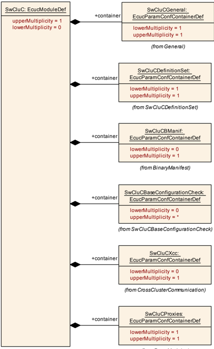

#### 8.2.1. 模块配置

| 属性 | 值 |
| --- | --- |
| 模块名称 | SwCluC |
| 描述 | 收集软件集群连接特定配置信息的模块。 |
| Post-Build 变体支持 | true |
| 支持的配置变体 | VARIANT-POST-BUILD、VARIANT-PRE-COMPILE |

（源自 ProxyModules）

| 容器名称 | 多重性 | 作用域/依赖 |
| --- | --- | --- |
| SwCluCBManif | 0..1 | Software Cluster Connection 二进制清单的配置 |
| SwCluCBaseConfigurationCheck | 0..* | Software Cluster Connection 基础配置检查的配置。该配置在二进制清单中放置一个强制性条目，其中的守护值用于证明应用软件集群的一般设置与宿主软件集群的一般设置兼容。应为每个应用软件集群定义一个单独的基础配置检查。 |

| 容器名称 | 多重性 | 作用域/依赖 |
| --- | --- | --- |
| SwCluCDefinitionSet | 1 | 软件集群集合的定义 |
| SwCluCGeneral | 1 | Software Cluster Connection 的通用配置 |
| SwCluCProxies | 1 | Software Cluster Connection 的代理模块（**Proxy Modules**）的通用配置 |
| SwCluCXcc | 0..1 | Software Cluster Connection 二进制清单的配置 |

#### 8.2.2. 通用配置参数

图 10.2：SwCluC 通用配置参数

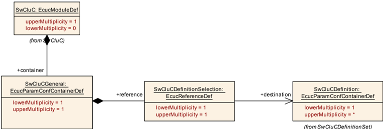

容器 SwCluCGeneral 的定义：

| 属性 | 值 |
| --- | --- |
| 容器名称 | SwCluCGeneral |
| 父容器 | SwCluC |
| 描述 | Software Cluster Connection 的通用配置 |
| 多重性配置类 | Pre-compile time：X（All Variants）；Link time：-；Post-build time：- |

参数 SwCluCDefinitionSelection 的定义：

| 属性 | 值 |
| --- | --- |
| 参数名称 | SwCluCDefinitionSelection |
| 父容器 | SwCluCGeneral |
| 描述 | 该引用选择应用于本软件集群的软件集群定义（**Software Cluster Definition**）。 |
| 多重性 | 1 |
| 类型 | Reference to SwCluCDefinition |
| 多重性配置类 | Pre-compile time：X；Link time：-；Post-build time：- |
| 值配置类 | Pre-compile time：X；Link time：-；Post-build time：- |

无包含的容器。

#### 8.2.3. 软件集群定义

图 10.3：SwCluC 软件集群定义

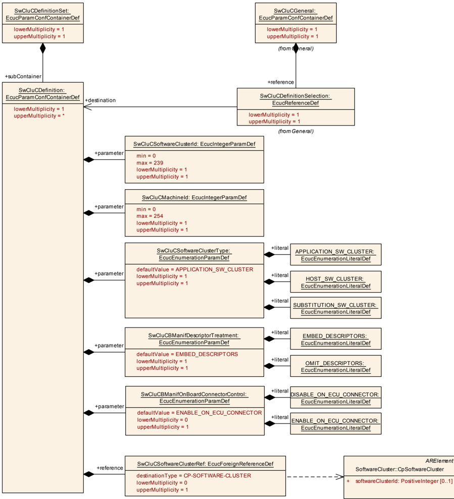

scope: local

容器 SwCluCDefinitionSet 的定义：

| 属性 | 值 |
| --- | --- |
| 容器名称 | SwCluCDefinitionSet |
| 父容器 | SwCluC |
| 描述 | 软件集群集合的定义 |

| 容器名称 | 多重性 | 作用域/依赖 |
| --- | --- | --- |
| SwCluCDefinition | 1..* | 软件集群一般属性的定义。这些定义被分离为一个定义集合，以便能够整体查看所有现有的软件集群定义。 |

容器 SwCluCDefinition 的定义：

| 属性 | 值 |
| --- | --- |
| 容器名称 | SwCluCDefinition |
| 父容器 | SwCluCDefinitionSet |
| 描述 | 软件集群一般属性的定义。这些定义被分离为一个定义集合，以便能够整体查看所有现有的软件集群定义。 |
| 多重性配置类 | Pre-compile time：X（All Variants）；Link time：-；Post-build time：- |

参数 SwCluCBManifDescriptorTreatment 的定义：

| 属性 | 值 |
| --- | --- |
| 参数名称 | SwCluCBManifDescriptorTreatment |
| 父容器 | SwCluCDefinition |
| 描述 | 配置软件集群的二进制对象（**Binary Object**）中接口描述符表（**Interface Descriptor Table**）的存在性。 |
| 多重性 | 1 |
| 类型 | EcucEnumerationParamDef |
| 取值范围 | `EMBED_DESCRIPTORS`：二进制清单的接口描述符表被嵌入二进制对象；`OMIT_DESCRIPTORS`：二进制清单的接口描述符表从二进制对象中省略。该信息需要作为 CpSoftwareClusterBinaryManifestDescriptor 交付。 |
| 默认值 | EMBED_DESCRIPTORS |
| 多重性配置类 | Pre-compile time：X（All Variants）；Link time：-；Post-build time：- |
| 值配置类 | Pre-compile time：X（All Variants）；Link time：-；Post-build time：- |
| 作用域/依赖 | scope: ECU |

参数 SwCluCBManifOnBoardConnectorControl 的定义：

| 属性 | 值 |
| --- | --- |
| 参数名称 | SwCluCBManifOnBoardConnectorControl |
| 父容器 | SwCluCDefinition |
| 描述 | `SwCluCBManifOnBoardConnectorControl` 启用或禁用软件集群连接器的 onECU 执行。该设置仅适用于宿主软件集群。 |
| 多重性 | 0..1 |
| 类型 | EcucEnumerationParamDef |
| 取值范围 | `DISABLE_ON_ECU_CONNECTOR`：在此机器上禁用软件集群的 OnECU 连接；`ENABLE_ON_ECU_CONNECTOR`：在此机器上启用软件集群的 OnECU 连接。 |
| 默认值 | ENABLE_ON_ECU_CONNECTOR |
| 多重性配置类 | Pre-compile time：X（All Variants）；Link time：-；Post-build time：- |
| 值配置类 | Pre-compile time：X（All Variants）；Link time：-；Post-build time：- |
| 作用域/依赖 | scope: ECU |

参数 SwCluCMachineId 的定义：

| 属性 | 值 |
| --- | --- |
| 参数名称 | SwCluCMachineId |
| 父容器 | SwCluCDefinition |
| 描述 | 软件集群所属（虚拟或物理）机器的唯一编号。 |
| 多重性 | 1 |
| 类型 | EcucIntegerParamDef |
| 取值范围 | 0 .. 254 |
| 默认值 | - |
| 多重性配置类 | Pre-compile time：All Variants；Link time：-；Post-build time：- |
| 值配置类 | Pre-compile time：All Variants；Link time：-；Post-build time：- |
| 作用域/依赖 | scope: ECU |

参数 SwCluCSoftwareClusterId 的定义：

| 属性 | 值 |
| --- | --- |
| 参数名称 | SwCluCSoftwareClusterId |
| 父容器 | SwCluCDefinition |
| 描述 | 软件集群的唯一编号。编号 >= 0xFE 保留用于指示特殊值或未连接状态。 |
| 多重性 | 1 |
| 类型 | EcucIntegerParamDef |
| 取值范围 | 0 .. 239 |
| 默认值 | - |
| 多重性配置类 | Pre-compile time：X（All Variants）；Link time：-；Post-build time：- |
| 值配置类 | Pre-compile time：X（All Variants）；Link time：-；Post-build time：- |
| 作用域/依赖 | scope: ECU |

参数 SwCluCSoftwareClusterType 的定义：

| 属性 | 值 |
| --- | --- |
| 参数名称 | SwCluCSoftwareClusterType |
| 父容器 | SwCluCDefinition |
| 描述 | 软件集群的类型 |
| 多重性 | 1 |
| 类型 | EcucEnumerationParamDef |
| 取值范围 | `APPLICATION_SW_CLUSTER`：本软件集群是应用软件集群；`HOST_SW_CLUSTER`：本软件集群是宿主软件集群；`SUBSTITUTION_SW_CLUSTER`：本软件集群是替代软件集群。 |
| 默认值 | APPLICATION_SW_CLUSTER |
| 多重性配置类 | Pre-compile time：X（All Variants）；Link time：-；Post-build time：- |
| 值配置类 | Pre-compile time：X（All Variants）；Link time：-；Post-build time：- |
| 作用域/依赖 | scope: ECU |

参数 SwCluCSoftwareClusterRef 的定义：

| 属性 | 值 |
| --- | --- |
| 参数名称 | SwCluCSoftwareClusterRef |
| 父容器 | SwCluCDefinition |
| 描述 | 对 `CpSoftwareCluster` 的引用，用于定义到系统中软件集群描述的链接。 |
| 多重性 | 0..1 |
| 类型 | Foreign reference to CP-SOFTWARE-CLUSTER |
| 多重性配置类 | Pre-compile time：X（All Variants）；Link time：-；Post-build time：- |
| 值配置类 | Pre-compile time：X（All Variants）；Link time：-；Post-build time：- |
| 作用域/依赖 | scope: ECU |

无包含的容器。

**SwCluCSoftwareClusterId 应按照 `CpSoftwareCluster.softwareClusterId` 设置：** 对于特定的 **SwCluCDefinition**，`SwCluCDefinition.SwCluCSoftwareClusterId` 的值应与经由 `SwCluCDefinition.SwCluCSoftwareClusterRef` 引用的 `CpSoftwareCluster` 的 `softwareClusterId` 值相同。

**理由：** 如果 `softwareClusterId` 已由系统描述给出，则 ECU 集成者无法自行选择 `SwCluCSoftwareClusterId`。对于集成特定的软件集群，ECU 集成者必须为 `SwCluCSoftwareClusterId` 选择一个空闲编号。

#### 8.2.4. 软件集群基础配置检查

图 10.4：软件集群基础配置检查

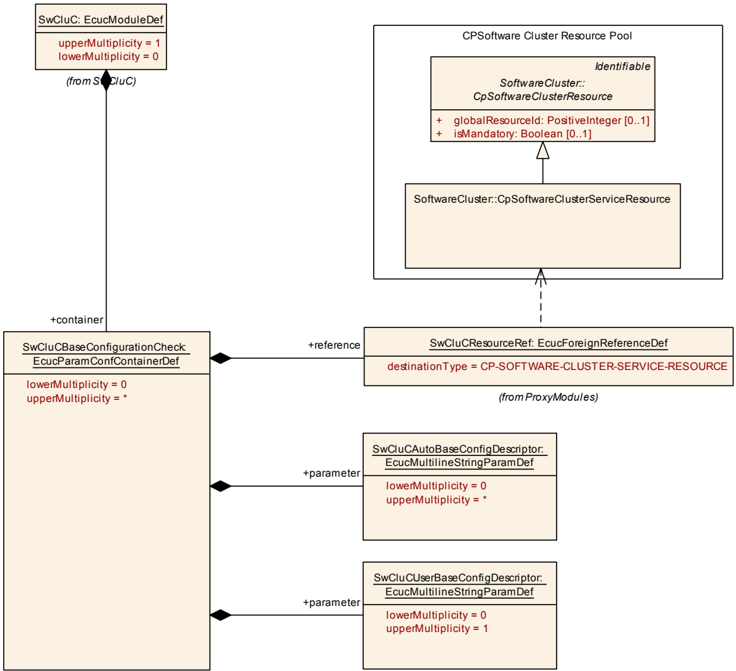

容器 SwCluCBaseConfigurationCheck 的定义：

| 属性 | 值 |
| --- | --- |
| 容器名称 | SwCluCBaseConfigurationCheck |
| 父容器 | SwCluC |
| 描述 | Software Cluster Connection 基础配置检查的配置。该配置在二进制清单中放置一个强制性条目，其中的守护值用于证明应用软件集群的一般设置与宿主软件集群的一般设置兼容。应为每个应用软件集群定义一个单独的基础配置检查。 |
| 多重性配置类 | Pre-compile time：X（All Variants）；Link time：-；Post-build time：- |

参数 SwCluCAutoBaseConfigDescriptor 的定义：

| 属性 | 值 |
| --- | --- |
| 参数名称 | SwCluCAutoBaseConfigDescriptor |
| 父容器 | SwCluCBaseConfigurationCheck |
| 描述 | 由机器确定的字符串，表示基础配置假设。可以添加多个 `SwCluCAutoBaseConfigDescriptor` 值，以支持不同的工具对校验和做出贡献。例如 Software Cluster Connection 工具、编译器、链接器或定位工具。`isAuto` 应设置为 true，因为工具链自动添加其收集的值。 |
| 多重性 | 0..* |
| 类型 | EcucMultilineStringParamDef |
| 默认值 | - |
| 正则表达式 | - |
| 多重性配置类 | Pre-compile time：X；Link time：-；Post-build time：- |
| 值配置类 | Pre-compile time：X；Link time：-；Post-build time：- |
| 作用域/依赖 | scope: ECU |

参数 SwCluCUserBaseConfigDescriptor 的定义：

| 属性 | 值 |
| --- | --- |
| 参数名称 | SwCluCUserBaseConfigDescriptor |
| 父容器 | SwCluCBaseConfigurationCheck |
| 描述 | 由用户确定的字符串，表示基础配置假设。 |
| 多重性 | 0..1 |
| 类型 | EcucMultilineStringParamDef |
| 默认值 | - |
| 正则表达式 | - |
| 多重性配置类 | Pre-compile time：X；Link time：-；Post-build time：- |
| 值配置类 | Pre-compile time：X；Link time：-；Post-build time：- |
| 作用域/依赖 | scope: ECU |

参数 SwCluCResourceRef 的定义：

| 属性 | 值 |
| --- | --- |
| 参数名称 | SwCluCResourceRef |
| 父容器 | SwCluCBaseConfigurationCheck |
| 描述 | 对 `CpSoftwareClusterServiceResource` 的引用。 |
| 多重性 | 1 |
| 类型 | Foreign reference to CP-SOFTWARE-CLUSTER-SERVICE-RESOURCE |
| 作用域/依赖 | scope: ECU |

无包含的容器。

**SwCluCBaseConfigurationCheck 只与类别为 SWCLUSTER_RES_BASE_CNF 的 CpSoftwareClusterServiceResource 相关：** `SwCluCBaseConfigurationCheck.SwCluCResourceRef` 应只引用类别为 `SWCLUSTER_RES_BASE_CNF` 的 `CpSoftwareClusterServiceResource`。

#### 8.2.5. 二进制清单

图 10.5：SwCluC 二进制清单

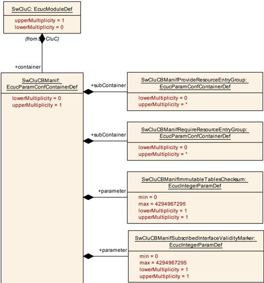

容器 SwCluCBManif 的定义：

| 属性 | 值 |
| --- | --- |
| 容器名称 | SwCluCBManif |
| 父容器 | SwCluC |
| 描述 | Software Cluster Connection 二进制清单的配置 |

参数 SwCluCBManifImmutableTablesChecksum 的定义：

| 属性 | 值 |
| --- | --- |
| 参数名称 | SwCluCBManifImmutableTablesChecksum |
| 父容器 | SwCluCBManif |
| 描述 | 该参数定义不可变表校验和（**Immutable Tables Checksum**）的初始化值。如果二进制清单代码生成器已经计算校验和，则可以将该值存储在此处（withAuto == true）。 |
| 多重性 | 1 |
| 类型 | EcucIntegerParamDef |
| 取值范围 | 0 .. 4294967295 |
| 默认值 | - |
| 多重性配置类 | Pre-compile time：X（All Variants）；Link time：-；Post-build time：- |
| 值配置类 | Pre-compile time：X（All Variants）；Link time：-；Post-build time：- |
| 作用域/依赖 | scope: ECU |

参数 SwCluCBManifSubscribedInterfaceValidityMarker 的定义：

| 属性 | 值 |
| --- | --- |
| 参数名称 | SwCluCBManifSubscribedInterfaceValidityMarker |
| 父容器 | SwCluCBManif |
| 描述 | 该参数定义订阅接口有效性标记（**Subscribed Interface Validity Marker**）的初始化值。初始化值应设置为 flash 内存的擦除值。 |
| 多重性 | 1 |
| 类型 | EcucIntegerParamDef |
| 取值范围 | 0 .. 4294967295 |
| 默认值 | - |
| 多重性配置类 | Pre-compile time：All Variants；Link time：-；Post-build time：- |
| 值配置类 | Pre-compile time：All Variants；Link time：-；Post-build time：- |
| 作用域/依赖 | scope: ECU |

| 容器名称 | 多重性 | 作用域/依赖 |
| --- | --- | --- |
| SwCluCBManifProvideResourceEntryGroup | 0..* | 描述二进制清单中一组提供资源。所属句柄以支持基于数组访问的连续顺序放入二进制清单的表中。 |
| SwCluCBManifRequireResourceEntryGroup | 0..* | 描述二进制清单中一组需求资源。所属句柄以支持基于数组访问的连续顺序放入二进制清单的表中。 |
| SwCluCBManifResourceType | 0..* | 该容器定义二进制清单中资源类型（**resource type**）的结构。 |

#### 8.2.5.1. 提供资源条目组

图 10.6：SwCluC 提供资源条目组

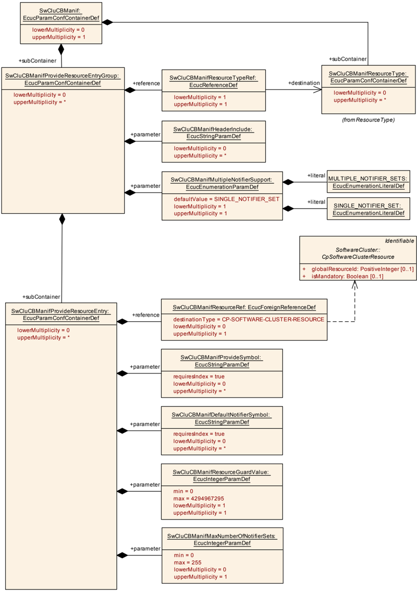

容器 SwCluCBManifProvideResourceEntryGroup 的定义：

| 属性 | 值 |
| --- | --- |
| 容器名称 | SwCluCBManifProvideResourceEntryGroup |
| 父容器 | SwCluCBManif |
| 描述 | 描述二进制清单中一组提供资源。所属句柄以支持基于数组访问的连续顺序放入二进制清单的表中。 |

参数 SwCluCBManifHeaderInclude 的定义：

| 属性 | 值 |
| --- | --- |
| 参数名称 | SwCluCBManifHeaderInclude |
| 父容器 | SwCluCBManifProvideResourceEntryGroup |
| 描述 | 定义 **SwCluCBManifProvideResourceEntryGroup** / **SwCluCBManifRequireResourceEntryGroup** 的所有者为其句柄初始化符号的声明所在的头文件。 |
| 多重性 | 0..* |
| 类型 | EcucStringParamDef |
| 默认值 | - |
| 正则表达式 | - |
| Post-Build 变体多重性 | false |
| Post-Build 变体值 | false |
| 多重性配置类 | Pre-compile time：X；Link time：-；Post-build time：- |
| 值配置类 | Pre-compile time：X；Link time：-；Post-build time：- |
| 作用域/依赖 | scope: local |

参数 SwCluCBManifMultipleNotifierSupport 的定义：

| 属性 | 值 |
| --- | --- |
| 参数名称 | SwCluCBManifMultipleNotifierSupport |
| 父容器 | SwCluCBManifProvideResourceEntryGroup |
| 描述 | `SwCluCBManifMultipleNotifierSupport` 定义多个软件集群是否可以注册到通知句柄上。为每个可能的连接分配一组通知句柄。 |
| 多重性 | 1 |
| 类型 | EcucEnumerationParamDef |
| 取值范围 | `MULTIPLE_NOTIFIER_SETS`：提供资源支持到多个需求资源的共存通知连接；`SINGLE_NOTIFIER_SET`：提供资源最多支持一个到需求资源的通知连接。 |
| 默认值 | SINGLE_NOTIFIER_SET |
| 多重性配置类 | Pre-compile time：X（All Variants）；Link time：-；Post-build time：- |
| 值配置类 | Pre-compile time：X（All Variants）；Link time：-；Post-build time：- |
| 作用域/依赖 | scope: local |

参数 SwCluCBManifResourceTypeRef 的定义：

| 属性 | 值 |
| --- | --- |
| 参数名称 | SwCluCBManifResourceTypeRef |
| 父容器 | SwCluCBManifProvideResourceEntryGroup |
| 描述 | 为所有 **SwCluCBManifProvideResourceEntry** / **SwCluCBManifRequireResourceEntry** 定义资源类型。 |
| 多重性 | 1 |
| 类型 | Reference to SwCluCBManifResourceType |
| 作用域/依赖 | |

| 容器名称 | 多重性 | 作用域/依赖 |
| --- | --- | --- |
| SwCluCBManifProvideResourceEntry | 0..* | 描述二进制清单中单个提供资源的条目。 |

#### 8.2.5.2. 提供资源条目

容器 SwCluCBManifProvideResourceEntry 的定义：

| 属性 | 值 |
| --- | --- |
| 容器名称 | SwCluCBManifProvideResourceEntry |
| 父容器 | SwCluCBManifProvideResourceEntryGroup |
| 描述 | 描述二进制清单中单个提供资源的条目。 |

参数 SwCluCBManifDefaultNotifierSymbol 的定义：

| 属性 | 值 |
| --- | --- |
| 参数名称 | SwCluCBManifDefaultNotifierSymbol |
| 父容器 | SwCluCBManifProvideResourceEntry |
| 描述 | `SwCluCBManifDefaultNotifierSymbol` 设置放入可修改接口（**Modifiable Interface**）的通知句柄（**Notifier Handle**）的默认值。`SwCluCBManifDefaultNotifierSymbols` 的数量和顺序需要与被引用的 **SwCluCBManifResourceType** 中 **SwCluCBManifNotifierHandles** 的数量和顺序匹配。该参数定义为字符串，以支持使用符号作为初始化器。值必须以 C 支持的数字格式的字符串设置，例如 `0xC001CAFE`。如果提供句柄持有指针，则取地址运算符是字符串的一部分，例如 `&myExampleFunction`。属性：requiresIndex=true |
| 多重性 | 0..* |
| 类型 | EcucStringParamDef |
| 默认值 | - |
| 正则表达式 | - |
| 作用域/依赖 | |

参数 SwCluCBManifMaxNumberOfNotifierSets 的定义：

| 属性 | 值 |
| --- | --- |
| 参数名称 | SwCluCBManifMaxNumberOfNotifierSets |
| 父容器 | SwCluCBManifProvideResourceEntry |
| 描述 | `SwCluCBManifMaxNumberOfNotifierSets` 定义使用通知句柄的可能的所需资源的最大数量。在 `SwCluCBManifMultipleNotifierSupport` 设置为 `MULTIPLE_NOTIFIER_SETS` 时需要。 |
| 多重性 | 0..1 |
| 类型 | EcucIntegerParamDef |
| 取值范围 | 0 .. 255 |
| 默认值 | - |
| 多重性配置类 | Pre-compile time：X（All Variants）；Link time：-；Post-build time：- |
| 值配置类 | Pre-compile time：X（All Variants）；Link time：-；Post-build time：- |
| 作用域/依赖 | |

参数 SwCluCBManifProvideSymbol 的定义：

| 属性 | 值 |
| --- | --- |
| 参数名称 | SwCluCBManifProvideSymbol |
| 父容器 | SwCluCBManifProvideResourceEntry |
| 描述 | `SwCluCBManifProvideSymbol` 设置放入不可变接口（**Immutable Interface**）的提供句柄（**Provide Handle**）的值。`SwCluCBManifProvideSymbols` 的数量和顺序需要与被引用的 **SwCluCBManifResourceType** 中 **SwCluCBManifProvideHandles** 的数量和顺序匹配。该参数定义为字符串，以支持使用符号作为初始化器。值必须以 C 支持的数字格式的字符串设置，例如 `0xC001CAFE`。如果提供句柄持有指针，则取地址运算符是字符串的一部分，例如 `&myExampleFunction`。属性：requiresIndex=true |
| 多重性 | 0..* |
| 类型 | EcucStringParamDef |
| 默认值 | - |
| 正则表达式 | - |
| 作用域/依赖 | |

参数 SwCluCBManifResourceGuardValue 的定义：

| 属性 | 值 |
| --- | --- |
| 参数名称 | SwCluCBManifResourceGuardValue |
| 父容器 | SwCluCBManifProvideResourceEntry |
| 描述 | `SwCluCBManifResourceGuardValue` 提供由软件集群连接器检查的守护信息。软件集群的提供资源和需求资源只有在提供方和请求方的资源守护值相等时才能被连接。 |
| 多重性 | 1 |
| 类型 | EcucIntegerParamDef |
| 取值范围 | 0 .. 4294967295 |
| 默认值 | - |
| 作用域/依赖 | |

参数 SwCluCBManifResourceRef 的定义：

| 属性 | 值 |
| --- | --- |
| 参数名称 | SwCluCBManifResourceRef |
| 父容器 | SwCluCBManifProvideResourceEntry |
| 描述 | 对确定全局资源 ID 的 `CpSoftwareClusterResource` 的引用。如果该引用未设置，则此资源条目在二进制清单中的全局资源 ID 将被设置为 0，以指示无效资源。 |
| 多重性 | 0..1 |
| 类型 | Foreign reference to CP-SOFTWARE-CLUSTER-RESOURCE |
| 作用域/依赖 | |

无包含的容器。

#### 8.2.5.3. 需求资源条目组

图 10.7：SwCluC 需求资源条目组

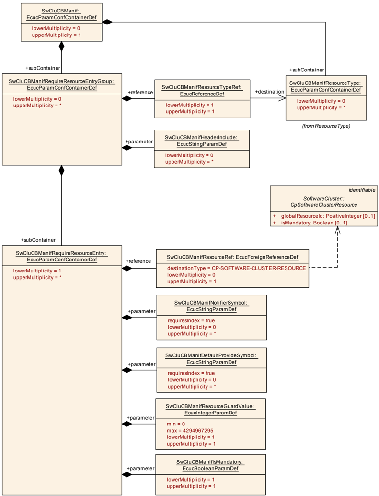

容器 SwCluCBManifRequireResourceEntryGroup 的定义：

| 属性 | 值 |
| --- | --- |
| 容器名称 | SwCluCBManifRequireResourceEntryGroup |
| 父容器 | SwCluCBManif |
| 描述 | 描述二进制清单中一组需求资源。所属句柄以支持基于数组访问的连续顺序放入二进制清单的表中。 |

参数 SwCluCBManifHeaderInclude 的定义：

| 属性 | 值 |
| --- | --- |
| 参数名称 | SwCluCBManifHeaderInclude |
| 父容器 | SwCluCBManifRequireResourceEntryGroup |
| 描述 | 定义 **SwCluCBManifProvideResourceEntryGroup** / **SwCluCBManifRequireResourceEntryGroup** 的所有者为其句柄初始化符号的声明所在的头文件。 |
| 多重性 | 0..* |
| 类型 | EcucStringParamDef |
| 默认值 | - |
| 正则表达式 | - |
| Post-Build 变体多重性 | false |
| Post-Build 变体值 | false |
| 多重性配置类 | Pre-compile time：X；Link time：-；Post-build time：- |
| 值配置类 | Pre-compile time：X；Link time：-；Post-build time：- |
| 作用域/依赖 | scope: local |

参数 SwCluCBManifResourceTypeRef 的定义：

| 属性 | 值 |
| --- | --- |
| 参数名称 | SwCluCBManifResourceTypeRef |
| 父容器 | SwCluCBManifRequireResourceEntryGroup |
| 描述 | 为所有 **SwCluCBManifProvideResourceEntry** / **SwCluCBManifRequireResourceEntry** 定义资源类型。 |
| 多重性 | 1 |
| 类型 | Reference to SwCluCBManifResourceType |
| 作用域/依赖 | |

| 容器名称 | 多重性 | 作用域/依赖 |
| --- | --- | --- |
| SwCluCBManifRequireResourceEntry | 1..* | 描述二进制清单中单个需求资源的条目。 |

#### 8.2.5.4. 需求资源条目

容器 SwCluCBManifRequireResourceEntry 的定义：

| 属性 | 值 |
| --- | --- |
| 容器名称 | SwCluCBManifRequireResourceEntry |
| 父容器 | SwCluCBManifRequireResourceEntryGroup |
| 描述 | 描述二进制清单中单个需求资源的条目。 |

参数 SwCluCBManifDefaultProvideSymbol 的定义：

| 属性 | 值 |
| --- | --- |
| 参数名称 | SwCluCBManifDefaultProvideSymbol |
| 父容器 | SwCluCBManifRequireResourceEntry |
| 描述 | `SwCluCBManifDefaultProvideSymbol` 设置放入可修改接口（**Modifiable Interface**）的提供句柄（**Provide Handle**）的默认值。`SwCluCBManifDefaultProvideSymbols` 的数量和顺序需要与被引用的 **SwCluCBManifResourceType** 中 **SwclCBManifProvideHandles** 的数量和顺序匹配。该参数定义为字符串，以支持使用符号作为初始化器。值必须以 C 支持的数字格式的字符串设置，例如 `0xC001CAFE`。如果提供句柄持有指针，则取地址运算符是字符串的一部分，例如 `&myExampleFunction`。属性：requiresIndex=true |
| 多重性 | 0..* |
| 类型 | EcucStringParamDef |
| 默认值 | - |
| 正则表达式 | - |
| 作用域/依赖 | |

参数 SwCluCBManifIsMandatory 的定义：

| 属性 | 值 |
| --- | --- |
| 参数名称 | SwCluCBManifIsMandatory |
| 父容器 | SwCluCBManifRequireResourceEntry |
| 描述 | `SwCluCBManifIsMandatory` 指示运行本软件集群时该资源是强制性的。如果该资源在机器上未被提供，则需求该资源的软件集群的连接过程将被中止。 |
| 多重性 | 1 |
| 类型 | EcucBooleanParamDef |
| 默认值 | - |
| 作用域/依赖 | |

参数 SwCluCBManifNotifierSymbol 的定义：

| 属性 | 值 |
| --- | --- |
| 参数名称 | SwCluCBManifNotifierSymbol |
| 父容器 | SwCluCBManifRequireResourceEntry |
| 描述 | `SwCluCBManifNotifierSymbol` 设置放入不可变接口（**Immutable Interface**）的通知句柄（**Notifier Handle**）的值。`SwCluCBManifNotifierSymbols` 的数量和顺序需要与被引用的 **SwCluCBManifResourceType** 中 **SwclCBManifNotifierHandles** 的数量和顺序匹配。该参数定义为字符串，以支持使用符号作为初始化器。值必须以 C 支持的数字格式的字符串设置，例如 `0xC001CAFE`。如果提供句柄持有指针，则取地址运算符是字符串的一部分，例如 `&myExampleFunction`。属性：requiresIndex=true |
| 多重性 | 0..* |
| 类型 | EcucStringParamDef |
| 默认值 | - |
| 正则表达式 | - |
| 作用域/依赖 | |

参数 SwCluCBManifResourceGuardValue 的定义：

| 属性 | 值 |
| --- | --- |
| 参数名称 | SwCluCBManifResourceGuardValue |
| 父容器 | SwCluCBManifRequireResourceEntry |
| 描述 | `SwCluCBManifResourceGuardValue` 提供由软件集群连接器检查的守护信息。软件集群的提供资源和需求资源只有在提供方和请求方的资源守护值相等时才能被连接。 |
| 多重性 | 1 |
| 类型 | EcucIntegerParamDef |
| 取值范围 | 0 .. 4294967295 |
| 默认值 | - |
| 作用域/依赖 | |

参数 SwCluCBManifResourceRef 的定义：

| 属性 | 值 |
| --- | --- |
| 参数名称 | SwCluCBManifResourceRef |
| 父容器 | SwCluCBManifRequireResourceEntry |
| 描述 | 对确定全局资源 ID 的 `CpSoftwareClusterResource` 的引用。如果该引用未设置，则此资源条目在二进制清单中的全局资源 ID 将被设置为 0，以指示无效资源。 |
| 多重性 | 0..1 |
| 类型 | Foreign reference to CP-SOFTWARE-CLUSTER-RESOURCE |
| 作用域/依赖 | |

无包含的容器。

#### 8.2.5.5. 资源类型

图 10.8：SwCluC 资源类型

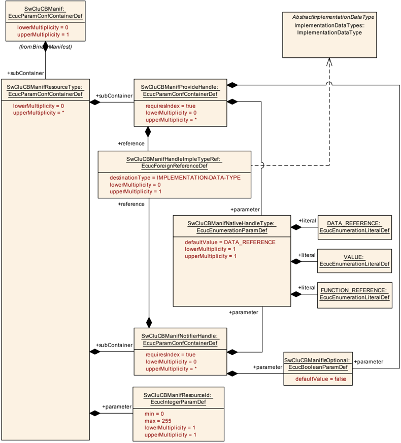

容器 SwCluCBManifResourceType 的定义：

| 属性 | 值 |
| --- | --- |
| 容器名称 | SwCluCBManifResourceType |
| 父容器 | SwCluCBManif |
| 描述 | 该容器定义二进制清单中资源类型（**resource type**）的结构。 |
| 多重性配置类 | Pre-compile time：X（All Variants）；Link time：-；Post-build time：- |

参数 SwCluCBManifResourceId 的定义：

| 属性 | 值 |
| --- | --- |
| 参数名称 | SwCluCBManifResourceId |
| 父容器 | SwCluCBManifResourceType |
| 描述 | 资源类型的唯一编号。 |
| 多重性 | 1 |
| 类型 | EcucIntegerParamDef |
| 取值范围 | 0 .. 255 |
| 默认值 | - |
| 多重性配置类 | Pre-compile time：All Variants；Link time：-；Post-build time：- |
| 值配置类 | Pre-compile time：All Variants；Link time：-；Post-build time：- |
| 作用域/依赖 | scope: ECU |

| 容器名称 | 多重性 | 作用域/依赖 |
| --- | --- | --- |
| SwCluCBManifNotifierHandle | 0..* | 为该资源类型定义一个通知句柄（**Notifier Handle**）及其属性。 |
| SwCluCBManifProvideHandle | 0..* | 为该资源类型定义一个提供句柄（**Provide Handle**）及其属性。 |

容器 SwCluCBManifProvideHandle 的定义：

| 属性 | 值 |
| --- | --- |
| 容器名称 | SwCluCBManifProvideHandle |
| 父容器 | SwCluCBManifResourceType |
| 描述 | 为该资源类型定义一个提供句柄（**Provide Handle**）及其属性。属性：requiresIndex=true |

参数 SwCluCBManifIsOptional 的定义：

| 属性 | 值 |
| --- | --- |
| 参数名称 | SwCluCBManifIsOptional |
| 父容器 | SwCluCBManifProvideHandle |
| 描述 | 指示该句柄是可选的，并非总是存在于每个提供资源条目（**Provide Resource Entry**）或需求资源条目（**Require Resource Entry**）中。 |
| 多重性 | 1 |
| 类型 | EcucBooleanParamDef |
| 默认值 | false |
| Post-Build 变体值 | false |
| 值配置类 | Pre-compile time：X（All Variants）；Link time：-；Post-build time：- |
| 作用域/依赖 | |

参数 SwCluCBManifNativeHandleType 的定义：

| 属性 | 值 |
| --- | --- |
| 参数名称 | SwCluCBManifNativeHandleType |
| 父容器 | SwCluCBManifProvideHandle |
| 描述 | 该参数确定句柄的底层原生类型，可以是：• 指向变量的指针 • 值 • 指向函数的指针。该信息对于在不可变接口或可修改接口中正确初始化句柄是必需的。 |
| 多重性 | 1 |
| 类型 | EcucEnumerationParamDef |
| 取值范围 | `DATA_REFERENCE`：句柄是指向变量的指针；`FUNCTION_REFERENCE`：句柄是指向函数的指针；`VALUE`：句柄是一个值。 |
| 默认值 | DATA_REFERENCE |
| 多重性配置类 | Pre-compile time：X（All Variants）；Link time：-；Post-build time：- |
| 值配置类 | Pre-compile time：X（All Variants）；Link time：-；Post-build time：- |
| 作用域/依赖 | scope: local |

参数 SwCluCBManifHandleImpleTypeRef 的定义：

| 属性 | 值 |
| --- | --- |
| 参数名称 | SwCluCBManifHandleImpleTypeRef |
| 父容器 | SwCluCBManifProvideHandle |
| 描述 | 对句柄的 **ImplementationDataType** 的引用。可以额外配置该类型，以获得从原生句柄类型到返回句柄类型的正确类型转换。 |
| 多重性 | 0..1 |
| 类型 | Foreign reference to IMPLEMENTATION-DATA-TYPE |
| Post-Build 变体值 | false |
| 值配置类 | Pre-compile time：X（All Variants）；Link time：-；Post-build time：- |
| 作用域/依赖 | scope: local |

无包含的容器。

容器 SwCluCBManifNotifierHandle 的定义：

| 属性 | 值 |
| --- | --- |
| 容器名称 | SwCluCBManifNotifierHandle |
| 父容器 | SwCluCBManifResourceType |
| 描述 | 为该资源类型定义一个通知句柄（**Notifier Handle**）及其属性。属性：requiresIndex=true |

参数 SwCluCBManifIsOptional 的定义：

| 属性 | 值 |
| --- | --- |
| 参数名称 | SwCluCBManifIsOptional |
| 父容器 | SwCluCBManifNotifierHandle |
| 描述 | 指示该句柄是可选的，并非总是存在于每个提供资源条目（**Provide Resource Entry**）或需求资源条目（**Require Resource Entry**）中。 |
| 多重性 | 1 |
| 类型 | EcucBooleanParamDef |
| 默认值 | false |
| Post-Build 变体值 | false |
| 值配置类 | Pre-compile time：X（All Variants）；Link time：-；Post-build time：- |
| 作用域/依赖 | |

参数 SwCluCBManifNativeHandleType 的定义：

| 属性 | 值 |
| --- | --- |
| 参数名称 | SwCluCBManifNativeHandleType |
| 父容器 | SwCluCBManifNotifierHandle |
| 描述 | 该参数确定句柄的底层原生类型，可以是：• 指向变量的指针 • 值 • 指向函数的指针。该信息对于在不可变接口或可修改接口中正确初始化句柄是必需的。 |
| 多重性 | 1 |
| 类型 | EcucEnumerationParamDef |
| 取值范围 | `DATA_REFERENCE`：句柄是指向变量的指针；`FUNCTION_REFERENCE`：句柄是指向函数的指针；`VALUE`：句柄是一个值。 |
| 默认值 | DATA_REFERENCE |
| 多重性配置类 | Pre-compile time：X（All Variants）；Link time：-；Post-build time：- |
| 值配置类 | Pre-compile time：X（All Variants）；Link time：-；Post-build time：- |
| 作用域/依赖 | scope: local |

参数 SwCluCBManifHandleImpleTypeRef 的定义：

| 属性 | 值 |
| --- | --- |
| 参数名称 | SwCluCBManifHandleImpleTypeRef |
| 父容器 | SwCluCBManifNotifierHandle |
| 描述 | 对句柄的 **ImplementationDataType** 的引用。可以额外配置该类型，以获得从原生句柄类型到返回句柄类型的正确类型转换。 |
| 多重性 | 0..1 |
| 类型 | Foreign reference to IMPLEMENTATION-DATA-TYPE |
| Post-Build 变体值 | false |
| 值配置类 | Pre-compile time：X（All Variants）；Link time：-；Post-build time：- |
| 作用域/依赖 | scope: local |

无包含的容器。

#### 8.2.6. 跨集群通信

图 10.9：通用跨集群通信参数

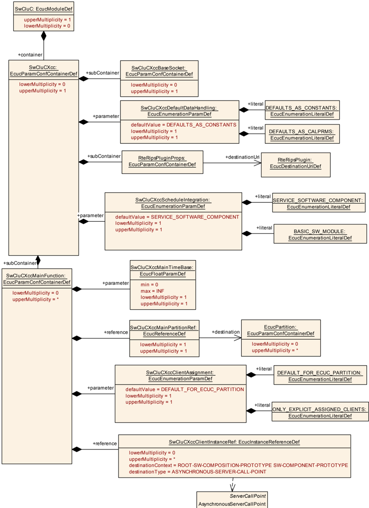

容器 SwCluCXcc 的定义：

| 属性 | 值 |
| --- | --- |
| 容器名称 | SwCluCXcc |
| 父容器 | SwCluC |
| 描述 | Software Cluster Connection 二进制清单的配置 |

参数 SwCluCXccDefaultDataHandling 的定义：

| 属性 | 值 |
| --- | --- |
| 参数名称 | SwCluCXccDefaultDataHandling |
| 父容器 | SwCluCXcc |
| 描述 | `SwCluCXccDefaultDataHandling` 定义软件集群的未连接 R 端口原型（**RPortPrototypes**）的默认数据是实例化为固定常量还是标定参数。 |
| 多重性 | 1 |
| 类型 | EcucEnumerationParamDef |
| 取值范围 | `DEFAULTS_AS_CALPRMS`：默认数据实现为标定参数；`DEFAULTS_AS_CONSTANTS`：默认数据实现为固定常量。 |
| 默认值 | DEFAULTS_AS_CONSTANTS |
| 多重性配置类 | Pre-compile time：X（All Variants）；Link time：-；Post-build time：- |
| 值配置类 | Pre-compile time：X（All Variants）；Link time：-；Post-build time：- |
| 作用域/依赖 | scope: local |

参数 SwCluCXccScheduleIntegration 的定义：

| 属性 | 值 |
| --- | --- |
| 参数名称 | SwCluCXccScheduleIntegration |
| 父容器 | SwCluCXcc |
| 描述 | 定义 `SwCluC_Xcc_MainFunction` 是经由带可运行实体（**RunnableEntity**）的服务软件组件集成，还是经由带基础软件可调度实体（**SchedulableEntity**）的基础软件模块描述集成。 |
| 多重性 | 1 |
| 类型 | EcucEnumerationParamDef |
| 取值范围 | `BASIC_SW_MODULE`：`SwCluC_Xcc_MainFunctions` 经由带 **SchedulableEntity(s)** 的基础软件模块描述集成；`SERVICE_SOFTWARE_COMPONENT`：`SwCluC_Xcc_MainFunctions` 经由带 **RunnableEntity(s)** 的服务软件组件集成。 |
| 默认值 | SERVICE_SOFTWARE_COMPONENT |
| Post-Build 变体值 | false |
| 值配置类 | Pre-compile time：X（All Variants）；Link time：-；Post-build time：- |
| 作用域/依赖 | scope: local |

| 容器名称 | 多重性 | 作用域/依赖 |
| --- | --- | --- |
| RteRipsPluginProps | 1 | 该容器定义 RTE 实现插件（**RTE Implementation Plug-in**）的身份，并提供 RTE 实现插件的 RTE 相关参数。容器的 `shortName` 定义用于 API 中缀的 RTE 实现插件的名称。 |
| SwCluCXccBaseSocket | 0..1 | 将 **XccBaseSocket** 映射到描述集群系统中 XccBaseSocket 资源的 `CpSoftwareClusterServiceResource`。将 **XccBaseSocket** 映射到 **XccBaseSocket** 工作所在的特定 `EcucPartition`。 |
| SwCluCXccMainFunction | 0..* | 定义 `SwCluC_Xcc_MainFunction` 的存在性和属性。 |

#### 8.2.6.1. 跨集群通信基础套接字

（源自 EcucPartition）

图 10.10：跨集群通信基础套接字

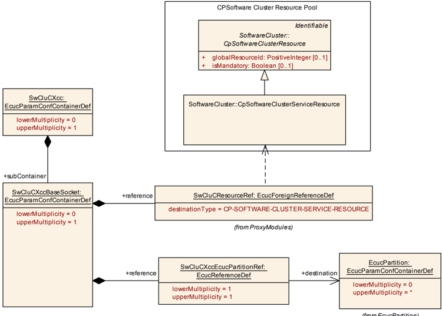

容器 SwCluCXccBaseSocket 的定义：

| 属性 | 值 |
| --- | --- |
| 容器名称 | SwCluCXccBaseSocket |
| 父容器 | SwCluCXcc |
| 描述 | 将 **XccBaseSocket** 映射到描述集群系统中 XccBaseSocket 资源的 `CpSoftwareClusterServiceResource`。将 **XccBaseSocket** 映射到 **XccBaseSocket** 工作所在的特定 `EcucPartition`。 |

参数 SwCluCResourceRef 的定义：

| 属性 | 值 |
| --- | --- |
| 参数名称 | SwCluCResourceRef |
| 父容器 | SwCluCXccBaseSocket |
| 描述 | 对 `CpSoftwareClusterServiceResource` 的引用。 |
| 多重性 | 1 |
| 类型 | Foreign reference to CP-SOFTWARE-CLUSTER-SERVICE-RESOURCE |
| 作用域/依赖 | scope: ECU |

参数 SwCluCXccEcucPartitionRef 的定义：

| 属性 | 值 |
| --- | --- |
| 参数名称 | SwCluCXccEcucPartitionRef |
| 父容器 | SwCluCXccBaseSocket |
| 描述 | 对 **XccBaseSocket** 可用的 `EcucPartition` 的引用。 |
| 多重性 | 1 |
| 类型 | Reference to EcucPartition |
| 多重性配置类 | Pre-compile time：X（All Variants）；Link time：-；Post-build time：- |
| 值配置类 | Pre-compile time：X（All Variants）；Link time：-；Post-build time：- |
| 作用域/依赖 | scope: ECU |

无包含的容器。

**SwCluCXccBaseSocket 只与类别为 SWCLUSTER_RES_XCC_BASE_SOCKET 的 CpSoftwareClusterServiceResource 相关：** `SwCluCXccBaseSocket.SwCluCResourceRef` 应只引用类别为 `SWCLUSTER_RES_XCC_BASE_SOCKET` 的 `CpSoftwareClusterServiceResource`。

#### 8.2.6.2. 跨集群通信 Rte 插件属性

图 10.11：跨集群通信 RTE 插件属性

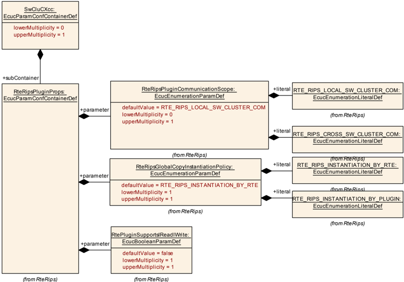

容器 RteRipsPluginProps 的定义：

| 属性 | 值 |
| --- | --- |
| 容器名称 | RteRipsPluginProps |
| 父容器 | SwCluCXcc |
| Destination Uri Definition | RteRipsPlugin |
| 描述 | 该容器定义 RTE 实现插件（**RTE Implementation Plug-in**）的身份，并提供 RTE 实现插件的 RTE 相关参数。容器的 `shortName` 定义用于 API 中缀的 RTE 实现插件的名称。 |

参数 RtePluginSupportsIReadIWrite 的定义：

| 属性 | 值 |
| --- | --- |
| 参数名称 | RtePluginSupportsIReadIWrite |
| 父容器 | RteRipsPluginProps |
| 描述 | 表示插件是否支持针对基本数据的 `Rte_Rips_IRead/IWrite` 宏。 |
| 多重性 | 1 |
| 类型 | EcucBooleanParamDef |
| 默认值 | false |
| Post-Build 变体值 | false |
| 值配置类 | Pre-compile time：X（All Variants）；Link time：-；Post-build time：- |
| 作用域/依赖 | scope: local |

参数 RteRipsGlobalCopyInstantiationPolicy 的定义：

| 属性 | 值 |
| --- | --- |
| 参数名称 | RteRipsGlobalCopyInstantiationPolicy |
| 父容器 | RteRipsPluginProps |
| 描述 | 选择对于相关通信图（**communication graph**），RIPS 插件应自行实例化关联的全局副本，还是使用由 RTE 实例化的全局副本。 |
| 多重性 | 1 |
| 类型 | EcucEnumerationParamDef |
| 取值范围 | `RTE_RIPS_INSTANTIATION_BY_PLUGIN`：对于相关通信图，RIPS 插件必须提供关联数据的全局副本；`RTE_RIPS_INSTANTIATION_BY_RTE`：对于相关通信图，RTE 必须提供关联数据的全局副本。 |
| 默认值 | RTE_RIPS_INSTANTIATION_BY_RTE |
| Post-Build 变体值 | false |
| 值配置类 | Pre-compile time：X（All Variants）；Link time：-；Post-build time：- |
| 作用域/依赖 | scope: local |

参数 RteRipsPluginCommunicationScope 的定义：

| 属性 | 值 |
| --- | --- |
| 参数名称 | RteRipsPluginCommunicationScope |
| 父容器 | RteRipsPluginProps |
| 描述 | 定义 RTE 实现插件（**RIPS**）所服务的通信范围。如果未设置该参数，则默认行为 `RTE_RIPS_LOCAL_SW_CLUSTER_COM` 适用。 |
| 多重性 | 0..1 |
| 类型 | EcucEnumerationParamDef |
| 取值范围 | `RTE_RIPS_CROSS_SW_CLUSTER_COM`：RTE 实现插件处理跨软件集群通信；`RTE_RIPS_LOCAL_SW_CLUSTER_COM`：RTE 实现插件处理本地软件集群通信。 |
| 默认值 | RTE_RIPS_LOCAL_SW_CLUSTER_COM |
| Post-Build 变体值 | false |
| 值配置类 | Pre-compile time：X（All Variants）；Link time：-；Post-build time：- |
| 作用域/依赖 | scope: local |

| 容器名称 | 多重性 | 作用域/依赖 |
| --- | --- | --- |
| RteRipsPluginCommunicationTypeSupport | 0..1 | 该容器定义插件负责的通信图的不同元素。 |

#### 8.2.6.3. 跨集群通信主函数

容器 SwCluCXccMainFunction 的定义：

| 属性 | 值 |
| --- | --- |
| 容器名称 | SwCluCXccMainFunction |
| 父容器 | SwCluCXcc |
| 描述 | 定义 `SwCluC_Xcc_MainFunction` 的存在性和属性。 |
| Post-Build 变体多重性 | false |
| 多重性配置类 | Pre-compile time：X（All Variants）；Link time：-；Post-build time：- |

参数 SwCluCXccClientAssignment 的定义：

| 属性 | 值 |
| --- | --- |
| 参数名称 | SwCluCXccClientAssignment |
| 父容器 | SwCluCXccMainFunction |
| 描述 | 定义 `SwCluC_Xcc_MainFunction` 是否用作此 `EcucPartition` 上未被 `SwCluCXccClientInstanceRef` 显式引用的所有客户端的默认主函数。 |
| 多重性 | 1 |
| 类型 | EcucEnumerationParamDef |
| 取值范围 | `DEFAULT_FOR_ECUC_PARTITION`：相关的 `SwCluC_Xcc_MainFunction` 用作默认主函数，以处理此 `EcucPartition` 上未被 `SwCluCXccClientInstanceRef` 显式引用的所有客户端的超时；`ONLY_EXPLICIT_ASSIGNED_CLIENTS`：相关的 `SwCluC_Xcc_MainFunction` 只处理被此 **SwCluCXccMainFunction** 的 `SwCluCXccClientInstanceRef` 显式引用的客户端的超时。 |
| 默认值 | DEFAULT_FOR_ECUC_PARTITION |
| Post-Build 变体值 | false |
| 值配置类 | Pre-compile time：X（All Variants）；Link time：-；Post-build time：- |
| 作用域/依赖 | scope: local |

参数 SwCluCXccMainTimeBase 的定义：

| 属性 | 值 |
| --- | --- |
| 参数名称 | SwCluCXccMainTimeBase |
| 父容器 | SwCluCXccMainFunction |
| 描述 | 对相应 `SwCluC_Xcc_MainFunction` 实例的相继调用之间的周期（秒）。SwCluC 生成器可使用该参数将给定的超时值转换为内部实现特定的计数器或滴答（tick）值。 |
| 多重性 | 1 |
| 类型 | EcucFloatParamDef |
| 取值范围 | [0 .. INF] |
| 默认值 | - |
| Post-Build 变体值 | false |
| 值配置类 | Pre-compile time：X（All Variants）；Link time：-；Post-build time：- |
| 作用域/依赖 | scope: local |

参数 SwCluCXccClientInstanceRef 的定义：

| 属性 | 值 |
| --- | --- |
| 参数名称 | SwCluCXccClientInstanceRef |
| 父容器 | SwCluCXccMainFunction |
| 描述 | 对 **AsynchronousServerCallPoint** 的引用 |
| 多重性 | 0..* |
| 类型 | Instance reference to ASYNCHRONOUS-SERVER-CALL-POINT context: ROOT-SW-COMPOSITION-PROTOTYPE SW-COMPONENT-PROTOTYPE |
| Post-Build 变体多重性 | false |
| Post-Build 变体值 | false |
| 多重性配置类 | Pre-compile time：All Variants；Link time：-；Post-build time：- |
| 值配置类 | Pre-compile time：All Variants；Link time：-；Post-build time：- |
| 作用域/依赖 | scope: local |

参数 SwCluCXccMainPartitionRef 的定义：

| 属性 | 值 |
| --- | --- |
| 参数名称 | SwCluCXccMainPartitionRef |
| 父容器 | SwCluCXccMainFunction |
| 描述 | 对相应 `SwCluC_Xcc_MainFunction` 实例被分配到的 `EcucPartition` 的引用。 |
| 多重性 | 1 |
| 类型 | Reference to EcucPartition |
| Post-Build 变体值 | false |
| 值配置类 | Pre-compile time：X（All Variants）；Link time：-；Post-build time：- |
| 作用域/依赖 | |

无包含的容器。

每个 `EcucPartition` 最多只允许配置一个 `SwCluCXccClientAssignment` 设置为 `DEFAULT_FOR_ECUC_PARTITION` 的 **SwCluCXccMainFunction**。

#### 8.2.7. 代理模块

图 10.12：通用代理参数

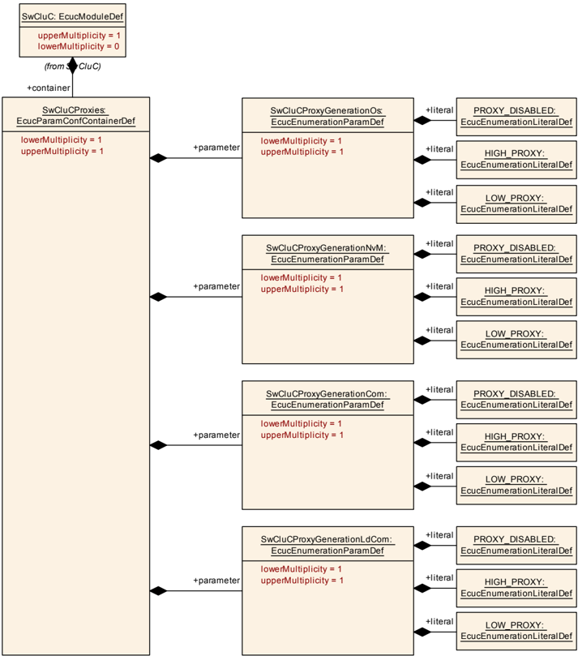

容器 SwCluCProxies 的定义：

| 属性 | 值 |
| --- | --- |
| 容器名称 | SwCluCProxies |
| 父容器 | SwCluC |
| 描述 | Software Cluster Connection 的代理模块（**Proxy Modules**）的通用配置 |
| 多重性配置类 | Pre-compile time：X（All Variants）；Link time：-；Post-build time：- |

参数 SwCluCProxyGenerationCom 的定义：

| 属性 | 值 |
| --- | --- |
| 参数名称 | SwCluCProxyGenerationCom |
| 父容器 | SwCluCProxies |
| 描述 | 定义是否生成 Com 代理（**Com Proxy**）代码和模型。 |
| 多重性 | 1 |
| 类型 | EcucEnumerationParamDef |
| 取值范围 | `HIGH_PROXY`：启用相应的高层代理模块代码和 AUTOSAR 模型生成；`LOW_PROXY`：启用相应的低层代理模块代码和 AUTOSAR 模型生成；`PROXY_DISABLED`：禁用代理模块代码和 AUTOSAR 模型生成。 |
| 多重性配置类 | Pre-compile time：X（All Variants）；Link time：-；Post-build time：- |
| 值配置类 | Pre-compile time：X（All Variants）；Link time：-；Post-build time：- |
| 作用域/依赖 | scope: ECU |

参数 SwCluCProxyGenerationDcm 的定义：

| 属性 | 值 |
| --- | --- |
| 参数名称 | SwCluCProxyGenerationDcm |
| 父容器 | SwCluCProxies |
| 描述 | 定义是否生成 Dcm 代理（**Dcm Proxy**）代码和模型。 |
| 多重性 | 1 |
| 类型 | EcucEnumerationParamDef |
| 取值范围 | `HIGH_PROXY`：启用相应的高层代理模块代码和 AUTOSAR 模型生成；`LOW_PROXY`：启用相应的低层代理模块代码和 AUTOSAR 模型生成；`PROXY_DISABLED`：禁用代理模块代码和 AUTOSAR 模型生成。 |
| 多重性配置类 | Pre-compile time：X（All Variants）；Link time：-；Post-build time：- |
| 值配置类 | Pre-compile time：X（All Variants）；Link time：-；Post-build time：- |
| 作用域/依赖 | scope: ECU |

参数 SwCluCProxyGenerationDem 的定义：

| 属性 | 值 |
| --- | --- |
| 参数名称 | SwCluCProxyGenerationDem |
| 父容器 | SwCluCProxies |
| 描述 | 定义是否生成 Dem 代理（**Dem Proxy**）代码和模型。 |
| 多重性 | 1 |
| 类型 | EcucEnumerationParamDef |
| 取值范围 | `HIGH_PROXY`：启用相应的高层代理模块代码和 AUTOSAR 模型生成；`LOW_PROXY`：启用相应的低层代理模块代码和 AUTOSAR 模型生成；`PROXY_DISABLED`：禁用代理模块代码和 AUTOSAR 模型生成。 |
| 多重性配置类 | Pre-compile time：X（All Variants）；Link time：-；Post-build time：- |
| 值配置类 | Pre-compile time：X（All Variants）；Link time：-；Post-build time：- |
| 作用域/依赖 | scope: ECU |

参数 SwCluCProxyGenerationFiM 的定义：

| 属性 | 值 |
| --- | --- |
| 参数名称 | SwCluCProxyGenerationFiM |
| 父容器 | SwCluCProxies |
| 描述 | 定义是否生成 FiM 代理（**FiM Proxy**）代码和模型。 |
| 多重性 | 1 |
| 类型 | EcucEnumerationParamDef |
| 取值范围 | `HIGH_PROXY`：启用相应的高层代理模块代码和 AUTOSAR 模型生成；`LOW_PROXY`：启用相应的低层代理模块代码和 AUTOSAR 模型生成；`PROXY_DISABLED`：禁用代理模块代码和 AUTOSAR 模型生成。 |
| 多重性配置类 | Pre-compile time：X（All Variants）；Link time：-；Post-build time：- |
| 值配置类 | Pre-compile time：X（All Variants）；Link time：-；Post-build time：- |
| 作用域/依赖 | scope: ECU |

参数 SwCluCProxyGenerationLdCom 的定义：

| 属性 | 值 |
| --- | --- |
| 参数名称 | SwCluCProxyGenerationLdCom |
| 父容器 | SwCluCProxies |
| 描述 | 定义是否生成 LdCom 代理（**LdCom Proxy**）代码和模型。 |
| 多重性 | 1 |
| 类型 | EcucEnumerationParamDef |
| 取值范围 | `HIGH_PROXY`：启用相应的高层代理模块代码和 AUTOSAR 模型生成；`LOW_PROXY`：启用相应的低层代理模块代码和 AUTOSAR 模型生成；`PROXY_DISABLED`：禁用代理模块代码和 AUTOSAR 模型生成。 |
| 多重性配置类 | Pre-compile time：X（All Variants）；Link time：-；Post-build time：- |
| 值配置类 | Pre-compile time：X（All Variants）；Link time：-；Post-build time：- |
| 作用域/依赖 | scope: ECU |

参数 SwCluCProxyGenerationNvM 的定义：

| 属性 | 值 |
| --- | --- |
| 参数名称 | SwCluCProxyGenerationNvM |
| 父容器 | SwCluCProxies |
| 描述 | 定义是否生成 NvM 代理（**NvM Proxy**）代码和模型。 |
| 多重性 | 1 |
| 类型 | EcucEnumerationParamDef |
| 取值范围 | `HIGH_PROXY`：启用相应的高层代理模块代码和 AUTOSAR 模型生成；`LOW_PROXY`：启用相应的低层代理模块代码和 AUTOSAR 模型生成；`PROXY_DISABLED`：禁用代理模块代码和 AUTOSAR 模型生成。 |
| 多重性配置类 | Pre-compile time：X（All Variants）；Link time：-；Post-build time：- |
| 值配置类 | Pre-compile time：X（All Variants）；Link time：-；Post-build time：- |
| 作用域/依赖 | scope: ECU |

参数 SwCluCProxyGenerationOs 的定义：

| 属性 | 值 |
| --- | --- |
| 参数名称 | SwCluCProxyGenerationOs |
| 父容器 | SwCluCProxies |
| 描述 | 定义是否生成 Os 代理（**Os Proxy**）代码和模型。 |
| 多重性 | 1 |
| 类型 | EcucEnumerationParamDef |
| 取值范围 | `HIGH_PROXY`：启用相应的高层代理模块代码和 AUTOSAR 模型生成；`LOW_PROXY`：启用相应的低层代理模块代码和 AUTOSAR 模型生成；`PROXY_DISABLED`：禁用代理模块代码和 AUTOSAR 模型生成。 |
| 多重性配置类 | Pre-compile time：X（All Variants）；Link time：-；Post-build time：- |
| 值配置类 | Pre-compile time：X（All Variants）；Link time：-；Post-build time：- |
| 作用域/依赖 | scope: ECU |

| 容器名称 | 多重性 | 作用域/依赖 |
| --- | --- | --- |
| SwCluCComProxy | 0..1 | Com 代理特定参数。 |
| SwCluCDcmProxy | 0..1 | Dcm 代理特定参数。 |
| SwCluCDemProxy | 0..1 | Dem 代理特定参数。 |
| SwCluCFiMProxy | 0..1 | FiM 代理特定参数。 |
| SwCluCLdComProxy | 0..1 | LdCom 代理特定参数。 |
| SwCluCNvMProxy | 0..1 | NvM 代理特定参数。 |
| SwCluCOsProxy | 0..1 | Os 代理特定参数。 |

#### 8.2.7.1. NvM 代理

图 10.13：NvM 代理参数

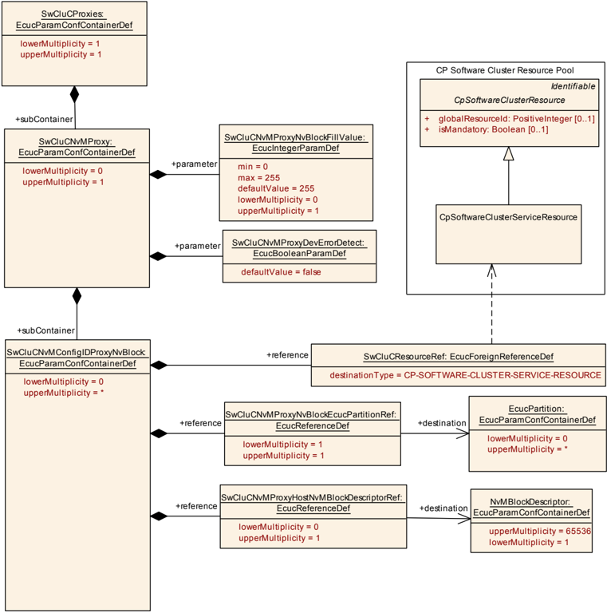

容器 SwCluCNvMProxy 的定义：

| 属性 | 值 |
| --- | --- |
| 容器名称 | SwCluCNvMProxy |
| 父容器 | SwCluCProxies |
| 描述 | NvM 代理特定参数。 |
| 多重性配置类 | Pre-compile time：X（All Variants）；Link time：-；Post-build time：- |

参数 SwCluCNvMProxyDevErrorDetect 的定义：

| 属性 | 值 |
| --- | --- |
| 参数名称 | SwCluCNvMProxyDevErrorDetect |
| 父容器 | SwCluCNvMProxy |
| 描述 | 开启或关闭开发错误检测与通知。**true**：启用检测和通知；**false**：禁用检测和通知。 |
| 多重性 | 1 |
| 类型 | EcucBooleanParamDef |
| 默认值 | false |
| Post-Build 变体值 | false |
| 值配置类 | Pre-compile time：X（All Variants）；Link time：-；Post-build time：- |
| 作用域/依赖 | scope: local |

参数 SwCluCNvMProxyNvBlockFillValue 的定义：

| 属性 | 值 |
| --- | --- |
| 参数名称 | SwCluCNvMProxyNvBlockFillValue |
| 父容器 | SwCluCNvMProxy |
| 描述 | 定义在应用软件集群中的 NvBlock 长度 < 宿主软件集群 NvM 中配置的 NvBlock 长度时，用于填充 NvBlock 空间中未使用字节的默认值。取决于 NvM 代理的实现，该参数仅与 NvM 低层代理或 NvM 高层代理相关。 |
| 多重性 | 0..1 |
| 类型 | EcucIntegerParamDef |
| 取值范围 | 0 .. 255 |
| 默认值 | 255 |
| Post-Build 变体值 | false |
| 多重性配置类 | Pre-compile time：X（All Variants）；Link time：-；Post-build time：- |
| 值配置类 | Pre-compile time：X（All Variants）；Link time：-；Post-build time：- |
| 作用域/依赖 | scope: ECU |

| 容器名称 | 多重性 | 作用域/依赖 |
| --- | --- | --- |
| SwCluCNvMBaseSocket | 1..* | 该容器配置 NvM 代理需要多少个 `EcucPartition` 特定的 API 链接，以及该 API 集合属于哪个集群资源。在 NvM 低层代理中，需要配置所有提供的 API 集合。在 NvM 高层代理中，只配置在此应用软件集群内提供的那些。引用 `SwCluCProxyEcucPartitionRef` 表示提供该 API 集合的 `EcucPartition`。 |
| SwCluCNvMConfigIDProxyNvBlock | 0..* | 描述应用软件集群的配置 ID 块并将其映射到：• 描述集群系统中 NvBlock 资源的 `CpSoftwareClusterServiceResource` • 一个 `EcucPartition` • 一个 **NvMBlockDescriptor**（仅在宿主软件集群的上下文中）。在应用软件集群的作用域内最多可以存在一个 **SwCluCNvMConfigIDProxyNvBlock** 容器。在宿主软件集群的作用域内可以存在多个 **SwCluCNvMConfigIDProxyNvBlock** 容器，应用软件集群的每个配置 ID 块一个。 |
| SwCluCNvMProxyNvBlock | 1..* | 将 **NvMBlockDescriptor** 映射到描述集群系统中 NvBlock 资源的 `CpSoftwareClusterServiceResource`。 |

##### 8.2.7.1.1. NvM 基础套接字

图 10.14：NvM 代理基础套接字

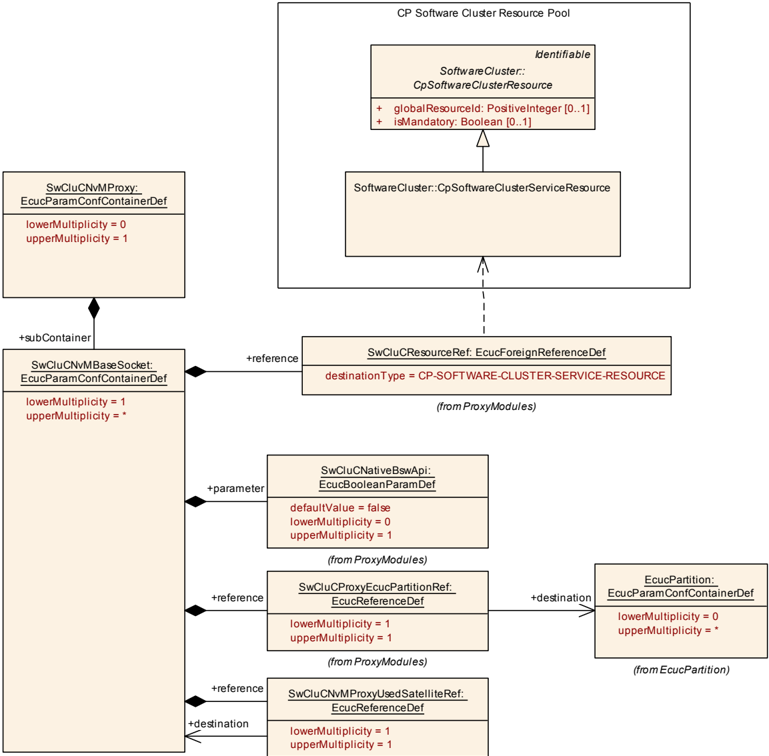

容器 SwCluCNvMBaseSocket 的定义：

| 属性 | 值 |
| --- | --- |
| 容器名称 | SwCluCNvMBaseSocket |
| 父容器 | SwCluCNvMProxy |
| 描述 | 该容器配置 NvM 代理需要多少个 `EcucPartition` 特定的 API 链接，以及该 API 集合属于哪个集群资源。在 NvM 低层代理中，需要配置所有提供的 API 集合。在 NvM 高层代理中，只配置在此应用软件集群内提供的那些。引用 `SwCluCProxyEcucPartitionRef` 表示提供该 API 集合的 `EcucPartition`。 |
| 多重性配置类 | Pre-compile time：X（All Variants）；Link time：-；Post-build time：- |

参数 SwCluCNativeBswApi 的定义：

| 属性 | 值 |
| --- | --- |
| 参数名称 | SwCluCNativeBswApi |
| 父容器 | SwCluCNvMBaseSocket |
| 描述 | 定义是否在此 `EcucPartition` 的应用软件集群中提供不带前缀或后缀的原生 C-API。 |
| 多重性 | 0..1 |
| 类型 | EcucBooleanParamDef |
| 默认值 | false |
| Post-Build 变体值 | false |
| 多重性配置类 | Pre-compile time：All Variants；Link time：-；Post-build time：- |
| 值配置类 | Pre-compile time：All Variants；Link time：-；Post-build time：- |
| 作用域/依赖 | scope: ECU |

参数 SwCluCNvMProxyUsedSatelliteRef 的定义：

| 属性 | 值 |
| --- | --- |
| 参数名称 | SwCluCNvMProxyUsedSatelliteRef |
| 父容器 | SwCluCNvMBaseSocket |
| 描述 | 对可访问 NvM 卫星的 **SwCluCNvMBaseSocket** 的引用。所属的 **SwCluCNvMBaseSocket** 使用被引用 **SwCluCNvMBaseSocket** 的 NvM 卫星。 |
| 多重性 | 1 |
| 类型 | Reference to SwCluCNvMBaseSocket |
| 多重性配置类 | Pre-compile time：X；Link time：-；Post-build time：- |
| 值配置类 | Pre-compile time：X；Link time：-；Post-build time：- |
| 作用域/依赖 | scope: ECU |

参数 SwCluCProxyEcucPartitionRef 的定义：

| 属性 | 值 |
| --- | --- |
| 参数名称 | SwCluCProxyEcucPartitionRef |
| 父容器 | SwCluCNvMBaseSocket |
| 描述 | 对 `EcucPartition` 的引用。 |
| 多重性 | 1 |
| 类型 | Reference to EcucPartition |
| 多重性配置类 | Pre-compile time：X；Link time：-；Post-build time：- |
| 值配置类 | Pre-compile time：X；Link time：-；Post-build time：- |
| 作用域/依赖 | scope: ECU |

参数 SwCluCResourceRef 的定义：

| 属性 | 值 |
| --- | --- |
| 参数名称 | SwCluCResourceRef |
| 父容器 | SwCluCNvMBaseSocket |
| 描述 | 对 `CpSoftwareClusterServiceResource` 的引用。 |
| 多重性 | 1 |
| 类型 | Foreign reference to CP-SOFTWARE-CLUSTER-SERVICE-RESOURCE |
| 作用域/依赖 | scope: ECU |

无包含的容器。

**SwCluCNvMBaseSocket 只与类别为 SWCLUSTER_RES_NVM_BASE_SOCKET 的 CpSoftwareClusterServiceResource 相关：** `SwCluCNvMBaseSocket.SwCluCResourceRef` 应只引用类别为 `SWCLUSTER_RES_NVM_BASE_SOCKET` 的 `CpSoftwareClusterServiceResource`。

##### 8.2.7.1.2. NvM 代理 NvBlock 配置

图 10.15：NvM 代理 NvBlock

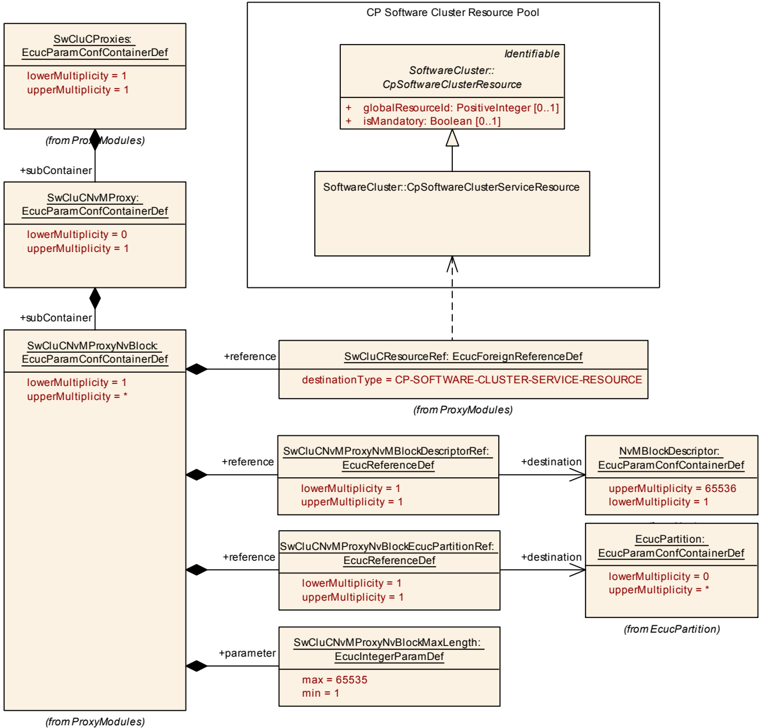

容器 SwCluCNvMProxyNvBlock 的定义：

| 属性 | 值 |
| --- | --- |
| 容器名称 | SwCluCNvMProxyNvBlock |
| 父容器 | SwCluCNvMProxy |
| 描述 | 将 **NvMBlockDescriptor** 映射到描述集群系统中 NvBlock 资源的 `CpSoftwareClusterServiceResource`。 |
| 多重性配置类 | Pre-compile time：X（All Variants）；Link time：-；Post-build time：- |

参数 SwCluCNvMProxyNvBlockMaxLength 的定义：

| 属性 | 值 |
| --- | --- |
| 参数名称 | SwCluCNvMProxyNvBlockMaxLength |
| 父容器 | SwCluCNvMProxyNvBlock |
| 描述 | 定义最大 NV 块数据长度（字节）。 |
| 多重性 | 1 |
| 类型 | EcucIntegerParamDef |
| 取值范围 | 1 .. 65535 |
| 默认值 | - |
| Post-Build 变体值 | false |
| 多重性配置类 | Pre-compile time：X；Link time：-；Post-build time：- |
| 值配置类 | Pre-compile time：X；Link time：-；Post-build time：- |
| 作用域/依赖 | scope: ECU |

参数 SwCluCNvMProxyNvBlockEcucPartitionRef 的定义：

| 属性 | 值 |
| --- | --- |
| 参数名称 | SwCluCNvMProxyNvBlockEcucPartitionRef |
| 父容器 | SwCluCNvMProxyNvBlock |
| 描述 | 对 NvM 代理提供 NvBlock 访问的 `EcucPartition` 的引用（在服务软件组件上调用 API 函数、回调函数和端口）。 |
| 多重性 | 1 |
| 类型 | Reference to EcucPartition |
| 多重性配置类 | Pre-compile time：X（All Variants）；Link time：-；Post-build time：- |
| 值配置类 | Pre-compile time：X（All Variants）；Link time：-；Post-build time：- |
| 作用域/依赖 | scope: ECU |

参数 SwCluCNvMProxyNvMBlockDescriptorRef 的定义：

| 属性 | 值 |
| --- | --- |
| 参数名称 | SwCluCNvMProxyNvMBlockDescriptorRef |
| 父容器 | SwCluCNvMProxyNvBlock |
| 描述 | 对 **NvMBlockDescriptor** 的引用 |
| 多重性 | 1 |
| 类型 | Reference to NvMBlockDescriptor |
| 作用域/依赖 | scope: ECU |

无包含的容器。

**SwCluCNvMProxyNvBlock 只与类别为 SWCLUSTER_RES_NV_BLOCK 的 CpSoftwareClusterServiceResource 相关：** `SwCluCNvMProxyNvBlock.SwCluCResourceRef` 应只引用类别为 `SWCLUSTER_RES_NV_BLOCK` 的 `CpSoftwareClusterServiceResource`。

###### 8.2.7.1.2.1. NvM 代理配置 ID 块配置

容器 SwCluCNvMConfigIDProxyNvBlock 的定义：

| 属性 | 值 |
| --- | --- |
| 容器名称 | SwCluCNvMConfigIDProxyNvBlock |
| 父容器 | SwCluCNvMProxy |
| 描述 | 描述应用软件集群的配置 ID 块并将其映射到：• 描述集群系统中 NvBlock 资源的 `CpSoftwareClusterServiceResource` • 一个 `EcucPartition` • 一个 **NvMBlockDescriptor**（仅在宿主软件集群的上下文中）。在应用软件集群的作用域内最多可以存在一个 **SwCluCNvMConfigIDProxyNvBlock** 容器。在宿主软件集群的作用域内可以存在多个 **SwCluCNvMConfigIDProxyNvBlock** 容器，应用软件集群的每个配置 ID 块一个。 |
| Post-Build 变体多重性 | false |
| 多重性配置类 | Pre-compile time：X（All Variants）；Link time：-；Post-build time：- |

参数 SwCluCNvMProxyHostNvMBlockDescriptorRef 的定义：

| 属性 | 值 |
| --- | --- |
| 参数名称 | SwCluCNvMProxyHostNvMBlockDescriptorRef |
| 父容器 | SwCluCNvMConfigIDProxyNvBlock |
| 描述 | 对宿主软件集群中 NvM 模块的 **NvMBlockDescriptor** 的引用。该引用仅适用于宿主软件集群的上下文。 |
| 多重性 | 0..1 |
| 类型 | Reference to NvMBlockDescriptor |
| Post-Build 变体多重性 | false |
| Post-Build 变体值 | false |
| 多重性配置类 | Pre-compile time：X（All Variants）；Link time：-；Post-build time：- |
| 值配置类 | Pre-compile time：X（All Variants）；Link time：-；Post-build time：- |
| 作用域/依赖 | scope: ECU |

参数 SwCluCNvMProxyNvBlockEcucPartitionRef 的定义：

| 属性 | 值 |
| --- | --- |
| 参数名称 | SwCluCNvMProxyNvBlockEcucPartitionRef |
| 父容器 | SwCluCNvMConfigIDProxyNvBlock |
| 描述 | 对 NvM 代理提供 NvBlock 访问的 `EcucPartition` 的引用（在服务软件组件上调用 API 函数、回调函数和端口）。 |
| 多重性 | 1 |
| 类型 | Reference to EcucPartition |
| 多重性配置类 | Pre-compile time：X（All Variants）；Link time：-；Post-build time：- |
| 值配置类 | Pre-compile time：X（All Variants）；Link time：-；Post-build time：- |
| 作用域/依赖 | scope: ECU |

参数 SwCluCResourceRef 的定义：

| 属性 | 值 |
| --- | --- |
| 参数名称 | SwCluCResourceRef |
| 父容器 | SwCluCNvMConfigIDProxyNvBlock |
| 描述 | 对 `CpSoftwareClusterServiceResource` 的引用。 |
| 多重性 | 1 |
| 类型 | Foreign reference to CP-SOFTWARE-CLUSTER-SERVICE-RESOURCE |
| 作用域/依赖 | scope: ECU |

无包含的容器。

如果应用软件集群的 NvM 模块配置中参数 `NvMDynamicConfiguration` 设置为 true，则在同一应用软件集群的作用域内应恰好存在一个容器 **SwCluCNvMConfigIDProxyNvBlock**。

在应用软件集群的作用域内最多应存在一个 **SwCluCNvMConfigIDProxyNvBlock** 容器。

#### 8.2.7.2. Os 代理

图 10.16：Os 代理参数

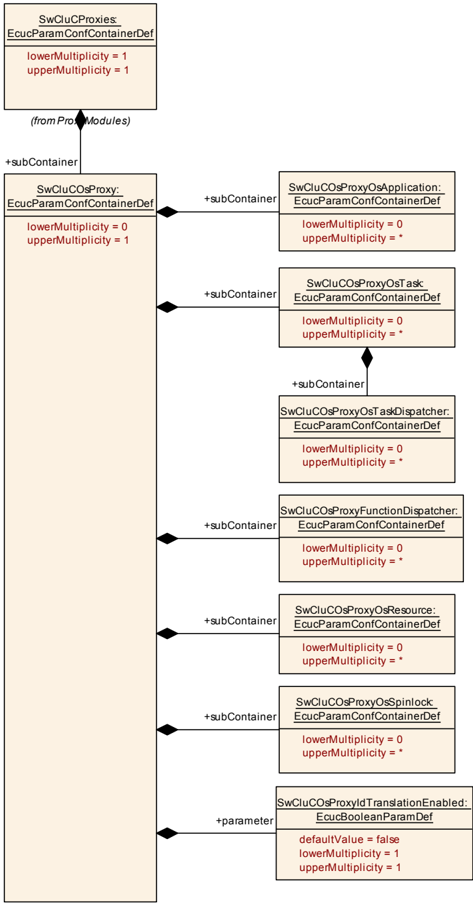

容器 SwCluCOsProxy 的定义：

| 属性 | 值 |
| --- | --- |
| 容器名称 | SwCluCOsProxy |
| 父容器 | SwCluCProxies |
| 描述 | Os 代理特定参数。 |
| 多重性配置类 | Pre-compile time：X（All Variants）；Link time：-；Post-build time：- |

参数 SwCluCOsProxyIdTranslationEnabled 的定义：

| 属性 | 值 |
| --- | --- |
| 参数名称 | SwCluCOsProxyIdTranslationEnabled |
| 父容器 | SwCluCOsProxy |
| 描述 | 启用宿主 SW 集群与应用 SW 集群之间的内核 ID 和应用 ID 的转换。**true**：启用从宿主到应用 SW 集群特定 ID 的转换；**false**：禁用从宿主到应用 SW 集群特定 ID 的转换。 |
| 多重性 | 1 |
| 类型 | EcucBooleanParamDef |
| 默认值 | false |
| Post-Build 变体值 | false |
| 值配置类 | Pre-compile time：X（All Variants）；Link time：-；Post-build time：- |
| 作用域/依赖 | scope: local |

| 容器名称 | 多重性 | 作用域/依赖 |
| --- | --- | --- |
| SwCluCOsProxyFunctionDispatcher | 0..* | |
| SwCluCOsProxyOsApplication | 0..* | |
| SwCluCOsProxyOsBaseSocket | 0..* | |
| SwCluCOsProxyOsResource | 0..* | |
| SwCluCOsProxyOsSpinlock | 0..* | |
| SwCluCOsProxyOsTask | 0..* | |

##### 8.2.7.2.1. Os 代理基础套接字配置

图 10.17：Os 代理基础套接字参数

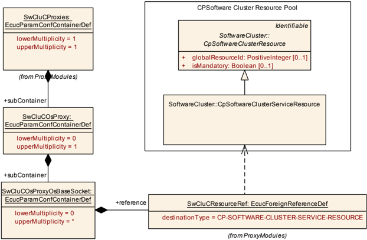

容器 SwCluCOsProxyOsBaseSocket 的定义：

| 属性 | 值 |
| --- | --- |
| 容器名称 | SwCluCOsProxyOsBaseSocket |
| 父容器 | SwCluCOsProxy |
| 描述 | 将 **OsBaseSocket** 映射到描述集群系统中 Os BaseSocket 资源的 `CpSoftwareClusterServiceResource`。 |
| 多重性配置类 | Pre-compile time：X（All Variants）；Link time：-；Post-build time：- |

参数 SwCluCResourceRef 的定义：

| 属性 | 值 |
| --- | --- |
| 参数名称 | SwCluCResourceRef |
| 父容器 | SwCluCOsProxyOsBaseSocket |
| 描述 | 对 `CpSoftwareClusterServiceResource` 的引用。 |
| 多重性 | 1 |
| 类型 | Foreign reference to CP-SOFTWARE-CLUSTER-SERVICE-RESOURCE |
| 作用域/依赖 | scope: ECU |

无包含的容器。

##### 8.2.7.2.2. Os 代理 OsApplication 配置

图 10.18：Os 代理 OsApplication 参数

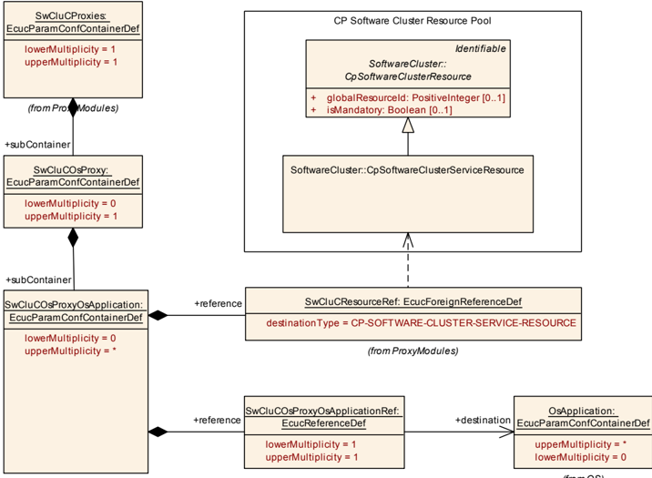

容器 SwCluCOsProxyOsApplication 的定义：

| 属性 | 值 |
| --- | --- |
| 容器名称 | SwCluCOsProxyOsApplication |
| 父容器 | SwCluCOsProxy |
| 描述 | 将 **OsApplication** 映射到描述集群系统中 Os Application 资源的 `CpSoftwareClusterServiceResource`。 |
| 多重性配置类 | Pre-compile time：X（All Variants）；Link time：-；Post-build time：- |

参数 SwCluCOsProxyOsApplicationRef 的定义：

| 属性 | 值 |
| --- | --- |
| 参数名称 | SwCluCOsProxyOsApplicationRef |
| 父容器 | SwCluCOsProxyOsApplication |
| 描述 | 对 **OsApplication** 的引用 |
| 多重性 | 1 |
| 类型 | Reference to OsApplication |
| 作用域/依赖 | scope: ECU |

参数 SwCluCResourceRef 的定义：

| 属性 | 值 |
| --- | --- |
| 参数名称 | SwCluCResourceRef |
| 父容器 | SwCluCOsProxyOsApplication |
| 描述 | 对 `CpSoftwareClusterServiceResource` 的引用。 |
| 多重性 | 1 |
| 类型 | Foreign reference to CP-SOFTWARE-CLUSTER-SERVICE-RESOURCE |
| 作用域/依赖 | scope: ECU |

无包含的容器。

##### 8.2.7.2.3. Os 代理 OsTask 配置

图 10.19：Os 代理 OsTask 参数

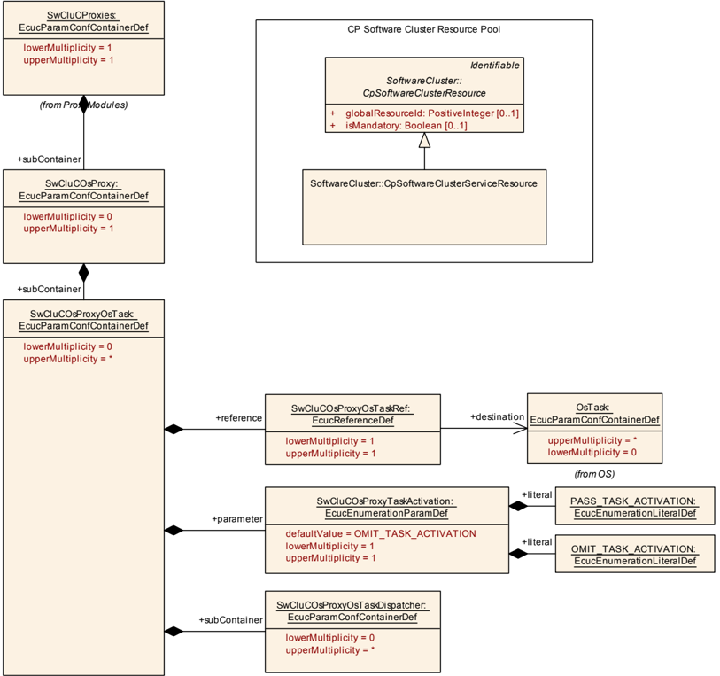

容器 SwCluCOsProxyOsTask 的定义：

| 属性 | 值 |
| --- | --- |
| 容器名称 | SwCluCOsProxyOsTask |
| 父容器 | SwCluCOsProxy |
| 描述 | 将 **OsTask** 映射到描述集群系统中 OsTask 资源的 `CpSoftwareClusterServiceResource`。 |
| 多重性配置类 | Pre-compile time：X（All Variants）；Link time：-；Post-build time：- |

参数 SwCluCOsProxyTaskActivation 的定义：

| 属性 | 值 |
| --- | --- |
| 参数名称 | SwCluCOsProxyTaskActivation |
| 父容器 | SwCluCOsProxyOsTask |
| 描述 | 为该特定的 OsTask 配置是否将 **ActivateTask** 传递给宿主软件集群。 |
| 多重性 | 1 |
| 类型 | EcucEnumerationParamDef |
| 取值范围 | `OMIT_TASK_ACTIVATION`：**ActivateTask** 不传递给宿主软件集群；`PASS_TASK_ACTIVATION`：**ActivateTask** 传递给宿主软件集群。 |
| 默认值 | OMIT_TASK_ACTIVATION |
| 多重性配置类 | Pre-compile time：X（All Variants）；Link time：-；Post-build time：- |
| 值配置类 | Pre-compile time：X（All Variants）；Link time：-；Post-build time：- |
| 作用域/依赖 | scope: ECU |

参数 SwCluCOsProxyOsTaskRef 的定义：

| 属性 | 值 |
| --- | --- |
| 参数名称 | SwCluCOsProxyOsTaskRef |
| 父容器 | SwCluCOsProxyOsTask |
| 描述 | 对 **OsTask** 的引用 |
| 多重性 | 1 |
| 类型 | Reference to OsTask |
| 作用域/依赖 | scope: ECU |

参数 SwCluCResourceRef 的定义：

| 属性 | 值 |
| --- | --- |
| 参数名称 | SwCluCResourceRef |
| 父容器 | SwCluCOsProxyOsTask |
| 描述 | 对 `CpSoftwareClusterServiceResource` 的引用。 |
| 多重性 | 1 |
| 类型 | Foreign reference to CP-SOFTWARE-CLUSTER-SERVICE-RESOURCE |
| 作用域/依赖 | scope: ECU |

| 容器名称 | 多重性 | 作用域/依赖 |
| --- | --- | --- |
| SwCluCOsProxyOsTaskDispatcher | 0..* | |

##### 8.2.7.2.4. Os 代理 OsResource 配置

图 10.20：Os 代理 OsResource 参数

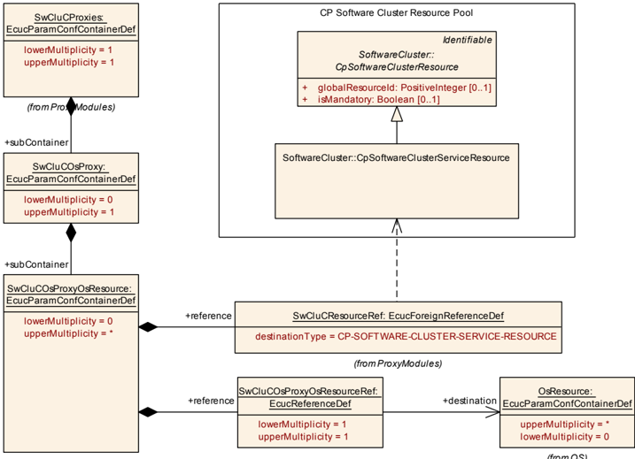

容器 SwCluCOsProxyOsResource 的定义：

| 属性 | 值 |
| --- | --- |
| 容器名称 | SwCluCOsProxyOsResource |
| 父容器 | SwCluCOsProxy |
| 描述 | 将 **OsResource** 映射到描述集群系统中 Os Resource 资源的 `CpSoftwareClusterServiceResource`。 |
| 多重性配置类 | Pre-compile time：X（All Variants）；Link time：-；Post-build time：- |

参数 SwCluCOsProxyOsResourceRef 的定义：

| 属性 | 值 |
| --- | --- |
| 参数名称 | SwCluCOsProxyOsResourceRef |
| 父容器 | SwCluCOsProxyOsResource |
| 描述 | 对 **OsResource** 的引用 |
| 多重性 | 1 |
| 类型 | Reference to OsResource |
| 作用域/依赖 | scope: ECU |

参数 SwCluCResourceRef 的定义：

| 属性 | 值 |
| --- | --- |
| 参数名称 | SwCluCResourceRef |
| 父容器 | SwCluCOsProxyOsResource |
| 描述 | 对 `CpSoftwareClusterServiceResource` 的引用。 |
| 多重性 | 1 |
| 类型 | Foreign reference to CP-SOFTWARE-CLUSTER-SERVICE-RESOURCE |
| 作用域/依赖 | scope: ECU |

无包含的容器。

**SwCluCOsProxyOsResource 只与类别为 SWCLUSTER_RES_OS_RESOURCE 的 CpSoftwareClusterServiceResource 相关：** `SwCluCOsProxyOsResource.SwCluCResourceRef` 应只引用类别为 `SWCLUSTER_RES_OS_RESOURCE` 的 `CpSoftwareClusterServiceResource`。

##### 8.2.7.2.5. Os 代理 OsSpinlock 配置

图 10.21：Os 代理 OsSpinlock 参数

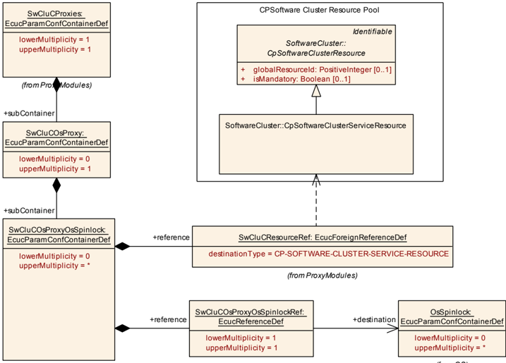

容器 SwCluCOsProxyOsSpinlock 的定义：

| 属性 | 值 |
| --- | --- |
| 容器名称 | SwCluCOsProxyOsSpinlock |
| 父容器 | SwCluCOsProxy |
| 描述 | 将 **OsSpinlock** 映射到描述集群系统中 Os Spinlock 资源的 `CpSoftwareClusterServiceResource`。 |
| 多重性配置类 | Pre-compile time：X（All Variants）；Link time：-；Post-build time：- |

参数 SwCluCOsProxyOsSpinlockRef 的定义：

| 属性 | 值 |
| --- | --- |
| 参数名称 | SwCluCOsProxyOsSpinlockRef |
| 父容器 | SwCluCOsProxyOsSpinlock |
| 描述 | 对 **OsSpinlock** 的引用 |
| 多重性 | 1 |
| 类型 | Reference to OsSpinlock |
| 作用域/依赖 | scope: ECU |

参数 SwCluCResourceRef 的定义：

| 属性 | 值 |
| --- | --- |
| 参数名称 | SwCluCResourceRef |
| 父容器 | SwCluCOsProxyOsSpinlock |
| 描述 | 对 `CpSoftwareClusterServiceResource` 的引用。 |
| 多重性 | 1 |
| 类型 | Foreign reference to CP-SOFTWARE-CLUSTER-SERVICE-RESOURCE |
| 作用域/依赖 | scope: ECU |

无包含的容器。

**SwCluCOsProxyOsSpinlock 只与类别为 SWCLUSTER_RES_OS_SPINLOCK 的 CpSoftwareClusterServiceResource 相关：** `SwCluCOsProxyOsSpinlock.SwCluCResourceRef` 应只引用类别为 `SWCLUSTER_RES_OS_SPINLOCK` 的 `CpSoftwareClusterServiceResource`。

##### 8.2.7.2.6. Os 代理任务调度器配置

图 10.22：Os 代理任务调度器参数

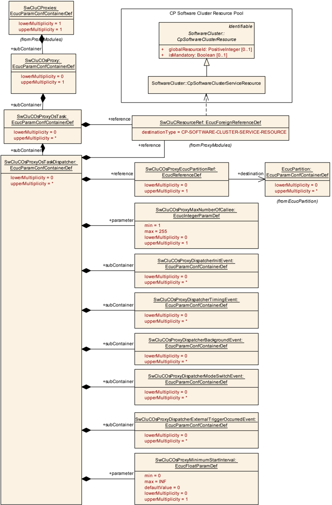

容器 SwCluCOsProxyOsTaskDispatcher 的定义：

| 属性 | 值 |
| --- | --- |
| 容器名称 | SwCluCOsProxyOsTaskDispatcher |
| 父容器 | SwCluCOsProxyOsTask |
| 描述 | 该容器为所属的代理任务定义一个任务调度器。在 Os 高层代理中，该配置将 OS 任务体函数作为分发入口点（**Dispatch Entry Point**）提供在二进制清单中，可由 Os 低层代理调用。在 `HIGH_PROXY` 配置中，一个 **SwCluCOsProxyOsTask** 最多可以拥有一个 **SwCluCOsProxyOsTaskDispatcher**。在 Os 低层代理中，该配置提供调度器可运行实体（以及二进制清单中相应的资源条目），它能够调用 Os 高层代理的 `MaxNumberOfCallee` 个分发入口点。在 `LOW_PROXY` 配置中，一个 **SwCluCOsProxyOsTask** 可以拥有多个 **SwCluCOsProxyOsTaskDispatcher**。如果未配置任何 **SwCluCOsProxyDispatcher&lt;xxx&gt;Event** 容器，则由集成者对相应的 RTE 事件进行建模。 |
| 多重性配置类 | Pre-compile time：X（All Variants）；Link time：-；Post-build time：- |

参数 SwCluCOsProxyMaxNumberOfCallee 的定义：

| 属性 | 值 |
| --- | --- |
| 参数名称 | SwCluCOsProxyMaxNumberOfCallee |
| 父容器 | SwCluCOsProxyOsTaskDispatcher |
| 描述 | 定义 Os 低层代理的调度器最多能够调用多少个分发入口点。在 Os 低层代理中该配置参数是强制性的。 |
| 多重性 | 0..1 |
| 类型 | EcucIntegerParamDef |
| 取值范围 | 1 .. 255 |
| 默认值 | - |
| 作用域/依赖 | scope: ECU |

参数 SwCluCOsProxyMinimumStartInterval 的定义：

| 属性 | 值 |
| --- | --- |
| 参数名称 | SwCluCOsProxyMinimumStartInterval |
| 父容器 | SwCluCOsProxyOsTaskDispatcher |
| 描述 | 规定调度器可运行实体的两次相继启动之间保证分隔的时间（秒）。 |
| 多重性 | 0..1 |
| 类型 | EcucFloatParamDef |
| 取值范围 | [0 .. INF] |
| 默认值 | 0 |
| 作用域/依赖 | scope: ECU |

参数 SwCluCOsProxyEcucPartitionRef 的定义：

| 属性 | 值 |
| --- | --- |
| 参数名称 | SwCluCOsProxyEcucPartitionRef |
| 父容器 | SwCluCOsProxyOsTaskDispatcher |
| 描述 | 如果未提供该引用，任务调度器在与所属 **SwCluCOsProxyOsTask** 相关的 OsTask 的 OsApplication 所属的 EcuPartition 上提供。如果提供了该引用，任务调度器在被引用的 EcuPartition 上提供。在这种情况下，任务调度器在与所属 **SwCluCOsProxyOsTask** 相关的 OsTask 中被调度，但在调度器在应用软件集群中调度代理任务之前会切换其分区。 |
| 多重性 | 0..1 |
| 类型 | Reference to EcucPartition |
| 多重性配置类 | Pre-compile time：X（All Variants）；Link time：-；Post-build time：- |
| 值配置类 | Pre-compile time：X（All Variants）；Link time：-；Post-build time：- |
| 作用域/依赖 | scope: ECU |

参数 SwCluCResourceRef 的定义：

| 属性 | 值 |
| --- | --- |
| 参数名称 | SwCluCResourceRef |
| 父容器 | SwCluCOsProxyOsTaskDispatcher |
| 描述 | 对 `CpSoftwareClusterServiceResource` 的引用。 |
| 多重性 | 1 |
| 类型 | Foreign reference to CP-SOFTWARE-CLUSTER-SERVICE-RESOURCE |
| 作用域/依赖 | scope: ECU |

| 容器名称 | 多重性 | 作用域/依赖 |
| --- | --- | --- |
| SwCluCOsProxyDispatcherBackgroundEvent | 0..* | 配置启动所属调度器可运行实体的 **BackgroundEvent**。 |
| SwCluCOsProxyDispatcherExternalTriggerOccurredEvent | 0..* | 配置启动所属调度器可运行实体的 **ExternalTriggerOccurredEvent**。 |
| SwCluCOsProxyDispatcherInitEvent | 0..* | 配置启动所属调度器可运行实体的 **InitEvent**。 |
| SwCluCOsProxyDispatcherModeSwitchEvent | 0..* | 配置启动所属调度器可运行实体的 **ModeSwitchEvent**。 |
| SwCluCOsProxyDispatcherTimingEvent | 0..* | 配置启动所属调度器可运行实体的 **TimingEvent**。 |

###### 8.2.7.2.6.1. Os 代理任务调度器 Timing 事件配置

图 10.23：Os 代理任务调度器 Timing 事件参数

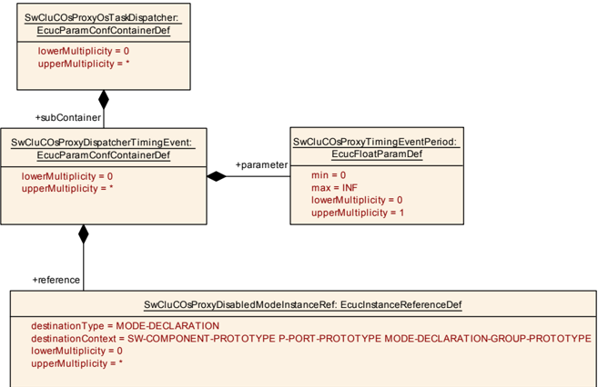

容器 SwCluCOsProxyDispatcherTimingEvent 的定义：

| 属性 | 值 |
| --- | --- |
| 容器名称 | SwCluCOsProxyDispatcherTimingEvent |
| 父容器 | SwCluCOsProxyOsTaskDispatcher |
| 描述 | 配置启动所属调度器可运行实体的 **TimingEvent**。 |
| 多重性配置类 | Pre-compile time：X（All Variants）；Link time：-；Post-build time：- |

参数 SwCluCOsProxyTimingEventPeriod 的定义：

| 属性 | 值 |
| --- | --- |
| 参数名称 | SwCluCOsProxyTimingEventPeriod |
| 父容器 | SwCluCOsProxyDispatcherTimingEvent |
| 描述 | Timing 事件的周期（秒）。 |
| 多重性 | 0..1 |
| 类型 | EcucFloatParamDef |
| 默认值 | - |
| 作用域/依赖 | scope: ECU |

参数 SwCluCOsProxyDisabledModeInstanceRef 的定义：

| 属性 | 值 |
| --- | --- |
| 参数名称 | SwCluCOsProxyDisabledModeInstanceRef |
| 父容器 | SwCluCOsProxyDispatcherTimingEvent |
| 描述 | 对 P 端口原型（**PPortPrototype**）中禁用该事件的模式（**Mode**）实例的引用。 |
| 多重性 | 0..* |
| 类型 | Instance reference to MODE-DECLARATION context: SW-COMPONENT-PROTOTYPE P-PORT-PROTOTYPE MODE-DECLARATION-GROUP-PROTOTYPE |
| 作用域/依赖 | scope: ECU |

###### 8.2.7.2.6.2. Os 代理任务调度器 Background 事件配置

图 10.24：Os 代理任务调度器 Background 事件参数

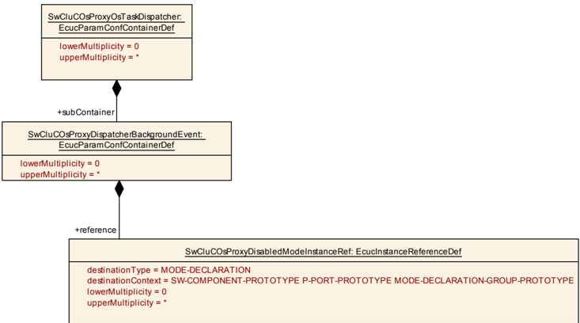

容器 SwCluCOsProxyDispatcherBackgroundEvent 的定义：

| 属性 | 值 |
| --- | --- |
| 容器名称 | SwCluCOsProxyDispatcherBackgroundEvent |
| 父容器 | SwCluCOsProxyOsTaskDispatcher |
| 描述 | 配置启动所属调度器可运行实体的 **BackgroundEvent**。 |
| 多重性配置类 | Pre-compile time：X（All Variants）；Link time：-；Post-build time：- |

参数 SwCluCOsProxyDisabledModeInstanceRef 的定义：

| 属性 | 值 |
| --- | --- |
| 参数名称 | SwCluCOsProxyDisabledModeInstanceRef |
| 父容器 | SwCluCOsProxyDispatcherBackgroundEvent |
| 描述 | 对 P 端口原型中禁用该事件的模式实例的引用。 |
| 多重性 | 0..* |
| 类型 | Instance reference to MODE-DECLARATION context: SW-COMPONENT-PROTOTYPE P-PORT-PROTOTYPE MODE-DECLARATION-GROUP-PROTOTYPE |
| 作用域/依赖 | scope: ECU |

###### 8.2.7.2.6.3. Os 代理任务调度器 Init 事件配置

图 10.25：Os 代理任务调度器 Init 事件参数

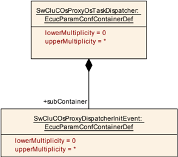

容器 SwCluCOsProxyDispatcherInitEvent 的定义：

| 属性 | 值 |
| --- | --- |
| 容器名称 | SwCluCOsProxyDispatcherInitEvent |
| 父容器 | SwCluCOsProxyOsTaskDispatcher |
| 描述 | 配置启动所属调度器可运行实体的 **InitEvent**。 |
| Post-Build 变体多重性 | false |
| 多重性配置类 | Pre-compile time：X（All Variants）；Link time：-；Post-build time：- |

###### 8.2.7.2.6.4. Os 代理任务调度器模式切换事件配置

图 10.26：Os 代理任务调度器模式切换事件参数

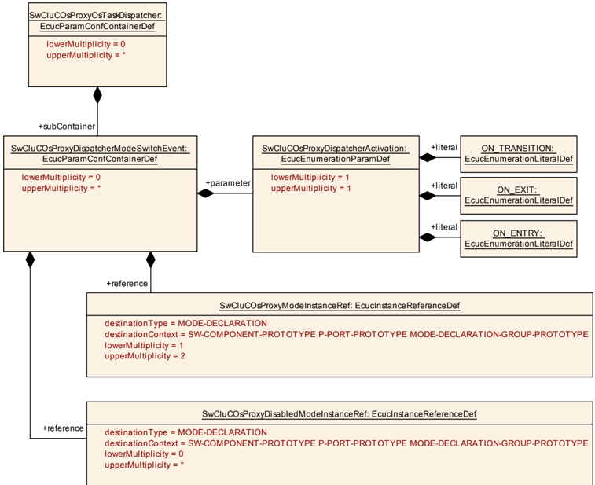

容器 SwCluCOsProxyDispatcherModeSwitchEvent 的定义：

| 属性 | 值 |
| --- | --- |
| 容器名称 | SwCluCOsProxyDispatcherModeSwitchEvent |
| 父容器 | SwCluCOsProxyOsTaskDispatcher |
| 描述 | 配置启动所属调度器可运行实体的 **ModeSwitchEvent**。 |
| 多重性配置类 | Pre-compile time：X（All Variants）；Link time：-；Post-build time：- |

参数 SwCluCOsProxyDispatcherActivation 的定义：

| 属性 | 值 |
| --- | --- |
| 参数名称 | SwCluCOsProxyDispatcherActivation |
| 父容器 | SwCluCOsProxyDispatcherModeSwitchEvent |
| 描述 | 规定事件是在进入还是退出被引用的模式（**Mode**）实例时激活。 |
| 多重性 | 1 |
| 类型 | EcucEnumerationParamDef |
| 取值范围 | `ON_ENTRY`：在进入所引用的模式时；`ON_EXIT`：在退出所引用的模式时；`ON_TRANSITION`：在从第 1 个被引用模式切换到第 2 个被引用模式时。 |
| 默认值 | ON_ENTRY |
| 多重性配置类 | Pre-compile time：X（All Variants）；Link time：-；Post-build time：- |
| 值配置类 | Pre-compile time：X（All Variants）；Link time：-；Post-build time：- |
| 作用域/依赖 | scope: ECU |

参数 SwCluCOsProxyDisabledModeInstanceRef 的定义：

| 属性 | 值 |
| --- | --- |
| 参数名称 | SwCluCOsProxyDisabledModeInstanceRef |
| 父容器 | SwCluCOsProxyDispatcherModeSwitchEvent |
| 描述 | 对 P 端口原型中禁用该事件的模式实例的引用。 |
| 多重性 | 0..* |
| 类型 | Instance reference to MODE-DECLARATION context: SW-COMPONENT-PROTOTYPE P-PORT-PROTOTYPE MODE-DECLARATION-GROUP-PROTOTYPE |
| 作用域/依赖 | scope: ECU |

参数 SwCluCOsProxyModeInstanceRef 的定义：

| 属性 | 值 |
| --- | --- |
| 参数名称 | SwCluCOsProxyModeInstanceRef |
| 父容器 | SwCluCOsProxyDispatcherModeSwitchEvent |
| 描述 | 对发起模式切换的 P 端口原型中一个或两个模式（**Mode**）实例的引用。 |
| 多重性 | 1..2 |
| 类型 | Instance reference to MODE-DECLARATION context: SW-COMPONENT-PROTOTYPE P-PORT-PROTOTYPE MODE-DECLARATION-GROUP-PROTOTYPE |
| 作用域/依赖 | scope: ECU |

###### 8.2.7.2.6.5. Os 代理任务调度器外部触发发生事件配置

图 10.27：Os 代理任务调度器外部触发发生事件参数

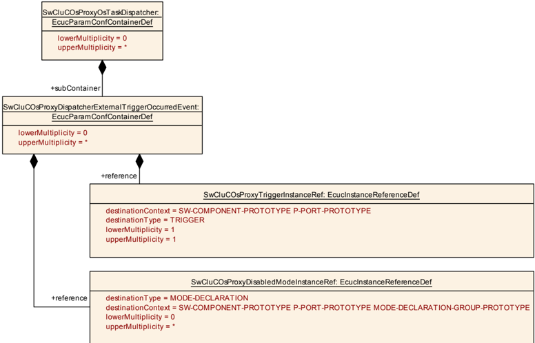

容器 SwCluCOsProxyDispatcherExternalTriggerOccurredEvent 的定义：

| 属性 | 值 |
| --- | --- |
| 容器名称 | SwCluCOsProxyDispatcherExternalTriggerOccurredEvent |
| 父容器 | SwCluCOsProxyOsTaskDispatcher |
| 描述 | 配置启动所属调度器可运行实体的 **ExternalTriggerOccurredEvent**。 |
| 多重性配置类 | Pre-compile time：X（All Variants）；Link time：-；Post-build time：- |

参数 SwCluCOsProxyDisabledModeInstanceRef 的定义：

| 属性 | 值 |
| --- | --- |
| 参数名称 | SwCluCOsProxyDisabledModeInstanceRef |
| 父容器 | SwCluCOsProxyDispatcherExternalTriggerOccurredEvent |
| 描述 | 对 P 端口原型中禁用该事件的模式（**Mode**）实例的引用。 |
| 多重性 | 0..* |
| 类型 | Instance reference to MODE-DECLARATION context: SW-COMPONENT-PROTOTYPE P-PORT-PROTOTYPE MODE-DECLARATION-GROUP-PROTOTYPE |
| 作用域/依赖 | scope: ECU |

参数 SwCluCOsProxyTriggerInstanceRef 的定义：

| 属性 | 值 |
| --- | --- |
| 参数名称 | SwCluCOsProxyTriggerInstanceRef |
| 父容器 | SwCluCOsProxyDispatcherExternalTriggerOccurredEvent |
| 描述 | 对 P 端口原型中发出触发器的触发器（**Trigger**）实例的引用。 |
| 多重性 | 1 |
| 类型 | Instance reference to TRIGGER context: SW-COMPONENT-PROTOTYPE P-PORT-PROTOTYPE |
| 作用域/依赖 | scope: ECU |

##### 8.2.7.2.7. Os 代理函数调度器配置

图 10.28：Os 代理函数调度器参数

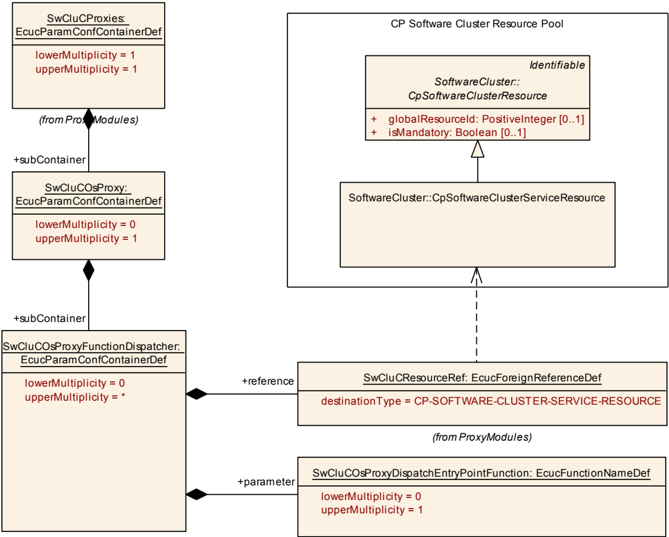

容器 SwCluCOsProxyFunctionDispatcher 的定义：

| 属性 | 值 |
| --- | --- |
| 容器名称 | SwCluCOsProxyFunctionDispatcher |
| 父容器 | SwCluCOsProxy |
| 描述 | 该容器配置一个函数调度器。在 Os 高层代理中，该配置将一个函数作为分发入口点（**Dispatch Entry Point**）放入二进制清单中，可由 Os 低层代理调用。在 Os 低层代理中，该配置提供调度器函数（以及二进制清单中相应的资源条目），它能够调用 Os 高层代理的 `MaxNumberOfCallee` 个分发入口点。 |
| 多重性配置类 | Pre-compile time：X（All Variants）；Link time：-；Post-build time：- |

参数 SwCluCOsProxyDispatchEntryPointFunction 的定义：

| 属性 | 值 |
| --- | --- |
| 参数名称 | SwCluCOsProxyDispatchEntryPointFunction |
| 父容器 | SwCluCOsProxyFunctionDispatcher |
| 描述 | 作为分发入口点放入二进制清单的函数的名称。在 Os 高层代理中该配置参数是强制性的。 |
| 多重性 | 0..1 |
| 类型 | EcucFunctionNameDef |
| 默认值 | - |
| 正则表达式 | - |
| 多重性配置类 | Pre-compile time：X（All Variants）；Link time：-；Post-build time：- |
| 值配置类 | Pre-compile time：X（All Variants）；Link time：-；Post-build time：- |
| 作用域/依赖 | scope: ECU |

参数 SwCluCResourceRef 的定义：

| 属性 | 值 |
| --- | --- |
| 参数名称 | SwCluCResourceRef |
| 父容器 | SwCluCOsProxyFunctionDispatcher |
| 描述 | 对 `CpSoftwareClusterServiceResource` 的引用。 |
| 多重性 | 1 |
| 类型 | Foreign reference to CP-SOFTWARE-CLUSTER-SERVICE-RESOURCE |
| 作用域/依赖 | scope: ECU |

无包含的容器。

#### 8.2.7.3. Com 代理

图 10.29：Com 代理参数

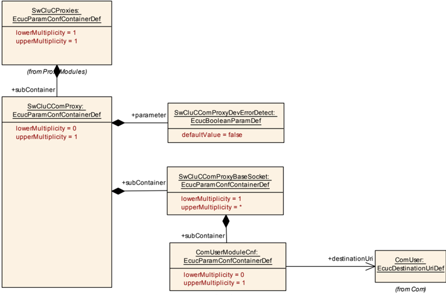

容器 SwCluCComProxy 的定义：

| 属性 | 值 |
| --- | --- |
| 容器名称 | SwCluCComProxy |
| 父容器 | SwCluCProxies |
| 描述 | Com 代理特定参数。 |
| 多重性配置类 | Pre-compile time：X（All Variants）；Link time：-；Post-build time：- |

参数 SwCluCComProxyDevErrorDetect 的定义：

| 属性 | 值 |
| --- | --- |
| 参数名称 | SwCluCComProxyDevErrorDetect |
| 父容器 | SwCluCComProxy |
| 描述 | 开启或关闭开发错误检测与通知。**true**：启用检测和通知；**false**：禁用检测和通知。 |
| 多重性 | 1 |
| 类型 | EcucBooleanParamDef |
| 默认值 | false |
| Post-Build 变体值 | false |
| 值配置类 | Pre-compile time：X（All Variants）；Link time：-；Post-build time：- |
| 作用域/依赖 | scope: local |

| 容器名称 | 多重性 | 作用域/依赖 |
| --- | --- | --- |
| SwCluCComProxyBaseSocket | 1..* | |

##### 8.2.7.3.1. Com 代理基础套接字

图 10.30：Com 代理基础套接字

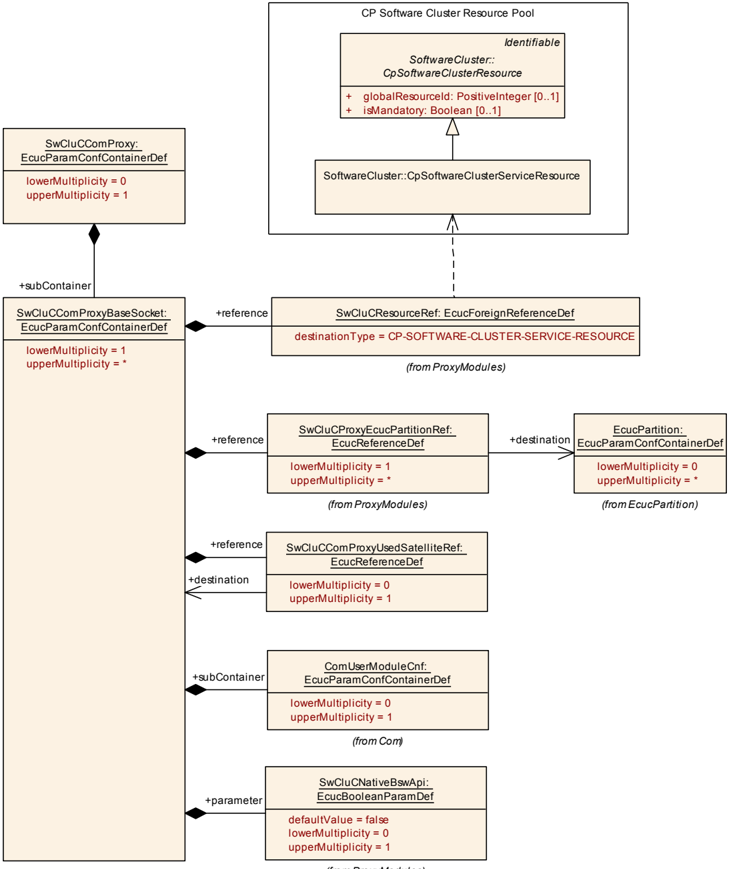

容器 SwCluCComProxyBaseSocket 的定义：

| 属性 | 值 |
| --- | --- |
| 容器名称 | SwCluCComProxyBaseSocket |
| 父容器 | SwCluCComProxy |
| 描述 | 该容器配置 Com 代理需要多少个 `EcucPartition` 特定的 API 链接，以及该 API 集合属于哪个集群资源。 |
| 多重性配置类 | Pre-compile time：X（All Variants）；Link time：-；Post-build time：- |

参数 SwCluCNativeBswApi 的定义：

| 属性 | 值 |
| --- | --- |
| 参数名称 | SwCluCNativeBswApi |
| 父容器 | SwCluCComProxyBaseSocket |
| 描述 | 定义是否在此 `EcucPartition` 的应用软件集群中提供不带前缀或后缀的原生 C-API。 |
| 多重性 | 0..1 |
| 类型 | EcucBooleanParamDef |
| 默认值 | false |
| Post-Build 变体值 | false |
| 多重性配置类 | Pre-compile time：X（All Variants）；Link time：-；Post-build time：- |
| 值配置类 | Pre-compile time：X（All Variants）；Link time：-；Post-build time：- |
| 作用域/依赖 | scope: ECU |

参数 SwCluCComProxyUsedSatelliteRef 的定义：

| 属性 | 值 |
| --- | --- |
| 参数名称 | SwCluCComProxyUsedSatelliteRef |
| 父容器 | SwCluCComProxyBaseSocket |
| 描述 | 对可访问 Com 卫星的 **SwCluCComBaseSocket** 的引用。所属的 **SwCluCComBaseSocket** 使用被引用 **SwCluCComBaseSocket** 的 Com 卫星。 |
| 多重性 | 0..1 |
| 类型 | Reference to SwCluCComProxyBaseSocket |
| 多重性配置类 | Pre-compile time：X；Link time：-；Post-build time：- |
| 值配置类 | Pre-compile time：X；Link time：-；Post-build time：- |
| 作用域/依赖 | scope: ECU |

参数 SwCluCProxyEcucPartitionRef 的定义：

| 属性 | 值 |
| --- | --- |
| 参数名称 | SwCluCProxyEcucPartitionRef |
| 父容器 | SwCluCComProxyBaseSocket |
| 描述 | 对 `EcucPartition` 的引用。 |
| 多重性 | 1..* |
| 类型 | Reference to EcucPartition |
| 多重性配置类 | Pre-compile time：X（All Variants）；Link time：-；Post-build time：- |
| 值配置类 | Pre-compile time：X（All Variants）；Link time：-；Post-build time：- |
| 作用域/依赖 | scope: ECU |

参数 SwCluCResourceRef 的定义：

| 属性 | 值 |
| --- | --- |
| 参数名称 | SwCluCResourceRef |
| 父容器 | SwCluCComProxyBaseSocket |
| 描述 | 对 `CpSoftwareClusterServiceResource` 的引用。 |
| 多重性 | 1 |
| 类型 | Foreign reference to CP-SOFTWARE-CLUSTER-SERVICE-RESOURCE |
| 作用域/依赖 | scope: ECU |

| 容器名称 | 多重性 | 作用域/依赖 |
| --- | --- | --- |
| ComUserModuleCnf | 0..1 | |

##### 8.2.7.3.2. Com 用户模块配置

图 10.31：Com 用户模块配置

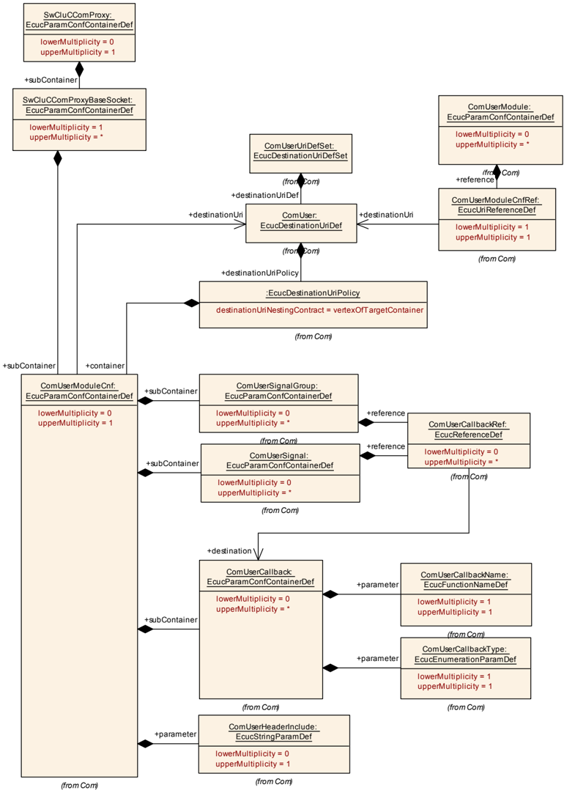

容器 ComUserModuleCnf 的定义：

| 属性 | 值 |
| --- | --- |
| 容器名称 | ComUserModuleCnf |
| 父容器 | RteComUser、SwCluCComProxyBaseSocket |
| Destination Uri Definition | ComUser |
| 描述 | 包含 Com 用户模块的配置参数。 |
| Post-Build 变体多重性 | false |
| 多重性配置类 | Pre-compile time：X（All Variants）；Link time：-；Post-build time：- |

参数 ComUserHeaderInclude 的定义：

| 属性 | 值 |
| --- | --- |
| 参数名称 | ComUserHeaderInclude |
| 父容器 | ComUserModuleCnf |
| 描述 | 定义 Com 用户提供已配置回调的函数声明所在的头文件。 |
| 多重性 | 0..1 |
| 类型 | EcucStringParamDef |
| 默认值 | - |
| 正则表达式 | - |
| Post-Build 变体值 | false |
| 值配置类 | Pre-compile time：X（All Variants）；Link time：-；Post-build time：- |
| 作用域/依赖 | scope: local |

| 容器名称 | 多重性 | 作用域/依赖 |
| --- | --- | --- |
| ComUserCallback | 0..* | |
| ComUserSignal | 0..* | |
| ComUserSignalGroup | 0..* | |

##### 8.2.7.3.3. Com 用户信号与信号组

###### 8.2.7.3.3.1. Com 用户信号

图 10.32：Com 用户信号与信号组

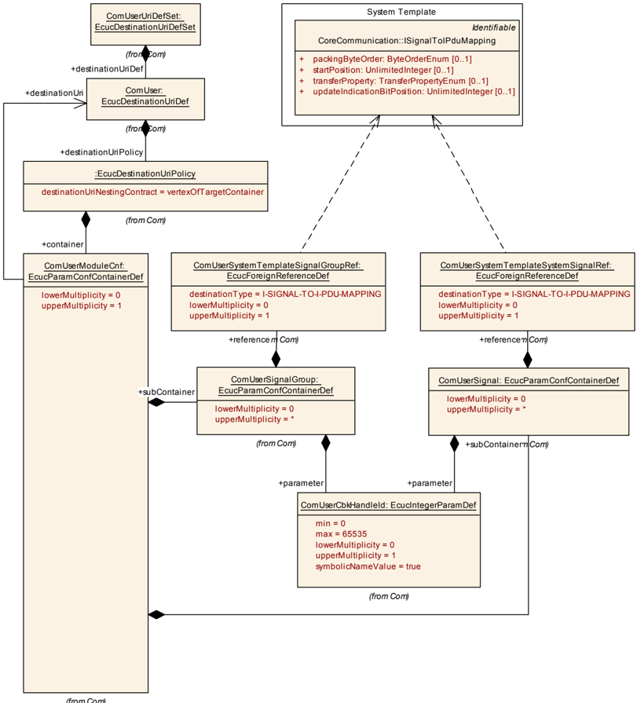

容器 ComUserSignal 的定义：

| 属性 | 值 |
| --- | --- |
| 容器名称 | ComUserSignal |
| 父容器 | ComUserModuleCnf |
| 描述 | 包含 Com 用户模块内一个信号的配置参数。请注意，定义不带任何回调引用的 ComUserSignal 是有效的。 |
| Post-Build 变体多重性 | true |
| 多重性配置类 | Pre-compile time：X（All Variants）；Link time：-；Post-build time：- |

参数 ComUserCbkHandleId 的定义：

| 属性 | 值 |
| --- | --- |
| 参数名称 | ComUserCbkHandleId |
| 父容器 | ComUserSignal |
| 描述 | 用作 Com 用户回调句柄 ID 的数值。该 ID 在使用 `ComUserCbkHandleId` 参数的 COM 回调中标识信号和信号组。 |
| 多重性 | 0..1 |
| 类型 | EcucIntegerParamDef（为此参数生成符号名） |
| 取值范围 | 0 .. 65535 |
| 默认值 | - |
| Post-Build 变体多重性 | false |
| Post-Build 变体值 | false |
| 多重性配置类 | Pre-compile time：X（All Variants）；Link time：-；Post-build time：- |
| 值配置类 | Pre-compile time：X（All Variants）；Link time：-；Post-build time：- |
| 作用域/依赖 | scope: ECU |

参数 ComUserCallbackRef 的定义：

| 属性 | 值 |
| --- | --- |
| 参数名称 | ComUserCallbackRef |
| 父容器 | ComUserSignal |
| 描述 | 对该信号或信号组的所有回调的引用。 |
| 多重性 | 0..* |
| 类型 | Reference to ComUserCallback |
| Post-Build 变体多重性 | true |
| Post-Build 变体值 | true |
| 多重性配置类 | Pre-compile time：X（All Variants）；Link time：-；Post-build time：- |
| 值配置类 | Pre-compile time：X（All Variants）；Link time：-；Post-build time：- |
| 作用域/依赖 | scope: ECU |

参数 ComUserSystemTemplateSystemSignalRef 的定义：

| 属性 | 值 |
| --- | --- |
| 参数名称 | ComUserSystemTemplateSystemSignalRef |
| 父容器 | ComUserSignal |
| 描述 | 对 **ISignalToIPduMapping** 的引用，该映射包含对此 **ComUserSignal**（或 **ComUserGroupSignal**）所表示的 ISignal（系统模板）的引用。 |
| 多重性 | 0..1 |
| 类型 | Foreign reference to I-SIGNAL-TO-I-PDU-MAPPING |
| Post-Build 变体多重性 | true |
| Post-Build 变体值 | true |
| 多重性配置类 | Pre-compile time：X（All Variants）；Link time：-；Post-build time：- |
| 值配置类 | Pre-compile time：X（All Variants）；Link time：-；Post-build time：- |
| 作用域/依赖 | scope: ECU |

###### 8.2.7.3.3.2. Com 用户信号组

容器 ComUserSignalGroup 的定义：

| 属性 | 值 |
| --- | --- |
| 容器名称 | ComUserSignalGroup |
| 父容器 | ComUserModuleCnf |
| 描述 | 包含 Com 用户模块内一个信号组的配置参数。请注意，定义不带任何回调引用的 ComUserSignalGroup 是有效的。 |
| Post-Build 变体多重性 | true |
| 多重性配置类 | Pre-compile time：X（All Variants）；Link time：-；Post-build time：- |

参数 ComUserCbkHandleId 的定义：

| 属性 | 值 |
| --- | --- |
| 参数名称 | ComUserCbkHandleId |
| 父容器 | ComUserSignalGroup |
| 描述 | 用作 Com 用户回调句柄 ID 的数值。该 ID 在使用 `ComUserCbkHandleId` 参数的 COM 回调中标识信号和信号组。 |
| 多重性 | 0..1 |
| 类型 | EcucIntegerParamDef（为此参数生成符号名） |
| 取值范围 | 0 .. 65535 |
| 默认值 | - |
| Post-Build 变体多重性 | false |
| Post-Build 变体值 | false |
| 多重性配置类 | Pre-compile time：X（All Variants）；Link time：-；Post-build time：- |
| 值配置类 | Pre-compile time：X（All Variants）；Link time：-；Post-build time：- |
| 作用域/依赖 | scope: ECU |

参数 ComUserCallbackRef 的定义：

| 属性 | 值 |
| --- | --- |
| 参数名称 | ComUserCallbackRef |
| 父容器 | ComUserSignalGroup |
| 描述 | 对该信号或信号组的所有回调的引用。 |
| 多重性 | 0..* |
| 类型 | Reference to ComUserCallback |
| Post-Build 变体多重性 | true |
| Post-Build 变体值 | true |
| 多重性配置类 | Pre-compile time：X（All Variants）；Link time：-；Post-build time：- |
| 值配置类 | Pre-compile time：X（All Variants）；Link time：-；Post-build time：- |
| 作用域/依赖 | scope: ECU |

参数 ComUserSystemTemplateSignalGroupRef 的定义：

| 属性 | 值 |
| --- | --- |
| 参数名称 | ComUserSystemTemplateSignalGroupRef |
| 父容器 | ComUserSignalGroup |
| 描述 | 对 **ISignalToIPduMapping** 的引用，该映射包含对此 **ComUserSignalGroup** 所表示的 ISignalGroup（系统模板）的引用。 |
| 多重性 | 0..1 |
| 类型 | Foreign reference to I-SIGNAL-TO-I-PDU-MAPPING |
| Post-Build 变体多重性 | true |
| Post-Build 变体值 | true |
| 多重性配置类 | Pre-compile time：X（All Variants）；Link time：-；Post-build time：- |
| 值配置类 | Pre-compile time：X（All Variants）；Link time：-；Post-build time：- |
| 作用域/依赖 | scope: ECU |

##### 8.2.7.3.4. Com 用户回调

图 10.33：Com 用户回调

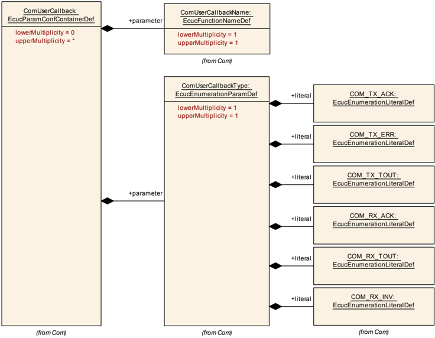

容器 ComUserCallback 的定义：

| 属性 | 值 |
| --- | --- |
| 容器名称 | ComUserCallback |
| 父容器 | ComUserModuleCnf |
| 描述 | 该容器为信号和信号组定义一个 Com 回调函数。 |
| Post-Build 变体多重性 | true |
| 多重性配置类 | Pre-compile time：X（All Variants）；Link time：-；Post-build time：- |

参数 ComUserCallbackName 的定义：

| 属性 | 值 |
| --- | --- |
| 参数名称 | ComUserCallbackName |
| 父容器 | ComUserCallback |
| 描述 | 要调用的回调函数的名称。 |
| 多重性 | 1 |
| 类型 | EcucFunctionNameDef |
| 默认值 | - |
| 正则表达式 | - |
| Post-Build 变体多重性 | false |
| Post-Build 变体值 | false |
| 多重性配置类 | Pre-compile time：X（All Variants）；Link time：-；Post-build time：- |
| 值配置类 | Pre-compile time：X（All Variants）；Link time：-；Post-build time：- |
| 作用域/依赖 | scope: ECU |

参数 ComUserCallbackType 的定义：

| 属性 | 值 |
| --- | --- |
| 参数名称 | ComUserCallbackType |
| 父容器 | ComUserCallback |
| 描述 | Com 回调的类型 |
| 多重性 | 1 |
| 类型 | EcucEnumerationParamDef |
| 取值范围 | `COM_RX_ACK`、`COM_RX_INV`、`COM_RX_TOUT`、`COM_TX_ACK`、`COM_TX_ERR`、`COM_TX_TOUT` |
| Post-Build 变体多重性 | false |
| Post-Build 变体值 | false |
| 多重性配置类 | Pre-compile time：X（All Variants）；Link time：-；Post-build time：- |
| 值配置类 | Pre-compile time：X（All Variants）；Link time：-；Post-build time：- |
| 作用域/依赖 | scope: ECU |

#### 8.2.7.4. LdCom 代理

图 10.34：LdCom 代理参数

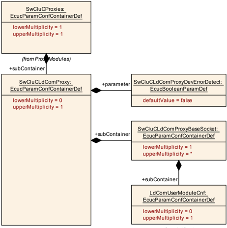

容器 SwCluCLdComProxy 的定义：

| 属性 | 值 |
| --- | --- |
| 容器名称 | SwCluCLdComProxy |
| 父容器 | SwCluCProxies |
| 描述 | LdCom 代理特定参数。 |
| 多重性配置类 | Pre-compile time：X（All Variants）；Link time：-；Post-build time：- |

参数 SwCluCLdComProxyDevErrorDetect 的定义：

| 属性 | 值 |
| --- | --- |
| 参数名称 | SwCluCLdComProxyDevErrorDetect |
| 父容器 | SwCluCLdComProxy |
| 描述 | 开启或关闭开发错误检测与通知。**true**：启用检测和通知；**false**：禁用检测和通知。 |
| 多重性 | 1 |
| 类型 | EcucBooleanParamDef |
| 默认值 | false |
| Post-Build 变体值 | false |
| 值配置类 | Pre-compile time：X（All Variants）；Link time：-；Post-build time：- |
| 作用域/依赖 | scope: local |

| 容器名称 | 多重性 | 作用域/依赖 |
| --- | --- | --- |
| SwCluCLdComProxyBaseSocket | 1..* | |

##### 8.2.7.4.1. LdCom 基础套接字

图 10.35：LdCom 代理基础套接字

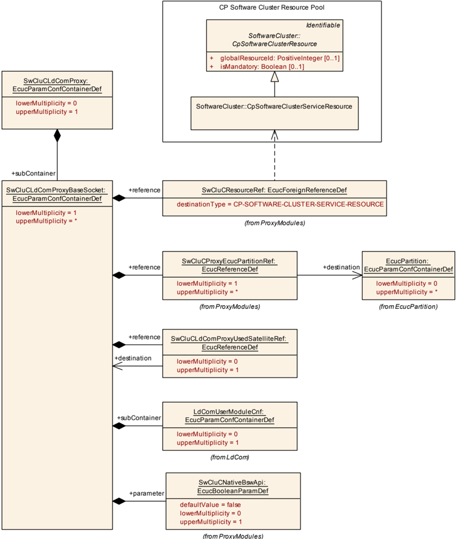

容器 SwCluCLdComProxyBaseSocket 的定义：

| 属性 | 值 |
| --- | --- |
| 容器名称 | SwCluCLdComProxyBaseSocket |
| 父容器 | SwCluCLdComProxy |
| 描述 | 该容器配置 LdCom 代理需要多少个 `EcucPartition` 特定的 API 链接，以及该 API 集合属于哪个集群资源。 |
| 多重性配置类 | Pre-compile time：X（All Variants）；Link time：-；Post-build time：- |

参数 SwCluCNativeBswApi 的定义：

| 属性 | 值 |
| --- | --- |
| 参数名称 | SwCluCNativeBswApi |
| 父容器 | SwCluCLdComProxyBaseSocket |
| 描述 | 定义是否在此 `EcucPartition` 的应用软件集群中提供不带前缀或后缀的原生 C-API。 |
| 多重性 | 0..1 |
| 类型 | EcucBooleanParamDef |
| 默认值 | false |
| Post-Build 变体值 | false |
| 多重性配置类 | Pre-compile time：X（All Variants）；Link time：-；Post-build time：- |
| 值配置类 | Pre-compile time：X（All Variants）；Link time：-；Post-build time：- |
| 作用域/依赖 | scope: ECU |

参数 SwCluCLdComProxyUsedSatelliteRef 的定义：

| 属性 | 值 |
| --- | --- |
| 参数名称 | SwCluCLdComProxyUsedSatelliteRef |
| 父容器 | SwCluCLdComProxyBaseSocket |
| 描述 | 对可访问 LdCom 卫星的 **SwCluCLdComBaseSocket** 的引用。所属的 **SwCluCLdComBaseSocket** 使用被引用 **SwCluCLdComBaseSocket** 的 LdCom 卫星。 |
| 多重性 | 0..1 |
| 类型 | Reference to SwCluCLdComProxyBaseSocket |
| 多重性配置类 | Pre-compile time：X；Link time：-；Post-build time：- |
| 值配置类 | Pre-compile time：X；Link time：-；Post-build time：- |
| 作用域/依赖 | scope: ECU |

参数 SwCluCProxyEcucPartitionRef 的定义：

| 属性 | 值 |
| --- | --- |
| 参数名称 | SwCluCProxyEcucPartitionRef |
| 父容器 | SwCluCLdComProxyBaseSocket |
| 描述 | 对 `EcucPartition` 的引用。 |
| 多重性 | 1..* |
| 类型 | Reference to EcucPartition |
| 多重性配置类 | Pre-compile time：X（All Variants）；Link time：-；Post-build time：- |
| 值配置类 | Pre-compile time：X（All Variants）；Link time：-；Post-build time：- |
| 作用域/依赖 | scope: ECU |

参数 SwCluCResourceRef 的定义：

| 属性 | 值 |
| --- | --- |
| 参数名称 | SwCluCResourceRef |
| 父容器 | SwCluCLdComProxyBaseSocket |
| 描述 | 对 `CpSoftwareClusterServiceResource` 的引用。 |
| 多重性 | 1 |
| 类型 | Foreign reference to CP-SOFTWARE-CLUSTER-SERVICE-RESOURCE |
| 作用域/依赖 | scope: ECU |

| 容器名称 | 多重性 | 作用域/依赖 |
| --- | --- | --- |
| LdComUserModuleCnf | 0..1 | |

##### 8.2.7.4.2. LdCom 用户模块配置

图 10.36：LdCom 用户模块配置


容器 LdComUserModuleCnf 的定义：

| 属性 | 值 |
| --- | --- |
| 容器名称 | LdComUserModuleCnf |
| 父容器 | RteLdComUser、SwCluCLdComProxyBaseSocket |
| Destination Uri Definition | LdComUser |
| 描述 | 包含 LdCom 用户模块的配置参数。 |
| Post-Build 变体多重性 | false |
| 多重性配置类 | Pre-compile time：X（All Variants）；Link time：-；Post-build time：- |

参数 LdComUserHeaderInclude 的定义：

| 属性 | 值 |
| --- | --- |
| 参数名称 | LdComUserHeaderInclude |
| 父容器 | LdComUserModuleCnf |
| 描述 | 定义 LdCom 用户提供已配置回调的函数声明所在的头文件。 |
| 多重性 | 0..1 |
| 类型 | EcucStringParamDef |
| 默认值 | - |
| 正则表达式 | - |
| Post-Build 变体值 | false |
| 多重性配置类 | Pre-compile time：X（All Variants）；Link time：-；Post-build time：- |
| 值配置类 | Pre-compile time：X（All Variants）；Link time：-；Post-build time：- |
| 作用域/依赖 | scope: local |

| 容器名称 | 多重性 | 作用域/依赖 |
| --- | --- | --- |
| LdComUserCallback | 0..* | |
| LdComUserIPdu | 0..* | |

##### 8.2.7.4.3. LdCom 用户 IPdu

容器 LdComUserIPdu 的定义：

| 属性 | 值 |
| --- | --- |
| 容器名称 | LdComUserIPdu |
| 父容器 | LdComUserModuleCnf |
| 描述 | 包含 LdCom 用户模块内 LdCom 信号（**LdComIPdu**）的配置参数。 |
| Post-Build 变体多重性 | true |
| 多重性配置类 | Pre-compile time：X（All Variants）；Link time：-；Post-build time：- |

参数 LdComUserCbkHandleId 的定义：

| 属性 | 值 |
| --- | --- |
| 参数名称 | LdComUserCbkHandleId |
| 父容器 | LdComUserIPdu |
| 描述 | 用作 LdCom 用户回调句柄 ID 的数值。这是 LdCom 使用 `LdComUserCbkHandleId` 参数调用 LdCom 用户（Rte、SwCluC LdCom 低层代理或 CDD）的回调时所用的 ID。会创建一个相应的符号名引用，可用于用户的调用。 |
| 多重性 | 1 |
| 类型 | EcucIntegerParamDef（为此参数生成符号名） |
| 取值范围 | 0 .. 65535 |
| 默认值 | - |
| Post-Build 变体值 | false |
| 值配置类 | Pre-compile time：X（All Variants）；Link time：-；Post-build time：- |
| 作用域/依赖 | scope: ECU |

参数 LdComUserCallbackRef 的定义：

| 属性 | 值 |
| --- | --- |
| 参数名称 | LdComUserCallbackRef |
| 父容器 | LdComUserIPdu |
| 描述 | 对该 **LdComIPdu** 的所有回调的引用。 |
| 多重性 | 0..* |
| 类型 | Reference to LdComUserCallback |
| Post-Build 变体多重性 | true |
| Post-Build 变体值 | true |
| 多重性配置类 | Pre-compile time：X（All Variants）；Link time：-；Post-build time：- |
| 值配置类 | Pre-compile time：X（All Variants）；Link time：-；Post-build time：- |
| 作用域/依赖 | scope: ECU |

参数 LdComUserSystemTemplateSignalRef 的定义：

| 属性 | 值 |
| --- | --- |
| 参数名称 | LdComUserSystemTemplateSignalRef |
| 父容器 | LdComUserIPdu |
| 描述 | 对包含对 ISignal（系统模板）引用的 **ISignalToIPduMapping** 的引用。 |
| 多重性 | 1 |
| 类型 | Foreign reference to I-SIGNAL-TO-I-PDU-MAPPING |
| Post-Build 变体多重性 | true |
| Post-Build 变体值 | true |
| 多重性配置类 | Pre-compile time：X（All Variants）；Link time：-；Post-build time：- |
| 值配置类 | Pre-compile time：X（All Variants）；Link time：-；Post-build time：- |
| 作用域/依赖 | scope: ECU |

无包含的容器。

##### 8.2.7.4.4. LdCom 用户回调

图 10.37：LdCom 用户回调


容器 LdComUserCallback 的定义：

| 属性 | 值 |
| --- | --- |
| 容器名称 | LdComUserCallback |
| 父容器 | LdComUserModuleCnf |
| 描述 | 该容器为一个 **LdComIPdu** 定义 LdCom 回调函数。 |
| Post-Build 变体多重性 | true |
| 多重性配置类 | Pre-compile time：X（All Variants）；Link time：-；Post-build time：- |

参数 LdComUserCallbackName 的定义：

| 属性 | 值 |
| --- | --- |
| 参数名称 | LdComUserCallbackName |
| 父容器 | LdComUserCallback |
| 描述 | 要调用的回调函数的名称。 |
| 多重性 | 1 |
| 类型 | EcucFunctionNameDef |
| 默认值 | - |
| 正则表达式 | - |
| Post-Build 变体多重性 | false |
| Post-Build 变体值 | false |
| 多重性配置类 | Pre-compile time：X（All Variants）；Link time：-；Post-build time：- |
| 值配置类 | Pre-compile time：X（All Variants）；Link time：-；Post-build time：- |
| 作用域/依赖 | scope: ECU |

参数 LdComUserCallbackType 的定义：

| 属性 | 值 |
| --- | --- |
| 参数名称 | LdComUserCallbackType |
| 父容器 | LdComUserCallback |
| 描述 | LdCom 回调的类型 |
| 多重性 | 1 |
| 类型 | EcucEnumerationParamDef |
| 取值范围 | `LDCOM_RX_INDICATION`、`LDCOM_RX_START_OF_RECEPTION`、`LDCOM_TP_COPY_RX_DATA`、`LDCOM_TP_COPY_TX_DATA`、`LDCOM_TP_RX_INDICATION`、`LDCOM_TP_TX_CONFIRMATION`、`LDCOM_TX_CONFIRMATION`、`LDCOM_TX_TRIGGER_TRANSMIT` |
| Post-Build 变体多重性 | false |
| Post-Build 变体值 | false |
| 多重性配置类 | Pre-compile time：X（All Variants）；Link time：-；Post-build time：- |
| 值配置类 | Pre-compile time：X（All Variants）；Link time：-；Post-build time：- |
| 作用域/依赖 | scope: ECU |

#### 8.2.7.5. Dcm 代理

容器 SwCluCDcmProxy 的定义：

| 属性 | 值 |
| --- | --- |
| 容器名称 | SwCluCDcmProxy |
| 父容器 | SwCluCProxies |
| 描述 | Dcm 代理特定参数。 |
| 多重性配置类 | Pre-compile time：X（All Variants）；Link time：-；Post-build time：- |

参数 SwCluCDcmProxyDevErrorDetect 的定义：

| 属性 | 值 |
| --- | --- |
| 参数名称 | SwCluCDcmProxyDevErrorDetect |
| 父容器 | SwCluCDcmProxy |
| 描述 | 开启或关闭开发错误检测与通知。**true**：启用检测和通知；**false**：禁用检测和通知。 |
| 多重性 | 1 |
| 类型 | EcucBooleanParamDef |
| 默认值 | false |
| Post-Build 变体值 | false |
| 值配置类 | Pre-compile time：X（All Variants）；Link time：-；Post-build time：- |
| 作用域/依赖 | scope: local |

| 容器名称 | 多重性 | 作用域/依赖 |
| --- | --- | --- |
| SwCluCDcmProxyBaseSocket | 1..* | |
| SwCluCDcmProxyDiagnosticData | 0..* | |
| SwCluCDcmProxyRoutineControl | 0..* | |
| SwCluCDcmProxyServiceRequestNotification | 0..* | |

##### 8.2.7.5.1. Dcm 基础套接字

容器 SwCluCDcmProxyBaseSocket 的定义：

| 属性 | 值 |
| --- | --- |
| 容器名称 | SwCluCDcmProxyBaseSocket |
| 父容器 | SwCluCDcmProxy |
| 描述 | 该容器配置 Dcm 代理需要多少个 `EcucPartition` 特定的 API 链接，以及该 API 集合属于哪个集群资源。 |
| 多重性配置类 | Pre-compile time：X（All Variants）；Link time：-；Post-build time：- |

参数 SwCluCNativeBswApi 的定义：

| 属性 | 值 |
| --- | --- |
| 参数名称 | SwCluCNativeBswApi |
| 父容器 | SwCluCDcmProxyBaseSocket |
| 描述 | 定义是否在此 `EcucPartition` 的应用软件集群中提供不带前缀或后缀的原生 C-API。 |
| 多重性 | 0..1 |
| 类型 | EcucBooleanParamDef |
| 默认值 | false |
| Post-Build 变体值 | false |
| 多重性配置类 | Pre-compile time：X（All Variants）；Link time：-；Post-build time：- |
| 值配置类 | Pre-compile time：X（All Variants）；Link time：-；Post-build time：- |
| 作用域/依赖 | scope: ECU |

参数 SwCluCDcmProxyUsedSatelliteRef 的定义：

| 属性 | 值 |
| --- | --- |
| 参数名称 | SwCluCDcmProxyUsedSatelliteRef |
| 父容器 | SwCluCDcmProxyBaseSocket |
| 描述 | 对可访问 Dcm 卫星的 **SwCluCDemBaseSocket** 的引用。所属的 **SwCluCDemBaseSocket** 使用被引用 **SwCluCDemBaseSocket** 的 Dcm 卫星。 |
| 多重性 | 0..1 |
| 类型 | Reference to SwCluCDcmProxyBaseSocket |
| 多重性配置类 | Pre-compile time：X；Link time：-；Post-build time：- |
| 值配置类 | Pre-compile time：X；Link time：-；Post-build time：- |
| 作用域/依赖 | scope: ECU |

参数 SwCluCProxyEcucPartitionRef 的定义：

| 属性 | 值 |
| --- | --- |
| 参数名称 | SwCluCProxyEcucPartitionRef |
| 父容器 | SwCluCDcmProxyBaseSocket |
| 描述 | 对 `EcucPartition` 的引用。 |
| 多重性 | 1 |
| 类型 | Reference to EcucPartition |
| 多重性配置类 | Pre-compile time：X（All Variants）；Link time：-；Post-build time：- |
| 值配置类 | Pre-compile time：X（All Variants）；Link time：-；Post-build time：- |
| 作用域/依赖 | scope: ECU |

参数 SwCluCResourceRef 的定义：

| 属性 | 值 |
| --- | --- |
| 参数名称 | SwCluCResourceRef |
| 父容器 | SwCluCDcmProxyBaseSocket |
| 描述 | 对 `CpSoftwareClusterServiceResource` 的引用。 |
| 多重性 | 1 |
| 类型 | Foreign reference to CP-SOFTWARE-CLUSTER-SERVICE-RESOURCE |
| 作用域/依赖 | scope: ECU |

##### 8.2.7.5.2. Dcm 代理诊断数据

图 10.38：Dcm 代理参数


容器 SwCluCDcmProxyDiagnosticData 的定义：

| 属性 | 值 |
| --- | --- |
| 容器名称 | SwCluCDcmProxyDiagnosticData |
| 父容器 | SwCluCDcmProxy |
| 描述 | 为 DID 或 PID 或 IOControl 配置一个诊断数据代理。 |
| 多重性配置类 | Pre-compile time：X（All Variants）；Link time：-；Post-build time：- |

参数 SwCluCDcmProxyDataRef 的定义：

| 属性 | 值 |
| --- | --- |
| 参数名称 | SwCluCDcmProxyDataRef |
| 父容器 | SwCluCDcmProxyDiagnosticData |
| 描述 | 对 Dcm 诊断数据的引用，可以是 **DcmDspData**、**DcmDspPidService01** 或 **DcmDspDid**。仅当 DID 恰好有一个需要基于 DID 的接口的诊断数据元素时，DcmDspDid 引用才适用于应用软件集群。该引用在应用软件集群中是强制性的，并可在宿主软件集群中用于标识 Dcm 配置中的相关诊断数据。 |
| 多重性 | 0..* |
| 类型 | Choice reference to [ DcmDspData, DcmDspDid, DcmDspPidService01, DemDataElementClass ] |
| 作用域/依赖 | scope: ECU |

参数 SwCluCDextDiagnosticDataElementRef 的定义：

| 属性 | 值 |
| --- | --- |
| 参数名称 | SwCluCDextDiagnosticDataElementRef |
| 父容器 | SwCluCDcmProxyDiagnosticData |
| 描述 | 对 DEXT 中 **DiagnosticDataElement** 的引用，用于基于 DEXT 的配置方法中的回溯。 |
| 多重性 | 0..1 |
| 类型 | Foreign reference to DIAGNOSTIC-DATA-ELEMENT |
| 作用域/依赖 | scope: ECU |

参数 SwCluCProxyEcucPartitionRef 的定义：

| 属性 | 值 |
| --- | --- |
| 参数名称 | SwCluCProxyEcucPartitionRef |
| 父容器 | SwCluCDcmProxyDiagnosticData |
| 描述 | 对 `EcucPartition` 的引用。 |
| 多重性 | 1 |
| 类型 | Reference to EcucPartition |
| 多重性配置类 | Pre-compile time：X（All Variants）；Link time：-；Post-build time：- |
| 值配置类 | Pre-compile time：X（All Variants）；Link time：-；Post-build time：- |
| 作用域/依赖 | scope: ECU |

参数 SwCluCResourceRef 的定义：

| 属性 | 值 |
| --- | --- |
| 参数名称 | SwCluCResourceRef |
| 父容器 | SwCluCDcmProxyDiagnosticData |
| 描述 | 对 `CpSoftwareClusterServiceResource` 的引用。 |
| 多重性 | 1 |
| 类型 | Foreign reference to CP-SOFTWARE-CLUSTER-SERVICE-RESOURCE |
| 作用域/依赖 | scope: ECU |

##### 8.2.7.5.3. Dcm 代理例程控制

图 10.39：Dcm 代理基础套接字


容器 SwCluCDcmProxyRoutineControl 的定义：

| 属性 | 值 |
| --- | --- |
| 容器名称 | SwCluCDcmProxyRoutineControl |
| 父容器 | SwCluCDcmProxy |
| 描述 | 配置一个例程控制（**Routine Control**）代理。 |
| 多重性配置类 | Pre-compile time：X（All Variants）；Link time：-；Post-build time：- |

参数 SwCluCDcmProxyRoutineRef 的定义：

| 属性 | 值 |
| --- | --- |
| 参数名称 | SwCluCDcmProxyRoutineRef |
| 父容器 | SwCluCDcmProxyRoutineControl |
| 描述 | 对 Dcm 例程配置的引用。该引用在应用软件集群中是强制性的，并可在宿主软件集群中用于标识 Dcm 配置中的相关例程控制。 |
| 多重性 | 0..1 |
| 类型 | Reference to DcmDspRoutine |
| 作用域/依赖 | scope: ECU |

参数 SwCluCDextRoutineSubfunctionRef 的定义：

| 属性 | 值 |
| --- | --- |
| 参数名称 | SwCluCDextRoutineSubfunctionRef |
| 父容器 | SwCluCDcmProxyRoutineControl |
| 描述 | 对 DEXT 中 **Routine Subfunction** 的引用，用于基于 DEXT 的配置方法中的回溯。 |
| 多重性 | 0..1 |
| 类型 | Foreign reference to DIAGNOSTIC-ROUTINE-SUBFUNCTION |
| 作用域/依赖 | scope: ECU |

参数 SwCluCProxyEcucPartitionRef 的定义：

| 属性 | 值 |
| --- | --- |
| 参数名称 | SwCluCProxyEcucPartitionRef |
| 父容器 | SwCluCDcmProxyRoutineControl |
| 描述 | 对 `EcucPartition` 的引用。 |
| 多重性 | 1 |
| 类型 | Reference to EcucPartition |
| 多重性配置类 | Pre-compile time：X（All Variants）；Link time：-；Post-build time：- |
| 值配置类 | Pre-compile time：X（All Variants）；Link time：-；Post-build time：- |
| 作用域/依赖 | scope: ECU |

参数 SwCluCResourceRef 的定义：

| 属性 | 值 |
| --- | --- |
| 参数名称 | SwCluCResourceRef |
| 父容器 | SwCluCDcmProxyRoutineControl |
| 描述 | 对 `CpSoftwareClusterServiceResource` 的引用。 |
| 多重性 | 1 |
| 类型 | Foreign reference to CP-SOFTWARE-CLUSTER-SERVICE-RESOURCE |
| 作用域/依赖 | scope: ECU |

##### 8.2.7.5.4. Dcm 代理服务请求通知

容器 SwCluCDcmProxyServiceRequestNotification 的定义：

| 属性 | 值 |
| --- | --- |
| 容器名称 | SwCluCDcmProxyServiceRequestNotification |
| 父容器 | SwCluCDcmProxy |
| 描述 | 配置一个服务请求通知（**Service Request Notification**）代理。 |
| 多重性配置类 | Pre-compile time：X（All Variants）；Link time：-；Post-build time：- |

参数 SwCluCDcmProxyNotificationRef 的定义：

| 属性 | 值 |
| --- | --- |
| 参数名称 | SwCluCDcmProxyNotificationRef |
| 父容器 | SwCluCDcmProxyServiceRequestNotification |
| 描述 | 对 Dcm 服务请求通知配置的引用，可以是 **DcmDsdServiceRequestSupplierNotification** 或 **DcmDsdServiceRequestManufacturerNotification**。该引用在应用软件集群中是强制性的，并可在宿主软件集群中用于标识 Dcm 配置中的相关通知。 |
| 多重性 | 0..1 |
| 类型 | Choice reference to [ DcmDsdServiceRequestManufacturerNotification, DcmDsdServiceRequestSupplierNotification ] |
| 作用域/依赖 | scope: ECU |

参数 SwCluCProxyEcucPartitionRef 的定义：

| 属性 | 值 |
| --- | --- |
| 参数名称 | SwCluCProxyEcucPartitionRef |
| 父容器 | SwCluCDcmProxyServiceRequestNotification |
| 描述 | 对 `EcucPartition` 的引用。 |
| 多重性 | 1 |
| 类型 | Reference to EcucPartition |
| 多重性配置类 | Pre-compile time：X（All Variants）；Link time：-；Post-build time：- |
| 值配置类 | Pre-compile time：X（All Variants）；Link time：-；Post-build time：- |
| 作用域/依赖 | scope: ECU |

参数 SwCluCResourceRef 的定义：

| 属性 | 值 |
| --- | --- |
| 参数名称 | SwCluCResourceRef |
| 父容器 | SwCluCDcmProxyServiceRequestNotification |
| 描述 | 对 `CpSoftwareClusterServiceResource` 的引用。 |
| 多重性 | 1 |
| 类型 | Foreign reference to CP-SOFTWARE-CLUSTER-SERVICE-RESOURCE |
| 作用域/依赖 | scope: ECU |

#### 8.2.7.6. Dem 代理

图 10.43：Dem 代理参数


容器 SwCluCDemProxy 的定义：

| 属性 | 值 |
| --- | --- |
| 容器名称 | SwCluCDemProxy |
| 父容器 | SwCluCProxies |
| 描述 | Dem 代理特定参数。 |
| 多重性配置类 | Pre-compile time：X（All Variants）；Link time：-；Post-build time：- |

参数 SwCluCDemProxyDevErrorDetect 的定义：

| 属性 | 值 |
| --- | --- |
| 参数名称 | SwCluCDemProxyDevErrorDetect |
| 父容器 | SwCluCDemProxy |
| 描述 | 开启或关闭开发错误检测与通知。**true**：启用检测和通知；**false**：禁用检测和通知。 |
| 多重性 | 1 |
| 类型 | EcucBooleanParamDef |
| 默认值 | false |
| Post-Build 变体值 | false |
| 值配置类 | Pre-compile time：X（All Variants）；Link time：-；Post-build time：- |
| 作用域/依赖 | scope: local |

| 容器名称 | 多重性 | 作用域/依赖 |
| --- | --- | --- |
| SwCluCDemProxyBaseSocket | 1..* | |
| SwCluCDemProxyDiagnosticEvent | 0..* | |

##### 8.2.7.6.1. Dem 基础套接字

图 10.44：Dem 代理基础套接字


容器 SwCluCDemProxyBaseSocket 的定义：

| 属性 | 值 |
| --- | --- |
| 容器名称 | SwCluCDemProxyBaseSocket |
| 父容器 | SwCluCDemProxy |
| 描述 | 该容器配置 Dem 代理需要多少个 `EcucPartition` 特定的 API 链接，以及该 API 集合属于哪个集群资源。在 Dem 低层代理中，需要配置所有提供的 API 集合。在 Dem 高层代理中，只配置在此应用软件集群内提供的那些。引用 `SwCluCProxyEcucPartitionRef` 表示提供该 API 集合的 `EcucPartition`。 |
| 多重性配置类 | Pre-compile time：X（All Variants）；Link time：-；Post-build time：- |

参数 SwCluCNativeBswApi 的定义：

| 属性 | 值 |
| --- | --- |
| 参数名称 | SwCluCNativeBswApi |
| 父容器 | SwCluCDemProxyBaseSocket |
| 描述 | 定义是否在此 `EcucPartition` 的应用软件集群中提供不带前缀或后缀的原生 C-API。 |
| 多重性 | 0..1 |
| 类型 | EcucBooleanParamDef |
| 默认值 | false |
| Post-Build 变体值 | false |
| 多重性配置类 | Pre-compile time：X（All Variants）；Link time：-；Post-build time：- |
| 值配置类 | Pre-compile time：X（All Variants）；Link time：-；Post-build time：- |
| 作用域/依赖 | scope: ECU |

参数 SwCluCDemProxyUsedSatelliteRef 的定义：

| 属性 | 值 |
| --- | --- |
| 参数名称 | SwCluCDemProxyUsedSatelliteRef |
| 父容器 | SwCluCDemProxyBaseSocket |
| 描述 | 对可访问 Dem 卫星的 **SwCluCDemBaseSocket** 的引用。所属的 **SwCluCDemBaseSocket** 使用被引用 **SwCluCDemBaseSocket** 的 Dem 卫星。 |
| 多重性 | 0..1 |
| 类型 | Reference to SwCluCDemProxyBaseSocket |
| 多重性配置类 | Pre-compile time：X；Link time：-；Post-build time：- |
| 值配置类 | Pre-compile time：X；Link time：-；Post-build time：- |
| 作用域/依赖 | scope: ECU |

参数 SwCluCProxyEcucPartitionRef 的定义：

| 属性 | 值 |
| --- | --- |
| 参数名称 | SwCluCProxyEcucPartitionRef |
| 父容器 | SwCluCDemProxyBaseSocket |
| 描述 | 对 `EcucPartition` 的引用。 |
| 多重性 | 1 |
| 类型 | Reference to EcucPartition |
| 多重性配置类 | Pre-compile time：X（All Variants）；Link time：-；Post-build time：- |
| 值配置类 | Pre-compile time：X（All Variants）；Link time：-；Post-build time：- |
| 作用域/依赖 | scope: ECU |

参数 SwCluCResourceRef 的定义：

| 属性 | 值 |
| --- | --- |
| 参数名称 | SwCluCResourceRef |
| 父容器 | SwCluCDemProxyBaseSocket |
| 描述 | 对 `CpSoftwareClusterServiceResource` 的引用。 |
| 多重性 | 1 |
| 类型 | Foreign reference to CP-SOFTWARE-CLUSTER-SERVICE-RESOURCE |
| 作用域/依赖 | scope: ECU |

##### 8.2.7.6.2. Dem 代理诊断事件

图 10.45：Dem 代理诊断事件


容器 SwCluCDemProxyDiagnosticEvent 的定义：

| 属性 | 值 |
| --- | --- |
| 容器名称 | SwCluCDemProxyDiagnosticEvent |
| 父容器 | SwCluCDemProxy |
| 描述 | 配置一个诊断事件（**Diagnostic Event**）代理。 |
| 多重性配置类 | Pre-compile time：X（All Variants）；Link time：-；Post-build time：- |

参数 SwCluCDemProxyEventRef 的定义：

| 属性 | 值 |
| --- | --- |
| 参数名称 | SwCluCDemProxyEventRef |
| 父容器 | SwCluCDemProxyDiagnosticEvent |
| 描述 | 对 Dem 的诊断事件（**diagnostic event**）的引用 |
| 多重性 | 1 |
| 类型 | Reference to DemEventParameter |
| 作用域/依赖 | scope: ECU |

参数 SwCluCDextDiagnosticEventRef 的定义：

| 属性 | 值 |
| --- | --- |
| 参数名称 | SwCluCDextDiagnosticEventRef |
| 父容器 | SwCluCDemProxyDiagnosticEvent |
| 描述 | 对 DEXT 中诊断事件（**Diagnostic Event**）的引用，用于基于 DEXT 的配置方法中的回溯。 |
| 多重性 | 0..1 |
| 类型 | Foreign reference to DIAGNOSTIC-EVENT |
| 作用域/依赖 | scope: ECU |

参数 SwCluCProxyEcucPartitionRef 的定义：

| 属性 | 值 |
| --- | --- |
| 参数名称 | SwCluCProxyEcucPartitionRef |
| 父容器 | SwCluCDemProxyDiagnosticEvent |
| 描述 | 对 `EcucPartition` 的引用。 |
| 多重性 | 1 |
| 类型 | Reference to EcucPartition |
| 多重性配置类 | Pre-compile time：X（All Variants）；Link time：-；Post-build time：- |
| 值配置类 | Pre-compile time：X（All Variants）；Link time：-；Post-build time：- |
| 作用域/依赖 | scope: ECU |

参数 SwCluCResourceRef 的定义：

| 属性 | 值 |
| --- | --- |
| 参数名称 | SwCluCResourceRef |
| 父容器 | SwCluCDemProxyDiagnosticEvent |
| 描述 | 对 `CpSoftwareClusterServiceResource` 的引用。 |
| 多重性 | 1 |
| 类型 | Foreign reference to CP-SOFTWARE-CLUSTER-SERVICE-RESOURCE |
| 作用域/依赖 | scope: ECU |

#### 8.2.7.7. FiM 代理

图 10.46：FiM 代理参数


容器 SwCluCFiMProxy 的定义：

| 属性 | 值 |
| --- | --- |
| 容器名称 | SwCluCFiMProxy |
| 父容器 | SwCluCProxies |
| 描述 | FiM 代理特定参数。 |
| 多重性配置类 | Pre-compile time：X（All Variants）；Link time：-；Post-build time：- |

参数 SwCluCFiMProxyDevErrorDetect 的定义：

| 属性 | 值 |
| --- | --- |
| 参数名称 | SwCluCFiMProxyDevErrorDetect |
| 父容器 | SwCluCFiMProxy |
| 描述 | 开启或关闭开发错误检测与通知。**true**：启用检测和通知；**false**：禁用检测和通知。 |
| 多重性 | 1 |
| 类型 | EcucBooleanParamDef |
| 默认值 | false |
| Post-Build 变体值 | false |
| 值配置类 | Pre-compile time：X（All Variants）；Link time：-；Post-build time：- |
| 作用域/依赖 | scope: local |

| 容器名称 | 多重性 | 作用域/依赖 |
| --- | --- | --- |
| SwCluCFiMProxyBaseSocket | 1..* | |
| SwCluCFiMProxyFID | 0..* | |

##### 8.2.7.7.1. FiM 基础套接字

图 10.47：FiM 代理基础套接字


容器 SwCluCFiMProxyBaseSocket 的定义：

| 属性 | 值 |
| --- | --- |
| 容器名称 | SwCluCFiMProxyBaseSocket |
| 父容器 | SwCluCFiMProxy |
| 描述 | 该容器配置 FiM 代理需要多少个 `EcucPartition` 特定的 API 链接，以及该 API 集合属于哪个集群资源。在 FiM 低层代理中，需要配置所有提供的 API 集合。在 FiM 高层代理中，只配置在此应用软件集群内提供的那些。引用 `SwCluCProxyEcucPartitionRef` 表示提供该 API 集合的 `EcucPartition`。 |
| 多重性配置类 | Pre-compile time：X（All Variants）；Link time：-；Post-build time：- |

参数 SwCluCNativeBswApi 的定义：

| 属性 | 值 |
| --- | --- |
| 参数名称 | SwCluCNativeBswApi |
| 父容器 | SwCluCFiMProxyBaseSocket |
| 描述 | 定义是否在此 `EcucPartition` 的应用软件集群中提供不带前缀或后缀的原生 C-API。 |
| 多重性 | 0..1 |
| 类型 | EcucBooleanParamDef |
| 默认值 | false |
| Post-Build 变体值 | false |
| 多重性配置类 | Pre-compile time：X（All Variants）；Link time：-；Post-build time：- |
| 值配置类 | Pre-compile time：X（All Variants）；Link time：-；Post-build time：- |
| 作用域/依赖 | scope: ECU |

参数 SwCluCFiMProxyUsedSatelliteRef 的定义：

| 属性 | 值 |
| --- | --- |
| 参数名称 | SwCluCFiMProxyUsedSatelliteRef |
| 父容器 | SwCluCFiMProxyBaseSocket |
| 描述 | 对可访问 FiM 卫星的 **SwCluCFiMBaseSocket** 的引用。所属的 **SwCluCFiMBaseSocket** 使用被引用 **SwCluCFiMBaseSocket** 的 FiM 卫星。 |
| 多重性 | 0..1 |
| 类型 | Reference to SwCluCFiMProxyBaseSocket |
| 多重性配置类 | Pre-compile time：X；Link time：-；Post-build time：- |
| 值配置类 | Pre-compile time：X；Link time：-；Post-build time：- |
| 作用域/依赖 | scope: ECU |

参数 SwCluCProxyEcucPartitionRef 的定义：

| 属性 | 值 |
| --- | --- |
| 参数名称 | SwCluCProxyEcucPartitionRef |
| 父容器 | SwCluCFiMProxyBaseSocket |
| 描述 | 对 `EcucPartition` 的引用。 |
| 多重性 | 1 |
| 类型 | Reference to EcucPartition |
| 多重性配置类 | Pre-compile time：X（All Variants）；Link time：-；Post-build time：- |
| 值配置类 | Pre-compile time：X（All Variants）；Link time：-；Post-build time：- |
| 作用域/依赖 | scope: ECU |

参数 SwCluCResourceRef 的定义：

| 属性 | 值 |
| --- | --- |
| 参数名称 | SwCluCResourceRef |
| 父容器 | SwCluCFiMProxyBaseSocket |
| 描述 | 对 `CpSoftwareClusterServiceResource` 的引用。 |
| 多重性 | 1 |
| 类型 | Foreign reference to CP-SOFTWARE-CLUSTER-SERVICE-RESOURCE |
| 作用域/依赖 | scope: ECU |

##### 8.2.7.7.2. FiM 代理 FID

图 10.48：FiM 代理 FID


容器 SwCluCFiMProxyFID 的定义：

| 属性 | 值 |
| --- | --- |
| 容器名称 | SwCluCFiMProxyFID |
| 父容器 | SwCluCFiMProxy |
| 描述 | 配置一个功能抑制（**Function Inhibition**）代理。 |
| 多重性配置类 | Pre-compile time：X（All Variants）；Link time：-；Post-build time：- |

参数 SwCluCDextDiagnosticFunctionIdentifierRef 的定义：

| 属性 | 值 |
| --- | --- |
| 参数名称 | SwCluCDextDiagnosticFunctionIdentifierRef |
| 父容器 | SwCluCFiMProxyFID |
| 描述 | 对 DEXT 中 **DiagnosticFunctionIdentifier** 的引用，用于基于 DEXT 的配置方法中的回溯。 |
| 多重性 | 0..1 |
| 类型 | Foreign reference to DIAGNOSTIC-FUNCTION-IDENTIFIER |
| 作用域/依赖 | scope: ECU |

参数 SwCluCProxyEcucPartitionRef 的定义：

| 属性 | 值 |
| --- | --- |
| 参数名称 | SwCluCProxyEcucPartitionRef |
| 父容器 | SwCluCFiMProxyFID |
| 描述 | 对 `EcucPartition` 的引用。 |
| 多重性 | 1 |
| 类型 | Reference to EcucPartition |
| 多重性配置类 | Pre-compile time：X（All Variants）；Link time：-；Post-build time：- |
| 值配置类 | Pre-compile time：X（All Variants）；Link time：-；Post-build time：- |
| 作用域/依赖 | scope: ECU |

### 8.3. 发布信息

细节请参阅 **SWS_BSWGeneral** 的第 10.3 章「发布信息」。

## 9. 引用的元类

### 9.1. AbstractAccessPoint

| 属性 | 值 |
| --- | --- |
| 类 | `AbstractAccessPoint`（抽象） |
| 包 | `M2::AUTOSARTemplates::SWComponentTemplate::SwcInternalBehavior::AccessCount` |
| 说明 | 指示来自可执行实体（**ExecutableEntity**）的访问点的抽象类。 |
| 基类 | `ARObject`, `AtpClassifier`, `AtpFeature`, `AtpStructureElement`, `Identifiable`, `MultilanguageReferrable`, `Referrable` |
| 子类 | `AsynchronousServerCallResultPoint`, `ExternalTriggeringPointIdent`, `InternalTriggeringPoint`, `ModeAccessPointIdent`, `ModeSwitchPoint`, `ParameterAccess`, `ServerCallPoint`, `VariableAccess` |
| 聚合自 | `AtpClassifier.atpFeature` |
| 属性 | `returnValueProvision` |
| 类型 | `RteApiReturnValueProvisionEnum` |
| 多重性 | `0..1` |
| 描述 | 此属性控制与外围访问点相对应的 RTE API 的返回值提供。 |

### 9.2. ApplicationArrayDataType

| 属性 | 值 |
| --- | --- |
| 类 | `ApplicationArrayDataType` |
| 包 | `M2::AUTOSARTemplates::SWComponentTemplate::Datatype::Datatypes` |
| 说明 | 数组型应用数据类型，每个元素都是相同的应用数据类型。标签: atp.recommendedPackage=ApplicationDataTypes |
| 基类 | `ARElement`, `ARObject`, `ApplicationCompositeDataType`, `ApplicationDataType`, `AtpBlueprint`, `AtpBlueprintable`, `AtpClassifier`, `AtpType`, `AutosarDataType`, `CollectableElement`, `Identifiable`, `MultilanguageReferrable`, `PackageableElement`, `Referrable` |
| 聚合自 | `ARPackage.element` |
| 属性 | `dynamicArraySizeProfile` |
| 类型 | `String` |
| 多重性 | `0..1` |
| 描述 | 规定数组为可变大小数组时将遵循的配置文件（**profile**）。 |
| 属性 | `element` |
| 类型 | `ApplicationArrayElement` |
| 多重性 | `0..1` |
| 描述 | 此关联实现了数组元素的概念。也就是说，在某些情况下，需要能够标识单个数组元素，例如作为插值例程的输入值。 |

### 9.3. ApplicationArrayElement

| 属性 | 值 |
| --- | --- |
| 类 | `ApplicationArrayElement` |
| 属性 | `maxNumberOfElements` |
| 类型 | `PositiveInteger` |
| 多重性 | `0..1` |
| 描述 | 数组可包含的最大元素数量。构造型: atpVariation 标签: vh.latestBindingTime=preCompileTime |

### 9.4. ApplicationCompositeElementDataPrototype

| 属性 | 值 |
| --- | --- |
| 类 | `ApplicationCompositeElementDataPrototype`（抽象） |
| 包 | `M2::AUTOSARTemplates::SWComponentTemplate::Datatype::DataPrototypes` |
| 说明 | 此类表示聚合在复合应用数据类型（记录或数组）内的数据原型。引入它是为了在实例引用（**instance Refs**）中更好地区分目标与上下文。 |
| 基类 | `ARObject`, `AtpFeature`, `AtpPrototype`, `DataPrototype`, `Identifiable`, `MultilanguageReferrable`, `Referrable` |
| 子类 | `ApplicationArrayElement`, `ApplicationRecordElement` |
| 聚合自 | `AtpClassifier.atpFeature` |
| 属性 | `type` |
| 类型 | `ApplicationDataType` |
| 多重性 | `0..1` |
| 描述 | 这表示相应的数据类型。构造型: isOfType |

### 9.5. ApplicationDataType

| 属性 | 值 |
| --- | --- |
| 类 | `ApplicationDataType`（抽象） |
| 包 | `M2::AUTOSARTemplates::SWComponentTemplate::Datatype::Datatypes` |
| 说明 | **ApplicationDataType** 从应用的角度定义数据类型。特别是每当涉及「物理」层面时应使用它。**ApplicationDataType** 表示应用模型中所见的值集合，例如测量单位。它不考虑实现细节，例如位宽、字节序等。应当可以仅通过使用应用数据类型（**ApplicationDataTypes**）来对 VFB 系统的应用层方面进行建模。 |
| 基类 | `ARElement`, `ARObject`, `AtpBlueprint`, `AtpBlueprintable`, `AtpClassifier`, `AtpType`, `AutosarDataType`, `CollectableElement`, `Identifiable`, `MultilanguageReferrable`, `PackageableElement`, `Referrable` |
| 子类 | `ApplicationCompositeDataType`, `ApplicationPrimitiveDataType` |
| 聚合自 | `ARPackage.element` |

### 9.6. ApplicationError

| 属性 | 值 |
| --- | --- |
| 类 | `ApplicationError` |
| 属性 | `errorCode` |
| 类型 | `Integer` |
| 多重性 | `0..1` |
| 描述 | 强制 RTE 生成器将此值分配给相应的错误符号。请注意，对于错误代码，某些范围是预定义的（见 RTE 规范）。 |

### 9.7. ApplicationPrimitiveDataType

| 属性 | 值 |
| --- | --- |
| 类 | `ApplicationPrimitiveDataType` |
| 包 | `M2::AUTOSARTemplates::SWComponentTemplate::Datatype::Datatypes` |
| 说明 | 基本数据类型（**primitive data type**）定义一组允许的值。标签: atp.recommendedPackage=ApplicationDataTypes |
| 基类 | `ARElement`, `ARObject`, `ApplicationDataType`, `AtpBlueprint`, `AtpBlueprintable`, `AtpClassifier`, `AtpType`, `AutosarDataType`, `CollectableElement`, `Identifiable`, `MultilanguageReferrable`, `PackageableElement`, `Referrable` |
| 聚合自 | `ARPackage.element` |

### 9.8. ApplicationRecordDataType

| 属性 | 值 |
| --- | --- |
| 类 | `ApplicationRecordDataType` |
| 包 | `M2::AUTOSARTemplates::SWComponentTemplate::Datatype::Datatypes` |
| 说明 | 可以分解为其他应用数据类型原型（**prototypes**）的应用数据类型。标签: atp.recommendedPackage=ApplicationDataTypes |
| 基类 | `ARElement`, `ARObject`, `ApplicationCompositeDataType`, `ApplicationDataType`, `AtpBlueprint`, `AtpBlueprintable`, `AtpClassifier`, `AtpType`, `AutosarDataType`, `CollectableElement`, `Identifiable`, `MultilanguageReferrable`, `PackageableElement`, `Referrable` |
| 聚合自 | `ARPackage.element` |
| 属性 | `element(ordered)` |
| 类型 | `ApplicationRecordElement` |
| 多重性 | `*` |
| 描述 | 规定记录（**record**）的一个元素。**ApplicationRecordElement** 的聚合受可变性支配，目的是支持 **ApplicationRecordDataType** 内元素的条件性存在。构造型: atpSplitable; atpVariation 标签: atp.Splitkey=element.shortName, element.variationPoint.shortLabel vh.latestBindingTime=preCompileTime |

### 9.9. ApplicationRecordElement

| 属性 | 值 |
| --- | --- |
| 类 | `ApplicationRecordElement` |
| 属性 | `isOptional` |
| 类型 | `Boolean` |
| 多重性 | `0..1` |
| 描述 | 该属性表示将外围的 **ApplicationRecordElement** 声明为可选的能力。这意味着在运行时，**ApplicationRecordElement** 可能有有效值也可能没有，因此应被忽略。底层运行时软件提供了在通信的发送端将 **ApplicationRecordElement** 设置为无效并在接收端确定其有效性的手段。 |

### 9.10. ArgumentDataPrototype

| 属性 | 值 |
| --- | --- |
| 类 | `ArgumentDataPrototype` |
| 包 | `M2::AUTOSARTemplates::SWComponentTemplate::PortInterface` |
| 说明 | 操作（**operation**）的参数，很像数据元素，但还携带方向信息，并由特定的 **ClientServerOperation** 拥有。 |
| 基类 | `ARObject`, `AtpFeature`, `AtpPrototype`, `AutosarDataPrototype`, `DataPrototype`, `Identifiable`, `MultilanguageReferrable`, `Referrable` |
| 聚合自 | `AtpClassifier.atpFeature`, `ClientServerOperation.argument` |
| 属性 | `direction` |
| 类型 | `ArgumentDirectionEnum` |
| 多重性 | `0..1` |
| 描述 | 该属性规定参数原型（**argument prototype**）的方向。 |
| 属性 | `serverArgumentImplPolicy` |
| 类型 | `ServerArgumentImplPolicyEnum` |
| 多重性 | `0..1` |
| 描述 | 这定义了服务器的可运行实体的参数类型如何实现。如果未定义该属性，其语义与将属性设置为 `useArgumentType`（针对基本参数和结构体）相同。 |

### 9.11. ArraySizeSemanticsEnum

| 属性 | 值 |
| --- | --- |
| 枚举 | `ArraySizeSemanticsEnum` |
| 包 | `M2::AUTOSARTemplates::CommonStructure::ImplementationDataTypes` |
| 说明 | 此类型控制关于 **ApplicationArrayDataType** 中元素数量的信息应如何解释。 |
| 聚合自 | `ApplicationArrayElement.arraySizeSemantics`, `DiagnosticDataElement.arraySizeSemantics`, `ImplementationDataTypeElement.arraySizeSemantics`, `SwTextProps.arraySizeSemantics` |

| 字面量 | 说明 |
| --- | --- |
| `fixedSize` | 这意味着 **ApplicationArrayDataType** 将始终具有固定数量的元素。标签: atp.EnumerationLiteralIndex=0 |
| `variableSize` | 这意味着 **ApplicationArrayDataType** 中元素的实际数量在运行时可能变化。`arraySize` 的值表示数组中元素的最大数量。标签: atp.EnumerationLiteralIndex=1 |

### 9.12. AssemblySwConnector

| 属性 | 值 |
| --- | --- |
| 类 | `AssemblySwConnector` |
| 基类 | `ARObject`, `AtpClassifier`, `AtpFeature`, `AtpStructureElement`, `Identifiable`, `MultilanguageReferrable`, `Referrable`, `SwConnector` |
| 聚合自 | `AtpClassifier.atpFeature`, `CompositionSwComponentType.connector` |
| 属性 | `provider` |
| 类型 | `AbstractProvidedPortPrototype` |
| 多重性 | `0..1` |
| 描述 | 提供端口的实例。InstanceRef 由以下实现：PPortInCompositionInstanceRef |
| 属性 | `requester` |
| 类型 | `AbstractRequiredPortPrototype` |
| 多重性 | `0..1` |
| 描述 | 需求端口的实例。InstanceRef 由以下实现：RPortInCompositionInstanceRef |

### 9.13. AsynchronousServerCallReturnsEvent

| 属性 | 值 |
| --- | --- |
| 类 | `AsynchronousServerCallReturnsEvent` |
| 包 | `M2::AUTOSARTemplates::SWComponentTemplate::SwcInternalBehavior::RTEEvents` |
| 说明 | 当异步服务器调用完成时发出此事件。 |
| 基类 | `ARObject`, `AbstractEvent`, `AtpClassifier`, `AtpFeature`, `AtpStructureElement`, `Identifiable`, `MultilanguageReferrable`, `RTEEvent`, `Referrable` |
| 聚合自 | `AtpClassifier.atpFeature`, `SwcInternalBehavior.event` |
| 属性 | `eventSource` |
| 类型 | `AsynchronousServerCallResultPoint` |
| 多重性 | `0..1` |
| 描述 | 当异步服务器调用返回时，被引用的 **AsynchronousServerCallResultPoint** 发出此 **AsynchronousServerCallReturnsEvent**。 |

### 9.14. AutosarDataPrototype

| 属性 | 值 |
| --- | --- |
| 类 | `AutosarDataPrototype`（抽象） |
| 包 | `M2::AUTOSARTemplates::SWComponentTemplate::Datatype::DataPrototypes` |
| 说明 | **AutosarDataType** 原型角色（**prototypical roles**）的基类。 |
| 基类 | `ARObject`, `AtpFeature`, `AtpPrototype`, `DataPrototype`, `Identifiable`, `MultilanguageReferrable`, `Referrable` |
| 子类 | `ArgumentDataPrototype`, `ParameterDataPrototype`, `VariableDataPrototype` |
| 聚合自 | `AtpClassifier.atpFeature` |
| 属性 | `type` |
| 类型 | `AutosarDataType` |
| 多重性 | `0..1` |
| 描述 | 这表示相应的数据类型。构造型: isOfType |

### 9.15. AutosarDataType

| 属性 | 值 |
| --- | --- |
| 类 | `AutosarDataType`（抽象） |
| 属性 | `swDataDefProps` |
| 类型 | `SwDataDefProps` |
| 多重性 | `0..1` |
| 描述 | 此 **AutosarDataType** 的属性。构造型: atpSplitable 标签: atp.Splitkey=swDataDefProps |

### 9.16. BackgroundEvent

| 属性 | 值 |
| --- | --- |
| 类 | `BackgroundEvent` |
| 包 | `M2::AUTOSARTemplates::SWComponentTemplate::SwcInternalBehavior::RTEEvents` |
| 说明 | 此事件用于启动应在后台执行的可运行实体。 |
| 基类 | `ARObject`, `AbstractEvent`, `AtpClassifier`, `AtpFeature`, `AtpStructureElement`, `Identifiable`, `MultilanguageReferrable`, `RTEEvent`, `Referrable` |
| 聚合自 | `AtpClassifier.atpFeature`, `SwcInternalBehavior.event` |

### 9.17. BaseType

| 属性 | 值 |
| --- | --- |
| 类 | `BaseType`（抽象） |
| 包 | `M2::MSR::AsamHdo::BaseTypes` |
| 说明 | 此抽象元类表示规定平台相关基础类型（**base type**）的能力。 |
| 基类 | `ARElement`, `ARObject`, `CollectableElement`, `Identifiable`, `MultilanguageReferrable`, `PackageableElement`, `Referrable` |
| 子类 | `SwBaseType` |
| 聚合自 | `ARPackage.element` |
| 属性 | `baseTypeDefinition` |
| 类型 | `BaseTypeDefinition` |
| 多重性 | `1` |
| 描述 | 这是基础类型的实际定义。标签: xml.roleElement=false xml.roleWrapperElement=false xml.sequenceOffset=20 xml.typeElement=false xml.typeWrapperElement=false |

### 9.18. BaseTypeDirectDefinition

| 属性 | 值 |
| --- | --- |
| 类 | `BaseTypeDirectDefinition` |
| 属性 | `byteOrder` |
| 类型 | `ByteOrderEnum` |
| 多重性 | `0..1` |
| 描述 | 该属性规定基础类型的字节序。标签: xml.sequenceOffset=110 |
| 属性 | `memAlignment` |
| 类型 | `PositiveInteger` |
| 多重性 | `0..1` |
| 描述 | 此属性描述内存对象的对齐方式（以位为单位）。例如 "8" 表示所讨论的对象按字节对齐，而 "32" 表示按 4 字节对齐。如果该值设置为 "0"，其含义应解释为「未规定」。标签: xml.sequenceOffset=100 |
| 属性 | `nativeDeclaration` |
| 类型 | `NativeDeclarationString` |
| 多重性 | `0..1` |
| 描述 | 此属性描述此类基础类型在原生编程语言（主要是 C 编程语言）中的声明。代码生成器随后可以利用它把必要的声明包含进头文件。例如 shortName 为 "MyUnsignedInt"、nativeDeclaration 为 "unsigned short" 的 **BaseType** 会生成 typedef unsigned short MyUnsignedInt;。如果未定义该属性，RTE 将不会把引用它的 **ImplementationDataTypes** 生成为 typedef。如果给定了 `nativeDeclaration` 类型，它应满足 `basetypeEncoding` 和 `baseTypeSize` 所给出的特征。这是为了保证软件组件、RTE、COM 和 MCM 系统对其进行一致的处理和解释所必需的。标签: xml.sequenceOffset=120 |

### 9.19. BswEvent

| 属性 | 值 |
| --- | --- |
| 类 | `BswEvent`（抽象） |
| 包 | `M2::AUTOSARTemplates::BswModuleTemplate::BswBehavior` |
| 说明 | 用于触发本 BSW 模块或集群的 **BswModuleEntity** 的各类事件的基类。该事件是 BSW 模块或集群本地的。元类实例的 `shortName` 用作配置 BSW 调度器所需 API 的输入。 |
| 基类 | `ARObject`, `AbstractEvent`, `Identifiable`, `MultilanguageReferrable`, `Referrable` |
| 子类 | `BswInterruptEvent`, `BswOperationInvokedEvent`, `BswScheduleEvent` |
| 聚合自 | `BswInternalBehavior.event` |
| 属性 | `contextLimitation` |
| 类型 | `BswDistinguishedPartition` |
| 多重性 | `*` |
| 描述 | 此引用的存在指示该事件的使用仅限于被引用的 **BswDistinguishedPartitions** 的上下文。 |
| 属性 | `disabledInMode` |
| 类型 | `ModeDeclaration` |
| 多重性 | `*` |
| 描述 | 禁用此事件的模式。构造型: atpSplitable 标签: atp.Splitkey=disabledInMode.contextModeDeclarationGroup, disabledInMode.targetMode。InstanceRef 由以下实现：ModeInBswModuleDescriptionInstanceRef |
| 属性 | `startsOnEvent` |
| 类型 | `BswModuleEntity` |
| 多重性 | `0..1` |
| 描述 | 由此事件启动的实体。 |

### 9.20. BswExternalTriggerOccurredEvent

| 属性 | 值 |
| --- | --- |
| 类 | `BswExternalTriggerOccurredEvent` |
| 包 | `M2::AUTOSARTemplates::BswModuleTemplate::BswBehavior` |
| 说明 | 由另一个模块或集群释放的触发器产生的 **BswEvent**。 |
| 基类 | `ARObject`, `AbstractEvent`, `BswEvent`, `BswScheduleEvent`, `Identifiable`, `MultilanguageReferrable`, `Referrable` |
| 聚合自 | `BswInternalBehavior.event` |
| 属性 | `trigger` |
| 类型 | `Trigger` |
| 多重性 | `0..1` |
| 描述 | 与此事件相关联的触发器。该触发器位于本模块之外。 |

### 9.21. BswInternalTriggerOccurredEvent

| 属性 | 值 |
| --- | --- |
| 类 | `BswInternalTriggerOccurredEvent` |
| 包 | `M2::AUTOSARTemplates::BswModuleTemplate::BswBehavior` |
| 说明 | 一种可能偶发发生的 **BswEvent**。该事件由模块对基础软件调度器（**BSW Scheduler**）的显式调用激活。这类事件的主要目的是引起上下文切换，例如从中断服务例程（**ISR**）上下文切换到任务上下文。激活和切换只在同一个模块或集群内处理。 |
| 基类 | `ARObject`, `AbstractEvent`, `BswEvent`, `BswScheduleEvent`, `Identifiable`, `MultilanguageReferrable`, `Referrable` |
| 聚合自 | `BswInternalBehavior.event` |
| 属性 | `eventSource` |
| 类型 | `BswInternalTriggeringPoint` |
| 多重性 | `0..1` |
| 描述 | 该激活点（**activation point**）是此事件的源。 |

### 9.22. BswModeSwitchEvent

| 属性 | 值 |
| --- | --- |
| 类 | `BswModeSwitchEvent` |
| 包 | `M2::AUTOSARTemplates::BswModuleTemplate::BswBehavior` |
| 说明 | 由模式切换产生的 **BswEvent**。 |
| 基类 | `ARObject`, `AbstractEvent`, `BswEvent`, `BswScheduleEvent`, `Identifiable`, `MultilanguageReferrable`, `Referrable` |
| 聚合自 | `BswInternalBehavior.event` |
| 属性 | `activation` |
| 类型 | `ModeActivationKind` |
| 多重性 | `0..1` |
| 描述 | 相对于所引用模式的激活种类。 |
| 属性 | `mode(ordered)` |
| 类型 | `ModeDeclaration` |
| 多重性 | `0..2` |
| 描述 | 对发起模式切换事件的一个或两个模式（**Modes**）的引用。InstanceRef 由以下实现：ModeInBswModuleDescriptionInstanceRef |

### 9.23. BswModuleDescription

| 属性 | 值 |
| --- | --- |
| 类 | `BswModuleDescription` |
| 属性 | `requiredData` |
| 类型 | `VariableDataPrototype` |
| 多重性 | `*` |
| 描述 | 规定本模块为从另一个分区或内核提供而需求的数据原型。所需求的数据在此上下文中本地声明，并将经由 Bsw 调度器（**BswScheduler**）的配置连接到另一个或同一模块的 **providedData**。构造型: atpSplitable; atpVariation 标签: atp.Splitkey=requiredData.shortName, requiredData.variationPoint.shortLabel vh.latestBindingTime=preCompileTime |
| 属性 | `requiredModeGroup` |
| 类型 | `ModeDeclarationGroupPrototype` |
| 多重性 | `*` |
| 描述 | xml.sequenceOffset=60 规定本模块或集群依赖于某个模式组（**mode group**）。**requiredModeGroup** 在此上下文中是本地的，并将经由 Bsw 调度器（**BswScheduler**）的配置连接到另一个模块或集群的 **providedModeGroup**。构造型: atpSplitable; atpVariation 标签: atp.Splitkey=requiredModeGroup.shortName, requiredModeGroup.variationPoint.shortLabel vh.latestBindingTime=preCompileTime xml.sequenceOffset=30 |
| 属性 | `requiredTrigger` |
| 类型 | `Trigger` |
| 多重性 | `*` |
| 描述 | 规定本模块或集群对外部触发器作出反应。此 **requiredTrigger** 在此上下文中本地声明，并将经由 Bsw 调度器（**BswScheduler**）的配置连接到另一个模块或集群的 **providedTrigger**。构造型: atpSplitable; atpVariation 标签: atp.Splitkey=requiredTrigger.shortName, requiredTrigger.variationPoint.shortLabel vh.latestBindingTime=preCompileTime xml.sequenceOffset=40 |

### 9.24. BswModuleEntity

| 属性 | 值 |
| --- | --- |
| 类 | `BswModuleEntity`（抽象） |
| 属性 | `activationPoint` |
| 类型 | `BswInternalTriggeringPoint` |
| 多重性 | `*` |
| 描述 | 模块实体用于激活一个或多个内部触发器的激活点（**activation point**）。构造型: atpSplitable; atpVariation 标签: atp.Splitkey=activationPoint.bswInternalTriggeringPoint, activationPoint.variationPoint.shortLabel vh.latestBindingTime=preCompileTime |
| 属性 | `callPoint` |
| 类型 | `BswModuleCallPoint` |
| 多重性 | `*` |
| 描述 | 在该实体的代码中使用的调用点（**call point**）。此关联的可变性主要针对调试场景：可以让一个变体调用 AUTOSAR 调试模块，而另一个变体不调用。构造型: atpSplitable; atpVariation 标签: atp.Splitkey=callPoint.shortName, callPoint.variationPoint.shortLabel vh.latestBindingTime=preCompileTime |
| 属性 | `dataReceivePoint` |
| 类型 | `BswVariableAccess` |
| 多重性 | `*` |
| 描述 | 数据经由 BSW 调度器接收。构造型: atpSplitable; atpVariation 标签: atp.Splitkey=dataReceivePoint.shortName, dataReceivePoint.variationPoint.shortLabel vh.latestBindingTime=preCompileTime |
| 属性 | `dataSendPoint` |
| 类型 | `BswVariableAccess` |
| 多重性 | `*` |
| 描述 | 数据经由 BSW 调度器发送。构造型: atpSplitable; atpVariation 标签: atp.Splitkey=dataSendPoint.shortName, dataSendPoint.variationPoint.shortLabel vh.latestBindingTime=preCompileTime |
| 属性 | `implementedEntry` |
| 类型 | `BswModuleEntry` |
| 多重性 | `0..1` |
| 描述 | 此模块实体所实现的入口。 |
| 属性 | `issuedTrigger` |
| 类型 | `Trigger` |
| 多重性 | `*` |
| 描述 | 该实体经由 BSW 调度器 API 调用发出的触发器。它应是本模块或集群释放（即拥有）的 **BswTrigger**。构造型: atpSplitable; atpVariation 标签: atp.Splitkey=issuedTrigger.trigger, issuedTrigger.variationPoint.shortLabel vh.latestBindingTime=preCompileTime |
| 属性 | `managedModeGroup` |
| 类型 | `ModeDeclarationGroupPrototype` |
| 多重性 | `*` |
| 描述 | 由该实体管理的模式组（**mode group**）。它应是本模块或集群提供的 **ModeDeclarationGroupPrototype**。构造型: atpSplitable; atpVariation 标签: atp.Splitkey=managedModeGroup.modeDeclarationGroupPrototype, managedModeGroup.variationPoint.shortLabel vh.latestBindingTime=preCompileTime |
| 属性 | `schedulerNamePrefix` |
| 类型 | `BswSchedulerNamePrefix` |
| 多重性 | `0..1` |
| 描述 | 在本 **BswModuleEntity** 的上下文中用于 **BswModuleScheduler** 生成名称的前缀，例如入口点原型、处理互斥区域的宏、头文件名。细节由 SWS RTE 定义。该前缀取代这些名称前缀的默认规则。 |

### 9.25. BswSchedulableEntity

| 属性 | 值 |
| --- | --- |
| 类 | `BswSchedulableEntity` |
| 包 | `M2::AUTOSARTemplates::BswModuleTemplate::BswBehavior` |
| 说明 | 为 BSW 调度器（**BSW Scheduler**）控制而设计的基础软件模块实体（**BSW module entity**）。例如，它可以实现所谓的「main」函数。 |
| 基类 | `ARObject`, `BswModuleEntity`, `ExecutableEntity`, `Identifiable`, `MultilanguageReferrable`, `Referrable` |
| 聚合自 | `BswInternalBehavior.entity` |

### 9.26. BswTimingEvent

| 属性 | 值 |
| --- | --- |
| 类 | `BswTimingEvent` |
| 包 | `M2::AUTOSARTemplates::BswModuleTemplate::BswBehavior` |
| 说明 | 由时间段驱动的周期性 **BswEvent**。 |
| 基类 | `ARObject`, `AbstractEvent`, `BswEvent`, `BswScheduleEvent`, `Identifiable`, `MultilanguageReferrable`, `Referrable` |
| 聚合自 | `BswInternalBehavior.event` |
| 属性 | `period` |
| 类型 | `TimeValue` |
| 多重性 | `0..1` |
| 描述 | 对此事件被触发的时间周期（秒）的要求。 |

### 9.27. BswVariableAccess

| 属性 | 值 |
| --- | --- |
| 类 | `BswVariableAccess` |
| 包 | `M2::AUTOSARTemplates::BswModuleTemplate::BswBehavior` |
| 说明 | **BswVariableAccess** 的存在意味着 **BswModuleEntity** 需要经由 BSW 调度器访问一个 **VariableDataPrototype**。访问的种类由使用该类的角色规定。 |
| 基类 | `ARObject`, `Referrable` |
| 聚合自 | `BswModuleEntity.dataReceivePoint`, `BswModuleEntity.dataSendPoint` |
| 属性 | `accessedVariable` |
| 类型 | `VariableDataPrototype` |
| 多重性 | `0..1` |
| 描述 | 经由 BSW 调度器（**BSW Scheduler**）访问的数据。 |
| 属性 | `contextLimitation` |
| 类型 | `BswDistinguishedPartition` |
| 多重性 | `*` |
| 描述 | 此引用的存在指示该变量仅在被引用的 **BswDistinguishedPartitions** 的上下文中接收或发送。 |

### 9.28. ClientServerApplicationErrorMapping

| 属性 | 值 |
| --- | --- |
| 类 | `ClientServerApplicationErrorMapping` |
| 包 | `M2::AUTOSARTemplates::SWComponentTemplate::PortInterface` |
| 说明 | 此元类表示将应用错误（**ApplicationErrors**）相互映射的能力。 |
| 基类 | `ARObject` |
| 聚合自 | `ClientServerInterfaceMapping.errorMapping` |
| 属性 | `firstApplicationError` |
| 类型 | `ApplicationError` |
| 多重性 | `0..1` |
| 描述 | 这表示 **ClientServerApplicationErrorMapping** 上下文中的第一个 **ApplicationError**。 |
| 属性 | `secondApplicationError` |
| 类型 | `ApplicationError` |
| 多重性 | `0..1` |
| 描述 | 这表示 **ClientServerApplicationErrorMapping** 上下文中的第二个 **ApplicationError**。 |

### 9.29. ClientServerInterface

| 属性 | 值 |
| --- | --- |
| 类 | `ClientServerInterface` |
| 包 | `M2::AUTOSARTemplates::SWComponentTemplate::PortInterface` |
| 说明 | 客户端/服务器接口声明了可由客户端在服务器上调用的一组操作。标签: atp.recommendedPackage=PortInterfaces |
| 基类 | `ARElement`, `ARObject`, `AtpBlueprint`, `AtpBlueprintable`, `AtpClassifier`, `AtpType`, `CollectableElement`, `Identifiable`, `MultilanguageReferrable`, `PackageableElement`, `PortInterface`, `Referrable` |
| 聚合自 | `ARPackage.element` |
| 属性 | `operation` |
| 类型 | `ClientServerOperation` |
| 多重性 | `*` |
| 描述 | 此 **ClientServerInterface** 的 **ClientServerOperation(s)**。构造型: atpSplitable; atpVariation 标签: atp.Splitkey=operation.shortName, operation.variationPoint.shortLabel vh.latestBindingTime=blueprintDerivationTime |
| 属性 | `possibleError` |
| 类型 | `ApplicationError` |
| 多重性 | `*` |
| 描述 | 作为此接口一部分定义的应用错误（**Application errors**）。 |

### 9.30. ClientServerOperation

| 属性 | 值 |
| --- | --- |
| 类 | `ClientServerOperation` |
| 包 | `M2::AUTOSARTemplates::SWComponentTemplate::PortInterface` |
| 说明 | 在客户端/服务器接口作用域内声明的操作。 |
| 基类 | `ARObject`, `AtpClassifier`, `AtpFeature`, `AtpStructureElement`, `Identifiable`, `MultilanguageReferrable`, `Referrable` |
| 聚合自 | `ApplicationInterface.command`, `AtpClassifier.atpFeature`, `ClientServerInterface.operation`, `DiagnosticDataElementInterface.read`, `DiagnosticDataIdentifierInterface.read`, `DiagnosticDataIdentifierInterface.write`, `DiagnosticRoutineInterface.requestResult`, `DiagnosticRoutineInterface.start`, `DiagnosticRoutineInterface.stop`, `PhmRecoveryActionInterface.recovery`, `ServiceInterface.method` |
| 属性 | `argument(ordered)` |
| 类型 | `ArgumentDataPrototype` |
| 多重性 | `*` |
| 描述 | 此 **ClientServerOperation** 的参数。构造型: atpSplitable; atpVariation 标签: atp.Splitkey=argument.shortName, argument.variationPoint.shortLabel vh.latestBindingTime=blueprintDerivationTime |
| 属性 | `diagArgIntegrity` |
| 类型 | `Boolean` |
| 多重性 | `0..1` |
| 描述 | 该属性只应在诊断例程的实现中使用，以支持输入和输出参数分配在共享缓冲区中、并且对输出参数的尝试性写入操作可能无意覆盖输入参数的情况。这种情况可能发生在分片执行期间或输出参数为数组（按引用调用）时。值 true 表示该 **ClientServerOperation** 意识到共享缓冲区的使用并采取预防措施以避免无意覆盖输入参数。如果该属性不存在或设置为 false，则 **ClientServerOperation** 不必考虑共享缓冲区的使用。 |
| 属性 | `possibleError` |
| 类型 | `ApplicationError` |
| 多重性 | `*` |
| 描述 | 所引用的操作可能发出的错误（**errors**）。 |

### 9.31. ClientServerOperationComProps

| 属性 | 值 |
| --- | --- |
| 类 | `ClientServerOperationComProps` |
| 包 | `M2::AUTOSARTemplates::SystemTemplate::SoftwareCluster` |
| 说明 | 为软件集群之间客户端-服务器通信的实现定义附加属性 |
| 基类 | `ARObject`, `CpSoftwareClusterCommunicationResourceProps` |
| 聚合自 | `CpSoftwareClusterCommunicationResource.communicationResourceProps` |
| 属性 | `queueLength` |
| 类型 | `PositiveInteger` |
| 多重性 | `0..1` |
| 描述 | 服务器侧调用请求队列的长度。队列由 **SwCluC** 实现。该值应大于或等于 1。将 `queueLength` 设置为 1 意味着在正在处理先前到达的另一个请求时，传入的请求将被拒绝。 |

### 9.32. ClientServerOperationMapping

| 属性 | 值 |
| --- | --- |
| 类 | `ClientServerOperationMapping` |
| 包 | `M2::AUTOSARTemplates::SWComponentTemplate::PortInterface` |
| 说明 | 在两个不同的 **ClientServerInterfaces** 的上下文中定义两个特定 **ClientServerOperations** 的映射。 |
| 基类 | `ARObject` |
| 聚合自 | `ClientServerInterfaceMapping.operationMapping` |
| 属性 | `argumentMapping` |
| 类型 | `DataPrototypeMapping` |
| 多重性 | `*` |
| 描述 | 在操作的上下文中定义两个名称或语义（分辨率或范围）不相等的特定 **ArgumentDataPrototypes** 的映射。构造型: atpSplitable 标签: atp.Splitkey=argumentMapping |
| 属性 | `firstOperation` |
| 类型 | `ClientServerOperation` |
| 多重性 | `0..1` |
| 描述 | **ClientServerInterface** 中第一个待映射的 **ClientServerOperation**。 |
| 属性 | `firstToSecondDataTransformation` |
| 类型 | `DataTransformation` |
| 多重性 | `0..1` |
| 描述 | 此引用指示在 **ClientServerOperation** 映射的上下文中预期进行数据转换（**DataTransformation**）。 |
| 属性 | `secondOperation` |
| 类型 | `ClientServerOperation` |
| 多重性 | `0..1` |
| 描述 | **ClientServerInterface** 中第二个待映射的 **ClientServerOperation**。 |

### 9.33. CompositionSwComponentType

| 属性 | 值 |
| --- | --- |
| 类 | `CompositionSwComponentType` |
| 属性 | `dataTypeMapping` |
| 类型 | `DataTypeMappingSet` |
| 多重性 | `*` |
| 描述 | 对要应用于 **PortInterfaces** 中所用 **ApplicationDataTypes** 的 **DataTypeMappingSet** 的引用。背景：在开发子系统时，**ApplicationDataTypes** 可能被用于 **CompositionSwComponentTypes** 的表面。在这种情况下，能够同时提供到 **ImplementationDataTypes** 的预期映射是合理的。但是，该映射应是非正式的，对实现者不具技术约束力，主要因为 RTE 生成器不关心 **CompositionSwComponentTypes**。理由：如果委托端口和内部端口原型（**PortPrototype**）上的 **ApplicationDataTypes** 映射相匹配，则到 **ImplementationDataTypes** 的映射不会影响兼容性。构造型: atpSplitable 标签: atp.Splitkey=dataTypeMapping |
| 属性 | `instantiationRTEEventProps` |
| 类型 | `InstantiationRTEEventProps` |
| 多重性 | `*` |
| 描述 | 这允许为 RTE 事件（**RTEEvents**）定义实例化特定属性，特别是实例特定的调度。构造型: atpSplitable; atpVariation 标签: atp.Splitkey=instantiationRTEEventProps.shortLabel, instantiationRTEEventProps.variationPoint.shortLabel vh.latestBindingTime=codeGenerationTime |
| 属性 | `physicalDimensionMapping` |
| 类型 | `PhysicalDimensionMappingSet` |
| 多重性 | `0..1` |
| 描述 | 此引用标识在外围 **CompositionSwComponentType** 上下文中适用的 **PhysicalDimensionMappingSet**。在 **CompositionSwComponentType** 范围内创建端口接口映射（**PortInterfaceMapping**）时评估 **PhysicalDimensions** 的兼容性时，应考虑 **PhysicalDimensionMappingSet** 中包含的 **PhysicalDimensionMappings**。 |

### 9.34. Compu

| 属性 | 值 |
| --- | --- |
| 类 | `Compu` |
| 属性 | `compuDefaultValue` |
| 类型 | `CompuConst` |
| 多重性 | `0..1` |
| 描述 | 此属性可用于在待转换的值位于合理性限制之外时规定转换公式的输出值。尽管这对所有转换公式都可能，但它对具有表格转换公式的变量尤其有效。标签: xml.sequenceOffset=70 |

### 9.35. CompuConstFormulaContent

| 属性 | 值 |
| --- | --- |
| 类 | `CompuConstFormulaContent` |
| 包 | `M2::MSR::AsamHdo::ComputationMethod` |
| 说明 | 此元类表示计算方法的常量值由变体点（**variation point**）表示这一事实。这一差异源于与 ASAM HDO 的兼容性。 |
| 基类 | `ARObject`, `CompuConstContent` |
| 聚合自 | `CompuConst.compuConstContentType` |
| 属性 | `vf` |
| 类型 | `Numerical` |
| 多重性 | `1` |
| 描述 | 经由系统常量计算的值。在编译期（而非运行时！）应从数值生成参数的每种情况下都包含此元素。因此，例如可以以可重复的方式引入气缸数对转换公式的影响。构造型: atpVariation 标签: vh.latestBindingTime=codeGenerationTime xml.sequenceOffset=30 |

### 9.36. CompuConstTextContent

| 属性 | 值 |
| --- | --- |
| 类 | `CompuConstTextContent` |
| 包 | `M2::MSR::AsamHdo::ComputationMethod` |
| 说明 | 此元类表示换算（**scale**）的文本内容。 |
| 基类 | `ARObject`, `CompuConstContent` |
| 聚合自 | `CompuConst.compuConstContentType` |
| 属性 | `vt` |
| 类型 | `VerbatimString` |
| 多重性 | `0..1` |
| 描述 | 这表示计算方法中的一个文本常量。 |

### 9.37. CompuMethod

| 属性 | 值 |
| --- | --- |
| 类 | `CompuMethod` |
| 基类 | `ARElement`, `ARObject`, `AtpBlueprint`, `AtpBlueprintable`, `CollectableElement`, `Identifiable`, `MultilanguageReferrable`, `PackageableElement`, `Referrable` |
| 聚合自 | `ARPackage.element` |
| 属性 | `compuInternalToPhys` |
| 类型 | `Compu` |
| 多重性 | `0..1` |
| 描述 | 这规定从内部值到物理值的计算。构造型: atpSplitable 标签: atp.Splitkey=compuInternalToPhys xml.sequenceOffset=80 |
| 属性 | `compuPhysToInternal` |
| 类型 | `Compu` |
| 多重性 | `0..1` |
| 描述 | 这表示从物理值到内部值的计算。构造型: atpSplitable 标签: atp.Splitkey=compuPhysToInternal xml.sequenceOffset=90 |
| 属性 | `displayFormat` |
| 类型 | `DisplayFormatString` |
| 多重性 | `0..1` |
| 描述 | 此属性规定物理值应如何显示，例如在文档或测量与标定工具中。标签: xml.sequenceOffset=20 |
| 属性 | `unit` |
| 类型 | `Unit` |
| 多重性 | `0..1` |
| 描述 | 这是 **CompuMethod** 所适用的物理值的物理单位。标签: xml.sequenceOffset=30 |

### 9.38. CompuNominatorDenominator

| 属性 | 值 |
| --- | --- |
| 类 | `CompuNominatorDenominator` |
| 包 | `M2::MSR::AsamHdo::ComputationMethod` |
| 说明 | 此类表示将多项式表示为分子（**Nominator**）或分母（**Denominator**）的能力。 |
| 基类 | `ARObject` |
| 聚合自 | `CompuRationalCoeffs.compuDenominator`, `CompuRationalCoeffs.compuNumerator` |
| 属性 | `v(ordered)` |
| 类型 | `Numerical` |
| 多重性 | `*` |
| 描述 | 这是多项式因子的列表。请注意第一个 `vf` 表示幂=0。多项式为 v[0] * x^0 + v[\[1\]](#ref-1) * x^1 …。构造型: atpVariation 标签: vh.latestBindingTime=preCompileTime xml.roleElement=true xml.roleWrapperElement=false xml.sequenceOffset=20 xml.typeElement=false xml.typeWrapperElement=false |

### 9.39. CompuRationalCoeffs

| 属性 | 值 |
| --- | --- |
| 类 | `CompuRationalCoeffs` |
| 聚合自 | `CompuScaleRationalFormula.compuRationalCoeffs` |
| 属性 | `compuDenominator` |
| 类型 | `CompuNominatorDenominator` |
| 多重性 | `0..1` |
| 描述 | 这是表达式的分母。标签: xml.sequenceOffset=30 |
| 属性 | `compuNumerator` |
| 类型 | `CompuNominatorDenominator` |
| 多重性 | `0..1` |
| 描述 | 这是有理表达式的分子。标签: xml.sequenceOffset=20 |

### 9.40. CompuScale

| 属性 | 值 |
| --- | --- |
| 类 | `CompuScale` |
| 属性 | `symbol` |
| 类型 | `CIdentifier` |
| 多重性 | `0..1` |
| 描述 | 如果提供该符号，代码生成器将用它来获取 **CompuScale** 的 C 标识符。该名称将按原样用于代码生成，因此需要在生成上下文中唯一。标签: xml.sequenceOffset=25 |
| 属性 | `upperLimit` |
| 类型 | `Limit` |
| 多重性 | `0..1` |
| 描述 | 这规定该换算（**scale**）的上限。构造型: atpVariation 标签: vh.latestBindingTime=preCompileTime xml.sequenceOffset=50 |

### 9.41. CompuScaleConstantContents

| 属性 | 值 |
| --- | --- |
| 类 | `CompuScaleConstantContents` |
| 包 | `M2::MSR::AsamHdo::ComputationMethod` |
| 说明 | 此元类表示计算方法的特定换算（**scale**）为常量这一事实。 |
| 基类 | `ARObject`, `CompuScaleContents` |
| 聚合自 | `CompuScale.compuScaleContents` |
| 属性 | `compuConst` |
| 类型 | `CompuConst` |
| 多重性 | `0..1` |
| 描述 | 这表示该换算（**scale**）是常量这一事实。用例主要是非插值换算。它是对「常量换算也可以表示为 0 阶有理函数」这一事实的简化。标签: xml.sequenceOffset=90 |

### 9.42. CompuScales

| 属性 | 值 |
| --- | --- |
| 类 | `CompuScales` |
| 包 | `M2::MSR::AsamHdo::ComputationMethod` |
| 说明 | 此元类表示分步表达计算方法（**computation method**）的能力。 |
| 基类 | `ARObject`, `CompuContent` |
| 聚合自 | `Compu.compuContent` |
| 属性 | `compuScale(ordered)` |
| 类型 | `CompuScale` |
| 多重性 | `*` |
| 描述 | 这表示计算方法中的一个换算（**scale**）。请注意，它包含一个变体点以支持枚举的蓝图。构造型: atpSplitable; atpVariation 标签: atp.Splitkey=compuScale, compuScale.variationPoint.shortLabel vh.latestBindingTime=blueprintDerivationTime xml.roleElement=true xml.roleWrapperElement=true xml.sequenceOffset=40 xml.typeElement=false xml.typeWrapperElement=false |

### 9.43. CpSoftwareCluster

| 属性 | 值 |
| --- | --- |
| 类 | `CpSoftwareCluster` |
| 包 | `M2::AUTOSARTemplates::SystemTemplate::SoftwareCluster` |
| 说明 | 此元类提供定义 CP 软件集群的能力。每个 CP 软件集群可以单独集成和构建。它定义了属于此 CP 软件集群的软件组件层次树的子集。此 CP 软件集群需求或提供的资源在相应的映射中给出。标签: atp.recommendedPackage=CpSoftwareClusters |
| 基类 | `ARElement`, `ARObject`, `CollectableElement`, `Identifiable`, `MultilanguageReferrable`, `PackageableElement`, `Referrable` |
| 聚合自 | `ARPackage.element` |
| 属性 | `softwareClusterId` |
| 类型 | `PositiveInteger` |
| 多重性 | `0..1` |
| 描述 | 该属性表示相应 CP 软件集群的 id 值。 |
| 属性 | `swComponentAssignment` |
| 类型 | `SwComponentPrototypeAssignment` |
| 多重性 | `*` |
| 描述 | 这是 **SwComponentPrototype** 分配的集合。构造型: atpSplitable; atpVariation 标签: atp.Splitkey=swComponentAssignment, swComponentAssignment.variationPoint.shortLabel vh.latestBindingTime=postBuild |
| 属性 | `swComposition` |
| 类型 | `CompositionSwComponentType` |
| 多重性 | `*` |
| 描述 | 属于此 CP 软件集群的 **CompositionSwComponentType** 上下文中的软件组件。当 CP 软件集群在系统上下文之外描述时（例如可复用的 CP 软件集群），此引用可用于描述所属的 SWC。构造型: atpSplitable; atpVariation 标签: atp.Splitkey=swComposition.compositionSwComponentType, swComposition.variationPoint.shortLabel vh.latestBindingTime=systemDesignTime |

### 9.44. CpSoftwareClusterBinaryManifestDescriptor

| 属性 | 值 |
| --- | --- |
| 类 | `CpSoftwareClusterBinaryManifestDescriptor` |
| 属性 | `requireResource` |
| 类型 | `BinaryManifestRequireResource` |
| 多重性 | `*` |
| 描述 | 此聚合表示外围二进制清单中需求资源的集合。 |
| 属性 | `resourceDefinition` |
| 类型 | `BinaryManifestResourceDefinition` |
| 多重性 | `*` |
| 描述 | 此聚合表示属于外围 **CpSoftwareClusterBinaryManifestDescriptor** 的二进制清单资源定义集合。 |
| 属性 | `softwareClusterId` |
| 类型 | `PositiveInteger` |
| 多重性 | `0..1` |
| 描述 | 该属性表示相应 CP 软件集群的 id 值。 This id is assigned by an integrator, but may also be copied from CpSoftware Cluster.softwareClusterId if available. |

### 9.45. CpSoftwareClusterCommunicationResource

| 属性 | 值 |
| --- | --- |
| 类 | `CpSoftwareClusterCommunicationResource` |
| 包 | `M2::AUTOSARTemplates::SystemTemplate::SoftwareCluster` |
| 说明 | 表示与 VFB 层面基于端口的通信相关的、由 CP 软件集群需求或提供的单个资源。 |
| 基类 | `ARObject`, `CpSoftwareClusterResource`, `Identifiable`, `MultilanguageReferrable`, `Referrable` |
| 聚合自 | `CpSoftwareClusterResourcePool.resource` |
| 属性 | `communicationResourceProps` |
| 类型 | `CpSoftwareClusterCommunicationResourceProps` |
| 多重性 | `0..1` |
| 描述 | 此聚合支持根据 **CpSoftwareClusterCommunicationRecource** 的性质，借助附加属性对外围的 **CpSoftwareClusterCommunicationRecource** 作进一步限定。 |

### 9.46. CpSoftwareClusterResource

| 属性 | 值 |
| --- | --- |
| 类 | `CpSoftwareClusterResource`（抽象） |
| 包 | `M2::AUTOSARTemplates::SystemTemplate::SoftwareCluster` |
| 说明 | 表示由 CP 软件集群需求或提供的单个资源。标签: atp.recommendedPackage=Resources |
| 基类 | `ARObject`, `Identifiable`, `MultilanguageReferrable`, `Referrable` |
| 子类 | `CpSoftwareClusterCommunicationResource`, `CpSoftwareClusterServiceResource` |
| 聚合自 | `CpSoftwareClusterResourcePool.resource` |
| 属性 | `dependentResource` |
| 类型 | `RoleBasedResourceDependency` |
| 多重性 | `*` |
| 描述 | 指向依赖于本资源来实现它们的资源的链接。 |
| 属性 | `globalResourceId` |
| 类型 | `PositiveInteger` |
| 多重性 | `0..1` |
| 描述 | 用于连接过程的每个资源的唯一标识符。该标识符要求在单台机器的范围内唯一。如果软件集群被设计为可在多台机器上复用，则唯一性要求适用于所有预期的机器。 |
| 属性 | `isMandatory` |
| 类型 | `Boolean` |
| 多重性 | `0..1` |
| 描述 | 该属性指示运行软件集群时该资源是强制性的。如果机器上未提供该资源，则任何需求此资源的软件集群的连接过程将被中止。 |

### 9.47. CpSoftwareClusterResourcePool

| 属性 | 值 |
| --- | --- |
| 类 | `CpSoftwareClusterResourcePool` |
| 包 | `M2::AUTOSARTemplates::SystemTemplate::SoftwareCluster` |
| 说明 | 表示可由 CP 软件集群提供或需求的资源池。标签: atp.recommendedPackage=CpSoftwareClusterResourcePools |
| 基类 | `ARElement`, `ARObject`, `CollectableElement`, `Identifiable`, `MultilanguageReferrable`, `PackageableElement`, `Referrable` |
| 聚合自 | `ARPackage.element` |
| 属性 | `ecuScope` |
| 类型 | `EcuInstance` |
| 多重性 | `*` |
| 描述 | 此引用标识定义资源池的 **EcuInstance**。构造型: atpSplitable 标签: atp.Splitkey=ecuScope |
| 属性 | `resource` |
| 类型 | `CpSoftwareClusterResource` |
| 多重性 | `*` |
| 描述 | 此聚合表示外围资源池中资源的集合。构造型: atpSplitable 标签: atp.Splitkey=resource.shortName |

### 9.48. CpSoftwareClusterServiceResource

| 属性 | 值 |
| --- | --- |
| 类 | `CpSoftwareClusterServiceResource` |
| 包 | `M2::AUTOSARTemplates::SystemTemplate::SoftwareCluster` |
| 说明 | 表示与 BSW 相关的、由 CP 软件集群需求或提供的单个资源。 |
| 基类 | `ARObject`, `CpSoftwareClusterResource`, `Identifiable`, `MultilanguageReferrable`, `Referrable` |
| 聚合自 | `CpSoftwareClusterResourcePool.resource` |
| 属性 | `resourceNeeds` |
| 类型 | `EcucContainerValue` |
| 多重性 | `*` |
| 描述 | 对一个或多个限定资源特性的 **EcucContainerValue(s)** 的引用。 |

### 9.49. DataComProps

| 属性 | 值 |
| --- | --- |
| 类 | `DataComProps` |
| 包 | `M2::AUTOSARTemplates::SystemTemplate::SoftwareCluster` |
| 说明 | 表示与 VFB 层面基于端口的通信相关的、由 CP 软件集群需求或提供的单个资源。 |
| 基类 | `ARObject`, `CpSoftwareClusterCommunicationResourceProps` |
| 聚合自 | `CpSoftwareClusterCommunicationResource.communicationResourceProps` |
| 属性 | `dataConsistencyPolicy` |
| 类型 | `DataConsistencyPolicyEnum` |
| 多重性 | `0..1` |
| 描述 | 此属性定义跨集群通信中数据一致性机制的需求。如果未设置该属性，则适用默认值 `consistencyMechanismRequired`。 |
| 属性 | `sendIndication` |
| 类型 | `SendIndicationEnum` |
| 多重性 | `0..1` |
| 描述 | last-is-best 数据通信的发送指示（**send indication**）行为。 |

### 9.50. DataConsistencyPolicyEnum

| 属性 | 值 |
| --- | --- |
| 枚举 | `DataConsistencyPolicyEnum` |

| 字面量 | 说明 |
| --- | --- |
| `consistency Mechanism Required` | 在这种情况下，数据一致性由 **SwClucC** 模块的实现保证。标签: atp.EnumerationLiteralIndex=0 |
| `noConsistency Mechanism` | 在这种情况下，数据一致性不由 **SwClucC** 模块保证。在这种情况下必须通过调度来保证。标签: atp.EnumerationLiteralIndex=1 |

### 9.51. DataConstr

| 属性 | 值 |
| --- | --- |
| 类 | `DataConstr` |
| 包 | `M2::MSR::AsamHdo::Constraints::GlobalConstraints` |
| 说明 | 此元类表示对数据规定约束的能力。标签: atp.recommendedPackage=DataConstrs |
| 基类 | `ARElement`, `ARObject`, `AtpBlueprint`, `AtpBlueprintable`, `CollectableElement`, `Identifiable`, `MultilanguageReferrable`, `PackageableElement`, `Referrable` |
| 聚合自 | `ARPackage.element` |
| 属性 | `dataConstrRule` |
| 类型 | `DataConstrRule` |
| 多重性 | `*` |
| 描述 | 这是数据约束中的一条特定规则。标签: xml.roleElement=true xml.roleWrapperElement=true xml.sequenceOffset=30 xml.typeElement=false xml.typeWrapperElement=false |

### 9.52. DataConstrRule

| 属性 | 值 |
| --- | --- |
| 类 | `DataConstrRule` |
| 包 | `M2::MSR::AsamHdo::Constraints::GlobalConstraints` |
| 说明 | 此元类表示表达一条特定数据约束规则的能力。 |
| 基类 | `ARObject` |
| 聚合自 | `DataConstr.dataConstrRule` |
| 属性 | `constrLevel` |
| 类型 | `Integer` |
| 多重性 | `0..1` |
| 描述 | 此属性描述约束的类别。其功能之一是在违反约束的领域，从某个级别起可用于产生错误消息。级别越低，检查越严格。用于区分硬限制和软限制。标签: xml.sequenceOffset=20 |
| 属性 | `internalConstrs` |
| 类型 | `InternalConstrs` |
| 多重性 | `0..1` |
| 描述 | 描述适用于内部域（相对于物理域）的限制。标签: xml.sequenceOffset=40 |
| 属性 | `physConstrs` |
| 类型 | `PhysConstrs` |
| 多重性 | `0..1` |
| 描述 | 描述适用于物理域（相对于内部域）的限制。标签: xml.sequenceOffset=30 |

### 9.53. DataMapping

| 属性 | 值 |
| --- | --- |
| 类 | `DataMapping`（抽象） |
| 包 | `M2::AUTOSARTemplates::SystemTemplate::DataMapping` |
| 说明 | 端口元素（数据元素和参数）到帧和信号的映射。 |
| 基类 | `ARObject` |
| 子类 | `ClientServerToSignalMapping`, `SenderReceiverCompositeElementToSignalMapping`, `SenderReceiverToSignalGroupMapping`, `SenderReceiverToSignalMapping`, `TriggerToSignalMapping` |
| 聚合自 | `SystemMapping.dataMapping` |
| 属性 | `introduction` |
| 类型 | `DocumentationBlock` |
| 多重性 | `0..1` |
| 描述 | 这表示关于数据映射的介绍性文档。 |

### 9.54. DataPrototype

| 属性 | 值 |
| --- | --- |
| 类 | `DataPrototype`（抽象） |
| 包 | `M2::AUTOSARTemplates::SWComponentTemplate::Datatype::DataPrototypes` |
| 说明 | 任何数据类型的原型角色的基类。 |
| 基类 | `ARObject`, `AtpFeature`, `AtpPrototype`, `Identifiable`, `MultilanguageReferrable`, `Referrable` |
| 子类 | `ApplicationCompositeElementDataPrototype`, `AutosarDataPrototype` |
| 聚合自 | `AtpClassifier.atpFeature` |
| 属性 | `swDataDefProps` |
| 类型 | `SwDataDefProps` |
| 多重性 | `0..1` |
| 描述 | 此属性允许规定应用于数据原型级别的数据定义属性。构造型: atpSplitable 标签: atp.Splitkey=swDataDefProps |

### 9.55. DataReceivedEvent

| 属性 | 值 |
| --- | --- |
| 类 | `DataReceivedEvent` |
| 包 | `M2::AUTOSARTemplates::SWComponentTemplate::SwcInternalBehavior::RTEEvents` |
| 说明 | 当被引用的数据元素被接收时发出此事件。 |
| 基类 | `ARObject`, `AbstractEvent`, `AtpClassifier`, `AtpFeature`, `AtpStructureElement`, `Identifiable`, `MultilanguageReferrable`, `RTEEvent`, `Referrable` |
| 聚合自 | `AtpClassifier.atpFeature`, `SwcInternalBehavior.event` |
| 属性 | `data` |
| 类型 | `VariableDataPrototype` |
| 多重性 | `0..1` |
| 描述 | 当数据已被接收时，被引用的 **VariableDataPrototype** 发出此 **DataReceivedEvent**。InstanceRef 由以下实现：RVariableInAtomicSwcInstanceRef |

### 9.56. DiagnosticEventInfoNeeds

| 属性 | 值 |
| --- | --- |
| 类 | `DiagnosticEventInfoNeeds` |
| 属性 | `obdDtcNumber` |
| 类型 | `PositiveInteger` |
| 多重性 | `0..1` |
| 描述 | 这表示一个合理的诊断故障码（**Diagnostic Trouble Code**）。它允许预定义诊断故障码，例如当功能开发者已从 OEM 或标准化机构收到特定需求时。该属性适用于 OBD 诊断用例。 |
| 属性 | `udsDtcNumber` |
| 类型 | `PositiveInteger` |
| 多重性 | `0..1` |
| 描述 | 这表示一个合理的诊断故障码。它允许预定义诊断故障码，例如当功能开发者已从 OEM 或标准化机构收到特定需求时。该属性适用于 UDS 诊断用例。 |

### 9.57. DiagnosticEventNeeds

| 属性 | 值 |
| --- | --- |
| 类 | `DiagnosticEventNeeds` |
| 包 | `M2::AUTOSARTemplates::CommonStructure::ServiceNeeds` |
| 说明 | 规定诊断事件管理器针对一个诊断事件配置的抽象需求。其 `shortName` 可以被视为从拥有此元素的组件或模块的角度标识诊断事件的符号。当诊断事件规定产出错误（**production error**）时，`shortName` 应是该产出错误的名称。 |
| 基类 | `ARObject`, `DiagnosticCapabilityElement`, `Identifiable`, `MultilanguageReferrable`, `Referrable`, `ServiceNeeds` |
| 聚合自 | `BswServiceDependency.serviceNeeds`, `SwcServiceDependency.serviceNeeds` |
| 属性 | `deferringFid` |
| 类型 | `FunctionInhibitionNeeds` |
| 多重性 | `*` |
| 描述 | 此引用包含指向 FiM 内功能标识符的链接，监视器在交付结果之前使用它。 |
| 属性 | `diagEventDebounceAlgorithm` |
| 类型 | `DiagEventDebounceAlgorithm` |
| 多重性 | `0..1` |
| 描述 | 规定诊断事件管理器（**Diagnostic Event Manager**）所采用的去抖算法（**Debounce Algorithm**）的抽象需求。 |
| 属性 | `inhibitingFid` |
| 类型 | `FunctionInhibitionNeeds` |
| 多重性 | `0..1` |
| 描述 | 这表示用于抑制诊断监视器的主要功能抑制标识符（**Function Inhibition Identifier**）。该 FID 可以抑制对征兆的监视或对检测到的故障的报告。 |
| 属性 | `inhibitingSecondaryFid` |
| 类型 | `FunctionInhibitionNeeds` |
| 多重性 | `*` |
| 描述 | 这表示用于抑制诊断监视器的次级功能抑制标识符。任一 FID 抑制都会导致对征兆监视或检测故障报告的抑制。 |
| 属性 | `prestoredFreezeframeStoredInNvm` |
| 类型 | `Boolean` |
| 多重性 | `0..1` |
| 描述 | 如果事件使用预存冻结帧（**prestored freeze-frame**，使用服务接口 **DiagnosticMonitor** 的 **PrestoreFreezeFrame** 和 **ClearPrestoredFreezeFrame** 操作），该属性指示事件是否要求数据存储在非易失性内存中。TRUE = Dem 应将预存数据存储在非易失性内存中；FALSE = 数据在关闭时可能丢失（不存储在 NvM 中）。 |
| 属性 | `usesMonitorData` |
| 类型 | `Boolean` |
| 多重性 | `0..1` |
| 描述 | 此属性定义是否应将附加的监视数据添加到事件报告中。 |

### 9.58. EcuInstance

| 属性 | 值 |
| --- | --- |
| 类 | `EcuInstance` |
| 属性 | `connector` |
| 类型 | `CommunicationConnector` |
| 多重性 | `*` |
| 描述 | 由单个控制器控制的所有通道。构造型: atpSplitable; atpVariation 标签: atp.Splitkey=connector.shortName, connector.variationPoint.shortLabel vh.latestBindingTime=postBuild |
| 属性 | `dltConfig` |
| 类型 | `DltConfig` |
| 多重性 | `0..1` |
| 描述 | 描述此 **EcuInstance** 上的 Dlt 配置。 |
| 属性 | `doIpConfig` |
| 类型 | `DoIpConfig` |
| 多重性 | `0..1` |
| 描述 | 此 **EcuInstance** 上的 DoIP 配置。标签: atp.Status=draft |
| 属性 | `ecuTaskProxy` |
| 类型 | `OsTaskProxy` |
| 多重性 | `*` |
| 描述 | 对分配给该 **EcuInstance** 的 **OsTaskProxies** 的引用。构造型: atpSplitable 标签: atp.Splitkey=ecuTaskProxy |
| 属性 | `ethSwitchPortGroupDerivation` |
| 类型 | `Boolean` |
| 多重性 | `0..1` |
| 描述 | 定义是否应为此 **EcuInstance** 执行基于 VLAN 和/或 `CouplingPort.pncMapping` 的交换端口组（**SwitchPortGroups**）派生。如果未定义，则不执行派生。 |
| 属性 | `firewallRule` |
| 类型 | `StateDependentFirewall` |
| 多重性 | `*` |
| 描述 | 在 **EcuInstance** 上下文中定义的防火墙规则。标签: atp.Status=candidate |
| 属性 | `partition` |
| 类型 | `EcuPartition` |
| 多重性 | `*` |
| 描述 | ECU 内分区（**Partitions**）的可选定义。 |
| 属性 | `pncNmRequest` |
| 类型 | `Boolean` |
| 多重性 | `0..1` |
| 描述 | 定义此 **EcuInstance** 是否应在每次请求 PNC 时，在其所有 Nm 变体设置为 FULL 的物理通道（**PhysicalChannels**）上请求 Nm。 |
| 属性 | `pncPrepareSleepTimer` |
| 类型 | `TimeValue` |
| 多重性 | `0..1` |
| 描述 | PNC 状态机应在 `PNC_PREPARE_SLEEP` 中等待的时间（秒）。 |
| 属性 | `pncSynchronousWakeup` |
| 类型 | `Boolean` |
| 多重性 | `0..1` |
| 描述 | 如果该参数可用且设置为 true，则一旦发生通道唤醒，所有可用的 PNC 都将被唤醒。这通过在上游映射期间将所有 PNC 添加到所有通道唤醒源来确保。 |
| 属性 | `pnResetTime` |
| 类型 | `TimeValue` |
| 多重性 | `0..1` |
| 描述 | 规定复位定时器的运行时间（秒）。该复位时间对 EIRA 和 ERA 中 PN 请求的复位有效。 |
| 属性 | `sleepModeSupported` |
| 类型 | `Boolean` |
| 多重性 | `0..1` |
| 描述 | 规定 ECU 实例是否可以进入「低功耗模式」：**true**：支持睡眠模式；**false**：不支持睡眠模式。注意：只有在该特性受支持时，此标志才可以设置为 "true"（原文在此截断）。 |
| 属性 | `tcpIpIcmpProps` |
| 类型 | `EthTcpIpIcmpProps` |
| 多重性 | `0..1` |
| 描述 | **EcuInstance** 特定的 ICMP（Internet Control Message Protocol）属性 |
| 属性 | `tcpIpProps` |
| 类型 | `EthTcpIpProps` |
| 多重性 | `0..1` |
| 描述 | **EcuInstance** 特定的 TcpIp 栈属性。 |
| 属性 | `v2xSupported` |
| 类型 | `V2xSupportEnum` |
| 多重性 | `0..1` |
| 描述 | 该属性用于控制给定 **EcuInstance** 上 V2X 协议栈的存在性。 |
| 属性 | `wakeUpOverBusSupported` |
| 类型 | `Boolean` |
| 多重性 | `0..1` |
| 描述 | 驱动程序对总线唤醒的支持。 |

### 9.59. EcucContainerDef

| 属性 | 值 |
| --- | --- |
| 类 | `EcucContainerDef`（抽象） |
| 包 | `M2::AUTOSARTemplates::ECUCParameterDefTemplate` |
| 说明 | 用于收集配置容器定义公共属性的基类。 |
| 基类 | `ARObject`, `AtpDefinition`, `EcucDefinitionElement`, `Identifiable`, `MultilanguageReferrable`, `Referrable` |
| 子类 | `EcucChoiceContainerDef`, `EcucParamConfContainerDef` |
| 聚合自 | `EcucDestinationUriPolicy.container`, `EcucModuleDef.container`, `EcucParamConfContainerDef.subContainer` |
| 属性 | `destinationUri` |
| 类型 | `EcucDestinationUriDef` |
| 多重性 | `*` |
| 描述 | 可以为一个 **EcucContainerDef** 定义多个 `destinationUris`。借助这样的 `destinationUris`，一个 **EcucContainerDef** 可适用于多个 **EcucUriReferenceDefs**。构造型: atpUriDef |
| 属性 | `multiplicityConfigClass` |
| 类型 | `EcucMultiplicityConfigurationClass` |
| 多重性 | `*` |
| 描述 | 规定此容器对哪个配置变体（**ConfigurationVariant**）可用于哪个多重性配置类（**MultiplicityConfigurationClass**）。如果外围的 **EcucModuleDef** 具有类别 `STANDARDIZED_MODULE_DEFINITION`，则此聚合是可选的。如果 **EcucModuleDef** 的 `category` 属性设置为 `VENDOR_SPECIFIC_MODULE_DEFINITION` 且 `upperMultiplicity` 大于 `lowerMultiplicity`，则此聚合是强制性的。标签: xml.namePlural=MULTIPLICITY-CONFIG-CLASSES |
| 属性 | `origin` |
| 类型 | `String` |
| 多重性 | `0..1` |
| 描述 | 该属性规定此配置容器是 AUTOSAR 标准化容器还是供应商特定容器。 |
| 属性 | `postBuildVariantMultiplicity` |
| 类型 | `Boolean` |
| 多重性 | `0..1` |
| 描述 | 指示一个容器在不同的 Post-Build 变体（以前称为 Post-Build 可选配置集）中是否可以拥有不同数量的实例。TRUE 表示是，FALSE 表示否。 |
| 属性 | `requiresIndex` |
| 类型 | `Boolean` |
| 多重性 | `0..1` |
| 描述 | 用于定义是否应为此定义的值元素提供索引。 |

### 9.60. EcucContainerValue

| 属性 | 值 |
| --- | --- |
| 类 | `EcucContainerValue` |
| 属性 | `referenceValue` |
| 类型 | `EcucAbstractReferenceValue` |
| 多重性 | `*` |
| 描述 | 聚合此容器的所有引用（**References**）。atpVariation: [RS_ECUC_00079] 构造型: atpSplitable; atpVariation 标签: atp.Splitkey=referenceValue, referenceValue.variationPoint.shortLabel vh.latestBindingTime=postBuild |
| 属性 | `subContainer` |
| 类型 | `EcucContainerValue` |
| 多重性 | `*` |
| 描述 | 聚合此容器内的所有子容器。atpVariation: [RS_ECUC_00078] 构造型: atpSplitable; atpVariation 标签: atp.Splitkey=subContainer.shortName, subContainer.variationPoint.shortLabel vh.latestBindingTime=postBuild |

### 9.61. EcucEnumerationParamDef

| 属性 | 值 |
| --- | --- |
| 类 | `EcucEnumerationParamDef` |
| 包 | `M2::AUTOSARTemplates::ECUCParameterDefTemplate` |
| 说明 | 枚举（**Enumeration**）的配置参数类型。 |
| 基类 | `ARObject`, `AtpDefinition`, `EcucCommonAttributes`, `EcucDefinitionElement`, `EcucParameterDef`, `Identifiable`, `MultilanguageReferrable`, `Referrable` |
| 聚合自 | `EcucDestinationUriPolicy.parameter`, `EcucParamConfContainerDef.parameter` |
| 属性 | `defaultValue` |
| 类型 | `Identifier` |
| 多重性 | `0..1` |
| 描述 | 枚举配置参数的默认值。该字符串必须是为该枚举指定的字面量之一。 |
| 属性 | `literal` |
| 类型 | `EcucEnumerationLiteralDef` |
| 多重性 | `*` |
| 描述 | 对用于定义此枚举参数的字面量（**literals**）的聚合。如果外围的 **EcucModuleDef** 具有类别 `STANDARDIZED_MODULE_DEFINITION`，则此聚合是可选的。如果 **EcucModuleDef** 的 `category` 属性设置为 `VENDOR_SPECIFIC_MODULE_DEFINITION`，则此聚合是强制性的。构造型: atpSplitable 标签: atp.Splitkey=literal.shortName |

### 9.62. EcucForeignReferenceDef

| 属性 | 值 |
| --- | --- |
| 类 | `EcucForeignReferenceDef` |
| 包 | `M2::AUTOSARTemplates::ECUCParameterDefTemplate` |
| 说明 | 规定对在另一个 AUTOSAR 模板中描述的实体的 XML 描述的引用。 |
| 基类 | `ARObject`, `AtpDefinition`, `EcucAbstractExternalReferenceDef`, `EcucAbstractReferenceDef`, `EcucCommonAttributes`, `EcucDefinitionElement`, `Identifiable`, `MultilanguageReferrable`, `Referrable` |
| 聚合自 | `EcucDestinationUriPolicy.reference`, `EcucParamConfContainerDef.reference` |
| 属性 | `destinationType` |
| 类型 | `String` |
| 多重性 | `0..1` |
| 描述 | 此引用允许指向其实例的 AUTOSAR 元模型中的类型。 |

### 9.63. EcucModuleConfigurationValues

| 属性 | 值 |
| --- | --- |
| 类 | `EcucModuleConfigurationValues` |
| 包 |  |
| 说明 | 一个模块配置的头。模块可以是 BSW 模块，也可以是 RTE 和 ECU 基础设施。作为 BSW 模块描述的一部分，**EcucModuleConfigurationValues** 元素有两种不同的角色：**recommendedConfiguration** 包含 BSW 模块供应商推荐的参数值；**preconfiguredConfiguration** 包含那些由实现固定且不可更改的参数的值。当基础的 **EcucModuleConfigurationValues**…（原文在此截断） |
| 基类 | `ARElement`, `ARObject`, `CollectableElement`, `Identifiable`, `MultilanguageReferrable`, `PackageableElement`, `Referrable` |
| 聚合自 | `ARPackage.element` |
| 属性 | `container` |
| 类型 | `EcucContainerValue` |
| 多重性 | `*` |
| 描述 | 聚合属于此模块配置的所有容器。atpVariation: [RS_ECUC_00078] 构造型: atpSplitable; atpVariation 标签: atp.Splitkey=container.shortName, container.variationPoint.shortLabel vh.latestBindingTime=postBuild xml.sequenceOffset=10 |
| 属性 | `definition` |
| 类型 | `EcucModuleDef` |
| 多重性 | `0..1` |
| 描述 | 对此 **EcucModuleConfigurationValues** 元素定义的引用。通常这是供应商特定的模块配置。 |
| 属性 | `ecucDefEdition` |
| 类型 | `RevisionLabelString` |
| 多重性 | `0..1` |
| 描述 | 这是此值所遵循/基于的 ModuleDef ECUC 参数定义的版本信息。对于 ModuleDef ECUC 参数的定义，应使用 **AdminData** 来表达语义更改。定义与值修订标签之间的兼容性规则由模块的供应商决定。 |
| 属性 | `implementationConfigVariant` |
| 类型 | `EcucConfigurationVariantEnum` |
| 多重性 | `0..1` |
| 描述 | 规定此 **EcucModuleConfigurationValues** 元素提供的交付物种类。如果此元素未在特定角色中使用（例如 **preconfiguredConfiguration** 或 **recommendedConfiguration**），则该值应为 `VariantPreCompile`、`VariantLinkTime`、`VariantPostBuild` 之一。 |
| 属性 | `moduleDescription` |
| 类型 | `BswImplementation` |
| 多重性 | `0..1` |
| 描述 | 引用此 **EcucModuleConfigurationValues** 元素正在配置的 BSW 模块描述。这是可选的，因为 **EcucModuleConfigurationValues** 元素还用于配置 ECU 基础设施（内存映射）或应用 SW-C。但是，当 **EcucModuleConfigurationValues** 用于配置模块时，该引用是强制性的，以便获取模块特定的「公共」发布信息。 |
| 属性 | `postBuildVariantUsed` |
| 类型 | `Boolean` |
| 多重性 | `0..1` |
| 描述 | 指示模块实现是否已经或计划拥有（即在链接或 Post-Build 时引入）新的 Post-Build 变体点（**variation points**）。TRUE 表示是，FALSE 表示否。如果未定义该属性，应假定 FALSE 语义。 |

### 9.64. EcucModuleDef

| 属性 | 值 |
| --- | --- |
| 类 | `EcucModuleDef` |
| 包 | `M2::AUTOSARTemplates::ECUCParameterDefTemplate` |
| 说明 | 用作软件模块（包括 BSW 和 RTE 以及 ECU 基础设施）配置定义的顶层元素。标签: atp.recommendedPackage=EcucModuleDefs |
| 基类 | `ARElement`, `ARObject`, `AtpBlueprint`, `AtpBlueprintable`, `AtpDefinition`, `CollectableElement`, `EcucDefinitionElement`, `Identifiable`, `MultilanguageReferrable`, `PackageableElement`, `Referrable` |
| 聚合自 | `ARPackage.element` |
| 属性 | `apiServicePrefix` |
| 类型 | `CIdentifier` |
| 多重性 | `0..1` |
| 描述 | 对于可以定义多个 VSMD 实例的模块，`apiServicePrefix` 定义派生实例的 API 命名空间，例如 Cdd、Xfrm（ComXf、SomeIpXf、E2EXf）。 |
| 属性 | `container` |
| 类型 | `EcucContainerDef` |
| 多重性 | `*` |
| 描述 | 聚合此特定模块定义的顶层容器定义。构造型: atpSplitable 标签: atp.Splitkey=container.shortName xml.sequenceOffset=11 |
| 属性 | `postBuildVariantSupport` |
| 类型 | `Boolean` |
| 多重性 | `0..1` |
| 描述 | 指示一个模块是否支持不同的 Post-Build 变体（以前称为 Post-Build 可选配置集）。TRUE 表示是，FALSE 表示否。 |
| 属性 | `refinedModuleDef` |
| 类型 | `EcucModuleDef` |
| 多重性 | `0..1` |
| 描述 | 从供应商特定模块定义（**Vendor Specific Module Definition**）到其所细化的标准化模块定义（**Standardized Module Definition**）的可选引用。如果此 **EcucModuleDef** 具有类别 `STANDARDIZED_MODULE_DEFINITION`，则不应提供此引用。如果此 **EcucModuleDef** 具有类别 `VENDOR_SPECIFIC_MODULE_DEFINITION`，则此引用是强制性的。构造型: atpUriDef |
| 属性 | `supportedConfigVariant` |
| 类型 | `EcucConfigurationVariantEnum` |
| 多重性 | `*` |
| 描述 | 规定此软件模块支持哪些配置变体（**ConfigurationVariants**）。如果 **EcucModuleDef** 具有类别 `STANDARDIZED_MODULE_DEFINITION`，则此属性是可选的。如果 **EcucModuleDef** 的 `category` 属性设置为 `VENDOR_SPECIFIC_MODULE_DEFINITION`，则此属性是强制性的。 |

### 9.65. EcucParamConfContainerDef

| 属性 | 值 |
| --- | --- |
| 类 | `EcucParamConfContainerDef` |
| 属性 | `reference` |
| 类型 | `EcucAbstractReferenceDef` |
| 多重性 | `*` |
| 描述 | 在 **EcucParamConfContainerDef** 内定义的引用。构造型: atpSplitable 标签: atp.Splitkey=reference.shortName |
| 属性 | `subContainer` |
| 类型 | `EcucContainerDef` |
| 多重性 | `*` |
| 描述 | 在 **EcucParamConfContainerDef** 内定义的容器。构造型: atpSplitable 标签: atp.Splitkey=subContainer.shortName |

### 9.66. ExecutableEntity

| 属性 | 值 |
| --- | --- |
| 类 | `ExecutableEntity`（抽象） |
| 属性 | `swAddrMethod` |
| 类型 | `SwAddrMethod` |
| 多重性 | `0..1` |
| 描述 | 与此代码实体相关的寻址方法。经由指向同一 **SwAddrMethod** 的关联，可以规定多个代码实体（甚至来自不同模块或组件）应位于相同的内存中，而不必预先指定内存段本身。 |

### 9.67. ExternalTriggerOccurredEvent

| 属性 | 值 |
| --- | --- |
| 类 | `ExternalTriggerOccurredEvent` |
| 包 | `M2::AUTOSARTemplates::SWComponentTemplate::SwcInternalBehavior::RTEEvents` |
| 说明 | 当被引用的触发器发生时发出此事件。 |
| 基类 | `ARObject`, `AbstractEvent`, `AtpClassifier`, `AtpFeature`, `AtpStructureElement`, `Identifiable`, `MultilanguageReferrable`, `RTEEvent`, `Referrable` |
| 聚合自 | `AtpClassifier.atpFeature`, `SwcInternalBehavior.event` |
| 属性 | `trigger` |
| 类型 | `Trigger` |
| 多重性 | `0..1` |
| 描述 | 被引用的触发器（**Trigger**）发出此 **ExternalTriggerOccurredEvent**。InstanceRef 由以下实现：RTriggerInAtomicSwcInstanceRef |

### 9.68. ExternalTriggeringPoint

| 属性 | 值 |
| --- | --- |
| 类 | `ExternalTriggeringPoint` |
| 包 | `M2::AUTOSARTemplates::SWComponentTemplate::SwcInternalBehavior::Trigger` |
| 说明 | 如果可运行实体拥有一个外部触发点（**ExternalTriggeringPoint**），则它有权发出 **ExternalTriggerOccurredEvent**。 |
| 基类 | `ARObject` |
| 聚合自 | `RunnableEntity.externalTriggeringPoint` |
| 属性 | `ident` |
| 类型 | `ExternalTriggeringPointIdent` |
| 多重性 | `0..1` |
| 描述 | 角色 **ident** 中的聚合提供了使外部触发点（**ExternalTriggeringPoint**）可标识的能力。从语义角度来看，**ExternalTriggeringPoint** 被视为一等可标识对象（**first-class Identifiable**），因此角色 **ident** 中的聚合应始终存在（直到 **ModeAccessPoint** 可以直接继承自 **Identifiable**）。构造型: atpIdentityContributor 标签: xml.sequenceOffset=-100 |
| 属性 | `trigger` |
| 类型 | `Trigger` |
| 多重性 | `0..1` |
| 描述 | 外部触发点（**ExternalTriggeringPoint**）所采用的触发器。标签: xml.namePlural=TRIGGER-IREF xml.roleElement=false xml.roleWrapperElement=true xml.typeElement=true xml.typeWrapperElement=false。InstanceRef 由以下实现：PTriggerInAtomicSwcTypeInstanceRef |

### 9.69. FlatInstanceDescriptor

| 属性 | 值 |
| --- | --- |
| 类 | `FlatInstanceDescriptor` |
| 属性 | `upstreamReference` |
| 类型 | `AtpFeature` |
| 多重性 | `0..1` |
| 描述 | 在「上游」描述的上下文中引用该实例，上游描述可以是：SYSTEM_DESCRIPTION、SYSTEM_EXTRACT、ECU_SYSTEM_DESCRIPTION、SW_CLUSTER_SYSTEM_DESCRIPTION、基础软件模块描述（在这种情况下只需要 **AnyInstanceRef** 的目标引用），或者（如果在初步上下文中使用平面映射）原子组件或组合的描述。在 ECU 上下文中使用平面映射的情况下，此引用是可选的。该引用应能在给定上下文中唯一定义对象实例。例如，如果一个数据原型被声明为 **SwcInternalBehavior** 中的角色，仅将 **SwcInternalBehavior** 声明为上下文并将聚合的数据原型声明为目标是不够的。此外，该引用还应包括标识包含该 **SwcInternalBehavior** 特定实例的组件原型（**component prototype**）实例的完整路径。标签: xml.sequenceOffset=20。InstanceRef 由以下实现：AnyInstanceRef |

### 9.70. FunctionInhibitionAvailabilityNeeds

| 属性 | 值 |
| --- | --- |
| 类 | `FunctionInhibitionAvailabilityNeeds` |
| 包 | `M2::AUTOSARTemplates::CommonStructure::ServiceNeeds` |
| 说明 | 规定功能抑制管理器为一个功能标识符（**FID**）提供控制功能的配置抽象需求。 |
| 基类 | `ARObject`, `Identifiable`, `MultilanguageReferrable`, `Referrable`, `ServiceNeeds` |
| 聚合自 | `BswServiceDependency.serviceNeeds`, `SwcServiceDependency.serviceNeeds` |
| 属性 | `controlledFid` |
| 类型 | `FunctionInhibitionNeeds` |
| 多重性 | `0..1` |
| 描述 | 此引用表示受控制的 FID。 |

### 9.71. FunctionInhibitionNeeds

| 属性 | 值 |
| --- | --- |
| 类 | `FunctionInhibitionNeeds` |
| 包 | `M2::AUTOSARTemplates::CommonStructure::ServiceNeeds` |
| 说明 | 规定功能抑制管理器（**Function Inhibition Manager**）针对一个功能标识符（**FID**）配置的抽象需求。此类当前不包含任何属性。其名称可以被视为从拥有此类的组件或模块的角度标识该 FID 的符号。 |
| 基类 | `ARObject`, `Identifiable`, `MultilanguageReferrable`, `Referrable`, `ServiceNeeds` |
| 聚合自 | `BswServiceDependency.serviceNeeds`, `SwcServiceDependency.serviceNeeds` |

### 9.72. HandleInvalidEnum

| 属性 | 值 |
| --- | --- |
| 枚举 | `HandleInvalidEnum` |

| 字面量 | 说明 |
| --- | --- |
| `dontInvalidate` | 失效（**invalidation**）被关闭。标签: atp.EnumerationLiteralIndex=0 |
| `external Replacement` | 替换接收到的无效值（**invalidValue**）。替代值取自 **replaceWith** 角色中的聚合。标签: atp.EnumerationLiteralIndex=1 |
| `keep` | 应用软件应在 RTE API 层面上处理信号失效，方式是经由数据接收错误事件（**Data ReceiveErrorEvent**）或在读取访问时检查错误代码。标签: atp.EnumerationLiteralIndex=2 |
| `replace` | 替换接收到的无效值。替代值由 `initValue` 规定。标签: atp.EnumerationLiteralIndex=3 |

### 9.73. Identifiable

| 属性 | 值 |
| --- | --- |
| 类 | `Identifiable`（抽象） |
| 属性 | `uuid` |
| 类型 | `String` |
| 多重性 | `0..1` |
| 描述 | 此属性的目的是为元类的实例提供全局唯一标识符。此属性的值应为全局唯一的字符串，并以标识符的类型作为前缀。例如，要包含 The Open Group 定义的 DCE UUID，UUID 应以 "DCE:" 开头。此属性的值可用于支持不同 AUTOSAR 模型的合并。UUID（通用唯一标识符）的形式取自 The Open Group（前身为 Open Software Foundation）定义的标准。该标准被广泛使用，包括 Microsoft 将其用于 COM（GUID），以及许多公司将其用于基于 CORBA 的 DCE。这些 128 位 ID 的生成方法已在标准中公布，ID 的有效性和唯一性在实践中没有争议。如果省略 ID 命名空间，则假定为 DCE。示例："DCE:2fac1234-31f8-11b4-a222-08002b34c003"。`uuid` 属性对 AUTOSAR 模型没有语义意义，也不要求 AUTOSAR 工具管理时间戳。标签: xml.attribute=true |

### 9.74. ImplementationDataType

| 属性 | 值 |
| --- | --- |
| 类 | `ImplementationDataType` |
| 属性 | `symbolProps` |
| 类型 | `SymbolProps` |
| 多重性 | `0..1` |
| 描述 | 这表示 **ImplementationDataType** 的 **SymbolProps**。构造型: atpSplitable 标签: atp.Splitkey=symbolProps.shortName |
| 属性 | `typeEmitter` |
| 类型 | `NameToken` |
| 多重性 | `0..1` |
| 描述 | 该属性用于控制 AUTOSAR 工具链的哪一部分应当触发数据类型定义。 |

### 9.75. ImplementationDataTypeElement

| 属性 | 值 |
| --- | --- |
| 类 | `ImplementationDataTypeElement` |
| 属性 | `subElement(ordered)` |
| 类型 | `ImplementationDataTypeElement` |
| 多重性 | `*` |
| 描述 | 嵌套声明（即不使用「typedefs」）时数组、结构体或联合体的元素。**ImplementationDataTypeElement** 的聚合受可变性支配，目的是支持表示结构体的 **ImplementationDataType** 内元素的条件性存在。构造型: atpSplitable; atpVariation 标签: atp.Splitkey=subElement.shortName, subElement.variationPoint.shortLabel vh.latestBindingTime=preCompileTime |
| 属性 | `swDataDefProps` |
| 类型 | `SwDataDefProps` |
| 多重性 | `0..1` |
| 描述 | 此 **ImplementationDataTypeElement** 的属性。构造型: atpSplitable 标签: atp.Splitkey=swDataDefProps |

### 9.76. InitEvent

| 属性 | 值 |
| --- | --- |
| 类 | `InitEvent` |
| 包 | `M2::AUTOSARTemplates::SWComponentTemplate::SwcInternalBehavior::RTEEvents` |
| 说明 | 此 **RTEEvent** 应用于初始化目的，即用于启动和重启分区。不保证此 **InitEvent** 引用的所有可运行实体都在「常规」可运行实体首次执行之前执行。执行顺序取决于任务映射。 |
| 基类 | `ARObject`, `AbstractEvent`, `AtpClassifier`, `AtpFeature`, `AtpStructureElement`, `Identifiable`, `MultilanguageReferrable`, `RTEEvent`, `Referrable` |
| 聚合自 | `AtpClassifier.atpFeature`, `SwcInternalBehavior.event` |

### 9.77. InternalBehavior

| 属性 | 值 |
| --- | --- |
| 类 | `InternalBehavior`（抽象） |
| 属性 | `staticMemory` |
| 类型 | `VariableDataPrototype` |
| 多重性 | `*` |
| 描述 | 描述表示此软件组件实现的测量变量的可读写静态内存对象。术语「静态（static）」在「非临时」的意义上使用，并不一定规定链接器封装。仅当 `supportsMultipleInstantiation` 为 FALSE 时才支持这种内存。**VariableDataPrototype** 的 `shortName` 必须与所描述变量的 C 标识符相同。**staticMemory** 的聚合受可变性支配，目的是支持软件组件实现中的可变性。通常实现中的不同算法需要不同数量的内存对象。构造型: atpSplitable; atpVariation 标签: atp.Splitkey=staticMemory.shortName, staticMemory.variationPoint.shortLabel vh.latestBindingTime=preCompileTime |

### 9.78. InternalConstrs

| 属性 | 值 |
| --- | --- |
| 类 | `InternalConstrs` |
| 属性 | `scaleConstr(ordered)` |
| 类型 | `ScaleConstr` |
| 多重性 | `*` |
| 描述 | 这是对数据约束有贡献的一条特定换算（**scale**）。标签: atp.Status=obsolete xml.roleElement=true xml.roleWrapperElement=true xml.sequenceOffset=40 xml.typeElement=false xml.typeWrapperElement=false |
| 属性 | `upperLimit` |
| 类型 | `Limit` |
| 多重性 | `0..1` |
| 描述 | 这规定由约束定义的上限。构造型: atpVariation 标签: vh.latestBindingTime=preCompileTime xml.sequenceOffset=30 |

### 9.79. InternalTriggerOccurredEvent

| 属性 | 值 |
| --- | --- |
| 类 | `InternalTriggerOccurredEvent` |
| 包 | `M2::AUTOSARTemplates::SWComponentTemplate::SwcInternalBehavior::RTEEvents` |
| 说明 | 当被引用的内部触发点发生时发出此事件。 |
| 基类 | `ARObject`, `AbstractEvent`, `AtpClassifier`, `AtpFeature`, `AtpStructureElement`, `Identifiable`, `MultilanguageReferrable`, `RTEEvent`, `Referrable` |
| 聚合自 | `AtpClassifier.atpFeature`, `SwcInternalBehavior.event` |
| 属性 | `eventSource` |
| 类型 | `InternalTriggeringPoint` |
| 多重性 | `0..1` |
| 描述 | 被引用的内部触发点（**InternalTriggeringPoint**）发出此 **InternalTriggerOccurredEvent**。 |

### 9.80. InvalidationPolicy

| 属性 | 值 |
| --- | --- |
| 类 | `InvalidationPolicy` |
| 包 | `M2::AUTOSARTemplates::SWComponentTemplate::PortInterface` |
| 说明 | 规定组件是否可以主动失效一个特定的数据元素（**dataElement**）。如果没有 **invalidationPolicy** 指向某个数据元素，则被视为与 `handleInvalid` 属性设置为 `dontInvalidate` 时产生相同的结果。 |
| 基类 | `ARObject` |
| 聚合自 | `SenderReceiverInterface.invalidationPolicy` |
| 属性 | `dataElement` |
| 类型 | `VariableDataPrototype` |
| 多重性 | `0..1` |
| 描述 | 对失效策略（**Invalidation Policy**）所适用的数据元素（**dataElement**）的引用。 |
| 属性 | `handleInvalid` |
| 类型 | `HandleInvalidEnum` |
| 多重性 | `0..1` |
| 描述 | 此属性控制失效如何应用于数据元素（**dataElement**）。 |

### 9.81. McDataInstance

| 属性 | 值 |
| --- | --- |
| 类 | `McDataInstance` |
| 属性 | `role` |
| 类型 | `Identifier` |
| 多重性 | `0..1` |
| 描述 | 可选属性，用于提供关于此数据实例角色的附加信息，例如在快速原型（**rapid prototyping**）上下文中。 |
| 属性 | `rptImplPolicy` |
| 类型 | `RptImplPolicy` |
| 多重性 | `0..1` |
| 描述 | 描述在数据访问处为基于钩子（**hook**）的旁路（**bypassing**）所实现的快速原型代码准备。 |
| 属性 | `subElement(ordered)` |
| 类型 | `McDataInstance` |
| 多重性 | `*` |
| 描述 | 此关系指示目标元素是由源元素给出的「struct」的一部分。最终生成器将使用此信息来建立正确的寻址方案。构造型: atpSplitable; atpVariation 标签: atp.Splitkey=subElement.shortName, subElement.variationPoint.shortLabel vh.latestBindingTime=preCompileTime |
| 属性 | `symbol` |
| 类型 | `SymbolString` |
| 多重性 | `0..1` |
| 描述 | 此字符串用于在最终生成 MC 配置数据（例如「A2L」文件）期间确定内存地址。它应是该元素在编程语言中的名称，以便可以在链接器生成的信息中标识出来。如果 **McDataInstance** 是编程语言中复合数据的一部分，则 `symbol` 字符串可以包括表示元素上下文的部分，除非上下文由外围 **McDataInstance** 的 `symbol` 属性给出。特别是对于 C 语言，这意味着「.」字符应用作「struct」变量名与其元素名之间的分隔符。在生成的 C 数据声明中，`symbol` 可以与 `shortName` 不同。它是可选属性，因为在该实例表示链接器映射中无名的元素（例如单个数组元素）时，它可能缺失。构造型: atpSplitable 标签: atp.Splitkey=symbol |

### 9.82. McSupportData

| 属性 | 值 |
| --- | --- |
| 类 | `McSupportData` |
| 属性 | `mcParameterInstance` |
| 类型 | `McDataInstance` |
| 多重性 | `*` |
| 描述 | 用于标定的数据实例。构造型: atpSplitable; atpVariation 标签: atp.Splitkey=mcParameterInstance.shortName, mcParameterInstance.variationPoint.shortLabel vh.latestBindingTime=postBuild |
| 属性 | `mcVariableInstance` |
| 类型 | `McDataInstance` |
| 多重性 | `*` |
| 描述 | 用于测量的数据实例。构造型: atpSplitable; atpVariation 标签: atp.Splitkey=mcVariableInstance.shortName, mcVariableInstance.variationPoint.shortLabel vh.latestBindingTime=postBuild |
| 属性 | `measurableSystemConstantValues` |
| 类型 | `SwSystemconstantValueSet` |
| 多重性 | `*` |
| 描述 | 要传输到 MCD 系统的系统常量值集合，因为这些系统常量已规定为 "swCalibrationAccess" = readonly。 |
| 属性 | `rptSupportData` |
| 类型 | `RptSupportData` |
| 多重性 | `0..1` |
| 描述 | 属于此实现的快速原型支持数据。该聚合是 <<atpSplitable>>，因为在已存在 BSW 实现模型的情况下，此描述将在流程的稍后阶段（即代码生成时）添加。构造型: atpSplitable 标签: atp.Splitkey=rptSupportData |

### 9.83. ModeAccessPoint

| 属性 | 值 |
| --- | --- |
| 类 | `ModeAccessPoint` |
| 包 | `M2::AUTOSARTemplates::SWComponentTemplate::SwcInternalBehavior::ModeDeclarationGroup` |
| 说明 | 模式管理器（**Mode Manager**）或模式用户（**Mode User**）拥有的可运行实体（**RunnableEntity**）需要一个模式访问点（**ModeAccessPoint**）。其语义意味着能够访问 **ModeDeclarationGroupPrototype** 的 **ModeDeclarationGroup** 的当前模式（由 RTE 提供）。 |
| 基类 | `ARObject` |
| 聚合自 | `RunnableEntity.modeAccessPoint` |
| 属性 | `ident` |
| 类型 | `ModeAccessPointIdent` |
| 多重性 | `0..1` |
| 描述 | 角色 **ident** 中的聚合提供了使模式访问点（**ModeAccessPoint**）可标识的能力。从语义角度来看，**ModeAccessPoint** 被视为一等可标识对象，因此角色 **ident** 中的聚合应始终存在（直到 **ModeAccessPoint** 可以直接继承自 **Identifiable**）。构造型: atpIdentityContributor 标签: xml.sequenceOffset=-100 |
| 属性 | `modeGroup` |
| 类型 | `ModeDeclarationGroupPrototype` |
| 多重性 | `0..1` |
| 描述 | 由该可运行实体访问的模式声明组。标签: xml.typeElement=true。InstanceRef 由以下实现：ModeGroupInAtomicSwcInstanceRef |

### 9.84. ModeDeclaration

| 属性 | 值 |
| --- | --- |
| 类 | `ModeDeclaration` |
| 包 | `M2::AUTOSARTemplates::CommonStructure::ModeDeclaration` |
| 说明 | 一个模式（**Mode**）的声明。特定模式的名称和语义不在元模型中定义。 |
| 基类 | `ARObject`, `AtpClassifier`, `AtpFeature`, `AtpStructureElement`, `Identifiable`, `MultilanguageReferrable`, `Referrable` |
| 聚合自 | `AtpClassifier.atpFeature`, `ModeDeclarationGroup.modeDeclaration` |
| 属性 | `value` |
| 类型 | `PositiveInteger` |
| 多重性 | `0..1` |
| 描述 | RTE 应采用该属性的值来生成此模式声明（**Mode Declaration**）的源代码表示。 |

### 9.85. ModeDeclarationGroup

| 属性 | 值 |
| --- | --- |
| 类 | `ModeDeclarationGroup` |
| 包 | `M2::AUTOSARTemplates::CommonStructure::ModeDeclaration` |
| 说明 | 模式声明（**Mode Declarations**）的集合。同时，初始模式被显式标识。标签: atp.recommendedPackage=ModeDeclarationGroups |
| 基类 | `ARElement`, `ARObject`, `AtpBlueprint`, `AtpBlueprintable`, `AtpClassifier`, `AtpType`, `CollectableElement`, `Identifiable`, `MultilanguageReferrable`, `PackageableElement`, `Referrable`, `UploadableDesignElement`, `UploadablePackageElement` |
| 聚合自 | `ARPackage.element` |
| 属性 | `initialMode` |
| 类型 | `ModeDeclaration` |
| 多重性 | `0..1` |
| 描述 | **ModeDeclarationGroup** 的初始模式。在发生任何模式切换之前，该模式处于活动状态。 |
| 属性 | `modeDeclaration` |
| 类型 | `ModeDeclaration` |
| 多重性 | `*` |
| 描述 | 收集在此 **ModeDeclarationGroup** 中的模式声明（**ModeDeclarations**）。构造型: atpSplitable; atpVariation 标签: atp.Splitkey=modeDeclaration.shortName, modeDeclaration.variationPoint.shortLabel vh.latestBindingTime=blueprintDerivationTime |
| 属性 | `modeManagerErrorBehavior` |
| 类型 | `ModeErrorBehavior` |
| 多重性 | `0..1` |
| 描述 | 这表示定义模式用户侧发生错误（例如模式用户终止）时模式管理器所期望的错误行为的能力。 |
| 属性 | `modeTransition` |
| 类型 | `ModeTransition` |
| 多重性 | `*` |
| 描述 | 这表示 **ModeDeclarationGroup** 可用的模式切换（**ModeTransitions**）。 |
| 属性 | `modeUserErrorBehavior` |
| 类型 | `ModeErrorBehavior` |
| 多重性 | `0..1` |
| 描述 | 这表示模式管理器侧发生错误（例如模式管理器终止）时模式用户所期望的错误行为的定义。 |
| 属性 | `onTransitionValue` |
| 类型 | `PositiveInteger` |
| 多重性 | `0..1` |
| 描述 | RTE 生成器在以编程方式表示用于两个状态之间转换的值时应考虑此属性的值。 |

### 9.86. ModeDeclarationGroupPrototype

| 属性 | 值 |
| --- | --- |
| 类 | `ModeDeclarationGroupPrototype` |
| 聚合自 | `AtpClassifier.atpFeature`, `BswModuleDescription.providedModeGroup`, `BswModuleDescription.requiredModeGroup`, `FirewallStateSwitchInterface.firewallStateMachine`, `FunctionGroupSet.functionGroup`, `ModeSwitchInterface.modeGroup`, `Process.processStateMachine`, `StateManagementStateNotification.stateMachine` |
| 属性 | `swCalibrationAccess` |
| 类型 | `SwCalibrationAccessEnum` |
| 多重性 | `0..1` |
| 描述 | 这允许规定外围的 **ModeDeclarationGroupPrototype** 是否可在运行时测量。 |
| 属性 | `type` |
| 类型 | `ModeDeclarationGroup` |
| 多重性 | `0..1` |
| 描述 | 组件支持的「模式声明集合」（即 **ModeDeclarationGroup**）。构造型: isOfType |

### 9.87. ModeDeclarationMappingSet

| 属性 | 值 |
| --- | --- |
| 类 | `ModeDeclarationMappingSet` |
| 包 | `M2::AUTOSARTemplates::SWComponentTemplate::PortInterface` |
| 说明 | 此元类实现一个用于 **ModeDeclarationGroupMappings** 的容器。标签: atp.recommendedPackage=PortInterfaceMappingSets |
| 基类 | `ARElement`, `ARObject`, `AtpClassifier`, `AtpType`, `CollectableElement`, `Identifiable`, `MultilanguageReferrable`, `PackageableElement`, `Referrable` |
| 聚合自 | `ARPackage.element` |
| 属性 | `modeDeclarationMapping` |
| 类型 | `ModeDeclarationMapping` |
| 多重性 | `*` |
| 描述 | 这表示外围 **ModeDeclarationMappingSet** 拥有的模式声明映射（**ModeDeclarationMappings**）的集合。 |

### 9.88. ModeErrorBehavior

| 属性 | 值 |
| --- | --- |
| 类 | `ModeErrorBehavior` |
| 包 | `M2::AUTOSARTemplates::CommonStructure::ModeDeclaration` |
| 说明 | 这表示在模式处理上下文中定义错误行为的能力。 |
| 基类 | `ARObject` |
| 聚合自 | `ModeDeclarationGroup.modeManagerErrorBehavior`, `ModeDeclarationGroup.modeUserErrorBehavior` |
| 属性 | `defaultMode` |
| 类型 | `ModeDeclaration` |
| 多重性 | `0..1` |
| 描述 | 这表示在外围 **ModeDeclarationGroup** 上下文中被视为错误模式的 **ModeDeclaration**。 |
| 属性 | `errorReactionPolicy` |
| 类型 | `ModeErrorReactionPolicyEnum` |
| 多重性 | `0..1` |
| 描述 | 这表示定义在发生错误时应采用哪个默认模型的策略的能力。 |

### 9.89. ModeSwitchInterface

| 属性 | 值 |
| --- | --- |
| 类 | `ModeSwitchInterface` |
| 聚合自 | `ARPackage.element` |
| 属性 | `modeGroup` |
| 类型 | `ModeDeclarationGroupPrototype` |
| 多重性 | `0..1` |
| 描述 | 此模式接口的 **ModeDeclarationGroupPrototype**。 |

### 9.90. ModeSwitchPoint

| 属性 | 值 |
| --- | --- |
| 类 | `ModeSwitchPoint` |
| 包 | `M2::AUTOSARTemplates::SWComponentTemplate::SwcInternalBehavior::ModeDeclarationGroup` |
| 说明 | 模式管理器拥有的可运行实体需要一个模式切换点（**ModeSwitchPoint**）。其语义意味着能够发起模式切换。 |
| 基类 | `ARObject`, `AbstractAccessPoint`, `AtpClassifier`, `AtpFeature`, `AtpStructureElement`, `Identifiable`, `MultilanguageReferrable`, `Referrable` |
| 聚合自 | `AtpClassifier.atpFeature`, `RunnableEntity.modeSwitchPoint` |
| 属性 | `modeGroup` |
| 类型 | `ModeDeclarationGroupPrototype` |
| 多重性 | `0..1` |
| 描述 | 由该可运行实体切换的模式声明组。InstanceRef 由以下实现：PModeGroupInAtomicSwcInstanceRef |

### 9.91. ModeTransition

| 属性 | 值 |
| --- | --- |
| 类 | `ModeTransition` |
| 包 | `M2::AUTOSARTemplates::CommonStructure::ModeDeclaration` |
| 说明 | 此元类表示在 **ModeDeclarationGroup** 上下文中描述可能的模式切换（**ModeTransitions**）的能力。 |
| 基类 | `ARObject`, `AtpClassifier`, `AtpFeature`, `AtpStructureElement`, `Identifiable`, `MultilanguageReferrable`, `Referrable` |
| 聚合自 | `AtpClassifier.atpFeature`, `ModeDeclarationGroup.modeTransition` |
| 属性 | `enteredMode` |
| 类型 | `ModeDeclaration` |
| 多重性 | `0..1` |
| 描述 | 这表示模式切换（**ModeTransition**）进入的模式。 |
| 属性 | `exitedMode` |
| 类型 | `ModeDeclaration` |
| 多重性 | `0..1` |
| 描述 | 这表示模式切换退出的模式。 |

### 9.92. MonotonyEnum

| 属性 | 值 |
| --- | --- |
| 枚举 | `MonotonyEnum` |
| 属性 | `monotonous` |
| 类型 | `Thisindicatesthatthevaluesshallbemonotonouslydecreasingorincreasing,dependingonthetrendsetbythefirstvaluesoftheseries.Tags:atp.EnumerationLiteralIndex=2` |
| 多重性 |  |
| 描述 |  |
| 属性 | `noMonotony` |
| 类型 | `Thisindicatesthattherelatedcurveneedsnottobemonotony.Tags:atp.EnumerationLiteralIndex=3` |
| 多重性 |  |
| 描述 |  |
| 属性 | `strictlyDecreasing` |
| 类型 | `Thisindicatesthattherelatedcurveneedstobestrictlymonotonydecreasing.Tags:atp.EnumerationLiteralIndex=4` |
| 多重性 |  |
| 描述 |  |
| 属性 | `strictlyIncreasing` |
| 类型 | `Thisindicatesthattherelatedcurveneedstobestrictlymonotonyincreasing.Tags:atp.EnumerationLiteralIndex=5` |
| 多重性 |  |
| 描述 |  |
| 属性 | `strictMonotonous` |
| 类型 | `Thisindicatesthatthevaluesshallbestrictmonotonouslydecreasingorincreasing,dependingonthetrendsetbythefirstvaluesoftheseries.Tags:atp.EnumerationLiteralIndex=6` |
| 多重性 |  |
| 描述 |  |

### 9.93. NonqueuedReceiverComSpec

| 属性 | 值 |
| --- | --- |
| 类 | `NonqueuedReceiverComSpec` |
| 属性 | `initValue` |
| 类型 | `ValueSpecification` |
| 多重性 | `0..1` |
| 描述 | 在发送方组件尚未初始化时使用的初始值。如果发送方也指定了初始值，则将使用接收方的值。 |
| 属性 | `timeoutSubstitutionValue` |
| 类型 | `ValueSpecification` |
| 多重性 | `0..1` |
| 描述 | 该属性表示在超时情况下适用的替代值。 |

### 9.94. NonqueuedSenderComSpec

| 属性 | 值 |
| --- | --- |
| 类 | `NonqueuedSenderComSpec` |
| 包 | `M2::AUTOSARTemplates::SWComponentTemplate::Communication` |
| 说明 | 非排队发送方/接收方通信的通信属性（发送方侧） |
| 基类 | `ARObject`, `PPortComSpec`, `SenderComSpec` |
| 聚合自 | `AbstractProvidedPortPrototype.providedComSpec`, `PortPrototypeBlueprint.providedComSpec` |
| 属性 | `dataFilter` |
| 类型 | `DataFilter` |
| 多重性 | `0..1` |
| 描述 | 用于过滤相应数据元素（**dataElement**）值的适用过滤算法（**filter algorithm**）。 |
| 属性 | `initValue` |
| 类型 | `ValueSpecification` |
| 多重性 | `0..1` |
| 描述 | 在发送方组件尚未完全初始化但接收方已需要数据时要发送的初始值。 |

### 9.95. NvBlockNeeds

| 属性 | 值 |
| --- | --- |
| 类 | `NvBlockNeeds` |
| 属性 | `resistantToChangedSw` |
| 类型 | `Boolean` |
| 多重性 | `0..1` |
| 描述 | 定义 NVRAM 块是否应被视为抗配置更改（**resistant to configuration changes**）（true）或不是（false）。关于后一种情况下如何处理初始化的细节，请参阅 NVRAM 规范。 |
| 属性 | `restoreAtStart` |
| 类型 | `Boolean` |
| 多重性 | `0..1` |
| 描述 | 定义基础软件是否应在启动期间隐式恢复关联的 RAM 块。 |
| 属性 | `selectBlockForFirstInitAll` |
| 类型 | `Boolean` |
| 多重性 | `0..1` |
| 描述 | 如果该属性设置为 true，NvM 应在 `NvM_FirstInitAll()` 函数中处理此块。 |
| 属性 | `storeAtShutdown` |
| 类型 | `Boolean` |
| 多重性 | `0..1` |
| 描述 | 定义基础软件是否应在关闭期间隐式存储关联的 RAM 块（**RAM Block**）。 |
| 属性 | `storeCyclic` |
| 类型 | `Boolean` |
| 多重性 | `0..1` |
| 描述 | 定义基础软件是否应周期性地隐式存储关联的 RAM 块。 |
| 属性 | `storeEmergency` |
| 类型 | `Boolean` |
| 多重性 | `0..1` |
| 描述 | 定义在 ECU 故障（例如掉电）的情况下，基础软件是否应隐式存储关联的 RAM 块。如果属性 `storeEmergency` 设置为 true，则关联的 RAM 块应配置为具有立即优先级。 |
| 属性 | `storeImmediate` |
| 类型 | `Boolean` |
| 多重性 | `0..1` |
| 描述 | 定义基础软件是否应在执行相应的 SW-C 可运行实体期间或之后立即隐式存储关联的 RAM 块。 |
| 属性 | `storeOnChange` |
| 类型 | `Boolean` |
| 多重性 | `0..1` |
| 描述 | 此属性定义在执行相应的 SW-C 可运行实体期间或之后，如果写入的值与存储在关联 RAM 块中的值不同，是否应立即存储关联的 RAM 块。 |
| 属性 | `useAutoValidationAtShutDown` |
| 类型 | `Boolean` |
| 多重性 | `0..1` |
| 描述 | 如果设置为 true，则 RAM 块应在关闭阶段自动验证。 |
| 属性 | `useCRCCompMechanism` |
| 类型 | `Boolean` |
| 多重性 | `0..1` |
| 描述 | 如果设置为 true，则在写入作业期间应将 RAM 块的 CRC 与在最近一次成功的读取或写入作业期间计算的 CRC 进行比较，以跳过不必要的 NVRAM 写入。 |
| 属性 | `writeOnlyOnce` |
| 类型 | `Boolean` |
| 多重性 | `0..1` |
| 描述 | 定义首次写入后的写保护：**true**：在软件组件首次初始化之后，禁止更改/擦除此块或用默认 ROM 数据替换此块；**false**：无此限制。 |
| 属性 | `writeVerification` |
| 类型 | `Boolean` |
| 多重性 | `0..1` |
| 描述 | 定义是否应为此 NVRAM 块启用写入校验（**Write Verification**）。 |
| 属性 | `writingFrequency` |
| 类型 | `PositiveInteger` |
| 多重性 | `0..1` |
| 描述 | 从应用的角度提供对此块的更新量。必须以「每年写入访问次数」为单位提供。 |
| 属性 | `writingPriority` |
| 类型 | `NvBlockNeedsWritingPriorityEnum` |
| 多重性 | `0..1` |
| 描述 | 在并发请求写入其他块的情况下，规定写入此块的优先级。 |

### 9.96. NvDataInterface

| 属性 | 值 |
| --- | --- |
| 类 | `NvDataInterface` |
| 基类 | `ARElement`, `ARObject`, `AtpBlueprint`, `AtpBlueprintable`, `AtpClassifier`, `AtpType`, `CollectableElement`, `DataInterface`, `Identifiable`, `MultilanguageReferrable`, `PackageableElement`, `PortInterface`, `Referrable` |
| 聚合自 | `ARPackage.element` |
| 属性 | `nvData` |
| 类型 | `VariableDataPrototype` |
| 多重性 | `*` |
| 描述 | 此 NvData 接口的 **VariableDataPrototype**。 |

### 9.97. OperationInvokedEvent

| 属性 | 值 |
| --- | --- |
| 类 | `OperationInvokedEvent` |
| 包 | `M2::AUTOSARTemplates::SWComponentTemplate::SwcInternalBehavior::RTEEvents` |
| 说明 | 当 **OperationInvokedEvent.operation** 中引用的 **ClientServerOperation** 应被调用时发出此事件。 |
| 基类 | `ARObject`, `AbstractEvent`, `AtpClassifier`, `AtpFeature`, `AtpStructureElement`, `Identifiable`, `MultilanguageReferrable`, `RTEEvent`, `Referrable` |
| 聚合自 | `AtpClassifier.atpFeature`, `SwcInternalBehavior.event` |
| 属性 | `operation` |
| 类型 | `ClientServerOperation` |
| 多重性 | `0..1` |
| 描述 | 这表示应被调用的 **ClientServerOperation**。InstanceRef 由以下实现：POperationInAtomicSwcInstanceRef |

### 9.98. OsTaskExecutionEvent

| 属性 | 值 |
| --- | --- |
| 类 | `OsTaskExecutionEvent` |
| 包 | `M2::AUTOSARTemplates::SWComponentTemplate::SwcInternalBehavior::RTEEvents` |
| 说明 | 此 **RTEEvent** 应用于执行必须对特定 OS 任务（**OsTasks**）的执行作出反应的可运行实体。因此，只要映射了该事件的 OS 任务被执行，该事件就会被无条件发出。此事件的主要用例是调度必须对任务执行作出反应的复杂驱动程序（**Complex Drivers**）的可运行实体。 |
| 基类 | `ARObject`, `AbstractEvent`, `AtpClassifier`, `AtpFeature`, `AtpStructureElement`, `Identifiable`, `MultilanguageReferrable`, `RTEEvent`, `Referrable` |
| 聚合自 | `AtpClassifier.atpFeature`, `SwcInternalBehavior.event` |

### 9.99. PPortPrototype

| 属性 | 值 |
| --- | --- |
| 类 | `PPortPrototype` |
| 包 | `M2::AUTOSARTemplates::SWComponentTemplate::Components` |
| 说明 | 提供某个端口接口（**port interface**）的组件端口。 |
| 基类 | `ARObject`, `AbstractProvidedPortPrototype`, `AtpBlueprintable`, `AtpFeature`, `AtpPrototype`, `Identifiable`, `MultilanguageReferrable`, `PortPrototype`, `Referrable` |
| 聚合自 | `AtpClassifier.atpFeature`, `SwComponentType.port` |
| 属性 | `providedInterface` |
| 类型 | `PortInterface` |
| 多重性 | `0..1` |
| 描述 | 此端口提供的接口。构造型: isOfType |

### 9.100. PRPortPrototype

| 属性 | 值 |
| --- | --- |
| 类 | `PRPortPrototype` |
| 包 | `M2::AUTOSARTemplates::SWComponentTemplate::Components` |
| 说明 | 这种 **PortPrototype** 可以同时承担需求端口原型和提供端口原型的角色。 |
| 基类 | `ARObject`, `AbstractProvidedPortPrototype`, `AbstractRequiredPortPrototype`, `AtpBlueprintable`, `AtpFeature`, `AtpPrototype`, `Identifiable`, `MultilanguageReferrable`, `PortPrototype`, `Referrable` |
| 聚合自 | `AtpClassifier.atpFeature`, `SwComponentType.port` |
| 属性 | `providedRequiredInterface` |
| 类型 | `PortInterface` |
| 多重性 | `0..1` |
| 描述 | 这表示用于类型化 **PRPortPrototype** 的 **PortInterface**。构造型: isOfType |

### 9.101. ParameterAccess

| 属性 | 值 |
| --- | --- |
| 类 | `ParameterAccess` |
| 包 | `M2::AUTOSARTemplates::SWComponentTemplate::SwcInternalBehavior::DataElements` |
| 说明 | **ParameterAccess** 的存在意味着可运行实体需要访问一个 **ParameterDataPrototype**。 |
| 基类 | `ARObject`, `AbstractAccessPoint`, `AtpClassifier`, `AtpFeature`, `AtpStructureElement`, `Identifiable`, `MultilanguageReferrable`, `Referrable` |
| 聚合自 | `AtpClassifier.atpFeature`, `RunnableEntity.parameterAccess` |
| 属性 | `accessedParameter` |
| 类型 | `AutosarParameterRef` |
| 多重性 | `0..1` |
| 描述 | 对被访问的标定参数的引用。 |
| 属性 | `swDataDefProps` |
| 类型 | `SwDataDefProps` |
| 多重性 | `0..1` |
| 描述 | 这允许表示实例和访问特定属性，主要是输入值和公共轴。构造型: atpSplitable 标签: atp.Splitkey=swDataDefProps |

### 9.102. ParameterDataPrototype

| 属性 | 值 |
| --- | --- |
| 类 | `ParameterDataPrototype` |
| 包 | `M2::AUTOSARTemplates::SWComponentTemplate::Datatype::DataPrototypes` |
| 说明 | **ParameterDataPrototype** 表示一种形式化的通用信息，它通常不可被应用软件层更改，但可被测量与标定工具更改。**ParameterDataPrototype** 用于多种上下文，具体的上下文赋予原本通用的 **ParameterDataPrototype** 专用的语义。 |
| 基类 | `ARObject`, `AtpFeature`, `AtpPrototype`, `AutosarDataPrototype`, `DataPrototype`, `Identifiable`, `MultilanguageReferrable`, `Referrable` |
| 聚合自 | `AtpClassifier.atpFeature`, `BswInternalBehavior.perInstanceParameter`, `InternalBehavior.constantMemory`, `NvBlockDescriptor.romBlock`, `ParameterInterface.parameter`, `SwcInternalBehavior.perInstanceParameter`, `SwcInternalBehavior.sharedParameter` |
| 属性 | `initValue` |
| 类型 | `ValueSpecification` |
| 多重性 | `0..1` |
| 描述 | 规定 **ParameterDataPrototype** 的初始值。 |

### 9.103. ParameterInterface

| 属性 | 值 |
| --- | --- |
| 类 | `ParameterInterface` |
| 包 | `M2::AUTOSARTemplates::SWComponentTemplate::PortInterface` |
| 说明 | 参数接口声明了要在参数组件与软件组件之间交换的一组参数和特征值。标签: atp.recommendedPackage=PortInterfaces |
| 基类 | `ARElement`, `ARObject`, `AtpBlueprint`, `AtpBlueprintable`, `AtpClassifier`, `AtpType`, `CollectableElement`, `DataInterface`, `Identifiable`, `MultilanguageReferrable`, `PackageableElement`, `PortInterface`, `Referrable` |
| 聚合自 | `ARPackage.element` |
| 属性 | `parameter` |
| 类型 | `ParameterDataPrototype` |
| 多重性 | `*` |
| 描述 | 此 **ParameterInterface** 的 **ParameterDataPrototype**。 |

### 9.104. ParameterRequireComSpec

| 属性 | 值 |
| --- | --- |
| 类 | `ParameterRequireComSpec` |
| 包 | `M2::AUTOSARTemplates::SWComponentTemplate::Communication` |
| 说明 | 适用于连接需求侧参数的「Communication」规范。 |
| 基类 | `ARObject`, `RPortComSpec` |
| 聚合自 | `AbstractRequiredPortPrototype.requiredComSpec`, `PortPrototypeBlueprint.requiredComSpec` |
| 属性 | `initValue` |
| 类型 | `ValueSpecification` |
| 多重性 | `0..1` |
| 描述 | 适用于相应 **ParameterDataPrototype** 的初始值。 |
| 属性 | `parameter` |
| 类型 | `ParameterDataPrototype` |
| 多重性 | `0..1` |
| 描述 | 该 **ParameterRequireComSpec** 所适用的 **ParameterDataPrototype**。 |

### 9.105. PhysConstrs

| 属性 | 值 |
| --- | --- |
| 类 | `PhysConstrs` |
| 属性 | `scaleConstr(ordered)` |
| 类型 | `ScaleConstr` |
| 多重性 | `*` |
| 描述 | 这是对数据约束有贡献的一条特定换算（**scale**）。标签: atp.Status=obsolete xml.roleElement=true xml.roleWrapperElement=true xml.sequenceOffset=40 xml.typeElement=false xml.typeWrapperElement=false |
| 属性 | `unit` |
| 类型 | `Unit` |
| 多重性 | `0..1` |
| 描述 | 这是物理约束所关联的单位。特别是，它是所规定限制的物理单位。标签: xml.sequenceOffset=80 |
| 属性 | `upperLimit` |
| 类型 | `Limit` |
| 多重性 | `0..1` |
| 描述 | 这规定约束的上限。构造型: atpVariation 标签: vh.latestBindingTime=preCompileTime xml.sequenceOffset=30 |

### 9.106. PhysicalDimension

| 属性 | 值 |
| --- | --- |
| 类 | `PhysicalDimension` |
| 属性 | `temperatureExp` |
| 类型 | `Numerical` |
| 多重性 | `0..1` |
| 描述 | 物理量纲「温度」的指数。标签: xml.sequenceOffset=60 |
| 属性 | `timeExp` |
| 类型 | `Numerical` |
| 多重性 | `0..1` |
| 描述 | 物理量纲「时间」的指数。标签: xml.sequenceOffset=40 |

### 9.107. PortElementToCommunicationResourceMapping

| 属性 | 值 |
| --- | --- |
| 类 | `PortElementToCommunicationResourceMapping` |
| 包 | `M2::AUTOSARTemplates::SystemTemplate` |
| 说明 | 此元类将通信资源映射到 CP 软件集群。在这种情况下，端口原型（**Port Prototype**）的种类规定软件集群必须提供还是需求该资源。 |
| 基类 | `ARObject`, `Identifiable`, `MultilanguageReferrable`, `Referrable` |
| 聚合自 | `CpSoftwareClusterMappingSet.portElementToComResourceMapping`, `SystemMapping.portElementToComResourceMapping` |
| 属性 | `clientServerOperation` |
| 类型 | `ClientServerOperation` |
| 多重性 | `0..1` |
| 描述 | 限定通信资源的 **ClientServerOperation** 实例。InstanceRef 由以下实现：OperationInSystemInstanceRef |
| 属性 | `communicationResource` |
| 类型 | `CpSoftwareClusterCommunicationResource` |
| 多重性 | `0..1` |
| 描述 | 该映射所适用的通信资源。 |
| 属性 | `modeDeclarationGroupPrototype` |
| 类型 | `ModeDeclarationGroupPrototype` |
| 多重性 | `0..1` |
| 描述 | 限定通信资源的 **ModeDeclarationGroupPrototype** 实例。InstanceRef 由以下实现：ModeDeclarationGroupPrototypeInSystemInstanceRef |
| 属性 | `parameterDataPrototype` |
| 类型 | `ParameterDataPrototype` |
| 多重性 | `0..1` |
| 描述 | 限定通信资源的 **ParameterDataPrototype** 实例。InstanceRef 由以下实现：ParameterDataPrototypeInSystemInstanceRef |
| 属性 | `trigger` |
| 类型 | `Trigger` |
| 多重性 | `0..1` |
| 描述 | 限定通信资源的触发器实例。InstanceRef 由以下实现：TriggerInSystemInstanceRef |
| 属性 | `variableDataPrototype` |
| 类型 | `VariableDataPrototype` |
| 多重性 | `0..1` |
| 描述 | 限定通信资源的 **VariableDataPrototype** 实例。InstanceRef 由以下实现：VariableDataPrototypeInSystemInstanceRef |

### 9.108. PortInterface

| 属性 | 值 |
| --- | --- |
| 类 | `PortInterface`（抽象） |
| 属性 | `isService` |
| 类型 | `Boolean` |
| 多重性 | `0..1` |
| 描述 | 如果该 **PortInterface** 要用于位于同一 ECU 上的以下组件与 **ServiceSwComponentType**（即 AUTOSAR 服务）之间的通信，则设置此标志：• **ApplicationSwComponentType** 或 • **ServiceProxySwComponentType** 或 • **SensorActuatorSwComponentType** 或 • **ComplexDeviceDriverSwComponentType** • **ServiceSwComponentType** • **EcuAbstractionSwComponentType**。否则不设置此标志。构造型: atpVariation 标签: vh.latestBindingTime=blueprintDerivationTime |
| 属性 | `serviceKind` |
| 类型 | `ServiceProviderEnum` |
| 多重性 | `0..1` |
| 描述 | 该属性提供关于所用服务性质的进一步细节。 |

### 9.109. PortInterfaceMapping

| 属性 | 值 |
| --- | --- |
| 类 | `PortInterfaceMapping`（抽象） |
| 包 | `M2::AUTOSARTemplates::SWComponentTemplate::PortInterface` |
| 说明 | 规定一个端口接口映射（**PortInterfaceMapping**），以支持由两个不同的端口接口类型化的端口的连接，其中端口接口元素的名称和/或语义（分辨率或范围）不相等。 |
| 基类 | `ARObject`, `AtpBlueprint`, `AtpBlueprintable`, `Identifiable`, `MultilanguageReferrable`, `Referrable` |
| 子类 | `ClientServerInterfaceMapping`, `ModeInterfaceMapping`, `TriggerInterfaceMapping`, `VariableAndParameterInterfaceMapping` |
| 聚合自 | `PortInterfaceMappingSet.portInterfaceMapping` |

### 9.110. PortPrototype

| 属性 | 值 |
| --- | --- |
| 类 | `PortPrototype`（抽象） |
| 属性 | `modePortAnnotation` |
| 类型 | `ModePortAnnotation` |
| 多重性 | `*` |
| 描述 | 此模式端口上的注解。 |
| 属性 | `nvDataPortAnnotation` |
| 类型 | `NvDataPortAnnotation` |
| 多重性 | `*` |
| 描述 | 此非易失性数据端口上的注解。 |
| 属性 | `parameterPortAnnotation` |
| 类型 | `ParameterPortAnnotation` |
| 多重性 | `*` |
| 描述 | 此参数端口上的注解。 |
| 属性 | `senderReceiverAnnotation` |
| 类型 | `SenderReceiverAnnotation` |
| 多重性 | `*` |
| 描述 | 此端口的发送方/接收方通信的注解集合。 |
| 属性 | `triggerPortAnnotation` |
| 类型 | `TriggerPortAnnotation` |
| 多重性 | `*` |
| 描述 | 此触发器端口上的注解。 |

### 9.111. QueuedReceiverComSpec

| 属性 | 值 |
| --- | --- |
| 类 | `QueuedReceiverComSpec` |
| 包 | `M2::AUTOSARTemplates::SWComponentTemplate::Communication` |
| 说明 | 排队接收特有的通信属性。 |
| 基类 | `ARObject`, `RPortComSpec`, `ReceiverComSpec` |
| 聚合自 | `AbstractRequiredPortPrototype.requiredComSpec`, `PortPrototypeBlueprint.requiredComSpec` |
| 属性 | `queueLength` |
| 类型 | `PositiveInteger` |
| 多重性 | `0..1` |
| 描述 | 接收事件的队列长度。 |

### 9.112. RModeInAtomicSwcInstanceRef

| 属性 | 值 |
| --- | --- |
| 类 | `RModeInAtomicSwcInstanceRef` |
| 包 | `M2::AUTOSARTemplates::SWComponentTemplate::Components::InstanceRefs` |
| 说明 |  |
| 基类 | `ARObject`, `AtpInstanceRef` |
| 聚合自 | `RTEEvent.disabledMode`, `SwcModeSwitchEvent.mode` |
| 属性 | `base` |
| 类型 | `AtomicSwComponentType` |
| 多重性 | `0..1` |
| 描述 | 构造型: atpDerived 标签: xml.sequenceOffset=10 |
| 属性 | `contextModeDeclarationGroupPrototype` |
| 类型 | `ModeDeclarationGroupPrototype` |
| 多重性 | `0..1` |
| 描述 | 标签: xml.sequenceOffset=30 |
| 属性 | `contextPort` |
| 类型 | `AbstractRequiredPortPrototype` |
| 多重性 | `0..1` |
| 描述 | 标签: xml.sequenceOffset=20 |
| 属性 | `targetModeDeclaration` |
| 类型 | `ModeDeclaration` |
| 多重性 | `0..1` |
| 描述 | 标签: xml.sequenceOffset=40 |

### 9.113. RPortPrototype

| 属性 | 值 |
| --- | --- |
| 类 | `RPortPrototype` |
| 属性 | `mayBeUnconnected` |
| 类型 | `Boolean` |
| 多重性 | `0..1` |
| 描述 | 如果设置为 true，该属性指示外围的 **RPortPrototype** 可以保持未连接，并且软件组件的设计中已显式考虑了这一方面。 |
| 属性 | `requiredInterface` |
| 类型 | `PortInterface` |
| 多重性 | `0..1` |
| 描述 | 此端口需求的接口。构造型: isOfType |

### 9.114. RTEEvent

| 属性 | 值 |
| --- | --- |
| 类 | `RTEEvent`（抽象） |
| 包 | `M2::AUTOSARTemplates::SWComponentTemplate::SwcInternalBehavior::RTEEvents` |
| 说明 | 所有与 RTE 相关事件的抽象基类。 |
| 基类 | `ARObject`, `AbstractEvent`, `AtpClassifier`, `AtpFeature`, `AtpStructureElement`, `Identifiable`, `MultilanguageReferrable`, `Referrable` |
| 子类 | `AsynchronousServerCallReturnsEvent`, `BackgroundEvent`, `DataReceiveErrorEvent`, `DataReceivedEvent`, `DataSendCompletedEvent`, `DataWriteCompletedEvent`, `ExternalTriggerOccurredEvent`, `InitEvent`, `InternalTriggerOccurredEvent`, `ModeSwitchedAckEvent`, `OperationInvokedEvent`, `OsTaskExecutionEvent`, `SwcModeManagerErrorEvent`, `SwcModeSwitchEvent`, `TimingEvent`, `TransformerHardErrorEvent` |
| 聚合自 | `AtpClassifier.atpFeature`, `SwcInternalBehavior.event` |
| 属性 | `disabledMode` |
| 类型 | `ModeDeclaration` |
| 多重性 | `*` |
| 描述 | 对禁用该事件的模式（**Modes**）的引用。构造型: atpSplitable 标签: atp.Splitkey=disabledMode.contextPort, disabledMode.contextModeDeclarationGroupPrototype, disabledMode.targetModeDeclaration。InstanceRef 由以下实现：RModeInAtomicSwcInstanceRef |
| 属性 | `startOnEvent` |
| 类型 | `RunnableEntity` |
| 多重性 | `0..1` |
| 描述 | 当相应的 **RTEEvent** 被发出时，被引用的可运行实体（**RunnableEntity**）启动。 |

### 9.115. RTriggerInAtomicSwcInstanceRef

| 属性 | 值 |
| --- | --- |
| 类 | `RTriggerInAtomicSwcInstanceRef` |
| 包 | `M2::AUTOSARTemplates::SWComponentTemplate::Components::InstanceRefs` |
| 说明 |  |
| 基类 | `ARObject`, `AtpInstanceRef`, `TriggerInAtomicSwcInstanceRef` |
| 聚合自 | `ExternalTriggerOccurredEvent.trigger`, `TransformerHardErrorEvent.requiredTrigger` |
| 属性 | `contextRPort` |
| 类型 | `AbstractRequiredPortPrototype` |
| 多重性 | `0..1` |
| 描述 | 标签: xml.sequenceOffset=20 |
| 属性 | `targetTrigger` |
| 类型 | `Trigger` |
| 多重性 | `0..1` |
| 描述 | 标签: xml.sequenceOffset=30 |

### 9.116. Referrable

| 属性 | 值 |
| --- | --- |
| 类 | `Referrable`（抽象） |
| 子类 | `AtpDefinition`, `BswDistinguishedPartition`, `BswModuleCallPoint`, `BswModuleClientServerEntry`, `BswVariableAccess`, `CouplingPortTrafficClassAssignment`, `DiagnosticEnvModeElement`, `EthernetPriorityRegeneration`, `ExclusiveAreaNestingOrder`, `HwDescriptionEntity`, `ImplementationProps`, `LinSlaveConfigIdent`, `ModeTransition`, `MultilanguageReferrable`, `PncMappingIdent`, `SingleLanguageReferrable`, `SoConIPduIdentifier`, `SocketConnectionBundle`, `TimeSyncServerConfiguration`, `TpConnectionIdent` |
| 属性 | `shortName` |
| 类型 | `Identifier` |
| 多重性 | `1` |
| 描述 | 这为此对象规定一个标识性 `shortName`。它需要在其上下文中唯一，面向人类，但更多是面向技术引用。构造型: atpIdentityContributor 标签: xml.enforceMinMultiplicity=true xml.sequenceOffset=-100 |
| 属性 | `shortNameFragment` |
| 类型 | `ShortNameFragment` |
| 多重性 | `*` |
| 描述 | 这规定 **Referrable.shortName** 如何由多个 `shortNameFragments` 组成。标签: xml.sequenceOffset=-90 |

### 9.117. RtePluginProps

| 属性 | 值 |
| --- | --- |
| 类 | `RtePluginProps` |
| 包 | `M2::AUTOSARTemplates::CommonStructure::FlatMap` |
| 说明 | 通信图关于 RTE 实现插件（**RTE Implementation Plug-in**）使用的属性。 |
| 基类 | `ARObject` |
| 聚合自 | `FlatInstanceDescriptor.rtePluginProps` |
| 属性 | `associatedCrossSwClusterComRtePlugin` |
| 类型 | `EcucContainerValue` |
| 多重性 | `0..1` |
| 描述 | 这将一个通信图关联到处理跨软件集群通信的特定 RTE 实现插件。 |
| 属性 | `associatedRtePlugin` |
| 类型 | `EcucContainerValue` |
| 多重性 | `0..1` |
| 描述 | 这将一个通信图关联到处理本地软件集群通信或非集群 ECU 中通信的特定 RTE 实现插件。 |

### 9.118. RunnableEntity

| 属性 | 值 |
| --- | --- |
| 类 | `RunnableEntity` |
| 属性 | `symbol` |
| 类型 | `CIdentifier` |
| 多重性 | `0..1` |
| 描述 | 描述此可运行实体入口点的符号。这被视为该可运行实体的 API，并在 RTE 合同阶段是必需的。 |
| 属性 | `waitPoint` |
| 类型 | `WaitPoint` |
| 多重性 | `*` |
| 描述 | 与该可运行实体（**RunnableEntity**）相关联的等待点（**WaitPoint**）。 |
| 属性 | `writtenLocalVariable` |
| 类型 | `VariableAccess` |
| 多重性 | `*` |
| 描述 | **writtenLocalVariable** 的存在意味着可运行实体需要以 **implicitInterRunnableVariable** 或 **explicitInterRunnableVariable** 的角色对一个 **VariableDataPrototype** 进行写访问。**writtenLocalVariable** 的聚合受可变性支配，目的是支持 **implicitInterRunnableVariable** 和 **explicitInterRunnableVariable** 的条件性存在，或实现中 **writtenLocalVariable**（点）的变体存在。构造型: atpSplitable; atpVariation 标签: atp.Splitkey=writtenLocalVariable.shortName, writtenLocalVariable.variationPoint.shortLabel vh.latestBindingTime=preCompileTime |

### 9.119. SendIndicationEnum

| 属性 | 值 |
| --- | --- |
| 枚举 | `SendIndicationEnum` |
| 包 | `M2::AUTOSARTemplates::SystemTemplate::SoftwareCluster` |
| 说明 | 此元类提供一种规定冗余应以何种方式应用于集合层面的方法。 |
| 聚合自 | `DataComProps.sendIndication` |

| 字面量 | 说明 |
| --- | --- |
| `anySendOperation` | 此值表示软件集群的任何发送操作都应被指示的需求。标签: atp.EnumerationLiteralIndex=2 |
| `none` | 此值表示软件集群的发送操作不被指示的需求。标签: atp.EnumerationLiteralIndex=1 |

### 9.120. SenderReceiverInterface

| 属性 | 值 |
| --- | --- |
| 类 | `SenderReceiverInterface` |
| 包 | `M2::AUTOSARTemplates::SWComponentTemplate::PortInterface` |
| 说明 | 发送方/接收方接口声明了要发送和接收的一组数据元素。标签: atp.recommendedPackage=PortInterfaces |
| 基类 | `ARElement`, `ARObject`, `AtpBlueprint`, `AtpBlueprintable`, `AtpClassifier`, `AtpType`, `CollectableElement`, `DataInterface`, `Identifiable`, `MultilanguageReferrable`, `PackageableElement`, `PortInterface`, `Referrable` |
| 聚合自 | `ARPackage.element` |
| 属性 | `dataElement` |
| 类型 | `VariableDataPrototype` |
| 多重性 | `*` |
| 描述 | 此 **SenderReceiverInterface** 的数据元素。 |
| 属性 | `invalidationPolicy` |
| 类型 | `InvalidationPolicy` |
| 多重性 | `*` |
| 描述 | 特定数据元素（**dataElement**）的失效策略（**InvalidationPolicy**）。 |
| 属性 | `metaDataItemSet` |
| 类型 | `MetaDataItemSet` |
| 多重性 | `*` |
| 描述 | 此聚合定义了与外围 **SenderReceiverInterface** 的数据元素相关联的固定元数据项集合。 |

### 9.121. ServerCallPoint

| 属性 | 值 |
| --- | --- |
| 类 | `ServerCallPoint`（抽象） |
| 包 | `M2::AUTOSARTemplates::SWComponentTemplate::SwcInternalBehavior::ServerCall` |
| 说明 | 如果可运行实体（**RunnableEntity**）拥有一个服务器调用点（**ServerCallPoint**），则它有权调用相应 **AtomicSwComponentType** 的特定 **RPortPrototype** 的特定 **ClientServerOperation**。 |
| 基类 | `ARObject`, `AbstractAccessPoint`, `AtpClassifier`, `AtpFeature`, `AtpStructureElement`, `Identifiable`, `MultilanguageReferrable`, `Referrable` |
| 子类 | `AsynchronousServerCallPoint`, `SynchronousServerCallPoint` |
| 聚合自 | `AtpClassifier.atpFeature`, `RunnableEntity.serverCallPoint` |
| 属性 | `operation` |
| 类型 | `ClientServerOperation` |
| 多重性 | `0..1` |
| 描述 | 由该可运行实体调用的操作。InstanceRef 由以下实现：ROperationInAtomicSwcInstanceRef |
| 属性 | `timeout` |
| 类型 | `TimeValue` |
| 多重性 | `0..1` |
| 描述 | 服务器调用超时并返回错误消息之前的时间（秒）。如何报告取决于调用类型（同步或异步）。 |

### 9.122. ServerComSpec

| 属性 | 值 |
| --- | --- |
| 类 | `ServerComSpec` |
| 包 | `M2::AUTOSARTemplates::SWComponentTemplate::Communication` |
| 说明 | 服务器端口（**PPortPrototype** 和 **ClientServerInterface**）的通信属性。 |
| 基类 | `ARObject`, `PPortComSpec` |
| 聚合自 | `AbstractProvidedPortPrototype.providedComSpec`, `PortPrototypeBlueprint.providedComSpec` |
| 属性 | `operation` |
| 类型 | `ClientServerOperation` |
| 多重性 | `0..1` |
| 描述 | 这些通信属性所适用的操作。 |
| 属性 | `queueLength` |
| 类型 | `PositiveInteger` |
| 多重性 | `0..1` |
| 描述 | 服务器侧调用队列的长度。队列由 RTE 实现。该值应大于或等于 1。将 `queueLength` 设置为 1 意味着在正在处理先前到达的另一个请求时，传入的请求将被拒绝。 |
| 属性 | `transformationComSpecProps` |
| 类型 | `TransformationComSpecProps` |
| 多重性 | `*` |
| 描述 | 此引用定义了为数据转换规定端口特定配置的 **TransformationComSpecProps**。 |

### 9.123. SubElementMapping

| 属性 | 值 |
| --- | --- |
| 类 | `SubElementMapping` |
| 属性 | `secondElement` |
| 类型 | `SubElementRef` |
| 多重性 | `0..1` |
| 描述 | 这表示映射范围内引用的第二个元素。构造型: atpSplitable; atpVariation 标签: atp.Splitkey=secondElement, secondElement.variationPoint.shortLabel vh.latestBindingTime=preCompileTime |
| 属性 | `textTableMapping` |
| 类型 | `TextTableMapping` |
| 多重性 | `0..2` |
| 描述 | 这允许对复合数据类型的各个元素进行文本表（**text-table**）翻译。 |

### 9.124. SwBaseType

| 属性 | 值 |
| --- | --- |
| 类 | `SwBaseType` |
| 包 | `M2::MSR::AsamHdo::BaseTypes` |
| 说明 | 此元类表示 ECU 软件中使用的基础类型。标签: atp.recommendedPackage=BaseTypes |
| 基类 | `ARElement`, `ARObject`, `AtpBlueprint`, `AtpBlueprintable`, `BaseType`, `CollectableElement`, `Identifiable`, `MultilanguageReferrable`, `PackageableElement`, `Referrable` |
| 聚合自 | `ARPackage.element` |

### 9.125. SwCalibrationAccessEnum

| 属性 | 值 |
| --- | --- |
| 枚举 | `SwCalibrationAccessEnum` |
| 包 | `M2::MSR::DataDictionary::DataDefProperties` |
| 说明 | 确定数据对象关于测量与标定的访问权限。 |
| 聚合自 | `ModeDeclarationGroupPrototype.swCalibrationAccess`, `SwCalprmAxis.swCalibrationAccess`, `SwDataDefProps.swCalibrationAccess` |

| 字面量 | 说明 |
| --- | --- |
| `notAccessible` | 该元素不可经由 MCD 工具访问，即不会出现在 ASAP 文件中。标签: atp.EnumerationLiteralIndex=0 |
| `readOnly` | 该元素在 ASAP 文件中将仅以只读方式出现。标签: atp.EnumerationLiteralIndex=1 |
| `readWrite` | 该元素将以读写访问的方式出现在 ASAP 文件中。标签: atp.EnumerationLiteralIndex=2 |

### 9.126. SwComponentPrototype

| 属性 | 值 |
| --- | --- |
| 类 | `SwComponentPrototype` |
| 包 | `M2::AUTOSARTemplates::SWComponentTemplate::Composition` |
| 说明 | 软件组件在组合（**composition**）中的角色。 |
| 基类 | `ARObject`, `AtpFeature`, `AtpPrototype`, `Identifiable`, `MultilanguageReferrable`, `Referrable` |
| 聚合自 | `AtpClassifier.atpFeature`, `CompositionSwComponentType.component` |
| 属性 | `type` |
| 类型 | `SwComponentType` |
| 多重性 | `0..1` |
| 描述 | 实例的类型。构造型: isOfType |

### 9.127. SwDataDefProps

| 属性 | 值 |
| --- | --- |
| 类 | `SwDataDefProps` |
| 属性 | `swRefreshTiming` |
| 类型 | `MultidimensionalTime` |
| 多重性 | `0..1` |
| 描述 | 此元素规定所涉及对象应被调用或计算的频率，或实际被调用或计算的频率。此时序可以从对变量执行写访问进程所在的任务中收集，但 MCD 系统无法做到。因此，此属性可以在早期阶段用于表达期望的刷新时序，稍后用于规定实际的刷新时序。标签: xml.sequenceOffset=300 |
| 属性 | `swTextProps` |
| 类型 | `SwTextProps` |
| 多重性 | `0..1` |
| 描述 | 数据对象为文本对象时的特定属性。标签: xml.sequenceOffset=120 |
| 属性 | `swValueBlockSize` |
| 类型 | `Numerical` |
| 多重性 | `0..1` |
| 描述 | 这表示值块（**Value Block**）的大小。构造型: atpVariation 标签: vh.latestBindingTime=preCompileTime xml.sequenceOffset=80 |
| 属性 | `swValueBlockSizeMult(ordered)` |
| 类型 | `Numerical` |
| 多重性 | `*` |
| 描述 | 该属性用于在值块（**VAL_BLK**）具有多于一个维度的情况下规定值块的维度。此属性中给出的维度是有序的：第一个条目表示第一个维度，第二个条目表示第二个维度，依此类推。对于一维值块，应使用属性 `swValueBlockSize`，并且此属性不应存在。构造型: atpVariation 标签: vh.latestBindingTime=preCompileTime |
| 属性 | `unit` |
| 类型 | `Unit` |
| 多重性 | `0..1` |
| 描述 | 与此数据对象语义相关联的物理单位（**physical unit**）。如果未指定 `compuMethod`，则此属性适用。如果同时指定了两个单位（本属性以及经由 `compuMethod`），则这两个单位应兼容。标签: xml.sequenceOffset=350 |
| 属性 | `valueAxisDataType` |
| 类型 | `ApplicationPrimitiveDataType` |
| 多重性 | `0..1` |
| 描述 | 被引用的 **ApplicationPrimitiveDataType** 表示复合基本类型（例如曲线、映射）中值轴的基本数据类型。它取代 **CompuMethod**、**Unit** 和 **BaseType**。标签: xml.sequenceOffset=355 |

### 9.128. SwImplPolicyEnum

| 属性 | 值 |
| --- | --- |
| 枚举 | `SwImplPolicyEnum` |
| 属性 | `fixed` |
| 类型 | `Thisdataelementisfixed.Inparticularthisindicates,thatitmightalsobeimplementede.g.asinplacedata,(#DEFINE).Tags:atp.EnumerationLiteralIndex=1` |
| 多重性 |  |
| 描述 |  |
| 属性 | `measurementPoint` |
| 类型 | `Thedataelementiscreatedformeasurementpurposesonly.ThedataelementisneverreaddirectlywithintheECUsoftware.Incontrasttoa"standard"dataelementinanunconnectedprovideportis,thisunconnectionisguaranteedformeasurementPointdataelements.Tags:atp.EnumerationLiteralIndex=2` |
| 多重性 |  |
| 描述 |  |
| 属性 | `queued` |
| 类型 | `Thecontentofthedataelementisqueuedandthedataelementhas'event'semantics,i.e.dataelementsarestoredinaqueueandalldataelementsareprocessedin'firstinfirstout'order.ThequeuingisintendedtobeimplementedbyRTEGenerator.Thisvalueisnotapplicableforparameters.Tags:atp.EnumerationLiteralIndex=3` |
| 多重性 |  |
| 描述 |  |
| 属性 | `standard` |
| 类型 | `Thisisapplicableforallkindsofdataelements.Forvariabledataprototypesthe'lastisbest'semanticsapplies.Forparameterthereisnospecificimplementationdirective.Tags:atp.EnumerationLiteralIndex=4` |
| 多重性 |  |
| 描述 |  |

### 9.129. SwRecordLayout

| 属性 | 值 |
| --- | --- |
| 类 | `SwRecordLayout` |
| 包 | `M2::MSR::DataDictionary::RecordLayout` |
| 说明 | 定义数据对象（变量、标定参数等）应如何存储在 ECU 内存中。例如，该定义规定轴点（**axis points**）在 ECU 内存中的顺序。对轴值的迭代存储在子元素 **swRecordLayoutGroup** 中。标签: atp.recommendedPackage=SwRecordLayouts |
| 基类 | `ARElement`, `ARObject`, `CollectableElement`, `Identifiable`, `MultilanguageReferrable`, `PackageableElement`, `Referrable` |
| 聚合自 | `ARPackage.element` |
| 属性 | `swRecordLayoutGroup` |
| 类型 | `SwRecordLayoutGroup` |
| 多重性 | `0..1` |
| 描述 | 这是顶层记录布局组。标签: xml.roleElement=true xml.roleWrapperElement=false xml.sequenceOffset=20 xml.typeElement=false xml.typeWrapperElement=false |

### 9.130. SwcModeSwitchEvent

| 属性 | 值 |
| --- | --- |
| 类 | `SwcModeSwitchEvent` |
| 属性 | `mode(ordered)` |
| 类型 | `ModeDeclaration` |
| 多重性 | `0..2` |
| 描述 | 被引用的模式或两个模式之间的切换发出此 **SwcModeSwitchEvent**。InstanceRef 由以下实现：RModeInAtomicSwcInstanceRef |

### 9.131. SynchronousServerCallPoint

| 属性 | 值 |
| --- | --- |
| 类 | `SynchronousServerCallPoint` |
| 包 | `M2::AUTOSARTemplates::SWComponentTemplate::SwcInternalBehavior::ServerCall` |
| 说明 | 这意味着可运行实体应执行阻塞等待以等待来自服务器的响应。 |
| 基类 | `ARObject`, `AbstractAccessPoint`, `AtpClassifier`, `AtpFeature`, `AtpStructureElement`, `Identifiable`, `MultilanguageReferrable`, `Referrable`, `ServerCallPoint` |
| 聚合自 | `AtpClassifier.atpFeature`, `RunnableEntity.serverCallPoint` |
| 属性 | `calledFromWithinExclusiveArea` |
| 类型 | `ExclusiveAreaNestingOrder` |
| 多重性 | `0..1` |
| 描述 | 这指示调用点位于按给定顺序嵌套的一个或多个互斥区域（**ExclusiveAreas**）内的最深层。 |

### 9.132. System

| 属性 | 值 |
| --- | --- |
| 类 | `System` |
| 属性 | `swCluster` |
| 类型 | `CpSoftwareCluster` |
| 多重性 | `*` |
| 描述 | 本系统的 CP 软件集群。构造型: atpSplitable; atpVariation 标签: atp.Splitkey=swCluster.cpSoftwareCluster, swCluster.variationPoint.shortLabel vh.latestBindingTime=systemDesignTime |
| 属性 | `systemDocumentation` |
| 类型 | `Chapter` |
| 多重性 | `*` |
| 描述 | 在定义系统时提供附加文档的可能性。系统文档可以由多个章节组成。构造型: atpSplitable; atpVariation 标签: atp.Splitkey=systemDocumentation.shortName, systemDocumentation.variationPoint.shortLabel vh.latestBindingTime=systemDesignTime xml.sequenceOffset=-10 |
| 属性 | `systemVersion` |
| 类型 | `RevisionLabelString` |
| 多重性 | `0..1` |
| 描述 | 系统描述的版本号。 |

### 9.133. TimingEvent

| 属性 | 值 |
| --- | --- |
| 类 | `TimingEvent` |
| 包 | `M2::AUTOSARTemplates::SWComponentTemplate::SwcInternalBehavior::RTEEvents` |
| 说明 | 此事件用于启动应周期性执行的可运行实体。 |
| 基类 | `ARObject`, `AbstractEvent`, `AtpClassifier`, `AtpFeature`, `AtpStructureElement`, `Identifiable`, `MultilanguageReferrable`, `RTEEvent`, `Referrable` |
| 聚合自 | `AtpClassifier.atpFeature`, `SwcInternalBehavior.event` |
| 属性 | `offset` |
| 类型 | `TimeValue` |
| 多重性 | `0..1` |
| 描述 | 该值对由映射的 **TimingEvent** 触发的可运行实体的首次激活相对于该 **TimingEvent** 时基的周期性激活的时间偏移作出假设。单位：秒。 |
| 属性 | `period` |
| 类型 | `TimeValue` |
| 多重性 | `0..1` |
| 描述 | Timing 事件的周期（秒）。该属性的值应大于零。 |

### 9.134. Trigger

| 属性 | 值 |
| --- | --- |
| 类 | `Trigger` |
| 包 | `M2::AUTOSARTemplates::CommonStructure::TriggerDeclaration` |
| 说明 | 在给定上下文中被提供（即释放）或被需求（即用于激活某物）的触发器。 |
| 基类 | `ARObject`, `AtpClassifier`, `AtpFeature`, `AtpStructureElement`, `Identifiable`, `MultilanguageReferrable`, `Referrable` |
| 聚合自 | `AtpClassifier.atpFeature`, `BswModuleDescription.releasedTrigger`, `BswModuleDescription.requiredTrigger`, `ServiceInterface.trigger`, `TriggerInterface.trigger` |
| 属性 | `swImplPolicy` |
| 类型 | `SwImplPolicyEnum` |
| 多重性 | `0..1` |
| 描述 | 该属性在设置为 `queued` 值时，允许对触发器（**Triggers**）进行排队处理。 |
| 属性 | `triggerPeriod` |
| 类型 | `MultidimensionalTime` |
| 多重性 | `0..1` |
| 描述 | 对于周期性（时间或角度）驱动的外部触发器，周期的可选定义。 |

### 9.135. TriggerInterface

| 属性 | 值 |
| --- | --- |
| 类 | `TriggerInterface` |
| 包 | `M2::AUTOSARTemplates::SWComponentTemplate::PortInterface` |
| 说明 | 触发接口声明了可由触发源发送的一组触发器。标签: atp.recommendedPackage=PortInterfaces |
| 基类 | `ARElement`, `ARObject`, `AtpBlueprint`, `AtpBlueprintable`, `AtpClassifier`, `AtpType`, `CollectableElement`, `Identifiable`, `MultilanguageReferrable`, `PackageableElement`, `PortInterface`, `Referrable` |
| 聚合自 | `ARPackage.element` |
| 属性 | `trigger` |
| 类型 | `Trigger` |
| 多重性 | `*` |
| 描述 | 此触发接口的 **Trigger**。 |

### 9.136. Unit

| 属性 | 值 |
| --- | --- |
| 类 | `Unit` |
| 包 | `M2::MSR::AsamHdo::Units` |
| 说明 | 这是一个物理测量单位。所有可能定义的单位都应源自 SI 单位。为了将一个单位转换为另一个单位，定义了因子和偏移。从 SI 单位到所定义单位的计算按如下方式应用因子（`factorSiToUnit`）和偏移（`offsetSiToUnit`）：x [{unit}] := y * [{siUnit}] * factorSiToUnit [[unit]/{siUnit}] + offsetSiToUnit [{unit}]。从单位到 SI 单位的计算应用因子（`factorSiToUnit`）的倒数和偏移（`offsetSiToUnit`）的负值：y {siUnit} := (x*{unit} - offsetSiToUnit [{unit}]) / (factorSiToUnit [[unit]/{siUnit}]。标签: atp.recommendedPackage=Units |
| 基类 | `ARElement`, `ARObject`, `CollectableElement`, `Identifiable`, `MultilanguageReferrable`, `PackageableElement`, `Referrable` |
| 聚合自 | `ARPackage.element` |
| 属性 | `displayName` |
| 类型 | `SingleLanguageUnitNames` |
| 多重性 | `0..1` |
| 描述 | 这规定单位应如何在文档或工具的用户界面中显示。`displayName` 对应 ASAM MCD-2MC 文件中的 **Unit.Display**。标签: xml.sequenceOffset=20 |
| 属性 | `factorSiToUnit` |
| 类型 | `Float` |
| 多重性 | `0..1` |
| 描述 | 这是从 SI 单位转换为单位的因子。从单位转换为 SI 单位时使用其倒数。标签: xml.sequenceOffset=30 |
| 属性 | `offsetSiToUnit` |
| 类型 | `Float` |
| 多重性 | `0..1` |
| 描述 | 这是与 siUnits 相互转换的偏移。标签: xml.sequenceOffset=40 |
| 属性 | `physicalDimension` |
| 类型 | `PhysicalDimension` |
| 多重性 | `0..1` |
| 描述 | 此关联表示该单位所属的物理量纲（**physical dimension**）。请注意，只有具有相同物理量纲单位的值才能被转换。标签: xml.sequenceOffset=50 |

### 9.137. VariableAccess

| 属性 | 值 |
| --- | --- |
| 类 | `VariableAccess` |
| 基类 | `ARObject`, `AbstractAccessPoint`, `AtpClassifier`, `AtpFeature`, `AtpStructureElement`, `Identifiable`, `MultilanguageReferrable`, `Referrable` |
| 聚合自 | `AtpClassifier.atpFeature`, `ReceiverComSpec.replaceWith`, `RunnableEntity.dataReadAccess`, `RunnableEntity.dataReceivePointByArgument`, `RunnableEntity.dataReceivePointByValue`, `RunnableEntity.dataSendPoint`, `RunnableEntity.dataWriteAccess`, `RunnableEntity.readLocalVariable`, `RunnableEntity.writtenLocalVariable` |
| 属性 | `accessedVariable` |
| 类型 | `AutosarVariableRef` |
| 多重性 | `0..1` |
| 描述 | 这表示被访问的变量。 |
| 属性 | `scope` |
| 类型 | `VariableAccessScopeEnum` |
| 多重性 | `0..1` |
| 描述 | 此属性允许限制相应通信的范围。例如，可以表达通信是否打算跨越 ECU 边界，或者是否打算不跨越单个分区的边界。 |

### 9.138. VariableDataPrototype

| 属性 | 值 |
| --- | --- |
| 类 | `VariableDataPrototype` |
| 包 | `M2::AUTOSARTemplates::SWComponentTemplate::Datatype::DataPrototypes` |
| 说明 | **VariableDataPrototype** 表示一种形式化的通用信息，它通常可被应用软件层更改。**VariableDataPrototype** 用于多种上下文，具体的上下文赋予原本通用的 **VariableDataPrototype** 专用的语义。 |
| 基类 | `ARObject`, `AtpFeature`, `AtpPrototype`, `AutosarDataPrototype`, `DataPrototype`, `Identifiable`, `MultilanguageReferrable`, `Referrable` |
| 聚合自 | `ApplicationInterface.indication`, `AtpClassifier.atpFeature`, `BswInternalBehavior.arTypedPerInstanceMemory`, `BswModuleDescription.providedData`, `BswModuleDescription.requiredData`, `BulkNvDataDescriptor.bulkNvBlock`, `InternalBehavior.staticMemory`, `NvBlockDescriptor.ramBlock`, `NvDataInterface.nvData`, `SenderReceiverInterface.dataElement`, `ServiceInterface.event`, `SwcInternalBehavior.arTypedPerInstanceMemory`, `SwcInternalBehavior.explicitInterRunnableVariable`, `SwcInternalBehavior.implicitInterRunnableVariable` |
| 属性 | `initValue` |
| 类型 | `ValueSpecification` |
| 多重性 | `0..1` |
| 描述 | 规定 **VariableDataPrototype** 的初始值。 |

## 10. 引用的 ECUC 配置参数

### 10.1. EcuC 引用的配置参数

#### 10.1.1. EcucPartition

容器 EcucPartition 的定义：

| 属性 | 值 |
| --- | --- |
| SWS 条目 | [ECUC_EcuC_00005] |
| 容器名称 | EcucPartition |
| 父容器 | EcucPartitionCollection |
| 描述 | 此 ECU 上一个分区的定义。一个分区将使用一个 OS 应用（**Os-Application**）实现。 |
| Post-Build 变体多重性 | false |
| 多重性配置类 | Pre-compile time：X；Link time：-；Post-build time：- |

参数 EcucDefaultBswPartition 的定义：

| 属性 | 值 |
| --- | --- |
| SWS 条目 | [ECUC_EcuC_00037] |
| 参数名称 | EcucDefaultBswPartition |
| 父容器 | EcucPartition |
| 描述 | 表示默认 BSW 分区。此分区将承载所有未显式映射到不同分区的 BSW 模块。对于默认 BSW 分区以外的分区，可以省略此参数。 |
| 多重性 | 0..1 |
| 类型 | EcucBooleanParamDef |
| 默认值 | - |
| Post-Build 变体多重性 | false |
| Post-Build 变体值 | false |
| 作用域/依赖 |  |
| 多重性配置类 | Pre-compile time：X；Link time：-；Post-build time：- |
| 值配置类 | Pre-compile time：X；Link time：-；Post-build time：- |

参数 EcucPartitionId 的定义：

| 属性 | 值 |
| --- | --- |
| SWS 条目 | [ECUC_EcuC_00085] |
| 参数名称 | EcucPartitionId |
| 父容器 | EcucPartition |
| 描述 | 分区的 ID。 |
| 多重性 | 1 |
| 类型 | EcucIntegerParamDef |
| 默认值 | - |
| Post-Build 变体值 | false |
| 值配置类 | Pre-compile time：X（All Variants）；Link time：- |

参数 PartitionCanBeRestarted 的定义：

| 属性 | 值 |
| --- | --- |
| SWS 条目 | [ECUC_EcuC_00006] |
| 参数名称 | PartitionCanBeRestarted |
| 父容器 | EcucPartition |
| 描述 | 规定分区是否可以重启的需求。如果设置为 true，则在此分区中执行的所有软件都应能够处理重启。 |
| 多重性 | 1 |
| 类型 | EcucBooleanParamDef |
| 默认值 | - |
| Post-Build 变体值 | false |
| 作用域/依赖 |  |
| 值配置类 | Pre-compile time：X（All Variants）；Link time：-；Post-build time：- |

参数 EcucEcuPartitionRef 的定义：

| 属性 | 值 |
| --- | --- |
| SWS 条目 | [ECUC_EcuC_00083] |
| 参数名称 | EcucEcuPartitionRef |
| 父容器 | EcucPartition |
| 描述 | 对 **EcuPartition** 的引用，用于定义到系统描述中所描述分区的链接。 |
| 多重性 | 0..1 |
| 类型 | Foreign reference to ECU-PARTITION |
| 作用域/依赖 | scope: ECU |
| 多重性配置类 | Pre-compile time：All Variants；Link time：-；Post-build time：- |
| 值配置类 | Pre-compile time：All Variants；Link time：-；Post-build time：- |

参数 EcucPartitionBswModuleDistinguishedPartition 的定义：

| 属性 | 值 |
| --- | --- |
| SWS 条目 | [ECUC_EcuC_00068] |
| 参数名称 | EcucPartitionBswModuleDistinguishedPartition |
| 父容器 | EcucPartition |
| 描述 | 这将 BSW 模块的抽象分区映射到 ECU 中存在的具体分区。 |
| 多重性 | 0..* |
| 类型 | Foreign reference to BSW-DISTINGUISHED-PARTITION |
| Post-Build 变体多重性 | false |
| Post-Build 变体值 | false |
| 多重性配置类 | Pre-compile time：X；Link time：-；Post-build time：- |
| 值配置类 | Pre-compile time：X；Link time：-；Post-build time：- |

参数 EcucPartitionCoreRef 的定义：

| 属性 | 值 |
| --- | --- |
| SWS 条目 | [ECUC_EcuC_00086] |
| 参数名称 | EcucPartitionCoreRef |
| 父容器 | EcucPartition |
| 描述 | 对内核定义的引用。此引用用于描述 **EcucPartition** 绑定到哪个内核。 |
| 多重性 | 1 |
| 类型 | Reference to EcucCoreDefinition |
| Post-Build 变体多重性 | false |
| Post-Build 变体值 | false |
| 作用域/依赖 | scope: ECU |
| 多重性配置类 | Pre-compile time：All Variants；Link time：-；Post-build time：- |
| 值配置类 | Pre-compile time：All Variants；Link time：-；Post-build time：- |

参数 EcucPartitionSoftwareComponentInstanceRef 的定义：

| 属性 | 值 |
| --- | --- |
| SWS 条目 | [ECUC_EcuC_00036] |
| 参数名称 | EcucPartitionSoftwareComponentInstanceRef |
| 父容器 | EcucPartition |
| 描述 | 引用应在此分区中执行的、来自 ECU Extract 的 SW 组件实例。 |
| 多重性 | 0..* |
| 类型 | Instance reference to SW-COMPONENT-PROTOTYPE context: ROOT-SW-COMPOSITION-PROTOTYPE |
| Post-Build 变体多重性 | false |
| Post-Build 变体值 | false |
| 作用域/依赖 |  |
| 多重性配置类 | Pre-compile time：X；Link time：-；Post-build time：- |
| 值配置类 | Pre-compile time：X；Link time：-；Post-build time：- |

#### 10.1.2. Pdu

容器 Pdu 的定义：

| 属性 | 值 |
| --- | --- |
| SWS 条目 | [ECUC_EcuC_00001] |
| 容器名称 | Pdu |
| 父容器 | EcucPduCollection |
| 描述 | 流经 COM 栈的一个 Pdu。所有 COM 栈模块使用此 Pdu 来约定引用同一个 Pdu。 |

参数 DynamicLength 的定义：

| 属性 | 值 |
| --- | --- |
| SWS 条目 | [ECUC_EcuC_00078] |
| 参数名称 | DynamicLength |
| 父容器 | Pdu |
| 描述 | 此参数定义 Pdu 是否具有动态长度（true）或没有（false）。请注意，此属性的使用受 [constr_3448] 限制。 |
| 多重性 | 0..1 |
| 类型 | EcucBooleanParamDef |
| 默认值 | - |
| Post-Build 变体多重性 | true |
| Post-Build 变体值 | true |
| 作用域/依赖 |  |
| 多重性配置类 | Pre-compile time：X（VARIANT-PRE-COMPILE）；Link time：-；Post-build time：X（VARIANT-POST-BUILD） |
| 值配置类 | Pre-compile time：X（VARIANT-PRE-COMPILE）；Link time：-；Post-build time：X（VARIANT-POST-BUILD） |

参数 J1939Requestable 的定义：

| 属性 | 值 |
| --- | --- |
| SWS 条目 | [ECUC_EcuC_00072] |
| 参数名称 | J1939Requestable |
| 父容器 | Pdu |
| 描述 | Pdu 可由 J1939 请求报文触发。 |
| 多重性 | 0..1 |
| 类型 | EcucBooleanParamDef |
| 默认值 | - |
| Post-Build 变体多重性 | true |
| Post-Build 变体值 | true |
| 作用域/依赖 |  |
| 多重性配置类 | Pre-compile time：X（VARIANT-PRE-COMPILE）；Link time：-；Post-build time：X（VARIANT-POST-BUILD） |
| 值配置类 | Pre-compile time：X（VARIANT-PRE-COMPILE）；Link time：-；Post-build time：X（VARIANT-POST-BUILD） |

参数 KeepLocalPduBuffer 的定义：

| 属性 | 值 |
| --- | --- |
| SWS 条目 | [ECUC_EcuC_00087] |
| 参数名称 | KeepLocalPduBuffer |
| 父容器 | Pdu |

参数 PduLength 的定义：

| 属性 | 值 |
| --- | --- |
| SWS 条目 | [ECUC_EcuC_00003] |
| 参数名称 | PduLength |
| 父容器 | Pdu |
| 描述 | Pdu 的长度（字节）。应注意，在早期的 AUTOSAR 版本（Rel 2.1、Rel 3.0、Rel 3.1、Rel 4.0 Rev. 1）中，此参数以位为单位定义。 |
| 多重性 | 1 |
| 类型 | EcucIntegerParamDef |
| 默认值 | - |
| Post-Build 变体值 | true |
| 作用域/依赖 |  |
| 值配置类 | Pre-compile time：X（VARIANT-PRE-COMPILE）；Link time：-；Post-build time：X（VARIANT-POST-BUILD） |

参数 EcucPduDefaultPartitionRef 的定义：

| 属性 | 值 |
| --- | --- |
| SWS 条目 | [ECUC_EcuC_00082] |
| 参数名称 | EcucPduDefaultPartitionRef |
| 父容器 | Pdu |
| 描述 | 对相应 Pdu 被分配到的 `EcucPartition` 的引用。 |
| 多重性 | 0..1 |
| 类型 | Reference to EcucPartition |
| Post-Build 变体多重性 | false |
| Post-Build 变体值 | false |
| 多重性配置类 | Pre-compile time：X；Link time：-；Post-build time：- |
| 值配置类 | Pre-compile time：X；Link time：-；Post-build time：- |

参数 MetaDataTypeRef 的定义：

| 属性 | 值 |
| --- | --- |
| SWS 条目 | [ECUC_EcuC_00077] |
| 参数名称 | MetaDataTypeRef |
| 父容器 | Pdu |
| 描述 | 对经由 AUTOSAR 各层在 Pdu 中传输的元数据的引用。 |
| 多重性 | 0..1 |
| 类型 | Reference to MetaDataType |
| Post-Build 变体值 | false |
| 作用域/依赖 |  |
| 值配置类 | Pre-compile time：X（All Variants）；Link time：-；Post-build time：- |

参数 SysTPduToFrameTriggeringRef 的定义：

| 属性 | 值 |
| --- | --- |
| SWS 条目 | [ECUC_EcuC_00052] |
| 参数名称 | SysTPduToFrameTriggeringRef |
| 父容器 | Pdu |
| 描述 | 对此 Pdu 所属的、来自系统模板（**SystemTemplate**）的 **FrameTriggering** 的引用。`SysTPduToFrameTriggeringRef` 应用于不经过 Pdu 路由器的 **UserDefinedPdus**、**NmPdus** 和 **NPdus**。如果存在 `SysTPduToPduTriggeringRef`，则不应使用此引用。 |
| 多重性 | 0..1 |
| 类型 | Foreign reference to FRAME-TRIGGERING |
| Post-Build 变体多重性 | true |
| Post-Build 变体值 | true |
| 作用域/依赖 | dependency: SysTPduToFrameTriggeringRef shall be used for UserDefinedPdus, Nm Pdus and NPdus which are not going through the Pdu Router. This reference shall not be used if SysTPduToPduTriggeringRef exists. |
| 多重性配置类 | Pre-compile time：X（VARIANT-PRE-COMPILE）；Link time：-；Post-build time：X（VARIANT-POST-BUILD） |
| 值配置类 | Pre-compile time：X（VARIANT-PRE-COMPILE）；Link time：-；Post-build time：X（VARIANT-POST-BUILD） |

参数 SysTPduToPduTriggeringRef 的定义：

| 属性 | 值 |
| --- | --- |
| SWS 条目 | [ECUC_EcuC_00054] |
| 参数名称 | SysTPduToPduTriggeringRef |
| 父容器 | Pdu |
| 描述 | 对此 Pdu 所表示的、来自系统模板（**SystemTemplate**）的 **PduTriggering** 的引用。`SysTPduToPduTriggeringRef` 应用于除不经过 Pdu 路由器的 **UserDefinedPdus**、**NmPdus** 和 **NPdus** 之外的所有 Pdu。对于这些 Pdu，应使用 `SysTPduToFrameTriggeringRef`。 |
| 多重性 | 0..1 |
| 类型 | Foreign reference to PDU-TRIGGERING |
| Post-Build 变体多重性 | true |
| Post-Build 变体值 | true |
| 多重性配置类 | Pre-compile time：X（VARIANT-PRE-COMPILE）；Link time：- |

#### 10.1.3. EcucPduDedicatedPartition

容器 EcucPduDedicatedPartition 的定义：

| 属性 | 值 |
| --- | --- |
| SWS 条目 | [ECUC_EcuC_00079] |
| 容器名称 | EcucPduDedicatedPartition |
| 父容器 | Pdu |
| 描述 | Pdu 到分区分配的模块特定容器。 |
| Post-Build 变体多重性 | true |
| 多重性配置类 | Pre-compile time：X；Link time：-；Post-build time：- |

参数 EcucPduDedicatedPartitionBswModuleRef 的定义：

| 属性 | 值 |
| --- | --- |
| SWS 条目 | [ECUC_EcuC_00080] |
| 参数名称 | EcucPduDedicatedPartitionBswModuleRef |
| 父容器 | EcucPduDedicatedPartition |
| 描述 | 对相应专用 Pdu 分配对其有效的 BSW 模块的引用。 |
| 多重性 | 1 |
| 类型 | Foreign reference to ECUC-MODULE-CONFIGURATION-VALUES |
| Post-Build 变体值 | false |
| 作用域/依赖 | scope: local |
| 值配置类 | Pre-compile time：X（All Variants）；Link time：-；Post-build time：- |

参数 EcucPduDedicatedPartitionRef 的定义：

| 属性 | 值 |
| --- | --- |
| SWS 条目 | [ECUC_EcuC_00081] |
| 参数名称 | EcucPduDedicatedPartitionRef |
| 父容器 | EcucPduDedicatedPartition |
| 描述 | 对相应 Pdu 被分配到的 `EcucPartition` 的模块特定引用。专用分区引用应覆盖相应模块的默认分区引用。 |
| 多重性 | 1 |
| 类型 | Reference to EcucPartition |
| Post-Build 变体值 | false |

### 10.2. RTE 引用的配置参数

#### 10.2.1. RteEventToTaskMapping

容器 RteEventToTaskMapping 的定义：

| 属性 | 值 |
| --- | --- |
| SWS 条目 | [ECUC_Rte_09020] |
| 容器名称 | RteEventToTaskMapping |
| 父容器 | RteSwComponentInstance |
| 描述 | 基于激活的 **RTEEvent** 将 **RunnableEntity** 的实例映射到一个 **OsTask**。在经由直接或受信任函数调用执行可运行实体的情况下，仍会规定此 **RteEventToTaskMapping**，但不包含 **RteMappedToTask** 元素。`RtePositionInTask` 参数是提供由同一 RTE API 调用的事件排序所必需的。 |

参数 RteActivationOffset 的定义：

| 属性 | 值 |
| --- | --- |
| SWS 条目 | [ECUC_Rte_09018] |
| 参数名称 | RteActivationOffset |
| 父容器 | RteEventToTaskMapping |
| 描述 | 激活偏移（秒）。 |
| 多重性 | 0..1 |
| 类型 | EcucFloatParamDef |
| 默认值 | - |
| Post-Build 变体多重性 | false |
| Post-Build 变体值 | false |
| 作用域/依赖 | scope: local |
| 取值范围 | `[0 .. INF]`：[0 .. INF] |
| 多重性配置类 | Pre-compile time：X；Link time：-；Post-build time：- |
| 值配置类 | Pre-compile time：X；Link time：-；Post-build time：- |

参数 RteImmediateRestart 的定义：

| 属性 | 值 |
| --- | --- |
| SWS 条目 | [ECUC_Rte_09092] |
| 参数名称 | RteImmediateRestart |
| 父容器 | RteEventToTaskMapping |

参数 RteOsSchedulePoint 的定义：

| 属性 | 值 |
| --- | --- |
| SWS 条目 | [ECUC_Rte_09022] |
| 参数名称 | RteOsSchedulePoint |
| 父容器 | RteEventToTaskMapping |
| 描述 | 在可执行实体执行之后，通过显式调用 OS 调度服务引入调度点。如果中间的可执行实体执行已被跳过，允许 RTE 生成器将对 OS 调度的多个连续调用优化为单个调用。缺少此参数被解释为「NONE」。如果任务（原文在此截断） |
| 多重性 | 0..1 |
| 类型 | EcucEnumerationParamDef |
| Post-Build 变体多重性 | false |
| Post-Build 变体值 | false |
| 作用域/依赖 | scope: local |
| 取值范围 | `CONDITIONAL`：在此可执行实体执行结束时应引入调度点（**Schedule Point**）。如果多个调度点之间没有任何可执行实体执行而被相继调用，则可以跳过该调度点。；`NONE`：在此可执行实体执行结束时不应引入调度点（**Schedule Point**）。；`UNCONDITIONAL`：在此可执行实体（**ExecutableEntity**）执行结束时应始终引入调度点（**Schedule Point**）。 |
| 多重性配置类 | Pre-compile time：X（All Variants）；Link time：-；Post-build time：- |
| 值配置类 | Pre-compile time：X（All Variants）；Link time：-；Post-build time：- |

参数 RtePositionInTask 的定义：

| 属性 | 值 |
| --- | --- |
| SWS 条目 | [ECUC_Rte_09023] |
| 参数名称 | RtePositionInTask |
| 父容器 | RteEventToTaskMapping |

参数 RteServerNumberOfRequestProcessing 的定义：

| 属性 | 值 |
| --- | --- |
| SWS 条目 | [ECUC_Rte_09214] |
| 参数名称 | RteServerNumberOfRequestProcessing |
| 父容器 | RteEventToTaskMapping |
| 描述 | 规定一次 Os 任务执行内可以处理的最大排队请求数。 |
| 多重性 | 0..1 |
| 类型 | EcucIntegerParamDef |
| 默认值 | - |
| Post-Build 变体多重性 | false |
| Post-Build 变体值 | false |
| 作用域/依赖 | scope: local |
| 多重性配置类 | Pre-compile time：X；Link time：-；Post-build time：- |
| 值配置类 | Pre-compile time：X；Link time：-；Post-build time：- |

参数 RteServerQueueLength 的定义：

| 属性 | 值 |
| --- | --- |
| SWS 条目 | [ECUC_Rte_09133] |
| 参数名称 | RteServerQueueLength |
| 父容器 | RteEventToTaskMapping |
| 描述 | 规定用于服务器调用序列化的队列长度。此值覆盖 `ServerComSpec` 中规定的 `queueLength`。 |
| 多重性 | 0..1 |
| 类型 | EcucIntegerParamDef |
| 默认值 | - |

参数 RteEventPredecessorSyncPointRef 的定义：

| 属性 | 值 |
| --- | --- |
| SWS 条目 | [ECUC_Rte_09128] |
| 参数名称 | RteEventPredecessorSyncPointRef |
| 父容器 | RteEventToTaskMapping |
| 描述 | **RteEventPredecessorSyncPointRef** 用于在由同一事件源触发但映射到不同内核上不同分区的任务的 **RteEvents** 情况下提供跨内核同步。所有引用的 **RteEvents** 都必须到达同步点，才能继续所有相关任务中的执行。在 `RteEventPredecessorSyncPointRef` 的情况下，可运行（原文在此截断） |
| 多重性 | 0..1 |
| 类型 | Reference to RteSyncPoint |
| Post-Build 变体多重性 | false |
| Post-Build 变体值 | false |
| 作用域/依赖 | scope: local |
| 多重性配置类 | Pre-compile time：X（All Variants）；Link time：-；Post-build time：- |
| 值配置类 | Pre-compile time：X（All Variants）；Link time：-；Post-build time：- |

参数 RteEventRef 的定义：

| 属性 | 值 |
| --- | --- |
| SWS 条目 | [ECUC_Rte_09019] |
| 参数名称 | RteEventRef |
| 父容器 | RteEventToTaskMapping |
| 描述 | 对指向被映射的可运行实体的 **RTEEvent** 描述的引用。这允许基于激活的 **RTEEvent** 对可运行实体进行细粒度映射。 |
| 多重性 | 1..* |
| 类型 | Foreign reference to RTE-EVENT |
| Post-Build 变体值 | false |
| 作用域/依赖 | scope: local |
| 值配置类 | Pre-compile time：X（All Variants）；Link time：-；Post-build time：- |

参数 RteEventSuccessorSyncPointRef 的定义：

| 属性 | 值 |
| --- | --- |
| SWS 条目 | [ECUC_Rte_09129] |
| 参数名称 | RteEventSuccessorSyncPointRef |
| 父容器 | RteEventToTaskMapping |
| 描述 | **RteEventSuccessorSyncPointRef** 用于在由同一事件源触发但映射到不同内核上不同分区的任务的 **RteEvents** 情况下提供跨内核同步。所有引用的 **RteEvents** 都必须到达同步点，才能继续所有相关任务中的执行。在 `RteEventSuccessorSyncPointRef` 的情况下，可运行（原文在此截断） |
| 多重性 | 0..1 |
| 类型 | Reference to RteSyncPoint |
| Post-Build 变体多重性 | false |
| Post-Build 变体值 | false |
| 作用域/依赖 | scope: local |
| 多重性配置类 | Pre-compile time：X（All Variants）；Link time：-；Post-build time：- |
| 值配置类 | Pre-compile time：X（All Variants）；Link time：-；Post-build time：- |

参数 RteMappedToTaskRef 的定义：

| 属性 | 值 |
| --- | --- |
| SWS 条目 | [ECUC_Rte_09021] |
| 参数名称 | RteMappedToTaskRef |
| 父容器 | RteEventToTaskMapping |
| 描述 | 对由 `RteEventRef` 激活的可运行实体所映射到的 **OsTask** 的引用。如果未指定对 OsTask 的引用，则可运行实体应经由直接或受信任函数调用执行。未为可运行实体规定 OsTask 引用并不必然意味着每个 RTE 生成器都必须支持将此可运行实体实现为直接（原文在此截断） |
| 多重性 | 0..1 |
| 类型 | Reference to OsTask |
| Post-Build 变体多重性 | false |
| Post-Build 变体值 | false |
| 作用域/依赖 | scope: local |
| 多重性配置类 | Pre-compile time：X；Link time：-；Post-build time：- |
| 值配置类 | Pre-compile time：X；Link time：-；Post-build time：- |

参数 RteRipsFillRoutineRef 的定义：

| 属性 | 值 |
| --- | --- |
| SWS 条目 | [ECUC_Rte_89005] |
| 参数名称 | RteRipsFillRoutineRef |
| 父容器 | RteEventToTaskMapping |
| 描述 | 对由 RTE 实现插件实现的缓冲区填充例程的引用。该例程在可执行实体启动之前被直接调用。属性：requiresIndex=true |
| 多重性 | 0..* |
| 类型 | Reference to destinationUri RteRipsUriDefSet/RteRipsPluginFillFlushRoutine |
| Post-Build 变体多重性 | false |
| Post-Build 变体值 | false |
| 作用域/依赖 | scope: local |
| 多重性配置类 | Pre-compile time：X；Link time：-；Post-build time：- |
| 值配置类 | Pre-compile time：X；Link time：-；Post-build time：- |

参数 RteRipsFlushRoutineRef 的定义：

| 属性 | 值 |
| --- | --- |
| SWS 条目 | [ECUC_Rte_89006] |
| 参数名称 | RteRipsFlushRoutineRef |
| 父容器 | RteEventToTaskMapping |
| 描述 | 对由 RTE 实现插件实现的缓冲区刷新例程（**Buffer-Flush Routine**）的引用。该例程在可执行实体终止之后被直接调用。属性：requiresIndex=true |
| 多重性 | 0..* |
| 类型 | Reference to destinationUri RteRipsUriDefSet/RteRipsPluginFillFlushRoutine |
| Post-Build 变体多重性 | false |
| Post-Build 变体值 | false |
| 作用域/依赖 | scope: local |
| 多重性配置类 | Pre-compile time：X；Link time：-；Post-build time：- |
| 值配置类 | Pre-compile time：X；Link time：-；Post-build time：- |

参数 RteRipsInvocationHandlerRef 的定义：

| 属性 | 值 |
| --- | --- |
| SWS 条目 | [ECUC_Rte_89008] |
| 参数名称 | RteRipsInvocationHandlerRef |
| 父容器 | RteEventToTaskMapping |
| 描述 | 对由 RTE 实现插件实现的缓冲区填充例程（**Buffer-Fill Routine**）的引用。该例程在可执行实体启动之前被直接调用。 |
| 多重性 | 0..1 |
| 类型 | Reference to destinationUri RteRipsUriDefSet/RteRipsInvocationHandler |
| Post-Build 变体多重性 | false |
| Post-Build 变体值 | false |
| 多重性配置类 | Pre-compile time：X（All Variants）；Link time：- |

参数 RteUsedInitFnc 的定义：

| 属性 | 值 |
| --- | --- |
| SWS 条目 | [ECUC_Rte_09116] |
| 参数名称 | RteUsedInitFnc |
| 父容器 | RteEventToTaskMapping |
| 描述 | 可运行实体在初始化期间于 `Rte_Init_&lt;Init Container&gt;` 函数的上下文中执行。 |
| 多重性 | 0..1 |
| 类型 | Reference to RteInitializationRunnableBatch |
| Post-Build 变体多重性 | false |
| Post-Build 变体值 | false |
| 作用域/依赖 | scope: local |
| 多重性配置类 | Pre-compile time：X；Link time：-；Post-build time：- |
| 值配置类 | Pre-compile time：X；Link time：-；Post-build time：- |

参数 RteUsedOsAlarmRef 的定义：

| 属性 | 值 |
| --- | --- |
| SWS 条目 | [ECUC_Rte_09024] |
| 参数名称 | RteUsedOsAlarmRef |
| 父容器 | RteEventToTaskMapping |
| 描述 | 如果使用 **OsAlarm** 激活此 **RteEvent** 映射到的 OsTask，则应在此处引用它。 |
| 多重性 | 0..1 |
| 类型 | Reference to OsAlarm |
| Post-Build 变体多重性 | false |
| Post-Build 变体值 | false |
| 作用域/依赖 | scope: local |
| 多重性配置类 | Pre-compile time：X；Link time：-；Post-build time：- |
| 值配置类 | Pre-compile time：X；Link time：-；Post-build time：- |

参数 RteUsedOsEventRef 的定义：

| 属性 | 值 |
| --- | --- |
| SWS 条目 | [ECUC_Rte_09025] |
| 参数名称 | RteUsedOsEventRef |
| 父容器 | RteEventToTaskMapping |
| 描述 | 如果使用 **OsEvent** 激活此 **RteEvent** 映射到的 OsTask，则应在此处引用它。 |
| 多重性 | 0..1 |
| 类型 | Reference to OsEvent |
| Post-Build 变体多重性 | false |

参数 RteUsedOsSchTblExpiryPointRef 的定义：

| 属性 | 值 |
| --- | --- |
| SWS 条目 | [ECUC_Rte_09026] |
| 参数名称 | RteUsedOsSchTblExpiryPointRef |
| 父容器 | RteEventToTaskMapping |
| 描述 | 如果使用 **OsScheduleTableExpiryPoint** 激活此 **RteEvent** 映射到的 OsTask，则应在此处引用它。 |
| 多重性 | 0..1 |
| 类型 | Reference to OsScheduleTableExpiryPoint |
| Post-Build 变体多重性 | false |
| Post-Build 变体值 | false |
| 作用域/依赖 | scope: local |
| 多重性配置类 | Pre-compile time：All Variants；Link time：-；Post-build time：- |
| 值配置类 | Pre-compile time：All Variants；Link time：-；Post-build time：- |

参数 RteVirtuallyMappedToTaskRef 的定义：

| 属性 | 值 |
| --- | --- |
| SWS 条目 | [ECUC_Rte_09027] |
| 参数名称 | RteVirtuallyMappedToTaskRef |
| 父容器 | RteEventToTaskMapping |
| 描述 | 对 **OsTask** 的可选引用，此 **RteEvent** 的激活应在该任务中评估。可运行实体的实际执行应在 `RteMappedToTaskRef` 引用的 OsTask 中发生。 |
| 多重性 | 0..1 |
| 类型 | Reference to OsTask |
| Post-Build 变体多重性 | false |
| Post-Build 变体值 | false |
| 作用域/依赖 | scope: local |
| 多重性配置类 | Pre-compile time：X；Link time：-；Post-build time：- |
| 值配置类 | Pre-compile time：X；Link time：-；Post-build time：- |

#### 10.2.2. RteInitializationRunnableBatch

容器 RteInitializationRunnableBatch 的定义：

| 属性 | 值 |
| --- | --- |
| SWS 条目 | [ECUC_Rte_09115] |
| 容器名称 | RteInitializationRunnableBatch |
| 父容器 | Rte |
| 描述 | 此容器对应于一个调用被映射可运行实体的 `Rte_Init_&lt;shortName of this container&gt;` 函数。 |

### 10.3. Os 引用的配置参数

#### 10.3.1. OsAlarm

容器 OsAlarm 的定义：

| 属性 | 值 |
| --- | --- |
| SWS 条目 | [ECUC_Os_00003] |
| 容器名称 | OsAlarm |
| 父容器 | Os |
| 描述 | **OsAlarm** 可用于异步通知或激活特定任务。根据应用模式，可以在系统启动时自动启动报警（**alarms**）。 |

参数 OsAlarmAccessingApplication 的定义：

| 属性 | 值 |
| --- | --- |
| SWS 条目 | [ECUC_Os_00004] |
| 参数名称 | OsAlarmAccessingApplication |
| 父容器 | OsAlarm |
| 描述 | 对有权访问此对象的应用的引用。 |
| 多重性 | 0..* |
| 类型 | Reference to OsApplication |
| Post-Build 变体多重性 | false |
| Post-Build 变体值 | false |
| 作用域/依赖 |  |
| 多重性配置类 | Pre-compile time：X；Link time：-；Post-build time：- |
| 值配置类 | Pre-compile time：X；Link time：-；Post-build time：- |

参数 OsAlarmCounterRef 的定义：

| 属性 | 值 |
| --- | --- |
| SWS 条目 | [ECUC_Os_00005] |
| 参数名称 | OsAlarmCounterRef |
| 父容器 | OsAlarm |
| 描述 | 对分配给该报警的计数器的引用 |
| 多重性 | 1 |
| 类型 | Reference to OsCounter |

#### 10.3.2. OsApplication

容器 OsApplication 的定义：

| 属性 | 值 |
| --- | --- |
| SWS 条目 | [ECUC_Os_00114] |
| 容器名称 | OsApplication |
| 父容器 | Os |
| 描述 | AUTOSAR OS 必须能够支持一组形成内聚功能单元的 OS 对象（任务、中断、报警、钩子等）。这组对象称为 OS 应用（**OS-Application**）。属于同一 OS 应用的所有对象彼此可以访问。访问意味着允许在 API 服务中使用这些对象。其他应用的访问可以被单独授予。 |

参数 OsTrusted 的定义：

| 属性 | 值 |
| --- | --- |
| SWS 条目 | [ECUC_Os_00115] |
| 参数名称 | OsTrusted |
| 父容器 | OsApplication |
| 描述 | 规定 OS 应用是否受信任的参数。**true**：OS 应用受信任；**false**：OS 应用不受信任（默认）。 |
| 多重性 | 1 |
| 类型 | EcucBooleanParamDef |
| 默认值 | false |
| Post-Build 变体值 | false |
| 作用域/依赖 | scope: ECU |
| 值配置类 | Pre-compile time：X（All Variants）；Link time：-；Post-build time：- |

参数 OsTrustedApplicationDelayTimingViolationCall 的定义：

| 属性 | 值 |
| --- | --- |
| SWS 条目 | [ECUC_Os_00395] |
| 参数名称 | OsTrustedApplicationDelayTimingViolationCall |
| 父容器 | OsApplication |

参数 OsTrustedApplicationWithProtection 的定义：

| 属性 | 值 |
| --- | --- |
| SWS 条目 | [ECUC_Os_00394] |
| 参数名称 | OsTrustedApplicationWithProtection |
| 父容器 | OsApplication |
| 描述 | 规定受信任的 OS 应用是否在内存保护下执行的参数。**true**：OS 应用在受保护的环境中运行。这意味着写访问受限。**false**：OS 应用具有完全写访问权限（默认）。 |
| 多重性 | 1 |
| 类型 | EcucBooleanParamDef |
| 默认值 | false |
| Post-Build 变体值 | false |
| 作用域/依赖 | scope: ECU |
| 值配置类 | Pre-compile time：X（All Variants）；Link time：-；Post-build time：- |

参数 OsAppAlarmRef 的定义：

| 属性 | 值 |
| --- | --- |
| SWS 条目 | [ECUC_Os_00231] |
| 参数名称 | OsAppAlarmRef |
| 父容器 | OsApplication |
| 描述 | 规定属于该 **OsApplication** 的 **OsAlarms**。 |
| 多重性 | 0..* |
| 类型 | Reference to OsAlarm |
| Post-Build 变体多重性 | false |
| Post-Build 变体值 | false |
| 作用域/依赖 | scope: ECU |
| 多重性配置类 | Pre-compile time：All Variants；Link time：-；Post-build time：- |
| 值配置类 | Pre-compile time：All Variants；Link time：-；Post-build time：- |

参数 OsAppCounterRef 的定义：

| 属性 | 值 |
| --- | --- |
| SWS 条目 | [ECUC_Os_00234] |
| 参数名称 | OsAppCounterRef |
| 父容器 | OsApplication |
| 描述 | 引用属于该 **OsApplication** 的 **OsCounters**。 |
| 多重性 | 0..* |
| 类型 | Reference to OsCounter |
| Post-Build 变体多重性 | false |
| Post-Build 变体值 | false |
| 作用域/依赖 | scope: ECU |
| 多重性配置类 | Pre-compile time：All Variants；Link time：-；Post-build time：- |
| 值配置类 | Pre-compile time：All Variants；Link time：-；Post-build time：- |

参数 OsAppEcucPartitionRef 的定义：

| 属性 | 值 |
| --- | --- |
| SWS 条目 | [ECUC_Os_00392] |
| 参数名称 | OsAppEcucPartitionRef |
| 父容器 | OsApplication |
| 描述 | 表示此 "OSApplication" 实现的是哪个 "EcucPartition"。 |
| 多重性 | 1 |
| 类型 | Reference to EcucPartition |
| Post-Build 变体多重性 | false |
| Post-Build 变体值 | false |
| 作用域/依赖 | scope: ECU |
| 多重性配置类 | Pre-compile time：All Variants；Link time：-；Post-build time：- |
| 值配置类 | Pre-compile time：All Variants；Link time：-；Post-build time：- |

参数 OsAppIsrRef 的定义：

| 属性 | 值 |
| --- | --- |
| SWS 条目 | [ECUC_Os_00221] |
| 参数名称 | OsAppIsrRef |
| 父容器 | OsApplication |
| 描述 | 引用哪些 **OsIsrs** 属于该 **OsApplication** |
| 多重性 | 0..* |
| 类型 | Reference to OsIsr |
| Post-Build 变体多重性 | false |
| Post-Build 变体值 | false |
| 作用域/依赖 | scope: ECU |
| 多重性配置类 | Pre-compile time：X；Link time：-；Post-build time：- |
| 值配置类 | Pre-compile time：X；Link time：-；Post-build time：- |

参数 OsAppScheduleTableRef 的定义：

| 属性 | 值 |
| --- | --- |
| SWS 条目 | [ECUC_Os_00230] |
| 参数名称 | OsAppScheduleTableRef |
| 父容器 | OsApplication |
| 描述 | 引用属于该 **OsApplication** 的 **OsScheduleTables**。 |
| 多重性 | 0..* |
| 类型 | Reference to OsScheduleTable |
| Post-Build 变体多重性 | false |
| Post-Build 变体值 | false |
| 作用域/依赖 | scope: ECU |
| 多重性配置类 | Pre-compile time：All Variants；Link time：-；Post-build time：- |
| 值配置类 | Pre-compile time：All Variants；Link time：-；Post-build time：- |

参数 OsAppTaskRef 的定义：

| 属性 | 值 |
| --- | --- |
| SWS 条目 | [ECUC_Os_00116] |
| 参数名称 | OsAppTaskRef |
| 父容器 | OsApplication |
| 描述 | 引用哪些 **OsTasks** 属于该 **OsApplication** |
| 多重性 | 0..* |
| 类型 | Reference to OsTask |
| Post-Build 变体多重性 | false |
| Post-Build 变体值 | false |
| 作用域/依赖 | scope: ECU |
| 多重性配置类 | Pre-compile time：All Variants；Link time：-；Post-build time：- |
| 值配置类 | Pre-compile time：All Variants；Link time：-；Post-build time：- |

参数 OsMemoryMappingCodeLocationRef 的定义：

| 属性 | 值 |
| --- | --- |
| SWS 条目 | [ECUC_Os_00402] |
| 参数名称 | OsMemoryMappingCodeLocationRef |
| 父容器 | OsApplication |
| 描述 | 对包含代码所在段的详细信息的内存映射的引用。 |
| 多重性 | 0..1 |
| 类型 | Foreign reference to SW-ADDR-METHOD |
| Post-Build 变体值 | false |
| 作用域/依赖 | scope: ECU |
| 值配置类 | Pre-compile time：X（All Variants）；Link time：-；Post-build time：- |

参数 OsRestartTask 的定义：

| 属性 | 值 |
| --- | --- |
| SWS 条目 | [ECUC_Os_00120] |
| 参数名称 | OsRestartTask |
| 父容器 | OsApplication |
| 描述 | 可选地，OS 应用（**OS-Application**）的一个任务可以定义为重启任务（**Restart Task**）。多重性 = 1：如果保护钩子（**protection hook**）请求，操作系统将激活重启任务。多重性 = 0：发生保护错误后不自动启动任何任务。 |
| 多重性 | 0..1 |
| 类型 | Reference to OsTask |
| Post-Build 变体多重性 | false |
| Post-Build 变体值 | false |
| 作用域/依赖 | scope: ECU |
| 多重性配置类 | Pre-compile time：All Variants；Link time：-；Post-build time：- |
| 值配置类 | Pre-compile time：All Variants；Link time：-；Post-build time：- |

#### 10.3.3. OsCounter

容器 OsCounter 的定义：

| 属性 | 值 |
| --- | --- |
| SWS 条目 | [ECUC_Os_00026] |
| 容器名称 | OsCounter |
| 父容器 | Os |
| 描述 | 属于该 **OsApplication** 的计数器的配置信息。 |

参数 OsCounterMaxAllowedValue 的定义：

| 属性 | 值 |
| --- | --- |
| SWS 条目 | [ECUC_Os_00027] |
| 参数名称 | OsCounterMaxAllowedValue |
| 父容器 | OsCounter |
| 描述 | 系统计数器允许的最大可能值（tick 数）。 |
| 多重性 | 1 |
| 类型 | EcucIntegerParamDef |
| 默认值 | - |
| Post-Build 变体值 | false |
| 值配置类 | Pre-compile time：X（All Variants）；Link time：- |

参数 OsCounterMinCycle 的定义：

| 属性 | 值 |
| --- | --- |
| SWS 条目 | [ECUC_Os_00028] |
| 参数名称 | OsCounterMinCycle |
| 父容器 | OsCounter |
| 描述 | `MINCYCLE` 属性规定链接到计数器的循环报警所允许的最小计数器 tick 数。 |
| 多重性 | 1 |
| 类型 | EcucIntegerParamDef |
| 默认值 | - |
| Post-Build 变体值 | false |
| 作用域/依赖 | scope: local |
| 取值范围 | `1 .. 18446744073709551615`：1 .. 18446744073709551615：1 .. 18446744073709551615 |
| 值配置类 | Pre-compile time：X（All Variants）；Link time：-；Post-build time：- |

参数 OsCounterTicksPerBase 的定义：

| 属性 | 值 |
| --- | --- |
| SWS 条目 | [ECUC_Os_00029] |
| 参数名称 | OsCounterTicksPerBase |
| 父容器 | OsCounter |
| 描述 | `TICKSPERBASE` 属性规定达到计数器特定单位所需的 tick 数。其解释取决于实现。 |
| 多重性 | 1 |
| 类型 | EcucIntegerParamDef |
| 默认值 | - |
| Post-Build 变体值 | false |
| 作用域/依赖 | scope: local |
| 值配置类 | Pre-compile time：X（All Variants）；Link time：-；Post-build time：- |

参数 OsCounterType 的定义：

| 属性 | 值 |
| --- | --- |
| SWS 条目 | [ECUC_Os_00255] |
| 参数名称 | OsCounterType |
| 父容器 | OsCounter |
| 描述 | 此参数包含计数器的自然类型或单位。 |
| 多重性 | 1 |
| 类型 | EcucEnumerationParamDef |
| Post-Build 变体值 | false |
| 作用域/依赖 | scope: ECU |
| 取值范围 | `HARDWARE`：此计数器由某些硬件驱动，例如硬件定时器单元。；`SOFTWARE`：计数器由调用 **IncrementCounter** 服务的某些软件驱动。 |
| 值配置类 | Pre-compile time：X（All Variants）；Link time：-；Post-build time：- |

参数 OsSecondsPerTick 的定义：

| 属性 | 值 |
| --- | --- |
| SWS 条目 | [ECUC_Os_00030] |
| 参数名称 | OsSecondsPerTick |
| 父容器 | OsCounter |
| 描述 | 计数器一个 tick 的时间（秒）。 |
| 多重性 | 0..1 |
| 类型 | EcucFloatParamDef |
| 默认值 | - |
| Post-Build 变体多重性 | false |
| Post-Build 变体值 | false |
| 作用域/依赖 | scope: ECU |
| 取值范围 | `[0 .. INF]`：[0 .. INF] |
| 多重性配置类 | Pre-compile time：X；Link time：-；Post-build time：- |
| 值配置类 | Pre-compile time：X；Link time：-；Post-build time：- |

参数 OsCounterAccessingApplication 的定义：

| 属性 | 值 |
| --- | --- |
| SWS 条目 | [ECUC_Os_00031] |
| 参数名称 | OsCounterAccessingApplication |
| 父容器 | OsCounter |
| 描述 | 对有权访问此对象的应用的引用。 |
| 多重性 | 0..* |
| 类型 | Reference to OsApplication |
| Post-Build 变体多重性 | false |
| Post-Build 变体值 | false |
| 作用域/依赖 | scope: local |
| 多重性配置类 | Pre-compile time：All Variants；Link time：-；Post-build time：- |
| 值配置类 | Pre-compile time：All Variants；Link time：-；Post-build time：- |

#### 10.3.4. OsEvent

容器 OsEvent 的定义：

| 属性 | 值 |
| --- | --- |
| SWS 条目 | [ECUC_Os_00033] |
| 容器名称 | OsEvent |
| 父容器 | Os |
| 描述 | 配置上下文中 OS 事件的表示。采用自 ISO 17356-6 规范。 |

参数 OsEventMask 的定义：

| 属性 | 值 |
| --- | --- |
| SWS 条目 | [ECUC_Os_00034] |
| 参数名称 | OsEventMask |
| 父容器 | OsEvent |
| 描述 | 如果在 OIL 中事件掩码设置为 AUTO，则此处应省略此参数。 |
| 多重性 | 0..1 |
| 类型 | EcucIntegerParamDef |
| 默认值 | - |
| Post-Build 变体多重性 | false |
| Post-Build 变体值 | false |
| 作用域/依赖 | scope: local |
| 取值范围 | `0 .. 18446744073709551615`：0 .. 18446744073709551615：0 .. 18446744073709551615 |
| 多重性配置类 | Pre-compile time：X；Link time：-；Post-build time：- |
| 值配置类 | Pre-compile time：X；Link time：-；Post-build time：- |

#### 10.3.5. OsResource

容器 OsResource 的定义：

| 属性 | 值 |
| --- | --- |
| SWS 条目 | [ECUC_Os_00252] |
| 容器名称 | OsResource |
| 父容器 | Os |

参数 OsResourceProperty 的定义：

| 属性 | 值 |
| --- | --- |
| SWS 条目 | [ECUC_Os_00050] |
| 参数名称 | OsResourceProperty |
| 父容器 | OsResource |
| 描述 | 这规定资源的类型。 |
| 多重性 | 1 |
| 类型 | EcucEnumerationParamDef |
| Post-Build 变体值 | false |
| 作用域/依赖 | scope: local |
| 取值范围 | `INTERNAL`：该资源是内部资源。；`LINKED`：该资源是链接资源（现有资源的第二个名称）。；`STANDARD`：该资源是标准资源。 |
| 值配置类 | Pre-compile time：X（All Variants）；Link time：-；Post-build time：- |

参数 OsResourceAccessingApplication 的定义：

| 属性 | 值 |
| --- | --- |
| SWS 条目 | [ECUC_Os_00051] |
| 参数名称 | OsResourceAccessingApplication |
| 父容器 | OsResource |
| 描述 | 对有权访问此对象的应用的引用。 |
| 多重性 | 0..* |
| 类型 | Reference to OsApplication |
| Post-Build 变体多重性 | false |
| Post-Build 变体值 | false |
| 作用域/依赖 | scope: local |
| 多重性配置类 | Pre-compile time：All Variants；Link time：-；Post-build time：- |
| 值配置类 | Pre-compile time：All Variants；Link time：-；Post-build time：- |

参数 OsResourceLinkedResourceRef 的定义：

| 属性 | 值 |
| --- | --- |
| SWS 条目 | [ECUC_Os_00052] |
| 参数名称 | OsResourceLinkedResourceRef |
| 父容器 | OsResource |
| 描述 | 指向资源的链接。当 `OsResourceProperty` 为 LINKED 时必须有效。如果 `OsResourceProperty` 不是 LINKED，则忽略该值。 |
| 多重性 | 0..1 |
| 类型 | Reference to OsResource |
| Post-Build 变体多重性 | false |
| Post-Build 变体值 | false |
| 多重性配置类 | Pre-compile time：X（All Variants）；Link time：- |

#### 10.3.6. OsScheduleTable

容器 OsScheduleTable 的定义：

| 属性 | 值 |
| --- | --- |
| SWS 条目 | [ECUC_Os_00141] |
| 容器名称 | OsScheduleTable |
| 父容器 | Os |
| 描述 | **OsScheduleTable** 通过提供对一组静态定义、运行时不可修改的报警的封装来解决同步问题。 |

参数 OsScheduleTableDuration 的定义：

| 属性 | 值 |
| --- | --- |
| SWS 条目 | [ECUC_Os_00053] |
| 参数名称 | OsScheduleTableDuration |
| 父容器 | OsScheduleTable |
| 描述 | 此参数定义调度表的模数（**modulus**，tick 数）。 |
| 多重性 | 1 |
| 类型 | EcucIntegerParamDef |
| 默认值 | - |
| Post-Build 变体值 | false |
| 作用域/依赖 | scope: local |
| 值配置类 | Pre-compile time：X（All Variants）；Link time：-；Post-build time：- |

参数 OsScheduleTableRepeating 的定义：

| 属性 | 值 |
| --- | --- |
| SWS 条目 | [ECUC_Os_00144] |
| 参数名称 | OsScheduleTableRepeating |
| 父容器 | OsScheduleTable |
| 描述 | **true**：在处理完最终到期点之后，应经过最终到期点延迟 tick 数再处理调度表上的第一个到期点；**false**：处理完最终到期点后调度表处理停止。 |
| 多重性 | 1 |
| 类型 | EcucBooleanParamDef |
| 默认值 | - |
| Post-Build 变体值 | false |
| 作用域/依赖 | scope: ECU |
| 值配置类 | Pre-compile time：X（All Variants）；Link time：-；Post-build time：- |

参数 OsScheduleTableCounterRef 的定义：

| 属性 | 值 |
| --- | --- |
| SWS 条目 | [ECUC_Os_00145] |
| 参数名称 | OsScheduleTableCounterRef |
| 父容器 | OsScheduleTable |
| 描述 | 此参数包含对驱动调度表的计数器的引用。 |
| 多重性 | 1 |
| 类型 | Reference to OsCounter |
| Post-Build 变体值 | false |
| 作用域/依赖 | scope: ECU |
| 值配置类 | Pre-compile time：X（All Variants）；Link time：-；Post-build time：- |

参数 OsSchTblAccessingApplication 的定义：

| 属性 | 值 |
| --- | --- |
| SWS 条目 | [ECUC_Os_00054] |
| 参数名称 | OsSchTblAccessingApplication |
| 父容器 | OsScheduleTable |
| 描述 | 对有权访问此对象的应用的引用。 |
| 多重性 | 0..* |
| 类型 | Reference to OsApplication |
| Post-Build 变体多重性 | false |
| Post-Build 变体值 | false |
| 作用域/依赖 | scope: local |
| 多重性配置类 | Pre-compile time：X；Link time：-；Post-build time：- |
| 值配置类 | Pre-compile time：X；Link time：-；Post-build time：- |

#### 10.3.7. OsScheduleTableExpiryPoint

容器 OsScheduleTableExpiryPoint 的定义：

| 属性 | 值 |
| --- | --- |
| SWS 条目 | [ECUC_Os_00143] |
| 容器名称 | OsScheduleTableExpiryPoint |
| 父容器 | OsScheduleTable |
| 描述 | 调度表上操作系统激活任务和/或设置事件的位置。 |

参数 OsScheduleTblExpPointOffset 的定义：

| 属性 | 值 |
| --- | --- |
| SWS 条目 | [ECUC_Os_00062] |
| 参数名称 | OsScheduleTblExpPointOffset |
| 父容器 | OsScheduleTableExpiryPoint |
| 描述 | 应处理到期点（**expiry point**）的相对于零的偏移（tick 数）。 |
| 多重性 | 1 |
| 类型 | EcucIntegerParamDef |
| 默认值 | - |
| Post-Build 变体值 | false |
| 作用域/依赖 |  |
| 值配置类 | Pre-compile time：X（All Variants）；Link time：-；Post-build time：- |

#### 10.3.8. OsSpinlock

容器 OsSpinlock 的定义：

| 属性 | 值 |
| --- | --- |
| SWS 条目 | [ECUC_Os_00258] |
| 容器名称 | OsSpinlock |
| 父容器 | Os |
| 描述 | **OsSpinlock** 对象用于协调不同内核上的任务（**TASKs**）/ **ISR2s** 对共享资源的并发访问。 |

参数 OsSpinlockLockMethod 的定义：

| 属性 | 值 |
| --- | --- |
| SWS 条目 | [ECUC_Os_01038] |
| 参数名称 | OsSpinlockLockMethod |
| 父容器 | OsSpinlock |
| 描述 | 获取自旋锁时使用的锁定方法。注意，使用者（例如任务）可能持有多个自旋锁。在这种情况下，最后获取的锁被迫使用至少与当前锁锁定强度相同的锁定方法。 |
| 多重性 | 1 |
| 类型 | EcucEnumerationParamDef |
| 默认值 | LOCK_NOTHING |
| Post-Build 变体值 | false |
| 取值范围 | `LOCK_ALL_INTERRUPTS`：-：-；`LOCK_CAT2_INTERRUPTS`：-：-；`LOCK_NOTHING`：-：-；`LOCK_WITH_RES_ SCHEDULER`：-：- |
| 值配置类 | Pre-compile time：X（All Variants） |

参数 OsSpinlockAccessingApplication 的定义：

| 属性 | 值 |
| --- | --- |
| SWS 条目 | [ECUC_Os_01021] |
| 参数名称 | OsSpinlockAccessingApplication |
| 父容器 | OsSpinlock |
| 描述 | 对有权访问此对象的 **OsApplications** 的引用。 |
| 多重性 | 1..* |
| 类型 | Reference to OsApplication |
| Post-Build 变体多重性 | false |
| Post-Build 变体值 | false |
| 作用域/依赖 | scope: local |
| 多重性配置类 | Pre-compile time：All Variants；Link time：-；Post-build time：- |
| 值配置类 | Pre-compile time：All Variants；Link time：-；Post-build time：- |

参数 OsSpinlockSuccessor 的定义：

| 属性 | 值 |
| --- | --- |
| SWS 条目 | [ECUC_Os_01022] |
| 参数名称 | OsSpinlockSuccessor |
| 父容器 | OsSpinlock |
| 描述 | 对有权访问此对象的 **OsApplications** 的引用。为了检查自旋锁是否可以（以嵌套方式）在无死锁危险的情况下被占用，可以定义自旋锁的链表。自旋锁只能按链表的顺序被占用。允许跳过某个自旋锁。如果未指定链表，则自旋锁不能嵌套。 |
| 多重性 | 0..1 |
| 类型 | Reference to OsSpinlock |
| Post-Build 变体多重性 | false |
| Post-Build 变体值 | false |
| 作用域/依赖 | scope: local |
| 多重性配置类 | Pre-compile time：X（All Variants）；Link time：-；Post-build time：- |
| 值配置类 | Pre-compile time：X（All Variants）；Link time：-；Post-build time：- |

#### 10.3.9. OsTask

容器 OsTask 的定义：

| 属性 | 值 |
| --- | --- |
| SWS 条目 | [ECUC_Os_00073] |
| 容器名称 | OsTask |
| 父容器 | Os |
| 描述 | 此容器表示一个 ISO 17356 任务。 |

参数 OsTaskActivation 的定义：

| 属性 | 值 |
| --- | --- |
| SWS 条目 | [ECUC_Os_00074] |
| 参数名称 | OsTaskActivation |
| 父容器 | OsTask |
| 描述 | 此属性定义任务的最大排队激活请求数。值等于 "1" 表示在任何时刻此任务只允许单个激活。注意，该值必须是从 1 开始的自然数。 |
| 多重性 | 1 |
| 类型 | EcucIntegerParamDef |
| 默认值 | - |
| Post-Build 变体值 | false |
| 作用域/依赖 | scope: local |
| 值配置类 | Pre-compile time：X（All Variants）；Link time：-；Post-build time：- |

参数 OsTaskPeriod 的定义：

| 属性 | 值 |
| --- | --- |
| SWS 条目 | [ECUC_Os_00404] |
| 参数名称 | OsTaskPeriod |
| 父容器 | OsTask |
| 描述 | 在周期性激活的任务的情况下，此参数规定此任务的周期（秒）。如果未给出此参数，则任务可以偶发激活，或以未知的周期值循环激活。此值是信息性的，例如当 Timing 事件映射到此 **OsTask** 时用于 RTE 中的时基计算。请注意，此参数不应与（原文在此截断） |
| 多重性 | 0..1 |
| 类型 | EcucFloatParamDef |
| 默认值 | - |
| Post-Build 变体多重性 | false |
| Post-Build 变体值 | false |
| 作用域/依赖 | scope: ECU |
| 取值范围 | `[-INF .. INF]`：[-INF .. INF] |
| 多重性配置类 | Pre-compile time：All Variants；Link time：-；Post-build time：- |
| 值配置类 | Pre-compile time：All Variants；Link time：-；Post-build time：- |

参数 OsTaskPriority 的定义：

| 属性 | 值 |
| --- | --- |
| SWS 条目 | [ECUC_Os_00075] |
| 参数名称 | OsTaskPriority |
| 父容器 | OsTask |
| 描述 | 任务的优先级由此属性的值定义。此值应理解为相对值，即这些值只显示任务的相对顺序。ISO 17356-3 将最低优先级定义为零（0）；更大的值对应更高的优先级。 |
| 多重性 | 1 |
| 类型 | EcucIntegerParamDef |
| 默认值 | - |
| Post-Build 变体值 | false |
| 作用域/依赖 | scope: local |
| 取值范围 | `0 .. 4294967295`：0 .. 4294967295：0 .. 4294967295 |
| 值配置类 | Pre-compile time：X（All Variants）；Link time：-；Post-build time：- |

参数 OsTaskSchedule 的定义：

| 属性 | 值 |
| --- | --- |
| SWS 条目 | [ECUC_Os_00076] |
| 参数名称 | OsTaskSchedule |
| 父容器 | OsTask |
| 描述 | `OsTaskSchedule` 属性定义任务的可抢占性。如果此属性设置为 NON，则不得向此任务分配内部资源。 |
| 多重性 | 1 |
| 类型 | EcucEnumerationParamDef |
| Post-Build 变体值 | false |
| 作用域/依赖 | scope: local |
| 取值范围 | `FULL`：任务可抢占。；`NON`：任务不可抢占。 |
| 值配置类 | Pre-compile time：X（All Variants）；Link time：-；Post-build time：- |

参数 OsMemoryMappingCodeLocationRef 的定义：

| 属性 | 值 |
| --- | --- |
| SWS 条目 | [ECUC_Os_00402] |
| 参数名称 | OsMemoryMappingCodeLocationRef |
| 父容器 | OsTask |
| 描述 | 对包含代码所在段的详细信息的内存映射的引用。 |
| 多重性 | 0..1 |
| 类型 | Foreign reference to SW-ADDR-METHOD |
| Post-Build 变体值 | false |
| 作用域/依赖 | scope: ECU |
| 值配置类 | Pre-compile time：X（All Variants）；Link time：-；Post-build time：- |

参数 OsTaskAccessingApplication 的定义：

| 属性 | 值 |
| --- | --- |
| SWS 条目 | [ECUC_Os_00077] |
| 参数名称 | OsTaskAccessingApplication |
| 父容器 | OsTask |
| 描述 | 对有权访问此对象的应用的引用。 |
| 多重性 | 0..* |
| 类型 | Reference to OsApplication |
| Post-Build 变体多重性 | false |
| Post-Build 变体值 | false |
| 作用域/依赖 | scope: local |
| 多重性配置类 | Pre-compile time：All Variants；Link time：-；Post-build time：- |
| 值配置类 | Pre-compile time：All Variants；Link time：-；Post-build time：- |

参数 OsTaskEventRef 的定义：

| 属性 | 值 |
| --- | --- |
| SWS 条目 | [ECUC_Os_00078] |
| 参数名称 | OsTaskEventRef |
| 父容器 | OsTask |
| 描述 | 此引用定义扩展任务可以对其作出反应的事件的列表。 |
| 多重性 | 0..* |
| 类型 | Reference to OsEvent |
| Post-Build 变体多重性 | false |
| Post-Build 变体值 | false |
| 作用域/依赖 | scope: local |
| 多重性配置类 | Pre-compile time：All Variants；Link time：-；Post-build time：- |
| 值配置类 | Pre-compile time：All Variants；Link time：-；Post-build time：- |

参数 OsTaskResourceRef 的定义：

| 属性 | 值 |
| --- | --- |
| SWS 条目 | [ECUC_Os_00079] |
| 参数名称 | OsTaskResourceRef |
| 父容器 | OsTask |
| 描述 | 此引用定义此任务访问的资源的列表。 |
| 多重性 | 0..* |
| 类型 | Reference to OsResource |
| Post-Build 变体多重性 | false |
| Post-Build 变体值 | false |
| 作用域/依赖 | scope: local |
| 多重性配置类 | Pre-compile time：X；Link time：-；Post-build time：- |
| 值配置类 | Pre-compile time：X；Link time：-；Post-build time：- |

### 10.4. NvM 引用的配置参数

#### 10.4.1. NvMBlockDescriptor

容器 NvMBlockDescriptor 的定义：

| 属性 | 值 |
| --- | --- |
| SWS 条目 | [ECUC_NvM_00061] |
| 容器名称 | NvMBlockDescriptor |
| 父容器 | NvM |
| 描述 | 用于配置给定 NVRAM 块管理类型组成的管理结构的容器。其多重性描述已配置 NVRAM 块的数量，要求必须配置一个块。NVRAM 块描述符被浓缩在 NVRAM 块描述符表中。 |

参数 NvMBlockCrcType 的定义：

| 属性 | 值 |
| --- | --- |
| SWS 条目 | [ECUC_NvM_00476] |
| 参数名称 | NvMBlockCrcType |
| 父容器 | NvMBlockDescriptor |
| 描述 | 定义 NVRAM 块的 CRC 数据宽度。默认：`NVM_CRC16`，即当 `NVM_BLOCK_USE_CRC==true` 时将使用 CRC16。 |
| 多重性 | 0..1 |
| 类型 | EcucEnumerationParamDef |
| Post-Build 变体多重性 | false |
| Post-Build 变体值 | false |
| 作用域/依赖 | scope: local dependency: NVM_BLOCK_USE_CRC, NVM_CALC_RAM_BLOCK_CRC |
| 取值范围 | `NVM_CRC16`：（默认）当 `NVM_BLOCK_USE_CRC==true` 时将使用 CRC16。；`NVM_CRC32`：当 `NVM_BLOCK_USE_CRC==true` 时，为此 NVRAM 块选择 CRC32。；`NVM_CRC8`：当 `NVM_BLOCK_USE_CRC==true` 时，为此 NVRAM 块选择 CRC8。 |
| 多重性配置类 | Pre-compile time：X（VARIANT-PRE-COMPILE）；Link time：X（VARIANT-LINK-TIME）；Post-build time：- |
| 值配置类 | Pre-compile time：X（VARIANT-PRE-COMPILE）；Link time：X（VARIANT-LINK-TIME）；Post-build time：- |

参数 NvMBlockHeaderInclude 的定义：

| 属性 | 值 |
| --- | --- |
| SWS 条目 | [ECUC_NvM_00554] |
| 参数名称 | NvMBlockHeaderInclude |
| 父容器 | NvMBlockDescriptor |
| 描述 | 定义 NVRAM 块的所有者声明永久 RAM 数据块、ROM 数据块（如已配置）以及每个已配置回调的回调函数原型所在的头文件。如果未配置永久 RAM 块、ROM 块或回调函数，则应忽略此配置参数。 |
| 多重性 | 0..1 |
| 类型 | EcucStringParamDef |
| 默认值 | - |
| 正则表达式 | - |
| Post-Build 变体多重性 | false |
| Post-Build 变体值 | false |
| 作用域/依赖 | scope: local |
| 多重性配置类 | Pre-compile time：X（VARIANT-PRE-COMPILE）；Link time：X（VARIANT-LINK-TIME）；Post-build time：- |
| 值配置类 | Pre-compile time：X（VARIANT-PRE-COMPILE）；Link time：X（VARIANT-LINK-TIME）；Post-build time：- |

参数 NvMBlockJobPriority 的定义：

| 属性 | 值 |
| --- | --- |
| SWS 条目 | [ECUC_NvM_00477] |
| 参数名称 | NvMBlockJobPriority |
| 父容器 | NvMBlockDescriptor |
| 描述 | 定义 NVRAM 块的作业优先级（0 = 立即优先级）。 |
| 多重性 | 1 |
| 类型 | EcucIntegerParamDef |
| 默认值 | - |
| Post-Build 变体值 | false |
| 作用域/依赖 | scope: local |
| 值配置类 | Pre-compile time：X（VARIANT-PRE-COMPILE）；Link time：X（VARIANT-LINK-TIME）；Post-build time：- |

参数 NvMBlockManagementType 的定义：

| 属性 | 值 |
| --- | --- |
| SWS 条目 | [ECUC_NvM_00062] |
| 参数名称 | NvMBlockManagementType |
| 父容器 | NvMBlockDescriptor |
| 描述 | 定义 NVRAM 块的块管理类型。[SWS_NvM_00137] |
| 多重性 | 1 |
| 类型 | EcucEnumerationParamDef |
| Post-Build 变体值 | false |
| 取值范围 | `NVM_BLOCK_DATASET`：NVRAM 块配置为数据集（**dataset**）类型。；`NVM_BLOCK_NATIVE`：NVRAM 块配置为原生（**native**）类型。；`NVM_BLOCK_REDUNDANT`：NVRAM 块配置为冗余（**redundant**）类型。 |
| 值配置类 | Pre-compile time：X（VARIANT-PRE-COMPILE） |

参数 NvMBlockUseAutoValidation 的定义：

| 属性 | 值 |
| --- | --- |
| SWS 条目 | [ECUC_NvM_00557] |
| 参数名称 | NvMBlockUseAutoValidation |
| 父容器 | NvMBlockDescriptor |
| 描述 | 定义 RAM 块是否应在关闭阶段自动验证。true：使用自动验证机制；false：否则不使用。 |
| 多重性 | 1 |
| 类型 | EcucBooleanParamDef |
| 默认值 | false |
| Post-Build 变体值 | false |
| 作用域/依赖 | scope: local |
| 值配置类 | Pre-compile time：X（VARIANT-PRE-COMPILE）；Link time：X（VARIANT-LINK-TIME）；Post-build time：- |

参数 NvMBlockUseCompression 的定义：

| 属性 | 值 |
| --- | --- |
| SWS 条目 | [ECUC_NvM_00563] |
| 参数名称 | NvMBlockUseCompression |
| 父容器 | NvMBlockDescriptor |
| 描述 | 定义数据在写入前是否被压缩。**true**：启用数据压缩（读写耗时更长）；**false**：无压缩。标签: atp.Status=draft |
| 多重性 | 1 |
| 类型 | EcucBooleanParamDef |
| 默认值 | false |
| Post-Build 变体值 | false |
| 作用域/依赖 | scope: local |
| 值配置类 | Pre-compile time：X（VARIANT-PRE-COMPILE）；Link time：X（VARIANT-LINK-TIME）；Post-build time：- |

参数 NvMBlockUseCrc 的定义：

| 属性 | 值 |
| --- | --- |
| SWS 条目 | [ECUC_NvM_00036] |
| 参数名称 | NvMBlockUseCrc |
| 父容器 | NvMBlockDescriptor |
| 描述 | 定义 NVRAM 块的 CRC 使用，即在 RAM 和 NV 内存中为 CRC 预留内存空间。**true**：将为此 NVRAM 块使用 CRC；**false**：将不为此 NVRAM 块使用 CRC。**注意：** 不建议为具有立即优先级的块配置 CRC，因为 CRC 计算可能跨越多于一次 NvM 主函数，这会增加写入立即数据的时间（原文在此截断）。 |
| 多重性 | 1 |
| 类型 | EcucBooleanParamDef |
| 默认值 | - |
| Post-Build 变体值 | false |

参数 NvMBlockUseCRCCompMechanism 的定义：

| 属性 | 值 |
| --- | --- |
| SWS 条目 | [ECUC_NvM_00556] |
| 参数名称 | NvMBlockUseCRCCompMechanism |
| 父容器 | NvMBlockDescriptor |
| 描述 | 定义在写入作业期间是否应将 RAM 块的 CRC 与在最近一次成功的读取或写入作业期间计算的 CRC 进行比较。true：使用比较机制；false：否则不使用。 |
| 多重性 | 1 |
| 类型 | EcucBooleanParamDef |
| 默认值 | false |
| Post-Build 变体值 | false |
| 作用域/依赖 | scope: local |
| 值配置类 | Pre-compile time：X（VARIANT-PRE-COMPILE）；Link time：X（VARIANT-LINK-TIME）；Post-build time：- |

参数 NvMBlockUsePort 的定义：

| 属性 | 值 |
| --- | --- |
| SWS 条目 | [ECUC_NvM_00559] |
| 参数名称 | NvMBlockUsePort |
| 父容器 | NvMBlockDescriptor |
| 描述 | 如果此参数为 true，它定义是否：• 当参数 `NvMBlockUseSyncMechanism` 配置为 TRUE 时，生成带接口 NvMMirror 的端口用于同步机制回调；• 当配置了 `NvMInitBlockCallback` 参数时（与内容无关），生成带接口 NvMNotifyInitBlock 的端口用于初始化块回调；• 带接口（原文在此截断） |
| 多重性 | 1 |
| 类型 | EcucBooleanParamDef |
| 默认值 | - |
| 作用域/依赖 | scope: local |
| 多重性配置类 | Pre-compile time：X（VARIANT-PRE-COMPILE）；Link time：X（VARIANT-LINK-TIME）；Post-build time：- |
| 值配置类 | Pre-compile time：X（VARIANT-PRE-COMPILE）；Link time：X（VARIANT-LINK-TIME）；Post-build time：- |

参数 NvMBlockUseSetRamBlockStatus 的定义：

| 属性 | 值 |
| --- | --- |
| SWS 条目 | [ECUC_NvM_00552] |
| 参数名称 | NvMBlockUseSetRamBlockStatus |
| 父容器 | NvMBlockDescriptor |

参数 NvMBlockUseSyncMechanism 的定义：

| 属性 | 值 |
| --- | --- |
| SWS 条目 | [ECUC_NvM_00519] |
| 参数名称 | NvMBlockUseSyncMechanism |
| 父容器 | NvMBlockDescriptor |
| 描述 | 定义 NV 块是否使用带 RAM 镜像和回调例程的显式同步机制来向 NvM 模块的 RAM 镜像传输数据或从其传出数据。使用同步机制时为 true，否则为 false。 |
| 多重性 | 1 |
| 类型 | EcucBooleanParamDef |
| 默认值 | false |
| Post-Build 变体值 | false |
| 作用域/依赖 | scope: local |
| 值配置类 | Pre-compile time：X（VARIANT-PRE-COMPILE）；Link time：X（VARIANT-LINK-TIME）；Post-build time：- |

参数 NvMBlockWriteProt 的定义：

| 属性 | 值 |
| --- | --- |
| SWS 条目 | [ECUC_NvM_00033] |
| 参数名称 | NvMBlockWriteProt |
| 父容器 | NvMBlockDescriptor |
| 描述 | 定义 NV 块的初始写保护。**true**：启用初始块写保护；**false**：禁用初始块写保护。 |
| 多重性 | 1 |
| 类型 | EcucBooleanParamDef |
| 默认值 | - |
| Post-Build 变体值 | false |
| 作用域/依赖 | scope: local |
| 值配置类 | Pre-compile time：X（VARIANT-PRE-COMPILE）；Link time：X（VARIANT-LINK-TIME）；Post-build time：- |

参数 NvMBswMBlockStatusInformation 的定义：

| 属性 | 值 |
| --- | --- |
| SWS 条目 | [ECUC_NvM_00551] |
| 参数名称 | NvMBswMBlockStatusInformation |
| 父容器 | NvMBlockDescriptor |

参数 NvMCalcRamBlockCrc 的定义：

| 属性 | 值 |
| --- | --- |
| SWS 条目 | [ECUC_NvM_00119] |
| 参数名称 | NvMCalcRamBlockCrc |
| 父容器 | NvMBlockDescriptor |
| 描述 | 定义永久 RAM 块或配置为使用显式同步机制的 NVRAM 块的 CRC（重）计算。**true**：将为此永久 RAM 块（重）计算 CRC；**false**：将不为此永久 RAM 块（重）计算 CRC。 |
| 多重性 | 0..1 |
| 类型 | EcucBooleanParamDef |
| 默认值 | - |
| Post-Build 变体多重性 | false |
| Post-Build 变体值 | false |
| 作用域/依赖 | scope: local |
| 多重性配置类 | Pre-compile time：X（VARIANT-PRE-COMPILE）；Link time：X（VARIANT-LINK-TIME）；Post-build time：- |
| 值配置类 | Pre-compile time：X（VARIANT-PRE-COMPILE）；Link time：X（VARIANT-LINK-TIME）；Post-build time：- |

参数 NvMMaxNumOfReadRetries 的定义：

| 属性 | 值 |
| --- | --- |
| SWS 条目 | [ECUC_NvM_00533] |
| 参数名称 | NvMMaxNumOfReadRetries |
| 父容器 | NvMBlockDescriptor |
| 描述 | 定义最大读取重试次数。 |
| 多重性 | 1 |
| 类型 | EcucIntegerParamDef |
| 默认值 | 0 |
| Post-Build 变体值 | false |
| 作用域/依赖 | scope: local |
| 值配置类 | Pre-compile time：X（VARIANT-PRE-COMPILE）；Link time：X（VARIANT-LINK-TIME）；Post-build time：- |

参数 NvMMaxNumOfWriteRetries 的定义：

| 属性 | 值 |
| --- | --- |
| SWS 条目 | [ECUC_NvM_00499] |
| 参数名称 | NvMMaxNumOfWriteRetries |
| 父容器 | NvMBlockDescriptor |
| 描述 | 定义具有 [ECUC_NvM_00061] 的 NVRAM 块的最大写入重试次数。无论配置如何，对于由请求 `NvM_WriteAll` 和 `NvM_WriteBlock` 处理的每个块，总是强制执行一致性检查（可能还有写入重试）。 |
| 多重性 | 1 |
| 类型 | EcucIntegerParamDef |
| 默认值 | - |
| Post-Build 变体值 | false |
| 作用域/依赖 | scope: local |
| 值配置类 | Pre-compile time：X（VARIANT-PRE-COMPILE）；Link time：X（VARIANT-LINK-TIME）；Post-build time：- |

参数 NvMNvBlockBaseNumber 的定义：

| 属性 | 值 |
| --- | --- |
| SWS 条目 | [ECUC_NvM_00478] |
| 参数名称 | NvMNvBlockBaseNumber |
| 父容器 | NvMBlockDescriptor |
| 描述 | 在 SW-C 使用的 `NVM_NVRAM_BLOCK_IDENTIFIER` 与内存抽象层模块预期的 `FEE_BLOCK_NUMBER` 之间建立链接的配置参数。参数值等于右移 `NvMDatasetSelectionBits` 位后的 `FEE_BLOCK_NUMBER` 或 `EA_BLOCK_NUMBER`。（参见第 7.1.2.1 章）。计算公式：value = TargetBlockReference.[Ea/Fee]BlockConfiguration.[Ea/Fee]BlockNumber >> NvMDatasetSelectionBits |
| 多重性 | 1 |
| 类型 | EcucIntegerParamDef |
| 默认值 | - |
| Post-Build 变体值 | false |
| 作用域/依赖 | scope: local dependency: FEE_BLOCK_NUMBER, EA_BLOCK_NUMBER |
| 值配置类 | Pre-compile time：X（VARIANT-PRE-COMPILE）；Link time：X（VARIANT-LINK-TIME）；Post-build time：- |

参数 NvMNvBlockLength 的定义：

| 属性 | 值 |
| --- | --- |
| SWS 条目 | [ECUC_NvM_00479] |
| 参数名称 | NvMNvBlockLength |
| 父容器 | NvMBlockDescriptor |
| 描述 | 定义 NV 块数据长度（字节）。**注意：** 实现者可以在参数定义中添加 `withAuto` 属性，它指示生成器可以自动计算长度（例如通过使用搜索并分析对应于该块的数据结构的解析器）。当此参数定义的 `withAuto` 设置为 true 时，`isAutoValue` 可以设置为（原文在此截断）。 |
| 多重性 | 1 |
| 类型 | EcucIntegerParamDef |

参数 NvMNvBlockNum 的定义：

| 属性 | 值 |
| --- | --- |
| SWS 条目 | [ECUC_NvM_00480] |
| 参数名称 | NvMNvBlockNum |
| 父容器 | NvMBlockDescriptor |
| 描述 | 根据给定的块管理类型定义连续区域中多个 NV 块的数量。1-255：针对配置为块管理类型 `NVM_BLOCK_DATASET` 的 NVRAM 块。实际范围根据 SWS_NvM_00444 受限。1：针对配置为块管理类型 `NVM_BLOCK_NATIVE` 的 NVRAM 块。2：针对配置为块管理类型（原文在此截断） |
| 多重性 | 1 |
| 类型 | EcucIntegerParamDef |
| 默认值 | - |
| Post-Build 变体值 | false |
| 作用域/依赖 | scope: local dependency: NVM_BLOCK_MANAGEMENT_TYPE |
| 值配置类 | Pre-compile time：X（VARIANT-PRE-COMPILE）；Link time：X（VARIANT-LINK-TIME）；Post-build time：- |

参数 NvMNvramBlockIdentifier 的定义：

| 属性 | 值 |
| --- | --- |
| SWS 条目 | [ECUC_NvM_00481] |
| 参数名称 | NvMNvramBlockIdentifier |
| 父容器 | NvMBlockDescriptor |
| 描述 | 经由唯一的块标识符标识 NVRAM 块。实现类型：`NvM_BlockIdType`。min = 2，max = 2^(16- NVM_DATASET_SELECTION_BITS)-1。保留的 NVRAM 块 ID：0 → 用于经由 `NvM_GetErrorStatus` 获取多块请求结果；1 → 保存配置 ID 的冗余 NVRAM 块（生成工具应从类型、CRC 和大小方面检查此块配置正确（原文在此截断） |
| 多重性 | 1 |
| 类型 | EcucIntegerParamDef (Symbolic Name generated for this parameter) |
| 默认值 | - |
| Post-Build 变体值 | false |
| 值配置类 | Pre-compile time：X（All Variants）；Link time：-；Post-build time：- |

参数 NvMNvramDeviceId 的定义：

| 属性 | 值 |
| --- | --- |
| SWS 条目 | [ECUC_NvM_00035] |
| 参数名称 | NvMNvramDeviceId |
| 父容器 | NvMBlockDescriptor |
| 描述 | 定义 NVRAM 块所在的 NVRAM 设备 ID。计算公式：value = TargetBlockReference.[Ea/Fee]DeviceIndex |
| 多重性 | 1 |
| 类型 | EcucIntegerParamDef |
| 默认值 | - |
| Post-Build 变体值 | false |
| 作用域/依赖 | scope: local dependency: EA_DEVICE_INDEX, FEE_DEVICE_INDEX |
| 值配置类 | Pre-compile time：X（VARIANT-PRE-COMPILE）；Link time：X（VARIANT-LINK-TIME）；Post-build time：- |

参数 NvMRamBlockDataAddress 的定义：

| 属性 | 值 |
| --- | --- |
| SWS 条目 | [ECUC_NvM_00482] |
| 参数名称 | NvMRamBlockDataAddress |
| 父容器 | NvMBlockDescriptor |
| 描述 | 定义 RAM 块数据的起始地址。如果未配置，则所选块管理类型没有可用的永久 RAM 数据块。 |
| 多重性 | 0..1 |
| 类型 | EcucStringParamDef |
| 默认值 | - |
| 正则表达式 | - |
| Post-Build 变体多重性 | false |
| Post-Build 变体值 | false |
| 作用域/依赖 | scope: local |
| 多重性配置类 | Pre-compile time：X（VARIANT-PRE-COMPILE）；Link time：X（VARIANT-LINK-TIME）；Post-build time：- |
| 值配置类 | Pre-compile time：X（VARIANT-PRE-COMPILE）；Link time：X（VARIANT-LINK-TIME）；Post-build time：- |

参数 NvMReadRamBlockFromNvCallback 的定义：

| 属性 | 值 |
| --- | --- |
| SWS 条目 | [ECUC_NvM_00521] |
| 参数名称 | NvMReadRamBlockFromNvCallback |
| 父容器 | NvMBlockDescriptor |
| 描述 | 块特定回调例程的入口地址，调用它是为了让应用把数据从 NvM 模块的镜像复制到 RAM 块。实现类型：`Std_ReturnType`。`E_OK`：复制成功；`E_NOT_OK`：复制不成功，需再次调用回调例程。 |

参数 NvMResistantToChangedSw 的定义：

| 属性 | 值 |
| --- | --- |
| SWS 条目 | [ECUC_NvM_00483] |
| 参数名称 | NvMResistantToChangedSw |
| 父容器 | NvMBlockDescriptor |
| 描述 | 定义 NVRAM 块是否应被视为抗配置更改。如果配置时没有可用的默认数据，则应用应负责提供默认初始化数据。在这种情况下，应用必须使用 `NvM_GetErrorStatus()` 以能够区分首次初始化与损坏的数据。**true**：NVRAM 块抗（原文在此截断） |
| 多重性 | 1 |
| 类型 | EcucBooleanParamDef |
| 默认值 | - |
| Post-Build 变体值 | false |
| 作用域/依赖 | scope: local |
| 值配置类 | Pre-compile time：X（VARIANT-PRE-COMPILE）；Link time：X（VARIANT-LINK-TIME）；Post-build time：- |

参数 NvMRomBlockDataAddress 的定义：

| 属性 | 值 |
| --- | --- |
| SWS 条目 | [ECUC_NvM_00484] |
| 参数名称 | NvMRomBlockDataAddress |
| 父容器 | NvMBlockDescriptor |
| 描述 | 定义 ROM 块数据的起始地址。如果未配置，则所选块管理类型没有可用的 ROM 块。 |
| 多重性 | 0..1 |
| 类型 | EcucStringParamDef |
| 默认值 | - |
| 正则表达式 | - |
| Post-Build 变体多重性 | false |
| Post-Build 变体值 | false |
| 多重性配置类 | Pre-compile time：X（VARIANT-PRE-COMPILE）；Link time：X（VARIANT-LINK-TIME）；Post-build time：- |
| 值配置类 | Pre-compile time：X（VARIANT-PRE-COMPILE） |

参数 NvMRomBlockNum 的定义：

| 属性 | 值 |
| --- | --- |
| SWS 条目 | [ECUC_NvM_00485] |
| 参数名称 | NvMRomBlockNum |
| 父容器 | NvMBlockDescriptor |
| 描述 | 根据给定的块管理类型定义连续区域中多个 ROM 块的数量。0-254：针对配置为块管理类型 `NVM_BLOCK_DATASET` 的 NVRAM 块。实际范围根据 SWS_NvM_00444 受限。0-1：针对配置为块管理类型 `NVM_BLOCK_NATIVE` 的 NVRAM 块。0-1：针对配置为块管理类型（原文在此截断） |
| 多重性 | 1 |
| 类型 | EcucIntegerParamDef |
| 默认值 | - |
| Post-Build 变体值 | false |
| 作用域/依赖 | scope: local dependency: NVM_BLOCK_MANAGEMENT_TYPE, NVM_NV_BLOCK_NUM |
| 值配置类 | Pre-compile time：X（VARIANT-PRE-COMPILE）；Link time：X（VARIANT-LINK-TIME）；Post-build time：- |

参数 NvMSelectBlockForFirstInitAll 的定义：

| 属性 | 值 |
| --- | --- |
| SWS 条目 | [ECUC_NvM_00558] |
| 参数名称 | NvMSelectBlockForFirstInitAll |
| 父容器 | NvMBlockDescriptor |
| 描述 | 定义块是否将由 `NvM_FirstInitAll` 处理。即使块没有永久 RAM 和/或显式同步，也可以配置为被处理。TRUE：块将由 `NvM_FirstInitAll` 处理；FALSE：块将不由 `NvM_FirstInitAll` 处理。 |
| 多重性 | 0..1 |
| 类型 | EcucBooleanParamDef |
| 默认值 | false |
| Post-Build 变体多重性 | false |
| Post-Build 变体值 | false |
| 作用域/依赖 | scope: local |
| 多重性配置类 | Pre-compile time：X（VARIANT-PRE-COMPILE）；Link time：X（VARIANT-LINK-TIME）；Post-build time：- |
| 值配置类 | Pre-compile time：X（VARIANT-PRE-COMPILE）；Link time：X（VARIANT-LINK-TIME）；Post-build time：- |

参数 NvMSelectBlockForReadAll 的定义：

| 属性 | 值 |
| --- | --- |
| SWS 条目 | [ECUC_NvM_00117] |
| 参数名称 | NvMSelectBlockForReadAll |
| 父容器 | NvMBlockDescriptor |
| 描述 | 定义 NVRAM 块是否应在 `NvM_ReadAll` 期间被处理。此配置参数仅对配置为拥有永久 RAM 块或配置为使用显式同步机制的 NVRAM 块有影响。**true**：NVRAM 块应由 `NvM_ReadAll` 处理；**false**：NVRAM 块不应由 `NvM_ReadAll` 处理。 |
| 多重性 | 0..1 |
| 类型 | EcucBooleanParamDef |
| 默认值 | - |
| Post-Build 变体多重性 | false |
| Post-Build 变体值 | false |
| 作用域/依赖 | scope: local dependency: NVM_RAM_BLOCK_DATA_ADDRESS |
| 多重性配置类 | Pre-compile time：X（VARIANT-PRE-COMPILE）；Link time：X（VARIANT-LINK-TIME）；Post-build time：- |
| 值配置类 | Pre-compile time：X（VARIANT-PRE-COMPILE）；Link time：X（VARIANT-LINK-TIME）；Post-build time：- |

参数 NvMSelectBlockForWriteAll 的定义：

| 属性 | 值 |
| --- | --- |
| SWS 条目 | [ECUC_NvM_00549] |
| 参数名称 | NvMSelectBlockForWriteAll |
| 父容器 | NvMBlockDescriptor |
| 描述 | 定义 NVRAM 块是否应在 `NvM_WriteAll` 期间被处理。此配置参数仅对配置为拥有永久 RAM 块或配置为使用显式同步机制的 NVRAM 块有影响。**true**：NVRAM 块应由 `NvM_WriteAll` 处理；**false**：NVRAM 块不应由 `NvM_WriteAll` 处理。 |
| 多重性 | 0..1 |
| 类型 | EcucBooleanParamDef |
| 默认值 | - |
| Post-Build 变体多重性 | false |
| Post-Build 变体值 | false |
| 作用域/依赖 | scope: local |
| 多重性配置类 | Pre-compile time：X（VARIANT-PRE-COMPILE）；Link time：X（VARIANT-LINK-TIME）；Post-build time：- |
| 值配置类 | Pre-compile time：X（VARIANT-PRE-COMPILE）；Link time：X（VARIANT-LINK-TIME）；Post-build time：- |

参数 NvMStaticBlockIDCheck 的定义：

| 属性 | 值 |
| --- | --- |
| SWS 条目 | [ECUC_NvM_00532] |
| 参数名称 | NvMStaticBlockIDCheck |
| 父容器 | NvMBlockDescriptor |

参数 NvMWriteBlockOnce 的定义：

| 属性 | 值 |
| --- | --- |
| SWS 条目 | [ECUC_NvM_00072] |
| 参数名称 | NvMWriteBlockOnce |
| 父容器 | NvMBlockDescriptor |
| 描述 | 定义首次写入后的写保护。NVRAM 管理器在 NV 块首次被写入之后，或者在该块已被写入且在读取期间被检测为有效且一致时，设置写保护位。**true**：定义启用首次写入后的写保护；**false**：定义禁用首次写入后的写保护。 |
| 多重性 | 1 |
| 类型 | EcucBooleanParamDef |
| 默认值 | - |
| Post-Build 变体值 | false |
| 作用域/依赖 | scope: local |
| 值配置类 | Pre-compile time：X（VARIANT-PRE-COMPILE）；Link time：X（VARIANT-LINK-TIME）；Post-build time：- |

参数 NvMWriteRamBlockToNvCallback 的定义：

| 属性 | 值 |
| --- | --- |
| SWS 条目 | [ECUC_NvM_00520] |
| 参数名称 | NvMWriteRamBlockToNvCallback |
| 父容器 | NvMBlockDescriptor |
| 描述 | 块特定回调例程的入口地址，调用它是为了让应用把数据从 RAM 块复制到 NvM 模块的镜像。实现类型：`Std_ReturnType`。`E_OK`：复制成功；`E_NOT_OK`：复制不成功，需再次调用回调例程。 |
| 多重性 | 0..1 |
| 类型 | EcucFunctionNameDef |
| 默认值 | - |
| 正则表达式 | - |
| Post-Build 变体多重性 | false |
| Post-Build 变体值 | false |
| 多重性配置类 | Pre-compile time：X（VARIANT-PRE-COMPILE）；Link time：X（VARIANT-LINK-TIME）；Post-build time：- |
| 值配置类 | Pre-compile time：X（VARIANT-PRE-COMPILE）；Link time：X（VARIANT-LINK-TIME）；Post-build time：- |

参数 NvMWriteVerification 的定义：

| 属性 | 值 |
| --- | --- |
| SWS 条目 | [ECUC_NvM_00534] |
| 参数名称 | NvMWriteVerification |
| 父容器 | NvMBlockDescriptor |
| 描述 | 定义是否启用写入校验。**false**：禁用写入校验；**true**：启用写入校验。 |
| 多重性 | 1 |
| 类型 | EcucBooleanParamDef |
| 默认值 | false |
| Post-Build 变体值 | false |
| 作用域/依赖 | scope: local |
| 值配置类 | Pre-compile time：X（VARIANT-PRE-COMPILE）；Link time：X（VARIANT-LINK-TIME）；Post-build time：- |

参数 NvMWriteVerificationDataSize 的定义：

| 属性 | 值 |
| --- | --- |
| SWS 条目 | [ECUC_NvM_00538] |
| 参数名称 | NvMWriteVerificationDataSize |
| 父容器 | NvMBlockDescriptor |
| 描述 | 定义比较 RAM 块内容与读回块内容时每一步比较的字节数。 |
| 多重性 | 1 |
| 类型 | EcucIntegerParamDef |
| 默认值 | - |
| Post-Build 变体值 | false |
| 作用域/依赖 | scope: local |
| 值配置类 | Pre-compile time：X（VARIANT-PRE-COMPILE）；Link time：X（VARIANT-LINK-TIME）；Post-build time：- |

参数 NvMBlockCipheringRef 的定义：

| 属性 | 值 |
| --- | --- |
| SWS 条目 | [ECUC_NvM_00567] |
| 参数名称 | NvMBlockCipheringRef |
| 父容器 | NvMBlockDescriptor |
| 描述 | 对加密容器的引用。如果已配置，NvM 在存储前加密数据并在恢复后解密数据。如果为空，NvM 存储并恢复原始用户数据。标签: atp.Status=draft |
| 多重性 | 0..1 |
| 类型 | Reference to NvMBlockCiphering |
| Post-Build 变体多重性 | false |
| Post-Build 变体值 | false |
| 多重性配置类 | Pre-compile time：X（All Variants）；Link time：-；Post-build time：- |
| 值配置类 | Pre-compile time：X（All Variants）；Link time：- |

参数 NvMBlockEcucPartitionRef 的定义：

| 属性 | 值 |
| --- | --- |
| SWS 条目 | [ECUC_NvM_00564] |
| 参数名称 | NvMBlockEcucPartitionRef |
| 父容器 | NvMBlockDescriptor |
| 描述 | 将 NV 块映射到零个或一个 ECUC 分区，以限制对此 NV 块的访问。被引用的 ECUC 分区位于 NvM 映射到的 ECUC 分区的子集内。 |
| 多重性 | 0..1 |
| 类型 | Reference to EcucPartition |
| 作用域/依赖 | scope: ECU |
| 值配置类 | Pre-compile time：X（All Variants）；Link time：-；Post-build time：- |

#### 10.4.2. NvMInitBlockCallback

容器 NvMInitBlockCallback 的定义：

| 属性 | 值 |
| --- | --- |
| SWS 条目 | [ECUC_NvM_00561] |
| 容器名称 | NvMInitBlockCallback |
| 父容器 | NvMBlockDescriptor |

参数 NvMInitBlockCallbackFnc 的定义：

| 属性 | 值 |
| --- | --- |
| SWS 条目 | [ECUC_NvM_00116] |
| 参数名称 | NvMInitBlockCallbackFnc |
| 父容器 | NvMInitBlockCallback |
| 描述 | 块特定回调例程的入口地址，在没有可用于 NVRAM 块初始化的 ROM 数据时应调用它。如果未配置，则不用默认数据初始化 NVRAM 块时不应调用任何特定回调例程。 |
| 多重性 | 0..1 |
| 类型 | EcucFunctionNameDef |
| 默认值 | - |
| 正则表达式 | - |
| Post-Build 变体多重性 | false |
| Post-Build 变体值 | false |
| 作用域/依赖 | scope: local |
| 多重性配置类 | Pre-compile time：X（VARIANT-PRE-COMPILE）；Link time：X（VARIANT-LINK-TIME）；Post-build time：- |
| 值配置类 | Pre-compile time：X（VARIANT-PRE-COMPILE）；Link time：X（VARIANT-LINK-TIME）；Post-build time：- |

#### 10.4.3. NvMSingleBlockCallback

容器 NvMSingleBlockCallback 的定义：

| 属性 | 值 |
| --- | --- |
| SWS 条目 | [ECUC_NvM_00562] |
| 容器名称 | NvMSingleBlockCallback |
| 父容器 | NvMBlockDescriptor |
| 描述 | 此容器的存在指示在每个异步单块请求终止时应调用块特定回调例程 [SWS_NvM_00113]。如果容器不存在，则不调用任何回调例程。如果容器具有 **NvMSingleBlockCallbackFnc**，NvM 将调用此函数。如果没有 **NvMSingleBlockCallbackFnc**，NvM 将拥有（原文在此截断） |
| 多重性配置类 | Pre-compile time：X |

参数 NvMSingleBlockCallbackFnc 的定义：

| 属性 | 值 |
| --- | --- |
| SWS 条目 | [ECUC_NvM_00506] |
| 参数名称 | NvMSingleBlockCallbackFnc |
| 父容器 | NvMSingleBlockCallback |
| 描述 | 在每个异步单块请求终止时应调用的块特定回调例程的入口地址 [SWS_NvM_00113]。 |
| 多重性 | 0..1 |
| 类型 | EcucFunctionNameDef |
| 默认值 | - |
| 正则表达式 | - |
| Post-Build 变体多重性 | false |
| Post-Build 变体值 | false |
| 作用域/依赖 | scope: local |
| 多重性配置类 | Pre-compile time：X（VARIANT-PRE-COMPILE）；Link time：X（VARIANT-LINK-TIME）；Post-build time：- |
| 值配置类 | Pre-compile time：X（VARIANT-PRE-COMPILE）；Link time：X（VARIANT-LINK-TIME）；Post-build time：- |

#### 10.4.4. NvMCommon

容器 NvMCommon 的定义：

| 属性 | 值 |
| --- | --- |
| SWS 条目 | [ECUC_NvM_00028] |
| 容器名称 | NvMCommon |
| 父容器 | NvM |
| 描述 | 通用配置选项的容器。 |

参数 NvMApiConfigClass 的定义：

| 属性 | 值 |
| --- | --- |
| SWS 条目 | [ECUC_NvM_00491] |
| 参数名称 | NvMApiConfigClass |
| 父容器 | NvMCommon |
| 描述 | 启用与 NVM API 配置类相关的一些 API 调用的预处理器开关。 |
| 多重性 | 1 |
| 类型 | EcucEnumerationParamDef |
| 取值范围 | `NVM_API_CONFIG_CLASS_1`：All API calls belonging to configuration class 1 are available.；`NVM_API_CONFIG_CLASS_2`：All API calls belonging to configuration class 2 are available.；`NVM_API_CONFIG_CLASS_3`：All API calls belonging to configuration class 3 are available. |

参数 NvMBswMMultiBlockJobStatusInformation 的定义：

| 属性 | 值 |
| --- | --- |
| SWS 条目 | [ECUC_NvM_00550] |
| 参数名称 | NvMBswMMultiBlockJobStatusInformation |
| 父容器 | NvMCommon |
| 描述 | 此参数规定是否将多块作业的当前状态通知 **BswM**。True：在 ReadAll 和 WriteAll 启动、完成、取消时调用 `BswM_NvM_CurrentJobMode`；False：完全不通知 **BswM**。 |
| 多重性 | 1 |
| 类型 | EcucBooleanParamDef |
| 默认值 | true |
| Post-Build 变体值 | false |
| 作用域/依赖 | scope: local |
| 值配置类 | Pre-compile time：X（VARIANT-PRE-COMPILE）；Link time：X（VARIANT-LINK-TIME）；Post-build time：- |

参数 NvMCompiledConfigId 的定义：

| 属性 | 值 |
| --- | --- |
| SWS 条目 | [ECUC_NvM_00492] |
| 参数名称 | NvMCompiledConfigId |
| 父容器 | NvMCommon |
| 描述 | 关于 NV 内存布局的配置 ID。此配置 ID 应被发布，例如 SW-C 应能将其写入 NV 内存。 |
| 多重性 | 1 |
| 类型 | EcucIntegerParamDef |
| 默认值 | - |
| Post-Build 变体值 | false |
| 作用域/依赖 | scope: local |
| 值配置类 | Pre-compile time：X（All Variants）；Link time：-；Post-build time：- |

参数 NvMCrcNumOfBytes 的定义：

| 属性 | 值 |
| --- | --- |
| SWS 条目 | [ECUC_NvM_00493] |
| 参数名称 | NvMCrcNumOfBytes |
| 父容器 | NvMCommon |
| 描述 | 如果至少为一个 NVRAM 块配置了 CRC，则此参数定义作业处理的一个周期内应处理的最大字节数。 |
| 多重性 | 1 |
| 类型 | EcucIntegerParamDef |
| 默认值 | - |
| Post-Build 变体值 | false |
| 值配置类 | Pre-compile time：X（VARIANT-PRE-COMPILE） |

参数 NvMCsmRetryCounter 的定义：

| 属性 | 值 |
| --- | --- |
| SWS 条目 | [ECUC_NvM_00572] |
| 参数名称 | NvMCsmRetryCounter |
| 父容器 | NvMCommon |
| 描述 | 此值规定 CSM 加密/解密作业的重试次数。块读写作业可能失败（例如模块忙、队列满等）。为了避免直接以错误状态中止读/写，NvM 将按配置的 `NvMCsmRetryCounter` 次数重试 CSM 作业。配置为 0 意味着：无重试行为；作业将直接中止。标签: atp.Status=draft |
| 多重性 | 0..1 |
| 类型 | EcucIntegerParamDef |
| 默认值 | 0 |
| 作用域/依赖 | scope: local |
| 取值范围 | `0 ..`：255：255 |
| 值配置类 | Pre-compile time：X（All Variants）；Link time：-；Post-build time：- |

参数 NvMDatasetSelectionBits 的定义：

| 属性 | 值 |
| --- | --- |
| SWS 条目 | [ECUC_NvM_00494] |
| 参数名称 | NvMDatasetSelectionBits |
| 父容器 | NvMCommon |
| 描述 | 定义在通往内存硬件抽象层的接口中，用于寻址 NVRAM 块某个数据集（**dataset**）的最低有效位的数量。0..8：用于数据集或冗余块寻址的位数。0：完全未配置数据集或冗余 NVRAM 块，不需要选择位。1：当配置了冗余 NVRAM 块但没有数据（原文在此截断）。 |
| 多重性 | 1 |
| 类型 | EcucIntegerParamDef |
| 默认值 | - |
| Post-Build 变体值 | false |
| 作用域/依赖 | scope: local dependency: MemHwA, NVM_NVRAM_BLOCK_IDENTIFIER, NVM_BLOCK_ MANAGEMENT_TYPE |
| 取值范围 | `0 .. 8`：0 .. 8：0 .. 8 |
| 值配置类 | Pre-compile time：X（VARIANT-PRE-COMPILE）；Link time：X（VARIANT-LINK-TIME）；Post-build time：- |

参数 NvMDevErrorDetect 的定义：

| 属性 | 值 |
| --- | --- |
| SWS 条目 | [ECUC_NvM_00495] |
| 参数名称 | NvMDevErrorDetect |
| 父容器 | NvMCommon |

参数 NvMDynamicConfiguration 的定义：

| 属性 | 值 |
| --- | --- |
| SWS 条目 | [ECUC_NvM_00497] |
| 参数名称 | NvMDynamicConfiguration |
| 父容器 | NvMCommon |
| 描述 | 启用由 `NvM_ReadAll` 请求执行的动态配置管理处理的预处理器开关。**true**：启用动态配置管理处理；**false**：禁用动态配置管理处理。此参数影响所有与 ID 为 1 的块相关的 NvM 处理以及所有与抗变更软件相关的处理。如果禁用动态配置，块 1（原文在此截断） |
| 多重性 | 1 |
| 类型 | EcucBooleanParamDef |
| 默认值 | - |
| Post-Build 变体值 | false |
| 作用域/依赖 | scope: local |
| 值配置类 | Pre-compile time：X（VARIANT-PRE-COMPILE）；Link time：X（VARIANT-LINK-TIME）；Post-build time：- |

参数 NvMJobPrioritization 的定义：

| 属性 | 值 |
| --- | --- |
| SWS 条目 | [ECUC_NvM_00498] |
| 参数名称 | NvMJobPrioritization |
| 父容器 | NvMCommon |
| 描述 | 启用作业优先级处理的预处理器开关。**true**：启用作业优先级处理；**false**：禁用作业优先级处理。 |
| 多重性 | 1 |
| 类型 | EcucBooleanParamDef |
| 默认值 | - |
| Post-Build 变体值 | false |
| 作用域/依赖 | scope: local |
| 值配置类 | Pre-compile time：X（VARIANT-PRE-COMPILE）；Link time：X（VARIANT-LINK-TIME）；Post-build time：- |

参数 NvMMainFunctionPeriod 的定义：

| 属性 | 值 |
| --- | --- |
| SWS 条目 | [ECUC_NvM_00555] |
| 参数名称 | NvMMainFunctionPeriod |
| 父容器 | NvMCommon |

参数 NvMMultiBlockCallback 的定义：

| 属性 | 值 |
| --- | --- |
| SWS 条目 | [ECUC_NvM_00500] |
| 参数名称 | NvMMultiBlockCallback |
| 父容器 | NvMCommon |
| 描述 | 在每个异步多块请求终止时应调用的公共回调例程的入口地址。 |
| 多重性 | 0..1 |
| 类型 | EcucFunctionNameDef |
| 默认值 | - |
| 正则表达式 | - |
| Post-Build 变体多重性 | false |
| Post-Build 变体值 | false |
| 作用域/依赖 | scope: local |
| 多重性配置类 | Pre-compile time：X（VARIANT-PRE-COMPILE）；Link time：X（VARIANT-LINK-TIME）；Post-build time：- |
| 值配置类 | Pre-compile time：X（VARIANT-PRE-COMPILE）；Link time：X（VARIANT-LINK-TIME）；Post-build time：- |

参数 NvMPollingMode 的定义：

| 属性 | 值 |
| --- | --- |
| SWS 条目 | [ECUC_NvM_00501] |
| 参数名称 | NvMPollingMode |
| 父容器 | NvMCommon |
| 描述 | 启用/禁用 NVRAM 管理器中轮询模式、同时禁用/启用低层可用回调函数的预处理器开关。**true**：启用轮询模式，禁用回调函数使用；**false**：禁用轮询模式，启用回调函数使用。 |
| 多重性 | 1 |
| 类型 | EcucBooleanParamDef |
| 默认值 | - |
| Post-Build 变体值 | false |
| 作用域/依赖 | scope: local |
| 值配置类 | Pre-compile time：X（VARIANT-PRE-COMPILE）；Link time：X（VARIANT-LINK-TIME）；Post-build time：- |

参数 NvMRepeatMirrorOperations 的定义：

| 属性 | 值 |
| --- | --- |
| SWS 条目 | [ECUC_NvM_00518] |
| 参数名称 | NvMRepeatMirrorOperations |
| 父容器 | NvMCommon |
| 描述 | 定义在推迟当前作业之前，让应用向 NvM 模块的镜像复制数据或从其复制数据的重试次数。 |
| 多重性 | 1 |
| 类型 | EcucIntegerParamDef |
| 默认值 | 0 |
| Post-Build 变体值 | false |
| 作用域/依赖 | scope: local |
| 值配置类 | Pre-compile time：X（VARIANT-PRE-COMPILE）；Link time：X（VARIANT-LINK-TIME）；Post-build time：- |

参数 NvMSetRamBlockStatusApi 的定义：

| 属性 | 值 |
| --- | --- |
| SWS 条目 | [ECUC_NvM_00502] |
| 参数名称 | NvMSetRamBlockStatusApi |
| 父容器 | NvMCommon |
| 描述 | 启用 API `NvM_SetRamBlockStatus` 的预处理器开关。**true**：启用 API `NvM_SetRamBlockStatus`；**false**：禁用 API `NvM_SetRamBlockStatus`。 |
| 多重性 | 1 |
| 类型 | EcucBooleanParamDef |
| 默认值 | - |
| Post-Build 变体值 | false |
| 作用域/依赖 | scope: local |
| 值配置类 | Pre-compile time：X（All Variants）；Link time：-；Post-build time：- |

参数 NvMSizeImmediateJobQueue 的定义：

| 属性 | 值 |
| --- | --- |
| SWS 条目 | [ECUC_NvM_00503] |
| 参数名称 | NvMSizeImmediateJobQueue |
| 父容器 | NvMCommon |
| 描述 | 定义立即优先级作业队列的队列条目数。如果 `NVM_JOB_PRIORITIZATION` 关闭，则此参数不在范围内。 |
| 多重性 | 0..1 |
| 类型 | EcucIntegerParamDef |
| 默认值 | - |
| Post-Build 变体多重性 | false |
| Post-Build 变体值 | false |
| 取值范围 | `1 .. 65535`：1 .. 65535：1 .. 65535 |
| 多重性配置类 | Pre-compile time：X（VARIANT-PRE-COMPILE）；Link time：X（VARIANT-LINK-TIME）；Post-build time：- |
| 值配置类 | Pre-compile time：X（VARIANT-PRE-COMPILE）；Link time：X（VARIANT-LINK-TIME）；Post-build time：- |

参数 NvMSizeStandardJobQueue 的定义：

| 属性 | 值 |
| --- | --- |
| SWS 条目 | [ECUC_NvM_00504] |
| 参数名称 | NvMSizeStandardJobQueue |
| 父容器 | NvMCommon |
| 描述 | 定义标准作业队列的队列条目数。 |
| 多重性 | 1 |
| 类型 | EcucIntegerParamDef |
| 默认值 | - |
| Post-Build 变体值 | false |
| 作用域/依赖 | scope: local |
| 值配置类 | Pre-compile time：X（VARIANT-PRE-COMPILE）；Link time：X（VARIANT-LINK-TIME）；Post-build time：- |

参数 NvMVersionInfoApi 的定义：

| 属性 | 值 |
| --- | --- |
| SWS 条目 | [ECUC_NvM_00505] |
| 参数名称 | NvMVersionInfoApi |
| 父容器 | NvMCommon |
| 描述 | 启用/禁用读取模块版本信息 API 的预处理器开关。**true**：启用版本信息 API；**false**：禁用版本信息 API。 |
| 多重性 | 1 |
| 类型 | EcucBooleanParamDef |
| 默认值 | false |
| Post-Build 变体值 | false |
| 作用域/依赖 | scope: local |
| 值配置类 | Pre-compile time：X（All Variants）；Link time：-；Post-build time：- |

参数 NvMBufferAlignmentValue 的定义：

| 属性 | 值 |
| --- | --- |
| SWS 条目 | [ECUC_NvM_00573] |
| 参数名称 | NvMBufferAlignmentValue |
| 父容器 | NvMCommon |
| 描述 | 参数确定 NvM 缓冲区的起始地址所需的对齐方式。值应继承自 `EaBufferAlignmentValue` 或 `FeeBufferAlignmentValue`。标签: atp.Status=draft |
| 多重性 | 1 |
| 类型 | Choice reference to [ EaGeneral, FeeGeneral ] |
| 作用域/依赖 | scope: ECU |
| 值配置类 | Pre-compile time：X（All Variants）；Link time：-；Post-build time：- |

参数 NvMEcucPartitionRef 的定义：

| 属性 | 值 |
| --- | --- |
| SWS 条目 | [ECUC_NvM_00565] |
| 参数名称 | NvMEcucPartitionRef |
| 父容器 | NvMCommon |
| 描述 | 将 NvM 映射到一个或多个 ECUC 分区，使其 C-API 在相应分区中可用。 |
| 多重性 | 1..* |
| 类型 | Reference to EcucPartition |
| 作用域/依赖 | scope: ECU |
| 值配置类 | Pre-compile time：X（All Variants）；Link time：-；Post-build time：- |

参数 NvMMasterEcucPartitionRef 的定义：

| 属性 | 值 |
| --- | --- |
| SWS 条目 | [ECUC_NvM_00566] |
| 参数名称 | NvMMasterEcucPartitionRef |
| 父容器 | NvMCommon |
| 描述 | 将 NvM 主设备映射到零个或一个 ECUC 分区，以将主设备功能分配给某个内核。被引用的 ECUC 分区是 NvM 映射到的 ECUC 分区的子集。 |
| 多重性 | 0..1 |
| 类型 | Reference to EcucPartition |
| 作用域/依赖 | scope: ECU |
| 值配置类 | Pre-compile time：X（All Variants）；Link time：-；Post-build time：- |

### 10.5. Dcm 引用的配置参数

#### 10.5.1. DcmDspDid

容器 DcmDspDid 的定义：

| 属性 | 值 |
| --- | --- |
| SWS 条目 | [ECUC_Dcm_00601] |
| 容器名称 | DcmDspDid |
| 父容器 | DcmDsp |
| 描述 | 此容器包含 DID 的配置（参数）。 |

参数 DcmDspDidIdentifier 的定义：

| 属性 | 值 |
| --- | --- |
| SWS 条目 | [ECUC_Dcm_00602] |
| 参数名称 | DcmDspDidIdentifier |
| 父容器 | DcmDspDid |
| 描述 | DID 的 2 字节标识符。在每个 **DcmConfigSet** 内，所有 `DcmDspDidIdentifier` 值应唯一。 |
| 多重性 | 1 |
| 类型 | EcucIntegerParamDef |

参数 DcmDspDidSize 的定义：

| 属性 | 值 |
| --- | --- |
| SWS 条目 | [ECUC_Dcm_01099] |
| 参数名称 | DcmDspDidSize |
| 父容器 | DcmDspDid |
| 描述 | DID 的长度（字节）。 |
| 多重性 | 0..1 |
| 类型 | EcucIntegerParamDef |
| 默认值 | - |
| Post-Build 变体值 | false |
| 作用域/依赖 | scope: ECU |
| 值配置类 | Pre-compile time：X（VARIANT-PRE-COMPILE, VARIANT-POST-BUILD）；Link time：X（VARIANT-LINK-TIME）；Post-build time：- |

参数 DcmDspDidUsed 的定义：

| 属性 | 值 |
| --- | --- |
| SWS 条目 | [ECUC_Dcm_00805] |
| 参数名称 | DcmDspDidUsed |
| 父容器 | DcmDspDid |
| 描述 | 允许激活或停用 DID 的使用（针对多用途 ECU）。**true** = DID 可用；**false** = DID 不可用。 |
| 多重性 | 1 |
| 类型 | EcucBooleanParamDef |
| 默认值 | - |
| Post-Build 变体值 | true |
| 作用域/依赖 | scope: ECU |
| 值配置类 | Pre-compile time：X（VARIANT-PRE-COMPILE）；Link time：X（VARIANT-LINK-TIME）；Post-build time：X（VARIANT-POST-BUILD） |

参数 DcmDspDidUsePort 的定义：

| 属性 | 值 |
| --- | --- |
| SWS 条目 | [ECUC_Dcm_01122] |
| 参数名称 | DcmDspDidUsePort |
| 父容器 | DcmDspDid |
| 描述 | 为 DID 数据元素在「所有数据元素的单个操作」与「数据元素特定操作」之间选择应用接口类型。 |
| 多重性 | 1 |
| 类型 | EcucEnumerationParamDef |
| 取值范围 | `USE_ATOMIC_BNDM`：The DID shall be read/written from/to BndM. |

参数 DcmDspDidBndMBlockIdRef 的定义：

| 属性 | 值 |
| --- | --- |
| SWS 条目 | [ECUC_Dcm_01185] |
| 参数名称 | DcmDspDidBndMBlockIdRef |
| 父容器 | DcmDspDid |
| 描述 | 将此 DID 与 **BswM** 的 `blockId` 关联。 |
| 多重性 | 0..1 |
| 类型 | Symbolic name reference to BndMBlockDescriptor |
| Post-Build 变体多重性 | false |
| Post-Build 变体值 | false |
| 作用域/依赖 | scope: ECU dependency: DcmDspDidUsePort == USE_ATOMIC_BNDM |
| 多重性配置类 | Pre-compile time：All Variants；Link time：-；Post-build time：- |
| 值配置类 | Pre-compile time：All Variants；Link time：-；Post-build time：- |

参数 DcmDspDidInfoRef 的定义：

| 属性 | 值 |
| --- | --- |
| SWS 条目 | [ECUC_Dcm_00604] |
| 参数名称 | DcmDspDidInfoRef |
| 父容器 | DcmDspDid |
| 描述 | 对包含此 DID 信息的 **DcmDspDidInfo** 的引用。 |
| 多重性 | 1 |
| 类型 | Reference to DcmDspDidInfo |
| Post-Build 变体值 | false |
| 作用域/依赖 | scope: ECU |
| 值配置类 | Pre-compile time：X（VARIANT-PRE-COMPILE, VARIANT-POST-BUILD）；Link time：X（VARIANT-LINK-TIME）；Post-build time：- |

参数 DcmDspDidRef 的定义：

| 属性 | 值 |
| --- | --- |
| SWS 条目 | [ECUC_Dcm_00606] |
| 参数名称 | DcmDspDidRef |
| 父容器 | DcmDspDid |
| 描述 | 当此 DID 引用一个或多个其他 DID 时对 **DcmDspDid** 的引用。属性：requiresIndex=true |
| 多重性 | 0..* |
| 类型 | Reference to DcmDspDid |
| Post-Build 变体多重性 | false |
| Post-Build 变体值 | false |
| 作用域/依赖 | scope: ECU |
| 多重性配置类 | Pre-compile time：X（VARIANT-PRE-COMPILE, VARIANT-POST-BUILD）；Link time：X（VARIANT-LINK-TIME）；Post-build time：- |
| 值配置类 | Pre-compile time：X（VARIANT-PRE-COMPILE, VARIANT-POST-BUILD）；Link time：X（VARIANT-LINK-TIME）；Post-build time：- |

#### 10.5.2. DcmDspDidInfo

容器 DcmDspDidInfo 的定义：

| 属性 | 值 |
| --- | --- |
| SWS 条目 | [ECUC_Dcm_00607] |
| 容器名称 | DcmDspDidInfo |
| 父容器 | DcmDsp |
| 描述 | 此容器包含 DID 的信息（**Info**）的配置（参数）。 |

参数 DcmDspDDDIDMaxElements 的定义：

| 属性 | 值 |
| --- | --- |
| SWS 条目 | [ECUC_Dcm_00970] |
| 参数名称 | DcmDspDDDIDMaxElements |
| 父容器 | DcmDspDidInfo |
| 描述 | 最大值 |
| 多重性 | 0..1 |
| 类型 | EcucIntegerParamDef |
| 默认值 | - |
| Post-Build 变体多重性 | false |
| Post-Build 变体值 | false |

参数 DcmDspDidDynamicallyDefined 的定义：

| 属性 | 值 |
| --- | --- |
| SWS 条目 | [ECUC_Dcm_00612] |
| 参数名称 | DcmDspDidDynamicallyDefined |
| 父容器 | DcmDspDidInfo |
| 描述 | 指示此 DID 是否可以动态定义。**true** = DID 可以动态定义；**false** = DID 不能动态定义。 |
| 多重性 | 1 |
| 类型 | EcucBooleanParamDef |
| 默认值 | - |
| Post-Build 变体值 | false |
| 作用域/依赖 | scope: ECU |
| 值配置类 | Pre-compile time：X（VARIANT-PRE-COMPILE, VARIANT-POST-BUILD）；Link time：X（VARIANT-LINK-TIME）；Post-build time：- |

#### 10.5.3. DcmDspData

容器 DcmDspData 的定义：

| 属性 | 值 |
| --- | --- |
| SWS 条目 | [ECUC_Dcm_00869] |
| 容器名称 | DcmDspData |
| 父容器 | DcmDsp |
| 描述 | 此容器包含属于某个 DID 的一个数据（**Data**）的配置（参数）。 |

参数 DcmDspDataByteSize 的定义：

| 属性 | 值 |
| --- | --- |
| SWS 条目 | [ECUC_Dcm_01106] |
| 参数名称 | DcmDspDataByteSize |
| 父容器 | DcmDspData |
| 描述 | 定义以字节为单位的数组长度，或可变数据长度的最大数组长度。 |

参数 DcmDspDataConditionCheckReadFnc 的定义：

| 属性 | 值 |
| --- | --- |
| SWS 条目 | [ECUC_Dcm_00677] |
| 参数名称 | DcmDspDataConditionCheckReadFnc |
| 父容器 | DcmDspData |
| 描述 | 用于要求应用确认读取 DID 的条件（例如系统状态）是否正确的函数名（**ConditionCheckRead** 函数）。多重性应等于参数 `DcmDspDataReadFnc`。此参数与接口 `Xxx_ConditionCheckRead` 相关。 |
| 多重性 | 0..1 |
| 类型 | EcucFunctionNameDef |
| 默认值 | - |
| 正则表达式 | - |
| Post-Build 变体多重性 | false |
| Post-Build 变体值 | false |
| 作用域/依赖 | scope: ECU |
| 多重性配置类 | Pre-compile time：X（All Variants）；Link time：-；Post-build time：- |
| 值配置类 | Pre-compile time：X（All Variants）；Link time：-；Post-build time：- |

参数 DcmDspDataConditionCheckReadFncUsed 的定义：

| 属性 | 值 |
| --- | --- |
| SWS 条目 | [ECUC_Dcm_00955] |
| 参数名称 | DcmDspDataConditionCheckReadFncUsed |
| 父容器 | DcmDspData |
| 描述 | 此参数确定条件检查函数是否可用。 |
| 多重性 | 0..1 |
| 类型 | EcucBooleanParamDef |
| 默认值 | - |
| Post-Build 变体多重性 | false |
| Post-Build 变体值 | false |
| 多重性配置类 | Pre-compile time：X（All Variants）；Link time：- |

参数 DcmDspDataEcuSignal 的定义：

| 属性 | 值 |
| --- | --- |
| SWS 条目 | [ECUC_Dcm_00825] |
| 参数名称 | DcmDspDataEcuSignal |
| 父容器 | DcmDspData |
| 描述 | DCM 控制对某个 ECU 信号访问的函数名（`IoHwAb_Dcm_&lt;ECU 信号的符号名&gt;` 函数）。 |
| 多重性 | 0..1 |
| 类型 | EcucFunctionNameDef |
| 默认值 | - |
| 正则表达式 | - |
| Post-Build 变体多重性 | false |
| Post-Build 变体值 | false |
| 作用域/依赖 | scope: ECU |
| 多重性配置类 | Pre-compile time：X；Link time：-；Post-build time：- |
| 值配置类 | Pre-compile time：X；Link time：-；Post-build time：- |

参数 DcmDspDataEndianness 的定义：

| 属性 | 值 |
| --- | --- |
| SWS 条目 | [ECUC_Dcm_00986] |
| 参数名称 | DcmDspDataEndianness |
| 父容器 | DcmDspData |
| 描述 | 定义诊断请求或响应报文中属于 DID 的数据的字节序。 |
| 多重性 | 0..1 |
| 类型 | EcucEnumerationParamDef |
| Post-Build 变体多重性 | false |
| Post-Build 变体值 | false |
| 作用域/依赖 | scope: local |
| 取值范围 | `BIG_ENDIAN`：最高有效字节应存储在最低地址。；`LITTLE_ENDIAN`：最高有效字节应存储在最高地址。；`OPAQUE`：不透明数据（**Opaque data**）的字节序 |
| 多重性配置类 | Pre-compile time：X（VARIANT-PRE-COMPILE, VARIANT-POST-BUILD）；Link time：X（VARIANT-LINK-TIME）；Post-build time：- |
| 值配置类 | Pre-compile time：X（VARIANT-PRE-COMPILE, VARIANT-POST-BUILD）；Link time：X（VARIANT-LINK-TIME）；Post-build time：- |

参数 DcmDspDataFreezeCurrentStateFnc 的定义：

| 属性 | 值 |
| --- | --- |
| SWS 条目 | [ECUC_Dcm_00674] |
| 参数名称 | DcmDspDataFreezeCurrentStateFnc |
| 父容器 | DcmDspData |
| 描述 | 请求应用冻结 IOControl 当前状态的函数名（**FreezeCurrentState** 函数）。此参数与接口 `Xxx_FreezeCurrentState` 相关。 |
| 多重性 | 0..1 |
| 类型 | EcucFunctionNameDef |
| 默认值 | - |
| 正则表达式 | - |
| Post-Build 变体多重性 | false |
| Post-Build 变体值 | false |
| 作用域/依赖 | scope: ECU |
| 多重性配置类 | Pre-compile time：X（All Variants）；Link time：-；Post-build time：- |
| 值配置类 | Pre-compile time：X（All Variants）；Link time：-；Post-build time：- |

参数 DcmDspDataGetScalingInfoFnc 的定义：

| 属性 | 值 |
| --- | --- |
| SWS 条目 | [ECUC_Dcm_00676] |
| 参数名称 | DcmDspDataGetScalingInfoFnc |
| 父容器 | DcmDspData |
| 描述 | 向应用请求 DID 缩放信息的函数名（**GetScalingInformation** 函数）。此参数与接口 `Xxx_GetScalingInformation` 相关。 |
| 多重性 | 0..1 |
| 类型 | EcucFunctionNameDef |
| 默认值 | - |
| 正则表达式 | - |
| Post-Build 变体多重性 | false |
| Post-Build 变体值 | false |
| 作用域/依赖 | scope: ECU |
| 多重性配置类 | Pre-compile time：X；Link time：-；Post-build time：- |
| 值配置类 | Pre-compile time：X；Link time：-；Post-build time：- |

参数 DcmDspDataReadDataLengthFnc 的定义：

| 属性 | 值 |
| --- | --- |
| SWS 条目 | [ECUC_Dcm_00671] |
| 参数名称 | DcmDspDataReadDataLengthFnc |
| 父容器 | DcmDspData |
| 描述 | 向应用请求 DID 数据长度的函数名（**ReadDataLength** 函数）。此参数与接口 `Xxx_ReadDataLength` 相关。 |
| 多重性 | 0..1 |
| 类型 | EcucFunctionNameDef |
| 默认值 | - |

参数 DcmDspDataReadEcuSignal 的定义：

| 属性 | 值 |
| --- | --- |
| SWS 条目 | [ECUC_Dcm_00824] |
| 参数名称 | DcmDspDataReadEcuSignal |
| 父容器 | DcmDspData |
| 描述 | DCM 读取某个 ECU 信号的函数名（`IoHwAb_Dcm_Read&lt;EcuSignalName&gt;` 函数）。仅在 `DcmDspDataUsePort==USE_ECU_SIGNAL` 时相关。 |
| 多重性 | 0..1 |
| 类型 | EcucFunctionNameDef |
| 默认值 | - |
| 正则表达式 | - |
| Post-Build 变体多重性 | false |
| Post-Build 变体值 | false |
| 作用域/依赖 | scope: ECU |
| 多重性配置类 | Pre-compile time：X；Link time：-；Post-build time：- |
| 值配置类 | Pre-compile time：X；Link time：-；Post-build time：- |

参数 DcmDspDataReadFnc 的定义：

| 属性 | 值 |
| --- | --- |
| SWS 条目 | [ECUC_Dcm_00669] |
| 参数名称 | DcmDspDataReadFnc |
| 父容器 | DcmDspData |
| 描述 | 向应用请求 DID 数据值的函数名（**ReadData** 函数）。此参数与接口 `Xxx_ReadData` 相关。 |
| 多重性 | 0..1 |
| 类型 | EcucFunctionNameDef |
| 默认值 | - |
| 正则表达式 | - |
| Post-Build 变体多重性 | false |
| Post-Build 变体值 | false |
| 多重性配置类 | Pre-compile time：X（All Variants）；Link time：-；Post-build time：- |
| 值配置类 | Pre-compile time：X（All Variants）；Link time：- |

参数 DcmDspDataResetToDefaultFnc 的定义：

| 属性 | 值 |
| --- | --- |
| SWS 条目 | [ECUC_Dcm_00673] |
| 参数名称 | DcmDspDataResetToDefaultFnc |
| 父容器 | DcmDspData |
| 描述 | 请求应用将 IOControl 重置为默认值的函数名（**ResetToDefault** 函数）。此参数与接口 `Xxx_ResetToDefault` 相关。 |
| 多重性 | 0..1 |
| 类型 | EcucFunctionNameDef |
| 默认值 | - |
| 正则表达式 | - |
| Post-Build 变体多重性 | false |
| Post-Build 变体值 | false |
| 作用域/依赖 | scope: ECU |
| 多重性配置类 | Pre-compile time：X；Link time：-；Post-build time：- |
| 值配置类 | Pre-compile time：X；Link time：-；Post-build time：- |

参数 DcmDspDataReturnControlToEcuFnc 的定义：

| 属性 | 值 |
| --- | --- |
| SWS 条目 | [ECUC_Dcm_00672] |
| 参数名称 | DcmDspDataReturnControlToEcuFnc |
| 父容器 | DcmDspData |
| 描述 | 请求应用将 IOControl 的控制权交还 ECU 的函数名（**ReturnControlToECU** 函数）。此参数与接口 `Xxx_ReturnControlToECU` 相关。 |
| 多重性 | 0..1 |
| 类型 | EcucFunctionNameDef |
| 默认值 | - |
| 正则表达式 | - |
| Post-Build 变体多重性 | false |
| Post-Build 变体值 | false |
| 作用域/依赖 | scope: ECU |
| 多重性配置类 | Pre-compile time：X；Link time：-；Post-build time：- |
| 值配置类 | Pre-compile time：X；Link time：-；Post-build time：- |

参数 DcmDspDataShortTermAdjustmentFnc 的定义：

| 属性 | 值 |
| --- | --- |
| SWS 条目 | [ECUC_Dcm_00675] |
| 参数名称 | DcmDspDataShortTermAdjustmentFnc |
| 父容器 | DcmDspData |

参数 DcmDspDataType 的定义：

| 属性 | 值 |
| --- | --- |
| SWS 条目 | [ECUC_Dcm_00985] |
| 参数名称 | DcmDspDataType |
| 父容器 | DcmDspData |
| 描述 | 提供属于 DID 的数据的实现数据类型。 |
| 多重性 | 1 |
| 类型 | EcucEnumerationParamDef |
| Post-Build 变体值 | false |
| 作用域/依赖 | scope: ECU |
| 取值范围 | `FLOAT`：数据的类型为浮点（**float**）。 |
| 值配置类 | Pre-compile time：X（VARIANT-PRE-COMPILE, VARIANT-POST-BUILD）；Link time：X（VARIANT-LINK-TIME）；Post-build time：- |

参数 DcmDspDataUsePort 的定义：

| 属性 | 值 |
| --- | --- |
| SWS 条目 | [ECUC_Dcm_00713] |
| 参数名称 | DcmDspDataUsePort |
| 父容器 | DcmDspData |
| 描述 | 定义应使用哪个接口来访问数据。 |
| 多重性 | 1 |
| 类型 | EcucEnumerationParamDef |
| 取值范围 | `USE_DATA_ASYNCH_CLIENT_ SERVER`：The DCM will access the Data using an R-Port requiring a asynchronous ClientServertInterface DataServices_{Data}. The R-Port is named Data Services_{Data} where {Data} is the name of the container DcmDspData.；`USE_DATA_ASYNCH_CLIENT_ SERVER_ERROR`：The Dcm will access the Data using an R-Port requiring a asynchronous ClientServertInterface DataServices_{Data}. The parameter ErrorCode can be returned to allow the application to trigger a negative response during the operation. The R-Port is named DataServices_{Data} where {Data} is the name of the container DcmDspData.；`USE_DATA_ASYNCH_FNC`：The DCM will access the Data using the functions that are defined in parameters of type EcucFunctionNameDef (but without DcmDsp DataReadDataLengthFnc) in the DcmDspData container. DCM_E_PENDING return is allowed. OpStatus is existing as IN parameter.；`USE_DATA_ASYNCH_FNC_ ERROR`：The DCM will access the Data using the functions that are defined in parameters of type EcucFunctionNameDef (but without DcmDsp DataReadDataLengthFnc) in the DcmDspData container. DCM_E_PENDING return is allowed. OpStatus is existing as IN parameter. The parameter ErrorCode can be returned to allow the application to trigger a negative response during the operation.；`USE_DATA_ASYNCH_FNC_ PROXY`：The DCM will access the Data using the functions that are defined in parameters of type EcucFunctionNameDef (with DataLength and ErrorCode parameter). DCM_E_PENDING return is allowed. OpStatus is existing as IN parameter.；``：Tags: atp.Status=draft；`USE_DATA_SENDER_ RECEIVER`：The DCM will access the Data using an Port requiring a SenderReceiverInteface (with is Service=false) DataServices_{Data}. The Port is namedDataServices_{Data} where {Data} is the name of the container DcmDspData.；`USE_DATA_SENDER_ RECEIVER_AS_SERVICE`：The DCM will access the Data using an service Port requiring a SenderReceiverInteface (with is Service=true) DataServices_{Data} . The Port is namedDataServices_{Data} where {Data} is the name of the container DcmDspData.；`USE_DATA_SYNCH_CLIENT_ SERVER`：The DCM will access the Data using an R-Port requiring a synchronous ClientServertInterface DataServices_{Data}. The R-Port is named Data Services_{Data} where {Data} is the name of the container DcmDspData. |

参数 DcmDspDataWriteFnc 的定义：

| 属性 | 值 |
| --- | --- |
| SWS 条目 | [ECUC_Dcm_00670] |
| 参数名称 | DcmDspDataWriteFnc |
| 父容器 | DcmDspData |
| 描述 | 请求应用写入 DID 数据值的函数名（**WriteData** 函数）。此参数与接口 `Xxx_WriteData` 相关。 |
| 多重性 | 0..1 |
| 类型 | EcucFunctionNameDef |
| 默认值 | - |
| 正则表达式 | - |
| Post-Build 变体多重性 | false |
| Post-Build 变体值 | false |
| 作用域/依赖 | scope: ECU |
| 多重性配置类 | Pre-compile time：X；Link time：-；Post-build time：- |
| 值配置类 | Pre-compile time：X；Link time：-；Post-build time：- |

参数 DcmDspOdxDataDescription 的定义：

| 属性 | 值 |
| --- | --- |
| SWS 条目 | [ECUC_Dcm_00988] |
| 参数名称 | DcmDspOdxDataDescription |
| 父容器 | DcmDspData |
| 描述 | 定义 ODX 文档的附加说明。 |
| 多重性 | 0..1 |
| 类型 | EcucAddInfoParamDef |
| 默认值 | - |
| Post-Build 变体多重性 | false |
| Post-Build 变体值 | false |

参数 DcmDspDataInfoRef 的定义：

| 属性 | 值 |
| --- | --- |
| SWS 条目 | [ECUC_Dcm_00811] |
| 参数名称 | DcmDspDataInfoRef |
| 父容器 | DcmDspData |
| 描述 | 对 1 个 **DcmDspDataInfo** 的引用 |
| 多重性 | 0..1 |
| 类型 | Reference to DcmDspDataInfo |
| Post-Build 变体值 | false |
| 作用域/依赖 | scope: ECU |
| 值配置类 | Pre-compile time：X（All Variants）；Link time：-；Post-build time：- |

#### 10.5.4. DcmDspDataInfo

容器 DcmDspDataInfo 的定义：

| 属性 | 值 |
| --- | --- |
| SWS 条目 | [ECUC_Dcm_00810] |
| 容器名称 | DcmDspDataInfo |
| 父容器 | DcmDsp |
| 描述 | 此容器包含一个数据（**Data**）的配置（参数）。 |

参数 DcmDspDataScalingInfoSize 的定义：

| 属性 | 值 |
| --- | --- |
| SWS 条目 | [ECUC_Dcm_00611] |
| 参数名称 | DcmDspDataScalingInfoSize |
| 父容器 | DcmDspDataInfo |

#### 10.5.5. DcmDspPidService01

容器 DcmDspPidService01 的定义：

| 属性 | 值 |
| --- | --- |
| SWS 条目 | [ECUC_Dcm_00894] |
| 容器名称 | DcmDspPidService01 |
| 父容器 | DcmDspPidData |
| 描述 | 包含服务 `$01` 的 PID 特定配置参数。仅当 `DcmDspPidService` 设置为 `DCM_SERVICE_01` 或 `DCM_SERVICE_01_02` 时此容器才存在。 |

参数 DcmDspPidDataEndianness 的定义：

| 属性 | 值 |
| --- | --- |
| SWS 条目 | [ECUC_Dcm_01012] |
| 参数名称 | DcmDspPidDataEndianness |
| 父容器 | DcmDspPidService01 |
| 描述 | 定义诊断响应报文中属于 PID 的数据的字节序。如果未定义 `DcmDspPidDataEndianness`，则适用 `DcmDspDataDefaultEndianness` 的值。 |
| 多重性 | 0..1 |
| 类型 | EcucEnumerationParamDef |
| Post-Build 变体多重性 | false |
| Post-Build 变体值 | false |
| 取值范围 | `BIG_ENDIAN`：最高有效字节应存储在最低地址。；`LITTLE_ENDIAN`：最高有效字节应存储在最高地址；`OPAQUE`：不透明数据（**Opaque data**）的字节序 |
| 多重性配置类 | Pre-compile time：X（All Variants） |

参数 DcmDspPidDataReadFnc 的定义：

| 属性 | 值 |
| --- | --- |
| SWS 条目 | [ECUC_Dcm_00629] |
| 参数名称 | DcmDspPidDataReadFnc |
| 父容器 | DcmDspPidService01 |
| 描述 | 读取 PID 数据值的函数名。仅在 `DcmDspPidDataUsePort==USE_DATA_SYNCH_FNC` 时相关。此参数与接口 `Xxx_ReadData` 相关。 |
| 多重性 | 0..1 |
| 类型 | EcucFunctionNameDef |
| 默认值 | - |
| 正则表达式 | - |
| Post-Build 变体多重性 | false |
| Post-Build 变体值 | false |
| 作用域/依赖 | scope: ECU |
| 多重性配置类 | Pre-compile time：X；Link time：-；Post-build time：- |
| 值配置类 | Pre-compile time：X；Link time：-；Post-build time：- |

参数 DcmDspPidDataType 的定义：

| 属性 | 值 |
| --- | --- |
| SWS 条目 | [ECUC_Dcm_01018] |
| 参数名称 | DcmDspPidDataType |
| 父容器 | DcmDspPidService01 |
| 描述 | 提供属于 PID 的数据的实现数据类型。 |
| 多重性 | 1 |
| 类型 | EcucEnumerationParamDef |
| 取值范围 | `BOOLEAN`：Type of the data is boolean.；`SINT16`：Type of the data is sint16.；`SINT16_N`：Type of the data is sint16 array.；`SINT32`：Type of the data is sint32.；`SINT32_N`：Type of the data is sint32 array.；`SINT8`：Type of the data is sint8.；`SINT8_N`：Type of the data is sint8 array.；`UINT16`：Type of the data is uint16.；`UINT16_N`：Type of the data is uint16 array.；`UINT32`：Type of the data is uint32.；`UINT32_N`：Type of the data is uint32 array.；`UINT8`：Type of the data is uint8.；`UINT8_N`：Type of the data is uint8 array. |

参数 DcmDspPidDataUsePort 的定义：

| 属性 | 值 |
| --- | --- |
| SWS 条目 | [ECUC_Dcm_00720] |
| 参数名称 | DcmDspPidDataUsePort |
| 父容器 | DcmDspPidService01 |
| 描述 | 如果此参数设置为 `USE_DATA_SYNCH_FNC`，Dcm 将使用 `DcmDspPidDataReadFnc` 中定义的函数来获取 PID 数据值。如果此参数设置为 `USE_DATA_SYNCH_CLIENT_SERVER`，Dcm 将拥有一个需求接口 `DataServices_{Data}` 的 R 端口。如果此参数设置为 `USE_DATA_SENDER_RECEIVER` 或 `USE_DATA_SENDER_RECEIVER_AS_SERVICE`，DCM 将拥有一个需求（原文在此截断） |
| 多重性 | 1 |
| 类型 | EcucEnumerationParamDef |
| Post-Build 变体值 | false |
| 作用域/依赖 | scope: ECU |
| 取值范围 | `USE_DATA_SENDER_ RECEIVER`：-；`USE_DATA_SENDER_ RECEIVER_AS_SERVICE`：-；`USE_DATA_SYNCH_CLIENT_ SERVER`：-；`USE_DATA_SYNCH_FNC`：- |
| 值配置类 | Pre-compile time：X（All Variants）；Link time：-；Post-build time：- |

#### 10.5.6. DcmDspDidRead

容器 DcmDspDidRead 的定义：

| 属性 | 值 |
| --- | --- |
| SWS 条目 | [ECUC_Dcm_00613] |
| 容器名称 | DcmDspDidRead |
| 父容器 | DcmDspDidInfo |
| 描述 | 此容器包含 DID 读取（**read**）的配置（参数）。 |

参数 DcmDspDidReadModeRuleRef 的定义：

| 属性 | 值 |
| --- | --- |
| SWS 条目 | [ECUC_Dcm_00917] |
| 参数名称 | DcmDspDidReadModeRuleRef |
| 父容器 | DcmDspDidRead |
| 描述 | 对 **DcmModeRule** 的引用。控制读取此 DID 的模式规则。如果没有引用，则不应进行模式规则检查。 |
| 多重性 | 0..1 |
| 类型 | Reference to DcmModeRule |
| Post-Build 变体多重性 | false |
| Post-Build 变体值 | false |
| 作用域/依赖 | scope: ECU |
| 多重性配置类 | Pre-compile time：X（VARIANT-PRE-COMPILE, VARIANT-POST-BUILD）；Link time：X（VARIANT-LINK-TIME）；Post-build time：- |
| 值配置类 | Pre-compile time：X（VARIANT-PRE-COMPILE, VARIANT-POST-BUILD）；Link time：X（VARIANT-LINK-TIME）；Post-build time：- |

参数 DcmDspDidReadRoleRef 的定义：

| 属性 | 值 |
| --- | --- |
| SWS 条目 | [ECUC_Dcm_01141] |
| 参数名称 | DcmDspDidReadRoleRef |
| 父容器 | DcmDspDidRead |
| 描述 | 对定义可读取此 DID 的角色的 **DcmDspAuthenticationRow** 的引用。 |
| 多重性 | 0..32 |
| 类型 | Reference to DcmDspAuthenticationRow |
| Post-Build 变体多重性 | false |
| Post-Build 变体值 | false |
| 作用域/依赖 | scope: ECU |
| 值配置类 | Pre-compile time：X（All Variants）；Link time：-；Post-build time：- |

参数 DcmDspDidReadSecurityLevelRef 的定义：

| 属性 | 值 |
| --- | --- |
| SWS 条目 | [ECUC_Dcm_00614] |
| 参数名称 | DcmDspDidReadSecurityLevelRef |
| 父容器 | DcmDspDidRead |
| 描述 | 对 **DcmDspSecurityRow** 的引用。被引用的安全级别允许读取此 DID。如果没有引用，则不应进行安全级别检查。 |

参数 DcmDspDidReadSessionRef 的定义：

| 属性 | 值 |
| --- | --- |
| SWS 条目 | [ECUC_Dcm_00615] |
| 参数名称 | DcmDspDidReadSessionRef |
| 父容器 | DcmDspDidRead |
| 描述 | 对 **DcmDspSessionRow** 的引用。被引用的会话允许读取此 DID。如果没有引用，则不应进行会话级别检查。 |
| 多重性 | 0..* |
| 类型 | Reference to DcmDspSessionRow |
| Post-Build 变体多重性 | false |
| Post-Build 变体值 | false |
| 作用域/依赖 | scope: ECU |
| 多重性配置类 | Pre-compile time：X（VARIANT-PRE-COMPILE, VARIANT-POST-BUILD）；Link time：X（VARIANT-LINK-TIME）；Post-build time：- |
| 值配置类 | Pre-compile time：X（VARIANT-PRE-COMPILE, VARIANT-POST-BUILD）；Link time：X（VARIANT-LINK-TIME）；Post-build time：- |

#### 10.5.7. DcmDspDidWrite

容器 DcmDspDidWrite 的定义：

| 属性 | 值 |
| --- | --- |
| SWS 条目 | [ECUC_Dcm_00616] |
| 容器名称 | DcmDspDidWrite |
| 父容器 | DcmDspDidInfo |
| 描述 | 此容器包含 DID 写入（**write**）的配置（参数）。 |

参数 DcmDspDidWriteModeRuleRef 的定义：

| 属性 | 值 |
| --- | --- |
| SWS 条目 | [ECUC_Dcm_00922] |
| 参数名称 | DcmDspDidWriteModeRuleRef |
| 父容器 | DcmDspDidWrite |
| 描述 | 对 **DcmModeRule** 的引用。控制写入此 DID 的模式规则。如果没有引用，则不应进行模式规则检查。 |
| 多重性 | 0..1 |
| 类型 | Reference to DcmModeRule |
| Post-Build 变体多重性 | false |
| Post-Build 变体值 | false |
| 作用域/依赖 | scope: ECU |
| 多重性配置类 | Pre-compile time：X（VARIANT-PRE-COMPILE, VARIANT-POST-BUILD）；Link time：X（VARIANT-LINK-TIME）；Post-build time：- |
| 值配置类 | Pre-compile time：X（VARIANT-PRE-COMPILE, VARIANT-POST-BUILD）；Link time：X（VARIANT-LINK-TIME）；Post-build time：- |

参数 DcmDspDidWriteRoleRef 的定义：

| 属性 | 值 |
| --- | --- |
| SWS 条目 | [ECUC_Dcm_01142] |
| 参数名称 | DcmDspDidWriteRoleRef |
| 父容器 | DcmDspDidWrite |
| 描述 | 对定义可写入此 DID 的角色的 **DcmDspAuthenticationRow** 的引用。 |
| 多重性 | 0..32 |
| 类型 | Reference to DcmDspAuthenticationRow |
| Post-Build 变体多重性 | false |
| Post-Build 变体值 | false |
| 作用域/依赖 | scope: ECU |
| 值配置类 | Pre-compile time：X（All Variants）；Link time：-；Post-build time：- |

参数 DcmDspDidWriteSecurityLevelRef 的定义：

| 属性 | 值 |
| --- | --- |
| SWS 条目 | [ECUC_Dcm_00617] |
| 参数名称 | DcmDspDidWriteSecurityLevelRef |
| 父容器 | DcmDspDidWrite |
| 描述 | 对 **DcmDspSecurityRow** 的引用。被引用的安全级别允许写入此 DID。如果没有引用，则不应进行安全级别检查。 |
| 多重性 | 0..* |
| 类型 | Reference to DcmDspSecurityRow |
| Post-Build 变体多重性 | false |
| Post-Build 变体值 | false |
| 多重性配置类 | Pre-compile time：X（VARIANT-PRE-COMPILE, VARIANT-POST-BUILD）；Link time：X（VARIANT-LINK-TIME）；Post-build time：- |

参数 DcmDspDidWriteSessionRef 的定义：

| 属性 | 值 |
| --- | --- |
| SWS 条目 | [ECUC_Dcm_00618] |
| 参数名称 | DcmDspDidWriteSessionRef |
| 父容器 | DcmDspDidWrite |
| 描述 | 对 **DcmDspSessionRow** 的引用。被引用的会话允许写入此 DID。如果没有引用，则不应进行会话级别检查。 |
| 多重性 | 0..* |
| 类型 | Reference to DcmDspSessionRow |
| Post-Build 变体多重性 | false |
| Post-Build 变体值 | false |
| 作用域/依赖 | scope: ECU |
| 多重性配置类 | Pre-compile time：X（VARIANT-PRE-COMPILE, VARIANT-POST-BUILD）；Link time：X（VARIANT-LINK-TIME）；Post-build time：- |
| 值配置类 | Pre-compile time：X（VARIANT-PRE-COMPILE, VARIANT-POST-BUILD）；Link time：X（VARIANT-LINK-TIME）；Post-build time：- |

#### 10.5.8. DcmDspDidControl

容器 DcmDspDidControl 的定义：

| 属性 | 值 |
| --- | --- |
| SWS 条目 | [ECUC_Dcm_00619] |
| 容器名称 | DcmDspDidControl |
| 父容器 | DcmDspDidInfo |
| 描述 | 此容器包含 DID 控制（**control**）的配置（参数）。 |

参数 DcmDspDidControlMask 的定义：

| 属性 | 值 |
| --- | --- |
| SWS 条目 | [ECUC_Dcm_01059] |
| 参数名称 | DcmDspDidControlMask |
| 父容器 | DcmDspDidControl |
| 描述 | 这指示 SWC 服务接口中「controlEnableMask」的存在，并定义 Dcm 如何处理服务请求。 |
| 多重性 | 1 |
| 类型 | EcucEnumerationParamDef |
| 取值范围 | `DCM_CONTROLMASK_ EXTERNAL`：The control enable mask record shall be forwarded within each interface and is handled externally. |

参数 DcmDspDidControlMaskSize 的定义：

| 属性 | 值 |
| --- | --- |
| SWS 条目 | [ECUC_Dcm_01060] |
| 参数名称 | DcmDspDidControlMaskSize |
| 父容器 | DcmDspDidControl |
| 描述 | 该值定义 `controlEnableMaskRecord` 的大小（字节）。 |
| 多重性 | 0..1 |
| 类型 | EcucIntegerParamDef |
| 默认值 | - |
| Post-Build 变体值 | false |
| 作用域/依赖 | scope: ECU |
| 值配置类 | Pre-compile time：X（All Variants）；Link time：-；Post-build time：- |

参数 DcmDspDidFreezeCurrentState 的定义：

| 属性 | 值 |
| --- | --- |
| SWS 条目 | [ECUC_Dcm_00624] |
| 参数名称 | DcmDspDidFreezeCurrentState |
| 父容器 | DcmDspDidControl |
| 描述 | 这指示「FreezeCurrentState」的存在。 |
| 多重性 | 1 |
| 类型 | EcucBooleanParamDef |
| 默认值 | - |
| Post-Build 变体值 | false |
| 作用域/依赖 | scope: ECU |
| 值配置类 | Pre-compile time：X（All Variants）；Link time：-；Post-build time：- |

参数 DcmDspDidResetToDefault 的定义：

| 属性 | 值 |
| --- | --- |
| SWS 条目 | [ECUC_Dcm_00623] |
| 参数名称 | DcmDspDidResetToDefault |
| 父容器 | DcmDspDidControl |
| 描述 | 这指示「ResetToDefault」的存在。 |
| 多重性 | 1 |
| 类型 | EcucBooleanParamDef |
| 默认值 | - |
| Post-Build 变体值 | false |
| 值配置类 | Pre-compile time：X（All Variants） |

参数 DcmDspDidShortTermAdjustment 的定义：

| 属性 | 值 |
| --- | --- |
| SWS 条目 | [ECUC_Dcm_00625] |
| 参数名称 | DcmDspDidShortTermAdjustment |
| 父容器 | DcmDspDidControl |
| 描述 | 这指示「ShortTermAdjustment」的存在。 |
| 多重性 | 1 |
| 类型 | EcucBooleanParamDef |
| 默认值 | - |
| Post-Build 变体值 | false |
| 作用域/依赖 | scope: ECU |
| 值配置类 | Pre-compile time：X（All Variants）；Link time：-；Post-build time：- |

参数 DcmDspDidControlModeRuleRef 的定义：

| 属性 | 值 |
| --- | --- |
| SWS 条目 | [ECUC_Dcm_00923] |
| 参数名称 | DcmDspDidControlModeRuleRef |
| 父容器 | DcmDspDidControl |
| 描述 | 对 **DcmModeRule** 的引用。控制此 DID 的模式规则。如果没有引用，则不应进行模式规则检查。 |
| 多重性 | 0..1 |
| 类型 | Reference to DcmModeRule |
| Post-Build 变体多重性 | false |
| Post-Build 变体值 | false |
| 作用域/依赖 | scope: ECU |
| 多重性配置类 | Pre-compile time：X（VARIANT-PRE-COMPILE, VARIANT-POST-BUILD）；Link time：X（VARIANT-LINK-TIME）；Post-build time：- |
| 值配置类 | Pre-compile time：X（VARIANT-PRE-COMPILE, VARIANT-POST-BUILD）；Link time：X（VARIANT-LINK-TIME）；Post-build time：- |

参数 DcmDspDidControlRoleRef 的定义：

| 属性 | 值 |
| --- | --- |
| SWS 条目 | [ECUC_Dcm_01143] |
| 参数名称 | DcmDspDidControlRoleRef |
| 父容器 | DcmDspDidControl |
| 描述 | 对定义可控制此 IO 的角色的 **DcmDspAuthenticationRow** 的引用。 |
| 多重性 | 0..32 |
| 类型 | Reference to DcmDspAuthenticationRow |
| Post-Build 变体多重性 | false |
| Post-Build 变体值 | false |
| 值配置类 | Pre-compile time：X（All Variants）；Link time：- |

参数 DcmDspDidControlSecurityLevelRef 的定义：

| 属性 | 值 |
| --- | --- |
| SWS 条目 | [ECUC_Dcm_00620] |
| 参数名称 | DcmDspDidControlSecurityLevelRef |
| 父容器 | DcmDspDidControl |
| 描述 | 对 **DcmDspSecurityRow** 的引用。被引用的安全级别允许控制此 DID。如果没有引用，则不应进行安全级别检查。 |
| 多重性 | 0..* |
| 类型 | Reference to DcmDspSecurityRow |
| Post-Build 变体多重性 | false |
| Post-Build 变体值 | false |
| 作用域/依赖 | scope: ECU |
| 多重性配置类 | Pre-compile time：X（VARIANT-PRE-COMPILE, VARIANT-POST-BUILD）；Link time：X（VARIANT-LINK-TIME）；Post-build time：- |
| 值配置类 | Pre-compile time：X（VARIANT-PRE-COMPILE, VARIANT-POST-BUILD）；Link time：X（VARIANT-LINK-TIME）；Post-build time：- |

参数 DcmDspDidControlSessionRef 的定义：

| 属性 | 值 |
| --- | --- |
| SWS 条目 | [ECUC_Dcm_00621] |
| 参数名称 | DcmDspDidControlSessionRef |
| 父容器 | DcmDspDidControl |
| 描述 | 对 **DcmDspSessionRow** 的引用。被引用的会话允许控制此 DID。如果没有引用，则不应进行会话级别检查。 |
| 多重性 | 0..* |
| 类型 | Reference to DcmDspSessionRow |
| Post-Build 变体多重性 | false |
| Post-Build 变体值 | false |
| 作用域/依赖 | scope: ECU |
| 多重性配置类 | Pre-compile time：X（VARIANT-PRE-COMPILE, VARIANT-POST-BUILD）；Link time：X（VARIANT-LINK-TIME）；Post-build time：- |
| 值配置类 | Pre-compile time：X（VARIANT-PRE-COMPILE, VARIANT-POST-BUILD）；Link time：X（VARIANT-LINK-TIME）；Post-build time：- |

#### 10.5.9. DcmDspRoutine

容器 DcmDspRoutine 的定义：

| 属性 | 值 |
| --- | --- |
| SWS 条目 | [ECUC_Dcm_00640] |
| 容器名称 | DcmDspRoutine |
| 父容器 | DcmDsp |
| 描述 | 此容器包含例程（**Routines**）的配置（参数）。 |

参数 DcmDspRoutineFncSignature 的定义：

| 属性 | 值 |
| --- | --- |
| SWS 条目 | [ECUC_Dcm_01215] |
| 参数名称 | DcmDspRoutineFncSignature |
| 父容器 | DcmDspRoutine |
| 描述 | 如果该参数设置为 `ROUTINE_FNC_NORMAL`，例程控制函数 `DcmDspStartRoutineFnc`、`DcmDspStopRoutineFnc` 或 `DcmDspRequestResultsRoutineFnc` 以集群本地用户的签名定义，每个信号具有单独的参数。如果该参数设置为 `ROUTINE_FNC_PROXY`，例程控制函数（原文在此截断） |
| 多重性 | 1 |
| 类型 | EcucEnumerationParamDef |
| 默认值 | ROUTINE_FNC_NORMAL |
| Post-Build 变体值 | false |
| 作用域/依赖 | scope: ECU |
| 取值范围 | `ROUTINE_FNC_NORMAL`：供 SW 集群内部接口使用的、带常规参数集的函数调用。标签: atp.Status=draft；`ROUTINE_FNC_PROXY`：供 Dcm 低层代理使用的、带通用参数集的函数调用。标签: atp.Status=draft |
| 值配置类 | Pre-compile time：X（All Variants）；Link time：-；Post-build time：- |

参数 DcmDspRoutineIdentifier 的定义：

| 属性 | 值 |
| --- | --- |
| SWS 条目 | [ECUC_Dcm_00641] |
| 参数名称 | DcmDspRoutineIdentifier |
| 父容器 | DcmDspRoutine |
| 描述 | RID 的 2 字节标识符。在每个 **DcmConfigSet** 内，所有 `DcmDspRoutineIdentifier` 值应唯一。 |
| 多重性 | 1 |
| 类型 | EcucIntegerParamDef |
| 默认值 | - |
| Post-Build 变体值 | false |
| 作用域/依赖 | scope: ECU |
| 值配置类 | Pre-compile time：X（VARIANT-PRE-COMPILE, VARIANT-POST-BUILD）；Link time：X（VARIANT-LINK-TIME）；Post-build time：- |

参数 DcmDspRoutineInfoByte 的定义：

| 属性 | 值 |
| --- | --- |
| SWS 条目 | [ECUC_Dcm_01063] |
| 参数名称 | DcmDspRoutineInfoByte |
| 父容器 | DcmDspRoutine |
| 描述 | 针对记录标识符 0xE000 到 0xE1FF 报告给测试仪的制造商特定值。（OBD 用例） |
| 多重性 | 0..1 |
| 类型 | EcucIntegerParamDef |
| 默认值 | - |
| Post-Build 变体值 | false |
| 作用域/依赖 | scope: ECU |
| 值配置类 | Pre-compile time：X（VARIANT-PRE-COMPILE, VARIANT-POST-BUILD）；Link time：X（VARIANT-LINK-TIME）；Post-build time：- |

参数 DcmDspRoutineUsed 的定义：

| 属性 | 值 |
| --- | --- |
| SWS 条目 | [ECUC_Dcm_00807] |
| 参数名称 | DcmDspRoutineUsed |
| 父容器 | DcmDspRoutine |
| 描述 | 允许激活或停用例程（**Routine**）的使用（针对多用途 ECU）。**true** = 例程可用；**false** = 例程不可用。 |
| 多重性 | 1 |
| 类型 | EcucBooleanParamDef |
| 默认值 | - |
| Post-Build 变体值 | true |
| 作用域/依赖 | scope: ECU |
| 值配置类 | Pre-compile time：X（VARIANT-PRE-COMPILE）；Link time：X（VARIANT-LINK-TIME）；Post-build time：X（VARIANT-POST-BUILD） |

参数 DcmDspRoutineUsePort 的定义：

| 属性 | 值 |
| --- | --- |
| SWS 条目 | [ECUC_Dcm_00724] |
| 参数名称 | DcmDspRoutineUsePort |
| 父容器 | DcmDspRoutine |
| 描述 | 如果此参数设置为 true，DCM 使用一个需求端口接口 `RoutineServices_{RoutineName}` 的端口。该 R 端口命名为 `RoutineServices_{RoutineName}`，其中 {RoutineName} 是容器 **DcmDspRoutine** 的名称。在这种情况下，配置不得在 `DcmDspStartRoutineFnc`、`DcmDspStopRoutineFnc` 或 `DcmDspRequestResultsRoutineFnc` 中提供函数名。如果为 false，DCM 预期（原文在此截断） |
| 多重性 | 1 |
| 类型 | EcucBooleanParamDef |
| 默认值 | - |
| Post-Build 变体多重性 | false |
| Post-Build 变体值 | false |
| 多重性配置类 | Pre-compile time：X（All Variants）；Link time：-；Post-build time：- |

### 10.6. Dem 引用的配置参数

#### 10.6.1. DemEventParameter

容器 DemEventParameter 的定义：

| 属性 | 值 |
| --- | --- |
| SWS 条目 | [ECUC_Dem_00661] |
| 容器名称 | DemEventParameter |
| 父容器 | DemConfigSet |
| 描述 | 此容器包含事件（**events**）的配置（参数）。 |

参数 DemCausalityDelayTime 的定义：

| 属性 | 值 |
| --- | --- |
| SWS 条目 | [ECUC_Dem_00921] |
| 参数名称 | DemCausalityDelayTime |
| 父容器 | DemEventParameter |
| 描述 | 在事件被视为因果事件之前等待的时间。该参数以秒为单位规定。 |
| 多重性 | 0..1 |
| 类型 | EcucFloatParamDef |
| 默认值 | 0 |
| Post-Build 变体多重性 | false |
| Post-Build 变体值 | false |
| 作用域/依赖 | scope: local |
| 取值范围 | `[0 .. 2.5]`：[0 .. 2.5] |
| 多重性配置类 | Pre-compile time：X；Link time：-；Post-build time：- |
| 值配置类 | Pre-compile time：X；Link time：-；Post-build time：- |

参数 DemComponentPriority 的定义：

| 属性 | 值 |
| --- | --- |
| SWS 条目 | [ECUC_Dem_00909] |
| 参数名称 | DemComponentPriority |
| 父容器 | DemEventParameter |
| 描述 | 规定组件内的优先级。值越低表示优先级越高。 |
| 多重性 | 0..1 |
| 类型 | EcucIntegerParamDef |
| 默认值 | - |
| Post-Build 变体多重性 | false |
| Post-Build 变体值 | false |
| 作用域/依赖 | scope: local |
| 取值范围 | `0 .. 255`：0 .. 255：0 .. 255 |
| 多重性配置类 | Pre-compile time：X；Link time：-；Post-build time：- |
| 值配置类 | Pre-compile time：X；Link time：-；Post-build time：- |

参数 DemEventAssociatedIdentification 的定义：

| 属性 | 值 |
| --- | --- |
| SWS 条目 | [ECUC_Dem_00969] |
| 参数名称 | DemEventAssociatedIdentification |
| 父容器 | DemEventParameter |
| 描述 | 允许标识事件的与事件相关联的标识符。此值可以作为内部数据元素在快照记录或扩展数据记录中报告。 |
| 多重性 | 0..1 |
| 类型 | EcucIntegerParamDef |
| 默认值 | - |
| Post-Build 变体值 | true |
| 作用域/依赖 | scope: ECU |
| 值配置类 | Pre-compile time：X（VARIANT-PRE-COMPILE）；Link time：-；Post-build time：X（VARIANT-POST-BUILD） |

参数 DemEventAvailable 的定义：

| 属性 | 值 |
| --- | --- |
| SWS 条目 | [ECUC_Dem_00792] |
| 参数名称 | DemEventAvailable |
| 父容器 | DemEventParameter |
| 描述 | 此参数将事件配置为不可用。Dem 将其视为不存在。**true** = 事件可用；**false** = 事件不可用。 |
| 多重性 | 1 |
| 类型 | EcucBooleanParamDef |
| 默认值 | - |
| Post-Build 变体值 | true |
| 作用域/依赖 | scope: ECU |
| 值配置类 | Pre-compile time：X（VARIANT-PRE-COMPILE）；Link time：-；Post-build time：X（VARIANT-POST-BUILD） |

参数 DemEventAvailableInVariant 的定义：

| 属性 | 值 |
| --- | --- |
| SWS 条目 | [ECUC_Dem_00968] |
| 参数名称 | DemEventAvailableInVariant |
| 父容器 | DemEventParameter |
| 描述 | 此参数定义事件的启用或禁用状态。如果设置为 FALSE，则事件被完全禁用，即使 SW-C 已集成且事件在 ECUC 中有描述。Dem 应忽略来自 SW-C 的所有调用。如果设置为 TRUE，则事件的可用性取决于其他可用性来源。 |
| 多重性 | 0..1 |
| 类型 | EcucBooleanParamDef |
| 默认值 | true |
| Post-Build 变体多重性 | false |
| Post-Build 变体值 | true |
| 作用域/依赖 | scope: ECU |
| 多重性配置类 | Pre-compile time：X（All Variants）；Link time：-；Post-build time：- |
| 值配置类 | Pre-compile time：X（VARIANT-PRE-COMPILE）；Link time：-；Post-build time：X（VARIANT-POST-BUILD） |

参数 DemEventConfirmationThreshold 的定义：

| 属性 | 值 |
| --- | --- |
| SWS 条目 | [ECUC_Dem_00924] |
| 参数名称 | DemEventConfirmationThreshold |
| 父容器 | DemEventParameter |
| 描述 | 按照 ISO 14229-1 的「Confirmation Threshold」定义 DTC 确认状态的操作循环阈值。 |
| 多重性 | 1 |
| 类型 | EcucIntegerParamDef |
| 默认值 | 1 |
| Post-Build 变体值 | true |
| 作用域/依赖 | scope: ECU |
| 值配置类 | Pre-compile time：X（VARIANT-PRE-COMPILE）；Link time：-；Post-build time：X（VARIANT-POST-BUILD） |

参数 DemEventConfirmationThresholdCounterAdaptable 的定义：

| 属性 | 值 |
| --- | --- |
| SWS 条目 | [ECUC_Dem_00929] |
| 参数名称 | DemEventConfirmationThresholdCounterAdaptable |
| 父容器 | DemEventParameter |
| 描述 | 指示事件的确认循环阈值是否可以通过 `Dem_SetEventConfirmationThresholdCounter` 调整。 |
| 多重性 | 0..1 |
| 类型 | EcucBooleanParamDef |
| 默认值 | false |
| Post-Build 变体值 | false |
| 作用域/依赖 | scope: ECU |
| 值配置类 | Pre-compile time：X（All Variants）；Link time：-；Post-build time：- |

参数 DemEventId 的定义：

| 属性 | 值 |
| --- | --- |
| SWS 条目 | [ECUC_Dem_00659] |
| 参数名称 | DemEventId |
| 父容器 | DemEventParameter |
| 描述 | 诊断事件的唯一标识符。此参数不应可由用户更改，因为 Id 应由 Dem 自己生成以防止 Id 出现间隙和重复使用。事件应从 1 开始顺序编号，中间不得有间隙。 |
| 多重性 | 1 |
| 类型 | EcucIntegerParamDef (Symbolic Name generated for this parameter) |
| 默认值 | - |
| Post-Build 变体值 | false |
| 作用域/依赖 | scope: ECU |
| 值配置类 | Pre-compile time：X（All Variants）；Link time：-；Post-build time：- |

参数 DemEventKind 的定义：

| 属性 | 值 |
| --- | --- |
| SWS 条目 | [ECUC_Dem_00660] |
| 参数名称 | DemEventKind |
| 父容器 | DemEventParameter |
| 描述 | 此参数用于区分 SW-C 事件和 BSW 事件。 |
| 多重性 | 1 |
| 类型 | EcucEnumerationParamDef |
| 默认值 | DEM_EVENT_KIND_SWC |
| Post-Build 变体值 | false |
| 作用域/依赖 |  |
| 取值范围 | `DEM_EVENT_KIND_BSW`：事件被分配给一个 BSW 模块；`DEM_EVENT_KIND_SWC`：事件被分配给一个 SW-C |
| 值配置类 | Pre-compile time：X（All Variants）；Link time：-；Post-build time：- |

参数 DemEventRecoverableInSameOperationCycle 的定义：

| 属性 | 值 |
| --- | --- |
| SWS 条目 | [ECUC_Dem_00916] |
| 参数名称 | DemEventRecoverableInSameOperationCycle |
| 父容器 | DemEventParameter |
| 描述 | 如果该参数配置为 FALSE，则当事件已经处于「本操作循环 testfailed」状态时，将忽略 PASSED 的报告。 |
| 多重性 | 0..1 |
| 类型 | EcucBooleanParamDef |
| 默认值 | true |
| Post-Build 变体值 | true |
| 作用域/依赖 | scope: ECU |
| 值配置类 | Pre-compile time：X（All Variants）；Link time：-；Post-build time：- |

参数 DemEventReportingType 的定义：

| 属性 | 值 |
| --- | --- |
| SWS 条目 | [ECUC_Dem_00970] |
| 参数名称 | DemEventReportingType |
| 父容器 | DemEventParameter |
| 描述 | 此参数定义监视器向 Dem 报告事件的方式。报告事件有多种方式，Dem 为其提供不同的 API。标签: atp.Status=draft |
| 多重性 | 1 |
| 类型 | EcucEnumerationParamDef |
| 默认值 | STANDARD_REPORTING |
| Post-Build 变体值 | false |
| 作用域/依赖 | scope: local |
| 取值范围 | `STANDARD_REPORTING`：事件经由 API `Dem_SetEventStatus` 报告。标签: atp.Status=draft；`STANDARD_REPORTING_ WITH_MONITOR_DATA`：事件经由 API `Dem_SetEventStatusWithMonitorData` 报告。标签: atp.Status=draft |
| 值配置类 | Pre-compile time：X（All Variants）；Link time：-；Post-build time：- |

参数 DemFFPrestorageInNvm 的定义：

| 属性 | 值 |
| --- | --- |
| SWS 条目 | [ECUC_Dem_00948] |
| 参数名称 | DemFFPrestorageInNvm |
| 父容器 | DemEventParameter |
| 描述 | 如果事件使用预存冻结帧，此属性指示事件是否要求将预存数据存储在非易失性内存中。TRUE = 将预存数据存储在非易失性内存中；FALSE = 预存数据不存储在非易失性内存中。 |
| 多重性 | 0..1 |
| 类型 | EcucBooleanParamDef |
| 默认值 | - |
| Post-Build 变体值 | false |
| 作用域/依赖 | scope: local |
| 值配置类 | Pre-compile time：X（All Variants）；Link time：-；Post-build time：- |

参数 DemFFPrestorageSupported 的定义：

| 属性 | 值 |
| --- | --- |
| SWS 条目 | [ECUC_Dem_00671] |
| 参数名称 | DemFFPrestorageSupported |
| 父容器 | DemEventParameter |
| 描述 | 如果此参数设置为 true，则分配的事件支持冻结帧的预存。此参数有助于计算缓冲区大小。 |
| 多重性 | 1 |
| 类型 | EcucBooleanParamDef |
| 默认值 | false |
| Post-Build 变体值 | false |
| 值配置类 | Pre-compile time：X（All Variants）；Link time：-；Post-build time：- |

参数 DemReportBehavior 的定义：

| 属性 | 值 |
| --- | --- |
| SWS 条目 | [ECUC_Dem_00894] |
| 参数名称 | DemReportBehavior |
| 父容器 | DemEventParameter |
| 描述 | 指示 BSW 模块（`DemEventKind == DEM_EVENT_KIND_BSW`）的报告行为，以确定报告队列的大小。如果未定义该参数，则意味着 `REPORT_BEFORE_INIT`。 |
| 多重性 | 0..1 |
| 类型 | EcucEnumerationParamDef |
| 默认值 | REPORT_BEFORE_INIT |
| Post-Build 变体多重性 | false |
| Post-Build 变体值 | false |
| 作用域/依赖 | scope: local |
| 取值范围 | `REPORT_AFTER_INIT`：指示事件在 `Dem_Init()` 之前不会报告。；`REPORT_BEFORE_INIT`：指示事件可以在 `Dem_Init()` 之前报告。 |
| 多重性配置类 | Pre-compile time：X（All Variants）；Link time：-；Post-build time：- |
| 值配置类 | Pre-compile time：X（All Variants）；Link time：-；Post-build time：- |

参数 DemComponentClassRef 的定义：

| 属性 | 值 |
| --- | --- |
| SWS 条目 | [ECUC_Dem_00908] |
| 参数名称 | DemComponentClassRef |
| 父容器 | DemEventParameter |
| 描述 | 对被监视组件的引用。 |
| 多重性 | 0..1 |
| 类型 | Reference to DemComponent |
| Post-Build 变体多重性 | false |
| Post-Build 变体值 | false |
| 作用域/依赖 | scope: local |
| 多重性配置类 | Pre-compile time：All Variants；Link time：-；Post-build time：- |
| 值配置类 | Pre-compile time：All Variants；Link time：-；Post-build time：- |

参数 DemDTCRef 的定义：

| 属性 | 值 |
| --- | --- |
| SWS 条目 | [ECUC_Dem_00888] |
| 参数名称 | DemDTCRef |
| 父容器 | DemEventParameter |

参数 DemEnableConditionGroupRef 的定义：

| 属性 | 值 |
| --- | --- |
| SWS 条目 | [ECUC_Dem_00746] |
| 参数名称 | DemEnableConditionGroupRef |
| 父容器 | DemEventParameter |
| 描述 | 引用一个使能条件组（**enable condition group**）。 |
| 多重性 | 0..1 |
| 类型 | Reference to DemEnableConditionGroup |
| Post-Build 变体多重性 | false |
| Post-Build 变体值 | false |
| 作用域/依赖 | scope: ECU |
| 多重性配置类 | Pre-compile time：All Variants；Link time：-；Post-build time：- |
| 值配置类 | Pre-compile time：All Variants；Link time：-；Post-build time：- |

参数 DemOBDGroupingAssociativeEventsRef 的定义：

| 属性 | 值 |
| --- | --- |
| SWS 条目 | [ECUC_Dem_00839] |
| 参数名称 | DemOBDGroupingAssociativeEventsRef |
| 父容器 | DemEventParameter |
| 描述 | 此参数定义一个指向一组关联事件中代表性事件的引用。「被引用事件」必须引用其自身。注意：一个事件只允许被引用到一组关联事件。 |
| 多重性 | 0..1 |
| 类型 | Reference to DemEventParameter |
| Post-Build 变体多重性 | false |
| Post-Build 变体值 | false |
| 多重性配置类 | Pre-compile time：X（All Variants）；Link time：-；Post-build time：- |
| 值配置类 | Pre-compile time：X（All Variants） |

参数 DemOperationCycleRef 的定义：

| 属性 | 值 |
| --- | --- |
| SWS 条目 | [ECUC_Dem_00702] |
| 参数名称 | DemOperationCycleRef |
| 父容器 | DemEventParameter |
| 描述 | 事件的操作循环种类（例如上电循环、行驶循环等）。 |
| 多重性 | 1 |
| 类型 | Reference to DemOperationCycle |
| Post-Build 变体值 | false |
| 作用域/依赖 | scope: ECU |
| 值配置类 | Pre-compile time：X（All Variants）；Link time：-；Post-build time：- |

参数 DemStorageConditionGroupRef 的定义：

| 属性 | 值 |
| --- | --- |
| SWS 条目 | [ECUC_Dem_00769] |
| 参数名称 | DemStorageConditionGroupRef |
| 父容器 | DemEventParameter |
| 描述 | 引用一个存储条件组（**storage condition group**）。 |
| 多重性 | 0..1 |
| 类型 | Reference to DemStorageConditionGroup |
| Post-Build 变体多重性 | false |
| Post-Build 变体值 | false |
| 作用域/依赖 | scope: ECU |
| 多重性配置类 | Pre-compile time：All Variants；Link time：-；Post-build time：- |
| 值配置类 | Pre-compile time：All Variants；Link time：-；Post-build time：- |

#### 10.6.2. DemDataElementClass

### 10.7. FiM 引用的配置参数

#### 10.7.1. FiMFID

容器 FiMFID 的定义：

| 属性 | 值 |
| --- | --- |
| SWS 条目 | [ECUC_FiM_00039] |
| 容器名称 | FiMFID |
| 父容器 | FiMConfigSet |
| 描述 | 此容器包含所有 FID 的符号名。 |

参数 FiMFunctionId 的定义：

| 属性 | 值 |
| --- | --- |
| SWS 条目 | [ECUC_FiM_00085] |
| 参数名称 | FiMFunctionId |
| 父容器 | FiMFID |
| 描述 | **FimFunctionId** 的唯一标识符。此参数不应可由用户更改，因为 Id 应由 FiM 自己生成以防止 Id 出现间隙和重复使用。**注意：** 实现者可以在参数定义中添加 `withAuto` 属性，它指示生成器可以自动计算该值。当此参数定义（原文在此截断） |
| 多重性 | 1 |
| 类型 | EcucIntegerParamDef (Symbolic Name generated for this parameter) |
| 默认值 | - |
| Post-Build 变体值 | false |
| 作用域/依赖 | scope: ECU |
| 值配置类 | Pre-compile time：X（All Variants）；Link time：-；Post-build time：- |

### 10.8. Com 引用的配置参数

#### 10.8.1. ComMainFunctionTx

容器 ComMainFunctionTx 的定义：

| 属性 | 值 |
| --- | --- |
| SWS 条目 | [ECUC_Com_10014] |
| 容器名称 | ComMainFunctionTx |
| 父容器 | ComConfig |
| 描述 | 此容器的每个元素定义一个 `Com_MainFunctionTx` 实例。 |
| Post-Build 变体多重性 | false |
| 多重性配置类 | Pre-compile time：X；Link time：-；Post-build time：- |

参数 ComMainTxTimeBase 的定义：

| 属性 | 值 |
| --- | --- |
| SWS 条目 | [ECUC_Com_10010] |
| 参数名称 | ComMainTxTimeBase |
| 父容器 | ComMainFunctionTx |
| 描述 | 对相应 `Com_MainFunctionTx` 实例的相继调用之间的周期（秒）。COM 生成器可使用此参数将 COM 模块接收相关时序配置参数的值转换为内部实现特定的计数器或滴答值。COM 模块的内部时序处理取决于实现。COM 模块（生成器）可以（原文在此截断） |
| 多重性 | 1 |
| 类型 | EcucFloatParamDef |
| 默认值 | - |
| Post-Build 变体值 | false |
| 作用域/依赖 | scope: local |
| 值配置类 | Pre-compile time：X（All Variants）；Link time：-；Post-build time：- |

参数 ComPreparationNotification 的定义：

| 属性 | 值 |
| --- | --- |
| SWS 条目 | [ECUC_Com_10020] |
| 参数名称 | ComPreparationNotification |
| 父容器 | ComMainFunctionTx |
| 描述 | 此回调函数指示将经由专用 `Com_MainFunctionTx` 实例发送的信号/信号组现在正准备传输。如果省略此参数，则不应进行任何通知。 |
| 多重性 | 0..1 |
| 类型 | EcucFunctionNameDef |
| 默认值 | - |
| 正则表达式 | - |
| Post-Build 变体多重性 | false |
| Post-Build 变体值 | false |
| 多重性配置类 | Pre-compile time：X（All Variants）；Link time：-；Post-build time：- |

参数 ComMainTxPartitionRef 的定义：

| 属性 | 值 |
| --- | --- |
| SWS 条目 | [ECUC_Com_10019] |
| 参数名称 | ComMainTxPartitionRef |
| 父容器 | ComMainFunctionTx |
| 描述 | 对相应 `Com_MainFunction` 实例被分配到的 `EcucPartition` 的引用。 |
| 多重性 | 0..1 |
| 类型 | Reference to EcucPartition |
| Post-Build 变体多重性 | false |
| Post-Build 变体值 | false |
| 作用域/依赖 | scope: local |
| 多重性配置类 | Pre-compile time：All Variants；Link time：-；Post-build time：- |
| 值配置类 | Pre-compile time：All Variants；Link time：-；Post-build time：- |

#### 10.8.2. ComMainFunctionRx

容器 ComMainFunctionRx 的定义：

| 属性 | 值 |
| --- | --- |
| SWS 条目 | [ECUC_Com_10011] |
| 容器名称 | ComMainFunctionRx |
| 父容器 | ComConfig |
| 描述 | 此容器的每个元素定义一个 `Com_MainFunctionRx` 实例。 |
| Post-Build 变体多重性 | false |
| 多重性配置类 | Pre-compile time：X；Link time：-；Post-build time：- |

参数 ComMainRxTimeBase 的定义：

| 属性 | 值 |
| --- | --- |
| SWS 条目 | [ECUC_Com_10018] |
| 参数名称 | ComMainRxTimeBase |
| 父容器 | ComMainFunctionRx |

参数 ComMainRxPartitionRef 的定义：

| 属性 | 值 |
| --- | --- |
| SWS 条目 | [ECUC_Com_10017] |
| 参数名称 | ComMainRxPartitionRef |
| 父容器 | ComMainFunctionRx |
| 描述 | 对相应 `Com_MainFunction` 实例被分配到的 `EcucPartition` 的引用。 |
| 多重性 | 0..1 |
| 类型 | Reference to EcucPartition |
| Post-Build 变体多重性 | false |
| Post-Build 变体值 | false |
| 作用域/依赖 | scope: local |
| 多重性配置类 | Pre-compile time：All Variants；Link time：-；Post-build time：- |
| 值配置类 | Pre-compile time：All Variants；Link time：-；Post-build time：- |

#### 10.8.3. ComGroupSignal

容器 ComGroupSignal 的定义：

| 属性 | 值 |
| --- | --- |
| SWS 条目 | [ECUC_Com_00520] |
| 容器名称 | ComGroupSignal |
| 父容器 | ComSignalGroup |
| 描述 | 此容器包含组信号的配置参数，即包含在信号组内的信号。 |
| Post-Build 变体多重性 | true |
| 多重性配置类 | Pre-compile time：X；Link time：X |

参数 ComBitPosition 的定义：

| 属性 | 值 |
| --- | --- |
| SWS 条目 | [ECUC_Com_00259] |
| 参数名称 | ComBitPosition |
| 父容器 | ComGroupSignal |
| 描述 | I-PDU 内的起始位置。此参数指 I-PDU 中的位置而非影子缓冲区中的位置。如果字节序转换配置为 Opaque，则参数 `ComBitPosition` 应像小端字节序那样定义第一个字节的 bit0 |
| 多重性 | 1 |
| 类型 | EcucIntegerParamDef |
| 默认值 | - |
| Post-Build 变体值 | true |
| 作用域/依赖 | scope: local |
| 值配置类 | Pre-compile time：X（VARIANT-PRE-COMPILE）；Link time：X（VARIANT-LINK-TIME）；Post-build time：X（VARIANT-POST-BUILD） |

参数 ComBitSize 的定义：

| 属性 | 值 |
| --- | --- |
| SWS 条目 | [ECUC_Com_00158] |
| 参数名称 | ComBitSize |
| 父容器 | ComGroupSignal |
| 描述 | 整数信号类型的大小（位）。对于 `ComSignalType` UINT8_N 和 UINT8_DYN，大小应由 `ComSignalLength` 配置。对于 `ComSignalTypes` FLOAT32 和 FLOAT64，大小已由信号类型定义，因此可以省略。 |
| 多重性 | 0..1 |
| 类型 | EcucIntegerParamDef |
| 默认值 | - |
| Post-Build 变体多重性 | true |
| Post-Build 变体值 | true |
| 作用域/依赖 | scope: local |
| 取值范围 | `0 .. 64`：0 .. 64：0 .. 64 |
| 多重性配置类 | Pre-compile time：X（VARIANT-PRE-COMPILE）；Link time：X（VARIANT-LINK-TIME）；Post-build time：X（VARIANT-POST-BUILD） |
| 值配置类 | Pre-compile time：X（VARIANT-PRE-COMPILE）；Link time：X（VARIANT-LINK-TIME）；Post-build time：X（VARIANT-POST-BUILD） |

参数 ComHandleId 的定义：

| 属性 | 值 |
| --- | --- |
| SWS 条目 | [ECUC_Com_00165] |
| 参数名称 | ComHandleId |
| 父容器 | ComGroupSignal |
| 描述 | 用作 ID 的数值。此 ID 在 COM API 中使用 `Com_SignalIdType` 或 `Com_SignalGroupIdType` 参数分别标识信号和信号组。 |
| 多重性 | 0..1 |
| 类型 | EcucIntegerParamDef (Symbolic Name generated for this parameter) |

参数 ComSignalDataInvalidValue 的定义：

| 属性 | 值 |
| --- | --- |
| SWS 条目 | [ECUC_Com_00391] |
| 参数名称 | ComSignalDataInvalidValue |
| 父容器 | ComGroupSignal |
| 描述 | 定义信号的数据无效值（**data invalid value**）。当 `ComSignalType` 为 UINT8、UINT16、UINT32、UINT64、SINT8、SINT16、SINT32、SINT64 时，该字符串应按 AUTOSAR EcuC 规范「整数类型」章的定义解释。当 `ComSignalType` 为 FLOAT32、FLOAT64 时，该字符串应按 AUTOSAR EcuC 规范「浮点类型」章的定义解释。当（原文在此截断） |
| 多重性 | 0..1 |
| 类型 | EcucStringParamDef |
| 默认值 | - |
| 正则表达式 | - |
| Post-Build 变体多重性 | false |
| Post-Build 变体值 | false |
| 作用域/依赖 | scope: local dependency: In case of UINT8_N the length of ComSignalDataInvalidValue has to be the same as ComSignalLength. |
| 多重性配置类 | Pre-compile time：X（VARIANT-PRE-COMPILE）；Link time：X（VARIANT-LINK-TIME, VARIANT-POST-BUILD）；Post-build time：- |
| 值配置类 | Pre-compile time：X（VARIANT-PRE-COMPILE）；Link time：X（VARIANT-LINK-TIME, VARIANT-POST-BUILD）；Post-build time：- |

参数 ComSignalEndianness 的定义：

| 属性 | 值 |
| --- | --- |
| SWS 条目 | [ECUC_Com_00157] |
| 参数名称 | ComSignalEndianness |
| 父容器 | ComGroupSignal |

参数 ComSignalInitValue 的定义：

| 属性 | 值 |
| --- | --- |
| SWS 条目 | [ECUC_Com_00170] |
| 参数名称 | ComSignalInitValue |
| 父容器 | ComGroupSignal |
| 描述 | 此信号的初始值。对于 UINT8_N，默认值是长度为 `ComSignalLength`、所有字节设置为 0x00 的字符串。对于 UINT8_DYN，初始大小应为 0。当 `ComSignalType` 为 UINT8、UINT16、UINT32、UINT64、SINT8、SINT16、SINT32、SINT64 时，该字符串应按 AUTOSAR EcuC 规范「整数类型」章的定义解释。当（原文在此截断） |
| 多重性 | 0..1 |
| 类型 | EcucStringParamDef |
| 默认值 | 0 |
| 正则表达式 | - |
| Post-Build 变体多重性 | true |
| Post-Build 变体值 | true |
| 作用域/依赖 | scope: local dependency: In case of UINT8_N the length of ComSignalInitValue has to be the same |
| 多重性配置类 | Pre-compile time：X（VARIANT-PRE-COMPILE）；Link time：X（VARIANT-LINK-TIME）；Post-build time：X（VARIANT-POST-BUILD） |
| 值配置类 | Pre-compile time：X（VARIANT-PRE-COMPILE）；Link time：X（VARIANT-LINK-TIME）；Post-build time：X（VARIANT-POST-BUILD） |

参数 ComSignalLength 的定义：

| 属性 | 值 |
| --- | --- |
| SWS 条目 | [ECUC_Com_00437] |
| 参数名称 | ComSignalLength |
| 父容器 | ComGroupSignal |

参数 ComSignalType 的定义：

| 属性 | 值 |
| --- | --- |
| SWS 条目 | [ECUC_Com_00127] |
| 参数名称 | ComSignalType |
| 父容器 | ComGroupSignal |
| 描述 | 信号的 AUTOSAR 类型。通过检查此属性的值可以得知信号是有符号还是无符号。此类型还可用于在 AUTOSAR COM 中预留适当的存储空间。 |
| 多重性 | 1 |
| 类型 | EcucEnumerationParamDef |
| Post-Build 变体值 | false |
| 作用域/依赖 | scope: local |
| 取值范围 | `BOOLEAN`：- |
| 值配置类 | Pre-compile time：X（VARIANT-PRE-COMPILE）；Link time：X（VARIANT-LINK-TIME, VARIANT-POST-BUILD）；Post-build time：- |

参数 ComTimeoutSubstitutionValue 的定义：

| 属性 | 值 |
| --- | --- |
| SWS 条目 | [ECUC_Com_10006] |
| 参数名称 | ComTimeoutSubstitutionValue |
| 父容器 | ComGroupSignal |
| 描述 | 在超时且 `ComRxDataTimeoutAction` 设置为 SUBSTITUTE 时将使用信号的替代值。对于 UINT8_N，默认值是长度为 `ComSignalLength`、所有字节设置为 0x00 的字符串。对于 UINT8_DYN，初始大小应为 0。当 `ComSignalType` 为（原文在此截断） |
| 多重性 | 0..1 |
| 类型 | EcucStringParamDef |
| 默认值 | - |
| 正则表达式 | - |
| Post-Build 变体多重性 | true |
| Post-Build 变体值 | true |
| 作用域/依赖 | scope: local |
| 多重性配置类 | Pre-compile time：X（VARIANT-PRE-COMPILE）；Link time：X（VARIANT-LINK-TIME）；Post-build time：X（VARIANT-POST-BUILD） |
| 值配置类 | Pre-compile time：X（VARIANT-PRE-COMPILE）；Link time：X（VARIANT-LINK-TIME）；Post-build time：X（VARIANT-POST-BUILD） |

参数 ComTransferProperty 的定义：

| 属性 | 值 |
| --- | --- |
| SWS 条目 | [ECUC_Com_00560] |
| 参数名称 | ComTransferProperty |
| 父容器 | ComGroupSignal |
| 描述 | 可选地定义此组信号是否应促成信号组的 `TRIGGERED_ON_CHANGE` 传输属性。如果信号组的至少一个组信号配置了「ComTransferProperty」，则该信号组的所有其他组信号也应配置该属性。 |
| 多重性 | 0..1 |
| 类型 | EcucEnumerationParamDef |
| Post-Build 变体多重性 | true |
| Post-Build 变体值 | true |
| 取值范围 | `PENDING`：A change of the value of this group signal shall not be considered in the evaluation of the signal groups ComTransferProperty.；`TRIGGERED_ON_CHANGE`：A change of the value of this group signal shall be considered in the evaluation of the signal groups ComTransferProperty. |

参数 ComSystemTemplateSystemSignalRef 的定义：

| 属性 | 值 |
| --- | --- |
| SWS 条目 | [ECUC_Com_00002] |
| 参数名称 | ComSystemTemplateSystemSignalRef |
| 父容器 | ComGroupSignal |
| 描述 | 对包含对此 **ComSignal**（或 **ComGroupSignal**）所表示的 ISignal（系统模板）引用的 **ISignalToIPduMapping** 的引用。 |
| 多重性 | 0..1 |
| 类型 | Foreign reference to I-SIGNAL-TO-I-PDU-MAPPING |
| Post-Build 变体多重性 | true |
| Post-Build 变体值 | true |
| 作用域/依赖 | scope: ECU |
| 多重性配置类 | Pre-compile time：X（VARIANT-PRE-COMPILE）；Link time：X（VARIANT-LINK-TIME）；Post-build time：X（VARIANT-POST-BUILD） |
| 值配置类 | Pre-compile time：X（VARIANT-PRE-COMPILE）；Link time：X（VARIANT-LINK-TIME）；Post-build time：X（VARIANT-POST-BUILD） |

#### 10.8.4. ComIPdu

容器 ComIPdu 的定义：

| 属性 | 值 |
| --- | --- |
| SWS 条目 | [ECUC_Com_00340] |
| 容器名称 | ComIPdu |
| 父容器 | ComConfig |
| 描述 | 包含 AUTOSAR COM 模块 I-PDU 的配置参数。 |
| Post-Build 变体多重性 | true |
| 多重性配置类 | Pre-compile time：X；Link time：X；Post-build time：X |

参数 ComIPduCallout 的定义：

| 属性 | 值 |
| --- | --- |
| SWS 条目 | [ECUC_Com_00387] |
| 参数名称 | ComIPduCallout |
| 父容器 | ComIPdu |
| 描述 | 此参数定义相应 I-PDU 的调出函数的存在性和名称。如果省略此参数，则相应 I-PDU 不应进行任何 I-PDU 调出。 |
| 多重性 | 0..1 |
| 类型 | EcucFunctionNameDef |
| 默认值 | - |
| 正则表达式 | - |
| Post-Build 变体多重性 | false |
| Post-Build 变体值 | false |
| 作用域/依赖 | scope: local |
| 多重性配置类 | Pre-compile time：X；Link time：-；Post-build time：- |
| 值配置类 | Pre-compile time：X；Link time：-；Post-build time：- |

参数 ComIPduCancellationSupport 的定义：

| 属性 | 值 |
| --- | --- |
| SWS 条目 | [ECUC_Com_00709] |
| 参数名称 | ComIPduCancellationSupport |
| 父容器 | ComIPdu |
| 描述 | 对于 `ComIPduType` 为 NORMAL 的 I-PDU：定义底层 IF 模块是否支持取消发送请求。对于 `ComIPduType` 为 TP 的 I-PDU：定义底层 TP 模块是否支持对进行中的请求取消 RX 和 TX。 |
| 多重性 | 0..1 |
| 类型 | EcucBooleanParamDef |
| 默认值 | false |
| Post-Build 变体多重性 | true |
| Post-Build 变体值 | true |
| 作用域/依赖 | scope: ECU dependency: This parameter shall not be set to true if ComCancellationSupport is set |
| 多重性配置类 | Pre-compile time：X（VARIANT-PRE-COMPILE）；Link time：-；Post-build time：X（VARIANT-POST-BUILD） |
| 值配置类 | Pre-compile time：X（VARIANT-PRE-COMPILE）；Link time：-；Post-build time：X（VARIANT-POST-BUILD） |

参数 ComIPduDirection 的定义：

| 属性 | 值 |
| --- | --- |
| SWS 条目 | [ECUC_Com_00493] |
| 参数名称 | ComIPduDirection |
| 父容器 | ComIPdu |
| 描述 | 方向定义此 I-PDU（以及构成它的信号和信号组）应被发送还是接收。 |
| 多重性 | 1 |
| 类型 | EcucEnumerationParamDef |

参数 ComIPduHandleId 的定义：

| 属性 | 值 |
| --- | --- |
| SWS 条目 | [ECUC_Com_00175] |
| 参数名称 | ComIPduHandleId |
| 父容器 | ComIPdu |
| 描述 | 用作此 I-PDU 的 ID 的数值。从 PduR 接收 I-PDU（`ComIPduDirection`: Receive）时，API 调用 `Com_RxIndication`、`Com_TpRxIndication`、`Com_StartOfReception` 和 `Com_CopyRxData` 需要 **ComIPduHandleId**，传给 Rx-I-PDU 调出的 PduId 也需要它。对于 Tx-I-PDU（`ComIPduDirection`: Send），此句柄 ID 用于 API 调用（原文在此截断） |
| 多重性 | 0..1 |
| 类型 | EcucIntegerParamDef (Symbolic Name generated for this parameter) |
| 默认值 | - |
| Post-Build 变体多重性 | false |
| Post-Build 变体值 | false |
| 作用域/依赖 | scope: ECU |
| 取值范围 | `0 .. 65535`：0 .. 65535：0 .. 65535 |
| 多重性配置类 | Pre-compile time：X（All Variants）；Link time：-；Post-build time：- |
| 值配置类 | Pre-compile time：X（All Variants）；Link time：-；Post-build time：- |

参数 ComIPduSignalProcessing 的定义：

| 属性 | 值 |
| --- | --- |
| SWS 条目 | [ECUC_Com_00119] |
| 参数名称 | ComIPduSignalProcessing |
| 父容器 | ComIPdu |
| 描述 | 用于定义 **Immediate** 和 **Deferred** 两种模式。 |
| 多重性 | 1 |
| 类型 | EcucEnumerationParamDef |
| Post-Build 变体值 | true |
| 取值范围 | `DEFERRED`：信号指示/确认被推迟，例如推迟到循环任务；`IMMEDIATE`：信号指示/确认在 `Com_RxIndication`/`Com_TxConfirmation` 中执行 |
| 值配置类 | Pre-compile time：X（VARIANT-PRE-COMPILE） |

参数 ComIPduTriggerTransmitCallout 的定义：

| 属性 | 值 |
| --- | --- |
| SWS 条目 | [ECUC_Com_00765] |
| 参数名称 | ComIPduTriggerTransmitCallout |
| 父容器 | ComIPdu |
| 描述 | 如果为此 I-PDU 定义了触发发送调出（**trigger transmit callout**），此参数包含调出函数的名称。 |
| 多重性 | 0..1 |
| 类型 | EcucFunctionNameDef |
| 默认值 | - |
| 正则表达式 | - |
| Post-Build 变体多重性 | false |
| Post-Build 变体值 | false |
| 作用域/依赖 | scope: local |
| 多重性配置类 | Pre-compile time：X；Link time：-；Post-build time：- |
| 值配置类 | Pre-compile time：X；Link time：-；Post-build time：- |

参数 ComIPduType 的定义：

| 属性 | 值 |
| --- | --- |
| SWS 条目 | [ECUC_Com_00761] |
| 参数名称 | ComIPduType |
| 父容器 | ComIPdu |
| 描述 | 定义此 I-PDU 是可以不分片发送的普通 I-PDU，还是应经由底层总线的传输协议发送的大 I-PDU。 |
| 多重性 | 1 |
| 类型 | EcucEnumerationParamDef |
| Post-Build 变体值 | true |
| 作用域/依赖 | scope: local |
| 取值范围 | `NORMAL`：经由普通 L-PDU 发送或接收；`TP`：经由 TP 发送或接收 |
| 值配置类 | Pre-compile time：X（VARIANT-PRE-COMPILE）；Link time：X（VARIANT-LINK-TIME）；Post-build time：X（VARIANT-POST-BUILD） |

参数 ComIPduGroupRef 的定义：

| 属性 | 值 |
| --- | --- |
| SWS 条目 | [ECUC_Com_00206] |
| 参数名称 | ComIPduGroupRef |
| 父容器 | ComIPdu |
| 描述 | 对此 I-PDU 的引用 |
| 多重性 | 0..* |
| 类型 | Reference to ComIPduGroup |
| Post-Build 变体多重性 | true |
| Post-Build 变体值 | true |
| 多重性配置类 | Pre-compile time：X（VARIANT-PRE-COMPILE） |

参数 ComIPduMainFunctionRef 的定义：

| 属性 | 值 |
| --- | --- |
| SWS 条目 | [ECUC_Com_10012] |
| 参数名称 | ComIPduMainFunctionRef |
| 父容器 | ComIPdu |
| 描述 | 对此 I-PDU 所属的 **Com_MainFunctionRx**/**Com_MainFunctionTx** 的引用。如果定义了相关类型的多个主函数，则为强制性。 |
| 多重性 | 0..1 |
| 类型 | Choice reference to [ ComMainFunctionRx, ComMainFunctionTx ] |
| Post-Build 变体多重性 | false |
| Post-Build 变体值 | false |
| 作用域/依赖 | scope: local |
| 多重性配置类 | Pre-compile time：All Variants；Link time：-；Post-build time：- |
| 值配置类 | Pre-compile time：All Variants；Link time：-；Post-build time：- |

参数 ComIPduSignalGroupRef 的定义：

| 属性 | 值 |
| --- | --- |
| SWS 条目 | [ECUC_Com_00519] |
| 参数名称 | ComIPduSignalGroupRef |
| 父容器 | ComIPdu |
| 描述 | 对此 I-Pdu 中包含的所有信号组的引用 |
| 多重性 | 0..* |
| 类型 | Reference to ComSignalGroup |
| Post-Build 变体多重性 | true |
| Post-Build 变体值 | true |
| 作用域/依赖 | scope: local |
| 多重性配置类 | Pre-compile time：X（VARIANT-PRE-COMPILE）；Link time：X（VARIANT-LINK-TIME）；Post-build time：X（VARIANT-POST-BUILD） |
| 值配置类 | Pre-compile time：X（VARIANT-PRE-COMPILE）；Link time：X（VARIANT-LINK-TIME）；Post-build time：X（VARIANT-POST-BUILD） |

参数 ComIPduSignalRef 的定义：

| 属性 | 值 |
| --- | --- |
| SWS 条目 | [ECUC_Com_00518] |
| 参数名称 | ComIPduSignalRef |
| 父容器 | ComIPdu |
| 描述 | 对此 I-PDU 中包含的所有信号的引用。 |
| 多重性 | 0..* |
| 类型 | Reference to ComSignal |

参数 ComMainFunctionRouteSignalsRef 的定义：

| 属性 | 值 |
| --- | --- |
| SWS 条目 | [ECUC_Com_10021] |
| 参数名称 | ComMainFunctionRouteSignalsRef |
| 父容器 | ComIPdu |
| 描述 | 对执行信号网关相关活动的 **ComMainFunctionRouteSignals** 的引用。 |
| 多重性 | 0..1 |
| 类型 | Reference to ComMainFunctionRouteSignals |
| Post-Build 变体多重性 | false |
| Post-Build 变体值 | false |
| 作用域/依赖 | scope: local |
| 多重性配置类 | Pre-compile time：X；Link time：-；Post-build time：- |
| 值配置类 | Pre-compile time：X；Link time：-；Post-build time：- |

参数 ComPduIdRef 的定义：

| 属性 | 值 |
| --- | --- |
| SWS 条目 | [ECUC_Com_00711] |
| 参数名称 | ComPduIdRef |
| 父容器 | ComIPdu |
| 描述 | 对「全局」Pdu 结构的引用，以允许 COM 栈中句柄 ID 的协调一致。 |
| 多重性 | 1 |
| 类型 | Reference to Pdu |
| Post-Build 变体值 | false |
| 作用域/依赖 |  |
| 值配置类 | Pre-compile time：X（VARIANT-PRE-COMPILE）；Link time：X（VARIANT-LINK-TIME, VARIANT-POST-BUILD）；Post-build time：- |

#### 10.8.5. ComSignal

容器 ComSignal 的定义：

| 属性 | 值 |
| --- | --- |
| SWS 条目 | [ECUC_Com_00344] |
| 容器名称 | ComSignal |
| 父容器 | ComConfig |
| 描述 | 包含 AUTOSAR COM 模块信号的配置参数。 |
| Post-Build 变体多重性 | true |
| 多重性配置类 | Pre-compile time：X；Link time：X；Post-build time：X |

参数 ComBitPosition 的定义：

| 属性 | 值 |
| --- | --- |
| SWS 条目 | [ECUC_Com_00259] |
| 参数名称 | ComBitPosition |
| 父容器 | ComSignal |
| 描述 | I-PDU 内的起始位置。此参数指 I-PDU 中的位置而非影子缓冲区中的位置。如果字节序转换配置为 Opaque，则参数 `ComBitPosition` 应像小端字节序那样定义第一个字节的 bit0 |
| 多重性 | 1 |
| 类型 | EcucIntegerParamDef |
| 默认值 | - |
| Post-Build 变体值 | true |
| 作用域/依赖 | scope: local |
| 值配置类 | Pre-compile time：X（VARIANT-PRE-COMPILE）；Link time：X（VARIANT-LINK-TIME）；Post-build time：X（VARIANT-POST-BUILD） |

参数 ComBitSize 的定义：

| 属性 | 值 |
| --- | --- |
| SWS 条目 | [ECUC_Com_00158] |
| 参数名称 | ComBitSize |
| 父容器 | ComSignal |
| 描述 | 整数信号类型的大小（位）。对于 `ComSignalType` UINT8_N 和 UINT8_DYN，大小应由 `ComSignalLength` 配置。对于 `ComSignalTypes` FLOAT32 和 FLOAT64，大小已由信号类型定义，因此可以省略。 |
| 多重性 | 0..1 |
| 类型 | EcucIntegerParamDef |
| 默认值 | - |
| Post-Build 变体多重性 | true |
| Post-Build 变体值 | true |
| 作用域/依赖 | scope: local |
| 取值范围 | `0 .. 64`：0 .. 64：0 .. 64 |
| 多重性配置类 | Pre-compile time：X（VARIANT-PRE-COMPILE）；Link time：X（VARIANT-LINK-TIME）；Post-build time：X（VARIANT-POST-BUILD） |
| 值配置类 | Pre-compile time：X（VARIANT-PRE-COMPILE）；Link time：X（VARIANT-LINK-TIME）；Post-build time：X（VARIANT-POST-BUILD） |

参数 ComDataInvalidAction 的定义：

| 属性 | 值 |
| --- | --- |
| SWS 条目 | [ECUC_Com_00314] |
| 参数名称 | ComDataInvalidAction |
| 父容器 | ComSignal |
| 描述 | 此参数定义接收到无效信号时执行的动作。对于信号组，指所包含的信号之一是无效信号时的动作。如果使用 Replace，则 **ComSignalInitValue** 将用于替换。 |
| 多重性 | 0..1 |
| 类型 | EcucEnumerationParamDef |
| Post-Build 变体多重性 | false |
| Post-Build 变体值 | false |
| 作用域/依赖 | scope: local |
| 取值范围 | `NOTIFY`：-：-；`REPLACE`：**DataInvalidAction** 的字面量。 |
| 多重性配置类 | Pre-compile time：X（VARIANT-PRE-COMPILE）；Link time：X（VARIANT-LINK-TIME, VARIANT-POST-BUILD）；Post-build time：- |
| 值配置类 | Pre-compile time：X（VARIANT-PRE-COMPILE）；Link time：X（VARIANT-LINK-TIME, VARIANT-POST-BUILD）；Post-build time：- |

参数 ComFirstTimeout 的定义：

| 属性 | 值 |
| --- | --- |
| SWS 条目 | [ECUC_Com_00183] |
| 参数名称 | ComFirstTimeout |
| 父容器 | ComSignal |
| 描述 | 定义第一个截止时间监视超时周期的长度（秒）。此超时在截止时间监视服务启动（或重启）后立即使用。后续各周期的超时周期由 [ECUC_Com_00263] 配置。 |
| 多重性 | 0..1 |
| 类型 | EcucFloatParamDef |
| 默认值 | - |
| Post-Build 变体多重性 | true |
| Post-Build 变体值 | true |
| 作用域/依赖 | scope: local |
| 取值范围 | `[0 .. 3600]`：[0 .. 3600] |
| 多重性配置类 | Pre-compile time：X（VARIANT-PRE-COMPILE）；Link time：X（VARIANT-LINK-TIME）；Post-build time：X（VARIANT-POST-BUILD） |
| 值配置类 | Pre-compile time：X（VARIANT-PRE-COMPILE）；Link time：X（VARIANT-LINK-TIME）；Post-build time：X（VARIANT-POST-BUILD） |

参数 ComHandleId 的定义：

| 属性 | 值 |
| --- | --- |
| SWS 条目 | [ECUC_Com_00165] |
| 参数名称 | ComHandleId |
| 父容器 | ComSignal |
| 描述 | 用作 ID 的数值。此 ID 在 COM API 中使用 `Com_SignalIdType` 或 `Com_SignalGroupIdType` 参数分别标识信号和信号组。 |
| 多重性 | 0..1 |

参数 ComInitialValueOnly 的定义：

| 属性 | 值 |
| --- | --- |
| SWS 条目 | [ECUC_Com_00811] |
| 参数名称 | ComInitialValueOnly |
| 父容器 | ComSignal |
| 描述 | 此参数定义应将相应信号的初始值放入相应的 PDU，但用户（例如 RTE、SwCluC）不会对该值进行任何更新。因此 Com 实现不需要预期对此信号（组）的任何 API 调用。 |
| 多重性 | 0..1 |
| 类型 | EcucBooleanParamDef |
| 默认值 | false |
| Post-Build 变体多重性 | false |
| Post-Build 变体值 | false |
| 作用域/依赖 | scope: local |
| 多重性配置类 | Pre-compile time：X（VARIANT-PRE-COMPILE）；Link time：X（VARIANT-LINK-TIME, VARIANT-POST-BUILD）；Post-build time：- |
| 值配置类 | Pre-compile time：X（VARIANT-PRE-COMPILE）；Link time：X（VARIANT-LINK-TIME, VARIANT-POST-BUILD）；Post-build time：- |

参数 ComRxDataTimeoutAction 的定义：

| 属性 | 值 |
| --- | --- |
| SWS 条目 | [ECUC_Com_00412] |
| 参数名称 | ComRxDataTimeoutAction |
| 父容器 | ComSignal |
| 描述 | 此参数定义接收截止时间监视定时器到期时执行的动作。 |
| 多重性 | 0..1 |
| 类型 | EcucEnumerationParamDef |
| Post-Build 变体多重性 | false |
| 取值范围 | `NONE`：no replacement shall take place；`REPLACE`：signals shall be replaced by their ComSignalInit Value；`SUBSTITUTE`：signals shall be replaced by their ComTimeout SubstitutionValue |

参数 ComSignalDataInvalidValue 的定义：

| 属性 | 值 |
| --- | --- |
| SWS 条目 | [ECUC_Com_00391] |
| 参数名称 | ComSignalDataInvalidValue |
| 父容器 | ComSignal |
| 描述 | 定义信号的数据无效值（**data invalid value**）。当 `ComSignalType` 为 UINT8、UINT16、UINT32、UINT64、SINT8、SINT16、SINT32、SINT64 时，该字符串应按 AUTOSAR EcuC 规范「整数类型」章的定义解释。当 `ComSignalType` 为 FLOAT32、FLOAT64 时，该字符串应按 AUTOSAR EcuC 规范「浮点类型」章的定义解释。当（原文在此截断） |
| 多重性 | 0..1 |
| 类型 | EcucStringParamDef |
| 默认值 | - |
| 正则表达式 | - |
| Post-Build 变体多重性 | false |
| Post-Build 变体值 | false |
| 作用域/依赖 | scope: local dependency: In case of UINT8_N the length of ComSignalDataInvalidValue has to be the same as ComSignalLength. |
| 多重性配置类 | Pre-compile time：X（VARIANT-PRE-COMPILE）；Link time：X（VARIANT-LINK-TIME, VARIANT-POST-BUILD）；Post-build time：- |
| 值配置类 | Pre-compile time：X（VARIANT-PRE-COMPILE）；Link time：X（VARIANT-LINK-TIME, VARIANT-POST-BUILD）；Post-build time：- |

参数 ComSignalEndianness 的定义：

| 属性 | 值 |
| --- | --- |
| SWS 条目 | [ECUC_Com_00157] |
| 参数名称 | ComSignalEndianness |
| 父容器 | ComSignal |
| 描述 | 定义信号网络表示的字节序。 |
| 多重性 | 1 |
| 类型 | EcucEnumerationParamDef |

参数 ComSignalInitValue 的定义：

| 属性 | 值 |
| --- | --- |
| SWS 条目 | [ECUC_Com_00170] |
| 参数名称 | ComSignalInitValue |
| 父容器 | ComSignal |
| 描述 | 此信号的初始值。对于 UINT8_N，默认值是长度为 `ComSignalLength`、所有字节设置为 0x00 的字符串。对于 UINT8_DYN，初始大小应为 0。当 `ComSignalType` 为 UINT8、UINT16、UINT32、UINT64、SINT8、SINT16、SINT32、SINT64 时，该字符串应按 AUTOSAR EcuC 规范「整数类型」章的定义解释。当（原文在此截断） |
| 多重性 | 0..1 |
| 类型 | EcucStringParamDef |
| 默认值 | 0 |
| 正则表达式 | - |
| Post-Build 变体多重性 | true |
| Post-Build 变体值 | true |
| 作用域/依赖 | scope: local dependency: In case of UINT8_N the length of ComSignalInitValue has to be the same |
| 多重性配置类 | Pre-compile time：X（VARIANT-PRE-COMPILE）；Link time：X（VARIANT-LINK-TIME）；Post-build time：X（VARIANT-POST-BUILD） |
| 值配置类 | Pre-compile time：X（VARIANT-PRE-COMPILE）；Link time：X（VARIANT-LINK-TIME）；Post-build time：X（VARIANT-POST-BUILD） |

参数 ComSignalLength 的定义：

| 属性 | 值 |
| --- | --- |
| SWS 条目 | [ECUC_Com_00437] |
| 参数名称 | ComSignalLength |
| 父容器 | ComSignal |

参数 ComSignalType 的定义：

| 属性 | 值 |
| --- | --- |
| SWS 条目 | [ECUC_Com_00127] |
| 参数名称 | ComSignalType |
| 父容器 | ComSignal |
| 描述 | 信号的 AUTOSAR 类型。通过检查此属性的值可以得知信号是有符号还是无符号。此类型还可用于在 AUTOSAR COM 中预留适当的存储空间。 |
| 多重性 | 1 |
| 类型 | EcucEnumerationParamDef |
| Post-Build 变体值 | false |
| 作用域/依赖 | scope: local |
| 取值范围 | `BOOLEAN`：- |
| 值配置类 | Pre-compile time：X（VARIANT-PRE-COMPILE）；Link time：X（VARIANT-LINK-TIME, VARIANT-POST-BUILD）；Post-build time：- |

参数 ComTimeout 的定义：

| 属性 | 值 |
| --- | --- |
| SWS 条目 | [ECUC_Com_00263] |
| 参数名称 | ComTimeout |
| 父容器 | ComSignal |
| 描述 | 定义截止时间监视超时周期的长度（秒）。第一个超时周期的周期可由 [ECUC_Com_00183] 单独配置。 |
| 多重性 | 0..1 |
| 类型 | EcucFloatParamDef |
| 默认值 | - |
| Post-Build 变体多重性 | true |
| Post-Build 变体值 | true |
| 作用域/依赖 | scope: local |
| 取值范围 | `[0 .. 3600]`：[0 .. 3600] |
| 多重性配置类 | Pre-compile time：X（VARIANT-PRE-COMPILE）；Link time：X（VARIANT-LINK-TIME）；Post-build time：X（VARIANT-POST-BUILD） |
| 值配置类 | Pre-compile time：X（VARIANT-PRE-COMPILE）；Link time：X（VARIANT-LINK-TIME）；Post-build time：X（VARIANT-POST-BUILD） |

参数 ComTimeoutSubstitutionValue 的定义：

| 属性 | 值 |
| --- | --- |
| SWS 条目 | [ECUC_Com_10006] |
| 参数名称 | ComTimeoutSubstitutionValue |
| 父容器 | ComSignal |
| 描述 | 在超时且 `ComRxDataTimeoutAction` 设置为 SUBSTITUTE 时将使用信号的替代值。对于 UINT8_N，默认值是长度为 `ComSignalLength`、所有字节设置为 0x00 的字符串。对于 UINT8_DYN，初始大小应为 0。当 `ComSignalType` 为（原文在此截断） |
| 多重性 | 0..1 |
| 类型 | EcucStringParamDef |
| 默认值 | - |
| 正则表达式 | - |
| Post-Build 变体多重性 | true |
| Post-Build 变体值 | true |
| 多重性配置类 | Pre-compile time：X（VARIANT-PRE-COMPILE）；Link time：X（VARIANT-LINK-TIME）；Post-build time：X（VARIANT-POST-BUILD） |
| 值配置类 | Pre-compile time：X（VARIANT-PRE-COMPILE）；Link time：X（VARIANT-LINK-TIME） |

参数 ComTransferProperty 的定义：

| 属性 | 值 |
| --- | --- |
| SWS 条目 | [ECUC_Com_00232] |
| 参数名称 | ComTransferProperty |
| 父容器 | ComSignal |
| 描述 | 定义对此信号的写访问是否可以触发相应 I-PDU 的传输。I-PDU 是否被触发还取决于相应 I-PDU 的传输模式。 |
| 多重性 | 0..1 |
| 类型 | EcucEnumerationParamDef |
| Post-Build 变体多重性 | true |
| Post-Build 变体值 | true |
| 作用域/依赖 | scope: local |
| 取值范围 | `PENDING`：对此信号的写访问从不触发相应 I-PDU 的传输。 |
| 多重性配置类 | Pre-compile time：X（VARIANT-PRE-COMPILE）；Link time：X（VARIANT-LINK-TIME）；Post-build time：X（VARIANT-POST-BUILD） |
| 值配置类 | Pre-compile time：X（VARIANT-PRE-COMPILE）；Link time：X（VARIANT-LINK-TIME）；Post-build time：X（VARIANT-POST-BUILD） |

参数 ComUpdateBitPosition 的定义：

| 属性 | 值 |
| --- | --- |
| SWS 条目 | [ECUC_Com_00257] |
| 参数名称 | ComUpdateBitPosition |
| 父容器 | ComSignal |
| 描述 | I-PDU 内更新位（**update-bit**）的位位置。如果省略该属性，则没有更新位。此设置在发送方和接收方侧必须一致。取值范围：CAN 和 LIN 为 0..63，CAN FD 为 0..511，FlexRay 为 0..2031，TP 为 0..4294967295。 |
| 多重性 | 0..1 |
| 类型 | EcucIntegerParamDef |

参数 ComSystemTemplateSystemSignalRef 的定义：

| 属性 | 值 |
| --- | --- |
| SWS 条目 | [ECUC_Com_00002] |
| 参数名称 | ComSystemTemplateSystemSignalRef |
| 父容器 | ComSignal |
| 描述 | 对包含对此 **ComSignal**（或 **ComGroupSignal**）所表示的 ISignal（系统模板）引用的 **ISignalToIPduMapping** 的引用。 |
| 多重性 | 0..1 |
| 类型 | Foreign reference to I-SIGNAL-TO-I-PDU-MAPPING |
| Post-Build 变体多重性 | true |
| Post-Build 变体值 | true |
| 作用域/依赖 | scope: ECU |
| 多重性配置类 | Pre-compile time：X（VARIANT-PRE-COMPILE）；Link time：X（VARIANT-LINK-TIME）；Post-build time：X（VARIANT-POST-BUILD） |
| 值配置类 | Pre-compile time：X（VARIANT-PRE-COMPILE）；Link time：X（VARIANT-LINK-TIME）；Post-build time：X（VARIANT-POST-BUILD） |

#### 10.8.6. ComUserModule

容器 ComUserModule 的定义：

| 属性 | 值 |
| --- | --- |
| SWS 条目 | [ECUC_Com_10031] |
| 容器名称 | ComUserModule |
| 父容器 | ComConfig |
| 描述 | 包含 Com 用户模块的配置参数。标签: atp.Status=draft |
| Post-Build 变体多重性 | false |
| 多重性配置类 | Pre-compile time：X；Link time：- |

参数 ComUserModuleCnfRef 的定义：

| 属性 | 值 |
| --- | --- |
| SWS 条目 | [ECUC_Com_10029] |
| 参数名称 | ComUserModuleCnfRef |
| 父容器 | ComUserModule |
| 描述 | 对 Com 用户模块配置的引用。 |
| 多重性 | 1 |
| 类型 | Reference to destinationUri ComUserUriDefSet/ComUser |
| Post-Build 变体多重性 | false |
| Post-Build 变体值 | false |
| 作用域/依赖 | scope: ECU |
| 值配置类 | Pre-compile time：X（All Variants）；Link time：-；Post-build time：- |

#### 10.8.7. ComUserUriDefSet

#### 10.8.8. ComSignalGroup

容器 ComSignalGroup 的定义：

| 属性 | 值 |
| --- | --- |
| SWS 条目 | [ECUC_Com_00345] |
| 容器名称 | ComSignalGroup |
| 父容器 | ComConfig |
| 描述 | 包含 AUTOSAR COM 模块信号组的配置参数。 |
| Post-Build 变体多重性 | true |
| 多重性配置类 | Pre-compile time：X；Link time：X；Post-build time：X |

参数 ComDataInvalidAction 的定义：

| 属性 | 值 |
| --- | --- |
| SWS 条目 | [ECUC_Com_00314] |
| 参数名称 | ComDataInvalidAction |
| 父容器 | ComSignalGroup |
| 描述 | 此参数定义接收到无效信号时执行的动作。对于信号组，指所包含的信号之一是无效信号时的动作。如果使用 Replace，则 **ComSignalInitValue** 将用于替换。 |
| 多重性 | 0..1 |
| 类型 | EcucEnumerationParamDef |
| Post-Build 变体多重性 | false |
| Post-Build 变体值 | false |
| 作用域/依赖 | scope: local |
| 取值范围 | `NOTIFY`：-：-；`REPLACE`：**DataInvalidAction** 的字面量。 |
| 多重性配置类 | Pre-compile time：X（VARIANT-PRE-COMPILE）；Link time：X（VARIANT-LINK-TIME, VARIANT-POST-BUILD）；Post-build time：- |
| 值配置类 | Pre-compile time：X（VARIANT-PRE-COMPILE）；Link time：X（VARIANT-LINK-TIME, VARIANT-POST-BUILD）；Post-build time：- |

参数 ComFirstTimeout 的定义：

| 属性 | 值 |
| --- | --- |
| SWS 条目 | [ECUC_Com_00183] |
| 参数名称 | ComFirstTimeout |
| 父容器 | ComSignalGroup |
| 描述 | 定义第一个截止时间监视超时周期的长度（秒）。此超时在截止时间监视服务启动（或重启）后立即使用。后续各周期的超时周期由 [ECUC_Com_00263] 配置。 |
| 多重性 | 0..1 |
| 类型 | EcucFloatParamDef |
| 默认值 | - |
| Post-Build 变体多重性 | true |
| Post-Build 变体值 | true |
| 取值范围 | `[0 .. 3600]`：[0 .. 3600] |
| 多重性配置类 | Pre-compile time：X（VARIANT-PRE-COMPILE）；Link time：X（VARIANT-LINK-TIME）；Post-build time：X（VARIANT-POST-BUILD） |

参数 ComHandleId 的定义：

| 属性 | 值 |
| --- | --- |
| SWS 条目 | [ECUC_Com_00165] |
| 参数名称 | ComHandleId |
| 父容器 | ComSignalGroup |
| 描述 | 用作 ID 的数值。此 ID 在 COM API 中使用 `Com_SignalIdType` 或 `Com_SignalGroupIdType` 参数分别标识信号和信号组。 |
| 多重性 | 0..1 |
| 类型 | EcucIntegerParamDef (Symbolic Name generated for this parameter) |
| 默认值 | - |
| Post-Build 变体多重性 | false |
| Post-Build 变体值 | false |
| 作用域/依赖 | scope: ECU withAuto = true |
| 多重性配置类 | Pre-compile time：X；Link time：-；Post-build time：- |
| 值配置类 | Pre-compile time：X；Link time：-；Post-build time：- |

参数 ComInitialValueOnly 的定义：

| 属性 | 值 |
| --- | --- |
| SWS 条目 | [ECUC_Com_00811] |
| 参数名称 | ComInitialValueOnly |
| 父容器 | ComSignalGroup |
| 描述 | 此参数定义应将相应信号的初始值放入相应的 PDU，但用户（例如 RTE、SwCluC）不会对该值进行任何更新。因此 Com 实现不需要预期对此信号（组）的任何 API 调用。 |
| 多重性 | 0..1 |
| 类型 | EcucBooleanParamDef |
| 默认值 | false |
| Post-Build 变体多重性 | false |
| Post-Build 变体值 | false |
| 作用域/依赖 | scope: local |
| 多重性配置类 | Pre-compile time：X（VARIANT-PRE-COMPILE）；Link time：X（VARIANT-LINK-TIME, VARIANT-POST-BUILD）；Post-build time：- |
| 值配置类 | Pre-compile time：X（VARIANT-PRE-COMPILE）；Link time：X（VARIANT-LINK-TIME, VARIANT-POST-BUILD）；Post-build time：- |

参数 ComRxDataTimeoutAction 的定义：

| 属性 | 值 |
| --- | --- |
| SWS 条目 | [ECUC_Com_00412] |
| 参数名称 | ComRxDataTimeoutAction |
| 父容器 | ComSignalGroup |
| 描述 | 此参数定义接收截止时间监视定时器到期时执行的动作。 |
| 多重性 | 0..1 |
| 类型 | EcucEnumerationParamDef |
| Post-Build 变体多重性 | false |
| Post-Build 变体值 | false |
| 作用域/依赖 | scope: local |
| 取值范围 | `NONE`：不应进行替换；`REPLACE`：信号应由其 **ComSignalInitValue** 替换；`SUBSTITUTE`：信号应由其 **ComTimeoutSubstitutionValue** 替换 |
| 多重性配置类 | Pre-compile time：X（VARIANT-PRE-COMPILE）；Link time：X（VARIANT-LINK-TIME, VARIANT-POST-BUILD）；Post-build time：- |
| 值配置类 | Pre-compile time：X（VARIANT-PRE-COMPILE）；Link time：X（VARIANT-LINK-TIME, VARIANT-POST-BUILD）；Post-build time：- |

参数 ComSignalGroupArrayAccess 的定义：

| 属性 | 值 |
| --- | --- |
| SWS 条目 | [ECUC_Com_10003] |
| 参数名称 | ComSignalGroupArrayAccess |
| 父容器 | ComSignalGroup |
| 描述 | 定义此 **ComSignalGroup** 是否应使用基于 uint8 数组的访问。 |
| 多重性 | 0..1 |
| 类型 | EcucBooleanParamDef |
| 默认值 | - |
| Post-Build 变体多重性 | false |
| Post-Build 变体值 | false |
| 作用域/依赖 |  |
| 多重性配置类 | Pre-compile time：All Variants；Link time：-；Post-build time：- |
| 值配置类 | Pre-compile time：All Variants；Link time：-；Post-build time：- |

参数 ComTimeout 的定义：

| 属性 | 值 |
| --- | --- |
| SWS 条目 | [ECUC_Com_00263] |
| 参数名称 | ComTimeout |
| 父容器 | ComSignalGroup |
| 描述 | 定义截止时间监视超时周期的长度（秒）。第一个超时周期的周期可由 [ECUC_Com_00183] 单独配置。 |
| 多重性 | 0..1 |
| 类型 | EcucFloatParamDef |

参数 ComTransferProperty 的定义：

| 属性 | 值 |
| --- | --- |
| SWS 条目 | [ECUC_Com_00232] |
| 参数名称 | ComTransferProperty |
| 父容器 | ComSignalGroup |
| 描述 | 定义对此信号的写访问是否可以触发相应 I-PDU 的传输。I-PDU 是否被触发还取决于相应 I-PDU 的传输模式。 |
| 多重性 | 0..1 |
| 类型 | EcucEnumerationParamDef |
| Post-Build 变体多重性 | true |
| Post-Build 变体值 | true |
| 作用域/依赖 | scope: local |
| 取值范围 | `PENDING`：对此信号的写访问从不触发相应 I-PDU 的传输。 |
| 多重性配置类 | Pre-compile time：X（VARIANT-PRE-COMPILE）；Link time：X（VARIANT-LINK-TIME）；Post-build time：X（VARIANT-POST-BUILD） |
| 值配置类 | Pre-compile time：X（VARIANT-PRE-COMPILE）；Link time：X（VARIANT-LINK-TIME）；Post-build time：X（VARIANT-POST-BUILD） |

参数 ComUpdateBitPosition 的定义：

| 属性 | 值 |
| --- | --- |
| SWS 条目 | [ECUC_Com_00257] |
| 参数名称 | ComUpdateBitPosition |
| 父容器 | ComSignalGroup |
| 描述 | I-PDU 内更新位（**update-bit**）的位位置。如果省略该属性，则没有更新位。此设置在发送方和接收方侧必须一致。取值范围：CAN 和 LIN 为 0..63，CAN FD 为 0..511，FlexRay 为 0..2031，TP 为 0..4294967295。 |
| 多重性 | 0..1 |
| 类型 | EcucIntegerParamDef |
| 默认值 | - |
| Post-Build 变体多重性 | true |
| Post-Build 变体值 | true |
| 作用域/依赖 | scope: local |
| 取值范围 | `0 .. 4294967295`：0 .. 4294967295：0 .. 4294967295 |
| 多重性配置类 | Pre-compile time：X（VARIANT-PRE-COMPILE）；Link time：X（VARIANT-LINK-TIME）；Post-build time：X（VARIANT-POST-BUILD） |
| 值配置类 | Pre-compile time：X（VARIANT-PRE-COMPILE）；Link time：X（VARIANT-LINK-TIME）；Post-build time：X（VARIANT-POST-BUILD） |

参数 ComSystemTemplateSignalGroupRef 的定义：

| 属性 | 值 |
| --- | --- |
| SWS 条目 | [ECUC_Com_00001] |
| 参数名称 | ComSystemTemplateSignalGroupRef |
| 父容器 | ComSignalGroup |
| 描述 | 对包含对此 **ComSignalGroup** 所表示的 ISignalGroup（系统模板）引用的 **ISignalToIPduMapping** 的引用。 |
| 多重性 | 0..1 |
| 类型 | Foreign reference to I-SIGNAL-TO-I-PDU-MAPPING |
| Post-Build 变体多重性 | true |
| Post-Build 变体值 | true |
| 作用域/依赖 | scope: ECU |
| 多重性配置类 | Pre-compile time：X（VARIANT-PRE-COMPILE）；Link time：X（VARIANT-LINK-TIME）；Post-build time：X（VARIANT-POST-BUILD） |
| 值配置类 | Pre-compile time：X（VARIANT-PRE-COMPILE）；Link time：X（VARIANT-LINK-TIME）；Post-build time：X（VARIANT-POST-BUILD） |

### 10.9. LdCom 引用的配置参数

| 属性 | 值 |
| --- | --- |
| 模块名称 | LdCom |
| 描述 | AUTOSAR LdCom 模块的配置。 |

#### 10.9.1. LdComConfig

容器 LdComConfig 的定义：

| 属性 | 值 |
| --- | --- |
| SWS 条目 | [ECUC_LdCom_00003] |
| 容器名称 | LdComConfig |
| 父容器 | LdCom |
| 描述 | 此容器包含 AUTOSAR LdCom 模块的配置参数和子容器。 |

#### 10.9.2. LdComIPdu

容器 LdComIPdu 的定义：

| 属性 | 值 |
| --- | --- |
| SWS 条目 | [ECUC_LdCom_00006] |
| 容器名称 | LdComIPdu |
| 父容器 | LdComConfig |
| 描述 | 包含 LdCom 内 LdCom 信号（**IPdu**）的配置参数。 |
| Post-Build 变体多重性 | true |
| 多重性配置类 | Pre-compile time：X；Link time：X；Post-build time：X |

参数 LdComApiType 的定义：

| 属性 | 值 |
| --- | --- |
| SWS 条目 | [ECUC_LdCom_00002] |
| 参数名称 | LdComApiType |
| 父容器 | LdComIPdu |
| 描述 | 定义此 I-PDU 是应不分片发送的普通 I-PDU，还是应经由底层总线的传输协议发送的大 I-PDU。RTE 使用此设置来调用正确的 API。 |
| 多重性 | 1 |
| 类型 | EcucEnumerationParamDef |
| Post-Build 变体值 | false |
| 作用域/依赖 | scope: ECU |
| 取值范围 | `LDCOM_IF`：经由接口 API 发送或接收。；`LDCOM_TP`：经由传输协议 API 发送或接收。 |
| 值配置类 | Pre-compile time：X（VARIANT-PRE-COMPILE）；Link time：X（VARIANT-LINK-TIME, VARIANT-POST-BUILD）；Post-build time：- |

参数 LdComHandleId 的定义：

| 属性 | 值 |
| --- | --- |
| SWS 条目 | [ECUC_LdCom_00005] |
| 参数名称 | LdComHandleId |
| 父容器 | LdComIPdu |
| 描述 | 这是 LdCom 用户（例如 RTE）用于调用 LdCom 的 ID。会创建一个相应的 `shortName`，用于用户的调用（例如 RTE）。PduR 的调用使用相同的 ID。 |
| 多重性 | 1 |
| 类型 | EcucIntegerParamDef (Symbolic Name generated for this parameter) |
| 默认值 | - |
| Post-Build 变体值 | false |
| 作用域/依赖 | scope: ECU |
| 值配置类 | Pre-compile time：X（All Variants）；Link time：-；Post-build time：- |

参数 LdComIPduDirection 的定义：

| 属性 | 值 |
| --- | --- |
| SWS 条目 | [ECUC_LdCom_00007] |
| 参数名称 | LdComIPduDirection |
| 父容器 | LdComIPdu |
| 描述 | 方向定义此 IPdu（以及构成它的信号）应被发送还是接收。 |
| 多重性 | 1 |
| 类型 | EcucEnumerationParamDef |
| Post-Build 变体值 | false |
| 作用域/依赖 | scope: local |
| 取值范围 | `LDCOM_RECEIVE`：-：-；`LDCOM_SEND`：-：- |
| 值配置类 | Pre-compile time：X（VARIANT-PRE-COMPILE）；Link time：X（VARIANT-LINK-TIME, VARIANT-POST-BUILD）；Post-build time：- |

参数 LdComPduRef 的定义：

| 属性 | 值 |
| --- | --- |
| SWS 条目 | [ECUC_LdCom_00010] |
| 参数名称 | LdComPduRef |
| 父容器 | LdComIPdu |
| 描述 | 对全局 Pdu 的引用。 |
| 多重性 | 1 |
| 类型 | Reference to Pdu |
| Post-Build 变体值 | false |
| 作用域/依赖 | scope: ECU |
| 值配置类 | Pre-compile time：X（VARIANT-PRE-COMPILE）；Link time：X（VARIANT-LINK-TIME, VARIANT-POST-BUILD）；Post-build time：- |

参数 LdComSystemTemplateSignalRef 的定义：

| 属性 | 值 |
| --- | --- |
| SWS 条目 | [ECUC_LdCom_00011] |
| 参数名称 | LdComSystemTemplateSignalRef |
| 父容器 | LdComIPdu |
| 描述 | 对包含对 ISignal（系统模板）引用的 **ISignalToIPduMapping** 的引用。 |
| 多重性 | 0..1 |
| 类型 | Foreign reference to I-SIGNAL-TO-I-PDU-MAPPING |
| Post-Build 变体多重性 | true |
| Post-Build 变体值 | true |
| 作用域/依赖 | scope: ECU |
| 多重性配置类 | Pre-compile time：X（VARIANT-PRE-COMPILE）；Link time：X（VARIANT-LINK-TIME）；Post-build time：X（VARIANT-POST-BUILD） |
| 值配置类 | Pre-compile time：X（VARIANT-PRE-COMPILE）；Link time：X（VARIANT-LINK-TIME）；Post-build time：X（VARIANT-POST-BUILD） |

#### 10.9.3. LdComUserModule

容器 LdComUserModule 的定义：

| 属性 | 值 |
| --- | --- |
| SWS 条目 | [ECUC_LdCom_00029] |
| 容器名称 | LdComUserModule |
| 父容器 | LdComConfig |
| 描述 | 包含 LdCom 用户模块的配置参数。标签: atp.Status=draft |
| Post-Build 变体多重性 | false |
| 多重性配置类 | Pre-compile time：X；Link time：-；Post-build time：- |

参数 LdComUserModuleCnfRef 的定义：

| 属性 | 值 |
| --- | --- |
| SWS 条目 | [ECUC_LdCom_00032] |
| 参数名称 | LdComUserModuleCnfRef |
| 父容器 | LdComUserModule |
| 描述 | 对 LdCom 用户模块配置的引用。标签: atp.Status=draft |
| 多重性 | 1 |
| 类型 | Reference to destinationUri LdComUserUriDefSet/LdComUser |
| Post-Build 变体多重性 | false |
| Post-Build 变体值 | false |
| 作用域/依赖 | scope: ECU |
| 值配置类 | Pre-compile time：X（All Variants）；Link time：-；Post-build time：- |

#### 10.9.4. LdComUserUriDefSet

### 10.10. WdgM 引用的配置参数

#### 10.10.1. WdgMTransitionProxy

容器 WdgMTransitionProxy 的定义：

| 属性 | 值 |
| --- | --- |
| SWS 条目 | [ECUC_WdgM_00364] |
| 容器名称 | WdgMTransitionProxy |
| 父容器 | WdgMExternalLogicalSupervision |
| 描述 | **WdgMTransitionProxy** 定义宿主软件集群与应用软件集群之间（以及反向）切换的代理。从宿主软件集群的角度来看，跨集群切换图在以 **WdgMTransitionProxy** 作为目标或初始引用的切换之后离开宿主，并在配置的切换之后在此 **WdgMTransitionProxy** 中返回（原文在此截断） |

参数 WdgMResourceRef 的定义：

| 属性 | 值 |
| --- | --- |
| SWS 条目 | [ECUC_WdgM_00367] |
| 参数名称 | WdgMResourceRef |
| 父容器 | WdgMTransitionProxy |
| 描述 | 对 **CpSoftwareClusterServiceResource** 的引用。标签: atp.Status=draft |
| 多重性 | 1 |
| 类型 | Foreign reference to CP-SOFTWARE-CLUSTER-SERVICE-RESOURCE |
| 作用域/依赖 | scope: ECU |

#### 10.10.2. WdgMBaseSocket

容器 WdgMBaseSocket 的定义：

| 属性 | 值 |
| --- | --- |
| SWS 条目 | [ECUC_WdgM_00377] |
| 容器名称 | WdgMBaseSocket |
| 父容器 | WdgMGeneral |
| 描述 | 此容器配置宿主软件集群提供的应用软件集群中的 WdgM 实例需要多少个 `EcucPartitions` 特定的基础设施链接。此类基础设施链接用于：宿主 WdgM 实例对应用软件集群 WdgM 实例的初始化；从应用软件集群 WdgM 实例传输监督结果（原文在此截断） |
| 多重性配置类 | Pre-compile time：X；Link time：-；Post-build time：- |

参数 WdgMResourceRef 的定义：

| 属性 | 值 |
| --- | --- |
| SWS 条目 | [ECUC_WdgM_00367] |
| 参数名称 | WdgMResourceRef |
| 父容器 | WdgMBaseSocket |
| 描述 | 对 **CpSoftwareClusterServiceResource** 的引用。标签: atp.Status=draft |
| 多重性 | 1 |
| 类型 | Foreign reference to CP-SOFTWARE-CLUSTER-SERVICE-RESOURCE |
| 作用域/依赖 | scope: ECU |

参数 WdgMSocketEcucPartitionRef 的定义：

| 属性 | 值 |
| --- | --- |
| SWS 条目 | [ECUC_WdgM_00366] |
| 参数名称 | WdgMSocketEcucPartitionRef |
| 父容器 | WdgMBaseSocket |
| 描述 | 对 **EcucPartition** 的引用。标签: atp.Status=draft |
| 多重性 | 0..* |
| 类型 | Reference to EcucPartition |
| 作用域/依赖 | scope: ECU |
| 多重性配置类 | Pre-compile time：X；Link time：-；Post-build time：- |
| 值配置类 | Pre-compile time：X；Link time：-；Post-build time：- |

## 11. 引用的 C-API

### 11.1. RTE 引用的 C-API

#### 11.1.1. RTE 生命周期 API 参考

##### 11.1.1.1. Rte_Init

**Rte_Init_<InitContainer>** 的服务表：

| 属性 | 值 |
| --- | --- |
| 语法 | `void Rte_Init_<InitContainer> ( void )` |
| 服务 ID | `0x75` |
| 同步/异步 | Synchronous |
| 可重入性 | Non Reentrant |
| 参数 (in) | `None` |
| 参数 (inout) | `None` |
| 参数 (out) | `None` |
| 返回值 | None |
| 说明 | `Rte_Init` 旨在调度为初始化目的而映射到相关 **RteInitializationRunnableBatch** 容器的可运行实体（**RunnableEntitys**）。 |
| 经由 … 可用 | Rte.h |

##### 11.1.1.2. Rte_Start

**Rte_Start** 的服务表：

| 属性 | 值 |
| --- | --- |
| 语法 | `Std_ReturnType Rte_Start ( void )` |
| 服务 ID | `0x70` |
| 同步/异步 | Synchronous |
| 可重入性 | Non Reentrant |
| 参数 (in) | `None`——None |
| 参数 (inout) | `None`——None |
| 参数 (out) | `None`——None |
| 返回值 | Std_ReturnType |
| 说明 | `Rte_Start` 旨在分配并初始化 RTE 使用的系统资源和通信资源。 |
| 经由 … 可用 | Rte.h |

#### 11.1.2. RTE RIPS API 参考

##### 11.1.2.1. Rte_Rips_DataIsUpdated

**Rte_Rips_<PlugIn>_DataIsUpdated_<SwcBswI>_<CGI>** 的服务表：

| 属性 | 值 |
| --- | --- |
| 语法 | `boolean Rte_Rips_<PlugIn>_DataIsUpdated_<SwcBswI>_<CGI> ( void )` |
| 服务 ID | `0xB4` |
| 同步/异步 | Synchronous |
| 可重入性 | Reentrant |
| 参数 (in) | `None`——None |
| 参数 (inout) | `None`——None |
| 参数 (out) | `None`——None |
| 返回值 | boolean |
| 说明 | `Rte_Rips_DataIsUpdated` API 提供对显式接收方更新标志的访问 |
| 经由 … 可用 | Rte_Rips_<PlugIn>_<SwcBswI>.h |

##### 11.1.2.2. Rte_Rips_DRead

**Rte_Rips_<PlugIn>_DRead_<SwcBswI>[Partition][_<ExE>]_<CGI>** 的服务表：

| 属性 | 值 |
| --- | --- |
| 语法 | `<return> Rte_Rips_<PlugIn>_DRead_<SwcBswI>[Partition][_<ExE>]_<CGI> ( void )` |
| 服务 ID | `0xFF` |
| 同步/异步 | Synchronous |
| 可重入性 | Reentrant |
| 参数 (in) | `None`——None |
| 参数 (inout) | `None`——None |
| 参数 (out) | `None`——None |
| 返回值 | <return> |
| 说明 | `Rte_Rips_DRead` 对由基本数据类型类型化的发送方-接收方通信数据元素执行「显式」读取。 |
| 经由 … 可用 | Rte_Rips_<PlugIn>_<SwcBswI>.h |

##### 11.1.2.3. Rte_Rips_DataIsUpdated_EventActivation

**Rte_Rips_<PlugIn>_DataIsUpdatedEventActivation_<SwcBswI>_<DR>_<CGI>** 的服务表：

| 属性 | 值 |
| --- | --- |
| 语法 | `boolean Rte_Rips_<PlugIn>_DataIsUpdatedEventActivation_<SwcBsw I>_<DR>_<CGI> ( void )` |
| 服务 ID | `0xB5` |
| 同步/异步 | Synchronous |
| 可重入性 | Reentrant |
| 参数 (in) | `None`——None |
| 参数 (inout) | `None`——None |
| 参数 (out) | `None`——None |
| 返回值 | boolean |
| 说明 | `Rte_Rips_DataIsUpdated_EventActivation` API 指示 RTE 在相关 **VariableDataPrototype** 已更新时激活由 **DataReceivedEvent** 触发的可运行实体。 |
| 经由 … 可用 | Rte_Rips_<PlugIn>.h |

##### 11.1.2.4. Rte_Rips_Feedback

**Rte_Rips_<PlugIn>_Feedback_[<SwcBswI>][Partition]_<CGI>** 的服务表：

| 属性 | 值 |
| --- | --- |
| 语法 | `Std_ReturnType Rte_Rips_<PlugIn>_Feedback_[<SwcBswI>][Partition]_<CGI> ( void )` |
| 服务 ID | `0xB6` |
| 同步/异步 | Synchronous |
| 可重入性 | Reentrant |
| 参数 (in) | `None`——None |
| 参数 (inout) | `None`——None |
| 参数 (out) | `None`——None |
| 返回值 | Std_ReturnType |
| 说明 | `Rte_Rips_Feedback` API 提供对显式和隐式发送方-接收方通信的确认通知的访问，并向软件集群中的发送方传递错误通知 |
| 经由 … 可用 | Rte_Rips_<PlugIn>_<SwcBswI>.h |

##### 11.1.2.5. Rte_Rips_Invoke

**Rte_Rips_<PlugIn>_Invoke_<SwcBswI>_<CGI>** 的服务表：

| 属性 | 值 |
| --- | --- |
| 语法 | `Std_ReturnType Rte_Rips_<PlugIn>_Invoke_<SwcBswI>_<CGI> ( [IN&#124;IN/OUT&#124;OUT] <data_1>, [IN&#124;IN/OUT&#124;OUT] ..., [IN&#124;IN/OUT&#124;OUT] <data_n>, [Std_TransformerError transformerError]` |
| 服务 ID | `0xEC` |
| 同步/异步 | Synchronous |
| 可重入性 | Reentrant |
| 参数 (in) | `<data_1>`——`Rte_Rips_Invoke` API 按照 SWS_Rte_01102 包含零个或多个 IN、IN/OUT 和 OUT 参数，对触发器则不含参数 |
| 参数 (inout) | `...`——`Rte_Rips_Invoke` API 按照 SWS_Rte_01102 包含零个或多个 IN、IN/OUT 和 OUT 参数，对触发器则不含参数 |
| 参数 (out) | `<data_n>`——`Rte_Rips_Invoke` API 按照 SWS_Rte_01102 包含零个或多个 IN、IN/OUT 和 OUT 参数，对触发器则不含参数；`transformerError`——OUT 参数 **transformerError** 包含在转换器链执行期间发生的转换器错误。 |
| 返回值 | Std_ReturnType |
| 说明 | `Rte_Rips_Invoke` 为客户端或触发源执行转换器调用或跨集群调用。 |
| 经由 … 可用 | Rte_Rips_<PlugIn>_<SwcBswI>.h |

##### 11.1.2.6. Rte_Rips_InvocationHandler

**<name of the Invocation Handler>** 的服务表：

| 属性 | 值 |
| --- | --- |
| 语法 | `void <name of the Invocation Handler> ( void )` |
| 服务 ID | `0xEE` |
| 同步/异步 | Synchronous |
| 可重入性 | Conditional Reentrant |
| 参数 (in) | `None` |
| 参数 (inout) | `None` |
| 参数 (out) | `None` |
| 返回值 | None |
| 说明 | 经由转换器（**transformer**）执行服务器可运行实体、硬错误可运行实体、ACSR 可运行实体和被触发可运行实体的调用。 |
| 经由 … 可用 | Rte_Rips_<PlugIn>.h |

##### 11.1.2.7. Rte_Rips_Prm

**Rte_Rips_<PlugIn>_Prm_<CGI>** 的服务表：

| 属性 | 值 |
| --- | --- |
| 语法 | `<return> Rte_Rips_<PlugIn>_Prm_<CGI> ( void )` |
| 服务 ID | `0x100` |
| 同步/异步 | Synchronous |
| 可重入性 | Reentrant |
| 参数 (in) | `None`——None |
| 参数 (inout) | `None`——None |
| 参数 (out) | `None`——None |
| 返回值 | <return> |
| 说明 | `Rte_Rips_Prm` API 提供对由另一个软件集群提供的参数的访问 |
| 经由 … 可用 | Rte_Rips_<PlugIn>_<SwcBswI>.h |

##### 11.1.2.8. Rte_Rips_Read

**Rte_Rips_<PlugIn>_Read_[<SwcBswI>][Partition][_<ExE>]_<CGI>** 的服务表：

| 属性 | 值 |
| --- | --- |
| 语法 | `Std_ReturnType Rte_Rips_<PlugIn>_Read_[<SwcBswI>][Partition][_<Ex E>]_<CGI> ( OUT <data>, [Std_TransformerError transformerError] )` |
| 服务 ID | `0xEA` |
| 同步/异步 | Synchronous |
| 可重入性 | Reentrant |
| 参数 (in) | `None`——None |
| 参数 (inout) | `None`——None |
| 参数 (out) | `<data>`——OUT 参数 &lt;data&gt; 传回接收到的数据。；`transformerError`——OUT 参数 **transformerError** 包含在转换器链执行期间发生的转换器错误。 |
| 返回值 | Std_ReturnType |
| 说明 | `Rte_Rips_Read` 对发送方-接收方通信数据元素执行「显式」读取。 |
| 经由 … 可用 | Rte_Rips_<PlugIn>_<SwcBswI>.h |

##### 11.1.2.9. Rte_Rips_ReturnResult

**Rte_Rips_<PlugIn>_ReturnResult_<SwcBswI>_<CGI>** 的服务表：

| 属性 | 值 |
| --- | --- |
| 语法 | `Std_ReturnType Rte_Rips_<PlugIn>_ReturnResult_<SwcBswI>_<CGI> ( [IN/OUT&#124;OUT] <param_1>, [IN/OUT&#124;OUT] <param_n>, [Std_TransformerError transformerError]` |
| 服务 ID | `0xED` |
| 同步/异步 | Synchronous |
| 可重入性 | Reentrant |
| 参数 (in) | `None`——None |
| 参数 (inout) | `<param_1>`——`Rte_Rips_ReturnResult` API 按照 SWS_Rte_01111 包含零个或多个 IN/OUT 和 OUT 参数。 |
| 参数 (out) | `<param_n>`——`Rte_Rips_ReturnResult` API 按照 SWS_Rte_01111 包含零个或多个 IN/OUT 和 OUT 参数。；`transformerError`——OUT 参数 **transformerError** 包含在转换器链执行期间发生的转换器错误。 |
| 返回值 | Std_ReturnType |
| 说明 | `Rte_Rips_ReturnResult` 获取为客户端执行的转换器调用或跨集群调用的服务器结果。 |
| 经由 … 可用 | Rte_Rips_<PlugIn>_<SwcBswI>.h |

##### 11.1.2.10. Rte_Rips_Start

**Rte_Rips_<PlugIn>_Rte_Start** 的服务表：

| 属性 | 值 |
| --- | --- |
| 语法 | `void Rte_Rips_<PlugIn>_Rte_Start ( void )` |
| 服务 ID | `0xF1` |
| 同步/异步 | Synchronous |
| 可重入性 | Non Reentrant |
| 参数 (in) | `None` |
| 参数 (inout) | `None` |
| 参数 (out) | `None` |
| 返回值 | None |
| 说明 | `Rte_Rips_Rte_Start` 初始化与 RTE 相关操作有关的那些 RTE 实现插件部分。 |
| 经由 … 可用 | Rte_Rips_<PlugIn>.h |

##### 11.1.2.11. Rte_Rips_Stop

**Rte_Rips_<PlugIn>_Rte_Stop** 的服务表：

| 属性 | 值 |
| --- | --- |
| 语法 | `void Rte_Rips_<PlugIn>_Rte_Stop ( void )` |
| 服务 ID | `0xF2` |
| 同步/异步 | Synchronous |
| 可重入性 | Non Reentrant |
| 参数 (in) | `None` |
| 参数 (inout) | `None` |
| 参数 (out) | `None` |
| 返回值 | None |
| 说明 | `Rte_Rips_Rte_Stop` 反初始化与 RTE 相关操作有关的那些 RTE 实现插件部分。 |
| 经由 … 可用 | Rte_Rips_<PlugIn>.h |

##### 11.1.2.12. Rte_Rips_SchM_Deinit

**Rte_Rips_SchM_Deinit** 的服务表：

| 属性 | 值 |
| --- | --- |
| 语法 | `void Rte_Rips_SchM_Deinit ( void )` |
| 服务 ID | `0xF3` |
| 同步/异步 | Synchronous |
| 可重入性 | Non Reentrant |
| 参数 (in) | `None` |
| 参数 (inout) | `None` |
| 参数 (out) | `None` |
| 返回值 | None |
| 说明 | `Rte_Rips_SchM_Deinit` 反初始化与 SchM 相关操作有关的那些 RTE 实现插件部分。 |
| 经由 … 可用 | Rte_Rips_<PlugIn>.h |

##### 11.1.2.13. Rte_Rips_SchM_Init

**Rte_Rips_<PlugIn>_SchM_Init** 的服务表：

| 属性 | 值 |
| --- | --- |
| 语法 | `void Rte_Rips_<PlugIn>_SchM_Init ( void )` |
| 服务 ID | `0xF0` |
| 同步/异步 | Synchronous |
| 可重入性 | Non Reentrant |

##### 11.1.2.14. Rte_Rips_SwitchNotificationStatusType

##### 11.1.2.15. Rte_Rips_Switch

**Rte_Rips_<PlugIn>_Switch_<BswSwcI>_<MMI>** 的服务表：

| 属性 | 值 |
| --- | --- |
| 语法 | `void Rte_Rips_<PlugIn>_Switch_<BswSwcI>_<MMI> ( Rte_Rips_SwitchNotificationStatusType switchNotificationStatus, uint32 previousmode, uint32 nextmode )` |
| 服务 ID | `0xB0` |
| 同步/异步 | Synchronous |

##### 11.1.2.16. Rte_Rips_DequeueModeSwitch

**Rte_Rips_<PlugIn>_DequeueModeSwitch_<MMI>_<OsTask>** 的服务表：

| 属性 | 值 |
| --- | --- |
| 语法 | `Rte_Rips_SwitchNotificationStatusType Rte_Rips_<PlugIn>_DequeueMode Switch_<MMI>_<OsTask> ( void )` |
| 服务 ID | `0xB1` |
| 同步/异步 | Synchronous |
| 可重入性 | Reentrant |
| 参数 (in) | `None`——None |
| 参数 (inout) | `None`——None |
| 参数 (out) | `None`——None |
| 返回值 | **Rte_Rips_SwitchNotificationStatusType** |
| 说明 | `Rte_Rips_DequeueModeSwitch` 在最后一个 on-entry 可执行实体终止之后被调用时，从模式队列中将模式切换通知出队。 |
| 经由 … 可用 | Rte_Buffers.h |

##### 11.1.2.17. Rte_Rips_Trigger

**Rte_Rips_<PlugIn>_Trigger_<BswSwcI>_<MMI>** 的服务表：

| 属性 | 值 |
| --- | --- |
| 语法 | `void Rte_Rips_<PlugIn>_Trigger_<BswSwcI>_<MMI> ( void )` |
| 服务 ID | `0xB2` |
| 同步/异步 | Synchronous |
| 可重入性 | Reentrant |
| 参数 (in) | `None` |
| 参数 (inout) | `None` |
| 参数 (out) | `None` |

##### 11.1.2.18. Rte_Rips_Write

**Rte_Rips_<PlugIn>_Write_[<SwcBswI>][Partition][_<ExE>]_<CGI>** 的服务表：

| 属性 | 值 |
| --- | --- |
| 语法 | `Std_ReturnType Rte_Rips_<PlugIn>_Write_[<SwcBswI>][Partition][_<Ex E>]_<CGI> ( IN <data>, [Std_TransformerError transformerError] )` |
| 服务 ID | `0xEB` |
| 同步/异步 | Synchronous |
| 可重入性 | Reentrant |
| 参数 (in) | `<data>`——IN 参数 &lt;data&gt; 传递接收到的数据。 |
| 参数 (inout) | `None`——None |
| 参数 (out) | `transformerError`——OUT 参数 **transformerError** 包含在转换器链执行期间发生的转换器错误。 |
| 返回值 | Std_ReturnType |
| 说明 | `Rte_Rips_Write` 对发送方-接收方通信数据元素执行「显式」写入。 |
| 经由 … 可用 | Rte_Rips_<PlugIn>_<SwcBswI>.h |

#### 11.1.3. RTE API 参考

### 11.2. OS 引用的 C-API

### 11.3. NvM 引用的 C-API

#### 11.3.1. NvM_CancelJobs

**NvM_CancelJobs** 的服务表：

| 属性 | 值 |
| --- | --- |
| 语法 | `Std_ReturnType NvM_CancelJobs ( NvM_BlockIdType BlockId )` |
| 服务 ID | `0x10` |
| 同步/异步 | Synchronous |
| 可重入性 | Reentrant |
| 参数 (in) | `BlockId`——块标识符唯一标识一个 NVRAM 块描述符。NVRAM 块描述符包含关于单个 NVRAM 块的所有所需信息。 |

#### 11.3.2. NvM_EraseNvBlock

**NvM_EraseNvBlock** 的服务表：

| 属性 | 值 |
| --- | --- |
| 语法 | `Std_ReturnType NvM_EraseNvBlock ( NvM_BlockIdType BlockId )` |
| 服务 ID | `0x09` |
| 同步/异步 | Asynchronous |
| 可重入性 | Reentrant |
| 参数 (in) | `BlockId`——块标识符唯一标识一个 NVRAM 块描述符。NVRAM 块描述符包含关于单个 NVRAM 块的所有所需信息。 |
| 参数 (inout) | `None`——None |
| 参数 (out) | `None`——None |
| 返回值 | Std_ReturnType |
| 说明 | 擦除 NV 块的服务。 |
| 经由 … 可用 | NvM.h |

#### 11.3.3. NvM_GetDataIndex

**NvM_GetDataIndex** 的服务表：

| 属性 | 值 |
| --- | --- |
| 语法 | `Std_ReturnType NvM_GetDataIndex ( NvM_BlockIdType BlockId, uint8* DataIndexPtr` |
| 服务 ID | `0x02` |
| 同步/异步 | Synchronous |
| 可重入性 | Reentrant |
| 参数 (in) | `BlockId`——块标识符唯一标识一个 NVRAM 块描述符。NVRAM 块描述符包含关于单个 NVRAM 块的所有所需信息。 |
| 参数 (inout) | `None`——None |
| 参数 (out) | `DataIndexPtr`——指向存储当前数据集索引 (0..255) 位置的指针 |
| 返回值 | Std_ReturnType |

#### 11.3.4. NvM_GetErrorStatus

**NvM_GetErrorStatus** 的服务表：

| 属性 | 值 |
| --- | --- |
| 语法 | `Std_ReturnType NvM_GetErrorStatus ( NvM_BlockIdType BlockId, NvM_RequestResultType* RequestResultPtr )` |
| 服务 ID | `0x04` |
| 同步/异步 | Synchronous |
| 可重入性 | Reentrant |
| 参数 (in) | `BlockId`——块标识符唯一标识一个 NVRAM 块描述符。NVRAM 块描述符包含关于单个 NVRAM 块的所有所需信息。 |
| 参数 (inout) | `None`——None |
| 参数 (out) | `RequestResultPtr`——指向存储请求结果位置的指针。见 **NvM_RequestResultType**。 |
| 返回值 | Std_ReturnType |
| 说明 | 读取与块相关的错误/状态信息的服务。 |
| 经由 … 可用 | NvM.h |

#### 11.3.5. NvM_InvalidateNvBlock

**NvM_InvalidateNvBlock** 的服务表：

| 属性 | 值 |
| --- | --- |
| 语法 | `Std_ReturnType NvM_InvalidateNvBlock ( NvM_BlockIdType BlockId )` |
| 服务 ID | `0x0b` |
| 同步/异步 | Asynchronous |
| 可重入性 | Reentrant |
| 参数 (in) | `BlockId`——块标识符唯一标识一个 NVRAM 块描述符。NVRAM 块描述符包含关于单个 NVRAM 块的所有所需信息。 |
| 参数 (inout) | `None`——None |
| 参数 (out) | `None`——None |
| 返回值 | Std_ReturnType |
| 说明 | 使 NV 块失效的服务。 |
| 经由 … 可用 | NvM.h |

#### 11.3.6. NvM_ReadBlock

**NvM_ReadBlock** 的服务表：

| 属性 | 值 |
| --- | --- |
| 语法 | `Std_ReturnType NvM_ReadBlock ( NvM_BlockIdType BlockId, void* NvM_DstPtr )` |
| 服务 ID | `0x06` |
| 同步/异步 | Asynchronous |
| 可重入性 | Reentrant |
| 参数 (in) | `BlockId`——块标识符唯一标识一个 NVRAM 块描述符。NVRAM 块描述符包含关于单个 NVRAM 块的所有所需信息。 |
| 参数 (inout) | `None`——None |
| 参数 (out) | `NvM_DstPtr`——指向 RAM 数据块的指针。 |
| 返回值 | Std_ReturnType |
| 说明 | 将 NV 块的数据复制到其相应 RAM 块的服务。 |
| 经由 … 可用 | NvM.h |

#### 11.3.7. NvM_ReadPRAMBlock

**NvM_ReadPRAMBlock** 的服务表：

| 属性 | 值 |
| --- | --- |
| 语法 | `Std_ReturnType NvM_ReadPRAMBlock ( NvM_BlockIdType BlockId )` |
| 服务 ID | `0x16` |
| 同步/异步 | Asynchronous |
| 可重入性 | Reentrant |
| 参数 (in) | `BlockId`——块标识符唯一标识一个 NVRAM 块描述符。NVRAM 块描述符包含关于单个 NVRAM 块的所有所需信息。 |
| 参数 (inout) | `None`——None |
| 参数 (out) | `None`——None |
| 返回值 | Std_ReturnType |
| 说明 | 将 NV 块的数据复制到其相应永久 RAM 块的服务。 |
| 经由 … 可用 | NvM.h |

#### 11.3.8. NvM_RestoreBlockDefaults

**NvM_RestoreBlockDefaults** 的服务表：

| 属性 | 值 |
| --- | --- |
| 语法 | `Std_ReturnType NvM_RestoreBlockDefaults ( NvM_BlockIdType BlockId, void* NvM_DestPtr )` |
| 服务 ID | `0x08` |
| 同步/异步 | Asynchronous |
| 可重入性 | Non Reentrant |
| 参数 (in) | `BlockId`——块标识符唯一标识一个 NVRAM 块描述符。NVRAM 块描述符包含关于单个 NVRAM 块的所有所需信息。 |
| 参数 (inout) | `None`——None |
| 参数 (out) | `NvM_DestPtr`——指向 RAM 数据块的指针。 |
| 返回值 | Std_ReturnType |
| 说明 | 将默认数据恢复到其相应 RAM 块的服务。 |
| 经由 … 可用 | NvM.h |

#### 11.3.9. NvM_RestorePRAMBlockDefaults

**NvM_RestorePRAMBlockDefaults** 的服务表：

| 属性 | 值 |
| --- | --- |
| 语法 | `Std_ReturnType NvM_RestorePRAMBlockDefaults ( NvM_BlockIdType BlockId )` |
| 服务 ID | `0x18` |
| 同步/异步 | Asynchronous |
| 可重入性 | Non Reentrant |
| 参数 (in) | `BlockId`——块标识符唯一标识一个 NVRAM 块描述符。NVRAM 块描述符包含关于单个 NVRAM 块的所有所需信息。 |
| 参数 (inout) | `None`——None |
| 参数 (out) | `None`——None |
| 返回值 | Std_ReturnType |
| 说明 | 将默认数据恢复到其相应永久 RAM 块的服务。 |
| 经由 … 可用 | NvM.h |

#### 11.3.10. NvM_SetBlockLockStatus

#### 11.3.11. NvM_SetBlockProtection

**NvM_SetBlockProtection** 的服务表：

| 属性 | 值 |
| --- | --- |
| 语法 | `Std_ReturnType NvM_SetBlockProtection ( NvM_BlockIdType BlockId, boolean ProtectionEnabled )` |
| 服务 ID | `0x03` |
| 同步/异步 | Synchronous |
| 可重入性 | Reentrant |
| 参数 (in) | `BlockId`——块标识符唯一标识一个 NVRAM 块描述符。NVRAM 块描述符包含关于单个 NVRAM 块的所有所需信息。；`ProtectionEnabled`——TRUE：应启用写保护；FALSE：应禁用写保护 |
| 参数 (inout) | `None`——None |
| 参数 (out) | `None`——None |
| 返回值 | Std_ReturnType |
| 说明 | 用于设置/复位 NV 块写保护的服务。 |
| 经由 … 可用 | NvM.h |

#### 11.3.12. NvM_SetDataIndex

**NvM_SetDataIndex** 的服务表：

| 属性 | 值 |
| --- | --- |
| 语法 | `Std_ReturnType NvM_SetDataIndex ( NvM_BlockIdType BlockId, uint8 DataIndex )` |
| 服务 ID | `0x01` |
| 同步/异步 | Synchronous |
| 可重入性 | Reentrant |
| 参数 (in) | `BlockId`——块标识符唯一标识一个 NVRAM 块描述符。NVRAM 块描述符包含关于单个 NVRAM 块的所有所需信息。；`DataIndex`——NV/ROM 块的索引位置（关联）。 |
| 参数 (inout) | `None`——None |
| 参数 (out) | `None`——None |
| 返回值 | Std_ReturnType |
| 说明 | 用于设置数据集 NVRAM 块的 **DataIndex** 的服务。 |
| 经由 … 可用 | NvM.h |

#### 11.3.13. NvM_SetRamBlockStatus

**NvM_SetRamBlockStatus** 的服务表：

| 属性 | 值 |
| --- | --- |
| 语法 | `Std_ReturnType NvM_SetRamBlockStatus ( NvM_BlockIdType BlockId, boolean BlockChanged )` |
| 服务 ID | `0x05` |
| 同步/异步 | Synchronous |
| 可重入性 | Reentrant |
| 参数 (in) | `BlockId`——块标识符唯一标识一个 NVRAM 块描述符。NVRAM 块描述符包含关于单个 NVRAM 块的所有所需信息。；`BlockChanged`——TRUE：验证永久 RAM 块或显式同步并将块标记为已更改；FALSE：使永久 RAM 块或显式同步失效并将块标记为未更改。 |
| 参数 (inout) | `None`——None |
| 参数 (out) | `None`——None |
| 返回值 | Std_ReturnType |
| 说明 | 用于设置永久 RAM 块的 RAM 块状态或 NVRAM 块显式同步状态的服务。 |
| 经由 … 可用 | NvM.h |

#### 11.3.14. NvM_WriteBlock

**NvM_WriteBlock** 的服务表：

| 属性 | 值 |
| --- | --- |
| 语法 | `Std_ReturnType NvM_WriteBlock ( NvM_BlockIdType BlockId, const void* NvM_SrcPtr )` |
| 服务 ID | `0x07` |
| 同步/异步 | Asynchronous |
| 可重入性 | Reentrant |
| 参数 (in) | `BlockId`——块标识符唯一标识一个 NVRAM 块描述符。NVRAM 块描述符包含关于单个 NVRAM 块的所有所需信息。；`NvM_SrcPtr`——指向 RAM 数据块的指针。 |
| 参数 (inout) | `None`——None |
| 参数 (out) | `None`——None |
| 返回值 | Std_ReturnType |
| 说明 | 将 RAM 块的数据复制到其相应 NV 块的服务。 |
| 经由 … 可用 | NvM.h |

#### 11.3.15. NvM_WritePRAMBlock

**NvM_WritePRAMBlock** 的服务表：

| 属性 | 值 |
| --- | --- |
| 语法 | `Std_ReturnType NvM_WritePRAMBlock ( NvM_BlockIdType BlockId )` |
| 服务 ID | `0x17` |
| 同步/异步 | Asynchronous |
| 可重入性 | Reentrant |
| 参数 (in) | `BlockId`——块标识符唯一标识一个 NVRAM 块描述符。NVRAM 块描述符包含关于单个 NVRAM 块的所有所需信息。 |
| 参数 (inout) | `None`——None |
| 参数 (out) | `None`——None |
| 返回值 | Std_ReturnType |
| 说明 | 将永久 RAM 块的数据复制到其相应 NV 块的服务。 |
| 经由 … 可用 | NvM.h |

#### 11.3.16. NvM_SingleBlockCallbackFunction

**NvM_SingleBlockCallbackFunction** 的服务表：

| 属性 | 值 |
| --- | --- |
| 语法 | `Std_ReturnType NvM_SingleBlockCallbackFunction ( NvM_BlockRequestType BlockRequest, NvM_RequestResultType JobResult )` |
| 同步/异步 | Synchronous |
| 可重入性 | Non Reentrant |
| 参数 (in) | `BlockRequest`——前一个已处理块作业的请求类型（读取、写入等）；`JobResult`——前一个已处理块作业的请求结果。 |
| 参数 (inout) | `None`——None |
| 参数 (out) | `None`——None |
| 返回值 | Std_ReturnType |
| 说明 | 用于通知上层异步单块请求已完成的每块回调例程。 |
| 经由 … 可用 | If NvMBlockHeaderInclude is configured NvM will include this to get the prototype, otherwise Nv M provides NvM_Externals.h |

#### 11.3.17. NvM_InitBlockCallbackFunction

**NvM_InitBlockCallbackFunction** 的服务表：

| 属性 | 值 |
| --- | --- |
| 语法 | `Std_ReturnType NvM_InitBlockCallbackFunction ( NvM_InitBlockRequestType InitBlockRequest )` |
| 同步/异步 | Synchronous |
| 可重入性 | Non Reentrant |
| 参数 (in) | `InitBlockRequest`——当前正在处理块的请求类型（读取、恢复等） |
| 参数 (inout) | `None`——None |
| 参数 (out) | `None`——None |
| 返回值 | Std_ReturnType |
| 说明 | 当需要在 RAM 中恢复默认数据且未配置 ROM 块时，NvM 模块应调用的每块回调例程。 |
| 经由 … 可用 | If NvMBlockHeaderInclude is configured NvM will include this to get the prototype, otherwise Nv M provides NvM_Externals.h |

#### 11.3.18. NvM_ReadRamBlockFromNvm

**NvM_ReadRamBlockFromNvm** 的服务表：

| 属性 | 值 |
| --- | --- |
| 语法 | `Std_ReturnType NvM_ReadRamBlockFromNvm ( const void* NvMBuffer )` |
| 同步/异步 | Synchronous |
| 可重入性 | Non Reentrant |
| 参数 (in) | `NvMBuffer`——可以从中读取数据的缓冲区地址 |
| 参数 (inout) | `None`——None |
| 参数 (out) | `None`——None |
| 返回值 | Std_ReturnType |
| 说明 | 块特定回调例程，调用它是为了让应用把数据从 NvM 模块的镜像复制到 RAM 块。 |
| 经由 … 可用 | If NvMBlockHeaderInclude is configured NvM will include this to get the prototype, otherwise Nv M provides NvM_Externals.h |

#### 11.3.19. NvM_WriteRamBlockToNvm

**NvM_WriteRamBlockToNvm** 的服务表：

| 属性 | 值 |
| --- | --- |
| 语法 | `Std_ReturnType NvM_WriteRamBlockToNvm void* NvMBuffer` |
| 同步/异步 | Synchronous |

#### 11.3.20. NvM_ReadAll

**NvM_ReadAll** 的服务表：

| 属性 | 值 |
| --- | --- |
| 语法 | `void NvM_ReadAll ( void )` |
| 服务 ID | `0x0c` |
| 同步/异步 | Asynchronous |
| 可重入性 | Non Reentrant |
| 参数 (in) | `None` |
| 参数 (inout) | `None` |
| 参数 (out) | `None` |
| 返回值 | None |
| 说明 | 发起多块读取请求。 |
| 经由 … 可用 | NvM.h |

#### 11.3.21. NvM_WriteAll

**NvM_WriteAll** 的服务表：

| 属性 | 值 |
| --- | --- |
| 语法 | `void NvM_WriteAll ( void )` |
| 服务 ID | `0x0d` |
| 同步/异步 | Asynchronous |
| 可重入性 | Non Reentrant |
| 参数 (in) | `None` |
| 参数 (inout) | `None` |
| 参数 (out) | `None` |
| 返回值 | None |
| 说明 | 发起多块写入请求。 |
| 经由 … 可用 | NvM.h |

### 11.4. Com 引用的 C-API

#### 11.4.1. Com_SendSignal

**Com_SendSignal** 的服务表：

| 属性 | 值 |
| --- | --- |
| 语法 | `uint8 Com_SendSignal ( Com_SignalIdType SignalId, const void* SignalDataPtr )` |
| 服务 ID | `0x0a` |
| 同步/异步 | Asynchronous |
| 可重入性 | Reentrant |
| 参数 (in) | `SignalId`——要发送的信号的 ID。；`SignalDataPtr`——指向要传输的信号数据的引用。 |
| 参数 (inout) | `None`——None |
| 参数 (out) | `None`——None |
| 返回值 | uint8 |
| 说明 | 服务 `Com_SendSignal` 用 SignalDataPtr 参数引用的信号更新由 SignalId 标识的信号对象。 |
| 经由 … 可用 | Com.h |

#### 11.4.2. Com_SendDynSignal

**Com_SendDynSignal** 的服务表：

| 属性 | 值 |
| --- | --- |
| 语法 | `uint8 Com_SendDynSignal ( Com_SignalIdType SignalId, const void* SignalDataPtr, uint16 Length )` |
| 服务 ID | `0x21` |
| 同步/异步 | Asynchronous |
| 可重入性 | Reentrant |
| 参数 (in) | `SignalId`——要发送的信号的 ID。；`SignalDataPtr`——指向要传输的信号数据的引用。；`Length`——动态长度信号的长度 |
| 参数 (inout) | `None`——None |
| 参数 (out) | `None`——None |
| 返回值 | uint8 |

#### 11.4.3. Com_SendSignalGroup

**Com_SendSignalGroup** 的服务表：

| 属性 | 值 |
| --- | --- |
| 语法 | `uint8 Com_SendSignalGroup ( Com_SignalGroupIdType SignalGroupId )` |
| 服务 ID | `0x0d` |
| 同步/异步 | Asynchronous |
| 可重入性 | Reentrant |
| 参数 (in) | `SignalGroupId`——要发送的信号组的 ID。 |
| 参数 (inout) | `None`——None |
| 参数 (out) | `None`——None |
| 返回值 | uint8 |
| 说明 | 服务 `Com_SendSignalGroup` 将关联影子缓冲区的内容复制到关联的 I-PDU。 |
| 经由 … 可用 | Com.h |

#### 11.4.4. Com_SendSignalGroupArray

**Com_SendSignalGroupArray** 的服务表：

| 属性 | 值 |
| --- | --- |
| 语法 | `uint8 Com_SendSignalGroupArray ( Com_SignalGroupIdType SignalGroupId, const uint8* SignalGroupArrayPtr` |
| 服务 ID | `0x23` |
| 同步/异步 | Asynchronous |
| 可重入性 | Reentrant |
| 参数 (in) | `SignalGroupId`——要发送的信号组的 ID。；`SignalGroupArrayPtr`——指向信号组数组的引用。 |
| 参数 (inout) | `None`——None |
| 参数 (out) | `None`——None |
| 返回值 | uint8 |

#### 11.4.5. Com_SendSignalWithMetaData

**Com_SendSignalWithMetaData** 的服务表：

| 属性 | 值 |
| --- | --- |
| 语法 | `uint8 Com_SendSignalWithMetaData ( Com_SignalIdType SignalId, const void* SignalDataPtr, const uint8* MetaDataPtr )` |
| 服务 ID | `0x4d` |
| 同步/异步 | Asynchronous |
| 可重入性 | Reentrant |
| 参数 (in) | `SignalId`——要发送的信号的 ID。；`SignalDataPtr`——指向要传输的信号数据的引用。；`MetaDataPtr`——指向信号元数据的指针 |
| 参数 (inout) | `None`——None |
| 参数 (out) | `None`——None |
| 返回值 | uint8 |
| 说明 | 服务 `Com_SendSignalWithMetaData` 用 SignalDataPtr 参数引用的信号更新由 SignalId 标识的信号对象。元数据经由 MetaDataPtr 参数提供。 |
| 经由 … 可用 | Com.h |

#### 11.4.6. Com_SendDynSignalWithMetaData

**Com_SendDynSignalWithMetaData** 的服务表：

| 属性 | 值 |
| --- | --- |
| 语法 | `uint8 Com_SendDynSignalWithMetaData ( Com_SignalIdType SignalId, const void* SignalDataPtr, uint16 Length, const uint8* MetaDataPtr` |
| 服务 ID | `0x4e` |
| 同步/异步 | Asynchronous |
| 可重入性 | Reentrant |
| 参数 (in) | `SignalId`——要发送的信号的 ID。；`SignalDataPtr`——指向要传输的信号数据的引用。 |

#### 11.4.7. Com_SendSignalGroupWithMetaData

**Com_SendSignalGroupWithMetaData** 的服务表：

| 属性 | 值 |
| --- | --- |
| 语法 | `uint8 Com_SendSignalGroupWithMetaData ( Com_SignalGroupIdType SignalGroupId, const uint8* MetaDataPtr )` |
| 服务 ID | `0x4f` |
| 同步/异步 | Asynchronous |
| 可重入性 | Reentrant |
| 参数 (in) | `SignalGroupId`——要发送的信号组的 ID。；`MetaDataPtr`——指向信号组元数据的指针 |
| 参数 (inout) | `None`——None |
| 参数 (out) | `None`——None |
| 返回值 | uint8 |
| 说明 | 服务 `Com_SendSignalGroupWithMetaData` 将关联影子缓冲区的内容复制到关联的 I-PDU。元数据经由 MetaDataPtr 参数提供。 |
| 经由 … 可用 | Com.h |

#### 11.4.8. Com_SendSignalGroupArrayWithMetaData

**Com_SendSignalGroupArrayWithMetaData** 的服务表：

| 属性 | 值 |
| --- | --- |
| 语法 | `uint8 Com_SendSignalGroupArrayWithMetaData ( Com_SignalGroupIdType SignalGroupId, const uint8* SignalGroupArrayPtr, const uint8* MetaDataPtr )` |
| 服务 ID | `0x50` |
| 同步/异步 | Asynchronous |
| 可重入性 | Reentrant |
| 参数 (in) | `SignalGroupId`——要发送的信号组的 ID。；`SignalGroupArrayPtr`——指向信号组数组的引用。；`MetaDataPtr`——指向信号组元数据的指针。 |
| 参数 (inout) | `None`——None |
| 参数 (out) | `None`——None |
| 返回值 | uint8 |
| 说明 | 服务 `Com_SendSignalGroupArrayWithMetaData` 将提供的 `SignalGroupArrayPtr` 的内容复制到关联的 I-PDU。提供的数据应对应信号组的数组表示。元数据经由 MetaDataPtr 参数提供。 |
| 经由 … 可用 | Com.h |

#### 11.4.9. Com_ReceiveSignal

**Com_ReceiveSignal** 的服务表：

| 属性 | 值 |
| --- | --- |
| 语法 | `uint8 Com_ReceiveSignal ( Com_SignalIdType SignalId, void* SignalDataPtr )` |
| 服务 ID | `0x0b` |
| 同步/异步 | Synchronous |
| 可重入性 | Reentrant |
| 参数 (in) | `SignalId`——要接收的信号的 ID。 |
| 参数 (inout) | `None`——None |
| 参数 (out) | `SignalDataPtr`——指向应存储接收到的信号数据位置的引用 |
| 返回值 | uint8 |
| 说明 | `Com_ReceiveSignal` 将由 SignalId 标识的信号的数据复制到 SignalDataPtr 指定的位置。 |
| 经由 … 可用 | Com.h |

#### 11.4.10. Com_ReceiveDynSignal

**Com_ReceiveDynSignal** 的服务表：

| 属性 | 值 |
| --- | --- |
| 语法 | `uint8 Com_ReceiveDynSignal ( Com_SignalIdType SignalId, void* SignalDataPtr, uint16* Length )` |
| 服务 ID | `0x22` |
| 同步/异步 | Synchronous |
| 可重入性 | Reentrant |
| 参数 (in) | `SignalId`——要接收的信号的 ID。 |
| 参数 (inout) | `Length`——in：可接收的最大长度；out：动态长度信号的长度 |
| 参数 (out) | `SignalDataPtr`——指向应存储接收到的信号数据位置的引用 |
| 返回值 | uint8 |
| 说明 | `Com_ReceiveDynSignal` 将由 SignalId 标识的信号的数据复制到 SignalDataPtr 指定的位置，并将动态长度信号的长度存储在 Length 参数给定的位置。 |
| 经由 … 可用 | Com.h |

#### 11.4.11. Com_ReceiveSignalGroup

**Com_ReceiveSignalGroup** 的服务表：

| 属性 | 值 |
| --- | --- |
| 语法 | `uint8 Com_ReceiveSignalGroup ( Com_SignalGroupIdType SignalGroupId )` |
| 服务 ID | `0x0e` |
| 同步/异步 | Synchronous |
| 可重入性 | Reentrant |
| 参数 (in) | `SignalGroupId`——要接收的信号组的 ID。 |
| 参数 (inout) | `None`——None |
| 参数 (out) | `None`——None |
| 返回值 | uint8 |
| 说明 | 服务 `Com_ReceiveSignalGroup` 将接收到的信号组从 I-PDU 复制到影子缓冲区。 |
| 经由 … 可用 | Com.h |

#### 11.4.12. Com_ReceiveSignalGroupArray

**Com_ReceiveSignalGroupArray** 的服务表：

| 属性 | 值 |
| --- | --- |
| 语法 | `uint8 Com_ReceiveSignalGroupArray ( Com_SignalGroupIdType SignalGroupId, uint8* SignalGroupArrayPtr )` |
| 服务 ID | `0x24` |
| 同步/异步 | Synchronous |
| 可重入性 | Reentrant |
| 参数 (in) | `SignalGroupId`——要接收的信号组的 ID。 |
| 参数 (inout) | `None`——None |
| 参数 (out) | `SignalGroupArrayPtr`——指向应存储接收到的信号组数组位置的引用 |
| 返回值 | uint8 |
| 说明 | 服务 `Com_ReceiveSignalGroupArray` 将接收到的信号组数组表示从 PDU 复制到 `SignalGroupArrayPtr` 指定的位置。 |
| 经由 … 可用 | Com.h |

#### 11.4.13. Com_ReceiveSignalWithMetaData

**Com_ReceiveSignalWithMetaData** 的服务表：

| 属性 | 值 |
| --- | --- |
| 语法 | `uint8 Com_ReceiveSignalWithMetaData ( Com_SignalIdType SignalId, void* SignalDataPtr, uint8* MetaDataPtr` |
| 服务 ID | `0x49` |
| 同步/异步 | Synchronous |
| 可重入性 | Reentrant |
| 参数 (in) | `SignalId`——要接收的信号的 ID。 |
| 参数 (inout) | `None`——None |
| 参数 (out) | `SignalDataPtr`——指向应存储接收到的信号数据位置的引用；`MetaDataPtr`——指向信号元数据的指针 |
| 返回值 | uint8 |
| 说明 | `Com_ReceiveSignalWithMetaData` 将由 SignalId 标识的信号的数据复制到 SignalDataPtr 指定的位置。接收到的元数据存储在 MetaDataPtr 参数给定的位置。 |
| 经由 … 可用 | Com.h |

#### 11.4.14. Com_ReceiveDynSignalWithMetaData

**Com_ReceiveDynSignalWithMetaData** 的服务表：

| 属性 | 值 |
| --- | --- |
| 语法 | `uint8 Com_ReceiveDynSignalWithMetaData ( Com_SignalIdType SignalId, void* SignalDataPtr, uint16* Length, uint8* MetaDataPtr` |
| 服务 ID | `0x4a` |
| 同步/异步 | Synchronous |
| 可重入性 | Reentrant |
| 参数 (in) | `SignalId`——要接收的信号的 ID。 |
| 参数 (inout) | `None`——None |
| 参数 (out) | `SignalDataPtr`——指向应存储接收到的信号数据位置的引用；`Length`——-；`MetaDataPtr`——指向信号元数据的指针 |
| 返回值 | uint8 |
| 说明 | `Com_ReceiveDynSignalWithMetaData` 将由 SignalId 标识的信号的数据复制到 SignalDataPtr 指定的位置，并将动态长度信号的长度存储在 Length 参数给定的位置。接收到的元数据存储在 MetaDataP（原文在此截断） |
| 经由 … 可用 | Com.h |

#### 11.4.15. Com_ReceiveSignalGroupWithMetaData

**Com_ReceiveSignalGroupWithMetaData** 的服务表：

| 属性 | 值 |
| --- | --- |
| 语法 | `uint8 Com_ReceiveSignalGroupWithMetaData ( Com_SignalGroupIdType SignalGroupId, uint8* MetaDataPtr )` |
| 服务 ID | `0x4b` |
| 同步/异步 | Synchronous |
| 可重入性 | Reentrant |
| 参数 (in) | `SignalGroupId`——要接收的信号组的 ID。 |
| 参数 (inout) | `None`——None |
| 参数 (out) | `MetaDataPtr`——指向信号组元数据的指针 |
| 返回值 | uint8 |

#### 11.4.16. Com_ReceiveSignalGroupArrayWithMetaData

**Com_ReceiveSignalGroupArrayWithMetaData** 的服务表：

| 属性 | 值 |
| --- | --- |
| 语法 | `void Com_ReceiveSignalGroupArrayWithMetaData ( Com_SignalGroupIdType SignalGroupId, uint8* SignalGroupArrayPtr, uint8* MetaDataPtr )` |
| 服务 ID | `0x4c` |
| 同步/异步 | Synchronous |
| 可重入性 | Reentrant |
| 参数 (in) | `SignalGroupId`——要接收的信号组的 ID。 |
| 参数 (inout) | `None`——None |
| 参数 (out) | `SignalGroupArrayPtr`——指向应存储接收到的信号组数组位置的引用；`MetaDataPtr`——指向信号组元数据的指针。 |
| 返回值 | None |
| 说明 | 服务 `Com_ReceiveSignalGroupArrayWithMetaData` 将接收到的信号组数组表示从 PDU 复制到 `SignalGroupArrayPtr` 指定的位置。接收到的元数据存储在 MetaDataPtr 参数给定的位置。 |
| 经由 … 可用 | Com.h |

#### 11.4.17. Com_InvalidateSignal

**Com_InvalidateSignal** 的服务表：

| 属性 | 值 |
| --- | --- |
| 语法 | `uint8 Com_InvalidateSignal ( Com_SignalIdType SignalId )` |
| 服务 ID | `0x10` |
| 同步/异步 | Asynchronous |
| 可重入性 | Reentrant |
| 参数 (in) | `SignalId`——要失效的信号的 ID。 |
| 参数 (inout) | `None`——None |
| 参数 (out) | `None`——None |
| 返回值 | uint8 |

#### 11.4.18. Com_InvalidateSignalGroup

**Com_InvalidateSignalGroup** 的服务表：

| 属性 | 值 |
| --- | --- |
| 语法 | `uint8 Com_InvalidateSignalGroup ( Com_SignalGroupIdType SignalGroupId )` |
| 服务 ID | `0x1b` |
| 同步/异步 | Asynchronous |
| 可重入性 | Reentrant |
| 参数 (in) | `SignalGroupId`——要失效的信号组的 ID。 |
| 参数 (inout) | `None`——None |
| 参数 (out) | `None`——None |
| 返回值 | uint8 |
| 说明 | 服务 `Com_InvalidateSignalGroup` 通过将信号组的值设置为已配置的 **ComSignalDataInvalidValues**，使给定 SignalGroupId 的信号组的所有组信号失效。 |
| 经由 … 可用 | Com.h |

#### 11.4.19. ComUser_CbkRxAck

**<ComUser_CbkRxAck>** 的服务表：

| 属性 | 值 |
| --- | --- |
| 语法 | `void <ComUser_CbkRxAck> ( CbkHandleIdType ComUserCbkHandleId )` |
| 同步/异步 | Synchronous |
| 可重入性 | Non Reentrant don't care |
| 参数 (in) | `ComUserCbkHandleId Com user callback handle Id of the signal/signal group, which has been received.` |
| 参数 (inout) | `None` |
| 参数 (out) | `None` |
| 返回值 | None |
| 说明 | 此回调表示 [\[17\]](#ref-17) 的通知类 1。在报文被存储到接收报文对象之后立即调用。标签: atp.Status=draft |
| 经由 … 可用 | Configuration parameter ComUserHeaderInclude |

#### 11.4.20. ComUser_CbkInv

**<ComUser_CbkInv>** 的服务表：

| 属性 | 值 |
| --- | --- |
| 语法 | `void <ComUser_CbkInv> ( CbkHandleIdType ComUserCbkHandleId )` |
| 同步/异步 | Synchronous |
| 可重入性 | Non Reentrant don't care |
| 参数 (in) | `ComUserCbkHandleId`——无效信号/信号组的 Com 用户回调句柄 ID。 |
| 参数 (inout) | `None`——None |
| 参数 (out) | `None`——None |
| 返回值 | None |
| 说明 | 此回调函数对应于 SWS_Com_00680。分别在接收到无效信号或信号组之后调用。标签: atp.Status=draft |
| 经由 … 可用 | Configuration parameter ComUserHeaderInclude |

#### 11.4.21. ComUser_CbkRxTOut

**<ComUser_CbkRxTOut>** 的服务表：

| 属性 | 值 |
| --- | --- |
| 语法 | `void <ComUser_CbkRxTOut> ( CbkHandleIdType ComUserCbkHandleId )` |
| 同步/异步 | Synchronous |
| 可重入性 | Non Reentrant don't care |
| 参数 (in) | `ComUserCbkHandleId`——发生接收截止时间违规的信号/信号组的 Com 用户回调句柄 ID。 |
| 参数 (inout) | `None`——None |
| 参数 (out) | `None`——None |
| 返回值 | None |
| 说明 | 此回调对应于 [\[17\]](#ref-17) 的通知类 3。在截止时间监视机制检测到报文接收错误之后立即调用。标签: atp.Status=draft |
| 经由 … 可用 | Configuration parameter ComUserHeaderInclude |

#### 11.4.22. ComUser_CbkTxAck

**<ComUser_CbkTxAck>** 的服务表：

| 属性 | 值 |
| --- | --- |
| 语法 | `void <ComUser_CbkTxAck> ( CbkHandleIdType ComUserCbkHandleId )` |
| 同步/异步 | Synchronous |
| 可重入性 | don't care |
| 参数 (in) | `ComUserCbkHandleId`——传输已被确认的信号/信号组的 Com 用户回调句柄 ID |
| 参数 (inout) | `None`——None |
| 参数 (out) | `None`——None |
| 返回值 | None |
| 说明 | 此回调表示 [\[17\]](#ref-17) 的通知类 2。在包含该报文的 I-PDU 成功传输之后立即调用。标签: atp.Status=draft |
| 经由 … 可用 | Configuration parameter ComUserHeaderInclude |

#### 11.4.23. ComUser_CbkTxErr

**<ComUser_CbkTxErr>** 的服务表：

| 属性 | 值 |
| --- | --- |
| 语法 | `void <ComUser_CbkTxErr> ( CbkHandleIdType ComUserCbkHandleId )` |
| 同步/异步 | Synchronous |
| 可重入性 | don't care |
| 参数 (in) | `ComUserCbkHandleId`——未能传输的信号/信号组的 Com 用户回调句柄 ID。 |
| 参数 (inout) | `None`——None |
| 参数 (out) | `None`——None |
| 返回值 | None |
| 说明 | 此回调对应于 [\[17\]](#ref-17) 的通知类 4。在由于相应的 I-PDU 组已停止而无法传输时调用。标签: atp.Status=draft |
| 经由 … 可用 | Configuration parameter ComUserHeaderInclude |

#### 11.4.24. ComUser_CbkTxTOut

**<ComUser_CbkTxTOut>** 的服务表：

| 属性 | 值 |
| --- | --- |
| 语法 | `void <ComUser_CbkTxTOut> ( CbkHandleIdType ComUserCbkHandleId )` |

### 11.5. LdCom 引用的 C-API

#### 11.5.1. LdCom_Transmit

**LdCom_Transmit** 的服务表：

| 属性 | 值 |
| --- | --- |
| 语法 | `Std_ReturnType LdCom_Transmit ( PduIdType Id, const PduInfoType* InfoPtr` |
| 服务 ID | `0x49` |
| 同步/异步 | Synchronous |
| 可重入性 | Reentrant for different Ids. Non reentrant for the same Id. |
| 参数 (in) | `Id`——要传输的信号的标识符。；`InfoPtr`——信号数据的长度和指针，以及指向元数据的指针。 |
| 参数 (inout) | `None`——None |
| 参数 (out) | `None`——None |
| 返回值 | Std_ReturnType |
| 说明 | 请求传输一个信号。 |
| 经由 … 可用 | LdCom.h |

#### 11.5.2. LdComUser_LdComCbkTriggerTransmit

**<LdComUser_LdComCbkTriggerTransmit>** 的服务表：

| 属性 | 值 |
| --- | --- |
| 语法 | `Std_ReturnType <LdComUser_LdComCbkTriggerTransmit> ( CbkHandleIdType LdComUserCbkHandleId, PduInfoType* PduInfoPtr` |

#### 11.5.3. LdComUser_LdComCbkRxIndication

**<LdComUser_LdComCbkRxIndication>** 的服务表：

| 属性 | 值 |
| --- | --- |
| 语法 | `void <LdComUser_LdComCbkRxIndication> ( CbkHandleIdType LdComUserCbkHandleId, const PduInfoType* PduInfoPtr )` |
| 同步/异步 | Asynchronous |
| 可重入性 | Non Reentrant for same LdComUserCbkHandleId, otherwise Reentrant |
| 参数 (in) | `LdComUserCbkHandleId`——与接收到的 I-PDU 对应的 LdCom 用户回调句柄 ID；`PduInfoPtr`——包含接收到的 PDU 的长度（SduLength）、指向包含该 PDU 的缓冲区（SduDataPtr）的指针，以及与此 PDU 相关的元数据（**MetaData**）。 |
| 参数 (inout) | `None`——None |
| 参数 (out) | `None`——None |
| 返回值 | None |
| 说明 | 来自低层通信接口模块的已接收 PDU 的指示。标签: atp.Status=draft |
| 经由 … 可用 | LdComUserHeaderInclude ([ECUC_LdCom_xxx04]) |

#### 11.5.4. LdComUser_LdComCbkTxConfirmation

**<LdComUser_LdComCbkTxConfirmation>** 的服务表：

| 属性 | 值 |
| --- | --- |
| 语法 | `void <LdComUser_LdComCbkTxConfirmation> ( CbkHandleIdType LdComUserCbkHandleId, Std_ReturnType result )` |
| 同步/异步 | Synchronous |
| 可重入性 | Non Reentrant for same LdComUserCbkHandleId, otherwise Reentrant |
| 参数 (in) | `LdComUserCbkHandleId`——与已传输的 PDU 对应的 LdCom 用户回调句柄 ID；`result`——`E_OK`：PDU 已传输；`E_NOT_OK`：PDU 传输失败。 |
| 参数 (inout) | `None`——None |
| 参数 (out) | `None`——None |
| 返回值 | None |
| 说明 | 低层通信接口模块确认 PDU 的传输，或 PDU 传输失败。标签: atp.Status=draft |
| 经由 … 可用 | LdComUserHeaderInclude ([ECUC_LdCom_xxx04]) |

#### 11.5.5. LdComUser_LdComCbkCopyRxData

**<LdComUser_LdComCbkCopyRxData>** 的服务表：

| 属性 | 值 |
| --- | --- |
| 语法 | `BufReq_ReturnType <LdComUser_LdComCbkCopyRxData> ( CbkHandleIdType LdComUserCbkHandleId, const PduInfoType* info, PduLengthType* bufferSizePtr )` |
| 同步/异步 | Synchronous |
| 可重入性 | Non Reentrant for same LdComUserCbkHandleId, otherwise Reentrant |
| 参数 (in) | `LdComUserCbkHandleId`——与接收到的 I-PDU 对应的 LdCom 用户回调句柄 ID；`info`——提供源缓冲区（SduDataPtr）和要复制的字节数（SduLength）。SduLength 为 0 可用于查询上层模块当前可用缓冲区的数量。在这种情况下，SduDataPtr 可以为 `NULL_PTR`。 |
| 参数 (inout) | `None`——None |
| 参数 (out) | `bufferSizePtr`——数据复制后可用的接收缓冲区。 |
| 返回值 | BufReq_ReturnType |
| 说明 | 调用此函数以向上层提供 I-PDU 段（N-PDU）的接收数据。每次调用此函数提供 I-PDU 数据的下一部分。剩余数据的大小写入 bufferSizePtr 指示的位置。标签: atp.Status=draft |
| 经由 … 可用 | LdComUserHeaderInclude ([ECUC_LdCom_xxx04]) |

#### 11.5.6. LdComUser_LdComCbkStartOfReception

**<LdComUser_LdComCbkStartOfReception>** 的服务表：

| 属性 | 值 |
| --- | --- |
| 语法 | `BufReq_ReturnType <LdComUser_LdComCbkStartOfReception> ( CbkHandleIdType LdComUserCbkHandleId, const PduInfoType* info, PduLengthType TpSduLength, PduLengthType* bufferSizePtr )` |
| 同步/异步 | Synchronous |
| 可重入性 | Non Reentrant for same LdComUserCbkHandleId, otherwise Reentrant |
| 参数 (in) | `LdComUserCbkHandleId`——与该 I-PDU 对应的 LdCom 用户回调句柄 ID；`info`——指向 **PduInfoType** 结构的指针，包含传输协议 I-PDU 接收的第一帧或单帧的载荷数据（不含协议信息）和载荷长度，以及与此 PDU 相关的元数据。如果第一帧/单帧数据和元数据均不可用，此参数设置为 `NULL_PTR`。；`TpSduLength`——要接收的 N-SDU 的总长度。 |
| 参数 (inout) | `None`——None |
| 参数 (out) | `bufferSizePtr`——接收模块中可用的接收缓冲区。此参数将用于在传输协议模块中计算块大小（**Block Size**，BS）。 |
| 返回值 | BufReq_ReturnType |
| 说明 | 在开始接收 N-SDU 时调用此函数。N-SDU 可能被分片为多个 N-PDU（FF 及其后的一个或多个 CF），也可能由单个 N-PDU（SF）组成。当以等于 0 的 TpSduLength 调用时，该服务应提供当前可用的最大缓冲区大小。 |
| 经由 … 可用 | LdComUserHeaderInclude ([ECUC_LdCom_xxx04]) |

#### 11.5.7. LdComUser_LdComCbkTpRxIndication

**<LdComUser_LdComCbkTpRxIndication>** 的服务表：

| 属性 | 值 |
| --- | --- |
| 语法 | `void <LdComUser_LdComCbkTpRxIndication> ( CbkHandleIdType LdComUserCbkHandleId, Std_ReturnType result )` |
| 同步/异步 | Synchronous |
| 可重入性 | Non Reentrant for same LdComUserCbkHandleId, otherwise Reentrant |
| 参数 (in) | `LdComUserCbkHandleId`——与接收到的 I-PDU 对应的 LdCom 用户回调句柄 ID |

#### 11.5.8. LdComUser_LdComCbkTpTxConfirmation

**<LdComUser_LdComCbkTpTxConfirmation>** 的服务表：

| 属性 | 值 |
| --- | --- |
| 语法 | `void <LdComUser_LdComCbkTpTxConfirmation> ( CbkHandleIdType LdComUserCbkHandleId, Std_ReturnType result )` |
| 同步/异步 | Synchronous |
| 可重入性 | Non Reentrant for same LdComUserCbkHandleId, otherwise Reentrant |
| 参数 (in) | `LdComUserCbkHandleId`——与传输的 I-PDU 对应的 LdCom 用户回调句柄 ID；`result`——`E_OK`——传输成功；`E_NOT_OK`——传输不成功 |
| 参数 (inout) | `None`——None |
| 参数 (out) | `None`——None |
| 返回值 | None |
| 说明 | 在信号经由 TP-API 在其网络上传输之后调用此函数。标签: atp.Status=draft |
| 经由 … 可用 | LdComUserHeaderInclude ([ECUC_LdCom_xxx04]) |

#### 11.5.9. LdComUser_LdComCbkCopyTxData

**<LdComUser_LdComCbkCopyTxData>** 的服务表：

| 属性 | 值 |
| --- | --- |
| 语法 | `BufReq_ReturnType <LdComUser_LdComCbkCopyTxData> ( CbkHandleIdType LdComUserCbkHandleId, const PduInfoType* info, const RetryInfoType* retry, PduLengthType* availableDataPtr )` |
| 同步/异步 | Synchronous |
| 可重入性 | Non Reentrant for same LdComUserCbkHandleId, otherwise Reentrant |

### 11.6. Dcm 引用的 C-API

#### 11.6.1. DataServices

##### 11.6.1.1. ReadData

**Xxx_ReadData** 的服务表：

| 属性 | 值 |
| --- | --- |
| 语法 | `Std_ReturnType Xxx_ReadData ( uint8* Data, uint16 DataLength, Dcm_NegativeResponseCodeType* ErrorCode )` |
| 服务 ID | `0x68` |
| 同步/异步 | Synchronous |
| 可重入性 | Non Reentrant |

**Xxx_ReadData** 的服务表：

| 属性 | 值 |
| --- | --- |
| 语法 | `Std_ReturnType Xxx_ReadData ( Dcm_OpStatusType OpStatus, uint8* Data, uint16 DataLength, Dcm_NegativeResponseCodeType* ErrorCode` |
| 服务 ID | `0x69` |
| 同步/异步 | Synchronous |
| 可重入性 | Non Reentrant |
| 参数 (in) | `OpStatus`——当前操作的状态；`DataLength`——要读取数据的长度（字节） |
| 参数 (inout) | `None`——None |
| 参数 (out) | `Data`——所请求数据应复制到的缓冲区；`ErrorCode`——如果操作 `Xxx_ReadData` 返回值 `E_NOT_OK`，Dcm 模块应发送负响应，其 NRC 代码等于参数 **ErrorCode** 的参数值。 |
| 返回值 | Std_ReturnType |
| 说明 | 如果 `DcmDspDataUsePort` 设置为 `USE_DATA_ASYNCH_FNC_PROXY`，此函数向应用请求 DID/PID 的数据值。标签: atp.Status=draft |
| 经由 … 可用 | Dcm_Externals.h |

##### 11.6.1.2. WriteData

**Xxx_WriteData** 的服务表：

| 属性 | 值 |
| --- | --- |
| 语法 | `Std_ReturnType Xxx_WriteData ( const uint8* Data, uint16 DataLength, Dcm_NegativeResponseCodeType* ErrorCode )` |
| 服务 ID | `0x70` |
| 同步/异步 | Synchronous |
| 可重入性 | Non Reentrant |
| 参数 (in) | `Data`——包含要写入数据的缓冲区；`DataLength`——要写入数据的长度（字节） |
| 参数 (inout) | `None`——None |
| 参数 (out) | `ErrorCode`——如果操作 `Xxx_WriteData` 返回值 `E_NOT_OK`，Dcm 模块应发送负响应，其 NRC 代码等于参数 **ErrorCode** 的参数值。 |
| 返回值 | Std_ReturnType |
| 说明 | 如果 `DcmDspDataUsePort` 设置为 `USE_DATA_SYNCH_FNC_PROXY`，此函数请求应用写入 DID 的数据值。标签: atp.Status=draft |
| 经由 … 可用 | Dcm_Externals.h |

**Xxx_WriteData** 的服务表：

| 属性 | 值 |
| --- | --- |
| 语法 | `Std_ReturnType Xxx_WriteData ( const uint8* Data, uint16 DataLength, Dcm_OpStatusType OpStatus, Dcm_NegativeResponseCodeType* ErrorCode` |
| 服务 ID | `0x71` |
| 同步/异步 | Asynchronous |
| 可重入性 | Non Reentrant |
| 参数 (in) | `Data`——包含要写入数据的缓冲区；`DataLength`——要写入数据的长度（字节）；`OpStatus`——当前操作的状态 |
| 参数 (inout) | `None`——None |
| 参数 (out) | `ErrorCode`——如果操作 `Xxx_WriteData` 返回值 `E_NOT_OK`，Dcm 模块应发送负响应，其 NRC 代码等于参数 **ErrorCode** 的参数值。 |
| 返回值 | Std_ReturnType |
| 说明 | 如果 `DcmDspDataUsePort` 设置为 `USE_DATA_ASYNCH_FNC_PROXY`，此函数请求应用写入 DID 的数据值。标签: atp.Status=draft |
| 经由 … 可用 | Dcm_Externals.h |

##### 11.6.1.3. ConditionCheckRead

**Xxx_ConditionCheckRead** 的服务表：

| 属性 | 值 |
| --- | --- |
| 语法 | `Std_ReturnType Xxx_ConditionCheckRead ( Dcm_OpStatusType OpStatus, Dcm_NegativeResponseCodeType* ErrorCode )` |
| 服务 ID | `0x37` |
| 同步/异步 | Asynchronous |
| 可重入性 | Non Reentrant |
| 参数 (in) | `OpStatus`——当前操作的状态 |
| 参数 (inout) | `None`——None |
| 参数 (out) | `ErrorCode`——如果操作 `Xxx_ConditionCheckRead` 返回值 `E_NOT_OK`，Dcm 模块应发送负响应，其 NRC 代码等于参数 **ErrorCode** 的参数值。 |
| 返回值 | Std_ReturnType |
| 说明 | 此函数向应用请求确认读取数据的条件是否正确。 |
| 经由 … 可用 | Dcm_Externals.h |

##### 11.6.1.4. ReadDataLength

**Xxx_ReadDataLength** 的服务表：

| 属性 | 值 |
| --- | --- |
| 语法 | `Std_ReturnType Xxx_ReadDataLength ( uint16* DataLength` |
| 服务 ID | `0x36` |
| 同步/异步 | Synchronous |
| 可重入性 | Non Reentrant |
| 参数 (in) | `None`——None |
| 参数 (inout) | `None`——None |
| 参数 (out) | `DataLength`——要读取数据的长度（字节） |

**Xxx_ReadDataLength** 的服务表：

| 属性 | 值 |
| --- | --- |
| 语法 | `Std_ReturnType Xxx_ReadDataLength ( Dcm_OpStatusType OpStatus, uint16* DataLength )` |
| 服务 ID | `0x4c` |
| 同步/异步 | Asynchronous |
| 可重入性 | Non Reentrant |
| 参数 (in) | `OpStatus`——当前操作的状态 |
| 参数 (inout) | `None`——None |
| 参数 (out) | `DataLength`——要读取数据的长度（字节） |
| 返回值 | Std_ReturnType |
| 说明 | 此函数请求应用返回一个数据的长度（字节）。标签: atp.Status=draft |
| 经由 … 可用 | Dcm_Externals.h |

##### 11.6.1.5. GetScalingInformation

**Xxx_GetScalingInformation** 的服务表：

| 属性 | 值 |
| --- | --- |
| 语法 | `Std_ReturnType Xxx_GetScalingInformation ( uint8* ScalingInfo, uint8 ScalingInfoLength, Dcm_NegativeResponseCodeType* ErrorCode )` |
| 服务 ID | `0x72` |
| 同步/异步 | Synchronous |
| 可重入性 | Non Reentrant |

**Xxx_GetScalingInformation** 的服务表：

| 属性 | 值 |
| --- | --- |
| 语法 | `Std_ReturnType Xxx_GetScalingInformation ( Dcm_OpStatusType OpStatus, uint8* ScalingInfo, uint8 ScalingInfoLength, Dcm_NegativeResponseCodeType* ErrorCode )` |
| 服务 ID | `0x73` |
| 同步/异步 | Asynchronous |
| 可重入性 | Non Reentrant |
| Variation | ({ecuc(Dcm/DcmConfigSet/DcmDsp/DcmDspData.DcmDspDataUsePort)}== (USE_DATA_ ASYNCH_FNC_PROXY) && ({ecuc(Dcm/DcmConfigSet/DcmDsp/DcmDspData/DcmDspData InfoRef->DcmDspDataScalingInfoSize)} != NULL) |
| 参数 (in) | `OpStatus`——当前操作的状态；`ScalingInfoLength`——要读取缩放信息的长度（字节） |
| 参数 (inout) | `None`——None |
| 参数 (out) | `ScalingInfo`——缩放信息（**scalingByte** 和 **scalingByteExtension**）；`ErrorCode`——如果操作 `Xxx_GetScalingInformation` 返回值 `E_NOT_OK`，Dcm 模块应发送负响应，其 NRC 代码等于参数 **ErrorCode** 的参数值。 |
| 返回值 | Std_ReturnType |
| 说明 | 此函数向应用请求一个数据的缩放信息。标签: atp.Status=draft |
| 经由 … 可用 | Dcm_Externals.h |

##### 11.6.1.6. ReturnControlToECU

**Xxx_ReturnControlToECU** 的服务表：

| 属性 | 值 |
| --- | --- |
| 语法 | `Std_ReturnType Xxx_ReturnControlToECU ( uint8* controlMask, uint8 controlMaskLength, Dcm_NegativeResponseCodeType ErrorCode` |
| 服务 ID | `0x74` |
| 同步/异步 | Synchronous |
| 可重入性 | Non Reentrant |
| Variation | ({ecuc(Dcm/DcmConfigSet/DcmDsp/DcmDspData.DcmDspDataUsePort)}== (USE_DATA_ SYNCH_FNC_PROXY &#124;&#124; USE_DATA_ASYNCH_FNC_PROXY) ) && ({ecuc(Dcm/DcmConfig Set/DcmDsp/DcmDspDid/DcmDspDidInfoRef -> DcmDspDidInfo/DcmDspDidControl)} != NULL) |
| 参数 (in) | `controlMask`——控制使能掩码；`controlMaskLength`——控制使能掩码的长度（字节） |
| 参数 (inout) | `None`——None |
| 参数 (out) | `ErrorCode`——如果操作 `Xxx_ReturnControlToECU` 返回值 `E_NOT_OK`，Dcm 模块应发送负响应，其 NRC 代码等于参数 **ErrorCode** 的参数值。 |
| 返回值 | Std_ReturnType |
| 说明 | 此函数请求应用将 IOControl 的控制权交还 ECU。标签: atp.Status=draft |
| 经由 … 可用 | Dcm_Externals.h |

##### 11.6.1.7. ResetToDefault

**Xxx_ResetToDefault** 的服务表：

| 属性 | 值 |
| --- | --- |
| 语法 | `Std_ReturnType Xxx_ResetToDefault ( uint8* controlMask, uint8 controlMaskLength, Dcm_NegativeResponseCodeType* ErrorCode )` |
| 服务 ID | `0x75` |
| 同步/异步 | Synchronous |
| 可重入性 | Non Reentrant |

**Xxx_ResetToDefault** 的服务表：

| 属性 | 值 |
| --- | --- |
| 语法 | `Std_ReturnType Xxx_ResetToDefault ( Dcm_OpStatusType OpStatus, [Dcm_ControlMask_{DID}Type controlMask], [uint8* controlMask], Dcm_NegativeResponseCodeType* ErrorCode` |
| 服务 ID | `0x3c` |
| 同步/异步 | Asynchronous |
| 可重入性 | Non Reentrant |
| Variation | ({ecuc(Dcm/DcmConfigSet/DcmDsp/DcmDspData.DcmDspDataUsePort)} == (USE_DATA_ ASYNCH_FNC &#124;&#124; USE_DATA_ASYNCH_FNC_ERROR&#124;&#124; USE_DATA_ASYNCH_CLIENT_ SERVER &#124;&#124; USE_DATA_ASYNCH_CLIENT_SERVER_ERROR&#124;&#124; )) && ({ecuc(Dcm/DcmConfig Set/DcmDsp/DcmDspDidInfo/DcmDspDidControl/DcmDspDidResetToDefault)} == TRUE) |
| 参数 (in) | `OpStatus`——当前操作的状态 |
|  | controlMask |

##### 11.6.1.8. FreezeCurrentState

**Xxx_FreezeCurrentState** 的服务表：

| 属性 | 值 |
| --- | --- |
| 语法 | `Std_ReturnType Xxx_FreezeCurrentState ( uint8* controlMask, uint8 controlMaskLength, Dcm_NegativeResponseCodeType* ErrorCode` |
| 服务 ID | `0x77` |
| 同步/异步 | Synchronous |
| 可重入性 | Non Reentrant |
| Variation | ({ecuc(Dcm/DcmConfigSet/DcmDsp/DcmDspData.DcmDspDataUsePort)}== USE_DATA_ SYNCH_FNC_PROXY) && ({ecuc(Dcm/DcmConfigSet/DcmDsp/DcmDspDidInfo/DcmDspDid Control/DcmDspDidFreezeCurrentState)} == TRUE) |
| 参数 (in) | `controlMask`——控制使能掩码；`controlMaskLength`——控制使能掩码的长度（字节） |
| 参数 (inout) | `None`——None |
| 参数 (out) | `ErrorCode`——如果操作 `Xxx_FreezeCurrentState` 返回值 `E_NOT_OK`，Dcm 模块应发送负响应，其 NRC 代码等于参数 **ErrorCode** 的参数值。 |
| 返回值 | Std_ReturnType |
| 说明 | 此函数请求应用冻结 IOControl 的当前状态。标签: atp.Status=draft |
| 经由 … 可用 | Dcm_Externals.h |

**Xxx_FreezeCurrentState** 的服务表：

| 属性 | 值 |
| --- | --- |
| 语法 | `Std_ReturnType Xxx_FreezeCurrentState ( Dcm_OpStatusType OpStatus, uint8* controlMask, uint8 controlMaskLength, Dcm_NegativeResponseCodeType* ErrorCode` |
| 服务 ID | `0x78` |
| 同步/异步 | Asynchronous |
| 可重入性 | Non Reentrant |
| Variation | ({ecuc(Dcm/DcmConfigSet/DcmDsp/DcmDspData.DcmDspDataUsePort)}== USE_DATA_ ASYNCH_FNC_PROXY) && ({ecuc(Dcm/DcmConfigSet/DcmDsp/DcmDspDidInfo/DcmDspDid Control/DcmDspDidFreezeCurrentState)} == TRUE) |
| 参数 (in) | `OpStatus`——当前操作的状态；`controlMask`——控制使能掩码；`controlMaskLength`——控制使能掩码的长度（字节） |
| 参数 (inout) | `None`——None |
| 参数 (out) | `ErrorCode`——如果操作 `Xxx_FreezeCurrentState` 返回值 `E_NOT_OK`，Dcm 模块应发送负响应，其 NRC 代码等于参数 **ErrorCode** 的参数值。 |
| 返回值 | Std_ReturnType |
| 说明 | 此函数请求应用冻结 IOControl 的当前状态。标签: atp.Status=draft |
| 经由 … 可用 | Dcm_Externals.h |

##### 11.6.1.9. ShortTermAdjustment

**Xxx_ShortTermAdjustment** 的服务表：

| 属性 | 值 |
| --- | --- |
| 语法 | `Std_ReturnType Xxx_ShortTermAdjustment ( const uint8* ControlStateInfo, uint16 DataLength, uint8* controlMask, uint8 controlMaskLength, Dcm_NegativeResponseCodeType* ErrorCode )` |
| 服务 ID | `0x79` |
| 同步/异步 | Synchronous |
| 可重入性 | Non Reentrant |
| Variation | ({ecuc(Dcm/DcmConfigSet/DcmDsp/DcmDspData.DcmDspDataUsePort)}== USE_DATA_ SYNCH_FNC_PROXY) && ({ecuc(Dcm/DcmConfigSet/DcmDsp/DcmDspDidInfo/DcmDspDid Control/DcmDspDidShortTermAdjustment)} == TRUE) |

**Xxx_ShortTermAdjustment** 的服务表：

| 属性 | 值 |
| --- | --- |
| 语法 | `Std_ReturnType Xxx_ShortTermAdjustment ( const uint8* ControlStateInfo, uint16 DataLength, Dcm_OpStatusType OpStatus, uint8* controlMask, uint8 controlMaskLength, Dcm_NegativeResponseCodeType* ErrorCode` |
| 服务 ID | `0x83` |
| 同步/异步 | Synchronous |
| 可重入性 | Non Reentrant |
| Variation | ({ecuc(Dcm/DcmConfigSet/DcmDsp/DcmDspData.DcmDspDataUsePort)}== USE_DATA_ ASYNCH_FNC_PROXY) && ({ecuc(Dcm/DcmConfigSet/DcmDsp/DcmDspDidInfo/DcmDspDid Control/DcmDspDidShortTermAdjustment)} == TRUE) |
| 参数 (in) | `ControlStateInfo`——**InputOutputControlByIdentifier** 诊断请求的 `ControlOptionRecord` 参数中包含的 **ControlState** 信息；`DataLength`——**ControlState** 信息的长度（字节）；`OpStatus`——当前操作的状态；`controlMask`——控制使能掩码；`controlMaskLength`——控制使能掩码的长度（字节） |
| 参数 (inout) | `None`——None |
| 参数 (out) | `ErrorCode`——如果操作 `Xxx_ShortTermAdjustment` 返回值 `E_NOT_OK`，Dcm 模块应发送负响应，其 NRC 代码等于参数 **ErrorCode** 的参数值。 |
| 返回值 | Std_ReturnType |
| 说明 | 此函数请求应用调整 IO 信号。 |
| 经由 … 可用 | Dcm_Externals.h |

#### 11.6.2. RoutineServices

##### 11.6.2.1. Xxx_Start 操作

**Xxx_Start** 的服务表：

| 属性 | 值 |
| --- | --- |
| 语法 | `Std_ReturnType Xxx_Start ( Dcm_OpStatusType OpStatus, uint8* dataInOut, uint16* currentDataLength, Dcm_NegativeResponseCodeType* ErrorCode` |
| 服务 ID | `0x80` |
| 同步/异步 | Asynchronous |
| 可重入性 | Non Reentrant |
| 参数 (in) | `OpStatus`——当前操作的状态 |
| 参数 (inout) | `dataInOut`——例程控制请求/响应中的输入和输出数据；`currentDataLength`——此参数包含 `dataInOut` 数组的长度（字节），包括固定长度和可变长度数据。 |
| 参数 (out) | `ErrorCode`——如果操作 `Xxx_Start` 返回值 `E_NOT_OK`，Dcm 模块应发送负响应，其 NRC 代码等于参数 **ErrorCode** 的参数值。 |
| 返回值 | Std_ReturnType |
| 说明 | 此函数请求应用开始执行一个例程。 |
| 经由 … 可用 | Dcm_Externals.h |

##### 11.6.2.2. Xxx_StartConfirmation 操作

**Xxx_StartConfirmation** 的服务表：

| 属性 | 值 |
| --- | --- |
| 语法 | `Std_ReturnType Xxx_StartConfirmation ( Dcm_ConfirmationStatusType ConfirmationStatus )` |
| 同步/异步 | Synchronous |
| 可重入性 | Non Reentrant |
| 参数 (in) | `ConfirmationStatus`——StartRoutine 请求的确认状态 |
| 参数 (inout) | `None`——None |
| 参数 (out) | `None`——None |
| 返回值 | Std_ReturnType |

##### 11.6.2.3. Xxx_Stop 操作

**Xxx_Stop** 的服务表：

| 属性 | 值 |
| --- | --- |
| 语法 | `Std_ReturnType Xxx_Stop ( Dcm_OpStatusType OpStatus, uint8* dataInOut, uint16* currentDataLength, Dcm_NegativeResponseCodeType* ErrorCode` |
| 服务 ID | `0x81` |
| 同步/异步 | Asynchronous |
| 可重入性 | Non Reentrant |
| 参数 (in) | `OpStatus`——当前操作的状态 |
| 参数 (inout) | `dataInOut`——例程控制请求/响应中的输入和输出数据；`currentDataLength`——此参数包含 `dataInOut` 数组的长度（字节），包括固定长度和可变长度数据。 |
| 参数 (out) | `ErrorCode`——如果操作 `Xxx_Stop` 返回值 `E_NOT_OK`，Dcm 模块应发送负响应，其 NRC 代码等于参数 **ErrorCode** 的参数值。 |
| 返回值 | Std_ReturnType |
| 说明 | 此函数请求应用停止执行一个例程 |
| 经由 … 可用 | Dcm_Externals.h |

##### 11.6.2.4. Xxx_StopConfirmation 操作

**Xxx_StopConfirmation** 的服务表：

| 属性 | 值 |
| --- | --- |
| 语法 | `Std_ReturnType Xxx_StopConfirmation ( Dcm_ConfirmationStatusType ConfirmationStatus )` |
| 服务 ID | `0x69` |
| 同步/异步 | Synchronous |
| 可重入性 | Non Reentrant |
| 参数 (in) | `ConfirmationStatus`——**Dcm_ConfirmationStatus**——StopRoutine 请求的确认状态 |
| 参数 (inout) | `None`——None |
| 参数 (out) | `None`——None |
| 返回值 | Std_ReturnType |
| 说明 | 此函数指示对 StopRoutine 请求的响应的传输 |
| 经由 … 可用 | Dcm_Externals.h |

##### 11.6.2.5. Xxx_RequestResults 操作

**Xxx_RequestResults** 的服务表：

| 属性 | 值 |
| --- | --- |
| 语法 | `Std_ReturnType Xxx_RequestResults ( Dcm_OpStatusType OpStatus, uint8* dataInOut, uint16* currentDataLength, Dcm_NegativeResponseCodeType* ErrorCode` |
| 服务 ID | `0x82` |
| 同步/异步 | Asynchronous |
| 可重入性 | Non Reentrant |
| 参数 (in) | `OpStatus`——当前操作的状态 |
| 参数 (inout) | `dataInOut`——例程控制请求/响应中的输入和输出数据。如果使用可变长度的例程输入数据，此参数包含 `dataInVar` 数组的长度（字节）。如果使用可变长度的例程输出数据，此参数包含 `dataOutVar` 参数的长度（字节）。；`currentDataLength`——此参数包含 `dataInOut` 数组的长度（字节），包括固定长度和可变长度数据。 |
| 参数 (out) | `ErrorCode`——如果操作 `Xxx_RequestResults` 返回值 `E_NOT_OK`，Dcm 模块应发送负响应，其 N（原文在此截断） |
| 返回值 | Std_ReturnType |

##### 11.6.2.6. Xxx_RequestResultsConfirmation 操作

**Xxx_RequestResultsConfirmation** 的服务表：

| 属性 | 值 |
| --- | --- |
| 语法 | `Std_ReturnType Xxx_RequestResultsConfirmation ( Dcm_ConfirmationStatusType ConfirmationStatus )` |
| 服务 ID | `0x70` |
| 同步/异步 | Synchronous |
| 可重入性 | Non Reentrant |
| 参数 (in) | `ConfirmationStatus`——RequestRoutineResults 请求的确认状态 |
| 参数 (inout) | `None`——None |
| 参数 (out) | `None`——None |
| 返回值 | Std_ReturnType |
| 说明 | 此函数指示对 RequestRoutineResults 请求的响应的传输 |
| 经由 … 可用 | Dcm_Externals.h |

#### 11.6.3. ServiceRequestNotification

##### 11.6.3.1. Indication 操作

**Xxx_Indication** 的服务表：

| 属性 | 值 |
| --- | --- |
| 语法 | `Std_ReturnType Xxx_Indication ( uint8 SID, const uint8* RequestData, uint32 DataSize, uint8 ReqType, uint16 ConnectionId, Dcm_NegativeResponseCodeType* ErrorCode, Dcm_ProtocolType ProtocolType, uint16 TesterSourceAddress )` |
| 服务 ID | `0x65` |

##### 11.6.3.2. Confirmation 操作

**Xxx_Confirmation** 的服务表：

| 属性 | 值 |
| --- | --- |
| 语法 | `Std_ReturnType Xxx_Confirmation ( uint8 SID, uint8 ReqType, uint16 ConnectionId, Dcm_ConfirmationStatusType ConfirmationStatus, Dcm_ProtocolType ProtocolType,` |
| 服务 ID | `0x66` |
| 同步/异步 | Synchronous |
| 可重入性 | Non Reentrant |
| 参数 (in) | `SID`——服务标识符的值；`ReqType`——请求的寻址类型（0 = 物理寻址请求，1 = 功能寻址请求）；`ConnectionId`——唯一的连接标识符；`ConfirmationStatus`——诊断服务传输成功或传输错误的确认。；`ProtocolType`——Dcm 协议的类型；`TesterSourceAddress`——诊断仪（**tester**）的源地址 |
| 参数 (inout) | `None`——None |
| 参数 (out) | `None`——None |
| 返回值 | Std_ReturnType |

### 11.7. Dem 引用的 C-API

#### 11.7.1. Dem_ClearPrestoredFreezeFrame

**Dem_ClearPrestoredFreezeFrame** 的服务表：

| 属性 | 值 |
| --- | --- |
| 语法 | `Std_ReturnType Dem_ClearPrestoredFreezeFrame ( Dem_EventIdType EventId )` |
| 服务 ID | `0x07` |
| 同步/异步 | Synchronous |
| 可重入性 | Reentrant for different EventIds. Non reentrant for the same EventId. |
| 参数 (in) | `EventId`——通过分配的 EventId 标识一个事件。 |
| 参数 (inout) | `None`——None |
| 参数 (out) | `None`——None |
| 返回值 | Std_ReturnType |
| 说明 | 清除特定事件的预存冻结帧。此 API 只能经由 RTE 使用，因此不通过 `Dem.h` 导出声明。API 可用性：仅当 ({ecuc(Dem/DemConfigSet/DemEventParameter.DemFFPrestorageSupported)} == true) 时此 API 才可用。 |
| 经由 … 可用 | Dem.h |

#### 11.7.2. Dem_PrestoreFreezeFrame

**Dem_PrestoreFreezeFrame** 的服务表：

| 属性 | 值 |
| --- | --- |
| 语法 | `Std_ReturnType Dem_PrestoreFreezeFrame ( Dem_EventIdType EventId )` |
| 服务 ID | `0x06` |
| 同步/异步 | Synchronous |
| 可重入性 | Reentrant for different EventIds. Non reentrant for the same EventId. |
| 参数 (in) | `EventId`——通过分配的 EventId 标识一个事件。 |
| 参数 (inout) | `None`——None |
| 参数 (out) | `None`——None |
| 返回值 | Std_ReturnType |

#### 11.7.3. Dem_ResetEventDebounceStatus

**Dem_ResetEventDebounceStatus** 的服务表：

| 属性 | 值 |
| --- | --- |
| 语法 | `Std_ReturnType Dem_ResetEventDebounceStatus ( Dem_EventIdType EventId, Dem_DebounceResetStatusType DebounceResetStatus )` |
| 服务 ID | `0x09` |
| 同步/异步 | Synchronous |
| 可重入性 | Reentrant for different EventIds. Non reentrant for the same EventId. |
| 参数 (in) | `EventId`——通过分配的 EventId 标识一个事件。；`DebounceResetStatus`——冻结或复位指定事件的内部去抖计数器/定时器。 |
| 参数 (inout) | `None`——None |
| 参数 (out) | `None`——None |
| 返回值 | Std_ReturnType |
| 说明 | 由 BSW 模块和 SW-C 控制内部去抖计数器/定时器。事件限定不受这些去抖状态更改的影响。一旦 `Dem_PreInit` 完成，此 API 即对 BSW 模块可用（参见 SWS_Dem_00438 和 SWS_Dem_00167）。 |
| 经由 … 可用 | Dem.h |

#### 11.7.4. Dem_ResetEventStatus

**Dem_ResetEventStatus** 的服务表：

| 属性 | 值 |
| --- | --- |
| 语法 | `Std_ReturnType Dem_ResetEventStatus ( Dem_EventIdType EventId )` |
| 服务 ID | `0x05` |
| 同步/异步 | Asynchronous |
| 可重入性 | Reentrant for different EventIds. Non reentrant for the same EventId. |
| 参数 (in) | `EventId`——通过分配的 EventId 标识一个事件。 |
| 参数 (inout) | `None`——None |
| 参数 (out) | `None`——None |

#### 11.7.5. Dem_SetEventDisabled

**Dem_SetEventDisabled** 的服务表：

| 属性 | 值 |
| --- | --- |
| 语法 | `Std_ReturnType Dem_SetEventDisabled ( Dem_EventIdType EventId )` |
| 服务 ID | `0x51` |
| 同步/异步 | Synchronous |
| 可重入性 | Reentrant for different EventIds. Non reentrant for the same EventId. |
| 参数 (in) | `EventId`——通过分配的 EventId 标识一个事件。 |
| 参数 (inout) | `None`——None |
| 参数 (out) | `None`——None |
| 返回值 | Std_ReturnType |
| 说明 | 用于向 Dem 报告事件为禁用的服务，用于 PID `$41` 计算。仅在与 OBD 相关的 ECU 中需要此 API。API 可用性：仅当 ({ecuc(Dem/DemGeneral.DemOBDSupport)} != DEM_OBD_NO_OBD_SUPPORT) 时此 API 才可用。 |
| 经由 … 可用 | Dem.h |

#### 11.7.6. Dem_SetEventStatus

**Dem_SetEventStatus** 的服务表：

| 属性 | 值 |
| --- | --- |
| 语法 | `Std_ReturnType Dem_SetEventStatus ( Dem_EventIdType EventId, Dem_EventStatusType EventStatus )` |
| 服务 ID | `0x04` |
| 同步/异步 | Synchronous |
| 可重入性 | Reentrant for different EventIds. Non reentrant for the same EventId. |
| 参数 (in) | `EventId`——通过分配的 EventId 标识一个事件。；`EventStatus`——监视测试结果 |
| 参数 (inout) | `None`——None |
| 参数 (out) | `None`——None |

#### 11.7.7. Dem_GetDTCOfEvent

**Dem_GetDTCOfEvent** 的服务表：

| 属性 | 值 |
| --- | --- |
| 语法 | `Std_ReturnType Dem_GetDTCOfEvent ( Dem_EventIdType EventId, Dem_DTCFormatType DTCFormat, uint32* DTCOfEvent` |
| 服务 ID | `0x0d` |
| 同步/异步 | Synchronous |
| 可重入性 | Reentrant |
| 参数 (in) | `EventId`——通过分配的 EventId 标识一个事件。；`DTCFormat`——定义所请求 DTC 值的输出格式。 |
| 参数 (inout) | `None`——None |
| 参数 (out) | `DTCOfEvent`——以本函数返回的相应格式接收 DTC 值。如果函数的返回值不是 `E_OK`，此参数不包含有效数据。 |
| 返回值 | Std_ReturnType |
| 说明 | 获取事件的 DTC。 |
| 经由 … 可用 | Dem.h |

#### 11.7.8. Dem_GetDebouncingOfEvent

**Dem_GetDebouncingOfEvent** 的服务表：

| 属性 | 值 |
| --- | --- |
| 语法 | `Std_ReturnType Dem_GetDebouncingOfEvent ( Dem_EventIdType EventId, Dem_DebouncingStateType* DebouncingState )` |
| 服务 ID | `0x9f` |
| 同步/异步 | Synchronous |
| 可重入性 | Reentrant |
| 参数 (in) | `EventId`——通过分配的 EventId 标识一个事件。 |
| 参数 (inout) | `None`——None |

#### 11.7.9. Dem_GetEventAvailable

**Dem_GetEventAvailable** 的服务表：

| 属性 | 值 |
| --- | --- |
| 语法 | `Std_ReturnType Dem_GetEventAvailable ( Dem_EventIdType EventId, boolean* AvailableStatus )` |
| 服务 ID | `0xbe` |
| 同步/异步 | Synchronous |
| 可重入性 | Reentrant |
| 参数 (in) | `EventId`——通过分配的 EventId 标识一个事件。 |
| 参数 (inout) | `None`——None |
| 参数 (out) | `AvailableStatus`——事件可用时为 TRUE；事件不可用时为 FALSE。 |
| 返回值 | Std_ReturnType |
| 说明 | 获取事件的可用性。 |
| 经由 … 可用 | Dem.h |

#### 11.7.10. Dem_GetEventExtendedDataRecordEx

**Dem_GetEventExtendedDataRecordEx** 的服务表：

| 属性 | 值 |
| --- | --- |
| 语法 | `Std_ReturnType Dem_GetEventExtendedDataRecordEx ( Dem_EventIdType EventId, uint8 RecordNumber, uint8* DestBuffer, uint16* BufSize )` |
| 服务 ID | `0x6d` |
| 同步/异步 | Synchronous |
| 可重入性 | Reentrant |
| 参数 (in) | `EventId`——通过分配的 EventId 标识一个事件。；`RecordNumber`——所请求扩展数据记录的标识。有效值介于 0x01 与 0xEF 之间（按 ISO 14229-1 定义）。 |

#### 11.7.11. Dem_GetEventFreezeFrameDataEx

**Dem_GetEventFreezeFrameDataEx** 的服务表：

| 属性 | 值 |
| --- | --- |
| 语法 | `Std_ReturnType Dem_GetEventFreezeFrameDataEx ( Dem_EventIdType EventId, uint8 RecordNumber, uint16 DataId, uint8* DestBuffer, uint16* BufSize )` |
| 服务 ID | `0x6e` |
| 同步/异步 | Synchronous |
| 可重入性 | Reentrant |
| 参数 (in) | `EventId`——通过分配的 EventId 标识一个事件。；`RecordNumber`——此参数是 ISO 14229-1 中定义的冻结帧记录的唯一标识符。0xFF 表示返回最近的冻结帧记录。仅当 Dem 模块支持 WWH-OBD 时才支持 0x00（参见 **DemOBDSupport**）。；`DataId`——此参数规定应复制到目标缓冲区的 DID（ISO 14229-1）。 |
| 参数 (inout) | `BufSize`——调用该函数时，此参数包含可写入缓冲区的最大数据字节数。该函数在此参数中返回实际写入的数据字节数。 |
| 参数 (out) | `DestBuffer`——此参数包含一个字节指针，指向冻结帧数据记录应写入的缓冲区。格式为原始十六进制值，不含头信息。 |
| 返回值 | Std_ReturnType |
| 说明 | 按事件获取冻结帧的数据。 |
| 经由 … 可用 | Dem.h |

#### 11.7.12. Dem_GetEventUdsStatus

**Dem_GetEventUdsStatus** 的服务表：

| 属性 | 值 |
| --- | --- |
| 语法 | `Std_ReturnType Dem_GetEventUdsStatus ( Dem_EventIdType EventId, Dem_UdsStatusByteType* UDSStatusByte )` |
| 服务 ID | `0xb6` |
| 同步/异步 | Synchronous |
| 可重入性 | Reentrant |
| 参数 (in) | `EventId`——通过分配的 EventId 标识一个事件。 |
| 参数 (inout) | `None`——None |
| 参数 (out) | `UDSStatusByte`——所请求事件的 UDS DTC 状态字节（参见「状态位支持」章）。如果函数调用的返回值为 `E_NOT_OK`，此参数不包含有效数据。 |
| 返回值 | Std_ReturnType |
| 说明 | 获取分配给该事件的 DTC 的当前 UDS 状态字节 |
| 经由 … 可用 | Dem.h |

#### 11.7.13. Dem_GetFaultDetectionCounter

**Dem_GetFaultDetectionCounter** 的服务表：

| 属性 | 值 |
| --- | --- |
| 语法 | `Std_ReturnType Dem_GetFaultDetectionCounter ( Dem_EventIdType EventId, sint8* FaultDetectionCounter )` |
| 服务 ID | `0x3e` |
| 同步/异步 | Synchronous |
| 可重入性 | Non Reentrant |
| 参数 (in) | `EventId`——通过分配的 EventId 标识一个事件。 |
| 参数 (inout) | `None`——None |
| 参数 (out) | `FaultDetectionCounter`——此参数接收所请求 EventId 的故障检测计数器信息。如果函数调用的返回值不是 `E_OK`，此参数不包含有效数据。-128dec...127dec，PASSED...FAILED（按 ISO 14229-1） |
| 返回值 | Std_ReturnType |
| 说明 | 获取事件的故障检测计数器。此 API 只能经由 RTE 使用，因此不通过 `Dem.h` 导出声明。 |
| 经由 … 可用 | Dem.h |

#### 11.7.14. Dem_GetMonitorStatus

**Dem_GetMonitorStatus** 的服务表：

| 属性 | 值 |
| --- | --- |
| 语法 | `Std_ReturnType Dem_GetMonitorStatus ( Dem_EventIdType EventID, Dem_MonitorStatusType* MonitorStatus )` |
| 服务 ID | `0xb5` |
| 同步/异步 | Synchronous |
| 可重入性 | Reentrant |
| 参数 (in) | `EventID`——通过分配的 EventId 标识一个事件。 |
| 参数 (inout) | `None`——None |
| 参数 (out) | `MonitorStatus`——所请求事件的监视状态字节。如果函数调用的返回值为 `E_NOT_OK`，此参数不包含有效数据。 |
| 返回值 | Std_ReturnType |
| 说明 | 获取事件的当前监视状态。 |
| 经由 … 可用 | Dem.h |

#### 11.7.15. Dem_SetEventStatusWithMonitorData

**Dem_SetEventStatusWithMonitorData** 的服务表：

| 属性 | 值 |
| --- | --- |
| 语法 | `Std_ReturnType Dem_SetEventStatusWithMonitorData ( Dem_EventIdType EventId, Dem_EventStatusType EventStatus, Dem_MonitorDataType monitorData0, Dem_MonitorDataType monitorData1` |
| 服务 ID | `0xbd` |
| 同步/异步 | Synchronous |
| 可重入性 | Reentrant for different EventIds. Non reentrant for the same EventId. |
| 参数 (in) | `EventId`——通过分配的 EventId 标识一个事件。；`EventStatus`——监视测试结果；`monitorData0`——-；`monitorData1`——- |
| 参数 (inout) | `None`——None |
| 参数 (out) | `None`——None |
| 返回值 | Std_ReturnType |
| 说明 | 仅当 ({Dem/DemConfigSet/DemEventParameter/DemEventReportingType} == STANDARD_REPORTING_WITH_MONITOR_DATA) 时此 API 才可用 |
| 经由 … 可用 | Dem.h |

#### 11.7.16. Dem_SetWIRStatus

**Dem_SetWIRStatus** 的服务表：

| 属性 | 值 |
| --- | --- |
| 语法 | `Std_ReturnType Dem_SetWIRStatus ( Dem_EventIdType EventId, boolean WIRStatus` |
| 服务 ID | `0x7a` |
| 同步/异步 | Asynchronous |
| 可重入性 | Reentrant for different EventIds. Non reentrant for the same EventId. |
| 参数 (in) | `EventId`——通过分配的 EventId 标识一个事件。事件编号在 Dem 中配置。最小：1（0：表示无事件或故障）；最大：Dem 中事件编号配置的结果（最大为 255 或 65535）。；`WIRStatus`——所请求的事件相关 WIR 位的状态（关于当前功能抑制状态）。`WIRStatus` = TRUE → WIR 位应设置为 "1"；`WIRStatus` = FALSE → WIR 位应设置为 "0"。 |
| 参数 (inout) | `None`——None |
| 参数 (out) | `None`——None |
| 返回值 | Std_ReturnType |
| 说明 | 经由故障安全 SW-C 设置 WIR 状态位。此 API 只能经由 RTE 使用，因此不通过 `Dem.h` 导出声明。 |
| 经由 … 可用 | Dem.h |

#### 11.7.17. &lt;Module&gt;_DemGetFaultDetectionCounter&lt;ForEvent&gt;

**<Module>_DemGetFaultDetectionCounter<ForEvent>** 的服务表：

| 属性 | 值 |
| --- | --- |
| 语法 | `Std_ReturnType <Module>_DemGetFaultDetectionCounter<ForEvent> ( sint8* FaultDetectionCounter )` |
| 同步/异步 | Synchronous |
| 可重入性 | Reentrant |
| 参数 (in) | `None`——None |
| 参数 (inout) | `None`——None |
| 参数 (out) | `FaultDetectionCounter`——此参数接收所请求 EventId 的故障检测计数器信息。如果函数调用的返回值不是 `E_OK`，此参数不包含有效数据。-128dec...127dec，PASSED...FAILED（按 ISO 14229-1） |
| 返回值 | Std_ReturnType |
| 说明 | 获取当前故障检测计数器值。如果 Dem 未提供端口接口，则每个使用监视器内部去抖的事件各有一个 C 回调。 |
| 经由 … 可用 | Dem_Externals.h |

#### 11.7.18. &lt;Module&gt;_DemInitMonitorFor&lt;EventName&gt;

**<Module>_DemInitMonitorFor<EventName>** 的服务表：

| 属性 | 值 |
| --- | --- |
| 语法 | `Std_ReturnType <Module>_DemInitMonitorFor<EventName> ( Dem_InitMonitorReasonType InitMonitorReason )` |
| 同步/异步 | Synchronous |
| 可重入性 | Reentrant |
| 参数 (in) | `InitMonitorReason`——由监视器评估的特定（重）初始化原因，用于标识要执行的初始化种类。 |
| 参数 (inout) | `None`——None |
| 参数 (out) | `None`——None |
| 返回值 | Std_ReturnType |
| 说明 | 初始化特定事件的诊断监视器。如果 Dem 未提供端口接口，则每个事件各有一个单独的回调（如已配置）。 |
| 经由 … 可用 | Dem_Externals.h |

#### 11.7.19. &lt;Module&gt;_DemTriggerOnMonitorStatus

**<Module>_DemTriggerOnMonitorStatus** 的服务表：

| 属性 | 值 |
| --- | --- |
| 语法 | `Std_ReturnType <Module>_DemTriggerOnMonitorStatus ( void` |
| 同步/异步 | Synchronous |
| 可重入性 | Reentrant |
| 参数 (in) | `None`——None |
| 参数 (inout) | `None`——None |
| 参数 (out) | `None`——None |
| 返回值 | Std_ReturnType |
| 说明 | 在监视状态发生更改时触发。在事件状态报告的上下文中同步调用。 |
| 经由 … 可用 | Dem_Externals.h |

#### 11.7.20. &lt;Module&gt;_DemClearEventAllowed&lt;ForCondition&gt;

**<Module>_DemClearEventAllowed<ForCondition>** 的服务表：

| 属性 | 值 |
| --- | --- |
| 语法 | `Std_ReturnType <Module>_DemClearEventAllowed<ForCondition> boolean* Allowed )` |
| 同步/异步 | Synchronous |
| 可重入性 | Reentrant |
| 参数 (in) | `None` |

#### 11.7.21. &lt;Module&gt;_DemTriggerOnEventData

**<Module>_DemTriggerOnEventData** 的服务表：

| 属性 | 值 |
| --- | --- |
| 语法 | `Std_ReturnType <Module>_DemTriggerOnEventData ( Dem_EventIdType EventId )` |
| 同步/异步 | Synchronous |
| 可重入性 | Reentrant |
| 参数 (in) | `EventId`——通过分配的 EventId 标识一个事件。 |
| 参数 (inout) | `None`——None |
| 参数 (out) | `None`——None |
| 返回值 | Std_ReturnType |
| 说明 | 在事件存储器中事件相关数据发生更改时触发。 |
| 经由 … 可用 | Dem_Externals.h |

#### 11.7.22. &lt;Module&gt;_DemTriggerOnEventUdsStatus

**<Module>_DemTriggerOnEventUdsStatus** 的服务表：

| 属性 | 值 |
| --- | --- |
| 语法 | `Std_ReturnType <Module>_DemTriggerOnEventUdsStatus ( Dem_UdsStatusByteType EventStatusByteOld, Dem_UdsStatusByteType EventStatusByteNew )` |
| 同步/异步 | Synchronous |
| 可重入性 | Reentrant |
| 参数 (in) | `EventStatusByteOld`——更改前事件的 UDS DTC 状态字节（参见「状态位支持」章）。；`EventStatusByteNew`——更改后事件的 UDS DTC 状态字节（参见「状态位支持」章）。 |
| 参数 (inout) | `None`——None |
| 参数 (out) | `None`——None |
| 返回值 | Std_ReturnType |

### 11.8. FiM 引用的 C-API

#### 11.8.1. FiM_GetFunctionPermission

**FiM_GetFunctionPermission** 的服务表：

| 属性 | 值 |
| --- | --- |
| 语法 | `Std_ReturnType FiM_GetFunctionPermission ( FiM_FunctionIdType FID, boolean* Permission )` |
| 服务 ID | `0x01` |
| 同步/异步 | Synchronous |
| 可重入性 | Reentrant |
| 参数 (in) | `FID`——通过分配的 FID 标识一个功能。**FunctionId** 在 FiM 中配置。最小：1（0：表示无功能）；最大：FiM 中 FID 配置的结果（最大为 255 或 65535）。 |
| 参数 (inout) | `None`——None |
| 参数 (out) | `Permission`——TRUE：FID 有权运行；FALSE：FID 无权运行，即不应执行 |
| 返回值 | Std_ReturnType |
| 说明 | 此服务向功能报告权限状态。 |
| 经由 … 可用 | FiM.h |

#### 11.8.2. FiM_SetFunctionAvailable

**FiM_SetFunctionAvailable** 的服务表：

| 属性 | 值 |
| --- | --- |
| 语法 | `Std_ReturnType FiM_SetFunctionAvailable ( FiM_FunctionIdType FID, boolean Availability )` |
| 服务 ID | `0x07` |
| 同步/异步 | Synchronous |
| 可重入性 | Reentrant |
| 参数 (in) | `FID`——通过分配的 FID 标识一个功能。；`Availability`——所请求 FID 的权限：TRUE：功能可用；FALSE：功能不可用。 |
| 参数 (inout) | `None`——None |
| 参数 (out) | `None`——None |

## 12. 引用的服务接口

### 12.1. Os 引用的服务接口

### 12.2. NvM 引用的服务接口

#### 12.2.1. NvM_BlockIdType

| 属性 | 值 |
| --- | --- |
| 名称 | NvM_BlockIdType |
| 种类 | Type |
| 派生自 | uint16 |
| 取值范围 | `0..2ˆ(16- NvMDataset SelectionBits)-1`：`-`：- |
| 描述 | 经由唯一的块标识符标识 NVRAM 块。保留的 NVRAM 块 ID：0 → 用于经由 `NvM_GetErrorStatus` 获取多块请求结果；1（原文在此截断） |
| 变体 | - |
| 经由 … 可用 | Rte_NvM_Type.h |

#### 12.2.2. NvM_BlockRequestType

| 属性 | 值 |
| --- | --- |
| 名称 | NvM_BlockRequestType |
| 种类 | Type |
| 派生自 | uint8 |
| 取值范围 | `NVM_READ_BLOCK`：`0x00`：已对该块执行 `NvM_ReadBlock`/`NvM_ReadPRAMBlock` |
| 取值范围 | `NVM_WRITE_BLOCK`：`0x01`：已对该块执行 `NvM_WriteBlock`/`NvM_WritePRAMBlock` |
| 取值范围 | `NVM_RESTORE_BLOCK_ DEFAULTS`：`0x02`：已对该块执行 `NvM_RestoreBlockDefaults`/`NvM_RestorePRAMBlockDefaults` |
| 取值范围 | `NVM_ERASE_NV_BLOCK`：`0x03`：已对该块执行 `NvM_EraseNvBlock` |
| 取值范围 | `NVM_INVALIDATE_NV_ BLOCK`：`0x04`：已对该块执行 `NvM_InvalidateNvBlock` |
| 取值范围 | `NVM_READ_ALL_BLOCK`：`0x05`：`NvM_ReadAll` 已完成对此块的处理 |
| 描述 | 标识经由回调函数发出信号时对块执行的请求类型。 |
| 变体 | - |
| 经由 … 可用 | Rte_NvM_Type.h |

#### 12.2.3. NvM_InitBlockRequestType

| 属性 | 值 |
| --- | --- |
| 名称 | NvM_InitBlockRequestType |
| 种类 | Type |
| 派生自 | uint8 |
| 取值范围 | `NVM_INIT_READ_BLOCK`：`0x00`：已对该块请求 `NvM_ReadBlock`/`NvM_ReadPRAMBlock` |
| 取值范围 | `NVM_INIT_RESTORE_ BLOCK_DEFAULTS`：`0x01`：已对该块请求 `NvM_RestoreBlockDefaults`/`NvM_RestorePRAMBlockDefaults` |
| 取值范围 | `NVM_INIT_READ_ALL_ BLOCK`：`0x02`：`NvM_ReadAll` 正在处理此块 |
| 取值范围 | `NVM_INIT_FIRST_INIT_ ALL`：`0x03`：`NvM_FirstInitAll` 正在处理此块 |
| 描述 | 标识经由回调函数发出信号时对块执行的请求类型。 |
| 变体 | - |
| 经由 … 可用 | Rte_NvM_Type.h |

#### 12.2.4. NvM_RequestResultType

| 属性 | 值 |
| --- | --- |
| 名称 | NvM_RequestResultType |
| 种类 | Type |
| 派生自 | uint8 |
| 取值范围 | `NVM_REQ_OK`：`0x00`：最后一次异步请求已成功完成。这应是复位后的默认值。此状态的值应为 0。 |
| 取值范围 | `NVM_REQ_NOT_OK`：`0x01`：最后一次异步读/写/控制请求已不成功地完成。 |
| 取值范围 | `NVM_REQ_PENDING`：`0x02`：当前有一个异步读/写/控制请求处于挂起状态。 |
| 取值范围 | `NVM_REQ_INTEGRITY_ FAILED`：`0x03`：最后一次异步请求 `NvM_ReadBlock` 或 `NvM_ReadAll` 的结果是数据完整性失败。**注意：** 在 `NvM_ReadBlock` 的情况下，RAM 块的内容已更改但已变为无效。应用负责更新并验证 RAM 块内容。 |
| 描述 | 这是 API 服务 `NvM_GetErrorStatus` 返回的异步请求结果。异步请求结果的可用性还可以经由回调函数额外发出信号。 |
| 变体 | - |
| 经由 … 可用 | Rte_NvM_Type.h |

#### 12.2.5. NvMService

| 属性 | 值 |
| --- | --- |
| 名称 | NvMService |
| 说明 | - |
| 是否服务 | true |
| 变体 | - |
| 可能错误 | 0；Operation successful |
| 操作 | EraseBlock |
| 映射到 API | NvM_EraseNvBlock |

| 属性 | 值 |
| --- | --- |
| 变体 | FOR configClass : ECV . subEltList ( "NvM / NvMCommon / NvMApiConfigClass" ); LET isConfigClass2 = configClass . value () == "NVM_API_CONFIG_CLASS_2" ; WHERE isConfigClass2 ; |
| 参数 | `DataIndex` |
| 参数 | `Type` |
| 参数 | `Direction` |
| 参数 | `Comment` |
| 参数 | `Variation` |
| 可能错误 | E_OK E_NOT_OK |
| 操作 | GetErrorStatus |
| 说明 | 读取与块相关的错误/状态信息的服务。 |
| 映射到 API | NvM_GetErrorStatus |
| 参数 | `RequestResult` |
| 参数 | `Type` |
| 参数 | `Direction` |
| 参数 | `Comment` |
| 参数 | `Variation` |
| 参数 | `DstPtr` |
| 参数 | `Type VoidPtr` |
| 参数 | `Direction IN` |

| 属性 | 值 |
| --- | --- |
| 可能错误 | E_OK E_NOT_OK |
| 操作 | ReadPRAMBlock |
| 说明 | - |
| 映射到 API | - |
| 变体 | FOR configClass : ECV . subEltList ( "NvM / NvMCommon / NvMApiConfigClass" ); LET isConfigClass2 = configClass . value () == "NVM_API_CONFIG_CLASS_2" ; isConfigClass3 = configClass . value () == "NVM_API_CONFIG_CLASS_3" ; WHERE isConfigClass2 OR isConfigClass3 ; |
| 参数 | `DstPtr` |
| 参数 | `Type` |
| 参数 | `Direction` |
| 参数 | `Comment` |
| 参数 | `Variation` |
| 参数 | `DataIndex` |
| 参数 | `Type uint8` |
| 参数 | `Comment -` |
| 参数 | `Variation -` |
| 参数 | `BlockChanged` |
| 参数 | `Type` |
| 参数 | `Direction` |
| 参数 | `Comment` |
| 参数 | `Variation` |
| 参数 | `SrcPtr` |
| 参数 | `Type ConstVoidPtr` |

#### 12.2.6. NvMAdmin

| 属性 | 值 |
| --- | --- |
| 名称 | NvMAdmin |
| 说明 | - |
| 是否服务 | true |
| 变体 | - |
| 可能错误 | 0；E_OK；Operation successful |
| 操作 | SetBlockProtection |
| 映射到 API | NvM_SetBlockProtection |
| 参数 | `ProtectionEnabled` |
| 参数 | `Type` |
| 参数 | `Direction` |
| 参数 | `Comment` |
| 参数 | `Variation` |

#### 12.2.7. NvMNotifyJobFinished

| 属性 | 值 |
| --- | --- |
| 名称 | NvMNotifyJobFinished |
| 说明 | 作业完成时调用的回调 |
| 是否服务 | true |
| 变体 | - |
| 可能错误 | 0；E_OK；Operation successful |
| 操作 | JobFinished |
| 映射到 API | - |
| 参数 | `BlockRequest` |
| 参数 | `Type` |
| 参数 | `Direction` |
| 参数 | `Comment` |
| 参数 | `Variation` |
| 参数 | `JobResult` |
| 参数 | `Type` |
| 参数 | `Direction` |
| 参数 | `Comment` |
| 参数 | `Variation` |

#### 12.2.8. NvMNotifyInitBlock

| 属性 | 值 |
| --- | --- |
| 名称 | NvMNotifyInitBlock |
| 说明 | 当需要向 RAM 映像恢复默认数据时由 NvM 模块调用的回调 |
| 是否服务 | true |
| 变体 | - |
| 可能错误 | 0；E_OK；RAM block content was updated |
| 操作 | InitBlock |
| 映射到 API | - |
| 参数 | `InitBlockRequest` |
| 参数 | `Type` |
| 参数 | `Direction` |
| 参数 | `Comment` |
| 参数 | `Variation` |

#### 12.2.9. NvMMirror

| 属性 | 值 |
| --- | --- |
| 名称 | NvMMirror |
| 说明 | - |
| 是否服务 | true |
| 变体 | - |
| 可能错误 | 0；E_OK；Operation successful |
| 操作 | ReadRamBlockFromNvM |
| 映射到 API | NvM_ReadRamBlockFromNvm |
| 参数 | `SrcPtr` |
| 参数 | `Type` |
| 参数 | `Direction` |
| 参数 | `Comment` |
| 参数 | `Variation` |
| 参数 | `DstPtr` |
| 参数 | `Type` |
| 参数 | `Direction` |
| 参数 | `Comment` |
| 参数 | `Variation` |

#### 12.2.10. PS_{Block}

| 属性 | 值 |
| --- | --- |
| 名称 | PS_{Block} |
| 种类 | ProvidedPort；Interface |
| 描述 | - |
| Port Defined Argument Value(s) | Type；NvM_BlockIdType |

| 属性 | 值 |
| --- | --- |
| 变体 | FOR nvBlockDescriptor : ECV . subEltList ( "NvM / NvMBlockDescriptor" ); LET Block = nvBlockDescriptor . shortname (); UsePort = nvBlockDescriptor . subElt ( "NvMBlockUsePort" ). value () == true ; WHERE UsePort ; |

#### 12.2.11. PAdmin_{Block}

| 属性 | 值 |
| --- | --- |
| 名称 | PAdmin_{Block} |
| 种类 | ProvidedPort；Interface；NvMAdmin |
| 描述 | - |
| Port Defined Argument Value(s) | Type；NvM_BlockIdType |
| 变体 | FOR nvBlockDescriptor : ECV . subEltList ( "NvM / NvMBlockDescriptor" ); LET Block = nvBlockDescriptor . shortname (); UsePort = nvBlockDescriptor . subElt ( "NvMBlockUsePort" ). value () == true ; WHERE |

#### 12.2.12. PNJF_{Block}

| 属性 | 值 |
| --- | --- |
| 名称 | PNJF_{Block} |
| 种类 | RequiredPort；Interface；NvMNotifyJobFinished |
| 描述 | - |

#### 12.2.13. PNIB_{Block}

| 属性 | 值 |
| --- | --- |
| 名称 | PNIB_{Block} |
| 种类 | RequiredPort Interface NvMNotifyInitBlock |
| 描述 | - |
| 变体 | FOR nvBlockDescriptor : ECV . subEltList ( "NvM / NvMBlockDescriptor" ); LET Block = nvBlockDescriptor . shortname (); UsePort = nvBlockDescriptor . subElt ( "NvMBlockUsePort" ). value () == true ; InitBlockCallbackDef = nvBlockDescriptor . subElt ( " NvMInitBlockCallback" ). isDefined (); InitBlockCallbackFncDef = nvBlockDescriptor . subElt ( " NvMInitBlockCallback / NvMInitBlockCallbackFnc" ). isDefined (); WHERE UsePort AND InitBlockCallbackDef AND NOT InitBlockCallbackFncDef ; |

#### 12.2.14. PM_{Block}

### 12.3. Dcm 引用的服务接口

#### 12.3.1. 实现数据类型

##### 12.3.1.1. Dcm_OpStatusType

| 属性 | 值 |
| --- | --- |
| 名称 | Dcm_OpStatusType |
| 种类 | Type |
| 派生自 | uint8 |
| 取值范围 | `DCM_INITIAL`：`0x00`：指示对操作的初始调用。 |
| 取值范围 | `DCM_PENDING`：`0x01`：指示在上一次调用该操作时已完成了一次挂起返回（**pending return**）。 |
| 取值范围 | `DCM_CANCEL`：`0x02`：指示 DCM 请求取消挂起的操作。 |
| 取值范围 | `DCM_FORCE_RCRRP_OK`：`0x03`：确认响应挂起（**response pending**）的传输 |
| 描述 | - |
| 变体 | - |
| 经由 … 可用 | Rte_Dcm_Type.h |

##### 12.3.1.2. Dcm_ConfirmationStatusType

| 属性 | 值 |
| --- | --- |
| 名称 | Dcm_ConfirmationStatusType |
| 种类 | Type |
| 派生自 | uint8 |
| 取值范围 | `DCM_RES_POS_OK`：`0x00`：- |
| 取值范围 | `DCM_RES_POS_NOT_OK`：`0x01`：- |
| 取值范围 | `DCM_RES_NEG_OK`：`0x02`：- |
| 取值范围 | `DCM_RES_NEG_NOT_OK`：`0x03`：- |
| 描述 | - |
| 变体 | - |
| 经由 … 可用 | Rte_Dcm_Type.h |
| 取值范围 | `DCM_OBD_ON_CAN`：`0x00`：OBD on CAN (ISO15765-4; ISO15031-5) |
| 取值范围 | `DCM_OBD_ON_FLEXRAY`：`0x01`：（OBD on FlexRay（制造商特定；ISO 15031-5）） |
| 取值范围 | `DCM_OBD_ON_IP`：`0x02`：（OBD on Internet Protocol（制造商特定；ISO 15031-5）） |

| 属性 | 值 |
| --- | --- |
| DCM_UDS_ON_CAN | 0x03；UDS on CAN (ISO15765-3; ISO14229-1) |
| DCM_UDS_ON_FLEXRAY | 0x04；UDS on FlexRay (Manufacturer specific; ISO14229-1) |
| DCM_UDS_ON_IP | 0x05；(UDS on Internet Protocol (Manufacturer specific; ISO14229-1)) |
| DCM_ROE_ON_CAN | 0x06；Response On Event on CAN |
| DCM_ROE_ON_FLEXRAY | 0x07；Response On Event on FlexRay |
| DCM_ROE_ON_IP | 0x08；(Response on Event on Internet Protocol) |
| DCM_PERIODICTRANS_ ON_CAN | 0x09；Periodic Transmission on CAN |
| DCM_PERIODICTRANS_ ON_FLEXRAY | 0x0A；Periodic Transmission on FlexRay |
| DCM_PERIODICTRANS_ ON_IP | 0x0B；(Periodic Transmission on Internet Protocol) |
| DCM_NO_ACTIVE_ PROTOCOL | 0x0C；No protocol has been started |
| DCM_UDS_ON_LIN | 0x0D；UDS on LIN (ISO14229-1; ISO14229-7) |
| Reserved for further AUTOSAR implementation | 0x0E..0xEF；- |
| DCM_SUPPLIER_1 | 0xF0；Reserved for SW supplier specific. |
| DCM_SUPPLIER_2 | 0xF1；Reserved for SW supplier specific. |
| DCM_SUPPLIER_3 | 0xF2；Reserved for SW supplier specific. |
| DCM_SUPPLIER_4 | 0xF3；Reserved for SW supplier specific. |
| DCM_SUPPLIER_5 | 0xF4；Reserved for SW supplier specific. |
| DCM_SUPPLIER_6 | 0xF5；Reserved for SW supplier specific. |
| DCM_SUPPLIER_7 | 0xF6；Reserved for SW supplier specific. |
| DCM_SUPPLIER_8 | 0xF7；Reserved for SW supplier specific. |
| DCM_SUPPLIER_9 | 0xF8；Reserved for SW supplier specific. |
| DCM_SUPPLIER_10 | 0xF9；Reserved for SW supplier specific. |
| DCM_SUPPLIER_11 | 0xFA；Reserved for SW supplier specific. |
| DCM_SUPPLIER_12 | 0xFB；Reserved for SW supplier specific. |
| DCM_SUPPLIER_13 | 0xFC；Reserved for SW supplier specific. |
| DCM_SUPPLIER_14 | 0xFD；Reserved for SW supplier specific. |
| DCM_SUPPLIER_15 | 0xFE；Reserved for SW supplier specific. |
| 描述 | Protocol type definition |
| 变体 | - |
| 经由 … 可用 | Rte_Dcm_Type.h |

##### 12.3.1.3. Dcm_NegativeResponseCodeType

| 属性 | 值 |
| --- | --- |
| 名称 | Dcm_NegativeResponseCodeType |
| 种类 | Type |
| 派生自 | uint8 |
| 取值范围 | `DCM_POS_RESP`：`0x00`：PR |
| 取值范围 | `range of values 0x01..0x0F reserved by ISO 14229`：`0x01..0x0F`：ISOSAERESRVD |
| 取值范围 | `DCM_E_ GENERALREJECT`：`0x10`：GR |
| 取值范围 | `DCM_E_ SERVICENOTSUPPORTED`：`0x11`：SNS |
| 取值范围 | `DCM_E_SUBFUNCTION- NOTSUPPORTED`：`0x12`：SFNS |
| 取值范围 | `DCM_E_INCORRECTMES- SAGELENGTHORINVALID- FORMAT`：`0x13`：IMLOIF |
| 取值范围 | `DCM_E_ RESPONSETOOLONG`：`0x14`：RTL |
| 取值范围 | `range of values 0x15..0x20 reserved by ISO 14229`：`0x15..0x20`：ISOSAERESRVD |
| 取值范围 | `DCM_E_ BUSYREPEATREQUEST`：`0x21`：BRR |
| 取值范围 | `DCM_E_CONDITIONSNOT- CORRECT`：`0x22`：CNC |
| 取值范围 | `value 0x23 reserved by ISO 14229`：`0x23`：ISOSAERESRVD |
| 取值范围 | `DCM_E_REQUESTSE- QUENCEERROR`：`0x24`：RSE |
| 取值范围 | `DCM_E_ NORESPONSEFROMSUB- NETCOMPONENT`：`0x25`：NRFSC |
| 取值范围 | `DCM_E_FAILUREPRE- VENTSEXECUTIONOFRE- QUESTEDACTION`：`0x26`：FPEORA |
| 取值范围 | `range of values 0x27..0x30 reserved by ISO 14229`：`0x27..0x30`：ISOSAERESRVD |
| 取值范围 | `DCM_E_ REQUESTOUTOFRANGE`：`0x31`：ROOR |
| 取值范围 | `value 0x32 reserved by ISO 14229`：`0x32`：ISOSAERESRVD |
| 取值范围 | `DCM_E_SECURITYAC- CESSDENIED`：`0x33`：SAD |
| 取值范围 | `value 0x34 reserved by ISO 14229`：`0x34`：ISOSAERESRVD |
| 取值范围 | `DCM_E_INVALIDKEY`：`0x35`：IK |
| DCM_E_EXCEEDNUM- BEROFATTEMPTS | 0x36；ENOA |
| DCM_E_REQUIRED- TIMEDELAYNOTEXPIRED | 0x37；RTDNE |
| range of values 0x38..0x4F reserved by ISO 15764 | 0x38..0x4F；RBEDLSD |
| range of values 0x50..0x6F reserved by ISO 14229 | 0x50..0x6F；ISOSAERESRVD |
| DCM_E_UPLOADDOWN- LOADNOTACCEPTED | 0x70；UDNA |
| DCM_E_TRANSFERDATA- SUSPENDED | 0x71；TDS |
| DCM_E_GENERALPRO- GRAMMINGFAILURE | 0x72；GPF |
| DCM_E_WRONGBLOCK- SEQUENCECOUNTER | 0x73；WBSC |
| range of values 0x74..0x77 reserved by ISO 14229 | 0x74..0x77；ISOSAERESRVD |
| range of values 0x79..0x7D reserved by ISO 14229 | 0x79..0x7D；ISOSAERESRVD |
| DCM_E_SUBFUNCTION- NOTSUPPORTEDINAC- TIVESESSION | 0x7E；SFNSIAS |
| DCM_E_ SERVICENOTSUPPORTE- DINACTIVESESSION | 0x7F；SNSIAS |
| value 0x80 reserved by ISO 14229 | 0x80；ISOSAERESRVD |
| DCM_E_RPMTOOHIGH | 0x81；RPMTH |
| DCM_E_RPMTOOLOW | 0x82；RPMTL |
| DCM_E_ ENGINEISRUNNING | 0x83；EIR |
| DCM_E_ ENGINEISNOTRUNNING | 0x84；EINR |
| DCM_E_ENGINERUN- TIMETOOLOW | 0x85；ERTTL |
| DCM_E_ TEMPERATURETOOHIGH | 0x86；TEMPTH |
| DCM_E_ TEMPERATURETOOLOW | 0x87；TEMPTL |
| DCM_E_ VEHICLESPEEDTOOHIGH | 0x88；VSTH |
| DCM_E_ VEHICLESPEEDTOOLOW | 0x89；VSTL |
| DCM_E_THROTTLE_ PEDALTOOHIGH | 0x8A；TPTH |
| DCM_E_THROTTLE_ PEDALTOOLOW | 0x8B；TPTL |
| DCM_E_TRANSMISSION- RANGENOTINNEUTRAL | 0x8C；TRNIN |
| DCM_E_TRANSMISSION- RANGENOTINGEAR | 0x8D；TRNIG |
| value 0x8E reserved by ISO 14229 | 0x8E；ISOSAERESRVD |
| DCM_E_BRAKESWITCH_ NOTCLOSED | 0x8F；BSNC |
| 描述 | 此可用否定响应码（**Negative Response Codes**）表表示 AUTOSAR SW 组件在函数调用之后应返回的允许响应码。关于所执行 Service ID 的允许 NRC，请参阅 ISO 14229-1（UDS）和 ISO 15031-5（OBD/CARB）中的服务规范（参见（原文在此截断）章） |
| 变体 | - |
| 经由 … 可用 | Rte_Dcm_Type.h |

##### 12.3.1.4. Dcm_DataElementType_{Data}Type

| 属性 | 值 |
| --- | --- |
| 名称 | Dcm_DataElement_{Data}Type |
| 种类 | Type |
| 派生自 | Basetype；Variation |

| 属性 | 值 |
| --- | --- |
| 描述 | S/R 和 C/S 数据元素的公共描述。 |
| 变体 | (({Dcm/DcmConfigSet/DcmDsp/DcmDspDid/DcmDspDidUsePort == USE_DATA_ELEMENT_ SPECIFIC_INTERFACES}) && ( ({ecuc(Dcm/DcmConfigSet/DcmDsp/DcmDspData/DcmDspData UsePort)} == USE_DATA_SENDER_RECEIVER) &#124;&#124; ({ecuc(Dcm/DcmConfigSet/DcmDsp/DcmDsp Pid/DcmDspPidData/DcmDspPidService01/DcmDspPidDataUsePort)} == USE_DATA_SENDER_ RECEIVER) &#124;&#124; ({ecuc(Dcm/DcmConfigSet/DcmDsp/DcmDspPid/DcmDspPidData/DcmDspPid Service01/DcmDspPidDataUsePort)} == USE_DATA_SENDER_RECEIVER_AS_SERVICE) &#124;&#124; ({ecuc(Dcm/DcmConfigSet/DcmDsp/DcmDspData/DcmDspDataUsePort)} == USE_DATA_ SENDER_RECEIVER_AS_SERVICE) ({ecuc(Dcm/DcmConfigSet/DcmDsp/DcmDspData.DcmDsp DataUsePort)} == USE_DATA_SYNCH_CLIENT_SERVER) &#124;&#124; ({ecuc(Dcm/DcmConfigSet/DcmDsp/ DcmDspData.DcmDspDataUsePort)} == USE_DATA_ASYNCH_CLIENT_SERVER) &#124;&#124; ({ecuc(Dcm/ DcmConfigSet/DcmDsp/DcmDspData.DcmDspDataUsePort)} == USE_DATA_ASYNCH_CLIENT_ SERVER_ERROR) &#124;&#124; ({ecuc(Dcm/DcmConfigSet/DcmDsp/DcmDspPid/DcmDspPidData/DcmDsp PidService01.DcmDspPidDataUsePort)} == USE_DATA_SYNCH_CLIENT_SERVER) )) Data = ({ecuc(Dcm/DcmConfigSet/DcmDsp/DcmDspData.SHORT-NAME)}) &#124;&#124; ({ecuc(Dcm/Dcm ConfigSet/DcmDsp/DcmDspPid/DcmDspPidData.SHORT-NAME)}) |
| 经由 … 可用 | Rte_Dcm_Type.h |

##### 12.3.1.5. Dcm_DataElementType_{Data}ArrayType

| 属性 | 值 |
| --- | --- |
| 名称 | Dcm_DataElement_{Data}_ArrayType |
| 种类 | Array |
| Element type | Type；Variation |
| Size | - |
| 描述 | - |
| 变体 | ((({ecuc(Dcm/DcmConfigSet/DcmDsp/DcmDspData.DcmDspDataType)} == ([S&#124;U]INT[8&#124;16&#124;32]&#124;FLOAT)_N) &#124;&#124; ({ecuc(Dcm/DcmConfigSet/DcmDsp/DcmDspPid/DcmDspPid Data/DcmDspPidService01.DcmDspPidDataType)} == ([S&#124;U]INT[8&#124;16&#124;32]&#124;FLOAT)_N)) && ({Dcm/ DcmConfigSet/DcmDsp/DcmDspDid/DcmDspDidUsePort == USE_DATA_ELEMENT_SPECIFIC_ INTERFACES}) && (({ecuc(Dcm/DcmConfigSet/DcmDsp/DcmDspData/DcmDspDataUsePort)} == USE_DATA_SENDER_RECEIVER) &#124;&#124; ({ecuc(Dcm/DcmConfigSet/DcmDsp/DcmDspPid/DcmDsp PidData/DcmDspPidService01/DcmDspPidDataUsePort)} == USE_DATA_SENDER_RECEIVER) &#124;&#124; ({ecuc(Dcm/DcmConfigSet/DcmDsp/DcmDspPid/DcmDspPidData/DcmDspPidService01/Dcm DspPidDataUsePort)} == USE_DATA_SENDER_RECEIVER_AS_SERVICE) &#124;&#124; ({ecuc(Dcm/Dcm ConfigSet/DcmDsp/DcmDspData/DcmDspDataUsePort)} == USE_DATA_SENDER_RECEIVER_ AS_SERVICE) &#124;&#124; ({ecuc(Dcm/DcmConfigSet/DcmDsp/DcmDspData.DcmDspDataUsePort)} == USE_DATA_SYNCH_CLIENT_SERVER) &#124;&#124; ({ecuc(Dcm/DcmConfigSet/DcmDsp/DcmDsp Data.DcmDspDataUsePort)} == USE_DATA_ASYNCH_CLIENT_SERVER) &#124;&#124; ({ecuc(Dcm/Dcm ConfigSet/DcmDsp/DcmDspData.DcmDspDataUsePort)} == USE_DATA_ASYNCH_CLIENT_ SERVER_ERROR) &#124;&#124; ({ecuc(Dcm/DcmConfigSet/DcmDsp/DcmDspPid/DcmDspPidData/DcmDsp PidService01.DcmDspPidDataUsePort)} == USE_DATA_SYNCH_CLIENT_SERVER))) Data = ({ecuc(Dcm/DcmConfigSet/DcmDsp/DcmDspData.SHORT-NAME)}) &#124;&#124; ({ecuc(Dcm/Dcm ConfigSet/DcmDsp/DcmDspPid/DcmDspPidData.SHORT-NAME)}) |
| 经由 … 可用 | Rte_Dcm_Type.h |

##### 12.3.1.6. Dcm_DataElementType_{Data}PrimitiveType

| 属性 | 值 |
| --- | --- |
| 名称 | Dcm_DataElement_{Data}_PrimitiveType |
| 种类 | Type |
| 派生自 | Basetype；Variation |
| 描述 | - |
| 变体 | ((({ecuc(Dcm/DcmConfigSet/DcmDsp/DcmDspData.DcmDspDataType)} == (BOOLEAN&#124;[S&#124;U]INT[8&#124;16&#124;32]&#124;FLOAT)) &#124;&#124; ({ecuc(Dcm/DcmConfigSet/DcmDsp/DcmDspPid/Dcm DspPidData/DcmDspPidService01.DcmDspPidDataType)} == (BOOLEAN&#124;[S&#124;U]INT[8&#124;16&#124;32]&#124;FLOAT))) && ({Dcm/DcmConfigSet/DcmDsp/DcmDspDid/DcmDsp DidUsePort == USE_DATA_ELEMENT_SPECIFIC_INTERFACES}) && (({ecuc(Dcm/DcmConfig Set/DcmDsp/DcmDspData/DcmDspDataUsePort)} == USE_DATA_SENDER_RECEIVER) &#124;&#124; ({ecuc(Dcm/DcmConfigSet/DcmDsp/DcmDspPid/DcmDspPidData/DcmDspPidService01/DcmDsp PidDataUsePort)} == USE_DATA_SENDER_RECEIVER) &#124;&#124; ({ecuc(Dcm/DcmConfigSet/DcmDsp/ DcmDspPid/DcmDspPidData/DcmDspPidService01/DcmDspPidDataUsePort)} == USE_DATA_ SENDER_RECEIVER_AS_SERVICE) &#124;&#124; ({ecuc(Dcm/DcmConfigSet/DcmDsp/DcmDspData/Dcm DspDataUsePort)} == USE_DATA_SENDER_RECEIVER_AS_SERVICE) &#124;&#124; ({ecuc(Dcm/Dcm ConfigSet/DcmDsp/DcmDspData.DcmDspDataUsePort)} == USE_DATA_SYNCH_CLIENT_ SERVER) &#124;&#124; ({ecuc(Dcm/DcmConfigSet/DcmDsp/DcmDspData.DcmDspDataUsePort)} == USE_ DATA_ASYNCH_CLIENT_SERVER) &#124;&#124; ({ecuc(Dcm/DcmConfigSet/DcmDsp/DcmDspData.Dcm DspDataUsePort)} == USE_DATA_ASYNCH_CLIENT_SERVER_ERROR) &#124;&#124; ({ecuc(Dcm/Dcm ConfigSet/DcmDsp/DcmDspPid/DcmDspPidData/DcmDspPidService01.DcmDspPidDataUse Port)} == USE_DATA_SYNCH_CLIENT_SERVER))) Data = ({ecuc(Dcm/DcmConfigSet/DcmDsp/DcmDspData.SHORT-NAME)}) &#124;&#124; ({ecuc(Dcm/Dcm |
| 经由 … 可用 | Rte_Dcm_Type.h |

##### 12.3.1.7. Dcm_DataArrayTypeUint8_{Data}Type

| 属性 | 值 |
| --- | --- |
| 名称 | Dcm_DataArrayTypeUint8_{Data}Type |
| 种类 | Array；Element type；uint8 |
| Size | (({ecuc(Dcm/DcmConfigSet/DcmDsp/DcmDspData.DcmDspDataByteSize)}) &#124;&#124; ({ecuc(Dcm/Dcm ConfigSet/DcmDsp/DcmDspPid/DcmDspPidData.DcmDspPidDataByteSize)})) Elements |
| 描述 | - |
| 变体 | (( {ecuc(Dcm/DcmConfigSet/DcmDsp/DcmDspDid/DcmDspDidUsePort)} == USE_DATA_ ELEMENT_SPECIFIC_INTERFACES) && (({ecuc(Dcm/DcmConfigSet/DcmDsp/DcmDsp Data.DcmDspDataType)} == UINT8_N) &#124;&#124; ({ecuc(Dcm/DcmConfigSet/DcmDsp/DcmDspData.Dcm DspDataType)} == UINT8_DYN) &#124;&#124; ({ecuc(Dcm/DcmConfigSet/DcmDsp/DcmDspPid/DcmDspPid Data/DcmDspPidService01.DcmDspPidDataType)} == UINT8_N)) Data = ({ecuc(Dcm/DcmConfigSet/DcmDsp/DcmDspData.SHORT-NAME)}) &#124;&#124; ({ecuc(Dcm/Dcm ConfigSet/DcmDsp/DcmDspPid/DcmDspPidData.SHORT-NAME)}) |
| 经由 … 可用 | Rte_Dcm_Type.h |

##### 12.3.1.8. {DID}_Struct_DataType

| 属性 | 值 |
| --- | --- |
| 名称 | {DID}_Struct_DataType |
| 种类 | Structure |
| 描述 | 此结构数据类型的元素是 **DcmDspDid** 的所有 **DcmDspDataElement** 的组合。示例：具有 3 个数据元素 uint32 data1、sint8 data2 和 sint16 data3 的 DID 具有结构定义 struct { uint32 data1, sint8 data2, sint16 data3}。 |
| 变体 | ({ecuc(Dcm/DcmConfigSet/DcmDsp/DcmDspDid/DcmDspDidUsePort)} == ((USE_ATOMIC_ SENDER_RECEIVER_INTERFACE&#124;&#124; USE_ATOMIC_SENDER_RECEIVER_INTERFACE_AS_ SERVICE) &#124;&#124; USE_ATOMIC_NV_DATA_INTERFACE)) DID = ({ecuc(Dcm/DcmConfigSet/DcmDsp/DcmDspDid.SHORT-NAME)}) |
| 经由 … 可用 | Rte_Dcm_Type.h |

##### 12.3.1.9. Dcm_RangeArray_{Range}Type

| 属性 | 值 |
| --- | --- |
| 名称 | Dcm_RangeArray_{Range}Type |
| 种类 | Array；Element type；uint8 |
| Size | {ecuc(Dcm/DcmConfigSet/DcmDsp/DcmDspDidRangeMaxDataLength)} |
| 描述 | - |
| 变体 | {ecuc(Dcm/DcmConfigSet/DcmDsp/DcmDspDidRange.DcmDspDidRangeUsePort)} == TRUE Range = {ecuc(Dcm/DcmConfigSet/DcmDsp/DcmDspDidRange.SHORT-NAME)} |
| 经由 … 可用 | Rte_Dcm_Type.h |

##### 12.3.1.10. Dcm_ScalingInfoArray_{Data}Type

| 属性 | 值 |
| --- | --- |
| 名称 | Dcm_ScalingInfoArray_{Data}Type |
| 种类 | Array；Element type；uint8 |
| Size | {ecuc(Dcm/DcmConfigSet/DcmDsp/DcmDspDataInfo.DcmDspDataScalingInfoSize)} Elements |
| 描述 | - |
| 变体 | (({ecuc(Dcm/DcmConfigSet/DcmDsp/DcmDspData.DcmDspDataUsePort)} == USE_DATA_ ASYNCH_CLIENT_SERVER) &#124;&#124; ({ecuc(Dcm/DcmConfigSet/DcmDsp/DcmDspData.DcmDspData UsePort)} == USE_DATA_SYNCH_CLIENT_SERVER) &#124;&#124; ({ecuc(Dcm/DcmConfigSet/DcmDsp/Dcm DspData.DcmDspDataUsePort)} == USE_DATA_ASYNCH_CLIENT_SERVER_ERROR)) && ({ecuc(Dcm/DcmConfigSet/DcmDsp/DcmDspData->DcmDspDataInfoRef.DcmDspDataScalingInfo Size)} != NULL) Data = {ecuc(Dcm/DcmConfigSet/DcmDsp/DcmDspData.SHORT-NAME)} |
| 经由 … 可用 | Rte_Dcm_Type.h |

##### 12.3.1.11. Dcm_RequestDataOut_{Routine}_{Signal}PrimitivType

| 属性 | 值 |
| --- | --- |
| 名称 | Dcm_RequestDataOut_{Routine}_{Signal}PrimitivType |
| 种类 | Type |
| 派生自 | Basetype；Variation |
| 描述 | - |
| 变体 | ({ecuc(Dcm/DcmConfigSet/DcmDsp/DcmDspRoutine/DcmDspRequestRoutineResults/DcmDsp RequestRoutineResultsOut/DcmDspRequestRoutineResultsOutSignal.DcmDspRoutineSignal Type)} == [U&#124;S]INT[8&#124;16&#124;32]&#124;FLOAT) && ({ecuc(Dcm/DcmConfigSet/DcmDsp/DcmDspRoutine/ DcmDspRoutineUsePort)} == TRUE) Signal = {ecuc(Dcm/DcmConfigSet/DcmDsp/DcmDspRoutine/DcmDspRequestRoutineResults/ DcmDspRequestRoutineResultsOut/DcmDspRequestRoutineResultsOutSignal.SHORT-NAME)} Routine = {ecuc(Dcm/DcmConfigSet/DcmDsp/DcmDspRoutine.SHORT-NAME)} |
| 经由 … 可用 | Rte_Dcm_Type.h |

##### 12.3.1.12. Dcm_RequestDataIn_{Routine}_{Signal}PrimitiveType

| 属性 | 值 |
| --- | --- |
| 名称 | Dcm_RequestDataIn_{Routine}_{Signal}PrimitiveType |
| 种类 | Type |
| 派生自 | Basetype；Variation |
| 描述 | - |
| 变体 | ({ecuc(Dcm/DcmConfigSet/DcmDsp/DcmDspRoutine/DcmDspRequestRoutineResults/DcmDsp RequestRoutineResultsIn/DcmDspRequestRoutineResultsInSignal.DcmDspRoutineSignalType)} == [U&#124;S]INT[8&#124;16&#124;32]&#124;FLOAT) && ({ecuc(Dcm/DcmConfigSet/DcmDsp/DcmDspRoutine/DcmDsp RoutineUsePort)} == TRUE) Signal = {ecuc(Dcm/DcmConfigSet/DcmDsp/DcmDspRoutine/DcmDspRequestRoutineResults/ DcmDspRequestRoutineResultsIn/DcmDspRequestRoutineResultsInSignal.SHORT-NAME)} Routine = {ecuc(Dcm/DcmConfigSet/DcmDsp/DcmDspRoutine.SHORT-NAME)} |
| 经由 … 可用 | Rte_Dcm_Type.h |

##### 12.3.1.13. Dcm_RequestDataOut_{Routine}_{Signal}Type

| 属性 | 值 |
| --- | --- |
| 名称 | Dcm_RequestDataOut_{Routine}_{Signal}Type |
| 种类 | Type |
| 派生自 | Basetype；Variation |
| 描述 | - |
| 变体 | ({ecuc(Dcm/DcmConfigSet/DcmDsp/DcmDspRoutine/DcmDspRoutineUsePort)} == TRUE) Signal = {ecuc(Dcm/DcmConfigSet/DcmDsp/DcmDspRoutine/DcmDspRequestRoutineResults/ DcmDspRequestRoutineResultsOut/DcmDspRequestRoutineResultsOutSignal.SHORT-NAME)} Routine = {ecuc(Dcm/DcmConfigSet/DcmDsp/DcmDspRoutine.SHORT-NAME)} |
| 经由 … 可用 | Rte_Dcm_Type.h |

##### 12.3.1.14. Dcm_RequestDataIn_{Routine}_{Signal}Type

| 属性 | 值 |
| --- | --- |
| 名称 | Dcm_RequestDataIn_{Routine}_{Signal}Type |
| 种类 | Type |
| 派生自 | Basetype；Variation |
| 描述 | - |
| 变体 | ({ecuc(Dcm/DcmConfigSet/DcmDsp/DcmDspRoutine/DcmDspRoutineUsePort)} == TRUE) Signal = {ecuc(Dcm/DcmConfigSet/DcmDsp/DcmDspRoutine/DcmDspRequestRoutineResults/ DcmDspRequestRoutineResultsIn/DcmDspRequestRoutineResultsInSignal.SHORT-NAME)} Routine = {ecuc(Dcm/DcmConfigSet/DcmDsp/DcmDspRoutine.SHORT-NAME)} |
| 经由 … 可用 | Rte_Dcm_Type.h |

##### 12.3.1.15. Dcm_RequestDataOut_{Routine}_{Signal}ArrayType

| 属性 | 值 |
| --- | --- |
| 名称 | Dcm_RequestDataOut_{Routine}_{Signal}ArrayType |
| 种类 | Array |
| Element type | Type；Variation |
| Size | {ecuc(Dcm/DcmConfigSet/DcmDsp/DcmDspRoutine/DcmDspRequestRoutineResults/DcmDsp RequestRoutineResultsOut/DcmDspRequestRoutineResultsOutSignal.DcmDspRoutineParameter Size)} Elements |
| 描述 | - |
| 变体 | ({ecuc(Dcm/DcmConfigSet/DcmDsp/DcmDspRoutine/DcmDspRequestRoutineResults/DcmDsp RequestRoutineResultsOut/DcmDspRequestRoutineResultsOutSignal.DcmDspRoutineSignal Type)} == ([U&#124;S]INT[8&#124;16&#124;32]&#124;FLOAT)_N) && ({ecuc(Dcm/DcmConfigSet/DcmDsp/DcmDspRoutine/ DcmDspRoutineUsePort)} == TRUE) Signal = {ecuc(Dcm/DcmConfigSet/DcmDsp/DcmDspRoutine/DcmDspRequestRoutineResults/ DcmDspRequestRoutineResultsOut/DcmDspRequestRoutineResultsOutSignal.SHORT-NAME)} Routine = {ecuc(Dcm/DcmConfigSet/DcmDsp/DcmDspRoutine.SHORT-NAME)} |
| 经由 … 可用 | Rte_Dcm_Type.h |

##### 12.3.1.16. Dcm_RequestDataIn_{Routine}_{Signal}ArrayType

| 属性 | 值 |
| --- | --- |
| 名称 | Dcm_RequestDataIn_{Routine}_{Signal}ArrayType |
| 种类 | Array |
| Element type | Type；Variation |
| Size | {ecuc(Dcm/DcmConfigSet/DcmDsp/DcmDspRoutine/DcmDspRequestRoutineResults/DcmDsp RequestRoutineResultsIn/DcmDspRequestRoutineResultsInSignal.DcmDspRoutineParameter Size)} Elements |
| 描述 | - |
| 变体 | ({ecuc(Dcm/DcmConfigSet/DcmDsp/DcmDspRoutine/DcmDspRequestRoutineResults/DcmDsp RequestRoutineResultsIn/DcmDspRequestRoutineResultsInSignal.DcmDspRoutineSignalType)} == ([U&#124;S]INT[8&#124;16&#124;32]&#124;FLOAT)_N) && ({ecuc(Dcm/DcmConfigSet/DcmDsp/DcmDspRoutine/Dcm DspRoutineUsePort)} == TRUE) Signal = {ecuc(Dcm/DcmConfigSet/DcmDsp/DcmDspRoutine/DcmDspRequestRoutineResults/ DcmDspRequestRoutineResultsIn/DcmDspRequestRoutineResultsInSignal.SHORT-NAME)} Routine = {ecuc(Dcm/DcmConfigSet/DcmDsp/DcmDspRoutine.SHORT-NAME)} |
| 经由 … 可用 | Rte_Dcm_Type.h |

##### 12.3.1.17. Dcm_RequestFlexibleOutArrayData_{Routine}_{Signal}Type

| 属性 | 值 |
| --- | --- |
| 名称 | Dcm_RequestFlexibleOutArrayData_{Routine}_{Signal}Type |
| 种类 | Array；Element type；uint8 |
| Size | {(ecuc(Dcm/DcmConfigSet/DcmDsp/DcmDspRoutine/DcmDspRequestRoutineResults/DcmDsp RequestRoutineResultsOut/DcmDspRequestRoutineResultsOutSignal.DcmDspRoutineParameter Size} Elements |
| 描述 | - |
| 变体 | ({ecuc(Dcm/DcmConfigSet/DcmDsp/DcmDspRoutine/DcmDspRequestRoutineResults/DcmDsp RequestRoutineResultsOut/DcmDspRequestRoutineResultsOutSignal.DcmDspRoutineSignal Type)} == VARIABLE_LENGTH) && ({ecuc(Dcm/DcmConfigSet/DcmDsp/DcmDspRoutine/DcmDspRoutineUsePort)} == TRUE) Signal = {ecuc(Dcm/DcmConfigSet/DcmDsp/DcmDspRoutine/DcmDspRequestRoutineResults/ DcmDspRequestRoutineResultsOut/DcmDspRequestRoutineResultsOutSignal.SHORT-NAME)} Routine = {ecuc(Dcm/DcmConfigSet/DcmDsp/DcmDspRoutine.SHORT-NAME)} |
| 经由 … 可用 | Rte_Dcm_Type.h |

##### 12.3.1.18. Dcm_RequestFlexibleInArrayData_{Routine}_{Signal}Type

| 属性 | 值 |
| --- | --- |
| 名称 | Dcm_RequestFlexibleInArrayData_{Routine}_{Signal}Type |
| 种类 | Array；Element type；uint8 |
| Size | {(ecuc(Dcm/DcmConfigSet/DcmDsp/DcmDspRoutine/DcmDspRequestRoutineResults/DcmDsp RequestRoutineResultsIn/DcmDspRequestRoutineResultsInSignal.DcmDspRoutineParameter Size} Elements |
| 描述 | - |
| 变体 | ({ecuc(Dcm/DcmConfigSet/DcmDsp/DcmDspRoutine/DcmDspRequestRoutineResults/DcmDsp RequestRoutineResultsIn/DcmDspRequestRoutineResultsInSignal.DcmDspRoutineSignalType)} == VARIABLE_LENGTH) && ({ecuc(Dcm/DcmConfigSet/DcmDsp/DcmDspRoutine/DcmDspRoutineUsePort)} == TRUE) Signal = {ecuc(Dcm/DcmConfigSet/DcmDsp/DcmDspRoutine/DcmDspRequestRoutineResults/ DcmDspRequestRoutineResultsIn/DcmDspRequestRoutineResultsInSignal.SHORT-NAME)} Routine = {ecuc(Dcm/DcmConfigSet/DcmDsp/DcmDspRoutine.SHORT-NAME)} |
| 经由 … 可用 | Rte_Dcm_Type.h |

##### 12.3.1.19. Dcm_StartDataIn_{Routine}_{Signal}PrimitivType

| 属性 | 值 |
| --- | --- |
| 名称 | Dcm_StartDataIn_{Routine}_{Signal}PrimitivType |
| 种类 | Type |
| 派生自 | Basetype；Variation |
| 描述 | - |
| 变体 | ({ecuc(Dcm/DcmConfigSet/DcmDsp/DcmDspRoutine/DcmDspStartRoutine/DcmDspStartRoutine In/DcmDspStartRoutineInSignal.DcmDspRoutineSignalType)} == [U&#124;S]INT[8&#124;16&#124;32]&#124;FLOAT) && ({ecuc(Dcm/DcmConfigSet/DcmDsp/DcmDspRoutine/DcmDspRoutineUsePort)} == TRUE) Signal = {ecuc(Dcm/DcmConfigSet/DcmDsp/DcmDspRoutine/DcmDspStartRoutine/DcmDspStart RoutineIn/DcmDspStartRoutineInSignal.SHORT-NAME)} Routine = {ecuc(Dcm/DcmConfigSet/DcmDsp/DcmDspRoutine.SHORT-NAME)} |
| 经由 … 可用 | Rte_Dcm_Type.h |

##### 12.3.1.20. Dcm_StartDataIn_{Routine}_{Signal}Type

| 属性 | 值 |
| --- | --- |
| 名称 | Dcm_StartDataIn_{Routine}_{Signal}Type |
| 种类 | Type |
| 派生自 | Basetype；Variation |
| 描述 | - |
| 变体 | ({ecuc(Dcm/DcmConfigSet/DcmDsp/DcmDspRoutine/DcmDspRoutineUsePort)} == TRUE) Signal = {ecuc(Dcm/DcmConfigSet/DcmDsp/DcmDspRoutine/DcmDspStartRoutine/DcmDspStart RoutineIn/DcmDspStartRoutineInSignal.SHORT-NAME)} Routine = {ecuc(Dcm/DcmConfigSet/DcmDsp/DcmDspRoutine.SHORT-NAME)} |
| 经由 … 可用 | Rte_Dcm_Type.h |

##### 12.3.1.21. Dcm_StartDataIn_{Routine}_{Signal}ArrayType

| 属性 | 值 |
| --- | --- |
| 名称 | Dcm_StartDataIn_{Routine}_{Signal}ArrayType |
| 种类 | Array |
| Element | Type；Variation |
| Size | {ecuc(Dcm/DcmConfigSet/DcmDsp/DcmDspRoutine/DcmDspStartRoutine/DcmDspStartRoutine In/DcmDspStartRoutineInSignal.DcmDspRoutineParameterSize)} Elements |
| 描述 | - |
| 变体 | ({ecuc(Dcm/DcmConfigSet/DcmDsp/DcmDspRoutine/DcmDspStartRoutine/DcmDspStartRoutine In/DcmDspStartRoutineInSignal.DcmDspRoutineSignalType)} == ([U&#124;S]INT[8&#124;16&#124;32]&#124;FLOAT)_N) && ({ecuc(Dcm/DcmConfigSet/DcmDsp/DcmDspRoutine/DcmDspRoutineUsePort)} == TRUE) Signal = {ecuc(Dcm/DcmConfigSet/DcmDsp/DcmDspRoutine/DcmDspStartRoutine/DcmDspStart RoutineIn/DcmDspStartRoutineInSignal.SHORT-NAME)} Routine = {ecuc(Dcm/DcmConfigSet/DcmDsp/DcmDspRoutine.SHORT-NAME)} |
| 经由 … 可用 | Rte_Dcm_Type.h |

##### 12.3.1.22. Dcm_StartDataOut_{Routine}_{Signal}PrimitivType

| 属性 | 值 |
| --- | --- |
| 名称 | Dcm_StartDataOut_{Routine}_{Signal}PrimitivType |
| 种类 | Type |
| 派生自 | Basetype；Variation |
| 描述 | - |
| 变体 | ({ecuc(Dcm/DcmConfigSet/DcmDsp/DcmDspRoutine/DcmDspStartRoutine/DcmDspStartRoutine Out/DcmDspStartRoutineOutSignal.DcmDspRoutineSignalType)} == [U&#124;S]INT[8&#124;16&#124;32]&#124;FLOAT) && ({ecuc(Dcm/DcmConfigSet/DcmDsp/DcmDspRoutine/DcmDspRoutineUsePort)} == TRUE) Signal = {ecuc(Dcm/DcmConfigSet/DcmDsp/DcmDspRoutine/DcmDspStartRoutine/DcmDspStart RoutineOut/DcmDspStartRoutineOutSignal.SHORT-NAME)} Routine = {ecuc(Dcm/DcmConfigSet/DcmDsp/DcmDspRoutine.SHORT-NAME)} |
| 经由 … 可用 | Rte_Dcm_Type.h |

##### 12.3.1.23. Dcm_StartDataOut_{Routine}_{Signal}Type

| 属性 | 值 |
| --- | --- |
| 名称 | Dcm_StartDataOut_{Routine}_{Signal}Type |
| 种类 | Type |
| 派生自 | Basetype；Variation |
| 描述 | - |
| 变体 | ({ecuc(Dcm/DcmConfigSet/DcmDsp/DcmDspRoutine/DcmDspRoutineUsePort)} == TRUE) Signal = {ecuc(Dcm/DcmConfigSet/DcmDsp/DcmDspRoutine/DcmDspStartRoutine/DcmDspStart RoutineOut/DcmDspStartRoutineOutSignal.SHORT-NAME)} Routine = {ecuc(Dcm/DcmConfigSet/DcmDsp/DcmDspRoutine.SHORT-NAME)} |
| 经由 … 可用 | Rte_Dcm_Type.h |

##### 12.3.1.24. Dcm_StartDataOut_{Routine}_{Signal}ArrayType

| 属性 | 值 |
| --- | --- |
| 名称 | Dcm_StartDataOut_{Routine}_{Signal}ArrayType |
| 种类 | Array |
| Element type | Type；Variation |
| Size | {ecuc(Dcm/DcmConfigSet/DcmDsp/DcmDspRoutine/DcmDspStartRoutine/DcmDspStartRoutine Out/DcmDspStartRoutineOutSignal.DcmDspRoutineParameterSize)} Elements |
| 描述 | - |
| 变体 | ({ecuc(Dcm/DcmConfigSet/DcmDsp/DcmDspRoutine/DcmDspStartRoutine/DcmDspStartRoutine Out/DcmDspStartRoutineOutSignal.DcmDspRoutineSignalType)} == ([U&#124;S]INT[8&#124;16&#124;32]&#124;FLOAT)_ N) && ({ecuc(Dcm/DcmConfigSet/DcmDsp/DcmDspRoutine/DcmDspRoutineUsePort)} == TRUE) Signal = {ecuc(Dcm/DcmConfigSet/DcmDsp/DcmDspRoutine/DcmDspStartRoutine/DcmDspStart RoutineOut/DcmDspStartRoutineOutSignal.SHORT-NAME)} Routine = {ecuc(Dcm/DcmConfigSet/DcmDsp/DcmDspRoutine.SHORT-NAME)} |
| 经由 … 可用 | Rte_Dcm_Type.h |

##### 12.3.1.25. Dcm_StartFlexibleInArrayData_{Routine}_{Signal}Type

| 属性 | 值 |
| --- | --- |
| 名称 | Dcm_StartFlexibleInArrayData_{Routine}_{Signal}Type |
| 种类 | Array；Element type；uint8 |
| Size | {(ecuc(Dcm/DcmConfigSet/DcmDsp/DcmDspRoutine/DcmDspStartRoutine/DcmDspStartRoutine In/DcmDspStartRoutineInSignal.DcmDspRoutineParameterSize} Elements |
| 描述 | - |
| 变体 | ({ecuc(Dcm/DcmConfigSet/DcmDsp/DcmDspRoutine/DcmDspStartRoutine/DcmDspStartRoutine In/DcmDspStartRoutineInSignal.DcmDspRoutineSignalType)} == VARIABLE_LENGTH) && ({ecuc(Dcm/DcmConfigSet/DcmDsp/DcmDspRoutine/DcmDspRoutineUsePort)} == TRUE) Signal = {ecuc(Dcm/DcmConfigSet/DcmDsp/DcmDspRoutine/DcmDspStartRoutine/DcmDspStart RoutineIn/DcmDspStartRoutineInSignal.SHORT-NAME)} Routine = {ecuc(Dcm/DcmConfigSet/DcmDsp/DcmDspRoutine.SHORT-NAME)} |
| 经由 … 可用 | Rte_Dcm_Type.h |

##### 12.3.1.26. Dcm_StartFlexibleOutArrayData_{Routine}_{Signal}Type

| 属性 | 值 |
| --- | --- |
| 名称 | Dcm_StartFlexibleOutArrayData_{Routine}_{Signal}Type |
| 种类 | Array；Element type；uint8 |
| Size | {(ecuc(Dcm/DcmConfigSet/DcmDsp/DcmDspRoutine/DcmDspStartRoutine/DcmDspStartRoutine Out/DcmDspStartRoutineOutSignal.DcmDspRoutineParameterSize} Elements |
| 描述 | - |
| 变体 | ({ecuc(Dcm/DcmConfigSet/DcmDsp/DcmDspRoutine/DcmDspStartRoutine/DcmDspStartRoutine Out/DcmDspStartRoutineOutSignal.DcmDspRoutineSignalType)} == VARIABLE_LENGTH) && ({ecuc(Dcm/DcmConfigSet/DcmDsp/DcmDspRoutine/DcmDspRoutineUsePort)} == TRUE) Signal = {ecuc(Dcm/DcmConfigSet/DcmDsp/DcmDspRoutine/DcmDspStartRoutine/DcmDspStart RoutineOut/DcmDspStartRoutineOutSignal.SHORT-NAME)} Routine = {ecuc(Dcm/DcmConfigSet/DcmDsp/DcmDspRoutine.SHORT-NAME)} |
| 经由 … 可用 | Rte_Dcm_Type.h |

##### 12.3.1.27. Dcm_StopDataIn_{Routine}_{Signal}PrimitivType

| 属性 | 值 |
| --- | --- |
| 名称 | Dcm_StopDataIn_{Routine}_{Signal}PrimitivType |
| 种类 | Type |
| 派生自 | Basetype；Variation |
| 描述 | - |
| 变体 | ({ecuc(Dcm/DcmConfigSet/DcmDsp/DcmDspRoutine/DcmDspStopRoutine/DcmDspStopRoutine In/DcmDspStopRoutineInSignal.DcmDspRoutineSignalType)} == ([U&#124;S]INT[8&#124;16&#124;32]&#124;FLOAT)) && ({ecuc(Dcm/DcmConfigSet/DcmDsp/DcmDspRoutine/DcmDspRoutineUsePort)} == TRUE) Signal = {ecuc(Dcm/DcmConfigSet/DcmDsp/DcmDspRoutine/DcmDspStopRoutine/DcmDspStop RoutineIn/DcmDspStopRoutineInSignal.SHORT-NAME)} Routine = {ecuc(Dcm/DcmConfigSet/DcmDsp/DcmDspRoutine.SHORT-NAME)} |
| 经由 … 可用 | Rte_Dcm_Type.h |

##### 12.3.1.28. Dcm_StopDataIn_{Routine}_{Signal}Type

| 属性 | 值 |
| --- | --- |
| 名称 | Dcm_StopDataIn_{Routine}_{Signal}Type |
| 种类 | Type |
| 派生自 | Basetype；Variation |
| 描述 | - |
| 变体 | ({ecuc(Dcm/DcmConfigSet/DcmDsp/DcmDspRoutine/DcmDspRoutineUsePort)} == TRUE) Signal = {ecuc(Dcm/DcmConfigSet/DcmDsp/DcmDspRoutine/DcmDspStopRoutine/DcmDspStop RoutineIn/DcmDspStopRoutineInSignal.SHORT-NAME)} Routine = {ecuc(Dcm/DcmConfigSet/DcmDsp/DcmDspRoutine.SHORT-NAME)} |
| 经由 … 可用 | Rte_Dcm_Type.h |

##### 12.3.1.29. Dcm_StopDataIn_{Routine}_{Signal}ArrayType

| 属性 | 值 |
| --- | --- |
| 名称 | Dcm_StopDataIn_{Routine}_{Signal}ArrayType |
| 种类 | Array |
| Element type | Type；Variation |
| Size | {ecuc(Dcm/DcmConfigSet/DcmDsp/DcmDspRoutine/DcmDspStopRoutine/DcmDspStopRoutine |
| 描述 | - |
| 变体 | ({ecuc(Dcm/DcmConfigSet/DcmDsp/DcmDspRoutine/DcmDspStopRoutine/DcmDspStopRoutine In/DcmDspStopRoutineInSignal.DcmDspRoutineSignalType)} == ([U&#124;S]INT[8&#124;16&#124;32]&#124;FLOAT)_N) && ({ecuc(Dcm/DcmConfigSet/DcmDsp/DcmDspRoutine/DcmDspRoutineUsePort)} == TRUE) Signal = {ecuc(Dcm/DcmConfigSet/DcmDsp/DcmDspRoutine/DcmDspStopRoutine/DcmDspStop RoutineIn/DcmDspStopRoutineInSignal.SHORT-NAME)} Routine = {ecuc(Dcm/DcmConfigSet/DcmDsp/DcmDspRoutine.SHORT-NAME)} |
| 经由 … 可用 | Rte_Dcm_Type.h |

##### 12.3.1.30. Dcm_StopDataOut_{Routine}_{Signal}PrimitivType

| 属性 | 值 |
| --- | --- |
| 名称 | Dcm_StopDataOut_{Routine}_{Signal}PrimitivType |
| 种类 | Type |
| 派生自 | Basetype；Variation |
| 描述 | - |
| 变体 | ({ecuc(Dcm/DcmConfigSet/DcmDsp/DcmDspRoutine/DcmDspStopRoutine/DcmDspStopRoutine Out/DcmDspStopRoutineOutSignal.DcmDspRoutineSignalType)} == [U&#124;S]INT[8&#124;16&#124;32]&#124;FLOAT) && ({ecuc(Dcm/DcmConfigSet/DcmDsp/DcmDspRoutine/DcmDspRoutineUsePort)} == TRUE) Signal = {ecuc(Dcm/DcmConfigSet/DcmDsp/DcmDspRoutine/DcmDspStopRoutine/DcmDspStop RoutineOut/DcmDspStopRoutineOutSignal.SHORT-NAME)} Routine = {ecuc(Dcm/DcmConfigSet/DcmDsp/DcmDspRoutine.SHORT-NAME)} |
| 经由 … 可用 | Rte_Dcm_Type.h |

##### 12.3.1.31. Dcm_StopDataOut_{Routine}_{Signal}Type

| 属性 | 值 |
| --- | --- |
| 名称 | Dcm_StopDataOut_{Routine}_{Signal}Type |
| 种类 | Type |
| 派生自 | Basetype；Variation |
| 描述 | - |
| 变体 | ({ecuc(Dcm/DcmConfigSet/DcmDsp/DcmDspRoutine/DcmDspRoutineUsePort)} == TRUE) Signal = {ecuc(Dcm/DcmConfigSet/DcmDsp/DcmDspRoutine/DcmDspStopRoutine/DcmDspStop RoutineOut/DcmDspStopRoutineOutSignal.SHORT-NAME)} Routine = {ecuc(Dcm/DcmConfigSet/DcmDsp/DcmDspRoutine.SHORT-NAME)} |
| 经由 … 可用 | Rte_Dcm_Type.h |

##### 12.3.1.32. Dcm_StopDataOut_{Routine}_{Signal}ArrayType

| 属性 | 值 |
| --- | --- |
| 名称 | Dcm_StopDataOut_{Routine}_{Signal}ArrayType |
| 种类 | Array |
| Element type | Type；Variation |
| Size | {ecuc(Dcm/DcmConfigSet/DcmDsp/DcmDspRoutine/DcmDspStopRoutine/DcmDspStopRoutine |
| 描述 | - |
| 变体 | ({ecuc(Dcm/DcmConfigSet/DcmDsp/DcmDspRoutine/DcmDspStopRoutine/DcmDspStopRoutine Out/DcmDspStopRoutineOutSignal.DcmDspRoutineSignalType)} == ([U&#124;S]INT[8&#124;16&#124;32]&#124;FLOAT)_ N) && ({ecuc(Dcm/DcmConfigSet/DcmDsp/DcmDspRoutine/DcmDspRoutineUsePort)} == TRUE) Signal = {ecuc(Dcm/DcmConfigSet/DcmDsp/DcmDspRoutine/DcmDspStopRoutine/DcmDspStop RoutineOut/DcmDspStopRoutineOutSignal.SHORT-NAME)} Routine = {ecuc(Dcm/DcmConfigSet/DcmDsp/DcmDspRoutine.SHORT-NAME)} |
| 经由 … 可用 | Rte_Dcm_Type.h |

##### 12.3.1.33. Dcm_StopFlexibleInArrayData_{Routine}_{Signal}Type

| 属性 | 值 |
| --- | --- |
| 名称 | Dcm_StopFlexibleInArrayData_{Routine}_{Signal}Type |
| 种类 | Array；Element type；uint8 |
| Size | {(ecuc(Dcm/DcmConfigSet/DcmDsp/DcmDspRoutine/DcmDspStopRoutine/DcmDspStopRoutine In/DcmDspStopRoutineInSignal.DcmDspRoutineParameterSize} Elements |
| 描述 | - |
| 变体 | ({ecuc(Dcm/DcmConfigSet/DcmDsp/DcmDspRoutine/DcmDspStopRoutine/DcmDspStopRoutine In/DcmDspStopRoutineInSignal.DcmDspRoutineSignalType)} == VARIABLE_LENGTH) && ({ecuc(Dcm/DcmConfigSet/DcmDsp/DcmDspRoutine/DcmDspRoutineUsePort)} == TRUE) Signal = {ecuc(Dcm/DcmConfigSet/DcmDsp/DcmDspRoutine/DcmDspStopRoutine/DcmDspStop RoutineIn/DcmDspStopRoutineInSignal.SHORT-NAME)} Routine = {ecuc(Dcm/DcmConfigSet/DcmDsp/DcmDspRoutine.SHORT-NAME)} |
| 经由 … 可用 | Rte_Dcm_Type.h |

##### 12.3.1.34. Dcm_StopFlexibleOutArrayData_{Routine}_{Signal}Type

| 属性 | 值 |
| --- | --- |
| 名称 | Dcm_StopFlexibleOutArrayData_{Routine}_{Signal}Type |
| 种类 | Array；Element type；uint8 |
| Size | {(ecuc(Dcm/DcmConfigSet/DcmDsp/DcmDspRoutine/DcmDspStopRoutine/DcmDspStopRoutine Out/DcmDspStopRoutineOutSignal.DcmDspRoutineParameterSize} Elements |
| 描述 | - |
| 变体 | ({ecuc(Dcm/DcmConfigSet/DcmDsp/DcmDspRoutine/DcmDspStopRoutine/DcmDspStopRoutine Out/DcmDspStopRoutineOutSignal.DcmDspRoutineSignalType)} == VARIABLE_LENGTH) && ({ecuc(Dcm/DcmConfigSet/DcmDsp/DcmDspRoutine/DcmDspRoutineUsePort)} == TRUE) Signal = {ecuc(Dcm/DcmConfigSet/DcmDsp/DcmDspRoutine/DcmDspStopRoutine/DcmDspStop RoutineOut/DcmDspStopRoutineOutSignal.SHORT-NAME)} Routine = {ecuc(Dcm/DcmConfigSet/DcmDsp/DcmDspRoutine.SHORT-NAME)} |
| 经由 … 可用 | Rte_Dcm_Type.h |

##### 12.3.1.35. Dcm_KeyArray_{SecurityLevel}Type

| 属性 | 值 |
| --- | --- |
| 名称 | Dcm_KeyArray_{SecurityLevel}Type |
| 种类 | Array；Element type；uint8 |
| Size | {ecuc(Dcm/DcmConfigSet/DcmDsp/DcmDspSecurity/DcmDspSecurityRow.DcmDspSecurityKey Size)} Elements |
| 描述 | - |
| 变体 | {ecuc(Dcm/DcmConfigSet/DcmDsp/DcmDspSecurity/DcmDspSecurityRow.DcmDspSecurityUse Port)} == USE_ASYNCH_CLIENT_SERVER SecurityLevel = {ecuc(Dcm/DcmConfigSet/DcmDsp/DcmDspSecurity/DcmDspSecurity Row.SHORT-NAME)} |
| 经由 … 可用 | Rte_Dcm_Type.h |

##### 12.3.1.36. Dcm_SeedArray_{SecurityLevel}Type

| 属性 | 值 |
| --- | --- |
| 名称 | Dcm_SeedArray_{SecurityLevel}Type |
| 种类 | Array；Element type；uint8 |
| Size | {ecuc(Dcm/DcmConfigSet/DcmDsp/DcmDspSecurity/DcmDspSecurityRow.DcmDspSecuritySeed Size)} Elements |
| 描述 | - |
| 变体 | {ecuc(Dcm/DcmConfigSet/DcmDsp/DcmDspSecurity/DcmDspSecurityRow.DcmDspSecurityUse Port)} == USE_ASYNCH_CLIENT_SERVER SecurityLevel = {ecuc(Dcm/DcmConfigSet/DcmDsp/DcmDspSecurity/DcmDspSecurity Row.SHORT-NAME)} |
| 经由 … 可用 | Rte_Dcm_Type.h |

##### 12.3.1.37. Dcm_SecurityAccessDataRecordArray_{SecurityLevel}Type

| 属性 | 值 |
| --- | --- |
| 名称 | Dcm_SecurityAccessDataRecordArray_{SecurityLevel}Type |
| 种类 | Array；Element type；uint8 |
| Size | {ecuc(Dcm/DcmConfigSet/DcmDsp/DcmDsp/DcmDspSecurity/DcmDspSecurityRow/DcmDsp SecurityADRSize)} Elements |
| 描述 | - |
| 变体 | ({ecuc(Dcm/DcmConfigSet/DcmDsp/DcmDspSecurity/DcmDspSecurityRow.DcmDspSecurityUse Port)} == USE_ASYNCH_CLIENT_SERVER) && ({ecuc(Dcm/DcmConfigSet/DcmDsp/DcmDsp Security/DcmDspSecurityRow.DcmDspSecurityADRSize)} != NULL) SecurityLevel = {ecuc(Dcm/DcmConfigSet/DcmDsp/DcmDspSecurity/DcmDspSecurity Row.SHORT-NAME)} |
| 经由 … 可用 | Rte_Dcm_Type.h |

##### 12.3.1.38. Dcm_RequestDataArrayType

| 属性 | 值 |
| --- | --- |
| 名称 | Dcm_RequestDataArrayType |
| 种类 | Array；Element type；uint8 |
| Size | (MAX({ecuc(Dcm/DcmConfigSet/DcmDsl/DcmDslProtocol/DcmDslProtocolRow/DcmDslProtocol RxBufferID->DcmDslBuffer.DcmDslBufferSize)}) -1) Elements |
| 描述 | - |
| 变体 | - |
| 经由 … 可用 | Rte_Dcm_Type.h |

##### 12.3.1.39. Dcm_ControlMask_{DID}Type

| 属性 | 值 |
| --- | --- |
| 名称 | Dcm_ControlMask_{DID}Type |
| 种类 | Type |
| 派生自 | Basetype；Variation |
| 描述 | - |
| 变体 | ({ecuc(Dcm/DcmConfigSet/DcmDsp/DcmDspData.DcmDspDataUsePort)} == (USE_DATA_ SYNCH_CLIENT_SERVER &#124;&#124; USE_DATA_ASYNCH_CLIENT_SERVER &#124;&#124; USE_DATA_ASYNCH_ CLIENT_SERVER_ERROR)) && ({ecuc(Dcm/DcmConfigSet/DcmDsp/DcmDspDid/DcmDspDid InfoRef->DcmDspDidInfo/DcmDspDidControl/DcmDspDidControlMask)} == DCM_ CONTROLMASK_EXTERNAL) && ({ecuc(Dcm/DcmConfigSet/DcmDsp/DcmDspDid/DcmDspDid InfoRef->DcmDspDidInfo/DcmDspDidControl/DcmDspDidControlEnableMask)} == NULL) DID = ({ecuc(Dcm/DcmConfigSet/DcmDsp/DcmDspDid.SHORT-NAME)}) |
| 经由 … 可用 | Rte_Dcm_Type.h |

##### 12.3.1.40. Dcm_InputOutputControlParameterType

| 属性 | 值 |
| --- | --- |
| 名称 | Dcm_InputOutputControlParameterType |
| 种类 | Type |
| 派生自 | uint8 |
| 取值范围 | `DCM_RETURN_ CONTROL_TO_ECU`：`0x00`：returnControlToECU |
| 取值范围 | `DCM_RESET_TO_ DEFAULT`：`0x01`：resetToDefault |
| 取值范围 | `DCM_FREEZE_ CURRENT_STATE`：`0x02`：freezeCurrentState |
| 取值范围 | `DCM_SHORT_TERM_ ADJUSTMENT`：`0x03`：shortTermAdjustment |
| 取值范围 | `DCM_IDLE`：`0xff`：空闲状态，没有正在处理的请求（初始值） |
| 描述 | - |
| 变体 | - |
| 经由 … 可用 | Rte_Dcm_Type.h |

##### 12.3.1.41. Dcm_IOOperationRequest_{DID}Type

| 属性 | 值 |
| --- | --- |
| 名称 | Dcm_IOOperationRequest_{DID}Type |
| 种类 | Structure |
| Elements | inputOutputControlParameter |
| 描述 | - |
| 变体 | ({ecuc(Dcm/DcmConfigSet/DcmDsp/DcmDspDid/DcmDspDidUsePort)} == (USE_ATOMIC_ SENDER_RECEIVER_INTERFACE )) &#124;&#124;({ecuc(Dcm/DcmConfigSet/DcmDsp/DcmDspDid/Dcm DspDidUsePort)} == (USE_ATOMIC_SENDER_RECEIVER_INTERFACE_AS_SERVICE ))&& ({ecuc(Dcm/DcmConfigSet/DcmDsp/DcmDspDid/DcmDspDidInfoRef-> DcmDspDidInfo/DcmDsp DidControl)} != NULL) DID = ({ecuc(Dcm/DcmConfigSet/DcmDsp/DcmDspDid.SHORT-NAME)}) |
| 经由 … 可用 | Rte_Dcm_Type.h |

##### 12.3.1.42. Dcm_IOOperationResponseType

| 属性 | 值 |
| --- | --- |
| 名称 | Dcm_IOOperationResponseType |
| 种类 | Type |
| 派生自 | uint8 |
| 取值范围 | `DCM_POSITIVE_ RESPONSE`：`0x00`：肯定响应（类似于 `E_OK`） |
| 取值范围 | `DCM_GENERAL_REJECT`：`0x10`：NRC generalReject |
| 取值范围 | `DCM_BUSY_REPEAT_ REQUEST`：`0x21`：NRC busyRepeatRequest |
| 取值范围 | `DCM_CONDITIONS_NOT_ CORRECT`：`0x22`：NRC conditionsNotCorrect |
| 取值范围 | `DCM_FAILURE_ PREVENTS_EXECUTION`：`0x26`：NRC **FailurePreventsExecutionOfRequestedAction** |
| 取值范围 | `DCM_REQUEST_OUT_ OF_RANGE`：`0x31`：NRC requestOutOfRange |
| 取值范围 | `DCM_RESPONSE_ PENDING`：`0x78`：ResponsePending (similar to E_ PENDING) |
| 描述 | - |
| 变体 | - |
| 经由 … 可用 | Rte_Dcm_Type.h |

##### 12.3.1.43. Dcm_ResponseDataArrayType

| 属性 | 值 |
| --- | --- |
| 名称 | Dcm_ResponseDataArrayType |
| 种类 | Array；Element type；uint8 |
| Size | (MAX({ecuc(Dcm/DcmConfigSet/DcmDsl/DcmDslProtocol/DcmDslProtocolRow/DcmDslProtocol TxBufferRef->DcmDslBuffer.DcmDslBufferSize)}) -1) Elements |
| 描述 | - |
| 变体 | ({ecuc(Dcm/DcmConfigSet/DcmDsp/DcmDspRequestFileTransfer/DcmRequestFileTransferUse Port)} == TRUE) |
| 经由 … 可用 | Rte_Dcm_Type.h |

##### 12.3.1.44. Dcm_ControlMask_{Data}ArrayType

| 属性 | 值 |
| --- | --- |
| 名称 | Dcm_ControlMask_{Data}ArrayType |
| 种类 | Array；Element type；uint8 |
| Size | ({ecuc(Dcm/DcmConfigSet/DcmDsp/DcmDspDid/DcmDspDidInfoRef->DcmDspDidInfo/DcmDsp DidControl/DcmDspDidControlMaskSize)}) Elements |
| 描述 | 当前的 **DcmDspData** 由 **DcmDspDID** 引用。 |
| 变体 | (( ({ecuc(Dcm/DcmConfigSet/DcmDsp/DcmDspDid/DcmDspDidInfoRef->DcmDspDidInfo/DcmDsp DidControl/DcmDspDidControlMaskSize)} >= 0x05) && (({ecuc(Dcm/DcmConfigSet/DcmDsp/Dcm DspData.DcmDspDataUsePort)} == (USE_DATA_ SYNCH_CLIENT_SERVER &#124;&#124; USE_DATA_ ASYNCH_CLIENT_SERVER &#124;&#124; USE_DATA_ASYNCH_CLIENT_SERVER_ERROR))) Data = ({ecuc(Dcm/DcmConfigSet/DcmDsp/DcmDspData.SHORT-NAME)}) |
| 经由 … 可用 | Rte_Dcm_Type.h |

##### 12.3.1.45. Dcm_Cemr_{DID}Type

| 属性 | 值 |
| --- | --- |
| 名称 | Dcm_Cemr_{DID}Type |
| 种类 | Bitfield |
| 派生自 | Dcm_ControlMask_{DID}Type |
| Elements | Variable bit |
| 描述 | - |
| 变体 | ({ecuc(Dcm/DcmConfigSet/DcmDsp/DcmDspDidControl/DcmDspDidControlEnableMask)} != NULL) DID = ({ecuc(Dcm/DcmConfigSet/DcmDsp/DcmDspDid.SHORT-NAME)} |
| 经由 … 可用 | Rte_Dcm_Type.h |

#### 12.3.2. 发送方-接收方接口

##### 12.3.2.1. DataServices_{DID}

| 属性 | 值 |
| --- | --- |
| 名称 | DataServices_{DID} |
| 说明 | - |
| 是否服务 | ({ecuc(Dcm/DcmConfigSet/DcmDsp/DcmDspDid/DcmDspDidUsePort)} == USE_ATOMIC_ SENDER_RECEIVER_INTERFACE_AS_SERVICE) |
| 变体 | (({ecuc(Dcm/DcmConfigSet/DcmDsp/DcmDspDid/DcmDspDidUsePort)} == (USE_ATOMIC_ SENDER_RECEIVER_INTERFACE) &#124;&#124; ({ecuc(Dcm/DcmConfigSet/DcmDsp/DcmDspDid/Dcm DspDidUsePort)} == (USE_ATOMIC_SENDER_RECEIVER_INTERFACE_AS_SERVICE)) DID = {ecuc(Dcm/DcmConfigSet/DcmDsp/DcmDspDid.SHORT-NAME)} |
| Data Elements | data |

##### 12.3.2.2. DataServices_{Data}

| 属性 | 值 |
| --- | --- |
| 名称 | DataServices_{Data} |
| 说明 | - |
| 是否服务 | (({ecuc(Dcm/DcmConfigSet/DcmDsp/DcmDspData/DcmDspDataUsePort)} == USE_DATA_ SENDER_RECEIVER_AS_SERVICE) &#124;&#124; ({ecuc(Dcm/DcmConfigSet/DcmDsp/DcmDspPid/Dcm DspPidData/DcmDspPidService01/DcmDspPidDataUsePort)} == USE_DATA_SENDER_ RECEIVER_AS_SERVICE)) |
| 变体 | (({ecuc(Dcm/DcmConfigSet/DcmDsp/DcmDspDid/DcmDspDidUsePort)} == USE_DATA_ ELEMENT_SPECIFIC_INTERFACES)&&({ecuc(Dcm/DcmConfigSet/DcmDsp/DcmDspData/ DcmDspDataUsePort)} == (USE_DATA_SENDER_RECEIVER &#124;&#124;USE_DATA_SENDER_ RECEIVER_AS_SERVICE))) &#124;&#124; ({ecuc(Dcm/DcmConfigSet/DcmDsp/DcmDspPid/DcmDspPid Data/DcmDspPidService01/DcmDspPidDataUsePort)} ==(USE_DATA_SENDER_RECEIVER &#124;&#124;USE_DATA_SENDER_RECEIVER_AS_SERVICE)) Data = ({ecuc(Dcm/DcmConfigSet/DcmDsp/DcmDspData.SHORT-NAME)}) &#124;&#124; ({ecuc(Dcm/Dcm ConfigSet/DcmDsp/DcmDspPid/DcmDspPidData.SHORT-NAME}) |
| Data Elements | data |

##### 12.3.2.3. IOControlRequest_{DID}

| 属性 | 值 |
| --- | --- |
| 名称 | IOControlRequest_{DID} |
| 说明 | 注意：仅当 **IOOperationRequest** 设置为 **shortTermAdjustment** 时 **controlState** 才有效。DCM 提供一个字节流，可经由转换器（**transformer**）转换为复杂类型。 |
| 是否服务 | true |
| 变体 | ((({ecuc(Dcm/DcmConfigSet/DcmDsp/DcmDspDid/DcmDspDidUsePort)} == (USE_ATOMIC_ SENDER_RECEIVER_INTERFACE ) &#124;&#124;({ecuc(Dcm/DcmConfigSet/DcmDsp/DcmDspDid/Dcm DspDidUsePort)} == USE_ATOMIC_SENDER_RECEIVER_INTERFACE_AS_ SERVICE))&&({ecuc(Dcm/DcmConfigSet/DcmDsp/DcmDspDid/DcmDspDidInfoRef-> DcmDsp DidInfo/ DcmDspDidControl)}!= NULL)) && (({ecuc(Dcm/DcmConfigSet/DcmDsp/DcmDspDid/ DcmDspDidInfoRef->DcmDspDidInfo/DcmDspDidControl/DcmDspDidControlMask)}== DCM_ CONTROLMASK_EXTERNAL))) DID = ({ecuc(Dcm/DcmConfigSet/DcmDsp/DcmDspDid.SHORT-NAME)}) |
| Data Elements | underControl |

##### 12.3.2.4. IOControlResponse_{DID}

| 属性 | 值 |
| --- | --- |
| 名称 | IOControlResponse_{DID} |
| 说明 | - |
| 是否服务 | true |
| 变体 | ({ecuc(Dcm/DcmConfigSet/DcmDsp/DcmDspDid/DcmDspDidUsePort)} ==(USE_ATOMIC_ SENDER_RECEIVER_INTERFACE &#124;&#124; USE_ATOMIC_SENDER_RECEIVER_INTERFACE_ AS_SERVICE))) && ({ecuc(Dcm/DcmConfigSet/DcmDsp/DcmDspDid/DcmDspDidInfoRef-> DcmDspDidInfo/Dcm DspDidControl)} != NULL)) DID = ({ecuc(Dcm/DcmConfigSet/DcmDsp/DcmDspDid.SHORT-NAME)}) |
| Data Elements | IOOperationResponse |

#### 12.3.3. NvDataInterface

##### 12.3.3.1. DataServices_{DID}

| 属性 | 值 |
| --- | --- |
| 名称 | DataServices_{DID} |
| 说明 | - |
| 是否服务 | false |
| 变体 | ( {ecuc(Dcm/DcmConfigSet/DcmDsp/DcmDspDid/DcmDspDidUsePort)} == USE_ATOMIC_ NV_DATA_INTERFACE) DID = {ecuc(Dcm/DcmConfigSet/DcmDsp/DcmDspDid.SHORT-NAME)} |
| Data Elements | data |

#### 12.3.4. 客户端-服务器接口

##### 12.3.4.1. DataServices_{Data}

##### 12.3.4.2. RoutineServices_{RoutineName}

| 属性 | 值 |
| --- | --- |
| 名称 | RoutineServices_{RoutineName} |
| 说明 | - |
| 是否服务 | true |
| 变体 | {ecuc(Dcm/DcmConfigSet/DcmDsp/DcmDspRoutine.DcmDspRoutineUsePort)} == TRUE RoutineName = {ecuc(Dcm/DcmConfigSet/DcmDsp/DcmDspRoutine.SHORT-NAME)} |
| 可能错误 | 0；E_OK；Operation successful |
| 操作 | RequestResults |
| 映射到 API | Xxx_RequestResults |
| 参数 | `DataIn_{Signal}` |
| 参数 | `Type` |
| 参数 | `Direction` |
| 参数 | `Comment` |

| 属性 | 值 |
| --- | --- |
| 可能错误 | E_OK E_NOT_OK |
| 操作 | RequestResults |
| 说明 | - |
| 映射到 API | Xxx_RequestResults |
| 变体 | ({ecuc(Dcm/DcmConfigSet/DcmDsp/DcmDspRoutine/DcmDspRequestRoutineResults/Dcm DspRequestRoutineResultsOut/DcmDspRequestRoutineResultsOutSignal.DcmDspRoutine SignalType)} == VARIABLE_LENGTH) && ({ecuc(Dcm/DcmConfigSet/DcmDsp/DcmDsp Routine/DcmDspRequestRoutineResults/DcmDspRequestRoutineResultsIn/DcmDspRequest RoutineResultsInSignal.DcmDspRoutineSignalType)} != VARIABLE_LENGTH) |
| 参数 | `DataIn_{Signal}` |
| 参数 | `Type` |
| 参数 | `Direction` |
| 参数 | `Comment` |
| 参数 | `Variation` |
| 参数 | `OpStatus` |
| 参数 | `Type` |
| 参数 | `Direction` |
| 参数 | `Comment` |
| 参数 | `Variation` |

| 属性 | 值 |
| --- | --- |
| DataOut_{Signal} |  |
| 类型 | Dcm_RequestDataOut_{Routine}_{Signal}Type |
| 方向 | OUT |
| 说明 | - |
| 变体 | {ecuc(Dcm/DcmConfigSet/DcmDsp/DcmDspRoutine/DcmDspRequestRoutine Results/DcmDspRequestRoutineResultsOut/DcmDspRequestRoutineResults OutSignal.DcmDspRoutineSignalType)} != VARIABLE_LENGTH Signal = {ecuc(Dcm/DcmConfigSet/DcmDsp/DcmDspRoutine/DcmDsp RequestRoutineResults/DcmDspRequestRoutineResultsOut/DcmDspRequest RoutineResultsOutSignal.SHORT-NAME)} Routine = {ecuc(Dcm/DcmConfigSet/DcmDsp/DcmDsp Routine.SHORT-NAME)} |
| currentDataLength |  |
| ErrorCode |  |
| 可能错误 |  |
| 操作 | RequestResults |
| 映射到 API | Xxx_RequestResults |
| 参数 | `DataIn_{Signal}` |
| 参数 | `Type` |
| 参数 | `Direction` |
| 参数 | `Comment` |
| 参数 | `DataIn_{Signal}` |
| 参数 | `Type` |
| 参数 | `Direction` |
| 参数 | `Comment` |
| 参数 | `ConfirmationStatus` |
| 参数 | `Type` |
| 参数 | `Direction` |
| 参数 | `Comment` |
| 参数 | `Variation` |
| 参数 | `DataIn_{Signal}` |
| 参数 | `Type` |
| 参数 | `Direction` |
| 参数 | `Comment` |
| 参数 | `Variation` |
| 参数 | `OpStatus` |
| 参数 | `Type` |
| 参数 | `Direction` |
| 参数 | `Comment` |
| 参数 | `Variation` |
| 参数 | `DataOut_{Signal}` |
| 参数 | `Type` |
| 参数 | `Direction` |
| 参数 | `Comment` |
| 参数 | `Variation` |
| 参数 | `ErrorCode` |
| 参数 | `Type` |
| 参数 | `Direction` |
| 参数 | `Comment` |
| 参数 | `Variation` |
| 参数 | `DataIn_{Signal}` |
| 参数 | `Type` |
| 参数 | `Direction` |
| 参数 | `Comment` |
| 参数 | `Variation` |
| 参数 | `DataIn_{Signal}` |
| 参数 | `Type` |
| 参数 | `Direction` |
| 参数 | `Comment` |
| 参数 | `Variation` |
| 参数 | `DataIn_{Signal}` |
| 参数 | `Type` |
| 参数 | `Direction` |
| 参数 | `Comment` |
| 参数 | `Variation` |
| 参数 | `ConfirmationStatus` |
| 参数 | `Type` |
| 参数 | `Direction` |
| 参数 | `Comment` |
| 参数 | `Variation` |
| 参数 | `DataIn_{Signal}` |
| 参数 | `Type` |
| 参数 | `Direction` |
| 参数 | `Comment` |
| 参数 | `Variation` |
| 参数 | `OpStatus` |
| 参数 | `Type` |
| 参数 | `Direction` |
| 参数 | `Comment` |
| 参数 | `Variation` |
| 参数 | `DataOut_{Signal}` |
| 参数 | `Type` |
| 参数 | `Direction` |
| 参数 | `Comment` |
| 参数 | `Variation` |
| 参数 | `ErrorCode` |
| 参数 | `Type` |
| 参数 | `Direction` |
| 参数 | `Comment` |
| 参数 | `Variation` |
| 参数 | `DataIn_{Signal}` |
| 参数 | `Type` |
| 参数 | `Direction` |
| 参数 | `Comment` |
| 参数 | `DataIn_{Signal}` |
| 参数 | `Type` |
| 参数 | `Direction` |
| 参数 | `DataIn_{Signal}` |
| 参数 | `Type` |

| 属性 | 值 |
| --- | --- |
| 方向 | IN |
| 说明 | - |
| 变体 | {ecuc(Dcm/DcmConfigSet/DcmDsp/DcmDspRoutine/DcmDspStopRoutine/ DcmDspStopRoutineIn/DcmDspStopRoutineInSignal.DcmDspRoutineSignal Type)} != VARIABLE_LENGTH Signal = {ecuc(Dcm/DcmConfigSet/DcmDsp/DcmDspRoutine/DcmDspStop Routine/DcmDspStopRoutineIn/DcmDspStopRoutineInSignal.SHORT-NAME)} Routine = {ecuc(Dcm/DcmConfigSet/DcmDsp/DcmDsp Routine.SHORT-NAME)} |
| DataIn_{Signal} | DataIn_{Signal} |
| 类型 | Dcm_StopFlexibleInArrayData_{Routine}_{Signal}Type |
| OpStatus | OpStatus |
| DataOut_{Signal} | DataOut_{Signal} |
| currentDataLength | currentDataLength |
| ErrorCode |  |
| 可能错误 | E_OK E_NOT_OK DCM_E_PENDING DCM_E_FORCE_RCRRP |
| 操作 | StopConfirmation |
| 映射到 API | Xxx_StopConfirmation |
| 参数 | `ConfirmationStatus` |
| 参数 | `Type` |
| 参数 | `Direction` |
| 参数 | `Comment` |
| 参数 | `Variation` |

##### 12.3.4.3. ServiceRequestNotification

| 属性 | 值 |
| --- | --- |
| 名称 | ServiceRequestNotification |
| 说明 | - |
| 是否服务 | true |
| 变体 | ({ecuc(Dcm/DcmConfigSet/DcmDsd/DcmDsdServiceRequestManufacturerNotification)} != NULL)&#124;&#124;({ecuc(Dcm/DcmConfigSet/DcmDsd/DcmDsdServiceRequestSupplierNotification)} != NULL) |
| 可能错误 | 0；E_OK；Operation successful |
| 操作 | Confirmation |
| 映射到 API | Xxx_Confirmation |
| 参数 | `SID` |
| 参数 | `Type` |
| 参数 | `Direction` |
| 参数 | `Comment` |
| 参数 | `Variation` |
| 参数 | `SID` |
| 参数 | `Type` |
| 参数 | `Direction` |
| 参数 | `Comment` |
| 参数 | `Variation` |
| 参数 | `RequestData` |
| 参数 | `Type` |
| 参数 | `Direction` |
| 参数 | `Comment` |
| 参数 | `Variation` |
| 参数 | `DataSize` |
| 参数 | `Type` |
| 参数 | `Direction` |

#### 12.3.5. 端口

##### 12.3.5.1. DataServices_{DID} R 端口原型

| 属性 | 值 |
| --- | --- |
| 名称 | DataServices_{DID} |
| 种类 | RequiredPort；Interface；DataServices_{DID}, DataServices_{DID} |
| 描述 | - |
| 变体 | (({ecuc(Dcm/DcmConfigSet/DcmDsp/DcmDspDid/DcmDspDidUsePort)} == (USE_ATOMIC_ SENDER_RECEIVER_INTERFACE ) &#124;&#124; ({ecuc(Dcm/DcmConfigSet/DcmDsp/DcmDspDid/DcmDsp DidUsePort)} == (USE_ATOMIC_SENDER_RECEIVER_INTERFACE_AS_SERVICE ) &#124;&#124; ({ecuc(Dcm/DcmConfigSet/DcmDsp/DcmDspDid/DcmDspDidUsePort)} == (USE_ATOMIC_NV_ DATA_INTERFACE)) && ({ecuc(Dcm/DcmConfigSet/DcmDsp/DcmDspDid/DcmDspDidInfo Ref->DcmDspDidInfo/DcmDspDidWrite)} == NULL) && (({ecuc(Dcm/DcmConfigSet/DcmDsp/Dcm DspDid/DcmDspDidInfoRef->DcmDspDidInfo/DcmDspDidRead)} != NULL) &#124;&#124; ({ecuc(Dcm/Dcm ConfigSet/DcmDsp/DcmDspDid/DcmDspDidInfoRef->DcmDspDidInfo/DcmDspDidControl)} !=NULL)) DID = {ecuc(Dcm/DcmConfigSet/DcmDsp/DcmDspDid.SHORT-NAME)} |

##### 12.3.5.2. DataServices_{DID} P 端口原型

| 属性 | 值 |
| --- | --- |
| 名称 | DataServices_{DID} |
| 种类 | ProvidedPort；Interface；DataServices_{DID}, DataServices_{DID} |
| 描述 | - |
| 变体 | (({ecuc(Dcm/DcmConfigSet/DcmDsp/DcmDspDid/DcmDspDidUsePort)} == (USE_ATOMIC_ SENDER_RECEIVER_INTERFACE ) &#124;&#124; ({ecuc(Dcm/DcmConfigSet/DcmDsp/DcmDspDid/DcmDsp DidUsePort)} == (USE_ATOMIC_SENDER_RECEIVER_INTERFACE_AS_SERVICE ) &#124;&#124; ({ecuc(Dcm/DcmConfigSet/DcmDsp/DcmDspDid/DcmDspDidUsePort)} == (USE_ATOMIC_NV_ DATA_INTERFACE)) && ({ecuc(Dcm/DcmConfigSet/DcmDsp/DcmDspDid/DcmDspDidInfoRef-> DcmDspDidInfo/DcmDspDidWrite)} != NULL) && (({ecuc(Dcm/DcmConfigSet/DcmDsp/DcmDsp Did/DcmDspDidInfoRef-> DcmDspDidInfo/DcmDspDidRead)} == NULL) &#124;&#124; ({ecuc(Dcm/DcmConfig Set/DcmDsp/DcmDspDid/DcmDspDidInfoRef-> DcmDspDidInfo/DcmDspDidControl)} !=NULL)) DID = {ecuc(Dcm/DcmConfigSet/DcmDsp/DcmDspDid.SHORT-NAME)} |

##### 12.3.5.3. DataServices_{DID} PR 端口原型

| 属性 | 值 |
| --- | --- |
| 名称 | DataServices_{DID} |
| 种类 | Provided RequiredPort；Interface；DataServices_{DID}, DataServices_{DID} |
| 描述 | - |
| 变体 | (({ecuc(Dcm/DcmConfigSet/DcmDsp/DcmDspDid/DcmDspDidUsePort)} == (USE_ATOMIC_ SENDER_RECEIVER_INTERFACE ) &#124;&#124;({ecuc(Dcm/DcmConfigSet/DcmDsp/DcmDspDid/DcmDsp DidUsePort)} == (USE_ATOMIC_SENDER_RECEIVER_INTERFACE_AS_SERVICE ) &#124;&#124; ({ecuc(Dcm/DcmConfigSet/DcmDsp/DcmDspDid/DcmDspDidUsePort)} == (USE_ATOMIC_NV_ DATA_INTERFACE)) && ({ecuc(Dcm/DcmConfigSet/DcmDsp/DcmDspDid/DcmDspDidInfo Ref->DcmDspDidInfo/DcmDspDidWrite)} != NULL) && ({ecuc(Dcm/DcmConfigSet/DcmDsp/Dcm DspDid/DcmDspDidInfoRef->DcmDspDidInfo/DcmDspDidRead)} != NULL)) DID = {ecuc(Dcm/DcmConfigSet/DcmDsp/DcmDspDid.SHORT-NAME)} |

##### 12.3.5.4. DataServices_{Data} R 端口原型

| 属性 | 值 |
| --- | --- |
| 名称 | DataServices_{Data} |
| 种类 | RequiredPort；Interface；DataServices_{Data}, DataServices_{Data} |
| 描述 | - |
| 变体 | ( {ecuc(Dcm/DcmConfigSet/DcmDsp/DcmDspPid/DcmDspPidData/DcmDspPidService01/Dcm DspPidDataUsePort)} ==(USE_DATA_SYNCH_CLIENT_SERVER &#124;&#124;USE_DATA_SENDER_ RECEIVER &#124;&#124;USE_DATA_SENDER_RECEIVER_AS_SERVICE)) Data = {ecuc(Dcm/DcmConfigSet/DcmDsp/DcmDspData.SHORT-NAME)} &#124;&#124; {ecuc(Dcm/Dcm ConfigSet/DcmDsp/DcmDspPid/DcmDspPidData.SHORT-NAME)} |

##### 12.3.5.5. DataServices_{Data} R 端口原型

| 属性 | 值 |
| --- | --- |
| 名称 | DataServices_{Data} |
| 种类 | RequiredPort；Interface；DataServices_{Data}, DataServices_{Data} |
| 描述 | - |
| 变体 | ((( {ecuc(Dcm/DcmConfigSet/DcmDsp/DcmDspDid/DcmDspDidUsePort)} == USE_DATA_ ELEMENT_SPECIFIC_INTERFACES)) && ({ecuc(Dcm/DcmConfigSet/DcmDsp/DcmDspData/ DcmDspDataUsePort)} == (USE_DATA_SENDER_RECEIVER &#124;&#124;USE_DATA_SENDER_ RECEIVER_AS_SERVICE))) && ({ecuc(Dcm/DcmConfigSet/DcmDsp/DcmDspDid/DcmDspDid InfoRef-> DcmDspDidInfo/DcmDspDidWrite)} == NULL) && (({ecuc(Dcm/DcmConfigSet/DcmDsp/ DcmDspDid/DcmDspDidInfoRef-> DcmDspDidInfo/DcmDspDidRead)} != NULL))) Data = {ecuc(Dcm/DcmConfigSet/DcmDsp/DcmDspData.SHORT-NAME)} |

##### 12.3.5.6. DataServices_{Data} P 端口原型

| 属性 | 值 |
| --- | --- |
| 名称 | DataServices_{Data} |
| 种类 | ProvidedPort；Interface；DataServices_{Data}, DataServices_{Data} |
| 描述 | - |
| 变体 | ((( {ecuc(Dcm/DcmConfigSet/DcmDsp/DcmDspDid/DcmDspDidUsePort)} == USE_DATA_ ELEMENT_SPECIFIC_INTERFACES)) && ({ecuc(Dcm/DcmConfigSet/DcmDsp/DcmDspData/ DcmDspDataUsePort)} == (USE_DATA_SENDER_RECEIVER &#124;&#124;USE_DATA_SENDER_ RECEIVER_AS_SERVICE))) && ({ecuc(Dcm/DcmConfigSet/DcmDsp/DcmDspDid/DcmDspDid InfoRef-> DcmDspDidInfo/DcmDspDidWrite)} != NULL) && ({ecuc(Dcm/DcmConfigSet/DcmDsp/ DcmDspDid/DcmDspDidInfoRef-> DcmDspDidInfo/DcmDspDidRead)} == NULL) Data = {ecuc(Dcm/DcmConfigSet/DcmDsp/DcmDspData.SHORT-NAME)} |

##### 12.3.5.7. DataServices_{Data} PR 端口原型

| 属性 | 值 |
| --- | --- |
| 名称 | DataServices_{Data} |
| 种类 | Provided RequiredPort；Interface；DataServices_{Data} |
| 描述 | - |
| 变体 | ((( {ecuc(Dcm/DcmConfigSet/DcmDsp/DcmDspDid/DcmDspDidUsePort)} == USE_DATA_ ELEMENT_SPECIFIC_INTERFACES)) && ({ecuc(Dcm/DcmConfigSet/DcmDsp/DcmDspData/ DcmDspDataUsePort)} == (USE_DATA_SENDER_RECEIVER &#124;&#124;USE_DATA_SENDER_ RECEIVER_AS_SERVICE))) && ({ecuc(Dcm/DcmConfigSet/DcmDsp/DcmDspDid/DcmDspDid InfoRef-> DcmDspDidInfo/DcmDspDidWrite)} != NULL) && ({ecuc(Dcm/DcmConfigSet/DcmDsp/ DcmDspDid/DcmDspDidInfoRef-> DcmDspDidInfo/DcmDspDidRead)} != NULL) Data = {ecuc(Dcm/DcmConfigSet/DcmDsp/DcmDspData.SHORT-NAME)} |

##### 12.3.5.8. IOControlRequest_{DID}

| 属性 | 值 |
| --- | --- |
| 名称 | IOControlRequest_{DID} |
| 种类 | Provided RequiredPort；Interface；IOControlRequest_{DID} |
| 描述 | - |
| 变体 | (({ecuc(Dcm/DcmConfigSet/DcmDsp/DcmDspDid/DcmDspDidUsePort)} == (USE_ATOMIC_ SENDER_RECEIVER_INTERFACE &#124;&#124; USE_ATOMIC_SENDER_RECEIVER_INTERFACE_AS_ SERVICE))) && ({ecuc(Dcm/DcmConfigSet/DcmDsp/DcmDspDid/DcmDspDidInfoRef-> DcmDsp DidInfo/DcmDspDidControl)} != NULL) DID = ({ecuc(Dcm/DcmConfigSet/DcmDsp/DcmDspDid.SHORT-NAME)}) |

##### 12.3.5.9. IOControlResponse_{DID}

| 属性 | 值 |
| --- | --- |
| 名称 | IOControlResponse_{DID} |
| 种类 | RequiredPort；Interface；IOControlResponse_{DID} |
| 描述 | - |
| 变体 | (({ecuc(Dcm/DcmConfigSet/DcmDsp/DcmDspDid/DcmDspDidUsePort)} == (USE_ATOMIC_ SENDER_RECEIVER_INTERFACE &#124;&#124; USE_ATOMIC_SENDER_RECEIVER_INTERFACE_AS_ SERVICE))) && ({ecuc(Dcm/DcmConfigSet/DcmDsp/DcmDspDid/DcmDspDidInfoRef-> DcmDsp DidInfo/DcmDspDidControl)} != NULL) DID = ({ecuc(Dcm/DcmConfigSet/DcmDsp/DcmDspDid.SHORT-NAME)}) |

##### 12.3.5.10. ServiceRequestManufacturerNotification_{Name}

| 属性 | 值 |
| --- | --- |
| 名称 | ServiceRequestManufacturerNotification_{Name} |
| 种类 | RequiredPort；Interface；ServiceRequestNotification |
| 描述 | - |
| 变体 | ({ecuc(Dcm/DcmConfigSet/DcmDsd/DcmDsdServiceRequestManufacturerNotification)} != NULL) Name = {ecuc(Dcm/DcmConfigSet/DcmDsd/DcmDsdServiceRequestManufacturer Notification.SHORT-NAME)} |

##### 12.3.5.11. ServiceRequestSupplierNotification_{Name}

| 属性 | 值 |
| --- | --- |
| 名称 | ServiceRequestSupplierNotification_{Name} |
| 种类 | RequiredPort；Interface；ServiceRequestNotification |
| 描述 | - |
| 变体 | ({ecuc(Dcm/DcmConfigSet/DcmDsd/DcmDsdServiceRequestSupplierNotification)} != NULL) Name = {ecuc(Dcm/DcmConfigSet/DcmDsd/DcmDsdServiceRequestSupplier Notification.SHORT-NAME)} |

##### 12.3.5.12. RoutineServices_{RoutineName}

| 属性 | 值 |
| --- | --- |
| 名称 | RoutineServices_{RoutineName} |
| 种类 | RequiredPort；Interface；RoutineServices_{RoutineName} |
| 描述 | - |
| 变体 | {ecuc(Dcm/DcmConfigSet/DcmDsp/DcmDspRoutine.DcmDspRoutineUsePort)} == TRUE RoutineName = {ecuc(Dcm/DcmConfigSet/DcmDsp/DcmDspRoutine.SHORT-NAME)} |

### 12.4. Dem 引用的服务接口

#### 12.4.1. 实现数据类型

##### 12.4.1.1. Dem_DebouncingStateType

| 属性 | 值 |
| --- | --- |
| 名称 | Dem_DebouncingStateType |
| 种类 | Bitfield |
| 派生自 | uint8 |
| Elements | Kind；Name；Mask；Description |
| 描述 | - |
| 变体 | - |
| 经由 … 可用 | Rte_Dem_Type.h |

##### 12.4.1.2. Dem_DTCOriginType

| 属性 | 值 |
| --- | --- |
| 名称 | Dem_DTCOriginType |
| 种类 | Type |
| 派生自 | uint16 |
| 取值范围 | `DEM_DTC_ORIGIN_ PRIMARY_MEMORY`：`0x0001`：位于主存储器中的事件信息 |
| 取值范围 | `DEM_DTC_ORIGIN_ PERMANENT_MEMORY`：`0x0003`：事件信息位于永久内存中 |
| 取值范围 | `DEM_DTC_ORIGIN_OBD_ RELEVANT_MEMORY`：`0x0004`：位于主存储器中的 OBD 事件信息。 |
| 取值范围 | `DEM_DTC_ORIGIN_ USERDEFINED_ MEMORY_<Name>`：`0x01XX`：位于用户自定义内存中的事件信息，其中 XX 是以十六进制表示的已配置 **DemUserDefinedMemoryIdentifier**，&lt;Name&gt; 是 **DemUserDefinedMemory** 的 `Short-Name`。 |
| 描述 | 此枚举用于定义事件的位置。不同内存类型的定义和使用取决于 OEM。 |
| 变体 | - |
| 经由 … 可用 | Rte_Dem_Type.h |

##### 12.4.1.3. Dem_EventIdType

| 属性 | 值 |
| --- | --- |
| 名称 | Dem_EventIdType |
| 种类 | Type |
| 派生自 | uint16 |
| 取值范围 | `1..65535`：`-`：诊断事件的内部标识符。备注：0 不是有效值。 |
| 描述 | 通过分配的 EventId 标识一个事件。EventId 由 Dem 分配。示例：1 |
| 变体 | - |
| 经由 … 可用 | Rte_Dem_Type.h |

##### 12.4.1.4. Dem_EventStatusType

| 属性 | 值 |
| --- | --- |
| 名称 | Dem_EventStatusType |
| 种类 | Type |
| 派生自 | uint8；0x00；Monitor reports qualified test result passed. |
| 描述 | 此类型包含可经由 `Dem_SetEventStatus()` 报告的所有监视测试结果值。 |
| 变体 | - |
| 经由 … 可用 | Rte_Dem_Type.h |

##### 12.4.1.5. Dem_DebounceResetStatusType

| 属性 | 值 |
| --- | --- |
| 名称 | Dem_DebounceResetStatusType |
| 种类 | Type |
| 派生自 | uint8 |
| 取值范围 | `DEM_DEBOUNCE_ STATUS_FREEZE`：`0x00`：冻结内部去抖计数器/定时器。 |
| 取值范围 | `DEM_DEBOUNCE_ STATUS_RESET`：`0x01`：复位内部去抖计数器/定时器。 |
| 取值范围 | `0x02 - 0xFF`：reserved |
| 描述 | 此类型包含经由函数 `Dem_ResetEventDebounceStatus()` 控制内部去抖计数器/定时器的所有定义。 |
| 变体 | - |
| 经由 … 可用 | Rte_Dem_Type.h |

##### 12.4.1.6. Dem_DTCFormatType

| 属性 | 值 |
| --- | --- |
| 名称 | Dem_DTCFormatType |
| 种类 | Type |
| 派生自 | uint8 |
| 取值范围 | `DEM_DTC_FORMAT_OBD`：`0`：选择 2 字节 OBD DTC 格式（参见配置参数 **DemObdDTC**） |
| 取值范围 | `DEM_DTC_FORMAT_UDS`：`1`：选择 3 字节 UDS DTC 格式（参见配置参数 **DemUdsDTC**） |
| 取值范围 | `DEM_DTC_FORMAT_ J1939`：`2`：选择合并 SPN + FMI 的 3 字节 J1939 DTC 格式（参见 **DemJ1939DTC**） |
| 描述 | 此类型用于选择 DTC 值的格式。 |
| 变体 | - |
| 经由 … 可用 | Rte_Dem_Type.h |

##### 12.4.1.7. Dem_InitMonitorReasonType

| 属性 | 值 |
| --- | --- |
| 名称 | Dem_InitMonitorReasonType |
| 种类 | Type |
| 派生自 | uint8 |
| 取值范围 | `DEM_INIT_MONITOR_ CLEAR`：`0x01`：事件已被清除，所有内部值和状态均已复位。 |
| 取值范围 | `DEM_INIT_MONITOR_ RESTART`：`0x02`：事件的操作循环已重启。 |
| 取值范围 | `DEM_INIT_MONITOR_ REENABLED`：`0x03`：使能条件或 DTC 设置重新启用。 |
| 取值范围 | `DEM_INIT_MONITOR_ STORAGE_REENABLED`：`0x04`：存储条件重新启用。 |
| 描述 | 回调 `&lt;Module&gt;_DemInitMonitorFor&lt;EventName&gt;()` 返回的（重）初始化原因。 |
| 变体 | - |
| 经由 … 可用 | Rte_Dem_Type.h |

##### 12.4.1.8. Dem_MaxDataValueType

| 属性 | 值 |
| --- | --- |
| 名称 | Dem_MaxDataValueType |
| 种类 | Array；Element type；uint8 |
| Size | size of largest Extended data class / Freeze frame record Elements |
| 描述 | - |
| 变体 | - |
| 经由 … 可用 | Rte_Dem_Type.h |

##### 12.4.1.9. Dem_MonitorDataType

| 属性 | 值 |
| --- | --- |
| 名称 | Dem_MonitorDataType |
| 种类 | Type |
| 派生自 | uint32 |
| 描述 | 此类型用于向 Dem 传递监视数据。 |
| 变体 | - |
| 经由 … 可用 | Rte_Dem_Type.h |

##### 12.4.1.10. Dem_MonitorStatusType

| 属性 | 值 |
| --- | --- |
| 名称 | Dem_MonitorStatusType |
| 种类 | Bitfield |
| 派生自 | uint8 |
| Elements | Kind；Name；Mask；Description |
| 描述 | 此类型包含可能的监视状态值。 |
| 变体 | - |
| 经由 … 可用 | Rte_Dem_Type.h |

##### 12.4.1.11. Dem_UdsStatusByteType

| 属性 | 值 |
| --- | --- |
| 名称 | Dem_UdsStatusByteType |
| 种类 | Bitfield |
| 派生自 | uint8 |
| Lower limit | 0x00 |
| Upper limit | 0xFF |
| Elements | Kind；Name；Mask；Description |
| 描述 | 在此数据类型中，每个位都有单独的含义。当条件成立时该位被置为 1。例如，如果第 2 位 (0x02) 被置为 1，这表示测试在本操作循环中失败。如果该位被置为 0，表示本循环中尚未失败。 |
| 变体 | - |
| 经由 … 可用 | Rte_Dem_Type.h |

#### 12.4.2. 客户端-服务器接口

##### 12.4.2.1. CallbackClearEventAllowed

| 属性 | 值 |
| --- | --- |
| 名称 | CallbackClearEventAllowed |
| 说明 | 如果已配置，它从 SW-C 获取清除特定事件的许可。对于每个事件，可以有一个此接口类型的端口。 |
| 是否服务 | true |
| 变体 | - |
| 可能错误 | 0；Operation successful |
| 操作 | ClearEventAllowed |
| 映射到 API | <Module>_DemClearEventAllowed<ForCondition> |
| 参数 | `Allowed` |
| 参数 | `Type` |
| 参数 | `Direction` |
| 参数 | `Comment` |
| 参数 | `Variation` |

##### 12.4.2.2. CallbackEventDataChanged

| 属性 | 值 |
| --- | --- |
| 名称 | CallbackEventDataChanged |
| 说明 | 如果已配置，它在事件相关数据更改时触发 SW-C。对于每个事件，可以有一个此接口类型的端口。 |
| 是否服务 | true |
| 变体 | - |
| 可能错误 | 0；Operation successful |
| 操作 | EventDataChanged |
| 映射到 API | - |

##### 12.4.2.3. CallbackEventUdsStatusChanged

| 属性 | 值 |
| --- | --- |
| 操作 | CallbackEventUdsStatusChanged |
| 说明 | - |
| 映射到 API | - |
| 变体 | - |
| 参数 | `EventStatusByteOld` |
| 参数 | `Type` |
| 参数 | `Direction` |
| 参数 | `Comment` |
| 参数 | `Variation` |
| 参数 | `EventStatusByteNew` |
| 参数 | `Type` |
| 参数 | `Direction` |
| 参数 | `Comment` |
| 参数 | `Variation` |
| 可能错误 | - |

##### 12.4.2.4. CallbackGetFaultDetectCounter

| 属性 | 值 |
| --- | --- |
| 名称 | CallbackGetFaultDetectCounter |
| 说明 | 如果已配置，它从 SW-C 获取特定事件的监视器内部故障检测计数器值。 |
| 是否服务 | true |
| 变体 | - |
| 可能错误 | 0；E_OK；Operation successful |
| 操作 | GetFaultDetectionCounter |
| 映射到 API | <Module>_DemGetFaultDetectionCounter<ForEvent> |
| 参数 | `FaultDetectionCounter` |
| 参数 | `Type` |
| 参数 | `Direction` |
| 参数 | `Comment` |
| 参数 | `Variation` |

##### 12.4.2.5. CallbackInitMonitorForEvent

| 属性 | 值 |
| --- | --- |
| 名称 | CallbackInitMonitorForEvent |
| 说明 | 如果已配置，它触发 SW-C 监视器部分的事件特定初始化）。对于每个事件，可以有一个此接口类型的端口。 |
| 是否服务 | true |
| 变体 | - |
| 可能错误 | 0；Operation successful |
| 操作 | InitMonitorForEvent |
| 映射到 API | <Module>_DemInitMonitorFor<EventName> |
| 参数 | `InitMonitorReason` |
| 参数 | `Type` |
| 参数 | `Direction` |
| 参数 | `Comment` |
| 参数 | `Variation` |

##### 12.4.2.6. CallbackMonitorStatusChange

| 属性 | 值 |
| --- | --- |
| 名称 | CallbackMonitorStatusChange |
| 说明 | 如果已配置，它在监视状态更改时触发 SW-C。对于每个事件，可以有多个此接口类型的端口。 |
| 是否服务 | true |
| 变体 | - |
| 可能错误 | 0；E_OK；Operation successful |
| 操作 | MonitorStatusChanged |
| 映射到 API | - |

##### 12.4.2.7. DiagnosticInfo

| 属性 | 值 |
| --- | --- |
| 名称 | DiagnosticInfo |
| 说明 | 提供获取事件信息的能力。Dem 服务组件为每个诊断事件提供一个此接口类型的端口。它以 **EventId** 作为端口定义的参数。 |
| 是否服务 | true |
| 变体 | - |
| 可能错误 | 0；E_OK；Operation successful |
| 操作 | GetDTCOfEvent |
| 映射到 API | Dem_GetDTCOfEvent |
| 参数 | `DTCFormat` |
| 参数 | `Type` |
| 参数 | `Direction` |
| 参数 | `Comment` |
| 参数 | `Variation` |
| 参数 | `DTCOfEvent` |
| 参数 | `Type` |
| 参数 | `Direction` |
| 参数 | `Comment` |
| 参数 | `Variation` |
| 参数 | `DebouncingState` |
| 参数 | `Type` |
| 参数 | `Direction` |
| 参数 | `Comment` |
| 参数 | `Variation` |
| 参数 | `AvailableStatus` |
| 参数 | `Type` |
| 参数 | `Direction` |
| 参数 | `Comment` |
| 参数 | `Variation` |
| 参数 | `RecordNumber` |
| 参数 | `Type` |
| 参数 | `Direction` |
| 参数 | `Comment` |
| 参数 | `Variation` |
| 参数 | `DestBuffer` |
| 参数 | `Type` |
| 参数 | `Direction` |
| 参数 | `Comment` |
| 参数 | `Variation` |
| 参数 | `Bufsize` |
| 参数 | `Type` |
| 参数 | `Direction` |
| 参数 | `Comment` |
| 参数 | `Variation` |
| 参数 | `RecordNumber` |
| 参数 | `Type` |
| 参数 | `Direction` |
| 参数 | `Comment` |
| 参数 | `Variation` |
| 参数 | `DataId` |

| 属性 | 值 |
| --- | --- |
| 可能错误 | E_OK E_NOT_OK DEM_BUFFER_TOO_SMALL |
| 操作 | GetEventUdsStatus |
| 说明 | 获取分配给该事件的 DTC 的当前 UDS 状态字节 |
| 映射到 API | Dem_GetEventUdsStatus |
| 变体 | - |
| 参数 | `UDSStatusByte` |
| 参数 | `Type` |
| 参数 | `Direction` |
| 参数 | `Comment` |
| 参数 | `Variation` |
| 参数 | `FaultDetectionCounter` |
| 参数 | `Type sint8` |
| 参数 | `Direction OUT` |
| 参数 | `Comment -` |
| 参数 | `Variation -` |
| 参数 | `MonitorStatus` |

##### 12.4.2.8. DiagnosticMonitor

| 属性 | 值 |
| --- | --- |
| 名称 | DiagnosticMonitor |
| 说明 | 提供修改事件信息的能力。Dem 服务组件为每个应用相关的诊断事件提供一个此接口类型的端口。它以事件 ID 作为端口定义的参数。 |
| 是否服务 | true |
| 变体 | (({Dem/DemGeneral/DemStorageCondition.DemStorageConditionReplacementEvent Ref})!=({Dem/DemConfigSet/DemEventParameter}) && ({Dem/DemConfigSet/DemEvent Parameter/DemEventReportingType} == STANDARD_REPORTING)) |
| 可能错误 | 0；Operation successful |
| 操作 | ClearPrestoredFreezeFrame |
| 映射到 API | Dem_ClearPrestoredFreezeFrame |
| 参数 | `DebounceResetStatus` |
| 参数 | `Type` |
| 参数 | `Direction` |
| 参数 | `Comment` |
| 参数 | `Variation` |

| 属性 | 值 |
| --- | --- |
| 操作 | SetEventStatus |
| 说明 | - |
| 映射到 API | Dem_SetEventStatus |
| 变体 | - |
| 参数 | `EventStatus` |
| 参数 | `Type` |
| 参数 | `Direction` |
| 参数 | `Comment` |
| 参数 | `Variation` |
| 可能错误 | E_OK E_NOT_OK |

##### 12.4.2.9. DiagnosticMonitor_MonitorData

| 属性 | 值 |
| --- | --- |
| 名称 | DiagnosticMonitor_MonitorData |
| 说明 | 提供报告带监视数据的诊断监视状态的手段。 |
| 是否服务 | true |
| 变体 | ({Dem/DemConfigSet/DemEventParameter/DemEventReportingType} == STANDARD_ REPORTING_WITH_MONITOR_DATA) |
| 可能错误 | 0；Operation successful |
| 操作 | SetEventStatusWithMonitorData |
| 映射到 API | Dem_SetEventStatusWithMonitorData |
| 参数 | `EventStatus` |
| 参数 | `Type` |
| 参数 | `Direction` |
| 参数 | `Comment` |
| 参数 | `Variation` |
| 参数 | `monitorData0` |
| 参数 | `Type` |
| 参数 | `Direction` |
| 参数 | `Comment` |
| 参数 | `Variation` |
| 参数 | `monitorData1` |
| 参数 | `Type` |
| 参数 | `Direction` |
| 参数 | `Comment` |
| 参数 | `Variation` |

##### 12.4.2.10. EventStatus

| 属性 | 值 |
| --- | --- |
| 名称 | EventStatus |
| 说明 | 提供修改事件状态的能力。Dem 服务组件为每个应用相关的诊断事件提供一个此接口类型的端口。它以 **EventId** 作为端口定义的参数。 |
| 是否服务 | true |
| 变体 | - |
| 可能错误 | 0；E_OK；Operation successful |
| 操作 | SetWIRStatus |
| 映射到 API | Dem_SetWIRStatus |
| 参数 | `WIRStatus` |
| 参数 | `Type` |
| 参数 | `Direction` |
| 参数 | `Comment` |
| 参数 | `Variation` |

#### 12.4.3. 端口

##### 12.4.3.1. Event 端口

| 属性 | 值 |
| --- | --- |
| 名称 | Event_{Name} |
| 种类 | ProvidedPort；Interface；DiagnosticMonitor |
| 描述 | - |
| Port Defined Argument Value(s) | Type；Dem_EventIdType |
| 变体 | Name = {ecuc(Dem/DemConfigSet/DemEventParameter.SHORT-NAME)} |

##### 12.4.3.2. DiagnosticMonitor_MonitorData

| 属性 | 值 |
| --- | --- |
| 名称 | DiagnosticMonitor_MonitorData_{Name} |
| 种类 | ProvidedPort；Interface；DiagnosticMonitor_MonitorData |
| 描述 | - |
| Port Defined Argument Value(s) | Type；Dem_EventIdType |
| 变体 | Name = {ecuc(Dem/DemConfigSet/DemEventParameter.SHORT-NAME)} |

##### 12.4.3.3. EventStatus

| 属性 | 值 |
| --- | --- |
| 名称 | EventStatus_{Name} |
| 种类 | ProvidedPort；Interface；EventStatus |
| 描述 | - |
| Port Defined Argument Value(s) | Type；Dem_EventIdType |
| 变体 | Name = {ecuc(Dem/DemConfigSet/DemEventParameter.SHORT-NAME)} |

##### 12.4.3.4. EventInfo

| 属性 | 值 |
| --- | --- |
| 名称 | EventInfo_{Name} |
| 种类 | ProvidedPort；Interface；DiagnosticInfo |
| 描述 | - |
| Port Defined Argument Value(s) | Type；Dem_EventIdType |
| 变体 | Name = {ecuc(Dem/DemConfigSet/DemEventParameter.SHORT-NAME)} |

##### 12.4.3.5. CBClrEvt

| 属性 | 值 |
| --- | --- |
| 名称 | CBClrEvt_{Name} |
| 种类 | RequiredPort；Interface；CallbackClearEventAllowed |
| 描述 | - |
| 变体 | (({ecuc(Dem/DemConfigSet/DemEventParameter/DemCallbackClearEventAllowed)} != NULL) && ({ecuc(Dem/DemConfigSet/DemEventParameter/DemCallbackClearEventAllowed/DemCallback ClearEventAllowedFnc)} == NULL)) Name = {ecuc(Dem/DemConfigSet/DemEventParameter/DemCallbackClearEvent Allowed.SHORT-NAME)} |

##### 12.4.3.6. CBDataEvt

| 属性 | 值 |
| --- | --- |
| 名称 | CBDataEvt_{Name} |
| 种类 | RequiredPort；Interface；CallbackEventDataChanged |
| 描述 | - |
| 变体 | (({ecuc(Dem/DemConfigSet/DemEventParameter/DemCallbackEventDataChanged)} != NULL) && ({ecuc(Dem/DemConfigSet/DemEventParameter/DemCallbackEventDataChanged/DemCallback EventDataChangedFnc)} == NULL)) Name = {ecuc(Dem/DemConfigSet/DemEventParameter.SHORT-NAME)} |

##### 12.4.3.7. CBFaultDetectCtr

| 属性 | 值 |
| --- | --- |
| 名称 | CBFaultDetectCtr_{Name} |
| 种类 | RequiredPort；Interface；CallbackGetFaultDetectCounter |
| 描述 | - |
| 变体 | ({ecuc(Dem/DemConfigSet/DemEventParameter/DemDebounceAlgorithmClass/DemDebounce MonitorInternal/DemCallbackGetFDC/DemCallbackGetFDCFnc)} == NULL) Name = {ecuc(Dem/DemConfigSet/DemEventParameter/DemDebounceAlgorithmClass/Dem DebounceMonitorInternal/DemCallbackGetFDC.SHORT-NAME)} |

##### 12.4.3.8. CBInitEvt

| 属性 | 值 |
| --- | --- |
| 名称 | CBInitEvt_{Name} |
| 种类 | RequiredPort；Interface；CallbackInitMonitorForEvent |
| 描述 | - |
| 变体 | (({ecuc(Dem/DemConfigSet/DemEventParameter/DemCallbackInitMForE)} != NULL) && ({ecuc(Dem/DemConfigSet/DemEventParameter/DemCallbackInitMForE/DemCallbackInitMFor EFnc)} == NULL)) Name = {ecuc(Dem/DemConfigSet/DemEventParameter.SHORT-NAME)} |

##### 12.4.3.9. CBEventUdsStatusChanged

| 属性 | 值 |
| --- | --- |
| 名称 | CBEventUdsStatusChanged_{EventName}_{CallbackName} |
| 种类 | RequiredPort；Interface；CallbackEventUdsStatusChanged |
| 描述 | - |
| 变体 | EventName = {ecuc(Dem/DemConfigSet/DemEventParameter.SHORT-NAME)} CallbackName = {ecuc(Dem/DemConfigSet/DemEventParameter/DemCallbackEventUdsStatus Changed.SHORT-NAME)} |

##### 12.4.3.10. CBMonitorStatusChanged

| 属性 | 值 |
| --- | --- |
| 名称 | CBMonitorStatusChanged_{EventName}_{CallbackName} |
| 种类 | RequiredPort；Interface；CallbackMonitorStatusChange |
| 描述 | - |
| 变体 | ({ecuc(Dem/DemConfigSet/DemEventParameter.DemEventKind)} == DEM_EVENT_KIND_SWC) EventName = {ecuc(Dem/DemConfigSet/DemEventParameter.SHORT-NAME)} CallbackName = {ecuc(Dem/DemConfigSet/DemEventParameter/DemCallbackMonitorStatus Changed.SHORT-NAME)} |

### 12.5. FiM 引用的服务接口

#### 12.5.1. 实现数据类型

##### 12.5.1.1. FiM_FunctionIdType

| 属性 | 值 |
| --- | --- |
| 名称 | FiM_FunctionIdType |
| 种类 | Type |
| 派生自 | Basetype；Variation |
| 取值范围 | `0..255, 0..65535`：`-`：功能的标识符。可配置，大小取决于系统的复杂度。备注：并非所有编号都有效。FiM 数据生成工具应只分配有效的值。 |
| 描述 | Type for the FunctionID |
| 变体 | - |
| 经由 … 可用 | Rte_FiM_Type.h |

#### 12.5.2. 客户端-服务器接口

##### 12.5.2.1. FiM_FunctionInhibition

| 属性 | 值 |
| --- | --- |
| 操作 | GetFunctionPermission |
| 说明 | 获取相应 FID 的权限状态。 |
| 映射到 API | FiM_GetFunctionPermission |
| 变体 | - |
| 参数 | `Permission` |
| 参数 | `Type` |
| 参数 | `Direction` |
| 参数 | `Comment` |
| 参数 | `Variation` |
| 可能错误 | E_OK E_NOT_OK |

##### 12.5.2.2. FiM_ControlFunctionAvailable

| 属性 | 值 |
| --- | --- |
| 名称 | ControlFunctionAvailable |
| 说明 | SW 组件可以使用此服务设置功能的可用性。 |
| 是否服务 | true |
| 变体 | ({ecuc(FiM/FiMGeneral/FiMAvailabilitySupport)} == True) |
| 可能错误 | 0；Operation successful |
| 操作 | SetFunctionAvailable |
| 映射到 API | FiM_SetFunctionAvailable |
| 参数 | `Availability` |
| 参数 | `Type` |
| 参数 | `Direction` |
| 参数 | `Comment` |
| 参数 | `Variation` |

#### 12.5.3. 端口

##### 12.5.3.1. FiM_FunctionInhibition

| 属性 | 值 |
| --- | --- |
| 名称 | Func_{Name} |
| 种类 | ProvidedPort；Interface；FunctionInhibition |
| 描述 | 客户端可以就特定功能的执行权限查询 FiM。代表这些功能的 FID 并不被客户端 SW-C 直接使用。而是使用「端口定义的参数值（**port-defined argument values**）」机制，每个 FID 被映射到一个负责数据（原文在此截断）的独立端口 |
| Port Defined Argument Value(s) | Type；FiM_FunctionIdType |
| 变体 | Name = {ecuc(FiM/FiMConfigSet/FiMFID.SHORT-NAME)} |

##### 12.5.3.2. FiM_ControlFunctionAvailable

| 属性 | 值 |
| --- | --- |
| 名称 | Control_{Name} |
| 种类 | ProvidedPort；Interface；ControlFunctionAvailable |
| 描述 | 客户端可以设置特定功能的可用性。 |
| Port Defined Argument Value(s) | Type；FiM_FunctionIdType |
| 变体 | ({ecuc(FiM/FiMGeneral/FiMAvailabilitySupport)} == True) Name = {ecuc(FiM/FiMConfigSet/FiMFID.SHORT-NAME)} |

## F. 约束和规格项的历史

### F.1 R20-11 与 R19-11 相比的更改

请注意，本文档最初创建于 R20-11。

### F.1.1 R20-11 中新增的规格项

```text
[SWS_SwCluC_00001] [SWS_SwCluC_00002] [SWS_SwCluC_00003] [SWS_SwCluC_00004] [SWS_SwCluC_00005] [SWS_SwCluC_00006] [SWS_SwCluC_00007] [SWS_SwCluC_00008] [SWS_SwCluC_00009] [SWS_SwCluC_00010] [SWS_SwCluC_00011] [SWS_SwCluC_00012] [SWS_SwCluC_00013] [SWS_SwCluC_00014] [SWS_SwCluC_00015] [SWS_SwCluC_00016] [SWS_SwCluC_00017] [SWS_SwCluC_00018] [SWS_SwCluC_00019] [SWS_SwCluC_00020] [SWS_SwCluC_00021] [SWS_SwCluC_00022] [SWS_SwCluC_00023] [SWS_SwCluC_00024] [SWS_SwCluC_00025] [SWS_SwCluC_00026] [SWS_SwCluC_00027] [SWS_SwCluC_00028] [SWS_SwCluC_00029] [SWS_SwCluC_00030] [SWS_SwCluC_00031] [SWS_SwCluC_00032] [SWS_SwCluC_00033] [SWS_SwCluC_00034] [SWS_SwCluC_00035] [SWS_SwCluC_00036] [SWS_SwCluC_00037] [SWS_SwCluC_00038] [SWS_SwCluC_00039] [SWS_SwCluC_00040] [SWS_SwCluC_00041] [SWS_SwCluC_00042] [SWS_SwCluC_00043] [SWS_SwCluC_00044] [SWS_SwCluC_00045] [SWS_SwCluC_00046] [SWS_SwCluC_00047] [SWS_SwCluC_00048] [SWS_SwCluC_00049] [SWS_SwCluC_00050] [SWS_SwCluC_00051] [SWS_SwCluC_00052] [SWS_SwCluC_00053] [SWS_SwCluC_00054] [SWS_SwCluC_00055] [SWS_SwCluC_00056] [SWS_SwCluC_00057] [SWS_SwCluC_00058] [SWS_SwCluC_00059] [SWS_SwCluC_00060] [SWS_SwCluC_00061] [SWS_SwCluC_00062] [SWS_SwCluC_00063] [SWS_SwCluC_00064] [SWS_SwCluC_00065] [SWS_SwCluC_00066] [SWS_SwCluC_00067] [SWS_SwCluC_00068] [SWS_SwCluC_00069] [SWS_SwCluC_00070] [SWS_SwCluC_00071] [SWS_SwCluC_00072] [SWS_SwCluC_00075] [SWS_SwCluC_00076] [SWS_SwCluC_00077] [SWS_SwCluC_00079] [SWS_SwCluC_00080] [SWS_SwCluC_00081] [SWS_SwCluC_00082] [SWS_SwCluC_00083] [SWS_SwCluC_00084] [SWS_SwCluC_00085] [SWS_SwCluC_00086] [SWS_SwCluC_00088] [SWS_SwCluC_00089] [SWS_SwCluC_00999] [SWS_SwCluC_01000] [SWS_SwCluC_01002] [SWS_SwCluC_02000] [SWS_SwCluC_02001] [SWS_SwCluC_02002] [SWS_SwCluC_02003] [SWS_SwCluC_02004] [SWS_SwCluC_02005] [SWS_SwCluC_02006] [SWS_SwCluC_02007] [SWS_SwCluC_02008] [SWS_SwCluC_02101] [SWS_SwCluC_02102] [SWS_SwCluC_02103] [SWS_SwCluC_02104] [SWS_SwCluC_02105] [SWS_SwCluC_02106] [SWS_SwCluC_02107] [SWS_SwCluC_02108] [SWS_SwCluC_02109] [SWS_SwCluC_02110] [SWS_SwCluC_02111] [SWS_SwCluC_02112] [SWS_SwCluC_02113] [SWS_SwCluC_02114] [SWS_SwCluC_02115] [SWS_SwCluC_02116] [SWS_SwCluC_02117] [SWS_SwCluC_02118] [SWS_SwCluC_02119] [SWS_SwCluC_02120] [SWS_SwCluC_02121] [SWS_SwCluC_02122] [SWS_SwCluC_02123]
```

```text
[SWS_SwCluC_03137] [SWS_SwCluC_03138] [SWS_SwCluC_03139] [SWS_SwCluC_03140] [SWS_SwCluC_03142] [SWS_SwCluC_03143] [SWS_SwCluC_03144] [SWS_SwCluC_03145] [SWS_SwCluC_03146] [SWS_SwCluC_03147] [SWS_SwCluC_03150] [SWS_SwCluC_03151] [SWS_SwCluC_03152] [SWS_SwCluC_03153] [SWS_SwCluC_03154] [SWS_SwCluC_03155] [SWS_SwCluC_03156] [SWS_SwCluC_03157] [SWS_SwCluC_03158] [SWS_SwCluC_03159] [SWS_SwCluC_03160] [SWS_SwCluC_03161] [SWS_SwCluC_03162] [SWS_SwCluC_03163] [SWS_SwCluC_03164] [SWS_SwCluC_03165] [SWS_SwCluC_03166] [SWS_SwCluC_03167] [SWS_SwCluC_03168] [SWS_SwCluC_03169] [SWS_SwCluC_03170] [SWS_SwCluC_03171] [SWS_SwCluC_03173] [SWS_SwCluC_03174] [SWS_SwCluC_03175] [SWS_SwCluC_03176] [SWS_SwCluC_03177] [SWS_SwCluC_10000] [SWS_SwCluC_10001] [SWS_SwCluC_10002] [SWS_SwCluC_10003] [SWS_SwCluC_10004] [SWS_SwCluC_10005] [SWS_SwCluC_10006] [SWS_SwCluC_10007] [SWS_SwCluC_10008] [SWS_SwCluC_10009] [SWS_SwCluC_10010] [SWS_SwCluC_10011] [SWS_SwCluC_10020] [SWS_SwCluC_10021] [SWS_SwCluC_10022] [SWS_SwCluC_10023] [SWS_SwCluC_10032] [SWS_SwCluC_10033] [SWS_SwCluC_10034] [SWS_SwCluC_11000] [SWS_SwCluC_11001] [SWS_SwCluC_12000] [SWS_SwCluC_12100] [SWS_SwCluC_90000] [SWS_SwCluC_90001] [SWS_SwCluC_90002] [SWS_SwCluC_90003] [SWS_SwCluC_90004] [SWS_SwCluC_90005] [SWS_SwCluC_90006] [SWS_SwCluC_90007] [SWS_SwCluC_90008] [SWS_SwCluC_90009] [SWS_SwCluC_90010] [SWS_SwCluC_CONSTR_00073] [SWS_SwCluC_CONSTR_00074] [SWS_SwCluC_CONSTR_00078] [SWS_SwCluC_CONSTR_00087] [SWS_SwCluC_CONSTR_02130] [SWS_SwCluC_CONSTR_02131] [SWS_SwCluC_CONSTR_02134] [SWS_SwCluC_CONSTR_02135] [SWS_SwCluC_CONSTR_02203] [SWS_SwCluC_CONSTR_02228] [SWS_SwCluC_CONSTR_02282] [SWS_SwCluC_CONSTR_02283] [SWS_SwCluC_CONSTR_02231] [SWS_SwCluC_CONSTR_02232] [SWS_SwCluC_CONSTR_02234] [SWS_SwCluC_CONSTR_02235] [SWS_SwCluC_CONSTR_02236] [SWS_SwCluC_CONSTR_02237] [SWS_SwCluC_CONSTR_03020] [SWS_SwCluC_CONSTR_03021] [SWS_SwCluC_CONSTR_03053] [SWS_SwCluC_CONSTR_03054] [SWS_SwCluC_CONSTR_03059] [SWS_SwCluC_CONSTR_03063] [SWS_SwCluC_CONSTR_03066] [SWS_SwCluC_CONSTR_03067] [SWS_SwCluC_CONSTR_03069]
```

### F.1.2 R20-11 中更改的规格项

无

### F.1.3 R20-11 中删除的规格项

无

### F.2 R21-11 与 R20-11 相比的更改

### F.2.1 R21-11 中新增的规格项

```text
[SWS_SwCluC_00090] [SWS_SwCluC_02270] [SWS_SwCluC_02271] [SWS_SwCluC_02272] [SWS_SwCluC_02273] [SWS_SwCluC_02274] [SWS_SwCluC_02275] [SWS_SwCluC_02276] [SWS_SwCluC_02277] [SWS_SwCluC_02300] [SWS_SwCluC_02301] [SWS_SwCluC_02302] [SWS_SwCluC_02303] [SWS_SwCluC_02304] [SWS_SwCluC_02305] [SWS_SwCluC_02306] [SWS_SwCluC_02307] [SWS_SwCluC_02308] [SWS_SwCluC_02309] [SWS_SwCluC_02310] [SWS_SwCluC_02311] [SWS_SwCluC_02312] [SWS_SwCluC_02313] [SWS_SwCluC_02314] [SWS_SwCluC_02315] [SWS_SwCluC_02316] [SWS_SwCluC_02317] [SWS_SwCluC_02318] [SWS_SwCluC_02319] [SWS_SwCluC_02320] [SWS_SwCluC_02321] [SWS_SwCluC_02322] [SWS_SwCluC_02323] [SWS_SwCluC_02324] [SWS_SwCluC_02325] [SWS_SwCluC_02330] [SWS_SwCluC_02331] [SWS_SwCluC_02332] [SWS_SwCluC_02333] [SWS_SwCluC_02334] [SWS_SwCluC_02335] [SWS_SwCluC_02336] [SWS_SwCluC_02337] [SWS_SwCluC_02338] [SWS_SwCluC_02339] [SWS_SwCluC_02341] [SWS_SwCluC_02342] [SWS_SwCluC_02350] [SWS_SwCluC_02351] [SWS_SwCluC_02352] [SWS_SwCluC_02353] [SWS_SwCluC_02354] [SWS_SwCluC_02355] [SWS_SwCluC_02356] [SWS_SwCluC_02357] [SWS_SwCluC_02358] [SWS_SwCluC_02359] [SWS_SwCluC_02360] [SWS_SwCluC_02361] [SWS_SwCluC_02362] [SWS_SwCluC_02363] [SWS_SwCluC_02364] [SWS_SwCluC_02365] [SWS_SwCluC_02366] [SWS_SwCluC_02367] [SWS_SwCluC_02368] [SWS_SwCluC_02369] [SWS_SwCluC_02370] [SWS_SwCluC_02371] [SWS_SwCluC_02372] [SWS_SwCluC_02373] [SWS_SwCluC_02374] [SWS_SwCluC_02375] [SWS_SwCluC_02376] [SWS_SwCluC_02380] [SWS_SwCluC_02381] [SWS_SwCluC_02382] [SWS_SwCluC_02383] [SWS_SwCluC_02384] [SWS_SwCluC_02385] [SWS_SwCluC_02386] [SWS_SwCluC_02387] [SWS_SwCluC_02388] [SWS_SwCluC_02390] [SWS_SwCluC_02391] [SWS_SwCluC_02392] [SWS_SwCluC_02393] [SWS_SwCluC_02394] [SWS_SwCluC_02395] [SWS_SwCluC_02396] [SWS_SwCluC_02397] [SWS_SwCluC_02400] [SWS_SwCluC_02401] [SWS_SwCluC_02402] [SWS_SwCluC_02403] [SWS_SwCluC_02404] [SWS_SwCluC_02405] [SWS_SwCluC_02406] [SWS_SwCluC_02407] [SWS_SwCluC_02408] [SWS_SwCluC_02409] [SWS_SwCluC_02410] [SWS_SwCluC_02411] [SWS_SwCluC_02412] [SWS_SwCluC_02413] [SWS_SwCluC_02414] [SWS_SwCluC_02415] [SWS_SwCluC_02416] [SWS_SwCluC_02417] [SWS_SwCluC_02418] [SWS_SwCluC_02419] [SWS_SwCluC_02420] [SWS_SwCluC_02421] [SWS_SwCluC_02422] [SWS_SwCluC_02423] [SWS_SwCluC_02424] [SWS_SwCluC_02425] [SWS_SwCluC_02426] [SWS_SwCluC_02500] [SWS_SwCluC_02501] [SWS_SwCluC_02502] [SWS_SwCluC_02503] [SWS_SwCluC_02504] [SWS_SwCluC_02505] [SWS_SwCluC_02506] [SWS_SwCluC_02507] [SWS_SwCluC_02508] [SWS_SwCluC_02509] [SWS_SwCluC_02510] [SWS_SwCluC_02511] [SWS_SwCluC_02512] [SWS_SwCluC_02513] [SWS_SwCluC_02514] [SWS_SwCluC_02515] [SWS_SwCluC_02516] [SWS_SwCluC_02517] [SWS_SwCluC_02518] [SWS_SwCluC_02519] [SWS_SwCluC_02520] [SWS_SwCluC_02521]
```

```text
[SWS_SwCluC_03215] [SWS_SwCluC_03216] [SWS_SwCluC_03217] [SWS_SwCluC_03218] [SWS_SwCluC_12200] [SWS_SwCluC_12300] [SWS_SwCluC_12400] [SWS_SwCluC_13000] [SWS_SwCluC_13001] [SWS_SwCluC_13002] [SWS_SwCluC_13003] [SWS_SwCluC_13004] [SWS_SwCluC_13005] [SWS_SwCluC_13006] [SWS_SwCluC_13007] [SWS_SwCluC_13008] [SWS_SwCluC_13009] [SWS_SwCluC_13010] [SWS_SwCluC_13011] [SWS_SwCluC_13012] [SWS_SwCluC_13013] [SWS_SwCluC_13014] [SWS_SwCluC_13015] [SWS_SwCluC_90011] [SWS_SwCluC_90012] [SWS_SwCluC_90013] [SWS_SwCluC_90014] [SWS_SwCluC_90015] [SWS_SwCluC_90016] [SWS_SwCluC_90017] [SWS_SwCluC_90018] [SWS_SwCluC_90019] [SWS_SwCluC_90020] [SWS_SwCluC_90021] [SWS_SwCluC_90022] [SWS_SwCluC_CONSTR_00091] [SWS_SwCluC_CONSTR_00092] [SWS_SwCluC_CONSTR_00093] [SWS_SwCluC_CONSTR_02427] [SWS_SwCluC_CONSTR_02428] [SWS_SwCluC_CONSTR_02429] [SWS_SwCluC_CONSTR_02546] [SWS_SwCluC_CONSTR_02547] [SWS_SwCluC_CONSTR_02553] [SWS_SwCluC_CONSTR_02555] [SWS_SwCluC_CONSTR_02556] [SWS_SwCluC_CONSTR_02557] [SWS_SwCluC_CONSTR_02558] [SWS_SwCluC_CONSTR_02559] [SWS_SwCluC_CONSTR_02560] [SWS_SwCluC_CONSTR_02562] [SWS_SwCluC_CONSTR_02653] [SWS_SwCluC_CONSTR_02654] [SWS_SwCluC_CONSTR_02655] [SWS_SwCluC_CONSTR_02656] [SWS_SwCluC_CONSTR_02657] [SWS_SwCluC_CONSTR_02659] [SWS_SwCluC_CONSTR_02660] [SWS_SwCluC_CONSTR_02664] [SWS_SwCluC_CONSTR_02720] [SWS_SwCluC_CONSTR_02721] [SWS_SwCluC_CONSTR_02752] [SWS_SwCluC_CONSTR_03210] [SWS_SwCluC_CONSTR_03211]
```

### F.2.2 R21-11 中更改的规格项

```text
[SWS_SwCluC_00005] [SWS_SwCluC_00018] [SWS_SwCluC_00019] [SWS_SwCluC_00031] [SWS_SwCluC_00040] [SWS_SwCluC_00086] [SWS_SwCluC_00999] [SWS_SwCluC_02259] [SWS_SwCluC_02262] [SWS_SwCluC_02263] [SWS_SwCluC_02264] [SWS_SwCluC_03035] [SWS_SwCluC_10009] [SWS_SwCluC_10010] [SWS_SwCluC_10011]
```

### F.2.3 R21-11 中删除的规格项

| [SWS_NvM_00448] | [SWS_NvM_00449] | [SWS_NvM_00450] | [SWS_NvM_00451] |
| [SWS_NvM_00453] | [SWS_NvM_00454] | [SWS_NvM_00455] | [SWS_NvM_00456] |
| [SWS_NvM_00457] | [SWS_NvM_00459] | [SWS_NvM_00467] | [SWS_NvM_00469] |
| [SWS_NvM_00470] | [SWS_NvM_00471] | [SWS_NvM_00535] | [SWS_NvM_00548] |
| [SWS_NvM_00734] | [SWS_NvM_00735] | [SWS_NvM_00736] | [SWS_NvM_00737] |
| [SWS_NvM_00738] | [SWS_NvM_00764] | [SWS_NvM_00793] | [SWS_NvM_00813] |
| [SWS_NvM_00843] | [SWS_NvM_00844] | [SWS_NvM_00845] | [SWS_NvM_00846] |
| [SWS_NvM_00847] | [SWS_NvM_91002] | [SWS_Rte_89016] | [SWS_Rte_89017] |
```text
[SWS_Rte_89018] [SWS_Rte_89019] [SWS_Rte_89020] [SWS_Rte_89021] [SWS_Rte_89022] [SWS_Rte_89023] [SWS_Rte_91000] [SWS_Rte_91113] [SWS_Rte_91114] [SWS_Rte_91115] [SWS_Rte_91116] [SWS_Rte_91117] [SWS_Rte_91119] [SWS_Rte_91121] [SWS_Rte_91122] [SWS_SwCluC_00038] [SWS_SwCluC_00039] [SWS_SwCluC_00071] [SWS_SwCluC_00084] [SWS_SwCluC_02257] [SWS_SwCluC_02258] [SWS_SwCluC_02260] [SWS_SwCluC_02261] [SWS_SwCluC_CONSTR_00074]
```

### F.3 R22-11 与 R21-11 相比的更改

### F.3.1 R22-11 中新增的规格项

```text
[SWS_SwCluC_00095] [SWS_SwCluC_02278] [SWS_SwCluC_02279] [SWS_SwCluC_02280] [SWS_SwCluC_03083] [SWS_SwCluC_03084] [SWS_SwCluC_03085] [SWS_SwCluC_03086] [SWS_SwCluC_03087] [SWS_SwCluC_03088] [SWS_SwCluC_03089] [SWS_SwCluC_03090] [SWS_SwCluC_03091] [SWS_SwCluC_03092] [SWS_SwCluC_03094] [SWS_SwCluC_03095] [SWS_SwCluC_03096] [SWS_SwCluC_03097] [SWS_SwCluC_03098] [SWS_SwCluC_03099] [SWS_SwCluC_03178] [SWS_SwCluC_03401] [SWS_SwCluC_03402] [SWS_SwCluC_09000] [SWS_SwCluC_09001] [SWS_SwCluC_10012] [SWS_SwCluC_91001] [SWS_SwCluC_91002] [SWS_SwCluC_CONSTR_00096] [SWS_SwCluC_CONSTR_02282] [SWS_SwCluC_CONSTR_02283] [SWS_SwCluC_CONSTR_03093] [SWS_SwCluC_CONSTR_03400] [SWS_SwCluC_CONSTR_03403] [SWS_SwCluC_NA_00999]
```

### F.3.2 R22-11 中更改的规格项

```text
[SWS_SwCluC_00008] [SWS_SwCluC_00009] [SWS_SwCluC_00015] [SWS_SwCluC_00022] [SWS_SwCluC_00027] [SWS_SwCluC_00041] [SWS_SwCluC_00042] [SWS_SwCluC_00043] [SWS_SwCluC_00076] [SWS_SwCluC_00077] [SWS_SwCluC_00085] [SWS_SwCluC_02000] [SWS_SwCluC_02007] [SWS_SwCluC_02101] [SWS_SwCluC_02103] [SWS_SwCluC_02104] [SWS_SwCluC_02105] [SWS_SwCluC_02106] [SWS_SwCluC_02121] [SWS_SwCluC_02125] [SWS_SwCluC_02137] [SWS_SwCluC_02138] [SWS_SwCluC_02139] [SWS_SwCluC_02143] [SWS_SwCluC_02144] [SWS_SwCluC_02200] [SWS_SwCluC_02201] [SWS_SwCluC_02202] [SWS_SwCluC_02204] [SWS_SwCluC_02205] [SWS_SwCluC_02211] [SWS_SwCluC_02212] [SWS_SwCluC_02213] [SWS_SwCluC_02214] [SWS_SwCluC_02215] [SWS_SwCluC_02216] [SWS_SwCluC_02217] [SWS_SwCluC_02220] [SWS_SwCluC_02221] [SWS_SwCluC_02222] [SWS_SwCluC_02223] [SWS_SwCluC_02224] [SWS_SwCluC_02225] [SWS_SwCluC_02226] [SWS_SwCluC_02227] [SWS_SwCluC_02229] [SWS_SwCluC_02252] [SWS_SwCluC_02253] [SWS_SwCluC_02254] [SWS_SwCluC_02255]
```

```text
[SWS_SwCluC_02256] [SWS_SwCluC_02259] [SWS_SwCluC_02262] [SWS_SwCluC_02263] [SWS_SwCluC_02264] [SWS_SwCluC_02265] [SWS_SwCluC_02266] [SWS_SwCluC_02270] [SWS_SwCluC_02271] [SWS_SwCluC_02301] [SWS_SwCluC_02302] [SWS_SwCluC_02303] [SWS_SwCluC_02308] [SWS_SwCluC_02309] [SWS_SwCluC_02310] [SWS_SwCluC_02311] [SWS_SwCluC_02315] [SWS_SwCluC_02316] [SWS_SwCluC_02317] [SWS_SwCluC_02318] [SWS_SwCluC_02322] [SWS_SwCluC_02323] [SWS_SwCluC_02324] [SWS_SwCluC_02330] [SWS_SwCluC_02331] [SWS_SwCluC_02333] [SWS_SwCluC_02334] [SWS_SwCluC_02338] [SWS_SwCluC_02339] [SWS_SwCluC_02425] [SWS_SwCluC_02500] [SWS_SwCluC_02501] [SWS_SwCluC_02502] [SWS_SwCluC_02503] [SWS_SwCluC_02504] [SWS_SwCluC_02506] [SWS_SwCluC_02507] [SWS_SwCluC_02510] [SWS_SwCluC_02511] [SWS_SwCluC_02512] [SWS_SwCluC_02513] [SWS_SwCluC_02514] [SWS_SwCluC_02515] [SWS_SwCluC_02516] [SWS_SwCluC_02517] [SWS_SwCluC_02520] [SWS_SwCluC_02533] [SWS_SwCluC_02534] [SWS_SwCluC_02543] [SWS_SwCluC_02548] [SWS_SwCluC_02600] [SWS_SwCluC_02601] [SWS_SwCluC_02602] [SWS_SwCluC_02603] [SWS_SwCluC_02604] [SWS_SwCluC_02605] [SWS_SwCluC_02607] [SWS_SwCluC_02608] [SWS_SwCluC_02609] [SWS_SwCluC_02610] [SWS_SwCluC_02611] [SWS_SwCluC_02612] [SWS_SwCluC_02618] [SWS_SwCluC_02619] [SWS_SwCluC_02620] [SWS_SwCluC_02621] [SWS_SwCluC_02622] [SWS_SwCluC_02623] [SWS_SwCluC_02626] [SWS_SwCluC_02628] [SWS_SwCluC_02629] [SWS_SwCluC_02630] [SWS_SwCluC_02631] [SWS_SwCluC_02632] [SWS_SwCluC_02634] [SWS_SwCluC_02636] [SWS_SwCluC_02637] [SWS_SwCluC_02638] [SWS_SwCluC_02644] [SWS_SwCluC_02645] [SWS_SwCluC_02648] [SWS_SwCluC_02649] [SWS_SwCluC_02652] [SWS_SwCluC_02661] [SWS_SwCluC_02701] [SWS_SwCluC_02702] [SWS_SwCluC_02703] [SWS_SwCluC_02704] [SWS_SwCluC_02705] [SWS_SwCluC_02706] [SWS_SwCluC_02707] [SWS_SwCluC_02723] [SWS_SwCluC_02724] [SWS_SwCluC_02725] [SWS_SwCluC_02726] [SWS_SwCluC_02727] [SWS_SwCluC_02728] [SWS_SwCluC_02736] [SWS_SwCluC_02737] [SWS_SwCluC_02738] [SWS_SwCluC_02739] [SWS_SwCluC_02740] [SWS_SwCluC_02741] [SWS_SwCluC_02742] [SWS_SwCluC_02743] [SWS_SwCluC_02744] [SWS_SwCluC_02746] [SWS_SwCluC_02748] [SWS_SwCluC_02749] [SWS_SwCluC_02751] [SWS_SwCluC_03005] [SWS_SwCluC_03023] [SWS_SwCluC_03024] [SWS_SwCluC_03025] [SWS_SwCluC_03026] [SWS_SwCluC_03027] [SWS_SwCluC_03028] [SWS_SwCluC_03033] [SWS_SwCluC_03034] [SWS_SwCluC_03035] [SWS_SwCluC_03036] [SWS_SwCluC_03037] [SWS_SwCluC_03038] [SWS_SwCluC_03039] [SWS_SwCluC_03040] [SWS_SwCluC_03041] [SWS_SwCluC_03042] [SWS_SwCluC_03043] [SWS_SwCluC_03044] [SWS_SwCluC_03045] [SWS_SwCluC_03046] [SWS_SwCluC_03047] [SWS_SwCluC_03058] [SWS_SwCluC_03060] [SWS_SwCluC_03061] [SWS_SwCluC_03068] [SWS_SwCluC_03073] [SWS_SwCluC_03074] [SWS_SwCluC_03076] [SWS_SwCluC_03077] [SWS_SwCluC_03101] [SWS_SwCluC_03120] [SWS_SwCluC_03133] [SWS_SwCluC_03142] [SWS_SwCluC_03150] [SWS_SwCluC_03153] [SWS_SwCluC_03156] [SWS_SwCluC_03159] [SWS_SwCluC_03164] [SWS_SwCluC_03165]
```

```text
[SWS_SwCluC_03166] [SWS_SwCluC_03167] [SWS_SwCluC_03168] [SWS_SwCluC_03169] [SWS_SwCluC_03170] [SWS_SwCluC_03171] [SWS_SwCluC_03173] [SWS_SwCluC_03177] [SWS_SwCluC_03201] [SWS_SwCluC_03202] [SWS_SwCluC_03204] [SWS_SwCluC_03209] [SWS_SwCluC_03212] [SWS_SwCluC_03214] [SWS_SwCluC_03215] [SWS_SwCluC_03217] [SWS_SwCluC_03218] [SWS_SwCluC_10000] [SWS_SwCluC_10001] [SWS_SwCluC_10002] [SWS_SwCluC_10003] [SWS_SwCluC_10004] [SWS_SwCluC_10005] [SWS_SwCluC_10006] [SWS_SwCluC_10007] [SWS_SwCluC_10008] [SWS_SwCluC_10009] [SWS_SwCluC_10010] [SWS_SwCluC_10011] [SWS_SwCluC_10020] [SWS_SwCluC_10021] [SWS_SwCluC_10022] [SWS_SwCluC_10023] [SWS_SwCluC_10032] [SWS_SwCluC_10033] [SWS_SwCluC_10034] [SWS_SwCluC_11000] [SWS_SwCluC_11001] [SWS_SwCluC_12000] [SWS_SwCluC_12100] [SWS_SwCluC_12200] [SWS_SwCluC_12300] [SWS_SwCluC_12400] [SWS_SwCluC_13000] [SWS_SwCluC_13001] [SWS_SwCluC_13002] [SWS_SwCluC_13003] [SWS_SwCluC_13004] [SWS_SwCluC_13005] [SWS_SwCluC_13006] [SWS_SwCluC_13007] [SWS_SwCluC_13008] [SWS_SwCluC_13009] [SWS_SwCluC_13010] [SWS_SwCluC_13011] [SWS_SwCluC_13012] [SWS_SwCluC_13013] [SWS_SwCluC_13014] [SWS_SwCluC_13015] [SWS_SwCluC_90000] [SWS_SwCluC_90001] [SWS_SwCluC_90002] [SWS_SwCluC_90003] [SWS_SwCluC_90004] [SWS_SwCluC_90005] [SWS_SwCluC_90006] [SWS_SwCluC_90007] [SWS_SwCluC_90008] [SWS_SwCluC_90009] [SWS_SwCluC_90010] [SWS_SwCluC_90011] [SWS_SwCluC_90012] [SWS_SwCluC_90013] [SWS_SwCluC_90014] [SWS_SwCluC_90015] [SWS_SwCluC_90016] [SWS_SwCluC_90017] [SWS_SwCluC_90018] [SWS_SwCluC_90019] [SWS_SwCluC_90020] [SWS_SwCluC_90021] [SWS_SwCluC_90022] [SWS_SwCluC_CONSTR_02135] [SWS_SwCluC_CONSTR_02203] [SWS_SwCluC_CONSTR_02427] [SWS_SwCluC_CONSTR_02546] [SWS_SwCluC_CONSTR_02547] [SWS_SwCluC_CONSTR_02659] [SWS_SwCluC_CONSTR_02721] [SWS_SwCluC_CONSTR_03020] [SWS_SwCluC_CONSTR_03021] [SWS_SwCluC_CONSTR_03032] [SWS_SwCluC_CONSTR_03053] [SWS_SwCluC_CONSTR_03059] [SWS_SwCluC_CONSTR_03066] [SWS_SwCluC_CONSTR_03067] [SWS_SwCluC_CONSTR_03211]
```

### F.3.3 R22-11 中删除的规格项

```text
[SWS_SwCluC_00999] [SWS_SwCluC_03151] [SWS_SwCluC_03157] [SWS_SwCluC_03174] [SWS_SwCluC_03175] [SWS_SwCluC_CONSTR_02228] [SWS_SwCluC_CONSTR_02229] [SWS_SwCluC_CONSTR_02230]
```

### F.4 R23-11 与 R22-11 相比的更改

### F.4.1 R23-11 中新增的规格项

```text
[SWS_SwCluC_00097] [SWS_SwCluC_02147] [SWS_SwCluC_02149] [SWS_SwCluC_02150] [SWS_SwCluC_02151] [SWS_SwCluC_02152] [SWS_SwCluC_02153] [SWS_SwCluC_02154] [SWS_SwCluC_02155] [SWS_SwCluC_02156] [SWS_SwCluC_02157] [SWS_SwCluC_03405] [SWS_SwCluC_03406] [SWS_SwCluC_91003]
```

### F.4.2 R23-11 中更改的规格项

```text
[SWS_SwCluC_00080] [SWS_SwCluC_00081] [SWS_SwCluC_00082] [SWS_SwCluC_00083] [SWS_SwCluC_00085] [SWS_SwCluC_02114] [SWS_SwCluC_02140] [SWS_SwCluC_02426] [SWS_SwCluC_02545] [SWS_SwCluC_02650] [SWS_SwCluC_02750] [SWS_SwCluC_03076] [SWS_SwCluC_03112] [SWS_SwCluC_03113] [SWS_SwCluC_03216] [SWS_SwCluC_09001]
```

### F.4.3 R23-11 中删除的规格项

无

### F.4.4 R23-11 中新增的约束

```text
[SWS_SwCluC_CONSTR_02145] [SWS_SwCluC_CONSTR_02146] [SWS_SwCluC_CONSTR_02148] [SWS_SwCluC_CONSTR_02158] [SWS_SwCluC_CONSTR_02159] [SWS_SwCluC_CONSTR_02160] [SWS_SwCluC_CONSTR_03404]
```

### F.4.5 R23-11 中更改的约束

无

### F.4.6 R23-11 中删除的约束

无
