## 1. 简介和功能概述

本规范介绍了 **AUTOSAR** 基础软件模块加密驱动程序的功能、API 和配置。

加密驱动程序位于微控制器抽象层中，该层位于加密硬件抽象层-加密接口（Crypto Interface）[\[1\]](#ref-1)和上层服务层-加密服务管理器（Crypto Service Manager）[\[2\]](#ref-2) 之下。 加密驱动程序是针对特定设备的驱动程序，它只是抽象硬件支持的功能。

加密驱动程序允许定义不同的加密驱动程序对象。如：AES 加速器、SW 组件等。这些对象可应用于不同缓冲区中的并发请求。对于每个硬件对象，应支持优先级相关的作业处理。加密软件解决方案（如：基于软件的CDD）可以定义与加密驱动程序相同的接口，用于与上层交互，并应为应用程序提供接口。

## 2. 缩略语

**CDD**
> Complex Device Driver：复杂设备驱动程序

**CSM**
> Crypto Service Manager：加密服务管理器

**CRYIF**
> Crypto Interface：加密接口

**CRYPTO**
> Crypto Driver：加密驱动程序

**DET**
> Default Error Tracer：默认错误跟踪器

**HSM**
> Hardware Security Module：硬件安全模块

**HW**
> Hardware：硬件

**SHE**
> Security Hardware Extension：安全硬件扩展

**SW**
> Software：软件

### 2.1. 术语表

**加密驱动程序对象（Crypto Driver Object）**
> 加密驱动程序实现一个或多个加密驱动程序对象。加密驱动程序对象可以在硬件或软件中提供不同的加密原语。加密驱动程序的每个加密驱动程序对象彼此独立。每个加密驱动对象只有一个工作区（即：只能同时执行一个加密原语）加密驱动对象之间独立性的唯一例外是默认随机数生成器的使用（参见第[6.2](#62-一般行为)章）。

**密钥（Key）**
> 密钥可以被 **Csm** 中的作业引用。在加密驱动程序中，每个密钥需要引用特定的密钥类型。

**密钥类型（Key Type）**
> 密钥类型由对密钥元素的引用组成。密钥类型通常由加密驱动程序的供应商预先配置。

**密钥元素（Key Element）**
> 密钥元素用于存储数据。该数据可以是例如 AES 加密所需的密钥材料或者 IV。它还可用于配置密钥管理功能的行为。不同密钥的密钥元素拥有不同的存储区域（包括 NV 区域和 RAM 区域）。

**通道（Channel）**
> 通道是从加密服务管理器队列通过加密接口到特定加密驱动程序对象的路径。

**Job**
> 作业是一个被配置的**CsmJob**。除此之外，它也可以是一个密钥、加密原语和参考通道。

**加密原语（Crypto Primitive）**
> 加密原语是在加密驱动程序对象中实现的已配置加密算法的实例。除此之外，它也可以理解为是 CSM 为应用程序提供的功能，具体强调了底层的算法家族。例如： AES、MD5、RSA 等。或者是底层的算法模式，例如：ECB、CBC 等。

**操作（Operation）**
> 一个加密原语的操作声明了应执行加密原语的哪一部分。
  
> 共有三种不同的操作模式：
* 开始（START）：此操作模式表示为一个新的加密原语请求，它应该取消之前所有相同作业和原语的请求。
* 更新（UPDATE）：此操作模式表示加密原语需要输入数据。
* 完成（FINISH）：此操作模式表示在此部分之后，所有数据都已完全馈入，加密原语可以开始完成计算。

> 通过连接操作模式参数的相应位，也可以一次执行多个操作。

**作业的优先级（Priority）**
> 作业的优先级定义了它的重要性。优先级（即：数值）越高，作业更需立即执行。加密作业的优先级属于配置的一部分。

**服务（Service）**
> 服务需按照 TR_Glossary 文档中的定义来理解：服务是一种具有已发布的接口和行为规范的操作，涉及功能提供者与潜在客户之间的合同。

## 3. 相关文档

### 3.1. 输入文件和相关标准与规范

<a id="ref-1"></a>[1] Specification of Crypto Interface
> AUTOSAR_CP_SWS_CryptoInterface

<a id="ref-2"></a>[2] Specification of Crypto Service Manager
> AUTOSAR_CP_SWS_CryptoServiceManager

<a id="ref-3"></a>[3] General Specification of Basic Software Modules
> AUTOSAR_CP_SWS_BSWGeneral

<a id="ref-4"></a>[4] General Requirements on Basic Software Modules
> AUTOSAR_CP_SRS_BSWGeneral

<a id="ref-5"></a>[5] Requirements on Crypto Stack
> AUTOSAR_CP_SRS_CryptoStack

<a id="ref-6"></a>[6] Specification of Secure Hardware Extensions
> AUTOSAR_FO_TR_SecureHardwareExtensions

### 3.2. 相关规范

AUTOSAR 提供了基础软件模块通用规范（SWS BSW General）[\[3\]](#ref-3)，它对加密驱动程序同样有效。因此，规范 SWS BSW General 应被视为加密驱动程序的附加和必需规范。

外部相关文档包括以下内容：

* IEC 7498-1 The Basic Model, IEC Norm, 1994
* ISO/IEC 10118-3:2018 Part 3: Dedicated hash-functions (SM3)
* ISO/IEC 14888-3:2018 IT Security techniques - Digital signatures with appendix - Part 3: Discrete logarithm based mechanisms (SM2)
* Specification of the 3GPP Confidentiality and Integrity Algorithms 128-EEA3 & 128-EIA3:
    * 128-EEA3 and 128-EIA3 Specification, Version 1.7, 30th Dec 2011
    * ZUC Specification, Version 1.6, 28th June 2011
* IETF RFC 3394 Advanced Encryption Standard (AES) Key Wrap Algorithm, 2002

## 4. 约束和假设

### 4.1. 汽车域的适用性

当信息安全功能被使能后，加密驱动程序模块可应用于所有域的应用程序。

## 5. 对其他模块的依赖

1. 如果使用片外加密硬件模块（例如：外部 HSM），则加密驱动程序可能需使用其他 MCAL 驱动程序（例如：SPI）的服务。

**提示：**

如果加密驱动程序使用其他 MCAL 驱动程序（例如：SPI）的服务，则必须确保在初始化加密驱动程序模块之前这些驱动程序已启动并运行。

2. 如果专用加密硬件支持，加密驱动程序应能够以非易失性方式存储密钥材料。

**注意：**

* 加密驱动程序由加密接口 (**CRYIF**) 调用，该接口根据加密接口规范 [\[1\]](#ref-1) 实现。
* 加密驱动程序访问底层硬件和软件对象，以使用其加密原语计算结果。结果应提交给 **CRYIF**。

### 5.1. 文件结构

#### 5.1.1. 代码文件结构

本规范并未完整定义代码文件结构。

代码文件结构应包含源文件 Crypto.c 和代码文件 Crypto_KeyManagement.c。

## 6. 功能规格

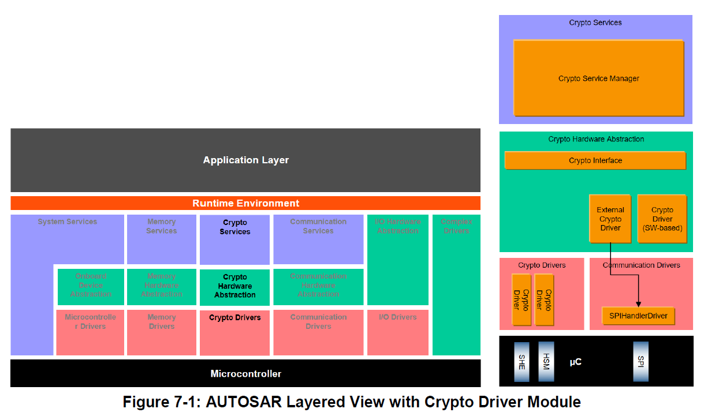

加密驱动程序模块位于微控制器抽象层，位于**Crypto Interface**模块和**Crypto Service Manager**模块之下。它为同步和异步加密原语实现了一个通用接口。它还支持加密服务的密钥存储、密钥配置和密钥管理。

为了提供加密功能，ECU需要集成一个独特的加密服务管理器模块（**Crypto Service Manager**）和一个加密接口**Crypto Interface**。但是，加密接口可以访问多个加密驱动程序，每个驱动程序都根据底层加密驱动程序对象进行配置。

加密驱动程序对象表示独立加密硬件设备的实例（例如：AES加速器）。对于高优先级的作业，在 **HSM** 上可能有一个用于快速 **AES** 和 **CMAC** 计算的通道，它以加密驱动程序中的本机 AES 计算服务结束。但也有可能，加密驱动程序对象是一个软件，例如：用于 **RSA** 计算，其中作业能够加密、解密、签名或验证数据。加密驱动程序对象是加密通道的末端。

### 6.1. 预配置

加密驱动程序的供应商必须为代表加密驱动程序功能的加密驱动程序提供预配置。预配置需与加密驱动程序的 BSWMD 文件一起交付。

#### 6.1.1. CryptoPrimitive 配置

加密驱动程序包含一个或多个加密驱动程序对象，每个对象都支持一种或多种加密原语服务。算法系列（**family**）和模式（**mode**）提供了有关如何操作加密原语服务的详细信息。例如：加密原语服务 **Encrypt** 支持系列 **AES** 和模式 **CBC**。需要通过设置次级系列值（**secondary family values**）来进一步改进。

加密驱动程序对象的 [**CryptoPrimitive**](#8112-cryptoprimitive) 配置定义了加密原语服务的可能选项。从上面的示例中，驱动程序可以支持 **AES** 算法的 **CBC** 或 **ECB** 模式。有时这被称为特定加密原语服务的驱动程序的能力（capabilities），所以如果适用于加密服务原语，则 [**CryptoPrimitive**](#8112-cryptoprimitive) 可以配置多个算法系列和模式值。

**CSM** 的作业配置包含对 **CsmPrimitive** 的引用。此 **CsmPrimitive** 的相应 **Config** 部分还定义了系列和模式，但其重复数设定为 1，以唯一标识作业应使用何种系列和模式组合。至少，关联的加密驱动程序对象必须包含支持配置的 [**CryptoPrimitive**](#8112-cryptoprimitive)。 这应在配置级别确保并至少在运行时检查。

为了支持尚未在规范中建模的加密服务的新功能（在系列和模式的各种枚举中），可以在加密驱动程序中配置自定义特定算法系列和模式。[**CryptoPrimitive**](#8112-cryptoprimitive) 引用这些自定义值以指示加密原语服务、（自定义）系列和（自定义）模式的组合是可能的。**CSM** 作业配置需要引用这些自定义配置项。

如果加密驱动程序支持的算法家族和算法模式超出了预定义的范围，则应通过容器 [CryptoPrimitiveAlgorithmFamilyCustom](#8113-cryptoprimitivealgorithmfamilycustom) 和 [CryptoPrimitiveAlgorithmModeCustom](#8114-cryptoprimitivealgorithmmodecustom) 定义自定义的算法家族取值和算法模式取值。

[CryptoPrimitiveAlgorithmModeCustom](#8114-cryptoprimitivealgorithmmodecustom)/CryptoPrimitiveAlgorithmModeCustomId 以及 [CryptoPrimitiveAlgorithmFamilyCustom](#8113-cryptoprimitivealgorithmfamilycustom)/CryptoPrimitiveAlgorithmFamilyCustomId 应使用 128..254 的保留取值范围。

一个 [CryptoPrimitive](#8112-cryptoprimitive) 应定义一个 CryptoPrimitiveService，并且只要多个项的所有排列组合均可被支持，就可以为 CryptoPrimitiveAlgorithmFamily、CryptoPrimitiveAlgorithmMode、CryptoPrimitiveAlgorithmSecondaryFamily、CryptoPrimitiveAlgorithmFamilyCustomRef 和 CryptoPrimitiveAlgorithmModeCustomRef 各定义一个或多个项。否则，必须为该 CryptoPrimitiveService 定义更多的 [CryptoPrimitive](#8112-cryptoprimitive)。

**示例：**

加密原语服务 **ENCRYPT** 可以按所有排列组合支持 **AES** 和 **3DES** 与模式 **ECB** 和 **CBC** 的组合（AES-CBC、AES-ECB、3DES-CBC 和 3DES-ECB）。但是，同时支持 **AES** 和 **RSA** 系列项以及 **CBC** 模式的加密原语服务 **ENCRYPT** 是无效的，因为 **RSA**-CBC 并不能被合理地支持。在这种情况下，必须为 **RSA** 定义一个新的 [CryptoPrimitive](#8112-cryptoprimitive)。

#### 6.1.2. 加密能力

加密驱动程序的能力（capabilities）可以分为两大主题：密钥存储和所支持的算法。所支持的算法可以通过创建新的 [CryptoPrimitive](#8112-cryptoprimitive) 容器（例如 MacGenerate）来预配置。在该容器中，供应商可以指定加密驱动程序例如仅能执行 **CMAC**。在这种情况下，一个配置示例如下：

```
CryptoPrimitiveAlgorithmFamily = CRYPTO_ALGOFAM_AES
CryptoPrimitiveAlgorithmMode = CRYPTO_ALGOMODE_CMAC
CryptoPrimitiveAlgorithmSecondaryFamily = CRYPTO_ALGOMODE_NOT_SET
CryptoPrimitiveService = MacGenerate
```

随后，加密驱动程序对象即可引用原语 MacGenerate，以表明它具备执行 **CMAC** 的能力。如果没有预配置其他原语，则该加密驱动程序对象将无法执行例如 **AES** 加密之类的操作。

如果所有原语彼此独立，供应商会为每个原语预配置一个加密驱动程序对象。否则，将只存在一个引用所有原语的加密驱动程序对象。

#### 6.1.3. 可用密钥

加密驱动程序所提供的密钥也可以被预配置。一个 [CryptoKey](#816-cryptokey) 容器引用特定的 [CryptoKeyType](#8110-cryptokeytype)。[CryptoKeyType](#8110-cryptokeytype) 提供了这样的信息：引用该 [CryptoKeyType](#8110-cryptokeytype) 的 [CryptoKey](#816-cryptokey) 中包含哪些密钥元素。

供应商还预配置密钥元素，以定义：

* 读/写访问权限
* 元素的最大大小
* 是否可以用小于最大大小的数据读取/写入该元素
* 启动后如果元素尚未初始化时使用的初始值

初始值是在加密驱动程序初始化时、当密钥元素为空时存入该密钥元素的值。例如，它用于 id 为 CRYPTO_KE_&lt;Service&gt;_ALGORITHM 的密钥元素。通过这种方式即可配置密钥管理函数。例如，为了在一个加密驱动程序中提供不同的密钥交换算法，供应商可以预配置以下容器，并将 CRYPTO_KE_&lt;Service&gt;_ALGORITHM 密钥元素的初始值设置为供应商特定的值：

**CryptoKeyElement_KeyExchange_Algorithm_RSA**

- ID = 11
- Init value = 0x00
- Size = 1
- Read Access = RA_NONE
- Write Access = WA_NONE

**CryptoKeyElement_KeyExchange_Algorithm_Ed25519**

- ID = 11
- Init value = 0x01
- Size = 1
- Read Access = RA_NONE
- Write Access = WA_NONE

**CryptoKeyType_KeyExchange_RSA**

- CryptoKeyElement_KeyExchange_Algorithm_RSA
- CryptoKeyElement_KeyExchange_PartnerPubKey
- CryptoKeyElement_KeyExchange_OwnPubKey
- CryptoKeyElement_KeyExchange_Base
- CryptoKeyElement_KeyExchange_PrivKey
- CryptoKeyElement_KeyExchange_SharedValue

**CryptoKeyType_KeyExchange_Ed25519**

- CryptoKeyElement_KeyExchange_Algorithm_Ed25519
- CryptoKeyElement_KeyExchange_PartnerPubKey
- CryptoKeyElement_KeyExchange_OwnPubKey
- CryptoKeyElement_KeyExchange_Base
- CryptoKeyElement_KeyExchange_PrivKey
- CryptoKeyElement_KeyExchange_SharedValue

当需要使用类型为 CryptoKeyType_KeyExchange_Ed25519 的 [CryptoKey](#816-cryptokey) 执行密钥交换时，加密驱动程序根据存储在密钥元素 CRYPTO_KE_KEYEXCHANGE_ALGORITHM 中的值即可得知：应使用 **Ed25519** 作为底层加密原语。

如果一个密钥要用于不止一个原语，例如 KeyExchange 和 **AES**-Encrypt-CBC，则可以用所需的元素对 [CryptoKeyType](#8110-cryptokeytype) 进行扩展：

**CryptoKeyType_KeyExchange_Cipher_combined**

- CryptoKeyElement_KeyExchange_Algorithm_Ed25519
- CryptoKeyElement_KeyExchange_PartnerPubKey
- CryptoKeyElement_KeyExchange_OwnPubKey
- CryptoKeyElement_KeyExchange_Base
- CryptoKeyElement_KeyExchange_PrivKey
- CryptoKeyElement_KeyExchange_SharedValue
    - ID = 1
- CryptoKeyElement_Cipher_IV

请注意，CryptoKeyElement_KeyExchange_SharedValue 的 id 被设置为 1。当使用 [CryptoKeyType](#8110-cryptokeytype) 为 CryptoKeyType_KeyExchange_Cipher_combined 的密钥调用加密（encrypt）服务时，密钥交换的共享值会自动用作加密密钥。

### 6.2. 一般行为

加密驱动程序可以有一个或多个加密驱动程序对象。

如果在同一个 **ECU** 中实现了多个加密驱动程序实例（来自相同或不同的供应商），则必须对文件名、**API** 名称和发布参数加以区分，以确保不会生成两个同名的定义。名称应遵循如下格式：Crypto_&lt;vi&gt;_&lt;ai&gt;，其中 &lt;vi&gt; 为 vendorId，&lt;ai&gt; 为 vendorApiInfix。

加密驱动程序可以支持底层硬件对象所支持的所有加密原语。

在 **CSM** 规范 [\[2\]](#ref-2) 中声明的作业是一个已配置加密原语的实例。

一个加密驱动程序对象在同一时刻应仅支持处理一个作业。

具有 n 个加密驱动程序对象的加密驱动程序应能够并行处理 n 个作业。

**提示：**位于作业队列（在第 [6.2.3.1](#6231-优先级相关的作业队列) 章中描述）中的作业不计入正在处理之列。

如果加密驱动程序需要随机数生成器服务供内部使用（例如 [Crypto_KeyExchangeCalcPubVal](#73471-crypto_keyexchangecalcpubval)），则应为该目的配置第一个加密驱动程序对象（对象编号 0）。该配置通过 CryptoDefaultRandomPrimitiveRef 和 CryptoDefaultRandomKeyRef 完成。

也可以配置并使用带有各自默认随机数生成器的其他加密驱动程序对象。

如果加密驱动程序对象没有默认随机数生成器但需要随机数值，则它应使用加密驱动程序对象 0 来请求随机数。

应当注意，这可能导致必须在加密驱动程序及其对象内部进行仲裁的冲突。特别是，由于随机数值的生成，加密服务操作预计会出现额外的延迟。

加密驱动程序对象应只调用其自身加密驱动程序的默认随机数生成器。

#### 6.2.1. 正常操作

"START" 表示加密原语的一个新请求，它应取消同一作业的所有先前请求。

**注意：**"作业正在被处理"是指相应的加密驱动程序对象当前正在主动处理该作业。当作业尚未完成、但加密驱动程序对象并未在处理它时（例如，由于操作 "FINISH" 尚待执行），这并不意味着该作业正在被处理。

**注意：**为了将加密服务的单次调用方法与流式方法统一起来，只提供一个带服务操作参数（嵌入在作业结构参数中）的接口 [Crypto_ProcessJob](#7321-crypto_processjob)。该服务操作是一个标志字段，用于指示操作模式 "START"、"UPDATE" 或 "FINISH"。它明确声明将执行哪种操作。如果设置了 "UPDATE" 标志，则加密原语期待输入数据。"FINISH" 表示在该函数调用之后，所有数据均已完整馈入，加密原语可以完成计算。这些操作可以组合起来一次执行多个操作。此时，这些操作将按 "START"、"UPDATE"、"FINISH" 的顺序执行。

这种连贯的单次调用方法由于开销更小，可以提高性能。无需多次调用显式 **API**，只需一次调用即可。该方法适用于需要快速处理的小数据量输入。

下图展示了本设计中一个作业的状态机，其中未考虑因错误而产生的状态迁移。

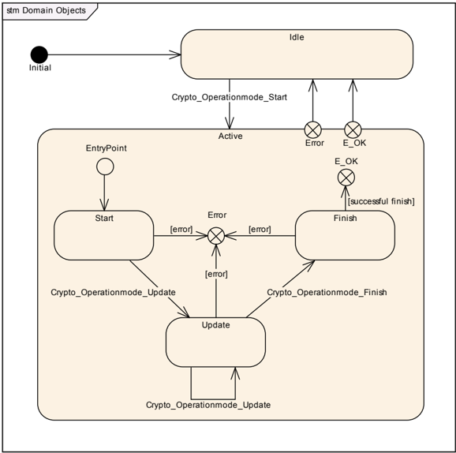

初始化之后，加密驱动程序处于 "idle"（空闲）状态。

如果在 "Idle" 或 "Active" 状态下、以操作模式 "START" 调用 [Crypto_ProcessJob](#7321-crypto_processjob)，则先前的请求应被取消。这意味着，该作业先前缓冲的所有数据都应被重置，并且该作业应切换到 "Active" 状态并处理新的请求。

**注意：**只有当作业未被主动处理时，才可以使用 "START" 重置作业。

如果作业处于 "Idle" 状态且操作模式中的 "START" 标志未设置时调用 [Crypto_ProcessJob](#7321-crypto_processjob)，则该函数应以 E_NOT_OK 返回。

**注意：**如果在 "Active" 状态下、以操作模式 "UPDATE" 调用 [Crypto_ProcessJob](#7321-crypto_processjob)，则加密原语被馈入输入数据。就任意数量用户数据的流式处理而言，可使用多次操作模式为 "UPDATE" 的调用，在先前数据的基础上馈入更多输入数据。在 "Update" 状态下，通常还会进行加密原语中间结果的计算。实际上，在某些情况下（例如 **CBC** 模式的 **AES** 加密），还会生成输出数据。在以流式方法（"Start"、"Update"、"Finish"）操作时，加密驱动程序对象会等待进一步的输入（"Update"），直到达到 "Finish" 状态。在此期间无法处理其他作业。

如果在 "Active" 状态下、以操作模式 "FINISH" 调用 [Crypto_ProcessJob](#7321-crypto_processjob)，则加密计算应被最终完成。此时应有附加数据（即在 **MAC** 验证服务中待验证的 **MAC**）可用，以便成功处理该作业。计算结果应存储在输出缓冲区中。处理结束时，加密驱动程序应切换到 "Idle" 状态。

为了通过 [Crypto_ProcessJob](#7321-crypto_processjob) 以单次调用处理加密服务，操作模式 CRYPTO_OPERATIONMODE_SINGLECALL 是 "START"、"UPDATE" 和 "FINISH" 这 3 种模式的析取（按位或）。

如果发生内部错误，相应作业的状态应被设置为 "Idle"，并且所有输入数据和中间结果应被丢弃。

如果在处理异步作业期间发生内部错误，相应作业的状态应被设置为 "Idle"，并且所有输入数据和中间结果应被丢弃。此外，应使用适当的错误码调用回调通知。

#### 6.2.2. 功能需求

**注意：**作业应同步处理还是异步处理的信息是 Crypto_JobType 的一部分。

##### 6.2.2.1. 同步作业处理

当使用同步作业处理时，相应的接口函数应在该函数调用的上下文内同步地计算出结果。

如果加密驱动程序具有队列，并且发出了一个同步作业、其优先级高于队列中可用的最高优先级，则加密驱动程序应禁止从队列处理新作业，直到在当前处理的作业完成之后的下一次主函数调用结束为止。

**注意：**通道可以同时持有异步和同步处理类型的作业。如果是这样，即使同步作业的优先级高于所有异步作业的优先级，该同步作业也可能不被接受处理。

##### 6.2.2.2. 异步作业处理

如果使用异步作业处理，接口函数应仅将必要的信息移交给原语。实际计算可以由主函数启动。

对于每个异步请求，加密驱动程序应通过调用 CRYIF_CallbackNotification 函数并传递作业信息和加密运算结果，向 **CRYIF** 通知作业的完成。

#### 6.2.3. 设计说明

加密驱动程序提供两种服务：(1) 加密服务本身；(2) 密钥管理。

##### 6.2.3.1. 优先级相关的作业队列

可选地，每个加密驱动程序对象应能够将作业排入队列，以便逐个处理它们。

当加密驱动程序队列的大小设置为 0 时，加密驱动程序对象应禁用排队功能。

队列应根据已配置作业的优先级对作业进行排序。

作业优先级值越高，作业的优先级越高。

如果在队列为空且加密驱动程序对象不忙时调用 [Crypto_ProcessJob](#7321-crypto_processjob)，则作业应切换到 "active"（活动）状态并执行加密原语。

如果在调用 [Crypto_ProcessJob](#7321-crypto_processjob) 时队列已满，则该函数应以 CRYPTO_E_BUSY 返回。

**注意：**必须确保异步作业被足够快地处理，以避免同步作业不得不等待很长时间。也建议对异步作业使用 CRYPTO_OPERATIONMODE_SINGLECALL。

**注意：**加密驱动程序对象可以同时以同步和异步作业处理方式处理不同的作业。然而，同步作业处理与作业排队组合起来可能并不实用。因此，如果选择同步作业处理，则不会使用作业队列，并且只有当加密驱动程序对象不忙时才会处理作业。

如果在调用 [Crypto_ProcessJob](#7321-crypto_processjob) 时作业处于 "ACTIVE" 状态，则 [Crypto_ProcessJob](#7321-crypto_processjob) 应检查所请求的作业是否与加密驱动程序对象中的当前作业相匹配；如果匹配，则让它绕过排队。

这意味着只有操作模式为 "START" 的作业才会被排入队列。当操作模式为 "START" 的作业已完成时，加密驱动程序对象正在等待输入。回调函数向被调用方指示应执行 "UPDATE" 或 "FINISH" 调用。

如果以异步作业处理方式调用 [Crypto_ProcessJob](#7321-crypto_processjob)，队列未满但加密驱动程序对象正忙，且作业的操作模式为 "START"，则加密驱动程序对象应将该作业放入队列并返回 E_OK。

如果以同步作业处理方式调用 [Crypto_ProcessJob](#7321-crypto_processjob)，队列未满但加密驱动程序对象正忙，则加密驱动程序对象不应将该作业排入队列，而应返回 CRYPTO_E_BUSY。任何作业都不应被放入任何队列。

#### 6.2.4. 密钥管理

一个密钥由一个或多个密钥元素组成。

密钥元素的示例包括：密钥材料本身、初始化向量、用于随机数生成的种子状态，或 **SHE** 标准的证明。

每个密钥元素都定义有用于读访问或写访问的访问权限。访问权限本身由在 [CryptoKeyElement](#818-cryptokeyelement) 配置中带有指定取值的枚举来定义。这些枚举的整数值经过精心选择，使得为密钥元素分配某个访问权限时，也会衍生出更多的访问权限。取值越低，访问权限越高。这样便可以通过数值轻松地将所分配的取值与所需的访问权限进行比较。

**示例：**如果某个密钥元素具有访问权限 CRYPTO_RA_INTERNAL_COPY=2，则该权限也适用于 CRYPTO_RA_ENCRYPTED=1 和 CRYPTO_RA_ALLOWED=0，因为这两个权限所分配的枚举取值都更低，因此在访问权限的等级排序中处于更低的位置。

当需要对密钥元素进行直接访问时，应考虑访问权限。这适用于读访问和写访问。

可以使用密钥复制接口函数复制密钥或密钥元素。例如，这允许将密钥存储在一个提供安全密钥存储的驱动程序通道中，并将其分发到不具备这种能力的其他驱动程序实现。然而，重要的是，在复制操作期间必须对密钥元素的访问权限进行保护，以避免所存储的密钥被意外泄露。

当使用密钥复制接口复制密钥元素时，源密钥元素必须具有比目标密钥元素更高或相同的权限。源密钥必须至少具有 CRYPTO_RA_INTERNAL_COPY 或更低的权限才能被复制。

**提示：**只有当密钥元素位于同一个加密驱动程序对象中时，才能执行内部复制操作。

作业应使用所分配的密钥元素，而无需保护密钥访问权限，但以下情况除外：

* 如果密钥元素通过输入重定向（**input re-direction**）用于输入，则该密钥元素必须具有访问权限 CRYPTO_RA_INTERNAL_COPY 或更低。如果对 CryptoPrimitiveService ENCRYPT/DECRYPT 或 AEAD_ENCRYPT/AEAD_DECRYPT 使用输入重定向，则访问权限必须设置为 RA_ENCRYPTED 或更低。1)
* 如果密钥元素用于输出重定向（**output re-direction**），则该密钥元素必须具有访问权限 CRYPTO_WA_INTERNAL_COPY 或更低。
* 凡用于密钥交换（**Key Exchange**）操作以生成密钥的密钥元素，其访问权限应至少为 CRYPTO_RA_INTERNAL_COPY 或更低。
* 对于密钥派生（**Key Derivation**），源密钥应具有至少 CRYPTO_RA_INTERNAL_COPY 或更低的访问权限。目标密钥应至少具有与其源密钥相同或更低的访问权限。2)

> 1) 原因：这是为了避免将一个密钥元素用作加密的输入（而将另一个密钥元素用作输出）、随后再对该密钥进行解密，否则最终将能够以明文形式提取出秘密密钥。
> 2) 这是为了避免在使用较弱的密钥派生算法时被推导出源密钥。

来自不同加密服务的不同密钥元素的索引按照 **CSM** 规范中导入类型表的定义。

密钥具有一种状态，即 "valid"（有效）或 "invalid"（无效）。

如果密钥处于 "invalid" 状态，则使用该密钥的加密服务应以 CRYPTO_E_KEY_NOT_VALID 返回。

**注意：**如果在 [Crypto_KeyElementSet](#73411-crypto_keyelementset) **API** 调用期间观察到错误，则密钥元素的状态需要被视为未知。

如果密钥（或密钥元素）当前正被某个加密服务使用，则该密钥的状态必须为 "valid"。当调用 [Crypto_KeyElementSet](#73411-crypto_keyelementset) 时，密钥状态会被设置为 "invalid"。因此，当前正在运行的作业很可能会使用不一致的密钥进行工作。应用程序应自行确保只在当前没有原语正在使用该密钥（元素）时才更改密钥。

**注意：**可以将密钥和密钥元素映射到 **SHE** 硬件功能，而不受任何限制，但由于硬件约束，通过密钥管理接口进行的读访问和写访问必须以加密形式执行。为了给遗留软件提供环境，硬件所使用的单一密钥可以放在一个由多个密钥引用的密钥元素中。每个密钥还唯一地引用一个包含标识符的密钥元素。因此，按照本规范实现的驱动程序可以封装现有的 **SHE** 硬件和软件，并将密钥元素中的数据传递给现有的 **SHE** 驱动程序。在这种用例中，一个密钥元素可以包含一个计数器，驱动程序和应用程序都可以读写该计数器。该计数器可用于检测密钥是否被覆盖写入。可以将密钥在紧接使用之前加载到实际的硬件密钥槽中，这将使密钥的加载与处理合并为一次操作；也可以在将密钥写入密钥元素之后再作为单独的操作进行加载，这将使密钥的加载与处理成为分开的操作。

如果要实现一个新的驱动程序，也可以配置具有完全独立密钥元素的密钥。这些独立的密钥可以存储在 **RAM** 中，并且只在操作需要时才传递给硬件密钥槽。驱动程序中存储的密钥数量可以独立于（并且远大于）硬件密钥槽的数量。当然，这需要在软件中进行密钥的处理和存储，并带来所有潜在的缺点。

通过在设置配置参数 CryptoKeyElementPersist 的情况下调用 [Crypto_KeySetValid](#73412-crypto_keysetvalid)，可以持久化存储密钥。由于在大多数情况下写入操作需要一些时间，因此建议使用 CRYPTO_KEYSETVALID 作业接口来持久化存储密钥。

不同的密钥类型可以拥有兼容的密钥元素。在这种情况下，keyElementId 具有相同的值。具有相同 keyElementId 的密钥元素可以被视为兼容。这样，同一个密钥就可以用于不同的服务。

因此，密钥材料应始终具有 keyElementId 1。

一个示例是：通过密钥管理接口生成一个密钥，随后在诸如 MacGenerate 之类的原语中使用同一密钥。

密钥元素可能不会被完整写入。在某些情况下，存储在密钥元素中的数据大小可以是可变的，例如非对称密钥元素。加密驱动程序应存储实际写入的数据大小，以供内部使用以及通过 [Crypto_KeyElementGet](#73421-crypto_keyelementget) 导出该元素之用。密钥元素是否允许不被完整地读取或写入，可以通过 [CryptoKeyElement](#818-cryptokeyelement) 容器中的参数 CryptoKeyElementAllowPartialAccess 进行配置。

#### 6.2.5. 密钥格式

ID 为 1 的密钥元素是一个特殊的密钥，它为相关的加密原语提供加密密钥。

在 **IETF RFC** 中，密钥以特定的格式进行描述，以提供一种在实体之间传输密钥的通用且紧凑的方式。

为了在 **AUTOSAR** 中也支持这一标准，本章描述 **AUTOSAR** 所支持的密钥格式。

这样，可以以这种格式向加密驱动程序提供给定的密钥，例如来自证书的若干部分，而无需应用程序分析该结构并构造数据。

通过在加密驱动程序中支持 **IETF RFC**，密钥材料可以按原样提供。

如果支持，则所需密钥元素（例如私钥或公钥字段）的提取由驱动程序完成。

加密驱动程序不太可能将此类格式重组后返回给应用程序。因此，此类密钥元素可能仅被临时存储，并且不应以「组合」格式（**M1M2M3**）持久化，例如用于在复位后重新获取该数据。

带标识的非对称密钥材料按照 **RFC5958** 以 **ASN.1** 格式规定。具有格式说明符 CRYPTO_KE_FORMAT_BIN_IDENT_PRIVATEKEY_PKCS8 的密钥材料需要遵循以下格式规范：

```
OneAsymmetricKey ::= SEQUENCE {
    version        Version,
    KeyAlgorithm   KeyAlgorithmIdentifier,
    keyMaterial    KeyMaterial,
    attributes*    [0] Attributes OPTIONAL,
    ...,
    [[2: publicKey* [1] PublicKey OPTIONAL ]],
    ...
}
```

\* 密钥属性和 **PublicKey** 的可选值目前在加密驱动程序中未使用，列出它们只是为了与 **RFC5958** 保持兼容。驱动程序应容忍提供此信息，但无需评估其内容。

各元素的含义如下：

```
Version ::= INTEGER { v1(0), v2(1) } (v1, ..., v2)

KeyAlgorithmIdentifier ::= AlgorithmIdentifier
{ PUBLIC-KEY,
{ PrivateKeyAlgorithms } }

KeyMaterial ::= OCTET STRING
-- Content varies based on the type of the key and is specified by its AlgorithmIdentifier.
-- The KeyAlgorithmIdentifier defines which format specifier for KeyMaterial shall be applied.
```

**AlgorithmIdentifier**：通过其对象标识符（**OID**）标识格式的值。

带标识的公钥材料按照 **RFC5280** 第 4.1 节的规定。具有格式说明符 CRYPTO_KE_FORMAT_BIN_IDENT_PUBLICKEY 的密钥材料需要遵循以下格式规范：

```
SubjectPublicKeyInfo ::= SEQUENCE
{ algorithm AlgorithmIdentifier,
subjectPublicKey BIT STRING }
```

各元素的含义如下：

**AlgorithmIdentifier**：通过其对象标识符（**OID**）标识格式的值。

**subjectPublicKey**：公钥本身。

##### 6.2.5.1. RSA 密钥材料的定义

对于 CRYPTO_KE_FORMAT_BIN_RSA_PRIVATEKEY，**RSA** 私钥的参数「KeyMaterial OCTET STRING」根据 **IETF RFC8017** 定义，并具有以下内容：

```
KeyMaterial ::= RSAPrivateKey

RSAPrivateKey ::= SEQUENCE {
    version         Version,
    modulus         INTEGER,  -- n
    publicExponent  INTEGER,  -- e
    privateExponent INTEGER,  -- d
    prime1          INTEGER,  -- p
    prime2          INTEGER,  -- q
    exponent1       INTEGER,  -- d mod (p-1)
    exponent2       INTEGER,  -- d mod (q-1)
    coefficient     INTEGER   -- (inverse of q) mod p
}

Version ::= INTEGER { two-prime(0), multi(1) }
```

**RSAPrivateKey** 类型各字段的含义如下：

* version 是版本号，用于与本文档未来版本的兼容。对于本文档的本版本，该值应为 0。
* modulus 是模数 n。
* publicExponent 是公钥指数 e。
* privateExponent 是私钥指数 d。
* prime1 是 n 的素因子 p。
* prime2 是 n 的素因子 q。
* exponent1 是 d mod (p-1)。
* exponent2 是 d mod (q-1)。
* coefficient 是中国剩余定理系数 (inverse of q) mod p。

**注意：**prime1、prime2、exponent1、exponent2 和 coefficient 的值是可选的。如果未提供 prime1，则不得提供列表中位于其后的任何值。否则，该密钥应被拒绝。

CRYPTO_KE_FORMAT_BIN_RSA_PUBLICKEY 格式的 **RSA** 公钥按如下方式提供：

```
RSAPublicKey ::= SEQUENCE {
    modulus        INTEGER,  -- n
    publicExponent INTEGER,  -- e
}
```

**RSAPublicKey** 类型各字段的含义如下：

* modulus 是模数 n。
* publicExponent 是公钥指数 e。

对于 CRYPTO_KE_FORMAT_BIN_IDENT_PUBLICKEY 格式的 **RSA** 公钥，「subjectPublicKey BIT STRING」被定义为「RSAPublicKey」。

**解释：**考虑到 **RFC5280** 第 4.1 节，**SubjectPublicKeyInfo** 直接采用上述定义。因此，CRYPTO_KE_FORMAT_BIN_IDENT_PUBLICKEY 的密钥类型对应 **SubjectPublicKeyInfo**，而 CRYPTO_KE_FORMAT_BIN_RSA_PUBLICKEY 对应该定义中的 subjectPublicKey。

**RSA** 密钥的算法标识符的值应为 1.2.840.113549.1.1.1。这对应于 **ASN.1** 编码的 OID 值「2A 86 48 86 F7 0D 01 01 01」。每当需要 **RSA** 的 **AlgorithmIdentifier** 时，都应提供此 OID。换句话说，当密钥具有 CRYPTO_KE_FORMAT_BIN_IDENT_PRIVATEKEY_PKCS8 或 CRYPTO_KE_FORMAT_BIN_IDENT_PUBLICKEY 格式并用于 **RSA** 时，**AlgorithmIdentifier** 必须具有该值。

**注意：**在某些情况下，**NULL** 值会紧跟在该 OID 之后。因此，在同一序列中紧跟此 OID 之后的值是可选的，应当被容忍。

##### 6.2.5.2. ECC 密钥材料的定义

由于缺乏针对 **ECC** 密钥的清晰且高效的标准定义，ECC 的密钥材料在 CRYPTO_KE_FORMAT_BIN_OCTET 的格式定义中被定义为二进制信息。数据长度取决于所分配的曲线运算。

**NIST** 和 **Brainpool** ECC 曲线的公钥以其 X 和 Y 坐标提供：

ECC 公钥 = 点 X | 点 Y。

各点以小端（**little endian**）格式存储。

密钥的字节数取决于曲线的实现。

**示例：**

NIST 曲线 P(256) 公钥 = X(32) | Y(32)

NIST 曲线 P(192) 公钥 = X(24) | Y(24)

**NIST** 和 **Brainpool** ECC 曲线的私钥以其 X 和 Y 坐标以及一个附加的标量（**scalar**）提供：

ECC 私钥 = 点 X | 点 Y | 标量。

各点和标量以小端格式存储。

**示例：**

Brainpool 曲线 P(256) = X(32) | Y(32) | SCALAR(32)

**ED25519** 的公钥信息包含曲线上的一个点：

ED25519 公钥 = 点 X

该点以小端格式存储。

**示例：**

ED25519 公钥 = X(32)。

**ED25519** 的私钥信息包含一个随机常量和曲线上的点 X：

ED25519 私钥 = 种子 K | 点 X

该点和种子以小端格式存储。

**示例：**

ED25519 私钥 = 种子 K(32) | X(32)。

##### 6.2.5.3. SHE 密钥材料的定义

如果加密密钥元素被用作 **SHE** 硬件的保密密钥，则 **CryptoKeyFormat**/**CryptoKeyElementFormat** 的配置应设置为 CRYPTO_KE_FORMAT_BIN_SHEKEY。这表示该密钥元素应以 [\[6\]](#ref-6) 中规定的 **M1M2M3** 格式提供。函数 [Crypto_KeyElementSet](#73411-crypto_keyelementset) 用于将密钥加载到 **SHE** 硬件中（不是在直接调用该函数时加载，而是通过密钥置有效（key-set-valid）操作加载）。通过 [Crypto_KeyElementSet](#73411-crypto_keyelementset)，参数 keyElementId 应设置为 1，例如可以取自 CRYPTO_KE_MAC_KEY 或 CRYPTO_KE_CIPHER_KEY（参见 [SWS_Csm_01022]）。**SHE** 硬件提供 **M4M5** 作为密钥被正确处理的证明并用于确认该操作。为了提取该密钥信息，需要一个额外的密钥元素。在密钥置有效操作之后读取该证明时，应使用密钥元素 ID 值为「2」的函数 [Crypto_KeyElementGet](#73421-crypto_keyelementget)，例如使用预定义宏 CRYPTO_KE_MAC_PROOF 或 CRYPTO_KE_CIPHER_PROOF。该证明仅在成功执行密钥元素设置并随后进行密钥置有效操作之后才直接可用，例如在一个点火周期内。这意味着，不得为了日后提供该信息而存储该证明（例如存储在 **NV-RAM** 中）。

#### 6.2.6. NVM 中的密钥存储

为了使加密驱动程序能够将密钥元素持久化到非易失性存储器中，需要访问 **NVM**。为此，加密驱动程序的配置需要对一个或多个 **NVM** 块的引用。应持久化其密钥元素的密钥将被分配到这些块中。随后，驱动程序会在验证时写入应持久化的元素，并在驱动程序初始化期间读取这些值。与配置项的基本关系如图7-2所示。

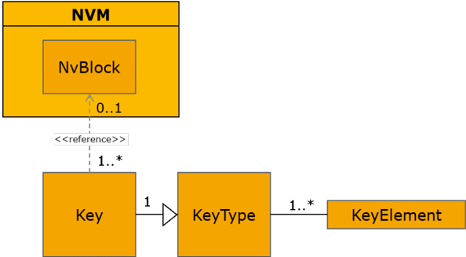

**重要提示：**加密驱动程序仅处理向 **NVM** 块写入数据和从中读取数据的功能性操作。任何错误处理（例如 **NVM** 块的缺陷）都必须由应用程序捕获并处理。

##### 6.2.6.1. 向 NVM 写入密钥

只有在启动「KEYSETVALID」时才应发起密钥（即其元素）的存储，发起方式可以是调用 [Crypto_KeySetValid](#73412-crypto_keysetvalid)，或者调用 [Crypto_ProcessJob](#7321-crypto_processjob) 并设置原语服务 CRYPTO_KEYSETVALID 或 CRYPTO_KEYSETINVALID。因此，不应在调用 [Crypto_KeyElementSet](#73411-crypto_keyelementset) 或类似操作时发起 **NVM** 中的密钥元素存储。只有当验证成功完成且操作返回 E_OK 时（由同步调用直接返回，或通过回调异步返回），才应执行存储操作。

**理由：**特别是当密钥的各密钥元素与同一密钥的一个或多个其他密钥元素存在相互依赖关系时，在设置密钥元素时立即写入存在密钥本身不一致的风险。此外，通过 KEYSETVALID 显式发起该操作使加密驱动程序能够检查所有元素的一致性和相互依赖性，如果检查失败则拒绝存储。另外，更新一个密钥的多个元素将导致对 **NVM** 的一次写操作，而不是对每个密钥元素各写多次，这可以减少对 **NVM** 的写操作总数。

在 KEYSETVALID 操作时，加密驱动程序将通过调用 NvM_SetRamBlockStatus() 来发起向 **NVM** 写入数据块。当配置 [**CryptoNvBlock**](#8116-cryptonvblock)/**CryptoNvBlockProcessing** 设置为 DEFERRED 时，这是典型操作。如果 [CryptoNvBlock](#8116-cryptonvblock)/CryptoNvBlockProcessing 设置为 IMMEDIATE，则加密驱动程序除了调用 NvM_SetRamBlockStatus() 之外，还会在其后立即调用 NvM_WriteBlock()。这将触发 **NV RAM** 块立即写入非易失性存储器。

**注意：**为了正常运行，建议将 **NVM** 的参数 NvMBlockUseSetRamBlockStatus 和 NvMSelectBlockForReadAll 设置为 TRUE。如果 CryptoNvBlockProcessing 设置为 DEFERRED，则 NvMSelectBlockForWriteAll 应设置为 TRUE。

如果对 **NVM** 服务的调用（NvM_SetRamBlockStatus() 或 NvM_WriteBlock()）返回 E_NOT_OK，或者回调函数 Crypto_&lt;vi&gt;_&lt;ai&gt;_NvBlock_Callback_&lt;NvBlock&gt;（参见第[7.4](#74-回调通知)章）通过 Nvm_RequestResultType 指示块写操作已失败，则应向 **DET** 报告运行时错误 [CRYPTO_E_RE_NVM_ACCESS_FAILED](#632-运行时错误)。此外，应在下一次执行 [Crypto_MainFunction](#751-crypto_mainfunction) 时再次请求该服务调用。重试次数可以通过参数 [**CryptoNvBlock**](#8116-cryptonvblock)/**CryptoNvBlockFailedRetries** 进行限制。

如果一个密钥当前正在 **NV RAM** 块中更新且尚未由 **NVM** 写入，则应通过 [Crypto_KeyGetStatus](#73431-crypto_keygetstatus) 接口在密钥状态中以 CRYPTO_KEYSTATUS_UPDATE_IN_PROGRESS 反映该情况。

对于每个已配置的 [**CryptoNvBlock**](#8116-cryptonvblock)，加密驱动程序应提供一组单独的 Crypto_&lt;vi&gt;_&lt;ai&gt;_NvBlock_xxx_&lt;NvBlock&gt;() 函数（xxx 指 Init、ReadFrom、WriteTo 和 Callback）（参见第[7.4](#74-回调通知)章）。[**CryptoNvBlock**](#8116-cryptonvblock) 容器的短名称替换标记 &lt;NvBlock&gt;。标记 &lt;vi&gt; 和 &lt;ai&gt; 按相应规定替换。这些函数应被设置为 **NvmBlockDescriptor** 相应字段中的回调。

##### 6.2.6.2. 从 NVM 读取密钥

在加密驱动程序初始化时，应调用回调函数 Crypto_&lt;vi&gt;_&lt;ai&gt;_NvBlock_ReadFrom_&lt;NvBlock&gt;()，以获取相关联密钥先前持久化的密钥元素。

**注意：**NvBlock 中数据的格式是驱动程序私有的。至少，驱动程序需要确保密钥元素和密钥能够在 **NV RAM** 块内被唯一地指派。此外，应考虑 **NV RAM** 块数据的版本管理，以应对该格式将来的更新。可以考虑该块的数据一致性。

在初始化时，如果 **NvBlock** 被成功读取且 NvBlock 数据的内部一致性检查成功，则引用该块的所有密钥的所有密钥元素都应设置为来自 **NV RAM** 块数据的值。

在初始化时，当为密钥读取 **NvBlock** 时，如果该块可用但已损坏（驱动程序内部数据一致性检查失败），则所有相关密钥都应设置为无效。对于 **CryptoKeyElementPersist** 设置为 TRUE 的所有关联密钥元素，其长度值都应设置为 0，即使该密钥配置了 **CryptoKeyElementInitValue**。

**理由：**这应防止通过操纵 **NvBlock** 迫使驱动程序回到初始状态的攻击。

如果 **NvBlock** 没有数据（即 **NvBlock** 为空），则所有被引用密钥中设置了 **CryptoKeyElementInitValue** 的密钥元素应使用该配置的初始值（就好像该密钥未配置密钥存储一样）。

在启动时完成所有密钥元素的初始化（使用默认数据或持久化数据）之后，加密驱动程序应检查所有密钥及其密钥元素是否有效（至少一个密钥元素有值）。如果是，则相应密钥应设置为 **VALID** 状态。

#### 6.2.7. 加密配置文件

##### 6.2.7.1. 自定义服务与函数配置文件概述

加密驱动程序可以支持供应商特定的自定义服务和自定义同步 **API** 函数，由 **Csm_CustomService** 和 **Csm_CustomSync**（[Crypto_CustomSync](#7351-crypto_customsync)）触发。为了使不同加密供应商对特定用例的实现保持一致，需要对参数进行映射。该映射通过为特定用例定义的配置文件（**profile**）来定义。

加密配置文件应为 **Csm_CustomService** 定义以下参数的映射：

```C
uint32 JobId
Crypto_OperationModeType mode
uint32 targetKeyId
const uint8* inputPtr
uint32 inputLength
const uint8 * secondaryInputPtr
uint32 secondaryInputLength
const uint8* tertiaryInputPtr
uint32 tertiaryInputLength
uint8* outputPtr
uint32* outputLengthPtr
uint8* secondaryOutputPtr
uint32* secondaryOutputLengthPtr
Crypto_VerifyResultType* verifyPtr
```

加密配置文件应为 **Csm_CustomSync** 定义以下参数的映射：

```C
uint32 dispatchId****
uint32 keyId
uint32 keyElementId
uint32 targetKeyId
uint32 targetKeyElementId
const uint8* inputPtr
uint32 inputLength
uint8* outputPtr
uint32* outputLengthPtr
uint8* secondaryOutputPtr
uint32* secondaryOutputLengthPtr
```

> \*\*\*\* dispatchId（标识请求的唯一 ID）应按以下规则设置：

```C
uint32 dispacthId = (uint32)(
  ((ServiceInfoType                        << 24) & 0xFF000000) ||
  ((CryptoPrimitiveAlgorithmFamilyCustomId << 16) & 0x00FF0000) ||
  ((Crypto_AlgorithmModeType               <<  8) & 0x0000FF00) ||
  ((ServiceId                                   ) & 0x000000FF))
```

##### 6.2.7.2. 自定义服务与函数配置文件 1（KeyM 与证书管理）

该配置文件定义如何将自定义服务与为 **KeyM** 规定的证书管理服务结合使用。使用该配置文件使 **KeyM** 能够将实际的证书处理转发给加密驱动程序及其关联的 **HSM**。该加密配置文件提供了从 **KeyM** 服务和函数到为自定义服务配置的 **Csm** 作业以及到自定义同步 **API** 函数 [Crypto_CustomSync](#7351-crypto_customsync) 的参数一致映射。

**ServiceInfoType** 定义为 CUSTOM_SERVICE，值为 0x15。

**Crypto_AlgorithmFamilyType** 定义为 CRYPTO_ALGOFAM_KEYM，值为 0x80，需要通过 CryptoPrimitiveAlgorithmFamilyCustomId 进行配置。

**Crypto_AlgorithmModeType** 定义为 CRYPTO_ALGOMODE_NOT_SET，值为 0x00。

KeyM_ServiceCertificate（ServiceId：0x09）可以由 **KeyM** 映射为调用 KeyM_ServiceCertificateByCertId（ServiceId：0x13）。

如果映射到 unit8* 类型参数的数据类型具有更大的长度（例如 **uint16**），则 **MSB** 应为第一个字节。

每个加密配置文件应定义 [**Crypto_CustomSync**](#7351-crypto_customsync) 的参数到使用它的 **KeyM** 服务/函数的映射。

Csm_CustomService 的映射表：

| 服务 ID | 0x13 | 0x0C | 0x0D | 0x0E |
|---|---|---|---|---|
| 处理类型 | 异步 | 异步 | 异步 | 异步 |
| 返回类型 | Std_ReturnType | Std_ReturnType | Std_ReturnType | Std_ReturnType |
| Csm_CustomService | KeyM_ServiceCertificateByCertId | KeyM_VerifyCertificates | KeyM_VerifyCertificate | KeyM_VerifyCertificateChain |
| uint32 JobId | 来自给定证书配置的被引用自定义 CSM 作业的 JobId | 来自给定证书配置的被引用自定义 CSM 作业的 JobId | 来自给定证书配置的被引用自定义 CSM 作业的 JobId | 来自给定证书配置的被引用自定义 CSM 作业的 JobId |
| Crypto_OperationModeType mode | empty* | empty* | empty* | empty* |
| uint32 targetKeyId | uint8 SvcId** | uint8 SvcId** | uint8 SvcId** | uint8 SvcId** |
| const uint8* inputPtr | uint8 Service*** | uint16 CertUpperId | empty* | uint8 NumberOfCertificates |
| uint32 inputLength | 1 | 2 | 0 | 1 |
| const uint8 * secondaryInputPtr | const unit8 * RequestData | empty* | empty* | KeyM_CertDataType[] certChainData |
| uint32 secondaryInputLength | uint32 RequestDataLength | empty* | empty* | NumberOfCertificates * sizeof (KeyM_CertDataType) |
| const uint8* tertiaryInputPtr | empty* | empty* | empty* | empty* |
| uint32 tertiaryInputLength | empty* | empty* | empty* | empty* |
| uint8* outputPtr | uint8 ResponseData | empty* | empty* | empty* |
| uint32* outputLengthPtr | unit32 ResponseDataLength | empty* | empty* | empty* |
| uint8* secondaryOutputPtr | &lt;specific return value for that custom service&gt; | &lt;specific return value for that custom service&gt; | &lt;specific return value for that custom service&gt; | &lt;specific return value for that custom service&gt; |
| uint32* secondaryOutputLengthPtr | &lt; sizeof(Std_ReturnType)&gt; | &lt; sizeof(Std_ReturnType)&gt; | &lt; sizeof(Std_ReturnType)&gt; | &lt; sizeof(Std_ReturnType)&gt; |
| Crypto_VerifyResultType* verifyPtr | empty* | empty* | empty* | empty* |

> \* 「empty」：由供应商决定如何设置该参数的值，但该值不会被使用。
> \*\* 「SvcId」：为原始 **KeyM** **API** 函数的 Service ID；转换为 **uint32**。
> \*\*\* 「Service」为来自调用者的参数 **KeyM_ServiceCertificateType** Service。

下图显示了加密驱动程序（在 **HSM** 上）的使用方式。来自应用程序的服务请求进入标准化的 **KeyM** 接口；如果针对自定义处理的加密配置文件定义了由 **HSM** 处理，则加密驱动程序将执行转移到 **HSM** 上。

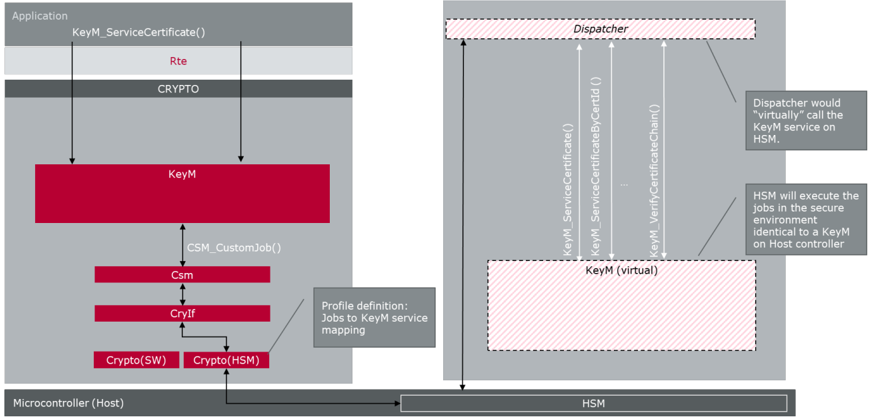

Csm_CustomSync 的映射表：

| 服务 ID | 0x0F | 0x12 | 0x1B | 0x1C | 0x0A | 0x0B |
|---|---|---|---|---|---|---|
| 处理类型 | 同步 |  |  |  |  |  |
| 返回类型 | Std_ReturnType |  |  |  |  |  |
| Csm_CustomSync | KeyM_CertElementGet | KeyM_CertGetStatus | KeyM_CertificateElementGetByIndex | KeyM_CertificateElementGetCount | KeyM_SetCertificate | KeyM_GetCertificate |
| uint32 dispatchId**** | 0x1580000F | 0x15800012 | 0x1580001B | 0x1580001C | 0x1580000A | 0x1580000B |
| uint32 keyId | 来自给定证书配置的自定义 CSM 作业中所使用的被引用密钥的 keyId | 来自给定证书配置的自定义 CSM 作业中所使用的被引用密钥的 keyId | 来自给定证书配置的自定义 CSM 作业中所使用的被引用密钥的 keyId | 来自给定证书配置的自定义 CSM 作业中所使用的被引用密钥的 keyId | 来自给定证书配置的自定义 CSM 作业中所使用的被引用密钥的 keyId | 来自给定证书配置的自定义 CSM 作业中所使用的被引用密钥的 keyId |
| uint32 keyElementId | 从 CertElementId 映射的 keyId | empty* | 从 CertElementId 映射的 keyId | 从 CertElementId 映射的 keyId | empty* | empty* |
| uint32 targetKeyId | empty* | empty* | uint32 index | empty* | empty* | empty* |
| uint32 targetKeyElementId | empty* | empty* | empty* | empty* | empty* | empty* |
| const uint8* inputPtr | empty* | empty* | empty* | empty* |  | KeyM_CertDataType* CertificateDataPtr |
| uint32 inputLength | empty* | empty* | empty* | empty* | empty* | empty* |
| uint8* outputPtr | uint8* CertElementData | KeyM_CertificateStatusType* Status | uint8* CertElementDataPtr | uint16* CountPtr | empty* | empty* |
| uint32* outputLengthPtr | uint32* CertElementDataLength | sizeof (KeyM_CertificateStatusType) | uint32* CertElementDataLengthPtr | empty* | empty* | empty* |
| uint8* secondaryOutputPtr | Std_ReturnType | Std_ReturnType | Std_ReturnType | Std_ReturnType | Std_ReturnType | Std_ReturnType |
| uint32* secondaryOutputLengthPtr | sizeof(Std_ReturnType) | sizeof(Std_ReturnType) | sizeof(Std_ReturnType) | sizeof(Std_ReturnType) | sizeof(Std_ReturnType) | sizeof(Std_ReturnType) |

> \*\*\*\* dispatchId：参见第[6.2.7.1](#6271-自定义服务与函数配置文件概述)节。

证书元素名称和 ID：

| 加密服务 | 密钥元素名称 | 密钥元素 ID | 强制 |
|---|---|---|---|
| 证书 | CRYPTO_KE_CERTIFICATE_DATA | 0 | x |
| 格式 | CRYPTO_KE_CERTIFICATE_PARSING_FORMAT | 18 |  |
| 版本 | CRYPTO_KE_CERTIFICATE_VERSION | 20 |  |
| 序列号 | CRYPTO_KE_CERTIFICATE_SERIALNUMBER | 21 |  |
| 签名算法 | CRYPTO_KE_CERTIFICATE_SIGNATURE_ALGORITHM | 22 |  |
| 颁发者 | CRYPTO_KE_CERTIFICATE_ISSUER | 23 |  |
| 有效期开始 | CRYPTO_KE_CERTIFICATE_VALIDITY_NOT_BEFORE | 24 |  |
| 有效期结束 | CRYPTO_KE_CERTIFICATE_VALIDITY_NOT_AFTER | 25 |  |
| 主体 | CRYPTO_KE_CERTIFICATE_SUBJECT | 26 |  |
| 主体公钥 | CRYPTO_KE_CERTIFICATE_SUBJECT_PUBLIC_KEY | 1 |  |
| 扩展 | CRYPTO_KE_CERTIFICATE_EXTENSIONS | 27 |  |
| 签名 | CRYPTO_KE_CERTIFICATE_SIGNATURE | 28 |  |

### 6.3. 错误分类

文档[\[3\]](#ref-3)《基础软件模块通用规范》的「错误处理」一章详细描述了基础软件的错误处理。最重要的是，它构成了一个由可能发生在 **BSW** 模块中的五种错误类型组成的分类方案。

在此基础上，以下章节规定了在下面各小节中安排的特定错误。

#### 6.3.1. 开发错误

| 错误类型 | 相关错误代码 | 错误值 |
|---|---|---|
| 加密驱动程序初始化之前调用 **API** 请求。 | CRYPTO_E_UNINIT | 0x00 |
| 加密驱动程序初始化失败 | CRYPTO_E_INIT_FAILED | 0x01 |
| **API** 请求以无效参数调用（无重定向的空指针）。 | CRYPTO_E_PARAM_POINTER | 0x02 |
| **API** 请求以无效参数调用（超出范围）。 | CRYPTO_E_PARAM_HANDLE | 0x04 |
| **API** 请求以无效参数调用（无效值）。 | CRYPTO_E_PARAM_VALUE | 0x05 |
| 缓冲区对于操作而言太小 | CRYPTO_E_SMALL_BUFFER | 0x06 |

#### 6.3.2. 运行时错误

| 错误类型 | 相关错误代码 | 错误值 |
|---|---|---|
| 熵过低 | CRYPTO_E_RE_ENTROPY_EXHAUSTED | 0x03 |
| **NVM** 访问失败 | CRYPTO_E_RE_NVM_ACCESS_FAILED | 0x04 |

#### 6.3.3. 瞬态故障

没有瞬态故障。

#### 6.3.4. 生产错误

没有生产错误。

#### 6.3.5. 扩展生产错误

没有扩展生产错误。

### 6.4. 错误检测

加密驱动程序应在执行作业之前检查 job-&gt;cryptoKeyId 以及（如适用）job-&gt;targetCryptoKeyId 是否在范围内。如果检查失败，函数 [Crypto_ProcessJob](#7321-crypto_processjob) 应向 **DET** 报告 [CRYPTO_E_PARAM_HANDLE](#631-开发错误) 并返回 E_NOT_OK。

如果调用加密驱动程序的 **API** 时，操作期间寻址的任何缓冲区太小，则不应执行该操作。如果启用了加密驱动程序的开发错误检测，则该 **API** 函数应向 **DET** 报告 [CRYPTO_E_SMALL_BUFFER](#631-开发错误)，否则返回 E_NOT_OK。

**注意：**对于 CRYPTO_HASH、CRYPTO_MACGENERATE 和 CRYPTO_RANDOMGENERATE 服务，允许截断的结果。

### 6.5. 安全事件

该模块不报告安全事件。

## 7. API规范

### 7.1. 导入的类型

本章列出了从以下模块包含的所有类型：

**Crypto**模块的导入数据类型定义

| 模块 | 头文件 | 导入的类型 |
|---|---|---|
| Csm | Crypto_GeneralTypes.h | Crypto_AlgorithmFamilyType |
| Csm | Crypto_GeneralTypes.h | Crypto_AlgorithmInfoType |
| Csm | Crypto_GeneralTypes.h | Crypto_AlgorithmModeType |
| Csm | Crypto_GeneralTypes.h | Crypto_JobPrimitiveInfoType |
| Csm | Crypto_GeneralTypes.h | Crypto_JobPrimitiveInputOutputType |
| Csm | Crypto_GeneralTypes.h | Crypto_JobRedirectionInfoType |
| Csm | Crypto_GeneralTypes.h | Crypto_JobStateType |
| Csm | Crypto_GeneralTypes.h | Crypto_JobType |
| Csm | Crypto_GeneralTypes.h | Crypto_PrimitiveInfoType |
| Csm | Crypto_GeneralTypes.h | Crypto_ProcessingType |
| Csm | Crypto_GeneralTypes.h | Crypto_ServiceInfoType |
| Csm | Rte_Csm_Type.h | Crypto_KeyStatusType |
| Csm | Rte_Csm_Type.h | Crypto_OperationModeType |
| Csm | Rte_Csm_Type.h | Crypto_VerifyResultType |
| NvM | Rte_NvM_Type.h | NvM_BlockIdType |
| NvM | Rte_NvM_Type.h | NvM_BlockRequestType |
| NvM | Rte_NvM_Type.h | NvM_InitBlockRequestType |
| NvM | Rte_NvM_Type.h | NvM_RequestResultType |
| Std | Std_Types.h | Std_ReturnType |
| Std | Std_Types.h | Std_VersionInfoType |

### 7.2. 类型定义

#### 7.2.1. Std_ReturnType 的扩展

类型，**Std_ReturnType** 的扩展。**Crypto** 模块对 **Std_ReturnType** 的扩展定义了以下返回码。可通过**Crypto_GeneralTypes.h**获得。

* **CRYPTO_E_BUSY**（0x02）：服务请求失败，因为服务仍然忙碌。
* **CRYPTO_E_ENTROPY_EXHAUSTED**（0x04）：服务请求失败，因为随机数生成器的熵已耗尽。
* **CRYPTO_E_KEY_READ_FAIL**（0x06）：服务请求失败，因为读访问被拒绝。
* **CRYPTO_E_KEY_WRITE_FAIL**（0x07）：服务请求失败，因为写访问失败。
* **CRYPTO_E_KEY_NOT_AVAILABLE**（0x08）：服务请求失败，因为至少一个所需的密钥元素不可用。
* **CRYPTO_E_KEY_NOT_VALID**（0x09）：服务请求失败，因为密钥无效。
* **CRYPTO_E_KEY_SIZE_MISMATCH**（0x0A）：服务请求失败，因为密钥大小不匹配。
* **CRYPTO_E_JOB_CANCELED**（0x0C）：服务请求失败，因为作业已被取消。
* **CRYPTO_E_KEY_EMPTY**（0x0D）：服务请求失败，因为源密钥元素未初始化。
* **CRYPTO_E_CUSTOM_ERROR**（0x0E）：自定义处理失败。

**注意：**CRYPTO_E_KEY_NOT_AVAILABLE 用于表明：在特定**加密原语**或密钥管理函数的上下文中，某个密钥所需的密钥元素此前已被编程，但当前这些密钥元素中至少有一个无法访问（例如暂时不可访问，如由于调试器连接导致密钥被禁用时）。

CRYPTO_E_KEY_EMPTY 用于表明：所引用的密钥内容迄今尚未写入，且没有默认值（例如，在 **SHE** 1.1 中，此时将返回错误码 ERC_KEY_EMPTY，「如果应用程序尝试使用尚未初始化的密钥」）。

此外，应注意加密协议栈 **API** 使用 **CSM** 模块定义的密钥元素索引。

#### 7.2.2. Crypto_ConfigType

结构类型。元素为实现特定的内容：配置数据结构的内容是实现特定的。**Crypto_ConfigType** 类型是加密接口（**CRYIF**）模块的配置数据结构。可通过**Crypto.h**获得。

### 7.3. 函数定义

以下是提供给上层模块的函数列表。

#### 7.3.1. 通用 API

##### 7.3.1.1. Crypto_Init

**说明**: 此服务初始化**加密驱动程序**。可通过**Crypto.h**获得。本服务为同步调用，不可重入。参数 configPtr（in）：指向所选配置结构的指针。

```C
void Crypto_Init ( const Crypto_ConfigType* configPtr )
```

配置指针 configPtr 应始终具有空指针值。

配置指针 configPtr 目前未被使用，因此应被设置为空指针值。

如果在**加密驱动程序**初始化期间无法加载某个持久化密钥的值，**加密驱动程序**应将相应密钥的状态设置为无效。

**注意：**在**加密驱动程序**初始化之后、应用程序启动之前，应用程序应当考虑检查已配置密钥的状态，并在密钥状态为无效的情况下实现适当的处理。

如果**加密驱动程序**初始化失败，**Crypto**模块应向 **DET** 报告 [CRYPTO_E_INIT_FAILED](#631-开发错误)。

##### 7.3.1.2. Crypto_GetVersionInfo

**说明**: 此服务返回本模块的版本信息。可通过**Crypto.h**获得。本服务为同步调用，可重入。参数 versioninfo（in）：指向存储本模块版本信息的位置的指针。

```C
void Crypto_GetVersionInfo ( Std_VersionInfoType* versioninfo )
```

如果参数 versioninfo 为空指针，且**加密驱动程序**的开发错误检测已启用，则 Crypto_GetVersionInfo 函数应向 **DET** 报告 [CRYPTO_E_PARAM_POINTER](#631-开发错误)。

#### 7.3.2. 作业处理接口

##### 7.3.2.1. Crypto_ProcessJob

**说明**: 此服务执行在 job 参数中配置的**加密原语**。可通过**Crypto.h**获得。本服务的同步/异步特性取决于配置，可重入。参数 objectId（in）：保存**加密驱动程序对象**的标识符。参数 job（inout）：指向作业配置的指针；包含与作业和**加密原语**相关的信息结构体，还包含指向结果缓冲区的指针。返回值：Std_ReturnType，E_OK：请求成功；E_NOT_OK：请求失败；CRYPTO_E_BUSY：请求失败，**加密驱动程序对象**忙碌或队列已满；CRYPTO_E_KEY_NOT_VALID：请求失败，密钥无效；CRYPTO_E_KEY_SIZE_MISMATCH：请求失败，某个密钥元素的大小错误；CRYPTO_E_KEY_READ_FAIL：服务请求失败，因为不允许提取密钥元素；CRYPTO_E_KEY_WRITE_FAIL：服务请求失败，因为写访问失败；CRYPTO_E_KEY_NOT_AVAILABLE：请求失败，至少一个所需的密钥元素不可用；CRYPTO_E_ENTROPY_EXHAUSTED：请求失败，熵已耗尽；CRYPTO_E_JOB_CANCELED：服务请求失败，因为同步作业已被取消；CRYPTO_E_KEY_EMPTY：请求失败，因为源密钥元素未初始化；CRYPTO_E_CUSTOM_ERROR：自定义处理失败。

```C
Std_ReturnType Crypto_ProcessJob ( uint32 objectId, Crypto_JobType* job )
```

本接口根据 job 参数的内容（即**加密服务**的类型）而具有不同的行为。

根据该配置，需要设置作业内的其他输入参数才能成功调用本函数。即，**MAC** 生成的**加密原语**需要一个密钥、要使用的明文，以及用于存放所生成 **MAC** 的缓冲区。

如果模块未初始化，且**加密驱动程序**的开发错误检测已启用，则 **Crypto_ProcessJob** 函数应向 **DET** 报告 [CRYPTO_E_UNINIT](#631-开发错误) 并返回 E_NOT_OK。

如果参数 objectId 超出范围，且**加密驱动程序**的开发错误检测已启用，则 **Crypto_ProcessJob** 函数应向 **DET** 报告 [CRYPTO_E_PARAM_HANDLE](#631-开发错误) 并返回 E_NOT_OK。

如果参数 job 为空指针，且**加密驱动程序**的开发错误检测已启用，则 **Crypto_ProcessJob** 函数应向 **DET** 报告 [CRYPTO_E_PARAM_POINTER](#631-开发错误) 并返回 E_NOT_OK。

如果参数 job->jobPrimitiveInfo->primitiveInfo->service 不受**加密驱动程序对象**支持，且**加密驱动程序**的开发错误检测已启用，则 **Crypto_ProcessJob** 函数应向 **DET** 报告 [CRYPTO_E_PARAM_HANDLE](#631-开发错误) 并返回 E_NOT_OK。

如果参数 job->jobPrimitiveInfo->primitiveInfo->service 被设置为 CRYPTO_KEYDERIVE，则参数 job->targetCryptoKeyId 必须在范围内；否则 **Crypto_ProcessJob** 函数应向 **DET** 报告 [CRYPTO_E_PARAM_HANDLE](#631-开发错误) 并返回 E_NOT_OK。

如果 job->jobPrimitiveInfo->primitiveInfo->service 被设置为 CRYPTO_HASH 或 CRYPTO_MACGENERATE，且参数 job->jobPrimitiveInputOutput->outputLengthPtr 小于所选算法的结果长度，则结果的最高有效位应作为截断的输出被放置到 job->jobPrimitiveInputOutput->outputPtr 所引用的可用缓冲区中。

如果 job->jobPrimitiveInfo->primitiveInfo->service 被设置为 CRYPTO_RANDOMGENERATE，且参数 job->jobPrimitiveInputOutput->outputLengthPtr 小于所选算法的结果长度，则算法结果的任意位应作为截断的输出被放置到 job->jobPrimitiveInputOutput->outputPtr 所引用的可用缓冲区中。

如果参数 job->jobPrimitiveInfo->primitiveInfo->algorithm（包括其在 family、keyLength 和 mode 上的变体）不受**加密驱动程序对象**支持，且**加密驱动程序**的开发错误检测已启用，则 **Crypto_ProcessJob** 函数应向 **DET** 报告 [CRYPTO_E_PARAM_HANDLE](#631-开发错误) 并返回 E_NOT_OK。

根据在 job->jobPrimitiveInfo->primitiveInfo->service 中配置的**加密服务**，job->jobPrimitiveInput 中有不同的参数需要被设置为有效值。下表规定了不同模式下某个服务所需或可选的参数。以下需求规定了所需成员为空指针时的行为。

如果需要一个指向缓冲区的指针作为参数，但该指针为空指针，则在**加密驱动程序**的开发错误检测已启用时，**Crypto_ProcessJob** 函数应向 **DET** 报告 [CRYPTO_E_PARAM_POINTER](#631-开发错误) 并返回 E_NOT_OK。

如果处理服务请求需要长度信息（无论是变量还是指针），但所指示的长度值为零，且**加密驱动程序**的开发错误检测已启用，则 **Crypto_ProcessJob** 函数应向 **DET** 报告 [CRYPTO_E_PARAM_VALUE](#631-开发错误) 并返回 E_NOT_OK。

如果 job->jobPrimitiveInputOutput->mode 被设置为 CRYPTO_OPERATIONMODE_SAVE_CONTEXT 或 CRYPTO_OPERATIONMODE_RESTORE_CONTEXT，**加密驱动程序**应检查 [CryptoPrimitive](#8112-cryptoprimitive)/CryptoPrimitiveSupportContext 是否被设置为 TRUE。如果不是，函数应返回 E_NOT_OK。

如果在调用**加密驱动程序**时 job->jobPrimitiveInputOutput->mode 被设置为 CRYPTO_OPERATIONMODE_SAVE_CONTEXT，则首先应检查通过 job->outputLengthPtr 提供的 job->outputPtr 的长度，确认是否能够存储所有与上下文相关的数据。如果不能，函数应返回 E_NOT_OK。

为了保存上下文，**加密驱动程序对象**应存储当前活动的**加密原语**中由先前处理的 START 和 UPDATE 操作所修改的所有相关**工作区**数据，并将其放入 job->outputPtr 中（即所谓的上下文数据快照）。所提供数据的长度应写入 job->outputLengthPtr 所引用的内存中。如果操作成功，函数应返回 E_OK。

**注意：**上下文数据应包含用这些数据恢复一个**工作区**所需的全部数据，使**加密原语**能够恰好在该点恢复操作。例如，如果当前正在处理 **MAC** 计算，则应提供**工作区**的所有内部数据，使得后续的 update 和 finish 操作能提供相同的 **MAC**，就如同作业被重新建立（例如通过 START 操作）、恢复了上下文、并提供了与保存上下文快照时相同的数据集一样。这应得到相同的 **MAC**。

如果在调用**加密驱动程序**时 job->jobPrimitiveInputOutput->mode 被设置为 CRYPTO_OPERATIONMODE_RESTORE_CONTEXT，则首先应检查 job->inputLength，确认所提供的上下文数据长度对于当前活动的**加密原语**而言是否足够。如果不够，函数应返回 E_NOT_OK 并保持当前状态不变。如果提供了足够的数据，则应从 job->inputPtr 中提取数据并复制到当前**工作区**中的正确位置。如果**工作区**已成功恢复，函数应返回 E_OK。

**注意：**向软件组件提供上下文数据可能具有很高的安全影响。在激活并使用此功能之前，应当进行彻底的安全分析。至少，它存在向本函数的恶意调用者泄露**密钥材料**的风险。

是否执行一致性检查、或对上下文数据分别进行加密和解密，由**加密驱动程序**（**加密驱动程序对象**）自行决定。但出于安全原因，强烈建议使用加密。

| 成员 \ 服务\* | inputPtr / \*\*重定向的输入 | inputLength | secondaryInputPtr / \*\*重定向的输入 | secondaryInputLength | tertiaryInputPtr / \*\*重定向的输入 | tertiaryInputLength | outputPtr / \*\*\*重定向的输出 | outputLengthPtr | secondaryOutputPtr / \*\*\*重定向的输出 | secondaryOutputLengthPtr | verifyPtr | mode |
|---|---|---|---|---|---|---|---|---|---|---|---|---|
| HASH | UGC | UGC |  |  |  |  | FC | FC |  |  |  | SUFC |
| MACGENERATE | UGC | UGC |  |  |  |  | FC | FC |  |  |  | SUFC |
| MACVERIFY | UGC | UGC | F | F |  |  |  | C |  |  | F | SUFC |
| ENCRYPT | UGC | UGC |  |  |  |  | UFC | UFC |  |  |  | SUFC |
| DECRYPT | UGC | UGC |  |  |  |  | UFC | UFC |  |  |  | SUFC |
| AEADENCRYPT | VGC | VGC | VG | VG |  |  | UFC | UFC | F | F |  | SUFC |
| AEADDECRYPT | UGC | UGC | VG | VG | F | F | VFC | VFC |  |  | F | SUFC |
| SIGNATUREGENERATE | UGC | UGC |  |  |  |  | FC | FC |  |  |  | SUFC |
| SIGNATUREVERIFY | UGC | UGC | F | F |  |  | C | C |  |  | F | SUFC |
| RANDOMGENERATE |  |  |  |  |  |  | FC | FC |  |  |  |  |
| CUSTOM | ZGV | ZGV | ZGV | ZGV | ZGV | ZGV | ZGV | ZGV | ZGV | ZGV | ZGV | ZGV |

> \*: 服务名称派生自 Crypto_ServiceInfoType（作业结构体的一部分）。
> \*\*: 在输入重定向的情况下，使用相应密钥元素作为输入代替 inputBuffer。
> \*\*\*: 在输出重定向的情况下，使用相应密钥元素作为输出代替 outputBuffer。
> \*\*\*: 参数是否可选可能取决于实际的算法实现，并且还可能受参数处理顺序的影响。
> S：Start 模式下必需的成员。
> U：Update 模式下必需的成员。
> F：Finish 模式下必需的成员。
> C：上下文保存/恢复操作所必需的成员。
> Z：Start 模式下可选的成员。
> G：Finish 模式下可选的成员。
> V：Update 模式下可选的成员。

在 Crypto_ServiceInfoType 中列出的所有**加密服务**（CRYPTO_HASH 和 CRYPTO_RANDOMGENERATE 除外）都需要一个以密钥标识符表示的密钥。

| 参数 \ 服务\* | 输入\*\* | 次要输入\*\* | 第三输入\*\* | 输出\*\*\* | 次要输出\*\*\* | CryIf KeyId | Target CryIf KeyId |
|---|---|---|---|---|---|---|---|
| HASH | 明文 |  |  | 生成的哈希 |  |  |  |
| MACGENERATE | 明文 |  |  | 生成的 MAC |  |  |  |
| MACVERIFY | 明文 | 要验证的 MAC |  |  |  |  |  |
| ENCRYPT | 明文 |  |  | 加密后的密文 |  |  |  |
| DECRYPT | 密文 |  |  | 解密后的明文 |  |  |  |
| AEADENCRYPT | 明文 | 关联数据 |  | 加密后的密文 | 生成的标签 |  |  |
| AEADDECRYPT | 密文 | 关联数据 | 要验证的标签 | 解密后的明文 |  |  |  |
| SIGNATUREGENERATE | 明文 |  |  | 生成的签名 |  |  |  |
| SIGNATUREVERIFY | 明文 | 要验证的签名 |  |  |  |  |  |
| RANDOMGENERATE |  |  |  | 生成的随机数 |  |  |  |
| RANDOMSEED | 种子 |  |  |  |  | KeyId |  |
| KEYGENERATE |  |  |  |  |  | KeyId |  |
| KEYDERIVE |  |  |  |  |  | KeyId | Target KeyId |
| KEYEXCHANGE CALCPUBVAL |  |  |  | 公开值 |  | KeyId |  |
| KEYEXCHANGE CALCSECRET | 合作方的公开值 |  |  |  |  | KeyId |  |
| KEYSETVALID |  |  |  |  |  | KeyId |  |
| KEYSETINVALID |  |  |  |  |  | KeyId |  |
| CUSTOM | 输入 | 次要输入 | 第三输入 | 输出 | 次要输出 | KeyId | Target KeyId |

本表规定了 job.jobPrimitiveInputOutputType 的不同输入和输出缓冲区的内容：

> \*: 服务名称派生自 Crypto_ServiceInfoType。
> \*\*: 在输入重定向的情况下，使用相应密钥元素作为输入代替 inputBuffer。
> \*\*\*: 在输出重定向的情况下，使用相应密钥元素作为输出代替输出缓冲区。

如果**加密驱动程序**未检测到任何错误，**加密驱动程序**将使用底层的硬件或软件方案来处理在 job 中配置的**加密服务**。

如果**加密原语**需要输入数据，其内存位置由指针 job->jobPrimitiveInput.inputPtr 引用；在调用 **Crypto_ProcessJob** 时，该数据的长度存储在 job->jobPrimitiveInput.inputLength 中。如果所选**加密原语**要使用 job->jobPrimitiveInput.secondaryInputPtr 与 job->jobPrimitiveInput.secondaryInputLength，以及 job->jobPrimitiveInput.tertiaryinputPtr 与 job->jobPrimitiveInput.tertiaryInputLength，则上述规则同样适用。如果输入被重定向到某个密钥元素，则必须使用相应密钥元素的输入缓冲区。

如果 job->jobRedirectionInfoRef 不是 NULLPTR，且在 job->jobRedirectionInfoRef->redirectionConfig 中设置了 inputRedirection、secondaryInputRedirection 和/或 tertiaryInputRedirection 的配置位，则应使用由 job->jobRedirectionInfoRef->inputKeyId + job->jobRedirectionInfoRef->inputKeyElementId、job->jobRedirectionInfoRef->secondaryInputKeyId + job->jobRedirectionInfoRef->secondaryInputKeyElementId 和/或 job->jobRedirectionInfoRef->tertiaryInputKeyId + job->jobRedirectionInfoRef->tertiaryInputKeyElementId 定位的相应密钥元素缓冲区及其长度。函数接口的输入参数所提供的任何数据都应被忽略。

如果**加密原语**需要用于存放结果的缓冲区，其内存位置由指针 job->jobPrimitiveInput.outputPtr 引用；在调用本函数时，job->jobPrimitiveInput.outputLengthPtr 应包含关联缓冲区的大小；当请求完成时，应存储所返回值的实际长度。如果所选**加密原语**要使用 job->jobPrimitiveInput.secondaryOutputPtr 与 job->jobPrimitiveInput.secondaryOutputLengthPtr，则上述规则同样适用。如果输出被重定向到某个密钥元素，则必须改为使用相应密钥元素的输出缓冲区。

如果 job->jobRedirectionInfoRef 不是 NULLPTR，且在 job->jobRedirectionInfoRef->redirectionConfig 中设置了 outputRedirection 和/或 secondaryoutputRedirection 的配置位，则应使用由 job->jobRedirectionInfoRef->outputKeyId + job->jobRedirectionInfoRef->outputKeyElementId 和/或 job->jobRedirectionInfoRef->secondaryOutputKeyId + job->jobRedirectionInfoRef->secondaryOutputKeyElementId 定位的相应密钥元素缓冲区作为输出。相应密钥元素的长度应根据输出的长度来设置。

如果选择了随机数生成器服务，且相应的熵已耗尽，则函数应返回 CRYPTO_E_ENTROPY_EXHAUSTED。**Crypto_ProcessJob** 函数还应额外报告运行时错误 [CRYPTO_E_RE_ENTROPY_EXHAUSTED](#632-运行时错误)。

#### 7.3.3. 作业取消接口

##### 7.3.3.1. Crypto_CancelJob

**说明**: 本接口从队列中移除所提供的作业，并尽可能取消该作业的处理。可通过**Crypto.h**获得。本服务为同步调用，可重入，但对同一**加密驱动程序对象**不可重入。参数 objectId（in）：保存**加密驱动程序对象**的标识符。参数 job（inout）：指向作业配置的指针；包含与作业和**加密原语**相关的信息结构体。返回值：Std_ReturnType，E_OK：请求成功，作业已被移除；E_NOT_OK：请求失败，作业无法被移除；CRYPTO_E_JOB_CANCELED：作业已被取消，但仍处于处理中，不会向应用程序返回任何结果。

```C
Std_ReturnType Crypto_CancelJob ( uint32 objectId, Crypto_JobType* job )
```

如果**加密驱动程序**的开发错误检测已启用：当模块尚未初始化时，**Crypto_CancelJob** 函数应引发错误 [CRYPTO_E_UNINIT](#631-开发错误) 并返回 E_NOT_OK。

如果**加密驱动程序**的开发错误检测已启用：当参数 objectId 超出范围时，**Crypto_CancelJob** 函数应引发错误 [CRYPTO_E_PARAM_HANDLE](#631-开发错误) 并返回 E_NOT_OK。

如果**加密驱动程序**的开发错误检测已启用：当参数 job 为空指针时，**Crypto_CancelJob** 函数应引发错误 [CRYPTO_E_PARAM_POINTER](#631-开发错误) 并返回 E_NOT_OK。

如果**加密驱动程序**未检测到任何错误，且**加密驱动程序**当前未处理该作业，则 **Crypto_CancelJob** 服务应不做任何处理并返回 E_OK。

如果**加密驱动程序**未检测到任何错误，且**加密驱动程序**能够立即取消该作业，则 **Crypto_CancelJob** 服务应将该作业从队列中移除，并在硬件中取消该作业。如果取消成功，应返回 E_OK；否则应返回 E_NOT_OK。

**注意：**尤其是硬件实现可能不支持取消。如果调用了 **Crypto_CancelJob** 而无法立即取消，则至少应抑制该作业的所有结果和通知。调用者可以确信，将不会出现任何通过回调或同步返回值给出的（中间）结果。

如果**加密驱动程序**未检测到任何错误，且**加密驱动程序**无法取消该作业（例如由于硬件限制），则 **Crypto_CancelJob** 服务应返回 CRYPTO_E_JOB_CANCELED。

**注意：**上一条需求不应对**加密驱动程序**中的作业处理产生影响。处理应当像任何其他常规作业一样完成。**CSM** 保证结果缓冲区指针在作业完成之前一直有效。

#### 7.3.4. 密钥管理接口

**注意：**如果要修改的密钥元素直接映射到闪存，则在调用密钥管理函数时可能会出现较大的延迟（同步操作）。

如果底层加密硬件不允许在处理作业的同时执行密钥管理函数，则密钥管理函数应在当前作业执行期间等待，并在作业执行完成后开始该密钥管理函数的处理。

**注意：**应确保作业得到足够快速的处理，以避免密钥管理函数不得不等待很长时间。此外，建议对作业使用 CRYPTO_OPERATIONMODE_SINGLECALL。

##### 7.3.4.1. 密钥设置接口

###### 7.3.4.1.1. Crypto_KeyElementSet

**说明**: 将给定的密钥元素字节设置到 cryptoKeyId 所标识的密钥中。可通过**Crypto.h**获得。本服务为同步调用，不可重入。参数 cryptoKeyId（in）：保存要设置其密钥元素的密钥的标识符。参数 keyElementId（in）：保存要设置的密钥元素的标识符。参数 keyPtr（in）：保存指向要设置为密钥元素的密钥数据的指针。参数 keyLength（in）：包含密钥元素的长度（以字节为单位）。返回值：Std_ReturnType，E_OK：请求成功；E_NOT_OK：请求失败；CRYPTO_E_BUSY：请求失败，加密驱动程序对象忙；CRYPTO_E_KEY_WRITE_FAIL：请求失败，因为写访问被拒绝；CRYPTO_E_KEY_NOT_AVAILABLE：请求失败，所请求密钥的所请求密钥元素不可用；CRYPTO_E_KEY_SIZE_MISMATCH：请求失败，密钥元素大小与所提供数据的大小不匹配。

```C
Std_ReturnType Crypto_KeyElementSet ( uint32 cryptoKeyId, uint32 keyElementId, const uint8* keyPtr, uint32 keyLength )
```

仅当 [CryptoKeyElement](#818-cryptokeyelement)/CryptoKeyElementWriteAccess 设置为 CRYPTO_WA_ALLOWED 或 CRYPTO_WA_ENCRYPTED 时，加密驱动程序才应执行此操作。

**注意：**如果密钥元素引用的是 **SHE** 密钥，建议将 CryptoKeyElementWriteAccess 设置为 CRYPTO_WA_ENCRYPTED。密钥本身必须以 M1M2M3 格式的 **SHE** 密钥形式提供。

如果加密驱动程序尚未初始化，且已启用加密驱动程序的开发错误检测，则函数 Crypto_KeyElementSet 应向**DET**报告 [CRYPTO_E_UNINIT](#631-开发错误) 并返回 E_NOT_OK。

如果 cryptoKeyId 超出范围，且已启用加密驱动程序的开发错误检测，则函数 Crypto_KeyElementSet 应向**DET**报告 [CRYPTO_E_PARAM_HANDLE](#631-开发错误) 并返回 E_NOT_OK。

如果参数 keyElementId 超出范围，且已启用加密驱动程序的开发错误检测，则函数 Crypto_KeyElementSet 应向**DET**报告 [CRYPTO_E_PARAM_HANDLE](#631-开发错误) 并返回 E_NOT_OK。

如果参数 keyPtr 是空指针，且已启用加密驱动程序的开发错误检测，则函数 Crypto_KeyElementSet 应向**DET**报告 [CRYPTO_E_PARAM_POINTER](#631-开发错误) 并返回 E_NOT_OK。

如果 keyLength 为零，且已启用加密驱动程序的开发错误检测，则函数 Crypto_KeyElementSet 应向**DET**报告 [CRYPTO_E_PARAM_VALUE](#631-开发错误) 并返回 E_NOT_OK。

如果 keyLength 小于密钥元素的大小，且该密钥元素未配置为允许部分访问，则函数 Crypto_KeyElementSet 应返回 CRYPTO_E_KEY_SIZE_MISMATCH。

###### 7.3.4.1.2. Crypto_KeySetValid

**说明**: 将 cryptoKeyId 所标识密钥的密钥状态设置为有效。可通过**Crypto.h**获得。本服务为同步调用，不可重入。参数 cryptoKeyId（in）：保存要设置为有效的密钥的标识符。返回值：Std_ReturnType，E_OK：请求成功；E_NOT_OK：请求失败；CRYPTO_E_BUSY：请求失败，加密驱动程序对象忙。

```C
Std_ReturnType Crypto_KeySetValid ( uint32 cryptoKeyId )
```

如果模块尚未初始化，且已启用加密驱动程序的开发错误检测，则函数 Crypto_KeySetValid 应向**DET**报告 [CRYPTO_E_UNINIT](#631-开发错误) 并返回 E_NOT_OK。

如果参数 cryptoKeyId 超出范围，且已启用加密驱动程序的开发错误检测，则函数 Crypto_KeySetValid 应向**DET**报告 [CRYPTO_E_PARAM_HANDLE](#631-开发错误) 并返回 E_NOT_OK。

如果加密驱动程序未检测到错误，服务 Crypto_KeySetValid 会将密钥 cryptoKeyId 设置为“有效”。

###### 7.3.4.1.3. Crypto_KeySetInvalid

**说明**: 将 cryptoKeyId 所标识密钥的状态设置为无效。可通过**Crypto.h**获得。本服务为同步调用，不可重入。参数 cryptoKeyId（in）：保存其状态应设置为无效的密钥的标识符。返回值：Std_ReturnType，E_OK：请求成功；E_NOT_OK：请求失败；CRYPTO_E_BUSY：请求失败，加密驱动程序对象忙。

```C
Std_ReturnType Crypto_KeySetInvalid ( uint32 cryptoKeyId )
```

如果模块尚未初始化，且已启用加密驱动程序的开发错误检测，则函数 Crypto_KeySetInvalid 应向**DET**报告 [CRYPTO_E_UNINIT](#631-开发错误)。

如果参数 cryptoKeyId 超出范围，且已启用加密驱动程序的开发错误检测，则函数 Crypto_KeySetInvalid 应向**DET**报告 [CRYPTO_E_PARAM_HANDLE](#631-开发错误)。

如果加密驱动程序未检测到错误，服务 Crypto_KeySetInvalid 会将密钥 cryptoKeyId 的状态设置为无效。

##### 7.3.4.2. 密钥提取接口

###### 7.3.4.2.1. Crypto_KeyElementGet

**说明**: 本接口用于获取 cryptoKeyId 所标识密钥的密钥元素，并将该密钥元素存储到结果指针所指向的内存位置中。**注意：**如果要获取的密钥元素直接映射到闪存，则在调用此函数时可能会出现较大的延迟（同步操作）。可通过**Crypto.h**获得。本服务为同步调用，可重入。参数 cryptoKeyId（in）：保存要返回其密钥元素的密钥的标识符。参数 keyElementId（in）：保存要返回的密钥元素的标识符。参数 resultLengthPtr（inout）：保存指向存储长度信息的内存位置的指针。调用此函数时，该参数应包含 resultPtr 所提供缓冲区的大小；如果密钥元素被配置为允许部分访问，则该参数包含应从密钥元素读取的数据量，此时其大小可以不再等于所提供缓冲区的大小；当请求完成时，其中应存储已实际存储的数据量。参数 resultPtr（out）：保存用于返回密钥元素的缓冲区的指针。返回值：Std_ReturnType，E_OK：请求成功；E_NOT_OK：请求失败；CRYPTO_E_BUSY：请求失败，加密驱动程序对象忙；CRYPTO_E_KEY_NOT_AVAILABLE：请求失败，所请求密钥的所请求密钥元素不可用；CRYPTO_E_KEY_READ_FAIL：请求失败，因为读访问被拒绝；CRYPTO_E_KEY_EMPTY：请求失败，因为源密钥元素未初始化。

```C
Std_ReturnType Crypto_KeyElementGet ( uint32 cryptoKeyId, uint32 keyElementId, uint8* resultPtr, uint32* resultLengthPtr )
```

仅当 [CryptoKeyElement](#818-cryptokeyelement)/CryptoKeyElementReadAccess 设置为 CRYPTO_RA_ALLOWED 或 CRYPTO_RA_ENCRYPTED 时，加密驱动程序才应执行此操作。

**注意：**无法从 **SHE** 硬件中读取密钥，除非它是 **SHE** RAM 密钥（RAM-Key）。在这种情况下，读取该 **SHE** 密钥将得到 M1M2M3。此时应将密钥元素设置为 CRYPTO_RA_ENCRYPTED。

如果模块尚未初始化，且已启用加密驱动程序的开发错误检测，则函数 Crypto_KeyElementGet 应向**DET**报告 [CRYPTO_E_UNINIT](#631-开发错误) 并返回 E_NOT_OK。

如果参数 cryptoKeyId 超出范围，且已启用加密驱动程序的开发错误检测，则函数 Crypto_KeyElementGet 应向**DET**报告 [CRYPTO_E_PARAM_HANDLE](#631-开发错误) 并返回 E_NOT_OK。

如果参数 keyElementId 未包含在相应的密钥类型中，且已启用加密驱动程序的开发错误检测，则函数 Crypto_KeyElementGet 应向**DET**报告 [CRYPTO_E_PARAM_HANDLE](#631-开发错误) 并返回 E_NOT_OK。

如果参数 resultPtr 是空指针，且已启用加密驱动程序的开发错误检测，则函数 Crypto_KeyElementGet 应向**DET**报告 [CRYPTO_E_PARAM_POINTER](#631-开发错误) 并返回 E_NOT_OK。

如果参数 resultLengthPtr 是空指针，且已启用加密驱动程序的开发错误检测，则函数 Crypto_KeyElementGet 应向**DET**报告 [CRYPTO_E_PARAM_POINTER](#631-开发错误) 并返回 E_NOT_OK。

如果 resultLengthPtr 所指向的值为零，且已启用加密驱动程序的开发错误检测，则函数 Crypto_KeyElementGet 应向**DET**报告 [CRYPTO_E_PARAM_VALUE](#631-开发错误) 并返回 E_NOT_OK。

如果加密驱动程序未检测到错误，服务 Crypto_KeyElementGet 会检索密钥元素的值，并将其存储到 resultPtr 所指向的缓冲区中。

指针 resultPtr 保存密钥元素数据应存储到的内存位置。调用此函数时，resultLengthPtr 应包含 resultPtr 所提供缓冲区的大小。当请求完成时，其中应存储所返回值的实际长度。

##### 7.3.4.3. 密钥状态接口

###### 7.3.4.3.1. Crypto_KeyGetStatus

**说明**: 返回 cryptoKeyId 所标识密钥的密钥状态。可通过**Crypto.h**获得。本服务为同步调用，不可重入。参数 cryptoKeyId（in）：保存要返回其密钥状态的密钥的标识符。参数 keyStatusPtr（out）：包含指向密钥状态应存储到的数据位置的指针。返回值：Std_ReturnType，E_OK：请求成功；E_NOT_OK：请求失败。

```C
Std_ReturnType Crypto_KeyGetStatus ( uint32 cryptoKeyId, Crypto_KeyStatusType* keyStatusPtr )
```

如果模块尚未初始化，且已启用加密驱动程序的开发错误检测，则函数 Crypto_KeyGetStatus 应向**DET**报告 [CRYPTO_E_UNINIT](#631-开发错误) 并返回 E_NOT_OK。

如果参数 cryptoKeyId 超出范围，且已启用加密驱动程序的开发错误检测，则函数 Crypto_KeyGetStatus 应向**DET**报告 [CRYPTO_E_PARAM_HANDLE](#631-开发错误) 并返回 E_NOT_OK。

如果参数 keyPtr 是空指针，且已启用加密驱动程序的开发错误检测，则函数 Crypto_KeyGetStatus 应向**DET**报告 [CRYPTO_E_PARAM_POINTER](#631-开发错误) 并返回 E_NOT_OK。

如果加密驱动程序未检测到错误，则密钥的状态应被置入 keyStatusPtr 中。如果密钥处于有效状态，应报告值 CRYPTO_KEYSTATUS_VALID。如果密钥当前无效，应报告状态 CRYPTO_KEYSTATUS_INVALID。

##### 7.3.4.4. 密钥复制接口

###### 7.3.4.4.1. Crypto_KeyElementCopy

**说明**: 将一个密钥元素复制到同一加密驱动程序中的另一个密钥元素。**注意：**如果实际的密钥元素直接映射到闪存，则在调用此函数时可能会出现较大的延迟（同步操作）。可通过**Crypto.h**获得。本服务为同步调用，可重入，但对于同一 cryptoKeyId 除外。参数 cryptoKeyId（in）：保存其密钥元素将作为源元素的密钥的标识符。参数 keyElementId（in）：保存作为复制操作源的密钥元素的标识符。参数 targetCryptoKeyId（in）：保存其密钥元素将作为目标元素的密钥的标识符。参数 targetKeyElementId（in）：保存作为复制操作目标的密钥元素的标识符。返回值：Std_ReturnType，E_OK：请求成功；E_NOT_OK：请求失败；CRYPTO_E_BUSY：请求失败，加密驱动程序对象忙；CRYPTO_E_KEY_NOT_AVAILABLE：请求失败，至少一个所请求密钥的所请求密钥元素不可用；CRYPTO_E_KEY_READ_FAIL：请求失败，不允许提取密钥元素；CRYPTO_E_KEY_WRITE_FAIL：请求失败，不允许写入密钥元素；CRYPTO_E_KEY_SIZE_MISMATCH：请求失败，密钥元素大小不兼容；CRYPTO_E_KEY_EMPTY：请求失败，因为源密钥元素未初始化。

```C
Std_ReturnType Crypto_KeyElementCopy ( uint32 cryptoKeyId, uint32 keyElementId, uint32 targetCryptoKeyId, uint32 targetKeyElementId )
```

如果加密驱动程序尚未初始化，且已启用加密驱动程序的开发错误检测，则函数 Crypto_KeyElementCopy 应向**DET**报告 [CRYPTO_E_UNINIT](#631-开发错误) 并返回 E_NOT_OK。

如果 cryptoKeyId 超出范围，且已启用加密驱动程序的开发错误检测，则函数 Crypto_KeyElementCopy 应向**DET**报告 [CRYPTO_E_PARAM_HANDLE](#631-开发错误) 并返回 E_NOT_OK。

如果 targetCryptoKeyId 超出范围，且已启用加密驱动程序的开发错误检测，则函数 Crypto_KeyElementCopy 应向**DET**报告 [CRYPTO_E_PARAM_HANDLE](#631-开发错误) 并返回 E_NOT_OK。

如果参数 keyElementId 超出范围，且已启用加密驱动程序的开发错误检测，则函数 Crypto_KeyElementCopy 应向**DET**报告 [CRYPTO_E_PARAM_HANDLE](#631-开发错误) 并返回 E_NOT_OK。

如果参数 targetKeyElementId 超出范围，且已启用加密驱动程序的开发错误检测，则函数 Crypto_KeyElementCopy 应向**DET**报告 [CRYPTO_E_PARAM_HANDLE](#631-开发错误) 并返回 E_NOT_OK。

如果加密驱动程序未检测到错误，该函数应将 cryptoKeyId 所引用密钥中由 keyElementId 引用的密钥元素，复制到 targetCryptoKeyId 所引用密钥中由 targetKeyElementId 引用的密钥元素中。

###### 7.3.4.4.2. Crypto_KeyElementCopyPartial

**说明**: 将一个密钥元素复制到同一加密驱动程序中的另一个密钥元素。keyElementSourceOffset 和 keyElementCopyLength 允许仅将源密钥元素的一部分复制到目标密钥元素中。目标密钥的偏移量也由此函数指定。可通过**Crypto.h**获得。本服务为同步调用，可重入，但对于同一 cryptoKeyId 除外。参数 cryptoKeyId（in）：保存其密钥元素将作为源元素的密钥的标识符。参数 keyElementId（in）：保存作为复制操作源的密钥元素的标识符。参数 keyElementSourceOffset（in）：这是源密钥元素的偏移量，指示复制操作的起始索引。参数 keyElementTargetOffset（in）：这是目标密钥元素的偏移量，指示复制操作的起始索引。参数 keyElementCopyLength（in）：指定要复制的字节数。参数 targetCryptoKeyId（in）：保存其密钥元素将作为目标元素的密钥的标识符。参数 targetKeyElementId（in）：保存作为复制操作目标的密钥元素的标识符。返回值：Std_ReturnType，E_OK：请求成功；E_NOT_OK：请求失败；CRYPTO_E_BUSY：请求失败，加密驱动程序对象忙；CRYPTO_E_KEY_NOT_AVAILABLE：请求失败，至少一个所请求密钥的所请求密钥元素不可用；CRYPTO_E_KEY_READ_FAIL：请求失败，不允许提取密钥元素；CRYPTO_E_KEY_WRITE_FAIL：请求失败，不允许写入密钥元素；CRYPTO_E_KEY_SIZE_MISMATCH：请求失败，密钥元素大小不兼容；CRYPTO_E_KEY_EMPTY：请求失败，因为源密钥元素未初始化。

```C
Std_ReturnType Crypto_KeyElementCopyPartial ( uint32 cryptoKeyId, uint32 keyElementId, uint32 keyElementSourceOffset, uint32 keyElementTargetOffset, uint32 keyElementCopyLength, uint32 targetCryptoKeyId, uint32 targetKeyElementId )
```

如果加密驱动程序尚未初始化，且已启用加密驱动程序的开发错误检测，则函数 Crypto_KeyElementCopyPartial 应向**DET**报告 [CRYPTO_E_UNINIT](#631-开发错误) 并返回 E_NOT_OK。

如果 cryptoKeyId、keyElementId、targetKeyElementId 或 targetCryptoKeyId 超出范围，且已启用加密驱动程序的开发错误检测，则函数 Crypto_KeyElementCopyPartial 应向**DET**报告 [CRYPTO_E_PARAM_HANDLE](#631-开发错误) 并返回 E_NOT_OK。

如果 cryptoKeyId 所引用密钥中以 keyElementId 指定的密钥元素的总长度小于 keyElementSourceOffset + keyElementCopyLength，则 Crypto_KeyElementCopyPartial 应返回 CRYPTO_E_KEY_SIZE_MISMATCH。

如果 targetCryptoKeyId 所引用密钥中以 targetKeyElementId 指定的密钥元素的最大可用缓冲区小于 keyElementTargetOffset + keyElementCopyLength，则函数 Crypto_KeyElementCopyPartial 应返回 CRYPTO_E_KEY_SIZE_MISMATCH。

如果加密驱动程序未检测到错误，则函数 Crypto_KeyElementCopyPartial 应将 cryptoKeyId 所引用密钥中由 keyElementId 引用的密钥元素的一部分——从 keyElementSourceOffset 偏移量开始、长度由 keyElementCopyLength 指定——复制到 targetCryptoKeyId 所引用密钥中由 targetKeyElementId 引用的密钥元素中。

如果目标密钥元素的当前长度大于或等于 (keyElementTargetOffset + keyElementCopyLength)，则密钥元素长度保持不变。

如果目标密钥元素的当前长度小于 (keyElementTargetOffset + keyElementCopyLength)，且该密钥元素的最大长度大于或等于 (keyElementTargetOffset + keyElementCopyLength)，则应将源数据复制到目标密钥元素中，并将长度设置为 (keyElementTargetOffset + keyElementCopyLength)。

###### 7.3.4.4.3. Crypto_KeyCopy

**说明**: 将一个密钥及其所有元素复制到同一加密驱动程序中的另一个密钥。**注意：**如果实际的密钥元素直接映射到闪存，则在调用此函数时可能会出现较大的延迟（同步操作）。可通过**Crypto.h**获得。本服务为同步调用，可重入，但对于同一 cryptoKeyId 除外。参数 cryptoKeyId（in）：保存其密钥元素将作为源元素的密钥的标识符。参数 targetCryptoKeyId（in）：保存其密钥元素将作为目标元素的密钥的标识符。返回值：Std_ReturnType，E_OK：请求成功；E_NOT_OK：请求失败；CRYPTO_E_BUSY：请求失败，加密驱动程序对象忙；CRYPTO_E_KEY_NOT_AVAILABLE：请求失败，至少一个所请求的密钥不可用；CRYPTO_E_KEY_READ_FAIL：请求失败，不允许提取密钥元素；CRYPTO_E_KEY_WRITE_FAIL：请求失败，不允许写入密钥元素；CRYPTO_E_KEY_SIZE_MISMATCH：请求失败，密钥元素大小不兼容；CRYPTO_E_KEY_EMPTY：请求失败，因为源密钥元素未初始化。

```C
Std_ReturnType Crypto_KeyCopy ( uint32 cryptoKeyId, uint32 targetCryptoKeyId )
```

如果加密驱动程序尚未初始化，且已启用加密驱动程序的开发错误检测，则函数 Crypto_KeyCopy 应向**DET**报告 [CRYPTO_E_UNINIT](#631-开发错误) 并返回 E_NOT_OK。

如果 cryptoKeyId 超出范围，且已启用加密驱动程序的开发错误检测，则函数 Crypto_KeyCopy 应向**DET**报告 [CRYPTO_E_PARAM_HANDLE](#631-开发错误) 并返回 E_NOT_OK。

如果 targetCryptoKeyId 超出范围，且已启用加密驱动程序的开发错误检测，则函数 Crypto_KeyCopy 应向**DET**报告 [CRYPTO_E_PARAM_HANDLE](#631-开发错误) 并返回 E_NOT_OK。

如果加密驱动程序未检测到错误，该函数应将 cryptoKeyId 所引用密钥中的所有密钥元素复制到 targetCryptoKeyId 所引用的密钥中。

###### 7.3.4.4.4. Crypto_KeyElementIdsGet

**说明**: 用于检索给定密钥中有哪些密钥元素可用的信息。可通过**Crypto.h**获得。本服务为同步调用，可重入，但对于同一 cryptoKeyId 除外。参数 cryptoKeyId（in）：保存要导出其可用元素 ID 的密钥的标识符。参数 keyElementIdsLengthPtr（inout）：保存指向如下内存位置的指针，其中存储着给定密钥中密钥元素的数量。调用此函数时，该参数应包含 keyElementIdsPtr 所提供缓冲区的大小；当请求完成时，其中应存储密钥元素的实际数量。参数 keyElementIdsPtr（out）：包含指向如下数组的指针，密钥元素的 ID 应存储在该数组中。返回值：Std_ReturnType，E_OK：请求成功；E_NOT_OK：请求失败；CRYPTO_E_BUSY：请求失败，加密驱动程序对象忙。

```C
Std_ReturnType Crypto_KeyElementIdsGet ( uint32 cryptoKeyId, uint32* keyElementIdsPtr, uint32* keyElementIdsLengthPtr )
```

如果加密驱动程序尚未初始化，且已启用加密驱动程序的开发错误检测，则函数 Crypto_KeyElementIdsGet 应向**DET**报告 [CRYPTO_E_UNINIT](#631-开发错误) 并返回 E_NOT_OK。

如果 cryptoKeyId 超出范围，且已启用加密驱动程序的开发错误检测，则函数 Crypto_KeyElementIdsGet 应向**DET**报告 [CRYPTO_E_PARAM_HANDLE](#631-开发错误) 并返回 E_NOT_OK。

如果加密驱动程序未检测到错误，该函数会将 cryptoKeyId 所标识密钥中所有可用密钥元素的 ID 存储到 keyElementIdsPtr 提供的数组中，并将元素的数量存储到 keyElementIdsLengthPtr 所指向的值中。

**注意：**当需要由**CRYIF**将一个完整密钥从一个加密驱动程序复制到另一个加密驱动程序时，**CRYIF**需要使用此函数。

##### 7.3.4.5. 密钥生成接口

###### 7.3.4.5.1. Crypto_RandomSeed

**说明**: 此函数使用所提供的熵源生成内部种子状态。此外，此函数可用于用新的熵更新种子状态。可通过**Crypto.h**获得。本服务为同步调用，可重入，但对于同一 cryptoKeyId 除外。参数 cryptoKeyId（in）：保存要为其生成新种子的密钥的标识符。参数 seedPtr（in）：保存指向包含用于馈送种子的数据的内存位置的指针。参数 seedLength（in）：包含种子的长度（以字节为单位）。返回值：Std_ReturnType，E_OK：请求成功；E_NOT_OK：请求失败；CRYPTO_E_KEY_NOT_VALID：请求失败，cryIfKeyId 所标识密钥的密钥状态为“无效”。

```C
Std_ReturnType Crypto_RandomSeed ( uint32 cryptoKeyId, const uint8* seedPtr, uint32 seedLength )
```

如果模块尚未初始化，且已启用加密驱动程序的开发错误检测，则函数 Crypto_RandomSeed 应向**DET**报告 [CRYPTO_E_UNINIT](#631-开发错误) 并返回 E_NOT_OK。

如果参数 cryptoKeyId 超出范围，且已启用加密驱动程序的开发错误检测，则函数 Crypto_RandomSeed 应向**DET**报告 [CRYPTO_E_PARAM_HANDLE](#631-开发错误) 并返回 E_NOT_OK。

如果参数 seedPtr 是空指针，且已启用加密驱动程序的开发错误检测，则函数 Crypto_RandomSeed 应向**DET**报告 [CRYPTO_E_PARAM_POINTER](#631-开发错误) 并返回 E_NOT_OK。

如果 seedLength 为零，且已启用加密驱动程序的开发错误检测，则函数 Crypto_RandomSeed 应向**DET**报告 [CRYPTO_E_PARAM_VALUE](#631-开发错误) 并返回 E_NOT_OK。

如果加密驱动程序未检测到错误，服务 Crypto_RandomSeed 会用从熵源导出的种子状态馈送给定密钥。随机数生成器的内部状态存储在密钥元素 CRYPTO_KE_RANDOM_SEED 中。

###### 7.3.4.5.2. Crypto_KeyGenerate

**说明**: 生成新的密钥材料，并将其存储到 cryptoKeyId 所标识的密钥中。可通过**Crypto.h**获得。本服务为同步调用，可重入，但对于同一 cryptoKeyId 除外。参数 cryptoKeyId（in）：保存要用生成的值进行更新的密钥的标识符。返回值：Std_ReturnType，E_OK：请求成功；E_NOT_OK：请求失败；CRYPTO_E_BUSY：请求失败，加密驱动程序对象忙；CRYPTO_E_KEY_EMPTY：请求失败，因为源密钥元素未初始化；CRYPTO_E_KEY_NOT_VALID：请求失败，cryIfKeyId 所标识密钥的密钥状态为“无效”。

```C
Std_ReturnType Crypto_KeyGenerate ( uint32 cryptoKeyId )
```

如果模块尚未初始化，且已启用加密驱动程序的开发错误检测，则函数 Crypto_KeyGenerate 应向**DET**报告 [CRYPTO_E_UNINIT](#631-开发错误) 并返回 E_NOT_OK。

如果参数 cryptoKeyId 超出范围，且已启用加密驱动程序的开发错误检测，则函数 Crypto_KeyGenerate 应向**DET**报告 [CRYPTO_E_PARAM_HANDLE](#631-开发错误) 并返回 E_NOT_OK。

如果加密驱动程序未检测到错误，服务 Crypto_KeyGenerate 会生成相应的密钥。

##### 7.3.4.6. 密钥派生接口

###### 7.3.4.6.1. Crypto_KeyDerive

**说明**: 通过使用 cryptoKeyId 所标识给定密钥中的密钥元素来派生新密钥。给定密钥包含 **password**（口令）和 **salt**（盐值）的密钥元素。派生出的密钥存储在 targetCryptoKeyId 所标识密钥中 ID 为 1 的密钥元素中。迭代次数由密钥元素 CRYPTO_KE_KEYDERIVATION_ITERATIONS 给出。可通过**Crypto.h**获得。本服务为同步调用，可重入，但对于同一 cryptoKeyId 除外。参数 cryptoKeyId（in）：保存用于密钥派生的密钥的标识符。参数 targetCryptoKeyId（in）：保存用于存储派生密钥的密钥的标识符。返回值：Std_ReturnType，E_OK：请求成功；E_NOT_OK：请求失败；CRYPTO_E_BUSY：请求失败，加密驱动程序对象忙；CRYPTO_E_KEY_EMPTY：请求失败，因为源密钥元素未初始化；CRYPTO_E_KEY_NOT_VALID：请求失败，cryIfKeyId 所标识密钥的密钥状态为“无效”。

```C
Std_ReturnType Crypto_KeyDerive ( uint32 cryptoKeyId, uint32 targetCryptoKeyId )
```

如果模块尚未初始化，且已启用加密驱动程序的开发错误检测，则函数 Crypto_KeyDerive 应向**DET**报告 [CRYPTO_E_UNINIT](#631-开发错误) 并返回 E_NOT_OK。

如果参数 cryptoKeyId 超出范围，且已启用加密驱动程序的开发错误检测，则函数 Crypto_KeyDerive 应向**DET**报告 [CRYPTO_E_PARAM_HANDLE](#631-开发错误) 并返回 E_NOT_OK。

如果参数 targetCryptoKeyId 超出范围，且已启用加密驱动程序的开发错误检测，则函数 Crypto_KeyDerive 应向**DET**报告 [CRYPTO_E_PARAM_HANDLE](#631-开发错误) 并返回 E_NOT_OK。

如果加密驱动程序未检测到错误，服务 Crypto_KeyDerive 会借助盐值和口令派生出一个密钥元素。

密钥派生服务需要盐值和口令来派生新密钥。因此，盐值和口令作为密钥元素存储在 cryptoKeyId 所引用的密钥中。

##### 7.3.4.7. 密钥交换接口

###### 7.3.4.7.1. Crypto_KeyExchangeCalcPubVal

**说明**: 为密钥交换计算公开值，并将公开密钥存储在公开值指针所指向的内存位置中。可通过**Crypto.h**获得。本服务为同步调用，可重入，但对于同一 cryptoKeyId 除外。参数 cryptoKeyId（in）：保存应用于密钥交换协议的密钥的标识符。参数 publicValueLengthPtr（inout）：保存指向存储公开值长度信息的内存位置的指针。调用此函数时，该参数应包含 publicValuePtr 所提供缓冲区的大小；当请求完成时，其中应存储所返回值的实际长度。参数 publicValuePtr（out）：包含指向公开值应存储到的数据位置的指针。返回值：Std_ReturnType，E_OK：请求成功；E_NOT_OK：请求失败；CRYPTO_E_BUSY：请求失败，加密驱动程序对象忙；CRYPTO_E_KEY_EMPTY：请求失败，因为源密钥元素未初始化；CRYPTO_E_KEY_NOT_VALID：请求失败，cryIfKeyId 所标识密钥的密钥状态为“无效”。

```C
Std_ReturnType Crypto_KeyExchangeCalcPubVal ( uint32 cryptoKeyId, uint8* publicValuePtr, uint32* publicValueLengthPtr )
```

如果模块尚未初始化，且已启用加密驱动程序的开发错误检测，则函数 Crypto_KeyExchangeCalcPubVal 应向**DET**报告 [CRYPTO_E_UNINIT](#631-开发错误) 并返回 E_NOT_OK。

如果参数 cryptoKeyId 超出范围，且已启用加密驱动程序的开发错误检测，则函数 Crypto_KeyExchangeCalcPubVal 应向**DET**报告 [CRYPTO_E_PARAM_HANDLE](#631-开发错误) 并返回 E_NOT_OK。

如果参数 publicValuePtr 是空指针，且已启用加密驱动程序的开发错误检测，则函数 Crypto_KeyExchangeCalcPubVal 应向**DET**报告 [CRYPTO_E_PARAM_POINTER](#631-开发错误) 并返回 E_NOT_OK。

如果参数 pubValueLengthPtr 是空指针，且已启用加密驱动程序的开发错误检测，则函数 Crypto_KeyExchangeCalcPubVal 应向**DET**报告 [CRYPTO_E_PARAM_POINTER](#631-开发错误) 并返回 E_NOT_OK。

如果 pubValueLengthPtr 所指向的值为零，且已启用加密驱动程序的开发错误检测，则函数 Crypto_KeyExchangeCalcPubVal 应向**DET**报告 [CRYPTO_E_PARAM_VALUE](#631-开发错误) 并返回 E_NOT_OK。

如果加密驱动程序未检测到错误，服务 Crypto_KeyExchangeCalcPubVal 会为密钥交换计算当前作业的公开值。

指针 publicValuePtr 保存公开值数据应存储到的内存位置。调用此函数时，publicValueLengthPtr 应包含 publicValuePtr 所提供缓冲区的大小。当请求完成时，其中应存储所返回值的实际长度。

###### 7.3.4.7.2. Crypto_KeyExchangeCalcSecret

**说明**: 使用 cryptoKeyId 所标识密钥的密钥材料和对方的公开密钥，为密钥交换计算共享密钥。共享密钥作为密钥元素存储在同一密钥中。可通过**Crypto.h**获得。本服务为同步调用，可重入，但对于同一 cryptoKeyId 除外。参数 cryptoKeyId（in）：保存应用于密钥交换协议的密钥的标识符。参数 partnerPublicValuePtr（in）：保存指向包含对方公开值的内存位置的指针。参数 partnerPublicValueLength（in）：包含对方公开值的长度（以字节为单位）。返回值：Std_ReturnType，E_OK：请求成功；E_NOT_OK：请求失败；CRYPTO_E_BUSY：请求失败，加密驱动程序对象忙；CRYPTO_E_KEY_EMPTY：请求失败，因为源密钥元素未初始化；CRYPTO_E_KEY_NOT_VALID：请求失败，cryIfKeyId 所标识密钥的密钥状态为“无效”。

```C
Std_ReturnType Crypto_KeyExchangeCalcSecret ( uint32 cryptoKeyId, const uint8* partnerPublicValuePtr, uint32 partnerPublicValueLength )
```

如果模块尚未初始化，且已启用加密驱动程序的开发错误检测，则函数 Crypto_KeyExchangeCalcSecret 应向**DET**报告 [CRYPTO_E_UNINIT](#631-开发错误) 并返回 E_NOT_OK。

如果参数 cryptoKeyId 超出范围，且已启用加密驱动程序的开发错误检测，则函数 Crypto_KeyExchangeCalcSecret 应向**DET**报告 [CRYPTO_E_PARAM_HANDLE](#631-开发错误) 并返回 E_NOT_OK。

如果参数 partnerPublicValuePtr 是空指针，且已启用加密驱动程序的开发错误检测，则函数 Crypto_KeyExchangeCalcSecret 应向**DET**报告 [CRYPTO_E_PARAM_POINTER](#631-开发错误) 并返回 E_NOT_OK。

如果 partnerPublicValueLength 为零，且已启用加密驱动程序的开发错误检测，则函数 Crypto_KeyExchangeCalcSecret 应向**DET**报告 [CRYPTO_E_PARAM_VALUE](#631-开发错误) 并返回 E_NOT_OK。

如果加密驱动程序未检测到错误，服务 Crypto_KeyExchangeCalcSecret 会为密钥交换计算出共享密钥，并将其作为密钥元素存储在 cryptoKeyId 中。

#### 7.3.5. 自定义服务接口

##### 7.3.5.1. Crypto_CustomSync

**说明**: 请求执行由给定分发 ID 所指定的函数。可通过**Crypto.h**获得。本服务为同步调用，不可重入。参数 dispatchId（in）：用于标识请求的唯一 ID。参数 keyId（in）：密钥 ID。参数 keyElementId（in）：密钥元素 ID。参数 targetKeyId（in）：-。参数 targetKeyElementId（in）：-。参数 inputPtr（in）：指向输入数据的指针。参数 inputLength（in）：包含输入长度（以字节为单位）。参数 outputPtr（out）：指向输出数据的指针。参数 outputLengthPtr（out）：包含输出长度（以字节为单位）。参数 secondaryOutputPtr（out）：指向次级输出数据的指针。参数 secondaryOutputLengthPtr（out）：包含次级输出长度（以字节为单位）。返回值：Std_ReturnType，E_OK：请求成功；E_NOT_OK：请求失败；CRYPTO_E_BUSY：服务请求失败，因为服务仍处于忙状态；CRYPTO_E_CUSTOM_ERROR：自定义处理失败。

```C
Std_ReturnType Crypto_CustomSync ( uint32 dispatchId, uint32 keyId, uint32 keyElementId, uint32 targetKeyId, uint32 targetKeyElementId, const uint8* inputPtr, uint32 inputLength, uint8* outputPtr, uint32* outputLengthPtr, uint8* secondaryOutputPtr, uint32* secondaryOutputLengthPtr )
```

如果模块尚未初始化，且已启用加密驱动程序的开发错误检测，则函数 Crypto_CustomSync 应向**DET**报告 [CRYPTO_E_UNINIT](#631-开发错误) 并返回 E_NOT_OK。

如果参数 cryptoKeyId 超出范围，且已启用加密驱动程序的开发错误检测，则函数 Crypto_CustomSync 应向**DET**报告 [CRYPTO_E_PARAM_HANDLE](#631-开发错误) 并返回 E_NOT_OK。

### 7.4. 回调通知

#### 7.4.1. Crypto_NvBlock_Init_&lt;NvBlock&gt;

**说明**: 此函数将由**NVM**调用。加密驱动程序的任务是初始化 **NVRAM** 块。生成的函数名应设置为与 NvmBlockDescriptor 关联的容器：`{[CryptoNvBlock](#8116-cryptonvblock)/CryptoNvBlockDescriptorRef}/NvmInitBlockCallback}/NvmInitBlockCallbackFnc`。可通过**Crypto_cfg.h**获得。本回调函数为同步调用，不可重入。参数 initBlockRequest（in）：请求类型。返回值：Std_ReturnType，E_OK：回调函数已成功处理；其他任何值：回调函数处理不成功。

```C
Std_ReturnType Crypto_<vi>_<ai>_NvBlock_Init_<NvBlock> ( NvM_InitBlockRequestType initBlockRequest )
```

#### 7.4.2. Crypto_NvBlock_ReadFrom_&lt;NvBlock&gt;

**说明**: 此函数由**NVM**调用，让加密驱动程序将密钥数据从 **NVM** RAM 块的镜像复制到加密驱动程序的内部 RAM 缓冲区中。生成的函数名应设置为与 NvmBlockDescriptor 关联的容器：`{[CryptoNvBlock](#8116-cryptonvblock)/{CryptoNvBlockDescriptorRef} / NvMReadRamBlockFromNvCallback`。可通过**Crypto_cfg.h**获得。本回调函数为同步调用，不可重入。参数 NvmBuffer（in）：保存可从中读取数据的缓冲区的地址。返回值：Std_ReturnType，E_OK：回调函数已成功处理；其他任何值：回调函数处理不成功。

```C
Std_ReturnType Crypto_<vi>_<ai>_NvBlock_ReadFrom_<NvBlock> ( const void* NvmBuffer )
```

#### 7.4.3. Crypto_NvBlock_WriteTo_&lt;NvBlock&gt;

**说明**: 此函数由**NVM**调用，让加密驱动程序在数据写入 **NVM** 之前不久，将内部密钥元素数据复制到 **NVM** RAM 块的镜像中。生成的函数名应设置为与 NvmBlockDescriptor 关联的容器：`{[CryptoNvBlock](#8116-cryptonvblock)/{CryptoNvBlockDescriptorRef} / NvMWriteRamBlockToNvCallback`。可通过**Crypto_cfg.h**获得。本回调函数为同步调用，不可重入。无输入参数。参数 NvmBuffer（out）：保存数据应写入到的缓冲区的地址。返回值：Std_ReturnType，E_OK：回调函数已成功处理；其他任何值：回调函数处理不成功。

```C
Std_ReturnType Crypto_<vi>_<ai>_NvBlock_WriteTo_<NvBlock> ( void* NvmBuffer )
```

#### 7.4.4. Crypto_NvBlock_Callback_&lt;NvBlock&gt;

**说明**: 此函数由**NVM**调用，用于通知加密驱动程序一个异步单块请求已经完成。生成的函数名应设置为与 NvmBlockDescriptor 关联的容器：`{[CryptoNvBlock](#8116-cryptonvblock)/{CryptoNvBlockDescriptorRef} /NvmSingleBlockCallback}/NvmSingleBlockCallbackFnc`。可通过**Crypto_cfg.h**获得。本回调函数为同步调用，不可重入。参数 BlockRequest（in）：先前已处理的块作业的请求类型（读、写等）。参数 JobResult（in）：先前已处理的块作业的请求结果。返回值：Std_ReturnType，E_OK：回调函数已成功处理；其他任何值：回调函数处理不成功。

```C
Std_ReturnType Crypto_<vi>_<ai>_NvBlock_Callback_<NvBlock> ( NvM_BlockRequestType BlockRequest, NvM_RequestResultType JobResult )
```

### 7.5. 调度函数

#### 7.5.1. Crypto_MainFunction

Crypto_MainFunction 函数对于异步作业处理是必需的。对于同步作业处理，提供该主函数是可选的。

**说明**: 如果配置了异步作业处理并且存在作业队列，则该函数会被周期性地调用以处理排队的作业。可通过**SchM_Crypto.h**获得。

```C
void Crypto_MainFunction ( void )
```

### 7.6. 期望接口

本章列出了需要从其他模块获得的所有接口。

#### 7.6.1. 与标准软件模块的接口

加密驱动程序应使用 AUTOSAR **DET** 模块进行开发错误通知。

#### 7.6.2. 强制接口

本节定义了实现模块核心功能所需的所有接口。

| API 函数 | 头文件 | 描述 |
|---|---|---|
| 无强制接口。 | | |

#### 7.6.3. 可选接口

本节定义了实现模块可选功能所需的所有接口。

| API 函数 | 头文件 | 描述 |
|---|---|---|
| Det_ReportError | Det.h | 报告开发错误的服务。 |
| NvM_SetRamBlockStatus | NvM.h | 用于设置永久性 RAM 块的 RAM 块状态或 **NVRAM** 块显式同步状态的服务。 |
| NvM_WriteBlock | NvM.h | 用于将 RAM 块的数据复制到其对应 NV 块的服务。 |

## 8. 配置规范

总体而言，本章定义配置参数及其到**容器**（container）的聚类组织。为支持本规范，本章描述基础知识，并规定了应用于参数规范的模板（表）。我们有意将这些内容保留在规范中以保证可理解性。

详情请参阅 SWS_BSWGeneral 中的第 10.1 章「Introduction to configuration specification」（配置规范简介）。

第 9.1 章规定模块 Crypto 的结构（容器）和参数。

第 9.2 章规定模块 Crypto 的发布信息。

### 8.1. 容器与配置参数

以下各节汇总所有配置参数。各参数的详细含义见第 6 章和第 7 章。

**注意：**配置容器中的 Id 应连续、无间隙，并且应从零开始。

#### 8.1.1. Crypto

| SWS 条目 | [ECUC_Crypto_00001] |
|---|---|
| 模块名称 | Crypto |
| 描述 | Crypto（CryptoDriver）模块的配置。 |
| Post-Build 变体支持 | false |
| 支持的配置变体 | VARIANT-PRE-COMPILE |

| 容器名称 | 多重性 | 作用域/依赖 |
|---|---|---|
| CryptoDriverObjects | 1 | CRYPTO 对象的容器 |
| CryptoGeneral | 1 | 通用配置选项的容器 |
| CryptoKeyElements | 0..1 | Crypto 密钥元素的容器 |
| CryptoKeyTypes | 0..1 | CRYPTO 密钥类型的容器 |
| CryptoKeys | 0..1 | CRYPTO 密钥的容器 |
| CryptoNvStorage | 0..1 | NV 块存储的容器。包含用于密钥存储的所有 NV 存储块的集合。 |
| CryptoPrimitives | 0..* | CRYPTO 原语的容器 |

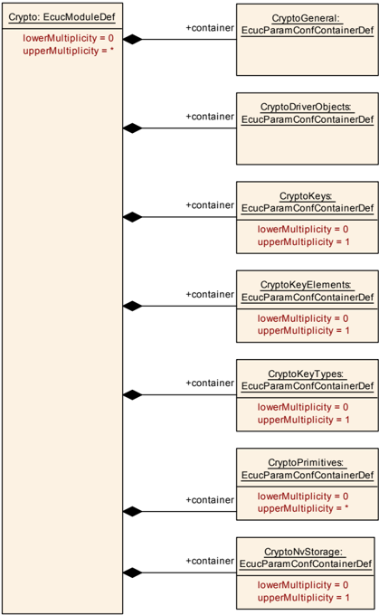

#### 8.1.2. CryptoGeneral

| SWS 条目 | [ECUC_Crypto_00002] |
|---|---|
| 容器名称 | CryptoGeneral |
| 父容器 | Crypto |
| 描述 | 通用配置选项的容器。 |
| Post-Build 变体多重性 | false |
| 多重性配置类 | Pre-compile time：x（All Variants）；Link time：-；Post-build time：- |
| 配置参数 | 见下方参数表 |

| SWS 条目 | [ECUC_Crypto_00006] |
|---|---|
| 参数名称 | CryptoDevErrorDetect |
| 父容器 | CryptoGeneral |
| 描述 | 开启或关闭开发错误检测与通知（true：启用检测与通知；false：禁用检测与通知）。 |
| 多重性 | 1 |
| 类型 | EcucBooleanParamDef |
| 默认值 | false |
| 多重性配置类 | Pre-compile time：x（All Variants）；Link time：-；Post-build time：- |
| 值配置类 | Pre-compile time：x（All Variants）；Link time：-；Post-build time：- |
| 作用域/依赖 | scope: local |

| SWS 条目 | [ECUC_Crypto_00040] |
|---|---|
| 参数名称 | CryptoInstanceId |
| 父容器 | CryptoGeneral |
| 描述 | 加密驱动程序的实例 ID。当同一 **ECU** 中使用多个加密驱动程序时，此 ID 用于区分它们。 |
| 多重性 | 1 |
| 类型 | EcucIntegerParamDef |
| 范围 | 0 .. 255 |
| 默认值 | - |
| Post-Build 变体值 | false |
| 值配置类 | Pre-compile time：x（All Variants）；Link time：-；Post-build time：- |
| 作用域/依赖 | scope: local |

| SWS 条目 | [ECUC_Crypto_00038] |
|---|---|
| 参数名称 | CryptoMainFunctionPeriod |
| 父容器 | CryptoGeneral |
| 描述 | 以秒为单位指定 main 函数 Crypto_MainFunction 的周期。 |
| 多重性 | 0..1 |
| 类型 | EcucFloatParamDef |
| 范围 | ]0 .. INF[ |
| 默认值 | - |
| 多重性配置类 | Pre-compile time：x（All Variants）；Link time：-；Post-build time：- |
| 值配置类 | Pre-compile time：x（All Variants）；Link time：-；Post-build time：- |
| 作用域/依赖 | scope: local |

| SWS 条目 | [ECUC_Crypto_00007] |
|---|---|
| 参数名称 | CryptoVersionInfoApi |
| 父容器 | CryptoGeneral |
| 描述 | 启用/禁用 API Crypto_GetVersionInfo() 可用性的预处理器开关。true：API Crypto_GetVersionInfo() 可用；false：API Crypto_GetVersionInfo() 不可用。 |
| 多重性 | 1 |
| 类型 | EcucBooleanParamDef |
| 默认值 | false |
| 多重性配置类 | Pre-compile time：x（All Variants）；Link time：-；Post-build time：- |
| 值配置类 | Pre-compile time：x（All Variants）；Link time：-；Post-build time：- |
| 作用域/依赖 | scope: local |

| SWS 条目 | [ECUC_Crypto_00042] |
|---|---|
| 参数名称 | CryptoEcucPartitionRef |
| 父容器 | CryptoGeneral |
| 描述 | 将加密驱动程序映射到零个或多个 ECUC 分区，以使模块的 **API** 在该分区中可用。该模块将在每个分区中作为独立实例运行。 |
| 多重性 | 0..* |
| 类型 | 对 EcucPartition 的引用 |
| Post-Build 变体多重性 | false |
| Post-Build 变体值 | false |
| 多重性配置类 | Pre-compile time：x（All Variants）；Link time：-；Post-build time：- |
| 值配置类 | Pre-compile time：x（All Variants）；Link time：-；Post-build time：- |
| 作用域/依赖 | scope: ECU |

无包含的容器。

加密驱动程序模块应拒绝其实现所不支持的、带有分区映射的配置。

加密驱动程序模块将在每个分区中作为独立实例运行，即被调用的 **API** 仅作用于调用它时所在的分区。

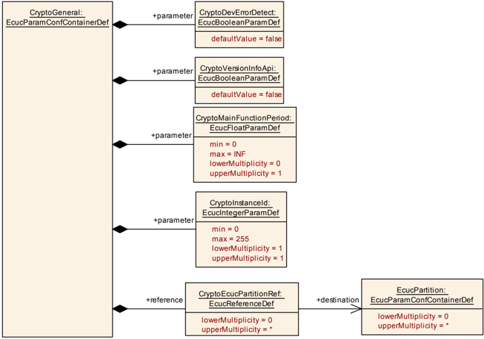

#### 8.1.3. CryptoDriverObjects

| SWS 条目 | [ECUC_Crypto_00003] |
|---|---|
| 容器名称 | CryptoDriverObjects |
| 父容器 | Crypto |
| 描述 | CRYPTO 对象的容器。 |
| Post-Build 变体多重性 | false |
| 多重性配置类 | Pre-compile time：x（All Variants）；Link time：-；Post-build time：- |
| 配置参数 | 见下方参数表 |

| 容器名称 | 多重性 | 作用域/依赖 |
|---|---|---|
| CryptoDriverObject | 0..* | CryptoDriverObject 的配置 |

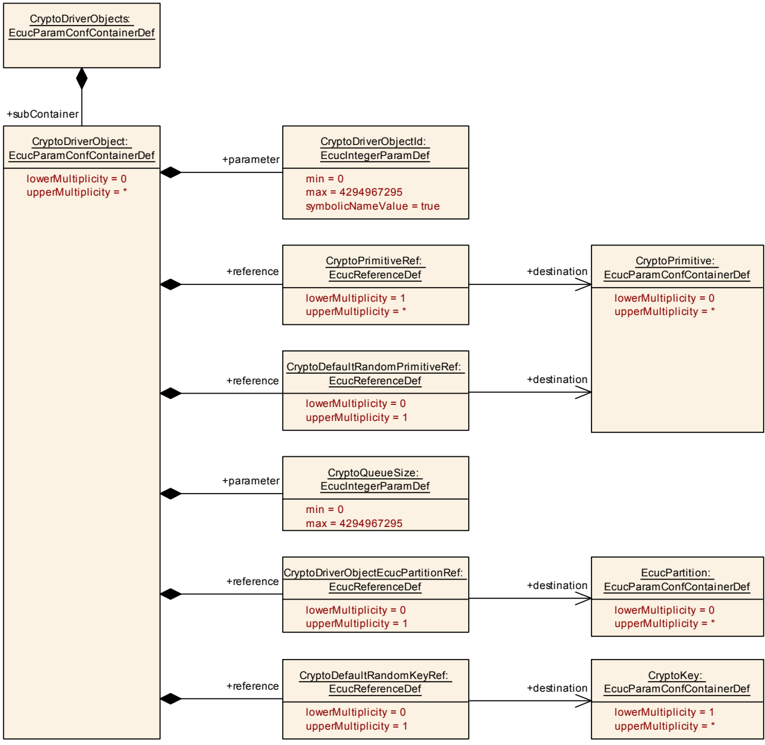

#### 8.1.4. CryptoDriverObject

| SWS 条目 | [ECUC_Crypto_00008] |
|---|---|
| 容器名称 | CryptoDriverObject |
| 父容器 | CryptoDriverObjects |
| 描述 | CryptoDriverObject 的配置。 |
| 配置参数 | 见下方参数表 |

| SWS 条目 | [ECUC_Crypto_00009] |
|---|---|
| 参数名称 | CryptoDriverObjectId |
| 父容器 | CryptoDriverObject |
| 描述 | 加密驱动程序对象的标识符。加密驱动程序对象提供不同的加密原语。 |
| 多重性 | 1 |
| 类型 | EcucIntegerParamDef（为此参数生成符号名） |
| 范围 | 0 .. 4294967295 |
| 默认值 | - |
| Post-Build 变体多重性 | false |
| Post-Build 变体值 | false |
| 多重性配置类 | Pre-compile time：x（All Variants）；Link time：-；Post-build time：- |
| 值配置类 | Pre-compile time：x（All Variants）；Link time：-；Post-build time：- |
| 作用域/依赖 | scope: local |

| SWS 条目 | [ECUC_Crypto_00019] |
|---|---|
| 参数名称 | CryptoQueueSize |
| 父容器 | CryptoDriverObject |
| 描述 | 加密驱动程序中队列的大小。定义加密驱动程序对象队列中作业的最大数量。如果设置为 0，则在该加密驱动程序对象中禁用排队。 |
| 多重性 | 1 |
| 类型 | EcucIntegerParamDef |
| 范围 | 0 .. 4294967295 |
| 默认值 | - |
| 多重性配置类 | Pre-compile time：x（All Variants）；Link time：-；Post-build time：- |
| 值配置类 | Pre-compile time：x（All Variants）；Link time：-；Post-build time：- |
| 作用域/依赖 | scope: local |

| SWS 条目 | [ECUC_Crypto_00045] |
|---|---|
| 参数名称 | CryptoDefaultRandomKeyRef |
| 父容器 | CryptoDriverObject |
| 描述 | 对 CryptoKey 的引用，该密钥由 CryptoDefaultRandomPrimitiveRef 使用。此密钥包含为随机数生成器提供种子所需的密钥元素。仅当 CryptoDefaultRandomPrimitiveRef 所引用的原语需要种子值时，才应设置此元素。 |
| 多重性 | 0..1 |
| 类型 | 对 CryptoKey 的引用 |
| 多重性配置类 | Pre-compile time：x（All Variants）；Link time：-；Post-build time：- |
| 值配置类 | Pre-compile time：x（All Variants）；Link time：-；Post-build time：- |
| 作用域/依赖 | scope: local |

| SWS 条目 | [ECUC_Crypto_00044] |
|---|---|
| 参数名称 | CryptoDefaultRandomPrimitiveRef |
| 父容器 | CryptoDriverObject |
| 描述 | 对配置了默认随机数生成器的原语的引用。如果加密驱动程序对象需要执行某个需要随机数生成器的加密原语，但该原语的配置未提供用于随机数生成器的参数，则应使用此默认随机数生成器（即算法系列、次级算法系列和算法模式元素未提供此信息）。示例：加密驱动程序应生成基于椭圆曲线的签名，但用于签名生成的原语缺少关于随机数生成器的信息。 |
| 多重性 | 0..1 |
| 类型 | 对 CryptoPrimitive 的引用 |
| 多重性配置类 | Pre-compile time：x（All Variants）；Link time：-；Post-build time：- |
| 值配置类 | Pre-compile time：x（All Variants）；Link time：-；Post-build time：- |
| 作用域/依赖 | scope: local |

| SWS 条目 | [ECUC_Crypto_00043] |
|---|---|
| 参数名称 | CryptoDriverObjectEcucPartitionRef |
| 父容器 | CryptoDriverObject |
| 描述 | 将加密驱动程序对象映射到零个或一个 ECUC 分区。所引用的 ECUC 分区是加密驱动程序所映射到的 ECUC 分区的子集。 |
| 多重性 | 0..1 |
| 类型 | 对 EcucPartition 的引用 |
| Post-Build 变体多重性 | false |
| Post-Build 变体值 | false |
| 多重性配置类 | Pre-compile time：x（All Variants）；Link time：-；Post-build time：- |
| 值配置类 | Pre-compile time：x（All Variants）；Link time：-；Post-build time：- |
| 作用域/依赖 | scope: ECU |

| SWS 条目 | [ECUC_Crypto_00018] |
|---|---|
| 参数名称 | CryptoPrimitiveRef |
| 父容器 | CryptoDriverObject |
| 描述 | 引用 CRYPTO 中的原语。CryptoPrimitive 是应使用的加密服务的预配置容器。 |
| 多重性 | 1..* |
| 类型 | 对 CryptoPrimitive 的引用 |
| Post-Build 变体多重性 | false |
| Post-Build 变体值 | false |
| 多重性配置类 | Pre-compile time：x（All Variants）；Link time：-；Post-build time：- |
| 值配置类 | Pre-compile time：x（All Variants）；Link time：-；Post-build time：- |
| 作用域/依赖 | scope: local |

无包含的容器。

CryptoDriverObjectEcucPartitionRef 所引用的 ECUC 分区应为 CryptoEcucPartitionRef 所引用的 ECUC 分区的子集。

如果要为 **HSM** 配置 CryptoDriverObjectEcucPartitionRef，则它只应映射到 0 或 1 个 ECUC 分区。

如果 CryptoEcucPartitionRef 引用了一个或多个 ECUC 分区，则 CryptoDriverObjectEcucPartitionRef 的多重性应大于零，并且也应引用这些 ECUC 分区中的一个或多个。

#### 8.1.5. CryptoKeys

| SWS 条目 | [ECUC_Crypto_00004] |
|---|---|
| 容器名称 | CryptoKeys |
| 父容器 | Crypto |
| 描述 | CRYPTO 密钥的容器。 |
| 配置参数 | 见下方参数表 |

| 容器名称 | 多重性 | 作用域/依赖 |
|---|---|---|
| CryptoKey | 1..* | CryptoKey 的配置 |

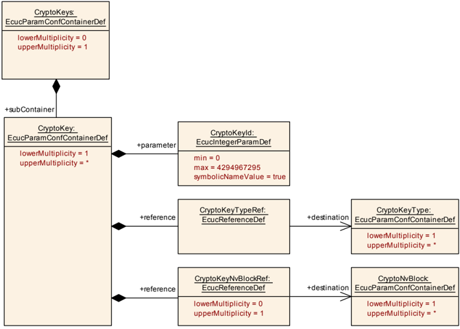

#### 8.1.6. CryptoKey

| SWS 条目 | [ECUC_Crypto_00011] |
|---|---|
| 容器名称 | CryptoKey |
| 父容器 | CryptoKeys |
| 描述 | CryptoKey 的配置。 |
| Post-Build 变体多重性 | false |
| 多重性配置类 | Pre-compile time：x（All Variants）；Link time：-；Post-build time：- |
| 配置参数 | 见下方参数表 |

| SWS 条目 | [ECUC_Crypto_00012] |
|---|---|
| 参数名称 | CryptoKeyId |
| 父容器 | CryptoKey |
| 描述 | CRYPTO 密钥的标识符。 |
| 多重性 | 1 |
| 类型 | EcucIntegerParamDef（为此参数生成符号名） |
| 范围 | 0 .. 4294967295 |
| 默认值 | - |
| Post-Build 变体多重性 | false |
| Post-Build 变体值 | false |
| 多重性配置类 | Pre-compile time：x（All Variants）；Link time：-；Post-build time：- |
| 值配置类 | Pre-compile time：x（All Variants）；Link time：-；Post-build time：- |
| 作用域/依赖 | scope: local |

| SWS 条目 | [ECUC_Crypto_00059] |
|---|---|
| 参数名称 | CryptoKeyNvBlockRef |
| 父容器 | CryptoKey |
| 描述 | 对 NV 块的引用，此密钥的持久化密钥元素应存储到该块中。 |
| 多重性 | 0..1 |
| 类型 | 对 CryptoNvBlock 的引用 |
| 多重性配置类 | Pre-compile time：x（All Variants）；Link time：-；Post-build time：- |
| 值配置类 | Pre-compile time：x（All Variants）；Link time：-；Post-build time：- |
| 作用域/依赖 | scope: local |

| SWS 条目 | [ECUC_Crypto_00020] |
|---|---|
| 参数名称 | CryptoKeyTypeRef |
| 父容器 | CryptoKey |
| 描述 | 引用 CRYPTO 中指向 CryptoKeyType 的指针。CryptoKeyType 提供有关 CryptoKey 中包含哪些密钥元素的信息。 |
| 多重性 | 1 |
| 类型 | 对 CryptoKeyType 的引用 |
| Post-Build 变体多重性 | false |
| Post-Build 变体值 | false |
| 多重性配置类 | Pre-compile time：x（All Variants）；Link time：-；Post-build time：- |
| 值配置类 | Pre-compile time：x（All Variants）；Link time：-；Post-build time：- |
| 作用域/依赖 | scope: local |

无包含的容器。

#### 8.1.7. CryptoKeyElements

| SWS 条目 | [ECUC_Crypto_00005] |
|---|---|
| 容器名称 | CryptoKeyElements |
| 父容器 | Crypto |
| 描述 | Crypto 密钥元素的容器。 |
| 配置参数 | 见下方参数表 |

| 容器名称 | 多重性 | 作用域/依赖 |
|---|---|---|
| CryptoKeyElement | 1..* | CryptoKeyElement 的配置 |

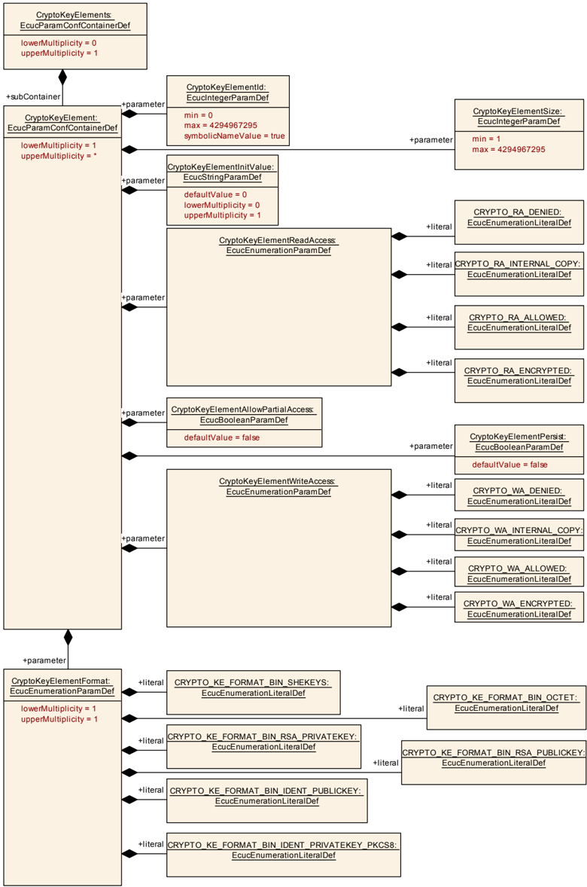

#### 8.1.8. CryptoKeyElement

| SWS 条目 | [ECUC_Crypto_00014] |
|---|---|
| 容器名称 | CryptoKeyElement |
| 父容器 | CryptoKeyElements |
| 描述 | CryptoKeyElement 的配置。 |
| 配置参数 | 见下方参数表 |

| SWS 条目 | [ECUC_Crypto_00025] |
|---|---|
| 参数名称 | CryptoKeyElementAllowPartialAccess |
| 父容器 | CryptoKeyElement |
| 描述 | 启用或禁用以小于密钥元素大小的数据对密钥元素进行写入和读取。true：启用密钥元素的部分访问；false：禁用密钥元素的部分访问。 |
| 多重性 | 1 |
| 类型 | EcucBooleanParamDef |
| 默认值 | false |
| 多重性配置类 | Pre-compile time：x（All Variants）；Link time：-；Post-build time：- |
| 值配置类 | Pre-compile time：x（All Variants）；Link time：-；Post-build time：- |
| 作用域/依赖 | scope: local |

| SWS 条目 | [ECUC_Crypto_00041] |
|---|---|
| 参数名称 | CryptoKeyElementFormat |
| 父容器 | CryptoKeyElement |
| 描述 | 定义密钥元素的格式。此格式用于向驱动程序提供或从驱动程序提取密钥数据。 |
| 多重性 | 1 |
| 类型 | EcucEnumerationParamDef |
| 范围 | CRYPTO_KE_FORMAT_BIN_IDENT_PRIVATEKEY_PKCS8（0x03）、CRYPTO_KE_FORMAT_BIN_IDENT_PUBLICKEY（0x04）、CRYPTO_KE_FORMAT_BIN_OCTET（0x01）、CRYPTO_KE_FORMAT_BIN_RSA_PRIVATEKEY（0x05）、CRYPTO_KE_FORMAT_BIN_RSA_PUBLICKEY（0x06）、CRYPTO_KE_FORMAT_BIN_SHEKEYS（0x02） |
| 多重性配置类 | Pre-compile time：x（All Variants）；Link time：-；Post-build time：- |
| 值配置类 | Pre-compile time：x（All Variants）；Link time：-；Post-build time：- |
| 作用域/依赖 |  |

| SWS 条目 | [ECUC_Crypto_00021] |
|---|---|
| 参数名称 | CryptoKeyElementId |
| 父容器 | CryptoKeyElement |
| 描述 | CRYPTO 密钥元素的标识符。 |
| 多重性 | 1 |
| 类型 | EcucIntegerParamDef（为此参数生成符号名） |
| 范围 | 0 .. 4294967295 |
| 默认值 | - |
| Post-Build 变体多重性 | false |
| Post-Build 变体值 | false |
| 多重性配置类 | Pre-compile time：x（All Variants）；Link time：-；Post-build time：- |
| 值配置类 | Pre-compile time：x（All Variants）；Link time：-；Post-build time：- |
| 作用域/依赖 | scope: local |

| SWS 条目 | [ECUC_Crypto_00023] |
|---|---|
| 参数名称 | CryptoKeyElementInitValue |
| 父容器 | CryptoKeyElement |
| 描述 | 启动时用于填充密钥元素的值：(i) 适用于所有非持久化密钥元素，以及 (ii) 从未被写入过的持久化密钥元素。 |
| 多重性 | 0..1 |
| 类型 | EcucStringParamDef |
| 默认值 | 0 |
| 正则表达式 | - |
| 多重性配置类 | Pre-compile time：x（All Variants）；Link time：-；Post-build time：- |
| 值配置类 | Pre-compile time：x（All Variants）；Link time：-；Post-build time：- |
| 作用域/依赖 | scope: local |

| SWS 条目 | [ECUC_Crypto_00026] |
|---|---|
| 参数名称 | CryptoKeyElementPersist |
| 父容器 | CryptoKeyElement |
| 描述 | 启用或禁用将密钥元素持久化到非易失性存储器。true：启用密钥元素的持久化；false：禁用密钥元素的持久化。 |
| 多重性 | 1 |
| 类型 | EcucBooleanParamDef |
| 默认值 | false |
| 多重性配置类 | Pre-compile time：x（All Variants）；Link time：-；Post-build time：- |
| 值配置类 | Pre-compile time：x（All Variants）；Link time：-；Post-build time：- |
| 作用域/依赖 | scope: local |

| SWS 条目 | [ECUC_Crypto_00024] |
|---|---|
| 参数名称 | CryptoKeyElementReadAccess |
| 父容器 | CryptoKeyElement |
| 描述 | 定义通过外部 **API** 对密钥元素的读取访问权限。CRYPTO_RA_DENIED = 不能从加密驱动程序外部读取密钥元素；CRYPTO_RA_INTERNAL_COPY = 密钥元素可以被复制到同一加密驱动程序中的另一个密钥元素；CRYPTO_RA_ALLOWED = 密钥元素可以明文读取；CRYPTO_RA_ENCRYPTED = 密钥元素可以加密读取。例如：**SHE** Ram-Key 导出。 |
| 多重性 | 1 |
| 类型 | EcucEnumerationParamDef |
| 范围 | CRYPTO_RA_ALLOWED（0x00）、CRYPTO_RA_DENIED（0x03）、CRYPTO_RA_ENCRYPTED（0x01）、CRYPTO_RA_INTERNAL_COPY（0x02） |
| 多重性配置类 | Pre-compile time：x（All Variants）；Link time：-；Post-build time：- |
| 值配置类 | Pre-compile time：x（All Variants）；Link time：-；Post-build time：- |
| 作用域/依赖 | scope: local dependency: 枚举类型的取值经过选择，使其值可用于推导分层的访问级别。 |

| SWS 条目 | [ECUC_Crypto_00022] |
|---|---|
| 参数名称 | CryptoKeyElementSize |
| 父容器 | CryptoKeyElement |
| 描述 | 以字节为单位的 CRYPTO 密钥元素的最大大小。 |
| 多重性 | 1 |
| 类型 | EcucIntegerParamDef |
| 范围 | 1 .. 4294967295 |
| 默认值 | - |
| Post-Build 变体多重性 | false |
| Post-Build 变体值 | false |
| 多重性配置类 | Pre-compile time：x（All Variants）；Link time：-；Post-build time：- |
| 值配置类 | Pre-compile time：x（All Variants）；Link time：-；Post-build time：- |
| 作用域/依赖 | scope: local |

| SWS 条目 | [ECUC_Crypto_00027] |
|---|---|
| 参数名称 | CryptoKeyElementWriteAccess |
| 父容器 | CryptoKeyElement |
| 描述 | 定义通过外部 **API** 对密钥元素的写入访问权限。CRYPTO_WA_DENIED = 不能从加密驱动程序外部写入密钥元素；CRYPTO_WA_INTERNAL_COPY = 密钥元素可以由同一加密驱动程序中的另一个密钥元素填充；CRYPTO_WA_ALLOWED = 密钥元素可以明文写入；CRYPTO_WA_ENCRYPTED = 密钥元素可以加密写入。例如：**SHE** load key（装载密钥）。 |
| 多重性 | 1 |
| 类型 | EcucEnumerationParamDef |
| 范围 | CRYPTO_WA_ALLOWED（0x00）、CRYPTO_WA_DENIED（0x03）、CRYPTO_WA_ENCRYPTED（0x01）、CRYPTO_WA_INTERNAL_COPY（0x02） |
| 多重性配置类 | Pre-compile time：x（All Variants）；Link time：-；Post-build time：- |
| 值配置类 | Pre-compile time：x（All Variants）；Link time：-；Post-build time：- |
| 作用域/依赖 | scope: local dependency: 枚举类型的取值经过选择，使其值可用于推导分层的访问级别。 |

无包含的容器。

#### 8.1.9. CryptoKeyTypes

| SWS 条目 | [ECUC_Crypto_00017] |
|---|---|
| 容器名称 | CryptoKeyTypes |
| 父容器 | Crypto |
| 描述 | CRYPTO 密钥类型的容器。 |
| Post-Build 变体多重性 | false |
| 多重性配置类 | Pre-compile time：x（All Variants）；Link time：-；Post-build time：- |
| 配置参数 | 见下方参数表 |

| 容器名称 | 多重性 | 作用域/依赖 |
|---|---|---|
| CryptoKeyType | 1..* | CryptoKeyType 的配置 |

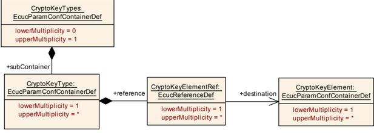

#### 8.1.10. CryptoKeyType

| SWS 条目 | [ECUC_Crypto_00030] |
|---|---|
| 容器名称 | CryptoKeyType |
| 父容器 | CryptoKeyTypes |
| 描述 | CryptoKeyType 的配置。 |
| 配置参数 | 见下方参数表 |

| SWS 条目 | [ECUC_Crypto_00031] |
|---|---|
| 参数名称 | CryptoKeyElementRef |
| 父容器 | CryptoKeyType |
| 描述 | 引用 CRYPTO 中指向 Crypto Key Element 的指针，该元素持有相应加密密钥元素的数据。 |
| 多重性 | 1..* |
| 类型 | 对 CryptoKeyElement 的引用 |
| 多重性配置类 | Pre-compile time：x（All Variants）；Link time：-；Post-build time：- |
| 值配置类 | Pre-compile time：x（All Variants）；Link time：-；Post-build time：- |
| 作用域/依赖 | scope: local |

无包含的容器。

#### 8.1.11. CryptoPrimitives

| SWS 条目 | [ECUC_Crypto_00032] |
|---|---|
| 容器名称 | CryptoPrimitives |
| 父容器 | Crypto |
| 描述 | CRYPTO 原语的容器。 |
| 配置参数 | 见下方参数表 |

| 容器名称 | 多重性 | 作用域/依赖 |
|---|---|---|
| CryptoPrimitive | 0..* | CryptoPrimitive 的配置。 |
| CryptoPrimitiveAlgorithmFamilyCustom | 0..* | 自定义算法族值的容器。容器名称用作自定义算法族类型标识符的符号名。 |
| CryptoPrimitiveAlgorithmModeCustom | 0..* | 自定义算法族值的容器。容器名称用作自定义算法族类型标识符的符号名。 |

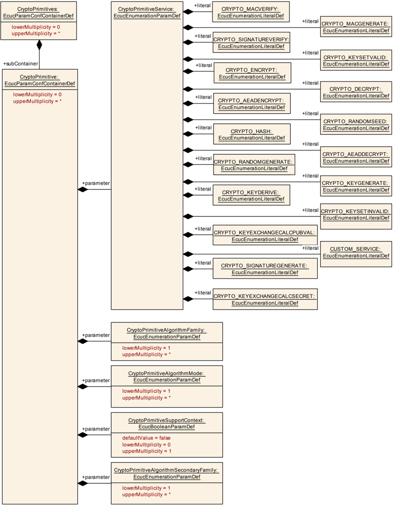

#### 8.1.12. CryptoPrimitive

| SWS 条目 | [ECUC_Crypto_00033] |
|---|---|
| 容器名称 | CryptoPrimitive |
| 父容器 | CryptoPrimitives |
| 描述 | CryptoPrimitive 的配置。 |
| 配置参数 | 见下方参数表 |

| SWS 条目 | [ECUC_Crypto_00035] |
|---|---|
| 参数名称 | CryptoPrimitiveAlgorithmFamily |
| 父容器 | CryptoPrimitive |
| 描述 | 确定加密服务所使用的算法族。 |
| 多重性 | 1..* |
| 类型 | EcucEnumerationParamDef |
| 范围 | CRYPTO_ALGOFAM_3DES、CRYPTO_ALGOFAM_AES、CRYPTO_ALGOFAM_BLAKE_1_256、CRYPTO_ALGOFAM_BLAKE_1_512、CRYPTO_ALGOFAM_BLAKE_2s_256、CRYPTO_ALGOFAM_BLAKE_2s_512、CRYPTO_ALGOFAM_BRAINPOOL、CRYPTO_ALGOFAM_CHACHA、CRYPTO_ALGOFAM_CUSTOM、CRYPTO_ALGOFAM_DH、CRYPTO_ALGOFAM_DRBG、CRYPTO_ALGOFAM_ECCANSI、CRYPTO_ALGOFAM_ECCNIST、CRYPTO_ALGOFAM_ECCSEC、CRYPTO_ALGOFAM_ECDH、CRYPTO_ALGOFAM_ECDSA、CRYPTO_ALGOFAM_ED25519、CRYPTO_ALGOFAM_EEA3、CRYPTO_ALGOFAM_EIA3、CRYPTO_ALGOFAM_FIPS186、CRYPTO_ALGOFAM_HKDF、CRYPTO_ALGOFAM_KDFX963、CRYPTO_ALGOFAM_NOT_SET、CRYPTO_ALGOFAM_PADDING_ONEWITHZEROS、CRYPTO_ALGOFAM_PADDING_PKCS7、CRYPTO_ALGOFAM_PBKDF2、CRYPTO_ALGOFAM_POLY1305、CRYPTO_ALGOFAM_RIPEMD160、CRYPTO_ALGOFAM_RNG、CRYPTO_ALGOFAM_RSA、CRYPTO_ALGOFAM_SHA1、CRYPTO_ALGOFAM_SHA2_224、CRYPTO_ALGOFAM_SHA2_256、CRYPTO_ALGOFAM_SHA2_384、CRYPTO_ALGOFAM_SHA2_512、CRYPTO_ALGOFAM_SHA2_512_224、CRYPTO_ALGOFAM_SHA2_512_256、CRYPTO_ALGOFAM_SHA3_224、CRYPTO_ALGOFAM_SHA3_256、CRYPTO_ALGOFAM_SHA3_384、CRYPTO_ALGOFAM_SHA3_512、CRYPTO_ALGOFAM_SHAKE128、CRYPTO_ALGOFAM_SHAKE256、CRYPTO_ALGOFAM_SIPHASH、CRYPTO_ALGOFAM_SM2、CRYPTO_ALGOFAM_SM3、CRYPTO_ALGOFAM_X25519 |
| Post-Build 变体值 | false |
| 多重性配置类 | Pre-compile time：x（All Variants）；Link time：-；Post-build time：- |
| 值配置类 | Pre-compile time：x（All Variants）；Link time：-；Post-build time：- |
| 作用域/依赖 | scope: local |

| SWS 条目 | [ECUC_Crypto_00036] |
|---|---|
| 参数名称 | CryptoPrimitiveAlgorithmMode |
| 父容器 | CryptoPrimitive |
| 描述 | 确定加密服务所使用的算法模式。 |
| 多重性 | 1..* |
| 类型 | EcucEnumerationParamDef |
| 范围 | CRYPTO_ALGOMODE_12ROUNDS、CRYPTO_ALGOMODE_20ROUNDS、CRYPTO_ALGOMODE_8ROUNDS、CRYPTO_ALGOMODE_AESKEYWRAP、CRYPTO_ALGOMODE_CBC、CRYPTO_ALGOMODE_CFB、CRYPTO_ALGOMODE_CMAC、CRYPTO_ALGOMODE_CTR、CRYPTO_ALGOMODE_CTRDRBG、CRYPTO_ALGOMODE_CUSTOM、CRYPTO_ALGOMODE_ECB、CRYPTO_ALGOMODE_GCM、CRYPTO_ALGOMODE_GMAC、CRYPTO_ALGOMODE_HMAC、CRYPTO_ALGOMODE_NOT_SET、CRYPTO_ALGOMODE_OFB、CRYPTO_ALGOMODE_PXXXR、CRYPTO_ALGOMODE_RSAES_OAEP、CRYPTO_ALGOMODE_RSAES_PKCS1_v1_5、CRYPTO_ALGOMODE_RSASSA_PKCS1_v1_5、CRYPTO_ALGOMODE_RSASSA_PSS、CRYPTO_ALGOMODE_SIPHASH_2_4、CRYPTO_ALGOMODE_SIPHASH_4_8、CRYPTO_ALGOMODE_XTS |
| Post-Build 变体值 | false |
| 多重性配置类 | Pre-compile time：x（All Variants）；Link time：-；Post-build time：- |
| 值配置类 | Pre-compile time：x（All Variants）；Link time：-；Post-build time：- |
| 作用域/依赖 | scope: local |

| SWS 条目 | [ECUC_Crypto_00037] |
|---|---|
| 参数名称 | CryptoPrimitiveAlgorithmSecondaryFamily |
| 父容器 | CryptoPrimitive |
| 描述 | 确定加密服务所使用的次要算法族。 |
| 多重性 | 1..* |
| 类型 | EcucEnumerationParamDef |
| 范围 | CRYPTO_ALGOFAM_3DES、CRYPTO_ALGOFAM_AES、CRYPTO_ALGOFAM_BLAKE_1_256、CRYPTO_ALGOFAM_BLAKE_1_512、CRYPTO_ALGOFAM_BLAKE_2s_256、CRYPTO_ALGOFAM_BLAKE_2s_512、CRYPTO_ALGOFAM_BRAINPOOL、CRYPTO_ALGOFAM_CHACHA、CRYPTO_ALGOFAM_CUSTOM、CRYPTO_ALGOFAM_DRBG、CRYPTO_ALGOFAM_ECCANSI、CRYPTO_ALGOFAM_ECCNIST、CRYPTO_ALGOFAM_ECCSEC、CRYPTO_ALGOFAM_ED25519、CRYPTO_ALGOFAM_FIPS186、CRYPTO_ALGOFAM_NOT_SET、CRYPTO_ALGOFAM_PADDING_ONEWITHZEROS、CRYPTO_ALGOFAM_PADDING_PKCS7、CRYPTO_ALGOFAM_POLY1305、CRYPTO_ALGOFAM_RIPEMD160、CRYPTO_ALGOFAM_RNG、CRYPTO_ALGOFAM_RSA、CRYPTO_ALGOFAM_SHA1、CRYPTO_ALGOFAM_SHA2_224、CRYPTO_ALGOFAM_SHA2_256、CRYPTO_ALGOFAM_SHA2_384、CRYPTO_ALGOFAM_SHA2_512、CRYPTO_ALGOFAM_SHA2_512_224、CRYPTO_ALGOFAM_SHA2_512_256、CRYPTO_ALGOFAM_SHA3_224、CRYPTO_ALGOFAM_SHA3_256、CRYPTO_ALGOFAM_SHA3_384、CRYPTO_ALGOFAM_SHA3_512、CRYPTO_ALGOFAM_SHAKE128、CRYPTO_ALGOFAM_SHAKE256、CRYPTO_ALGOFAM_SIPHASH、CRYPTO_ALGOFAM_X25519 |
| Post-Build 变体值 | false |
| 多重性配置类 | Pre-compile time：x（All Variants）；Link time：-；Post-build time：- |
| 值配置类 | Pre-compile time：x（All Variants）；Link time：-；Post-build time：- |
| 作用域/依赖 | scope: local |

| SWS 条目 | [ECUC_Crypto_00034] |
|---|---|
| 参数名称 | CryptoPrimitiveService |
| 父容器 | CryptoPrimitive |
| 描述 | 确定用于定义能力的加密服务。 |
| 多重性 | 1 |
| 类型 | EcucEnumerationParamDef |
| 范围 | CRYPTO_AEADDECRYPT（0x06）、CRYPTO_AEADENCRYPT（0x05）、CRYPTO_DECRYPT（0x04）、CRYPTO_ENCRYPT（0x03）、CRYPTO_HASH（0x00）、CRYPTO_KEYDERIVE（0x0E）、CRYPTO_KEYEXCHANGECALCPUBVAL（0x0F）、CRYPTO_KEYEXCHANGECALCSECRET（0x10）、CRYPTO_KEYGENERATE（0x0D）、CRYPTO_KEYSETINVALID（0x14）、CRYPTO_KEYSETVALID（0x13）、CRYPTO_MACGENERATE（0x01）、CRYPTO_MACVERIFY（0x02）、CRYPTO_RANDOMGENERATE（0x0B）、CRYPTO_RANDOMSEED（0x0C）、CRYPTO_SIGNATUREGENERATE（0x07）、CRYPTO_SIGNATUREVERIFY（0x8）、CUSTOM_SERVICE（0x15） |
| 多重性配置类 | Pre-compile time：x（All Variants）；Link time：-；Post-build time：- |
| 值配置类 | Pre-compile time：x（All Variants）；Link time：-；Post-build time：- |
| 作用域/依赖 | scope: local |

| SWS 条目 | [ECUC_Crypto_00053] |
|---|---|
| 参数名称 | CryptoPrimitiveSupportContext |
| 父容器 | CryptoPrimitive |
| 描述 | 配置加密原语是否支持存储或恢复工作区的上下文数据。由于该选项存在安全风险，仅在绝对必要时才应将其设置为 TRUE。 |
| 多重性 | 0..1 |
| 类型 | EcucBooleanParamDef |
| 默认值 | false |
| 多重性配置类 | Pre-compile time：x（All Variants）；Link time：-；Post-build time：- |
| 值配置类 | Pre-compile time：x（All Variants）；Link time：-；Post-build time：- |
| 作用域/依赖 | scope: local |

| SWS 条目 | [ECUC_Crypto_00050] |
|---|---|
| 参数名称 | CryptoPrimitiveAlgorithmFamilyCustomRef |
| 父容器 | CryptoPrimitive |
| 描述 | 对客户特定算法族自定义容器的引用。 |
| 多重性 | 0..* |
| 类型 | 对 CryptoPrimitiveAlgorithmFamilyCustom 的引用 |
| 多重性配置类 | Pre-compile time：x（All Variants）；Link time：-；Post-build time：- |
| 值配置类 | Pre-compile time：x（All Variants）；Link time：-；Post-build time：- |
| 作用域/依赖 | scope: local dependency: 仅当驱动程序还针对特定 CryptoPrimitiveService 支持 PrimitiveAlgorithmFamily 的客户特定特性时，才需要此引用。 |

| SWS 条目 | [ECUC_Crypto_00051] |
|---|---|
| 参数名称 | CryptoPrimitiveAlgorithmModeCustomRef |
| 父容器 | CryptoPrimitive |
| 描述 | 对客户特定算法模式自定义容器的引用。 |
| 多重性 | 0..* |
| 类型 | 对 CryptoPrimitiveAlgorithmModeCustom 的引用 |
| 多重性配置类 | Pre-compile time：x（All Variants）；Link time：-；Post-build time：- |
| 值配置类 | Pre-compile time：x（All Variants）；Link time：-；Post-build time：- |
| 作用域/依赖 | dependency: 仅当驱动程序还针对特定 CryptoPrimitiveService 支持 PrimitiveAlgorithmMode 的客户特定特性时，才需要此引用。 |

| SWS 条目 | [ECUC_Crypto_00052] |
|---|---|
| 参数名称 | CryptoPrimitiveAlgorithmSecondaryFamilyCustomRef |
| 父容器 | CryptoPrimitive |
| 描述 | 对客户特定算法族自定义容器的引用。 |
| 多重性 | 0..* |
| 类型 | 对 CryptoPrimitiveAlgorithmFamilyCustom 的引用 |
| 多重性配置类 | Pre-compile time：x（All Variants）；Link time：-；Post-build time：- |
| 值配置类 | Pre-compile time：x（All Variants）；Link time：-；Post-build time：- |
| 作用域/依赖 | scope: local dependency: 仅当驱动程序还针对特定 CryptoPrimitiveService 支持 PrimitiveSecondaryAlgorithmFamily 的客户特定特性时，才需要此容器。 |

无包含的容器。

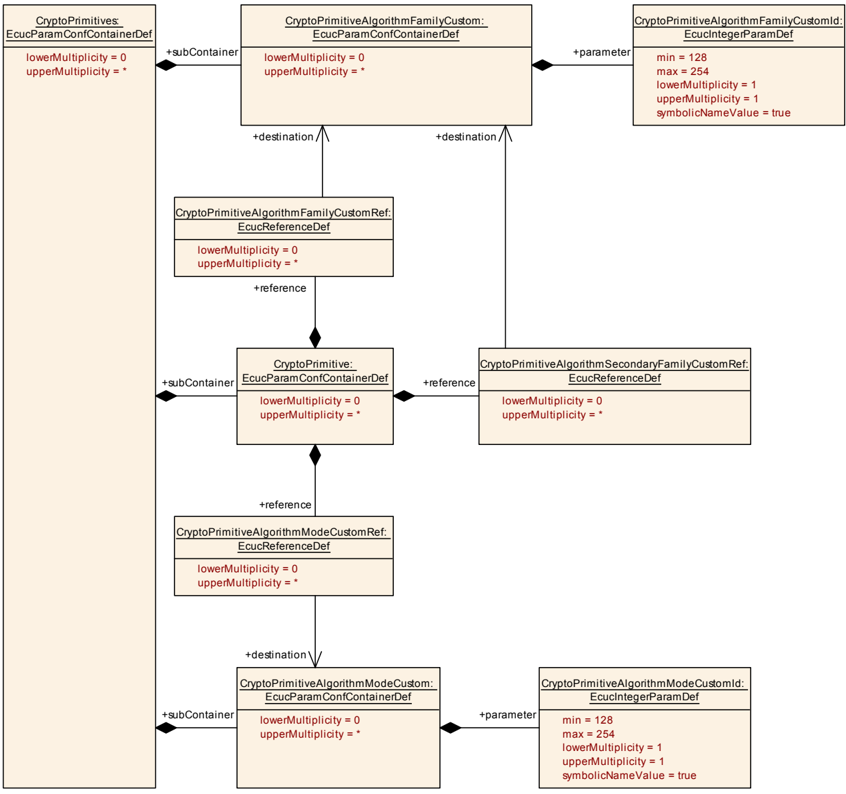

#### 8.1.13. CryptoPrimitiveAlgorithmFamilyCustom

| SWS 条目 | [ECUC_Crypto_00046] |
|---|---|
| 容器名称 | CryptoPrimitiveAlgorithmFamilyCustom |
| 父容器 | CryptoPrimitives |
| 描述 | 自定义算法族值的容器。容器名称用作自定义算法族类型标识符的符号名。 |
| 配置参数 | 见下方参数表 |

| SWS 条目 | [ECUC_Crypto_00047] |
|---|---|
| 参数名称 | CryptoPrimitiveAlgorithmFamilyCustomId |
| 父容器 | CryptoPrimitiveAlgorithmFamilyCustom |
| 描述 | 此算法族的自定义值。 |
| 多重性 | 1 |
| 类型 | EcucIntegerParamDef（为此参数生成符号名） |
| 范围 | 128 .. 254 |
| 默认值 | - |
| 多重性配置类 | Pre-compile time：x（All Variants）；Link time：-；Post-build time：- |
| 值配置类 | Pre-compile time：x（All Variants）；Link time：-；Post-build time：- |
| 作用域/依赖 | scope: local dependency: CustomIds 用于区分不同的自定义算法族。因此，每个指定的算法族都应具有唯一的 ID，且该 ID 在驱动程序的更新和整个生命周期内应保持固定。 |

无包含的容器。

#### 8.1.14. CryptoPrimitiveAlgorithmModeCustom

| SWS 条目 | [ECUC_Crypto_00048] |
|---|---|
| 容器名称 | CryptoPrimitiveAlgorithmModeCustom |
| 父容器 | CryptoPrimitives |
| 描述 | 自定义算法族值的容器。容器名称用作自定义算法族类型标识符的符号名。 |
| 配置参数 | 见下方参数表 |

| SWS 条目 | [ECUC_Crypto_00049] |
|---|---|
| 参数名称 | CryptoPrimitiveAlgorithmModeCustomId |
| 父容器 | CryptoPrimitiveAlgorithmModeCustom |
| 描述 | 此算法模式的自定义值。 |
| 多重性 | 1 |
| 类型 | EcucIntegerParamDef（为此参数生成符号名） |
| 范围 | 128 .. 254 |
| 默认值 | - |
| 多重性配置类 | Pre-compile time：x（All Variants）；Link time：-；Post-build time：- |
| 值配置类 | Pre-compile time：x（All Variants）；Link time：-；Post-build time：- |
| 作用域/依赖 | scope: local dependency: CustomIds 用于区分不同的自定义算法模式。因此，每个指定的算法模式都应具有唯一的 ID，该 ID 在驱动程序的更新和整个生命周期内保持固定。 |

无包含的容器。

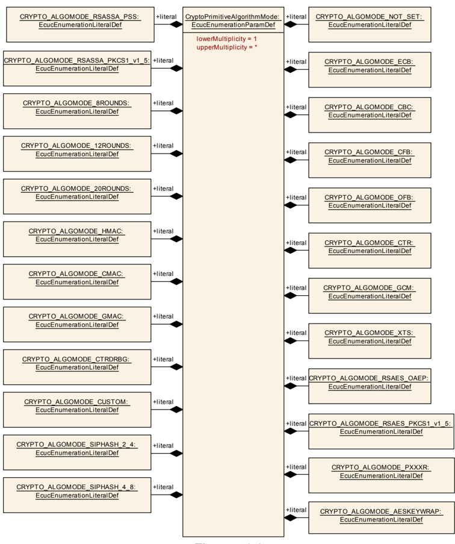

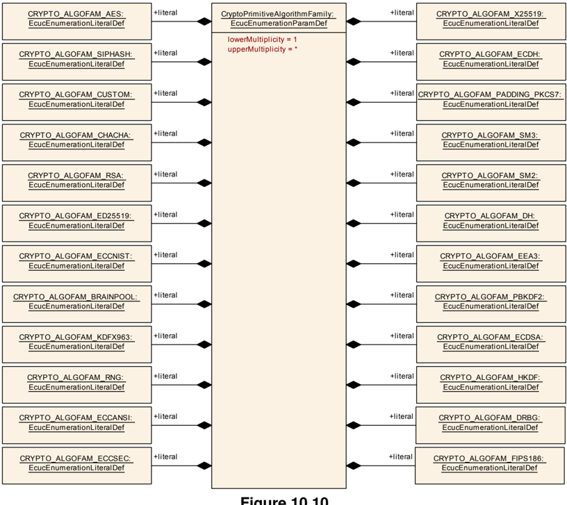

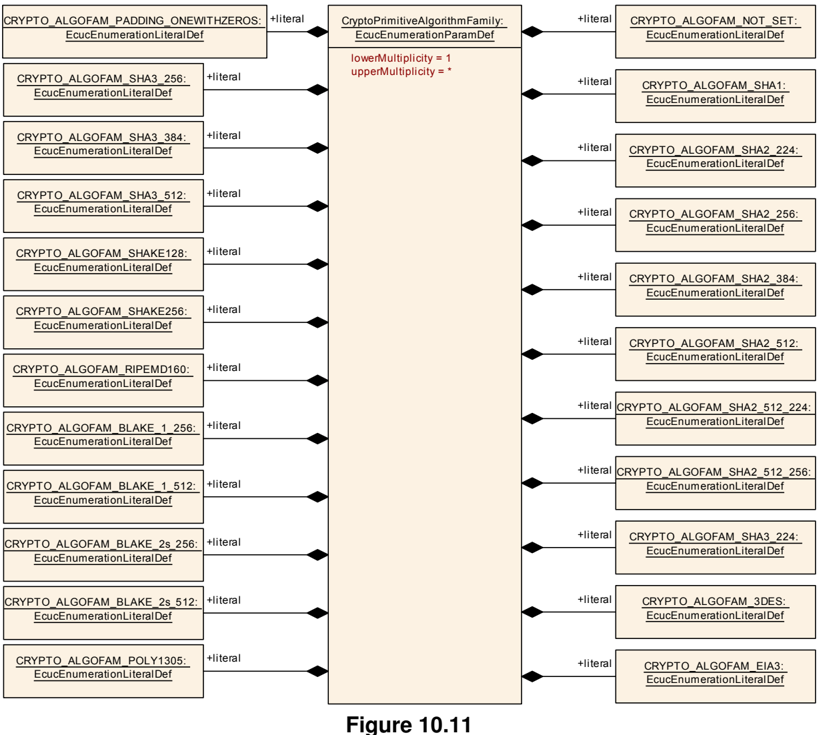

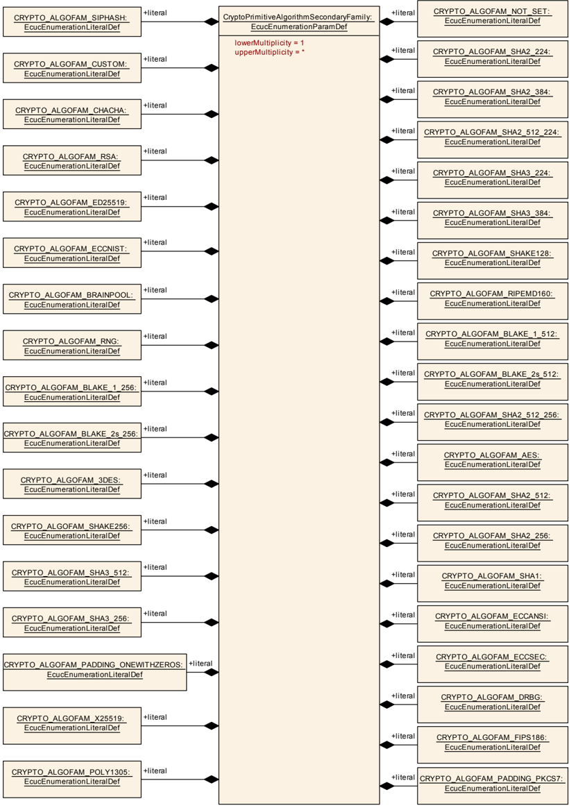

#### 8.1.15. CryptoNvStorage

| SWS 条目 | [ECUC_Crypto_00054] |
|---|---|
| 容器名称 | CryptoNvStorage |
| 父容器 | Crypto |
| 描述 | NV 块存储的容器。包含用于密钥存储的所有 NV 存储块的集合。 |
| 配置参数 | 见下方参数表 |

| 容器名称 | 多重性 | 作用域/依赖 |
|---|---|---|
| CryptoNvBlock | 1..* | 用于在 NVM 中配置密钥存储的容器。 |

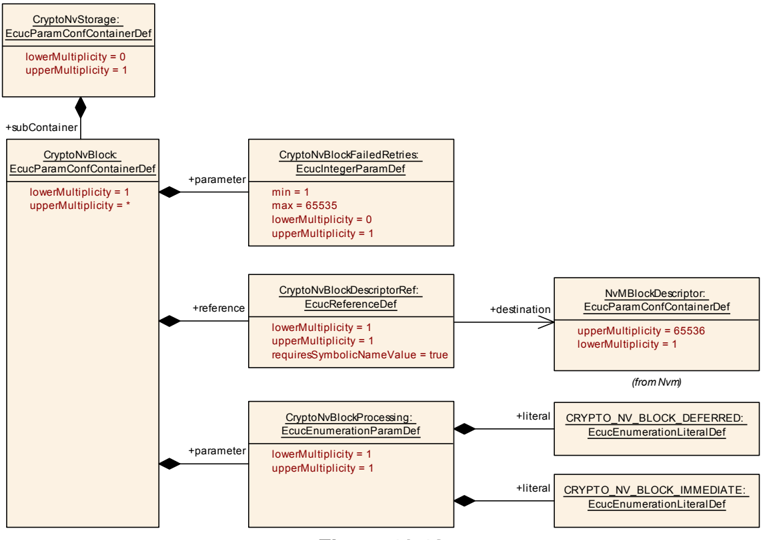

#### 8.1.16. CryptoNvBlock

| SWS 条目 | [ECUC_Crypto_00055] |
|---|---|
| 容器名称 | CryptoNvBlock |
| 父容器 | CryptoNvStorage |
| 描述 | 用于在 NVM 中配置密钥存储的容器。 |
| 配置参数 | 见下方参数表 |

| SWS 条目 | [ECUC_Crypto_00057] |
|---|---|
| 参数名称 | CryptoNvBlockFailedRetries |
| 父容器 | CryptoNvBlock |
| 描述 | 请求 NVM 服务操作的重试次数。 |
| 多重性 | 0..1 |
| 类型 | EcucIntegerParamDef |
| 范围 | 1 .. 65535 |
| 默认值 | - |
| 多重性配置类 | Pre-compile time：x（All Variants）；Link time：-；Post-build time：- |
| 值配置类 | Pre-compile time：x（All Variants）；Link time：-；Post-build time：- |
| 作用域/依赖 | scope: local |

| SWS 条目 | [ECUC_Crypto_00058] |
|---|---|
| 参数名称 | CryptoNvBlockProcessing |
| 父容器 | CryptoNvBlock |
| 描述 | 选择在应更新 NV 块时使用的操作模式。 |
| 多重性 | 1 |
| 类型 | EcucEnumerationParamDef |
| 范围 | CRYPTO_NV_BLOCK_DEFERRED（0x01）、CRYPTO_NV_BLOCK_IMMEDIATE（0x02） |
| 多重性配置类 | Pre-compile time：x（All Variants）；Link time：-；Post-build time：- |
| 值配置类 | Pre-compile time：x（All Variants）；Link time：-；Post-build time：- |
| 作用域/依赖 | scope: local |

| SWS 条目 | [ECUC_Crypto_00056] |
|---|---|
| 参数名称 | CryptoNvBlockDescriptorRef |
| 父容器 | CryptoNvBlock |
| 描述 | 对 NvM 块描述符的引用。 |
| 多重性 | 1 |
| 类型 | 对 NvMBlockDescriptor 的符号名引用 |
| 多重性配置类 | Pre-compile time：x（All Variants）；Link time：-；Post-build time：- |
| 值配置类 | Pre-compile time：x（All Variants）；Link time：-；Post-build time：- |
| 作用域/依赖 | scope: local |

无包含的容器。

### 8.2. 发布信息

发布信息包含由软件模块实现者所定义的数据，这些数据在模块适配（即配置）到实际硬件/软件环境时不会改变。因此，其中包含版本和制造商信息。

如适用，其他模块特定的发布参数将在下方列出。
